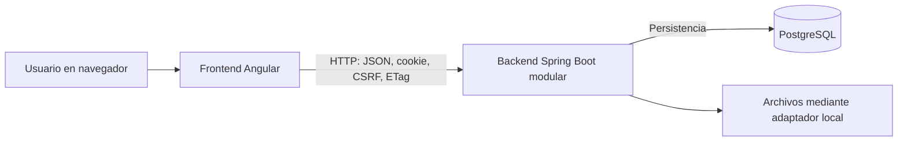

# Auditoría de documentación y requisitos del proyecto — SDD

## 1. Resumen general del estado de la documentación

**El proyecto dispone de una base documental suficiente para preparar la actividad de SDD, pero requiere depurar inconsistencias y completar la evidencia académica. No es necesario empezar la documentación desde cero.**

La revisión corresponde al repositorio en el commit **`faf868ea`**. Se realizó inventario de archivos, lectura documental y contraste estático de controladores, servicios, clientes HTTP, configuración y pruebas relevantes. **Durante la auditoría no se crearon, eliminaron ni modificaron archivos.** Este informe se incorpora posteriormente a petición del usuario.

Los principales resultados son:

| Área | Diagnóstico |
|---|---|
| Descripción, actores y alcance | Documentados. Falta una formulación explícita del problema respaldada por información del contexto real. |
| Requisitos funcionales | Existen FR-001–FR-070 y seis refinamientos con sufijo. Hay correspondencia amplia con el código, con brechas concretas. |
| Requisitos no funcionales | Existen RNF-001–RNF-019. Varios son medibles; su validación está incompleta. |
| Casos de uso | Existen 16 procesos narrativos con actores, precondiciones, pasos, alternativas y resultados. Falta formalizar algunas excepciones y relaciones. |
| Historias y aceptación | Hay historias maestras y por funcionalidad, generalmente acompañadas de escenarios comprobables. |
| Arquitectura | Documentada como cliente-servidor con backend monolítico modular, PostgreSQL y almacenamiento separado de archivos. |
| API HTTP | Existe OpenAPI y código para GET, POST, PUT, PATCH y DELETE. El contrato común contiene operaciones sin controlador y omite otras implementadas. |
| Pruebas | Hay pruebas reales y resultados históricos detallados. También permanecen tres pruebas vacías y dos pantallas de evidencias estáticas. |
| Aprobación institucional | Pendiente. T111 y las decisiones CL no pueden presentarse como aprobadas. |

La evidencia histórica de cierre declara **125 de 126 tareas completadas**, **64 escenarios técnicos aprobados**, regresión backend y frontend y restauración local. Estas cifras son **resultados registrados en el repositorio**, no pruebas ejecutadas nuevamente durante esta auditoría. Tampoco demuestran cumplimiento íntegro de todos los requisitos.

Fuentes principales:

- [Especificación general](docs/requirements/spec.md).
- [Especificación de flujos completos](specs/005-complete-evaluation-workflows/spec.md).
- [Validación técnica de cierre](tests/acceptance/results/p01-p16-completion-validation.md).
- [Revisión humana pendiente](tests/acceptance/results/p01-p16-review-gate.md).

**Convención del informe:** se conservan los identificadores originales **FR**, en lugar de renumerarlos como RF. Cambiarlos dificultaría la trazabilidad existente.

## 2. Mapa de documentos existentes con rutas exactas

Todas las rutas siguientes son relativas a:

`C:\Users\Det-Pc\OneDrive\Desktop\SIGEAC`

El estado evalúa la utilidad del documento para la actividad solicitada. “Completo” no significa aprobación institucional ni cumplimiento demostrado del software.

### Documentación central

| Archivo y ruta | Apartado | Contenido y relación con SDD | Estado |
|---|---|---|---|
| `index.qmd` | Presentación | Introduce SEC-UNL, cinco modelos, MVP documental y enlaces centrales. | Parcial: sirve de entrada, no desarrolla la problemática. |
| `_quarto.yml` | Navegación | Organiza requisitos, planificación, arquitectura, documentación técnica, pruebas y manuales. | Completo como configuración documental. |
| `feature-map.md` | Propósito; funcionalidades; módulos; P01–P16 | Mapa general de vistas y capacidades. | Parcial: presenta historial y auditoría de evidencias como capacidades disponibles, aunque sus pantallas son estáticas. |
| `docs/requirements/spec.md` | Contexto y alcance; Actores; Requisitos; Decisiones institucionales abiertas; Exclusiones | Fuente principal de alcance, nueve historias maestras, FR-001–FR-040, RNF-001–RNF-019, CL-001–CL-010 y criterios SC. | Parcial: amplia cobertura, con requisitos y referencias que necesitan reconciliación. |
| `docs/requirements/process-flows.md` | P01–P16 | Actores, precondiciones, flujos principales, alternativas y resultados de los 16 procesos. Incluye diagrama Mermaid. | Parcial como catálogo formal de casos de uso. |
| `docs/requirements/domain-rules.md` | Vocabulario; Responsabilidades; Decisiones; Estados; Cálculo; Cierre | Responsabilidades, CL-011–CL-017, fórmulas, cardinalidad, versiones y políticas de cierre. | Parcial: reglas precisas del piloto; validación institucional pendiente. |
| `.specify/memory/constitution.md` | Principios; Restricciones | Separación documental/académica, trazabilidad, arquitectura modular, seguridad y calidad. | Completo como marco interno; no sustituye requisitos ni aprobaciones. |
| `docs/planning/plan.md` | Plan general | Organización técnica e incrementos históricos. | Parcial/histórico. |
| `docs/planning/tasks.md` | Organización histórica; Reconciliación | Conserva tareas anteriores y remite al paquete 005 como autoridad actual. | Histórico, identificado expresamente. |
| `docs/planning/next-steps.md` | Punto de partida; Orden; Entregas | Describe trabajo pendiente desde una fotografía inicial. | Desactualizado respecto a código y resultados posteriores D2–D8. |
| `docs/architecture/research.md` | Decisiones técnicas | Arquitectura, sesiones, persistencia, archivos, consistencia y verificación. | Parcial: contiene diferencias tecnológicas con la configuración actual. |
| `docs/architecture/data-model.md` | Modelo de datos | Entidades y relaciones generales. | Parcial: debe consultarse junto con el modelo de 005 y las migraciones actuales. |
| `docs/architecture/complete-workflows.md` | Contexto; Contenedores; Componentes; Fuentes de verdad | Diagramas y límites de módulos; permisos y acoplamiento SQL reconocido. | Parcial: algunas cifras y pendientes quedaron superados por informes posteriores. |
| `docs/technical/index.qmd` | Operación D1–D8; Evidencia; Validación | Mejor índice técnico para localizar implementación y resultados actuales. | Parcial: algunas afirmaciones generales exceden lo comprobado. |
| `docs/technical/quickstart.md` | Preparación; Escenarios; RNF | Ejecución y validación local sin Docker. | Parcial: referencia un protocolo ausente y un comando npm desde una raíz sin `package.json`. |
| `docs/technical/migration-p01-p16.qmd` | Compatibilidad; Reserva de migraciones | Explica conservación de v1, objetivo v2 y evolución de datos. | Parcial/desactualizado en reservas y estado de algunas entregas. |
| `docs/technical/contracts/openapi.yaml` | `paths`, `components`, seguridad | Contrato común `/api/v1`, solicitudes, respuestas, errores y sesión. | Parcial: no coincide completamente con los controladores. |
| `docs/technical/contracts/events-asyncapi.yaml` | Canales; Operaciones; Mensajes | Contrato opcional de eventos para extensiones futuras. | Completo como diseño; no acredita mensajería operativa. |
| `docs/technical/actores-accesos-riesgos.md` | Revisión estática de accesos | Contexto de riesgos y permisos. | Parcial; no constituye certificación de seguridad. |
| `docs/testing/traceability.md` | Matriz canónica; Evidencias; Cierre | Relaciona procesos, requisitos, historias, tareas y pruebas. | Parcial: mezcla tablas históricas y actuales; algunas relaciones son demasiado amplias. |
| `docs/testing/process-acceptance.md` | AC-P01–AC-P16; AC-X01–AC-X16 | 48 escenarios por proceso y 16 transversales en formato de aceptación. | Completo como catálogo técnico; cobertura total de cada enunciado no demostrada. |
| `docs/testing/implementation-review.md` | Estado real por proceso | Fotografía inicial y correcciones de implementación. | Desactualizado para describir el estado actual, útil como antecedente. |
| `docs/testing/sqlite.md` | Preparación y límites | Camino local de pruebas con SQLite y diferencias frente a PostgreSQL. | Completo para su alcance documentado. |
| `docs/testing/checklists/requirements.md` | Calidad y completitud | Lista de comprobación de requisitos. | Parcial: varios checks positivos necesitan revisión frente a los hallazgos. |
| `docs/testing/checklists/governance.md` | Gobierno | Control de decisiones y validación institucional. | Parcial, condicionado a decisiones pendientes. |

### Especificaciones por funcionalidad

Los cinco directorios contienen `spec.md`, `plan.md`, `tasks.md`, `research.md`, `data-model.md`, `quickstart.md`, `contracts/openapi.yaml` y `checklists/requirements.md`.

| Directorio exacto | Apartados relevantes | Contenido | Estado |
|---|---|---|---|
| `specs/001-identity-access-scopes/` | Historias; Functional Requirements; Quality Requirements | Cinco historias de sesión, administración, ámbitos, conflictos y auditoría. Refina FR-001–FR-006 y añade FR-006a. | Parcial: aprobación de políticas y cobertura uniforme de permisos pendientes. |
| `specs/002-version-evaluation-model/` | Historias; Requisitos | Cinco historias de borrador, publicación, sucesión, comparación y auditoría. Añade FR-008a. | Parcial: convive con contratos legados y configuración ampliada. |
| `specs/003-manage-self-assessment/` | Historias; Requisitos; Estados | Cinco historias de proceso, modelo fijado, participantes, estados y trazabilidad. Añade FR-013a. | Desactualizado en estados `DRAFT` y transiciones frente al catálogo canónico. |
| `specs/004-submit-evidence/` | Historias; Requisitos; Prerrequisitos | Cinco historias de borrador, fuentes, remisión, sucesión y auditoría. Añade FR-018a, FR-019a y FR-020a. | Parcial: la redacción antigua de remisión no incluye todas las modalidades actuales. |
| `specs/005-complete-evaluation-workflows/` | Diez historias; FR-041–FR-070; SC-011–SC-018 | Reconciliación P01–P16 y backlog actual. | Parcial: cierre técnico documentado, T111 pendiente y diferencias contrato/código. |

Archivos adicionales relevantes:

- `specs/004-submit-evidence/implementation-prerequisites.md`.
- `specs/005-complete-evaluation-workflows/contracts/README.md`: declara expresamente que `/api/v2` es un objetivo planificado.

### Manuales, decisiones y evidencia

| Rutas exactas | Sección/contenido | Relación académica | Estado |
|---|---|---|---|
| `docs/user/index.qmd` | Entrada al manual | Identifica recorridos por función. | Parcial. |
| `docs/user/i0-access.qmd`, `docs/user/i1-models.qmd`, `docs/user/i2-processes.qmd` | Guías iniciales | Apoyan escenarios de acceso, modelos y procesos. | Históricas/complementarias. |
| `docs/user/d1-careers.qmd` | Carreras | Evidencia funcional D1. | Documentado. |
| `docs/user/d2-d3-models-planning.qmd` | Modelos y planificación | Evidencia P03–P06. | Documentado; contrastar contratos actuales. |
| `docs/user/d4-d5-evidence-review.qmd` | Evidencias y revisión | Evidencia P07–P10. | Parcial por brechas de historial y auditoría visual. |
| `docs/user/d6-documentary-progress.qmd` | Avance documental | Explica métricas, cortes y cierre. | Documentado. |
| `docs/user/d7-manual-evaluation.qmd` | Valoración manual | Evidencia P12. | Documentado. |
| `docs/user/d7-quantitative-evaluation.qmd` | Variables y cálculo | Evidencia P12 cuantitativo. | Documentado para estrategias admitidas. |
| `docs/user/d7-academic-reconciliation.qmd` | Conciliación | Discrepancias y resolución. | Documentado con políticas sintéticas. |
| `docs/user/d7-d8-reports-archive.qmd` | Informes, mejora y archivo | Evidencia P13–P16. | Documentado; aprobación institucional pendiente. |
| `docs/adr/0001-modular-monolith.md` | Arquitectura | Justifica un único backend modular. | Aceptado internamente. |
| `docs/adr/0002-file-storage-port.md` | Almacenamiento | Separación de archivos y base. | Aceptado internamente. |
| `docs/adr/0003-evidence-versioning-contract.md`, `docs/adr/0004-opaque-sessions-scope-authorization.md`, `docs/adr/0005-model-version-snapshots.md`, `docs/adr/0006-fixed-model-process-state-machine.md` | Versiones, sesiones y procesos | Fundamentan decisiones técnicas iniciales. | Antecedentes; cotejar con reconciliación. |
| `docs/adr/0015-configurable-evaluation-models.md`, `docs/adr/0016-evaluation-strategies-import-adapters.md`, `docs/adr/0017-source-coverage-and-process-governance.md`, `docs/adr/0018-catalog-contract-migration-compatibility.md`, `docs/adr/0019-flexible-model-foundations.md` | Evolución del diseño | Modelos configurables, estrategias, fuentes y compatibilidad. | Documentados. |
| `tests/acceptance/results/process-acceptance.md` | Campaña consolidada | Registra 64 PASS sobre API real y datos sintéticos. | Evidencia histórica. |
| `tests/acceptance/results/p01-p16-completion-validation.md` | Cierre técnico | Resume pruebas, contratos y tareas. | Evidencia histórica con límites explícitos. |
| `tests/acceptance/results/p01-p16-review-gate.md` | T111 | Paquete de revisión humana. | Pendiente. |
| `tests/acceptance/results/performance-p01-p16.md` | Rendimiento | Campaña de consultas con k6. | Parcial para RNF-006–RNF-008. |
| `tests/acceptance/results/p01-p16-cross-cutting.md` | Accesibilidad y arquitectura | Registra recorridos y límites. | Parcial; algunos pendientes se resolvieron después. |
| `tests/acceptance/results/contracts-p01-p16.md` | Contratos y Postman | Lint y 12 solicitudes/24 aserciones locales. | Parcial: no cubre toda la API. |
| `tests/acceptance/results/p01-p16-restore.md` | Restauración | Compara 14 tablas, 30 archivos y consultas en segunda instancia. | Completo para ese ensayo local; sin RPO/RTO. |
| `securityOutputs/run-1/REPORT.md`, `securityOutputs/run-1/NEEDS-VALIDATION.md` | Seguridad | Siete candidatos pendientes de validación. | Auditoría estática incompleta, explícitamente declarada. |
| `graphify-out/GRAPH_REPORT.md` | Grafo generado | Incluye relaciones extraídas e inferidas. | Histórico; no usar como requisito aprobado. |

`_site/` contiene documentación generada. Las fuentes editables para la actividad son los archivos de `docs/`, `specs/`, `index.qmd` y `_quarto.yml`.

**No se localizaron documentos específicos de problemática investigada, actas de entrevistas respondidas, acta institucional aprobada ni un catálogo UML de casos de uso.** Tampoco existe `tests/usability/i0-i6-protocol.md`, aunque está referenciado.

## 3. Análisis de cada apartado de la actividad académica

### A. Problema, actores, alcance y clarificaciones

#### Problema y necesidad

Está documentado el propósito de apoyar la autoevaluación de carreras y conservar:

- Modelos y versiones.
- Evidencias y coberturas.
- Revisiones documentales.
- Valoraciones académicas independientes.
- Informes, mejora y cierres trazables.

Fuentes: `feature-map.md`, `docs/requirements/spec.md`, `docs/requirements/domain-rules.md`.

**Falta una descripción explícita del problema actual:** cómo trabaja hoy la institución, qué dificultades existen, quién las experimenta y qué evidencia las demuestra. La necesidad de evitar pérdida de trazabilidad o confusión entre revisión y valoración puede inferirse del diseño, pero no se encontró un diagnóstico institucional que la confirme.

#### Actores

| Actor documentado | Responsabilidad | Observación |
|---|---|---|
| Administrador técnico | Cuentas y operación técnica. | Sus privilegios no deben conceder decisiones académicas. |
| Administrador funcional | Carreras, modelos, procesos y asignaciones autorizadas. | Requiere ámbito y competencias vigentes. |
| Responsable de evidencia/documental | Preparar y remitir evidencias. | La terminología varía entre documentos. |
| Revisor documental | Aceptar, observar o rechazar coberturas. | No debe inferir cumplimiento académico. |
| Evaluador académico | Valorar indicadores con sustentos aceptados. | Depende de metodología y escala configuradas. |
| Coordinador | Planificación, seguimiento y decisiones autorizadas. | No equivale automáticamente a toda autoridad institucional. |
| Consultor autorizado | Consultar información dentro del ámbito. | Sin decisiones de modificación. |
| Cuenta técnica | Operaciones técnicas explícitas. | Sin decisiones documentales/académicas por privilegio técnico. |
| Administrador de modelos y revisor metodológico | Configuración y revisión de modelos. | Aparecen en P03–P04; falta correspondencia uniforme con el catálogo general. |
| Comisiones, autoridad aprobadora, responsable de mejora y archivista | P12–P16. | Funciones propuestas; competencias reales pendientes. |

La matriz más útil está en `docs/requirements/domain-rules.md`, apartado **Matriz de responsabilidades y permisos**.

#### Alcance y exclusiones

Están claramente diferenciados:

- **MVP:** P01–P11 y consulta histórica básica de P16.
- **Posterior al MVP:** valoración, informes, mejora y cierre integral.
- **Fuera del alcance inicial:** acreditación, evaluación externa, datos institucionales reales sin autorización, integraciones productivas, aplicación móvil y operación sin conexión.

`mobile/` está vacío. `.github/workflows/android-ci.yml` contiene únicamente una preparación provisional; no demuestra aplicación Android.

#### Clarificaciones

Existen **CL-001–CL-017**, con decisiones pendientes, valores del piloto y responsables propuestos.

**No equivalen a preguntas previamente respondidas.** No se encontraron secciones `Clarifications` ni registros con pregunta, respuesta, persona que responde, fecha y aprobación.

### B. Requisitos funcionales

El inventario es amplio y trazable por familias. Sus principales problemas son:

1. Múltiples documentos refinan los mismos identificadores.
2. Los documentos históricos conservan reglas superadas.
3. Hay diferencias entre el requisito, la interfaz disponible y la API.
4. Algunas funciones futuras aparecen en el contrato común.
5. La ejecución de escenarios representativos no demuestra todas las condiciones de cada requisito compuesto.

El detalle individual figura en el apartado 4.

### C. Requisitos no funcionales

Las siete categorías solicitadas tienen cobertura desigual:

| Categoría | Documentación existente | Diagnóstico |
|---|---|---|
| Seguridad | RNF-001–RNF-005, RNF-011–RNF-013; FR de permisos | Requisitos y mecanismos claros. Cobertura integral no demostrada; existen candidatos de seguridad pendientes. |
| Rendimiento | RNF-006–RNF-008 | Umbrales numéricos definidos. La medición disponible cubre consultas seleccionadas. |
| Disponibilidad | RNF-009 y RNF-010 | Se exige aislamiento de fallos y recuperación. No se define disponibilidad porcentual, RPO ni RTO. |
| Usabilidad | SC-003 y SC-007 | Hay objetivos de tiempo y éxito. Falta protocolo y resultado con personas reales. |
| Accesibilidad | RNF-014 | Se exige WCAG 2.2 AA. Los recorridos disponibles no certifican todo ese nivel. |
| Mantenibilidad | RNF-017 y RNF-018; ADR; ArchUnit | Hay separación modular y pruebas de dependencias. El acoplamiento SQL entre módulos permanece reconocido. |
| Interoperabilidad | FR-035–FR-038; OpenAPI; AsyncAPI | Existe diseño de contratos. No hay un RNF independiente de interoperabilidad ni intercambio externo operativo demostrado. |

### D. Calidad de redacción de requisitos

Se consideraron claridad, especificidad, pertinencia, verificabilidad, consistencia con el alcance y ausencia de ambigüedad.

**La pertinencia es adecuada en el catálogo funcional actual**, siempre que FR-035–FR-038 se mantengan identificados como futuros. Las principales deficiencias están en especificidad, verificabilidad y consistencia entre versiones.

| Requisitos | Evaluación de calidad |
|---|---|
| FR-001–FR-005, FR-007, FR-009, FR-011–FR-014, FR-016–FR-017, FR-019–FR-021, FR-023–FR-025, FR-027–FR-028 | Claros y pertinentes. Su aplicación exacta depende de políticas, estados y ámbitos definidos en documentos complementarios. |
| FR-006, FR-008, FR-010, FR-018, FR-022, FR-026, FR-031–FR-032, FR-040 | Compuestos: contienen varias obligaciones que necesitan verificaciones separadas. |
| FR-015, FR-029–FR-030, FR-034–FR-039 | Necesitan precisar términos, alcance de presentación, formatos, fallos o contratos futuros. |
| FR-041–FR-052, FR-054–FR-063, FR-065–FR-069 | Generalmente claros; dependen de reglas y políticas versionadas. Algunos agrupan varias obligaciones. |
| FR-053 | Necesita alinear explícitamente fuentes obligatorias, vigencia, duplicados y denominador con `domain-rules.md`. |
| FR-064 | Mezcla dos operaciones distintas: corte y cierre documental. |
| FR-070 | Es una restricción de alcance, más que una operación funcional. |
| FR-006a, FR-008a, FR-013a, FR-018a, FR-019a, FR-020a | Refinamientos útiles; deben aparecer expresamente en la matriz canónica. |
| RNF-001–RNF-005, RNF-010–RNF-013, RNF-016–RNF-019 | Generalmente verificables, pero algunos requieren delimitar cobertura o protocolo. |
| RNF-006–RNF-009, RNF-014–RNF-015 | Medibles en parte; faltan condiciones experimentales o cobertura operacional suficiente. |

#### Redacciones mejoradas propuestas

Son propuestas para revisión del equipo; **no sustituyen los requisitos actuales**.

| ID | Problema | Redacción propuesta y decisión pendiente |
|---|---|---|
| FR-006 | Enumera muchos eventos bajo una sola obligación. | “Para cada evento del catálogo de auditoría, el sistema registrará actor, fecha, acción, objeto, resultado y correlación conforme a su escenario de aceptación.” Confirmar catálogo y comportamiento cuando falla la auditoría. |
| FR-008 | Publicación condicionada a múltiples elementos. | “La publicación se rechazará si incumple cualquiera de las validaciones identificadas en la lista de publicación de la versión.” Enumerar cada validación y su criterio independiente. |
| FR-015 | “Cambio crítico” no queda definido en el enunciado general. | “Crear, modificar, revocar o sustituir una asignación en los estados definidos por FR-013a exigirá motivo y conservará actor, fecha y estado anterior.” Confirmar estados vigentes. |
| FR-018 | Mezcla metadatos, modalidades y archivos. | Separar validación general de remisión y validación específica de cada modalidad. Mantener 25 MiB y SHA-256 para archivos. |
| FR-022 | Exige justificación general, mientras las reglas y DTO distinguen notas según resultado. | “Toda decisión conservará los resultados por cobertura, actor, fecha y versión; exigirá las justificaciones establecidas para cada resultado.” Confirmar si aceptar también exige justificación no vacía. |
| FR-029 | “Avance de valoraciones” no coincide con el tablero localizado. | “La consulta de avance académico mostrará numerador, denominador, porcentaje y política versionada, separadamente de los avances documentales.” Confirmar vista y entrega responsable. |
| FR-030 | “Navegar” no define destinos ni acciones. | “Desde cada agregado autorizado, el usuario podrá abrir los indicadores, decisiones y versiones que integran ese conteo.” Definir los enlaces y permisos de cada destino. |
| FR-034 | “Exportar informe” carece de formato y contrato operativo coherente. | “El usuario con capacidad y ámbito autorizados podrá obtener la versión exacta del informe en el formato aprobado por el equipo.” Confirmar formato y diferencia entre consultar JSON y exportar documento. |
| FR-035 | El paquete y su versionado no están delimitados. | “Para cada formato admitido, el contrato identificará versión, esquema, validaciones y resultado; un paquete inválido no producirá cambios parciales.” Confirmar formatos futuros. |
| FR-037 | “Información mínima” es indeterminada. | “Cada tipo de evento expondrá únicamente los campos permitidos en su esquema versionado para el destinatario autorizado.” Confirmar catálogo de eventos. |
| FR-038 / RNF-009 | “No afectar disponibilidad” es demasiado amplio. | “Ante el fallo simulado de cada canal complementario definido, los recorridos principales especificados conservarán sus resultados y estados.” Confirmar fallos y recorridos a ensayar. |
| FR-039 | “Mensaje comprensible” y “detalles seguros” necesitan criterios. | “Los errores usarán los campos acordados de Problem Details, códigos documentados y mensajes sin secretos ni información ajena al ámbito.” Confirmar catálogo de mensajes y excepciones. |
| FR-040 | Trazabilidad formulada como obligación general. | “Cada requisito tendrá vínculos identificables a historia, proceso, contrato aplicable, implementación y prueba; los vínculos ausentes se marcarán pendientes.” |
| FR-053 | Puede interpretarse que incluye fuentes opcionales. | “Recopilación = IDs distintos de fuentes obligatorias aplicables cubiertas por versiones remitidas vigentes / IDs distintos de fuentes obligatorias aplicables × 100.” Conservar los casos de denominador cero ya definidos. |
| FR-064 | Corte y cierre en una misma frase. | Separar: “Crear corte sin transición de estado” y “Cerrar fase documental conforme a política, conservando pendientes y excepciones”. |
| RNF-003 | “Consecutivos” difiere del conteo implementado. | Elegir entre “cinco fallos dentro de una ventana móvil de 15 minutos” o “cinco fallos consecutivos, reiniciando la secuencia tras éxito”. El código actual cuenta fallos de la ventana. |
| RNF-006 | “Resultado visible” no equivale a tiempo HTTP. | Definir inicio y fin de medición en navegador, operaciones incluidas, equipo y red de referencia. Mantener p95 ≤ 2 s. |
| RNF-007 | Entorno de referencia y error recuperable sin concretar. | Definir tamaños, tipos, red, concurrencia y errores admitidos; medir finalización o rechazo recuperable en p95 ≤ 15 s. |
| RNF-008 | Exige 100 GiB sin evidencia equivalente. | Mantener la capacidad, definiendo distribución de archivos y prueba de consultas con ese volumen real. |
| RNF-014 | Exige conformidad amplia con evidencia parcial. | Identificar recorridos y criterios WCAG aplicables, combinando revisión automática y manual. |
| RNF-015 | “Dos versiones más recientes” cambia con el tiempo. | Registrar las versiones concretas en cada campaña, fecha, resolución y recorridos. |
| SC-007 | “Participantes sintéticos” resulta inadecuado para medir usabilidad humana. | “Al menos 20 participantes representativos utilizarán datos sintéticos; al menos 19 completarán la tarea…” Confirmar selección y tareas. |

## 4. Inventario de requisitos funcionales y no funcionales

### Referencias para localizar el código

Para evitar repetir rutas extensas en cada fila, las referencias siguientes identifican archivos concretos. El prefijo **B** corresponde a:

`backend/src/main/java/ec/edu/unl/sec/`

| Referencia | Archivos relevantes, relativos a B |
|---|---|
| ACC | `identityaccess/application/SessionService.java`, `identityaccess/application/IdentityAdministrationService.java`, `identityaccess/application/ScopeAuthorizationService.java` |
| MOD | `evaluationmodel/application/EvaluationModelService.java`, `evaluationmodel/application/ModelSuccessionService.java`, `evaluationmodel/application/ModelComparisonService.java`, `evaluationmodel/domain/PublicationValidator.java` |
| NOR | `evaluationmodel/application/ModelApplicabilityService.java`, `evaluationmodel/domain/NormativeReference.java` |
| CAR | `selfassessment/application/CareerAdministrationService.java`, `selfassessment/domain/Career.java` |
| PRO | `selfassessment/application/SelfAssessmentService.java`, `selfassessment/application/ProcessTransitionService.java`, `selfassessment/application/ProcessAssignmentService.java`, `selfassessment/application/ProcessPlanningService.java` |
| EVI | `evidence/application/EvidenceDraftService.java`, `evidence/application/SubmitEvidenceService.java`, `evidence/application/CreateEvidenceSuccessorService.java` |
| FUE | `evidence/application/EvidenceSourceService.java`, `evidence/application/EvidenceSourceCoverageService.java`, `evidence/application/StructuredEvidenceService.java`, `evidence/application/ApplicabilityDecisionService.java` |
| ARC | `evidence/application/EvidenceFileService.java`, `evidence/application/EvidenceDownloadService.java`, `filestorage/infrastructure/LocalFileStorageAdapter.java`, `filestorage/application/FileReconciliationService.java` |
| REV | `documentreview/application/DocumentReviewService.java`, `documentreview/domain/DocumentReviewDecision.java` |
| EVA | `academicevaluation/application/AcademicEvaluationService.java`, `academicevaluation/application/AcademicCalculationService.java`, `academicevaluation/application/VariableValueService.java`, `academicevaluation/application/AcademicReconciliationService.java` |
| SEG | `reporting/application/DocumentaryProgressQueryService.java`, `reporting/domain/DocumentaryProgressCalculator.java`, `reporting/application/DocumentarySnapshotService.java`, `reporting/application/DocumentaryClosureService.java` |
| INF | `governance/application/ReportWorkflowService.java`, `governance/api/ReportController.java`, `governance/domain/ReportVersion.java` |
| MEJ | `improvement/application/ImprovementPlanService.java`, `improvement/application/ActionProgressService.java` |
| CIE | `archive/application/IntegralClosureService.java`, `archive/application/ArchiveService.java` |
| ERR | `shared/api/ApiProblemHandler.java`, `shared/api/EntityTagSupport.java`, `shared/infrastructure/CorrelationFilter.java` |

**Estado de implementación:**

- **E:** implementación pertinente localizada; no implica cumplimiento exhaustivo.
- **P:** parcial o con una discrepancia concreta.
- **F:** funcionalidad futura documentada.
- **NL:** implementación del resultado exigido no localizada.

Todos los FR tienen intención verificable. La columna final identifica qué debe comprobarse o qué limita esa verificación.

### FR-001–FR-040

Fuente documental: `docs/requirements/spec.md`, apartado **Requisitos funcionales**, y refinamientos 001–004.

| ID | Descripción y actor | Código | Estado | Verificación / observación |
|---|---|---|---|---|
| FR-001 | Autenticar operaciones protegidas; humanos y cuentas técnicas. | ACC; filtro de sesión | E | Login, sesión ausente, expirada y revocada. |
| FR-002 | Autorizar por función y ámbito; todos los actores. | ACC | P | Hay controles; la cobertura uniforme de todos los recursos no está demostrada. |
| FR-003 | Separar actor, función y privilegio técnico. | ACC; tipos de dominio | E | Probar que privilegios técnicos no conceden decisiones académicas. |
| FR-004 | Conflictos y excepciones; administrador. | ACC | P | Excepción de autorrevisión en REV requiere contraste con política institucional. |
| FR-005 | Altas, desactivaciones y asignaciones sin borrar identidad. | ACC | E | Historial y efecto inmediato de desactivación/revocación. |
| FR-006 | Auditar operaciones y rechazos. | ACC y auditoría por módulo | P | No queda demostrada cada combinación de evento y fallo exigida. |
| FR-007 | Modelo como bosque tipado de profundidad variable; administrador de modelos. | MOD | E | Indicador directo y anidado; ciclos y pertenencia. |
| FR-008 | Validar antes de publicar; autor/revisor. | MOD; NOR | E | Publicación incompleta, duplicados, metodología y revisión independiente. |
| FR-009 | Inmutabilidad y sucesión de modelo. | MOD | E | Versión previa y procesos históricos conservados. |
| FR-010 | Auditoría del ciclo de modelo. | MOD; auditoría de modelos | E | Consulta, publicación, sucesión y comparación. |
| FR-011 | Crear proceso por carrera, período y modelo publicado; coordinador. | PRO | E | Estado inicial actual `PREPARATION`. |
| FR-012 | Conservar modelo exacto del proceso. | PRO | E | Publicar sucesor no altera procesos existentes. |
| FR-013 | Asignar funciones, ámbitos y vigencias; coordinador. | PRO; ACC | E | Personas, equipos y conflictos requieren escenarios propios. |
| FR-014 | Estados y transiciones autorizadas. | PRO | E | Hay contradicción con estados históricos de `specs/003`. |
| FR-015 | Auditar reapertura y cambios críticos. | PRO | E | Verificar motivo, autoridad e historial. |
| FR-016 | Crear borrador con metadatos e indicadores; responsable. | EVI | E | Proceso activo, autoría y ámbito. |
| FR-017 | Archivos, enlaces, datos y referencias. | FUE; ARC | E | Modalidades distintas; binarios fuera de PostgreSQL. |
| FR-018 | Validación completa de remisión. | EVI; FUE; ARC | E | Tipo, contenido, período, cobertura, tamaño e integridad. |
| FR-019 | Remisión inmutable con autor y fecha. | EVI | E | Rechazo de edición posterior y fallo transaccional. |
| FR-020 | Corrección mediante sucesora. | EVI | P | Backend localizado; pantalla específica de historial sigue estática. |
| FR-021 | Decidir revisión dentro del ámbito; revisor. | REV | P | Existe decisión; quedan dudas de excepción y lectura individual autorizada. |
| FR-022 | Resultado por cobertura y global derivado. | REV | P | Derivación implementada; precisar justificación obligatoria para aceptación. |
| FR-023 | Aceptación documental no crea valoración. | REV; EVA separados | E | Hay escenarios reales de separación. |
| FR-024 | Rectificar revisión conservando anterior. | REV | E | Decisiones append-only; concurrencia y fundamento. |
| FR-025 | Valorar solo con evaluador autorizado. | EVA | E | Ámbito e indicador. |
| FR-026 | Escala/regla, sustento y variables verificadas. | EVA | E | Reglas soportadas y coberturas aceptadas exactas. |
| FR-027 | Valoración no modifica revisión documental. | EVA; REV | E | Comparar registros antes/después. |
| FR-028 | Rectificar valoración sin sobrescribir. | EVA | E | Predecesora e historial. |
| FR-029 | Mostrar avances separados y política visible; coordinador. | SEG; tablero Angular | P | Tablero muestra métricas documentales y texto de separación; no porcentaje académico. |
| FR-030 | Navegar del agregado a sus sustentos. | SEG; tablero Angular | P | Hay filtro por fuente, pero versiones se presentan como texto UUID; navegación completa no localizada. |
| FR-031 | Distinguir corte, cierre documental e integral. | SEG; CIE | E | Operaciones y políticas separadas. |
| FR-032 | Resumen reproducible al cerrar. | SEG; CIE | E | Snapshot, hash y referencias; hay antecedente de corrección de bytes JSON. |
| FR-033 | Informe declara no acreditación. | INF; textos de interfaz | E | Verificar contenido emitido y exportaciones si se incorporan. |
| FR-034 | Exportar informe autorizado. | INF | NL | Consulta de contenido JSON localizada; exportación/descarga documental no localizada. |
| FR-035 | Intercambios futuros versionados y atómicos. | `integration/package-info.java`; contrato | F | No hay validador HTTP operativo localizado. |
| FR-036 | Auditar intercambios futuros. | Diseño de integración | F | No debe presentarse como intercambio ejecutado. |
| FR-037 | Notificaciones desde eventos versionados. | AsyncAPI | F | Contrato sin canal productivo demostrado. |
| FR-038 | Fallo del canal no altera flujo principal. | Separación modular | F | Falta ensayo del canal futuro y su fallo. |
| FR-039 | Errores estables, comprensibles y correlacionados. | ERR | E | Problem Details y manejadores por módulo; cobertura total no certificada. |
| FR-040 | Trazabilidad explícita. | Documentos y pruebas | P | Matriz existente, pero faltan vínculos finos y consistencia completa. |

### FR-041–FR-070

Fuente documental: `specs/005-complete-evaluation-workflows/spec.md`, **Functional Requirements**.

| ID | Descripción y actor | Código | Estado | Verificación / observación |
|---|---|---|---|---|
| FR-041 | Ejecutar únicamente estrategias validadas; evaluador. | MOD; EVA | E | Regla ausente/no validada no calcula. |
| FR-042 | Cinco modelos configurados en catálogo común. | MOD; fixtures | E | Configuraciones representativas sintéticas; no catálogo normativo exhaustivo. |
| FR-043 | Administrar carreras y unidades sin borrar referencias. | CAR | E | Unicidad, vigencia, desactivación e historial. |
| FR-044 | Procedencia normativa y aplicabilidad. | NOR | P | Campos y decisiones implementados; documentos originales y vigencia pendientes de corroboración. |
| FR-045 | Jerarquía flexible. | MOD | E | Se solapa con FR-007; mantener relación explícita. |
| FR-046 | Definición completa del indicador. | MOD | E | Estándar, naturaleza, período, fuentes y método. |
| FR-047 | Regla cuantitativa completa antes de automatizar. | MOD; EVA | E | Variables, unidades, umbrales y casos límite. |
| FR-048 | Activación con autorización verificada. | PRO; ACC | E | Política y asignación; no prueba autenticidad de constancias reales. |
| FR-049 | Suspensión y reanudación motivadas. | PRO | E | Revisar que todas las escrituras respeten suspensión. |
| FR-050 | Planificación, equipos, funciones y fechas. | PRO | E | Dependencias, vigencias, reasignación y vencimientos. |
| FR-051 | Evidencia remitida con fuente exacta. | FUE; EVI | E | Cobertura explícita revalidada al remitir. |
| FR-052 | No aplicabilidad autorizada. | FUE | E | Regla, autoridad, motivo y efecto en denominadores. |
| FR-053 | Porcentaje de recopilación por fuentes. | SEG | E | Precisar “obligatorias”; cálculo usa fuentes distintas y vigentes. |
| FR-054 | Revisión por cardinalidad y cobertura aceptada. | SEG; REV | E | Casos con múltiples evidencias y coberturas mixtas. |
| FR-055 | Separación documental/académica. | REV; EVA | E | Se solapa con FR-023. |
| FR-056 | Valoración cualitativa sustentada. | EVA | E | Escala exacta y coberturas pertinentes aceptadas. |
| FR-057 | Cálculo conserva regla e inputs verificados. | EVA | E | Resultado reproducible para estrategias implementadas. |
| FR-058 | Consolidación sin agregación no autorizada. | INF; proyección académica | E | Pendientes, discrepancias y reglas de agregación. |
| FR-059 | Hallazgos clasificados y sustentados. | INF | E | Indicadores y sustentos exactos. |
| FR-060 | Preliminar, socialización y observaciones versionadas. | INF | E | Eventos anexos sin cambiar bytes emitidos. |
| FR-061 | Remisión, devolución y aprobación final. | INF | E | Competencia real pendiente de validación institucional. |
| FR-062 | Acción de mejora con origen, responsable y meta. | MEJ | E | Hallazgos e informe aprobados como prerrequisitos aplicables. |
| FR-063 | Avances y modificaciones versionados/auditados. | MEJ | E | Verificar suspensión y separación ejecución/verificación. |
| FR-064 | Corte y cierre documental independientes de P12–P15. | SEG | E | Debe dividirse en dos obligaciones verificables. |
| FR-065 | Cierre integral mediante política versionada. | CIE | E | Bloqueantes y excepciones explícitas. |
| FR-066 | Archivo exacto y consulta autorizada. | CIE | E | Ensayo local de restauración registrado; no política institucional completa. |
| FR-067 | Decisión con actor, función y autoridad. | PRO; FUE; EVA; INF; CIE | P | Aplicación amplia localizada; excepciones no uniformemente demostradas. |
| FR-068 | No acreditación en vistas, informes y exportaciones. | Interfaz; INF | P | Textos localizados; exportaciones no implementadas/localizadas. |
| FR-069 | Modalidades diversas de fuente. | FUE; ARC | E | Se solapa con FR-017. |
| FR-070 | Solo autoevaluación interna inicialmente. | Alcance y contratos | E | Restricción de alcance; evaluación externa sigue futura. |

#### Refinamientos adicionales existentes

| ID | Documento exacto | Obligación | Código/estado |
|---|---|---|---|
| FR-006a | `specs/001-identity-access-scopes/spec.md` | No completar operación sensible sin auditoría obligatoria. | ACC; requiere comprobación de cada fallo transaccional. |
| FR-008a | `specs/002-version-evaluation-model/spec.md` | Reglas cuantitativas/cualitativas completas. | MOD/EVA; implementación localizada. |
| FR-013a | `specs/003-manage-self-assessment/spec.md` | Definir cambio crítico de asignación. | PRO; reconciliar estados históricos. |
| FR-018a | `specs/004-submit-evidence/spec.md` | Carga recuperable y promoción. | ARC; implementación y pruebas localizadas. |
| FR-019a | `specs/004-submit-evidence/spec.md` | Consulta y descarga autorizadas con integridad. | ARC; implementación localizada. |
| FR-020a | `specs/004-submit-evidence/spec.md` | Auditoría de remisiones y fallos. | EVI/ARC; cobertura exhaustiva pendiente de demostrar. |

#### Funciones sin requisito específico claramente identificado

No se consideran requisitos aprobados nuevos. Son **candidatos pendientes de validación o de mejorar su trazabilidad**:

| Función observada | Evidencia | Tratamiento recomendado |
|---|---|---|
| Comparación detallada de versiones | `B/evaluationmodel/application/ModelComparisonService.java`; ampliación de FR-010 en especificación 002 | Reflejar explícitamente en inventario general. Ya tiene respaldo en el documento especializado. |
| Documentación interactiva Swagger | `backend/pom.xml`, configuración Springdoc y `feature-map.md` | Decidir si se registra como requisito de soporte técnico o mecanismo de documentación. |
| Respuestas 501 para rutas académicas provisionales | Controladores académicos | Documentar como compatibilidad/rechazo explícito; no como funcionalidad académica disponible. |
| Endpoints de capacidades de interfaz | `B/selfassessment/api/CareerController.java`, `/careers/access` | Relacionarlos con permisos e interfaz; no crear un requisito de negocio independiente sin necesidad. |

### Inventario de RNF

Fuente: `docs/requirements/spec.md`, **Requisitos no funcionales**.

| ID | Calidad exigida | Mecanismo observado | Medición y estado |
|---|---|---|---|
| RNF-001 | Hash adaptativo y sal para contraseñas. | BCrypt; fuerza 12 configurada. | Verificable por implementación y pruebas. No certifica seguridad completa. |
| RNF-002 | 30 min de inactividad; invalidación por logout/desactivación. | Sesiones persistentes, comprobación por petición y revocación. | Implementación localizada y pruebas históricas. |
| RNF-003 | Cinco fallos consecutivos en 15 min. | Conteo de fallos en ventana móvil. | **Inconsistencia:** consulta SQL no exige consecutividad tras un éxito. |
| RNF-004 | Tipos permitidos, 25 MiB y metadatos de integridad. | Inspección de contenido, SHA-256, límite 26 214 400 bytes. | Verificable; hay pruebas de validación. |
| RNF-005 | No divulgar secretos, archivos completos o datos ajenos. | Filtros, DTO, errores saneados y ámbitos. | Parcial: obligación extensa y candidatos de acceso pendientes. |
| RNF-006 | p95 de resultado visible ≤2 s. | k6 y consultas paginadas. | Parcial: p95 histórico 1,51 s para consultas seleccionadas; no mide toda la interacción visible. |
| RNF-007 | p95 de cargas ≤15 s. | Carga y límites implementados. | Medición requerida no localizada. |
| RNF-008 | 100 usuarios, 30 sesiones, 500 indicadores, 10 000 versiones y 100 GiB. | Dataset de rendimiento. | Parcial: los cuatro primeros volúmenes se registran; 100 GiB no quedan acreditados. |
| RNF-009 | Fallo complementario no bloquea flujo principal. | MVP desacoplado de integración. | Falta campaña completa de inyección de fallos. |
| RNF-010 | Recuperación coherente de metadatos y archivos. | Staging, promoción y reconciliación. | Pruebas localizadas; RPO/RTO no definidos. |
| RNF-011 | Detectar actualización obsoleta. | Revisiones, ETag, `If-Match`, 412/428. | Evidencia técnica sólida en escenarios seleccionados. |
| RNF-012 | Auditoría inmutable y acotada. | Registros append-only y restricciones SQL. | Parcial: verificar filtros y orden inequívoco en todas las consultas. |
| RNF-013 | Correlación y diagnóstico seguro. | `CorrelationFilter`, Problem Details, Logback. | Implementado; revisar cobertura de todas las respuestas y datos registrados. |
| RNF-014 | Teclado, foco, etiquetas y WCAG 2.2 AA. | Semántica HTML y 18 recorridos Edge documentados. | Parcial: faltan contraste, lectores y evaluación completa. |
| RNF-015 | Dos versiones de Chrome, Edge y Firefox; 1280×720. | Configuración Playwright y canal de navegador. | Cobertura completa no localizada. |
| RNF-016 | Desarrollo y pruebas sin Docker. | Maven, PostgreSQL local y SQLite de pruebas. | Camino documentado y evidencias históricas. |
| RNF-017 | Reglas separadas de API/persistencia/interfaz. | Módulos y ArchUnit. | Parcial: ArchUnit no detecta dependencias dentro de SQL. |
| RNF-018 | Pruebas automáticas y datos sintéticos reproducibles. | JUnit, Angular, Playwright y fixtures. | Amplia cobertura, con tres pruebas vacías y vínculos incompletos. |
| RNF-019 | No requerir datos institucionales ni secretos. | Fixtures, perfiles demo y escáner sintético. | Evidencia positiva; el detector de patrones no demuestra ausencia absoluta de secretos. |

## 5. Revisión de casos de uso e historias de usuario

### Casos de uso existentes

`docs/requirements/process-flows.md` ya ofrece una base utilizable. **No sería correcto afirmar que no existen casos de uso:** existen procesos narrativos equivalentes en buena parte de su estructura.

Todos tienen identificador, nombre, actor, precondiciones, pasos, alternativas y resultado. Les faltan objetivos y postcondiciones expresados uniformemente, excepciones separadas y enlaces directos a requisitos.

La siguiente tabla resume lo documentado. Las alternativas y excepciones aparecen mezcladas bajo “Alternativas”.

| ID y objetivo | Actor; precondición | Flujo principal resumido | Alternativas/excepciones; postcondición | FR y contraste |
|---|---|---|---|---|
| P01 Autenticación y usuarios | Usuario/admin; identidad habilitada. | Credenciales → validar → sesión → ámbitos → administración. | Credenciales erróneas, expiración, conflicto; sesión o cambio auditado. | 001–006; implementado, cobertura de ámbitos parcial. |
| P02 Carreras y permisos | Admin funcional; ámbito vigente. | Unidad → código → carrera → cambios históricos. | Duplicado, unidad ajena, concurrencia; carrera conservada con historial. | 043; correspondencia localizada. |
| P03 Modelos versionados | Admin de modelos/revisor; fuente identificable. | Fuente → borrador → validación → publicación. | Fuente incompleta, aprobador autor; versión publicada o pendiente. | 007–010, 042, 044; configuración sintética, vigencia pendiente. |
| P04 Configurar indicadores | Admin de modelos; versión editable. | Nodos → indicadores → fuentes → escala/reglas → validar. | Ciclos, duplicados, fórmula no soportada; configuración validable. | 041, 045–047; correspondencia localizada. |
| P05 Autorizar proceso | Coordinador/autoridad; carrera y modelo aplicables. | Preparar → constancia → verificar autoridad → activar. | Sin autorización, incompatibilidad, suspensión; proceso en estado permitido. | 011–015, 048–049, 067; implementado. |
| P06 Planificar | Coordinador; proceso activo y participantes habilitados. | Equipos → asignaciones → actividades → validación. | Conflicto, vencimiento, reasignación; planificación conservada. | 013, 050; implementado con política sintética. |
| P07 Registrar evidencia | Responsable; proceso activo y fuente asignada. | Metadatos → contenido → validación → cobertura → borrador. | Tipo/tamaño/URL inválidos, fallo de almacenamiento; borrador coherente. | 016–018, 051, 069; implementado. |
| P08 Remitir | Responsable; borrador completo. | Revalidar → snapshot → autor/fecha → bandeja. | Incompleto, ventana cerrada, envío concurrente; versión inmutable. | 018–019, 051; implementado. |
| P09 Revisar | Revisor; versión remitida y competencia. | Consultar → verificar → decidir por cobertura → proyectar. | Autorrevisión, archivo corrupto, concurrencia; decisión conservada. | 021–024, 054–055; discrepancias de autorización/excepción pendientes. |
| P10 Subsanar | Responsable; decisión o corrección autorizada. | Observación → sucesora → corregir → remitir → revisar. | Plazo, archivo, sucesor duplicado; predecesora intacta. | 020, 024; backend real; historial visual incompleto. |
| P11 Seguimiento | Coordinador/consultor; acceso al proceso. | Fuentes → conteos → porcentajes → desglose. | Cero fuentes, exclusiones, ámbito; tablero reproducible. | 029–030, 053–054; porcentaje académico y navegación incompletos. |
| P12 Valorar | Evaluador/comité; método y sustentos. | Escala o variables → validar → valorar/calcular → conservar. | Faltantes, regla no soportada, discrepancia; valoración o pendiente explícito. | 025–028, 041, 056–057; implementado para mecanismos admitidos. |
| P13 Consolidar | Comisión; resultados o limitaciones. | Agrupar → mostrar pendientes → hallazgos → sustentos. | Contradicción, períodos distintos, agregación no válida; consolidación trazable. | 058–059; correspondencia localizada. |
| P14 Tramitar informe | Comisión/autoridad; consolidación. | Preliminar → socialización → observaciones → final → decisión. | Devolución, corrección, aprobación pendiente; versiones y eventos. | 033, 060–061, 068; exportación FR-034 no localizada. |
| P15 Mejora | Responsable/comisión; hallazgo. | Acción → aprobación → avance → verificación. | Devolución, vencimiento, verificación insuficiente; historial de acciones. | 062–063; correspondencia localizada, suspensión por revisar. |
| P16 Cerrar y archivar | Coordinador/archivista; política versionada. | Prerrequisitos → pendientes → excepción → snapshot → archivo. | Bloqueantes, conservación, reapertura; cierre exacto consultable. | 031–032, 064–067; implementación y ensayo local documentados. |

No se encontró un diagrama UML de casos de uso. Sí hay diagramas Mermaid de procesos y arquitectura.

### Historias existentes

Hay **nueve historias maestras** en `docs/requirements/spec.md`, **cinco por cada especificación 001–004** y **diez en 005**. Son apariciones documentales con solapamientos, no 39 capacidades independientes.

Las historias maestras cubren:

1. Acceso y ámbitos.
2. Modelo versionado.
3. Proceso y asignaciones.
4. Evidencias.
5. Revisión documental.
6. Valoración académica.
7. Seguimiento y cierre.
8. Interoperabilidad futura.
9. Notificaciones futuras.

Las historias detalladas 001–004 separan sesión, administración, conflictos, auditoría, publicación, comparación, estados, archivos, remisión y sucesión.

La mayoría sigue **Como… quiero… para…**. Dos problemas claros del paquete 005:

- **US5** mezcla revisor y responsable en una sola historia.
- **US9** expresa acción y seguimiento, pero no formula claramente el beneficio con “para”.
- **US10** combina coordinador y archivista; conviene separar responsabilidades si sus permisos difieren.

#### Trazabilidad de las diez historias de 005

Los criterios siguientes resumen los existentes en formato español; no representan aprobación nueva.

| Historia existente | RF / procesos | Criterio de aceptación representativo | Prueba localizada |
|---|---|---|---|
| US1 Carreras | FR-043; P02 | **Dado que** existe una unidad activa, **cuando** un administrador registra código único, **entonces** se conserva la carrera y su unidad. | `tests/acceptance/career-catalog.spec.ts` |
| US2 Cinco modelos | FR-041–047; P03–P04 | **Dado que** existen estructuras de distinta profundidad, **cuando** se publican configuraciones válidas, **entonces** conservan fuentes y metodología propias. | `tests/acceptance/model-versioning.spec.ts`; suite consolidada. |
| US3 Autorizar y planificar | FR-048–050; P05–P06 | **Dado que** un proceso carece de autorización, **cuando** se intenta activar, **entonces** permanece en preparación. | `tests/acceptance/process-planning.spec.ts` |
| US4 Cobertura | FR-051–052; P07–P08 | **Dado que** una fuente está asignada, **cuando** se remite evidencia válida, **entonces** conserva su cobertura exacta. | `tests/acceptance/evidence-v1-v2.spec.ts` es vacía; usar además suite consolidada y pruebas reales de evidencia. |
| US5 Revisión/subsanación | FR-020–024, 055; P09–P10 | **Dado que** v1 fue rechazada, **cuando** se remite una sucesora, **entonces** v1 permanece y v2 requiere nueva revisión. | `tests/acceptance/document-review-correction.spec.ts` |
| US6 Avance | FR-053–054, 064; P11 | **Dado que** hay cuatro fuentes, tres remitidas y dos aceptadas, **cuando** se consulta, **entonces** se muestra 75 % y 50 %. | `tests/acceptance/documentary-mvp.spec.ts`; suite consolidada. |
| US7 Valoración | FR-056–057; P12 | **Dado que** faltan variables verificadas, **cuando** se solicita calcular, **entonces** no se inventa un resultado. | `tests/acceptance/academic-manual.spec.ts`, `tests/acceptance/academic-quantitative.spec.ts` |
| US8 Informes | FR-058–061; P13–P14 | **Dado que** un informe está devuelto, **cuando** se consulta, **entonces** no aparece aprobado. | `tests/acceptance/report-workflow.spec.ts` |
| US9 Mejora | FR-062–063; P15 | **Dado que** una acción no está aprobada, **cuando** se intenta ejecutar como definitiva, **entonces** permanece en propuesta. | `tests/acceptance/improvement.spec.ts` |
| US10 Archivo | FR-065–066; P16 | **Dado que** existen bloqueantes, **cuando** se solicita cerrar, **entonces** se enumeran y se impide el cierre. | `tests/acceptance/archive-restore.spec.ts` |

#### Propuestas de corrección de historias

| Historia | Propuesta, pendiente de revisión |
|---|---|
| 005/US5, parte revisión | “Como revisor documental, quiero decidir sobre cada cobertura de una versión remitida, para comunicar su aceptabilidad y fundamento.” |
| 005/US5, parte subsanación | “Como responsable documental, quiero corregir observaciones mediante una versión sucesora, para conservar el historial y solicitar una nueva revisión.” |
| 005/US9 | “Como responsable de mejora, quiero convertir hallazgos en acciones medibles y registrar su seguimiento, para comprobar su ejecución y verificación.” |
| 005/US10 | Separar cerrar el proceso y consultar/conservar el archivo si corresponden a funciones y objetivos distintos. |

## 6. Análisis de endpoints y ejemplos HTTP

### Arquitectura distribuida comprobable

El sistema implementa una separación **cliente-servidor**:



Evidencia:

- `docs/architecture/complete-workflows.md`.
- `docs/adr/0001-modular-monolith.md`.
- `frontend/src/app/core/http/api-client.ts`.
- `frontend/proxy.conf.json`.
- `backend/src/main/resources/application.yml`.

El backend tiene un solo despliegue modular. Los módulos comparten base transaccional y hay adaptadores JDBC que consultan tablas de otras capacidades.

**No se encontraron microservicios ni un broker externo activo.** AsyncAPI documenta una extensión futura. Para SDD puede explicarse la comunicación entre procesos cliente, servidor y base, sus fallos y concurrencia; el equipo debe confirmar si la rúbrica docente exige algo adicional.

### Diferencias entre OpenAPI y código

El contraste estático resolvió las referencias `$ref` del contrato común y normalizó los nombres de variables de ruta.

| Resultado | Cantidad |
|---|---:|
| Operaciones declaradas en OpenAPI común | 113 |
| Asociaciones método/ruta localizadas en controladores | 131 |
| Operaciones del contrato sin controlador correspondiente localizado | 14 |
| Asociaciones de controlador no declaradas en el contrato común | 32 |

Las 131 asociaciones incluyen **cuatro rutas que responden explícitamente 501**. Estos conteos son estáticos; no equivalen a operaciones verificadas mediante solicitudes.

#### Operaciones documentadas sin controlador localizado

Todas bajo `/api/v1`:

| Método | Ruta |
|---|---|
| GET | `/processes/{processId}/indicators` |
| GET | `/processes/{processId}/progress` |
| GET, POST | `/processes/{processId}/reports` |
| GET | `/reports/{reportId}` |
| GET | `/reports/{reportId}/content` |
| GET | `/evidences/{evidenceId}/versions` |
| GET, POST | `/evidence-versions/{versionId}/document-reviews` |
| GET | `/document-review-inbox` |
| GET, POST | `/processes/{processId}/indicators/{indicatorId}/academic-evaluations` |
| GET | `/academic-evaluation-inbox` |
| POST | `/exchange-packages/validate` |

Algunas tienen reemplazos funcionales con otra ruta: revisión documental singular, avance documental y valoraciones manuales. **No deben intercambiarse sus nombres en ejemplos o pruebas.**

#### Rutas provisionales que devuelven 501

- POST `/academic-evaluations/indicators/{indicatorId}/variables`.
- POST `/academic-evaluations/indicators/{indicatorId}/calculate`.
- POST `/academic-evaluations/indicators/{indicatorId}/evaluate`.
- POST `/academic-evaluations/disagreements/{indicatorId}`.

Fuentes: `B/academicevaluation/api/AcademicEvaluationController.java` y `B/academicevaluation/api/AcademicReconciliationController.java`.

Las rutas operativas actuales incluyen proceso e indicador.

### Inventario de operaciones implementadas por familia

Prefijo común: **`/api/v1`**. Los identificadores entre llaves son parámetros de ruta.

Los DTO completos se encuentran en el controlador indicado, bajo:

`backend/src/main/java/ec/edu/unl/sec/`

| Controlador | Métodos y endpoints localizados | Solicitud / propósito / respuesta |
|---|---|---|
| `identityaccess/api/SessionController.java` | POST, DELETE `/sessions`; GET `/me` | Login `{username,password}` → 201 con usuario, expiración y CSRF; logout → 204; identidad → 200. |
| `identityaccess/api/IdentityAdministrationController.java` | GET, POST `/users`; PATCH `/users/{userId}`; GET, POST `/users/{userId}/assignments`; POST `/users/{userId}/assignments/{assignmentId}/revocations`; POST `/conflict-exceptions` | Usuarios, estado, funciones, ámbitos, vigencias y excepciones. Consultas 200; altas 201; modificación con revisión. |
| `identityaccess/api/AccessAuditController.java` | GET `/audit-events` | Filtros de objeto/ámbito y paginación; eventos autorizados, 200. |
| `selfassessment/api/CareerController.java` | GET `/careers/access`; GET, POST `/careers`, `/academic-units`; GET, PATCH `/careers/{id}`, `/academic-units/{id}`; GET `/careers/{id}/history`; POST de `state-decisions` en ambos recursos | `page`, `size`, `q`; carreras también `status`, `academicUnitId`. Altas 201; consulta/edición 200; decisiones 201. |
| `evaluationmodel/api/EvaluationModelController.java` | GET, POST `/models`; GET, POST `/models/{modelId}/versions`; GET, POST `/models/{modelId}/versions/configured` | Catálogo y borradores legados/configurados. Cuerpos con fuente y estructura; configuración ampliada por indicador. |
| Mismo controlador | GET, PUT `/model-versions/{id}` y `/model-versions/{id}/configured`; POST `/publish`, `/publish-configured`, `/successors`, `/successors/configured` sobre la versión | Consulta/reemplazo 200; publicación 200; sucesora 201. Reemplazo/publicación usan `If-Match`. |
| Mismo controlador | GET `/model-versions/compare?from=…&to=…`; POST `/normative-references`; GET `/model-versions/{id}/normative-references`; GET, POST `/model-versions/{id}/applicability-decisions` | Comparación, procedencia y aplicabilidad. Altas/decisiones 201; consultas 200. |
| `evaluationmodel/api/ModelAuditController.java` | GET `/model-audit-events` | `modelId`, `versionId`, `page`, `size`; eventos, 200. |
| `selfassessment/api/SelfAssessmentController.java` | GET, POST `/processes`; GET `/processes/{id}`; POST `/authorizations`, `/activate`, `/transitions`, `/reopen` sobre el proceso | Carrera, código, nombre, período y modelo; decisiones con motivo/procedencia según acción. |
| `selfassessment/api/ProcessAssignmentController.java` | GET, POST `/processes/{processId}/assignments` | Asignación individual/equipo, función, indicador y vigencia; consulta o creación. |
| `selfassessment/api/ProcessGovernanceController.java` | GET, POST `/processes/{processId}/teams`; GET `/teams/{teamId}`; GET, POST `/teams/{teamId}/memberships`; GET, POST `/processes/{processId}/activities`; GET, PATCH `/activities/{activityId}` | Equipos, miembros, actividades, plazos y dependencias. DTO específicos en controlador. |
| `selfassessment/api/ProcessAuditController.java` | GET `/processes/{id}/audit-events` | Auditoría del proceso autorizado, 200. |
| `evidence/api/EvidenceDraftController.java` | GET, POST `/evidences`; GET `/evidences/{evidenceId}`; GET, PATCH `/evidence-versions/{versionId}` | Listado por proceso/indicador; metadatos y período; creación 201, consultas/edición 200. |
| `evidence/api/EvidenceSourceController.java` | POST `/evidence-versions/{versionId}/files`; DELETE `/evidence-versions/{versionId}/files/{fileId}` | Multipart `file` → 201 con metadatos; retirada del borrador → 204. |
| Mismo controlador | POST `/evidence-versions/{versionId}/external-references`; PATCH, DELETE `/evidence-versions/{versionId}/external-references/{referenceId}` | `{uri,description}`; alta 201, actualización 200, retirada 204. |
| `evidence/api/EvidenceDownloadController.java` | GET `/evidence-versions/{versionId}/files/{fileId}/content` | Contenido binario autorizado e íntegro, 200. |
| `evidence/api/EvidenceHistoryController.java` | POST `/evidence-versions/{versionId}/successor` | Crea borrador sucesor; 201 con `Location` y ETag. |
| `evidence/api/EvidenceSourceCoverageController.java` | GET `/evidence-versions/{versionId}/required-sources`; GET, POST `/evidence-versions/{versionId}/source-coverages`; DELETE `/evidence-versions/{versionId}/source-coverages/{coverageId}`; POST `/evidence-versions/{versionId}/submit` | Fuentes, coberturas y remisión. Revisión del agregado mediante `If-Match`. |
| Mismo controlador | GET, POST `/processes/{processId}/applicability-decisions` | Exclusión por fuente/indicador con procedencia y autoridad. |
| `evidence/api/StructuredEvidenceController.java` | GET, POST `/evidence-versions/{versionId}/structured-sources` | Datos/referencias institucionales estructurados y fuente exacta. |
| `documentreview/api/DocumentReviewController.java` | GET `/processes/{processId}/document-review/inbox`; GET `/processes/{processId}/document-review-decisions`; GET, POST `/evidence-versions/{versionId}/document-review`; POST `/document-review-decisions/{decisionId}/correction` | Resultados por cobertura, justificación y excepción; decisión/corrección con revisión. |
| `reporting/api/DocumentaryProgressController.java` | GET `/processes/{processId}/documentary-progress` | `indicatorId`, `requiredSourceId`, `page`, `size`; conteos y porcentajes, 200. Rechaza filtros no admitidos. |
| `reporting/api/DocumentarySnapshotController.java` | GET, POST `/processes/{processId}/documentary-snapshots`; GET `/documentary-snapshots/{snapshotId}` | Cortes conservados, metadatos e integridad. |
| `reporting/api/DocumentaryClosureController.java` | POST `/processes/{processId}/documentary-close`; GET `/processes/{processId}/documentary-closures`; GET `/documentary-closures/{closureId}` | Cierre documental, política, pendientes/excepciones y consulta. |
| `academicevaluation/api/AcademicEvaluationController.java` | GET, POST `/processes/{processId}/indicators/{indicatorId}/manual-academic-evaluations` | `page`, `size`; opción de escala, evidencias, justificación, limitaciones y predecesora. GET 200; POST 201. |
| `academicevaluation/api/QuantitativeEvaluationController.java` | GET `/quantitative-evaluations`; POST `/quantitative-inputs`; GET `/quantitative-inputs/{id}`; POST `/quantitative-inputs/{id}/verification`; POST `/quantitative-calculations` | Todas bajo `/processes/{processId}/indicators/{indicatorId}`. Variables, unidad, período, verificación y cálculo. |
| `academicevaluation/api/AcademicReconciliationController.java` | GET `/academic-reconciliation`; POST `/academic-reconciliation-policies`; POST `/academic-disagreements`; POST `/academic-disagreements/{id}/resolution` | Mismo prefijo proceso/indicador. Procedimiento, autoridad, participantes y juicio seleccionado. |
| `governance/api/ReportController.java` | GET, POST `/processes/{processId}/findings`; POST `/processes/{processId}/consolidations`; GET, POST `/processes/{processId}/report-versions`; GET `/report-versions/{reportVersionId}` | Hallazgos, sustentos, consolidación y contenido de informe versionado. Consultas 200; comandos de creación 201. |
| Mismo controlador | POST `/report-versions/{reportVersionId}/socializations`, `/observations`, `/approval-decisions`; POST `/report-observations/{observationId}/responses` | Eventos anexos a versión exacta; procedencia en aprobaciones. |
| `improvement/api/ImprovementController.java` | POST `/processes/{processId}/improvement-plans`; GET, POST `/processes/{processId}/improvement-actions`; GET, PATCH `/improvement-actions/{actionId}`; POST de `/progress` y `/decisions` sobre acción | Plan, hallazgos, responsable, meta, fechas, avances y decisiones. |
| `archive/api/ArchiveController.java` | GET `/processes/{processId}/closure-preview`; POST `/processes/{processId}/close`; POST `/processes/{processId}/archive`; GET `/processes/{processId}/closures` | Bloqueantes, política, autoridad, snapshot y archivo. |

#### Autenticación, concurrencia y errores

Las rutas de negocio requieren sesión. El login es público; salud y documentación tienen excepciones configuradas.

- Cookie: **`SEC_SESSION`**.
- Mutaciones autenticadas: **`X-CSRF-TOKEN`**.
- Cambios que controlan revisión: **`If-Match: "n"`**.
- Identificador de correlación en respuestas/errores.
- Autorización adicional por capacidad, ámbito y estado en los servicios.

El filtro CSRF es propio: que Spring tenga `csrf.disable()` **no significa ausencia de protección**, porque `SessionAuthenticationFilter` valida el token.

| HTTP | Interpretación localizada |
|---|---|
| 200 | Consulta o modificación completada. |
| 201 | Recurso, versión o decisión creada. |
| 204 | Operación completada sin cuerpo, como logout o retirada. |
| 400 | JSON, UUID, campos o formato de ETag inválidos. |
| 401 | Sesión ausente, expirada o revocada. |
| 403 | Operación no autorizada o CSRF inválido. |
| 404 | Recurso no encontrado o no visible según la política aplicada. |
| 409 | Estado incompatible, duplicado o sucesor existente. |
| 412 | Revisión obsoleta. |
| 413 | Carga excedida. |
| 422 | Algunas validaciones de negocio o paginación. |
| 428 | Falta `If-Match` en operaciones que lo requieren. |
| 500 | Error inesperado con respuesta saneada. |
| 501 | Operación académica provisional expresamente no implementada. |

La aplicación no usa necesariamente todos estos códigos en cada endpoint.

### Ejemplos HTTP interpretados

Los valores son ilustrativos y sintéticos. **No son capturas de solicitudes ejecutadas durante esta auditoría.** Las rutas y campos proceden del código.

#### POST: iniciar sesión

```http
POST /api/v1/sessions HTTP/1.1
Content-Type: application/json

{
  "username": "usuario-demo",
  "password": "<contraseña-sintética>"
}
```

Respuesta definida por `SessionController`:

```http
HTTP/1.1 201 Created
Set-Cookie: SEC_SESSION=<token>; Path=/; HttpOnly; SameSite=Lax
Content-Type: application/json

{
  "userId": "<uuid>",
  "expiresAt": "<fecha-hora>",
  "csrfToken": "<token-csrf>"
}
```

`201` indica creación de sesión. La cookie identifica solicitudes posteriores; el token CSRF se utiliza en mutaciones. En perfil de producción se configura `Secure`.

#### GET: consultar avance documental

```http
GET /api/v1/processes/<processId>/documentary-progress?page=0&size=20 HTTP/1.1
Cookie: SEC_SESSION=<token>
```

Fragmento de respuesta compatible con el DTO:

```json
{
  "requiredSourceTotal": 4,
  "registeredSourceTotal": 3,
  "acceptedSourceTotal": 2,
  "collectionPercent": 75.00,
  "documentReviewPercent": 50.00,
  "formulaVersion": "SOURCE_COVERAGE_V1",
  "page": 0,
  "size": 20
}
```

Son porcentajes por fuentes obligatorias aplicables. **75 % de recopilación no significa 75 % de cumplimiento académico.** La paginación del detalle no debe cambiar el significado del agregado autorizado.

#### PATCH: actualizar una carrera

```http
PATCH /api/v1/careers/<careerId> HTTP/1.1
Content-Type: application/json
Cookie: SEC_SESSION=<token>
X-CSRF-TOKEN: <token-csrf>
If-Match: "1"

{
  "code": "CARRERA-DEMO",
  "name": "Carrera sintética actualizada",
  "academicUnitId": "<unitId>",
  "validFrom": "2026-01-01",
  "validUntil": null
}
```

`CareerController` recibe esos campos directamente. La respuesta es `200` con la carrera y un nuevo ETag. Si otro usuario ya la modificó, corresponde `412`.

Esto demuestra un problema propio de clientes concurrentes: ambos pueden haber leído la misma revisión, pero solo uno debe actualizarla sin resolver el conflicto.

#### PUT: reemplazar un borrador de modelo

```http
PUT /api/v1/model-versions/<versionId> HTTP/1.1
Content-Type: application/json
Cookie: SEC_SESSION=<token>
X-CSRF-TOKEN: <token-csrf>
If-Match: "<revisión-actual>"

{
  "source": "<procedencia-del-modelo>",
  "criteria": [],
  "scale": null,
  "formula": null
}
```

Los campos corresponden al DTO legado `VersionDraft`. La estructura válida depende del borrador y de los validadores; este esquema no debe confundirse con el contrato configurado, cuyo cuerpo usa `nodes` y `configuration`.

Una versión publicada no se corrige con PUT: debe utilizarse sucesión.

#### DELETE: retirar una referencia de un borrador

```http
DELETE /api/v1/evidence-versions/<versionId>/external-references/<referenceId> HTTP/1.1
Cookie: SEC_SESSION=<token>
X-CSRF-TOKEN: <token-csrf>
If-Match: "<revisión-actual>"
```

Respuesta: `204 No Content`, con revisión actualizada. El caso de uso corresponde a un borrador editable; no autoriza eliminar contenido de una versión remitida.

#### Relación con funcionamiento distribuido

Estos intercambios permiten explicar:

- Serialización de datos entre Angular y Spring.
- Identidad conservada mediante cookie entre solicitudes independientes.
- Autorización en el servidor.
- Conflictos entre clientes mediante ETag.
- Fallos de red y errores de aplicación diferenciados por HTTP.
- Coordinación entre metadatos de base y archivos, cuya recuperación requiere reconciliación.
- Diferencia entre evento especificado en AsyncAPI y mensajería realmente desplegada.

## 7. Matriz de cumplimiento académico

| Actividad | Documentación encontrada | Ruta | Estado | Qué falta | Acción recomendada |
|---|---|---|---|---|---|
| 1. Problema, actores, alcance y clarificaciones | Contexto, actores, límites, exclusiones y CL | `docs/requirements/spec.md`; `docs/requirements/domain-rules.md` | Parcial | Problema actual respaldado; respuestas y aprobaciones de clarificación. | Completar diagnóstico y registrar preguntas/respuestas reales. |
| 2. Requisitos funcionales | 70 FR principales y seis refinamientos | `docs/requirements/spec.md`; `specs/001`–`005`, archivos `spec.md` | Parcial | Reconciliar duplicados, estados, exportación, tablero e interfaz. | Mantener IDs y añadir estado/evidencia por obligación. |
| 3. Requisitos no funcionales | 19 RNF y criterios SC | `docs/requirements/spec.md` | Parcial | Carga de archivos, 100 GiB, navegadores, accesibilidad, usabilidad y disponibilidad operacional. | Precisar protocolos y distinguir “implementado” de “medido”. |
| 4. Calidad de requisitos | Checklists y reglas detalladas | `docs/testing/checklists/requirements.md`; `docs/requirements/domain-rules.md` | Parcial | Revisión con seis criterios; corregir checks demasiado concluyentes. | Registrar observación y redacción acordada por requisito afectado. |
| 5. Casos de uso | P01–P16 | `docs/requirements/process-flows.md` | Parcial | Objetivos/postcondiciones uniformes, excepciones separadas y FR relacionados. | Completar el documento existente; diagrama UML si la rúbrica lo exige. |
| 6. Historias y aceptación | Historias maestras y específicas; AC-P/AC-X | `docs/requirements/spec.md`; `specs/005-complete-evaluation-workflows/spec.md`; `docs/testing/process-acceptance.md` | Desarrollado con correcciones pendientes | Separar actores, beneficio US9 y vínculos precisos a pruebas. | Normalizar historias y criterios sin duplicar escenarios. |
| Interpretación HTTP | OpenAPI, controladores y clientes | `docs/technical/contracts/openapi.yaml`; controladores Java; `frontend/src/app/core/http/api-client.ts` | Parcial | Coherencia entre contrato y código; ejemplos comentados y respuestas reales. | Reconciliar superficie y preparar evidencia HTTP de recorridos seleccionados. |

### Trazabilidad comprobable

La cadena existe parcialmente:

**Propósito → FR → historias → procesos P → tareas → implementación → pruebas → resultados**

| Relación | Evidencia | Evaluación |
|---|---|---|
| Problema → requisitos | Propósito y contexto general | Parcial: falta problema empírico y sus fuentes. |
| Requisitos → historias | Matriz canónica y especificaciones | Comprobable por familias; falta granularidad en requisitos compuestos. |
| Historias → procesos | `process-acceptance.md` y matriz canónica | Comprobable en las historias principales de 005. |
| Procesos → implementación | Controladores y servicios por capacidad | Localizada para P01–P16; no implica totalidad de alternativas. |
| Implementación → pruebas | JUnit, Angular y Playwright | Amplia; incluye pruebas reales y otras vacías. |
| Pruebas → resultados | Informes de `tests/acceptance/results/` | Comprobable históricamente; no se volvió a ejecutar. |
| Resultado técnico → aprobación institucional | T111 | **No verificada: aprobación pendiente.** |

Ejemplos concretos:

- **FR-043 → 005/US1 → P02 → `CareerAdministrationService` → `career-catalog.spec.ts` → `d1-careers.md`.**
- **FR-054 → 005/US6 → P11 → `DocumentaryProgressCalculator` → AC-P11-01 → campaña consolidada.**
- **FR-020 → 005/US5 → P10 → `CreateEvidenceSuccessorService` → `document-review-correction.spec.ts` → `d5-document-review.md`.**
- **FR-065–FR-066 → 005/US10 → P16 → cierre/archivo → pruebas y restauración documentada.**

Vacíos específicos:

- FR-034 no tiene exportación operativa localizada.
- FR-029 no queda satisfecho por un texto que remite la valoración a otra consulta.
- FR-030 no queda satisfecho íntegramente mostrando identificadores sin enlaces.
- Los refinamientos con sufijo no figuran uniformemente en todas las matrices.
- `US1` o `T001` sin directorio son referencias ambiguas.
- Los AC pueden incluir varias condiciones y la prueba ejecutar solo una parte.
- La comparación de contratos no compara automáticamente todo OpenAPI con los controladores.

## 8. Vacíos, inconsistencias y aspectos pendientes

### Hallazgos prioritarios

| Hallazgo | Evidencia exacta | Implicación |
|---|---|---|
| Planes históricos describen funciones actuales como pendientes. | `docs/planning/next-steps.md`; `docs/testing/implementation-review.md` | No usarlos como fotografía actual sin advertencia y enlaces posteriores. |
| Historial de evidencias estático. | `frontend/src/app/features/evidence/pages/evidence-history.page.ts` | Muestra dos versiones fijas; el botón “Crear sucesor” no tiene acción enlazada. |
| Auditoría de evidencias estática. | `frontend/src/app/features/evidence/pages/evidence-audit.page.ts` | Filtros sin consulta; siempre muestra “Sin eventos registrados”. |
| Pruebas vacías. | `tests/acceptance/evidence-v1.spec.ts`, `tests/acceptance/evidence-v1-v2.spec.ts`, `tests/acceptance/evidence-audit.spec.ts` | Solo ejecutan `expect(true).toBe(true)`; no acreditan sus títulos. |
| Tests visuales de historial/auditoría insuficientes. | `frontend/src/app/features/evidence/pages/evidence-history.page.spec.ts`; `frontend/src/app/features/evidence/pages/evidence-audit.page.spec.ts` | Verifican presencia de elementos, sin acreditar integración ni datos reales. |
| Contrato y backend divergen. | OpenAPI común frente a controladores | 14 operaciones sin controlador localizado y 32 asociaciones sin contrato común. |
| Exportación de informes no localizada. | FR-034; `B/governance/api/ReportController.java` | Consultar `data.content` no demuestra exportación documental. |
| Avance académico no aparece como métrica en tablero. | `frontend/src/app/features/reporting/pages/documentary-dashboard.page.ts`; `B/reporting/api/DocumentaryProgressController.java` | FR-029 parcialmente cubierto. |
| Navegación de sustentos incompleta. | Mismo tablero | Versiones aparecen como texto UUID; FR-030 parcialmente cubierto. |
| RNF-003 difiere del algoritmo. | `B/identityaccess/infrastructure/JpaIdentityAccessRepository.java`, método `countFailures` | Cuenta fallos de ventana, no necesariamente consecutivos. |
| Estados históricos incompatibles. | `specs/003-manage-self-assessment/spec.md` frente a `docs/requirements/domain-rules.md` | `DRAFT` y transiciones antiguas pueden inducir especificaciones/pruebas incorrectas. |
| Modalidades de remisión antiguas. | `specs/004-submit-evidence/spec.md`, FR-018 | Exige archivo o enlace, mientras la reconciliación permite datos/referencias estructuradas. |
| Java documentado y configuración no coinciden plenamente. | `docs/architecture/research.md`; `backend/pom.xml` | Documentación propone JDK 25; compilación fija `java.version=21` y permite ejecución `[21,26)`. |
| Protocolo de usabilidad ausente. | Referencia desde `docs/technical/quickstart.md` | No existe `tests/usability/i0-i6-protocol.md`. |
| Comando npm de raíz no reproducible como está escrito. | `docs/technical/quickstart.md` | No existe `package.json` en raíz; scripts están en `frontend/package.json`. |
| Accesibilidad y navegadores pendientes. | `tests/acceptance/results/p01-p16-cross-cutting.md` | 18 recorridos Edge no certifican WCAG AA ni tres navegadores/versiones. |
| Rendimiento incompleto. | `tests/acceptance/results/performance-p01-p16.md` | Consultas seleccionadas; sin campaña RNF-007 ni 100 GiB demostrados. |
| Aprobación humana pendiente. | `specs/005-complete-evaluation-workflows/tasks.md`; T111 | No hay aceptación institucional final. |

### Seguridad como límite de las conclusiones

`securityOutputs/run-1/REPORT.md` registra siete candidatos, todos pendientes de validación, sobre:

- Autoridad al asignar ámbitos.
- Lectura individual de revisión documental.
- Filtros de auditoría por proceso.
- Permiso específico para excepciones.
- Autorrevisión declarada por el solicitante.
- Autoría de modificaciones/remisiones de borrador.
- Avances de mejora durante suspensión.

La lectura de `B/documentreview/application/DocumentReviewService.java` confirma que `versionReview` solo invoca `currentActor()` antes de consultar la decisión, y que la excepción de autorrevisión se recibe como booleano del comando. Esto justifica revisar la correspondencia con FR-002, FR-004, FR-021 y FR-067.

**No se presentan esos siete candidatos como vulnerabilidades reproducidas.** El informe existente declara explícitamente que la auditoría de seguridad está incompleta.

### Información recuperable del código

Puede recuperarse directamente:

- Rutas y métodos HTTP reales.
- Campos, restricciones y DTO.
- Códigos HTTP y errores.
- Estados y transiciones implementadas.
- Capacidades y comprobaciones de ámbito.
- Reglas de publicación, cálculo, cierre y versionado.
- Esquema de datos y migraciones.
- Configuración de sesión, archivos y entorno.
- Escenarios automatizados que realmente contienen aserciones.

Debe definir o confirmar el equipo:

- El problema institucional observado y su evidencia.
- Qué alcance exige exactamente la actividad SDD.
- Competencias y nombres definitivos de actores.
- Respuestas y responsables de CL-001–CL-017.
- Vigencia y procedencia normativa de modelos.
- Política de excepciones y autorrevisión.
- Significado de exportar y formato de informe.
- Criterios de justificación para aceptación documental.
- Entorno de referencia y protocolos de RNF.
- Aprobación y contribuciones reales de integrantes.

## 9. Lista priorizada de documentos que deben completarse o elaborarse

Las rutas nuevas son **propuestas**. No se crearon esos documentos durante la auditoría.

| Prioridad | Documento / ubicación | Objetivo y contenido requerido | Fuentes existentes |
|---|---|---|---|
| Alta | Completar `docs/requirements/spec.md` | Incorporar problema actual, necesidad respaldada, glosario de actores y estado del alcance. Reconciliar FR afectados. | Contexto existente, `feature-map.md`, procesos y entrevistas reales del equipo. |
| Alta | Completar `docs/requirements/domain-rules.md` | Registrar cada CL con pregunta, respuesta, responsable, fecha, fuente y estado. No duplicar el registro en otro documento. | CL-001–017, T111, manifiestos normativos. |
| Alta | Completar `docs/requirements/process-flows.md` | Uniformar objetivos, precondiciones, flujos, alternativas, excepciones, postcondiciones y FR de P01–P16. | Flujos actuales, servicios y AC-P. |
| Alta | Completar `docs/testing/traceability.md` | Añadir relación por requisito y obligación, incluidos sufijos, implementación, prueba y resultado. | Especificaciones, controladores, pruebas y resultados. |
| Alta | Reconciliar `docs/technical/contracts/openapi.yaml` | Diferenciar contrato operativo, legado y futuro; documentar operaciones implementadas omitidas. | Controladores, DTO, clientes Angular y contrato 005. |
| Alta | Crear `docs/academic/sdd-audit.md` | Organizar la entrega académica con matriz de cumplimiento, hallazgos y referencias; enlazar las fuentes, sin copiar toda la especificación. | Este diagnóstico y documentos canónicos. |
| Alta | Completar `tests/acceptance/results/p01-p16-review-gate.md` cuando exista revisión real | Registrar revisor competente, fecha, evidencia, decisiones y pendientes. | Paquete T111 y CL. |
| Media | Actualizar `docs/planning/next-steps.md` | Separar fotografía histórica del trabajo actualmente pendiente. | Cierre técnico, hallazgos actuales y backlog 005. |
| Media | Actualizar `docs/technical/quickstart.md` | Corregir comandos, rutas de protocolos y condiciones de reproducción. | `frontend/package.json`, scripts y guías actuales. |
| Media | Crear `tests/usability/i0-i6-protocol.md` | Definir participantes, tareas, medición, ayuda permitida y registro conforme a SC-003/SC-007. | Historias maestras y manuales. |
| Media | Completar `tests/performance/README.md` y resultados | Definir campaña de cargas, 100 GiB, operaciones y entorno; conservar límites. | RNF-006–008, k6 y resultados actuales. |
| Media | Completar evidencia de accesibilidad en `tests/acceptance/results/p01-p16-cross-cutting.md` | Registrar criterios pendientes, navegadores, versiones, lectores y evaluación manual. | RNF-014–015 y recorridos existentes. |
| Media | Crear `docs/academic/http-scenarios.md` | Solicitudes/respuestas comentadas y sanitizadas, autenticación, ETag, errores y explicación cliente-servidor. | OpenAPI reconciliado, controladores y escenarios reales. |
| Media | Crear `docs/academic/team-evidence.md` | Registrar aportes reales de cada integrante, enlaces, revisión cruzada y evidencia individual. | Historial Git, entregables y actas reales. |
| Baja | Actualizar `_quarto.yml` | Incorporar enlaces a entregables académicos y ADR omitidos que el equipo considere vigentes. | Documentación existente. |

No se recomienda crear otro catálogo completo de requisitos ni otro manual general: ya existen y duplicarlos aumentaría las inconsistencias.

## 10. Plan de trabajo concreto para cumplir la actividad

| Paso | Trabajo del equipo | Resultado verificable |
|---|---|---|
| 1 | Acordar qué versión y alcance se presentarán: MVP o P01–P16. | Portada con commit, fecha, alcance y límites. |
| 2 | Completar problema y necesidad usando información real. | Contexto actual, afectados, dificultades y fuentes identificadas. |
| 3 | Resolver o mantener pendientes las CL con responsables. | Registro de preguntas/respuestas; ninguna aprobación supuesta. |
| 4 | Revisar FR y RNF afectados por este informe. | Redacción acordada, IDs conservados y criterios verificables. |
| 5 | Completar las fichas P01–P16 y normalizar historias. | Actor, objetivo, condiciones, flujos y enlaces a FR/AC. |
| 6 | Reconciliar documentación HTTP con controladores. | Catálogo operativo y operaciones futuras claramente identificadas. |
| 7 | Seleccionar pruebas reales para cada requisito presentado. | Matriz que descarte las tres pruebas vacías como evidencia. |
| 8 | Preparar demostración y capturas HTTP sanitizadas. | Un flujo exitoso, un rechazo de permiso, un conflicto ETag y una validación de negocio. |
| 9 | Registrar resultados y límites de RNF. | Separación entre medido, implementado y pendiente. |
| 10 | Hacer revisión cruzada y consolidar evidencia grupal/individual. | Entrega coherente, con aportes y observaciones identificables. |

No se asignan nombres, fechas ni responsabilidades personales que no consten en el repositorio.

### Archivos que deben abrir primero

En este orden:

1. [Especificación general](docs/requirements/spec.md).
2. [Reglas y decisiones](docs/requirements/domain-rules.md).
3. [Procesos P01–P16](docs/requirements/process-flows.md).
4. [Especificación 005](specs/005-complete-evaluation-workflows/spec.md).
5. [Aceptación por proceso](docs/testing/process-acceptance.md).
6. [Trazabilidad](docs/testing/traceability.md).
7. [Arquitectura actual](docs/architecture/complete-workflows.md).
8. [Contrato HTTP](docs/technical/contracts/openapi.yaml).
9. [Cierre técnico y sus límites](tests/acceptance/results/p01-p16-completion-validation.md).
10. [Revisión humana pendiente](tests/acceptance/results/p01-p16-review-gate.md).

### Evidencia grupal recomendada

El grupo puede entregar un paquete enlazado que incluya:

- Problema, necesidad, actores, alcance y clarificaciones.
- Catálogo reconciliado de FR/RNF y revisión de calidad.
- Procesos/casos de uso e historias con aceptación.
- Matriz de trazabilidad.
- Arquitectura cliente-servidor y decisiones relevantes.
- Contrato HTTP y ejemplos interpretados.
- Resultados seleccionados de pruebas con fecha, entorno y limitaciones.
- Registro de revisión y contribuciones.

**Ya están desarrollados** el catálogo principal, los flujos, buena parte de las historias, la arquitectura y numerosos mecanismos de validación. **Están incompletos** la justificación empírica del problema, clarificaciones respondidas, reconciliación de contratos, algunas funciones de interfaz y validación integral de RNF.

### Evidencia individual posible

Cada integrante puede presentar una unidad de trabajo real:

| Tipo de aporte | Evidencia individual |
|---|---|
| Análisis de requisitos | Requisitos revisados, observaciones, redacción propuesta y decisión del grupo. |
| Casos de uso | Fichas completadas con FR, escenarios y contraste con servicios. |
| Historias | Historia normalizada, criterios Dado/Cuando/Entonces y prueba relacionada. |
| HTTP | Solicitud y respuesta sanitizadas, interpretación de estado, cuerpo, permisos y errores. |
| Validación | Prueba ejecutada, entorno, resultado y limitación; sin atribuirse campañas anteriores. |
| Arquitectura | Explicación de un recorrido cliente → backend → base/archivos con rutas de evidencia. |
| Revisión cruzada | Observaciones sobre el aporte de otro integrante y resolución documentada. |

La autoría individual debe apoyarse en entregables, revisiones o historial real; el repositorio inspeccionado no permite asignar estos aportes a personas concretas.

No se ejecutaron builds, suites, servicios ni validaciones externas; los resultados de ejecución citados son históricos. La revisión estática permite diagnosticar documentación y correspondencias, pero no certifica funcionamiento completo ni aprobación institucional.
