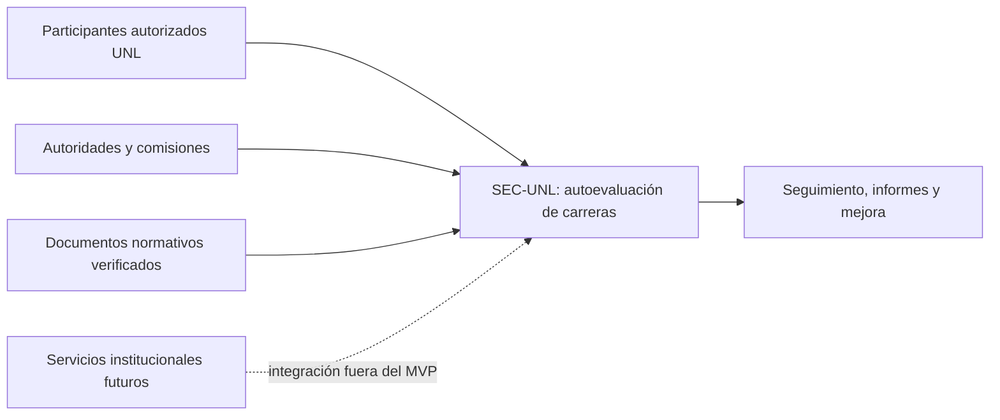
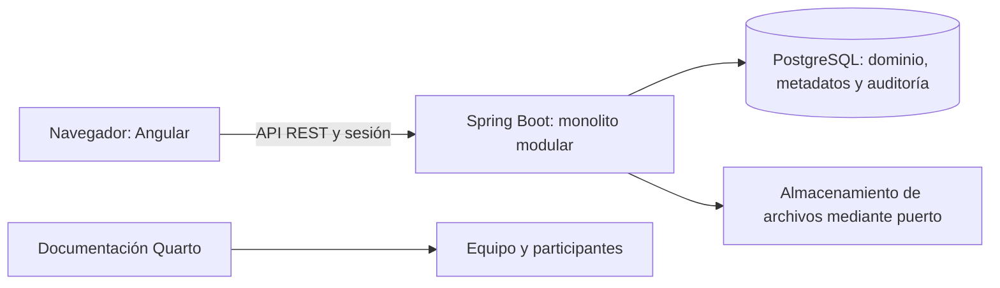
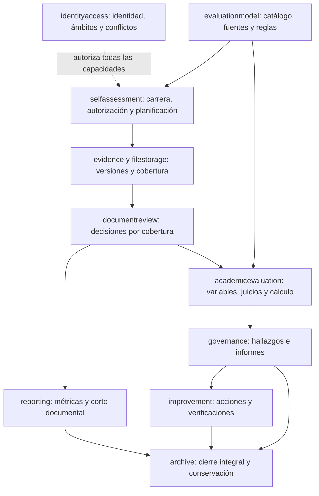

# Arquitectura de P01–P16

**Estado**: vistas contrastadas con el código y pruebas el 2026-10-25 (T126);
alcance técnico sintético, sin afirmación de despliegue institucional.
**Decisiones**: ADR-0001, ADR-0015, ADR-0016 y [ADR-0017](../adr/0017-source-coverage-and-process-governance.md).

## Contexto

Los organismos de acreditación no son usuarios implícitos ni reciben decisiones automáticas. Las fuentes normativas se incorporan con procedencia; interpretar una disposición exige validación metodológica/institucional.

## Contenedores

La API autoriza cada lectura y cambio. Los archivos se descargan por un caso de uso autorizado; no hay URL de almacenamiento pública por defecto. Un fallo entre archivos y metadatos se reconcilia sin afirmar disponibilidad falsa.

## Componentes por capacidad

Las flechas expresan suministro de información por puertos de aplicación.
La infraestructura comparte PostgreSQL y algunos adaptadores JDBC leen tablas
de otros módulos para formar proyecciones. Por ejemplo,
`archive.infrastructure.JdbcClosureEvidenceAdapter` implementa
`archive.application.ClosureEvidencePort` consultando cierre documental,
tramitación de informe y acciones. La dependencia de compilación usa el puerto;
la dependencia SQL con esos esquemas también existe y debe revisarse cuando
cambien. ArchUnit no verifica dependencias escritas dentro de cadenas SQL.

Auditoría es transversal; cada comando crítico persiste su resultado con la
transacción de negocio. `reporting` obtiene proyecciones, y `archive` conserva
una instantánea identificada con hash y referencias.

Dentro de cada capacidad: API valida formato y llama al caso de uso; aplicación autoriza y coordina transacción; dominio valida estado/invariantes; infraestructura implementa repositorios y puertos. No se crean clases, servicios o tablas independientes por Medicina, Enfermería, Odontología o Derecho.

## Registros de fuente de verdad

| Dato | Fuente de verdad | Proyecciones consumidoras |
|---|---|---|
| Modelo y estándar | Versión publicada + referencias normativas | Proceso, evaluación, reporte histórico |
| Aplicabilidad | Decisiones por carrera/modelo y por proceso/fuente | Activación y denominadores |
| Información aportada | Versión remitida + coberturas y contenido | Revisión, cálculo, consultas |
| Aceptación documental | Última decisión vigente por cobertura | Tablero y elegibilidad académica |
| Resultado académico | Valoración/cálculo final y revisiones | Consolidación, informes y hallazgos |
| Aprobación de informe | Decisión anexa sobre versión exacta | Estado de tramitación y cierre |
| Cumplimiento de acción | Avances y verificación autorizada | Seguimiento de mejora |
| Estado al cierre | Snapshot con hash y referencias exactas | Archivo y consulta histórica |

## Verificación de módulos y permisos (T126)

`ModuleArchitectureTest` ejecutó **13 reglas PASS** con JDK 25. Incluye tres
reglas explícitas para `governance`, `improvement` y `archive`, además de
independencia de dominio/aplicación, identidad y MVP documental. Los módulos y
contenedores del diagrama corresponden al código actual; las flechas muestran
el flujo funcional y no un inventario exhaustivo de importaciones.

Se contrastaron los controladores, servicios y rutas OpenAPI comunes para los
comandos posteriores al MVP:

| Flujo | Capacidad comprobada por la aplicación | Restricción adicional |
|---|---|---|
| P11, corte y cierre documental | `PROGRESS_READ`, `DOCUMENTARY_SNAPSHOT_CREATE`, `PROCESS_DOCUMENTARY_CLOSE` | Ámbito completo y estado; cierre revalida fuentes e integridad |
| P12, valoración y cálculo | `INDICATOR_EVALUATE` | Indicador, regla validada, variables y sustentos vigentes |
| P12, procedimiento y resolución | `ACADEMIC_RECONCILE` | Asignación competente y procedencia; no equivale a evaluar |
| P13, hallazgos y consolidación | `FINDING_READ`, `FINDING_WRITE`, `ACADEMIC_CONSOLIDATE` | Proceso y sustentos; sin agregación arbitraria |
| P14, informe | `REPORT_READ`, `REPORT_WRITE`, `REPORT_SOCIALIZE`, `REPORT_OBSERVE`, `REPORT_APPROVE` | Versión exacta, asignación competente para decidir |
| P15, plan/acción | `IMPROVEMENT_WRITE`, `IMPROVEMENT_READ` | Informe aprobado, debilidades y ámbito |
| P15, avance/decisión | `IMPROVEMENT_PROGRESS`, `IMPROVEMENT_DECIDE`, `IMPROVEMENT_ACTION_EXECUTE`, `IMPROVEMENT_ACTION_VERIFY` | Transición específica, responsable y autoridad |
| P16, previsualización/cierre integral | `PROCESS_READ`, `PROCESS_INTEGRAL_CLOSE` respectivamente | Asignación competente para cerrar, cierre documental e informe aprobado |
| P16, archivo/historial | `ARCHIVE_WRITE`, `ARCHIVE_READ` | Estado, integridad y ámbito; no hay borrado del histórico |

`OpenApiContractTest` pasó junto con las reglas de arquitectura y migraciones.
El contrato común conserva 112 operaciones, el objetivo 77 y 12 compartidas
sin incompatibilidades detectadas por el comparador. Esto no significa que
todas las operaciones objetivo v2 estén implementadas.

La continuación añade historial y sucesión configurados al módulo existente
de modelos, con `MODEL_READ` y `MODEL_MANAGE`; conserva las rutas legadas.
La decisión se registra en ADR-0018. No añade contenedores ni migraciones.

## Diferencias y límites conservados

- El contrato común combina capacidades en descripciones y extensiones
  `x-required-capability`; no hay todavía una comprobación exhaustiva automática
  de cada capacidad declarada frente al servicio. T125 y la revisión humana
  continúan pendientes.
- `IMPROVEMENT_PLAN_CREATE` permanece en el catálogo, pero el servicio actual
  de creación de planes exige `IMPROVEMENT_WRITE`. No debe inferirse autorización
  de creación por tener únicamente la capacidad catalogada.
- `CompleteWorkflowAuthorizationTest` usa un mock de autorización; por sí solo
  no demuestra toda la matriz P01–P16. Se conserva como límite explícito y no se
  declara aceptación de esa matriz a partir del nombre de la prueba.
- Las proyecciones JDBC acoplan esquemas compartidos. Las reglas de importación
  no certifican independencia física de los datos.
- El archivo de aplicación y su hash no sustituyen el respaldo/restauración
  conjunta de PostgreSQL y archivos. La campaña operacional completa sigue pendiente.
- Las políticas y competencias de los fixtures no prueban vigencia institucional.

Resultados y reproducción: [migraciones](../../tests/acceptance/results/migrations-p01-p16.md),
[contratos](../../tests/acceptance/results/contracts-p01-p16.md) y
[fase transversal](../../tests/acceptance/results/p01-p16-cross-cutting.md).
