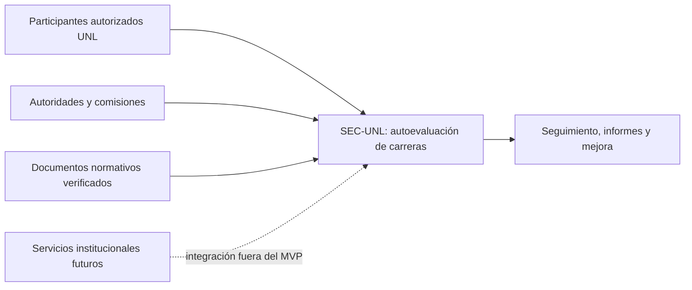
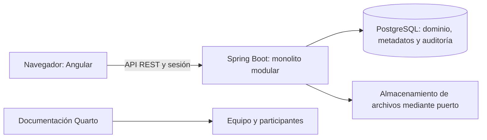
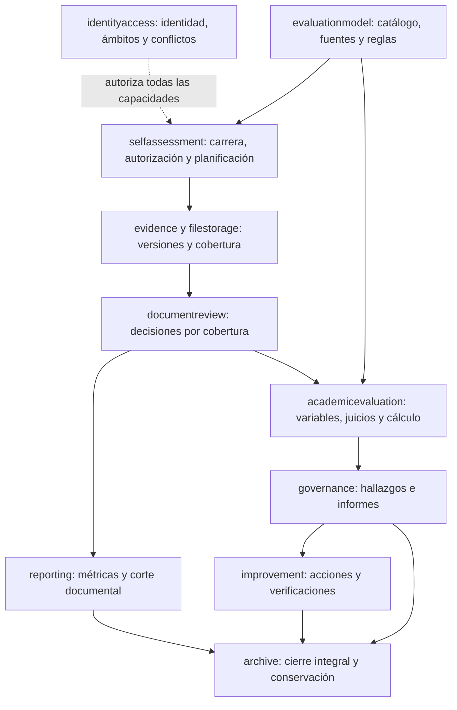

# Arquitectura objetivo de P01–P16

**Estado**: vistas de diseño; módulos planificados, sin afirmación de despliegue.  
**Decisiones**: ADR-0001, ADR-0015, ADR-0016 y [ADR-0017](../adr/0017-source-coverage-and-process-governance.md).

## Contexto

Los organismos de acreditación no son usuarios implícitos ni reciben decisiones automáticas. Las fuentes normativas se incorporan con procedencia; interpretar una disposición exige validación metodológica/institucional.

## Contenedores

La API autoriza cada lectura y cambio. Los archivos se descargan por un caso de uso autorizado; no hay URL de almacenamiento pública por defecto. Un fallo entre archivos y metadatos se reconcilia sin afirmar disponibilidad falsa.

## Componentes por capacidad

Las flechas expresan suministro de información por puertos, no permiso para acceder a tablas internas. Auditoría es transversal; cada comando crítico persiste su resultado con la transacción de negocio. `reporting` obtiene proyecciones, y `archive` guarda una instantánea identificada en lugar de apropiarse de los agregados de otros módulos.

Dentro de cada capacidad: API valida formato y llama al caso de uso; aplicación autoriza y coordina transacción; dominio valida estado/invariantes; infraestructura implementa repositorios y puertos. No se crean clases, servicios o tablas independientes por Medicina, Enfermería, Odontología o Derecho.

## Registros de fuente de verdad

| Dato | Fuente de verdad | Proyecciones consumidoras |
|---|---|---|
| Modelo y estándar | Versión publicada + referencias normativas | Proceso, evaluación, reporte histórico |
| Aplicabilidad | Decisiones por carrera/modelo y por proceso/fuente | Activación y denominadores |
| Información aportada | Versión remitida + coberturas y contenido | Revisión, cálculo, consultas |
| Aceptación documental | Última decisión vigente por cobertura | Tablero y elegibilidad académica |
| Resultado académico | Valoración/cálculo final y revisiones | Consolidación, informes y hallazgos |
| Aprobación de informe | Decisión anexa sobre versión exacta | Estado de tramitación y cierre |
| Cumplimiento de acción | Avances y verificación autorizada | Seguimiento de mejora |
| Estado al cierre | Snapshot con hash y referencias exactas | Archivo y consulta histórica |

## Límites de revisión

Antes de aceptar cada entrega, T003/T126 contrastan estas vistas con dependencias reales y pruebas de arquitectura. Las correspondencias todavía no contrastadas con código se registran como pendientes. Este documento no reemplaza la evidencia de implementación.
