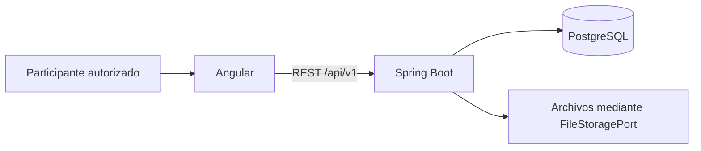

El backend es un monolito modular Spring Boot. El navegador Angular consume
REST; PostgreSQL conserva dominio, metadatos y auditoría, y el almacenamiento
local conserva binarios mediante un puerto. No se infieren microservicios ni
integraciones desplegadas a partir de los nombres de los módulos.

## C1, C2 y C3

La [fuente Structurizr](../diagrams/workspace.dsl) incorpora contexto,
contenedores y componentes del flujo documental. Su C3 es deliberadamente
acotado: las otras capacidades se describen en la
[vista completa existente](../architecture/complete-workflows.md). No representa
tablas como componentes. Las relaciones son colaboraciones funcionales, no un
inventario exhaustivo de dependencias SQL.

En C1 los participantes autorizados utilizan SEC-UNL para autoevaluación.
No se dibuja un servicio externo institucional porque no hay integración
demostrada. En C2 se separan frontend, backend, base y archivos. En C3 API,
servicios y adaptadores colaboran para validar y remitir evidencia.

La siguiente vista facilita la lectura inmediata del C2; la fuente DSL es el
artefacto editable de C4 y esta síntesis no certifica su renderizado.

## C4: estructura de remisión

La [fuente PlantUML de clases](../diagrams/evidence-code.puml) relaciona
`EvidenceSourceCoverageController`, `SubmitEvidenceService`, los puertos
consultados y `EvidenceVersion`. El servicio coordina la transacción y el
dominio representa la versión; los repositorios aplican la persistencia.
No se añaden clases hipotéticas. El [diagrama de secuencia](../diagrams/evidence-submit.puml)
separa la interacción de la estructura de clases.

## Decisiones y límites

Consultar el [registro de ADR](../decisions/README.md). ADR-0001 justifica el
monolito; ADR-0002 el puerto de archivos; ADR-0004 sesiones y autorización;
ADR-0017 cobertura y gobierno. Las decisiones existentes conservan fechas y
autores; esta auditoría no las transforma en decisiones históricas nuevas.
Varios registros carecen de alternativas o vínculos completos: su ampliación
requiere evidencia del equipo, según [evolución](evolution.qmd).

Las proyecciones JDBC consultan esquemas compartidos y ArchUnit no inspecciona
el contenido de SQL. El aislamiento de paquetes no prueba aislamiento de datos.
Las fuentes nuevas DSL/PlantUML se verifican por lectura y referencias; su
compilación por herramientas específicas queda registrada en [validación](validation.qmd).
