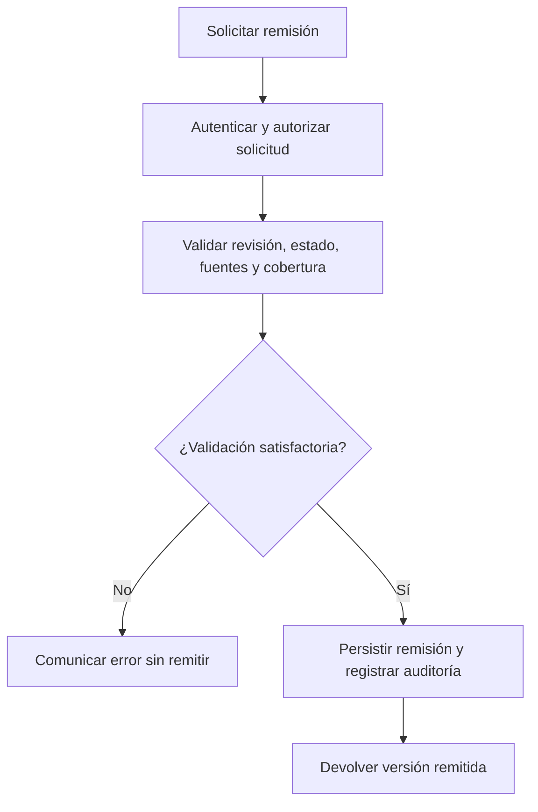

El [catálogo P01–P16](../requirements/process-flows.md) conserva la definición
funcional, actores, alternativas y resultados. Su diagrama Mermaid es un mapa
funcional; no debe presentarse como BPMN 2.0.2. La
[matriz de trazabilidad](traceability.qmd) identifica criterios y pruebas.

## P08: remitir una versión de evidencia

El responsable necesita entregar fuentes verificables sin sobrescribir lo ya
remitido. Partiendo de un borrador con contenido y cobertura declarada, envía
`POST /api/v1/evidence-versions/{versionId}/submit`, con cookie, CSRF y
`If-Match`. El filtro autentica la sesión; las consultas del servicio de borradores
autorizan el acceso. `EvidenceSourceCoverageController` delega en
`SubmitEvidenceService`.

El servicio comprueba revisión, estado DRAFT y proceso ACTIVE, exige una fuente
utilizable, comprueba disponibilidad de archivos y cobertura compatible con
el modelo fijado. Para datos estructurados valida tipo y período. La operación
de repositorio cambia el estado usando revisión esperada y registra
`EVIDENCE_SUBMITTED` en la transacción. Devuelve la versión remitida con 200;
no crea una valoración académica. Una corrección posterior requiere sucesora.

Los errores posibles incluyen rechazo de sesión/CSRF o ámbito, versión
inmutable, proceso no activo, contenido/cobertura ausente o incompatible y
revisión obsoleta. Su HTTP depende del manejador correspondiente; no todos
los fallos son errores de validación 400.

Código: [servicio](../../backend/src/main/java/ec/edu/unl/sec/evidence/application/SubmitEvidenceService.java),
[controlador](../../backend/src/main/java/ec/edu/unl/sec/evidence/api/EvidenceSourceCoverageController.java).
Prueba: [SubmitEvidenceServiceTest](../../backend/src/test/java/ec/edu/unl/sec/evidence/application/SubmitEvidenceServiceTest.java).

Antes del diagrama se define su alcance: el siguiente modelo representa las
decisiones de remisión P08, no todo P07–P10 ni una transacción distribuida.
La [fuente BPMN XML](../diagrams/p08-submit.bpmn) utiliza tareas en infinitivo,
eventos, carriles de participante/sistema y una compuerta de validación.
La representación visible es una guía de lectura; la conformidad completa
BPMN 2.0.2 requiere validación XSD y revisión en un modelador, aún pendientes.

Las fallas inesperadas de persistencia siguen el manejo global y rollback;
la compuerta sintetiza rechazos esperados, no implementa captura BPMN de toda
excepción Java. El [UML de secuencia](../diagrams/evidence-submit.puml) muestra
las colaboraciones del backend. Los otros flujos se explican en
[backend](backend.qmd) y conservan su detalle funcional en el catálogo.
