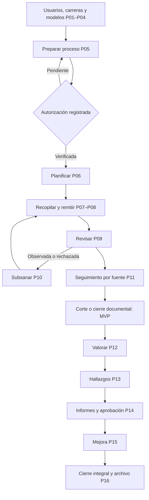

# Catálogo canónico de procesos P01–P16

**Estado**: Documentado para revisión e implementación; competencias pendientes de validación institucional  
**Especificación de detalle**: [Flujos completos](../../specs/005-complete-evaluation-workflows/spec.md)

Este catálogo define actores, precondiciones, flujo principal, alternativas y resultado de los dieciséis procesos. Las competencias indicadas son configurables y deben validarse con la normativa y designaciones institucionales. Registrar una decisión no equivale a otorgar la competencia para tomarla.

La [matriz de responsabilidades y reglas](domain-rules.md) especifica permisos, estados, decisiones abiertas y fórmulas. La [matriz de aceptación](../testing/process-acceptance.md) asigna escenarios verificables a cada proceso.

## Reglas transversales

1. Toda operación protegida se autentica y autoriza en backend por función y ámbito.
2. Recopilación, revisión documental y valoración académica conservan estados y registros independientes.
3. Una versión publicada o final no se sobrescribe; la corrección crea una sucesora.
4. Los cinco modelos son configuraciones de un catálogo común y no implementaciones separadas.
5. Toda excepción, no aplicabilidad, autorización o aprobación registra autoridad, fundamento, actor y fecha.
6. Ningún resultado se presenta como acreditación.

## P01. Autenticación y usuarios

**Actor principal**: usuario registrado o administrador funcional.  
**Precondiciones**: servicio disponible; identidad habilitada para operaciones protegidas.  
**Resultado**: sesión autorizada o cambio administrativo auditado.

**Flujo principal**:

1. La persona presenta credenciales.
2. El sistema valida identidad, estado, limitación y secreto.
3. Se crea una sesión revocable y se obtienen funciones y ámbitos vigentes.
4. Cada operación vuelve a comprobar función, carrera, proceso e indicador.
5. Un administrador autorizado puede habilitar, desactivar o asignar funciones.
6. Los cambios y accesos relevantes quedan auditados.

**Alternativas**: credenciales inválidas sin enumerar cuentas; cuenta deshabilitada; sesión vencida; acceso fuera de ámbito; conflicto de funciones; auditoría obligatoria no disponible.

## P02. Gestión de carreras y permisos

**Actor principal**: administrador funcional.  
**Precondiciones**: sesión y ámbito administrativo vigentes.  
**Resultado**: carrera activa o desactivada con unidad e historial.

**Flujo principal**:

1. Registrar unidad académica, código, denominación y vigencia.
2. Validar código normalizado único y campos obligatorios.
3. Configurar ámbitos administrativos y responsables vigentes.
4. Guardar la carrera y habilitarla para modelos y procesos compatibles.
5. Registrar cambios posteriores sin alterar relaciones históricas.

**Alternativas**: código duplicado; unidad inexistente; datos incompletos; intento de eliminación con historial; cambio concurrente; administrador fuera de ámbito.

## P03. Registro y versionado de modelos

**Actor principal**: administrador de modelos; revisor metodológico.  
**Precondiciones**: documento fuente identificable.  
**Resultado**: versión publicada o borrador pendiente de validación.

**Flujo principal**:

1. Registrar denominación, emisor, edición, fecha, alcance y documento fuente.
2. Identificar el modelo como General, Medicina, Enfermería, Odontología o Derecho.
3. Crear versión en borrador con predecesora opcional.
4. Validar estructura, procedencia, revisión independiente y vigencia conocida.
5. Publicar una instantánea inmutable.

**Alternativas**: versión duplicada; fuente incompleta; vigencia no confirmada; aprobador igual al autor; versión utilizada; documento reemplazado.

## P04. Configuración de estructura, indicadores y fuentes

**Actor principal**: administrador de modelos.  
**Precondiciones**: versión editable.  
**Resultado**: estructura validable para cualquiera de los cinco modelos.

**Flujo principal**:

1. Crear nodos tipados con padre opcional y orden.
2. Registrar indicadores en cualquier profundidad permitida.
3. Definir estándar, naturaleza, período y fuentes requeridas.
4. Para cualitativos, definir escala y método humano.
5. Para cuantitativos, definir variables, unidades, fórmula, umbrales y casos límite.
6. Validar códigos, pertenencia, ciclos, fuentes y reglas antes de publicar.

**Alternativas**: indicador directo al criterio; código repetido; ciclo; fuente sin período; fórmula no soportada; estrategia no validada; no aplicabilidad sin regla.

## P05. Creación y autorización del proceso

**Actor principal**: coordinador; autoridad institucional competente.  
**Precondiciones**: carrera activa y versión publicada/aplicable.  
**Resultado**: proceso en preparación, activo o suspendido.

**Flujo principal**:

1. Seleccionar carrera, versión y período.
2. Registrar objetivo, fechas, antecedentes y observaciones.
3. Guardar en `PREPARATION`.
4. Registrar documento, fundamento y decisión de autorización.
5. Verificar autoridad mediante política vigente.
6. Activar y fijar la versión del modelo.

**Alternativas**: sin autorización; versión borrador/no vigente; incompatibilidad de período; duplicado; suspensión motivada; cambio de modelo posterior, que exige un proceso distinto o procedimiento controlado.

## P06. Asignación y planificación

**Actor principal**: coordinador o comisión autorizada.  
**Precondiciones**: proceso activo y participantes habilitados.  
**Resultado**: indicadores, fuentes y actividades asignados con fechas.

**Flujo principal**:

1. Consultar estructura y fuentes aplicables.
2. Crear equipos y membresías vigentes.
3. Asignar responsables, revisores y evaluadores por indicador o fuente.
4. Crear actividades, fechas límite y dependencias.
5. Validar ámbitos, vigencias y conflictos.
6. Publicar tareas y mostrar vencimientos.

**Alternativas**: usuario no autorizado o inactivo; conflicto autor/revisor; reasignación; actividad vencida; indicador no aplicable; edición concurrente.

## P07. Registro de evidencias

**Actor principal**: responsable documental.  
**Precondiciones**: proceso activo, asignación vigente y fuente requerida aplicable.  
**Resultado**: borrador relacionado con fuente e indicador exactos.

**Flujo principal**:

1. Seleccionar tarea, indicador y fuente requerida.
2. Registrar título, descripción, procedencia y período.
3. Adjuntar archivo, enlace, dato estructurado o referencia permitida.
4. Validar tipo, tamaño, integridad, período y permisos.
5. Registrar una o más coberturas explícitas.
6. Guardar borrador y auditoría.

**Alternativas**: formato/tamaño inválido; período incorrecto; fuente ajena; fallo de almacenamiento; URL inválida; duplicado; reutilización autorizada para varias fuentes.

## P08. Envío a revisión

**Actor principal**: responsable documental.  
**Precondiciones**: borrador completo y vigente.  
**Resultado**: versión inmutable `SUBMITTED/EN_REVISION`.

**Flujo principal**:

1. Revisar metadatos, coberturas y archivos.
2. Revalidar campos, permisos, integridad y requisitos de cada fuente.
3. Crear instantánea numerada.
4. Registrar autor y fecha.
5. Publicarla en la bandeja de revisores.

**Alternativas**: datos incompletos; archivo inaccesible; envío duplicado; ventana cerrada; responsable no vigente; conflicto concurrente.

## P09. Revisión documental

**Actor principal**: revisor documental.  
**Precondiciones**: versión remitida y competencia vigente.  
**Resultado**: decisión `ACCEPTED`, `OBSERVED` o `REJECTED`.

**Flujo principal**:

1. Abrir la bandeja y seleccionar una versión.
2. Consultar fuente, metadatos, archivo y período.
3. Verificar integridad, correspondencia, completitud y pertinencia.
4. Registrar decisión y justificación.
5. Guardar actor, fecha, versión y coberturas afectadas.
6. Recalcular la proyección documental.

**Alternativas**: evidencia incompleta; archivo incorrecto/corrupto; indicador equivocado; autorrevisión; decisión concurrente; criterio documental sin definir.

## P10. Subsanación y nueva versión

**Actor principal**: responsable documental.  
**Precondiciones**: observación o rechazo vigente, o corrección autorizada.  
**Resultado**: versión sucesora remitida y predecesora intacta.

**Flujo principal**:

1. Consultar observaciones.
2. Crear borrador sucesor desde la versión decidida.
3. Corregir metadatos, coberturas o contenido.
4. Revalidar requisitos.
5. Remitir la nueva versión.
6. Mantener relación inequívoca con la predecesora y volver a P09.

**Alternativas**: corrección insuficiente; mismo archivo; plazo vencido; evidencia archivada; edición concurrente; más de un sucesor directo.

## P11. Seguimiento documental

**Actor principal**: coordinador, supervisor o consultor autorizado.  
**Precondiciones**: proceso existente y acceso vigente.  
**Resultado**: tablero reproducible y pendientes navegables.

**Flujo principal**:

1. Obtener fuentes requeridas aplicables.
2. Contar fuentes cubiertas por al menos una versión remitida vigente.
3. Contar fuentes cubiertas por al menos una versión aceptada vigente.
4. Calcular por separado recopilación y revisión documental.
5. Mostrar valoración académica como independiente o pendiente.
6. Desglosar por criterio, indicador, fuente, responsable y vencimiento.

**Alternativas**: cero evidencias; cero fuentes configuradas; no aplicabilidad autorizada; datos fuera de ámbito; inconsistencia de cálculo; información desactualizada.

## P12. Valoración académica

**Actor principal**: comité o evaluador autorizado.  
**Precondiciones**: indicador configurado y proceso habilitado para evaluación.  
**Resultado**: valoración fundamentada, nunca acreditación.

**Flujo principal**:

1. Consultar estándar, método, período y sustentos aceptados.
2. Para cualitativo, seleccionar escala y justificar.
3. Para cuantitativo, capturar/verificar variables y ejecutar una estrategia validada.
4. Conservar entradas, regla, resultado, umbral, responsables y fecha.
5. Finalizar o dejar pendiente con limitación explícita.

**Alternativas**: fuentes insuficientes; variables faltantes; fórmula no implementada; valor fuera de rango; no aplicabilidad; escala incompatible; discrepancia; evidencia invalidada después.

## P13. Consolidación de resultados y hallazgos

**Actor principal**: comisión de evaluación.  
**Precondiciones**: valoraciones o limitaciones registradas.  
**Resultado**: resultados consolidados y hallazgos trazables.

**Flujo principal**:

1. Agrupar resultados por jerarquía del modelo.
2. Mostrar completos, pendientes, discrepancias y períodos.
3. Registrar fortalezas, debilidades y observaciones.
4. Vincular cada hallazgo a sustentos.
5. Aplicar agregación solo si la metodología la autoriza.
6. Preparar el conjunto para informe preliminar.

**Alternativas**: indicadores sin valorar; contradicciones; rectificación; períodos distintos; metodología sin agregación.

## P14. Informes preliminares, observaciones y aprobación

**Actor principal**: comisión y autoridades competentes.  
**Precondiciones**: consolidación disponible.  
**Resultado**: versiones de informe y decisiones institucionales trazables.

**Flujo principal**:

1. Generar borrador y versión preliminar.
2. Registrar revisión y socialización.
3. Recibir observaciones y respuestas.
4. Crear versión final corregida.
5. Remitir a la autoridad configurada.
6. Registrar aprobación, devolución o rechazo.
7. Publicar solo dentro de ámbitos autorizados y con texto de no acreditación.

**Alternativas**: información incompleta; nuevas observaciones; devolución; aprobación pendiente; cambio posterior; formato oficial no validado.

## P15. Planes de mejora

**Actor principal**: responsable de mejora o comisión autorizada.  
**Precondiciones**: hallazgo que requiere acción.  
**Resultado**: acciones aprobadas y seguimiento verificable.

**Flujo principal**:

1. Seleccionar hallazgo.
2. Proponer acción con responsable, plazo, meta y medio de verificación.
3. Tramitar aprobación.
4. Registrar ejecución y avances.
5. Adjuntar verificaciones.
6. Evaluar cumplimiento y mantener vínculo con la evaluación origen.

**Alternativas**: acción devuelta; plazo vencido; modificación versionada; verificación insuficiente; incumplimiento; hallazgo compartido por varias acciones.

## P16. Cierre, archivo y consulta histórica

**Actor principal**: coordinador; archivista autorizado.  
**Precondiciones**: política de cierre versionada.  
**Resultado**: corte documental o cierre integral inmutable y consultable.

**Flujo principal**:

1. Seleccionar tipo de cierre: documental o integral.
2. Revalidar prerrequisitos de la política aplicable.
3. Mostrar pendientes y advertencias.
4. Confirmar o registrar excepción autorizada.
5. Crear instantánea con hash y versiones exactas.
6. Bloquear modificaciones ordinarias y registrar archivo.
7. Permitir consulta histórica autorizada.

**Alternativas**: pendientes obligatorios; cierre excepcional; rectificación posterior; error de conservación; consulta no autorizada; nueva autoevaluación separada.

## Matriz proceso–entrega

| Entrega | Procesos | Criterio de salida |
|---|---|---|
| D1 | P01–P02 | identidad, carrera y ámbito verificables |
| D2 | P03–P04 | cinco configuraciones sin duplicación |
| D3 | P05–P06 | proceso autorizado y planificado |
| D4 | P07–P08 | versión remitida vinculada a fuentes |
| D5 | P09–P10 | decisión y subsanación trazables |
| D6 | P11 y P16 básico | MVP documental reproducible |
| D7 | P12–P14 | evaluación, hallazgos e informes |
| D8 | P15–P16 | mejora, cierre integral y archivo |

