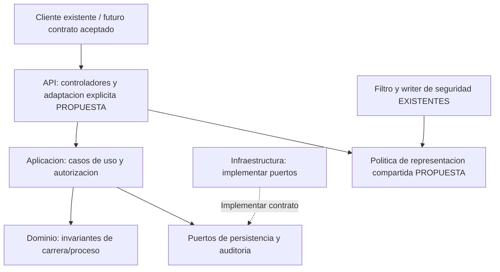

# AA 3 — ADR de alternativas arquitectónicas

Semana 3 · Actividad Autónoma · 4,5 horas previstas · Trabajo individual articulado con SIGEAC / SEC-UNL.

**Estudiante, fecha real y revisión personal:** pendientes. Asignatura/docente: referencia de continuidad con APE3, Desarrollo Basado en Plataformas / Edison Leonardo Coronel Romero; confirmar si esta actividad corresponde a otra asignatura. No se acredita tiempo trabajado, aprobación del equipo ni implementación nueva.

## 1. Contexto arquitectónico y pregunta de decisión

El proyecto organiza autoevaluaciones de carreras con catálogo, modelos identificables, permisos y trazabilidad. El recorte de Unidad 1 utilizado en APE2/AA2 comprende acceso, catálogo y preparación/consulta de procesos. ACD3 describe los procesos F-ACD3-01/02 y la arquitectura; APE3 aporta contratos y verificación parcial de la implementación Spring existente.

La API actual devuelve DTO directos y errores Problem Details. La actividad pide un sobre común `success/message/data/errors/meta`. APE3-002 ya registró esta diferencia como propuesta pendiente, pero no resolvió **qué parte del backend será responsable de traducir las respuestas**. Esta es la decisión específica investigada en AA3; no se vuelve a decidir el monolito modular aceptado por ADR-0001.

**Pregunta:** si el equipo/docente confirma la adopción del sobre, ¿cómo ubicar su construcción para conservar reglas de negocio independientes, cubrir respuestas de seguridad y evitar cambios implícitos en clientes v1?

No se elige aquí entre Spring y Django ni se promete un backend v2 disponible. La guía APE3 exige DRF, mientras el producto usa Spring Boot: APE3-001 sigue abierto. El análisis se fundamenta en el framework actualmente implementado y revisa DRF como contraste de una posible adaptación, sin presentarlo como instalado o seleccionado definitivamente por el docente.

### Insumos revisados y hechos comprobables

| Elemento | Fuente del proyecto | Aporte / límite |
|---|---|---|
| Necesidades, RF/RNF y AC | Dossier/matriz AA2 | AA-RF-14, AA-RNF-03/07/09/10, AC-AA-03/26 y VC-AA-03/07/09/10. No son requisitos nuevos de este AA. |
| Procesos/decisiones | Informe ACD3, §§2/4/6 y REVISION_GUIA.md | Catálogo, preparación, separación de responsabilidades y compatibilidad. Decisiones discutidas en una sesión real no aportadas. |
| C4 implementado/refinado | APE3 `arquitectura/workspace.dsl` | Contenedor `sigeac.api`; componentes acceso, http, catálogo, procesos, dominio, repositorios y auditoría. |
| Contratos | APE3 OpenAPI observado/objetivo | 14 operaciones seleccionadas; el objetivo declara no implementación. El sobre no es comportamiento vigente. |
| Presentación actual | CareerController, SessionController, ApiProblemHandler y AccessProblemWriter | Éxito/controlador, error MVC y error previo al controlador se construyen en puntos diferentes. |
| Consumidor | AccessApi.rememberCsrf, isApiProblem, career-catalog.page.ts | Se lee csrfToken en raíz, se reconoce Problem Details y se consumen items del catálogo. Envolver cambia esas rutas de acceso. |
| Pruebas previas | Evidencias APE3 | 23 tests seleccionados y 22 casos HTTP finales sobre Spring/SQLite; no prueban la arquitectura C propuesta ni un sobre futuro. No se reejecutaron en AA3. |

Las rutas completas y localizadores están en [FUENTES.md](FUENTES.md). La evidencia del consumidor respalda un riesgo concreto: pasar de `session.csrfToken` a `session.data.csrfToken` sin migrar el cliente impediría conservar el token en el punto que hoy lo espera.

## 2. Alternativas y criterios de comparación

### A — Construir el sobre en cada controlador

Cada operación de presentación construye su respuesta explícitamente, con los puntos de error y seguridad adaptados por separado. Mantiene visible qué retorna cada ruta y requiere poco mecanismo transversal. Es razonable para pocas operaciones estables; con varios módulos obliga a coordinar reglas de error, metadatos y exclusiones en muchos lugares. No exige trasladar negocio al controlador: ese sería un mal uso, no una propiedad inevitable de A.

### B — Envolver transversalmente las respuestas MVC

Usar un mecanismo transversal de presentación, por ejemplo `ResponseBodyAdvice`, con reglas de inclusión/exclusión y tratamiento coordinado de errores/filtros. Reduce llamadas repetidas, a cambio de hacer menos visible la transformación en cada operación. Es razonable cuando la superficie JSON y sus excepciones están bien delimitadas. El advice por sí solo no cubre una respuesta que el filtro escribe directamente al servlet; B completa debe contemplar ese camino y probarlo, no ignorarlo.

### C — Adaptadores explícitos de presentación y política compartida

Definir un contrato de salida tipado y mapeos explícitos en la frontera API, con una política compartida para los escritores de éxito/error que corresponda. El controlador conserva la selección visible de respuesta; la traducción común se concentra fuera de la aplicación/dominio. Los errores de seguridad requieren su punto de integración propio. No se propone un servicio desplegable ni un adaptador de persistencia: son responsabilidades de presentación dentro del mismo backend.

Se selecciona **C como propuesta individual**, condicionada a aceptación real del sobre y una estrategia compatible de contrato/cliente. Los nombres de futuros tipos o mapeadores no se atribuyen al código existente. La decisión completa está en [ADR-AA3-001](ADR-AA3-001-adaptacion-respuestas-api.md).

### Criterios derivados del contexto

| ID | Criterio pertinente | Justificación y forma de contrastarlo |
|---|---|---|
| CR-01 | Estabilidad para consumidor y contrato | AA-RNF-10, ADR-0018 y lecturas reales del cliente; comparar paths JSON, headers y estados de cada operación antes/después. |
| CR-02 | Cobertura de respuestas y semántica | AA-RF-14, AC-AA-26 y logout AC-AA-03; incluir éxito, DTO inválido, rechazo de seguridad y 204 sin cuerpo. |
| CR-03 | Separación y mantenibilidad | AA-RNF-09 y reglas ArchUnit; ningún formato HTTP debe entrar en aplicación/dominio por esta decisión. |
| CR-04 | Testabilidad y trazabilidad | VC-AA-09/10; poder localizar mapeo, operación, schema y prueba exacta. |
| CR-05 | Complejidad/coste de evolución | Recorte de un equipo y módulos existentes; revisar puntos a cambiar y excepciones, sin inventar horas estimadas. |
| CR-06 | Dependencia tecnológica/integración | Spring actual y DRF pendiente; distinguir política de respuesta de hooks específicos del framework. |
| CR-07 | Privacidad/correlación | AA-RNF-03/07, AC-AA-26; comprobar datos que se exponen y correlación, incluyendo errores previos al controlador. |

No se ponderan números sin acuerdo ni se inventan benchmarks. Escalabilidad de despliegue, colas o tamaño de base no discriminan directamente esta decisión: ninguna alternativa crea por sí misma nuevos procesos ni resuelve disponibilidad. La asignación de prioridades es una propuesta individual: primero semántica/compatibilidad/separación; después coste de coordinación. Si cambian estas prioridades, debe revisarse la conclusión.

### Comparación argumentada

| Alternativa | Ventajas para este proyecto | Limitaciones y coste | Riesgos y tratamiento |
|---|---|---|---|
| A | Resultado explícito por ruta; reutiliza el estilo actual de ResponseEntity; introduce pocos mecanismos. | Repetir selección de campos en varias API/handlers; coordinar cambios y pruebas en más puntos. | Divergencia de message/errors/meta o sobre olvidado; mitigar con schemas, helpers acotados y pruebas de contrato. |
| B | Un punto transversal puede aplicar política a muchas respuestas MVC; menos invocaciones visibles por controlador. | Requiere seleccionar métodos/conversores y exclusiones; writers de filtro necesitan integración adicional. | Doble envoltura, media type incorrecto o modificación de 204/archivos; mitigar con opt-in, exclusiones explícitas y pruebas de todas las salidas. |
| C | Mapeo explícito y compartido, trazable a cada contrato; conserva negocio fuera de HTTP; puntos de seguridad identificados. | Añade tipos/mapeos y coordinación; no elimina todas las llamadas ni asegura consistencia automáticamente. | Sobreingeniería o política duplicada entre writers; mitigar con pocos tipos necesarios, política única revisada y pruebas conjuntas. |

Las afirmaciones sobre ventajas/costes son **inferencias de diseño** desde el código y los puntos de extensión documentados, no resultados de prototipos comparativos. Spring documenta respuesta HTTP y advice [S-01/S-03]; el código confirma el writer fuera de MVC [P-06]. DRF muestra también un punto de manejo de excepciones de vistas cuyo alcance debe distinguirse de respuestas directas [S-06]. No se afirma que A o B incumplan necesariamente requisitos: pueden cumplirlos con disciplina y controles.

### Respuesta de cada alternativa a los requisitos

| Requisito / restricción | A | B | C |
|---|---|---|---|
| AA-RF-14 / AC-AA-26: error estable y seguro | Cada handler/writer implementa política; comprobar ausencia de divergencia. | Advice ayuda en MVC; coordinar handlers y writers externos. | Mapeo/política explícitos en cada frontera; comprobar integración. |
| AA-RNF-03/07: privacidad y correlación | Selección de datos en cada punto; riesgo de omisión. | Política central para lo interceptado; salida de filtro debe incluirse. | Datos públicos/correlación definidos por contrato y escritores coordinados; revisar lista permitida. |
| AA-RNF-09: reglas separadas | Cumple si solo presenta resultados y no mueve reglas. | Cumple si limita advice a transporte. | Cumple si adaptadores permanecen en presentación y no filtran HTTP hacia aplicación. |
| AA-RNF-10: contrato verificable | Schema por operación; validación repetida. | Debe describir resultado transformado, no solo tipo del controlador. | Contrato explícito de salida y prueba por mapeo/operación. |
| ADR-0018 / consumidor actual | No migrar silenciosamente v1. | La envoltura global también rompe v1 si cambia cuerpos sin acuerdo. | Migración coordinada por superficie/versión a definir; C no evita ruptura por sí sola. |
| Recorte viable / mantenimiento | Menor arranque, mayor repetición al crecer. | Menor repetición aparente, mayor complejidad de reglas/excepciones. | Coste inicial de diseño, cambio localizado y visible; justificar solo tipos necesarios. |
| Tecnología APE3 pendiente | Se puede trasladar el principio a DRF, con APIs distintas. | El hook ResponseBodyAdvice no es portable directamente a DRF. | Política/mapeos conceptuales portables; integración concreta sí depende del framework. |

## 3. Responsabilidades, decisión y verificación futura

### Organización propuesta y correspondencia C4

Las flechas continuas expresan uso; la discontinua, implementación del puerto. El diagrama combina responsabilidades existentes y propuestas, etiquetadas; no es una vista de despliegue nueva. No afirma que todos los DTO actuales sean resultados de aplicación independientes: esa separación debe comprobarse por operación antes de adaptar.

En C1 no cambian actores ni sistemas externos. En C2 se conserva el backend único; no se añade un gateway o microservicio. En C3 la propuesta corresponde a `sigeac.api.http` y al borde escritor de `sigeac.api.acceso`; catálogo/procesos/dominio/repositorios mantienen sus funciones. Los detalles de un futuro mapeador serían elementos de código, no contenedores C4.

| Parte | Responsabilidad | Dependencia permitida / mezcla a evitar |
|---|---|---|
| API/presentación | Validar estructura de entrada, traducir resultados/errores al contrato, seleccionar HTTP y headers. | Usar aplicación y política de salida; no decidir vigencia de carrera ni autoridad institucional. |
| Política/mapeos propuestos | Definir salida pública y metadatos permitidos; conservar coherencia con status/media type. | Datos necesarios de salida; no consultar repositorio ni ejecutar permisos para decorar una respuesta. |
| Aplicación | Orquestar caso, permisos, transacción y puertos. | Dominio/puertos; no retornar el sobre por mandato de esta propuesta ni depender de tipos servlet. |
| Dominio | Conservar invariantes/estados/revisiones. | No construir JSON, response entities ni message de UI. |
| Infraestructura | Implementar persistencia/adaptadores; escribir errores de seguridad donde corresponda actualmente. | Respetar puertos y política de frontera; no asumir permisos por acceso DB. El filtro escritor es un detalle actual de identidad, no persistencia. |

### Plan de comprobación propuesto, no ejecutado

PF-AA3-01: al aprobar la política, comparar schemas de cada operación incluida con cuerpos reales, código HTTP, Content-Type, Location/ETag/Set-Cookie cuando correspondan. PF-AA3-02: probar errores de DTO, negocio y filtro, código público/correlación y ausencia de secretos. PF-AA3-03: verificar logout 204 con cero bytes y exclusiones de cuerpo aplicables. PF-AA3-04: mantener funcionamiento del consumidor del contrato conservado y probar cliente migrado. PF-AA3-05: ejecutar reglas de arquitectura y revisión de imports/SQL pertinentes.

No se crean tests vacíos ni se ejecutan pruebas de la alternativa C que todavía no existe. La [matriz](TRAZABILIDAD_ADR.md) separa evidencia existente y verificaciones futuras.

### Cierre académico y pendientes

| Actividad AA3 | Evidencia preparada |
|---|---|
| 1. Contexto | Sección 1 y fuentes P-01–09. |
| 2. Alternativas | A, B y C en sección 2. |
| 3. Criterios | CR-01–07, derivados de requisitos/restricciones. |
| 4. Comparación | Ventajas, limitaciones, riesgos y respuesta por requisito. |
| 5. Fuentes oficiales | S-01–08 en FUENTES.md, con localizadores y límites de versión. |
| 6. Respuesta a requisitos | Tabla de alternativas y matriz de trazabilidad. |
| 7. Responsabilidades | Diagrama y tabla C1/C2/C3. |
| 8. ADR | ADR-AA3-001: propuesto, selección C y consecuencias/mitigaciones. |
| 9. Relación con proyecto | TRAZABILIDAD_ADR.md con requisitos, riesgos, C4, módulos, contrato y pruebas. |

La duración de 4,5 horas equivale a 270 minutos previstos: contexto 35, fuentes 55, comparación 55, responsabilidades/trazabilidad 40, ADR 55 y revisión/nota individual 30. Es una distribución sugerida, no registro de trabajo ejecutado por un estudiante.

Pendientes: revisión personal, confirmación del sobre/tecnología/estrategia de compatibilidad, versión exacta de framework resuelta antes de programar, aprobación de ADR y pruebas futuras. Si se decide conservar el formato actual mediante excepción docente, la motivación del cambio desaparece y el ADR debe retirarse o reemplazarse, conservando historial. No se modifica la constitución ni se marca aceptado APE3-002.

Se usó ChatGPT/Codex para consulta de fuentes, análisis y preparación de artefactos. Autoría, aportes y validación humana deben completarse en [NOTA_INDIVIDUAL.md](NOTA_INDIVIDUAL.md). No se ejecutaron nuevas solicitudes, pruebas de negocio, implementación, commits o publicación en AA3.
