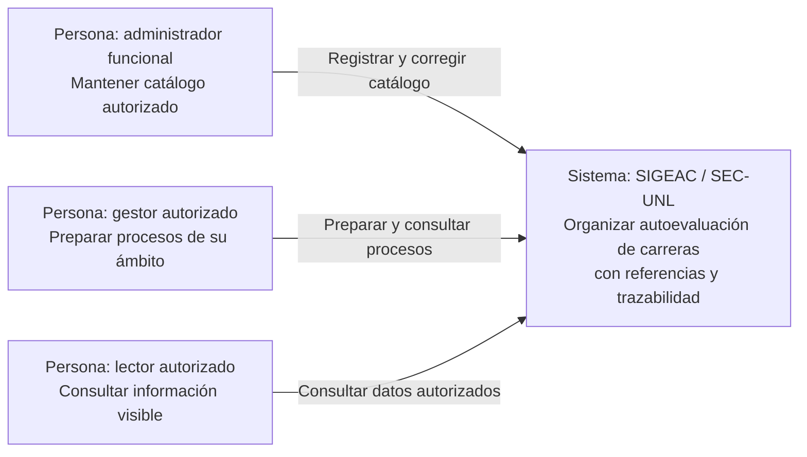
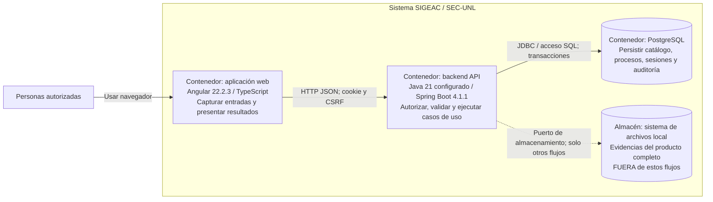
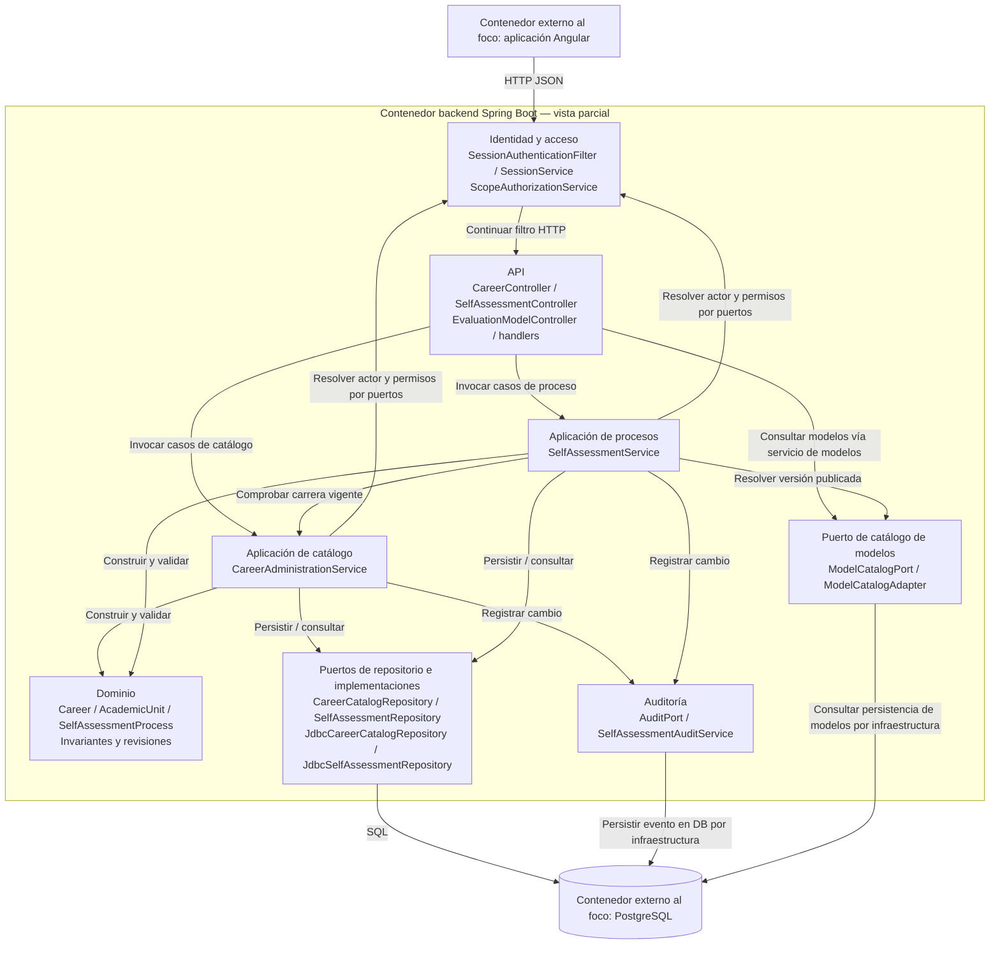

# Arquitectura C4 preliminar — ACD3

Vistas académicas derivadas del repositorio. Alcance funcional seleccionado: catálogo y preparación/consulta de procesos con acceso y auditoría. El producto contiene más módulos, omitidos en C3 para mantener el foco. Las flechas indican dirección de uso/dependencia, no flujo temporal.

## C1 — Contexto del sistema

**Frontera:** SIGEAC completo; personas fuera del sistema. A-AA-01 es la condición común de usuario habilitado de estos actores, no un sistema externo. No se ha identificado dependencia directa de un sistema externo en los dos flujos. CACES y UNL aportan documentos del dominio; no se dibujan como APIs. SSO e integraciones de catálogo permanecen fuera del recorte, sin contrato confirmado.

Fuente: AA2 actores A-AA-01–04; `docs/requirements/spec.md`; `docs/adr/0004-opaque-sessions-scope-authorization.md`. Las competencias institucionales siguen sujetas a confirmación.

## C2 — Contenedores

La aplicación web se ejecuta en navegador; el backend es un único desplegable con módulos por capacidades. El almacén de archivos es un contenedor de datos en sentido C4, no necesariamente un servicio independiente ni un contenedor Docker. PostgreSQL es el destino principal; SQLite es auxiliar de pruebas/desarrollo y no acredita equivalencia operativa.

| Contenedor | Responsabilidad y relación | Evidencia |
|---|---|---|
| Aplicación web | Formularios y consultas; cliente HTTP del backend, sin acceso directo a DB | `frontend/package.json`, `frontend/angular.json`, `frontend/proxy.conf.json`, `frontend/src/`. |
| Backend | Autenticación, permisos, reglas, transacciones y respuesta HTTP | `backend/pom.xml`, `backend/src/main/java/ec/edu/unl/sec/`. |
| PostgreSQL | Persistencia relacional y revisiones; accesible desde backend | `backend/src/main/resources/application.yml`, `backend/src/main/resources/db/migration/`. |
| Archivos locales, fuera del recorte | Persistencia de evidencias a través de puerto | `docs/adr/0002-file-storage-port.md`, configuración `sec.files.root` en application.yml. |

La relación frontend–API usa HTTP en el proxy local observado; HTTPS es una condición de despliegue a acordar/verificar, no algo demostrado por el diagrama. `SEC_COOKIE_SECURE` es configurable. No se introducen colas, cachés o proveedores cloud sin evidencia.

## C3 — Componentes del backend seleccionado

El bloque de modelos agrupa puerto, adaptador y aplicación para legibilidad: `EvaluationModelController` usa `EvaluationModelService`, mientras `SelfAssessmentService` depende de `ModelCatalogPort`. No se afirma que el controlador inyecte directamente el puerto. El filtro no reemplaza la autorización de ámbito de cada caso de uso. CorrelationFilter y los handlers son transversales; no se desdoblan en contenedores.

Dependencias reales a señalar en la clínica: `SelfAssessmentService` llama directamente a `CareerAdministrationService` dentro del módulo selfassessment; no se inventa un microservicio de carreras ni un puerto que no existe. El dominio de carreras normaliza código y valida fechas; la aplicación verifica unidad, permisos, unicidad y revisión; el repositorio conserva revisiones y usa SQL. Algunas validaciones permanecen en servicios/DTO; la separación no implica dominio completamente independiente de todo detalle por el simple nombre de paquete.

## Correspondencia con C4 y revisión

C1 muestra el sistema y sus usuarios; C2, aplicaciones/almacenes y tecnologías; C3, componentes internos de un solo contenedor. Se usa Mermaid con etiquetas explícitas y fronteras, sin pretender una validación automática de notación C4. Fundamento: [contexto](https://c4model.com/diagrams/system-context), [contenedores](https://c4model.com/diagrams/container) y [componentes](https://c4model.com/diagrams/component).

Para revisar: confirmar actor/capacidad; seguir cada flecha hasta código; comprobar que los módulos no accedan a detalles privados de otros módulos; contrastar pruebas ArchUnit; acordar entorno de despliegue y TLS. Diagramas editables en Markdown; el informe LaTeX conserva su fuente Mermaid como anexo textual y no afirma haberla renderizado.
