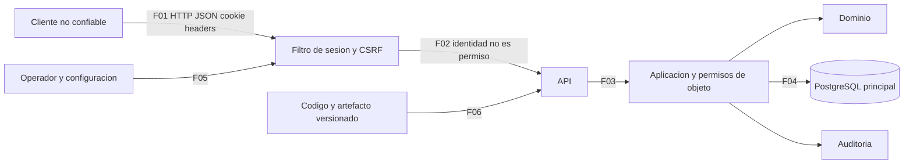

# Incremento SIGEAC — Activos, amenazas y controles

Base común ACD4/APE4/AA4. Alcance: sesión, catálogo y preparación/consulta de procesos de Semana 3; identidad y auditoría como dependencias. Carga de evidencias, recuperación de cuenta e integraciones externas no forman parte del incremento seleccionado. No afirmar que estén ausentes de todo el producto por quedar fuera de este análisis.

## Activos y confianza

| ID | Activo / importancia | Acceso esperado | Impacto de exposición, alteración o pérdida |
|---|---|---|---|
| A-01 | Identidades, credenciales y hash de contraseña | Usuario para autenticarse; gestión por capacidad y ámbito definidos | Suplantación y pérdida de acceso. No devolver contraseña/hash en API. |
| A-02 | Cookie SEC_SESSION, token CSRF y hashes de sesión | Navegador titular; backend valida/revoca | Secuestro de sesión o acciones falsificadas. El token opaco no es JWT. |
| A-03 | Catálogo de unidades/carreras y revisiones | CAREER_ADMIN global para cambios; CAREER_READ según ámbito para consulta | Datos inconsistentes, decisiones basadas en carrera incorrecta e historia perdida. |
| A-04 | Procesos, período y versión fijada | Gestor con PROCESS_MANAGE en carrera; consulta según permisos del proceso | Preparación ilegítima o información de ámbito ajeno. No equivale a acreditación. |
| A-05 | Auditoría y correlación | Servicio para registrar, auditor autorizado para consultar | Repudio, privacidad y pérdida de investigación de incidentes. |
| A-06 | Configuración, secreto HMAC y credenciales DB | Operador autorizado, fuera de Git | Acceso indebido, alteración de controles o indisponibilidad. |
| A-07 | API, CPU, memoria y DB | Clientes dentro de límites; operación por personal autorizado | Agotamiento y pérdida de disponibilidad. |
| A-08 | Código, contratos, pruebas y artefacto desplegable | Equipo por flujo versionado/revisado | Cambio no trazable, dependencia no reproducible o despliegue de artefacto equivocado. |

Fronteras: F-01 cliente no confiable→API; F-02 sesión→autorización por objeto; F-03 controlador→aplicación/dominio; F-04 aplicación→DB/auditoría; F-05 operador/configuración→proceso; F-06 repositorio/artefacto→despliegue. Autenticado no significa administrador ni acceso universal.

## Escala de planificación

Probabilidad 1 Baja, 2 Media, 3 Alta; impacto 1 Bajo, 2 Medio, 3 Alto. Producto 1–2 Bajo, 3–4 Medio, 6 Alto, 9 Crítico, como pide AA4. Estos valores priorizan **escenarios del modelo**, no prueban vulnerabilidades ni asignan severidad a hipótesis no validadas. Las valoraciones son cualitativas del análisis, pendientes de revisión cruzada, sin medición estadística.

## Matriz de amenazas

| ID / STRIDE | Activo / frontera / escenario | Causa o condición razonable | Control existente / evidencia | P | I | P×I / nivel de escenario | Mitigación y prioridad |
|---|---|---|---|---:|---:|---|---|
| T-01 Spoofing | A-01/02, F-01; adivinar credenciales y reutilizar sesión | Credencial comprometida o automatización; no se presume bypass | BCrypt, token aleatorio de 32 bytes, hashes, ventana de intentos, expiración/revocación; SessionService y SessionCookie | 2 | 3 | 6 Alto | Mantener controles y verificar credencial inválida, expiración y revocación; ensayar protección ante automatización acotada en sandbox. Alta por impacto en identidad; explotación no demostrada. |
| T-02 Elevation / Disclosure | A-03/04, F-02; consultar o alterar recurso ajeno | Omisión futura de autorización por objeto o ámbito mal configurado | ScopeAuthorizationService y servicios de carrera/proceso comprueban capacidades/ámbito; UUID no es permiso | 1 | 3 | 3 Medio | Pruebas lector A/objeto B, lista/total/detalle, cuenta técnica; asegurar denegación en cada ruta. Media; hay controles fuente, no BOLA confirmado en este recorte. |
| T-03 Tampering | A-03, F-01/03; escribir sin intención o revisión válida | CSRF o edición con revisión vieja | Filtro propio verifica X-CSRF-TOKEN; ETag/If-Match y revisiones; APE3 HTTP-04/09/11 | 1 | 2 | 2 Bajo | Regresión y prueba de dos clientes; no aceptar control solo frontend. Baja residual de planificación, no aceptación formal del riesgo. |
| T-04 Information Disclosure | A-02/06, F-05; cookie por transporte no protegido | Desplegar sin TLS o perfil equivocado | Default cookie-secure=false para local; prod=true y demo=false; configuración externa puede prevalecer | 1 | 3 | 3 Medio | Exigir perfil/env efectivos, TLS y cookie Secure en despliegue. Media; no hay evidencia de exposición productiva. |
| T-05 DoS | A-07, F-02/04; listado de procesos consume recursos en exceso | Repositorio carga todos los procesos antes del filtrado del servicio | JDBC list sin LIMIT; GET /processes sin parámetros de paginación; no se efectuó prueba de carga | 2 | 2 | 4 Medio | Paginación/límites y filtrado autorizado en DB, contrato compatible y pruebas de total/ámbito. Media; agotamiento no reproducido. |
| T-06 Repudiation | A-03/04/05, F-04; cambio crítico sin registro fiable | Falla de auditoría o política de retención/permisos incorrecta | Servicios transaccionales y AuditPort; historial de catálogo | 1 | 3 | 3 Medio | Inyectar fallo en fixture y comprobar rollback; validar permisos de auditoría/retención. Media; no declarar atomicidad solo por @Transactional. |
| T-07 Information Disclosure | A-06/08, F-05/06; secreto real versionado | Configuración local o credencial copiada al repositorio | .gitignore, env placeholders y CI sintética; escaneo acotado sin coincidencias de tres patrones | 1 | 3 | 3 Medio | Gestión externa/rotación, revisión de diffs y ampliar escaneo si hay indicio; metadatos sin valores. Media; ausencia de coincidencias no certifica ausencia total. |
| T-08 DoS / Spoofing | A-01/07, F-01; coste BCrypt distribuido por muchos sujetos | Límite por sujeto no establece un límite global de admisión | SessionService limita cuenta/ventana; registra sourceKey, sin inferir límite por IP de esa persistencia | 2 | 2 | 4 Medio | Verificar control global/proxy con propietario; límites razonables sin sustituir bloqueo por cuenta ni perjudicar usuarios compartiendo IP. Media; no se ha demostrado agotamiento. |
| T-09 Observación de interoperabilidad; no amenaza STRIDE afirmada | A-03/08, F-01; consumidor interpreta error incorrecto o pierde diagnóstico | Contrato común académico difiere del implementado; 401 sin desafío en muestra previa | Problem Details con código/correlación; no stack en cuerpo en muestras; AA3 propuesta de adaptación | 1 | 1 | 1 Bajo | Acordar contrato, revisar WWW-Authenticate y validar cuerpos/headers; no inventar Bearer. No se clasifica como filtración ni bypass sin evidencia. |

No se agrega una amenaza de archivos/SSRF/recuperación de cuenta sin ruta del recorte que la justifique. El modelo no agota el producto. Los siete registros needs_validation de securityOutputs/run-1 pertenecen a una revisión anterior más amplia; no se convierten en confirmados ni se consideran resueltos por estas tablas.

## Permisos comprobables por capacidad y ámbito

| Recurso / operación | Sin sesión | Lector con ámbito | Administrador funcional de catálogo | Gestor de proceso | Cuenta técnica |
|---|---|---|---|---|---|
| POST sessions | Credenciales válidas según política | Autenticar su identidad | Autenticar su identidad | Autenticar su identidad | Identidad técnica no implica capacidades funcionales |
| Consultar carrera/lista/historia | Denegar | CAREER_READ y carrera visible; totales filtrados | CAREER_ADMIN según servicio global | Solo si dispone también de lectura aplicable | Servicio de catálogo rechaza actor técnico |
| Crear/editar/estado catálogo | Denegar | Denegar sin CAREER_ADMIN | Permitir con validaciones, CSRF y revisión cuando corresponde | PROCESS_MANAGE no concede CAREER_ADMIN | Denegar |
| Preparar proceso | Denegar | Denegar sin capacidad | CAREER_ADMIN por sí solo no habilita | PROCESS_MANAGE y ámbito de carrera, carrera/unidad/modelo válidos | Denegar |
| Consultar proceso | Denegar | Según capacidades y ámbito implementados | No acceso universal por administrar catálogo | Según permiso del proceso | Denegar |
| Autorizar institucionalmente | Fuera del incremento | No inferir | No inferir por rol técnico | PROCESS_MANAGE no equivale a autoridad institucional | No inferir |

La matriz resume código visible; cada caso debe probarse con fixtures. No se asignan personas/órganos institucionales sin validación.
