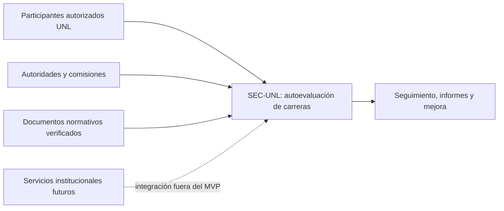
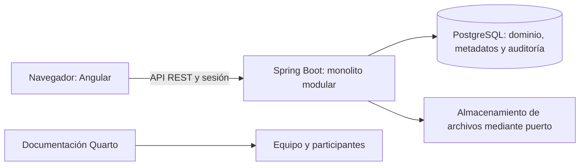
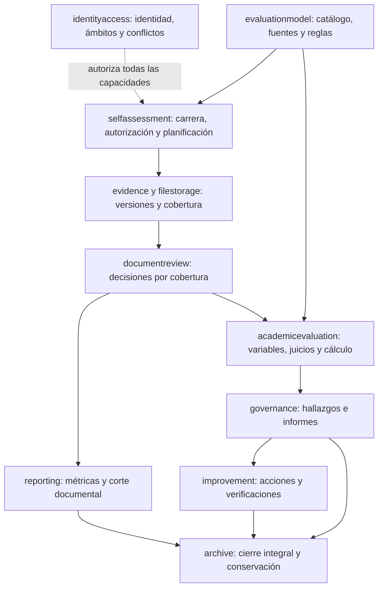
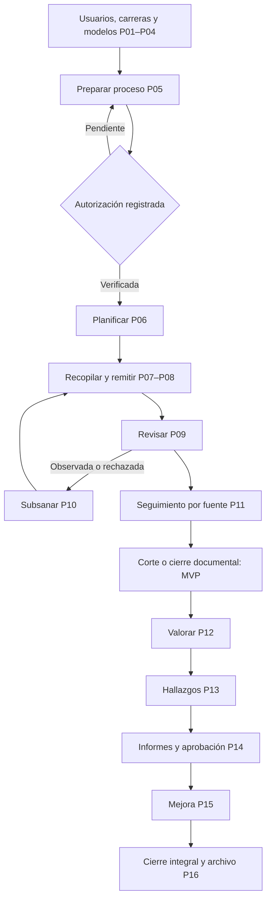

This file is a merged representation of the entire codebase, combining all repository files into a single document.
Generated by Repomix on: 2026-10-31 18:46:20

# File Summary

## Purpose:

This file contains a packed representation of the entire repository's contents.
It is designed to be easily consumable by AI systems for analysis, code review,
or other automated processes.

## File Format:

The content is organized as follows:
1. This summary section
2. Repository information
3. Repository structure
4. Multiple file entries, each consisting of:
   a. A header with the file path (## File: path/to/file)
   b. The full contents of the file in a code block

## Usage Guidelines:

- This file should be treated as read-only. Any changes should be made to the
  original repository files, not this packed version.
- When processing this file, use the file path to distinguish
  between different files in the repository.
- Be aware that this file may contain sensitive information. Handle it with
  the same level of security as you would the original repository.

## Notes:

- Some files may have been excluded based on .gitignore rules and Repomix's
  configuration.
- Binary files are not included in this packed representation. Please refer to
  the Repository Structure section for a complete list of file paths, including
  binary files.

## Additional Information:

For more information about Repomix, visit: https://github.com/andersonby/python-repomix


# Repository Structure

```
.agents
  skills
    angular-frontend
      SKILL.md
    c4-diagrams
      SKILL.md
    caveman
      README.md
    graphify-mapping
      SKILL.md
    kotlin-android
      SKILL.md
    multiagent-coordination
      SKILL.md
    openapi-contracts
      SKILL.md
    ponytail
      SKILL.md
    postgresql-database
      SKILL.md
    quarto-documentation
      SKILL.md
    sdd-requirements
      SKILL.md
    security-audit
      AI-AND-LLM.md
      ATTACK-CLASSES.md
      CLOUD-AND-DEPLOYMENT.md
      DATA-ISOLATION-AND-LIFECYCLE.md
      DESKTOP-MOBILE-AND-LOCAL-IPC.md
      HUNTING.md
      MEMORY-SAFETY-AND-BINARY.md
      PROTOCOLS-RPC-AND-MESSAGING.md
      RECONNAISSANCE.md
      report-schema.json
      RESOURCE-EXHAUSTION-AND-AVAILABILITY.md
      SUPPLY-CHAIN-AND-RELEASE.md
      validate-coverage-ledger.cjs
      validate-coverage-ledger.test.cjs
      validate-findings.cjs
      validate-findings.test.cjs
      VALIDATION-AND-REPORTING.md
      WEB-PROTOCOL-AND-AUTH.md
    security-rbac
      SKILL.md
    software-testing
      SKILL.md
    speckit-analyze
      SKILL.md
    speckit-checklist
      SKILL.md
    speckit-clarify
      SKILL.md
    speckit-constitution
      SKILL.md
    speckit-converge
      SKILL.md
    speckit-implement
      SKILL.md
    speckit-plan
      SKILL.md
    speckit-specify
      SKILL.md
    speckit-tasks
      SKILL.md
    speckit-taskstoissues
      SKILL.md
    spring-boot-layered
      SKILL.md
.claude
  skills
    speckit-analyze
      SKILL.md
    speckit-checklist
      SKILL.md
    speckit-clarify
      SKILL.md
    speckit-constitution
      SKILL.md
    speckit-converge
      SKILL.md
    speckit-implement
      SKILL.md
    speckit-plan
      SKILL.md
    speckit-specify
      SKILL.md
    speckit-tasks
      SKILL.md
    speckit-taskstoissues
      SKILL.md
.editorconfig
.gemini
  commands
    speckit.analyze.toml
    speckit.checklist.toml
    speckit.clarify.toml
    speckit.constitution.toml
    speckit.converge.toml
    speckit.implement.toml
    speckit.plan.toml
    speckit.specify.toml
    speckit.tasks.toml
.github
  workflows
    android-ci.yml
    documentation-ci.yml
    frontend-ci.yml
.gitignore
.opencode
  commands
    speckit.analyze.md
    speckit.checklist.md
    speckit.clarify.md
    speckit.constitution.md
    speckit.converge.md
    speckit.implement.md
    speckit.plan.md
    speckit.specify.md
    speckit.tasks.md
    speckit.taskstoissues.md
.specify
  .gitignore
  init-options.json
  integration.json
  memory
    constitution.md
  scripts
    powershell
      check-prerequisites.ps1
      common.ps1
      create-new-feature.ps1
      resolve-template.ps1
      setup-plan.ps1
      setup-tasks.ps1
  templates
    checklist-template.md
    constitution-template.md
    plan-template.md
    spec-template.md
    tasks-template.md
  workflows
    speckit
      workflow.yml
    workflow-registry.json
backend
  .mvn
    wrapper
      maven-wrapper.properties
  pom.xml
  src
    main
      java
        ec
          edu
            unl
              sec
                academicevaluation
                  api
                    AcademicEvaluationController.java
                    AcademicProblemHandler.java
                    AcademicReconciliationController.java
                    QuantitativeEvaluationController.java
                  application
                    AcademicCalculationService.java
                    AcademicConsolidationPort.java
                    AcademicEvaluationService.java
                    AcademicProblemException.java
                    AcademicReconciliationService.java
                    ManualEvaluationRepository.java
                    QuantitativeContext.java
                    QuantitativeRepository.java
                    ReconciliationRepository.java
                    VariableValueService.java
                  domain
                    AcademicReconciliation.java
                    ManualAcademicEvaluation.java
                    QuantitativeEvaluation.java
                    RatioPercentStrategy.java
                  infrastructure
                    AcademicConsolidationAdapter.java
                    JdbcManualEvaluationRepository.java
                    JdbcQuantitativeRepository.java
                    JdbcReconciliationRepository.java
                    SqliteManualEvaluationGuards.java
                  package-info.java
                archive
                  api
                    ArchiveController.java
                    ArchiveProblemHandler.java
                  application
                    ArchiveProblemException.java
                    ArchiveService.java
                    ClosureEvidencePort.java
                    IntegralClosureRepository.java
                    IntegralClosureService.java
                  domain
                    ArchiveRecord.java
                    IntegralClosure.java
                    IntegralClosurePolicy.java
                  infrastructure
                    JdbcClosureEvidenceAdapter.java
                    JdbcIntegralClosureRepository.java
                audit
                  api
                    AuditEventView.java
                  application
                    AuditEventCommand.java
                    AuditPort.java
                    AuditQueryPort.java
                    FailureAuditPort.java
                  infrastructure
                    JpaAuditAdapter.java
                    TransactionalFailureAuditAdapter.java
                  package-info.java
                documentreview
                  api
                    DocumentReviewController.java
                    DocumentReviewProblemHandler.java
                  application
                    CoverageReviewProjectionService.java
                    DocumentReviewAuthorizationPort.java
                    DocumentReviewProblemException.java
                    DocumentReviewProgressPort.java
                    DocumentReviewRepository.java
                    DocumentReviewService.java
                    ReviewSubmissionPort.java
                    SubmissionCorrectionPort.java
                  domain
                    DocumentReviewDecision.java
                    ReviewCoverageOutcome.java
                  infrastructure
                    DocumentReviewBoundaryAdapter.java
                    EvidenceSubmissionCorrectionAdapter.java
                    JdbcDocumentReviewProgressAdapter.java
                    JdbcDocumentReviewRepository.java
                    JdbcReviewSubmissionAdapter.java
                  package-info.java
                evaluationmodel
                  api
                    EvaluationModelController.java
                    EvaluationModelExceptionHandler.java
                    LegacyModelNode.java
                    LegacyModelVersion.java
                    ModelAuditController.java
                  application
                    EvaluationModelAuditService.java
                    EvaluationModelProperties.java
                    EvaluationModelRepository.java
                    EvaluationModelService.java
                    ModelApplicabilityService.java
                    ModelCatalogPort.java
                    ModelComparisonService.java
                    ModelProblemException.java
                    ModelSuccessionService.java
                    NormativeReferenceRepository.java
                    ValidatedStrategyPort.java
                  domain
                    EvaluationModel.java
                    FormulaValidator.java
                    IndicatorDefinition.java
                    ModelCareerApplicability.java
                    ModelConfiguration.java
                    ModelHierarchy.java
                    ModelNode.java
                    ModelVersion.java
                    ModelVersionStatus.java
                    NormativeReference.java
                    ProgressFormula.java
                    PublicationValidator.java
                    RatingScale.java
                    RequiredSource.java
                    ValuationRule.java
                    ValuationThreshold.java
                    ValuationVariable.java
                  infrastructure
                    JdbcEvaluationModelRepository.java
                    JpaNormativeReferenceRepository.java
                    ModelCatalogAdapter.java
                    SqliteModelGuards.java
                  package-info.java
                evidence
                  api
                    EvidenceDownloadController.java
                    EvidenceDraftController.java
                    EvidenceDraftRequest.java
                    EvidenceHistoryController.java
                    EvidenceProblemHandler.java
                    EvidenceSourceController.java
                    EvidenceSourceCoverageController.java
                    EvidenceView.java
                    ExternalReferenceRequest.java
                    ExternalReferenceView.java
                    FileMetadataView.java
                    StructuredEvidenceController.java
                  application
                    ApplicabilityDecisionService.java
                    CreateEvidenceSuccessorService.java
                    EvidenceAuditService.java
                    EvidenceAuthorizationPort.java
                    EvidenceContextPort.java
                    EvidenceDownloadService.java
                    EvidenceDraftRepository.java
                    EvidenceDraftService.java
                    EvidenceFileService.java
                    EvidenceGovernanceRepository.java
                    EvidenceHistoryService.java
                    EvidenceIntegrityPort.java
                    EvidenceIntegrityService.java
                    EvidenceProblemException.java
                    EvidenceProgressPort.java
                    EvidenceSourceCoverageService.java
                    EvidenceSourceRepository.java
                    EvidenceSourceService.java
                    RequiredSourceCatalogPort.java
                    StructuredEvidenceService.java
                    SubmitEvidenceService.java
                  domain
                    ApplicabilityDecision.java
                    Evidence.java
                    EvidenceVersion.java
                    EvidenceVersionStatus.java
                    ExternalReference.java
                    SourceCoverage.java
                    StructuredEvidence.java
                    VersionFile.java
                    VersionIndicator.java
                  infrastructure
                    EvidenceBoundaryAdapter.java
                    EvidenceJpaEntity.java
                    EvidenceVersionJpaEntity.java
                    JdbcEvidenceGovernanceRepository.java
                    JdbcEvidenceProgressAdapter.java
                    JpaEvidenceRepository.java
                    JpaEvidenceSourceRepository.java
                    RequiredSourceCatalogAdapter.java
                  package-info.java
                filestorage
                  application
                    FileAssetRepository.java
                    FileInspectionPort.java
                    FileReconciliationService.java
                    FileRecoveryRepository.java
                    FileStoragePort.java
                    FileStorageProperties.java
                    FileValidationPolicyRepository.java
                  domain
                    FileAsset.java
                    FileRecoveryOperation.java
                    FileValidationException.java
                    FileValidationPolicy.java
                    StoredFile.java
                  infrastructure
                    ContentInspectionService.java
                    FileReconciliationScheduler.java
                    JpaFileAssetRepository.java
                    JpaFileRecoveryRepository.java
                    JpaFileValidationPolicyRepository.java
                    LocalFileStorageAdapter.java
                  package-info.java
                governance
                  api
                    GovernanceProblemHandler.java
                    ReportController.java
                  application
                    FindingRepository.java
                    FindingService.java
                    GovernanceProblemException.java
                    ReportRepository.java
                    ReportWorkflowService.java
                  domain
                    ApprovalDecision.java
                    Consolidation.java
                    Finding.java
                    ObservationReply.java
                    ReportObservation.java
                    ReportSocialization.java
                    ReportVersion.java
                  infrastructure
                    JdbcFindingRepository.java
                    JdbcReportRepository.java
                    SqliteGovernanceGuards.java
                identityaccess
                  api
                    AccessAuditController.java
                    AccessRequestContext.java
                    IdentityAccessExceptionHandler.java
                    IdentityAdministrationController.java
                    SessionController.java
                  application
                    AuthorizationPort.java
                    CurrentActorPort.java
                    FunctionalAssignmentPolicyPort.java
                    FunctionalAssignmentPolicyService.java
                    IdentityAccessProperties.java
                    IdentityAccessRepository.java
                    IdentityAdministrationService.java
                    InstitutionalAuthorityPort.java
                    ScopeAuthorizationService.java
                  domain
                    AccessIdentity.java
                    AuthorizationDecision.java
                    AuthorizationScope.java
                    ConflictException.java
                    ConflictPolicy.java
                    Credential.java
                    FunctionalAssignment.java
                    IdentityAccessDeniedException.java
                    IdentityConflictException.java
                    IdentityNotFoundException.java
                    InstitutionalAuthority.java
                    OperationCode.java
                    ProcessFunction.java
                    StaleIdentityRevisionException.java
                  infrastructure
                    AccessProblemWriter.java
                    IdentityAccessPortAdapter.java
                    InstitutionalAuthorityAdapter.java
                    SecurityConfiguration.java
                    SyntheticAccessData.java
                  package-info.java
                improvement
                  api
                    ImprovementController.java
                    ImprovementProblemHandler.java
                  application
                    ActionProgressService.java
                    ImprovementPlanService.java
                    ImprovementProblemException.java
                    ImprovementRepository.java
                  domain
                    ActionDecision.java
                    ActionProgress.java
                    ImprovementAction.java
                    ImprovementPlan.java
                  infrastructure
                    JdbcImprovementRepository.java
                integration
                  package-info.java
                OpenApiConfiguration.java
                reporting
                  api
                    DocumentaryClosureController.java
                    DocumentaryProgressController.java
                    DocumentarySnapshotController.java
                    ReportingProblemHandler.java
                  application
                    DocumentaryClosureRepository.java
                    DocumentaryClosureService.java
                    DocumentaryProgressQueryService.java
                    DocumentarySnapshotCodec.java
                    DocumentarySnapshotRepository.java
                    DocumentarySnapshotService.java
                    ReportingProblemException.java
                  domain
                    DocumentaryClosure.java
                    DocumentaryProgressCalculator.java
                    DocumentarySnapshot.java
                  infrastructure
                    JacksonDocumentarySnapshotCodec.java
                    JdbcDocumentaryClosureRepository.java
                    JdbcDocumentarySnapshotRepository.java
                    SqliteDocumentarySnapshotGuards.java
                  package-info.java
                SecApplication.java
                selfassessment
                  api
                    CareerCatalogProblemHandler.java
                    CareerController.java
                    ProcessAssignmentController.java
                    ProcessAuditController.java
                    ProcessExceptionHandler.java
                    ProcessGovernanceController.java
                    SelfAssessmentController.java
                  application
                    CareerAdministrationService.java
                    CareerCatalogException.java
                    CareerCatalogRepository.java
                    CatalogPage.java
                    DocumentaryProcessPort.java
                    DocumentaryProcessService.java
                    ProcessAssignmentCatalogPort.java
                    ProcessAssignmentService.java
                    ProcessCatalogPort.java
                    ProcessPlanningService.java
                    ProcessProblemException.java
                    ProcessTransitionService.java
                    SelfAssessmentAuditService.java
                    SelfAssessmentRepository.java
                    SelfAssessmentService.java
                  domain
                    AcademicUnit.java
                    Career.java
                    ProcessActivity.java
                    ProcessAssignment.java
                    ProcessAuthorization.java
                    ProcessState.java
                    ProcessStateMachine.java
                    ProcessTeam.java
                    SelfAssessmentProcess.java
                    TeamMembership.java
                  infrastructure
                    JdbcCareerCatalogRepository.java
                    JdbcSelfAssessmentRepository.java
                    ProcessAssignmentCatalogAdapter.java
                    ProcessCatalogAdapter.java
                    SqliteCatalogGuards.java
                    SyntheticCareerData.java
                    SyntheticPilotData.java
                  package-info.java
                shared
                  api
                    ApiProblemHandler.java
                    DomainProblemException.java
                    EntityTagSupport.java
                  domain
                    DecisionProvenance.java
                    DomainClock.java
                    DomainId.java
                    OptimisticLockVersion.java
                  infrastructure
                    CorrelationFilter.java
                    JdbcValueSupport.java
                  package-info.java
      resources
        application-prod.yml
        application-sqlite-test.yml
        application.yml
        db
          migration
            V001__foundation.sql
            V002__audit.sql
            V004__evaluation_model.sql
            V005__self_assessment.sql
            V006__evidence.sql
            V007__process_preparation_and_suspension.sql
            V008__career_catalog.sql
            V009__complete_evaluation_models.sql
            V010__process_governance.sql
            V011__evidence_immutability.sql
            V012__source_coverage.sql
            V013__structured_snapshot.sql
            V014__snapshot_indicator_references.sql
            V015__document_review.sql
            V016_1__documentary_closure.sql
            V016__documentary_reporting.sql
            V017__academic_evaluation_rules.sql
            V018__findings_reports.sql
            V019__improvement.sql
            V020__integral_archive.sql
            V021__manual_academic_evaluations.sql
            V022__verified_quantitative_calculations.sql
            V023__academic_reconciliation.sql
            V024__findings_reports.sql
            V025__improvement_workflow.sql
            V026__integral_closure_archive.sql
          sqlite
            schema.sql
    test
      java
        ec
          edu
            unl
              sec
                academicevaluation
                  application
                    AcademicCalculationServiceTest.java
                    AcademicEvaluationServiceTest.java
                    AcademicReconciliationServiceTest.java
                  domain
                    IndicatorValuationRuleTest.java
                  infrastructure
                    ManualEvaluationPersistenceTest.java
                architecture
                  ModuleArchitectureTest.java
                archive
                  application
                    ArchiveServiceTest.java
                    ClosureReopeningPolicyTest.java
                  domain
                    IntegralClosurePolicyTest.java
                  infrastructure
                    IntegralClosureBytesTest.java
                contract
                  OpenApiContractTest.java
                documentreview
                  application
                    CoverageReviewProjectionTest.java
                    DocumentReviewServiceTest.java
                  domain
                    CompleteDocumentReviewTest.java
                  infrastructure
                    DocumentReviewPersistenceTest.java
                evaluationmodel
                  api
                    EvaluationModelControllerTest.java
                  application
                    CompleteModelPublicationTest.java
                    FiveModelConfigurationTest.java
                    LegacyModelCompatibilityTest.java
                    ModelComparisonServiceTest.java
                    ModelSuccessionServiceTest.java
                    NormativeApplicabilityTest.java
                    NormativeVerificationManifestTest.java
                  domain
                    FlexibleModelHierarchyTest.java
                    FormulaValidatorTest.java
                    ModelVersionTest.java
                    PublicationValidatorTest.java
                    RequiredSourceTest.java
                    ValuationRuleTest.java
                  infrastructure
                    FlexibleModelPersistenceTest.java
                    NormativeReferencePersistenceTest.java
                  support
                    ConfiguredModelFixtures.java
                    InMemoryEvaluationModelRepository.java
                    InMemoryNormativeReferenceRepository.java
                    ModelFixtures.java
                evidence
                  application
                    ApplicabilityDecisionServiceTest.java
                    CreateEvidenceSuccessorServiceTest.java
                    EvidenceDownloadServiceTest.java
                    EvidenceDraftServiceTest.java
                    EvidenceIntegrityServiceTest.java
                    EvidenceSourceServiceTest.java
                    StructuredEvidenceServiceTest.java
                  domain
                    EvidenceDraftTest.java
                    EvidenceSuccessorTest.java
                    SourceCoverageTest.java
                  infrastructure
                    EvidenceConcurrencyIntegrationTest.java
                    EvidenceSourcePersistenceTest.java
                    SubmittedEvidenceImmutabilityTest.java
                filestorage
                  application
                    FileReconciliationServiceTest.java
                  domain
                    FileAssetTest.java
                    FileRecoveryOperationTest.java
                    FileValidationPolicyTest.java
                  infrastructure
                    ContentInspectionServiceTest.java
                    FilePersistenceTest.java
                    JpaFileValidationPolicyRepositoryTest.java
                    RecoveryClaimContentionTest.java
                governance
                  application
                    FindingServiceTest.java
                    IssuedReportImmutabilityTest.java
                    ReportWorkflowServiceTest.java
                  domain
                    FindingTest.java
                  infrastructure
                    IssuedReportImmutabilityTest.java
                identityaccess
                  application
                    CompleteWorkflowAuthorizationTest.java
                    IdentityAdministrationServiceTest.java
                    ScopeAuthorizationServiceTest.java
                    TeamMembershipPolicyTest.java
                  domain
                    AccessScopeRulesTest.java
                  infrastructure
                    InstitutionalAuthorityAdapterTest.java
                  support
                    InMemoryIdentityAccessRepository.java
                improvement
                  application
                    PostClosureImprovementTest.java
                  domain
                    ImprovementActionTest.java
                  infrastructure
                    ImprovementPersistenceTest.java
                migration
                  CareerCatalogMigrationTest.java
                  CareerCatalogStartupTest.java
                  CleanDatabaseMigrationTest.java
                  CompleteWorkflowMigrationTest.java
                  EvaluationModelMigrationTest.java
                  EvidenceMigrationTest.java
                  IdentityAccessMigrationTest.java
                  ProcessGovernanceMigrationTest.java
                  ProcessPreparationMigrationTest.java
                  SelfAssessmentMigrationTest.java
                reporting
                  api
                    DocumentaryProgressControllerTest.java
                  application
                    DocumentaryClosureServiceTest.java
                    DocumentaryProgressQueryTest.java
                    DocumentarySnapshotSemanticsTest.java
                    DocumentarySnapshotServiceTest.java
                  domain
                    DocumentaryProgressCalculatorTest.java
                  infrastructure
                    DocumentaryClosureConcurrencyTest.java
                    DocumentaryProgressPersistenceTest.java
                    DocumentarySnapshotPersistenceTest.java
                selfassessment
                  api
                    CareerControllerTest.java
                    ProcessGovernanceControllerTest.java
                    SelfAssessmentControllerTest.java
                  application
                    CareerAdministrationServiceTest.java
                    ProcessAssignmentServiceTest.java
                    ProcessPlanningServiceTest.java
                    ProcessTransitionServiceTest.java
                    SelfAssessmentAuditServiceTest.java
                    SelfAssessmentAuditTest.java
                    SelfAssessmentServiceTest.java
                    TeamPlanningIntegrityTest.java
                  domain
                    AuthorizedProcessLifecycleTest.java
                    CareerTest.java
                    FixedModelSnapshotTest.java
                    ProcessStateMachineTest.java
                  infrastructure
                    ProcessGovernancePersistenceTest.java
                    TeamAssignmentAccessTest.java
                  support
                    InMemorySelfAssessmentRepository.java
                shared
                  api
                    EntityTagSupportTest.java
                    EntityTagValidationTest.java
                support
                  CompleteWorkflowAcceptanceData.java
                  CompleteWorkflowPerformanceDataTest.java
                  D6DocumentaryMvpData.java
                  D7ManualEvaluationData.java
                  D7ReportWorkflowData.java
                  D8ImprovementData.java
                  D9ArchiveData.java
                  SqliteApplicationContextTest.java
      resources
        application-test.yml
        fixtures
          complete-workflow-performance.sql
docs
  adr
    0001-modular-monolith.md
    0002-file-storage-port.md
    0003-evidence-versioning-contract.md
    0004-opaque-sessions-scope-authorization.md
    0005-model-version-snapshots.md
    0006-fixed-model-process-state-machine.md
    0015-configurable-evaluation-models.md
    0016-evaluation-strategies-import-adapters.md
    0017-source-coverage-and-process-governance.md
    0018-catalog-contract-migration-compatibility.md
    0019-flexible-model-foundations.md
  architecture
    complete-workflows.md
    data-model.md
    research.md
  planning
    next-steps.md
    plan.md
    tasks.md
  requirements
    domain-rules.md
    process-flows.md
    spec.md
  technical
    actores-accesos-riesgos.md
    contracts
      events-asyncapi.yaml
    i0-access.qmd
    i1-models.qmd
    i2-processes.qmd
    index.qmd
    migration-p01-p16.qmd
    quickstart.md
  testing
    checklists
      governance.md
      requirements.md
    implementation-review.md
    process-acceptance.md
    sqlite.md
    traceability.md
  user
    d1-careers.qmd
    d2-d3-models-planning.qmd
    d4-d5-evidence-review.qmd
    d6-documentary-progress.qmd
    d7-academic-reconciliation.qmd
    d7-d8-reports-archive.qmd
    d7-manual-evaluation.qmd
    d7-quantitative-evaluation.qmd
    i0-access.qmd
    i1-models.qmd
    i2-processes.qmd
    index.qmd
feature-map.md
frontend
  angular.json
  eslint.config.js
  package.json
  playwright.accessibility.config.ts
  playwright.complete-workflows.config.ts
  playwright.config.ts
  playwright.d1.config.ts
  playwright.d3.config.ts
  playwright.d5.config.ts
  playwright.d6.config.ts
  playwright.d7-manual.config.ts
  playwright.d7-quantitative.config.ts
  playwright.d7-reconciliation.config.ts
  playwright.d7-reports.config.ts
  playwright.d8-archive.config.ts
  playwright.d8-improvement.config.ts
  proxy.conf.json
  proxy.d1.conf.json
  proxy.d3.conf.json
  proxy.d5.conf.json
  proxy.d6.conf.json
  src
    app
      app.component.ts
      app.config.ts
      app.routes.ts
      core
        http
          api-client.ts
          problem.spec.ts
          problem.ts
        layout
          app-layout.component.html
          app-layout.component.ts
      features
        access
          access.guard.ts
          access.routes.ts
          data-access
            access.errors.ts
            access.models.ts
          pages
            access-audit.page.ts
            access-home.page.ts
            conflict-exceptions.page.ts
            identity-admin.page.spec.ts
          ui
            assignment-form.component.ts
        archive
          archive.routes.ts
          data-access
            archive-api.service.ts
          pages
            process-archive.page.ts
        careers
          careers.routes.ts
          data-access
            career-api.service.spec.ts
            career-api.service.ts
          pages
            career-catalog.page.spec.ts
            career-catalog.page.ts
        evaluations
          data-access
            academic-evaluation-api.service.spec.ts
            academic-evaluation-api.service.ts
            quantitative-api.service.ts
            reconciliation-api.service.spec.ts
            reconciliation-api.service.ts
          evaluations.routes.ts
          pages
            academic-disagreement.page.spec.ts
            academic-disagreement.page.ts
            indicator-evaluation.page.spec.ts
            indicator-evaluation.page.ts
            quantitative-evaluation.page.spec.ts
            quantitative-evaluation.page.ts
        evidence
          data-access
            evidence-api.service.ts
            evidence.models.ts
          evidence.routes.ts
          pages
            evidence-audit.page.spec.ts
            evidence-audit.page.ts
            evidence-editor.page.spec.ts
            evidence-editor.page.ts
            evidence-history.page.spec.ts
            evidence-history.page.ts
            evidence-list.page.spec.ts
            evidence-list.page.ts
            evidence-version.page.spec.ts
            evidence-version.page.ts
          ui
            evidence-history-timeline.component.ts
            evidence-metadata-form.component.ts
            evidence-source-coverage.component.ts
            evidence-sources.component.spec.ts
            evidence-sources.component.ts
            structured-evidence.component.ts
        improvement
          data-access
            improvement-api.service.spec.ts
            improvement-api.service.ts
          improvement.routes.ts
          pages
            improvement-plan.page.spec.ts
            improvement-plan.page.ts
        models
          data-access
            model-api.service.ts
            model.models.ts
          models.routes.ts
          pages
            model-audit.page.ts
            model-compare.page.ts
            model-editor.page.ts
            model-history.page.spec.ts
            model-history.page.ts
          ui
            publication-panel.component.ts
        processes
          data-access
            process-api.service.spec.ts
            process-api.service.ts
          pages
            process-activities.page.spec.ts
            process-activities.page.ts
            process-create.page.ts
            process-detail.page.ts
            process-planning.page.spec.ts
            process-planning.page.ts
          processes.routes.ts
          ui
            process-assignment-form.component.ts
            process-state-controls.component.spec.ts
            process-state-controls.component.ts
        reporting
          data-access
            reporting-api.service.spec.ts
            reporting-api.service.ts
          pages
            documentary-closure.page.spec.ts
            documentary-closure.page.ts
            documentary-dashboard.page.spec.ts
            documentary-dashboard.page.ts
            documentary-history.page.spec.ts
            documentary-history.page.ts
          reporting.routes.ts
        reports
          data-access
            report-api.service.spec.ts
            report-api.service.ts
          pages
            report-workflow.page.spec.ts
            report-workflow.page.ts
          reports.routes.ts
        reviews
          data-access
            review-api.service.ts
            review.models.ts
          pages
            document-review-inbox.page.spec.ts
            document-review-inbox.page.ts
          reviews.routes.ts
      shared
        public-api.ts
    index.html
    main.ts
    styles.scss
  tsconfig.app.json
  tsconfig.json
  tsconfig.spec.json
graphify-out
  .graphify_labels.json
  .graphify_python
  .graphify_root
  cache
    ast
      v0.9.92-s17-g0fcafffe3c00
        0491d0bdfee74b9ab7f495cdf784b02f583ca1e0052cb2a39e7109f53162f2f8.json
        0f42c3f4760ebea7aca0fbdabcdc29c0c093d996bf2678ad5414d4cb779ecab5.json
        161ecd0ac6a0fb84e6e165b9898206a652233fdaedbd92fc308db25e6fd2fb33.json
        2528e3b573a30079f430ce2a40a09b2124b35acf395cc4224712c24cad572dfd.json
        31530279d9c19454fbfeaa984c6c1f6962b77dbee19e3b917ea9a96829d4f13f.json
        4312ac21998c816b1cf11114aea181223d0642cc06e879d1acad746f867950c9.json
        554c3afdc704b9db4f39ee0a62bed4989090c7432314c030fbcdb9a3a9eb8eca.json
        78234a87c584e697a8fda8b18f134914e41465cbb67c1608b81e69860741502c.json
        952359fa7d29c8984d62deadba52a3785149e0a4e73d6001c3fa202e2f891199.json
        9f8367c4ac9f30dd0a1331140a0b8b8d391c1172fdd805a2dde0ecc459e14eb2.json
        a0f4bf5e5399e118b61e8bae9404743316cea6d0fff4270d8758aeb55525b988.json
        b0fd359f6e7be10acebd391c6f0e34c47a72b1da013b0d840362422b44a58302.json
        c1467b85c7025905437e82d90c47b34ed2899abdb7e09259ad394627f2f9c1ab.json
        dbb460eda6e3c08935eeec33114e59bde631252176c567b9a15db07d32a3c8a5.json
        f1683539290bbea33abfd50f6d8748135a433538677d02ecfecdff0d24634a51.json
    semantic
      pd5fd89c46bb5
        007fdffab48f8544fda64d19fb9d112b25309b186190667d5c8bd533da1d9e2c.json
        0395a47890e439fa7674ddf83b48bf311a6cfbd4041bc391edc5205d6ba30dab.json
        09c68adbce515e786081ceedf92aeca952edf0f0c6ea44aeeffb9e4d966f73ff.json
        0e9b8dcf0e2e30cc870251947b97a759dd7e430798d934956425c5eeb1e18e4c.json
        0fe87b44e1e9f3d3080fef16d1f343ab95ecbf5fe18a92b591dc3b8691ebc380.json
        1ae3389c2fa1c1ad4a70617b414ba45fca4edd99592b5b97ef0aaefa98237f24.json
        1e5cf4015568856633ceb9c04fa9e8a6abd3d8f07fe4b96439e19bae830a2f0b.json
        1f77a76140a0f1d3223b21f862e07701e44d97df87752310b0b50b7c46eca48e.json
        245e844aaec3aaa9e8698ae6ea179545734e7576e40c662514047ab181af4ac9.json
        2734a509d4b2f34ee6258475c4fb2e80a6dbfcbc47c8552df5b6278907529250.json
        295270e8d2750a387acbb887e78ae3378f62711f22ead10e9a463ff362d5a169.json
        3ab82b9315bd0a6d795a8a0750464162ccc10de5125e85f0398c91cb9b10ef0b.json
        3c7084a7085dd3c9fd1fc1fe39f68146b054bc81061a5349fb654ad1d0a31bb6.json
        42da5defbfa1309f486a246683d6d229fd428881680975a41ab1777e1726a8b8.json
        44eb5d09b2a653bf8cca9fad9a5cb56ab24cb120b5f2c07183a8b508895ee913.json
        4984ab7813cfa3429338d0094dbf789f11f2eaad593268b6393c5663b72c52b2.json
        4acc365820327b8f44f63ca20aaa8bc53c421505854aaf7edf5bf0f906d21f48.json
        51f14d46d5b6abddce28779396666792636c8d9629f0202e84501a5e759267ab.json
        64c96c708fed3f81a380e0cbed95f11def81d67a8570f3d819e2881d4c7f9a1f.json
        6698104e3d5b5ff098bd8c0a1bd8e43a6dd3128dee1b6e143a49e25e0d526833.json
        6e6dca564a6310c3cecdf9777013d3a15fbafd2152ff6bdf0427ce39441c0076.json
        715dfcd06c052f1d7ca99e6a3f85fa7521906745c85a63b1744e7086062f3f12.json
        73bc8134155bcde10e77d6e48b5eb32777740a2b7610d1f75af719d51b888737.json
        773cca0786b48762785af657f893b109467c659a17ae89cf2a36067f77d4ae26.json
        7988921dac0d10df7f83bf46c4959fb0268a6e2890394ef0bb2b221b27097615.json
        7ae77b9a3c994aff7dd060791d03efb5587b03d98969b7694d6b16249f426667.json
        7f1b32b1e174236fa87b40764a73e0986899a2654fe6ad6ab421a8e3d437ca8d.json
        85c6dc52949b110c9654f8b70475af953395c7908d414ee92f697f822017e78e.json
        8d9277133182727920593404db13b50a3b40103bfdac44d4dd8e6d809e21537a.json
        9aa46a0a2900f5ceb1b6426500da18a6efd7b37f59e9ba91828e82b97aac98fa.json
        9e3e93b7587cb13057065cc7afa84a0bad7bf6f2b28bc07908b029abd5d18f22.json
        a16143636b40fad277734deb4d73898be7ebc035495a6dbd055bb90f0d293250.json
        a5aa8d30e3ff70c3a92eada9237fb0618baa350c424e56dd33e4149d9ee4b4c3.json
        a7b634406fd5878909d4bfd610cfff7450cd9155178dfe94f36f80408235a582.json
        a9726881401dae3ff72af0337eb0365d99193775dd71428df477724951255652.json
        ae22b7c7ecb6ccd516fed25916e465146432c58f1bef904a92b535ac0bbecfcf.json
        be515d01a96f01717729784c8c85d76a2b654fda3f6dbcbb6dc9550e1005968c.json
        c0b51734de1242422fa8244a398da6bbcccca8bb723ad505b2b212c6dd010916.json
        c77f0a1d0da5defe3cdb9b97230cf8c820e1b5043284805b47d07a940a5e0d0a.json
        caeac0719f18adf6e7fdbfc3d8965601be5439b656fa50ffa31f6193cf3fe91e.json
        d0fafe2949409c93cf022f403a6bc323c6dfba56d9dbf77f85f35d012dce81e7.json
        d42c3bc02016bfc2ae480c8987a114659f5ee0667b8a108cc937f5ee014abfbc.json
        d917895d8bd8b62f37fad3dee92d675bd22fcf3a6909dd51666e05347a0fada9.json
        dc572f9af680f00fdfecc58b47ba824b98b8b6efd5f674fb7b22a0906286c708.json
        e1ea5deedc88001f83f3d74c4f9d1c4e00d9eabf44bb881a245aba0bb41d2334.json
        e4262c38628dd5dc8466ccd90db19425d7d0dbee71f48438b6e0458faa4488a7.json
        e7ce7d3906de09290562745de232c6849ebcf508007f7a72bea086fafa770628.json
        e9c32f363c97b97d8035d8572b092265db4f8d9273d0e4623b9371e2e1cd9e06.json
        f2be25d1863133b5264b1c677209ff360c67c9076b393bcf6780083b467b6c31.json
        f6a27737fd8430f190f1c2d44d3fa2b523c37872e1378f20672ca9a492cdc6d3.json
        f90e726bdc0c4ff36833ebca75de8c4007293cd2ad236c1f92286335b6e6d1bf.json
        fa6e8fc6d07a65ca1b9ff1a8e006b85e086d7641cf91d2d17e98bf26afab6da3.json
        fbac6b24b7b16002acbd7ccdb2eeadac8a9ddc19ee71bff7354c43e27fa28633.json
  cost.json
  graph.json
  GRAPH_REPORT.md
index.qmd
redocly.yaml
scripts
  check-contract-compatibility.mjs
  generate-evidence-fixtures.ps1
  generate-evidence-fixtures.sh
  run-accessibility-acceptance.mjs
  run-complete-workflows-acceptance.mjs
  run-d1-acceptance.mjs
  run-d3-acceptance.mjs
  run-d5-acceptance.mjs
  run-d6-acceptance.mjs
  run-d7-manual-acceptance.mjs
  run-d7-quantitative-acceptance.mjs
  run-d7-reconciliation-acceptance.mjs
  run-d7-reports-acceptance.mjs
  run-d8-archive-acceptance.mjs
  run-d8-improvement-acceptance.mjs
  validate-contracts.mjs
  validate-contracts.ps1
  validate-contracts.sh
  verify-complete-workflows-restore.ps1
securityOutputs
  run-1
    architecture.md
    FINDINGS-DETAIL.md
    findings.json
    NEEDS-VALIDATION.md
    REPORT.md
specs
  001-identity-access-scopes
    checklists
      requirements.md
    contracts
      openapi.yaml
    data-model.md
    plan.md
    quickstart.md
    research.md
    spec.md
    tasks.md
  002-version-evaluation-model
    checklists
      requirements.md
    contracts
      openapi.yaml
    data-model.md
    plan.md
    quickstart.md
    research.md
    spec.md
    tasks.md
  003-manage-self-assessment
    checklists
      requirements.md
    contracts
      openapi.yaml
    data-model.md
    plan.md
    quickstart.md
    research.md
    spec.md
    tasks.md
  004-submit-evidence
    checklists
      requirements.md
    data-model.md
    implementation-prerequisites.md
    plan.md
    research.md
    spec.md
    tasks.md
  005-complete-evaluation-workflows
    checklists
      requirements.md
    contracts
      README.md
    data-model.md
    plan.md
    quickstart.md
    research.md
    spec.md
    tasks.md
tests
  acceptance
    evidence-audit.spec.ts
    evidence-v1-v2.spec.ts
    evidence-v1.spec.ts
    model-versioning.spec.ts
    results
      access-quickstart.md
      contracts-p01-p16.md
      d1-careers.md
      d2-five-models.md
      d2-model-foundations.md
      d2-model-publication.md
      d3-process-planning.md
      d4-source-coverage.md
      d5-document-review.md
      d6-documentary-mvp.md
      d6-documentary-snapshots.md
      d6-progress-foundations.md
      d6-progress-query.md
      d7-academic-evaluation.md
      d7-academic-reconciliation.md
      d7-quantitative-evaluation.md
      d7-reports.md
      d8-archive.md
      d8-improvement.md
      evidence-audit.md
      evidence-file-records.md
      evidence-file-validation.md
      evidence-local-storage.md
      evidence-sources.md
      evidence-v1-v2.md
      evidence-v1.md
      migrations-p01-p16.md
      model-quickstart.md
      p01-p16-completion-validation.md
      p01-p16-cross-cutting.md
      p01-p16-prerequisites.md
      p01-p16-quickstart.md
      p01-p16-restore.md
      p01-p16-review-gate.md
      performance-p01-p16.md
      process-acceptance.md
      process-quickstart.md
    self-assessment-process.spec.ts
  e2e
    accessibility-complete-workflows.spec.ts
  fixtures
    models
      five-model-configurations.json
      general-2024
        manifest.json
      normative-manifest.json
      normative-verification.json
    performance
      complete-workflows.json
    pilot
      access
        manifest.json
      evidence
        manifest.json
        README.md
      manifest.json
      process
        manifest.json
      README.md
  performance
    README.md
_quarto.yml
```

# Repository Files


## .agents/skills/angular-frontend/SKILL.md

```markdown
---
name: angular-frontend
description: Skill especializada del proyecto SEC-UNL.
---

# angular-frontend

## Propósito
Pendiente de especificación.

## Instrucciones
Respetar .specify/memory/constitution.md.

## Restricciones
No ejecutar comandos, instalaciones, builds, tests ni despliegues sin autorización explícita.
No utilizar Docker.

## Entradas
Especificaciones aprobadas del proyecto.

## Resultados esperados
Artefactos verificables y documentados.
```

## .agents/skills/c4-diagrams/SKILL.md

```markdown
---
name: c4-diagrams
description: Skill especializada del proyecto SEC-UNL.
---

# c4-diagrams

## Propósito
Pendiente de especificación.

## Instrucciones
Respetar .specify/memory/constitution.md.

## Restricciones
No ejecutar comandos, instalaciones, builds, tests ni despliegues sin autorización explícita.
No utilizar Docker.

## Entradas
Especificaciones aprobadas del proyecto.

## Resultados esperados
Artefactos verificables y documentados.
```

## .agents/skills/caveman/README.md

````markdown
# caveman

Talk like smart caveman. Same brain, fewer tokens.

## What it does

Makes the model answer first and cut the ceremony: no greeting, hedging,
filler, recap, or closer. Articles drop when the sentence still reads in one
pass. Code, commands, paths, numbers, and exact error strings never change.
Result depends on model and workload. Measured once on the 3.1.0 skill text (`evals/snapshots/results.json`: claude-opus-5-5, ten prompts, single run, output length only, tiktoken o200k approximation): caveman 3% fewer output tokens at the median than a plain `Answer concisely.` control, inside the noise; ultracave 35%; megacave 9%. No quality-equivalence claim is published. Mode persists until changed or stopped.

Caveman is one of three sibling skills:

| Skill | Command | What change |
|-------|---------|-------------|
| `caveman` | `/caveman` | The voice. Default. Answer first, fluff gone, every fact kept. |
| `ultracave` | `/ultracave` | Grammar stripped. Fragments, one word when one word is enough, each fact once. |
| `megacave` | `/megacave` | Classical Chinese (文言文). Far fewer characters, technical terms verbatim. |

`/caveman ultra` and `/caveman wenyan` still work as aliases.

Auto-clarity: every skill drops to normal prose for security warnings,
irreversible-action confirmations, step sequences a fragment could scramble,
and a user who repeats a question. Resumes after the clear part.

## How to invoke

```
/caveman              # the voice (default)
/caveman status       # show current mode without changing it
/ultracave            # grammar stripped
/megacave             # classical Chinese
stop caveman          # back to normal prose
```

Claude Code and the standalone OpenCode plugin read stored mode state. Other
hosts answer from the conversation and mark it `(not tracked by this host)`.

Want Claude Code sessions to start with normal prose? Set
`{"defaultMode":"manual"}` in `.caveman.json` for one project or
`~/.config/caveman/config.json` for your user. You can also set
`CAVEMAN_DEFAULT_MODE=manual`. Then `/caveman` activates the voice and
`/ultracave` selects ultracave. Stop persists across compaction and resume; a
fresh session starts off again. This startup policy is Claude Code-only:
OpenCode keeps its caveman default because the installer also supplies static
activation rules.

## Example output

Question: "Why does my React component re-render?"

Normal prose:
> Your component re-renders because you create a new object reference each render. Wrapping it in `useMemo` will fix the issue.

caveman:
> New object ref each render, so React re-renders. Wrap the prop in `useMemo`.

ultracave:
> Inline object prop, new ref, re-render. `useMemo`.

megacave:
> 每繪新生對象參照，故重繪；以 `useMemo` 包之則免。

## See also

- [`SKILL.md`](./SKILL.md): full LLM-facing instructions
- [`../ultracave/`](../ultracave/) and [`../megacave/`](../megacave/): the sibling skills
- [Caveman README](../../README.md): repo overview, install, benchmarks
````

## .agents/skills/graphify-mapping/SKILL.md

```markdown
---
name: graphify-mapping
description: Skill especializada del proyecto SEC-UNL.
---

# graphify-mapping

## Propósito
Pendiente de especificación.

## Instrucciones
Respetar .specify/memory/constitution.md.

## Restricciones
No ejecutar comandos, instalaciones, builds, tests ni despliegues sin autorización explícita.
No utilizar Docker.

## Entradas
Especificaciones aprobadas del proyecto.

## Resultados esperados
Artefactos verificables y documentados.
```

## .agents/skills/kotlin-android/SKILL.md

```markdown
---
name: kotlin-android
description: Skill especializada del proyecto SEC-UNL.
---

# kotlin-android

## Propósito
Pendiente de especificación.

## Instrucciones
Respetar .specify/memory/constitution.md.

## Restricciones
No ejecutar comandos, instalaciones, builds, tests ni despliegues sin autorización explícita.
No utilizar Docker.

## Entradas
Especificaciones aprobadas del proyecto.

## Resultados esperados
Artefactos verificables y documentados.
```

## .agents/skills/multiagent-coordination/SKILL.md

```markdown
---
name: multiagent-coordination
description: Skill especializada del proyecto SEC-UNL.
---

# multiagent-coordination

## Propósito
Pendiente de especificación.

## Instrucciones
Respetar .specify/memory/constitution.md.

## Restricciones
No ejecutar comandos, instalaciones, builds, tests ni despliegues sin autorización explícita.
No utilizar Docker.

## Entradas
Especificaciones aprobadas del proyecto.

## Resultados esperados
Artefactos verificables y documentados.
```

## .agents/skills/openapi-contracts/SKILL.md

```markdown
---
name: openapi-contracts
description: Skill especializada del proyecto SEC-UNL.
---

# openapi-contracts

## Propósito
Pendiente de especificación.

## Instrucciones
Respetar .specify/memory/constitution.md.

## Restricciones
No ejecutar comandos, instalaciones, builds, tests ni despliegues sin autorización explícita.
No utilizar Docker.

## Entradas
Especificaciones aprobadas del proyecto.

## Resultados esperados
Artefactos verificables y documentados.
```

## .agents/skills/ponytail/SKILL.md

```markdown
---
name: ponytail
description: >
  Lazy senior dev mode: the smallest change that fully solves the task, and a
  reply a busy human understands in one read. Use on any coding task (writing,
  fixing, refactoring, reviewing, choosing dependencies) and when the user says
  "ponytail", "be lazy", "simplest solution", "yagni", or complains about
  over-engineering or bloat. Levels: lite, full (default), ultra.
argument-hint: "[lite|full|ultra|off]"
license: MIT
---

# Ponytail

You are a lazy senior developer. The best code is the code never written. You solve the whole problem with the least new code. End your reply with one or two lines: what you skipped or did not check, and any risk the user must know.

Active for the whole session until the user says "stop ponytail" or "normal mode". Switch level: `/ponytail lite|full|ultra`.

## Before you write

Read the task and the code it touches. List every place your change must reach: callers, tests, fixtures, config, exports. Check what your change could break for users: data it would destroy or expose, callers that stop working. That is scope. Extra features are not.

## The smallest complete change

Take the first option that fully works:

1. Does it need to exist? Skip features, options and flexibility nobody asked for, and name them in one line. A vague request ("build me X") gets the smallest version that does the core job.
2. Already in this codebase (a helper, component, service, pattern)? Use it the way the surrounding code does.
3. Standard library or a platform feature? Use it, unless the project has its own. A house component beats a native widget.
4. An installed dependency? Use it. Never add a dependency for a few lines.
5. Can it be one line a reader gets at a glance? One line.
6. Otherwise: the minimum code that works.

- Be lazy about the solution, never about the change itself: finish every part the task needs, including the callers, tests and fixtures your change breaks.
- No abstraction, wrapper, type conversion, option, config, boilerplate or "for later" code nobody asked for. Keep values in the form the platform already gives you. Deletion beats addition. Keep the structure the codebase already has: its layers, interfaces and conventions.
- The shortest working diff wins, once you know everything it must touch. A one-liner that needs decoding is not short.
- Comment only the why the code cannot show, in one line.
- Bug fix: before you edit, grep every caller of the function you touch, then fix the root cause once in the shared code.
- Code you move or merge keeps its error handling and validation.
- Between options of equal size, take the one that is correct on edge cases.
- Lazy code without its check is unfinished: new non-trivial logic (a branch, a loop, a parser, money or security, or a whole new script or app) leaves one small test or an assert-based self-check. Trivial changes need none.
- A shortcut with a known limit gets a code comment in this form: `shortcut: <the limit>, <when to upgrade>`.

Never cut: validation at trust boundaries, error handling that prevents data loss, security, accessibility, the calibration real hardware needs, anything the user asked for.

## Levels

| Level | Behavior |
|-------|----------|
| **lite** | Build what was asked. Name the smaller option in one line and let the user pick. |
| **full** | The rules above. Default. |
| **ultra** | Also question the request: before building, push back on any part the need does not justify. |
```

## .agents/skills/postgresql-database/SKILL.md

```markdown
---
name: postgresql-database
description: Skill especializada del proyecto SEC-UNL.
---

# postgresql-database

## Propósito
Pendiente de especificación.

## Instrucciones
Respetar .specify/memory/constitution.md.

## Restricciones
No ejecutar comandos, instalaciones, builds, tests ni despliegues sin autorización explícita.
No utilizar Docker.

## Entradas
Especificaciones aprobadas del proyecto.

## Resultados esperados
Artefactos verificables y documentados.
```

## .agents/skills/quarto-documentation/SKILL.md

```markdown
---
name: quarto-documentation
description: Skill especializada del proyecto SEC-UNL.
---

# quarto-documentation

## Propósito
Pendiente de especificación.

## Instrucciones
Respetar .specify/memory/constitution.md.

## Restricciones
No ejecutar comandos, instalaciones, builds, tests ni despliegues sin autorización explícita.
No utilizar Docker.

## Entradas
Especificaciones aprobadas del proyecto.

## Resultados esperados
Artefactos verificables y documentados.
```

## .agents/skills/sdd-requirements/SKILL.md

```markdown
---
name: sdd-requirements
description: Skill especializada del proyecto SEC-UNL.
---

# sdd-requirements

## Propósito
Pendiente de especificación.

## Instrucciones
Respetar .specify/memory/constitution.md.

## Restricciones
No ejecutar comandos, instalaciones, builds, tests ni despliegues sin autorización explícita.
No utilizar Docker.

## Entradas
Especificaciones aprobadas del proyecto.

## Resultados esperados
Artefactos verificables y documentados.
```

## .agents/skills/security-audit/AI-AND-LLM.md

````markdown
# AI, LLM, and Agent Hunting

#### When to use this file

Reach for this file when a language model participates in a trust-sensitive decision: chatbots and assistants, RAG pipelines, persistent agent memory, agent/tool-calling loops, MCP servers and clients, code that builds prompts from untrusted input, or code that consumes model output and acts on it. The important data flow is *untrusted content → model or memory → capability, authority, or sink*.

Use this alongside `ATTACK-CLASSES.md`, not instead of it. Transport, access control, query construction, filesystem use, and output rendering remain ordinary trust boundaries. This file covers the model-specific delegation layer. Split large targets by retrieval, memory, tool dispatch, MCP, and output handling.

## Core discipline (include in every agent prompt for this domain)

```
- Prompt injection alone is not a finding. Require a code-level boundary failure: content reaches another principal's context, invokes authority the requester lacks, discloses data they cannot read, or drives a sink they cannot reach directly.
- Model output, memory, tool descriptions, and MCP responses are untrusted inputs. Point to the code that grants authority, trusts output, writes durable state, or feeds a sink.
- A guardrail prompt is not a security boundary. Count only deterministic checks, resource-scoped authorization, isolation, binding, and constrained credentials.
- State the attacker, affected principal, effective execution identity, resource, exact action, authority used, and observable impact. An intentional direct request to use the requester's existing authority is not a delegation defect merely because a model executes it.
- Authorization and action binding are separate controls. Attacker-controlled content that causes an action under an affected principal's valid authority is an action-binding failure when that principal did not intentionally request or approve the exact action.
- Classify every candidate as `confirmed` only after source evidence and bounded local validation establish the boundary and result. Use `needs_validation` when a required provider, deployment, model, renderer, or identity behavior is not observable locally.
```

## Context, retrieval, and memory attack classes (subagent_type: `general`)

**Indirect injection through retrieved or ingested content**
An attacker can write a RAG document, indexed page, file, email, issue body, tool response, or metadata that enters a different principal's model context. Trace who can write each source, how retrieval scopes it, whose session consumes it, and what capability is enabled there. Check isolation, resource authorization, and binding to the consuming principal's intent separately. The defect is a missing deterministic control, not persuasive text by itself.

**Cross-session or cross-tenant context bleed**
Conversation history, embeddings, retrieval results, or prompt caches are keyed too broadly. Verify tenant and ACL filters in the query itself and every cache key. A tenant field stored on an object is not enforcement if an alternate query, shared cache, or batch path omits it.

**Persistent memory poisoning**
Attacker-controlled content or model summaries are written into memory that later shapes another task, user, or privileged session. Review who may create, update, merge, and delete memory; its provenance and tenant scope; whether low-trust observations become durable instructions or facts; and whether retrieval distinguishes user preferences from tool policy. Memory intentionally saved by a user and used only for that user's intentional, allowed requests is not a cross-boundary finding.

**Prompt role and provenance confusion**
Prompt assembly lets untrusted text impersonate a system message, prior turn, tool result, policy, or memory record. Look for string concatenation, untyped history, caller-controlled role fields, and serialization round trips that lose source labels. Confirm that the forged provenance changes a deterministic trust decision or reaches a meaningful capability.

## Tool and action attack classes (subagent_type: `general`)

**Tool-argument injection into a downstream sink**
Model-produced arguments reach SQL, shell, file, URL-fetch, or privileged APIs without handler-side validation. Treat the tool schema as input parsing, then follow each field from decoded call to sink. Structured output narrows shape; it does not establish authorization, safe paths, safe URLs, or query semantics.

**Excessive agency and confused-deputy authority**
The agent uses a service identity or broad credential, while the tool handler does not re-check the requesting principal's permission on the named resource. Verify both the effective identity and whether the caller could perform that exact operation through the normal product interface. A shared credential with enforced per-user query scope is not a defect.

**Action-confirmation and approval binding**
A user approves one described action but execution can use changed arguments, a different resource, a different principal, or a later model turn. An action-binding defect also exists when attacker-controlled content causes a side effect under a victim's valid authority without the victim's intentional request or approval, even if generic authorization permits the victim to perform it. Review whether intent or confirmation binds the normalized tool name, complete argument object, requester, target, amount, expiry, and batch membership. Check retries and resumed sessions: an approval must not authorize a mutated or duplicate side effect.

**Tool-schema and dispatcher disagreement**
The schema accepts aliases, extra fields, duplicate keys, coercions, nested free-form objects, or out-of-range values that the dispatcher or handler interprets differently. Compare schema validation, canonicalization, generated bindings, and handler defaults. Validate again where values become resource selectors or security-relevant options.

**Unbounded delegated action loops**
A bounded request can enqueue repeated spend, send, mutation, or external API work without a per-request budget, per-action authorization, cancellation, or idempotency control. Confirm impact on shared cost, quotas, other users, or durable state. Do not test by exhausting a service; use code-level accounting and a locally bounded loop.

## MCP and sub-agent trust classes (subagent_type: `general`)

**Sub-agent and MCP trust inheritance**
A delegated task receives the full session, credentials, memory, or capabilities rather than the least authority required. Check the principal and tenant carried into each call, capability narrowing, credential audience, and whether delegated results are treated as untrusted on return.

**MCP server and tool identity confusion**
Calls or results are routed by attacker-influenceable server names, tool names, request IDs, resource URIs, or model-selected aliases rather than the authenticated connection and outstanding request. Check whether two servers can claim the same tool or resource identity, whether reconnect changes the binding, and whether a response from one server can satisfy another server's pending call.

**MCP metadata and schema as policy**
Tool descriptions, resource metadata, prompts, completion hints, or schemas supplied by an MCP peer are trusted as policy or authorization. These fields can guide the model but cannot grant capability. Find the deterministic allowlist, server identity check, and handler authorization that remain authoritative when metadata conflicts.

## Output and disclosure attack classes (subagent_type: `general`)

**Insecure output rendering**
Model output reaches an executing HTML, Markdown, template, URL, or command sink without the sink's required encoding and policy. For browser rendering, verify auto-loaded resources and CSP or sanitization in `CLIENT-SIDE.md`; renderer behavior outside the repository makes the candidate `needs_validation`.

**Sensitive context extraction**
The assembled context contains credentials, another user's data, private source, or policy values that themselves grant access, and user-influenced output exposes them. Read prompt assembly and data-fetch code. Disclosure of generic instructions or behavior that does not cross a data boundary is not a finding.

## Universal moves (apply across the above)

- Draw four maps first: each execution identity, each capability, every writable context or memory source, and each output destination. Then connect the principal at the start to the authority at the end.
- Start at side-effecting tools and work backward through dispatcher, schema, confirmation, model context, retrieval, and ingestion. Start at durable memory reads and trace every writer.
- Compare direct, queued, retry, resume, batch, and delegated paths for the same action. The strongest gate must apply after arguments are final and before every side effect.

## Validation rules (apply before reporting ANY finding here)

1. Name the crossed boundary and observable result: attacker, affected principal or shared resource, execution identity, target, and unauthorized or unrequested action or disclosure.
2. For confused-deputy authority claims, prove the tool lacks requester-and-resource authorization and that the attacker cannot perform the same action normally. For action-binding claims, instead prove attacker-controlled content caused an action under the affected principal's authority that the principal did not intentionally request or approve. Valid generic authorization does not establish that intent.
3. For memory or retrieval claims, cite both the attacker-controlled write and the later cross-principal read or privileged decision. A shared record without a reachable consumer is not enough.
4. For action binding, establish the intentional request or normalized approved object, if any, and compare it with the object the handler uses. Confirm a locally observable unrequested action, mutation, duplicate, or authority change without extending the test into harmful execution. For schema disagreement, compare the normalized validated object with the handler's object.
5. For MCP identity claims, verify the authenticated connection, request correlation, tool namespace, and effective credential. Mark `needs_validation` if external server identity or deployment routing is required.
6. Return `confirmed` findings only with a complete source trace and meaningful result. Return `needs_validation` for a specific unresolved boundary fact and state the bounded local or owner-observed check needed to resolve it.
````

## .agents/skills/security-audit/ATTACK-CLASSES.md

```markdown
# Attack Classes

#### Attack classes — choose and split based on Phase 1

Select attack classes relevant to the application type. Not every class applies to every codebase. The list below is a starting point; add application-specific classes from Phase 1 and split large codebases per subsystem. Frame work as finding, validating, fixing, and prioritizing vulnerabilities. Keep validation to source review and bounded local fixtures; do not develop payload chains, test availability on live services, or take action in shared environments.

Use `confirmed` only when source evidence and bounded validation establish the full boundary and meaningful result. Use `needs_validation` when a specific deployment, provider, platform, identity, or runtime fact is unavailable; state the missing fact and the safe owner-observed or local check that resolves it.

> **Native / binary / kernel targets** (C/C++/Rust-unsafe, kernel modules, parsers and decoders, FFI, concurrent runtimes, binary loaders, JITs, firmware): use the memory-safety, integer/ABI, concurrency, binary-loader, and privileged-interface classes in [MEMORY-SAFETY-AND-BINARY.md](MEMORY-SAFETY-AND-BINARY.md).
>
> **AI / LLM / agent targets** (chatbots, RAG, persistent memory, tool-calling agents, MCP servers/clients, prompt assembly, or model-controlled actions): use the context, memory-poisoning, action-binding, tool-schema, MCP-identity, and output classes in [AI-AND-LLM.md](AI-AND-LLM.md).
>
> **HTTP, web, and identity targets** (ordinary web apps, APIs, reverse proxies, CDNs, gateways, custom HTTP parsers, sessions, CSRF, JWT, OAuth/OIDC, SAML, MFA, passkeys, account recovery/linking, API keys, or mTLS): use [WEB-PROTOCOL-AND-AUTH.md](WEB-PROTOCOL-AND-AUTH.md).
>
> **Client-side and browser targets** (SPAs, browser extensions, embedded webviews, service workers, browser storage, cross-window messaging, CORS, WebSockets, or DOM rendering): use [CLIENT-SIDE.md](CLIENT-SIDE.md).
>
> **Supply-chain and release targets** (dependency resolution, generated inputs, CI, release/signing/promotion, updates, plugins, or extensions): use [SUPPLY-CHAIN-AND-RELEASE.md](SUPPLY-CHAIN-AND-RELEASE.md).
>
> **Cloud and deployment targets** (IAM, infrastructure as code, containers/Kubernetes, service mesh, serverless/edge, ingress, provider events, or runtime configuration): use [CLOUD-AND-DEPLOYMENT.md](CLOUD-AND-DEPLOYMENT.md).
>
> **Protocol, RPC, and messaging targets** (gRPC, GraphQL transports, Protobuf/Cap'n Proto/Thrift, custom protocols, queues, brokers, pub/sub, webhooks, or streaming RPC): use [PROTOCOLS-RPC-AND-MESSAGING.md](PROTOCOLS-RPC-AND-MESSAGING.md).
>
> **Resource-exhaustion and availability targets** (untrusted work can consume shared CPU, memory, disk, connections, workers, queues, quotas, or operator-owned spend): use [RESOURCE-EXHAUSTION-AND-AVAILABILITY.md](RESOURCE-EXHAUSTION-AND-AVAILABILITY.md).
>
> **Data-isolation and lifecycle targets** (multi-tenant stores, caches/search, object links, analytics, export/backup, migration, deletion, retention, or restore): use [DATA-ISOLATION-AND-LIFECYCLE.md](DATA-ISOLATION-AND-LIFECYCLE.md).
>
> **Desktop, mobile, and local-IPC targets** (native apps, deep links, webview bridges, exported components, privileged helpers, local daemons, Unix sockets/XPC/Binder/D-Bus): use [DESKTOP-MOBILE-AND-LOCAL-IPC.md](DESKTOP-MOBILE-AND-LOCAL-IPC.md).

**Injection** (subagent_type: `general`)
Trace untrusted input from entry point to dangerous sink. What counts as a "dangerous sink" depends on the application:
- Web apps: SQL queries, HTML output, shell commands, template engines, file paths, HTTP redirects, deserialization
- Libraries: any function that processes caller-supplied data without validation — buffer operations, parsers, format strings
- CLI tools: shell command construction, file path handling, environment variable interpolation
- Services: query construction, message serialization, log injection, LDAP/XPATH queries
- Client-side (browser/JS): DOM XSS, prototype pollution, `postMessage`/origin trust, and other browser-side classes — covered by the [CLIENT-SIDE.md](CLIENT-SIDE.md) companion blocks when selected

Do not stop at the obvious direct paths. Look for indirect injection: data stored safely, then retrieved and used in a dangerous context by different code. Look for injection through field names, keys, headers, and metadata — not just values. Look for injection into secondary systems (logs, caches, search indexes, analytics).

**Access control** (subagent_type: `general`)
Verify that a caller cannot do something outside its authority. Go beyond checking whether permission checks exist — verify they check the *right* permission for the *right* resource via the *right* mechanism:
- Is there a path to the same state change that checks a different (weaker) permission?
- Can a field in the request body override what the permission system intended to restrict?
- Are there endpoints that gate on authentication but forget authorization?
- Does the same resource have multiple access paths with inconsistent checks?
- What about bulk/batch/export/import operations — do they enforce per-item permissions?

For complex access models, split into separate agents for auth bypass vs authorization logic.

**Resource and file handling** (subagent_type: `general`)
- Path traversal (reading/writing outside intended directories) — including through symlinks, encoded sequences, and null bytes
- SSRF (making the application fetch attacker-controlled URLs) — including through redirects, DNS rebinding, and URL parser differentials
- Unsafe deserialization, archive extraction (zip slip), temp file handling
- Memory safety (if applicable): buffer overflows, use-after-free, integer overflow
- Race conditions on file operations (TOCTOU between check and use)

**Cryptography and secrets** (subagent_type: `general`)
- Weak randomness for security-critical values (tokens, keys, nonces)
- Hardcoded secrets, secrets in logs, error messages, URLs, or client-visible responses
- Broken key derivation, missing HMAC verification, nonce reuse
- Timing side-channels on secret comparison
- Misuse of crypto primitives (ECB mode, unauthenticated encryption, static IVs, etc.)
- What happens when crypto operations fail? Does the error path fall back to no-crypto?

**Business logic** (subagent_type: `general`)
Hunt logic errors by hand: standard scanners cannot find them, and they yield high-impact findings. For each major workflow:
- **State machine violations**: Can you skip steps? Go backwards? Reach an invalid state? What happens if you replay a completed flow? What about partial failure — if step 2 of 3 fails, is step 1 rolled back?
- **Race conditions with business impact**: Concurrent operations that produce invalid states (double-spend, double-approve, lost updates). Focus on operations that check-then-act non-atomically.
- **Numeric/quantity manipulation**: Negative values, zero values, overflow, precision loss, type coercion between string and number.
- **Access boundary violations**: Not "does the permission check exist" but "is it the right check for the business rule?" Can input to one operation bypass a restriction enforced on a different operation for the same effect?
- **Implicit trust assumptions**: Data from storage, config, other components, or plugins assumed safe because "we validated it on the way in." What if a different code path wrote it?
- **Time-based logic**: Expiry checks, scheduling, rate windows, clock skew. What happens at exact boundary moments? What about timezone differences between components?
- **Default and fallback behavior**: What is the security posture when config is missing? When a feature flag is off? When a dependency is unavailable? When the system is mid-migration?

**Feature abuse and data leakage** (subagent_type: `general`)
Legitimate features used for unintended purposes. Look for bugs in the design, not only in the code:
- **Export/backup as exfiltration**: Can a low-privilege user trigger an export, snapshot, or backup that includes data above their access level? Can they export other users' data? Does the export include deleted/draft/private content? Revision history that was supposed to be pruned?
- **Import/restore as injection**: Can import overwrite existing data? Can it create records that bypass normal validation? Can it inject content into collections the user has no write access to? Does it respect the same permission model as the UI?
- **Search/filter/sort as oracle**: Can search queries reveal whether content exists that the user cannot directly access? Do filter parameters let users probe statuses, roles, or fields they should not know about? Does sorting by a hidden field reveal its values through result ordering?
- **Enumeration through side effects**: Do error messages differ between "does not exist" and "no access"? Do response times differ? Response sizes? HTTP status codes? Can you enumerate users through password reset, invite, or registration flows?
- **Preview/draft/staging leakage**: Are preview tokens scoped to one item or do they unlock broader access? Can draft content be discovered through search, RSS feeds, sitemaps, or API listing endpoints? Can cache headers cause a CDN to serve private content publicly?
- **Notification/webhook as SSRF**: Can a user set a notification URL, webhook URL, or callback URL that the server fetches? Is it validated against internal networks? What about after a redirect?

**Chained vulnerabilities and trust boundaries** (subagent_type: `general`)
Individually allowed or contained behavior can become a vulnerability when another component or lifecycle step relies on a stronger guarantee:
- **Multi-step boundary failures**: Map what a low-privilege principal may read, write, invoke, and retain, then connect only concrete outputs to later trust decisions. Confirm each prerequisite and do not assume a downstream effect.
- **Cross-component trust gaps**: Component A validates input and passes it to component B. Compare the exact guarantee A produces with what B assumes, including truncation, type coercion, normalization, tenant scope, and plugin/extension access.
- **Second-order use**: Data safe when stored may become dangerous in a later context. A field name becomes a JSON path, a slug becomes a file path, escaped text enters raw rendering, or a stored string becomes a URL, regex, template, or policy expression.
- **Scope and capability growth**: Token, API-key, plugin, OAuth, MCP, or AI capabilities become broader after delegation, refresh, caching, role change, or composition. Name the concrete operation the resulting principal should not have.
- **Timing and ordering**: Review setup, migration, soft-delete, revoke/cache expiry, check/use, and validate/consume windows. Confirm stale state is accepted before reporting.
- **Rollback and recovery**: Undelete, restore, revision rollback, and cancellation must apply current ownership, validation, and authorization. Confirm which invalid state is restored.

**Wildcard** (subagent_type: `general`)
You are not given a category. Find vulnerabilities outside the standard classes already assigned.

Read code that looks boring or disconnected from security. Follow incomplete, experimental, compatibility, and fallback features, but retain the same concrete boundary and validation requirements as every other class.

Use these starting points, but do not limit yourself to them:
- What is the strangest code in the codebase? Why does it exist? What happens if it is abused?
- Are there any features that feel half-finished, experimental, or bolted on? Those have the weakest security because they got the least review.
- What happens if you use the API in a way the frontend never would? The UI constrains users, but the API does not. What API calls are possible but never made by the client?
- Are there any hidden or undocumented endpoints, parameters, headers, or features? Look at route registrations, middleware, and config for things that are not in the docs.
- What happens when you mix features that were not designed to work together? Localization + preview + caching. Import + plugins + webhooks. OAuth + impersonation + API keys.
- Is there anything interesting in the git history? Reverted security fixes, commented-out auth checks, secrets that were committed then removed (still in history).
- Which valid-account actions affect other users, shared integrity, availability, or operator-owned cost? Verify containment, quotas, authorization, and recovery around those actions.
- Which operations are irreversible or require elevated confirmation? Bind authorization and approval to the final principal, action, and resource.
- What assumptions does the code make about the environment? That the database is local, that the clock is accurate, that DNS is trustworthy, that the filesystem is case-sensitive?
- Look at the test files — what are they **not** testing? Compare the edge cases the developer thought about (tests exist) with the ones they did not (no tests).

Pursue anomalies inside your assigned scope until the invariant is settled. If something looks strange, read it until you can state whether it is safe. If a function has a comment explaining why it is safe, verify the explanation. If a variable is named `temp` or `hack` or `legacy`, read it closely.

**Obvious things** (subagent_type: `general`)
Other agents hunt subtle bugs. This agent checks the basic exposures that are easy to overlook because everyone assumes someone else already checked them:
- Are there any hardcoded passwords, API keys, tokens, or secrets in the source? (grep for `password`, `secret`, `apikey`, `token`, `Bearer`, `-----BEGIN`, common default passwords)
- Are there any TODO/FIXME/HACK/XXX comments that reference security? (`TODO: add auth`, `FIXME: validate input`, `HACK: skip permission check`)
- Is debug mode / dev mode properly gated? Can it be enabled in production via environment variable, query parameter, or header?
- Are there test/example/seed credentials that work in production?
- Is there a `/debug`, `/admin`, `/test`, `/status`, `/health`, `/metrics`, `/env`, `/.env`, `/config` endpoint that is unprotected?
- Are there any `.env`, `.env.local`, `credentials.json`, `*.pem`, `*.key` files checked into the repo?
- Does the `.gitignore` actually cover secrets, uploads, and local config?
- Are dependencies pinned? Are there known CVEs in the dependency tree? (check lockfiles)
- Are there any `eval()`, `exec()`, `child_process`, `Function()`, `vm.runInContext`, `import()` with dynamic input?
- Are CORS headers set to `*` or overly permissive? Is `Access-Control-Allow-Credentials` combined with a wildcard origin?
- Are cookies missing `HttpOnly`, `Secure`, or `SameSite` attributes?
- Are there any open redirects? (parameters named `redirect`, `return`, `next`, `url`, `goto`, `continue` that feed into redirects without validation)
- Is TLS enforced? Are there any HTTP-only endpoints?
- Are error responses in production returning stack traces, internal paths, or SQL errors?

This agent does not need to be creative. It needs to be thorough and literal. Check every item. Report each result.

**Important**: For any finding this agent reports, it must verify the full code path, not just surface appearance. If a cookie is missing `HttpOnly`, check whether the cookie contains security-sensitive data and whether JS needs to read it by design. If an error message contains a field name, check whether the field is ever actually populated with sensitive data. A flag is not a finding — trace the impact before reporting.
```

## .agents/skills/security-audit/CLOUD-AND-DEPLOYMENT.md

````markdown
# Cloud and Deployment Hunting

#### When to use this file

Reach for this file when the repository defines cloud identity, infrastructure, containers, Kubernetes, service mesh, serverless functions, edge workers, ingress, object storage, managed services, or environment-specific configuration. This domain asks whether deployed components receive the intended identity, isolation, network reachability, secrets, and policy. Source often expresses intent rather than live fact, so separate source-confirmed defects from deployment validation needs.

Use `SUPPLY-CHAIN-AND-RELEASE.md` for build and promotion trust, `WEB-PROTOCOL-AND-AUTH.md` for HTTP proxy semantics, and `DATA-ISOLATION-AND-LIFECYCLE.md` for data-store tenant scope.

## Core discipline (include in every agent prompt for this domain)

```
- Do not infer a live exposure from a manifest alone. Establish which environment consumes it, what defaults or overlays modify it, and whether the source path is active.
- Map each workload's identity to specific operations and resources. Broad policy is a finding only when lower-trust input can reach an unauthorized action.
- Ingress, proxies, service mesh, metadata services, and admission policy are real boundaries, but only count a control when its configuration and attachment are visible.
- Secret references are not secret disclosure. Require a lower-trust reader, output, artifact, log path, or unsafe fallback.
- Use `confirmed` for active in-repo configurations and local rendering/policy validation. Use `needs_validation` for account policy, network attachment, runtime admission, hosted metadata, or drift that needs owner observation.
```

## Workload identity and IAM attack classes (subagent_type: `general`)

**Workload identity overreach**
A workload, pod, function, edge worker, or node identity can act on tenants, accounts, resources, or APIs beyond its role, and untrusted request or job input selects that target. Review cloud policy conditions, resource patterns, service-account attachment, namespace mapping, and fallback credentials.

**Cross-account or cross-tenant role confusion**
Role assumption, external IDs, token exchange, workload federation, or resource policies accept identity claims not bound to the intended source account, audience, repository, namespace, or workload. Establish both trust policy and caller-controlled claim.

**Application authorization delegated to cloud metadata**
An app trusts caller-supplied identity headers, tags, labels, account IDs, or resource metadata without verifying they came from the cloud control plane or a trusted proxy. Cloud IAM and application authorization are separate checks.

## Ingress, network, and control-plane attack classes (subagent_type: `general`)

**Unexpected service or management-plane reachability**
An ingress, service, listener, security group, load-balancer annotation, port mapping, or server bind exposes an admin, debug, metrics, node, control-plane, or internal API to a lower-trust network. Missing network controls alone are `needs_validation`; a repository-controlled public route to a sensitive handler can be `confirmed`.

**Trusted-proxy and mesh identity bypass**
A backend accepts forwarded identity, mTLS subject, or authorization metadata from peers outside the intended ingress/sidecar, or an alternate port and health/legacy path bypasses the mesh. Verify header stripping, peer reachability, and fail-open behavior when the proxy is absent.

**Metadata and internal-service reachability**
An untrusted URL, destination, or protocol selection reaches instance/container metadata, control-plane sockets, or internal APIs with workload credentials. Trace URL parsing and redirect handling under `ATTACK-CLASSES.md`; here establish deployed network, metadata-version, and identity boundaries.

## Container and orchestration attack classes (subagent_type: `general`)

**Host or control-plane capability exposure**
A lower-trust workload can select privileged mode, capabilities, host namespaces, host paths, device mounts, container runtime sockets, or service-account tokens that cross into node/control-plane authority. Bare absence of seccomp or read-only filesystem is hardening unless a reachable operation crosses that boundary.

**Admission and policy path inconsistency**
One deployment route enforces image identity, namespace, resource, secret, or privilege policy while another controller, job, upgrade, restore, or compatibility path does not. Confirm the alternate route and resulting deployed object.

**Namespace and label trust confusion**
Network, admission, secret, or workload-identity policy relies on labels, annotations, names, or namespaces that a less-trusted principal can set. Compare who controls selectors with what authority matching grants.

## Configuration and secret lifecycle attack classes (subagent_type: `general`)

**Security-control precedence drift**
Development values, chart defaults, environment variables, command-line flags, feature gates, sidecar injection, or per-region overlays disable authentication, transport security, tenant scoping, or audit policy in a deployed environment. Render the final configuration for each maintained deployment, not just the base file.

**Secret exposure across workload boundaries**
Secrets enter logs, crash reports, process arguments, shared environment, broad volumes, build outputs, service discovery, or read APIs accessible to another workload or tenant. Check secret type and authority; a public endpoint or key ID is not a credential.

**Credential renewal and outage fallback**
Failure to mount, refresh, rotate, or revoke a workload credential causes stale credentials to remain active or an app to accept a less trusted identity mode. Review startup, readiness, reconnect, and cached-client behavior.

## Managed storage, events, and edge attack classes (subagent_type: `general`)

**Object and signed-URL policy confusion**
Bucket/container policy, object keys, CDN origins, or signed URLs fail to bind principal, operation, object namespace, audience, or expiry. Review list/version operations and write paths as well as reads.

**Event-source identity confusion**
A function or worker trusts event body fields as source identity without validating provider-signed envelope, subscription/topic, account, region, and replay state. Compare push, pull, retry, and dead-letter paths.

**Edge/runtime boundary mismatch**
An edge or serverless runtime assumes a secret, API, filesystem, isolation, or tenant policy that differs from the origin runtime, and fallback to origin changes authority or cache behavior. Confirm which configuration selects each path.

## Universal moves (apply across the above)

- Render every maintained environment and make a matrix of external port, workload identity, network peers, mounted secrets, and cloud resources. Differences require an owner or policy explanation.
- Follow a lower-trust request, object, label, or event into cloud policy. Show which workload credential performs the final operation and what condition should scope it.
- Diff normal deploy, migration, restore, node maintenance, failover, and local/emulator paths. Review behavior when mesh, admission, identity, secret, or policy service is unavailable.

## Validation rules (apply before reporting ANY finding here)

1. Establish the active source path and effective deployment object; otherwise use `needs_validation` and state which rendered manifest or owner-observed attachment is missing.
2. Name the lower-trust caller/workload, cloud or application identity, controllable selector, affected resource, and unauthorized operation or disclosure.
3. Verify provider and orchestrator defaults at the pinned version. Do not assume a public IP, reachable metadata service, permissive firewall, or absent admission attachment.
4. Local validation may render templates, evaluate policy, inspect container/user namespaces in an isolated fixture, or run an emulator with dummy identities. Do not probe live endpoints or alter shared cloud resources.
5. Return `confirmed` only with a complete active source trace and concrete boundary result. Return `needs_validation` with the exact deployed policy, identity attachment, overlay, network, or drift observation needed.
````

## .agents/skills/security-audit/DATA-ISOLATION-AND-LIFECYCLE.md

````markdown
# Data Isolation and Lifecycle Hunting

#### When to use this file

Reach for this file when the target stores multi-tenant or access-controlled data, derives search/index/cache/analytics copies, issues object links, exports or restores records, migrates schemas, or promises deletion, revocation, and retention behavior. This domain follows one data item through every copy and state transition. Use `ATTACK-CLASSES.md` for endpoint-level access control and `CLOUD-AND-DEPLOYMENT.md` for provider-level storage policy.

Split large targets by primary storage, cache/search, object/blob storage, analytics/logging, export/backup, deletion/revocation, and migration.

## Core discipline (include in every agent prompt for this domain)

```
- A tenant or owner field on a record is not isolation. Find the query, key, path, policy, or row-level control that enforces it for each read and write path.
- Trace derived copies. Sanitized primary data can become unsafe in search, cache, analytics, export, previews, logs, replicas, and backups with different ACL and retention rules.
- Deletion and revocation are lifecycle contracts. Check current, historical, cached, indexed, exported, restored, and queued copies within the product's stated boundary.
- Privacy or retention preference is not automatically a security vulnerability. Require an explicit data-access boundary or deletion/revocation guarantee and an unauthorized reader or later operation.
- Use `confirmed` for complete source-visible lineage and bounded dummy-tenant tests. Use `needs_validation` when external storage policy, retention, CDN behavior, replica lag, or backup access is unavailable.
```

## Tenant and object-isolation attack classes (subagent_type: `general`)

**Missing tenant or owner enforcement**
A read, update, delete, list, count, or bulk query identifies an object without binding it to the authenticated tenant/owner, or trusts body fields to supply that identity. Compare direct lookup, nested relationship, background, admin, import, and legacy paths.

**Composite-key and namespace collision**
Cache keys, object paths, database uniqueness, search document IDs, temporary files, or deduplication keys omit tenant or environment. Two principals can overwrite or retrieve the same logical key even though application records carry separate owners.

**Policy and query disagreement**
Row-level policy, ORM default scopes, authorization filters, and raw/bypass clients apply different predicates. Check joins, aggregates, aliases, views, transactions, `unscoped` or service clients, and error paths where context is missing.

**Blob and signed-reference overreach**
Object keys, attachment IDs, version IDs, shared links, or signed URLs permit operations or namespaces beyond the issuing principal's access, or remain valid after the underlying ACL changes. Bind operation, exact object/version, audience, expiry, and tenant.

## Derived-data and disclosure attack classes (subagent_type: `general`)

**Search, cache, and index ACL drift**
A primary record's ACL or lifecycle changes without invalidating a searchable, cached, embedded, thumbnail, RSS, preview, or index copy. Validate filtering at retrieval time as well as document ingestion and invalidation.

**Analytics, logs, traces, and diagnostics as alternate readers**
Private content or credentials are emitted into systems with broader access, longer retention, or tenant mixing. Confirm the data class and realistic reader; field names, public identifiers, and operator-only content under intended policy are not enough.

**Enumeration and aggregate oracles**
Counts, filters, ordering, errors, unique constraints, timings, notification behavior, or existence checks disclose protected object or account state. Require a concrete confidential predicate and observable distinction, not general response variance.

## Export, backup, restore, and migration attack classes (subagent_type: `general`)

**Export and backup scope expansion**
An export, snapshot, portability package, report, or backup includes other tenants, inaccessible object fields, soft-deleted data, secret values, or history above the requester's access. Check per-item authorization after selection and authorization to download the final artifact.

**Import and restore authority expansion**
Restore/import bypasses owner, schema, ACL, uniqueness, or validation rules, overwrites existing resources, or recreates records in a tenant the requester cannot write. Validate archive contents as untrusted and authorize the resulting operation rather than trusting prior provenance.

**Migration default and ownership confusion**
Old records lack tenant/ACL/lifecycle fields, incompatible IDs collide, or partial rollout makes new and old readers apply different defaults. Review backfill, dual-read/write, compatibility, rollback, and resumed-migration paths.

**Backup and replication boundary drift**
Encryption keys, storage accounts, cross-region replicas, restoration environments, or support snapshots have broader identity or tenant scope than primary data. Source can confirm only in-repo policy; hosted access and retention require `needs_validation`.

## Deletion, revocation, and lifecycle attack classes (subagent_type: `general`)

**Soft-delete and tombstone bypass**
Direct lookup, search, relation traversal, object link, background processor, or restore ignores the lifecycle predicate and returns or acts on a deleted/revoked record. Check whether soft-deleted identifiers can be re-registered before all references are gone.

**Stale authorization and derived copy use**
Membership removal, ACL update, consent withdrawal, secret revocation, or role downgrade does not invalidate sessions, caches, subscriptions, jobs, or materialized data that continue to authorize future operations.

**Retention and queued-work overrun**
Deletion completes in primary storage while queued processors, retries, exports, analytics, or generated artifacts recreate or retain the data beyond the promised boundary. Find idempotent deletion and tombstone propagation.

**Restore reintroduces invalid state**
Backup, undo, undelete, or replica recovery restores data, credentials, memberships, or permissions that current policy no longer allows. Re-authorize restored state and reapply lifecycle changes made after the snapshot.

## Universal moves (apply across the above)

- Pick one protected record and draw primary write, query, cache, index, event, export, backup, deletion, and restore paths. Mark principal and tenant at every edge.
- Compare two dummy tenants through the same local service methods, then repeat after ACL change, deletion, account switch, and restore. Do not use real user data.
- Start at bypass clients, background jobs, migrations, global uniqueness, and cache keys. These paths commonly omit request-scoped identity that interactive endpoints carry.

## Validation rules (apply before reporting ANY finding here)

1. Name attacker or lower-trust principal, protected data/state, affected owner/tenant, alternate copy or operation, and unauthorized disclosure or mutation.
2. Cite both intended source-of-truth policy and the path that omits or disagrees with it. Confirm another layer does not enforce the same tenant/lifecycle condition.
3. Use local dummy tenants and non-sensitive fixtures to prove cross-scope access or stale lifecycle behavior. Stop at the minimum observable record or operation.
4. If external cache, object storage, replicas, analytics, backup, or retention policy is required, classify `needs_validation` and state the owner-observed check.
5. Return `confirmed` only with complete lineage and concrete boundary impact. Return `needs_validation` with the exact unresolved storage, ACL, invalidation, retention, or restore fact.
````

## .agents/skills/security-audit/DESKTOP-MOBILE-AND-LOCAL-IPC.md

````markdown
# Desktop, Mobile, and Local IPC Hunting

#### When to use this file

Reach for this file when the target is a desktop or mobile app, privileged helper, updater, local daemon, webview host, deep-link handler, browser native-messaging host, or local IPC client/server. Relevant untrusted actors may be a downloaded document, remote web content, another local app, another OS user, a sandboxed process, or a lower-privilege account. State that starting capability instead of treating all local users as equivalent.

Use `CLIENT-SIDE.md` for browser-side webview behavior, `MEMORY-SAFETY-AND-BINARY.md` for native memory and loader safety, and `SUPPLY-CHAIN-AND-RELEASE.md` for update authenticity.

## Core discipline (include in every agent prompt for this domain)

```
- Establish the realistic local or remote-content attacker: another app, another OS user, a sandboxed child, an untrusted document, or a remote origin. Self-harm within the same account and authority is not a boundary violation.
- Paths, process names, bundle/package IDs, and claimed sender fields are not peer authentication. Use OS peer credentials, code identity, capability handles, or protected channel state.
- The native bridge or helper must authorize each operation and final resource after parsing. A trusted UI or broker does not make attacker-influenceable arguments trusted.
- OS sandbox, signing, entitlements, permissions, keychain ACLs, exported-component policy, and prompt behavior are real controls when pinned and visible.
- Use `confirmed` for source evidence plus bounded local/emulator tests. Use `needs_validation` when signing, manifest merge, OS version, device policy, installer ACL, or packaging is required but not observable.
```

## Deep-link, callback, and navigation attack classes (subagent_type: `general`)

**Custom-scheme and deep-link ambiguity**
Another app or page can invoke a route that mutates state, imports data, completes authentication, or selects an account without a current-session and one-time callback binding. Review URI normalization, duplicate query fields, scheme/host/path matching, exported activity/handler policy, and stale/replayed links.

**App and account handoff confusion**
OAuth, SSO, magic-link, invite, device pairing, passwordless, or payment callbacks return to the wrong installed app, profile, tenant, or pending transaction. Bind state to the initiating app identity, current session, account, provider, operation, and expiry.

**File-open and intent authority confusion**
An associated file, share intent, drag/drop item, pasteboard/clipboard record, notification action, or open-file event triggers a privileged operation without confirming content type, sender trust where applicable, current user intent, and final target.

## Webview and native-bridge attack classes (subagent_type: `general`)

**Navigation-origin to bridge confusion**
Remote or attacker-controlled frames can reach a JavaScript/native bridge intended only for packaged content. Validate origin at call time and after every navigation, redirect, subframe creation, popup, and error/fallback page. URL-prefix checks and initial-load checks are insufficient.

**Over-broad native bridge capabilities**
Web content can select arbitrary files, commands, IPC methods, credentials, or system actions through a generic bridge. Check method allowlists, normalized arguments, user/tenant authority, gesture/confirmation requirements, and return-value disclosure.

**Webview file and universal access**
Remote content can read app-local files, privileged custom schemes, or internal origins because file access, universal access, mixed content, debug interfaces, or custom protocol handlers join origins unexpectedly. Missing a restrictive setting without reachable protected content is hardening.

## Local IPC and exported-component attack classes (subagent_type: `general`)

**IPC peer-authentication gaps**
Unix sockets, named pipes, XPC, Binder, D-Bus, native messaging, RPC, shared memory, or loopback listeners accept a lower-trust peer without checking OS credentials, code identity, sandbox token, or channel ownership. Require a meaningful method or disclosure behind the channel.

**Claimed principal versus channel identity**
The authenticated process/channel belongs to one app or user, but request fields select another user, tenant, profile, or capability. Bind each method and resource to the peer credential rather than a caller-declared identifier.

**Exported service, activity, receiver, or provider overreach**
A mobile component or local automation endpoint is externally invokable and performs an operation intended for the app itself. Review final merged manifests, intent filters, permission/signature level, path grants, and alternate aliases. Manifest status unknown after packaging requires `needs_validation`.

**IPC lifecycle and correlation confusion**
Predictable request IDs, reused handles, stale channels, inherited descriptors, world-writable socket paths, or restart behavior lets one peer answer, cancel, or reuse another peer's operation. Review creation permissions and cleanup of socket files, locks, ports, and shared mappings.

## Privileged-helper and local-file attack classes (subagent_type: `general`)

**Privileged helper as confused deputy**
A low-privilege caller can select a privileged command, file, service, user, or system setting without per-operation authorization. Review sudo/polkit/UAC/XPC helper rules and ensure the helper independently validates normalized arguments.

**Install, update, and repair path trust**
A privileged installer/helper reads manifests, scripts, packages, symlinks, working directories, or repair state writable by a lower-trust actor after authorization. Bind authorization to immutable content and safe destination paths.

**Local file ownership and TOCTOU**
The app checks a file/path then follows replacement, symlink, mount, or case/normalization changes during a privileged read/write. Use descriptor-relative operations and verify final ownership. Focus `MEMORY-SAFETY-AND-BINARY.md` on parsing after the file is opened.

**Credential-store and local-secret boundary mismatch**
A keychain/keystore item, token file, backup, log, clipboard, notification preview, or local config is readable by another app/profile/user with less authority. Plaintext readable only by the same intended OS account is not automatically a vulnerability; state the lower-trust reader and credential power.

## Application-state and device-lifecycle attack classes (subagent_type: `general`)

**Account switch, logout, and device restore leakage**
Cached data, background tasks, widgets, notifications, local databases, webview storage, or biometric approvals survive logout/account change and appear under a later account. Review backup/restore and multi-profile behavior.

**Pending-action and user-presence confusion**
Notification, widget, shortcut, share sheet, biometric prompt, or deferred operation authorizes a different action than displayed, executes after expiry, or uses another profile's pending state. Bind confirmation to normalized action, resource, account, and current foreground state.

## Universal moves (apply across the above)

- Enumerate every process, app component, local endpoint, URI scheme, file association, webview origin, and helper. Record OS identity, runtime privilege, caller, and callable operation.
- Read final packaging inputs: merged manifest, entitlements, installer rules, native-messaging registration, protocol handlers, and ACL creation. Source declarations can be overwritten downstream.
- Validate with dummy profiles and non-sensitive local fixtures on an isolated machine/emulator. Do not interact with other users' apps, credentials, or production services.

## Validation rules (apply before reporting ANY finding here)

1. Name the attacker starting capability, OS/app principal crossed, entry channel, accepted argument or state, and unauthorized operation or disclosure.
2. Confirm OS sandbox, peer credential, signing, entitlement, permission, user-consent, and installer controls that apply. Unknown packaging/runtime facts require `needs_validation`.
3. For webview bridges, cite both navigation/origin control and privileged native sink. For IPC, cite peer authentication and per-resource authorization. For helpers, verify final normalized destination.
4. Keep local tests bounded and use dummy content/accounts. Stop after proving the boundary result; do not extend proof into persistence or broader system modification.
5. Return `confirmed` only with a complete source and local evidence chain. Return `needs_validation` with the exact OS, manifest, signing, ACL, or device-lifecycle fact required.
````

## .agents/skills/security-audit/HUNTING.md

````markdown
# Vulnerability Hunting

### Phase 2: Run coverage-led hunting waves

The parent assigns `planned` ledger units to `general` agents. Use enough focused hunters to cover the units without combining unrelated boundaries. One hunter may own closely related units in one subsystem; no unit may be silently unassigned because of an agent-count limit — a unit the budget cannot reach is explicitly `deferred` with reason `budget_cannot_reserve_critics_and_validation`.

When a budget or profile caps hunter count, assign units in priority order and record the ordering rationale in the ledger. Rank by: (1) unauthenticated or lowest-trust entry surfaces before authenticated ones; (2) boundaries protecting the most valuable resources (credentials, cross-tenant data, code execution, release authority); (3) prior-run gaps, revalidation targets, and changed source before same-source re-passes; (4) units whose class historically yields confirmed findings for this target type over speculative ones. Ties break lexicographically by `coverage_id` so runs stay deterministic.

Before launch, the parent changes assigned units to `in_progress`, sets a canonical lowercase `agent_id`, and creates that agent's `scratch/` and parent-owned `artifacts/`. Hunters read source and parent-provided context, write only to their unique `scratch/`, and return one structured result through the Task tool. They never write retained artifacts or edit target source, `architecture.md`, `coverage-ledger.json`, `findings.json`, or another agent's files.

## Required hunter prompt

Every hunter prompt contains these parts in this order:

1. A two-sentence role preamble: the hunter's goal is to find source-grounded security invariant failures in its assigned units, and it must return exactly one JSON object matching the structured-result contract at the end of this prompt.
2. `architecture.md` verbatim.
3. Assigned coverage IDs, subsystem, boundary, repository-relative starting paths, and each unit's assignment block map from `coverage-ledger.json`.
4. The exact selected blocks, copied verbatim: each selected ordinary attack-class block from `ATTACK-CLASSES.md`, and from each selected companion its `Core discipline`, each chosen attack-class subsection, `Universal moves`, and `Validation rules`. Ordinary blocks are self-contained and carry no companion-style `Core discipline`, `Universal moves`, or `Validation rules` sections. Do not send block or companion names alone.
5. Explicit excluded ordinary and companion blocks with a reason for each exclusion.
6. The core hunting method below, followed by the promotion procedure block.
7. The core validation rules below.
8. Carried same-source prior confirmed exclusions, each limited to fingerprint, title, and root cause, plus peer-owned current coverage IDs that this hunter must not duplicate.
9. The unique scratch/artifact paths, safe agent ID, predeclared promotion allowlist and byte limits, and the structured-result contract, including the Structured hunter result block below and the `confirmed` and `needs_validation` branches of `report-schema.json` copied verbatim.

A prompt may select several companion blocks when the same path crosses several domains. Keep their constraints together. Scope is the hunter's coverage obligation, not permission to duplicate excluded work. If an unexpected different boundary appears, return it under `uncovered` so the parent creates a stable ledger unit and assigns it in the next wave.

#### Core hunting method — include in every hunter prompt

```text
## Defensive vulnerability-finding method

Your goal is to find source-grounded security invariant failures and the smallest fix,
not to expand harm beyond the boundary result. Stay within source review and bounded local execution.
Do not contact deployed endpoints, provider APIs, registries, identity systems,
message brokers, shared services, or other users. Use local dummy data only.

READ THE CODE AT DEPTH. Follow each assigned input through parsing, identity,
authorization, normalization, state, derived copies, and the final sink. Read sibling,
legacy, batch, retry, cancellation, migration, and error paths that produce the same
effect. Compare sibling controls for equivalence, not only presence, and compare what
one component guarantees with what the next component assumes.

WORK FROM A CONCRETE INVARIANT:
1. Name the lower-trust principal and starting capability.
2. Name the accepted value, action, state transition, or resource selector.
3. Locate the control that should reject, bind, isolate, limit, or revoke it.
4. Trace the exact source path after that decision.
5. Stop at the smallest affected dummy record, wrong return value, process-integrity
   effect, or locally observable shared-resource effect.
6. State a source-level change and regression case that enforce the invariant.

DEPTH BOUND: trace only paths that can reach your assigned boundary or whose
guarantees that boundary relies on. Stop a line of investigation as soon as the
invariant is settled either way, and record the result in your structured output —
a covered, candidate, or blocked disposition, or an `uncovered` entry — instead of
continuing to search.

TEST SAD PATHS AND DISAGREEMENTS. Check absent, empty, zero, negative, maximum,
over-limit, duplicate, mixed encoding, stale, revoked, reordered, concurrent,
partially migrated, failed dependency, and rollback state only where the interface
accepts them. Compare canonicalization and units at every parser or policy handoff.
For multi-step issues, treat each output as a prerequisite and do not assume a later
boundary. If any prerequisite is not established, record a blocker.

When a proposed high or critical candidate reveals a reusable root cause, search paths
owned by the assigned coverage IDs for lexical, structural, and logical variants.
Consolidate the same root cause, but establish each variant's conditions and impact
independently. Do not investigate peer-owned units. Return a variant with no current
coverage unit as `uncovered`.

USE THE NARROWEST LOCAL CHECK THAT SETTLES THE CLAIM. Target-controlled builds,
tests, processes, browsers, emulators, fuzzers, and fixture processing may run only
inside the parent-approved OS-enforced sandbox. It must disable external networking,
start from an empty allowlisted environment, expose target and tools read-only, permit
writes only to your scratch directory, and apply low CPU, memory, process, file-size,
disk, and wall-clock limits. Isolated loopback is allowed only for a local fixture.
If any control is unavailable, do not execute: return needs_validation with that exact
blocker. Prefer an existing unit test, minimal function harness, dummy-tenant service
call, small malformed fixture, deterministic race schedule, or locally rendered policy.
Do not install or fetch tools.

Record the exact input, command, limits, and minimum result. For the environment,
record only allowlisted variable names and safe non-secret values needed to reproduce
the check. Never capture the ambient environment, inherited variables, credentials,
authentication state, or unrelated host paths. The target-controlled process writes
only in scratch. After the sandbox and all its processes terminate, only trusted
parent-side code may promote predeclared scratch-relative files, following the
promotion procedure block included verbatim in this prompt. You and target code never
write retained artifacts. If promotion is unavailable or fails for decisive evidence,
return needs_validation with the exact promotion blocker.
Never stress availability, invoke a live target, use a real credential, publish an
artifact, or continue past the minimum observed effect.

A deployment, browser, provider, broker, OS, proxy, package, secret, or identity fact
outside source is not proof either way. If one such fact is decisive, return a
needs_validation record with the exact missing observation and safe owner-observed check.
```

#### Promotion procedure — copy this promotion procedure verbatim into every hunter prompt

```text
Artifact promotion procedure (trusted parent-side code only):
Reference only for you: the parent performs these steps; you never perform them.

Before execution, the parent opens and retains trusted, non-inheritable directory
descriptors for the agent's scratch/ and artifacts/ roots, and records an allowlist
of expected scratch-relative artifact files plus explicit per-file and cumulative
byte limits. Never pass those descriptors to the agent or sandbox. After the sandbox
and all its processes terminate, trusted parent-side code promotes each allowlisted
file separately:

1. Validate the declared relative path: reject absolute, empty, `.`, `..`, or
   symlinked components.
2. Walk each parent component from the retained scratch-root descriptor with
   no-follow directory-relative operations; never reopen by path.
3. Open the leaf no-follow and nonblocking.
4. Verify with `fstat` that it is a regular file with link count exactly one and
   within the recorded per-file and cumulative byte limits.
5. Enforce those limits again while reading from that descriptor.
6. Copy exactly the verified size, repeat `fstat`, and reject a changed identity,
   type, link count, or size.
7. For the destination, walk every parent component from the retained
   artifacts-root descriptor with no-follow directory-relative operations; require
   each existing component to be a real directory, and create any missing directory
   exclusively before reopening and verifying it no-follow.
8. Create the leaf exclusively without following links, verify that the opened
   destination is a regular file with link count exactly one, and copy from the
   verified source descriptor without reopening either path.
9. Use equivalent race-safe APIs on non-POSIX systems.
10. Never recursively copy or glob scratch, extract an archive into artifacts, or
    open or promote a symlink, FIFO, socket, device, directory, hard-linked file,
    changing file, or file that exceeds its bound.
11. If any check is unavailable, cannot be enforced, or fails, discard the scratch
    entry; if it is decisive evidence, retain `needs_validation` with the exact
    promotion blocker.
```

#### Core validation rules — include in every hunter prompt

```text
## Candidate gate

1. A candidate needs a complete repository-relative source trace and evidence for the
   claimed root cause, including the strongest source-visible control.
2. A proposed confirmed record needs a bounded local observed result, meaningful impact
   across a stated boundary, complete conditions, and no visible preventing layer.
3. Do not strengthen a crash into code execution, ordinary work into shared availability,
   or a same-principal action into privilege gain.
4. If a required fact is not source-visible or locally observable, use
   needs_validation. Name exact blockers; do not give it severity or speculative completion.
5. A missing best practice with no affected principal/resource is excluded or hardening,
   not a finding. A candidate disproved by source is not needs_validation.
6. Use the same source-derived fingerprint for the same root cause in every state.
   It must match `^[A-Za-z0-9][A-Za-z0-9._:/@+-]*$` and must not include a line,
   wave, agent, severity, or verdict.
7. Return an empty candidate array when nothing survives these gates.
```

## Local validation boundaries

Local execution is for confirmation, not impact expansion:

- **Allowed only in the required OS sandbox:** offline builds with present dependencies; isolated-loopback processes using dummy state; unit and integration tests; small fixture processing; sanitizers; bounded fuzz/regression tests; deterministic concurrency checks; local browser/emulator tests with dummy accounts; rendered manifests and policy evaluation with dummy identities; mocked external or paid calls.
- **Disallowed:** live or deployed traffic; requests to services not started for this isolated check; network dependency installation; real accounts or credentials; production data; shared queues, cloud resources, runners, registries, signing or release services; publishing; stress, saturation, or cost generation; any work after the minimum dummy-data boundary result.

The sandbox starts with an empty environment, gives target code no external network or host writable path, and enforces explicit low resource and time limits for every check, not only checks expected to be expensive. Scratch output remains target-controlled after exit. Promote it only with the no-follow, path-confined, regular-file, bounded-size host procedure in `SKILL.md`. Missing any sandbox or promotion capability does not erase a source-grounded candidate; represent the exact blocker in `needs_validation`.

## Structured hunter result

Return exactly one JSON object, with no surrounding prose:

```json
{
  "units": [
    {
      "coverage_id": "one assigned ID",
      "disposition": "covered|candidate|blocked",
      "reviewed_paths": ["repo/relative/path"],
      "checks": [
        {
          "agent_id": "canonical owner of this check",
          "reviewed_paths": ["repo/relative/path owned by this check"],
          "invariant": "specific control checked for this unit",
          "method": "source|local",
          "result": "what source or the bounded check established",
          "artifact": "agents/<agent-id>/artifacts/file for local, null for source"
        }
      ],
      "candidate_fingerprints": [],
      "unresolved": []
    }
  ],
  "candidates": [],
  "hardening": ["concrete non-finding note"],
  "uncovered": [
    {
      "surface": "...",
      "boundary": "...",
      "subsystem": "...",
      "attack_class": "...",
      "starting_paths": ["repo/relative/path"],
      "reason": "why this needs its own deterministic coverage unit"
    }
  ]
}
```

Each `candidates` entry is schema-shaped except that it uses `proposed_verdict` in place of `verdict`:

- `proposed_verdict: "confirmed"`: include every field required by the `confirmed` branch of `report-schema.json` other than `verdict`: `fingerprint`, title, description, `root_cause`, `intended_behavior`, ordered `trace`, `evidence`, `conditions`, target-neutral `execution`, `remediation`, `severity`, and `confidence`. The execution instructions describe only the bounded local check already performed. `payloads` holds the minimum test input, fixture, or native invocation. `observed_result` records actual local output. Overall severity must not exceed observed impact.
- `proposed_verdict: "needs_validation"`: include every field required by that schema branch other than `verdict`: `fingerprint`, title, description, `claimed_root_cause`, ordered `trace`, `evidence`, nonempty `blockers`, and `validation_plan` with at least one applicable `local` or `deployment` step. Do not invent an inapplicable context. Do not include severity, execution, remediation, reason, or a confirmed `root_cause`. `deployment` is an owner-observed check, not a request to probe a live target.

Every assigned coverage ID appears exactly once in `units`. A `covered` unit needs an owner, nonempty `reviewed_paths` and `checks`, no unresolved fact, and no candidate. A `candidate` unit has the same owned evidence and is the only state that carries linked fingerprints. A `blocked` unit is an owned partial review with nonempty paths, checks, and unresolved facts but no fingerprint. All source paths are repository-relative, never absolute or traversal paths. A trace with several entries begins at `entrypoint`, ends at `sink`, and labels intermediate steps `propagation`. Every check has its own canonical lowercase `agent_id` and nonempty `reviewed_paths`; the unit-level list is exactly the union of those owned paths. A `source` check uses `artifact: null`. A `local` check uses one successfully parent-promoted regular file beneath `agents/<check.agent_id>/artifacts/`; this permits a verifier to add independently owned evidence without taking ownership from the hunter. Never link scratch, an output-root file, or another check owner's artifact.

## Parent consolidation and ledger update

The parent validates each unit result, maps it to exactly one assigned `coverage_id`, and updates only that ledger unit. Reject duplicate or absent IDs, unsafe unit or check agent IDs, source checks with artifacts, and local artifacts that trusted parent-side code did not promote into the check owner's artifacts subtree. Copy the unit's `reviewed_paths`, its `checks` into the unit's `local_checks`, linked artifact paths, candidate fingerprints, and unresolved facts into the ledger. Retain each hunter's `hardening` list in a parent bookkeeping field on the relevant units (outside the semantic fields) so Phase 6 can report it. A failed, malformed, or unsupported conclusion leaves that unit `planned` for reassignment. Untouched budget/profile units become unassigned `deferred` units with empty evidence and a reason; do not hide partial evidence in `deferred`. Run `validate-coverage-ledger.cjs` after the update; an invalid ledger cannot drive another assignment. This per-unit contract allows one hunter to close one unit while returning a candidate or blocker for another.

Consolidate candidate entries by fingerprint and then by root cause. One root cause that exposes several entry paths or effects is one candidate with the strongest complete trace. Related but independent missing controls use separate fingerprints. Record duplicate fingerprints in the relevant ledger unit and do not send duplicate candidates to validation.

## Coverage-critic waves

Immediately after each hunter wave, spend the reserved invocation on one fresh `research` post-wave coverage critic. It receives `architecture.md`, the full coverage ledger including each assignment block map, current candidate fingerprints and states, and the prior-ledger gap summary. It reads source but does not write or run targets. Require exactly this JSON:

```json
{
  "missing_units": [
    {
      "surface": "...",
      "boundary": "...",
      "subsystem": "...",
      "attack_class": "...",
      "starting_paths": ["repo/relative/path"],
      "selected_companion_blocks": ["FILE.md#section"],
      "excluded_blocks": [{"block": "FILE.md#section", "reason": "..."}],
      "reason": "source-backed coverage gap"
    }
  ],
  "reassign_ids": ["existing-id-that-did-not-close"],
  "resolved_prior_leads": ["fingerprint"],
  "stop": false
}
```

The critic checks for unmapped entry points, unchecked parallel paths, missing lifecycle modes, selected companion classes without a unit, unjustified exclusions, units closed without paths/checks, and prior `needs_validation` or changed-source gaps that no unit addresses. It proposes coverage, not findings. `stop` is the critic's own assessment: `true` only when it accepts no `missing_units` and no `reassign_ids`; the parent's loop condition below, not `stop` alone, decides whether another wave runs. For each fingerprint in `resolved_prior_leads`, the parent marks the linked unit or prior-lead entry resolved and records the critic's source-backed reason.

The parent rejects proposed units outside the review scope or source/local boundary, derives canonical IDs for accepted units, and deduplicates them against current units. A prior same-source completed unit may supply evidence; prior `deferred`, `blocked`, `out_of_scope`, or changed-source units become current work and never suppress an accepted unit. Fail rather than merge a canonical ID collision. For each legitimate `reassign_id` with live `blocked`, `covered`, or `candidate` evidence, append that exact terminal record to the unit's `attempts` with the critic's source-backed `reassignment_reason`. Preserve its owner, checks, artifacts, fingerprints, and unresolved facts in that archive. Increment the live `wave`; the next hunter must be a fresh owner and receives an `in_progress` unit with empty live evidence. The hunter's terminal result writes only its new evidence into the live fields. Never copy an archived owner's checks or artifacts into the new live attempt. Sort IDs and validate the ledger before another assignment. In `standard` and `deep`, when the post-wave critic reports no accepted `missing_units` or legitimate `reassign_ids` and no `planned` units remain, spend the separately reserved invocation on a distinct final-clean critic. Complete coverage only when that critic also returns no accepted work. If it finds work, queue it and repeat the wave, post-wave critic, and final-clean process. If time or resources force an early stop, mark every untouched unit `deferred`, preserve the critic's reason, and disclose the gap in the report. Never use a silent wave or agent cap as evidence of complete coverage.

The run profile bounds this loop. A `quick` run has exactly one hunter wave followed by exactly one final critic pass. Add each accepted `missing_unit` to the current ledger and mark it `deferred` with reason `quick_profile_final_critic`. For each legitimate evidence-bearing `reassign_id`, archive the live terminal state in `attempts`, increment `wave`, and set the live state to unassigned `deferred` with empty evidence and reason `quick_profile_final_critic`. Do not launch a second hunter wave or another critic. In a scoped run, the critic still reports out-of-scope gaps it notices, but the parent records them as `out_of_scope` with the critic's reason instead of assigning them. The early-stop rule above is the same mechanism: `quick` is a pre-declared early stop, not evidence of complete coverage.

A budget bounds it the same way. Before assigning each wave, compare remaining budget against its hunter count, the validation reserve, the immediate post-wave critic, and the retained final-clean critic (`quick` reserves only its single final post-wave critic). Shrink the hunter wave to fit, taking units in priority order. If those mandatory reserves do not fit, launch no hunter from that wave and mark its planned units `deferred` with reason `budget_cannot_reserve_critics_and_validation`. Critic-proposed units enter the same ranked queue rather than extending the budget. If surviving candidates exceed the validation reserve, follow the incomplete-run rule in `SKILL.md`: stop hunting, validate in fingerprint order, retain unvalidated units as unresolved candidates, and never present them as findings.
````

## .agents/skills/security-audit/MEMORY-SAFETY-AND-BINARY.md

````markdown
# Memory Safety, Binary, and Kernel Hunting

#### When to use this file

Reach for this file when the target processes untrusted bytes in a memory-unsafe or privileged context: C/C++/Objective-C, Rust `unsafe`, FFI, kernel modules and drivers, parsers and decoders, network daemons, firmware, binary loaders, language runtimes, and JITs. Use `PROTOCOLS-RPC-AND-MESSAGING.md` for protocol authorization and state-machine logic, and this file for process integrity, memory safety, ABI boundaries, and loader behavior.

Pick relevant classes from Phase 1 and split large targets by parser, allocator/lifetime, FFI, concurrency, loader, runtime, or privileged interface.

## Core discipline (include in every agent prompt for this domain)

```
- Re-derive every bound and lifetime from attacker-controlled inputs and all callers. Validate against the worst accepted case, not a typical test vector.
- A panic, sanitizer finding, or crash proves a defect only when a realistic untrusted input reaches it. Do not infer memory corruption, code execution, or shared availability impact from a label alone.
- Validate in a local harness with sanitizers, deterministic concurrency tests, existing fuzz targets, and debugger-assisted fault classification. Stop after proving the violated invariant and observable impact; do not develop post-corruption techniques.
- Assembly, JIT code, custom allocators, intra-object accesses, and foreign libraries can escape sanitizer coverage. Identify which relevant instructions are instrumented.
- Classify as `confirmed` only after source evidence and bounded local validation establish the defect and effect. Use `needs_validation` when ABI, allocator, architecture, feature, deployment, or reachability facts remain unknown.
```

## Bounds, integer, and representation attack classes (subagent_type: `general`)

**Out-of-bounds read or write**
A length, offset, index, or terminator reaches a fixed or allocated buffer without a correct bound. Recalculate available headroom after prefixes, alignment, padding, and terminators. Check both source and destination capacity, and whether a short input is read before its declared length is trusted.

**Integer overflow, underflow, truncation, and signedness**
Review attacker-controlled arithmetic before allocation, copy, loop, indexing, and pointer operations. High-hit patterns include `a - b` with `b > a`, `count * element_size`, additions near the type maximum, negative values converted to unsigned, 64-bit lengths narrowed to 32-bit fields, and sentinel values such as `-1` becoming a large size. Confirm which checked representation is later used.

**Unit and pointer-depth confusion**
Code mixes bytes, elements, code units, pages, words, wire units, or nested pointer element sizes. Compare the unit at parse, validation, allocation, API boundary, and copy. A bounds check using the same wrong unit as the allocation is still wrong.

**Uninitialized or partially initialized data**
A buffer, padding, struct field, or vector capacity is returned, compared, hashed, serialized, or passed across a trust boundary before initialization. Require an observable consumer and realistic output length; stack allocation by itself is not disclosure.

## Lifetime, type, and concurrency attack classes (subagent_type: `general`)

**Use-after-free, stale view, and double free**
Owners are released while callbacks, wait queues, timers, iterators, borrowed slices, or cached raw pointers can still use them. Review every error, cancellation, close, and realloc path. For embedded notification anchors, each free path must drain or detach all observers.

**Type confusion and invalid downcast**
A tag, vtable, union discriminator, object kind, or foreign handle is checked differently from the representation later read. Look for unchecked dynamic casts, stale tags after reuse, and serialized types whose validated element differs from the element consumed. Confirm a wrong-type read or write locally without extending the test beyond the violated invariant.

**Reference-count and ownership races**
Non-atomic retain/release, a check followed by an unlocked use, or inconsistent ownership across threads can free or mutate an object during access. Compare fast, error, shutdown, and compatibility paths for the same lock and ownership rules.

**Shared-state races and TOCTOU**
Concurrent parser streams, global caches, lazy initialization, signal handlers, and resource teardown can invalidate bounds, policy, or pointers established earlier. Verify the race with a repeatable local schedule, barrier, or thread sanitizer; a hypothetical interleaving without a security-relevant state transition remains `needs_validation`.

**Lock-order, deadlock, and starvation**
Externally reachable operations acquire locks in inconsistent order or hold them across callbacks and blocking I/O. Report under availability only when bounded input can stop shared progress; otherwise record it for fixing as a concurrency defect.

## FFI and ABI attack classes (subagent_type: `general`)

**Pointer-length and ownership contract mismatch**
Caller and callee disagree on who allocates, frees, pins, or mutates a buffer, how long a pointer remains valid, or whether a length is bytes or elements. Trace both sides of every `extern`, CGo/JNI/Python/native binding, and generated wrapper. Check null, zero length, aliasing, and callback retention.

**Layout, alignment, and enum disagreement**
Foreign code receives a struct, bitfield, packed record, callback signature, integer width, enum, or calling convention that differs by architecture or build flag. Verify `repr`, packing, alignment, endianness, and ABI-specific types. An in-repo declaration mismatch can be confirmed locally; an opaque foreign implementation requires `needs_validation`.

**Unwind, exception, and thread-affinity violations**
Exceptions or panics cross an ABI that forbids unwinding, callbacks run after teardown, or APIs requiring one runtime thread are invoked elsewhere. Review error conversion and cancellation. Confirm whether the process aborts or state is corrupted before assigning impact.

## Binary loading and runtime attack classes (subagent_type: `general`)

**Library, plugin, and executable search-order trust**
A privileged process loads a library, plugin, runtime image, or helper from a path writable by a less-trusted principal, or resolves a bare name through an attacker-influenceable working directory or environment. Compare intended installation ownership with each fallback and compatibility search path. A user loading their own plugin into their own process is not a boundary violation.

**Missing artifact identity or signature binding**
A loader verifies one file or metadata record but maps a different image because path resolution, file replacement, architecture slices, or embedded resources are not bound to the check. Supply-channel authenticity belongs in `SUPPLY-CHAIN-AND-RELEASE.md`; this class covers the local verification-to-map gap.

**Malformed binary metadata and relocation handling**
Offsets, counts, sections, relocations, symbols, bytecode, or debug metadata are trusted before range, overlap, and representation checks. Test parsers with bounded local fixtures and sanitizers. Separate memory corruption from a safely rejected malformed file.

**JIT and generated-code consistency**
Validator, interpreter, optimizer, and generated code disagree about types, bounds, side effects, or lifetime. Diff optimized and unoptimized paths using the same local input. Confirm a process-integrity effect; output variance that stays within language semantics is not a finding.

**Unload, reload, and teardown safety**
Live function pointers, callbacks, worker threads, or data views survive module unload or runtime reset. Review shutdown and failed-load cleanup as closely as startup.

## Kernel and privileged-interface attack classes (subagent_type: `general`)

**User-copy bounds and repeated reads**
A syscall, ioctl, driver, or kernel parser derives a trusted fact from user memory then reads the same mutable address again. Copy the full request once or revalidate the later copy. Also audit size, direction, and access checks at each user-copy primitive.

**Privileged object lifecycle and dispatch consistency**
Externally reachable objects have unbalanced retain/release, teardown without observer drain, unchecked selector/table indices, or duplicated compatibility paths that omit a guard. Diff each dispatch and free path side by side.

**Under-authorized powerful interfaces**
A device node, admin socket, helper, or management API validates shape but not the caller's authority over the resource. Establish actual interface ownership and reachability; permissions or sandbox policy outside the repository make this `needs_validation`.

## Universal moves (apply across the above)

- Audit fixes and duplicated paths for the same source-to-sink shape. A check in one caller, architecture, protocol role, feature flag, or compatibility path does not protect its siblings.
- Build a table for every parser or FFI boundary: accepted length/type, checked representation, allocation owner, consumer, thread, and teardown. Most native findings are one disagreement in that table.
- Use existing corpora and small locally generated boundary fixtures. Save exact sanitizer/runtime output and the input property that triggers it; avoid large resource consumption and any live target.

## Validation rules (apply before reporting ANY finding here)

1. Establish a realistic untrusted entry and exact operation that violates a bounds, type, lifetime, ABI, concurrency, loader, or authority invariant.
2. Classify the observable effect: invalid read, invalid write, stale alias, wrong object, uninitialized output, unauthorized image load, deadlock, or safe process termination. Do not claim a stronger effect than observed.
3. Run the narrowest local harness, existing test, sanitizer, or fuzzer needed to reproduce the effect. Verify sanitizer coverage of the faulting operation and record architecture/build conditions.
4. For concurrency, use a deterministic schedule or sanitizer trace. For binary loading, prove the checked identity differs from the mapped identity and name the lower-trust writer.
5. Return `confirmed` findings only with exact input, source trace, and observed result. Return `needs_validation` for a specific unresolved reachability, ABI, build, deployment, or runtime fact and state the bounded check needed.
````

## .agents/skills/security-audit/PROTOCOLS-RPC-AND-MESSAGING.md

````markdown
# Protocols, RPC, and Messaging Hunting

#### When to use this file

Reach for this file when the target uses gRPC, GraphQL transports, Cap'n Proto, Thrift, Protobuf, custom binary protocols, streaming RPC, webhooks, brokers, queues, pub/sub, or event buses. It covers peer identity, logical message interpretation, routing, replay, ordering, and delivery semantics. Use `MEMORY-SAFETY-AND-BINARY.md` for parser memory safety, `WEB-PROTOCOL-AND-AUTH.md` for HTTP framing, and `RESOURCE-EXHAUSTION-AND-AVAILABILITY.md` for availability impact.

Split large systems by producer/consumer pair, external/internal peer role, synchronous RPC, streaming, and asynchronous message path.

## Core discipline (include in every agent prompt for this domain)

```
- "Internal" is not authentication. Name the peer identity at every hop and show how it becomes the application principal used for authorization.
- Schema validation proves message shape, not provenance, resource authority, ordering, or safe values. Follow decoded fields to policy and side effects.
- Broker guarantees and application guarantees differ. Write down retry, ordering, acknowledgement, deduplication, and transaction behavior before evaluating state changes.
- Parser disagreement requires two concrete consumers, schema versions, or wire representations and one security-relevant divergent value.
- Use `confirmed` for source-complete paths plus bounded local producer/consumer tests. Use `needs_validation` for broker ACL, service-mesh identity, topic attachment, or compatibility behavior outside the repository.
```

## Framing, schema, and interpretation attack classes (subagent_type: `general`)

**Message boundary and canonicalization disagreement**
Components disagree on length, compression, duplicate fields, unknown fields, encoding, numeric width, normalization, or envelope/body precedence. Compare generated and custom parsers, gateways, language bindings, and version converters. Confirm which principal, resource, or operation differs after decoding.

**Union, enum, and default confusion**
Unknown variants, missing discriminators, zero values, default privileges, or compatibility mappings reach code that assumes a validated case. Review exhaustive dispatch, default branches, and how old consumers interpret newly added fields.

**Envelope and payload identity mismatch**
Authorization uses trusted-looking routing or envelope metadata while the handler acts on a conflicting tenant, account, subject, object, or sender in the body. Identify which source is authoritative and ensure clients cannot override it.

## RPC identity and authorization attack classes (subagent_type: `general`)

**Interceptor and method-path inconsistency**
An authn/authz interceptor applies to unary methods but not streams, reflection, health, gateway-transcoded paths, compatibility services, or individual stream messages. Compare every registration and route to the same operation.

**Peer identity to application-principal confusion**
mTLS, workload identity, bearer metadata, forwarded identity, or broker credentials authenticate a channel, but a caller-controlled field selects the user or tenant. The channel identity and claimed principal must be bound by deterministic policy.

**Per-item and streaming authorization gaps**
A stream, subscription, batch, or bulk message is authorized once, then later items name different resources or continue after role, membership, or token revocation. Re-check where scope can change and bind subscriptions to their original principal.

**Callback and reply-correlation confusion**
Predictable, reused, or cross-tenant correlation IDs let a response, webhook, cancellation, or acknowledgment satisfy another caller's pending operation. Bind each outstanding request to authenticated peer, tenant, operation, and lifecycle.

## Broker and queue isolation attack classes (subagent_type: `general`)

**Topic, routing-key, and subscription scope gaps**
A publisher or subscriber can select another tenant's topic, wildcard, consumer group, partition, reply queue, or dead-letter route. Check broker-enforced ACLs where visible and application-side namespace construction. Tenant text inside a payload is not isolation.

**Dead-letter, retry, and diagnostic disclosure**
Messages routed to dead-letter queues, error topics, tracing, or operator views contain secrets or cross-tenant payloads accessible to a lower-trust consumer. Review policy and redaction at the failure path, not just normal delivery.

**Untrusted producer treated as control plane**
A message body can declare itself an admin event, provider callback, replication record, or migration instruction without an independently authenticated producer and event type. Verify signatures and source/account/audience binding before privileged handling.

## Replay, ordering, and transaction attack classes (subagent_type: `general`)

**Duplicate delivery and idempotency gaps**
Retries or redelivery repeat a side effect because deduplication is absent, occurs after mutation, or uses a key that collides across tenants or operations. Confirm the broker's delivery model and the side effect that is not naturally idempotent.

**Out-of-order and stale message acceptance**
Older state, revoked membership, canceled work, or pre-step-up authorization arrives after newer state and overwrites it. Review sequence/version checks, tombstones, partition changes, and restore/replay workflows.

**Acknowledgment/commit ordering defects**
Acknowledgment occurs before durable commit and loses security-relevant work, or commit happens before an unreliable acknowledgment and duplicates a mutation. Evaluate transactional outbox/inbox behavior and failure recovery.

**Partial multi-consumer transitions**
Several consumers jointly implement one authorization or business transition, but retries and partial failure leave only a subset committed. Identify invariants that must become durable atomically or compensate with current authorization.

## Universal moves (apply across the above)

- Draw producer → broker/transport → gateway → consumer → storage for each message family. At each hop record authenticated peer, authoritative tenant/resource fields, validation, and side effect.
- Feed the same small fixture to every in-repo schema version or language binding. Test duplicate, missing, unknown, boundary, replayed, and reordered messages without producing load.
- Compare normal, retry, dead-letter, replay, migration, reflection, stream, and gateway-transcoded routes. Security policy must survive transport changes.

## Validation rules (apply before reporting ANY finding here)

1. Name the realistic producer or peer, accepted message, authenticated channel identity, affected principal/resource, and unauthorized mutation or disclosure.
2. For disagreement claims, cite both parsers/consumers and the divergent decoded value. Safe rejection by either side prevents confirmation.
3. For replay/order claims, establish actual delivery guarantees and reproduce the invariant failure with a bounded local/in-memory transport.
4. For authorization and isolation, verify all interceptor, broker ACL, gateway, and consumer layers visible in source. External attachments make the candidate `needs_validation`.
5. Return `confirmed` only with the complete message lifecycle and observed meaningful result. Return `needs_validation` with the exact broker, service identity, route, or delivery fact required.
````

## .agents/skills/security-audit/RECONNAISSANCE.md

````markdown
# Reconnaissance

### Phase 1: Map the source and plan coverage

The parent initializes `run-metadata.json`, applies the strict pre-reconnaissance budget gate in `SKILL.md`, then creates agent scratch roots and the shared ledger before hunting. If the gate fails, record the incomplete status in metadata and launch no reconnaissance agent. Reconnaissance reads the target and locally available build/configuration state only. It does not contact deployed endpoints, external identity providers, registries, brokers, cloud APIs, or other shared services.

Launch several `research` agents in parallel. They return structured facts to the parent and do not write files.

**Agent 1a: Product, stack, and local operation**

```text
Read the target at <target>. Do not use network access. Return:
1. Product type, users, operators, and ordinary trust-sensitive actions.
2. Languages, frameworks, build system, runtimes, and locally visible deployment models.
3. Repository-relative entry points and subsystem boundaries.
4. Exact build and test commands that could run offline with local dependencies, their expected write locations, and the target-controlled inputs they process. Do not run them during reconnaissance.
5. Comparable software or protocol visible from local documentation and dependencies. If no useful comparison is source-grounded, say so.
6. Missing local toolchains or runtime facts that limit bounded execution.
Return only source facts with repository-relative file:line references.
```

**Agent 1b: Principals, authority, and controls**

```text
Read all source that establishes identity, authorization, isolation, and privilege. Map:
1. Each lower-trust principal and the actions it has by design.
2. Authentication or peer identity at each entry surface.
3. Per-resource authorization and tenant/owner scope.
4. Process, browser, workload, CI, plugin, model/tool, device, or local-IPC authority.
5. Privilege changes, confirmation, revocation, recovery, and fallback paths.
6. Which controls are source-visible and which depend on an unobserved deployment fact.
Return trust boundaries and control locations with repository-relative file:line references. Do not infer live reachability.
```

**Agent 1c: Entry surfaces, copies, and sinks**

```text
Inventory every source-visible place external or lower-trust input enters:
- HTTP/browser, RPC/message/protocol, files/archive/document, CLI/env/config, plugins/dependencies/CI, cloud events/IAM selectors, model context/tool arguments, mobile/deep-link/webview, and local IPC.
For each surface, follow major transformations, stored or derived copies, and security-relevant sinks. Record source-visible limits and parallel paths to the same effect.
Return repository-relative paths and line numbers. Be complete, but do not execute or send inputs.
```

**Agent 1d: Local execution and deployment visibility**

```text
Read tests, build definitions, manifests, packaging, and maintained environment overlays. Return:
1. Small offline tests or existing fixtures that could validate trust boundaries with dummy data inside the required OS-enforced sandbox.
2. Processes that could use an isolated loopback network namespace without external or shared dependencies.
3. Commands that would fetch dependencies, publish artifacts, contact paid/provider APIs, or affect shared state; mark them prohibited for this run.
4. Deployed controls and attachments that source cannot establish and therefore require needs_validation if decisive.
5. The final active source path for each deployment mode only where the repository selects it deterministically.
6. Whether the local platform can enforce an empty allowlisted environment, no external network, read-only target/toolchain mounts, scratch-only writes, and explicit CPU, memory, process, file-size, disk, and wall-clock limits. Missing controls block target-controlled execution.
7. Whether trusted parent-side code can promote predeclared scratch files with path-confined no-follow descriptor traversal, nonblocking regular-file checks, no-follow traversal of every destination parent, exclusive regular-file destination creation, and explicit per-file and cumulative size bounds. Missing promotion controls block use of scratch files as evidence.
```

Add focused reconnaissance agents for materially distinct deployment modes or subsystems that these four do not map. Do not silently omit them: if the budget gate in `SKILL.md` blocks a focused agent, launch nothing for it, seed the unmapped area as a `deferred` ledger unit with reason `budget_cannot_reserve_critics_and_validation`, and disclose the gap in the report.

## Prior-run input

Before selecting work, the parent reads every available prior `coverage-ledger.json` and `findings.json` for the same repo:

- Compare the source locations, controls, conditions, and source-derived identity for every prior record and unit against the current source.
- Carry an unchanged prior `confirmed` record into the current candidate set, with the same fingerprint, only when its relevant source, conditions, and qualifying evidence still apply. Link it to a current `planned` unit with `prior_status: "prior_confirmed_same_source"` and put only that root cause on the hunter exclusion list. The Phase 3 verifier that re-verifies the carried record becomes that unit's assignment owner; its source re-check is the unit's first check and moves the unit to `candidate` with the carried fingerprint.
- Build a current planned `prior_confirmed_changed_source` revalidation unit when any relevant source or condition changed. Do not exclude that root cause from hunting or assume the prior verdict still applies.
- Build current work units for every prior `needs_validation`, `deferred`, `blocked`, `out_of_scope`, and changed-source unit. These states are priority input, never deduplication or suppression keys.
- Carry a still-blocked prior `needs_validation` record with the same fingerprint only after current source supports its trace. Link it to a current `planned` unit with `prior_status: "prior_needs_validation"`; the record keeps the unresolved blocker. The Phase 3 verifier that re-checks the carried record becomes that unit's assignment owner; its re-check is the unit's first check and moves the unit to `candidate` with the carried fingerprint. Include the record in final verification.
- Treat prior rejected records as stale claims unless current evidence changes the failed trace or missing condition. An unchanged rejection suppresses only that exact claim, not review of the coverage unit.
- Record missing or incompatible ledgers instead of treating them as empty coverage.

State paths and source refs used in `run-metadata.json`. Summarize only the coverage consequences in `architecture.md`.

## Architecture summary and companion selection

The parent synthesizes `<output-dir>/architecture.md`, with a hard cap of about 1,000 words. Include:

1. Product, principals, normal authority, and protected resources.
2. The comparable-software baseline from Agent 1a, when one is source-grounded: what security trade-offs the comparable accepts. Use it to calibrate effort and severity, never to dismiss a demonstrated finding; if the comparable shares a defect pattern that has mattered in practice, that strengthens the finding. Omit this line when no meaningful comparable exists.
3. Tech stack, source-visible deployment paths, and offline build/test limits.
4. Entry surfaces and the important source-to-sink or lifecycle paths.
5. Trust boundaries and the strongest source-visible control on each.
6. Repository-relative starting paths.
7. Prior coverage gaps, changed-source and blocked revalidation targets, and same-source confirmed exclusions.
8. A short companion-selection summary derived from [ATTACK-CLASSES.md](ATTACK-CLASSES.md): selected files and the source-visible boundaries that require them.

Keep the assignment-level ordinary block, selected companion blocks, and excluded blocks with reasons in each ledger unit, not in `architecture.md`. This keeps the architecture cap valid for large runs and makes the exact hunter prompt map machine-checkable.

Do not select a companion file merely because the language or dependency name appears. Select it because reconnaissance found the trust-sensitive boundary described by its `When to use this file` section. Do not exclude a visible boundary just because another agent will review a related class.

## Deterministic coverage ledger

The parent writes `<output-dir>/coverage-ledger.json` as a top-level JSON array. Derive one unit for every material combination of entry surface, trust boundary, subsystem, and applicable ordinary or companion attack class at the granularity the run profile sets (`quick` uses one all-in-scope subsystem identity; `deep` adds lifecycle modes). For a scoped run, seed in-scope surfaces for assignment and retain discovered excluded surfaces as `out_of_scope` units so later full runs can turn them into current work.

Each dimension has a human label and a stable source-derived value in `canonical_refs`. Use the same canonical reference for the same source object across runs even if its display label changes. Suitable references include a repository-relative entry path plus exported scope, a route or message identity defined in source, the source control that defines a boundary, a repository package path, and the exact attack-class block reference. A block reference is `FILE.md#` plus the exact class name as written in bold or as a heading in that file — a stable identifier matched against the file text, not a rendered HTML anchor. For companion section blocks, use the heading text before any parenthetical qualifier (for example `Core discipline`). Do not derive references by lowercasing or slugging display labels.

Derive `coverage_id` without lossy slugs:

1. Require every reference to be Unicode NFC with valid scalar values, visible content, no control, format, line/paragraph separator, or default-ignorable code point, and no surrounding whitespace.
2. Encode its UTF-8 bytes with RFC 3986 percent encoding: leave only `A-Z a-z 0-9 - . _ ~` unescaped and use uppercase `%HH` for every other byte.
3. Join encoded `surface`, `boundary`, `subsystem`, and `attack_class` references with `::`; append encoded `lifecycle` when present.

Use the fixed canonical value `profile/quick/all-in-scope-subsystems` for the quick profile's coarsened subsystem dimension. Do not include wave number, agent, verdict, severity, or line number in a reference or ID. Sort units lexicographically by `coverage_id` before each assignment. Fail on every duplicate ID. If duplicate IDs have different semantic fields, treat that as a canonical identity collision; never merge or silently overwrite them. The validator also rejects one semantic tuple represented by different canonical references.

Each unit records:

```json
{
  "coverage_id": "...",
  "canonical_refs": {
    "surface": "src/router.ts#POST /users/:id",
    "boundary": "src/authz.ts#requireOwner",
    "subsystem": "packages/api",
    "attack_class": "ATTACK-CLASSES.md#Access control"
  },
  "surface": "...",
  "boundary": "...",
  "subsystem": "...",
  "attack_class": "...",
  "starting_paths": ["repo/relative/path"],
  "ordinary_attack_class_block": "ATTACK-CLASSES.md#Access control",
  "selected_companion_blocks": ["FILE.md#section"],
  "excluded_blocks": [{"block": "FILE.md#section", "reason": "..."}],
  "prior_status": "new|prior_confirmed_same_source|prior_confirmed_changed_source|prior_needs_validation|prior_deferred|prior_blocked|prior_out_of_scope|prior_covered_same_source|prior_covered_changed_source|prior_rejected_claim_changed|none",
  "attempts": [],
  "wave": 1,
  "status": "planned",
  "agent_id": null,
  "reviewed_paths": [],
  "local_checks": [],
  "result_fingerprints": [],
  "unresolved": []
}
```

When `lifecycle` is material, add both `canonical_refs.lifecycle` and a human `lifecycle` field. `ordinary_attack_class_block` is null only when no ordinary block applies. The selected companion list includes each applicable class plus its companion `Core discipline`, `Universal moves`, and `Validation rules`; `excluded_blocks` records every considered but unselected block and the source fact that excludes it.

The parent may add bookkeeping fields but keeps the semantic fields above stable. In `prior_status`, `new` marks a surface first seen in this run when compatible prior ledgers exist; `none` marks a unit seeded when no compatible prior ledger is available. Prior `deferred`, `blocked`, `out_of_scope`, and changed-source units initialize as current `planned` work when now in scope. A prior same-source covered unit remains visible in the current ledger; assign changed source, important lifecycle paths, and exact conflicts first, then use the coverage critic to decide whether it needs another pass.

`attempts` is an append-only archive for evidence-bearing assignments that a coverage critic reopens. Before reassignment, append the prior unit's exact `wave`, `status`, `agent_id`, `reviewed_paths`, `local_checks`, `result_fingerprints`, and `unresolved`, plus the critic's source-backed `reassignment_reason`. Only `blocked`, `covered`, and `candidate` states can be archived. Archived attempts retain the same state and evidence invariants as live units, use strictly increasing waves below the current wave, and retain their producing owners and artifacts. The next assignment increments `wave`, uses a fresh owner, and starts with empty live evidence. If the profile or budget prevents another assignment, increment `wave` and use live `deferred` state with null owner, empty evidence, and the stop reason. Never copy an archived owner's checks or artifacts into the live state. A later live terminal state contains only the new attempt's evidence; the archive remains unchanged.

Enforce this state table exactly:

| Status | Unit `agent_id` | `reviewed_paths` / `local_checks` | `result_fingerprints` | `unresolved` |
|---|---|---|---|---|
| `planned` | null | empty | empty | empty |
| `not_applicable`, `out_of_scope`, `deferred` | null | empty | empty | nonempty reason |
| `in_progress` | canonical owner | empty | empty | empty |
| `blocked` | canonical owner | both nonempty owned partial evidence | empty | nonempty blocker |
| `covered` | canonical owner | both nonempty | empty | empty |
| `candidate` | canonical owner | both nonempty | nonempty | optional |

Canonical agent IDs match `^[a-z0-9][a-z0-9_-]{0,63}$` and are not Windows device names. Lowercase is mandatory, so one ledger cannot contain case-fold aliases. The unit `agent_id` records the assignment owner. Every check records its own `agent_id` and nonempty `reviewed_paths`; the unit-level `reviewed_paths` is exactly their union. A source-only check uses `artifact: null`. A local check requires a regular file promoted only by trusted parent-side code under exactly `agents/<check.agent_id>/artifacts/`. This lets hunter and verifier checks coexist in one unit. Scratch paths, output-root files, symlinks, special files, and another check owner's artifacts are not evidence.

The ledger is the coverage claim. An architecture summary, agent count, or generic "auth reviewed" sentence is not coverage evidence. Phase 2 closes units only from the paths and checks in a hunter's structured result.

Run `node <skill-dir>/validate-coverage-ledger.cjs <output-dir>/coverage-ledger.json` after seeding, after every parent update, and before Phase 6. The validator rejects input beyond 5 MiB, 64 nesting levels, 10,000 units, 1,000 entries in a nested collection, or 500,000 traversed values, and caps reported validation errors at 100. In practice the 5 MiB byte limit holds roughly 2,000-5,000 realistic units, so it binds before the 10,000-unit cap. Fix every error before assigning work or making a coverage claim.
````

## .agents/skills/security-audit/report-schema.json

```json
{
  "$comment": "Top-level contract for findings.json. validate-findings.cjs interprets and checks this schema directly.",
  "type": "array",
  "items": {
    "oneOf": [
      {
        "type": "object",
        "description": "A source-grounded vulnerability that was independently demonstrated.",
        "properties": {
          "verdict": {
            "type": "string",
            "const": "confirmed"
          },
          "fingerprint": {
            "type": "string",
            "minLength": 1,
            "pattern": "^[A-Za-z0-9][A-Za-z0-9._:/@+-]*$",
            "description": "A stable source-derived identifier that does not change between validation states."
          },
          "title": {
            "type": "string",
            "minLength": 1,
            "visibleContent": true
          },
          "description": {
            "type": "string",
            "minLength": 1,
            "visibleContent": true
          },
          "root_cause": {
            "type": "string",
            "minLength": 1,
            "visibleContent": true
          },
          "intended_behavior": {
            "type": "string",
            "minLength": 1,
            "visibleContent": true
          },
          "trace": {
            "type": "array",
            "minItems": 1,
            "uniqueItems": true,
            "items": {
              "type": "object",
              "properties": {
                "kind": {
                  "type": "string",
                  "enum": ["entrypoint", "propagation", "sink"]
                },
                "file": {
                  "type": "string",
                  "minLength": 1
                },
                "line": {
                  "type": "integer",
                  "minimum": 1
                },
                "scope": {
                  "type": "string",
                  "minLength": 1,
                  "visibleContent": true
                },
                "description": {
                  "type": "string",
                  "minLength": 1,
                  "visibleContent": true
                }
              },
              "required": ["kind", "file", "line", "scope", "description"],
              "additionalProperties": false
            }
          },
          "evidence": {
            "type": "array",
            "minItems": 1,
            "uniqueItems": true,
            "items": {
              "type": "object",
              "properties": {
                "file": {
                  "type": "string",
                  "minLength": 1
                },
                "line": {
                  "type": "integer",
                  "minimum": 1
                },
                "description": {
                  "type": "string",
                  "minLength": 1,
                  "visibleContent": true
                }
              },
              "required": ["file", "line", "description"],
              "additionalProperties": false
            }
          },
          "conditions": {
            "type": "array",
            "uniqueItems": true,
            "items": {
              "type": "object",
              "properties": {
                "kind": {
                  "type": "string",
                  "enum": ["authentication_level", "authorization_role", "user_interaction", "system_configuration", "network_routing", "environmental_dependency", "data_state", "timing_dependency", "third_party_dependency"]
                },
                "description": {
                  "type": "string",
                  "minLength": 1,
                  "visibleContent": true
                }
              },
              "required": ["kind", "description"],
              "additionalProperties": false
            }
          },
          "execution": {
            "type": "object",
            "description": "Target-neutral reproduction in the target's native interface.",
            "properties": {
              "attacker_perspective": {
                "type": "string",
                "minLength": 1,
                "visibleContent": true
              },
              "payloads": {
                "type": "array",
                "minItems": 1,
                "uniqueItems": true,
                "items": {
                  "type": "string"
                }
              },
              "instructions": {
                "type": "array",
                "minItems": 1,
                "items": {
                  "type": "string",
                  "minLength": 1,
                  "visibleContent": true
                }
              },
              "observed_result": {
                "type": "string",
                "minLength": 1,
                "visibleContent": true
              }
            },
            "required": ["attacker_perspective", "payloads", "instructions", "observed_result"],
            "additionalProperties": false
          },
          "remediation": {
            "type": "object",
            "properties": {
              "strategy": {
                "type": "string",
                "minLength": 1,
                "visibleContent": true
              },
              "code_changes": {
                "type": "array",
                "items": {
                  "type": "object",
                  "properties": {
                    "file_name": {
                      "type": "string",
                      "minLength": 1
                    },
                    "fixed_code": {
                      "type": "string"
                    }
                  },
                  "required": ["file_name", "fixed_code"],
                  "additionalProperties": false
                }
              }
            },
            "required": ["strategy"],
            "additionalProperties": false
          },
          "severity": {
            "type": "object",
            "properties": {
              "likelihood": {
                "type": "object",
                "properties": {
                  "score": {
                    "type": "string",
                    "enum": ["informational", "low", "medium", "high", "critical"]
                  },
                  "reason": {
                    "type": "string",
                    "minLength": 1,
                    "visibleContent": true
                  }
                },
                "required": ["score", "reason"],
                "additionalProperties": false
              },
              "impact": {
                "type": "object",
                "properties": {
                  "score": {
                    "type": "string",
                    "enum": ["informational", "low", "medium", "high", "critical"]
                  },
                  "reason": {
                    "type": "string",
                    "minLength": 1,
                    "visibleContent": true
                  }
                },
                "required": ["score", "reason"],
                "additionalProperties": false
              },
              "overall_severity": {
                "type": "string",
                "enum": ["informational", "low", "medium", "high", "critical"]
              }
            },
            "required": ["likelihood", "impact", "overall_severity"],
            "additionalProperties": false
          },
          "confidence": {
            "type": "object",
            "properties": {
              "score": {
                "type": "string",
                "enum": ["low", "medium", "high"]
              },
              "reason": {
                "type": "string",
                "minLength": 1,
                "visibleContent": true
              }
            },
            "required": ["score", "reason"],
            "additionalProperties": false
          }
        },
        "required": ["verdict", "fingerprint", "title", "description", "root_cause", "intended_behavior", "trace", "evidence", "conditions", "execution", "remediation", "severity", "confidence"],
        "additionalProperties": false
      },
      {
        "type": "object",
        "description": "A source-grounded candidate whose decisive validation is blocked.",
        "properties": {
          "verdict": {
            "type": "string",
            "const": "needs_validation"
          },
          "fingerprint": {
            "type": "string",
            "minLength": 1,
            "pattern": "^[A-Za-z0-9][A-Za-z0-9._:/@+-]*$"
          },
          "title": {
            "type": "string",
            "minLength": 1,
            "visibleContent": true
          },
          "description": {
            "type": "string",
            "minLength": 1,
            "visibleContent": true
          },
          "claimed_root_cause": {
            "type": "string",
            "minLength": 1,
            "visibleContent": true
          },
          "trace": {
            "type": "array",
            "minItems": 1,
            "uniqueItems": true,
            "items": {
              "type": "object",
              "properties": {
                "kind": {
                  "type": "string",
                  "enum": ["entrypoint", "propagation", "sink"]
                },
                "file": {
                  "type": "string",
                  "minLength": 1
                },
                "line": {
                  "type": "integer",
                  "minimum": 1
                },
                "scope": {
                  "type": "string",
                  "minLength": 1,
                  "visibleContent": true
                },
                "description": {
                  "type": "string",
                  "minLength": 1,
                  "visibleContent": true
                }
              },
              "required": ["kind", "file", "line", "scope", "description"],
              "additionalProperties": false
            }
          },
          "evidence": {
            "type": "array",
            "minItems": 1,
            "uniqueItems": true,
            "items": {
              "type": "object",
              "properties": {
                "file": {
                  "type": "string",
                  "minLength": 1
                },
                "line": {
                  "type": "integer",
                  "minimum": 1
                },
                "description": {
                  "type": "string",
                  "minLength": 1,
                  "visibleContent": true
                }
              },
              "required": ["file", "line", "description"],
              "additionalProperties": false
            }
          },
          "blockers": {
            "type": "array",
            "minItems": 1,
            "uniqueItems": true,
            "items": {
              "type": "string",
              "minLength": 1,
              "visibleContent": true
            }
          },
          "validation_plan": {
            "type": "object",
            "properties": {
              "local": {
                "type": "string",
                "minLength": 1,
                "visibleContent": true
              },
              "deployment": {
                "type": "string",
                "minLength": 1,
                "visibleContent": true
              }
            },
            "additionalProperties": false
          }
        },
        "required": ["verdict", "fingerprint", "title", "description", "claimed_root_cause", "trace", "evidence", "blockers", "validation_plan"],
        "additionalProperties": false
      },
      {
        "type": "object",
        "description": "A source-grounded candidate refuted during validation.",
        "properties": {
          "verdict": {
            "type": "string",
            "const": "rejected"
          },
          "fingerprint": {
            "type": "string",
            "minLength": 1,
            "pattern": "^[A-Za-z0-9][A-Za-z0-9._:/@+-]*$"
          },
          "title": {
            "type": "string",
            "minLength": 1,
            "visibleContent": true
          },
          "description": {
            "type": "string",
            "minLength": 1,
            "visibleContent": true
          },
          "claimed_root_cause": {
            "type": "string",
            "minLength": 1,
            "visibleContent": true
          },
          "trace": {
            "type": "array",
            "minItems": 1,
            "uniqueItems": true,
            "items": {
              "type": "object",
              "properties": {
                "kind": {
                  "type": "string",
                  "enum": ["entrypoint", "propagation", "sink"]
                },
                "file": {
                  "type": "string",
                  "minLength": 1
                },
                "line": {
                  "type": "integer",
                  "minimum": 1
                },
                "scope": {
                  "type": "string",
                  "minLength": 1,
                  "visibleContent": true
                },
                "description": {
                  "type": "string",
                  "minLength": 1,
                  "visibleContent": true
                }
              },
              "required": ["kind", "file", "line", "scope", "description"],
              "additionalProperties": false
            }
          },
          "evidence": {
            "type": "array",
            "minItems": 1,
            "uniqueItems": true,
            "items": {
              "type": "object",
              "properties": {
                "file": {
                  "type": "string",
                  "minLength": 1
                },
                "line": {
                  "type": "integer",
                  "minimum": 1
                },
                "description": {
                  "type": "string",
                  "minLength": 1,
                  "visibleContent": true
                }
              },
              "required": ["file", "line", "description"],
              "additionalProperties": false
            }
          },
          "reason": {
            "type": "string",
            "minLength": 1,
            "visibleContent": true
          }
        },
        "required": ["verdict", "fingerprint", "title", "description", "claimed_root_cause", "trace", "evidence", "reason"],
        "additionalProperties": false
      }
    ]
  }
}
```

## .agents/skills/security-audit/RESOURCE-EXHAUSTION-AND-AVAILABILITY.md

````markdown
# Resource Exhaustion and Availability Hunting

#### When to use this file

Reach for this file when untrusted requests, messages, files, tenant state, or agent work can consume CPU, memory, disk, connections, worker slots, paid APIs, or queue capacity, or can deadlock/crash a shared service. This domain distinguishes a source-reviewable availability vulnerability from a general performance issue. Never validate by stressing a shared or live service.

Use `MEMORY-SAFETY-AND-BINARY.md` for memory-integrity defects and `PROTOCOLS-RPC-AND-MESSAGING.md` for broker delivery logic. A reachable fatal error belongs here for shared impact even when the underlying parser is covered elsewhere.

## Core discipline (include in every agent prompt for this domain)

```
- Require an input-to-cost path, a missing effective bound, and impact on another user, shared service, safety function, or operator-owned spend. Self-limiting work in the requester's own process is not a service vulnerability.
- A missing rate limit is not enough. Check body/message/file caps, concurrency, queues, deadlines, database constraints, upstream gateways, and per-tenant quotas before calling a path unbounded.
- Do not run stress, saturation, or production tests. Use asymptotic analysis, small boundary fixtures, mocked paid calls, strict local resource limits, and deterministic cancellation tests.
- State attacker cost, service work, persistence, scope, and recovery. One bounded input with superlinear or persistent shared effect is materially different from sustained volume.
- Use `confirmed` for source-visible bounds failures demonstrated safely. Use `needs_validation` when upstream caps, deployed topology, autoscaling, paid quota, or recovery behavior is outside the repository.
```

## Computational amplification attack classes (subagent_type: `general`)

**Superlinear parsing, matching, or evaluation**
Small accepted input drives catastrophic regex backtracking, nested parsing, recursive validation, symbolic evaluation, graph traversal, template expansion, or adversarial sort/hash behavior. Derive accepted depth/cardinality and complexity, then demonstrate a bounded growth curve locally.

**Decompression and representation amplification**
Compressed, sparse, nested, aliased, or encoded input expands far beyond the checked transfer or file size. Verify limits after every expansion and across parser stages, including archives, images, fonts, structured documents, and protocol compression tables.

**Database and downstream query amplification**
A small request creates broad scans, pathological joins, fan-out, unbounded sort/aggregation, or many downstream calls because query depth, filter cardinality, pagination, or expansion fields are not bounded. Confirm authorization does not intentionally permit the same resource scope.

## Resource accumulation attack classes (subagent_type: `general`)

**Unbounded buffering and cardinality**
Bodies, out-of-order streams, uploads, sessions, unique cache keys, metrics labels, log fields, subscriptions, or pending jobs accumulate without per-item and aggregate limits. Find cleanup and expiration on disconnect, timeout, cancellation, and partial parse.

**File descriptor, handle, and temporary-resource leaks**
Malformed or canceled work misses cleanup and retains sockets, files, database cursors, timers, subprocesses, temporary files, or object references. Confirm the leak repeats through bounded local iterations and affects a shared pool.

**Detached work after cancellation**
Client timeout, disconnect, canceled job, or failed authorization returns control but leaves database, model, network, or worker work running. Trace cancellation and deadline propagation through every layer.

## Quota and scheduling attack classes (subagent_type: `general`)

**Pre-authentication work imbalance**
Expensive parsing, key lookup, cryptography, decompression, or external requests happen before authentication and the earliest size/rate gate. Compare minimal requester effort to shared service cost and check upstream limits.

**Quota-accounting scope and reset gaps**
Accounting uses attacker-influenceable IP, route, tenant, key prefix, task ID, or other dimension, allowing one principal's work to escape its intended budget or consume another principal's allocation. Review integer overflow, distributed races, retries, reconnects, and account switching.

**Worker, pool, and priority starvation**
Low-priority or attacker-controlled jobs hold shared locks, workers, database pools, event-loop turns, or scheduler priority needed by unrelated users. Require a path that bypasses queue/concurrency fairness or retains a slot beyond its deadline.

## Failure and recovery attack classes (subagent_type: `general`)

**Reachable fatal error or deadlock**
An untrusted input reaches `panic`, abort, fatal assertion, unhandled exception, process exit, lock cycle, or infinite loop in a shared process. Confirm supervisor scope and whether one worker or the whole service becomes unavailable. A restarted isolated worker may reduce impact but does not erase the defect.

**Retry storm and fail-open amplification**
Timeouts, dependency errors, partially processed messages, or health-check failures trigger synchronized or unbounded retries without jitter, ceilings, circuit breaking, or deduplication. Verify one bounded failure source can create persistent aggregate work.

**Poison-record and head-of-line blocking**
One malformed record or message repeatedly fails at the front of a shared queue, partition, startup scan, migration, or recovery loop. Review skip/quarantine policy, offsets, and whether other tenants share the blocked unit.

**Unsafe recovery and capacity rollback**
A restart, restore, fallback, or cleanup path rebuilds unbounded state, ignores current quotas, or restores the input that immediately repeats failure. Recovery correctness is part of availability.

## Universal moves (apply across the above)

- Build an input-to-resource table: earliest accepted size/cardinality, work before auth, downstream fan-out, persistence, shared pool, limit and cleanup owner, recovery.
- Compare aggregate limits with per-object limits. Ten thousand valid one-byte items may evade a per-message cap while exhausting tenant-wide or process-wide state.
- Validate only in an isolated fixture with strict CPU/memory/time limits and small growth points. Mock external and paid calls and stop once the missing bound or cancellation is observable.

## Validation rules (apply before reporting ANY finding here)

1. Name untrusted input, requester work, service amplification or retained resource, shared blast radius, and recovery. Missing limits without concrete shared impact are hardening.
2. Confirm no source-visible upstream, parser, queue, tenant, or framework bound prevents the path. Unknown deployed controls require `needs_validation`.
3. For superlinear behavior, establish the accepted complexity and bounded local growth. For leaks, show repeatable retention after cleanup should occur. For fatal paths, identify process/supervisor isolation.
4. Prioritize by low requester work, unauthenticated reachability, cross-tenant scope, persistence, and poor recovery; do not validate with availability impact.
5. Return `confirmed` only with safe local proof and meaningful shared effect. Return `needs_validation` with the exact upstream limit, topology, quota, or recovery observation an owner must check.
````

## .agents/skills/security-audit/SUPPLY-CHAIN-AND-RELEASE.md

````markdown
# Supply Chain and Release Hunting

#### When to use this file

Reach for this file when the target resolves dependencies, builds from untrusted contributions, runs CI, creates release artifacts, signs or promotes builds, loads plugins, or updates deployed software. This domain covers trust handoffs from source and dependency to the artifact a user runs. Use `MEMORY-SAFETY-AND-BINARY.md` for flaws inside a local binary loader and `CLOUD-AND-DEPLOYMENT.md` for runtime workload authority.

Split large targets into dependency resolution, CI isolation, artifact provenance, release authorization, and updater/plugin trust.

## Core discipline (include in every agent prompt for this domain)

```
- A mutable or known-vulnerable dependency is not a finding by itself. Show who can influence resolution, which build consumes it, and what execution or release boundary follows.
- Follow integrity across every handoff: source identity, resolved inputs, build worker, artifact identity, test result, signature/attestation, promotion, and update consumer.
- CI configuration is authorization code. Establish which event triggered a workflow, whose code runs, which secrets and tokens exist, and what it may publish or mutate.
- A checksum fetched from the same untrusted location as the artifact does not establish independent integrity. Identify the trusted root and failure behavior.
- Use `confirmed` for in-repo control-flow failures with bounded local validation. Use `needs_validation` for branch protection, hosted-runner, registry, signing-service, or production promotion facts that are not observable.
```

## Dependency and build-input attack classes (subagent_type: `general`)

**Dependency source and namespace confusion**
Resolver configuration can select an unintended public/private namespace, fallback registry, mirror, repository, or source URL. Review package names, source priority, lockfile and checksum use, alternate build files, platform-specific resolution, and first-install versus update behavior.

**Mutable and unbound build inputs**
Builds consume branches, tags, unverified submodules, downloaded tools, generated assets, remote includes, floating CI actions, or container tags whose content can change without source review. Require a lower-trust writer and a path into trusted build output; reproducibility by itself does not prove authenticity.

**Generated-source and codegen provenance gaps**
Schemas, vendored archives, generated clients, localization, documentation examples, or binary blobs produce executable or shipped content without the same review and integrity gate as source. Compare local regeneration with committed output and verify who controls input and generator.

**Build-context inclusion**
Secrets, local configuration, repository metadata, test fixtures, or developer artifacts enter a package or image because the build context and ignore rules exceed intended release inputs. Confirm that the resulting artifact exposes a real credential, private data, or privileged configuration.

## CI and automation attack classes (subagent_type: `general`)

**Untrusted code in a privileged workflow**
A pull request, issue comment, fork, dependency update, or external event runs contributor-controlled code with protected secrets, write tokens, deployment authority, or a trusted runner. Compare trigger type, checkout ref, approval gate, environment protection, and permission narrowing. Do not assume repository-host defaults that are not in source.

**Workflow command and expression confusion**
Attacker-controlled branch names, commit messages, issue fields, artifact names, matrix values, or generated output enter shell commands, template expressions, paths, or privileged workflow inputs without canonical validation.

**Cache, artifact, and workspace trust mixing**
A lower-trust job can populate a cache, artifact, shared workspace, or output that a higher-trust job later restores and executes or releases. Review cache keys and namespaces, artifact producer identity, digest binding, retention, and whether promotion re-resolves by mutable name.

**Automation identity overreach**
CI jobs receive permissions beyond the operation, repository, environment, or duration needed, and untrusted job inputs can select the affected resource. Missing least privilege alone is hardening; require a reachable privileged action.

## Release and update attack classes (subagent_type: `general`)

**Build-to-promotion substitution**
Tests, review, signature, and publication refer to mutable tags, filenames, channels, or artifact IDs rather than the same immutable digest. Check every copy, repack, architecture merge, and provenance step between build and release.

**Release authorization and signing-policy gaps**
A release or signature is accepted from the wrong workflow, repository, branch, environment, key role, or threshold. Review identity claims inside attestations and verify the consumer validates them, not just a valid signature. Rotation, expiry, and revocation must fail closed where policy requires.

**Update metadata and rollback confusion**
An updater authenticates payload bytes but not version, product, platform, channel, target path, expiry, or rollback state, or it accepts metadata and payload from different authorized transactions. Verify atomic installation and recovery behavior. A signature API call without policy binding is incomplete.

**Plugin and extension trust expansion**
An extension package gains host authority beyond its declared scope, a lower-trust publisher can replace another publisher's identity, or install/update hooks run before authenticity and capability checks. Intended installation of arbitrary same-user plugins is not a privilege boundary.

## Universal moves (apply across the above)

- Walk backward from a released digest or installed update to every source, generated input, credential, worker, cache, test result, and authorization decision.
- Compare untrusted and protected workflow events side by side. Mark each persisted channel crossing between them and require an immutable identity plus producer trust.
- Review revoked key, failed download, missing attestation, partial platform release, rollback, and registry outage paths. The failure policy is part of release integrity.

## Validation rules (apply before reporting ANY finding here)

1. Name the lower-trust actor, controllable source/cache/artifact/metadata, consuming trusted job or updater, and resulting unauthorized publication, code inclusion, secret disclosure, or privileged execution.
2. Prove artifact identity across the broken handoff. A different mutable name or unbound digest must reach a real consumer.
3. Verify built-in package-manager, repository-host, registry, and signing defaults for the pinned version. Unknown hosted controls require `needs_validation`.
4. Keep local validation bounded: use a harmless fixture repository, dummy credential marker, local registry/config, and non-production artifact namespace. Do not publish or alter a real release.
5. Return `confirmed` only with a complete source-visible handoff and meaningful result. Return `needs_validation` with the precise branch, runner, registry, signing, or deployment fact an owner must observe.
````

## .agents/skills/security-audit/validate-coverage-ledger.cjs

```text
#!/usr/bin/env node

/**
 * Validates coverage-ledger.json and its canonical coverage IDs.
 * Usage: node validate-coverage-ledger.cjs <path-to-coverage-ledger.json>
 */

const fs = require("node:fs");
const path = require("node:path");
const { TextDecoder } = require("node:util");

// Conservative bounds apply before JSON.parse and again to the parsed document.
const LIMITS = Object.freeze({
  inputBytes: 5 * 1024 * 1024,
  units: 10000,
  collectionItems: 1000,
  objectFields: 1000,
  nestingDepth: 64,
  preflightValues: 500000,
  validationErrors: 100,
});
const MAX_INPUT_BYTES = LIMITS.inputBytes;
const MAX_UNITS = LIMITS.units;
const MAX_LIST_ITEMS = LIMITS.collectionItems;
const MAX_TEXT_LENGTH = 4096;
const REQUIRED_FIELDS = [
  "coverage_id",
  "canonical_refs",
  "surface",
  "boundary",
  "subsystem",
  "attack_class",
  "starting_paths",
  "ordinary_attack_class_block",
  "selected_companion_blocks",
  "excluded_blocks",
  "prior_status",
  "attempts",
  "wave",
  "status",
  "agent_id",
  "reviewed_paths",
  "local_checks",
  "result_fingerprints",
  "unresolved",
];
const REF_FIELDS = ["surface", "boundary", "subsystem", "attack_class"];
const STATUSES = new Set([
  "planned",
  "not_applicable",
  "out_of_scope",
  "in_progress",
  "covered",
  "candidate",
  "blocked",
  "deferred",
]);
const ATTEMPT_STATUSES = new Set(["covered", "candidate", "blocked"]);
const ATTEMPT_FIELDS = [
  "wave",
  "status",
  "agent_id",
  "reviewed_paths",
  "local_checks",
  "result_fingerprints",
  "unresolved",
  "reassignment_reason",
];
const PRIOR_STATUSES = new Set([
  "new",
  "prior_confirmed_same_source",
  "prior_confirmed_changed_source",
  "prior_needs_validation",
  "prior_deferred",
  "prior_blocked",
  "prior_out_of_scope",
  "prior_covered_same_source",
  "prior_covered_changed_source",
  "prior_rejected_claim_changed",
  "none",
]);
const FINGERPRINT_PATTERN = /^[A-Za-z0-9][A-Za-z0-9._:/@+-]*$/;
const AGENT_ID_PATTERN = /^[a-z0-9][a-z0-9_-]{0,63}$/;
const WINDOWS_RESERVED_AGENT_ID = /^(?:con|prn|aux|nul|com[1-9]|lpt[1-9])$/;
const VISIBLE_CONTENT = /[^\p{White_Space}\p{Cc}\p{Cf}\p{Default_Ignorable_Code_Point}]/u;
const PATH_FORBIDDEN_CHARACTER = /[\p{Cc}\p{Cf}\p{Zl}\p{Zp}\p{Default_Ignorable_Code_Point}]/u;
const WINDOWS_RESERVED_COMPONENT = /^(?:con|prn|aux|nul|clock\$|conin\$|conout\$|com[1-9\u00b9\u00b2\u00b3]|lpt[1-9\u00b9\u00b2\u00b3])(?:\.|$)/iu;
const UTF8_DECODER = new TextDecoder("utf-8", { fatal: true, ignoreBOM: true });
const UNSAFE_DIAGNOSTIC_CHARACTER = /[\p{Cc}\p{Cf}\p{Cs}\p{Zl}\p{Zp}\p{Default_Ignorable_Code_Point}]/gu;
const MAX_DIAGNOSTIC_STRING_LENGTH = 256;

const hasOwn = (value, key) => Object.prototype.hasOwnProperty.call(value, key);

class JsonStructureError extends Error {}
class SafeInputError extends Error {}

function escapeUnsafeDiagnosticCharacters(value) {
  return String(value).replace(UNSAFE_DIAGNOSTIC_CHARACTER, (character) => {
    const codePoint = character.codePointAt(0);
    return codePoint <= 0xffff
      ? `\\u${codePoint.toString(16).padStart(4, "0")}`
      : `\\u{${codePoint.toString(16)}}`;
  });
}

function safeQuote(value) {
  let serialized;
  if (typeof value === "string") {
    const clipped = value.length > MAX_DIAGNOSTIC_STRING_LENGTH
      ? `${value.slice(0, MAX_DIAGNOSTIC_STRING_LENGTH)}...`
      : value;
    serialized = JSON.stringify(clipped);
  } else if (value === null || typeof value === "boolean") {
    serialized = String(value);
  } else if (typeof value === "number" && Number.isFinite(value)) {
    serialized = String(value);
  } else {
    serialized = `"<${Array.isArray(value) ? "array" : typeof value}>"`;
  }
  return escapeUnsafeDiagnosticCharacters(serialized);
}

function createErrorList() {
  const errors = [];
  Object.defineProperty(errors, "push", {
    value(...messages) {
      const remaining = LIMITS.validationErrors - this.length;
      if (remaining > 0) {
        Array.prototype.push.apply(this, messages.slice(0, remaining).map(escapeUnsafeDiagnosticCharacters));
      }
      return this.length;
    },
  });
  return errors;
}

function isObject(value) {
  return value !== null && typeof value === "object" && !Array.isArray(value);
}

function preflightJsonText(contents) {
  const containers = [];
  let rootState = "value";
  let inString = false;
  let escaped = false;
  let totalValues = 0;

  function fail(message) {
    throw new JsonStructureError(`input ${message}`);
  }

  function currentContainer() {
    return containers[containers.length - 1];
  }

  function countValue() {
    totalValues++;
    if (totalValues > LIMITS.preflightValues) {
      fail(`exceeds ${LIMITS.preflightValues} total value limit`);
    }
  }

  function beginValue() {
    const container = currentContainer();
    if (!container) {
      if (rootState !== "value") fail("has malformed JSON structure");
      rootState = "end";
    } else if (container.type === "array") {
      if (container.state !== "firstValueOrEnd" && container.state !== "value") {
        fail("has malformed JSON array structure");
      }
      container.items++;
      const limit = container.topLevel ? MAX_UNITS : LIMITS.collectionItems;
      if (container.items > limit) {
        fail(container.topLevel
          ? `exceeds ${limit} top-level unit limit`
          : `exceeds ${limit} item array limit`);
      }
      container.state = "commaOrEnd";
    } else {
      if (container.state !== "value") fail("has malformed JSON object structure");
      container.state = "commaOrEnd";
    }
    countValue();
  }

  function beginString() {
    const container = currentContainer();
    if (container && container.type === "object" &&
        (container.state === "firstKeyOrEnd" || container.state === "key")) {
      container.fields++;
      if (container.fields > LIMITS.objectFields) {
        fail(`exceeds ${LIMITS.objectFields} field object limit`);
      }
      container.state = "colon";
    } else {
      beginValue();
    }
    inString = true;
  }

  function beginContainer(type) {
    beginValue();
    if (containers.length >= LIMITS.nestingDepth) {
      fail(`exceeds nesting depth limit ${LIMITS.nestingDepth}`);
    }
    containers.push(type === "array"
      ? { type, state: "firstValueOrEnd", items: 0, topLevel: containers.length === 0 }
      : { type, state: "firstKeyOrEnd", fields: 0 });
  }

  function closeContainer(type) {
    const container = currentContainer();
    if (!container || container.type !== type) fail("has mismatched JSON containers");
    const canClose = type === "array"
      ? container.state === "firstValueOrEnd" || container.state === "commaOrEnd"
      : container.state === "firstKeyOrEnd" || container.state === "commaOrEnd";
    if (!canClose) fail(`has malformed JSON ${type} structure`);
    containers.pop();
  }

  function isWhitespace(character) {
    return character === " " || character === "\t" || character === "\r" || character === "\n";
  }

  function isTokenDelimiter(character) {
    return isWhitespace(character) || character === "," || character === ":" ||
      character === "[" || character === "]" || character === "{" ||
      character === "}" || character === "\"";
  }

  for (let index = 0; index < contents.length; index++) {
    const character = contents[index];
    if (inString) {
      if (escaped) {
        escaped = false;
      } else if (character === "\\") {
        escaped = true;
      } else if (character === "\"") {
        inString = false;
      }
      continue;
    }
    if (isWhitespace(character)) continue;

    if (character === "\"") {
      beginString();
    } else if (character === "[") {
      beginContainer("array");
    } else if (character === "{") {
      beginContainer("object");
    } else if (character === "]") {
      closeContainer("array");
    } else if (character === "}") {
      closeContainer("object");
    } else if (character === ":") {
      const container = currentContainer();
      if (!container || container.type !== "object" || container.state !== "colon") {
        fail("has malformed JSON object structure");
      }
      container.state = "value";
    } else if (character === ",") {
      const container = currentContainer();
      if (!container || container.state !== "commaOrEnd") fail("has malformed JSON collection structure");
      container.state = container.type === "array" ? "value" : "key";
    } else {
      beginValue();
      while (index + 1 < contents.length && !isTokenDelimiter(contents[index + 1])) index++;
    }
  }

  if (inString) fail("has an unterminated JSON string");
  if (containers.length > 0) fail("has truncated JSON structure");
  if (rootState !== "end") fail("has no JSON value");
}

function preflightDocument(root) {
  const errors = createErrorList();
  const stack = [{ value: root, depth: 0, location: "$" }];
  let visited = 0;

  while (stack.length > 0) {
    const { value, depth, location } = stack.pop();
    visited++;
    if (visited > LIMITS.preflightValues) {
      errors.push(`$: exceeds ${LIMITS.preflightValues} total values`);
      return errors;
    }
    if (value === null || typeof value !== "object") continue;
    if (depth >= LIMITS.nestingDepth) {
      errors.push(`${location}: exceeds nesting depth limit ${LIMITS.nestingDepth}`);
      return errors;
    }

    if (Array.isArray(value)) {
      const limit = location === "$" ? MAX_UNITS : MAX_LIST_ITEMS;
      if (value.length > limit) {
        errors.push(`${location}: exceeds ${limit} entries`);
        return errors;
      }
      for (let index = value.length - 1; index >= 0; index--) {
        stack.push({ value: value[index], depth: depth + 1, location: `${location}[${index}]` });
      }
      continue;
    }

    const keys = Object.keys(value);
    if (keys.length > LIMITS.objectFields) {
      errors.push(`${location}: exceeds ${LIMITS.objectFields} object fields`);
      return errors;
    }
    for (let index = keys.length - 1; index >= 0; index--) {
      const key = keys[index];
      stack.push({ value: value[key], depth: depth + 1, location: `${location}{${index}}` });
    }
  }

  return errors;
}

function hasValidUnicodeScalarValues(value) {
  let index = 0;
  while (index < value.length) {
    const first = value.charCodeAt(index++);
    if (first >= 0xd800 && first <= 0xdbff) {
      if (index >= value.length) return false;
      const second = value.charCodeAt(index++);
      if (second < 0xdc00 || second > 0xdfff) return false;
    } else if (first >= 0xdc00 && first <= 0xdfff) {
      return false;
    }
  }
  return true;
}

function hasVisibleProse(value) {
  return hasValidUnicodeScalarValues(value) && VISIBLE_CONTENT.test(value);
}

function isVisibleText(value, maxLength = MAX_TEXT_LENGTH) {
  return typeof value === "string" &&
    value.length > 0 &&
    value.length <= maxLength &&
    value.trim() === value &&
    hasVisibleProse(value);
}

function isCanonicalRef(value) {
  return isVisibleText(value, 1024) &&
    !PATH_FORBIDDEN_CHARACTER.test(value) &&
    value.normalize("NFC") === value;
}

function encodeCanonicalRef(value) {
  if (!isCanonicalRef(value)) throw new TypeError("invalid canonical reference");
  let encoded = "";
  for (const byte of Buffer.from(value, "utf8")) {
    const unreserved =
      (byte >= 0x41 && byte <= 0x5a) ||
      (byte >= 0x61 && byte <= 0x7a) ||
      (byte >= 0x30 && byte <= 0x39) ||
      byte === 0x2d || byte === 0x2e || byte === 0x5f || byte === 0x7e;
    encoded += unreserved ? String.fromCharCode(byte) : `%${byte.toString(16).toUpperCase().padStart(2, "0")}`;
  }
  return encoded;
}

function canonicalCoverageId(refs) {
  if (!isObject(refs)) throw new TypeError("canonical_refs must be an object");
  const fields = hasOwn(refs, "lifecycle") ? [...REF_FIELDS, "lifecycle"] : REF_FIELDS;
  if (Object.keys(refs).length !== fields.length || fields.some((field) => !hasOwn(refs, field))) {
    throw new TypeError("canonical_refs has missing or unexpected fields");
  }
  return fields.map((field) => encodeCanonicalRef(refs[field])).join("::");
}

function isSafeRelativePath(value) {
  if (typeof value !== "string" || value.length === 0 || !hasValidUnicodeScalarValues(value) || value.trim() !== value || PATH_FORBIDDEN_CHARACTER.test(value) || value.includes("\\") || value.includes(":")) return false;
  if (path.posix.isAbsolute(value) || path.win32.isAbsolute(value) || /^[A-Za-z]:/.test(value) || value.startsWith("~")) return false;
  return value.split("/").every((segment) =>
    segment !== "" &&
    segment !== "." &&
    segment !== ".." &&
    !/[ .]$/u.test(segment) &&
    !WINDOWS_RESERVED_COMPONENT.test(segment));
}

function isSafeAgentId(value) {
  return typeof value === "string" &&
    AGENT_ID_PATTERN.test(value) &&
    !WINDOWS_RESERVED_AGENT_ID.test(value);
}

function isOwnedArtifactPath(value, agentId) {
  if (!isSafeAgentId(agentId) || !isSafeRelativePath(value)) return false;
  const prefix = `agents/${agentId}/artifacts/`;
  return value.startsWith(prefix) && value.length > prefix.length;
}

function validateStringArray(value, location, errors, options = {}) {
  const { allowEmpty = true, fingerprint = false, pathValue = false } = options;
  if (!Array.isArray(value)) {
    errors.push(`${location}: expected array`);
    return;
  }
  if (!allowEmpty && value.length === 0) errors.push(`${location}: must not be empty`);
  if (value.length > MAX_LIST_ITEMS) errors.push(`${location}: exceeds ${MAX_LIST_ITEMS} entries`);
  const seen = new Set();
  value.slice(0, MAX_LIST_ITEMS).forEach((entry, index) => {
    const entryLocation = `${location}[${index}]`;
    const valid = pathValue ? isSafeRelativePath(entry) : isVisibleText(entry);
    if (!valid) errors.push(`${entryLocation}: invalid ${pathValue ? "repository-relative path" : "text"}`);
    if (fingerprint && typeof entry === "string" && !FINGERPRINT_PATTERN.test(entry)) {
      errors.push(`${entryLocation}: invalid fingerprint`);
    }
    if (typeof entry === "string" && seen.has(entry)) errors.push(`${entryLocation}: duplicate entry`);
    if (typeof entry === "string") seen.add(entry);
  });
}

function validateChecks(value, location, errors) {
  if (!Array.isArray(value)) {
    errors.push(`${location}: expected array`);
    return;
  }
  if (value.length > MAX_LIST_ITEMS) errors.push(`${location}: exceeds ${MAX_LIST_ITEMS} entries`);
  value.slice(0, MAX_LIST_ITEMS).forEach((check, index) => {
    const base = `${location}[${index}]`;
    if (!isObject(check)) {
      errors.push(`${base}: expected object`);
      return;
    }
    for (const field of ["agent_id", "reviewed_paths", "invariant", "method", "result", "artifact"]) {
      if (!hasOwn(check, field)) errors.push(`${base}: missing required field ${safeQuote(field)}`);
    }
    if (!isSafeAgentId(check.agent_id)) errors.push(`${base}.agent_id: expected a canonical lowercase agent ID`);
    validateStringArray(check.reviewed_paths, `${base}.reviewed_paths`, errors, { allowEmpty: false, pathValue: true });
    if (!isVisibleText(check.invariant)) errors.push(`${base}.invariant: invalid text`);
    if (check.method !== "source" && check.method !== "local") errors.push(`${base}.method: expected "source" or "local"`);
    if (!isVisibleText(check.result)) errors.push(`${base}.result: invalid text`);
    if (check.method === "source" && check.artifact !== null) {
      errors.push(`${base}.artifact: source-only check must use null`);
    } else if (check.method === "local") {
      if (!isOwnedArtifactPath(check.artifact, check.agent_id)) {
        errors.push(`${base}.artifact: local check requires an artifact owned by agent ${safeQuote(isSafeAgentId(check.agent_id) ? check.agent_id : "<agent-id>")}`);
      }
    } else if (check.method !== "source" && check.method !== "local" && check.artifact !== null && !isSafeRelativePath(check.artifact)) {
      errors.push(`${base}.artifact: expected null or a safe output-relative path`);
    }
  });
}

function validateReviewedPathOwnership(unit, base, errors) {
  if (!Array.isArray(unit.reviewed_paths) || !Array.isArray(unit.local_checks)) return;
  const aggregatePaths = new Set(unit.reviewed_paths.filter((value) => typeof value === "string"));
  const ownedPaths = new Set();
  for (const check of unit.local_checks) {
    if (!isObject(check) || !Array.isArray(check.reviewed_paths)) continue;
    for (const reviewedPath of check.reviewed_paths) {
      if (typeof reviewedPath === "string") ownedPaths.add(reviewedPath);
    }
  }
  for (const reviewedPath of aggregatePaths) {
    if (!ownedPaths.has(reviewedPath)) errors.push(`${base}.reviewed_paths: ${safeQuote(reviewedPath)} has no check owner`);
  }
  for (const reviewedPath of ownedPaths) {
    if (!aggregatePaths.has(reviewedPath)) errors.push(`${base}.local_checks: owned path ${safeQuote(reviewedPath)} is absent from aggregate reviewed_paths`);
  }
}

function validateExcludedBlocks(value, location, errors) {
  if (!Array.isArray(value)) {
    errors.push(`${location}: expected array`);
    return;
  }
  if (value.length > MAX_LIST_ITEMS) errors.push(`${location}: exceeds ${MAX_LIST_ITEMS} entries`);
  const seen = new Set();
  value.slice(0, MAX_LIST_ITEMS).forEach((entry, index) => {
    const base = `${location}[${index}]`;
    if (!isObject(entry)) {
      errors.push(`${base}: expected object`);
      return;
    }
    if (!isVisibleText(entry.block)) errors.push(`${base}.block: invalid text`);
    if (!isVisibleText(entry.reason)) errors.push(`${base}.reason: invalid text`);
    if (typeof entry.block === "string" && seen.has(entry.block)) errors.push(`${base}.block: duplicate entry`);
    if (typeof entry.block === "string") seen.add(entry.block);
  });
}

function semanticKey(unit) {
  return JSON.stringify([
    unit.surface,
    unit.boundary,
    unit.subsystem,
    unit.attack_class,
    hasOwn(unit, "lifecycle") ? unit.lifecycle : null,
  ]);
}

function hasValidSemanticFields(unit) {
  return ["surface", "boundary", "subsystem", "attack_class"].every((field) => isVisibleText(unit[field])) &&
    (!hasOwn(unit, "lifecycle") || isVisibleText(unit.lifecycle));
}

function requireEmptyArray(unit, field, base, errors) {
  if (Array.isArray(unit[field]) && unit[field].length > 0) {
    errors.push(`${base}.${field}: unit with status ${safeQuote(unit.status)} must keep this array empty`);
  }
}

function requireNonemptyArray(unit, field, base, errors) {
  if (!Array.isArray(unit[field]) || unit[field].length === 0) {
    errors.push(`${base}.${field}: unit with status ${safeQuote(unit.status)} requires entries`);
  }
}

function validateStateInvariants(unit, base, errors) {
  const emptyEvidence = () => {
    requireEmptyArray(unit, "reviewed_paths", base, errors);
    requireEmptyArray(unit, "local_checks", base, errors);
  };
  const requireOwner = () => {
    if (!isSafeAgentId(unit.agent_id)) errors.push(`${base}.agent_id: unit with status ${safeQuote(unit.status)} requires a canonical lowercase agent ID`);
  };

  if (unit.status !== "candidate") requireEmptyArray(unit, "result_fingerprints", base, errors);

  switch (unit.status) {
    case "planned":
      if (unit.agent_id !== null) errors.push(`${base}.agent_id: planned unit must be unassigned`);
      emptyEvidence();
      requireEmptyArray(unit, "unresolved", base, errors);
      break;
    case "not_applicable":
    case "out_of_scope":
    case "deferred":
      if (unit.agent_id !== null) errors.push(`${base}.agent_id: unit with status ${safeQuote(unit.status)} must be unassigned`);
      emptyEvidence();
      requireNonemptyArray(unit, "unresolved", base, errors);
      break;
    case "in_progress":
      requireOwner();
      emptyEvidence();
      requireEmptyArray(unit, "unresolved", base, errors);
      break;
    case "blocked":
      requireOwner();
      requireNonemptyArray(unit, "reviewed_paths", base, errors);
      requireNonemptyArray(unit, "local_checks", base, errors);
      requireNonemptyArray(unit, "unresolved", base, errors);
      break;
    case "covered":
      requireOwner();
      requireNonemptyArray(unit, "reviewed_paths", base, errors);
      requireNonemptyArray(unit, "local_checks", base, errors);
      requireEmptyArray(unit, "unresolved", base, errors);
      break;
    case "candidate":
      requireOwner();
      requireNonemptyArray(unit, "reviewed_paths", base, errors);
      requireNonemptyArray(unit, "local_checks", base, errors);
      requireNonemptyArray(unit, "result_fingerprints", base, errors);
      break;
  }
}

function validateAttempts(value, unit, base, errors) {
  if (!Array.isArray(value)) {
    errors.push(`${base}.attempts: expected array`);
    return;
  }
  if (value.length > MAX_LIST_ITEMS) errors.push(`${base}.attempts: exceeds ${MAX_LIST_ITEMS} entries`);

  const priorOwners = new Set();
  const priorArtifacts = new Set();
  let previousWave = 0;
  value.slice(0, MAX_LIST_ITEMS).forEach((attempt, index) => {
    const attemptBase = `${base}.attempts[${index}]`;
    if (!isObject(attempt)) {
      errors.push(`${attemptBase}: expected object`);
      return;
    }
    for (const field of ATTEMPT_FIELDS) {
      if (!hasOwn(attempt, field)) errors.push(`${attemptBase}: missing required field ${safeQuote(field)}`);
    }
    if (!Number.isInteger(attempt.wave) || attempt.wave < 1) {
      errors.push(`${attemptBase}.wave: expected a positive integer`);
    } else {
      if (attempt.wave <= previousWave) errors.push(`${attemptBase}.wave: archived attempt waves must be strictly increasing`);
      if (Number.isInteger(unit.wave) && attempt.wave >= unit.wave) {
        errors.push(`${attemptBase}.wave: archived attempt wave must precede current wave ${safeQuote(unit.wave)}`);
      }
      previousWave = attempt.wave;
    }
    if (!ATTEMPT_STATUSES.has(attempt.status)) {
      errors.push(`${attemptBase}.status: expected "covered", "candidate", or "blocked"`);
    }
    let hasFreshOwner = false;
    if (!isSafeAgentId(attempt.agent_id)) {
      errors.push(`${attemptBase}.agent_id: archived attempt requires a canonical lowercase agent ID`);
    } else if (priorOwners.has(attempt.agent_id)) {
      errors.push(`${attemptBase}.agent_id: assignment owner must be fresh for each attempt`);
    } else {
      hasFreshOwner = true;
    }
    validateStringArray(attempt.reviewed_paths, `${attemptBase}.reviewed_paths`, errors, { pathValue: true });
    validateChecks(attempt.local_checks, `${attemptBase}.local_checks`, errors);
    validateReviewedPathOwnership(attempt, attemptBase, errors);
    validateStringArray(attempt.result_fingerprints, `${attemptBase}.result_fingerprints`, errors, { fingerprint: true });
    validateStringArray(attempt.unresolved, `${attemptBase}.unresolved`, errors);
    if (!isVisibleText(attempt.reassignment_reason)) errors.push(`${attemptBase}.reassignment_reason: invalid text`);
    validateStateInvariants(attempt, attemptBase, errors);

    if (Array.isArray(attempt.local_checks)) {
      attempt.local_checks.forEach((check, checkIndex) => {
        if (!isObject(check)) return;
        if (priorOwners.has(check.agent_id)) {
          errors.push(`${attemptBase}.local_checks[${checkIndex}].agent_id: prior assignment owner evidence must remain in its earlier attempt`);
        }
        if (typeof check.artifact === "string" && priorArtifacts.has(check.artifact)) {
          errors.push(`${attemptBase}.local_checks[${checkIndex}].artifact: artifact from an earlier attempt cannot be reused`);
        }
        if (check.method === "local" && typeof check.artifact === "string") priorArtifacts.add(check.artifact);
      });
    }
    if (hasFreshOwner) priorOwners.add(attempt.agent_id);
  });

  if (isSafeAgentId(unit.agent_id) && priorOwners.has(unit.agent_id)) {
    errors.push(`${base}.agent_id: current assignment owner must be fresh after reassignment`);
  }
  if (Array.isArray(unit.local_checks)) {
    unit.local_checks.forEach((check, index) => {
      if (!isObject(check)) return;
      if (priorOwners.has(check.agent_id)) {
        errors.push(`${base}.local_checks[${index}].agent_id: prior assignment owner evidence must remain in its archived attempt`);
      }
      if (typeof check.artifact === "string" && priorArtifacts.has(check.artifact)) {
        errors.push(`${base}.local_checks[${index}].artifact: artifact from an archived attempt cannot be reused`);
      }
    });
  }
}

function collectUnitErrors(unit, index) {
  const errors = createErrorList();
  const base = `$[${index}]`;
  if (!isObject(unit)) return [`${base}: expected object`];

  for (const field of REQUIRED_FIELDS) {
    if (!hasOwn(unit, field)) errors.push(`${base}: missing required field ${safeQuote(field)}`);
  }
  for (const field of ["surface", "boundary", "subsystem", "attack_class"]) {
    if (!isVisibleText(unit[field])) errors.push(`${base}.${field}: invalid text`);
  }
  if (hasOwn(unit, "lifecycle") && !isVisibleText(unit.lifecycle)) errors.push(`${base}.lifecycle: invalid text`);

  let expectedId = null;
  if (!isObject(unit.canonical_refs)) {
    errors.push(`${base}.canonical_refs: expected object`);
  } else {
    const expectedFields = hasOwn(unit.canonical_refs, "lifecycle") ? [...REF_FIELDS, "lifecycle"] : REF_FIELDS;
    for (const field of expectedFields) {
      if (!hasOwn(unit.canonical_refs, field)) {
        errors.push(`${base}.canonical_refs: missing required field ${safeQuote(field)}`);
      } else if (!isCanonicalRef(unit.canonical_refs[field])) {
        errors.push(`${base}.canonical_refs.${field}: invalid canonical reference`);
      }
    }
    if (Object.keys(unit.canonical_refs).some((field) => !expectedFields.includes(field))) {
      errors.push(`${base}.canonical_refs: contains unexpected fields`);
    }
    if (hasOwn(unit, "lifecycle") !== hasOwn(unit.canonical_refs, "lifecycle")) {
      errors.push(`${base}: lifecycle and canonical_refs.lifecycle must appear together`);
    }
    try {
      expectedId = canonicalCoverageId(unit.canonical_refs);
    } catch {
      // The specific reference errors above are more useful.
    }
  }
  if (!isVisibleText(unit.coverage_id, 65536)) {
    errors.push(`${base}.coverage_id: invalid text`);
  } else if (expectedId !== null && unit.coverage_id !== expectedId) {
    errors.push(`${base}.coverage_id: expected canonical ID ${safeQuote(expectedId)}`);
  }

  validateStringArray(unit.starting_paths, `${base}.starting_paths`, errors, { allowEmpty: false, pathValue: true });
  if (unit.ordinary_attack_class_block !== null && !isVisibleText(unit.ordinary_attack_class_block)) {
    errors.push(`${base}.ordinary_attack_class_block: expected null or non-empty text`);
  }
  validateStringArray(unit.selected_companion_blocks, `${base}.selected_companion_blocks`, errors);
  validateExcludedBlocks(unit.excluded_blocks, `${base}.excluded_blocks`, errors);
  if (Array.isArray(unit.selected_companion_blocks) && Array.isArray(unit.excluded_blocks)) {
    const selected = new Set(unit.selected_companion_blocks);
    unit.excluded_blocks.forEach((entry, blockIndex) => {
      if (isObject(entry) && selected.has(entry.block)) {
        errors.push(`${base}.excluded_blocks[${blockIndex}].block: block is also selected`);
      }
    });
  }

  if (!PRIOR_STATUSES.has(unit.prior_status)) errors.push(`${base}.prior_status: invalid value ${safeQuote(unit.prior_status)}`);
  if (!STATUSES.has(unit.status)) errors.push(`${base}.status: invalid value ${safeQuote(unit.status)}`);
  if (!Number.isInteger(unit.wave) || unit.wave < 1) errors.push(`${base}.wave: expected a positive integer`);
  if (unit.agent_id !== null && !isSafeAgentId(unit.agent_id)) errors.push(`${base}.agent_id: expected null or a safe agent ID`);

  validateAttempts(unit.attempts, unit, base, errors);
  validateStringArray(unit.reviewed_paths, `${base}.reviewed_paths`, errors, { pathValue: true });
  validateChecks(unit.local_checks, `${base}.local_checks`, errors);
  validateReviewedPathOwnership(unit, base, errors);
  validateStringArray(unit.result_fingerprints, `${base}.result_fingerprints`, errors, { fingerprint: true });
  validateStringArray(unit.unresolved, `${base}.unresolved`, errors);

  validateStateInvariants(unit, base, errors);

  return errors;
}

function readFileWithinLimit(file) {
  const noFollow = fs.constants.O_NOFOLLOW;
  const nonBlock = fs.constants.O_NONBLOCK;
  if (!Number.isInteger(noFollow) || noFollow === 0 || !Number.isInteger(nonBlock) || nonBlock === 0) {
    // Node exposes no race-safe fallback on these platforms, so reject all inputs.
    throw new SafeInputError("OS no-follow and nonblocking input protection is unavailable");
  }

  let descriptor;
  try {
    descriptor = fs.openSync(file, fs.constants.O_RDONLY | noFollow | nonBlock);
  } catch (error) {
    if (error && (error.code === "ELOOP" || error.code === "EMLINK")) throw new SafeInputError("input must not be a symlink");
    throw error;
  }
  try {
    const stat = fs.fstatSync(descriptor);
    if (!stat.isFile()) throw new SafeInputError("input must be a regular file");
    if (stat.size > MAX_INPUT_BYTES) throw new SafeInputError(`input exceeds ${MAX_INPUT_BYTES} byte limit`);

    const chunks = [];
    const buffer = Buffer.allocUnsafe(64 * 1024);
    let bytesRead = 0;
    while (true) {
      const count = fs.readSync(descriptor, buffer, 0, buffer.length, null);
      if (count === 0) break;
      bytesRead += count;
      if (bytesRead > MAX_INPUT_BYTES) throw new SafeInputError(`input exceeds ${MAX_INPUT_BYTES} byte limit`);
      chunks.push(Buffer.from(buffer.subarray(0, count)));
    }
    try {
      return UTF8_DECODER.decode(Buffer.concat(chunks, bytesRead));
    } catch {
      throw new SafeInputError("input is not valid UTF-8");
    }
  } finally {
    fs.closeSync(descriptor);
  }
}

function validateDocument(ledger) {
  const errors = createErrorList();
  if (!Array.isArray(ledger)) {
    errors.push("$: expected a top-level array");
    return errors;
  }
  if (ledger.length > MAX_UNITS) {
    errors.push(`$: exceeds ${MAX_UNITS} coverage units`);
    return errors;
  }

  errors.push(...preflightDocument(ledger));
  if (errors.length > 0) return errors;

  const ids = new Map();
  const semantics = new Map();
  let previousId = null;
  for (let index = 0; index < ledger.length && errors.length < LIMITS.validationErrors; index++) {
    const unit = ledger[index];
    errors.push(...collectUnitErrors(unit, index));
    if (errors.length >= LIMITS.validationErrors) break;
    if (!isObject(unit) || typeof unit.coverage_id !== "string") continue;

    const key = hasValidSemanticFields(unit) ? semanticKey(unit) : null;
    if (ids.has(unit.coverage_id)) {
      const previous = ids.get(unit.coverage_id);
      const qualifier = key !== null && previous.key !== null && previous.key !== key
        ? "canonical identity collision with different semantic fields"
        : "duplicate coverage ID";
      errors.push(`$[${index}].coverage_id: ${qualifier} at $[${previous.index}]`);
    } else {
      ids.set(unit.coverage_id, { index, key });
    }
    if (key !== null && semantics.has(key) && semantics.get(key).id !== unit.coverage_id) {
      const previous = semantics.get(key);
      errors.push(`$[${index}].canonical_refs: semantic tuple already uses coverage ID ${safeQuote(previous.id)} at $[${previous.index}]`);
    } else if (key !== null) {
      semantics.set(key, { id: unit.coverage_id, index });
    }
    if (previousId !== null && previousId > unit.coverage_id) {
      errors.push(`$[${index}].coverage_id: units must be sorted lexicographically`);
    }
    previousId = unit.coverage_id;
  }
  return errors;
}

function run(file) {
  if (!file) {
    console.error("Usage: node validate-coverage-ledger.cjs <path-to-coverage-ledger.json>");
    return 1;
  }

  let contents;
  try {
    contents = readFileWithinLimit(file);
  } catch (error) {
    const reason = error instanceof SafeInputError ? error.message : "input could not be opened or read safely";
    console.error(`Failed to read coverage ledger: ${reason}`);
    return 1;
  }

  let ledger;
  try {
    preflightJsonText(contents);
  } catch (error) {
    const reason = error instanceof JsonStructureError ? error.message : "invalid JSON structure";
    console.error(`Failed to parse coverage ledger: ${reason}`);
    return 1;
  }
  try {
    ledger = JSON.parse(contents);
  } catch {
    console.error("Failed to parse coverage ledger: invalid JSON syntax");
    return 1;
  }

  let errors;
  try {
    errors = validateDocument(ledger);
  } catch {
    console.error("Failed to validate coverage ledger: unexpected validation error");
    return 1;
  }
  for (const message of errors) console.error("ERROR:", message);
  if (errors.length > 0) {
    const cap = errors.length === LIMITS.validationErrors ? `; output capped at ${LIMITS.validationErrors}` : "";
    console.error(`FAIL: ${errors.length} validation error(s)${cap}`);
    return 1;
  }
  console.log(`PASS: ${ledger.length} coverage units valid`);
  return 0;
}

module.exports = {
  LIMITS,
  PATH_FORBIDDEN_CHARACTER,
  UNSAFE_DIAGNOSTIC_CHARACTER,
  VISIBLE_CONTENT,
  WINDOWS_RESERVED_COMPONENT,
  canonicalCoverageId,
  encodeCanonicalRef,
  hasVisibleProse,
  isSafeAgentId,
  isSafeRelativePath,
  preflightJsonText,
  readFileWithinLimit,
  safeQuote,
  validateDocument,
};

if (require.main === module) process.exit(run(process.argv[2]));
```

## .agents/skills/security-audit/validate-coverage-ledger.test.cjs

```text
const assert = require("node:assert/strict");
const fs = require("node:fs");
const os = require("node:os");
const path = require("node:path");
const { spawnSync } = require("node:child_process");
const test = require("node:test");
const {
  LIMITS,
  canonicalCoverageId,
  encodeCanonicalRef,
  isSafeAgentId,
  isSafeRelativePath,
  preflightJsonText,
  validateDocument,
} = require("./validate-coverage-ledger.cjs");

const validatorPath = path.join(__dirname, "validate-coverage-ledger.cjs");
const CLI_TIMEOUT_MS = 5000;
const HOSTILE_CLI_TIMEOUT_MS = 15000;
const HAS_SAFE_INPUT_OPEN = Number.isInteger(fs.constants.O_NOFOLLOW) &&
  fs.constants.O_NOFOLLOW !== 0 &&
  Number.isInteger(fs.constants.O_NONBLOCK) &&
  fs.constants.O_NONBLOCK !== 0;

function unit(overrides = {}) {
  const canonicalRefs = overrides.canonical_refs || {
    surface: "src/router.ts#POST /users/:id",
    boundary: "src/authz.ts#requireOwner",
    subsystem: "packages/api",
    attack_class: "ATTACK-CLASSES.md#Access control",
  };
  const value = {
    coverage_id: canonicalCoverageId(canonicalRefs),
    canonical_refs: canonicalRefs,
    surface: "Update-user route",
    boundary: "Object ownership",
    subsystem: "API",
    attack_class: "Access control",
    starting_paths: ["src/router.ts", "src/authz.ts"],
    ordinary_attack_class_block: "ATTACK-CLASSES.md#Access control",
    selected_companion_blocks: [],
    excluded_blocks: [{ block: "WEB-PROTOCOL-AND-AUTH.md#Cache behavior", reason: "The route is not cached." }],
    prior_status: "new",
    attempts: [],
    wave: 1,
    status: "planned",
    agent_id: null,
    reviewed_paths: [],
    local_checks: [],
    result_fingerprints: [],
    unresolved: [],
  };
  return Object.assign(value, overrides, { canonical_refs: canonicalRefs });
}

function errorsFor(value) {
  return validateDocument(value);
}

function runCli(contents, options = {}) {
  const { nodeArgs = [], timeout = CLI_TIMEOUT_MS } = options;
  const directory = fs.mkdtempSync(path.join(os.tmpdir(), "validate-coverage-ledger-"));
  const ledgerPath = path.join(directory, "coverage-ledger.json");
  try {
    fs.writeFileSync(ledgerPath, contents);
    return spawnSync(process.execPath, [...nodeArgs, validatorPath, ledgerPath], {
      encoding: "utf8",
      timeout,
    });
  } finally {
    fs.rmSync(directory, { recursive: true, force: true });
  }
}

function cliOutput(result) {
  return `${result.stdout}${result.stderr}`;
}

const TERMINAL_CONTROL_PAYLOAD = "\u001b\u0007\u0085\u202e";
const TERMINAL_CONTROL_BYTES = [
  Buffer.from([0x1b]),
  Buffer.from([0x07]),
  Buffer.from("\u0085"),
  Buffer.from("\u202e"),
];

function assertNoInjectedControlBytes(output) {
  const bytes = Buffer.isBuffer(output) ? output : Buffer.from(output, "utf8");
  for (const marker of TERMINAL_CONTROL_BYTES) {
    assert.equal(bytes.indexOf(marker), -1, `found raw control bytes ${marker.toString("hex")}`);
  }
}

function sourceCheck(agentId = "hunter-1", overrides = {}) {
  return {
    agent_id: agentId,
    reviewed_paths: ["src/router.ts"],
    invariant: "The route checks object ownership.",
    method: "source",
    result: "The owner check applies before the update.",
    artifact: null,
    ...overrides,
  };
}

function localCheck(agentId = "hunter-1", overrides = {}) {
  return sourceCheck(agentId, {
    method: "local",
    result: "The bounded fixture accepted the other owner's object.",
    artifact: `agents/${agentId}/artifacts/result.txt`,
    ...overrides,
  });
}

function archivedAttempt(overrides = {}) {
  const value = {
    wave: 1,
    status: "blocked",
    agent_id: "hunter-1",
    reviewed_paths: ["src/router.ts"],
    local_checks: [sourceCheck()],
    result_fingerprints: [],
    unresolved: ["The deployed policy is unavailable."],
    reassignment_reason: "The critic found an unchecked parallel path.",
  };
  return Object.assign(value, overrides);
}

test("accepts an empty ledger and complete units", () => {
  assert.deepEqual(errorsFor([]), []);
  assert.deepEqual(errorsFor([unit()]), []);

  const missingAttempts = unit();
  delete missingAttempts.attempts;
  assert(errorsFor([missingAttempts]).some((error) => error.includes('missing required field "attempts"')));

  const covered = unit({
    status: "covered",
    agent_id: "hunter-1",
    reviewed_paths: ["src/router.ts"],
    local_checks: [sourceCheck()],
  });
  assert.deepEqual(errorsFor([covered]), []);
});

test("accepts a complete ledger through the CLI", { skip: !HAS_SAFE_INPUT_OPEN }, () => {
  const result = runCli(JSON.stringify([unit()]));
  assert.equal(result.status, 0, cliOutput(result));
  assert.match(result.stdout, /PASS: 1 coverage units valid/);
});

test("text preflight ignores structural characters and escapes inside strings", () => {
  const value = unit({
    surface: "Route \\ slash [list] {object}, colon: quoted \"value\"",
    excluded_blocks: [{
      block: "COMPANION.md#Literal [brackets] {braces}",
      reason: "The text contains a backslash \\ before an escaped \"quote\".",
    }],
  });
  const contents = JSON.stringify([value]);
  assert.doesNotThrow(() => preflightJsonText(contents));
  assert.deepEqual(JSON.parse(contents), [value]);
  if (HAS_SAFE_INPUT_OPEN) {
    const result = runCli(contents);
    assert.equal(result.status, 0, cliOutput(result));
  }
});

test("text preflight enforces structural cardinality limits", () => {
  const depthLimit = LIMITS.nestingDepth;
  assert.doesNotThrow(() => preflightJsonText(`${"[".repeat(depthLimit)}0${"]".repeat(depthLimit)}`));
  assert.throws(
    () => preflightJsonText(`${"[".repeat(depthLimit + 1)}0${"]".repeat(depthLimit + 1)}`),
    /exceeds nesting depth limit 64/,
  );

  const tooManyUnits = `[${"null,".repeat(LIMITS.units)}null]`;
  assert.throws(() => preflightJsonText(tooManyUnits), /exceeds 10000 top-level unit limit/);

  const tooManyItems = `[[${"null,".repeat(LIMITS.collectionItems)}null]]`;
  assert.throws(() => preflightJsonText(tooManyItems), /exceeds 1000 item array limit/);

  const objectFields = Array.from(
    { length: LIMITS.objectFields + 1 },
    (_, index) => `"field${index}":null`,
  ).join(",");
  assert.throws(() => preflightJsonText(`[{${objectFields}}]`), /exceeds 1000 field object limit/);

  const fullArray = `[${"null,".repeat(LIMITS.collectionItems - 1)}null]`;
  const arraysNeeded = Math.floor(LIMITS.preflightValues / (LIMITS.collectionItems + 1)) + 1;
  const tooManyValues = `[${Array.from({ length: arraysNeeded }, () => fullArray).join(",")}]`;
  assert.throws(() => preflightJsonText(tooManyValues), /exceeds 500000 total value limit/);
});

test("text preflight rejects malformed structural truncation cleanly", () => {
  assert.throws(() => preflightJsonText("["), /truncated JSON structure/);
  assert.throws(() => preflightJsonText("[\"unterminated"), /unterminated JSON string/);
  assert.throws(() => preflightJsonText("[{\"field\":1]"), /mismatched JSON containers/);
});

test("derives collision-free canonical IDs from exact UTF-8 references", () => {
  assert.equal(encodeCanonicalRef("route:POST /users"), "route%3APOST%20%2Fusers");
  assert.notEqual(encodeCanonicalRef("route name"), encodeCanonicalRef("route-name"));
  assert.equal(
    canonicalCoverageId({ surface: "a", boundary: "b", subsystem: "c", attack_class: "d", lifecycle: "retry" }),
    "a::b::c::d::retry",
  );
  assert.throws(() => encodeCanonicalRef("e\u0301"), /invalid canonical reference/);
  assert.throws(() => encodeCanonicalRef("bad\u0000ref"), /invalid canonical reference/);
  assert.throws(() => encodeCanonicalRef("hidden\u200bref"), /invalid canonical reference/);
});

test("rejects noncanonical, duplicate, and colliding IDs", () => {
  const wrong = unit({ coverage_id: "display-label-slug" });
  assert(errorsFor([wrong]).some((error) => error.includes("expected canonical ID")));

  const duplicate = unit();
  assert(errorsFor([duplicate, unit()]).some((error) => error.includes("duplicate coverage ID")));

  const collision = unit();
  const differentMeaning = unit({ surface: "Delete-user route" });
  assert(errorsFor([collision, differentMeaning]).some((error) => error.includes("canonical identity collision")));
});

test("requires canonical references to be own properties", () => {
  const inherited = Object.create(unit().canonical_refs);
  const value = unit();
  value.canonical_refs = inherited;
  assert(errorsFor([value]).some((error) => error.includes("missing required field")));
});

test("rejects aliases for one semantic tuple", () => {
  const first = unit();
  const refs = { ...first.canonical_refs, surface: "src/alias.ts#updateUser" };
  const alias = unit({ canonical_refs: refs });
  const ledger = [first, alias].sort((left, right) => left.coverage_id.localeCompare(right.coverage_id));
  assert(errorsFor(ledger).some((error) => error.includes("semantic tuple already uses coverage ID")));
});

test("requires lexicographic order", () => {
  const secondRefs = {
    surface: "zzz",
    boundary: "src/authz.ts#requireOwner",
    subsystem: "packages/api",
    attack_class: "ATTACK-CLASSES.md#Access control",
  };
  assert(errorsFor([unit({ canonical_refs: secondRefs }), unit()])
    .some((error) => error.includes("sorted lexicographically")));
});

test("validates assignment block maps", () => {
  const overlap = unit({
    selected_companion_blocks: ["AI-AND-LLM.md#Tool calls"],
    excluded_blocks: [{ block: "AI-AND-LLM.md#Tool calls", reason: "Claimed irrelevant." }],
  });
  assert(errorsFor([overlap]).some((error) => error.includes("also selected")));

  const noReason = unit({ excluded_blocks: [{ block: "AI-AND-LLM.md#Tool calls", reason: "" }] });
  assert(errorsFor([noReason]).some((error) => error.includes("reason")));
});

test("requires owned artifacts for local checks and null artifacts for source checks", () => {
  const local = unit({
    status: "covered",
    agent_id: "hunter-1",
    reviewed_paths: ["src/router.ts"],
    local_checks: [localCheck()],
  });
  assert.deepEqual(errorsFor([local]), []);

  const independentlyVerified = unit({
    status: "covered",
    agent_id: "hunter-1",
    reviewed_paths: ["src/router.ts", "src/authz.ts"],
    local_checks: [sourceCheck(), localCheck("verifier-1", { reviewed_paths: ["src/authz.ts"] })],
  });
  assert.deepEqual(errorsFor([independentlyVerified]), []);

  const unownedPath = unit({
    status: "covered",
    agent_id: "hunter-1",
    reviewed_paths: ["src/router.ts", "src/authz.ts"],
    local_checks: [sourceCheck()],
  });
  assert(errorsFor([unownedPath]).some((error) => error.includes("has no check owner")));

  for (const [checkAgentId, artifact] of [
    [null, "agents/hunter-1/artifacts/result.txt"],
    ["hunter-1", null],
    ["hunter-1", "result.txt"],
    ["hunter-1", "agents/hunter-2/artifacts/result.txt"],
    ["../hunter", "agents/../hunter/artifacts/result.txt"],
  ]) {
    const value = unit({
      status: "covered",
      agent_id: "hunter-1",
      reviewed_paths: ["src/router.ts"],
      local_checks: [localCheck(checkAgentId, { artifact })],
    });
    assert.notEqual(errorsFor([value]).length, 0, `${checkAgentId}: ${artifact}`);
  }

  const unownedSource = unit({
    status: "blocked",
    reviewed_paths: ["src/router.ts"],
    local_checks: [sourceCheck()],
    unresolved: ["The boundary behavior is not source-visible."],
  });
  assert(errorsFor([unownedSource]).some((error) => error.includes("unit with status \"blocked\" requires a canonical lowercase agent ID")));

  const sourceWithArtifact = unit({
    status: "covered",
    agent_id: "hunter-1",
    reviewed_paths: ["src/router.ts"],
    local_checks: [sourceCheck("hunter-1", { artifact: "agents/hunter-1/artifacts/source.txt" })],
  });
  assert(errorsFor([sourceWithArtifact]).some((error) => error.includes("source-only check must use null")));
});

test("requires canonical lowercase filesystem-safe agent IDs", () => {
  for (const value of ["hunter-1", "verifier_2", "a0"]) assert.equal(isSafeAgentId(value), true, value);
  for (const value of ["Hunter-1", "hunter.1", "hunter-1.", "hunter ", "con", "prn", "aux", "nul", "com1", "lpt9", "../hunter"]) {
    assert.equal(isSafeAgentId(value), false, value);
  }

  const caseAlias = unit({ status: "in_progress", agent_id: "Hunter-1" });
  assert(errorsFor([caseAlias]).some((error) => error.includes("canonical lowercase agent ID")));
});

test("enforces state evidence", () => {
  assert(errorsFor([unit({ status: "in_progress" })]).some((error) => error.includes("unit with status \"in_progress\" requires")));
  assert(errorsFor([unit({ status: "blocked" })]).some((error) => error.includes("unresolved")));
  assert(errorsFor([unit({ status: "candidate" })]).some((error) => error.includes("reviewed_paths")));

  assert.deepEqual(errorsFor([unit({ status: "in_progress", agent_id: "hunter-1" })]), []);
  const inProgressEvidence = unit({
    status: "in_progress",
    agent_id: "hunter-1",
    reviewed_paths: ["src/router.ts"],
    local_checks: [sourceCheck()],
  });
  assert(errorsFor([inProgressEvidence]).some((error) => error.includes("must keep this array empty")));

  const assignedPlanned = unit({
    agent_id: "hunter-1",
    reviewed_paths: ["src/router.ts"],
    local_checks: [sourceCheck()],
  });
  assert(errorsFor([assignedPlanned]).some((error) => error.includes("planned unit must be unassigned")));

  const candidate = unit({
    status: "candidate",
    agent_id: "hunter-1",
    reviewed_paths: ["src/router.ts"],
    local_checks: [sourceCheck("hunter-1", { invariant: "Ownership is required.", result: "No check exists." })],
    result_fingerprints: ["src-router-missing-owner-check"],
    unresolved: ["validation_budget_exhausted"],
  });
  assert.deepEqual(errorsFor([candidate]), []);

  const blocked = unit({
    status: "blocked",
    agent_id: "hunter-1",
    reviewed_paths: ["src/router.ts"],
    local_checks: [sourceCheck()],
    unresolved: ["The deployed policy is unavailable."],
  });
  assert.deepEqual(errorsFor([blocked]), []);
  const blockedFingerprint = { ...blocked, result_fingerprints: ["forbidden-fingerprint"] };
  assert(errorsFor([blockedFingerprint]).some((error) => error.includes("result_fingerprints")));

  for (const status of ["not_applicable", "out_of_scope", "deferred"]) {
    assert.deepEqual(errorsFor([unit({ status, unresolved: ["Reason recorded."] })]), []);
    const invalid = unit({
      status,
      agent_id: "hunter-1",
      reviewed_paths: ["src/router.ts"],
      local_checks: [sourceCheck()],
      result_fingerprints: ["forbidden-fingerprint"],
      unresolved: ["Reason recorded."],
    });
    const errors = errorsFor([invalid]);
    assert(errors.some((error) => error.includes("must be unassigned")), status);
    assert(errors.some((error) => error.includes("reviewed_paths")), status);
    assert(errors.some((error) => error.includes("result_fingerprints")), status);
  }

  const coveredFingerprint = unit({
    status: "covered",
    agent_id: "hunter-1",
    reviewed_paths: ["src/router.ts"],
    local_checks: [sourceCheck()],
    result_fingerprints: ["forbidden-fingerprint"],
  });
  assert(errorsFor([coveredFingerprint]).some((error) => error.includes("result_fingerprints")));

  const coveredUnresolved = unit({
    status: "covered",
    agent_id: "hunter-1",
    reviewed_paths: ["src/router.ts"],
    local_checks: [sourceCheck()],
    unresolved: ["Unexpected unresolved claim."],
  });
  assert(errorsFor([coveredUnresolved]).some((error) => error.includes("unresolved")));
});

test("archives prior evidence when a critic assigns a fresh owner", () => {
  const reassigned = unit({
    attempts: [archivedAttempt()],
    wave: 2,
    status: "in_progress",
    agent_id: "hunter-2",
  });
  assert.deepEqual(errorsFor([reassigned]), []);

  const finalClosure = unit({
    attempts: [archivedAttempt()],
    wave: 2,
    status: "covered",
    agent_id: "hunter-2",
    reviewed_paths: ["src/authz.ts"],
    local_checks: [sourceCheck("hunter-2", { reviewed_paths: ["src/authz.ts"] })],
  });
  assert.deepEqual(errorsFor([finalClosure]), []);
});

test("preserves candidate provenance when reassignment must be deferred", () => {
  const candidateAttempt = archivedAttempt({
    status: "candidate",
    result_fingerprints: ["src-router-missing-owner-check"],
    unresolved: ["validation_budget_exhausted"],
  });
  const deferred = unit({
    attempts: [candidateAttempt],
    wave: 2,
    status: "deferred",
    unresolved: ["quick_profile_final_critic"],
  });
  assert.deepEqual(errorsFor([deferred]), []);
});

test("rejects reassignment owner reuse and evidence mixing", () => {
  const reusedOwner = unit({
    attempts: [archivedAttempt()],
    wave: 2,
    status: "in_progress",
    agent_id: "hunter-1",
  });
  assert(errorsFor([reusedOwner]).some((error) => error.includes("current assignment owner must be fresh")));

  const mixedEvidence = unit({
    attempts: [archivedAttempt({ local_checks: [localCheck()] })],
    wave: 2,
    status: "covered",
    agent_id: "hunter-2",
    reviewed_paths: ["src/router.ts"],
    local_checks: [localCheck()],
  });
  const errors = errorsFor([mixedEvidence]);
  assert(errors.some((error) => error.includes("prior assignment owner evidence must remain")));
  assert(errors.some((error) => error.includes("artifact from an archived attempt cannot be reused")));

  const mixedHistory = unit({
    attempts: [
      archivedAttempt({ local_checks: [localCheck()] }),
      archivedAttempt({
        wave: 2,
        agent_id: "hunter-2",
        local_checks: [localCheck()],
      }),
    ],
    wave: 3,
    status: "in_progress",
    agent_id: "hunter-3",
  });
  const historyErrors = errorsFor([mixedHistory]);
  assert(historyErrors.some((error) => error.includes("prior assignment owner evidence must remain in its earlier attempt")));
  assert(historyErrors.some((error) => error.includes("artifact from an earlier attempt cannot be reused")));

  const unordered = unit({
    attempts: [archivedAttempt(), archivedAttempt({
      wave: 1,
      agent_id: "hunter-2",
      local_checks: [sourceCheck("hunter-2")],
    })],
    wave: 3,
    status: "in_progress",
    agent_id: "hunter-3",
  });
  assert(errorsFor([unordered]).some((error) => error.includes("strictly increasing")));
});

test("rejects unsafe paths and malformed fingerprints", () => {
  for (const value of [
    "/etc/passwd",
    "../src/file.js",
    "src/../file.js",
    "src/con.txt",
    "src/PRN",
    "src/AUX.c",
    "src/NUL",
    "src/CLOCK$.txt",
    "src/conin$.txt",
    "src/conout$",
    "src/COM1.log",
    "src/lpt9",
    "src/COM\u00b9.log",
    "src/COM\u00b2.log",
    "src/COM\u00b3.log",
    "src/lpt\u00b9",
    "src/lpt\u00b2",
    "src/lpt\u00b3",
    "src/file.js.",
    "C:/src/file.js",
    "src/file\n.js",
    "src/file\u0085.js",
    "src/file\u2028.js",
    "src/file\u200b.js",
    "src/file\u034f.js",
    "src/file\ufe0f.js",
  ]) {
    assert.equal(isSafeRelativePath(value), false, value);
  }
  assert.equal(isSafeRelativePath("src/handler.js"), true);
  assert.equal(isSafeRelativePath("src/caf\u00e9/handler.js"), true);
  assert(errorsFor([unit({ starting_paths: ["../src/router.ts"] })]).some((error) => error.includes("repository-relative path")));
  assert(errorsFor([unit({
    status: "candidate",
    agent_id: "hunter-1",
    reviewed_paths: ["src/router.ts"],
    local_checks: [sourceCheck("hunter-1", { invariant: "Ownership is required.", result: "No check exists." })],
    result_fingerprints: ["not stable"],
  })]).some((error) => error.includes("invalid fingerprint")));
});

test("rejects format, default-ignorable, and invalid-scalar prose", () => {
  for (const invisible of ["\u200b", "\u034f", "\ufe0f", "\ud800"]) {
    assert(errorsFor([unit({ surface: invisible })]).some((error) => error.includes("surface")), JSON.stringify(invisible));
    assert(errorsFor([unit({
      excluded_blocks: [{ block: "ATTACK-CLASSES.md#Access control", reason: invisible }],
    })]).some((error) => error.includes("reason")), JSON.stringify(invisible));
  }
});

test("quotes input-derived controls in direct validation errors", () => {
  const invalidStatus = `invalid-${TERMINAL_CONTROL_PAYLOAD}`;
  const invalidPath = `src/${TERMINAL_CONTROL_PAYLOAD}.js`;
  const value = unit({
    status: invalidStatus,
    agent_id: "hunter-1",
    reviewed_paths: [invalidPath],
    local_checks: [sourceCheck()],
    result_fingerprints: ["force-state-error"],
  });
  const output = errorsFor([value]).join("\n");

  assert.match(output, /\$\[0\]\.status/);
  assert.match(output, /\$\[0\]\.reviewed_paths/);
  assert.match(output, /\\u001b/);
  assert.match(output, /\\u0007/);
  assert.match(output, /\\u0085/);
  assert.match(output, /\\u202e/);
  assertNoInjectedControlBytes(output);
});

test("quotes input-derived controls in CLI validation errors", { skip: !HAS_SAFE_INPUT_OPEN }, () => {
  const value = unit({
    status: `invalid-${TERMINAL_CONTROL_PAYLOAD}`,
    result_fingerprints: ["force-state-error"],
  });
  const result = runCli(JSON.stringify([value]));

  assert.equal(result.status, 1, cliOutput(result));
  assert.match(result.stderr, /\$\[0\]\.status/);
  assert.match(result.stderr, /\\u001b/);
  assertNoInjectedControlBytes(result.stderr);
});

test("returns a generic syntax error without parser-supplied controls", { skip: !HAS_SAFE_INPUT_OPEN }, () => {
  const malformed = Buffer.concat([
    Buffer.from("["),
    Buffer.from(TERMINAL_CONTROL_PAYLOAD),
    Buffer.from("]"),
  ]);
  const result = runCli(malformed);

  assert.equal(result.status, 1, cliOutput(result));
  assert.equal(result.stderr, "Failed to parse coverage ledger: invalid JSON syntax\n");
  assertNoInjectedControlBytes(result.stderr);
});

test("does not reflect controls from a failed CLI input path", () => {
  const directory = fs.mkdtempSync(path.join(os.tmpdir(), "validate-coverage-ledger-path-"));
  const missingPath = path.join(directory, `missing-${TERMINAL_CONTROL_PAYLOAD}.json`);
  try {
    const result = spawnSync(process.execPath, [validatorPath, missingPath], {
      encoding: "utf8",
      timeout: CLI_TIMEOUT_MS,
    });
    assert.equal(result.status, 1, cliOutput(result));
    assert.match(result.stderr, /Failed to read coverage ledger:/);
    assertNoInjectedControlBytes(result.stderr);
  } finally {
    fs.rmSync(directory, { recursive: true, force: true });
  }
});

test("rejects invalid UTF-8 through the CLI", { skip: !HAS_SAFE_INPUT_OPEN }, () => {
  const encoded = Buffer.from(JSON.stringify([unit()]));
  const marker = Buffer.from("Update-user route");
  const markerOffset = encoded.indexOf(marker);
  assert.notEqual(markerOffset, -1);
  const malformed = Buffer.concat([
    encoded.subarray(0, markerOffset),
    Buffer.from([0x80]),
    encoded.subarray(markerOffset + marker.length),
  ]);

  const result = runCli(malformed);
  const output = cliOutput(result);
  assert.equal(result.status, 1, output);
  assert.match(output, /input is not valid UTF-8/);
  assert.doesNotMatch(output, /TypeError|stack|at validate-coverage-ledger/i);
});

test("rejects a FIFO through the CLI without blocking", { skip: process.platform === "win32" || !HAS_SAFE_INPUT_OPEN }, () => {
  const directory = fs.mkdtempSync(path.join(os.tmpdir(), "validate-coverage-ledger-fifo-"));
  const fifoPath = path.join(directory, "coverage-ledger.json");
  try {
    const created = spawnSync("mkfifo", [fifoPath], { encoding: "utf8", timeout: CLI_TIMEOUT_MS });
    assert.equal(created.status, 0, cliOutput(created));

    const result = spawnSync(process.execPath, [validatorPath, fifoPath], {
      encoding: "utf8",
      timeout: CLI_TIMEOUT_MS,
    });
    const output = cliOutput(result);
    assert.notEqual(result.error && result.error.code, "ETIMEDOUT", output);
    assert.equal(result.status, 1, output);
    assert.match(output, /input must be a regular file/);
    assert.doesNotMatch(output, /stack|at validate-coverage-ledger/i);
  } finally {
    fs.rmSync(directory, { recursive: true, force: true });
  }
});

test("rejects a symlink through the CLI", { skip: process.platform === "win32" || !HAS_SAFE_INPUT_OPEN }, () => {
  const directory = fs.mkdtempSync(path.join(os.tmpdir(), "validate-coverage-ledger-symlink-"));
  const targetPath = path.join(directory, "target.json");
  const symlinkPath = path.join(directory, "coverage-ledger.json");
  try {
    fs.writeFileSync(targetPath, JSON.stringify([unit()]));
    fs.symlinkSync(targetPath, symlinkPath);
    const result = spawnSync(process.execPath, [validatorPath, symlinkPath], {
      encoding: "utf8",
      timeout: CLI_TIMEOUT_MS,
    });
    const output = cliOutput(result);
    assert.notEqual(result.error && result.error.code, "ETIMEDOUT", output);
    assert.equal(result.status, 1, output);
    assert.match(output, /input must not be a symlink/);
    assert.doesNotMatch(output, /stack|at validate-coverage-ledger/i);
  } finally {
    fs.rmSync(directory, { recursive: true, force: true });
  }
});

test("rejects deeply nested input without recursion failure", () => {
  let nested = 0;
  for (let depth = 0; depth < 20000; depth++) nested = [nested];
  assert(errorsFor(nested).some((error) => error.includes("exceeds nesting depth limit 64")));
  if (!HAS_SAFE_INPUT_OPEN) return;

  const result = runCli(`${"[".repeat(20000)}0${"]".repeat(20000)}`);
  const output = cliOutput(result);
  assert.notEqual(result.error && result.error.code, "ETIMEDOUT", output);
  assert.equal(result.status, 1, output);
  assert.match(output, /exceeds nesting depth limit 64/);
  assert.doesNotMatch(output, /RangeError|Maximum call stack|stack|at validate-coverage-ledger/i);
});

test("rejects multi-megabyte nesting under a constrained Node heap", { skip: !HAS_SAFE_INPUT_OPEN }, () => {
  const openContainers = "[".repeat(2000000);
  const cases = [
    openContainers,
    `${openContainers}0${"]".repeat(2000000)}`,
  ];
  for (const contents of cases) {
    const result = runCli(contents, {
      nodeArgs: ["--max-old-space-size=64"],
      timeout: HOSTILE_CLI_TIMEOUT_MS,
    });
    const output = cliOutput(result);
    assert.notEqual(result.error && result.error.code, "ETIMEDOUT", output);
    assert.equal(result.status, 1, output);
    assert.match(output, /exceeds nesting depth limit 64/);
    assert.doesNotMatch(output, /heap out of memory|allocation failed|RangeError|Maximum call stack|stack|at validate-coverage-ledger/i);
  }
});

test("caps malformed 10000-unit validation output", () => {
  assert.equal(errorsFor(Array.from({ length: LIMITS.units }, () => null)).length, LIMITS.validationErrors);
  if (!HAS_SAFE_INPUT_OPEN) return;

  const result = runCli(JSON.stringify(Array.from({ length: LIMITS.units }, () => null)));
  const output = cliOutput(result);
  assert.notEqual(result.error && result.error.code, "ETIMEDOUT", output);
  assert.equal(result.status, 1, output);
  assert.match(output, /output capped at 100/);
  assert(output.length < 20000, `unexpected output length ${output.length}`);
  assert.doesNotMatch(output, /RangeError|Maximum call stack|stack|at validate-coverage-ledger/i);
});

test("rejects malformed top-level data and excessive unit counts", () => {
  assert.deepEqual(errorsFor({ units: [] }), ["$: expected a top-level array"]);
  const tooMany = Array.from({ length: 10001 }, () => null);
  const errors = errorsFor(tooMany);
  assert.deepEqual(errors, ["$: exceeds 10000 coverage units"]);

  const oversizedCollection = unit({ extra: Array.from({ length: LIMITS.collectionItems + 1 }, () => null) });
  assert(errorsFor([oversizedCollection]).some((error) => error.includes("exceeds 1000 entries")));
});

test("accepts a canonical ID derived from near-maximum multibyte references", () => {
  const canonicalRefs = {
    surface: "\u6f22".repeat(1024),
    boundary: "\u00e9".repeat(1024),
    subsystem: "packages/api",
    attack_class: "\u6f22".repeat(1023) + "\u00e9",
  };
  const value = unit({ canonical_refs: canonicalRefs });
  assert(value.coverage_id.length > 16384, `coverage_id length ${value.coverage_id.length}`);
  assert(value.coverage_id.length <= 65536, `coverage_id length ${value.coverage_id.length}`);
  assert.deepEqual(errorsFor([value]), []);

  if (HAS_SAFE_INPUT_OPEN) {
    const result = runCli(JSON.stringify([value]));
    assert.equal(result.status, 0, cliOutput(result));
  }
});
```

## .agents/skills/security-audit/validate-findings.cjs

```text
#!/usr/bin/env node

/**
 * Validates findings.json against report-schema.json.
 * Usage: node validate-findings.cjs <path-to-findings.json>
 *
 * This is a dependency-free interpreter for the JSON Schema keywords used by
 * report-schema.json, plus finding-specific checks that are clearer in code.
 */

const fs = require("fs");
const path = require("path");
const { TextDecoder } = require("util");

const hasOwn = (value, key) => Object.prototype.hasOwnProperty.call(value, key);
const SUPPORTED_TYPES = new Set(["object", "array", "string", "integer", "number", "boolean", "null"]);
const SUPPORTED_KEYWORDS = new Set([
  "$comment",
  "additionalProperties",
  "const",
  "description",
  "enum",
  "items",
  "minimum",
  "minItems",
  "minLength",
  "oneOf",
  "pattern",
  "properties",
  "required",
  "type",
  "uniqueItems",
  "visibleContent",
]);
const SEVERITY_RANK = new Map([
  ["informational", 0],
  ["low", 1],
  ["medium", 2],
  ["high", 3],
  ["critical", 4],
]);
const LIMITS = Object.freeze({
  inputBytes: 5 * 1024 * 1024,
  nestingDepth: 64,
  arrayItems: 1000,
  canonicalKeyBytes: 1024 * 1024,
  uniqueSetBytes: 5 * 1024 * 1024,
  validationErrors: 100,
});
const VISIBLE_CONTENT = /[^\p{White_Space}\p{Cc}\p{Cf}\p{Default_Ignorable_Code_Point}]/u;
const PATH_FORBIDDEN_CHARACTER = /[\p{Cc}\p{Cf}\p{Zl}\p{Zp}\p{Default_Ignorable_Code_Point}]/u;
const WINDOWS_RESERVED_COMPONENT = /^(?:con|prn|aux|nul|clock\$|conin\$|conout\$|com[1-9\u00b9\u00b2\u00b3]|lpt[1-9\u00b9\u00b2\u00b3])(?:\.|$)/iu;
const UTF8_DECODER = new TextDecoder("utf-8", { fatal: true, ignoreBOM: true });
const UNSAFE_DIAGNOSTIC_CHARACTER = /[\p{Cc}\p{Cf}\p{Cs}\p{Zl}\p{Zp}\p{Default_Ignorable_Code_Point}]/gu;
const MAX_DIAGNOSTIC_STRING_LENGTH = 256;

class JsonStructureError extends Error {}
class SafeInputError extends Error {}

function escapeUnsafeDiagnosticCharacters(value) {
  return String(value).replace(UNSAFE_DIAGNOSTIC_CHARACTER, (character) => {
    const codePoint = character.codePointAt(0);
    return codePoint <= 0xffff
      ? `\\u${codePoint.toString(16).padStart(4, "0")}`
      : `\\u{${codePoint.toString(16)}}`;
  });
}

function safeQuote(value) {
  let serialized;
  if (typeof value === "string") {
    const clipped = value.length > MAX_DIAGNOSTIC_STRING_LENGTH
      ? `${value.slice(0, MAX_DIAGNOSTIC_STRING_LENGTH)}...`
      : value;
    serialized = JSON.stringify(clipped);
  } else if (value === null || typeof value === "boolean") {
    serialized = String(value);
  } else if (typeof value === "number" && Number.isFinite(value)) {
    serialized = String(value);
  } else {
    serialized = `"<${Array.isArray(value) ? "array" : typeof value}>"`;
  }
  return escapeUnsafeDiagnosticCharacters(serialized);
}

function propertyPath(base, key) {
  return /^[A-Za-z_][A-Za-z0-9_]*$/.test(key)
    ? `${base}.${key}`
    : `${base}[${safeQuote(key)}]`;
}

function createErrorList() {
  const errors = [];
  Object.defineProperty(errors, "push", {
    value(...messages) {
      const remaining = LIMITS.validationErrors - this.length;
      if (remaining > 0) {
        Array.prototype.push.apply(this, messages.slice(0, remaining).map(escapeUnsafeDiagnosticCharacters));
      }
      return this.length;
    },
  });
  return errors;
}

function typeOf(value) {
  if (Array.isArray(value)) return "array";
  if (value === null) return "null";
  return typeof value;
}

function deepEqual(left, right) {
  if (left === right) return true;
  if (typeOf(left) !== typeOf(right)) return false;
  if (Array.isArray(left)) {
    return left.length === right.length && left.every((value, index) => deepEqual(value, right[index]));
  }
  if (left !== null && typeof left === "object") {
    const leftKeys = Object.keys(left);
    const rightKeys = Object.keys(right);
    return leftKeys.length === rightKeys.length &&
      leftKeys.every((key) => hasOwn(right, key) && deepEqual(left[key], right[key]));
  }
  return false;
}

function codePointLength(value) {
  let length = 0;
  let index = 0;
  while (index < value.length) {
    const first = value.charCodeAt(index++);
    if (first >= 0xd800 && first <= 0xdbff && index < value.length) {
      const second = value.charCodeAt(index);
      if (second >= 0xdc00 && second <= 0xdfff) index++;
    }
    length++;
  }
  return length;
}

function hasValidUnicodeScalarValues(value) {
  let index = 0;
  while (index < value.length) {
    const first = value.charCodeAt(index++);
    if (first >= 0xd800 && first <= 0xdbff) {
      if (index >= value.length) return false;
      const second = value.charCodeAt(index++);
      if (second < 0xdc00 || second > 0xdfff) return false;
    } else if (first >= 0xdc00 && first <= 0xdfff) {
      return false;
    }
  }
  return true;
}

function hasVisibleProse(value) {
  return hasValidUnicodeScalarValues(value) && VISIBLE_CONTENT.test(value);
}

function canonicalKey(value) {
  const chunks = [];
  let bytes = 0;

  function append(chunk) {
    bytes += Buffer.byteLength(chunk);
    if (bytes > LIMITS.canonicalKeyBytes) {
      throw new Error(`canonical key exceeds ${LIMITS.canonicalKeyBytes} byte limit`);
    }
    chunks.push(chunk);
  }

  function encode(item) {
    const type = typeOf(item);
    if (type === "null") {
      append("null");
    } else if (type === "string") {
      append(`string:${JSON.stringify(item)}`);
    } else if (type === "number") {
      append(`number:${Object.is(item, -0) ? "0" : String(item)}`);
    } else if (type === "boolean") {
      append(`boolean:${item ? "true" : "false"}`);
    } else if (type === "array") {
      append("array:[");
      item.forEach((entry, index) => {
        if (index > 0) append(",");
        encode(entry);
      });
      append("]");
    } else if (type === "object") {
      append("object:{");
      Object.keys(item).sort().forEach((key, index) => {
        if (index > 0) append(",");
        append(JSON.stringify(key));
        append(":");
        encode(item[key]);
      });
      append("}");
    } else {
      append(`${type}:${String(item)}`);
    }
  }

  encode(value);
  return { key: chunks.join(""), bytes };
}

function collectDataLimitErrors(value, location = "$data") {
  const stack = [{ value, location, depth: value !== null && typeof value === "object" ? 1 : 0 }];
  const seen = new WeakSet();

  while (stack.length > 0) {
    const current = stack.pop();
    if (current.value === null || typeof current.value !== "object") continue;
    if (current.depth > LIMITS.nestingDepth) {
      return [escapeUnsafeDiagnosticCharacters(`${current.location}: exceeds ${LIMITS.nestingDepth} level nesting depth limit`)];
    }
    if (seen.has(current.value)) {
      return [escapeUnsafeDiagnosticCharacters(`${current.location}: input must not contain repeated or cyclic object references`)];
    }
    seen.add(current.value);

    if (Array.isArray(current.value)) {
      if (current.value.length > LIMITS.arrayItems) {
        return [escapeUnsafeDiagnosticCharacters(`${current.location}: exceeds ${LIMITS.arrayItems} item array limit`)];
      }
      for (let index = current.value.length - 1; index >= 0; index--) {
        const child = current.value[index];
        if (child !== null && typeof child === "object") {
          stack.push({ value: child, location: `${current.location}[${index}]`, depth: current.depth + 1 });
        }
      }
    } else {
      const keys = Object.keys(current.value);
      for (let index = keys.length - 1; index >= 0; index--) {
        const key = keys[index];
        const child = current.value[key];
        if (child !== null && typeof child === "object") {
          stack.push({ value: child, location: propertyPath(current.location, key), depth: current.depth + 1 });
        }
      }
    }
  }

  return [];
}

function collectSchemaErrors(schema, location = "schema") {
  const errors = createErrorList();

  function check(node, p) {
    if (node === null || typeof node !== "object" || Array.isArray(node)) {
      errors.push(`${p}: schema must be an object`);
      return;
    }

    for (const key of Object.keys(node)) {
      if (!SUPPORTED_KEYWORDS.has(key)) errors.push(`${p}: unsupported schema keyword ${safeQuote(key)}`);
    }

    if (hasOwn(node, "$comment") && typeof node.$comment !== "string") {
      errors.push(`${p}.$comment: expected string`);
    }
    if (hasOwn(node, "description") && typeof node.description !== "string") {
      errors.push(`${p}.description: expected string`);
    }
    if (hasOwn(node, "type") && (!SUPPORTED_TYPES.has(node.type))) {
      errors.push(`${p}.type: unsupported type ${safeQuote(node.type)}`);
    }
    if (hasOwn(node, "properties")) {
      if (node.properties === null || typeof node.properties !== "object" || Array.isArray(node.properties)) {
        errors.push(`${p}.properties: expected object`);
      } else {
        for (const key of Object.keys(node.properties)) check(node.properties[key], propertyPath(`${p}.properties`, key));
      }
    }
    if (hasOwn(node, "required")) {
      if (!Array.isArray(node.required) || node.required.some((key) => typeof key !== "string")) {
        errors.push(`${p}.required: expected an array of strings`);
      } else if (new Set(node.required).size !== node.required.length) {
        errors.push(`${p}.required: entries must be unique`);
      }
    }
    if (hasOwn(node, "additionalProperties") && typeof node.additionalProperties !== "boolean") {
      errors.push(`${p}.additionalProperties: only boolean values are supported`);
    }
    if (hasOwn(node, "enum")) {
      if (!Array.isArray(node.enum) || node.enum.length === 0) {
        errors.push(`${p}.enum: expected a non-empty array`);
      } else {
        const seen = new Set();
        for (const value of node.enum) {
          let key;
          try {
            key = canonicalKey(value).key;
          } catch (error) {
            errors.push(`${p}.enum: ${error.message}`);
            break;
          }
          if (seen.has(key)) {
            errors.push(`${p}.enum: entries must be unique`);
            break;
          }
          seen.add(key);
        }
      }
    }
    if (hasOwn(node, "items")) check(node.items, `${p}.items`);
    for (const keyword of ["minItems", "minLength"]) {
      if (hasOwn(node, keyword) && (!Number.isInteger(node[keyword]) || node[keyword] < 0)) {
        errors.push(`${p}.${keyword}: expected a non-negative integer`);
      }
    }
    if (hasOwn(node, "minimum") && (typeof node.minimum !== "number" || !Number.isFinite(node.minimum))) {
      errors.push(`${p}.minimum: expected a finite number`);
    }
    if (hasOwn(node, "pattern")) {
      if (typeof node.pattern !== "string") {
        errors.push(`${p}.pattern: expected string`);
      } else {
        try {
          new RegExp(node.pattern);
        } catch (error) {
          errors.push(`${p}.pattern: invalid regular expression`);
        }
      }
    }
    if (hasOwn(node, "uniqueItems") && typeof node.uniqueItems !== "boolean") {
      errors.push(`${p}.uniqueItems: expected boolean`);
    }
    if (hasOwn(node, "visibleContent")) {
      if (typeof node.visibleContent !== "boolean") {
        errors.push(`${p}.visibleContent: expected boolean`);
      } else if (node.visibleContent === true && node.type !== "string") {
        errors.push(`${p}.visibleContent: requires type "string"`);
      }
    }
    if (hasOwn(node, "oneOf")) {
      if (!Array.isArray(node.oneOf) || node.oneOf.length === 0) {
        errors.push(`${p}.oneOf: expected a non-empty array`);
      } else {
        node.oneOf.forEach((branch, index) => check(branch, `${p}.oneOf[${index}]`));
      }
    }
  }

  check(schema, location);
  return errors;
}

function findDiscriminator(schema) {
  if (!hasOwn(schema, "properties") || typeof schema.properties !== "object") return null;
  for (const key of Object.keys(schema.properties)) {
    const subSchema = schema.properties[key];
    if (subSchema && typeof subSchema === "object" && hasOwn(subSchema, "const")) {
      return { key, value: subSchema.const };
    }
  }
  return null;
}

function validate(value, schema, p, errors) {
  if (errors.length >= LIMITS.validationErrors) return;
  if (hasOwn(schema, "oneOf")) {
    const results = schema.oneOf.map((branch) => collectUnchecked(value, branch, p));
    const passingIndexes = results
      .map((branchErrors, index) => branchErrors.length === 0 ? index : -1)
      .filter((index) => index !== -1);

    if (passingIndexes.length !== 1) {
      errors.push(`${p}: must match exactly one schema in oneOf; matched ${passingIndexes.length}`);
      if (passingIndexes.length === 0 && value !== null && typeof value === "object" && !Array.isArray(value)) {
        const matchingDiscriminators = schema.oneOf
          .map((branch, index) => ({ discriminator: findDiscriminator(branch), index }))
          .filter(({ discriminator }) => discriminator && hasOwn(value, discriminator.key) && deepEqual(value[discriminator.key], discriminator.value));
        if (matchingDiscriminators.length === 1) {
          errors.push(...results[matchingDiscriminators[0].index]);
        }
      }
    }
  }

  if (hasOwn(schema, "const") && !deepEqual(value, schema.const)) {
    errors.push(`${p}: must equal ${safeQuote(schema.const)}, got ${safeQuote(value)}`);
  }
  if (hasOwn(schema, "enum") && !schema.enum.some((allowed) => deepEqual(value, allowed))) {
    const allowed = schema.enum.map(safeQuote).join(", ");
    errors.push(`${p}: invalid value ${safeQuote(value)} (expected one of ${allowed})`);
  }

  if (hasOwn(schema, "type") && typeOf(value) !== schema.type && !(schema.type === "integer" && typeOf(value) === "number" && Number.isInteger(value))) {
    errors.push(`${p}: expected ${schema.type}, got ${typeOf(value)}`);
    return;
  }

  if (typeOf(value) === "object") {
    for (const req of hasOwn(schema, "required") ? schema.required : []) {
      if (!hasOwn(value, req)) errors.push(`${p}: missing required field ${safeQuote(req)}`);
    }
    for (const key of Object.keys(value)) {
      if (hasOwn(schema, "properties") && hasOwn(schema.properties, key)) {
        validate(value[key], schema.properties[key], propertyPath(p, key), errors);
      } else if (hasOwn(schema, "additionalProperties") && schema.additionalProperties === false) {
        errors.push(`${p}: unexpected field ${safeQuote(key)}`);
      }
    }
  }

  if (Array.isArray(value)) {
    if (hasOwn(schema, "minItems") && value.length < schema.minItems) {
      errors.push(`${p}: must have at least ${schema.minItems} item(s), got ${value.length}`);
    }
    if (hasOwn(schema, "uniqueItems") && schema.uniqueItems === true) {
      const seen = new Set();
      let setBytes = 0;
      for (let i = 0; i < value.length; i++) {
        let canonical;
        try {
          canonical = canonicalKey(value[i]);
        } catch (error) {
          errors.push(`${p}[${i}]: ${error.message}`);
          break;
        }
        if (seen.has(canonical.key)) {
          errors.push(`${p}: items must be unique; duplicate at index ${i}`);
          continue;
        }
        setBytes += canonical.bytes;
        if (setBytes > LIMITS.uniqueSetBytes) {
          errors.push(`${p}: canonical uniqueness set exceeds ${LIMITS.uniqueSetBytes} byte limit`);
          break;
        }
        seen.add(canonical.key);
      }
    }
    if (hasOwn(schema, "items")) {
      value.forEach((item, index) => validate(item, schema.items, `${p}[${index}]`, errors));
    }
  }

  if (typeof value === "string") {
    if (hasOwn(schema, "minLength") && codePointLength(value) < schema.minLength) {
      errors.push(`${p}: must have at least ${schema.minLength} character(s)`);
    }
    if (schema.visibleContent === true) {
      if (!hasValidUnicodeScalarValues(value)) {
        errors.push(`${p}: must contain only valid Unicode scalar values`);
      } else if (!VISIBLE_CONTENT.test(value)) {
        errors.push(`${p}: must contain a visible character`);
      }
    }
    if (hasOwn(schema, "pattern") && !(new RegExp(schema.pattern).test(value))) {
      errors.push(`${p}: must match pattern ${JSON.stringify(schema.pattern)}`);
    }
  }

  if (typeof value === "number" && hasOwn(schema, "minimum") && value < schema.minimum) {
    errors.push(`${p}: must be at least ${schema.minimum}, got ${value}`);
  }
}

function collectUnchecked(value, schema, p) {
  const errors = createErrorList();
  validate(value, schema, p, errors);
  return errors;
}

function collect(value, schema, p = "$data") {
  const limitErrors = collectDataLimitErrors(value, p);
  if (limitErrors.length > 0) return limitErrors;
  return collectUnchecked(value, schema, p);
}

function isSafeRelativeSourcePath(value) {
  if (typeof value !== "string" || value.length === 0 || !hasValidUnicodeScalarValues(value) || value.trim() !== value || PATH_FORBIDDEN_CHARACTER.test(value) || value.includes("\\") || value.includes(":")) return false;
  if (path.posix.isAbsolute(value) || path.win32.isAbsolute(value) || /^[A-Za-z]:/.test(value) || value.startsWith("~")) return false;
  const segments = value.split("/");
  return segments.every((segment) =>
    segment !== "" &&
    segment !== "." &&
    segment !== ".." &&
    !/[ .]$/u.test(segment) &&
    !WINDOWS_RESERVED_COMPONENT.test(segment));
}

function collectFindingSemanticErrors(findings) {
  const errors = createErrorList();
  if (!Array.isArray(findings)) return errors;

  const fingerprints = new Map();
  let previousFingerprint = null;
  findings.forEach((finding, index) => {
    if (errors.length >= LIMITS.validationErrors) return;
    if (!finding || typeof finding !== "object" || Array.isArray(finding)) return;
    const base = `$[${index}]`;

    if (hasOwn(finding, "fingerprint") && typeof finding.fingerprint === "string") {
      if (fingerprints.has(finding.fingerprint)) {
        errors.push(`${base}.fingerprint: duplicate of $[${fingerprints.get(finding.fingerprint)}].fingerprint`);
      } else {
        fingerprints.set(finding.fingerprint, index);
      }
      if (previousFingerprint !== null && previousFingerprint > finding.fingerprint) {
        errors.push(`${base}.fingerprint: findings must be sorted lexicographically`);
      }
      previousFingerprint = finding.fingerprint;
    }

    for (const field of ["trace", "evidence"]) {
      if (!hasOwn(finding, field) || !Array.isArray(finding[field])) continue;
      finding[field].forEach((entry, entryIndex) => {
        if (!entry || typeof entry !== "object" || Array.isArray(entry)) return;
        if (hasOwn(entry, "line") && (!Number.isInteger(entry.line) || entry.line < 1)) {
          errors.push(`${base}.${field}[${entryIndex}].line: must be a positive integer`);
        }
        if (hasOwn(entry, "file") && !isSafeRelativeSourcePath(entry.file)) {
          errors.push(`${base}.${field}[${entryIndex}].file: must be a safe repository-relative source path`);
        }
      });
    }
    if (finding.remediation && Array.isArray(finding.remediation.code_changes)) {
      finding.remediation.code_changes.forEach((change, changeIndex) => {
        if (change && hasOwn(change, "file_name") && !isSafeRelativeSourcePath(change.file_name)) {
          errors.push(`${base}.remediation.code_changes[${changeIndex}].file_name: must be a safe repository-relative source path`);
        }
      });
    }

    if (Array.isArray(finding.trace) && finding.trace.length === 1) {
      const kind = finding.trace[0] && finding.trace[0].kind;
      if (kind !== "entrypoint" && kind !== "sink") {
        errors.push(`${base}.trace[0].kind: a one-line trace must be "entrypoint" or "sink"`);
      }
    } else if (Array.isArray(finding.trace) && finding.trace.length > 1) {
      const last = finding.trace.length - 1;
      if (finding.trace[0] && finding.trace[0].kind !== "entrypoint") {
        errors.push(`${base}.trace[0].kind: must be "entrypoint", got ${safeQuote(finding.trace[0].kind)}`);
      }
      if (finding.trace[last] && finding.trace[last].kind !== "sink") {
        errors.push(`${base}.trace[${last}].kind: must be "sink", got ${safeQuote(finding.trace[last].kind)}`);
      }
      for (let traceIndex = 1; traceIndex < last; traceIndex++) {
        if (finding.trace[traceIndex] && finding.trace[traceIndex].kind !== "propagation") {
          errors.push(`${base}.trace[${traceIndex}].kind: must be "propagation", got ${safeQuote(finding.trace[traceIndex].kind)}`);
        }
      }
    }

    const verdict = finding.verdict;
    if (verdict === "confirmed") {
      for (const forbidden of ["claimed_root_cause", "blockers", "validation_plan", "reason"]) {
        if (hasOwn(finding, forbidden)) errors.push(`${base}: confirmed finding must not contain ${safeQuote(forbidden)}`);
      }
      if (!finding.execution || typeof finding.execution !== "object" || typeof finding.execution.observed_result !== "string" || !hasVisibleProse(finding.execution.observed_result)) {
        errors.push(`${base}: confirmed finding requires a visible execution observed_result`);
      }
      if (!finding.remediation || typeof finding.remediation !== "object" || typeof finding.remediation.strategy !== "string" || !hasVisibleProse(finding.remediation.strategy)) {
        errors.push(`${base}: confirmed finding requires visible remediation`);
      }
      const overall = finding.severity && finding.severity.overall_severity;
      const impact = finding.severity && finding.severity.impact && finding.severity.impact.score;
      if (SEVERITY_RANK.has(overall) && SEVERITY_RANK.has(impact) && SEVERITY_RANK.get(overall) > SEVERITY_RANK.get(impact)) {
        errors.push(`${base}.severity.overall_severity: cannot exceed demonstrated impact ${safeQuote(impact)}`);
      }
    } else if (verdict === "needs_validation") {
      if (hasOwn(finding, "severity")) errors.push(`${base}: needs_validation finding must not contain "severity"`);
      for (const forbidden of ["execution", "remediation", "reason", "root_cause"]) {
        if (hasOwn(finding, forbidden)) errors.push(`${base}: needs_validation finding must not contain ${safeQuote(forbidden)}`);
      }
      const plan = finding.validation_plan;
      const hasLocalPlan = plan && typeof plan.local === "string" && hasVisibleProse(plan.local);
      const hasDeploymentPlan = plan && typeof plan.deployment === "string" && hasVisibleProse(plan.deployment);
      if (!hasLocalPlan && !hasDeploymentPlan) {
        errors.push(`${base}.validation_plan: requires at least one visible local or deployment plan`);
      }
    } else if (verdict === "rejected") {
      for (const forbidden of ["severity", "execution", "remediation", "blockers", "validation_plan", "root_cause"]) {
        if (hasOwn(finding, forbidden)) errors.push(`${base}: rejected finding must not contain ${safeQuote(forbidden)}`);
      }
    }
  });

  return errors;
}

function validateDocument(findings, schema) {
  const schemaErrors = collectSchemaErrors(schema);
  if (schemaErrors.length > 0) return schemaErrors;
  const limitErrors = collectDataLimitErrors(findings, "$");
  if (limitErrors.length > 0) return limitErrors;
  const errors = collectUnchecked(findings, schema, "$");
  if (errors.length < LIMITS.validationErrors) {
    errors.push(...collectFindingSemanticErrors(findings));
  }
  return errors;
}

function loadSchema(schemaPath) {
  const schema = JSON.parse(fs.readFileSync(schemaPath, "utf8"));
  const errors = collectSchemaErrors(schema);
  if (errors.length > 0) throw new Error(`unsupported or invalid report schema:\n${errors.join("\n")}`);
  return schema;
}

function readFileWithinLimit(file) {
  const noFollow = fs.constants.O_NOFOLLOW;
  const nonBlock = fs.constants.O_NONBLOCK;
  if (!Number.isInteger(noFollow) || noFollow === 0 || !Number.isInteger(nonBlock) || nonBlock === 0) {
    throw new SafeInputError("OS no-follow and nonblocking input protection is unavailable");
  }

  let descriptor;
  try {
    descriptor = fs.openSync(file, fs.constants.O_RDONLY | noFollow | nonBlock);
  } catch (error) {
    if (error && (error.code === "ELOOP" || error.code === "EMLINK")) {
      throw new SafeInputError("input must not be a symlink");
    }
    throw error;
  }
  try {
    const stat = fs.fstatSync(descriptor);
    if (!stat.isFile()) {
      throw new SafeInputError("input must be a regular file");
    }
    if (stat.size > LIMITS.inputBytes) {
      throw new SafeInputError(`input exceeds ${LIMITS.inputBytes} byte limit`);
    }

    const chunks = [];
    const buffer = Buffer.allocUnsafe(64 * 1024);
    let bytesRead = 0;
    while (true) {
      const count = fs.readSync(descriptor, buffer, 0, buffer.length, null);
      if (count === 0) break;
      bytesRead += count;
      if (bytesRead > LIMITS.inputBytes) {
        throw new SafeInputError(`input exceeds ${LIMITS.inputBytes} byte limit`);
      }
      chunks.push(Buffer.from(buffer.subarray(0, count)));
    }
    try {
      return UTF8_DECODER.decode(Buffer.concat(chunks, bytesRead));
    } catch {
      throw new SafeInputError("input is not valid UTF-8");
    }
  } finally {
    fs.closeSync(descriptor);
  }
}

function enforceJsonTextLimits(contents) {
  const containers = [];
  let inString = false;
  let escaped = false;

  function markArrayItem() {
    const container = containers[containers.length - 1];
    if (!container || container.type !== "array" || !container.expectsItem) return;
    container.expectsItem = false;
    container.items++;
    if (container.items > LIMITS.arrayItems) {
      throw new JsonStructureError(`input exceeds ${LIMITS.arrayItems} item array limit`);
    }
  }

  for (let index = 0; index < contents.length; index++) {
    const character = contents[index];
    if (inString) {
      if (escaped) {
        escaped = false;
      } else if (character === "\\") {
        escaped = true;
      } else if (character === "\"") {
        inString = false;
      }
      continue;
    }

    if (character === "\"") {
      markArrayItem();
      inString = true;
    } else if (character === "[" || character === "{") {
      markArrayItem();
      if (containers.length >= LIMITS.nestingDepth) {
        throw new JsonStructureError(`input exceeds ${LIMITS.nestingDepth} level nesting depth limit`);
      }
      containers.push({
        type: character === "[" ? "array" : "object",
        expectsItem: character === "[",
        items: 0,
      });
    } else if (character === "]" || character === "}") {
      containers.pop();
    } else if (character === ",") {
      const container = containers[containers.length - 1];
      if (container && container.type === "array") container.expectsItem = true;
    } else if (!/\s/.test(character)) {
      markArrayItem();
    }
  }
}

function run(file) {
  if (!file) {
    console.error("Usage: node validate-findings.cjs <path-to-findings.json>");
    return 1;
  }

  let schema;
  try {
    schema = loadSchema(path.join(__dirname, "report-schema.json"));
  } catch (error) {
    console.error("Failed to load report-schema.json:", error.message);
    return 1;
  }

  let contents;
  try {
    contents = readFileWithinLimit(file);
  } catch (error) {
    const reason = error instanceof SafeInputError ? error.message : "input could not be opened or read safely";
    console.error(`Failed to read findings JSON: ${reason}`);
    return 1;
  }

  try {
    enforceJsonTextLimits(contents);
  } catch (error) {
    const reason = error instanceof JsonStructureError ? error.message : "invalid JSON structure";
    console.error(`Failed to parse findings JSON: ${reason}`);
    return 1;
  }

  let findings;
  try {
    findings = JSON.parse(contents);
  } catch {
    console.error("Failed to parse findings JSON: invalid JSON syntax");
    return 1;
  }

  let errors;
  try {
    errors = validateDocument(findings, schema);
  } catch {
    console.error("Failed to validate findings JSON: unexpected validation error");
    return 1;
  }
  for (const message of errors) console.error("ERROR:", escapeUnsafeDiagnosticCharacters(message));
  if (errors.length > 0) {
    const cap = errors.length === LIMITS.validationErrors ? `; output capped at ${LIMITS.validationErrors}` : "";
    console.error(`FAIL: ${errors.length} validation error(s)${cap}`);
    return 1;
  }
  console.log(`PASS: ${findings.length} findings valid`);
  return 0;
}

module.exports = {
  LIMITS,
  PATH_FORBIDDEN_CHARACTER,
  UNSAFE_DIAGNOSTIC_CHARACTER,
  VISIBLE_CONTENT,
  WINDOWS_RESERVED_COMPONENT,
  collect,
  collectFindingSemanticErrors,
  collectSchemaErrors,
  hasVisibleProse,
  isSafeRelativeSourcePath,
  validateDocument,
};

if (require.main === module) process.exit(run(process.argv[2]));
```

## .agents/skills/security-audit/validate-findings.test.cjs

```text
const assert = require("node:assert/strict");
const fs = require("node:fs");
const os = require("node:os");
const path = require("node:path");
const { spawnSync } = require("node:child_process");
const test = require("node:test");
const schema = require("./report-schema.json");
const {
  LIMITS,
  collect,
  collectSchemaErrors,
  validateDocument,
} = require("./validate-findings.cjs");

const validatorPath = path.join(__dirname, "validate-findings.cjs");
const CLI_TIMEOUT_MS = 5000;
const HOSTILE_CLI_TIMEOUT_MS = 15000;
const HAS_SAFE_INPUT_OPEN = Number.isInteger(fs.constants.O_NOFOLLOW) &&
  fs.constants.O_NOFOLLOW !== 0 &&
  Number.isInteger(fs.constants.O_NONBLOCK) &&
  fs.constants.O_NONBLOCK !== 0;
const TERMINAL_CONTROL_PAYLOAD = "\u001b\u0007\u0085\u202e\u034f\ufe0f";
const TERMINAL_CONTROL_BYTES = [
  Buffer.from([0x1b]),
  Buffer.from([0x07]),
  Buffer.from("\u0085"),
  Buffer.from("\u202e"),
  Buffer.from("\u034f"),
  Buffer.from("\ufe0f"),
];

function source(kind = "entrypoint", file = "src/handler.c", line = 10) {
  return { kind, file, line, scope: "handle", description: "Attacker data reaches the operation." };
}

function evidence(file = "src/handler.c", line = 10) {
  return { file, line, description: "The source performs the operation without the required check." };
}

function confirmed() {
  return {
    verdict: "confirmed",
    fingerprint: "src-handler-missing-check",
    title: "Missing ownership check",
    description: "An attacker can reach an operation without the intended ownership check.",
    root_cause: "handle omits the ownership check before changing the object.",
    intended_behavior: "Only the object's owner can change it.",
    trace: [source("entrypoint"), source("propagation", "src/model.c", 20), source("sink", "src/store.c", 30)],
    evidence: [evidence()],
    conditions: [],
    execution: {
      attacker_perspective: "An unprivileged remote user with their own account.",
      payloads: ["An object identifier owned by another user."],
      instructions: ["Submit the identifier through the public operation."],
      observed_result: "The other user's object changes.",
    },
    remediation: { strategy: "Check ownership before the state change." },
    severity: {
      likelihood: { score: "medium", reason: "The operation is directly reachable." },
      impact: { score: "medium", reason: "The attacker changes one protected object." },
      overall_severity: "medium",
    },
    confidence: { score: "high", reason: "The source path and result were reproduced." },
  };
}

function needsValidation() {
  return {
    verdict: "needs_validation",
    fingerprint: "src-parser-size-hypothesis",
    title: "Unchecked parsed size",
    description: "A parsed size may reach an allocation without a limit.",
    claimed_root_cause: "parse_size may pass an unbounded value to allocate.",
    trace: [source()],
    evidence: [evidence()],
    blockers: ["The generated parser source is absent from this checkout."],
    validation_plan: {
      local: "Generate the parser and submit the smallest input that exceeds the documented limit.",
      deployment: "In an approved test deployment, confirm the request reaches the generated parser and record the bounded observable result.",
    },
  };
}

function rejected() {
  return {
    verdict: "rejected",
    fingerprint: "src-router-auth-bypass",
    title: "Authorization bypass in router",
    description: "The candidate claimed a route bypassed authorization.",
    claimed_root_cause: "dispatch was claimed to skip the authorization wrapper.",
    trace: [source("sink")],
    evidence: [evidence()],
    reason: "All routes pass through the authorization wrapper before dispatch.",
  };
}

function errorsFor(value) {
  return validateDocument(value, schema);
}

function runCli(contents, options = {}) {
  const { nodeArgs = [], timeout = CLI_TIMEOUT_MS } = options;
  const directory = fs.mkdtempSync(path.join(os.tmpdir(), "validate-findings-"));
  const findingsPath = path.join(directory, "findings.json");
  try {
    fs.writeFileSync(findingsPath, contents);
    return spawnSync(process.execPath, [...nodeArgs, validatorPath, findingsPath], {
      encoding: "utf8",
      timeout,
    });
  } finally {
    fs.rmSync(directory, { recursive: true, force: true });
  }
}

function cliOutput(result) {
  return `${result.stdout}${result.stderr}`;
}

function assertNoInjectedControlBytes(output) {
  const bytes = Buffer.isBuffer(output) ? output : Buffer.from(output, "utf8");
  for (const marker of TERMINAL_CONTROL_BYTES) {
    assert.equal(bytes.indexOf(marker), -1, `found raw control bytes ${marker.toString("hex")}`);
  }
}

function producerShapedFindings() {
  const demonstrated = confirmed();
  demonstrated.conditions = [{
    kind: "authentication_level",
    description: "The attacker needs a normal account.",
  }];
  demonstrated.execution.payloads = ["", " \t\r\n", "\u0000\u001f\u007f", "\u034f", "\ufe0f", "\ud800", "\udc00", "[{,}]\\\""];
  demonstrated.remediation.code_changes = [{
    file_name: "src/handler.c",
    fixed_code: "",
  }];

  const blocked = needsValidation();
  delete blocked.validation_plan.deployment;

  return [demonstrated, blocked, rejected()];
}

function rejectMutation(factory, mutate) {
  const value = factory();
  mutate(value);
  assert.notEqual(errorsFor([value]).length, 0);
}

test("schema is an actual top-level array with exactly three branches", () => {
  assert.equal(schema.type, "array");
  assert.equal(schema.items.oneOf.length, 3);
  assert.deepEqual(schema.items.oneOf.map((branch) => branch.properties.verdict.const), [
    "confirmed", "needs_validation", "rejected",
  ]);
  const confirmedSchema = schema.items.oneOf[0].properties;
  assert.equal(confirmedSchema.title.visibleContent, true);
  assert.equal(confirmedSchema.execution.properties.payloads.items.minLength, undefined);
  assert.equal(confirmedSchema.execution.properties.payloads.items.visibleContent, undefined);
  assert.equal(confirmedSchema.remediation.properties.code_changes.items.properties.fixed_code.minLength, undefined);
});

test("accepts a producer-shaped findings document through the CLI", () => {
  const result = runCli(JSON.stringify(producerShapedFindings()));
  assert.equal(result.status, 0, cliOutput(result));
  assert.match(result.stdout, /PASS: 3 findings valid/);
});

test("accepts empty output and each complete branch", () => {
  assert.deepEqual(errorsFor([]), []);
  assert.deepEqual(errorsFor([confirmed(), needsValidation(), rejected()]), []);
  const localOnly = needsValidation();
  delete localOnly.validation_plan.deployment;
  assert.deepEqual(errorsFor([localOnly]), []);
  const deploymentOnly = needsValidation();
  delete deploymentOnly.validation_plan.local;
  assert.deepEqual(errorsFor([deploymentOnly]), []);
});

test("allows a one-line finding trace", () => {
  const finding = confirmed();
  finding.trace = [source("entrypoint")];
  assert.deepEqual(errorsFor([finding]), []);
});

test("rejects empty required content", () => {
  const cases = [
    [confirmed, (finding) => { finding.title = ""; }],
    [confirmed, (finding) => { finding.title = "   "; }],
    [confirmed, (finding) => { finding.evidence = []; }],
    [confirmed, (finding) => { finding.execution.payloads = []; }],
    [confirmed, (finding) => { finding.execution.instructions = []; }],
    [confirmed, (finding) => { finding.execution.observed_result = ""; }],
    [confirmed, (finding) => { finding.remediation.strategy = ""; }],
    [needsValidation, (finding) => { finding.blockers = []; }],
    [needsValidation, (finding) => { finding.validation_plan = {}; }],
    [needsValidation, (finding) => { finding.validation_plan = { local: " " }; }],
    [rejected, (finding) => { finding.claimed_root_cause = ""; }],
  ];
  for (const [factory, mutate] of cases) rejectMutation(factory, mutate);
});

test("preserves exact payload and replacement-code strings", () => {
  const finding = confirmed();
  const payloads = ["", " \t\r\n", "\u0000\u001f\u007f", "\u034f", "\ufe0f", "\ud800", "\udc00"];
  const fixedCode = "\u0000 \t\r\n\u001f\u007f\u034f\ufe0f\ud800x\udc00";
  finding.execution.payloads = payloads.slice();
  finding.remediation.code_changes = [{ file_name: "src/handler.c", fixed_code: fixedCode }];

  assert.deepEqual(errorsFor([finding]), []);
  assert.deepEqual(finding.execution.payloads, payloads);
  assert.equal(finding.remediation.code_changes[0].fixed_code, fixedCode);
});

test("rejects invalid scalars and whitespace, control, format, or default-ignorable prose", () => {
  for (const invisible of ["\u0000\t\r\n\u001f\u007f\u200b", "\u034f", "\ufe0f", "\ud800", "\udc00", "visible\ud800"]) {
    const cases = [
      [confirmed, (finding) => { finding.title = invisible; }],
      [confirmed, (finding) => { finding.trace[0].scope = invisible; }],
      [confirmed, (finding) => { finding.evidence[0].description = invisible; }],
      [confirmed, (finding) => { finding.execution.instructions = [invisible]; }],
      [confirmed, (finding) => { finding.remediation.strategy = invisible; }],
      [confirmed, (finding) => { finding.severity.impact.reason = invisible; }],
      [confirmed, (finding) => { finding.confidence.reason = invisible; }],
      [needsValidation, (finding) => { finding.blockers = [invisible]; }],
      [needsValidation, (finding) => { finding.validation_plan = { local: invisible }; }],
      [rejected, (finding) => { finding.reason = invisible; }],
    ];
    for (const [factory, mutate] of cases) rejectMutation(factory, mutate);
  }
});

test("quotes input-derived controls in direct validation values and paths", () => {
  const finding = confirmed();
  finding.trace[0].kind = `invalid-${TERMINAL_CONTROL_PAYLOAD}`;
  finding.execution[`extra-${TERMINAL_CONTROL_PAYLOAD}`] = "value";

  const cyclic = {};
  cyclic[`path-${TERMINAL_CONTROL_PAYLOAD}`] = cyclic;
  const output = [
    ...errorsFor([finding]),
    ...collect(cyclic, { type: "object" }, "$input"),
  ].join("\n");

  for (const escaped of ["\\u001b", "\\u0007", "\\u0085", "\\u202e", "\\u034f", "\\ufe0f"]) {
    assert(output.includes(escaped), `missing escaped diagnostic ${escaped}`);
  }
  assertNoInjectedControlBytes(output);
});

test("rejects line zero", () => {
  rejectMutation(confirmed, (finding) => { finding.trace[0].line = 0; });
  rejectMutation(rejected, (finding) => { finding.evidence[0].line = 0; });
});

test("does not treat inherited or Object-prototype properties as schema properties", () => {
  rejectMutation(confirmed, (finding) => { finding.constructor = "not allowed"; });
  const inherited = Object.create({ verdict: "confirmed" });
  assert(errorsFor([inherited]).some((error) => error.includes("exactly one")));
  assert(collect(Object.create({ constructor: "inherited" }), {
    type: "object",
    properties: { constructor: { type: "string" } },
    required: ["constructor"],
    additionalProperties: false,
  }).some((error) => error.includes("missing required")));
});

test("oneOf requires exactly one passing branch", () => {
  assert(collect("value", { oneOf: [{ type: "string" }, { minLength: 1 }] }, "$test")
    .some((error) => error.includes("matched 2")));
  assert(collect(7, { oneOf: [{ type: "string" }, { minimum: 10 }] }, "$test")
    .some((error) => error.includes("matched 0")));
});

test("rejects duplicate fingerprints and unique array entries", () => {
  const first = confirmed();
  const second = rejected();
  second.fingerprint = first.fingerprint;
  assert(errorsFor([first, second]).some((error) => error.includes("duplicate of")));
  rejectMutation(needsValidation, (finding) => { finding.blockers = [finding.blockers[0], finding.blockers[0]]; });
});

test("uses canonical Set uniqueness for structured entries at the array limit", () => {
  const entries = Array.from({ length: LIMITS.arrayItems }, (_, id) => ({ id, label: String(id) }));
  assert.deepEqual(collect(entries, { type: "array", uniqueItems: true }), []);

  const duplicate = entries.slice(0, -1);
  duplicate.push({ label: "0", id: 0 });
  assert(collect(duplicate, { type: "array", uniqueItems: true })
    .some((error) => error.includes(`duplicate at index ${LIMITS.arrayItems - 1}`)));
});

test("bounds canonical uniqueness keys and Set storage", () => {
  const oversizedKey = "x".repeat(LIMITS.canonicalKeyBytes + 1);
  assert(collect([oversizedKey], { type: "array", uniqueItems: true })
    .some((error) => error.includes("canonical key exceeds")));

  const itemLength = Math.floor(LIMITS.uniqueSetBytes / 6);
  const largeUniqueItems = Array.from({ length: 6 }, (_, index) => `${index}${"x".repeat(itemLength)}`);
  assert(collect(largeUniqueItems, { type: "array", uniqueItems: true })
    .some((error) => error.includes("canonical uniqueness set exceeds")));
});

test("requires findings to be sorted by fingerprint", () => {
  const first = confirmed();
  const second = rejected();
  assert(errorsFor([second, first]).some((error) => error.includes("sorted lexicographically")));
});

test("rejects severity above demonstrated impact", () => {
  rejectMutation(confirmed, (finding) => {
    finding.severity.overall_severity = "high";
    finding.severity.impact.score = "medium";
  });
});

test("rejects unsafe source paths", () => {
  const badPaths = [
    "/etc/passwd",
    "../src/file.c",
    "src/../file.c",
    "src//file.c",
    "C:\\src\\file.c",
    "src/file:name.c",
    "src/file\nname.c",
    "src/file\u0001name.c",
    "src/file\u0085name.c",
    "src/file\u2028name.c",
    "src/file\u202ename.c",
    "src/file\u2066name.c",
    "src/file\u200dname.c",
    "src/file\u034fname.c",
    "src/file\ufe0fname.c",
    "src/file\ud800name.c",
    "src/file\udc00name.c",
    "CON",
    "src/con.txt",
    "src/PRN",
    "src/AUX.c",
    "src/NUL",
    "src/COM1.log",
    "src/lpt9",
    "src/CONIN$",
    "src/CONOUT$.txt",
    "src/CLOCK$.txt",
    "src/COM\u00b9.log",
    "src/LPT\u00b2.log",
    "src /file.c",
    "src./file.c",
    "src/file.c ",
    "src/file.c.",
  ];
  for (const badPath of badPaths) {
    rejectMutation(confirmed, (finding) => { finding.trace[0].file = badPath; });
  }
  rejectMutation(rejected, (finding) => { finding.evidence[0].file = "NUL.txt"; });
  rejectMutation(confirmed, (finding) => {
    finding.remediation.code_changes = [{ file_name: "src/file:name.c", fixed_code: "replacement" }];
  });
});

test("accepts legitimate Unicode source paths and prose", () => {
  const finding = confirmed();
  finding.title = "Finding \ud83d\ude00 cafe\u0301";
  finding.trace[0].file = "src/日本語/cafe\u0301-\ud83d\ude00.ts";
  finding.evidence[0].file = "src/mañana/файл.ts";
  finding.remediation.code_changes = [{
    file_name: "src/修正/éxito.ts",
    fixed_code: "replacement",
  }];
  assert.deepEqual(errorsFor([finding]), []);
});

test("CLI rejects input above the byte limit without an exception trace", () => {
  const result = runCli(Buffer.alloc(LIMITS.inputBytes + 1, 0x20));
  const output = cliOutput(result);
  assert.equal(result.status, 1, output);
  assert.match(output, new RegExp(`input exceeds ${LIMITS.inputBytes} byte limit`));
  assert.doesNotMatch(output, /RangeError|Maximum call stack|heap out of memory/i);
});

test("CLI rejects invalid UTF-8 without replacement or an exception trace", () => {
  const findings = producerShapedFindings();
  findings[0].execution.payloads = ["INVALID_UTF8"];
  const encoded = Buffer.from(JSON.stringify(findings));
  const marker = Buffer.from("INVALID_UTF8");
  const markerOffset = encoded.indexOf(marker);
  assert.notEqual(markerOffset, -1);
  const malformed = Buffer.concat([
    encoded.subarray(0, markerOffset),
    Buffer.from([0x80]),
    encoded.subarray(markerOffset + marker.length),
  ]);

  const result = runCli(malformed);
  const output = cliOutput(result);
  assert.equal(result.status, 1, output);
  assert.match(output, /input is not valid UTF-8/);
  assert.doesNotMatch(output, /TypeError|stack|at validate-findings/i);
});

test("quotes input-derived controls in CLI validation errors", { skip: !HAS_SAFE_INPUT_OPEN }, () => {
  const finding = confirmed();
  finding.trace[0].kind = `invalid-${TERMINAL_CONTROL_PAYLOAD}`;
  finding.execution[`extra-${TERMINAL_CONTROL_PAYLOAD}`] = "value";
  const result = runCli(JSON.stringify([finding]));

  assert.equal(result.status, 1, cliOutput(result));
  assert.match(result.stderr, /\$\[0\]\.trace\[0\]\.kind/);
  assert.match(result.stderr, /\\u001b/);
  assert.match(result.stderr, /\\u202e/);
  assertNoInjectedControlBytes(result.stderr);
});

test("returns a generic syntax error without parser-supplied controls", { skip: !HAS_SAFE_INPUT_OPEN }, () => {
  const malformed = Buffer.concat([
    Buffer.from("["),
    Buffer.from(TERMINAL_CONTROL_PAYLOAD),
    Buffer.from("]"),
  ]);
  const result = runCli(malformed);

  assert.equal(result.status, 1, cliOutput(result));
  assert.equal(result.stderr, "Failed to parse findings JSON: invalid JSON syntax\n");
  assertNoInjectedControlBytes(result.stderr);
});

test("does not reflect controls from a failed CLI input path", () => {
  const directory = fs.mkdtempSync(path.join(os.tmpdir(), "validate-findings-path-"));
  const missingPath = path.join(directory, `missing-${TERMINAL_CONTROL_PAYLOAD}.json`);
  try {
    const result = spawnSync(process.execPath, [validatorPath, missingPath], {
      encoding: "utf8",
      timeout: CLI_TIMEOUT_MS,
    });
    assert.equal(result.status, 1, cliOutput(result));
    assert.match(result.stderr, /Failed to read findings JSON:/);
    assertNoInjectedControlBytes(result.stderr);
  } finally {
    fs.rmSync(directory, { recursive: true, force: true });
  }
});

test("CLI rejects lone-surrogate prose without changing payload semantics", () => {
  const findings = producerShapedFindings();
  findings[0].title = "\ud800";
  const result = runCli(JSON.stringify(findings));
  const output = cliOutput(result);
  assert.equal(result.status, 1, output);
  assert.match(output, /must contain only valid Unicode scalar values/);
  assert.doesNotMatch(output, /stack|at validate-findings/i);
});

test("CLI rejects Unicode format controls in source paths", () => {
  const findings = producerShapedFindings();
  findings[0].trace[0].file = "src/file\u202ename.c";
  const result = runCli(JSON.stringify(findings));
  const output = cliOutput(result);
  assert.equal(result.status, 1, output);
  assert.match(output, /must be a safe repository-relative source path/);
  assert.doesNotMatch(output, /stack|at validate-findings/i);
});

test("CLI rejects a FIFO without blocking", { skip: process.platform === "win32" || !HAS_SAFE_INPUT_OPEN }, () => {
  const directory = fs.mkdtempSync(path.join(os.tmpdir(), "validate-findings-fifo-"));
  const fifoPath = path.join(directory, "findings.json");
  try {
    const created = spawnSync("mkfifo", [fifoPath], { encoding: "utf8", timeout: CLI_TIMEOUT_MS });
    assert.equal(created.status, 0, cliOutput(created));

    const result = spawnSync(process.execPath, [validatorPath, fifoPath], {
      encoding: "utf8",
      timeout: CLI_TIMEOUT_MS,
    });
    const output = cliOutput(result);
    assert.notEqual(result.error && result.error.code, "ETIMEDOUT", output);
    assert.equal(result.status, 1, output);
    assert.match(output, /input must be a regular file/);
    assert.doesNotMatch(output, /stack|at validate-findings/i);
  } finally {
    fs.rmSync(directory, { recursive: true, force: true });
  }
});

test("CLI rejects a symlink without following it", { skip: process.platform === "win32" || !HAS_SAFE_INPUT_OPEN }, () => {
  const directory = fs.mkdtempSync(path.join(os.tmpdir(), "validate-findings-symlink-"));
  const targetPath = path.join(directory, "target.json");
  const symlinkPath = path.join(directory, "findings.json");
  try {
    fs.writeFileSync(targetPath, JSON.stringify(producerShapedFindings()));
    fs.symlinkSync(targetPath, symlinkPath);
    const result = spawnSync(process.execPath, [validatorPath, symlinkPath], {
      encoding: "utf8",
      timeout: CLI_TIMEOUT_MS,
    });
    const output = cliOutput(result);
    assert.notEqual(result.error && result.error.code, "ETIMEDOUT", output);
    assert.equal(result.status, 1, output);
    assert.match(output, /input must not be a symlink/);
    assert.doesNotMatch(output, /stack|at validate-findings/i);
  } finally {
    fs.rmSync(directory, { recursive: true, force: true });
  }
});

test("CLI rejects input above the nesting-depth limit without an exception trace", () => {
  const levels = LIMITS.nestingDepth + 1;
  const result = runCli(`${"[".repeat(levels)}0${"]".repeat(levels)}`);
  const output = cliOutput(result);
  assert.equal(result.status, 1, output);
  assert.match(output, new RegExp(`${LIMITS.nestingDepth} level nesting depth limit`));
  assert.doesNotMatch(output, /RangeError|Maximum call stack|heap out of memory/i);
});

test("CLI rejects an oversized array without an exception trace", () => {
  const result = runCli(JSON.stringify(Array(LIMITS.arrayItems + 1).fill(null)));
  const output = cliOutput(result);
  assert.equal(result.status, 1, output);
  assert.match(output, new RegExp(`${LIMITS.arrayItems} item array limit`));
  assert.doesNotMatch(output, /RangeError|Maximum call stack|heap out of memory/i);
});

test("checks pattern and branch invariants", () => {
  rejectMutation(rejected, (finding) => { finding.fingerprint = "not stable"; });
  rejectMutation(needsValidation, (finding) => {
    finding.severity = { impact: { score: "low" }, overall_severity: "low" };
  });
});

test("rejects unsupported and malformed schema keywords", () => {
  assert(collectSchemaErrors({ type: "string", format: "uuid" }).some((error) => error.includes("format")));
  assert(collectSchemaErrors({ type: "string", pattern: "[" }).some((error) => error.includes("regular expression")));
  assert(collectSchemaErrors({ type: "string", visibleContent: "yes" }).some((error) => error.includes("expected boolean")));
  assert(collectSchemaErrors({ type: "array", visibleContent: true }).some((error) => error.includes("requires type")));
  assert.notEqual(validateDocument([], { type: "array", maxItems: 1 }).length, 0);
});

test("caps malformed 1000-finding validation output", () => {
  assert.equal(errorsFor(Array.from({ length: LIMITS.arrayItems }, () => null)).length, LIMITS.validationErrors);
  if (!HAS_SAFE_INPUT_OPEN) return;

  const result = runCli(JSON.stringify(Array.from({ length: LIMITS.arrayItems }, () => null)));
  const output = cliOutput(result);
  assert.notEqual(result.error && result.error.code, "ETIMEDOUT", output);
  assert.equal(result.status, 1, output);
  assert.match(output, /output capped at 100/);
  assert(output.length < 20000, `unexpected output length ${output.length}`);
  assert.doesNotMatch(output, /RangeError|Maximum call stack|stack|at validate-findings/i);
});

test("caps amplified in-limit findings output under a constrained Node heap", { skip: !HAS_SAFE_INPUT_OPEN }, () => {
  const findings = Array.from({ length: 750 }, () => ({
    verdict: "confirmed",
    trace: Array.from({ length: LIMITS.arrayItems }, () => 0),
    evidence: Array.from({ length: LIMITS.arrayItems }, () => 0),
  }));
  const contents = JSON.stringify(findings);
  assert(contents.length > 3 * 1000 * 1000, `hostile input too small: ${contents.length}`);
  assert(contents.length <= LIMITS.inputBytes, `hostile input over limit: ${contents.length}`);

  const result = runCli(contents, {
    nodeArgs: ["--max-old-space-size=64"],
    timeout: HOSTILE_CLI_TIMEOUT_MS,
  });
  const output = cliOutput(result);
  assert.notEqual(result.error && result.error.code, "ETIMEDOUT", output);
  assert.equal(result.status, 1, output);
  assert.match(output, /output capped at 100/);
  assert(output.length < 20000, `unexpected output length ${output.length}`);
  assert.doesNotMatch(output, /heap out of memory|allocation failed|RangeError|Maximum call stack/i);
});

test("keeps shared helpers aligned with the coverage-ledger validator", () => {
  const findingsModule = require("./validate-findings.cjs");
  const ledgerModule = require("./validate-coverage-ledger.cjs");

  for (const name of [
    "VISIBLE_CONTENT",
    "PATH_FORBIDDEN_CHARACTER",
    "WINDOWS_RESERVED_COMPONENT",
    "UNSAFE_DIAGNOSTIC_CHARACTER",
  ]) {
    assert.equal(findingsModule[name].source, ledgerModule[name].source, `${name} source`);
    assert.equal(findingsModule[name].flags, ledgerModule[name].flags, `${name} flags`);
  }

  const sharedLimitKeys = Object.keys(findingsModule.LIMITS)
    .filter((key) => Object.prototype.hasOwnProperty.call(ledgerModule.LIMITS, key))
    .sort();
  assert.deepEqual(sharedLimitKeys, ["inputBytes", "nestingDepth", "validationErrors"]);
  for (const key of sharedLimitKeys) {
    assert.equal(findingsModule.LIMITS[key], ledgerModule.LIMITS[key], `LIMITS.${key}`);
  }

  const pathCorpus = [
    "src/handler.js",
    "src/caf\u00e9/handler.js",
    "src/\u65e5\u672c\u8a9e/\u0444\u0430\u0439\u043b.ts",
    "src/cloc\u212a$.txt",
    "src/CLOCK$.txt",
    "src/con.txt",
    "CON",
    "src/COM\u00b9.log",
    "src/lpt\u00b3",
    "/etc/passwd",
    "../src/file.c",
    "src/../file.c",
    "src//file.c",
    "src\\file.c",
    "src/file:name.c",
    "~home/file.c",
    "C:/file.c",
    "src/file.c ",
    "src/file.c.",
    "src/file\u202ename.c",
    "src/file\u200b.js",
    "src/file\u034f.js",
    "src/file\ufe0f.js",
    "src/file\ud800name.c",
    "src/file\udc00name.c",
  ];
  for (const value of pathCorpus) {
    assert.equal(
      findingsModule.isSafeRelativeSourcePath(value),
      ledgerModule.isSafeRelativePath(value),
      `path verdict diverges for ${JSON.stringify(value)}`,
    );
  }
  assert.equal(findingsModule.isSafeRelativeSourcePath("src/cloc\u212a$.txt"), false);
  assert.equal(ledgerModule.isSafeRelativePath("src/cloc\u212a$.txt"), false);

  const proseCorpus = [
    "Valid prose.",
    "caf\u00e9",
    "",
    " \t\r\n",
    "\u200b",
    "\u034f",
    "\ufe0f",
    "\ud800",
    "\udc00",
    "visible\ud800",
  ];
  for (const value of proseCorpus) {
    assert.equal(
      findingsModule.hasVisibleProse(value),
      ledgerModule.hasVisibleProse(value),
      `prose verdict diverges for ${JSON.stringify(value)}`,
    );
  }
});
```

## .agents/skills/security-audit/VALIDATION-AND-REPORTING.md

````markdown
# Validation, Structured Output, Verification, and Reporting

### Phase 3: Independently validate every candidate

After the clean coverage-critic pass or an explicitly recorded early stop, consolidate Phase 2 candidates and carried same-source prior confirmations by stable fingerprint and root cause. Give every unique proposed `confirmed` and `needs_validation` candidate to a fresh `general` verifier that did not hunt it. A carried prior confirmation follows the same current verification path even though hunters exclude that unchanged root cause. A verifier may read hunter or prior artifacts but must re-read every cited current source location and independently run any decisive check it can reproduce safely.

Assign each verifier a canonical lowercase unique ID and `<output-dir>/agents/<verifier-id>/scratch/` plus parent-owned `artifacts/`. The verifier writes only to `scratch/` and never writes retained artifacts. It receives only the candidate, its linked coverage-unit checks and artifact paths, architecture facts needed to interpret the path, exact relevant companion validation blocks, the promotion procedure block below, the source/local execution boundary, the `confirmed`, `needs_validation`, and `rejected` branches of `report-schema.json` copied verbatim, and prior records with the same fingerprint. It must not receive another verifier's conclusion.

#### Candidate-verifier prompt

```text
You did not write this candidate. Try to refute it from repository source and bounded
local evidence. Do not contact deployed endpoints or external/shared services. Run
target-controlled code only inside the approved OS-enforced sandbox: no external
network, empty allowlisted environment, read-only target and tools, scratch-only
writes, and explicit low resource and wall-clock limits. If any control is unavailable,
do not execute; retain the exact missing capability as a needs_validation blocker.
Treat every scratch entry as target-controlled after execution. After the sandbox and
all its processes terminate, only trusted parent-side code may promote a predeclared
scratch-relative file, following the promotion procedure block included verbatim in
this prompt. You and target code never write retained artifacts. If promotion is
unavailable or fails, do not use that file as evidence.

1. Verify every trace and evidence file, positive line number, scope, and description.
   Confirm the first entry is a real lower-trust entrypoint and the last is the
   claimed sink or boundary effect.
2. Reconstruct the strongest source-visible validation, identity, authorization,
   normalization, lifecycle, framework, and containment controls on the path.
   Where the architecture summary names a comparable baseline, note whether it
   shares the pattern — as calibration, never as grounds to dismiss.
3. For a proposed confirmed candidate, independently reproduce the minimum observed
   result when possible. Verify inputs, interface shape, conditions, and affected
   dummy principal/resource. Do not infer a stronger result or continue after it.
4. Verify that likelihood, impact, confidence, and the proposed source fix match only
   what the evidence establishes.
5. For a proposed needs_validation candidate, decide whether the blocker is genuinely
   outside source/local observation. If source refutes the trace, reject it. If the
   missing fact remains decisive, keep needs_validation and make the local and
   owner-observed plans exact and non-destructive.
6. Preserve the fingerprint for the same source-derived root cause across every state.

Return exactly one JSON object and no surrounding prose:
{"decision": "confirmed|needs_validation|rejected", "record": { ... }}
where record exactly matches the decision's verdict branch of the schema included
in this prompt. A corrected record replaces the hunter's wording.
```

Copy this promotion procedure verbatim into every candidate-verifier prompt:

```text
Artifact promotion procedure (trusted parent-side code only):
Reference only for you: the parent performs these steps; you never perform them.

Before execution, the parent opens and retains trusted, non-inheritable directory
descriptors for the agent's scratch/ and artifacts/ roots, and records an allowlist
of expected scratch-relative artifact files plus explicit per-file and cumulative
byte limits. Never pass those descriptors to the agent or sandbox. After the sandbox
and all its processes terminate, trusted parent-side code promotes each allowlisted
file separately:

1. Validate the declared relative path: reject absolute, empty, `.`, `..`, or
   symlinked components.
2. Walk each parent component from the retained scratch-root descriptor with
   no-follow directory-relative operations; never reopen by path.
3. Open the leaf no-follow and nonblocking.
4. Verify with `fstat` that it is a regular file with link count exactly one and
   within the recorded per-file and cumulative byte limits.
5. Enforce those limits again while reading from that descriptor.
6. Copy exactly the verified size, repeat `fstat`, and reject a changed identity,
   type, link count, or size.
7. For the destination, walk every parent component from the retained
   artifacts-root descriptor with no-follow directory-relative operations; require
   each existing component to be a real directory, and create any missing directory
   exclusively before reopening and verifying it no-follow.
8. Create the leaf exclusively without following links, verify that the opened
   destination is a regular file with link count exactly one, and copy from the
   verified source descriptor without reopening either path.
9. Use equivalent race-safe APIs on non-POSIX systems.
10. Never recursively copy or glob scratch, extract an archive into artifacts, or
    open or promote a symlink, FIFO, socket, device, directory, hard-linked file,
    changing file, or file that exceeds its bound.
11. If any check is unavailable, cannot be enforced, or fails, discard the scratch
    entry; if it is decisive evidence, retain `needs_validation` with the exact
    promotion blocker.
```

A verifier can promote `needs_validation` to `confirmed` only after independently establishing the complete path and bounded observed result. Demote proposed confirmation to `needs_validation` when a specific deployment or runtime fact remains unknown. Use `rejected` when source, local behavior, a visible control, missing meaningful impact, or an impossible prerequisite refutes the claim. `needs_validation` is never a parking place for a speculative idea.

The parent checks that each verifier returned the same fingerprint unless it identified a genuinely different root cause. Merge corrections, record the decision in every linked coverage unit, and ensure there is one final record per fingerprint. Discard a malformed or prose-wrapped verifier result without repairing it; re-run that candidate with a fresh verifier when the budget permits, otherwise it remains an unvalidated ledger candidate under the incomplete-run rule.

When verifier evidence updates a ledger check, set that check's `agent_id` to the verifier's canonical ID and list its nonempty repository-relative `reviewed_paths`. Keep the unit-level `reviewed_paths` equal to the union across checks. Use `method: "source"` with `artifact: null` for source-only review. Use `method: "local"` only with a file successfully promoted by trusted parent-side code below `agents/<check.agent_id>/artifacts/`. The unit retains its original assignment owner, so independently owned hunter and verifier checks can coexist. For a carried prior record's seeded `planned` unit there is no prior owner: the verifier that re-checks it becomes the unit's assignment owner, and its re-check is the unit's first check, moving the unit to `candidate` with the carried fingerprint.

If a strict total-agent budget cannot cover every candidate, set the run status to incomplete and follow the deterministic budget rule in `SKILL.md`. An unvalidated candidate remains only in the ledger. It does not enter `findings.json` under any verdict.

### Phase 4: Write and validate `findings.json`

The parent writes all independently decided records to `<output-dir>/findings.json`, sorted by fingerprint. Include:

- `confirmed`: source-grounded vulnerabilities with complete local execution evidence, conditions, specific remediation, likelihood/impact/overall severity, and confidence.
- `needs_validation`: source-grounded candidates with an exact unresolved blocker and at least one applicable local or owner-observed deployment plan.
- `rejected`: source-grounded candidates disproved during validation, retained so future runs do not repeat the unsupported claim without changed evidence.

Read `report-schema.json` immediately before writing. It uses `additionalProperties: false`; do not carry hunter wrapper fields into a record. Keep these verdict contracts distinct:

- A `confirmed` record uses `root_cause`, `intended_behavior`, `conditions`, `execution`, `remediation`, `severity`, and `confidence`. It must not use `claimed_root_cause`, `blockers`, `validation_plan`, or `reason`. `execution` is target-neutral and uses the target's native interface: API/HTTP input, CLI call, library call, message, file fixture, browser action, rendered policy, or local harness as applicable. `observed_result` is nonempty and factual.
- A `needs_validation` record uses `claimed_root_cause`, `trace`, `evidence`, `blockers`, and at least one nonempty `validation_plan.local` or `validation_plan.deployment` field. Include both only when both contexts can resolve distinct facts. It must not use severity, execution, remediation, reason, or confirmed root cause.
- A `rejected` record uses `claimed_root_cause`, `trace`, `evidence`, and `reason`. It must not use severity, execution, remediation, blockers, validation plan, or confirmed root cause.

Every record has a stable fingerprint, title, description, and repository-relative source paths. A multi-step trace begins with `entrypoint`, ends with `sink`, and uses `propagation` only between them. One-entry traces use `entrypoint` or `sink`. Overall severity cannot exceed demonstrated impact.

Run:

```sh
node <skill-dir>/validate-findings.cjs <output-dir>/findings.json
node <skill-dir>/validate-coverage-ledger.cjs <output-dir>/coverage-ledger.json
```

Fix every structural and semantic error before continuing. The findings validator rejects input beyond 5 MiB, 1,000 top-level findings, or 64 nesting levels, and caps reported error output at 100 messages. Validator success proves format and ledger consistency only.

### Phase 5: Verify the final records with fresh eyes

Launch one fresh `research` verifier per final `confirmed` and `needs_validation` record, in parallel. This verifier checks the structured record, not the hunter write-up, and remains inside source/local boundaries.

In a `quick` run, Phase 3 and Phase 5 merge: the Phase 3 verifier also performs these record checks and returns the final schema-shaped record, so each candidate gets one fresh independent reviewer instead of two. Every other profile keeps the two passes separate. Never skip independent review of a `confirmed` record in any profile.

For `confirmed`, require it to check:

1. Every repository-relative trace/evidence path, line, scope, and described operation.
2. Real entry interface and exact local input shape.
3. Every condition, parser/policy step, source-visible preventing layer, and observed local result.
4. Affected principal/resource and demonstrated impact.
5. Severity separation: realistic likelihood, demonstrated impact, overall no greater than impact.
6. Remediation strategy and any `code_changes`, including whether the fix enforces the invariant without merely moving trust.

For `needs_validation`, require it to check:

1. The source path is real and supports only the `claimed_root_cause` stated.
2. Every listed blocker is decisive and not already answerable locally.
3. The candidate names a boundary and a possible concrete result rather than a generic concern.
4. At least one validation-plan field is present and exact. `local` uses a bounded fixture; `deployment` asks an owner to observe a configuration, identity, route, policy, or runtime fact. Do not invent a plan for an inapplicable context, and never send audit traffic to a deployment.
5. The fingerprint matches prior/current records for the same root cause.

Each verifier returns exactly one JSON object: `{"decision":"verified","fingerprint":"..."}` or `{"decision":"replace","reason":"...","record":{...}}`, with no surrounding prose. A replacement record must match its `confirmed`, `needs_validation`, or `rejected` schema branch. Treat a malformed or prose-wrapped Phase 5 result the same way as in Phase 3: discard it without repairing it and re-run with a fresh verifier when the budget permits.

Do not apply a Phase 5 replacement as final when it promotes a record to a stronger verdict, including any promotion to `confirmed`, or materially changes the root cause, trace, execution input or observed result, demonstrated impact, or severity. Give that complete replacement to a new independent verifier that did not hunt, perform Phase 3 validation, or propose the Phase 5 replacement. The new verifier rechecks the current source and independently reproduces any decisive local result under the execution boundary, then returns `verified` or another replacement. Apply a material replacement only after this fresh verification. If another material replacement results, repeat with a fresh verifier. If budget or independence is unavailable, remove the disputed record from `findings.json`, keep its ledger unit as an unresolved candidate, and set `run_status: "incomplete"` with an exact `incomplete_reason`. Non-material wording or repository-line corrections may be applied directly when they do not change meaning or evidence.

After every applied replacement, rerun both validators and update linked ledger decisions. If a final verifier identifies a separate root cause, assign a new fingerprint and send it through independent candidate validation before inclusion. Set `run_status: "complete"` only when every ledger candidate has an independent final disposition and every retained record passes Phase 5.

Do not verify only `confirmed` records. A misleading `needs_validation` handoff wastes owner time and can preserve a false premise.

### Phase 6: Produce target-neutral reports from final records

Only after Phase 5 passes for every record retained in `findings.json`, derive prose from the final records, the ledger, and the hunter `hardening` notes retained in ledger bookkeeping. An incomplete run may report independently verified records, but it must identify each unresolved ledger candidate and must not present it as a finding. The prose files never change a verdict, severity, blocker, or demonstrated impact.

#### `REPORT.md`

Write:

1. Run profile, scope, budget (if set) with agents spent versus planned, source ref, sandboxed source-and-local-only execution statement, prior-run use, and explicit deferred and out-of-scope coverage. Name carried same-source confirmations and changed-source revalidations. A `quick`, scoped, budget-limited, or incomplete run states plainly that it is a partial pass. If candidate validation exhausted a strict budget, state that the run is incomplete and list every unvalidated fingerprint and linked unit; do not describe those candidates as findings. If the budget prevented a mandatory critic, state which critic did not run and make no clean-coverage claim.
2. One short security posture summary.
3. A confirmed-findings table: severity, title, affected boundary, and one-line observed result.
4. Each confirmed finding: repository source location, lower-trust principal, target-native bounded reproduction, conditions, actual result, impact, priority rationale, and smallest source fix.
5. A separate `NEEDS VALIDATION` table. Give each lead's title, repository trace, exact blocker, bounded local next step, and safe owner-observed deployment check. Do not assign severity or call it a confirmed vulnerability.
6. Separate hardening notes and positive source patterns.
7. Coverage summary from the ledger: covered, candidate, blocked, and deferred counts, plus important exclusions and the final critic result.

Do not describe rejected records as findings. Mention their fingerprints only when they explain a prior disagreement or coverage decision.

#### `FINDINGS-DETAIL.md`

For each confirmed `medium`, `high`, or `critical` record, copy the complete source path and target-neutral local reproduction:

- ordered repository-relative trace and evidence;
- dummy attacker/principal and affected dummy resource;
- native input, invocation, or fixture and exact bounded instructions;
- observed output and the security invariant it proves;
- conditions and containment;
- source-level remediation and regression case.

#### `NEEDS-VALIDATION.md`

For every unresolved record, copy the source trace, verified evidence, exact blocker, affected boundary, and each applicable bounded local or owner-observed resolution plan. Keep these as prioritized leads without severity. Do not turn them into live test guidance or assume the missing deployment fact.

HTTP is one possible native interface, not the default. A library finding may use a function call, a parser a fixture, a CLI a command, a desktop app an IPC or file action, and infrastructure a locally rendered policy. Do not require an endpoint, external account, or live environment that the target does not have.

Keep the report proportional to the evidence. A clean run may have zero confirmed records. State that result and the remaining coverage/validation limits without inventing LOW findings.
````

## .agents/skills/security-audit/WEB-PROTOCOL-AND-AUTH.md

````markdown
# HTTP-Protocol and Authentication Hunting

#### When to use this file

Reach for this file when the target speaks HTTP at a parsing, caching, browser-authentication, or identity boundary: web applications, APIs, reverse proxies, CDNs, gateways, custom HTTP servers, and services implementing sessions, JWT, OAuth/OIDC, SAML, password recovery, MFA, passkeys, API keys, or mTLS. Use this with `ATTACK-CLASSES.md`: access-control review asks whether a principal may perform an operation; this file asks whether the HTTP or identity layer can confuse which principal, request, assurance level, or token the operation belongs to.

Pick classes from Phase 1. Split a large target into request framing and cache policy, browser authentication, federated identity, strong authentication and recovery, service credentials, and session lifecycle. A single server behind an unobserved managed proxy has little source-confirmable smuggling surface; a proxy or custom parser has much more.

## Core discipline (include in every agent prompt for this domain)

```
- Framing and cache findings require two interpretations of the same request, response, or key. Name both components and the exact normalized value on each side.
- For every credential, find the signature or secret verification and every binding required for its role: issuer, audience, origin, RP, client, session, principal, resource, assurance, expiry, and one-time state.
- Host, Forwarded, X-Forwarded-*, Origin, Referer, redirect targets, callback state, and request-derived URLs are trust decisions. Trace each to the affected identity or response.
- A missing header, cookie attribute, MFA prompt, or rate limit is not a finding alone. Require an accepted invalid request, cross-principal impact, assurance downgrade, or credential disclosure.
- Classify `confirmed` only from complete source evidence and bounded local request/token tests. Use `needs_validation` when proxy, IdP, browser, certificate, secret, or deployed configuration is required but not visible.
```

## HTTP framing and cache attack classes (subagent_type: `general`)

**Request framing and desynchronization**
Front end and back end disagree on request length or header normalization. Review multiple `Content-Length` values, `Transfer-Encoding`, HTTP/2 or HTTP/3 downgrade, header-name normalization, forbidden connection headers, and CR/LF conversion. Confirm which bytes one component assigns to a request and which bytes its peer assigns to the next request.

**Web cache poisoning through unkeyed input**
A request value changes cached content or security-relevant headers but is absent from the cache key. Compare cache key construction with every response variant, including forwarded host/scheme, selected cookies, query normalization, language/device headers, and authorization state.

**Cache deception and private-response caching**
Cache routing treats a private dynamic path as a public static asset, or caches a response whose identity and authorization inputs are missing from policy. Compare edge cacheability with application route parsing, suffix/path-parameter normalization, and response cache directives.

**Host and forwarded-header trust**
Untrusted host/proxy metadata determines absolute URLs, tenant routing, callbacks, reset links, cache keys, or the client address used by authorization. Confirm who can supply the header and whether trusted ingress removes client-provided copies.

**Response-header injection**
Untrusted data reaches `Location`, `Set-Cookie`, CSP, or another response header with unsafe control characters or normalization. Verify framework rejection before reporting and require a security-relevant response change.

## Browser-session attack classes (subagent_type: `general`)

**Ordinary CSRF**
A browser sends ambient credentials to a state-changing endpoint that accepts a cross-site request without an effective anti-CSRF token, same-site request binding, or strict Origin/Referer validation. Inventory every cookie-authenticated mutation, including form, JSON-like, multipart, method-override, and legacy routes. SameSite is effective only for the cookie and browser contexts actually used; login CSRF and cross-site subresource requests can have different requirements.

**Session fixation and invalidation**
Session identifiers are not rotated on login, account switch, MFA completion, impersonation, or other privilege changes, or remain valid after logout, password change, revocation, and account disable. Check server sessions, refresh tokens, signed cookies, websocket state, cache copies, and fallback endpoints.

**Cookie scope and transport**
A sensitive cookie has an over-broad `Domain` or `Path`, can cross an insecure transport, or conflicts with a sibling cookie that another component selects differently. Bare missing flags remain hardening notes unless a realistic less-trusted origin, network position, or browser path can gain or replace the credential.

## Federated-identity attack classes (subagent_type: `general`)

First establish role. Authorization-server controls such as redirect allowlisting and code issuance do not belong to a relying-party client. Verification and binding defects belong to the component consuming the artifact.

**JWT verification and claim binding**
Check signature verification, server-pinned algorithm and key source, then `exp`, `nbf`, `aud`, and `iss`. Review `kid`, `jku`, and `x5u` as untrusted key selectors, duplicate/header normalization, and decode-without-verify paths. A valid token for another service is invalid here even when signed by a trusted issuer.

**OAuth/OIDC request and callback binding**
Validate exact `redirect_uri` ownership where the target is the authorization server; session-bound `state`; PKCE and authorization-code binding where applicable; ID-token issuer/audience/signature/nonce; and selected-IdP binding in multi-provider flows. Compare initial callback, retry, mobile/deep-link, and account-link routes.

**SAML signed-object and assertion binding**
Ensure the element whose signature is validated is the element used as identity. Review unsigned/fallback paths, safe XML parser configuration, canonicalization differences, and freshness/binding fields such as validity windows, audience/recipient, request correlation, and replay state.

## MFA, passkey, and account-transition attack classes (subagent_type: `general`)

**MFA enrollment and assurance downgrade**
Enrollment, replacement, disablement, recovery-code generation, trusted-device creation, and fallback login require the intended prior assurance. Check that a valid first factor cannot enroll or replace the second factor without policy-required fresh authentication, and that disabled or stale factors stop authorizing sessions.

**Step-up binding and bypass**
A successful challenge upgrades the wrong session, account, tenant, action, or API request, or an alternate route omits the assurance check. Bind the challenge to principal, current session, assurance target, operation or resource when required, expiry, and one-time completion. Compare UI, API, batch, recovery, and resumed-flow paths.

**WebAuthn and passkey verification**
At registration, bind challenge, RP ID, expected origin, credential, user/userHandle, algorithm, and policy-required user verification to the initiating session. At authentication, verify challenge, RP/origin, credential membership, signature, and intended user presence/verification. Check account-discovery and linking flows for userHandle or credential-to-account confusion. Signature-counter handling is meaningful only when the product treats regressions as a clone signal.

**Account linking and identity collision**
Adding an IdP, passkey, email, phone, device, or external account to an existing account must require a current authenticated session, verified ownership of the new identity, policy-required step-up, and callback state bound to the account that initiated linking. Review unlink/relink and invite-acceptance paths for verified-identifier or tenant collisions.

**Password reset and broader recovery**
Recovery tokens, support/admin recovery, backup codes, device migration, and email or phone change often become the weakest authentication path. Verify token randomness, user/action binding, expiry, one-time state, rate/accounting controls, delivery URL trust, and invalidation of prior tokens and sessions. Different responses that only reveal public account existence are not automatically security findings.

## API-key and mTLS attack classes (subagent_type: `general`)

**API-key scope and resource binding**
A key authenticates to broader tenants, resources, actions, or environments than its server-side record grants, or request parameters override those bindings. Review key lookup, prefix/full-secret verification, type confusion between publishable and secret keys, scope checks, rotation, revocation caches, and bulk endpoints.

**API-key exposure and unsafe transport**
Keys appear in client bundles, URLs, redirects, logs, error paths, build artifacts, or responses accessible to a lower-trust principal. A public identifier called a key is not a secret. Confirm key type and the authority gained by disclosure.

**mTLS peer and application-identity confusion**
A process trusts client-certificate identity headers from any network peer, verifies a chain but maps attacker-influenceable subject text to an account incorrectly, or accepts a certificate for the wrong trust domain, extended usage, audience, or validity policy. Where a trusted proxy terminates mTLS, verify only that proxy can connect, it removes incoming identity headers, and the backend binds the sanitized identity to the request.

**Certificate lifecycle fallback**
Expired, revoked, missing, or renewal-failed certificates cause silent fallback to bearer-only or anonymous operation, or long-lived pooled connections retain authorization after revocation. Missing deployment revocation data makes the result `needs_validation`; an in-repo fail-open branch is source-confirmable.

## Universal moves (apply across the above)

- Walk issue → store → transmit → consume → refresh → revoke for every credential and challenge. Compare normal, error, retry, migration, legacy, and account-switch paths.
- Enumerate every door to the same identity and every route to the same sensitive operation. The effective policy is the weakest parallel path, not the most polished UI.
- Diff parser, proxy, router, cache, and application normalization side by side. For local validation, feed identical bounded request fixtures into each component rather than sending traffic to a live deployment.
- For recovery and linking, draw the account before/after graph. Each edge must name the current principal, proof of the new identity, required assurance, callback/session binding, and revocation effect.

## Validation rules (apply before reporting ANY finding here)

1. Apply a source-visibility gate. Proxy chains, edge cache keys, IdP policy, certificate trust, browser cookie behavior, secrets, and deployed auth modes may be outside the repository. Record a precise `needs_validation` candidate instead of asserting missing infrastructure behavior.
2. For framing and cache findings, name both components and the divergent parse/key. Confirm cross-request, cross-user, or private-response impact with bounded local fixtures.
3. For token, MFA, passkey, account-link, recovery, API-key, and mTLS findings, cite the verification line and missing principal/session/resource/origin/audience/action/assurance binding. Prove the server accepts the invalid transition or credential.
4. For CSRF, name the ambient credential, state-changing route, accepted cross-site request shape, browser cookie policy, and missing effective check. Read-only actions and routes requiring a non-ambient bearer token do not qualify.
5. Verify framework and library defaults. If version or configuration is unknown, use `needs_validation`; do not turn an unverified critical claim into a lower-severity confirmed finding.
6. Return `confirmed` only with a complete source trace and observable unauthorized identity, state, or disclosure. For `needs_validation`, name the missing fact and safe local or owner-observed check that resolves it.
````

## .agents/skills/security-rbac/SKILL.md

```markdown
---
name: security-rbac
description: Skill especializada del proyecto SEC-UNL.
---

# security-rbac

## Propósito
Pendiente de especificación.

## Instrucciones
Respetar .specify/memory/constitution.md.

## Restricciones
No ejecutar comandos, instalaciones, builds, tests ni despliegues sin autorización explícita.
No utilizar Docker.

## Entradas
Especificaciones aprobadas del proyecto.

## Resultados esperados
Artefactos verificables y documentados.
```

## .agents/skills/software-testing/SKILL.md

```markdown
---
name: software-testing
description: Skill especializada del proyecto SEC-UNL.
---

# software-testing

## Propósito
Pendiente de especificación.

## Instrucciones
Respetar .specify/memory/constitution.md.

## Restricciones
No ejecutar comandos, instalaciones, builds, tests ni despliegues sin autorización explícita.
No utilizar Docker.

## Entradas
Especificaciones aprobadas del proyecto.

## Resultados esperados
Artefactos verificables y documentados.
```

## .agents/skills/speckit-analyze/SKILL.md

````markdown
---
name: "speckit-analyze"
description: "Perform a non-destructive cross-artifact consistency and quality analysis across spec.md, plan.md, and tasks.md after task generation."
compatibility: "Requires spec-kit project structure with .specify/ directory"
metadata:
  author: "github-spec-kit"
  source: "templates/commands/analyze.md"
---


## User Input

```text
$ARGUMENTS
```

You **MUST** consider the user input before proceeding (if not empty).

## Pre-Execution Checks

**Check for extension hooks (before analysis)**:
- Check if `.specify/extensions.yml` exists in the project root.
- If it exists, read it and look for entries under the `hooks.before_analyze` key
- If the YAML cannot be parsed or is invalid, do not skip silently: tell the user that `.specify/extensions.yml` could not be read (include the parser error) and that no hooks were checked, including any mandatory (`optional: false`) hooks registered there, then continue normally
- Filter out hooks where `enabled` is explicitly `false`. Treat hooks without an `enabled` field as enabled by default.
- For each remaining hook, do **not** attempt to interpret or evaluate hook `condition` expressions:
  - If the hook has no `condition` field, or it is null/empty, treat the hook as executable
  - If the hook defines a non-empty `condition`, skip the hook and leave condition evaluation to the HookExecutor implementation
- When constructing command invocations from hook command names, replace dots (`.`) with hyphens (`-`). For example, `speckit.git.commit` → `$speckit-git-commit`.
- For each executable hook, output the following based on its `optional` flag:
  - **Optional hook** (`optional: true`):
    ```
    ## Extension Hooks

    **Optional Pre-Hook**: {extension}
    Command: `/{command}`
    Description: {description}

    Prompt: {prompt}
    To execute: `/{command}`
    ```
  - **Mandatory hook** (`optional: false`):
    ```
    ## Extension Hooks

    **Automatic Pre-Hook**: {extension}
    Executing: `/{command}`
    EXECUTE_COMMAND: {command}

    Wait for the result of the hook command before proceeding to the Goal.
    ```
    After emitting the block above you MUST actually invoke the hook and wait for it to finish before continuing. Run it the same way you would run the command yourself in this agent/session (the invocation may differ from the literal `{command}` id shown above, e.g. a skills-mode agent runs it as `/skill:speckit-...` or `$speckit-...`). Emitting the block alone does not run the hook.
- If no hooks are registered or `.specify/extensions.yml` does not exist, skip silently

## Goal

Identify inconsistencies, duplications, ambiguities, and underspecified items across the three core artifacts (`spec.md`, `plan.md`, `tasks.md`) before implementation. This command MUST run only after `$speckit-tasks` has successfully produced a complete `tasks.md`.

## Operating Constraints

**STRICTLY READ-ONLY**: Do **not** modify any files. Output a structured analysis report. Offer an optional remediation plan (user must explicitly approve before any follow-up editing commands would be invoked manually).

**Constitution Authority**: The project constitution (`.specify/memory/constitution.md`) is **non-negotiable** within this analysis scope. Constitution conflicts are automatically CRITICAL and require adjustment of the spec, plan, or tasks—not dilution, reinterpretation, or silent ignoring of the principle. If a principle itself needs to change, that must occur in a separate, explicit constitution update outside `$speckit-analyze`.

## Execution Steps

### 1. Initialize Analysis Context

Run `.specify/scripts/powershell/check-prerequisites.ps1 -Json -RequireSpec -RequireTasks -IncludeTasks` once from repo root and parse JSON for FEATURE_DIR and AVAILABLE_DOCS. Derive absolute paths:

- SPEC = FEATURE_DIR/spec.md
- PLAN = FEATURE_DIR/plan.md
- TASKS = FEATURE_DIR/tasks.md

Abort with an error message if any required file is missing (instruct the user to run missing prerequisite command).
For single quotes in args like "I'm Groot", use escape syntax: e.g 'I'\''m Groot' (or double-quote if possible: "I'm Groot").

### 2. Load Artifacts (Progressive Disclosure)

Load only the minimal necessary context from each artifact:

**From spec.md:**

- Overview/Context
- Functional Requirements
- Success Criteria (measurable outcomes — e.g., performance, security, availability, user success, business impact)
- User Stories
- Edge Cases (if present)

**From plan.md:**

- Architecture/stack choices
- Data Model references
- Phases
- Technical constraints

**From tasks.md:**

- Task IDs
- Descriptions
- Phase grouping
- Parallel markers [P]
- Referenced file paths

**From constitution:**

- Load `.specify/memory/constitution.md` for principle validation

### 3. Build Semantic Models

Create internal representations (do not include raw artifacts in output):

- **Requirements inventory**: For each Functional Requirement (FR-###) and Success Criterion (SC-###), record a stable key. Use the explicit FR-/SC- identifier as the primary key when present, and optionally also derive an imperative-phrase slug for readability (e.g., "User can upload file" → `user-can-upload-file`). Include only Success Criteria items that require buildable work (e.g., load-testing infrastructure, security audit tooling), and exclude post-launch outcome metrics and business KPIs (e.g., "Reduce support tickets by 50%").
- **User story/action inventory**: Discrete user actions with acceptance criteria
- **Task coverage mapping**: Map each task to one or more requirements or stories (inference by keyword / explicit reference patterns like IDs or key phrases)
- **Constitution rule set**: Extract principle names and MUST/SHOULD normative statements

### 4. Detection Passes (Token-Efficient Analysis)

Focus on high-signal findings. Limit to 50 findings total; aggregate remainder in overflow summary.

#### A. Duplication Detection

- Identify near-duplicate requirements
- Mark lower-quality phrasing for consolidation

#### B. Ambiguity Detection

- Flag vague adjectives (fast, scalable, secure, intuitive, robust) lacking measurable criteria
- Flag unresolved placeholders (TODO, TKTK, ???, `<placeholder>`, etc.)

#### C. Underspecification

- Requirements with verbs but missing object or measurable outcome
- User stories missing acceptance criteria alignment
- Tasks referencing files or components not defined in spec/plan

#### D. Constitution Alignment

- Any requirement or plan element conflicting with a MUST principle
- Missing mandated sections or quality gates from constitution

#### E. Coverage Gaps

- Requirements with zero associated tasks
- Tasks with no mapped requirement/story
- Success Criteria requiring buildable work (performance, security, availability) not reflected in tasks

#### F. Inconsistency

- Terminology drift (same concept named differently across files)
- Data entities referenced in plan but absent in spec (or vice versa)
- Task ordering contradictions (e.g., integration tasks before foundational setup tasks without dependency note)
- Conflicting requirements (e.g., one requires Next.js while other specifies Vue)

### 5. Severity Assignment

Use this heuristic to prioritize findings:

- **CRITICAL**: Violates constitution MUST, missing core spec artifact, or requirement with zero coverage that blocks baseline functionality
- **HIGH**: Duplicate or conflicting requirement, ambiguous security/performance attribute, untestable acceptance criterion
- **MEDIUM**: Terminology drift, missing non-functional task coverage, underspecified edge case
- **LOW**: Style/wording improvements, minor redundancy not affecting execution order

### 6. Produce Compact Analysis Report

Output a Markdown report (no file writes) with the following structure:

## Specification Analysis Report

| ID | Category | Severity | Location(s) | Summary | Recommendation |
|----|----------|----------|-------------|---------|----------------|
| A1 | Duplication | HIGH | spec.md:L120-134 | Two similar requirements ... | Merge phrasing; keep clearer version |

(Add one row per finding; generate stable IDs prefixed by category initial.)

**Coverage Summary Table:**

| Requirement Key | Has Task? | Task IDs | Notes |
|-----------------|-----------|----------|-------|

**Constitution Alignment Issues:** (if any)

**Unmapped Tasks:** (if any)

**Metrics:**

- Total Requirements
- Total Tasks
- Coverage % (requirements with >=1 task)
- Ambiguity Count
- Duplication Count
- Critical Issues Count

### 7. Provide Next Actions

At end of report, output a concise Next Actions block:

- If CRITICAL issues exist: Recommend resolving before `$speckit-implement`
- If only LOW/MEDIUM: User may proceed, but provide improvement suggestions
- Provide explicit command suggestions: e.g., "Run $speckit-specify with refinement", "Run $speckit-plan to adjust architecture", "Manually edit tasks.md to add coverage for 'performance-metrics'"

### 8. Offer Remediation

Ask the user: "Would you like me to suggest concrete remediation edits for the top N issues?" (Do NOT apply them automatically.)

### 9. Check for extension hooks

After reporting, check if `.specify/extensions.yml` exists in the project root.
- If it exists, read it and look for entries under the `hooks.after_analyze` key
- If the YAML cannot be parsed or is invalid, do not skip silently: tell the user that `.specify/extensions.yml` could not be read (include the parser error) and that no hooks were checked, including any mandatory (`optional: false`) hooks registered there, then continue normally
- Filter out hooks where `enabled` is explicitly `false`. Treat hooks without an `enabled` field as enabled by default.
- For each remaining hook, do **not** attempt to interpret or evaluate hook `condition` expressions:
  - If the hook has no `condition` field, or it is null/empty, treat the hook as executable
  - If the hook defines a non-empty `condition`, skip the hook and leave condition evaluation to the HookExecutor implementation
- When constructing command invocations from hook command names, replace dots (`.`) with hyphens (`-`). For example, `speckit.git.commit` → `$speckit-git-commit`.
- For each executable hook, output the following based on its `optional` flag:
  - **Optional hook** (`optional: true`):
    ```
    ## Extension Hooks

    **Optional Hook**: {extension}
    Command: `/{command}`
    Description: {description}

    Prompt: {prompt}
    To execute: `/{command}`
    ```
  - **Mandatory hook** (`optional: false`):
    ```
    ## Extension Hooks

    **Automatic Hook**: {extension}
    Executing: `/{command}`
    EXECUTE_COMMAND: {command}
    ```
    After emitting the block above you MUST actually invoke the hook and wait for it to finish before continuing. Run it the same way you would run the command yourself in this agent/session (the invocation may differ from the literal `{command}` id shown above, e.g. a skills-mode agent runs it as `/skill:speckit-...` or `$speckit-...`). Emitting the block alone does not run the hook.
- If no hooks are registered or `.specify/extensions.yml` does not exist, skip silently

## Operating Principles

### Context Efficiency

- **Minimal high-signal tokens**: Focus on actionable findings, not exhaustive documentation
- **Progressive disclosure**: Load artifacts incrementally; don't dump all content into analysis
- **Token-efficient output**: Limit findings table to 50 rows; summarize overflow
- **Deterministic results**: Rerunning without changes should produce consistent IDs and counts

### Analysis Guidelines

- **NEVER modify files** (this is read-only analysis)
- **NEVER hallucinate missing sections** (if absent, report them accurately)
- **Prioritize constitution violations** (these are always CRITICAL)
- **Use examples over exhaustive rules** (cite specific instances, not generic patterns)
- **Report zero issues gracefully** (emit success report with coverage statistics)

## Context

$ARGUMENTS
````

## .agents/skills/speckit-checklist/SKILL.md

````markdown
---
name: "speckit-checklist"
description: "Generate a custom checklist for the current feature based on user requirements."
compatibility: "Requires spec-kit project structure with .specify/ directory"
metadata:
  author: "github-spec-kit"
  source: "templates/commands/checklist.md"
---


## Checklist Purpose: "Unit Tests for English"

**CRITICAL CONCEPT**: Checklists are **UNIT TESTS FOR REQUIREMENTS WRITING** - they validate the quality, clarity, and completeness of requirements in a given domain.

**NOT for verification/testing**:

- ❌ NOT "Verify the button clicks correctly"
- ❌ NOT "Test error handling works"
- ❌ NOT "Confirm the API returns 200"
- ❌ NOT checking if code/implementation matches the spec

**FOR requirements quality validation**:

- ✅ "Are visual hierarchy requirements defined for all card types?" (completeness)
- ✅ "Is 'prominent display' quantified with specific sizing/positioning?" (clarity)
- ✅ "Are hover state requirements consistent across all interactive elements?" (consistency)
- ✅ "Are accessibility requirements defined for keyboard navigation?" (coverage)
- ✅ "Does the spec define what happens when logo image fails to load?" (edge cases)

**Metaphor**: If your spec is code written in English, the checklist is its unit test suite. You're testing whether the requirements are well-written, complete, unambiguous, and ready for implementation - NOT whether the implementation works.

**Ownership and checkbox lifecycle**:

- Custom checklists generated by this command are reviewer-owned requirements-quality review artifacts.
- `[x]` means the reviewer determined the requirements-quality criterion is satisfied.
- `[x]` does NOT mean implementation work is complete.
- This command generates or appends checklist items; it MUST NOT mark generated items `[x]`.
- An agent may assist with evaluating items only when explicitly asked by the reviewer.
- `checklists/requirements.md` is a separate built-in spec-quality checklist maintained by `$speckit-specify` and `$speckit-clarify`; do not treat that exception as applying to custom checklists generated here.

## User Input

```text
$ARGUMENTS
```

You **MUST** consider the user input before proceeding (if not empty).

## Pre-Execution Checks

**Check for extension hooks (before checklist generation)**:
- Check if `.specify/extensions.yml` exists in the project root.
- If it exists, read it and look for entries under the `hooks.before_checklist` key
- If the YAML cannot be parsed or is invalid, do not skip silently: tell the user that `.specify/extensions.yml` could not be read (include the parser error) and that no hooks were checked, including any mandatory (`optional: false`) hooks registered there, then continue normally
- Filter out hooks where `enabled` is explicitly `false`. Treat hooks without an `enabled` field as enabled by default.
- For each remaining hook, do **not** attempt to interpret or evaluate hook `condition` expressions:
  - If the hook has no `condition` field, or it is null/empty, treat the hook as executable
  - If the hook defines a non-empty `condition`, skip the hook and leave condition evaluation to the HookExecutor implementation
- When constructing command invocations from hook command names, replace dots (`.`) with hyphens (`-`). For example, `speckit.git.commit` → `$speckit-git-commit`.
- For each executable hook, output the following based on its `optional` flag:
  - **Optional hook** (`optional: true`):
    ```
    ## Extension Hooks

    **Optional Pre-Hook**: {extension}
    Command: `/{command}`
    Description: {description}

    Prompt: {prompt}
    To execute: `/{command}`
    ```
  - **Mandatory hook** (`optional: false`):
    ```
    ## Extension Hooks

    **Automatic Pre-Hook**: {extension}
    Executing: `/{command}`
    EXECUTE_COMMAND: {command}

    Wait for the result of the hook command before proceeding to the Execution Steps.
    ```
    After emitting the block above you MUST actually invoke the hook and wait for it to finish before continuing. Run it the same way you would run the command yourself in this agent/session (the invocation may differ from the literal `{command}` id shown above, e.g. a skills-mode agent runs it as `/skill:speckit-...` or `$speckit-...`). Emitting the block alone does not run the hook.
- If no hooks are registered or `.specify/extensions.yml` does not exist, skip silently

## Execution Steps

1. **Setup**: Run `.specify/scripts/powershell/check-prerequisites.ps1 -Json -Template checklist-template` from repo root and parse JSON for FEATURE_DIR, AVAILABLE_DOCS list, and TEMPLATE_CONTENT.
   - All file paths must be absolute.
   - For single quotes in args like "I'm Groot", use escape syntax: e.g 'I'\''m Groot' (or double-quote if possible: "I'm Groot").

2. **IF EXISTS**: Load `.specify/memory/constitution.md` for project principles and governance constraints.

3. **Clarify intent (dynamic)**: Derive up to THREE initial contextual clarifying questions (no pre-baked catalog). They MUST:
   - Be generated from the user's phrasing + extracted signals from spec/plan/tasks
   - Only ask about information that materially changes checklist content
   - Be skipped individually if already unambiguous in `$ARGUMENTS`
   - Prefer precision over breadth

   Generation algorithm:
   1. Extract signals: feature domain keywords (e.g., auth, latency, UX, API), risk indicators ("critical", "must", "compliance"), stakeholder hints ("QA", "review", "security team"), and explicit deliverables ("a11y", "rollback", "contracts").
   2. Cluster signals into candidate focus areas (max 4) ranked by relevance.
   3. Identify probable audience & timing (author, reviewer, QA, release) if not explicit.
   4. Detect missing dimensions: scope breadth, depth/rigor, risk emphasis, exclusion boundaries, measurable acceptance criteria.
   5. Formulate questions chosen from these archetypes:
      - Scope refinement (e.g., "Should this include integration touchpoints with X and Y or stay limited to local module correctness?")
      - Risk prioritization (e.g., "Which of these potential risk areas should receive mandatory gating checks?")
      - Depth calibration (e.g., "Is this a lightweight pre-commit sanity list or a formal release gate?")
      - Audience framing (e.g., "Will this be used by the author only or peers during PR review?")
      - Boundary exclusion (e.g., "Should we explicitly exclude performance tuning items this round?")
      - Scenario class gap (e.g., "No recovery flows detected—are rollback / partial failure paths in scope?")

   Question formatting rules:
   - If presenting options, generate a compact table with columns: Option | Candidate | Why It Matters
   - Limit to A–E options maximum; omit table if a free-form answer is clearer
   - Never ask the user to restate what they already said
   - Avoid speculative categories (no hallucination). If uncertain, ask explicitly: "Confirm whether X belongs in scope."

   Defaults when interaction impossible:
   - Depth: Standard
   - Audience: Reviewer (PR) if code-related; Author otherwise
   - Focus: Top 2 relevance clusters

   Output the questions (label Q1/Q2/Q3). After answers: if ≥2 scenario classes (Alternate / Exception / Recovery / Non-Functional domain) remain unclear, you MAY ask up to TWO more targeted follow‑ups (Q4/Q5) with a one-line justification each (e.g., "Unresolved recovery path risk"). Do not exceed five total questions. Skip escalation if user explicitly declines more.

4. **Understand user request**: Combine `$ARGUMENTS` + clarifying answers:
   - Derive checklist theme (e.g., security, review, deploy, ux)
   - Consolidate explicit must-have items mentioned by user
   - Map focus selections to category scaffolding
   - Infer any missing context from spec/plan/tasks (do NOT hallucinate)

5. **Load feature context**: Read from FEATURE_DIR:
   - spec.md: Feature requirements and scope
   - plan.md (if exists): Technical details, dependencies
   - tasks.md (if exists): Implementation tasks

   **Context Loading Strategy**:
   - Load only necessary portions relevant to active focus areas (avoid full-file dumping)
   - Prefer summarizing long sections into concise scenario/requirement bullets
   - Use progressive disclosure: add follow-on retrieval only if gaps detected
   - If source docs are large, generate interim summary items instead of embedding raw text

6. **Generate checklist** - Use TEMPLATE_CONTENT as the structural template and create "Unit Tests for Requirements":
   - Create `FEATURE_DIR/checklists/` directory if it doesn't exist
   - Generate unique checklist filename:
     - Use short, descriptive name based on domain (e.g., `ux.md`, `api.md`, `security.md`)
     - Format: `[domain].md`
   - File handling behavior:
     - If file does NOT exist: Create new file and number items starting from CHK001
     - If file exists: Append new items to existing file, continuing from the last CHK ID (e.g., if last item is CHK015, start new items at CHK016)
   - Never delete or replace existing checklist content - always preserve and append
   - Leave every newly generated item unchecked (`[ ]`); checkbox state belongs to the reviewer

   **CORE PRINCIPLE - Test the Requirements, Not the Implementation**:
   Every checklist item MUST evaluate the REQUIREMENTS THEMSELVES for:
   - **Completeness**: Are all necessary requirements present?
   - **Clarity**: Are requirements unambiguous and specific?
   - **Consistency**: Do requirements align with each other?
   - **Measurability**: Can requirements be objectively verified?
   - **Coverage**: Are all scenarios/edge cases addressed?

   **Category Structure** - Group items by requirement quality dimensions:
   - **Requirement Completeness** (Are all necessary requirements documented?)
   - **Requirement Clarity** (Are requirements specific and unambiguous?)
   - **Requirement Consistency** (Do requirements align without conflicts?)
   - **Acceptance Criteria Quality** (Are success criteria measurable?)
   - **Scenario Coverage** (Are all flows/cases addressed?)
   - **Edge Case Coverage** (Are boundary conditions defined?)
   - **Non-Functional Requirements** (Performance, Security, Accessibility, etc. - are they specified?)
   - **Dependencies & Assumptions** (Are they documented and validated?)
   - **Ambiguities & Conflicts** (What needs clarification?)

   **HOW TO WRITE CHECKLIST ITEMS - "Unit Tests for English"**:

   ❌ **WRONG** (Testing implementation):
   - "Verify landing page displays 3 episode cards"
   - "Test hover states work on desktop"
   - "Confirm logo click navigates home"

   ✅ **CORRECT** (Testing requirements quality):
   - "Are the exact number and layout of featured episodes specified?" [Completeness]
   - "Is 'prominent display' quantified with specific sizing/positioning?" [Clarity]
   - "Are hover state requirements consistent across all interactive elements?" [Consistency]
   - "Are keyboard navigation requirements defined for all interactive UI?" [Coverage]
   - "Is the fallback behavior specified when logo image fails to load?" [Edge Cases]
   - "Are loading states defined for asynchronous episode data?" [Completeness]
   - "Does the spec define visual hierarchy for competing UI elements?" [Clarity]

   **ITEM STRUCTURE**:
   Each item should follow this pattern:
   - Question format asking about requirement quality
   - Focus on what's WRITTEN (or not written) in the spec/plan
   - Include quality dimension in brackets [Completeness/Clarity/Consistency/etc.]
   - Reference spec section `[Spec §X.Y]` when checking existing requirements
   - Use `[Gap]` marker when checking for missing requirements

   **EXAMPLES BY QUALITY DIMENSION**:

   Completeness:
   - "Are error handling requirements defined for all API failure modes? [Gap]"
   - "Are accessibility requirements specified for all interactive elements? [Completeness]"
   - "Are mobile breakpoint requirements defined for responsive layouts? [Gap]"

   Clarity:
   - "Is 'fast loading' quantified with specific timing thresholds? [Clarity, Spec §NFR-2]"
   - "Are 'related episodes' selection criteria explicitly defined? [Clarity, Spec §FR-5]"
   - "Is 'prominent' defined with measurable visual properties? [Ambiguity, Spec §FR-4]"

   Consistency:
   - "Do navigation requirements align across all pages? [Consistency, Spec §FR-10]"
   - "Are card component requirements consistent between landing and detail pages? [Consistency]"

   Coverage:
   - "Are requirements defined for zero-state scenarios (no episodes)? [Coverage, Edge Case]"
   - "Are concurrent user interaction scenarios addressed? [Coverage, Gap]"
   - "Are requirements specified for partial data loading failures? [Coverage, Exception Flow]"

   Measurability:
   - "Are visual hierarchy requirements measurable/testable? [Acceptance Criteria, Spec §FR-1]"
   - "Can 'balanced visual weight' be objectively verified? [Measurability, Spec §FR-2]"

   **Scenario Classification & Coverage** (Requirements Quality Focus):
   - Check if requirements exist for: Primary, Alternate, Exception/Error, Recovery, Non-Functional scenarios
   - For each scenario class, ask: "Are [scenario type] requirements complete, clear, and consistent?"
   - If scenario class missing: "Are [scenario type] requirements intentionally excluded or missing? [Gap]"
   - Include resilience/rollback when state mutation occurs: "Are rollback requirements defined for migration failures? [Gap]"

   **Traceability Requirements**:
   - MINIMUM: ≥80% of items MUST include at least one traceability reference
   - Each item should reference: spec section `[Spec §X.Y]`, or use markers: `[Gap]`, `[Ambiguity]`, `[Conflict]`, `[Assumption]`
   - If no ID system exists: "Is a requirement & acceptance criteria ID scheme established? [Traceability]"

   **Surface & Resolve Issues** (Requirements Quality Problems):
   Ask questions about the requirements themselves:
   - Ambiguities: "Is the term 'fast' quantified with specific metrics? [Ambiguity, Spec §NFR-1]"
   - Conflicts: "Do navigation requirements conflict between §FR-10 and §FR-10a? [Conflict]"
   - Assumptions: "Is the assumption of 'always available podcast API' validated? [Assumption]"
   - Dependencies: "Are external podcast API requirements documented? [Dependency, Gap]"
   - Missing definitions: "Is 'visual hierarchy' defined with measurable criteria? [Gap]"

   **Content Consolidation**:
   - Soft cap: If raw candidate items > 40, prioritize by risk/impact
   - Merge near-duplicates checking the same requirement aspect
   - If >5 low-impact edge cases, create one item: "Are edge cases X, Y, Z addressed in requirements? [Coverage]"

   **🚫 ABSOLUTELY PROHIBITED** - These make it an implementation test, not a requirements test:
   - ❌ Any item starting with "Verify", "Test", "Confirm", "Check" + implementation behavior
   - ❌ References to code execution, user actions, system behavior
   - ❌ "Displays correctly", "works properly", "functions as expected"
   - ❌ "Click", "navigate", "render", "load", "execute"
   - ❌ Test cases, test plans, QA procedures
   - ❌ Implementation details (frameworks, APIs, algorithms)

   **✅ REQUIRED PATTERNS** - These test requirements quality:
   - ✅ "Are [requirement type] defined/specified/documented for [scenario]?"
   - ✅ "Is [vague term] quantified/clarified with specific criteria?"
   - ✅ "Are requirements consistent between [section A] and [section B]?"
   - ✅ "Can [requirement] be objectively measured/verified?"
   - ✅ "Are [edge cases/scenarios] addressed in requirements?"
   - ✅ "Does the spec define [missing aspect]?"

7. **Structure Reference**: Generate the checklist following the canonical template in `.specify/templates/checklist-template.md` for title, meta section, category headings, ownership note, notes section, and ID formatting. If template is unavailable, use: H1 title, purpose/created meta lines, an ownership note explaining that `[x]` means reviewer approval of requirements quality, `##` category sections containing `- [ ] CHK### <requirement item>` lines with globally incrementing IDs starting at CHK001, and notes that `$speckit-implement` reads checklist state but does not modify markers.

8. **Report**: Output full path to checklist file, item count, and summarize whether the run created a new file or appended to an existing one. Summarize:
   - Focus areas selected
   - Depth level
   - Actor/timing
   - Any explicit user-specified must-have items incorporated

**Important**: Each `$speckit-checklist` command invocation uses a short, descriptive checklist filename and either creates a new file or appends to an existing one. This allows:

- Multiple checklists of different types (e.g., `ux.md`, `test.md`, `security.md`)
- Simple, memorable filenames that indicate checklist purpose
- Easy identification and navigation in the `checklists/` folder

To avoid clutter, use descriptive types and clean up obsolete checklists when done.

## Example Checklist Types & Sample Items

**UX Requirements Quality:** `ux.md`

Sample items (testing the requirements, NOT the implementation):

- "Are visual hierarchy requirements defined with measurable criteria? [Clarity, Spec §FR-1]"
- "Is the number and positioning of UI elements explicitly specified? [Completeness, Spec §FR-1]"
- "Are interaction state requirements (hover, focus, active) consistently defined? [Consistency]"
- "Are accessibility requirements specified for all interactive elements? [Coverage, Gap]"
- "Is fallback behavior defined when images fail to load? [Edge Case, Gap]"
- "Can 'prominent display' be objectively measured? [Measurability, Spec §FR-4]"

**API Requirements Quality:** `api.md`

Sample items:

- "Are error response formats specified for all failure scenarios? [Completeness]"
- "Are rate limiting requirements quantified with specific thresholds? [Clarity]"
- "Are authentication requirements consistent across all endpoints? [Consistency]"
- "Are retry/timeout requirements defined for external dependencies? [Coverage, Gap]"
- "Is versioning strategy documented in requirements? [Gap]"

**Performance Requirements Quality:** `performance.md`

Sample items:

- "Are performance requirements quantified with specific metrics? [Clarity]"
- "Are performance targets defined for all critical user journeys? [Coverage]"
- "Are performance requirements under different load conditions specified? [Completeness]"
- "Can performance requirements be objectively measured? [Measurability]"
- "Are degradation requirements defined for high-load scenarios? [Edge Case, Gap]"

**Security Requirements Quality:** `security.md`

Sample items:

- "Are authentication requirements specified for all protected resources? [Coverage]"
- "Are data protection requirements defined for sensitive information? [Completeness]"
- "Is the threat model documented and requirements aligned to it? [Traceability]"
- "Are security requirements consistent with compliance obligations? [Consistency]"
- "Are security failure/breach response requirements defined? [Gap, Exception Flow]"

## Anti-Examples: What NOT To Do

**❌ WRONG - These test implementation, not requirements:**

```markdown
- [ ] CHK001 - Verify landing page displays 3 episode cards [Spec §FR-001]
- [ ] CHK002 - Test hover states work correctly on desktop [Spec §FR-003]
- [ ] CHK003 - Confirm logo click navigates to home page [Spec §FR-010]
- [ ] CHK004 - Check that related episodes section shows 3-5 items [Spec §FR-005]
```

**✅ CORRECT - These test requirements quality:**

```markdown
- [ ] CHK001 - Are the number and layout of featured episodes explicitly specified? [Completeness, Spec §FR-001]
- [ ] CHK002 - Are hover state requirements consistently defined for all interactive elements? [Consistency, Spec §FR-003]
- [ ] CHK003 - Are navigation requirements clear for all clickable brand elements? [Clarity, Spec §FR-010]
- [ ] CHK004 - Is the selection criteria for related episodes documented? [Gap, Spec §FR-005]
- [ ] CHK005 - Are loading state requirements defined for asynchronous episode data? [Gap]
- [ ] CHK006 - Can "visual hierarchy" requirements be objectively measured? [Measurability, Spec §FR-001]
```

**Key Differences:**

- Wrong: Tests if the system works correctly
- Correct: Tests if the requirements are written correctly
- Wrong: Verification of behavior
- Correct: Validation of requirement quality
- Wrong: "Does it do X?"
- Correct: "Is X clearly specified?"

## Post-Execution Checks

**Check for extension hooks (after checklist generation)**:
Check if `.specify/extensions.yml` exists in the project root.
- If it exists, read it and look for entries under the `hooks.after_checklist` key
- If the YAML cannot be parsed or is invalid, do not skip silently: tell the user that `.specify/extensions.yml` could not be read (include the parser error) and that no hooks were checked, including any mandatory (`optional: false`) hooks registered there, then continue normally
- Filter out hooks where `enabled` is explicitly `false`. Treat hooks without an `enabled` field as enabled by default.
- For each remaining hook, do **not** attempt to interpret or evaluate hook `condition` expressions:
  - If the hook has no `condition` field, or it is null/empty, treat the hook as executable
  - If the hook defines a non-empty `condition`, skip the hook and leave condition evaluation to the HookExecutor implementation
- When constructing command invocations from hook command names, replace dots (`.`) with hyphens (`-`). For example, `speckit.git.commit` → `$speckit-git-commit`.
- For each executable hook, output the following based on its `optional` flag:
  - **Optional hook** (`optional: true`):
    ```
    ## Extension Hooks

    **Optional Hook**: {extension}
    Command: `/{command}`
    Description: {description}

    Prompt: {prompt}
    To execute: `/{command}`
    ```
  - **Mandatory hook** (`optional: false`):
    ```
    ## Extension Hooks

    **Automatic Hook**: {extension}
    Executing: `/{command}`
    EXECUTE_COMMAND: {command}
    ```
    After emitting the block above you MUST actually invoke the hook and wait for it to finish before continuing. Run it the same way you would run the command yourself in this agent/session (the invocation may differ from the literal `{command}` id shown above, e.g. a skills-mode agent runs it as `/skill:speckit-...` or `$speckit-...`). Emitting the block alone does not run the hook.
- If no hooks are registered or `.specify/extensions.yml` does not exist, skip silently
````

## .agents/skills/speckit-clarify/SKILL.md

````markdown
---
name: "speckit-clarify"
description: "Identify underspecified areas in the current feature spec by asking up to 5 highly targeted clarification questions and encoding answers back into the spec."
compatibility: "Requires spec-kit project structure with .specify/ directory"
metadata:
  author: "github-spec-kit"
  source: "templates/commands/clarify.md"
---


## User Input

```text
$ARGUMENTS
```

You **MUST** consider the user input before proceeding (if not empty).

## Pre-Execution Checks

**Check for extension hooks (before clarification)**:
- Check if `.specify/extensions.yml` exists in the project root.
- If it exists, read it and look for entries under the `hooks.before_clarify` key
- If the YAML cannot be parsed or is invalid, do not skip silently: tell the user that `.specify/extensions.yml` could not be read (include the parser error) and that no hooks were checked, including any mandatory (`optional: false`) hooks registered there, then continue normally
- Filter out hooks where `enabled` is explicitly `false`. Treat hooks without an `enabled` field as enabled by default.
- For each remaining hook, do **not** attempt to interpret or evaluate hook `condition` expressions:
  - If the hook has no `condition` field, or it is null/empty, treat the hook as executable
  - If the hook defines a non-empty `condition`, skip the hook and leave condition evaluation to the HookExecutor implementation
- When constructing command invocations from hook command names, replace dots (`.`) with hyphens (`-`). For example, `speckit.git.commit` → `$speckit-git-commit`.
- For each executable hook, output the following based on its `optional` flag:
  - **Optional hook** (`optional: true`):
    ```
    ## Extension Hooks

    **Optional Pre-Hook**: {extension}
    Command: `/{command}`
    Description: {description}

    Prompt: {prompt}
    To execute: `/{command}`
    ```
  - **Mandatory hook** (`optional: false`):
    ```
    ## Extension Hooks

    **Automatic Pre-Hook**: {extension}
    Executing: `/{command}`
    EXECUTE_COMMAND: {command}

    Wait for the result of the hook command before proceeding to the Outline.
    ```
    After emitting the block above you MUST actually invoke the hook and wait for it to finish before continuing. Run it the same way you would run the command yourself in this agent/session (the invocation may differ from the literal `{command}` id shown above, e.g. a skills-mode agent runs it as `/skill:speckit-...` or `$speckit-...`). Emitting the block alone does not run the hook.
- If no hooks are registered or `.specify/extensions.yml` does not exist, skip silently

## Outline

Goal: Detect and reduce ambiguity or missing decision points in the active feature specification and record the clarifications directly in the spec file.

Note: This clarification workflow is expected to run (and be completed) BEFORE invoking `$speckit-plan`. If the user explicitly states they are skipping clarification (e.g., exploratory spike), you may proceed, but must warn that downstream rework risk increases.

Execution steps:

1. Run `.specify/scripts/powershell/check-prerequisites.ps1 -Json -PathsOnly` from repo root **once** (combined `--json --paths-only` mode / `-Json -PathsOnly`). Parse minimal JSON payload fields:
   - `FEATURE_DIR`
   - `FEATURE_SPEC`
   - (Optionally capture `IMPL_PLAN`, `TASKS` for future chained flows.)
   - If JSON parsing fails, abort and instruct user to re-run `$speckit-specify` or verify feature branch environment.
   - For single quotes in args like "I'm Groot", use escape syntax: e.g 'I'\''m Groot' (or double-quote if possible: "I'm Groot").

2. **IF EXISTS**: Load `.specify/memory/constitution.md` for project principles and governance constraints.

3. Load the current spec file. Perform a structured ambiguity & coverage scan using this taxonomy. For each category, mark status: Clear / Partial / Missing. Produce an internal coverage map used for prioritization (do not output raw map unless no questions will be asked).

   Functional Scope & Behavior:
   - Core user goals & success criteria
   - Explicit out-of-scope declarations
   - User roles / personas differentiation

   Domain & Data Model:
   - Entities, attributes, relationships
   - Identity & uniqueness rules
   - Lifecycle/state transitions
   - Data volume / scale assumptions

   Interaction & UX Flow:
   - Critical user journeys / sequences
   - Error/empty/loading states
   - Accessibility or localization notes

   Non-Functional Quality Attributes:
   - Performance (latency, throughput targets)
   - Scalability (horizontal/vertical, limits)
   - Reliability & availability (uptime, recovery expectations)
   - Observability (logging, metrics, tracing signals)
   - Security & privacy (authN/Z, data protection, threat assumptions)
   - Compliance / regulatory constraints (if any)

   Integration & External Dependencies:
   - External services/APIs and failure modes
   - Data import/export formats
   - Protocol/versioning assumptions

   Edge Cases & Failure Handling:
   - Negative scenarios
   - Rate limiting / throttling
   - Conflict resolution (e.g., concurrent edits)

   Constraints & Tradeoffs:
   - Technical constraints (language, storage, hosting)
   - Explicit tradeoffs or rejected alternatives

   Terminology & Consistency:
   - Canonical glossary terms
   - Avoided synonyms / deprecated terms

   Completion Signals:
   - Acceptance criteria testability
   - Measurable Definition of Done style indicators

   Misc / Placeholders:
   - TODO markers / unresolved decisions
   - Ambiguous adjectives ("robust", "intuitive") lacking quantification

   For each category with Partial or Missing status, add a candidate question opportunity unless:
   - Clarification would not materially change implementation or validation strategy
   - The item is specifically about implementation method, tech-stack comparison, or task breakdown (note internally)

4. Generate (internally) a prioritized queue of candidate clarification questions (maximum 5). Do NOT output them all at once. Apply these constraints:
    - Maximum of 5 total questions across the whole session.
    - Each question must be answerable with EITHER:
       - A short multiple‑choice selection (2–5 distinct, mutually exclusive options), OR
       - A one-word / short‑phrase answer (explicitly constrain: "Answer in <=5 words").
    - Only include questions whose answers materially impact architecture, data modeling, task decomposition, test design, UX behavior, operational readiness, or compliance validation.
    - Ensure category coverage balance: attempt to cover the highest impact unresolved categories first; avoid asking two low-impact questions when a single high-impact area (e.g., security posture) is unresolved.
    - Exclude questions already answered, trivial stylistic preferences, or plan-level execution details (unless blocking correctness).
    - Favor clarifications that reduce downstream rework risk or prevent misaligned acceptance tests.
    - If more than 5 categories remain unresolved, select the top 5 by (Impact * Uncertainty) heuristic.

5. Sequential questioning loop (interactive):
    - Present EXACTLY ONE question at a time.
    - **Question writing quality (applies to every question, MC or short-answer):**
       - Lead with `**Question:**` followed by a full interrogative that ends with `?`. The question text before the `?` must make sense on its own.
       - NEVER use a topic label, section heading, or requirement id as the question itself. For example, `Acceptance device/runtime matrix (FR-023)` is INVALID — it is a label, not a question.
       - After the `?`, the only permitted suffix is an optional parenthesized requirement/question id. Exact format: `**Question:** <interrogative>?` or `**Question:** <interrogative>? (FR-023)`. Never put the id before the `?`, and never use the id (alone or with a topic label) as the whole prompt.
       - Immediately after the question line, add one plain-language "Why it matters" sentence (the stake for acceptance or shipping) before the recommendation/options.
       - Use everyday wording; introduce jargon only if defined in the same sentence. Self-check: a reader who does not know Spec Kit must be able to answer from the Question line alone. Terse is fine; cryptic labels are not.
    - For multiple‑choice questions:
       - **Analyze all options** and determine the **most suitable option** based on:
          - Best practices for the project type
          - Common patterns in similar implementations
          - Risk reduction (security, performance, maintainability)
          - Alignment with any explicit project goals or constraints visible in the spec
       - Present your **recommended option prominently** at the top with clear reasoning (1-2 sentences explaining why this is the best choice).
       - Format as: `**Recommended:** Option [X] - <reasoning>`
       - Then render all options as a Markdown table:

       | Option | Description |
       |--------|-------------|
       | A | <Option A description> |
       | B | <Option B description> |
       | C | <Option C description> (add D/E as needed up to 5) |
       | Short | Provide a different short answer (<=5 words) (Include only if free-form alternative is appropriate) |

       - After the table, add: `You can reply with the option letter (e.g., "A"), accept the recommendation by saying "yes" or "recommended", or provide your own short answer.`
    - For short‑answer style (no meaningful discrete options):
       - Provide your **suggested answer** based on best practices and context.
       - Format as: `**Suggested:** <your proposed answer> - <brief reasoning>`
       - Then output: `Format: Short answer (<=5 words). You can accept the suggestion by saying "yes" or "suggested", or provide your own answer.`
    - After the user answers:
       - If the user replies with "yes", "recommended", or "suggested", use your previously stated recommendation/suggestion as the answer.
       - Otherwise, validate the answer maps to one option or fits the <=5 word constraint.
       - If ambiguous, ask for a quick disambiguation (count still belongs to same question; do not advance).
       - Once satisfactory, record it in working memory (do not yet write to disk) and move to the next queued question.
    - Stop asking further questions when:
       - All critical ambiguities resolved early (remaining queued items become unnecessary), OR
       - User signals completion ("done", "good", "no more"), OR
       - You reach 5 asked questions.
    - Never reveal future queued questions in advance.
    - If no valid questions exist at start, immediately report no critical ambiguities.

6. Integration after EACH accepted answer (incremental update approach):
    - Maintain in-memory representation of the spec (loaded once at start) plus the raw file contents.
    - For the first integrated answer in this session:
       - Ensure a `## Clarifications` section exists (create it just after the highest-level contextual/overview section per the spec template if missing).
       - Under it, create (if not present) a `### Session YYYY-MM-DD` subheading for today.
    - Append a bullet line immediately after acceptance: `- Q: <question> → A: <final answer>`.
    - Then immediately apply the clarification to the most appropriate section(s):
       - Functional ambiguity → Update or add a bullet in Functional Requirements.
       - User interaction / actor distinction → Update User Stories or Actors subsection (if present) with clarified role, constraint, or scenario.
       - Data shape / entities → Update Data Model (add fields, types, relationships) preserving ordering; note added constraints succinctly.
       - Non-functional constraint → Add/modify measurable criteria in Success Criteria > Measurable Outcomes (convert vague adjective to metric or explicit target).
       - Edge case / negative flow → Add a new bullet under Edge Cases / Error Handling (or create such subsection if template provides placeholder for it).
       - Terminology conflict → Normalize term across spec; retain original only if necessary by adding `(formerly referred to as "X")` once.
    - If the clarification invalidates an earlier ambiguous statement, replace that statement instead of duplicating; leave no obsolete contradictory text.
    - Save the spec file AFTER each integration to minimize risk of context loss (atomic overwrite).
    - Preserve formatting: do not reorder unrelated sections; keep heading hierarchy intact.
    - Keep each inserted clarification minimal and testable (avoid narrative drift).

7. Validation (performed after EACH write plus final pass):
   - Clarifications session contains exactly one bullet per accepted answer (no duplicates).
   - Total asked (accepted) questions ≤ 5.
   - Updated sections contain no lingering vague placeholders the new answer was meant to resolve.
   - No contradictory earlier statement remains (scan for now-invalid alternative choices removed).
   - Markdown structure valid; only allowed new headings: `## Clarifications`, `### Session YYYY-MM-DD`.
   - Terminology consistency: same canonical term used across all updated sections.

8. Write the updated spec back to `FEATURE_SPEC`.

9. **Re-validate Spec Quality Checklist** (if it exists):
   - Check if `FEATURE_DIR/checklists/requirements.md` exists.
   - If it does NOT exist, skip this step silently.
   - If it exists:
     1. Read the checklist file.
     2. Identify all GitHub task-list checkbox lines — lines matching `- [ ]`, `- [x]`, or `- [X]` (case-insensitive, tolerant of leading whitespace for nested items) outside of code fences. Ignore all other content (headings, notes, non-checkbox bullets, metadata).
     3. For each checkbox line, record its current marker state (checked or unchecked) and item text into a before-snapshot list.
     4. Re-evaluate each checkbox item against the **updated** spec (the version just saved in step 7).
     5. For each checkbox item, update only if the checked/unchecked state actually changes:
        - If the item now passes and was unchecked: change `[ ]` to `[x]`.
        - If the item now fails and was checked: change `[x]`/`[X]` to `[ ]`.
        - If the state is unchanged: leave the marker as-is (preserve existing case to avoid cosmetic diffs).
     6. Save the updated checklist file. **Only toggle the `[ ]`/`[x]` marker portion of checkbox lines whose state changed.** All other file content — headings, metadata, notes, line ordering, whitespace — must remain unchanged to avoid noisy diffs.
     7. Compare the before-snapshot with the current state to compute three lists for the Completion Report:
        - **Newly passing**: items that changed from unchecked to checked.
        - **Regressions**: items that changed from checked to unchecked.
        - **Still unchecked**: items that remain unchecked.
     8. Record the before/after pass counts as checked/total checkbox items (e.g., "12/16 → 15/16 items passing").

Behavior rules:

- If no meaningful ambiguities found (or all potential questions would be low-impact), respond: "No critical ambiguities detected worth formal clarification." and suggest proceeding.
- If spec file missing, instruct user to run `$speckit-specify` first (do not create a new spec here).
- Never exceed 5 total asked questions (clarification retries for a single question do not count as new questions).
- Avoid speculative tech stack questions unless the absence blocks functional clarity.
- Respect user early termination signals ("stop", "done", "proceed").
- If no questions asked due to full coverage, output a compact coverage summary (all categories Clear) then suggest advancing.
- If quota reached with unresolved high-impact categories remaining, explicitly flag them under Deferred with rationale.

Context for prioritization: $ARGUMENTS

## Mandatory Post-Execution Hooks

**You MUST complete this section before reporting completion to the user.**

Check if `.specify/extensions.yml` exists in the project root.
- If it does not exist, or no hooks are registered under `hooks.after_clarify`, skip to the Completion Report.
- If it exists, read it and look for entries under the `hooks.after_clarify` key.
- If the YAML cannot be parsed or is invalid, do not skip silently: tell the user that `.specify/extensions.yml` could not be read (include the parser error) and that no hooks were checked, including any mandatory (`optional: false`) hooks registered there, then continue to the Completion Report.
- Filter out hooks where `enabled` is explicitly `false`. Treat hooks without an `enabled` field as enabled by default.
- For each remaining hook, do **not** attempt to interpret or evaluate hook `condition` expressions:
  - If the hook has no `condition` field, or it is null/empty, treat the hook as executable
  - If the hook defines a non-empty `condition`, skip the hook and leave condition evaluation to the HookExecutor implementation
- When constructing command invocations from hook command names, replace dots (`.`) with hyphens (`-`). For example, `speckit.git.commit` → `$speckit-git-commit`.
- For each executable hook, output the following based on its `optional` flag:
  - **Mandatory hook** (`optional: false`) — **You MUST emit `EXECUTE_COMMAND:` for each mandatory hook**:
    ```
    ## Extension Hooks

    **Automatic Hook**: {extension}
    Executing: `/{command}`
    EXECUTE_COMMAND: {command}
    ```
    After emitting the block above you MUST actually invoke the hook and wait for it to finish before continuing. Run it the same way you would run the command yourself in this agent/session (the invocation may differ from the literal `{command}` id shown above, e.g. a skills-mode agent runs it as `/skill:speckit-...` or `$speckit-...`). Emitting the block alone does not run the hook.
  - **Optional hook** (`optional: true`):
    ```
    ## Extension Hooks

    **Optional Hook**: {extension}
    Command: `/{command}`
    Description: {description}

    Prompt: {prompt}
    To execute: `/{command}`
    ```

## Completion Report

Report completion (after questioning loop ends or early termination):
- Number of questions asked & answered.
- Path to updated spec.
- Sections touched (list names).
- Spec quality checklist status (if `FEATURE_DIR/checklists/requirements.md` was re-validated): show before/after pass counts (e.g., "Spec Quality Checklist: 12/16 → 15/16 items passing") and list any items that changed state — both newly checked (unchecked → checked) and any regressions (checked → unchecked). If any items remain unchecked, list them as areas needing attention.
- Coverage summary table listing each taxonomy category with Status: Resolved (was Partial/Missing and addressed), Deferred (exceeds question quota, or remaining item is specifically implementation method, tech-stack comparison, or task breakdown), Clear (already sufficient), Outstanding (still Partial/Missing but low impact).
- If any Outstanding or Deferred remain, recommend whether to proceed to `$speckit-plan` or run `$speckit-clarify` again later post-plan.
- Suggested next command.

## Done When

- [ ] Spec ambiguities identified and clarifications integrated into spec file
- [ ] Spec quality checklist re-validated against updated spec (if `FEATURE_DIR/checklists/requirements.md` exists)
- [ ] Extension hooks dispatched or skipped according to the rules in Mandatory Post-Execution Hooks above
- [ ] Completion reported to user with questions answered, sections touched, checklist status, and coverage summary
````

## .agents/skills/speckit-constitution/SKILL.md

````markdown
---
name: "speckit-constitution"
description: "Create or update the project constitution from interactive or provided principle inputs."
compatibility: "Requires spec-kit project structure with .specify/ directory"
metadata:
  author: "github-spec-kit"
  source: "templates/commands/constitution.md"
---


## User Input

```text
$ARGUMENTS
```

You **MUST** consider the user input before proceeding (if not empty).

## Scope Guard

This command's own work is limited to updating the project constitution itself. Dependent templates
and commands read the constitution at runtime and are not modified here.

- Classify every part of the user input as either constitution content or a separate,
  non-governance intent.
- If the input includes feature implementation, code generation, refactoring, building, or
  deployment requests, you **MUST NOT** execute them. Extract them as deferred intents instead.
- You **MUST NOT** create, modify, or delete application source files, feature routes,
  components, tests, deployment files, or other artifacts unrelated to the constitution
  workflow.
- If it is unclear whether an instruction is constitution content, ask for clarification before
  making changes.
- After completing the constitution update, include a `Next Actions` section for each deferred
  intent. List the original intent and suggest the appropriate follow-up Spec Kit command, such
  as `$speckit-specify`, without invoking it.
- If there are no non-governance intents, omit the `Next Actions` section.

## Pre-Execution Checks

**Check for extension hooks (before constitution update)**:
- Check if `.specify/extensions.yml` exists in the project root.
- If it exists, read it and look for entries under the `hooks.before_constitution` key
- If the YAML cannot be parsed or is invalid, do not skip silently: tell the user that `.specify/extensions.yml` could not be read (include the parser error) and that no hooks were checked, including any mandatory (`optional: false`) hooks registered there, then continue normally
- Filter out hooks where `enabled` is explicitly `false`. Treat hooks without an `enabled` field as enabled by default.
- For each remaining hook, do **not** attempt to interpret or evaluate hook `condition` expressions:
  - If the hook has no `condition` field, or it is null/empty, treat the hook as executable
  - If the hook defines a non-empty `condition`, skip the hook and leave condition evaluation to the HookExecutor implementation
- When constructing command invocations from hook command names, replace dots (`.`) with hyphens (`-`). For example, `speckit.git.commit` → `$speckit-git-commit`.
- For each executable hook, output the following based on its `optional` flag:
  - **Optional hook** (`optional: true`):
    ```
    ## Extension Hooks

    **Optional Pre-Hook**: {extension}
    Command: `/{command}`
    Description: {description}

    Prompt: {prompt}
    To execute: `/{command}`
    ```
  - **Mandatory hook** (`optional: false`):
    ```
    ## Extension Hooks

    **Automatic Pre-Hook**: {extension}
    Executing: `/{command}`
    EXECUTE_COMMAND: {command}

    Wait for the result of the hook command before proceeding to the Outline.
    ```
    After emitting the block above you MUST actually invoke the hook and wait for it to finish before continuing. Run it the same way you would run the command yourself in this agent/session (the invocation may differ from the literal `{command}` id shown above, e.g. a skills-mode agent runs it as `/skill:speckit-...` or `$speckit-...`). Emitting the block alone does not run the hook.
- If no hooks are registered or `.specify/extensions.yml` does not exist, skip silently

## Outline

You are updating the project constitution at `.specify/memory/constitution.md`. The active
constitution scaffold is resolved at command time from `constitution-template` through the Spec Kit
preset/template resolution stack.

Follow this execution flow:

1. Run `.specify/scripts/powershell/resolve-template.ps1 constitution-template -Json` from the repository root and parse `TEMPLATE_CONTENT` as the active template.
   - The shared resolver applies project overrides, composing preset layers, and extension layers
     before the core template fallback. It MUST succeed before continuing.
   - If it fails, stop and report the resolution error; do not continue with only one contributing
     template layer.
   - If `.specify/memory/constitution.md` exists, load it as the source of current project-specific
     values and amendments. Preserve information that is still applicable when applying the newly
     resolved scaffold.
   - If it does not exist, use the resolved template as the initial document.
   - Do not write back to any versioned template layer.
   - Identify every placeholder token of the form `[ALL_CAPS_IDENTIFIER]`.
   **IMPORTANT**: The user might require less or more principles than the ones used in the template. If a number is specified, respect that - follow the general template. You will update the doc accordingly.

2. Collect/derive values for placeholders:
   - If user input (conversation) supplies a value, use it.
   - Otherwise infer from existing repo context (README, docs, prior constitution versions if embedded).
   - For governance dates: `RATIFICATION_DATE` is the original adoption date (if unknown ask or mark TODO), `LAST_AMENDED_DATE` is today if changes are made, otherwise keep previous.
   - `CONSTITUTION_VERSION` must increment according to semantic versioning rules:
     - MAJOR: Backward incompatible governance/principle removals or redefinitions.
     - MINOR: New principle/section added or materially expanded guidance.
     - PATCH: Clarifications, wording, typo fixes, non-semantic refinements.
   - If version bump type ambiguous, propose reasoning before finalizing.

3. Draft the updated constitution content using the resolved template as the required structure:
   - Replace every placeholder with concrete text (no bracketed tokens left except intentionally retained template slots that the project has chosen not to define yet—explicitly justify any left).
   - Preserve heading hierarchy and comments can be removed once replaced unless they still add clarifying guidance.
   - Ensure each Principle section: succinct name line, paragraph (or bullet list) capturing non‑negotiable rules, explicit rationale if not obvious.
   - Ensure Governance section lists amendment procedure, versioning policy, and compliance review expectations.

4. Produce a Sync Impact Report as an HTML comment at the top of the constitution file after update.
   This report is temporary scratch material for human review of the amendment, not governance
   content; it is expected to be removed before the amended constitution file is committed.
   - Version change: old → new
   - List of modified principles (old title → new title if renamed)
   - Added sections
   - Removed sections
   - Follow-up TODOs if any placeholders intentionally deferred.

5. Validation before final output:
   - No remaining unexplained bracket tokens.
   - Version line matches report.
   - Dates ISO format YYYY-MM-DD.
   - Principles are declarative, testable, and free of vague language ("should" → replace with MUST/SHOULD rationale where appropriate).

6. Write the completed constitution back to `.specify/memory/constitution.md` (overwrite).

7. Output a final summary to the user with:
   - New version and bump rationale.
   - Any TODO placeholders or deferred items requiring manual follow-up.
   - Suggested commit message (e.g., `docs: amend constitution to vX.Y.Z (principle additions + governance update)`).
   - A `Next Actions` section for any deferred non-governance intents.

Formatting & Style Requirements:

- Use Markdown headings exactly as in the template (do not demote/promote levels).
- Wrap long rationale lines to keep readability (<100 chars ideally) but do not hard enforce with awkward breaks.
- Keep a single blank line between sections.
- Avoid trailing whitespace.

If the user supplies partial updates (e.g., only one principle revision), still perform validation and version decision steps.

If critical info missing (e.g., ratification date truly unknown), insert `TODO(<FIELD_NAME>): explanation` and include in the Sync Impact Report under deferred items.

Write only `.specify/memory/constitution.md`; do not create or modify template source files.

## Post-Execution Checks

**Check for extension hooks (after constitution update)**:
Check if `.specify/extensions.yml` exists in the project root.
- If it exists, read it and look for entries under the `hooks.after_constitution` key
- If the YAML cannot be parsed or is invalid, do not skip silently: tell the user that `.specify/extensions.yml` could not be read (include the parser error) and that no hooks were checked, including any mandatory (`optional: false`) hooks registered there, then continue normally
- Filter out hooks where `enabled` is explicitly `false`. Treat hooks without an `enabled` field as enabled by default.
- For each remaining hook, do **not** attempt to interpret or evaluate hook `condition` expressions:
  - If the hook has no `condition` field, or it is null/empty, treat the hook as executable
  - If the hook defines a non-empty `condition`, skip the hook and leave condition evaluation to the HookExecutor implementation
- When constructing command invocations from hook command names, replace dots (`.`) with hyphens (`-`). For example, `speckit.git.commit` → `$speckit-git-commit`.
- For each executable hook, output the following based on its `optional` flag:
  - **Optional hook** (`optional: true`):
    ```
    ## Extension Hooks

    **Optional Hook**: {extension}
    Command: `/{command}`
    Description: {description}

    Prompt: {prompt}
    To execute: `/{command}`
    ```
  - **Mandatory hook** (`optional: false`):
    ```
    ## Extension Hooks

    **Automatic Hook**: {extension}
    Executing: `/{command}`
    EXECUTE_COMMAND: {command}
    ```
    After emitting the block above you MUST actually invoke the hook and wait for it to finish before continuing. Run it the same way you would run the command yourself in this agent/session (the invocation may differ from the literal `{command}` id shown above, e.g. a skills-mode agent runs it as `/skill:speckit-...` or `$speckit-...`). Emitting the block alone does not run the hook.
- If no hooks are registered or `.specify/extensions.yml` does not exist, skip silently
````

## .agents/skills/speckit-converge/SKILL.md

````markdown
---
name: "speckit-converge"
description: "Assess the current codebase against the feature's spec, plan, and tasks, then append any remaining unbuilt work as new tasks to tasks.md so implement can complete it."
compatibility: "Requires spec-kit project structure with .specify/ directory"
metadata:
  author: "github-spec-kit"
  source: "templates/commands/converge.md"
---


## User Input

```text
$ARGUMENTS
```

You **MUST** consider the user input before proceeding (if not empty).

## Pre-Execution Checks

**Check for extension hooks (before convergence)**:

- Check if `.specify/extensions.yml` exists in the project root.
- If it exists, read it and look for entries under the `hooks.before_converge` key
- If the YAML cannot be parsed or is invalid, do not skip silently: tell the user that `.specify/extensions.yml` could not be read (include the parser error) and that no hooks were checked, including any mandatory (`optional: false`) hooks registered there, then continue normally
- Filter out hooks where `enabled` is explicitly `false`. Treat hooks without an `enabled` field as enabled by default.
- For each remaining hook, do **not** attempt to interpret or evaluate hook `condition` expressions:
  - If the hook has no `condition` field, or it is null/empty, treat the hook as executable
  - If the hook defines a non-empty `condition`, skip the hook and leave condition evaluation to the HookExecutor implementation
- When constructing command invocations from hook command names, replace dots (`.`) with hyphens (`-`). For example, `speckit.git.commit` → `$speckit-git-commit`.
- For each executable hook, output the following based on its `optional` flag:
  - **Optional hook** (`optional: true`):

    ```text
    ## Extension Hooks

    **Optional Pre-Hook**: {extension}
    Command: `/{command}`
    Description: {description}

    Prompt: {prompt}
    To execute: `/{command}`
    ```

  - **Mandatory hook** (`optional: false`):

    ```text
    ## Extension Hooks

    **Automatic Pre-Hook**: {extension}
    Executing: `/{command}`
    EXECUTE_COMMAND: {command}

    Wait for the result of the hook command before proceeding to the Goal.
    ```
    After emitting the block above you MUST actually invoke the hook and wait for it to finish before continuing. Run it the same way you would run the command yourself in this agent/session (the invocation may differ from the literal `{command}` id shown above, e.g. a skills-mode agent runs it as `/skill:speckit-...` or `$speckit-...`). Emitting the block alone does not run the hook.

- If no hooks are registered or `.specify/extensions.yml` does not exist, skip silently

## Goal

Close the gap between what a feature's specification, plan, and tasks call for and what the
codebase currently implements. Read `spec.md`, `plan.md`, and `tasks.md` as the **sole
source of intent** (with the constitution as governing constraints), assess the current
state of the code, determine which requirements, acceptance criteria, plan decisions, and
existing tasks are unmet, incomplete, or only partially satisfied, and **append each piece
of remaining work as a new, traceable task** at the bottom of `tasks.md` so that
`$speckit-implement` can complete it. This command MUST run only after
`$speckit-implement` has run on the current `tasks.md`, and after `$speckit-tasks` has produced a complete `tasks.md`.

This is **not** a diff tool and does **not** track changes. It assesses the present state
of the code relative to the feature's artifacts — no git, no branch comparison, no history.

## Operating Constraints

**APPEND-ONLY, NEVER REWRITE**: The command's **only** write is appending a new
`## Phase N: Convergence` section to `tasks.md`. It MUST NOT:

- modify `spec.md` or `plan.md` in any way;
- rewrite, renumber, reorder, or delete any existing task (including tasks from a prior
  Convergence phase);
- modify, create, or delete any application code — completing the appended tasks is the
  job of `$speckit-implement`.

When the codebase already satisfies everything, the command MUST leave `tasks.md`
**byte-for-byte unchanged** (no empty Convergence header) and report a clean result.

**Constitution Authority**: The project constitution (`.specify/memory/constitution.md`) is
**non-negotiable**. Code that violates a MUST principle is the highest-severity finding and
produces a corresponding remediation task. If the constitution is an unfilled template,
skip constitution checks gracefully rather than failing.

## Execution Steps

### 1. Initialize Convergence Context

Run `.specify/scripts/powershell/check-prerequisites.ps1 -Json -RequireSpec -RequireTasks -IncludeTasks` once from repo root and parse JSON for FEATURE_DIR and AVAILABLE_DOCS. Derive absolute paths:

- SPEC = FEATURE_DIR/spec.md
- PLAN = FEATURE_DIR/plan.md
- TASKS = FEATURE_DIR/tasks.md
- CONSTITUTION = `.specify/memory/constitution.md` (if present)
If `spec.md`, `plan.md`, or `tasks.md` is missing, STOP with a clear, actionable message naming the
prerequisite command to run (`$speckit-specify` for a missing spec, `$speckit-plan` for a missing plan,
`$speckit-tasks` for missing tasks). Do not produce partial output.
For single quotes in args like "I'm Groot", use escape syntax: e.g 'I'\''m Groot' (or double-quote if possible: "I'm Groot").

### 2. Load Artifacts (Progressive Disclosure)

Load only the minimal necessary context from each artifact:

**From spec.md:**

- Functional Requirements (FR-###)
- Success Criteria (SC-###) — include only items requiring buildable work; exclude
  post-launch outcome metrics and business KPIs
- User Stories and their Acceptance Scenarios
- Edge Cases (if present)

**From plan.md:**

- Architecture/stack choices and technical decisions
- Data Model references
- Phases and named touch-points (files/components the plan says will be created or edited)
- Technical constraints

**From tasks.md:**

- Task IDs (to compute the next ID and next phase number)
- Descriptions, phase grouping, and referenced file paths

**From constitution (if not an unfilled template):**

- Principle names and MUST/SHOULD normative statements

### 3. Build the Intent Inventory

Create an internal model (do not echo raw artifacts):

- **Requirements inventory**: one stable key per FR-### / SC-### / user-story acceptance
  scenario (e.g. `US1/AC2`), plus the plan decisions and constitution principles that
  impose buildable obligations.
- **Code-scope map**: from the file paths named in `plan.md` and `tasks.md`, plus a keyword
  search for the concepts each requirement describes, derive the set of source files and
  components in scope for assessment. Bound the assessment to these — do **not** infer
  scope beyond what the artifacts define.

### 4. Assess the Codebase and Classify Findings

Include every existing task in the intent inventory, regardless of checkbox state or
Convergence phase: completion claims are not evidence. Verify current behavior against
the spec, plan, tasks, and constitution; for corrective task chains, assess the resulting
behavior, not superseded implementation details. Check both unmet obligations and
implementation that contradicts, exceeds, or falls outside the stated intent.

For each item in the intent inventory, inspect the current code in scope and produce a
`Finding` only where there is a gap. Classify every finding by **gap type**:

- **`missing`**: the required work is absent from the code entirely.
- **`partial`**: the work exists but does not yet fully satisfy the requirement /
  acceptance criterion / plan decision.
- **`contradicts`**: the code does something that conflicts with stated intent or a
  constitution MUST principle.
- **`unrequested`**: the code contains work not called for by the spec, plan, or tasks
  (surfaced for awareness — converge does **not** delete code, it only appends a task to
  review/justify or remove it).

Each `Finding` records: a stable id, the `source-ref` it traces to, the `gap-type`, a
severity, and a short human-readable description with the evidence (the file/area observed).

**Edge cases:**

- **Little or no code yet**: treat the entire specified scope as `missing` remaining work
  rather than failing.
- **Nothing remains**: produce zero findings and follow the converged branch in Step 7.

### 5. Assign Severity

- **CRITICAL**: violates a constitution MUST principle, or a `missing`/`contradicts` gap
  that blocks baseline functionality of a P1 user story.
- **HIGH**: a `missing` or `partial` gap on a core functional requirement or acceptance
  criterion.
- **MEDIUM**: a `partial` gap on a secondary requirement, or an `unrequested` addition with
  unclear justification.
- **LOW**: minor partial gaps, polish, or low-risk `unrequested` additions.

### 6. Present the In-Session Findings Summary

Before appending anything, output a compact, severity-graded summary (no file writes yet):

## Convergence Findings

| ID | Gap Type | Severity | Source | Evidence | Remaining Work |
|----|----------|----------|--------|----------|----------------|
| F1 | missing  | HIGH     | FR-008 | Example: no append-only guard detected in path/to/module.py when writing tasks.md | Add append-only enforcement |

**Summary metrics:**

- Requirements / acceptance criteria checked
- Plan decisions checked
- Constitution principles checked (or "skipped — template")
- Findings by gap type (missing / partial / contradicts / unrequested)
- Findings by severity

### 7. Append Convergence Tasks (or report converged)

**If there are one or more actionable findings** (`tasks_appended` outcome):

Append to the **end** of `tasks.md`, per the append contract:

1. Scan all existing task IDs; let `M` be the maximum. Determine the next phase number `N`
   (highest existing phase + 1).
2. Write a single new section header `## Phase N: Convergence`.
3. Emit one checklist item per actionable finding, ordered CRITICAL/HIGH first, assigning
   zero-padded IDs `T{M+1:03d}, T{M+2:03d}, …`:

   ```markdown
   - [ ] T042 <imperative description> per <source-ref> (<gap-type>)
   ```

   `<source-ref>` traces the task to its origin: e.g. `FR-003`, `SC-002`,
   `US1/AC2`, `plan: storage decision`, `Constitution II`.

   `<gap-type>` is one of `missing`, `partial`, `contradicts`, `unrequested`.

   Constitution-violation tasks MUST be emitted first and described as
   `CRITICAL`.
4. Never reuse or renumber existing IDs. If a prior Convergence phase exists, add a new,
   separately-numbered one below it — do not touch the old one.

**If there are no actionable findings** (`converged` outcome):

- Do **not** modify `tasks.md` at all — no empty phase header.
- Report: **"✅ Converged — the implementation satisfies the spec, plan, and tasks."**
- Include the summary counts of what was checked.

### 8. Provide Next Actions (Handoff)

- On `tasks_appended`: state how many tasks were appended under which phase, and recommend
  running `$speckit-implement` to complete them; note that a follow-up converge
  run will find fewer or no remaining items.
- On `converged`: recommend proceeding to review / opening a PR. No further implement pass
  is needed for this feature's specified scope.

### 9. Check for extension hooks

After producing the result, check if `.specify/extensions.yml` exists in the project root.

- If it exists, read it and look for entries under the `hooks.after_converge` key
- If the YAML cannot be parsed or is invalid, do not skip silently: tell the user that `.specify/extensions.yml` could not be read (include the parser error) and that no hooks were checked, including any mandatory (`optional: false`) hooks registered there, then continue normally
- Filter out hooks where `enabled` is explicitly `false`. Treat hooks without an `enabled` field as enabled by default.
- For each remaining hook, do **not** attempt to interpret or evaluate hook `condition` expressions:
  - If the hook has no `condition` field, or it is null/empty, treat the hook as executable
  - If the hook defines a non-empty `condition`, skip the hook and leave condition evaluation to the HookExecutor implementation
- Report the convergence outcome (`converged` or `tasks_appended`) in-session before listing
  any hooks, so users can decide whether to run optional follow-up commands.
- When constructing command invocations from hook command names, replace dots (`.`) with hyphens (`-`). For example, `speckit.git.commit` → `$speckit-git-commit`.
- For each executable hook, output the following based on its `optional` flag:
  - **Optional hook** (`optional: true`):

    ```text
    ## Extension Hooks

    **Optional Hook**: {extension}
    Command: `/{command}`
    Description: {description}

    Prompt: {prompt}
    To execute: `/{command}`
    ```

  - **Mandatory hook** (`optional: false`):

    ```text
    ## Extension Hooks

    **Automatic Hook**: {extension}
    Executing: `/{command}`
    EXECUTE_COMMAND: {command}
    ```
    After emitting the block above you MUST actually invoke the hook and wait for it to finish before continuing. Run it the same way you would run the command yourself in this agent/session (the invocation may differ from the literal `{command}` id shown above, e.g. a skills-mode agent runs it as `/skill:speckit-...` or `$speckit-...`). Emitting the block alone does not run the hook.

- If no hooks are registered or `.specify/extensions.yml` does not exist, skip silently
````

## .agents/skills/speckit-implement/SKILL.md

````markdown
---
name: "speckit-implement"
description: "Execute the implementation plan by processing and executing all tasks defined in tasks.md"
compatibility: "Requires spec-kit project structure with .specify/ directory"
metadata:
  author: "github-spec-kit"
  source: "templates/commands/implement.md"
---


## User Input

```text
$ARGUMENTS
```

You **MUST** consider the user input before proceeding (if not empty).

## Pre-Execution Checks

**Check for extension hooks (before implementation)**:
- Check if `.specify/extensions.yml` exists in the project root.
- If it exists, read it and look for entries under the `hooks.before_implement` key
- If the YAML cannot be parsed or is invalid, do not skip silently: tell the user that `.specify/extensions.yml` could not be read (include the parser error) and that no hooks were checked, including any mandatory (`optional: false`) hooks registered there, then continue normally
- Filter out hooks where `enabled` is explicitly `false`. Treat hooks without an `enabled` field as enabled by default.
- For each remaining hook, do **not** attempt to interpret or evaluate hook `condition` expressions:
  - If the hook has no `condition` field, or it is null/empty, treat the hook as executable
  - If the hook defines a non-empty `condition`, skip the hook and leave condition evaluation to the HookExecutor implementation
- When constructing command invocations from hook command names, replace dots (`.`) with hyphens (`-`). For example, `speckit.git.commit` → `$speckit-git-commit`.
- For each executable hook, output the following based on its `optional` flag:
  - **Optional hook** (`optional: true`):
    ```
    ## Extension Hooks

    **Optional Pre-Hook**: {extension}
    Command: `/{command}`
    Description: {description}

    Prompt: {prompt}
    To execute: `/{command}`
    ```
  - **Mandatory hook** (`optional: false`):
    ```
    ## Extension Hooks

    **Automatic Pre-Hook**: {extension}
    Executing: `/{command}`
    EXECUTE_COMMAND: {command}

    Wait for the result of the hook command before proceeding to the Outline.
    ```
    After emitting the block above you MUST actually invoke the hook and wait for it to finish before continuing. Run it the same way you would run the command yourself in this agent/session (the invocation may differ from the literal `{command}` id shown above, e.g. a skills-mode agent runs it as `/skill:speckit-...` or `$speckit-...`). Emitting the block alone does not run the hook.
- If no hooks are registered or `.specify/extensions.yml` does not exist, skip silently

## Outline

1. Run `.specify/scripts/powershell/check-prerequisites.ps1 -Json -RequireTasks -IncludeTasks` from repo root and parse FEATURE_DIR and AVAILABLE_DOCS list. All paths must be absolute. For single quotes in args like "I'm Groot", use escape syntax: e.g 'I'\''m Groot' (or double-quote if possible: "I'm Groot").

2. **Check checklists status** (if FEATURE_DIR/checklists/ exists):
   - Treat checklist markers as a read-only gate: scan checkbox state, report status, and ask before proceeding when needed; do NOT modify checklist files or markers
   - `checklists/requirements.md` is the built-in spec-quality checklist maintained by `$speckit-specify` and `$speckit-clarify`; custom checklists generated by `$speckit-checklist` are reviewer-owned requirements-quality review artifacts
   - For custom checklists, `[x]` means the reviewer determined the requirements-quality criterion is satisfied; it does NOT mean implementation work is complete
   - Scan all checklist files in the checklists/ directory
   - For each checklist, count:
     - Total items: All lines matching `- [ ]` or `- [X]` or `- [x]`
     - Checked items: Lines matching `- [X]` or `- [x]`
     - Unchecked items: Lines matching `- [ ]`
   - Create a status table:

     ```text
     | Checklist | Total | Checked | Unchecked | Status |
     |-----------|-------|---------|-----------|--------|
     | ux.md     | 12    | 12      | 0         | ✓ PASS |
     | test.md   | 8     | 5       | 3         | ✗ FAIL |
     | security.md | 6   | 6       | 0         | ✓ PASS |
     ```

   - Calculate overall status:
     - **PASS**: All checklists have 0 unchecked items
     - **FAIL**: One or more checklists have unchecked items

   - **If any checklist has unchecked items**:
     - Display the table with unchecked item counts
     - **STOP** and ask: "Some checklists have unchecked items. Do you want to proceed with implementation anyway? (yes/no)"
     - Wait for user response before continuing
     - If user says "no" or "wait" or "stop", halt execution
     - If user says "yes" or "proceed" or "continue", proceed to step 3

   - **If all checklists are checked**:
     - Display the table showing all checklists passed
     - Automatically proceed to step 3

3. Load and analyze the implementation context:
   - **REQUIRED**: Read tasks.md for the complete task list and execution plan
   - **REQUIRED**: Read plan.md for tech stack, architecture, and file structure
   - **IF EXISTS**: Read data-model.md for entities and relationships
   - **IF EXISTS**: Read contracts/ for API specifications and test requirements
   - **IF EXISTS**: Read research.md for technical decisions and constraints
   - **IF EXISTS**: Read .specify/memory/constitution.md for governance constraints
   - **IF EXISTS**: Read quickstart.md for integration scenarios

4. **Project Setup Verification**:
   - **REQUIRED**: Create/verify ignore files based on actual project setup:

   **Detection & Creation Logic**:
   - Check if the following command succeeds to determine if the repository is a git repo (create/verify .gitignore if so):

     ```sh
     git rev-parse --git-dir 2>/dev/null
     ```

   - Check if Dockerfile* exists or Docker in plan.md → create/verify .dockerignore
   - Check if .eslintrc* exists → create/verify .eslintignore
   - Check if eslint.config.* exists → ensure the config's `ignores` entries cover required patterns
   - Check if .prettierrc* exists → create/verify .prettierignore
   - Check if .npmrc or package.json exists → create/verify .npmignore (if publishing)
   - Check if terraform files (*.tf) exist → create/verify .terraformignore
   - Check if .helmignore needed (helm charts present) → create/verify .helmignore

   **If ignore file already exists**: Verify it contains essential patterns, append missing critical patterns only
   **If ignore file missing**: Create with full pattern set for detected technology

   **Common Patterns by Technology** (from plan.md tech stack):
   - **Node.js/JavaScript/TypeScript**: `node_modules/`, `dist/`, `build/`, `*.log`, `.env*`
   - **Python**: `__pycache__/`, `*.pyc`, `.venv/`, `venv/`, `dist/`, `*.egg-info/`
   - **Java**: `target/`, `*.class`, `*.jar`, `.gradle/`, `build/`
   - **C#/.NET**: `bin/`, `obj/`, `*.user`, `*.suo`, `packages/`
   - **Go**: `*.exe`, `*.test`, `vendor/`, `*.out`
   - **Ruby**: `.bundle/`, `log/`, `tmp/`, `*.gem`, `vendor/bundle/`
   - **PHP**: `vendor/`, `*.log`, `*.cache`, `*.env`
   - **Rust**: `target/`, `debug/`, `release/`, `*.rs.bk`, `*.rlib`, `*.prof*`, `.idea/`, `*.log`, `.env*`
   - **Kotlin**: `build/`, `out/`, `.gradle/`, `.idea/`, `*.class`, `*.jar`, `*.iml`, `*.log`, `.env*`
   - **C++**: `build/`, `bin/`, `obj/`, `out/`, `*.o`, `*.so`, `*.a`, `*.exe`, `*.dll`, `.idea/`, `*.log`, `.env*`
   - **C**: `build/`, `bin/`, `obj/`, `out/`, `*.o`, `*.a`, `*.so`, `*.exe`, `*.dll`, `autom4te.cache/`, `config.status`, `config.log`, `.idea/`, `*.log`, `.env*`
   - **Swift**: `.build/`, `DerivedData/`, `*.swiftpm/`, `Packages/`
   - **R**: `.Rproj.user/`, `.Rhistory`, `.RData`, `.Ruserdata`, `*.Rproj`, `packrat/`, `renv/`
   - **Universal**: `.DS_Store`, `Thumbs.db`, `*.tmp`, `*.swp`, `.vscode/`, `.idea/`

   **Tool-Specific Patterns**:
   - **Docker**: `node_modules/`, `.git/`, `Dockerfile*`, `.dockerignore`, `*.log*`, `.env*`, `coverage/`
   - **ESLint**: `node_modules/`, `dist/`, `build/`, `coverage/`, `*.min.js`
   - **Prettier**: `node_modules/`, `dist/`, `build/`, `coverage/`, `package-lock.json`, `yarn.lock`, `pnpm-lock.yaml`
   - **Terraform**: `.terraform/`, `*.tfstate*`, `*.tfvars`, `.terraform.lock.hcl`
   - **Kubernetes/k8s**: `*.secret.yaml`, `secrets/`, `.kube/`, `kubeconfig*`, `*.key`, `*.crt`

5. Parse tasks.md structure and extract:
   - **Task phases**: Setup, Tests, Core, Integration, Polish
   - **Task dependencies**: Sequential vs parallel execution rules
   - **Task details**: ID, description, file paths, parallel markers [P]
   - **Execution flow**: Order and dependency requirements

6. Execute implementation following the task plan:
   - **Phase-by-phase execution**: Complete each phase before moving to the next
   - **Respect dependencies**: Run sequential tasks in order, parallel tasks [P] can run together
   - **Follow TDD approach**: Execute test tasks before their corresponding implementation tasks
   - **File-based coordination**: Tasks affecting the same files must run sequentially
   - **Validation checkpoints**: Verify each phase completion before proceeding

7. Implementation execution rules:
   - **Setup first**: Initialize project structure, dependencies, configuration
   - **Tests before code**: If you need to write tests for contracts, entities, and integration scenarios
   - **Core development**: Implement models, services, CLI commands, endpoints
   - **Integration work**: Database connections, middleware, logging, external services
   - **Polish and validation**: Unit tests, performance optimization, documentation

8. Progress tracking and error handling:
   - Report progress after each completed task
   - Halt execution if any non-parallel task fails
   - For parallel tasks [P], continue with successful tasks, report failed ones
   - Provide clear error messages with context for debugging
   - Suggest next steps if implementation cannot proceed
   - **IMPORTANT** For completed tasks, make sure to mark the task off as [X] in the tasks file.

9. Completion validation:
   - Verify all required tasks are completed
   - Check that implemented features match the original specification
   - Validate that tests pass and coverage meets requirements
   - Confirm the implementation follows the technical plan

Note: This command assumes a complete task breakdown exists in tasks.md. If tasks are incomplete or missing, suggest running `$speckit-tasks` first to regenerate the task list.

## Mandatory Post-Execution Hooks

**You MUST complete this section before reporting completion to the user.**

Check if `.specify/extensions.yml` exists in the project root.
- If it does not exist, or no hooks are registered under `hooks.after_implement`, skip to the Completion Report.
- If it exists, read it and look for entries under the `hooks.after_implement` key.
- If the YAML cannot be parsed or is invalid, do not skip silently: tell the user that `.specify/extensions.yml` could not be read (include the parser error) and that no hooks were checked, including any mandatory (`optional: false`) hooks registered there, then continue to the Completion Report.
- Filter out hooks where `enabled` is explicitly `false`. Treat hooks without an `enabled` field as enabled by default.
- For each remaining hook, do **not** attempt to interpret or evaluate hook `condition` expressions:
  - If the hook has no `condition` field, or it is null/empty, treat the hook as executable
  - If the hook defines a non-empty `condition`, skip the hook and leave condition evaluation to the HookExecutor implementation
- When constructing command invocations from hook command names, replace dots (`.`) with hyphens (`-`). For example, `speckit.git.commit` → `$speckit-git-commit`.
- For each executable hook, output the following based on its `optional` flag:
  - **Mandatory hook** (`optional: false`) — **You MUST emit `EXECUTE_COMMAND:` for each mandatory hook**:
    ```
    ## Extension Hooks

    **Automatic Hook**: {extension}
    Executing: `/{command}`
    EXECUTE_COMMAND: {command}
    ```
    After emitting the block above you MUST actually invoke the hook and wait for it to finish before continuing. Run it the same way you would run the command yourself in this agent/session (the invocation may differ from the literal `{command}` id shown above, e.g. a skills-mode agent runs it as `/skill:speckit-...` or `$speckit-...`). Emitting the block alone does not run the hook.
  - **Optional hook** (`optional: true`):
    ```
    ## Extension Hooks

    **Optional Hook**: {extension}
    Command: `/{command}`
    Description: {description}

    Prompt: {prompt}
    To execute: `/{command}`
    ```

## Completion Report

Report final status with summary of completed work.

## Done When

- [ ] All tasks in tasks.md completed and marked `[X]`
- [ ] Implementation validated against specification, plan, and test coverage
- [ ] Extension hooks dispatched or skipped according to the rules in Mandatory Post-Execution Hooks above
- [ ] Completion reported to user with summary of completed work
````

## .agents/skills/speckit-plan/SKILL.md

````markdown
---
name: "speckit-plan"
description: "Execute the implementation planning workflow using the plan template to generate design artifacts."
compatibility: "Requires spec-kit project structure with .specify/ directory"
metadata:
  author: "github-spec-kit"
  source: "templates/commands/plan.md"
---


## User Input

```text
$ARGUMENTS
```

You **MUST** consider the user input before proceeding (if not empty).

## Pre-Execution Checks

**Check for extension hooks (before planning)**:
- Check if `.specify/extensions.yml` exists in the project root.
- If it exists, read it and look for entries under the `hooks.before_plan` key
- If the YAML cannot be parsed or is invalid, do not skip silently: tell the user that `.specify/extensions.yml` could not be read (include the parser error) and that no hooks were checked, including any mandatory (`optional: false`) hooks registered there, then continue normally
- Filter out hooks where `enabled` is explicitly `false`. Treat hooks without an `enabled` field as enabled by default.
- For each remaining hook, do **not** attempt to interpret or evaluate hook `condition` expressions:
  - If the hook has no `condition` field, or it is null/empty, treat the hook as executable
  - If the hook defines a non-empty `condition`, skip the hook and leave condition evaluation to the HookExecutor implementation
- When constructing command invocations from hook command names, replace dots (`.`) with hyphens (`-`). For example, `speckit.git.commit` → `$speckit-git-commit`.
- For each executable hook, output the following based on its `optional` flag:
  - **Optional hook** (`optional: true`):
    ```
    ## Extension Hooks

    **Optional Pre-Hook**: {extension}
    Command: `/{command}`
    Description: {description}

    Prompt: {prompt}
    To execute: `/{command}`
    ```
  - **Mandatory hook** (`optional: false`):
    ```
    ## Extension Hooks

    **Automatic Pre-Hook**: {extension}
    Executing: `/{command}`
    EXECUTE_COMMAND: {command}

    Wait for the result of the hook command before proceeding to the Outline.
    ```
    After emitting the block above you MUST actually invoke the hook and wait for it to finish before continuing. Run it the same way you would run the command yourself in this agent/session (the invocation may differ from the literal `{command}` id shown above, e.g. a skills-mode agent runs it as `/skill:speckit-...` or `$speckit-...`). Emitting the block alone does not run the hook.
- If no hooks are registered or `.specify/extensions.yml` does not exist, skip silently

## Outline

1. **Setup**: Run `.specify/scripts/powershell/setup-plan.ps1 -Json` from repo root and parse JSON for FEATURE_SPEC, IMPL_PLAN, FEATURE_DIR, BRANCH. For single quotes in args like "I'm Groot", use escape syntax: e.g 'I'\''m Groot' (or double-quote if possible: "I'm Groot").

2. **Load context**: Read FEATURE_SPEC and `.specify/memory/constitution.md`. Load IMPL_PLAN template (already copied).

3. **Execute plan workflow**: Follow the structure in IMPL_PLAN template to:
   - Fill Technical Context (mark unknowns as "NEEDS CLARIFICATION")
   - Fill Constitution Check section from constitution
   - Evaluate gates (ERROR if violations unjustified)
   - Phase 0: Generate research.md (resolve all NEEDS CLARIFICATION)
   - Phase 1: Generate data-model.md, contracts/, quickstart.md
   - Re-evaluate Constitution Check post-design

## Mandatory Post-Execution Hooks

**You MUST complete this section before reporting completion to the user.**

Check if `.specify/extensions.yml` exists in the project root.
- If it does not exist, or no hooks are registered under `hooks.after_plan`, skip to the Completion Report.
- If it exists, read it and look for entries under the `hooks.after_plan` key.
- If the YAML cannot be parsed or is invalid, do not skip silently: tell the user that `.specify/extensions.yml` could not be read (include the parser error) and that no hooks were checked, including any mandatory (`optional: false`) hooks registered there, then continue to the Completion Report.
- Filter out hooks where `enabled` is explicitly `false`. Treat hooks without an `enabled` field as enabled by default.
- For each remaining hook, do **not** attempt to interpret or evaluate hook `condition` expressions:
  - If the hook has no `condition` field, or it is null/empty, treat the hook as executable
  - If the hook defines a non-empty `condition`, skip the hook and leave condition evaluation to the HookExecutor implementation
- When constructing command invocations from hook command names, replace dots (`.`) with hyphens (`-`). For example, `speckit.git.commit` → `$speckit-git-commit`.
- For each executable hook, output the following based on its `optional` flag:
  - **Mandatory hook** (`optional: false`) — **You MUST emit `EXECUTE_COMMAND:` for each mandatory hook**:
    ```
    ## Extension Hooks

    **Automatic Hook**: {extension}
    Executing: `/{command}`
    EXECUTE_COMMAND: {command}
    ```
    After emitting the block above you MUST actually invoke the hook and wait for it to finish before continuing. Run it the same way you would run the command yourself in this agent/session (the invocation may differ from the literal `{command}` id shown above, e.g. a skills-mode agent runs it as `/skill:speckit-...` or `$speckit-...`). Emitting the block alone does not run the hook.
  - **Optional hook** (`optional: true`):
    ```
    ## Extension Hooks

    **Optional Hook**: {extension}
    Command: `/{command}`
    Description: {description}

    Prompt: {prompt}
    To execute: `/{command}`
    ```

## Completion Report

Command ends after Phase 1 design. Report branch, IMPL_PLAN path, and generated artifacts.

## Phases

### Phase 0: Outline & Research

1. **Extract unknowns from Technical Context** above:
   - For each NEEDS CLARIFICATION → research task
   - For each dependency → best practices task
   - For each integration → patterns task

2. **Generate and dispatch research agents**:

   ```text
   For each unknown in Technical Context:
     Task: "Research {unknown} for {feature context}"
   For each technology choice:
     Task: "Find best practices for {tech} in {domain}"
   ```

3. **Consolidate findings** in `research.md` using format:
   - Decision: [what was chosen]
   - Rationale: [why chosen]
   - Alternatives considered: [what else evaluated]

**Output**: research.md with all NEEDS CLARIFICATION resolved

### Phase 1: Design & Contracts

**Prerequisites:** `research.md` complete

1. **Extract entities from feature spec** → `data-model.md`:
   - Entity name, fields, relationships
   - Validation rules from requirements
   - State transitions if applicable

2. **Define interface contracts** (if project has external interfaces) → `/contracts/`:
   - Identify what interfaces the project exposes to users or other systems
   - Document the contract format appropriate for the project type
   - Examples: public APIs for libraries, command schemas for CLI tools, endpoints for web services, grammars for parsers, UI contracts for applications
   - Skip if project is purely internal (build scripts, one-off tools, etc.)

3. **Create quickstart validation guide** → `quickstart.md`:
   - Document runnable validation scenarios that prove the feature works end-to-end
   - Include prerequisites, setup commands, test/run commands, and expected outcomes
   - Use links or references to contracts and data model details instead of duplicating them
   - Do not include full implementation code, model/service/controller bodies, migrations, or complete test suites
   - Keep this artifact as a validation/run guide; implementation details belong in `tasks.md` and the implementation phase

**Output**: data-model.md, /contracts/*, quickstart.md

## Key rules

- Use absolute paths for filesystem operations; use project-relative paths for references in documentation
- ERROR on gate failures or unresolved clarifications

## Done When

- [ ] Plan workflow executed and design artifacts generated
- [ ] Extension hooks dispatched or skipped according to the rules in Mandatory Post-Execution Hooks above
- [ ] Completion reported to user with branch, plan path, and generated artifacts
````

## .agents/skills/speckit-specify/SKILL.md

````markdown
---
name: "speckit-specify"
description: "Create or update the feature specification from a natural language feature description."
compatibility: "Requires spec-kit project structure with .specify/ directory"
metadata:
  author: "github-spec-kit"
  source: "templates/commands/specify.md"
---


## User Input

```text
$ARGUMENTS
```

You **MUST** consider the user input before proceeding (if not empty).

## Pre-Execution Checks

**Check for extension hooks (before specification)**:
- Check if `.specify/extensions.yml` exists in the project root.
- If it exists, read it and look for entries under the `hooks.before_specify` key
- If the YAML cannot be parsed or is invalid, do not skip silently: tell the user that `.specify/extensions.yml` could not be read (include the parser error) and that no hooks were checked, including any mandatory (`optional: false`) hooks registered there, then continue normally
- Filter out hooks where `enabled` is explicitly `false`. Treat hooks without an `enabled` field as enabled by default.
- For each remaining hook, do **not** attempt to interpret or evaluate hook `condition` expressions:
  - If the hook has no `condition` field, or it is null/empty, treat the hook as executable
  - If the hook defines a non-empty `condition`, skip the hook and leave condition evaluation to the HookExecutor implementation
- When constructing command invocations from hook command names, replace dots (`.`) with hyphens (`-`). For example, `speckit.git.commit` → `$speckit-git-commit`.
- For each executable hook, output the following based on its `optional` flag:
  - **Optional hook** (`optional: true`):
    ```
    ## Extension Hooks

    **Optional Pre-Hook**: {extension}
    Command: `/{command}`
    Description: {description}

    Prompt: {prompt}
    To execute: `/{command}`
    ```
  - **Mandatory hook** (`optional: false`):
    ```
    ## Extension Hooks

    **Automatic Pre-Hook**: {extension}
    Executing: `/{command}`
    EXECUTE_COMMAND: {command}

    Wait for the result of the hook command before proceeding to the Outline.
    ```
    After emitting the block above you MUST actually invoke the hook and wait for it to finish before continuing. Run it the same way you would run the command yourself in this agent/session (the invocation may differ from the literal `{command}` id shown above, e.g. a skills-mode agent runs it as `/skill:speckit-...` or `$speckit-...`). Emitting the block alone does not run the hook.
- If no hooks are registered or `.specify/extensions.yml` does not exist, skip silently

## Outline

The text the user typed after `$speckit-specify` in the triggering message **is** the feature description. Assume you always have it available in this conversation even if `$ARGUMENTS` appears literally below. Do not ask the user to repeat it unless they provided an empty command.

Given that feature description, do this:

1. **Generate a concise short name** (2-4 words) for the feature:
   - Analyze the feature description and extract the most meaningful keywords
   - Create a 2-4 word short name that captures the essence of the feature
   - Use action-noun format when possible (e.g., "add-user-auth", "fix-payment-bug")
   - Preserve technical terms and acronyms (OAuth2, API, JWT, etc.)
   - Keep it concise but descriptive enough to understand the feature at a glance
   - Examples:
     - "I want to add user authentication" → "user-auth"
     - "Implement OAuth2 integration for the API" → "oauth2-api-integration"
     - "Create a dashboard for analytics" → "analytics-dashboard"
     - "Fix payment processing timeout bug" → "fix-payment-timeout"

2. **Branch creation** (optional, via hook):

   If a `before_specify` hook ran successfully in the Pre-Execution Checks above, it will have created/switched to a git branch and output JSON containing `BRANCH_NAME` and `FEATURE_NUM`. Note these values for reference, but the branch name does **not** dictate the spec directory name.

   If the user explicitly provided `GIT_BRANCH_NAME`, pass it through to the hook so the branch script uses the exact value as the branch name (bypassing all prefix/suffix generation).

3. **Create the spec feature directory**:

   Specs live under the default `specs/` directory unless the user explicitly provides `SPECIFY_FEATURE_DIRECTORY`.

   **Resolution order for `SPECIFY_FEATURE_DIRECTORY`**:
   1. If the user explicitly provided `SPECIFY_FEATURE_DIRECTORY` (e.g., via environment variable, argument, or configuration), use it as-is
   2. Otherwise, auto-generate it under `specs/`:
      - Check `.specify/init-options.json` for `feature_numbering` (preferred) or `branch_numbering` (deprecated, migration only — will be removed in a future release)
      - If `"timestamp"`: prefix is `YYYYMMDD-HHMMSS` (current timestamp)
      - If `"sequential"` or absent: prefix is `NNN` (next available 3-digit number after scanning existing directories in `specs/`)
      - Construct the directory name: `<prefix>-<short-name>` (e.g., `003-user-auth` or `20260319-143022-user-auth`)
      - Set `SPECIFY_FEATURE_DIRECTORY` to `specs/<directory-name>`
      - If `branch_numbering` was used (and `feature_numbering` was absent), emit a one-line warning: "⚠️ `branch_numbering` in init-options.json is deprecated. Rename to `feature_numbering`."

   **Create the directory and spec file**:
   - `mkdir -p SPECIFY_FEATURE_DIRECTORY`
   - Resolve the active `spec-template` through the Spec Kit preset/template resolution stack (equivalent to `specify preset resolve spec-template`)
   - Copy the resolved `spec-template` file to `SPECIFY_FEATURE_DIRECTORY/spec.md` as the starting point
   - Set `SPEC_FILE` to `SPECIFY_FEATURE_DIRECTORY/spec.md`
   - Persist the resolved path to `.specify/feature.json`:
     ```json
     {
       "feature_directory": "<resolved feature dir>"
     }
     ```
     Write the actual resolved directory path value (for example, `specs/003-user-auth`), not the literal string `SPECIFY_FEATURE_DIRECTORY`.
     This allows downstream commands (`$speckit-plan`, `$speckit-tasks`, etc.) to locate the feature directory without relying on git branch name conventions.

   **IMPORTANT**:
   - You must only create one feature per `$speckit-specify` invocation
   - The spec directory name and the git branch name are independent — they may be the same but that is the user's choice
   - The spec directory and file are always created by this command, never by the hook

4. Load the resolved active `spec-template` file to understand required sections.

5. **IF EXISTS**: Load `.specify/memory/constitution.md` for project principles and governance constraints.

6. Follow this execution flow:
    1. Parse user description from arguments
       If empty: ERROR "No feature description provided"
    2. Extract key concepts from description
       Identify: actors, actions, data, constraints
    3. For unclear aspects:
       - Make informed guesses based on context and industry standards
       - Only mark with [NEEDS CLARIFICATION: specific question] if:
         - The choice significantly impacts feature scope or user experience
         - Multiple reasonable interpretations exist with different implications
         - No reasonable default exists
       - **LIMIT: Maximum 3 [NEEDS CLARIFICATION] markers total**
       - Prioritize clarifications by impact: scope > security/privacy > user experience > technical details
    4. Fill User Scenarios & Testing section
       If no clear user flow: ERROR "Cannot determine user scenarios"
    5. Generate Functional Requirements
       Each requirement must be testable
       Use reasonable defaults for unspecified details (document assumptions in Assumptions section)
    6. Define Success Criteria
       Create measurable, technology-agnostic outcomes
       Include both quantitative metrics (time, performance, volume) and qualitative measures (user satisfaction, task completion)
       Each criterion must be verifiable without implementation details
    7. Identify Key Entities (if data involved)
    8. Return: SUCCESS (spec ready for planning)

7. Write the specification to SPEC_FILE using the template structure, replacing placeholders with concrete details derived from the feature description (arguments) while preserving section order and headings.

8. **Specification Quality Validation**: After writing the initial spec, validate it against quality criteria:

   a. **Create Spec Quality Checklist**: Generate a checklist file at `SPECIFY_FEATURE_DIRECTORY/checklists/requirements.md` using the checklist template structure with these validation items:

      ```markdown
      # Specification Quality Checklist: [FEATURE NAME]

      **Purpose**: Validate specification completeness and quality before proceeding to planning
      **Created**: [DATE]
      **Feature**: [Link to spec.md]

      ## Content Quality

      - [ ] No implementation details (languages, frameworks, APIs)
      - [ ] Focused on user value and business needs
      - [ ] Written for non-technical stakeholders
      - [ ] All mandatory sections completed

      ## Requirement Completeness

      - [ ] No [NEEDS CLARIFICATION] markers remain
      - [ ] Requirements are testable and unambiguous
      - [ ] Success criteria are measurable
      - [ ] Success criteria are technology-agnostic (no implementation details)
      - [ ] All acceptance scenarios are defined
      - [ ] Edge cases are identified
      - [ ] Scope is clearly bounded
      - [ ] Dependencies and assumptions identified

      ## Feature Readiness

      - [ ] All functional requirements have clear acceptance criteria
      - [ ] User scenarios cover primary flows
      - [ ] Feature meets measurable outcomes defined in Success Criteria
      - [ ] No implementation details leak into specification

      ## Notes

      - Items marked incomplete require spec updates before `$speckit-clarify` or `$speckit-plan`
      ```

   b. **Run Validation Check**: Review the spec against each checklist item:
      - For each item, determine if it passes or fails
      - Document specific issues found (quote relevant spec sections)

   c. **Handle Validation Results**:

      - **If all items pass**: Mark checklist complete and proceed to the Mandatory Post-Execution Hooks section

      - **If items fail (excluding [NEEDS CLARIFICATION])**:
        1. List the failing items and specific issues
        2. Update the spec to address each issue
        3. Re-run validation until all items pass (max 3 iterations)
        4. If still failing after 3 iterations, document remaining issues in checklist notes and warn user

      - **If [NEEDS CLARIFICATION] markers remain**:
        1. Extract all [NEEDS CLARIFICATION: ...] markers from the spec
        2. **LIMIT CHECK**: If more than 3 markers exist, keep only the 3 most critical (by scope/security/UX impact) and make informed guesses for the rest
        3. For each clarification needed (max 3), present options to user in this format:

           ```markdown
           ## Question [N]: [Topic]

           **Context**: [Quote relevant spec section]

           **What we need to know**: [Specific question from NEEDS CLARIFICATION marker]

           **Suggested Answers**:

           | Option | Answer | Implications |
           |--------|--------|--------------|
           | A      | [First suggested answer] | [What this means for the feature] |
           | B      | [Second suggested answer] | [What this means for the feature] |
           | C      | [Third suggested answer] | [What this means for the feature] |
           | Custom | Provide your own answer | [Explain how to provide custom input] |

           **Your choice**: _[Wait for user response]_
           ```

        4. **CRITICAL - Table Formatting**: Ensure markdown tables are properly formatted:
           - Use consistent spacing with pipes aligned
           - Each cell should have spaces around content: `| Content |` not `|Content|`
           - Header separator must have at least 3 dashes: `|--------|`
           - Test that the table renders correctly in markdown preview
        5. Number questions sequentially (Q1, Q2, Q3 - max 3 total)
        6. Present all questions together before waiting for responses
        7. Wait for user to respond with their choices for all questions (e.g., "Q1: A, Q2: Custom - [details], Q3: B")
        8. Update the spec by replacing each [NEEDS CLARIFICATION] marker with the user's selected or provided answer
        9. Re-run validation after all clarifications are resolved

   d. **Update Checklist**: After each validation iteration, update the checklist file with current pass/fail status

## Mandatory Post-Execution Hooks

**You MUST complete this section before reporting completion to the user.**

Check if `.specify/extensions.yml` exists in the project root.
- If it does not exist, or no hooks are registered under `hooks.after_specify`, skip to the Completion Report.
- If it exists, read it and look for entries under the `hooks.after_specify` key.
- If the YAML cannot be parsed or is invalid, do not skip silently: tell the user that `.specify/extensions.yml` could not be read (include the parser error) and that no hooks were checked, including any mandatory (`optional: false`) hooks registered there, then continue to the Completion Report.
- Filter out hooks where `enabled` is explicitly `false`. Treat hooks without an `enabled` field as enabled by default.
- For each remaining hook, do **not** attempt to interpret or evaluate hook `condition` expressions:
  - If the hook has no `condition` field, or it is null/empty, treat the hook as executable
  - If the hook defines a non-empty `condition`, skip the hook and leave condition evaluation to the HookExecutor implementation
- When constructing command invocations from hook command names, replace dots (`.`) with hyphens (`-`). For example, `speckit.git.commit` → `$speckit-git-commit`.
- For each executable hook, output the following based on its `optional` flag:
  - **Mandatory hook** (`optional: false`) — **You MUST emit `EXECUTE_COMMAND:` for each mandatory hook**:
    ```
    ## Extension Hooks

    **Automatic Hook**: {extension}
    Executing: `/{command}`
    EXECUTE_COMMAND: {command}
    ```
    After emitting the block above you MUST actually invoke the hook and wait for it to finish before continuing. Run it the same way you would run the command yourself in this agent/session (the invocation may differ from the literal `{command}` id shown above, e.g. a skills-mode agent runs it as `/skill:speckit-...` or `$speckit-...`). Emitting the block alone does not run the hook.
  - **Optional hook** (`optional: true`):
    ```
    ## Extension Hooks

    **Optional Hook**: {extension}
    Command: `/{command}`
    Description: {description}

    Prompt: {prompt}
    To execute: `/{command}`
    ```

## Completion Report

Report completion to the user with:
- `SPECIFY_FEATURE_DIRECTORY` — the feature directory path
- `SPEC_FILE` — the spec file path
- Checklist results summary
- Readiness for the next phase (`$speckit-clarify` or `$speckit-plan`)

**NOTE:** Branch creation is handled by the `before_specify` hook (git extension). Spec directory and file creation are always handled by this core command.

## Quick Guidelines

- Focus on **WHAT** users need and **WHY**.
- Avoid HOW to implement (no tech stack, APIs, code structure).
- Written for business stakeholders, not developers.
- DO NOT create any checklists that are embedded in the spec. That will be a separate command.

### Section Requirements

- **Mandatory sections**: Must be completed for every feature
- **Optional sections**: Include only when relevant to the feature
- When a section doesn't apply, remove it entirely (don't leave as "N/A")

### For AI Generation

When creating this spec from a user prompt:

1. **Make informed guesses**: Use context, industry standards, and common patterns to fill gaps
2. **Document assumptions**: Record reasonable defaults in the Assumptions section
3. **Limit clarifications**: Maximum 3 [NEEDS CLARIFICATION] markers - use only for critical decisions that:
   - Significantly impact feature scope or user experience
   - Have multiple reasonable interpretations with different implications
   - Lack any reasonable default
4. **Prioritize clarifications**: scope > security/privacy > user experience > technical details
5. **Think like a tester**: Every vague requirement should fail the "testable and unambiguous" checklist item
6. **Common areas needing clarification** (only if no reasonable default exists):
   - Feature scope and boundaries (include/exclude specific use cases)
   - User types and permissions (if multiple conflicting interpretations possible)
   - Security/compliance requirements (when legally/financially significant)

**Examples of reasonable defaults** (don't ask about these):

- Data retention: Industry-standard practices for the domain
- Performance targets: Standard web/mobile app expectations unless specified
- Error handling: User-friendly messages with appropriate fallbacks
- Authentication method: Standard session-based or OAuth2 for web apps
- Integration patterns: Use project-appropriate patterns (REST/GraphQL for web services, function calls for libraries, CLI args for tools, etc.)

### Success Criteria Guidelines

Success criteria must be:

1. **Measurable**: Include specific metrics (time, percentage, count, rate)
2. **Technology-agnostic**: No mention of frameworks, languages, databases, or tools
3. **User-focused**: Describe outcomes from user/business perspective, not system internals
4. **Verifiable**: Can be tested/validated without knowing implementation details

**Good examples**:

- "Users can complete checkout in under 3 minutes"
- "System supports 10,000 concurrent users"
- "95% of searches return results in under 1 second"
- "Task completion rate improves by 40%"

**Bad examples** (implementation-focused):

- "API response time is under 200ms" (too technical, use "Users see results instantly")
- "Database can handle 1000 TPS" (implementation detail, use user-facing metric)
- "React components render efficiently" (framework-specific)
- "Redis cache hit rate above 80%" (technology-specific)

## Done When

- [ ] Specification written to `SPEC_FILE` and validated against quality checklist
- [ ] Extension hooks dispatched or skipped according to the rules in Mandatory Post-Execution Hooks above
- [ ] Completion reported to user with feature directory, spec file path, and checklist results
````

## .agents/skills/speckit-tasks/SKILL.md

````markdown
---
name: "speckit-tasks"
description: "Generate an actionable, dependency-ordered tasks.md for the feature based on available design artifacts."
compatibility: "Requires spec-kit project structure with .specify/ directory"
metadata:
  author: "github-spec-kit"
  source: "templates/commands/tasks.md"
---


## User Input

```text
$ARGUMENTS
```

You **MUST** consider the user input before proceeding (if not empty).

## Pre-Execution Checks

**Check for extension hooks (before tasks generation)**:
- Check if `.specify/extensions.yml` exists in the project root.
- If it exists, read it and look for entries under the `hooks.before_tasks` key
- If the YAML cannot be parsed or is invalid, do not skip silently: tell the user that `.specify/extensions.yml` could not be read (include the parser error) and that no hooks were checked, including any mandatory (`optional: false`) hooks registered there, then continue normally
- Filter out hooks where `enabled` is explicitly `false`. Treat hooks without an `enabled` field as enabled by default.
- For each remaining hook, do **not** attempt to interpret or evaluate hook `condition` expressions:
  - If the hook has no `condition` field, or it is null/empty, treat the hook as executable
  - If the hook defines a non-empty `condition`, skip the hook and leave condition evaluation to the HookExecutor implementation
- When constructing command invocations from hook command names, replace dots (`.`) with hyphens (`-`). For example, `speckit.git.commit` → `$speckit-git-commit`.
- For each executable hook, output the following based on its `optional` flag:
  - **Optional hook** (`optional: true`):
    ```
    ## Extension Hooks

    **Optional Pre-Hook**: {extension}
    Command: `/{command}`
    Description: {description}

    Prompt: {prompt}
    To execute: `/{command}`
    ```
  - **Mandatory hook** (`optional: false`):
    ```
    ## Extension Hooks

    **Automatic Pre-Hook**: {extension}
    Executing: `/{command}`
    EXECUTE_COMMAND: {command}

    Wait for the result of the hook command before proceeding to the Outline.
    ```
    After emitting the block above you MUST actually invoke the hook and wait for it to finish before continuing. Run it the same way you would run the command yourself in this agent/session (the invocation may differ from the literal `{command}` id shown above, e.g. a skills-mode agent runs it as `/skill:speckit-...` or `$speckit-...`). Emitting the block alone does not run the hook.
- If no hooks are registered or `.specify/extensions.yml` does not exist, skip silently

## Outline

1. **Setup**: Run `.specify/scripts/powershell/setup-tasks.ps1 -Json` from repo root and parse FEATURE_DIR, TASKS_TEMPLATE_CONTENT, TASKS_TEMPLATE, and AVAILABLE_DOCS list. `FEATURE_DIR` and `TASKS_TEMPLATE` must be absolute paths when provided. `AVAILABLE_DOCS` is a list of document names/relative paths available under `FEATURE_DIR` (for example `research.md` or `contracts/`). For single quotes in args like "I'm Groot", use escape syntax: e.g 'I'\''m Groot' (or double-quote if possible: "I'm Groot").

2. **Load design documents**: Read from FEATURE_DIR:
   - **Required**: plan.md (tech stack, libraries, structure), spec.md (user stories with priorities)
   - **Optional**: data-model.md (entities), contracts/ (interface contracts), research.md (decisions), quickstart.md (test scenarios)
   - **IF EXISTS**: Load `.specify/memory/constitution.md` for project principles and governance constraints
   - Note: Not all projects have all documents. Generate tasks based on what's available.

3. **Execute task generation workflow**:
   - Load plan.md and extract tech stack, libraries, project structure
   - Load spec.md and extract user stories with their priorities (P1, P2, P3, etc.)
   - If data-model.md exists: Extract entities and map to user stories
   - If contracts/ exists: Map interface contracts to user stories
   - If research.md exists: Extract decisions for setup tasks
   - Generate tasks organized by user story (see Task Generation Rules below)
   - Generate dependency graph showing user story completion order
   - Create parallel execution examples per user story
   - Validate task completeness (each user story has all needed tasks, independently testable)

4. **Generate tasks.md**: Use TASKS_TEMPLATE_CONTENT (from the JSON output above) as the structure. For compatibility with older setup scripts that omit TASKS_TEMPLATE_CONTENT, read TASKS_TEMPLATE instead. Fill with:
   - Correct feature name from plan.md
   - Phase 1: Setup tasks (project initialization)
   - Phase 2: Foundational tasks (blocking prerequisites for all user stories)
   - Phase 3+: One phase per user story (in priority order from spec.md)
   - Each phase includes: story goal, independent test criteria, tests (if requested), implementation tasks
   - Final Phase: Polish & cross-cutting concerns
   - All tasks must follow the strict checklist format (see Task Generation Rules below)
   - Clear file paths for each task
   - Dependencies section showing story completion order
   - Parallel execution examples per story
   - Implementation strategy section (MVP first, incremental delivery)

## Mandatory Post-Execution Hooks

**You MUST complete this section before reporting completion to the user.**

Check if `.specify/extensions.yml` exists in the project root.
- If it does not exist, or no hooks are registered under `hooks.after_tasks`, skip to the Completion Report.
- If it exists, read it and look for entries under the `hooks.after_tasks` key.
- If the YAML cannot be parsed or is invalid, do not skip silently: tell the user that `.specify/extensions.yml` could not be read (include the parser error) and that no hooks were checked, including any mandatory (`optional: false`) hooks registered there, then continue to the Completion Report.
- Filter out hooks where `enabled` is explicitly `false`. Treat hooks without an `enabled` field as enabled by default.
- For each remaining hook, do **not** attempt to interpret or evaluate hook `condition` expressions:
  - If the hook has no `condition` field, or it is null/empty, treat the hook as executable
  - If the hook defines a non-empty `condition`, skip the hook and leave condition evaluation to the HookExecutor implementation
- When constructing command invocations from hook command names, replace dots (`.`) with hyphens (`-`). For example, `speckit.git.commit` → `$speckit-git-commit`.
- For each executable hook, output the following based on its `optional` flag:
  - **Mandatory hook** (`optional: false`) — **You MUST emit `EXECUTE_COMMAND:` for each mandatory hook**:
    ```
    ## Extension Hooks

    **Automatic Hook**: {extension}
    Executing: `/{command}`
    EXECUTE_COMMAND: {command}
    ```
    After emitting the block above you MUST actually invoke the hook and wait for it to finish before continuing. Run it the same way you would run the command yourself in this agent/session (the invocation may differ from the literal `{command}` id shown above, e.g. a skills-mode agent runs it as `/skill:speckit-...` or `$speckit-...`). Emitting the block alone does not run the hook.
  - **Optional hook** (`optional: true`):
    ```
    ## Extension Hooks

    **Optional Hook**: {extension}
    Command: `/{command}`
    Description: {description}

    Prompt: {prompt}
    To execute: `/{command}`
    ```

## Completion Report

Output path to generated tasks.md and summary:
- Total task count
- Task count per user story
- Parallel opportunities identified
- Independent test criteria for each story
- Suggested MVP scope (typically just User Story 1)
- Format validation: Confirm ALL tasks follow the checklist format (checkbox, ID, labels, file paths)

Context for task generation: $ARGUMENTS

The tasks.md should be immediately executable - each task must be specific enough that an LLM can complete it without additional context.

## Task Generation Rules

**CRITICAL**: Tasks MUST be organized by user story to enable independent implementation and testing.

**Tests are OPTIONAL**: Only generate test tasks if explicitly requested in the feature specification or if user requests TDD approach.

### Checklist Format (REQUIRED)

Every task MUST strictly follow this format:

```text
- [ ] [TaskID] [P?] [Story?] Description with file path
```

**Format Components**:

1. **Checkbox**: ALWAYS start with `- [ ]` (markdown checkbox)
2. **Task ID**: Sequential number (T001, T002, T003...) in execution order
3. **[P] marker**: Include ONLY if task is parallelizable (different files, no dependencies on incomplete tasks)
4. **[Story] label**: REQUIRED for user story phase tasks only
   - Format: [US1], [US2], [US3], etc. (maps to user stories from spec.md)
   - Setup phase: NO story label
   - Foundational phase: NO story label
   - User Story phases: MUST have story label
   - Polish phase: NO story label
5. **Description**: Clear action with exact file path

**Examples**:

- ✅ CORRECT: `- [ ] T001 Create project structure per implementation plan`
- ✅ CORRECT: `- [ ] T005 [P] Implement authentication middleware in src/middleware/auth.py`
- ✅ CORRECT: `- [ ] T012 [P] [US1] Create User model in src/models/user.py`
- ✅ CORRECT: `- [ ] T014 [US1] Implement UserService in src/services/user_service.py`
- ❌ WRONG: `- [ ] Create User model` (missing ID and Story label)
- ❌ WRONG: `T001 [US1] Create model` (missing checkbox)
- ❌ WRONG: `- [ ] [US1] Create User model` (missing Task ID)
- ❌ WRONG: `- [ ] T001 [US1] Create model` (missing file path)

### Task Organization

1. **From User Stories (spec.md)** - PRIMARY ORGANIZATION:
   - Each user story (P1, P2, P3...) gets its own phase
   - Map all related components to their story:
     - Models needed for that story
     - Services needed for that story
     - Interfaces/UI needed for that story
     - If tests requested: Tests specific to that story
   - Mark story dependencies (most stories should be independent)

2. **From Contracts**:
   - Map each interface contract → to the user story it serves
   - If tests requested: Each interface contract → contract test task [P] before implementation in that story's phase

3. **From Data Model**:
   - Map each entity to the user story(ies) that need it
   - If entity serves multiple stories: Put in earliest story or Setup phase
   - Relationships → service layer tasks in appropriate story phase
   - For each field with constraints in data-model.md (max length, nullable/required, enum values, validation rules), quote the constraint verbatim in the task description so it is not left to implementation-time discretion

4. **From Setup/Infrastructure**:
   - Shared infrastructure → Setup phase (Phase 1)
   - Foundational/blocking tasks → Foundational phase (Phase 2)
   - Story-specific setup → within that story's phase

### Phase Structure

- **Phase 1**: Setup (project initialization)
- **Phase 2**: Foundational (blocking prerequisites - MUST complete before user stories)
- **Phase 3+**: User Stories in priority order (P1, P2, P3...)
  - Within each story: Tests (if requested) → Models → Services → Endpoints → Integration
  - Each phase should be a complete, independently testable increment
- **Final Phase**: Polish & Cross-Cutting Concerns

## Done When

- [ ] tasks.md generated with all phases, task IDs, and file paths
- [ ] Extension hooks dispatched or skipped according to the rules in Mandatory Post-Execution Hooks above
- [ ] Completion reported to user with task count, story breakdown, and MVP scope
````

## .agents/skills/speckit-taskstoissues/SKILL.md

````markdown
---
name: "speckit-taskstoissues"
description: "Deprecated: Convert existing tasks into actionable, dependency-ordered GitHub issues for the feature based on available design artifacts."
compatibility: "Requires spec-kit project structure with .specify/ directory"
metadata:
  author: "github-spec-kit"
  source: "templates/commands/taskstoissues.md"
---


## Deprecation Notice

You **MUST display the following concise warning first**, as the first step of this command and before the User Input and Pre-Execution Checks sections below:

> ⚠️ `$speckit-taskstoissues` is deprecated and will be removed in a future minor release. Use the bundled `github` extension instead: run `specify extension add github`, then invoke `$speckit-github-taskstoissues`.

Continue with the existing workflow unchanged. Do not install or enable the extension automatically, do not stop, and do not run the replacement command.

## User Input

```text
$ARGUMENTS
```

You **MUST** consider the user input before proceeding (if not empty).

## Pre-Execution Checks

**Check for extension hooks (before tasks-to-issues conversion)**:
- Check if `.specify/extensions.yml` exists in the project root.
- If it exists, read it and look for entries under the `hooks.before_taskstoissues` key
- If the YAML cannot be parsed or is invalid, do not skip silently: tell the user that `.specify/extensions.yml` could not be read (include the parser error) and that no hooks were checked, including any mandatory (`optional: false`) hooks registered there, then continue normally
- Filter out hooks where `enabled` is explicitly `false`. Treat hooks without an `enabled` field as enabled by default.
- For each remaining hook, do **not** attempt to interpret or evaluate hook `condition` expressions:
  - If the hook has no `condition` field, or it is null/empty, treat the hook as executable
  - If the hook defines a non-empty `condition`, skip the hook and leave condition evaluation to the HookExecutor implementation
- When constructing command invocations from hook command names, replace dots (`.`) with hyphens (`-`). For example, `speckit.git.commit` → `$speckit-git-commit`.
- For each executable hook, output the following based on its `optional` flag:
  - **Optional hook** (`optional: true`):
    ```
    ## Extension Hooks

    **Optional Pre-Hook**: {extension}
    Command: `/{command}`
    Description: {description}

    Prompt: {prompt}
    To execute: `/{command}`
    ```
  - **Mandatory hook** (`optional: false`):
    ```
    ## Extension Hooks

    **Automatic Pre-Hook**: {extension}
    Executing: `/{command}`
    EXECUTE_COMMAND: {command}

    Wait for the result of the hook command before proceeding to the Outline.
    ```
    After emitting the block above you MUST actually invoke the hook and wait for it to finish before continuing. Run it the same way you would run the command yourself in this agent/session (the invocation may differ from the literal `{command}` id shown above, e.g. a skills-mode agent runs it as `/skill:speckit-...` or `$speckit-...`). Emitting the block alone does not run the hook.
- If no hooks are registered or `.specify/extensions.yml` does not exist, skip silently

## Outline

1. Run `.specify/scripts/powershell/check-prerequisites.ps1 -Json -RequireTasks -IncludeTasks` from repo root and parse FEATURE_DIR and AVAILABLE_DOCS list. All paths must be absolute. For single quotes in args like "I'm Groot", use escape syntax: e.g 'I'\''m Groot' (or double-quote if possible: "I'm Groot").
1. **IF EXISTS**: Load `.specify/memory/constitution.md` for project principles and governance constraints.
1. From the executed script, extract the path to **tasks**.
1. Get the Git remote by running:

```bash
git config --get remote.origin.url
```

> [!CAUTION]
> ONLY PROCEED TO NEXT STEPS IF THE REMOTE IS A GITHUB URL

1. **Fetch existing issues for deduplication**: Before creating anything, build the set of task IDs you are about to process from `tasks.md` (each is a `T` followed by **at least** three digits, e.g. `T001` — `$speckit-converge` assigns new IDs with `T{M+1:03d}`, which is a floor rather than a cap, so once a file has more than 999 tasks the IDs are four digits or longer). Then use the GitHub MCP server's `list_issues` tool to look for issues that already cover those IDs. Do not pass a `state` value, since omitting it makes the tool return both open and closed issues. Request `perPage: 100` to keep the number of calls down, and since the tool uses cursor-based pagination, request pages with the `after` parameter (using the `endCursor` from the previous response). For each issue title, match it against the task ID pattern `\bT\d{3,}\b` (the `{3,}` accepts four-digit and longer IDs — with `\d{3}` a title containing `T1000` would not match at all, because the trailing `\b` cannot fall between two digits, so that task would be silently neither deduplicated nor created; word boundaries still stop a token like `ST001` from matching, and force the whole digit run to be consumed so `T100` can never match inside `T1000`; this also recognises titles written as `T001 ...`, `T001: ...` or `[T001] ...`) and, when it matches one of your task IDs, mark that ID as already having an issue. Stop paginating as soon as every task ID has been matched, or when there are no more pages, so you do not keep fetching the whole repository's issue history once all task IDs are accounted for. This bounds the number of calls on repos with large issue histories and still prevents duplicates when the command is re-run after `tasks.md` is regenerated or the skill is re-invoked.
1. For each task in the list, use the GitHub MCP server to create a new issue in the repository that is representative of the Git remote. Task lines in `tasks.md` start with a markdown checkbox, so first strip the leading `- [ ]` (and any `[P]` / `[US#]` markers) to recover the task ID and its description. Create the issue with a single canonical title of the form `T001: <description>`, with the ID written once followed by the task description (for example, the line `- [ ] T001 Create project structure` becomes the title `T001: Create project structure`).
   - **Skip** any task whose ID is already present in the set of existing issues from the previous step, and report it (for example, `T001 already has an issue, skipping`).
   - Only create issues for tasks that do not yet have a matching issue.

> [!CAUTION]
> UNDER NO CIRCUMSTANCES EVER CREATE ISSUES IN REPOSITORIES THAT DO NOT MATCH THE REMOTE URL

## Post-Execution Checks

**Check for extension hooks (after tasks-to-issues conversion)**:
Check if `.specify/extensions.yml` exists in the project root.
- If it exists, read it and look for entries under the `hooks.after_taskstoissues` key
- If the YAML cannot be parsed or is invalid, do not skip silently: tell the user that `.specify/extensions.yml` could not be read (include the parser error) and that no hooks were checked, including any mandatory (`optional: false`) hooks registered there, then continue normally
- Filter out hooks where `enabled` is explicitly `false`. Treat hooks without an `enabled` field as enabled by default.
- For each remaining hook, do **not** attempt to interpret or evaluate hook `condition` expressions:
  - If the hook has no `condition` field, or it is null/empty, treat the hook as executable
  - If the hook defines a non-empty `condition`, skip the hook and leave condition evaluation to the HookExecutor implementation
- When constructing command invocations from hook command names, replace dots (`.`) with hyphens (`-`). For example, `speckit.git.commit` → `$speckit-git-commit`.
- For each executable hook, output the following based on its `optional` flag:
  - **Optional hook** (`optional: true`):
    ```
    ## Extension Hooks

    **Optional Hook**: {extension}
    Command: `/{command}`
    Description: {description}

    Prompt: {prompt}
    To execute: `/{command}`
    ```
  - **Mandatory hook** (`optional: false`):
    ```
    ## Extension Hooks

    **Automatic Hook**: {extension}
    Executing: `/{command}`
    EXECUTE_COMMAND: {command}
    ```
    After emitting the block above you MUST actually invoke the hook and wait for it to finish before continuing. Run it the same way you would run the command yourself in this agent/session (the invocation may differ from the literal `{command}` id shown above, e.g. a skills-mode agent runs it as `/skill:speckit-...` or `$speckit-...`). Emitting the block alone does not run the hook.
- If no hooks are registered or `.specify/extensions.yml` does not exist, skip silently
````

## .agents/skills/spring-boot-layered/SKILL.md

```markdown
---
name: spring-boot-layered
description: Skill especializada del proyecto SEC-UNL.
---

# spring-boot-layered

## Propósito
Pendiente de especificación.

## Instrucciones
Respetar .specify/memory/constitution.md.

## Restricciones
No ejecutar comandos, instalaciones, builds, tests ni despliegues sin autorización explícita.
No utilizar Docker.

## Entradas
Especificaciones aprobadas del proyecto.

## Resultados esperados
Artefactos verificables y documentados.
```

## .claude/skills/speckit-analyze/SKILL.md

````markdown
---
name: "speckit-analyze"
description: "Perform a non-destructive cross-artifact consistency and quality analysis across spec.md, plan.md, and tasks.md after task generation."
argument-hint: "Optional focus areas for analysis"
compatibility: "Requires spec-kit project structure with .specify/ directory"
metadata:
  author: "github-spec-kit"
  source: "templates/commands/analyze.md"
user-invocable: true
disable-model-invocation: false
---


## User Input

```text
$ARGUMENTS
```

You **MUST** consider the user input before proceeding (if not empty).

## Pre-Execution Checks

**Check for extension hooks (before analysis)**:
- Check if `.specify/extensions.yml` exists in the project root.
- If it exists, read it and look for entries under the `hooks.before_analyze` key
- If the YAML cannot be parsed or is invalid, do not skip silently: tell the user that `.specify/extensions.yml` could not be read (include the parser error) and that no hooks were checked, including any mandatory (`optional: false`) hooks registered there, then continue normally
- Filter out hooks where `enabled` is explicitly `false`. Treat hooks without an `enabled` field as enabled by default.
- For each remaining hook, do **not** attempt to interpret or evaluate hook `condition` expressions:
  - If the hook has no `condition` field, or it is null/empty, treat the hook as executable
  - If the hook defines a non-empty `condition`, skip the hook and leave condition evaluation to the HookExecutor implementation
- When constructing command invocations from hook command names, replace dots (`.`) with hyphens (`-`). For example, `speckit.git.commit` → `/speckit-git-commit`.
- For each executable hook, output the following based on its `optional` flag:
  - **Optional hook** (`optional: true`):
    ```
    ## Extension Hooks

    **Optional Pre-Hook**: {extension}
    Command: `/{command}`
    Description: {description}

    Prompt: {prompt}
    To execute: `/{command}`
    ```
  - **Mandatory hook** (`optional: false`):
    ```
    ## Extension Hooks

    **Automatic Pre-Hook**: {extension}
    Executing: `/{command}`
    EXECUTE_COMMAND: {command}

    Wait for the result of the hook command before proceeding to the Goal.
    ```
    After emitting the block above you MUST actually invoke the hook and wait for it to finish before continuing. Run it the same way you would run the command yourself in this agent/session (the invocation may differ from the literal `{command}` id shown above, e.g. a skills-mode agent runs it as `/skill:speckit-...` or `$speckit-...`). Emitting the block alone does not run the hook.
- If no hooks are registered or `.specify/extensions.yml` does not exist, skip silently

## Goal

Identify inconsistencies, duplications, ambiguities, and underspecified items across the three core artifacts (`spec.md`, `plan.md`, `tasks.md`) before implementation. This command MUST run only after `/speckit-tasks` has successfully produced a complete `tasks.md`.

## Operating Constraints

**STRICTLY READ-ONLY**: Do **not** modify any files. Output a structured analysis report. Offer an optional remediation plan (user must explicitly approve before any follow-up editing commands would be invoked manually).

**Constitution Authority**: The project constitution (`.specify/memory/constitution.md`) is **non-negotiable** within this analysis scope. Constitution conflicts are automatically CRITICAL and require adjustment of the spec, plan, or tasks—not dilution, reinterpretation, or silent ignoring of the principle. If a principle itself needs to change, that must occur in a separate, explicit constitution update outside `/speckit-analyze`.

## Execution Steps

### 1. Initialize Analysis Context

Run `.specify/scripts/powershell/check-prerequisites.ps1 -Json -RequireSpec -RequireTasks -IncludeTasks` once from repo root and parse JSON for FEATURE_DIR and AVAILABLE_DOCS. Derive absolute paths:

- SPEC = FEATURE_DIR/spec.md
- PLAN = FEATURE_DIR/plan.md
- TASKS = FEATURE_DIR/tasks.md

Abort with an error message if any required file is missing (instruct the user to run missing prerequisite command).
For single quotes in args like "I'm Groot", use escape syntax: e.g 'I'\''m Groot' (or double-quote if possible: "I'm Groot").

### 2. Load Artifacts (Progressive Disclosure)

Load only the minimal necessary context from each artifact:

**From spec.md:**

- Overview/Context
- Functional Requirements
- Success Criteria (measurable outcomes — e.g., performance, security, availability, user success, business impact)
- User Stories
- Edge Cases (if present)

**From plan.md:**

- Architecture/stack choices
- Data Model references
- Phases
- Technical constraints

**From tasks.md:**

- Task IDs
- Descriptions
- Phase grouping
- Parallel markers [P]
- Referenced file paths

**From constitution:**

- Load `.specify/memory/constitution.md` for principle validation

### 3. Build Semantic Models

Create internal representations (do not include raw artifacts in output):

- **Requirements inventory**: For each Functional Requirement (FR-###) and Success Criterion (SC-###), record a stable key. Use the explicit FR-/SC- identifier as the primary key when present, and optionally also derive an imperative-phrase slug for readability (e.g., "User can upload file" → `user-can-upload-file`). Include only Success Criteria items that require buildable work (e.g., load-testing infrastructure, security audit tooling), and exclude post-launch outcome metrics and business KPIs (e.g., "Reduce support tickets by 50%").
- **User story/action inventory**: Discrete user actions with acceptance criteria
- **Task coverage mapping**: Map each task to one or more requirements or stories (inference by keyword / explicit reference patterns like IDs or key phrases)
- **Constitution rule set**: Extract principle names and MUST/SHOULD normative statements

### 4. Detection Passes (Token-Efficient Analysis)

Focus on high-signal findings. Limit to 50 findings total; aggregate remainder in overflow summary.

#### A. Duplication Detection

- Identify near-duplicate requirements
- Mark lower-quality phrasing for consolidation

#### B. Ambiguity Detection

- Flag vague adjectives (fast, scalable, secure, intuitive, robust) lacking measurable criteria
- Flag unresolved placeholders (TODO, TKTK, ???, `<placeholder>`, etc.)

#### C. Underspecification

- Requirements with verbs but missing object or measurable outcome
- User stories missing acceptance criteria alignment
- Tasks referencing files or components not defined in spec/plan

#### D. Constitution Alignment

- Any requirement or plan element conflicting with a MUST principle
- Missing mandated sections or quality gates from constitution

#### E. Coverage Gaps

- Requirements with zero associated tasks
- Tasks with no mapped requirement/story
- Success Criteria requiring buildable work (performance, security, availability) not reflected in tasks

#### F. Inconsistency

- Terminology drift (same concept named differently across files)
- Data entities referenced in plan but absent in spec (or vice versa)
- Task ordering contradictions (e.g., integration tasks before foundational setup tasks without dependency note)
- Conflicting requirements (e.g., one requires Next.js while other specifies Vue)

### 5. Severity Assignment

Use this heuristic to prioritize findings:

- **CRITICAL**: Violates constitution MUST, missing core spec artifact, or requirement with zero coverage that blocks baseline functionality
- **HIGH**: Duplicate or conflicting requirement, ambiguous security/performance attribute, untestable acceptance criterion
- **MEDIUM**: Terminology drift, missing non-functional task coverage, underspecified edge case
- **LOW**: Style/wording improvements, minor redundancy not affecting execution order

### 6. Produce Compact Analysis Report

Output a Markdown report (no file writes) with the following structure:

## Specification Analysis Report

| ID | Category | Severity | Location(s) | Summary | Recommendation |
|----|----------|----------|-------------|---------|----------------|
| A1 | Duplication | HIGH | spec.md:L120-134 | Two similar requirements ... | Merge phrasing; keep clearer version |

(Add one row per finding; generate stable IDs prefixed by category initial.)

**Coverage Summary Table:**

| Requirement Key | Has Task? | Task IDs | Notes |
|-----------------|-----------|----------|-------|

**Constitution Alignment Issues:** (if any)

**Unmapped Tasks:** (if any)

**Metrics:**

- Total Requirements
- Total Tasks
- Coverage % (requirements with >=1 task)
- Ambiguity Count
- Duplication Count
- Critical Issues Count

### 7. Provide Next Actions

At end of report, output a concise Next Actions block:

- If CRITICAL issues exist: Recommend resolving before `/speckit-implement`
- If only LOW/MEDIUM: User may proceed, but provide improvement suggestions
- Provide explicit command suggestions: e.g., "Run /speckit-specify with refinement", "Run /speckit-plan to adjust architecture", "Manually edit tasks.md to add coverage for 'performance-metrics'"

### 8. Offer Remediation

Ask the user: "Would you like me to suggest concrete remediation edits for the top N issues?" (Do NOT apply them automatically.)

### 9. Check for extension hooks

After reporting, check if `.specify/extensions.yml` exists in the project root.
- If it exists, read it and look for entries under the `hooks.after_analyze` key
- If the YAML cannot be parsed or is invalid, do not skip silently: tell the user that `.specify/extensions.yml` could not be read (include the parser error) and that no hooks were checked, including any mandatory (`optional: false`) hooks registered there, then continue normally
- Filter out hooks where `enabled` is explicitly `false`. Treat hooks without an `enabled` field as enabled by default.
- For each remaining hook, do **not** attempt to interpret or evaluate hook `condition` expressions:
  - If the hook has no `condition` field, or it is null/empty, treat the hook as executable
  - If the hook defines a non-empty `condition`, skip the hook and leave condition evaluation to the HookExecutor implementation
- When constructing command invocations from hook command names, replace dots (`.`) with hyphens (`-`). For example, `speckit.git.commit` → `/speckit-git-commit`.
- For each executable hook, output the following based on its `optional` flag:
  - **Optional hook** (`optional: true`):
    ```
    ## Extension Hooks

    **Optional Hook**: {extension}
    Command: `/{command}`
    Description: {description}

    Prompt: {prompt}
    To execute: `/{command}`
    ```
  - **Mandatory hook** (`optional: false`):
    ```
    ## Extension Hooks

    **Automatic Hook**: {extension}
    Executing: `/{command}`
    EXECUTE_COMMAND: {command}
    ```
    After emitting the block above you MUST actually invoke the hook and wait for it to finish before continuing. Run it the same way you would run the command yourself in this agent/session (the invocation may differ from the literal `{command}` id shown above, e.g. a skills-mode agent runs it as `/skill:speckit-...` or `$speckit-...`). Emitting the block alone does not run the hook.
- If no hooks are registered or `.specify/extensions.yml` does not exist, skip silently

## Operating Principles

### Context Efficiency

- **Minimal high-signal tokens**: Focus on actionable findings, not exhaustive documentation
- **Progressive disclosure**: Load artifacts incrementally; don't dump all content into analysis
- **Token-efficient output**: Limit findings table to 50 rows; summarize overflow
- **Deterministic results**: Rerunning without changes should produce consistent IDs and counts

### Analysis Guidelines

- **NEVER modify files** (this is read-only analysis)
- **NEVER hallucinate missing sections** (if absent, report them accurately)
- **Prioritize constitution violations** (these are always CRITICAL)
- **Use examples over exhaustive rules** (cite specific instances, not generic patterns)
- **Report zero issues gracefully** (emit success report with coverage statistics)

## Context

$ARGUMENTS
````

## .claude/skills/speckit-checklist/SKILL.md

````markdown
---
name: "speckit-checklist"
description: "Generate a custom checklist for the current feature based on user requirements."
argument-hint: "Domain or focus area for the checklist"
compatibility: "Requires spec-kit project structure with .specify/ directory"
metadata:
  author: "github-spec-kit"
  source: "templates/commands/checklist.md"
user-invocable: true
disable-model-invocation: false
---


## Checklist Purpose: "Unit Tests for English"

**CRITICAL CONCEPT**: Checklists are **UNIT TESTS FOR REQUIREMENTS WRITING** - they validate the quality, clarity, and completeness of requirements in a given domain.

**NOT for verification/testing**:

- ❌ NOT "Verify the button clicks correctly"
- ❌ NOT "Test error handling works"
- ❌ NOT "Confirm the API returns 200"
- ❌ NOT checking if code/implementation matches the spec

**FOR requirements quality validation**:

- ✅ "Are visual hierarchy requirements defined for all card types?" (completeness)
- ✅ "Is 'prominent display' quantified with specific sizing/positioning?" (clarity)
- ✅ "Are hover state requirements consistent across all interactive elements?" (consistency)
- ✅ "Are accessibility requirements defined for keyboard navigation?" (coverage)
- ✅ "Does the spec define what happens when logo image fails to load?" (edge cases)

**Metaphor**: If your spec is code written in English, the checklist is its unit test suite. You're testing whether the requirements are well-written, complete, unambiguous, and ready for implementation - NOT whether the implementation works.

**Ownership and checkbox lifecycle**:

- Custom checklists generated by this command are reviewer-owned requirements-quality review artifacts.
- `[x]` means the reviewer determined the requirements-quality criterion is satisfied.
- `[x]` does NOT mean implementation work is complete.
- This command generates or appends checklist items; it MUST NOT mark generated items `[x]`.
- An agent may assist with evaluating items only when explicitly asked by the reviewer.
- `checklists/requirements.md` is a separate built-in spec-quality checklist maintained by `/speckit-specify` and `/speckit-clarify`; do not treat that exception as applying to custom checklists generated here.

## User Input

```text
$ARGUMENTS
```

You **MUST** consider the user input before proceeding (if not empty).

## Pre-Execution Checks

**Check for extension hooks (before checklist generation)**:
- Check if `.specify/extensions.yml` exists in the project root.
- If it exists, read it and look for entries under the `hooks.before_checklist` key
- If the YAML cannot be parsed or is invalid, do not skip silently: tell the user that `.specify/extensions.yml` could not be read (include the parser error) and that no hooks were checked, including any mandatory (`optional: false`) hooks registered there, then continue normally
- Filter out hooks where `enabled` is explicitly `false`. Treat hooks without an `enabled` field as enabled by default.
- For each remaining hook, do **not** attempt to interpret or evaluate hook `condition` expressions:
  - If the hook has no `condition` field, or it is null/empty, treat the hook as executable
  - If the hook defines a non-empty `condition`, skip the hook and leave condition evaluation to the HookExecutor implementation
- When constructing command invocations from hook command names, replace dots (`.`) with hyphens (`-`). For example, `speckit.git.commit` → `/speckit-git-commit`.
- For each executable hook, output the following based on its `optional` flag:
  - **Optional hook** (`optional: true`):
    ```
    ## Extension Hooks

    **Optional Pre-Hook**: {extension}
    Command: `/{command}`
    Description: {description}

    Prompt: {prompt}
    To execute: `/{command}`
    ```
  - **Mandatory hook** (`optional: false`):
    ```
    ## Extension Hooks

    **Automatic Pre-Hook**: {extension}
    Executing: `/{command}`
    EXECUTE_COMMAND: {command}

    Wait for the result of the hook command before proceeding to the Execution Steps.
    ```
    After emitting the block above you MUST actually invoke the hook and wait for it to finish before continuing. Run it the same way you would run the command yourself in this agent/session (the invocation may differ from the literal `{command}` id shown above, e.g. a skills-mode agent runs it as `/skill:speckit-...` or `$speckit-...`). Emitting the block alone does not run the hook.
- If no hooks are registered or `.specify/extensions.yml` does not exist, skip silently

## Execution Steps

1. **Setup**: Run `.specify/scripts/powershell/check-prerequisites.ps1 -Json -Template checklist-template` from repo root and parse JSON for FEATURE_DIR, AVAILABLE_DOCS list, and TEMPLATE_CONTENT.
   - All file paths must be absolute.
   - For single quotes in args like "I'm Groot", use escape syntax: e.g 'I'\''m Groot' (or double-quote if possible: "I'm Groot").

2. **IF EXISTS**: Load `.specify/memory/constitution.md` for project principles and governance constraints.

3. **Clarify intent (dynamic)**: Derive up to THREE initial contextual clarifying questions (no pre-baked catalog). They MUST:
   - Be generated from the user's phrasing + extracted signals from spec/plan/tasks
   - Only ask about information that materially changes checklist content
   - Be skipped individually if already unambiguous in `$ARGUMENTS`
   - Prefer precision over breadth

   Generation algorithm:
   1. Extract signals: feature domain keywords (e.g., auth, latency, UX, API), risk indicators ("critical", "must", "compliance"), stakeholder hints ("QA", "review", "security team"), and explicit deliverables ("a11y", "rollback", "contracts").
   2. Cluster signals into candidate focus areas (max 4) ranked by relevance.
   3. Identify probable audience & timing (author, reviewer, QA, release) if not explicit.
   4. Detect missing dimensions: scope breadth, depth/rigor, risk emphasis, exclusion boundaries, measurable acceptance criteria.
   5. Formulate questions chosen from these archetypes:
      - Scope refinement (e.g., "Should this include integration touchpoints with X and Y or stay limited to local module correctness?")
      - Risk prioritization (e.g., "Which of these potential risk areas should receive mandatory gating checks?")
      - Depth calibration (e.g., "Is this a lightweight pre-commit sanity list or a formal release gate?")
      - Audience framing (e.g., "Will this be used by the author only or peers during PR review?")
      - Boundary exclusion (e.g., "Should we explicitly exclude performance tuning items this round?")
      - Scenario class gap (e.g., "No recovery flows detected—are rollback / partial failure paths in scope?")

   Question formatting rules:
   - If presenting options, generate a compact table with columns: Option | Candidate | Why It Matters
   - Limit to A–E options maximum; omit table if a free-form answer is clearer
   - Never ask the user to restate what they already said
   - Avoid speculative categories (no hallucination). If uncertain, ask explicitly: "Confirm whether X belongs in scope."

   Defaults when interaction impossible:
   - Depth: Standard
   - Audience: Reviewer (PR) if code-related; Author otherwise
   - Focus: Top 2 relevance clusters

   Output the questions (label Q1/Q2/Q3). After answers: if ≥2 scenario classes (Alternate / Exception / Recovery / Non-Functional domain) remain unclear, you MAY ask up to TWO more targeted follow‑ups (Q4/Q5) with a one-line justification each (e.g., "Unresolved recovery path risk"). Do not exceed five total questions. Skip escalation if user explicitly declines more.

4. **Understand user request**: Combine `$ARGUMENTS` + clarifying answers:
   - Derive checklist theme (e.g., security, review, deploy, ux)
   - Consolidate explicit must-have items mentioned by user
   - Map focus selections to category scaffolding
   - Infer any missing context from spec/plan/tasks (do NOT hallucinate)

5. **Load feature context**: Read from FEATURE_DIR:
   - spec.md: Feature requirements and scope
   - plan.md (if exists): Technical details, dependencies
   - tasks.md (if exists): Implementation tasks

   **Context Loading Strategy**:
   - Load only necessary portions relevant to active focus areas (avoid full-file dumping)
   - Prefer summarizing long sections into concise scenario/requirement bullets
   - Use progressive disclosure: add follow-on retrieval only if gaps detected
   - If source docs are large, generate interim summary items instead of embedding raw text

6. **Generate checklist** - Use TEMPLATE_CONTENT as the structural template and create "Unit Tests for Requirements":
   - Create `FEATURE_DIR/checklists/` directory if it doesn't exist
   - Generate unique checklist filename:
     - Use short, descriptive name based on domain (e.g., `ux.md`, `api.md`, `security.md`)
     - Format: `[domain].md`
   - File handling behavior:
     - If file does NOT exist: Create new file and number items starting from CHK001
     - If file exists: Append new items to existing file, continuing from the last CHK ID (e.g., if last item is CHK015, start new items at CHK016)
   - Never delete or replace existing checklist content - always preserve and append
   - Leave every newly generated item unchecked (`[ ]`); checkbox state belongs to the reviewer

   **CORE PRINCIPLE - Test the Requirements, Not the Implementation**:
   Every checklist item MUST evaluate the REQUIREMENTS THEMSELVES for:
   - **Completeness**: Are all necessary requirements present?
   - **Clarity**: Are requirements unambiguous and specific?
   - **Consistency**: Do requirements align with each other?
   - **Measurability**: Can requirements be objectively verified?
   - **Coverage**: Are all scenarios/edge cases addressed?

   **Category Structure** - Group items by requirement quality dimensions:
   - **Requirement Completeness** (Are all necessary requirements documented?)
   - **Requirement Clarity** (Are requirements specific and unambiguous?)
   - **Requirement Consistency** (Do requirements align without conflicts?)
   - **Acceptance Criteria Quality** (Are success criteria measurable?)
   - **Scenario Coverage** (Are all flows/cases addressed?)
   - **Edge Case Coverage** (Are boundary conditions defined?)
   - **Non-Functional Requirements** (Performance, Security, Accessibility, etc. - are they specified?)
   - **Dependencies & Assumptions** (Are they documented and validated?)
   - **Ambiguities & Conflicts** (What needs clarification?)

   **HOW TO WRITE CHECKLIST ITEMS - "Unit Tests for English"**:

   ❌ **WRONG** (Testing implementation):
   - "Verify landing page displays 3 episode cards"
   - "Test hover states work on desktop"
   - "Confirm logo click navigates home"

   ✅ **CORRECT** (Testing requirements quality):
   - "Are the exact number and layout of featured episodes specified?" [Completeness]
   - "Is 'prominent display' quantified with specific sizing/positioning?" [Clarity]
   - "Are hover state requirements consistent across all interactive elements?" [Consistency]
   - "Are keyboard navigation requirements defined for all interactive UI?" [Coverage]
   - "Is the fallback behavior specified when logo image fails to load?" [Edge Cases]
   - "Are loading states defined for asynchronous episode data?" [Completeness]
   - "Does the spec define visual hierarchy for competing UI elements?" [Clarity]

   **ITEM STRUCTURE**:
   Each item should follow this pattern:
   - Question format asking about requirement quality
   - Focus on what's WRITTEN (or not written) in the spec/plan
   - Include quality dimension in brackets [Completeness/Clarity/Consistency/etc.]
   - Reference spec section `[Spec §X.Y]` when checking existing requirements
   - Use `[Gap]` marker when checking for missing requirements

   **EXAMPLES BY QUALITY DIMENSION**:

   Completeness:
   - "Are error handling requirements defined for all API failure modes? [Gap]"
   - "Are accessibility requirements specified for all interactive elements? [Completeness]"
   - "Are mobile breakpoint requirements defined for responsive layouts? [Gap]"

   Clarity:
   - "Is 'fast loading' quantified with specific timing thresholds? [Clarity, Spec §NFR-2]"
   - "Are 'related episodes' selection criteria explicitly defined? [Clarity, Spec §FR-5]"
   - "Is 'prominent' defined with measurable visual properties? [Ambiguity, Spec §FR-4]"

   Consistency:
   - "Do navigation requirements align across all pages? [Consistency, Spec §FR-10]"
   - "Are card component requirements consistent between landing and detail pages? [Consistency]"

   Coverage:
   - "Are requirements defined for zero-state scenarios (no episodes)? [Coverage, Edge Case]"
   - "Are concurrent user interaction scenarios addressed? [Coverage, Gap]"
   - "Are requirements specified for partial data loading failures? [Coverage, Exception Flow]"

   Measurability:
   - "Are visual hierarchy requirements measurable/testable? [Acceptance Criteria, Spec §FR-1]"
   - "Can 'balanced visual weight' be objectively verified? [Measurability, Spec §FR-2]"

   **Scenario Classification & Coverage** (Requirements Quality Focus):
   - Check if requirements exist for: Primary, Alternate, Exception/Error, Recovery, Non-Functional scenarios
   - For each scenario class, ask: "Are [scenario type] requirements complete, clear, and consistent?"
   - If scenario class missing: "Are [scenario type] requirements intentionally excluded or missing? [Gap]"
   - Include resilience/rollback when state mutation occurs: "Are rollback requirements defined for migration failures? [Gap]"

   **Traceability Requirements**:
   - MINIMUM: ≥80% of items MUST include at least one traceability reference
   - Each item should reference: spec section `[Spec §X.Y]`, or use markers: `[Gap]`, `[Ambiguity]`, `[Conflict]`, `[Assumption]`
   - If no ID system exists: "Is a requirement & acceptance criteria ID scheme established? [Traceability]"

   **Surface & Resolve Issues** (Requirements Quality Problems):
   Ask questions about the requirements themselves:
   - Ambiguities: "Is the term 'fast' quantified with specific metrics? [Ambiguity, Spec §NFR-1]"
   - Conflicts: "Do navigation requirements conflict between §FR-10 and §FR-10a? [Conflict]"
   - Assumptions: "Is the assumption of 'always available podcast API' validated? [Assumption]"
   - Dependencies: "Are external podcast API requirements documented? [Dependency, Gap]"
   - Missing definitions: "Is 'visual hierarchy' defined with measurable criteria? [Gap]"

   **Content Consolidation**:
   - Soft cap: If raw candidate items > 40, prioritize by risk/impact
   - Merge near-duplicates checking the same requirement aspect
   - If >5 low-impact edge cases, create one item: "Are edge cases X, Y, Z addressed in requirements? [Coverage]"

   **🚫 ABSOLUTELY PROHIBITED** - These make it an implementation test, not a requirements test:
   - ❌ Any item starting with "Verify", "Test", "Confirm", "Check" + implementation behavior
   - ❌ References to code execution, user actions, system behavior
   - ❌ "Displays correctly", "works properly", "functions as expected"
   - ❌ "Click", "navigate", "render", "load", "execute"
   - ❌ Test cases, test plans, QA procedures
   - ❌ Implementation details (frameworks, APIs, algorithms)

   **✅ REQUIRED PATTERNS** - These test requirements quality:
   - ✅ "Are [requirement type] defined/specified/documented for [scenario]?"
   - ✅ "Is [vague term] quantified/clarified with specific criteria?"
   - ✅ "Are requirements consistent between [section A] and [section B]?"
   - ✅ "Can [requirement] be objectively measured/verified?"
   - ✅ "Are [edge cases/scenarios] addressed in requirements?"
   - ✅ "Does the spec define [missing aspect]?"

7. **Structure Reference**: Generate the checklist following the canonical template in `.specify/templates/checklist-template.md` for title, meta section, category headings, ownership note, notes section, and ID formatting. If template is unavailable, use: H1 title, purpose/created meta lines, an ownership note explaining that `[x]` means reviewer approval of requirements quality, `##` category sections containing `- [ ] CHK### <requirement item>` lines with globally incrementing IDs starting at CHK001, and notes that `/speckit-implement` reads checklist state but does not modify markers.

8. **Report**: Output full path to checklist file, item count, and summarize whether the run created a new file or appended to an existing one. Summarize:
   - Focus areas selected
   - Depth level
   - Actor/timing
   - Any explicit user-specified must-have items incorporated

**Important**: Each `/speckit-checklist` command invocation uses a short, descriptive checklist filename and either creates a new file or appends to an existing one. This allows:

- Multiple checklists of different types (e.g., `ux.md`, `test.md`, `security.md`)
- Simple, memorable filenames that indicate checklist purpose
- Easy identification and navigation in the `checklists/` folder

To avoid clutter, use descriptive types and clean up obsolete checklists when done.

## Example Checklist Types & Sample Items

**UX Requirements Quality:** `ux.md`

Sample items (testing the requirements, NOT the implementation):

- "Are visual hierarchy requirements defined with measurable criteria? [Clarity, Spec §FR-1]"
- "Is the number and positioning of UI elements explicitly specified? [Completeness, Spec §FR-1]"
- "Are interaction state requirements (hover, focus, active) consistently defined? [Consistency]"
- "Are accessibility requirements specified for all interactive elements? [Coverage, Gap]"
- "Is fallback behavior defined when images fail to load? [Edge Case, Gap]"
- "Can 'prominent display' be objectively measured? [Measurability, Spec §FR-4]"

**API Requirements Quality:** `api.md`

Sample items:

- "Are error response formats specified for all failure scenarios? [Completeness]"
- "Are rate limiting requirements quantified with specific thresholds? [Clarity]"
- "Are authentication requirements consistent across all endpoints? [Consistency]"
- "Are retry/timeout requirements defined for external dependencies? [Coverage, Gap]"
- "Is versioning strategy documented in requirements? [Gap]"

**Performance Requirements Quality:** `performance.md`

Sample items:

- "Are performance requirements quantified with specific metrics? [Clarity]"
- "Are performance targets defined for all critical user journeys? [Coverage]"
- "Are performance requirements under different load conditions specified? [Completeness]"
- "Can performance requirements be objectively measured? [Measurability]"
- "Are degradation requirements defined for high-load scenarios? [Edge Case, Gap]"

**Security Requirements Quality:** `security.md`

Sample items:

- "Are authentication requirements specified for all protected resources? [Coverage]"
- "Are data protection requirements defined for sensitive information? [Completeness]"
- "Is the threat model documented and requirements aligned to it? [Traceability]"
- "Are security requirements consistent with compliance obligations? [Consistency]"
- "Are security failure/breach response requirements defined? [Gap, Exception Flow]"

## Anti-Examples: What NOT To Do

**❌ WRONG - These test implementation, not requirements:**

```markdown
- [ ] CHK001 - Verify landing page displays 3 episode cards [Spec §FR-001]
- [ ] CHK002 - Test hover states work correctly on desktop [Spec §FR-003]
- [ ] CHK003 - Confirm logo click navigates to home page [Spec §FR-010]
- [ ] CHK004 - Check that related episodes section shows 3-5 items [Spec §FR-005]
```

**✅ CORRECT - These test requirements quality:**

```markdown
- [ ] CHK001 - Are the number and layout of featured episodes explicitly specified? [Completeness, Spec §FR-001]
- [ ] CHK002 - Are hover state requirements consistently defined for all interactive elements? [Consistency, Spec §FR-003]
- [ ] CHK003 - Are navigation requirements clear for all clickable brand elements? [Clarity, Spec §FR-010]
- [ ] CHK004 - Is the selection criteria for related episodes documented? [Gap, Spec §FR-005]
- [ ] CHK005 - Are loading state requirements defined for asynchronous episode data? [Gap]
- [ ] CHK006 - Can "visual hierarchy" requirements be objectively measured? [Measurability, Spec §FR-001]
```

**Key Differences:**

- Wrong: Tests if the system works correctly
- Correct: Tests if the requirements are written correctly
- Wrong: Verification of behavior
- Correct: Validation of requirement quality
- Wrong: "Does it do X?"
- Correct: "Is X clearly specified?"

## Post-Execution Checks

**Check for extension hooks (after checklist generation)**:
Check if `.specify/extensions.yml` exists in the project root.
- If it exists, read it and look for entries under the `hooks.after_checklist` key
- If the YAML cannot be parsed or is invalid, do not skip silently: tell the user that `.specify/extensions.yml` could not be read (include the parser error) and that no hooks were checked, including any mandatory (`optional: false`) hooks registered there, then continue normally
- Filter out hooks where `enabled` is explicitly `false`. Treat hooks without an `enabled` field as enabled by default.
- For each remaining hook, do **not** attempt to interpret or evaluate hook `condition` expressions:
  - If the hook has no `condition` field, or it is null/empty, treat the hook as executable
  - If the hook defines a non-empty `condition`, skip the hook and leave condition evaluation to the HookExecutor implementation
- When constructing command invocations from hook command names, replace dots (`.`) with hyphens (`-`). For example, `speckit.git.commit` → `/speckit-git-commit`.
- For each executable hook, output the following based on its `optional` flag:
  - **Optional hook** (`optional: true`):
    ```
    ## Extension Hooks

    **Optional Hook**: {extension}
    Command: `/{command}`
    Description: {description}

    Prompt: {prompt}
    To execute: `/{command}`
    ```
  - **Mandatory hook** (`optional: false`):
    ```
    ## Extension Hooks

    **Automatic Hook**: {extension}
    Executing: `/{command}`
    EXECUTE_COMMAND: {command}
    ```
    After emitting the block above you MUST actually invoke the hook and wait for it to finish before continuing. Run it the same way you would run the command yourself in this agent/session (the invocation may differ from the literal `{command}` id shown above, e.g. a skills-mode agent runs it as `/skill:speckit-...` or `$speckit-...`). Emitting the block alone does not run the hook.
- If no hooks are registered or `.specify/extensions.yml` does not exist, skip silently
````

## .claude/skills/speckit-clarify/SKILL.md

````markdown
---
name: "speckit-clarify"
description: "Identify underspecified areas in the current feature spec by asking up to 5 highly targeted clarification questions and encoding answers back into the spec."
argument-hint: "Optional areas to clarify in the spec"
compatibility: "Requires spec-kit project structure with .specify/ directory"
metadata:
  author: "github-spec-kit"
  source: "templates/commands/clarify.md"
user-invocable: true
disable-model-invocation: false
---


## User Input

```text
$ARGUMENTS
```

You **MUST** consider the user input before proceeding (if not empty).

## Pre-Execution Checks

**Check for extension hooks (before clarification)**:
- Check if `.specify/extensions.yml` exists in the project root.
- If it exists, read it and look for entries under the `hooks.before_clarify` key
- If the YAML cannot be parsed or is invalid, do not skip silently: tell the user that `.specify/extensions.yml` could not be read (include the parser error) and that no hooks were checked, including any mandatory (`optional: false`) hooks registered there, then continue normally
- Filter out hooks where `enabled` is explicitly `false`. Treat hooks without an `enabled` field as enabled by default.
- For each remaining hook, do **not** attempt to interpret or evaluate hook `condition` expressions:
  - If the hook has no `condition` field, or it is null/empty, treat the hook as executable
  - If the hook defines a non-empty `condition`, skip the hook and leave condition evaluation to the HookExecutor implementation
- When constructing command invocations from hook command names, replace dots (`.`) with hyphens (`-`). For example, `speckit.git.commit` → `/speckit-git-commit`.
- For each executable hook, output the following based on its `optional` flag:
  - **Optional hook** (`optional: true`):
    ```
    ## Extension Hooks

    **Optional Pre-Hook**: {extension}
    Command: `/{command}`
    Description: {description}

    Prompt: {prompt}
    To execute: `/{command}`
    ```
  - **Mandatory hook** (`optional: false`):
    ```
    ## Extension Hooks

    **Automatic Pre-Hook**: {extension}
    Executing: `/{command}`
    EXECUTE_COMMAND: {command}

    Wait for the result of the hook command before proceeding to the Outline.
    ```
    After emitting the block above you MUST actually invoke the hook and wait for it to finish before continuing. Run it the same way you would run the command yourself in this agent/session (the invocation may differ from the literal `{command}` id shown above, e.g. a skills-mode agent runs it as `/skill:speckit-...` or `$speckit-...`). Emitting the block alone does not run the hook.
- If no hooks are registered or `.specify/extensions.yml` does not exist, skip silently

## Outline

Goal: Detect and reduce ambiguity or missing decision points in the active feature specification and record the clarifications directly in the spec file.

Note: This clarification workflow is expected to run (and be completed) BEFORE invoking `/speckit-plan`. If the user explicitly states they are skipping clarification (e.g., exploratory spike), you may proceed, but must warn that downstream rework risk increases.

Execution steps:

1. Run `.specify/scripts/powershell/check-prerequisites.ps1 -Json -PathsOnly` from repo root **once** (combined `--json --paths-only` mode / `-Json -PathsOnly`). Parse minimal JSON payload fields:
   - `FEATURE_DIR`
   - `FEATURE_SPEC`
   - (Optionally capture `IMPL_PLAN`, `TASKS` for future chained flows.)
   - If JSON parsing fails, abort and instruct user to re-run `/speckit-specify` or verify feature branch environment.
   - For single quotes in args like "I'm Groot", use escape syntax: e.g 'I'\''m Groot' (or double-quote if possible: "I'm Groot").

2. **IF EXISTS**: Load `.specify/memory/constitution.md` for project principles and governance constraints.

3. Load the current spec file. Perform a structured ambiguity & coverage scan using this taxonomy. For each category, mark status: Clear / Partial / Missing. Produce an internal coverage map used for prioritization (do not output raw map unless no questions will be asked).

   Functional Scope & Behavior:
   - Core user goals & success criteria
   - Explicit out-of-scope declarations
   - User roles / personas differentiation

   Domain & Data Model:
   - Entities, attributes, relationships
   - Identity & uniqueness rules
   - Lifecycle/state transitions
   - Data volume / scale assumptions

   Interaction & UX Flow:
   - Critical user journeys / sequences
   - Error/empty/loading states
   - Accessibility or localization notes

   Non-Functional Quality Attributes:
   - Performance (latency, throughput targets)
   - Scalability (horizontal/vertical, limits)
   - Reliability & availability (uptime, recovery expectations)
   - Observability (logging, metrics, tracing signals)
   - Security & privacy (authN/Z, data protection, threat assumptions)
   - Compliance / regulatory constraints (if any)

   Integration & External Dependencies:
   - External services/APIs and failure modes
   - Data import/export formats
   - Protocol/versioning assumptions

   Edge Cases & Failure Handling:
   - Negative scenarios
   - Rate limiting / throttling
   - Conflict resolution (e.g., concurrent edits)

   Constraints & Tradeoffs:
   - Technical constraints (language, storage, hosting)
   - Explicit tradeoffs or rejected alternatives

   Terminology & Consistency:
   - Canonical glossary terms
   - Avoided synonyms / deprecated terms

   Completion Signals:
   - Acceptance criteria testability
   - Measurable Definition of Done style indicators

   Misc / Placeholders:
   - TODO markers / unresolved decisions
   - Ambiguous adjectives ("robust", "intuitive") lacking quantification

   For each category with Partial or Missing status, add a candidate question opportunity unless:
   - Clarification would not materially change implementation or validation strategy
   - The item is specifically about implementation method, tech-stack comparison, or task breakdown (note internally)

4. Generate (internally) a prioritized queue of candidate clarification questions (maximum 5). Do NOT output them all at once. Apply these constraints:
    - Maximum of 5 total questions across the whole session.
    - Each question must be answerable with EITHER:
       - A short multiple‑choice selection (2–5 distinct, mutually exclusive options), OR
       - A one-word / short‑phrase answer (explicitly constrain: "Answer in <=5 words").
    - Only include questions whose answers materially impact architecture, data modeling, task decomposition, test design, UX behavior, operational readiness, or compliance validation.
    - Ensure category coverage balance: attempt to cover the highest impact unresolved categories first; avoid asking two low-impact questions when a single high-impact area (e.g., security posture) is unresolved.
    - Exclude questions already answered, trivial stylistic preferences, or plan-level execution details (unless blocking correctness).
    - Favor clarifications that reduce downstream rework risk or prevent misaligned acceptance tests.
    - If more than 5 categories remain unresolved, select the top 5 by (Impact * Uncertainty) heuristic.

5. Sequential questioning loop (interactive):
    - Present EXACTLY ONE question at a time.
    - **Question writing quality (applies to every question, MC or short-answer):**
       - Lead with `**Question:**` followed by a full interrogative that ends with `?`. The question text before the `?` must make sense on its own.
       - NEVER use a topic label, section heading, or requirement id as the question itself. For example, `Acceptance device/runtime matrix (FR-023)` is INVALID — it is a label, not a question.
       - After the `?`, the only permitted suffix is an optional parenthesized requirement/question id. Exact format: `**Question:** <interrogative>?` or `**Question:** <interrogative>? (FR-023)`. Never put the id before the `?`, and never use the id (alone or with a topic label) as the whole prompt.
       - Immediately after the question line, add one plain-language "Why it matters" sentence (the stake for acceptance or shipping) before the recommendation/options.
       - Use everyday wording; introduce jargon only if defined in the same sentence. Self-check: a reader who does not know Spec Kit must be able to answer from the Question line alone. Terse is fine; cryptic labels are not.
    - For multiple‑choice questions:
       - **Analyze all options** and determine the **most suitable option** based on:
          - Best practices for the project type
          - Common patterns in similar implementations
          - Risk reduction (security, performance, maintainability)
          - Alignment with any explicit project goals or constraints visible in the spec
       - Present your **recommended option prominently** at the top with clear reasoning (1-2 sentences explaining why this is the best choice).
       - Format as: `**Recommended:** Option [X] - <reasoning>`
       - Then render all options as a Markdown table:

       | Option | Description |
       |--------|-------------|
       | A | <Option A description> |
       | B | <Option B description> |
       | C | <Option C description> (add D/E as needed up to 5) |
       | Short | Provide a different short answer (<=5 words) (Include only if free-form alternative is appropriate) |

       - After the table, add: `You can reply with the option letter (e.g., "A"), accept the recommendation by saying "yes" or "recommended", or provide your own short answer.`
    - For short‑answer style (no meaningful discrete options):
       - Provide your **suggested answer** based on best practices and context.
       - Format as: `**Suggested:** <your proposed answer> - <brief reasoning>`
       - Then output: `Format: Short answer (<=5 words). You can accept the suggestion by saying "yes" or "suggested", or provide your own answer.`
    - After the user answers:
       - If the user replies with "yes", "recommended", or "suggested", use your previously stated recommendation/suggestion as the answer.
       - Otherwise, validate the answer maps to one option or fits the <=5 word constraint.
       - If ambiguous, ask for a quick disambiguation (count still belongs to same question; do not advance).
       - Once satisfactory, record it in working memory (do not yet write to disk) and move to the next queued question.
    - Stop asking further questions when:
       - All critical ambiguities resolved early (remaining queued items become unnecessary), OR
       - User signals completion ("done", "good", "no more"), OR
       - You reach 5 asked questions.
    - Never reveal future queued questions in advance.
    - If no valid questions exist at start, immediately report no critical ambiguities.

6. Integration after EACH accepted answer (incremental update approach):
    - Maintain in-memory representation of the spec (loaded once at start) plus the raw file contents.
    - For the first integrated answer in this session:
       - Ensure a `## Clarifications` section exists (create it just after the highest-level contextual/overview section per the spec template if missing).
       - Under it, create (if not present) a `### Session YYYY-MM-DD` subheading for today.
    - Append a bullet line immediately after acceptance: `- Q: <question> → A: <final answer>`.
    - Then immediately apply the clarification to the most appropriate section(s):
       - Functional ambiguity → Update or add a bullet in Functional Requirements.
       - User interaction / actor distinction → Update User Stories or Actors subsection (if present) with clarified role, constraint, or scenario.
       - Data shape / entities → Update Data Model (add fields, types, relationships) preserving ordering; note added constraints succinctly.
       - Non-functional constraint → Add/modify measurable criteria in Success Criteria > Measurable Outcomes (convert vague adjective to metric or explicit target).
       - Edge case / negative flow → Add a new bullet under Edge Cases / Error Handling (or create such subsection if template provides placeholder for it).
       - Terminology conflict → Normalize term across spec; retain original only if necessary by adding `(formerly referred to as "X")` once.
    - If the clarification invalidates an earlier ambiguous statement, replace that statement instead of duplicating; leave no obsolete contradictory text.
    - Save the spec file AFTER each integration to minimize risk of context loss (atomic overwrite).
    - Preserve formatting: do not reorder unrelated sections; keep heading hierarchy intact.
    - Keep each inserted clarification minimal and testable (avoid narrative drift).

7. Validation (performed after EACH write plus final pass):
   - Clarifications session contains exactly one bullet per accepted answer (no duplicates).
   - Total asked (accepted) questions ≤ 5.
   - Updated sections contain no lingering vague placeholders the new answer was meant to resolve.
   - No contradictory earlier statement remains (scan for now-invalid alternative choices removed).
   - Markdown structure valid; only allowed new headings: `## Clarifications`, `### Session YYYY-MM-DD`.
   - Terminology consistency: same canonical term used across all updated sections.

8. Write the updated spec back to `FEATURE_SPEC`.

9. **Re-validate Spec Quality Checklist** (if it exists):
   - Check if `FEATURE_DIR/checklists/requirements.md` exists.
   - If it does NOT exist, skip this step silently.
   - If it exists:
     1. Read the checklist file.
     2. Identify all GitHub task-list checkbox lines — lines matching `- [ ]`, `- [x]`, or `- [X]` (case-insensitive, tolerant of leading whitespace for nested items) outside of code fences. Ignore all other content (headings, notes, non-checkbox bullets, metadata).
     3. For each checkbox line, record its current marker state (checked or unchecked) and item text into a before-snapshot list.
     4. Re-evaluate each checkbox item against the **updated** spec (the version just saved in step 7).
     5. For each checkbox item, update only if the checked/unchecked state actually changes:
        - If the item now passes and was unchecked: change `[ ]` to `[x]`.
        - If the item now fails and was checked: change `[x]`/`[X]` to `[ ]`.
        - If the state is unchanged: leave the marker as-is (preserve existing case to avoid cosmetic diffs).
     6. Save the updated checklist file. **Only toggle the `[ ]`/`[x]` marker portion of checkbox lines whose state changed.** All other file content — headings, metadata, notes, line ordering, whitespace — must remain unchanged to avoid noisy diffs.
     7. Compare the before-snapshot with the current state to compute three lists for the Completion Report:
        - **Newly passing**: items that changed from unchecked to checked.
        - **Regressions**: items that changed from checked to unchecked.
        - **Still unchecked**: items that remain unchecked.
     8. Record the before/after pass counts as checked/total checkbox items (e.g., "12/16 → 15/16 items passing").

Behavior rules:

- If no meaningful ambiguities found (or all potential questions would be low-impact), respond: "No critical ambiguities detected worth formal clarification." and suggest proceeding.
- If spec file missing, instruct user to run `/speckit-specify` first (do not create a new spec here).
- Never exceed 5 total asked questions (clarification retries for a single question do not count as new questions).
- Avoid speculative tech stack questions unless the absence blocks functional clarity.
- Respect user early termination signals ("stop", "done", "proceed").
- If no questions asked due to full coverage, output a compact coverage summary (all categories Clear) then suggest advancing.
- If quota reached with unresolved high-impact categories remaining, explicitly flag them under Deferred with rationale.

Context for prioritization: $ARGUMENTS

## Mandatory Post-Execution Hooks

**You MUST complete this section before reporting completion to the user.**

Check if `.specify/extensions.yml` exists in the project root.
- If it does not exist, or no hooks are registered under `hooks.after_clarify`, skip to the Completion Report.
- If it exists, read it and look for entries under the `hooks.after_clarify` key.
- If the YAML cannot be parsed or is invalid, do not skip silently: tell the user that `.specify/extensions.yml` could not be read (include the parser error) and that no hooks were checked, including any mandatory (`optional: false`) hooks registered there, then continue to the Completion Report.
- Filter out hooks where `enabled` is explicitly `false`. Treat hooks without an `enabled` field as enabled by default.
- For each remaining hook, do **not** attempt to interpret or evaluate hook `condition` expressions:
  - If the hook has no `condition` field, or it is null/empty, treat the hook as executable
  - If the hook defines a non-empty `condition`, skip the hook and leave condition evaluation to the HookExecutor implementation
- When constructing command invocations from hook command names, replace dots (`.`) with hyphens (`-`). For example, `speckit.git.commit` → `/speckit-git-commit`.
- For each executable hook, output the following based on its `optional` flag:
  - **Mandatory hook** (`optional: false`) — **You MUST emit `EXECUTE_COMMAND:` for each mandatory hook**:
    ```
    ## Extension Hooks

    **Automatic Hook**: {extension}
    Executing: `/{command}`
    EXECUTE_COMMAND: {command}
    ```
    After emitting the block above you MUST actually invoke the hook and wait for it to finish before continuing. Run it the same way you would run the command yourself in this agent/session (the invocation may differ from the literal `{command}` id shown above, e.g. a skills-mode agent runs it as `/skill:speckit-...` or `$speckit-...`). Emitting the block alone does not run the hook.
  - **Optional hook** (`optional: true`):
    ```
    ## Extension Hooks

    **Optional Hook**: {extension}
    Command: `/{command}`
    Description: {description}

    Prompt: {prompt}
    To execute: `/{command}`
    ```

## Completion Report

Report completion (after questioning loop ends or early termination):
- Number of questions asked & answered.
- Path to updated spec.
- Sections touched (list names).
- Spec quality checklist status (if `FEATURE_DIR/checklists/requirements.md` was re-validated): show before/after pass counts (e.g., "Spec Quality Checklist: 12/16 → 15/16 items passing") and list any items that changed state — both newly checked (unchecked → checked) and any regressions (checked → unchecked). If any items remain unchecked, list them as areas needing attention.
- Coverage summary table listing each taxonomy category with Status: Resolved (was Partial/Missing and addressed), Deferred (exceeds question quota, or remaining item is specifically implementation method, tech-stack comparison, or task breakdown), Clear (already sufficient), Outstanding (still Partial/Missing but low impact).
- If any Outstanding or Deferred remain, recommend whether to proceed to `/speckit-plan` or run `/speckit-clarify` again later post-plan.
- Suggested next command.

## Done When

- [ ] Spec ambiguities identified and clarifications integrated into spec file
- [ ] Spec quality checklist re-validated against updated spec (if `FEATURE_DIR/checklists/requirements.md` exists)
- [ ] Extension hooks dispatched or skipped according to the rules in Mandatory Post-Execution Hooks above
- [ ] Completion reported to user with questions answered, sections touched, checklist status, and coverage summary
````

## .claude/skills/speckit-constitution/SKILL.md

````markdown
---
name: "speckit-constitution"
description: "Create or update the project constitution from interactive or provided principle inputs."
argument-hint: "Principles or values for the project constitution"
compatibility: "Requires spec-kit project structure with .specify/ directory"
metadata:
  author: "github-spec-kit"
  source: "templates/commands/constitution.md"
user-invocable: true
disable-model-invocation: false
---


## User Input

```text
$ARGUMENTS
```

You **MUST** consider the user input before proceeding (if not empty).

## Scope Guard

This command's own work is limited to updating the project constitution itself. Dependent templates
and commands read the constitution at runtime and are not modified here.

- Classify every part of the user input as either constitution content or a separate,
  non-governance intent.
- If the input includes feature implementation, code generation, refactoring, building, or
  deployment requests, you **MUST NOT** execute them. Extract them as deferred intents instead.
- You **MUST NOT** create, modify, or delete application source files, feature routes,
  components, tests, deployment files, or other artifacts unrelated to the constitution
  workflow.
- If it is unclear whether an instruction is constitution content, ask for clarification before
  making changes.
- After completing the constitution update, include a `Next Actions` section for each deferred
  intent. List the original intent and suggest the appropriate follow-up Spec Kit command, such
  as `/speckit-specify`, without invoking it.
- If there are no non-governance intents, omit the `Next Actions` section.

## Pre-Execution Checks

**Check for extension hooks (before constitution update)**:
- Check if `.specify/extensions.yml` exists in the project root.
- If it exists, read it and look for entries under the `hooks.before_constitution` key
- If the YAML cannot be parsed or is invalid, do not skip silently: tell the user that `.specify/extensions.yml` could not be read (include the parser error) and that no hooks were checked, including any mandatory (`optional: false`) hooks registered there, then continue normally
- Filter out hooks where `enabled` is explicitly `false`. Treat hooks without an `enabled` field as enabled by default.
- For each remaining hook, do **not** attempt to interpret or evaluate hook `condition` expressions:
  - If the hook has no `condition` field, or it is null/empty, treat the hook as executable
  - If the hook defines a non-empty `condition`, skip the hook and leave condition evaluation to the HookExecutor implementation
- When constructing command invocations from hook command names, replace dots (`.`) with hyphens (`-`). For example, `speckit.git.commit` → `/speckit-git-commit`.
- For each executable hook, output the following based on its `optional` flag:
  - **Optional hook** (`optional: true`):
    ```
    ## Extension Hooks

    **Optional Pre-Hook**: {extension}
    Command: `/{command}`
    Description: {description}

    Prompt: {prompt}
    To execute: `/{command}`
    ```
  - **Mandatory hook** (`optional: false`):
    ```
    ## Extension Hooks

    **Automatic Pre-Hook**: {extension}
    Executing: `/{command}`
    EXECUTE_COMMAND: {command}

    Wait for the result of the hook command before proceeding to the Outline.
    ```
    After emitting the block above you MUST actually invoke the hook and wait for it to finish before continuing. Run it the same way you would run the command yourself in this agent/session (the invocation may differ from the literal `{command}` id shown above, e.g. a skills-mode agent runs it as `/skill:speckit-...` or `$speckit-...`). Emitting the block alone does not run the hook.
- If no hooks are registered or `.specify/extensions.yml` does not exist, skip silently

## Outline

You are updating the project constitution at `.specify/memory/constitution.md`. The active
constitution scaffold is resolved at command time from `constitution-template` through the Spec Kit
preset/template resolution stack.

Follow this execution flow:

1. Run `.specify/scripts/powershell/resolve-template.ps1 constitution-template -Json` from the repository root and parse `TEMPLATE_CONTENT` as the active template.
   - The shared resolver applies project overrides, composing preset layers, and extension layers
     before the core template fallback. It MUST succeed before continuing.
   - If it fails, stop and report the resolution error; do not continue with only one contributing
     template layer.
   - If `.specify/memory/constitution.md` exists, load it as the source of current project-specific
     values and amendments. Preserve information that is still applicable when applying the newly
     resolved scaffold.
   - If it does not exist, use the resolved template as the initial document.
   - Do not write back to any versioned template layer.
   - Identify every placeholder token of the form `[ALL_CAPS_IDENTIFIER]`.
   **IMPORTANT**: The user might require less or more principles than the ones used in the template. If a number is specified, respect that - follow the general template. You will update the doc accordingly.

2. Collect/derive values for placeholders:
   - If user input (conversation) supplies a value, use it.
   - Otherwise infer from existing repo context (README, docs, prior constitution versions if embedded).
   - For governance dates: `RATIFICATION_DATE` is the original adoption date (if unknown ask or mark TODO), `LAST_AMENDED_DATE` is today if changes are made, otherwise keep previous.
   - `CONSTITUTION_VERSION` must increment according to semantic versioning rules:
     - MAJOR: Backward incompatible governance/principle removals or redefinitions.
     - MINOR: New principle/section added or materially expanded guidance.
     - PATCH: Clarifications, wording, typo fixes, non-semantic refinements.
   - If version bump type ambiguous, propose reasoning before finalizing.

3. Draft the updated constitution content using the resolved template as the required structure:
   - Replace every placeholder with concrete text (no bracketed tokens left except intentionally retained template slots that the project has chosen not to define yet—explicitly justify any left).
   - Preserve heading hierarchy and comments can be removed once replaced unless they still add clarifying guidance.
   - Ensure each Principle section: succinct name line, paragraph (or bullet list) capturing non‑negotiable rules, explicit rationale if not obvious.
   - Ensure Governance section lists amendment procedure, versioning policy, and compliance review expectations.

4. Produce a Sync Impact Report as an HTML comment at the top of the constitution file after update.
   This report is temporary scratch material for human review of the amendment, not governance
   content; it is expected to be removed before the amended constitution file is committed.
   - Version change: old → new
   - List of modified principles (old title → new title if renamed)
   - Added sections
   - Removed sections
   - Follow-up TODOs if any placeholders intentionally deferred.

5. Validation before final output:
   - No remaining unexplained bracket tokens.
   - Version line matches report.
   - Dates ISO format YYYY-MM-DD.
   - Principles are declarative, testable, and free of vague language ("should" → replace with MUST/SHOULD rationale where appropriate).

6. Write the completed constitution back to `.specify/memory/constitution.md` (overwrite).

7. Output a final summary to the user with:
   - New version and bump rationale.
   - Any TODO placeholders or deferred items requiring manual follow-up.
   - Suggested commit message (e.g., `docs: amend constitution to vX.Y.Z (principle additions + governance update)`).
   - A `Next Actions` section for any deferred non-governance intents.

Formatting & Style Requirements:

- Use Markdown headings exactly as in the template (do not demote/promote levels).
- Wrap long rationale lines to keep readability (<100 chars ideally) but do not hard enforce with awkward breaks.
- Keep a single blank line between sections.
- Avoid trailing whitespace.

If the user supplies partial updates (e.g., only one principle revision), still perform validation and version decision steps.

If critical info missing (e.g., ratification date truly unknown), insert `TODO(<FIELD_NAME>): explanation` and include in the Sync Impact Report under deferred items.

Write only `.specify/memory/constitution.md`; do not create or modify template source files.

## Post-Execution Checks

**Check for extension hooks (after constitution update)**:
Check if `.specify/extensions.yml` exists in the project root.
- If it exists, read it and look for entries under the `hooks.after_constitution` key
- If the YAML cannot be parsed or is invalid, do not skip silently: tell the user that `.specify/extensions.yml` could not be read (include the parser error) and that no hooks were checked, including any mandatory (`optional: false`) hooks registered there, then continue normally
- Filter out hooks where `enabled` is explicitly `false`. Treat hooks without an `enabled` field as enabled by default.
- For each remaining hook, do **not** attempt to interpret or evaluate hook `condition` expressions:
  - If the hook has no `condition` field, or it is null/empty, treat the hook as executable
  - If the hook defines a non-empty `condition`, skip the hook and leave condition evaluation to the HookExecutor implementation
- When constructing command invocations from hook command names, replace dots (`.`) with hyphens (`-`). For example, `speckit.git.commit` → `/speckit-git-commit`.
- For each executable hook, output the following based on its `optional` flag:
  - **Optional hook** (`optional: true`):
    ```
    ## Extension Hooks

    **Optional Hook**: {extension}
    Command: `/{command}`
    Description: {description}

    Prompt: {prompt}
    To execute: `/{command}`
    ```
  - **Mandatory hook** (`optional: false`):
    ```
    ## Extension Hooks

    **Automatic Hook**: {extension}
    Executing: `/{command}`
    EXECUTE_COMMAND: {command}
    ```
    After emitting the block above you MUST actually invoke the hook and wait for it to finish before continuing. Run it the same way you would run the command yourself in this agent/session (the invocation may differ from the literal `{command}` id shown above, e.g. a skills-mode agent runs it as `/skill:speckit-...` or `$speckit-...`). Emitting the block alone does not run the hook.
- If no hooks are registered or `.specify/extensions.yml` does not exist, skip silently
````

## .claude/skills/speckit-converge/SKILL.md

````markdown
---
name: "speckit-converge"
description: "Assess the current codebase against the feature's spec, plan, and tasks, then append any remaining unbuilt work as new tasks to tasks.md so implement can complete it."
compatibility: "Requires spec-kit project structure with .specify/ directory"
metadata:
  author: "github-spec-kit"
  source: "templates/commands/converge.md"
user-invocable: true
disable-model-invocation: false
---


## User Input

```text
$ARGUMENTS
```

You **MUST** consider the user input before proceeding (if not empty).

## Pre-Execution Checks

**Check for extension hooks (before convergence)**:

- Check if `.specify/extensions.yml` exists in the project root.
- If it exists, read it and look for entries under the `hooks.before_converge` key
- If the YAML cannot be parsed or is invalid, do not skip silently: tell the user that `.specify/extensions.yml` could not be read (include the parser error) and that no hooks were checked, including any mandatory (`optional: false`) hooks registered there, then continue normally
- Filter out hooks where `enabled` is explicitly `false`. Treat hooks without an `enabled` field as enabled by default.
- For each remaining hook, do **not** attempt to interpret or evaluate hook `condition` expressions:
  - If the hook has no `condition` field, or it is null/empty, treat the hook as executable
  - If the hook defines a non-empty `condition`, skip the hook and leave condition evaluation to the HookExecutor implementation
- When constructing command invocations from hook command names, replace dots (`.`) with hyphens (`-`). For example, `speckit.git.commit` → `/speckit-git-commit`.
- For each executable hook, output the following based on its `optional` flag:
  - **Optional hook** (`optional: true`):

    ```text
    ## Extension Hooks

    **Optional Pre-Hook**: {extension}
    Command: `/{command}`
    Description: {description}

    Prompt: {prompt}
    To execute: `/{command}`
    ```

  - **Mandatory hook** (`optional: false`):

    ```text
    ## Extension Hooks

    **Automatic Pre-Hook**: {extension}
    Executing: `/{command}`
    EXECUTE_COMMAND: {command}

    Wait for the result of the hook command before proceeding to the Goal.
    ```
    After emitting the block above you MUST actually invoke the hook and wait for it to finish before continuing. Run it the same way you would run the command yourself in this agent/session (the invocation may differ from the literal `{command}` id shown above, e.g. a skills-mode agent runs it as `/skill:speckit-...` or `$speckit-...`). Emitting the block alone does not run the hook.

- If no hooks are registered or `.specify/extensions.yml` does not exist, skip silently

## Goal

Close the gap between what a feature's specification, plan, and tasks call for and what the
codebase currently implements. Read `spec.md`, `plan.md`, and `tasks.md` as the **sole
source of intent** (with the constitution as governing constraints), assess the current
state of the code, determine which requirements, acceptance criteria, plan decisions, and
existing tasks are unmet, incomplete, or only partially satisfied, and **append each piece
of remaining work as a new, traceable task** at the bottom of `tasks.md` so that
`/speckit-implement` can complete it. This command MUST run only after
`/speckit-implement` has run on the current `tasks.md`, and after `/speckit-tasks` has produced a complete `tasks.md`.

This is **not** a diff tool and does **not** track changes. It assesses the present state
of the code relative to the feature's artifacts — no git, no branch comparison, no history.

## Operating Constraints

**APPEND-ONLY, NEVER REWRITE**: The command's **only** write is appending a new
`## Phase N: Convergence` section to `tasks.md`. It MUST NOT:

- modify `spec.md` or `plan.md` in any way;
- rewrite, renumber, reorder, or delete any existing task (including tasks from a prior
  Convergence phase);
- modify, create, or delete any application code — completing the appended tasks is the
  job of `/speckit-implement`.

When the codebase already satisfies everything, the command MUST leave `tasks.md`
**byte-for-byte unchanged** (no empty Convergence header) and report a clean result.

**Constitution Authority**: The project constitution (`.specify/memory/constitution.md`) is
**non-negotiable**. Code that violates a MUST principle is the highest-severity finding and
produces a corresponding remediation task. If the constitution is an unfilled template,
skip constitution checks gracefully rather than failing.

## Execution Steps

### 1. Initialize Convergence Context

Run `.specify/scripts/powershell/check-prerequisites.ps1 -Json -RequireSpec -RequireTasks -IncludeTasks` once from repo root and parse JSON for FEATURE_DIR and AVAILABLE_DOCS. Derive absolute paths:

- SPEC = FEATURE_DIR/spec.md
- PLAN = FEATURE_DIR/plan.md
- TASKS = FEATURE_DIR/tasks.md
- CONSTITUTION = `.specify/memory/constitution.md` (if present)
If `spec.md`, `plan.md`, or `tasks.md` is missing, STOP with a clear, actionable message naming the
prerequisite command to run (`/speckit-specify` for a missing spec, `/speckit-plan` for a missing plan,
`/speckit-tasks` for missing tasks). Do not produce partial output.
For single quotes in args like "I'm Groot", use escape syntax: e.g 'I'\''m Groot' (or double-quote if possible: "I'm Groot").

### 2. Load Artifacts (Progressive Disclosure)

Load only the minimal necessary context from each artifact:

**From spec.md:**

- Functional Requirements (FR-###)
- Success Criteria (SC-###) — include only items requiring buildable work; exclude
  post-launch outcome metrics and business KPIs
- User Stories and their Acceptance Scenarios
- Edge Cases (if present)

**From plan.md:**

- Architecture/stack choices and technical decisions
- Data Model references
- Phases and named touch-points (files/components the plan says will be created or edited)
- Technical constraints

**From tasks.md:**

- Task IDs (to compute the next ID and next phase number)
- Descriptions, phase grouping, and referenced file paths

**From constitution (if not an unfilled template):**

- Principle names and MUST/SHOULD normative statements

### 3. Build the Intent Inventory

Create an internal model (do not echo raw artifacts):

- **Requirements inventory**: one stable key per FR-### / SC-### / user-story acceptance
  scenario (e.g. `US1/AC2`), plus the plan decisions and constitution principles that
  impose buildable obligations.
- **Code-scope map**: from the file paths named in `plan.md` and `tasks.md`, plus a keyword
  search for the concepts each requirement describes, derive the set of source files and
  components in scope for assessment. Bound the assessment to these — do **not** infer
  scope beyond what the artifacts define.

### 4. Assess the Codebase and Classify Findings

Include every existing task in the intent inventory, regardless of checkbox state or
Convergence phase: completion claims are not evidence. Verify current behavior against
the spec, plan, tasks, and constitution; for corrective task chains, assess the resulting
behavior, not superseded implementation details. Check both unmet obligations and
implementation that contradicts, exceeds, or falls outside the stated intent.

For each item in the intent inventory, inspect the current code in scope and produce a
`Finding` only where there is a gap. Classify every finding by **gap type**:

- **`missing`**: the required work is absent from the code entirely.
- **`partial`**: the work exists but does not yet fully satisfy the requirement /
  acceptance criterion / plan decision.
- **`contradicts`**: the code does something that conflicts with stated intent or a
  constitution MUST principle.
- **`unrequested`**: the code contains work not called for by the spec, plan, or tasks
  (surfaced for awareness — converge does **not** delete code, it only appends a task to
  review/justify or remove it).

Each `Finding` records: a stable id, the `source-ref` it traces to, the `gap-type`, a
severity, and a short human-readable description with the evidence (the file/area observed).

**Edge cases:**

- **Little or no code yet**: treat the entire specified scope as `missing` remaining work
  rather than failing.
- **Nothing remains**: produce zero findings and follow the converged branch in Step 7.

### 5. Assign Severity

- **CRITICAL**: violates a constitution MUST principle, or a `missing`/`contradicts` gap
  that blocks baseline functionality of a P1 user story.
- **HIGH**: a `missing` or `partial` gap on a core functional requirement or acceptance
  criterion.
- **MEDIUM**: a `partial` gap on a secondary requirement, or an `unrequested` addition with
  unclear justification.
- **LOW**: minor partial gaps, polish, or low-risk `unrequested` additions.

### 6. Present the In-Session Findings Summary

Before appending anything, output a compact, severity-graded summary (no file writes yet):

## Convergence Findings

| ID | Gap Type | Severity | Source | Evidence | Remaining Work |
|----|----------|----------|--------|----------|----------------|
| F1 | missing  | HIGH     | FR-008 | Example: no append-only guard detected in path/to/module.py when writing tasks.md | Add append-only enforcement |

**Summary metrics:**

- Requirements / acceptance criteria checked
- Plan decisions checked
- Constitution principles checked (or "skipped — template")
- Findings by gap type (missing / partial / contradicts / unrequested)
- Findings by severity

### 7. Append Convergence Tasks (or report converged)

**If there are one or more actionable findings** (`tasks_appended` outcome):

Append to the **end** of `tasks.md`, per the append contract:

1. Scan all existing task IDs; let `M` be the maximum. Determine the next phase number `N`
   (highest existing phase + 1).
2. Write a single new section header `## Phase N: Convergence`.
3. Emit one checklist item per actionable finding, ordered CRITICAL/HIGH first, assigning
   zero-padded IDs `T{M+1:03d}, T{M+2:03d}, …`:

   ```markdown
   - [ ] T042 <imperative description> per <source-ref> (<gap-type>)
   ```

   `<source-ref>` traces the task to its origin: e.g. `FR-003`, `SC-002`,
   `US1/AC2`, `plan: storage decision`, `Constitution II`.

   `<gap-type>` is one of `missing`, `partial`, `contradicts`, `unrequested`.

   Constitution-violation tasks MUST be emitted first and described as
   `CRITICAL`.
4. Never reuse or renumber existing IDs. If a prior Convergence phase exists, add a new,
   separately-numbered one below it — do not touch the old one.

**If there are no actionable findings** (`converged` outcome):

- Do **not** modify `tasks.md` at all — no empty phase header.
- Report: **"✅ Converged — the implementation satisfies the spec, plan, and tasks."**
- Include the summary counts of what was checked.

### 8. Provide Next Actions (Handoff)

- On `tasks_appended`: state how many tasks were appended under which phase, and recommend
  running `/speckit-implement` to complete them; note that a follow-up converge
  run will find fewer or no remaining items.
- On `converged`: recommend proceeding to review / opening a PR. No further implement pass
  is needed for this feature's specified scope.

### 9. Check for extension hooks

After producing the result, check if `.specify/extensions.yml` exists in the project root.

- If it exists, read it and look for entries under the `hooks.after_converge` key
- If the YAML cannot be parsed or is invalid, do not skip silently: tell the user that `.specify/extensions.yml` could not be read (include the parser error) and that no hooks were checked, including any mandatory (`optional: false`) hooks registered there, then continue normally
- Filter out hooks where `enabled` is explicitly `false`. Treat hooks without an `enabled` field as enabled by default.
- For each remaining hook, do **not** attempt to interpret or evaluate hook `condition` expressions:
  - If the hook has no `condition` field, or it is null/empty, treat the hook as executable
  - If the hook defines a non-empty `condition`, skip the hook and leave condition evaluation to the HookExecutor implementation
- Report the convergence outcome (`converged` or `tasks_appended`) in-session before listing
  any hooks, so users can decide whether to run optional follow-up commands.
- When constructing command invocations from hook command names, replace dots (`.`) with hyphens (`-`). For example, `speckit.git.commit` → `/speckit-git-commit`.
- For each executable hook, output the following based on its `optional` flag:
  - **Optional hook** (`optional: true`):

    ```text
    ## Extension Hooks

    **Optional Hook**: {extension}
    Command: `/{command}`
    Description: {description}

    Prompt: {prompt}
    To execute: `/{command}`
    ```

  - **Mandatory hook** (`optional: false`):

    ```text
    ## Extension Hooks

    **Automatic Hook**: {extension}
    Executing: `/{command}`
    EXECUTE_COMMAND: {command}
    ```
    After emitting the block above you MUST actually invoke the hook and wait for it to finish before continuing. Run it the same way you would run the command yourself in this agent/session (the invocation may differ from the literal `{command}` id shown above, e.g. a skills-mode agent runs it as `/skill:speckit-...` or `$speckit-...`). Emitting the block alone does not run the hook.

- If no hooks are registered or `.specify/extensions.yml` does not exist, skip silently
````

## .claude/skills/speckit-implement/SKILL.md

````markdown
---
name: "speckit-implement"
description: "Execute the implementation plan by processing and executing all tasks defined in tasks.md"
argument-hint: "Optional implementation guidance or task filter"
compatibility: "Requires spec-kit project structure with .specify/ directory"
metadata:
  author: "github-spec-kit"
  source: "templates/commands/implement.md"
user-invocable: true
disable-model-invocation: false
---


## User Input

```text
$ARGUMENTS
```

You **MUST** consider the user input before proceeding (if not empty).

## Pre-Execution Checks

**Check for extension hooks (before implementation)**:
- Check if `.specify/extensions.yml` exists in the project root.
- If it exists, read it and look for entries under the `hooks.before_implement` key
- If the YAML cannot be parsed or is invalid, do not skip silently: tell the user that `.specify/extensions.yml` could not be read (include the parser error) and that no hooks were checked, including any mandatory (`optional: false`) hooks registered there, then continue normally
- Filter out hooks where `enabled` is explicitly `false`. Treat hooks without an `enabled` field as enabled by default.
- For each remaining hook, do **not** attempt to interpret or evaluate hook `condition` expressions:
  - If the hook has no `condition` field, or it is null/empty, treat the hook as executable
  - If the hook defines a non-empty `condition`, skip the hook and leave condition evaluation to the HookExecutor implementation
- When constructing command invocations from hook command names, replace dots (`.`) with hyphens (`-`). For example, `speckit.git.commit` → `/speckit-git-commit`.
- For each executable hook, output the following based on its `optional` flag:
  - **Optional hook** (`optional: true`):
    ```
    ## Extension Hooks

    **Optional Pre-Hook**: {extension}
    Command: `/{command}`
    Description: {description}

    Prompt: {prompt}
    To execute: `/{command}`
    ```
  - **Mandatory hook** (`optional: false`):
    ```
    ## Extension Hooks

    **Automatic Pre-Hook**: {extension}
    Executing: `/{command}`
    EXECUTE_COMMAND: {command}

    Wait for the result of the hook command before proceeding to the Outline.
    ```
    After emitting the block above you MUST actually invoke the hook and wait for it to finish before continuing. Run it the same way you would run the command yourself in this agent/session (the invocation may differ from the literal `{command}` id shown above, e.g. a skills-mode agent runs it as `/skill:speckit-...` or `$speckit-...`). Emitting the block alone does not run the hook.
- If no hooks are registered or `.specify/extensions.yml` does not exist, skip silently

## Outline

1. Run `.specify/scripts/powershell/check-prerequisites.ps1 -Json -RequireTasks -IncludeTasks` from repo root and parse FEATURE_DIR and AVAILABLE_DOCS list. All paths must be absolute. For single quotes in args like "I'm Groot", use escape syntax: e.g 'I'\''m Groot' (or double-quote if possible: "I'm Groot").

2. **Check checklists status** (if FEATURE_DIR/checklists/ exists):
   - Treat checklist markers as a read-only gate: scan checkbox state, report status, and ask before proceeding when needed; do NOT modify checklist files or markers
   - `checklists/requirements.md` is the built-in spec-quality checklist maintained by `/speckit-specify` and `/speckit-clarify`; custom checklists generated by `/speckit-checklist` are reviewer-owned requirements-quality review artifacts
   - For custom checklists, `[x]` means the reviewer determined the requirements-quality criterion is satisfied; it does NOT mean implementation work is complete
   - Scan all checklist files in the checklists/ directory
   - For each checklist, count:
     - Total items: All lines matching `- [ ]` or `- [X]` or `- [x]`
     - Checked items: Lines matching `- [X]` or `- [x]`
     - Unchecked items: Lines matching `- [ ]`
   - Create a status table:

     ```text
     | Checklist | Total | Checked | Unchecked | Status |
     |-----------|-------|---------|-----------|--------|
     | ux.md     | 12    | 12      | 0         | ✓ PASS |
     | test.md   | 8     | 5       | 3         | ✗ FAIL |
     | security.md | 6   | 6       | 0         | ✓ PASS |
     ```

   - Calculate overall status:
     - **PASS**: All checklists have 0 unchecked items
     - **FAIL**: One or more checklists have unchecked items

   - **If any checklist has unchecked items**:
     - Display the table with unchecked item counts
     - **STOP** and ask: "Some checklists have unchecked items. Do you want to proceed with implementation anyway? (yes/no)"
     - Wait for user response before continuing
     - If user says "no" or "wait" or "stop", halt execution
     - If user says "yes" or "proceed" or "continue", proceed to step 3

   - **If all checklists are checked**:
     - Display the table showing all checklists passed
     - Automatically proceed to step 3

3. Load and analyze the implementation context:
   - **REQUIRED**: Read tasks.md for the complete task list and execution plan
   - **REQUIRED**: Read plan.md for tech stack, architecture, and file structure
   - **IF EXISTS**: Read data-model.md for entities and relationships
   - **IF EXISTS**: Read contracts/ for API specifications and test requirements
   - **IF EXISTS**: Read research.md for technical decisions and constraints
   - **IF EXISTS**: Read .specify/memory/constitution.md for governance constraints
   - **IF EXISTS**: Read quickstart.md for integration scenarios

4. **Project Setup Verification**:
   - **REQUIRED**: Create/verify ignore files based on actual project setup:

   **Detection & Creation Logic**:
   - Check if the following command succeeds to determine if the repository is a git repo (create/verify .gitignore if so):

     ```sh
     git rev-parse --git-dir 2>/dev/null
     ```

   - Check if Dockerfile* exists or Docker in plan.md → create/verify .dockerignore
   - Check if .eslintrc* exists → create/verify .eslintignore
   - Check if eslint.config.* exists → ensure the config's `ignores` entries cover required patterns
   - Check if .prettierrc* exists → create/verify .prettierignore
   - Check if .npmrc or package.json exists → create/verify .npmignore (if publishing)
   - Check if terraform files (*.tf) exist → create/verify .terraformignore
   - Check if .helmignore needed (helm charts present) → create/verify .helmignore

   **If ignore file already exists**: Verify it contains essential patterns, append missing critical patterns only
   **If ignore file missing**: Create with full pattern set for detected technology

   **Common Patterns by Technology** (from plan.md tech stack):
   - **Node.js/JavaScript/TypeScript**: `node_modules/`, `dist/`, `build/`, `*.log`, `.env*`
   - **Python**: `__pycache__/`, `*.pyc`, `.venv/`, `venv/`, `dist/`, `*.egg-info/`
   - **Java**: `target/`, `*.class`, `*.jar`, `.gradle/`, `build/`
   - **C#/.NET**: `bin/`, `obj/`, `*.user`, `*.suo`, `packages/`
   - **Go**: `*.exe`, `*.test`, `vendor/`, `*.out`
   - **Ruby**: `.bundle/`, `log/`, `tmp/`, `*.gem`, `vendor/bundle/`
   - **PHP**: `vendor/`, `*.log`, `*.cache`, `*.env`
   - **Rust**: `target/`, `debug/`, `release/`, `*.rs.bk`, `*.rlib`, `*.prof*`, `.idea/`, `*.log`, `.env*`
   - **Kotlin**: `build/`, `out/`, `.gradle/`, `.idea/`, `*.class`, `*.jar`, `*.iml`, `*.log`, `.env*`
   - **C++**: `build/`, `bin/`, `obj/`, `out/`, `*.o`, `*.so`, `*.a`, `*.exe`, `*.dll`, `.idea/`, `*.log`, `.env*`
   - **C**: `build/`, `bin/`, `obj/`, `out/`, `*.o`, `*.a`, `*.so`, `*.exe`, `*.dll`, `autom4te.cache/`, `config.status`, `config.log`, `.idea/`, `*.log`, `.env*`
   - **Swift**: `.build/`, `DerivedData/`, `*.swiftpm/`, `Packages/`
   - **R**: `.Rproj.user/`, `.Rhistory`, `.RData`, `.Ruserdata`, `*.Rproj`, `packrat/`, `renv/`
   - **Universal**: `.DS_Store`, `Thumbs.db`, `*.tmp`, `*.swp`, `.vscode/`, `.idea/`

   **Tool-Specific Patterns**:
   - **Docker**: `node_modules/`, `.git/`, `Dockerfile*`, `.dockerignore`, `*.log*`, `.env*`, `coverage/`
   - **ESLint**: `node_modules/`, `dist/`, `build/`, `coverage/`, `*.min.js`
   - **Prettier**: `node_modules/`, `dist/`, `build/`, `coverage/`, `package-lock.json`, `yarn.lock`, `pnpm-lock.yaml`
   - **Terraform**: `.terraform/`, `*.tfstate*`, `*.tfvars`, `.terraform.lock.hcl`
   - **Kubernetes/k8s**: `*.secret.yaml`, `secrets/`, `.kube/`, `kubeconfig*`, `*.key`, `*.crt`

5. Parse tasks.md structure and extract:
   - **Task phases**: Setup, Tests, Core, Integration, Polish
   - **Task dependencies**: Sequential vs parallel execution rules
   - **Task details**: ID, description, file paths, parallel markers [P]
   - **Execution flow**: Order and dependency requirements

6. Execute implementation following the task plan:
   - **Phase-by-phase execution**: Complete each phase before moving to the next
   - **Respect dependencies**: Run sequential tasks in order, parallel tasks [P] can run together
   - **Follow TDD approach**: Execute test tasks before their corresponding implementation tasks
   - **File-based coordination**: Tasks affecting the same files must run sequentially
   - **Validation checkpoints**: Verify each phase completion before proceeding

7. Implementation execution rules:
   - **Setup first**: Initialize project structure, dependencies, configuration
   - **Tests before code**: If you need to write tests for contracts, entities, and integration scenarios
   - **Core development**: Implement models, services, CLI commands, endpoints
   - **Integration work**: Database connections, middleware, logging, external services
   - **Polish and validation**: Unit tests, performance optimization, documentation

8. Progress tracking and error handling:
   - Report progress after each completed task
   - Halt execution if any non-parallel task fails
   - For parallel tasks [P], continue with successful tasks, report failed ones
   - Provide clear error messages with context for debugging
   - Suggest next steps if implementation cannot proceed
   - **IMPORTANT** For completed tasks, make sure to mark the task off as [X] in the tasks file.

9. Completion validation:
   - Verify all required tasks are completed
   - Check that implemented features match the original specification
   - Validate that tests pass and coverage meets requirements
   - Confirm the implementation follows the technical plan

Note: This command assumes a complete task breakdown exists in tasks.md. If tasks are incomplete or missing, suggest running `/speckit-tasks` first to regenerate the task list.

## Mandatory Post-Execution Hooks

**You MUST complete this section before reporting completion to the user.**

Check if `.specify/extensions.yml` exists in the project root.
- If it does not exist, or no hooks are registered under `hooks.after_implement`, skip to the Completion Report.
- If it exists, read it and look for entries under the `hooks.after_implement` key.
- If the YAML cannot be parsed or is invalid, do not skip silently: tell the user that `.specify/extensions.yml` could not be read (include the parser error) and that no hooks were checked, including any mandatory (`optional: false`) hooks registered there, then continue to the Completion Report.
- Filter out hooks where `enabled` is explicitly `false`. Treat hooks without an `enabled` field as enabled by default.
- For each remaining hook, do **not** attempt to interpret or evaluate hook `condition` expressions:
  - If the hook has no `condition` field, or it is null/empty, treat the hook as executable
  - If the hook defines a non-empty `condition`, skip the hook and leave condition evaluation to the HookExecutor implementation
- When constructing command invocations from hook command names, replace dots (`.`) with hyphens (`-`). For example, `speckit.git.commit` → `/speckit-git-commit`.
- For each executable hook, output the following based on its `optional` flag:
  - **Mandatory hook** (`optional: false`) — **You MUST emit `EXECUTE_COMMAND:` for each mandatory hook**:
    ```
    ## Extension Hooks

    **Automatic Hook**: {extension}
    Executing: `/{command}`
    EXECUTE_COMMAND: {command}
    ```
    After emitting the block above you MUST actually invoke the hook and wait for it to finish before continuing. Run it the same way you would run the command yourself in this agent/session (the invocation may differ from the literal `{command}` id shown above, e.g. a skills-mode agent runs it as `/skill:speckit-...` or `$speckit-...`). Emitting the block alone does not run the hook.
  - **Optional hook** (`optional: true`):
    ```
    ## Extension Hooks

    **Optional Hook**: {extension}
    Command: `/{command}`
    Description: {description}

    Prompt: {prompt}
    To execute: `/{command}`
    ```

## Completion Report

Report final status with summary of completed work.

## Done When

- [ ] All tasks in tasks.md completed and marked `[X]`
- [ ] Implementation validated against specification, plan, and test coverage
- [ ] Extension hooks dispatched or skipped according to the rules in Mandatory Post-Execution Hooks above
- [ ] Completion reported to user with summary of completed work
````

## .claude/skills/speckit-plan/SKILL.md

````markdown
---
name: "speckit-plan"
description: "Execute the implementation planning workflow using the plan template to generate design artifacts."
argument-hint: "Optional guidance for the planning phase"
compatibility: "Requires spec-kit project structure with .specify/ directory"
metadata:
  author: "github-spec-kit"
  source: "templates/commands/plan.md"
user-invocable: true
disable-model-invocation: false
---


## User Input

```text
$ARGUMENTS
```

You **MUST** consider the user input before proceeding (if not empty).

## Pre-Execution Checks

**Check for extension hooks (before planning)**:
- Check if `.specify/extensions.yml` exists in the project root.
- If it exists, read it and look for entries under the `hooks.before_plan` key
- If the YAML cannot be parsed or is invalid, do not skip silently: tell the user that `.specify/extensions.yml` could not be read (include the parser error) and that no hooks were checked, including any mandatory (`optional: false`) hooks registered there, then continue normally
- Filter out hooks where `enabled` is explicitly `false`. Treat hooks without an `enabled` field as enabled by default.
- For each remaining hook, do **not** attempt to interpret or evaluate hook `condition` expressions:
  - If the hook has no `condition` field, or it is null/empty, treat the hook as executable
  - If the hook defines a non-empty `condition`, skip the hook and leave condition evaluation to the HookExecutor implementation
- When constructing command invocations from hook command names, replace dots (`.`) with hyphens (`-`). For example, `speckit.git.commit` → `/speckit-git-commit`.
- For each executable hook, output the following based on its `optional` flag:
  - **Optional hook** (`optional: true`):
    ```
    ## Extension Hooks

    **Optional Pre-Hook**: {extension}
    Command: `/{command}`
    Description: {description}

    Prompt: {prompt}
    To execute: `/{command}`
    ```
  - **Mandatory hook** (`optional: false`):
    ```
    ## Extension Hooks

    **Automatic Pre-Hook**: {extension}
    Executing: `/{command}`
    EXECUTE_COMMAND: {command}

    Wait for the result of the hook command before proceeding to the Outline.
    ```
    After emitting the block above you MUST actually invoke the hook and wait for it to finish before continuing. Run it the same way you would run the command yourself in this agent/session (the invocation may differ from the literal `{command}` id shown above, e.g. a skills-mode agent runs it as `/skill:speckit-...` or `$speckit-...`). Emitting the block alone does not run the hook.
- If no hooks are registered or `.specify/extensions.yml` does not exist, skip silently

## Outline

1. **Setup**: Run `.specify/scripts/powershell/setup-plan.ps1 -Json` from repo root and parse JSON for FEATURE_SPEC, IMPL_PLAN, FEATURE_DIR, BRANCH. For single quotes in args like "I'm Groot", use escape syntax: e.g 'I'\''m Groot' (or double-quote if possible: "I'm Groot").

2. **Load context**: Read FEATURE_SPEC and `.specify/memory/constitution.md`. Load IMPL_PLAN template (already copied).

3. **Execute plan workflow**: Follow the structure in IMPL_PLAN template to:
   - Fill Technical Context (mark unknowns as "NEEDS CLARIFICATION")
   - Fill Constitution Check section from constitution
   - Evaluate gates (ERROR if violations unjustified)
   - Phase 0: Generate research.md (resolve all NEEDS CLARIFICATION)
   - Phase 1: Generate data-model.md, contracts/, quickstart.md
   - Re-evaluate Constitution Check post-design

## Mandatory Post-Execution Hooks

**You MUST complete this section before reporting completion to the user.**

Check if `.specify/extensions.yml` exists in the project root.
- If it does not exist, or no hooks are registered under `hooks.after_plan`, skip to the Completion Report.
- If it exists, read it and look for entries under the `hooks.after_plan` key.
- If the YAML cannot be parsed or is invalid, do not skip silently: tell the user that `.specify/extensions.yml` could not be read (include the parser error) and that no hooks were checked, including any mandatory (`optional: false`) hooks registered there, then continue to the Completion Report.
- Filter out hooks where `enabled` is explicitly `false`. Treat hooks without an `enabled` field as enabled by default.
- For each remaining hook, do **not** attempt to interpret or evaluate hook `condition` expressions:
  - If the hook has no `condition` field, or it is null/empty, treat the hook as executable
  - If the hook defines a non-empty `condition`, skip the hook and leave condition evaluation to the HookExecutor implementation
- When constructing command invocations from hook command names, replace dots (`.`) with hyphens (`-`). For example, `speckit.git.commit` → `/speckit-git-commit`.
- For each executable hook, output the following based on its `optional` flag:
  - **Mandatory hook** (`optional: false`) — **You MUST emit `EXECUTE_COMMAND:` for each mandatory hook**:
    ```
    ## Extension Hooks

    **Automatic Hook**: {extension}
    Executing: `/{command}`
    EXECUTE_COMMAND: {command}
    ```
    After emitting the block above you MUST actually invoke the hook and wait for it to finish before continuing. Run it the same way you would run the command yourself in this agent/session (the invocation may differ from the literal `{command}` id shown above, e.g. a skills-mode agent runs it as `/skill:speckit-...` or `$speckit-...`). Emitting the block alone does not run the hook.
  - **Optional hook** (`optional: true`):
    ```
    ## Extension Hooks

    **Optional Hook**: {extension}
    Command: `/{command}`
    Description: {description}

    Prompt: {prompt}
    To execute: `/{command}`
    ```

## Completion Report

Command ends after Phase 1 design. Report branch, IMPL_PLAN path, and generated artifacts.

## Phases

### Phase 0: Outline & Research

1. **Extract unknowns from Technical Context** above:
   - For each NEEDS CLARIFICATION → research task
   - For each dependency → best practices task
   - For each integration → patterns task

2. **Generate and dispatch research agents**:

   ```text
   For each unknown in Technical Context:
     Task: "Research {unknown} for {feature context}"
   For each technology choice:
     Task: "Find best practices for {tech} in {domain}"
   ```

3. **Consolidate findings** in `research.md` using format:
   - Decision: [what was chosen]
   - Rationale: [why chosen]
   - Alternatives considered: [what else evaluated]

**Output**: research.md with all NEEDS CLARIFICATION resolved

### Phase 1: Design & Contracts

**Prerequisites:** `research.md` complete

1. **Extract entities from feature spec** → `data-model.md`:
   - Entity name, fields, relationships
   - Validation rules from requirements
   - State transitions if applicable

2. **Define interface contracts** (if project has external interfaces) → `/contracts/`:
   - Identify what interfaces the project exposes to users or other systems
   - Document the contract format appropriate for the project type
   - Examples: public APIs for libraries, command schemas for CLI tools, endpoints for web services, grammars for parsers, UI contracts for applications
   - Skip if project is purely internal (build scripts, one-off tools, etc.)

3. **Create quickstart validation guide** → `quickstart.md`:
   - Document runnable validation scenarios that prove the feature works end-to-end
   - Include prerequisites, setup commands, test/run commands, and expected outcomes
   - Use links or references to contracts and data model details instead of duplicating them
   - Do not include full implementation code, model/service/controller bodies, migrations, or complete test suites
   - Keep this artifact as a validation/run guide; implementation details belong in `tasks.md` and the implementation phase

**Output**: data-model.md, /contracts/*, quickstart.md

## Key rules

- Use absolute paths for filesystem operations; use project-relative paths for references in documentation
- ERROR on gate failures or unresolved clarifications

## Done When

- [ ] Plan workflow executed and design artifacts generated
- [ ] Extension hooks dispatched or skipped according to the rules in Mandatory Post-Execution Hooks above
- [ ] Completion reported to user with branch, plan path, and generated artifacts
````

## .claude/skills/speckit-specify/SKILL.md

````markdown
---
name: "speckit-specify"
description: "Create or update the feature specification from a natural language feature description."
argument-hint: "Describe the feature you want to specify"
compatibility: "Requires spec-kit project structure with .specify/ directory"
metadata:
  author: "github-spec-kit"
  source: "templates/commands/specify.md"
user-invocable: true
disable-model-invocation: false
---


## User Input

```text
$ARGUMENTS
```

You **MUST** consider the user input before proceeding (if not empty).

## Pre-Execution Checks

**Check for extension hooks (before specification)**:
- Check if `.specify/extensions.yml` exists in the project root.
- If it exists, read it and look for entries under the `hooks.before_specify` key
- If the YAML cannot be parsed or is invalid, do not skip silently: tell the user that `.specify/extensions.yml` could not be read (include the parser error) and that no hooks were checked, including any mandatory (`optional: false`) hooks registered there, then continue normally
- Filter out hooks where `enabled` is explicitly `false`. Treat hooks without an `enabled` field as enabled by default.
- For each remaining hook, do **not** attempt to interpret or evaluate hook `condition` expressions:
  - If the hook has no `condition` field, or it is null/empty, treat the hook as executable
  - If the hook defines a non-empty `condition`, skip the hook and leave condition evaluation to the HookExecutor implementation
- When constructing command invocations from hook command names, replace dots (`.`) with hyphens (`-`). For example, `speckit.git.commit` → `/speckit-git-commit`.
- For each executable hook, output the following based on its `optional` flag:
  - **Optional hook** (`optional: true`):
    ```
    ## Extension Hooks

    **Optional Pre-Hook**: {extension}
    Command: `/{command}`
    Description: {description}

    Prompt: {prompt}
    To execute: `/{command}`
    ```
  - **Mandatory hook** (`optional: false`):
    ```
    ## Extension Hooks

    **Automatic Pre-Hook**: {extension}
    Executing: `/{command}`
    EXECUTE_COMMAND: {command}

    Wait for the result of the hook command before proceeding to the Outline.
    ```
    After emitting the block above you MUST actually invoke the hook and wait for it to finish before continuing. Run it the same way you would run the command yourself in this agent/session (the invocation may differ from the literal `{command}` id shown above, e.g. a skills-mode agent runs it as `/skill:speckit-...` or `$speckit-...`). Emitting the block alone does not run the hook.
- If no hooks are registered or `.specify/extensions.yml` does not exist, skip silently

## Outline

The text the user typed after `/speckit-specify` in the triggering message **is** the feature description. Assume you always have it available in this conversation even if `$ARGUMENTS` appears literally below. Do not ask the user to repeat it unless they provided an empty command.

Given that feature description, do this:

1. **Generate a concise short name** (2-4 words) for the feature:
   - Analyze the feature description and extract the most meaningful keywords
   - Create a 2-4 word short name that captures the essence of the feature
   - Use action-noun format when possible (e.g., "add-user-auth", "fix-payment-bug")
   - Preserve technical terms and acronyms (OAuth2, API, JWT, etc.)
   - Keep it concise but descriptive enough to understand the feature at a glance
   - Examples:
     - "I want to add user authentication" → "user-auth"
     - "Implement OAuth2 integration for the API" → "oauth2-api-integration"
     - "Create a dashboard for analytics" → "analytics-dashboard"
     - "Fix payment processing timeout bug" → "fix-payment-timeout"

2. **Branch creation** (optional, via hook):

   If a `before_specify` hook ran successfully in the Pre-Execution Checks above, it will have created/switched to a git branch and output JSON containing `BRANCH_NAME` and `FEATURE_NUM`. Note these values for reference, but the branch name does **not** dictate the spec directory name.

   If the user explicitly provided `GIT_BRANCH_NAME`, pass it through to the hook so the branch script uses the exact value as the branch name (bypassing all prefix/suffix generation).

3. **Create the spec feature directory**:

   Specs live under the default `specs/` directory unless the user explicitly provides `SPECIFY_FEATURE_DIRECTORY`.

   **Resolution order for `SPECIFY_FEATURE_DIRECTORY`**:
   1. If the user explicitly provided `SPECIFY_FEATURE_DIRECTORY` (e.g., via environment variable, argument, or configuration), use it as-is
   2. Otherwise, auto-generate it under `specs/`:
      - Check `.specify/init-options.json` for `feature_numbering` (preferred) or `branch_numbering` (deprecated, migration only — will be removed in a future release)
      - If `"timestamp"`: prefix is `YYYYMMDD-HHMMSS` (current timestamp)
      - If `"sequential"` or absent: prefix is `NNN` (next available 3-digit number after scanning existing directories in `specs/`)
      - Construct the directory name: `<prefix>-<short-name>` (e.g., `003-user-auth` or `20260319-143022-user-auth`)
      - Set `SPECIFY_FEATURE_DIRECTORY` to `specs/<directory-name>`
      - If `branch_numbering` was used (and `feature_numbering` was absent), emit a one-line warning: "⚠️ `branch_numbering` in init-options.json is deprecated. Rename to `feature_numbering`."

   **Create the directory and spec file**:
   - `mkdir -p SPECIFY_FEATURE_DIRECTORY`
   - Resolve the active `spec-template` through the Spec Kit preset/template resolution stack (equivalent to `specify preset resolve spec-template`)
   - Copy the resolved `spec-template` file to `SPECIFY_FEATURE_DIRECTORY/spec.md` as the starting point
   - Set `SPEC_FILE` to `SPECIFY_FEATURE_DIRECTORY/spec.md`
   - Persist the resolved path to `.specify/feature.json`:
     ```json
     {
       "feature_directory": "<resolved feature dir>"
     }
     ```
     Write the actual resolved directory path value (for example, `specs/003-user-auth`), not the literal string `SPECIFY_FEATURE_DIRECTORY`.
     This allows downstream commands (`/speckit-plan`, `/speckit-tasks`, etc.) to locate the feature directory without relying on git branch name conventions.

   **IMPORTANT**:
   - You must only create one feature per `/speckit-specify` invocation
   - The spec directory name and the git branch name are independent — they may be the same but that is the user's choice
   - The spec directory and file are always created by this command, never by the hook

4. Load the resolved active `spec-template` file to understand required sections.

5. **IF EXISTS**: Load `.specify/memory/constitution.md` for project principles and governance constraints.

6. Follow this execution flow:
    1. Parse user description from arguments
       If empty: ERROR "No feature description provided"
    2. Extract key concepts from description
       Identify: actors, actions, data, constraints
    3. For unclear aspects:
       - Make informed guesses based on context and industry standards
       - Only mark with [NEEDS CLARIFICATION: specific question] if:
         - The choice significantly impacts feature scope or user experience
         - Multiple reasonable interpretations exist with different implications
         - No reasonable default exists
       - **LIMIT: Maximum 3 [NEEDS CLARIFICATION] markers total**
       - Prioritize clarifications by impact: scope > security/privacy > user experience > technical details
    4. Fill User Scenarios & Testing section
       If no clear user flow: ERROR "Cannot determine user scenarios"
    5. Generate Functional Requirements
       Each requirement must be testable
       Use reasonable defaults for unspecified details (document assumptions in Assumptions section)
    6. Define Success Criteria
       Create measurable, technology-agnostic outcomes
       Include both quantitative metrics (time, performance, volume) and qualitative measures (user satisfaction, task completion)
       Each criterion must be verifiable without implementation details
    7. Identify Key Entities (if data involved)
    8. Return: SUCCESS (spec ready for planning)

7. Write the specification to SPEC_FILE using the template structure, replacing placeholders with concrete details derived from the feature description (arguments) while preserving section order and headings.

8. **Specification Quality Validation**: After writing the initial spec, validate it against quality criteria:

   a. **Create Spec Quality Checklist**: Generate a checklist file at `SPECIFY_FEATURE_DIRECTORY/checklists/requirements.md` using the checklist template structure with these validation items:

      ```markdown
      # Specification Quality Checklist: [FEATURE NAME]

      **Purpose**: Validate specification completeness and quality before proceeding to planning
      **Created**: [DATE]
      **Feature**: [Link to spec.md]

      ## Content Quality

      - [ ] No implementation details (languages, frameworks, APIs)
      - [ ] Focused on user value and business needs
      - [ ] Written for non-technical stakeholders
      - [ ] All mandatory sections completed

      ## Requirement Completeness

      - [ ] No [NEEDS CLARIFICATION] markers remain
      - [ ] Requirements are testable and unambiguous
      - [ ] Success criteria are measurable
      - [ ] Success criteria are technology-agnostic (no implementation details)
      - [ ] All acceptance scenarios are defined
      - [ ] Edge cases are identified
      - [ ] Scope is clearly bounded
      - [ ] Dependencies and assumptions identified

      ## Feature Readiness

      - [ ] All functional requirements have clear acceptance criteria
      - [ ] User scenarios cover primary flows
      - [ ] Feature meets measurable outcomes defined in Success Criteria
      - [ ] No implementation details leak into specification

      ## Notes

      - Items marked incomplete require spec updates before `/speckit-clarify` or `/speckit-plan`
      ```

   b. **Run Validation Check**: Review the spec against each checklist item:
      - For each item, determine if it passes or fails
      - Document specific issues found (quote relevant spec sections)

   c. **Handle Validation Results**:

      - **If all items pass**: Mark checklist complete and proceed to the Mandatory Post-Execution Hooks section

      - **If items fail (excluding [NEEDS CLARIFICATION])**:
        1. List the failing items and specific issues
        2. Update the spec to address each issue
        3. Re-run validation until all items pass (max 3 iterations)
        4. If still failing after 3 iterations, document remaining issues in checklist notes and warn user

      - **If [NEEDS CLARIFICATION] markers remain**:
        1. Extract all [NEEDS CLARIFICATION: ...] markers from the spec
        2. **LIMIT CHECK**: If more than 3 markers exist, keep only the 3 most critical (by scope/security/UX impact) and make informed guesses for the rest
        3. For each clarification needed (max 3), present options to user in this format:

           ```markdown
           ## Question [N]: [Topic]

           **Context**: [Quote relevant spec section]

           **What we need to know**: [Specific question from NEEDS CLARIFICATION marker]

           **Suggested Answers**:

           | Option | Answer | Implications |
           |--------|--------|--------------|
           | A      | [First suggested answer] | [What this means for the feature] |
           | B      | [Second suggested answer] | [What this means for the feature] |
           | C      | [Third suggested answer] | [What this means for the feature] |
           | Custom | Provide your own answer | [Explain how to provide custom input] |

           **Your choice**: _[Wait for user response]_
           ```

        4. **CRITICAL - Table Formatting**: Ensure markdown tables are properly formatted:
           - Use consistent spacing with pipes aligned
           - Each cell should have spaces around content: `| Content |` not `|Content|`
           - Header separator must have at least 3 dashes: `|--------|`
           - Test that the table renders correctly in markdown preview
        5. Number questions sequentially (Q1, Q2, Q3 - max 3 total)
        6. Present all questions together before waiting for responses
        7. Wait for user to respond with their choices for all questions (e.g., "Q1: A, Q2: Custom - [details], Q3: B")
        8. Update the spec by replacing each [NEEDS CLARIFICATION] marker with the user's selected or provided answer
        9. Re-run validation after all clarifications are resolved

   d. **Update Checklist**: After each validation iteration, update the checklist file with current pass/fail status

## Mandatory Post-Execution Hooks

**You MUST complete this section before reporting completion to the user.**

Check if `.specify/extensions.yml` exists in the project root.
- If it does not exist, or no hooks are registered under `hooks.after_specify`, skip to the Completion Report.
- If it exists, read it and look for entries under the `hooks.after_specify` key.
- If the YAML cannot be parsed or is invalid, do not skip silently: tell the user that `.specify/extensions.yml` could not be read (include the parser error) and that no hooks were checked, including any mandatory (`optional: false`) hooks registered there, then continue to the Completion Report.
- Filter out hooks where `enabled` is explicitly `false`. Treat hooks without an `enabled` field as enabled by default.
- For each remaining hook, do **not** attempt to interpret or evaluate hook `condition` expressions:
  - If the hook has no `condition` field, or it is null/empty, treat the hook as executable
  - If the hook defines a non-empty `condition`, skip the hook and leave condition evaluation to the HookExecutor implementation
- When constructing command invocations from hook command names, replace dots (`.`) with hyphens (`-`). For example, `speckit.git.commit` → `/speckit-git-commit`.
- For each executable hook, output the following based on its `optional` flag:
  - **Mandatory hook** (`optional: false`) — **You MUST emit `EXECUTE_COMMAND:` for each mandatory hook**:
    ```
    ## Extension Hooks

    **Automatic Hook**: {extension}
    Executing: `/{command}`
    EXECUTE_COMMAND: {command}
    ```
    After emitting the block above you MUST actually invoke the hook and wait for it to finish before continuing. Run it the same way you would run the command yourself in this agent/session (the invocation may differ from the literal `{command}` id shown above, e.g. a skills-mode agent runs it as `/skill:speckit-...` or `$speckit-...`). Emitting the block alone does not run the hook.
  - **Optional hook** (`optional: true`):
    ```
    ## Extension Hooks

    **Optional Hook**: {extension}
    Command: `/{command}`
    Description: {description}

    Prompt: {prompt}
    To execute: `/{command}`
    ```

## Completion Report

Report completion to the user with:
- `SPECIFY_FEATURE_DIRECTORY` — the feature directory path
- `SPEC_FILE` — the spec file path
- Checklist results summary
- Readiness for the next phase (`/speckit-clarify` or `/speckit-plan`)

**NOTE:** Branch creation is handled by the `before_specify` hook (git extension). Spec directory and file creation are always handled by this core command.

## Quick Guidelines

- Focus on **WHAT** users need and **WHY**.
- Avoid HOW to implement (no tech stack, APIs, code structure).
- Written for business stakeholders, not developers.
- DO NOT create any checklists that are embedded in the spec. That will be a separate command.

### Section Requirements

- **Mandatory sections**: Must be completed for every feature
- **Optional sections**: Include only when relevant to the feature
- When a section doesn't apply, remove it entirely (don't leave as "N/A")

### For AI Generation

When creating this spec from a user prompt:

1. **Make informed guesses**: Use context, industry standards, and common patterns to fill gaps
2. **Document assumptions**: Record reasonable defaults in the Assumptions section
3. **Limit clarifications**: Maximum 3 [NEEDS CLARIFICATION] markers - use only for critical decisions that:
   - Significantly impact feature scope or user experience
   - Have multiple reasonable interpretations with different implications
   - Lack any reasonable default
4. **Prioritize clarifications**: scope > security/privacy > user experience > technical details
5. **Think like a tester**: Every vague requirement should fail the "testable and unambiguous" checklist item
6. **Common areas needing clarification** (only if no reasonable default exists):
   - Feature scope and boundaries (include/exclude specific use cases)
   - User types and permissions (if multiple conflicting interpretations possible)
   - Security/compliance requirements (when legally/financially significant)

**Examples of reasonable defaults** (don't ask about these):

- Data retention: Industry-standard practices for the domain
- Performance targets: Standard web/mobile app expectations unless specified
- Error handling: User-friendly messages with appropriate fallbacks
- Authentication method: Standard session-based or OAuth2 for web apps
- Integration patterns: Use project-appropriate patterns (REST/GraphQL for web services, function calls for libraries, CLI args for tools, etc.)

### Success Criteria Guidelines

Success criteria must be:

1. **Measurable**: Include specific metrics (time, percentage, count, rate)
2. **Technology-agnostic**: No mention of frameworks, languages, databases, or tools
3. **User-focused**: Describe outcomes from user/business perspective, not system internals
4. **Verifiable**: Can be tested/validated without knowing implementation details

**Good examples**:

- "Users can complete checkout in under 3 minutes"
- "System supports 10,000 concurrent users"
- "95% of searches return results in under 1 second"
- "Task completion rate improves by 40%"

**Bad examples** (implementation-focused):

- "API response time is under 200ms" (too technical, use "Users see results instantly")
- "Database can handle 1000 TPS" (implementation detail, use user-facing metric)
- "React components render efficiently" (framework-specific)
- "Redis cache hit rate above 80%" (technology-specific)

## Done When

- [ ] Specification written to `SPEC_FILE` and validated against quality checklist
- [ ] Extension hooks dispatched or skipped according to the rules in Mandatory Post-Execution Hooks above
- [ ] Completion reported to user with feature directory, spec file path, and checklist results
````

## .claude/skills/speckit-tasks/SKILL.md

````markdown
---
name: "speckit-tasks"
description: "Generate an actionable, dependency-ordered tasks.md for the feature based on available design artifacts."
argument-hint: "Optional task generation constraints"
compatibility: "Requires spec-kit project structure with .specify/ directory"
metadata:
  author: "github-spec-kit"
  source: "templates/commands/tasks.md"
user-invocable: true
disable-model-invocation: false
---


## User Input

```text
$ARGUMENTS
```

You **MUST** consider the user input before proceeding (if not empty).

## Pre-Execution Checks

**Check for extension hooks (before tasks generation)**:
- Check if `.specify/extensions.yml` exists in the project root.
- If it exists, read it and look for entries under the `hooks.before_tasks` key
- If the YAML cannot be parsed or is invalid, do not skip silently: tell the user that `.specify/extensions.yml` could not be read (include the parser error) and that no hooks were checked, including any mandatory (`optional: false`) hooks registered there, then continue normally
- Filter out hooks where `enabled` is explicitly `false`. Treat hooks without an `enabled` field as enabled by default.
- For each remaining hook, do **not** attempt to interpret or evaluate hook `condition` expressions:
  - If the hook has no `condition` field, or it is null/empty, treat the hook as executable
  - If the hook defines a non-empty `condition`, skip the hook and leave condition evaluation to the HookExecutor implementation
- When constructing command invocations from hook command names, replace dots (`.`) with hyphens (`-`). For example, `speckit.git.commit` → `/speckit-git-commit`.
- For each executable hook, output the following based on its `optional` flag:
  - **Optional hook** (`optional: true`):
    ```
    ## Extension Hooks

    **Optional Pre-Hook**: {extension}
    Command: `/{command}`
    Description: {description}

    Prompt: {prompt}
    To execute: `/{command}`
    ```
  - **Mandatory hook** (`optional: false`):
    ```
    ## Extension Hooks

    **Automatic Pre-Hook**: {extension}
    Executing: `/{command}`
    EXECUTE_COMMAND: {command}

    Wait for the result of the hook command before proceeding to the Outline.
    ```
    After emitting the block above you MUST actually invoke the hook and wait for it to finish before continuing. Run it the same way you would run the command yourself in this agent/session (the invocation may differ from the literal `{command}` id shown above, e.g. a skills-mode agent runs it as `/skill:speckit-...` or `$speckit-...`). Emitting the block alone does not run the hook.
- If no hooks are registered or `.specify/extensions.yml` does not exist, skip silently

## Outline

1. **Setup**: Run `.specify/scripts/powershell/setup-tasks.ps1 -Json` from repo root and parse FEATURE_DIR, TASKS_TEMPLATE_CONTENT, TASKS_TEMPLATE, and AVAILABLE_DOCS list. `FEATURE_DIR` and `TASKS_TEMPLATE` must be absolute paths when provided. `AVAILABLE_DOCS` is a list of document names/relative paths available under `FEATURE_DIR` (for example `research.md` or `contracts/`). For single quotes in args like "I'm Groot", use escape syntax: e.g 'I'\''m Groot' (or double-quote if possible: "I'm Groot").

2. **Load design documents**: Read from FEATURE_DIR:
   - **Required**: plan.md (tech stack, libraries, structure), spec.md (user stories with priorities)
   - **Optional**: data-model.md (entities), contracts/ (interface contracts), research.md (decisions), quickstart.md (test scenarios)
   - **IF EXISTS**: Load `.specify/memory/constitution.md` for project principles and governance constraints
   - Note: Not all projects have all documents. Generate tasks based on what's available.

3. **Execute task generation workflow**:
   - Load plan.md and extract tech stack, libraries, project structure
   - Load spec.md and extract user stories with their priorities (P1, P2, P3, etc.)
   - If data-model.md exists: Extract entities and map to user stories
   - If contracts/ exists: Map interface contracts to user stories
   - If research.md exists: Extract decisions for setup tasks
   - Generate tasks organized by user story (see Task Generation Rules below)
   - Generate dependency graph showing user story completion order
   - Create parallel execution examples per user story
   - Validate task completeness (each user story has all needed tasks, independently testable)

4. **Generate tasks.md**: Use TASKS_TEMPLATE_CONTENT (from the JSON output above) as the structure. For compatibility with older setup scripts that omit TASKS_TEMPLATE_CONTENT, read TASKS_TEMPLATE instead. Fill with:
   - Correct feature name from plan.md
   - Phase 1: Setup tasks (project initialization)
   - Phase 2: Foundational tasks (blocking prerequisites for all user stories)
   - Phase 3+: One phase per user story (in priority order from spec.md)
   - Each phase includes: story goal, independent test criteria, tests (if requested), implementation tasks
   - Final Phase: Polish & cross-cutting concerns
   - All tasks must follow the strict checklist format (see Task Generation Rules below)
   - Clear file paths for each task
   - Dependencies section showing story completion order
   - Parallel execution examples per story
   - Implementation strategy section (MVP first, incremental delivery)

## Mandatory Post-Execution Hooks

**You MUST complete this section before reporting completion to the user.**

Check if `.specify/extensions.yml` exists in the project root.
- If it does not exist, or no hooks are registered under `hooks.after_tasks`, skip to the Completion Report.
- If it exists, read it and look for entries under the `hooks.after_tasks` key.
- If the YAML cannot be parsed or is invalid, do not skip silently: tell the user that `.specify/extensions.yml` could not be read (include the parser error) and that no hooks were checked, including any mandatory (`optional: false`) hooks registered there, then continue to the Completion Report.
- Filter out hooks where `enabled` is explicitly `false`. Treat hooks without an `enabled` field as enabled by default.
- For each remaining hook, do **not** attempt to interpret or evaluate hook `condition` expressions:
  - If the hook has no `condition` field, or it is null/empty, treat the hook as executable
  - If the hook defines a non-empty `condition`, skip the hook and leave condition evaluation to the HookExecutor implementation
- When constructing command invocations from hook command names, replace dots (`.`) with hyphens (`-`). For example, `speckit.git.commit` → `/speckit-git-commit`.
- For each executable hook, output the following based on its `optional` flag:
  - **Mandatory hook** (`optional: false`) — **You MUST emit `EXECUTE_COMMAND:` for each mandatory hook**:
    ```
    ## Extension Hooks

    **Automatic Hook**: {extension}
    Executing: `/{command}`
    EXECUTE_COMMAND: {command}
    ```
    After emitting the block above you MUST actually invoke the hook and wait for it to finish before continuing. Run it the same way you would run the command yourself in this agent/session (the invocation may differ from the literal `{command}` id shown above, e.g. a skills-mode agent runs it as `/skill:speckit-...` or `$speckit-...`). Emitting the block alone does not run the hook.
  - **Optional hook** (`optional: true`):
    ```
    ## Extension Hooks

    **Optional Hook**: {extension}
    Command: `/{command}`
    Description: {description}

    Prompt: {prompt}
    To execute: `/{command}`
    ```

## Completion Report

Output path to generated tasks.md and summary:
- Total task count
- Task count per user story
- Parallel opportunities identified
- Independent test criteria for each story
- Suggested MVP scope (typically just User Story 1)
- Format validation: Confirm ALL tasks follow the checklist format (checkbox, ID, labels, file paths)

Context for task generation: $ARGUMENTS

The tasks.md should be immediately executable - each task must be specific enough that an LLM can complete it without additional context.

## Task Generation Rules

**CRITICAL**: Tasks MUST be organized by user story to enable independent implementation and testing.

**Tests are OPTIONAL**: Only generate test tasks if explicitly requested in the feature specification or if user requests TDD approach.

### Checklist Format (REQUIRED)

Every task MUST strictly follow this format:

```text
- [ ] [TaskID] [P?] [Story?] Description with file path
```

**Format Components**:

1. **Checkbox**: ALWAYS start with `- [ ]` (markdown checkbox)
2. **Task ID**: Sequential number (T001, T002, T003...) in execution order
3. **[P] marker**: Include ONLY if task is parallelizable (different files, no dependencies on incomplete tasks)
4. **[Story] label**: REQUIRED for user story phase tasks only
   - Format: [US1], [US2], [US3], etc. (maps to user stories from spec.md)
   - Setup phase: NO story label
   - Foundational phase: NO story label
   - User Story phases: MUST have story label
   - Polish phase: NO story label
5. **Description**: Clear action with exact file path

**Examples**:

- ✅ CORRECT: `- [ ] T001 Create project structure per implementation plan`
- ✅ CORRECT: `- [ ] T005 [P] Implement authentication middleware in src/middleware/auth.py`
- ✅ CORRECT: `- [ ] T012 [P] [US1] Create User model in src/models/user.py`
- ✅ CORRECT: `- [ ] T014 [US1] Implement UserService in src/services/user_service.py`
- ❌ WRONG: `- [ ] Create User model` (missing ID and Story label)
- ❌ WRONG: `T001 [US1] Create model` (missing checkbox)
- ❌ WRONG: `- [ ] [US1] Create User model` (missing Task ID)
- ❌ WRONG: `- [ ] T001 [US1] Create model` (missing file path)

### Task Organization

1. **From User Stories (spec.md)** - PRIMARY ORGANIZATION:
   - Each user story (P1, P2, P3...) gets its own phase
   - Map all related components to their story:
     - Models needed for that story
     - Services needed for that story
     - Interfaces/UI needed for that story
     - If tests requested: Tests specific to that story
   - Mark story dependencies (most stories should be independent)

2. **From Contracts**:
   - Map each interface contract → to the user story it serves
   - If tests requested: Each interface contract → contract test task [P] before implementation in that story's phase

3. **From Data Model**:
   - Map each entity to the user story(ies) that need it
   - If entity serves multiple stories: Put in earliest story or Setup phase
   - Relationships → service layer tasks in appropriate story phase
   - For each field with constraints in data-model.md (max length, nullable/required, enum values, validation rules), quote the constraint verbatim in the task description so it is not left to implementation-time discretion

4. **From Setup/Infrastructure**:
   - Shared infrastructure → Setup phase (Phase 1)
   - Foundational/blocking tasks → Foundational phase (Phase 2)
   - Story-specific setup → within that story's phase

### Phase Structure

- **Phase 1**: Setup (project initialization)
- **Phase 2**: Foundational (blocking prerequisites - MUST complete before user stories)
- **Phase 3+**: User Stories in priority order (P1, P2, P3...)
  - Within each story: Tests (if requested) → Models → Services → Endpoints → Integration
  - Each phase should be a complete, independently testable increment
- **Final Phase**: Polish & Cross-Cutting Concerns

## Done When

- [ ] tasks.md generated with all phases, task IDs, and file paths
- [ ] Extension hooks dispatched or skipped according to the rules in Mandatory Post-Execution Hooks above
- [ ] Completion reported to user with task count, story breakdown, and MVP scope
````

## .claude/skills/speckit-taskstoissues/SKILL.md

````markdown
---
name: "speckit-taskstoissues"
description: "Deprecated: Convert existing tasks into actionable, dependency-ordered GitHub issues for the feature based on available design artifacts."
argument-hint: "Optional filter or label for GitHub issues"
compatibility: "Requires spec-kit project structure with .specify/ directory"
metadata:
  author: "github-spec-kit"
  source: "templates/commands/taskstoissues.md"
user-invocable: true
disable-model-invocation: false
---


## Deprecation Notice

You **MUST display the following concise warning first**, as the first step of this command and before the User Input and Pre-Execution Checks sections below:

> ⚠️ `/speckit-taskstoissues` is deprecated and will be removed in a future minor release. Use the bundled `github` extension instead: run `specify extension add github`, then invoke `/speckit-github-taskstoissues`.

Continue with the existing workflow unchanged. Do not install or enable the extension automatically, do not stop, and do not run the replacement command.

## User Input

```text
$ARGUMENTS
```

You **MUST** consider the user input before proceeding (if not empty).

## Pre-Execution Checks

**Check for extension hooks (before tasks-to-issues conversion)**:
- Check if `.specify/extensions.yml` exists in the project root.
- If it exists, read it and look for entries under the `hooks.before_taskstoissues` key
- If the YAML cannot be parsed or is invalid, do not skip silently: tell the user that `.specify/extensions.yml` could not be read (include the parser error) and that no hooks were checked, including any mandatory (`optional: false`) hooks registered there, then continue normally
- Filter out hooks where `enabled` is explicitly `false`. Treat hooks without an `enabled` field as enabled by default.
- For each remaining hook, do **not** attempt to interpret or evaluate hook `condition` expressions:
  - If the hook has no `condition` field, or it is null/empty, treat the hook as executable
  - If the hook defines a non-empty `condition`, skip the hook and leave condition evaluation to the HookExecutor implementation
- When constructing command invocations from hook command names, replace dots (`.`) with hyphens (`-`). For example, `speckit.git.commit` → `/speckit-git-commit`.
- For each executable hook, output the following based on its `optional` flag:
  - **Optional hook** (`optional: true`):
    ```
    ## Extension Hooks

    **Optional Pre-Hook**: {extension}
    Command: `/{command}`
    Description: {description}

    Prompt: {prompt}
    To execute: `/{command}`
    ```
  - **Mandatory hook** (`optional: false`):
    ```
    ## Extension Hooks

    **Automatic Pre-Hook**: {extension}
    Executing: `/{command}`
    EXECUTE_COMMAND: {command}

    Wait for the result of the hook command before proceeding to the Outline.
    ```
    After emitting the block above you MUST actually invoke the hook and wait for it to finish before continuing. Run it the same way you would run the command yourself in this agent/session (the invocation may differ from the literal `{command}` id shown above, e.g. a skills-mode agent runs it as `/skill:speckit-...` or `$speckit-...`). Emitting the block alone does not run the hook.
- If no hooks are registered or `.specify/extensions.yml` does not exist, skip silently

## Outline

1. Run `.specify/scripts/powershell/check-prerequisites.ps1 -Json -RequireTasks -IncludeTasks` from repo root and parse FEATURE_DIR and AVAILABLE_DOCS list. All paths must be absolute. For single quotes in args like "I'm Groot", use escape syntax: e.g 'I'\''m Groot' (or double-quote if possible: "I'm Groot").
1. **IF EXISTS**: Load `.specify/memory/constitution.md` for project principles and governance constraints.
1. From the executed script, extract the path to **tasks**.
1. Get the Git remote by running:

```bash
git config --get remote.origin.url
```

> [!CAUTION]
> ONLY PROCEED TO NEXT STEPS IF THE REMOTE IS A GITHUB URL

1. **Fetch existing issues for deduplication**: Before creating anything, build the set of task IDs you are about to process from `tasks.md` (each is a `T` followed by **at least** three digits, e.g. `T001` — `/speckit-converge` assigns new IDs with `T{M+1:03d}`, which is a floor rather than a cap, so once a file has more than 999 tasks the IDs are four digits or longer). Then use the GitHub MCP server's `list_issues` tool to look for issues that already cover those IDs. Do not pass a `state` value, since omitting it makes the tool return both open and closed issues. Request `perPage: 100` to keep the number of calls down, and since the tool uses cursor-based pagination, request pages with the `after` parameter (using the `endCursor` from the previous response). For each issue title, match it against the task ID pattern `\bT\d{3,}\b` (the `{3,}` accepts four-digit and longer IDs — with `\d{3}` a title containing `T1000` would not match at all, because the trailing `\b` cannot fall between two digits, so that task would be silently neither deduplicated nor created; word boundaries still stop a token like `ST001` from matching, and force the whole digit run to be consumed so `T100` can never match inside `T1000`; this also recognises titles written as `T001 ...`, `T001: ...` or `[T001] ...`) and, when it matches one of your task IDs, mark that ID as already having an issue. Stop paginating as soon as every task ID has been matched, or when there are no more pages, so you do not keep fetching the whole repository's issue history once all task IDs are accounted for. This bounds the number of calls on repos with large issue histories and still prevents duplicates when the command is re-run after `tasks.md` is regenerated or the skill is re-invoked.
1. For each task in the list, use the GitHub MCP server to create a new issue in the repository that is representative of the Git remote. Task lines in `tasks.md` start with a markdown checkbox, so first strip the leading `- [ ]` (and any `[P]` / `[US#]` markers) to recover the task ID and its description. Create the issue with a single canonical title of the form `T001: <description>`, with the ID written once followed by the task description (for example, the line `- [ ] T001 Create project structure` becomes the title `T001: Create project structure`).
   - **Skip** any task whose ID is already present in the set of existing issues from the previous step, and report it (for example, `T001 already has an issue, skipping`).
   - Only create issues for tasks that do not yet have a matching issue.

> [!CAUTION]
> UNDER NO CIRCUMSTANCES EVER CREATE ISSUES IN REPOSITORIES THAT DO NOT MATCH THE REMOTE URL

## Post-Execution Checks

**Check for extension hooks (after tasks-to-issues conversion)**:
Check if `.specify/extensions.yml` exists in the project root.
- If it exists, read it and look for entries under the `hooks.after_taskstoissues` key
- If the YAML cannot be parsed or is invalid, do not skip silently: tell the user that `.specify/extensions.yml` could not be read (include the parser error) and that no hooks were checked, including any mandatory (`optional: false`) hooks registered there, then continue normally
- Filter out hooks where `enabled` is explicitly `false`. Treat hooks without an `enabled` field as enabled by default.
- For each remaining hook, do **not** attempt to interpret or evaluate hook `condition` expressions:
  - If the hook has no `condition` field, or it is null/empty, treat the hook as executable
  - If the hook defines a non-empty `condition`, skip the hook and leave condition evaluation to the HookExecutor implementation
- When constructing command invocations from hook command names, replace dots (`.`) with hyphens (`-`). For example, `speckit.git.commit` → `/speckit-git-commit`.
- For each executable hook, output the following based on its `optional` flag:
  - **Optional hook** (`optional: true`):
    ```
    ## Extension Hooks

    **Optional Hook**: {extension}
    Command: `/{command}`
    Description: {description}

    Prompt: {prompt}
    To execute: `/{command}`
    ```
  - **Mandatory hook** (`optional: false`):
    ```
    ## Extension Hooks

    **Automatic Hook**: {extension}
    Executing: `/{command}`
    EXECUTE_COMMAND: {command}
    ```
    After emitting the block above you MUST actually invoke the hook and wait for it to finish before continuing. Run it the same way you would run the command yourself in this agent/session (the invocation may differ from the literal `{command}` id shown above, e.g. a skills-mode agent runs it as `/skill:speckit-...` or `$speckit-...`). Emitting the block alone does not run the hook.
- If no hooks are registered or `.specify/extensions.yml` does not exist, skip silently
````

## .editorconfig

```text
root = true

[*]
charset = utf-8
end_of_line = lf
insert_final_newline = true
trim_trailing_whitespace = true
indent_style = space
indent_size = 2

[*.java]
indent_size = 4

[*.md]
trim_trailing_whitespace = false

[*.{yml,yaml,json}]
indent_size = 2
```

## .gemini/commands/speckit.analyze.toml

````text
description = "Perform a non-destructive cross-artifact consistency and quality analysis across spec.md, plan.md, and tasks.md after task generation."

prompt = """

## User Input

```text
{{args}}
```

You **MUST** consider the user input before proceeding (if not empty).

## Pre-Execution Checks

**Check for extension hooks (before analysis)**:
- Check if `.specify/extensions.yml` exists in the project root.
- If it exists, read it and look for entries under the `hooks.before_analyze` key
- If the YAML cannot be parsed or is invalid, do not skip silently: tell the user that `.specify/extensions.yml` could not be read (include the parser error) and that no hooks were checked, including any mandatory (`optional: false`) hooks registered there, then continue normally
- Filter out hooks where `enabled` is explicitly `false`. Treat hooks without an `enabled` field as enabled by default.
- For each remaining hook, do **not** attempt to interpret or evaluate hook `condition` expressions:
  - If the hook has no `condition` field, or it is null/empty, treat the hook as executable
  - If the hook defines a non-empty `condition`, skip the hook and leave condition evaluation to the HookExecutor implementation
- For each executable hook, output the following based on its `optional` flag:
  - **Optional hook** (`optional: true`):
    ```
    ## Extension Hooks

    **Optional Pre-Hook**: {extension}
    Command: `/{command}`
    Description: {description}

    Prompt: {prompt}
    To execute: `/{command}`
    ```
  - **Mandatory hook** (`optional: false`):
    ```
    ## Extension Hooks

    **Automatic Pre-Hook**: {extension}
    Executing: `/{command}`
    EXECUTE_COMMAND: {command}

    Wait for the result of the hook command before proceeding to the Goal.
    ```
    After emitting the block above you MUST actually invoke the hook and wait for it to finish before continuing. Run it the same way you would run the command yourself in this agent/session (the invocation may differ from the literal `{command}` id shown above, e.g. a skills-mode agent runs it as `/skill:speckit-...` or `$speckit-...`). Emitting the block alone does not run the hook.
- If no hooks are registered or `.specify/extensions.yml` does not exist, skip silently

## Goal

Identify inconsistencies, duplications, ambiguities, and underspecified items across the three core artifacts (`spec.md`, `plan.md`, `tasks.md`) before implementation. This command MUST run only after `/speckit.tasks` has successfully produced a complete `tasks.md`.

## Operating Constraints

**STRICTLY READ-ONLY**: Do **not** modify any files. Output a structured analysis report. Offer an optional remediation plan (user must explicitly approve before any follow-up editing commands would be invoked manually).

**Constitution Authority**: The project constitution (`.specify/memory/constitution.md`) is **non-negotiable** within this analysis scope. Constitution conflicts are automatically CRITICAL and require adjustment of the spec, plan, or tasks—not dilution, reinterpretation, or silent ignoring of the principle. If a principle itself needs to change, that must occur in a separate, explicit constitution update outside `/speckit.analyze`.

## Execution Steps

### 1. Initialize Analysis Context

Run `.specify/scripts/powershell/check-prerequisites.ps1 -Json -RequireSpec -RequireTasks -IncludeTasks` once from repo root and parse JSON for FEATURE_DIR and AVAILABLE_DOCS. Derive absolute paths:

- SPEC = FEATURE_DIR/spec.md
- PLAN = FEATURE_DIR/plan.md
- TASKS = FEATURE_DIR/tasks.md

Abort with an error message if any required file is missing (instruct the user to run missing prerequisite command).
For single quotes in args like "I'm Groot", use escape syntax: e.g 'I'\\''m Groot' (or double-quote if possible: "I'm Groot").

### 2. Load Artifacts (Progressive Disclosure)

Load only the minimal necessary context from each artifact:

**From spec.md:**

- Overview/Context
- Functional Requirements
- Success Criteria (measurable outcomes — e.g., performance, security, availability, user success, business impact)
- User Stories
- Edge Cases (if present)

**From plan.md:**

- Architecture/stack choices
- Data Model references
- Phases
- Technical constraints

**From tasks.md:**

- Task IDs
- Descriptions
- Phase grouping
- Parallel markers [P]
- Referenced file paths

**From constitution:**

- Load `.specify/memory/constitution.md` for principle validation

### 3. Build Semantic Models

Create internal representations (do not include raw artifacts in output):

- **Requirements inventory**: For each Functional Requirement (FR-###) and Success Criterion (SC-###), record a stable key. Use the explicit FR-/SC- identifier as the primary key when present, and optionally also derive an imperative-phrase slug for readability (e.g., "User can upload file" → `user-can-upload-file`). Include only Success Criteria items that require buildable work (e.g., load-testing infrastructure, security audit tooling), and exclude post-launch outcome metrics and business KPIs (e.g., "Reduce support tickets by 50%").
- **User story/action inventory**: Discrete user actions with acceptance criteria
- **Task coverage mapping**: Map each task to one or more requirements or stories (inference by keyword / explicit reference patterns like IDs or key phrases)
- **Constitution rule set**: Extract principle names and MUST/SHOULD normative statements

### 4. Detection Passes (Token-Efficient Analysis)

Focus on high-signal findings. Limit to 50 findings total; aggregate remainder in overflow summary.

#### A. Duplication Detection

- Identify near-duplicate requirements
- Mark lower-quality phrasing for consolidation

#### B. Ambiguity Detection

- Flag vague adjectives (fast, scalable, secure, intuitive, robust) lacking measurable criteria
- Flag unresolved placeholders (TODO, TKTK, ???, `<placeholder>`, etc.)

#### C. Underspecification

- Requirements with verbs but missing object or measurable outcome
- User stories missing acceptance criteria alignment
- Tasks referencing files or components not defined in spec/plan

#### D. Constitution Alignment

- Any requirement or plan element conflicting with a MUST principle
- Missing mandated sections or quality gates from constitution

#### E. Coverage Gaps

- Requirements with zero associated tasks
- Tasks with no mapped requirement/story
- Success Criteria requiring buildable work (performance, security, availability) not reflected in tasks

#### F. Inconsistency

- Terminology drift (same concept named differently across files)
- Data entities referenced in plan but absent in spec (or vice versa)
- Task ordering contradictions (e.g., integration tasks before foundational setup tasks without dependency note)
- Conflicting requirements (e.g., one requires Next.js while other specifies Vue)

### 5. Severity Assignment

Use this heuristic to prioritize findings:

- **CRITICAL**: Violates constitution MUST, missing core spec artifact, or requirement with zero coverage that blocks baseline functionality
- **HIGH**: Duplicate or conflicting requirement, ambiguous security/performance attribute, untestable acceptance criterion
- **MEDIUM**: Terminology drift, missing non-functional task coverage, underspecified edge case
- **LOW**: Style/wording improvements, minor redundancy not affecting execution order

### 6. Produce Compact Analysis Report

Output a Markdown report (no file writes) with the following structure:

## Specification Analysis Report

| ID | Category | Severity | Location(s) | Summary | Recommendation |
|----|----------|----------|-------------|---------|----------------|
| A1 | Duplication | HIGH | spec.md:L120-134 | Two similar requirements ... | Merge phrasing; keep clearer version |

(Add one row per finding; generate stable IDs prefixed by category initial.)

**Coverage Summary Table:**

| Requirement Key | Has Task? | Task IDs | Notes |
|-----------------|-----------|----------|-------|

**Constitution Alignment Issues:** (if any)

**Unmapped Tasks:** (if any)

**Metrics:**

- Total Requirements
- Total Tasks
- Coverage % (requirements with >=1 task)
- Ambiguity Count
- Duplication Count
- Critical Issues Count

### 7. Provide Next Actions

At end of report, output a concise Next Actions block:

- If CRITICAL issues exist: Recommend resolving before `/speckit.implement`
- If only LOW/MEDIUM: User may proceed, but provide improvement suggestions
- Provide explicit command suggestions: e.g., "Run /speckit.specify with refinement", "Run /speckit.plan to adjust architecture", "Manually edit tasks.md to add coverage for 'performance-metrics'"

### 8. Offer Remediation

Ask the user: "Would you like me to suggest concrete remediation edits for the top N issues?" (Do NOT apply them automatically.)

### 9. Check for extension hooks

After reporting, check if `.specify/extensions.yml` exists in the project root.
- If it exists, read it and look for entries under the `hooks.after_analyze` key
- If the YAML cannot be parsed or is invalid, do not skip silently: tell the user that `.specify/extensions.yml` could not be read (include the parser error) and that no hooks were checked, including any mandatory (`optional: false`) hooks registered there, then continue normally
- Filter out hooks where `enabled` is explicitly `false`. Treat hooks without an `enabled` field as enabled by default.
- For each remaining hook, do **not** attempt to interpret or evaluate hook `condition` expressions:
  - If the hook has no `condition` field, or it is null/empty, treat the hook as executable
  - If the hook defines a non-empty `condition`, skip the hook and leave condition evaluation to the HookExecutor implementation
- For each executable hook, output the following based on its `optional` flag:
  - **Optional hook** (`optional: true`):
    ```
    ## Extension Hooks

    **Optional Hook**: {extension}
    Command: `/{command}`
    Description: {description}

    Prompt: {prompt}
    To execute: `/{command}`
    ```
  - **Mandatory hook** (`optional: false`):
    ```
    ## Extension Hooks

    **Automatic Hook**: {extension}
    Executing: `/{command}`
    EXECUTE_COMMAND: {command}
    ```
    After emitting the block above you MUST actually invoke the hook and wait for it to finish before continuing. Run it the same way you would run the command yourself in this agent/session (the invocation may differ from the literal `{command}` id shown above, e.g. a skills-mode agent runs it as `/skill:speckit-...` or `$speckit-...`). Emitting the block alone does not run the hook.
- If no hooks are registered or `.specify/extensions.yml` does not exist, skip silently

## Operating Principles

### Context Efficiency

- **Minimal high-signal tokens**: Focus on actionable findings, not exhaustive documentation
- **Progressive disclosure**: Load artifacts incrementally; don't dump all content into analysis
- **Token-efficient output**: Limit findings table to 50 rows; summarize overflow
- **Deterministic results**: Rerunning without changes should produce consistent IDs and counts

### Analysis Guidelines

- **NEVER modify files** (this is read-only analysis)
- **NEVER hallucinate missing sections** (if absent, report them accurately)
- **Prioritize constitution violations** (these are always CRITICAL)
- **Use examples over exhaustive rules** (cite specific instances, not generic patterns)
- **Report zero issues gracefully** (emit success report with coverage statistics)

## Context

{{args}}"""
````

## .gemini/commands/speckit.checklist.toml

````text
description = "Generate a custom checklist for the current feature based on user requirements."

prompt = """

## Checklist Purpose: "Unit Tests for English"

**CRITICAL CONCEPT**: Checklists are **UNIT TESTS FOR REQUIREMENTS WRITING** - they validate the quality, clarity, and completeness of requirements in a given domain.

**NOT for verification/testing**:

- ❌ NOT "Verify the button clicks correctly"
- ❌ NOT "Test error handling works"
- ❌ NOT "Confirm the API returns 200"
- ❌ NOT checking if code/implementation matches the spec

**FOR requirements quality validation**:

- ✅ "Are visual hierarchy requirements defined for all card types?" (completeness)
- ✅ "Is 'prominent display' quantified with specific sizing/positioning?" (clarity)
- ✅ "Are hover state requirements consistent across all interactive elements?" (consistency)
- ✅ "Are accessibility requirements defined for keyboard navigation?" (coverage)
- ✅ "Does the spec define what happens when logo image fails to load?" (edge cases)

**Metaphor**: If your spec is code written in English, the checklist is its unit test suite. You're testing whether the requirements are well-written, complete, unambiguous, and ready for implementation - NOT whether the implementation works.

**Ownership and checkbox lifecycle**:

- Custom checklists generated by this command are reviewer-owned requirements-quality review artifacts.
- `[x]` means the reviewer determined the requirements-quality criterion is satisfied.
- `[x]` does NOT mean implementation work is complete.
- This command generates or appends checklist items; it MUST NOT mark generated items `[x]`.
- An agent may assist with evaluating items only when explicitly asked by the reviewer.
- `checklists/requirements.md` is a separate built-in spec-quality checklist maintained by `/speckit.specify` and `/speckit.clarify`; do not treat that exception as applying to custom checklists generated here.

## User Input

```text
{{args}}
```

You **MUST** consider the user input before proceeding (if not empty).

## Pre-Execution Checks

**Check for extension hooks (before checklist generation)**:
- Check if `.specify/extensions.yml` exists in the project root.
- If it exists, read it and look for entries under the `hooks.before_checklist` key
- If the YAML cannot be parsed or is invalid, do not skip silently: tell the user that `.specify/extensions.yml` could not be read (include the parser error) and that no hooks were checked, including any mandatory (`optional: false`) hooks registered there, then continue normally
- Filter out hooks where `enabled` is explicitly `false`. Treat hooks without an `enabled` field as enabled by default.
- For each remaining hook, do **not** attempt to interpret or evaluate hook `condition` expressions:
  - If the hook has no `condition` field, or it is null/empty, treat the hook as executable
  - If the hook defines a non-empty `condition`, skip the hook and leave condition evaluation to the HookExecutor implementation
- For each executable hook, output the following based on its `optional` flag:
  - **Optional hook** (`optional: true`):
    ```
    ## Extension Hooks

    **Optional Pre-Hook**: {extension}
    Command: `/{command}`
    Description: {description}

    Prompt: {prompt}
    To execute: `/{command}`
    ```
  - **Mandatory hook** (`optional: false`):
    ```
    ## Extension Hooks

    **Automatic Pre-Hook**: {extension}
    Executing: `/{command}`
    EXECUTE_COMMAND: {command}

    Wait for the result of the hook command before proceeding to the Execution Steps.
    ```
    After emitting the block above you MUST actually invoke the hook and wait for it to finish before continuing. Run it the same way you would run the command yourself in this agent/session (the invocation may differ from the literal `{command}` id shown above, e.g. a skills-mode agent runs it as `/skill:speckit-...` or `$speckit-...`). Emitting the block alone does not run the hook.
- If no hooks are registered or `.specify/extensions.yml` does not exist, skip silently

## Execution Steps

1. **Setup**: Run `.specify/scripts/powershell/check-prerequisites.ps1 -Json -Template checklist-template` from repo root and parse JSON for FEATURE_DIR, AVAILABLE_DOCS list, and TEMPLATE_CONTENT.
   - All file paths must be absolute.
   - For single quotes in args like "I'm Groot", use escape syntax: e.g 'I'\\''m Groot' (or double-quote if possible: "I'm Groot").

2. **IF EXISTS**: Load `.specify/memory/constitution.md` for project principles and governance constraints.

3. **Clarify intent (dynamic)**: Derive up to THREE initial contextual clarifying questions (no pre-baked catalog). They MUST:
   - Be generated from the user's phrasing + extracted signals from spec/plan/tasks
   - Only ask about information that materially changes checklist content
   - Be skipped individually if already unambiguous in `{{args}}`
   - Prefer precision over breadth

   Generation algorithm:
   1. Extract signals: feature domain keywords (e.g., auth, latency, UX, API), risk indicators ("critical", "must", "compliance"), stakeholder hints ("QA", "review", "security team"), and explicit deliverables ("a11y", "rollback", "contracts").
   2. Cluster signals into candidate focus areas (max 4) ranked by relevance.
   3. Identify probable audience & timing (author, reviewer, QA, release) if not explicit.
   4. Detect missing dimensions: scope breadth, depth/rigor, risk emphasis, exclusion boundaries, measurable acceptance criteria.
   5. Formulate questions chosen from these archetypes:
      - Scope refinement (e.g., "Should this include integration touchpoints with X and Y or stay limited to local module correctness?")
      - Risk prioritization (e.g., "Which of these potential risk areas should receive mandatory gating checks?")
      - Depth calibration (e.g., "Is this a lightweight pre-commit sanity list or a formal release gate?")
      - Audience framing (e.g., "Will this be used by the author only or peers during PR review?")
      - Boundary exclusion (e.g., "Should we explicitly exclude performance tuning items this round?")
      - Scenario class gap (e.g., "No recovery flows detected—are rollback / partial failure paths in scope?")

   Question formatting rules:
   - If presenting options, generate a compact table with columns: Option | Candidate | Why It Matters
   - Limit to A–E options maximum; omit table if a free-form answer is clearer
   - Never ask the user to restate what they already said
   - Avoid speculative categories (no hallucination). If uncertain, ask explicitly: "Confirm whether X belongs in scope."

   Defaults when interaction impossible:
   - Depth: Standard
   - Audience: Reviewer (PR) if code-related; Author otherwise
   - Focus: Top 2 relevance clusters

   Output the questions (label Q1/Q2/Q3). After answers: if ≥2 scenario classes (Alternate / Exception / Recovery / Non-Functional domain) remain unclear, you MAY ask up to TWO more targeted follow‑ups (Q4/Q5) with a one-line justification each (e.g., "Unresolved recovery path risk"). Do not exceed five total questions. Skip escalation if user explicitly declines more.

4. **Understand user request**: Combine `{{args}}` + clarifying answers:
   - Derive checklist theme (e.g., security, review, deploy, ux)
   - Consolidate explicit must-have items mentioned by user
   - Map focus selections to category scaffolding
   - Infer any missing context from spec/plan/tasks (do NOT hallucinate)

5. **Load feature context**: Read from FEATURE_DIR:
   - spec.md: Feature requirements and scope
   - plan.md (if exists): Technical details, dependencies
   - tasks.md (if exists): Implementation tasks

   **Context Loading Strategy**:
   - Load only necessary portions relevant to active focus areas (avoid full-file dumping)
   - Prefer summarizing long sections into concise scenario/requirement bullets
   - Use progressive disclosure: add follow-on retrieval only if gaps detected
   - If source docs are large, generate interim summary items instead of embedding raw text

6. **Generate checklist** - Use TEMPLATE_CONTENT as the structural template and create "Unit Tests for Requirements":
   - Create `FEATURE_DIR/checklists/` directory if it doesn't exist
   - Generate unique checklist filename:
     - Use short, descriptive name based on domain (e.g., `ux.md`, `api.md`, `security.md`)
     - Format: `[domain].md`
   - File handling behavior:
     - If file does NOT exist: Create new file and number items starting from CHK001
     - If file exists: Append new items to existing file, continuing from the last CHK ID (e.g., if last item is CHK015, start new items at CHK016)
   - Never delete or replace existing checklist content - always preserve and append
   - Leave every newly generated item unchecked (`[ ]`); checkbox state belongs to the reviewer

   **CORE PRINCIPLE - Test the Requirements, Not the Implementation**:
   Every checklist item MUST evaluate the REQUIREMENTS THEMSELVES for:
   - **Completeness**: Are all necessary requirements present?
   - **Clarity**: Are requirements unambiguous and specific?
   - **Consistency**: Do requirements align with each other?
   - **Measurability**: Can requirements be objectively verified?
   - **Coverage**: Are all scenarios/edge cases addressed?

   **Category Structure** - Group items by requirement quality dimensions:
   - **Requirement Completeness** (Are all necessary requirements documented?)
   - **Requirement Clarity** (Are requirements specific and unambiguous?)
   - **Requirement Consistency** (Do requirements align without conflicts?)
   - **Acceptance Criteria Quality** (Are success criteria measurable?)
   - **Scenario Coverage** (Are all flows/cases addressed?)
   - **Edge Case Coverage** (Are boundary conditions defined?)
   - **Non-Functional Requirements** (Performance, Security, Accessibility, etc. - are they specified?)
   - **Dependencies & Assumptions** (Are they documented and validated?)
   - **Ambiguities & Conflicts** (What needs clarification?)

   **HOW TO WRITE CHECKLIST ITEMS - "Unit Tests for English"**:

   ❌ **WRONG** (Testing implementation):
   - "Verify landing page displays 3 episode cards"
   - "Test hover states work on desktop"
   - "Confirm logo click navigates home"

   ✅ **CORRECT** (Testing requirements quality):
   - "Are the exact number and layout of featured episodes specified?" [Completeness]
   - "Is 'prominent display' quantified with specific sizing/positioning?" [Clarity]
   - "Are hover state requirements consistent across all interactive elements?" [Consistency]
   - "Are keyboard navigation requirements defined for all interactive UI?" [Coverage]
   - "Is the fallback behavior specified when logo image fails to load?" [Edge Cases]
   - "Are loading states defined for asynchronous episode data?" [Completeness]
   - "Does the spec define visual hierarchy for competing UI elements?" [Clarity]

   **ITEM STRUCTURE**:
   Each item should follow this pattern:
   - Question format asking about requirement quality
   - Focus on what's WRITTEN (or not written) in the spec/plan
   - Include quality dimension in brackets [Completeness/Clarity/Consistency/etc.]
   - Reference spec section `[Spec §X.Y]` when checking existing requirements
   - Use `[Gap]` marker when checking for missing requirements

   **EXAMPLES BY QUALITY DIMENSION**:

   Completeness:
   - "Are error handling requirements defined for all API failure modes? [Gap]"
   - "Are accessibility requirements specified for all interactive elements? [Completeness]"
   - "Are mobile breakpoint requirements defined for responsive layouts? [Gap]"

   Clarity:
   - "Is 'fast loading' quantified with specific timing thresholds? [Clarity, Spec §NFR-2]"
   - "Are 'related episodes' selection criteria explicitly defined? [Clarity, Spec §FR-5]"
   - "Is 'prominent' defined with measurable visual properties? [Ambiguity, Spec §FR-4]"

   Consistency:
   - "Do navigation requirements align across all pages? [Consistency, Spec §FR-10]"
   - "Are card component requirements consistent between landing and detail pages? [Consistency]"

   Coverage:
   - "Are requirements defined for zero-state scenarios (no episodes)? [Coverage, Edge Case]"
   - "Are concurrent user interaction scenarios addressed? [Coverage, Gap]"
   - "Are requirements specified for partial data loading failures? [Coverage, Exception Flow]"

   Measurability:
   - "Are visual hierarchy requirements measurable/testable? [Acceptance Criteria, Spec §FR-1]"
   - "Can 'balanced visual weight' be objectively verified? [Measurability, Spec §FR-2]"

   **Scenario Classification & Coverage** (Requirements Quality Focus):
   - Check if requirements exist for: Primary, Alternate, Exception/Error, Recovery, Non-Functional scenarios
   - For each scenario class, ask: "Are [scenario type] requirements complete, clear, and consistent?"
   - If scenario class missing: "Are [scenario type] requirements intentionally excluded or missing? [Gap]"
   - Include resilience/rollback when state mutation occurs: "Are rollback requirements defined for migration failures? [Gap]"

   **Traceability Requirements**:
   - MINIMUM: ≥80% of items MUST include at least one traceability reference
   - Each item should reference: spec section `[Spec §X.Y]`, or use markers: `[Gap]`, `[Ambiguity]`, `[Conflict]`, `[Assumption]`
   - If no ID system exists: "Is a requirement & acceptance criteria ID scheme established? [Traceability]"

   **Surface & Resolve Issues** (Requirements Quality Problems):
   Ask questions about the requirements themselves:
   - Ambiguities: "Is the term 'fast' quantified with specific metrics? [Ambiguity, Spec §NFR-1]"
   - Conflicts: "Do navigation requirements conflict between §FR-10 and §FR-10a? [Conflict]"
   - Assumptions: "Is the assumption of 'always available podcast API' validated? [Assumption]"
   - Dependencies: "Are external podcast API requirements documented? [Dependency, Gap]"
   - Missing definitions: "Is 'visual hierarchy' defined with measurable criteria? [Gap]"

   **Content Consolidation**:
   - Soft cap: If raw candidate items > 40, prioritize by risk/impact
   - Merge near-duplicates checking the same requirement aspect
   - If >5 low-impact edge cases, create one item: "Are edge cases X, Y, Z addressed in requirements? [Coverage]"

   **🚫 ABSOLUTELY PROHIBITED** - These make it an implementation test, not a requirements test:
   - ❌ Any item starting with "Verify", "Test", "Confirm", "Check" + implementation behavior
   - ❌ References to code execution, user actions, system behavior
   - ❌ "Displays correctly", "works properly", "functions as expected"
   - ❌ "Click", "navigate", "render", "load", "execute"
   - ❌ Test cases, test plans, QA procedures
   - ❌ Implementation details (frameworks, APIs, algorithms)

   **✅ REQUIRED PATTERNS** - These test requirements quality:
   - ✅ "Are [requirement type] defined/specified/documented for [scenario]?"
   - ✅ "Is [vague term] quantified/clarified with specific criteria?"
   - ✅ "Are requirements consistent between [section A] and [section B]?"
   - ✅ "Can [requirement] be objectively measured/verified?"
   - ✅ "Are [edge cases/scenarios] addressed in requirements?"
   - ✅ "Does the spec define [missing aspect]?"

7. **Structure Reference**: Generate the checklist following the canonical template in `.specify/templates/checklist-template.md` for title, meta section, category headings, ownership note, notes section, and ID formatting. If template is unavailable, use: H1 title, purpose/created meta lines, an ownership note explaining that `[x]` means reviewer approval of requirements quality, `##` category sections containing `- [ ] CHK### <requirement item>` lines with globally incrementing IDs starting at CHK001, and notes that `/speckit.implement` reads checklist state but does not modify markers.

8. **Report**: Output full path to checklist file, item count, and summarize whether the run created a new file or appended to an existing one. Summarize:
   - Focus areas selected
   - Depth level
   - Actor/timing
   - Any explicit user-specified must-have items incorporated

**Important**: Each `/speckit.checklist` command invocation uses a short, descriptive checklist filename and either creates a new file or appends to an existing one. This allows:

- Multiple checklists of different types (e.g., `ux.md`, `test.md`, `security.md`)
- Simple, memorable filenames that indicate checklist purpose
- Easy identification and navigation in the `checklists/` folder

To avoid clutter, use descriptive types and clean up obsolete checklists when done.

## Example Checklist Types & Sample Items

**UX Requirements Quality:** `ux.md`

Sample items (testing the requirements, NOT the implementation):

- "Are visual hierarchy requirements defined with measurable criteria? [Clarity, Spec §FR-1]"
- "Is the number and positioning of UI elements explicitly specified? [Completeness, Spec §FR-1]"
- "Are interaction state requirements (hover, focus, active) consistently defined? [Consistency]"
- "Are accessibility requirements specified for all interactive elements? [Coverage, Gap]"
- "Is fallback behavior defined when images fail to load? [Edge Case, Gap]"
- "Can 'prominent display' be objectively measured? [Measurability, Spec §FR-4]"

**API Requirements Quality:** `api.md`

Sample items:

- "Are error response formats specified for all failure scenarios? [Completeness]"
- "Are rate limiting requirements quantified with specific thresholds? [Clarity]"
- "Are authentication requirements consistent across all endpoints? [Consistency]"
- "Are retry/timeout requirements defined for external dependencies? [Coverage, Gap]"
- "Is versioning strategy documented in requirements? [Gap]"

**Performance Requirements Quality:** `performance.md`

Sample items:

- "Are performance requirements quantified with specific metrics? [Clarity]"
- "Are performance targets defined for all critical user journeys? [Coverage]"
- "Are performance requirements under different load conditions specified? [Completeness]"
- "Can performance requirements be objectively measured? [Measurability]"
- "Are degradation requirements defined for high-load scenarios? [Edge Case, Gap]"

**Security Requirements Quality:** `security.md`

Sample items:

- "Are authentication requirements specified for all protected resources? [Coverage]"
- "Are data protection requirements defined for sensitive information? [Completeness]"
- "Is the threat model documented and requirements aligned to it? [Traceability]"
- "Are security requirements consistent with compliance obligations? [Consistency]"
- "Are security failure/breach response requirements defined? [Gap, Exception Flow]"

## Anti-Examples: What NOT To Do

**❌ WRONG - These test implementation, not requirements:**

```markdown
- [ ] CHK001 - Verify landing page displays 3 episode cards [Spec §FR-001]
- [ ] CHK002 - Test hover states work correctly on desktop [Spec §FR-003]
- [ ] CHK003 - Confirm logo click navigates to home page [Spec §FR-010]
- [ ] CHK004 - Check that related episodes section shows 3-5 items [Spec §FR-005]
```

**✅ CORRECT - These test requirements quality:**

```markdown
- [ ] CHK001 - Are the number and layout of featured episodes explicitly specified? [Completeness, Spec §FR-001]
- [ ] CHK002 - Are hover state requirements consistently defined for all interactive elements? [Consistency, Spec §FR-003]
- [ ] CHK003 - Are navigation requirements clear for all clickable brand elements? [Clarity, Spec §FR-010]
- [ ] CHK004 - Is the selection criteria for related episodes documented? [Gap, Spec §FR-005]
- [ ] CHK005 - Are loading state requirements defined for asynchronous episode data? [Gap]
- [ ] CHK006 - Can "visual hierarchy" requirements be objectively measured? [Measurability, Spec §FR-001]
```

**Key Differences:**

- Wrong: Tests if the system works correctly
- Correct: Tests if the requirements are written correctly
- Wrong: Verification of behavior
- Correct: Validation of requirement quality
- Wrong: "Does it do X?"
- Correct: "Is X clearly specified?"

## Post-Execution Checks

**Check for extension hooks (after checklist generation)**:
Check if `.specify/extensions.yml` exists in the project root.
- If it exists, read it and look for entries under the `hooks.after_checklist` key
- If the YAML cannot be parsed or is invalid, do not skip silently: tell the user that `.specify/extensions.yml` could not be read (include the parser error) and that no hooks were checked, including any mandatory (`optional: false`) hooks registered there, then continue normally
- Filter out hooks where `enabled` is explicitly `false`. Treat hooks without an `enabled` field as enabled by default.
- For each remaining hook, do **not** attempt to interpret or evaluate hook `condition` expressions:
  - If the hook has no `condition` field, or it is null/empty, treat the hook as executable
  - If the hook defines a non-empty `condition`, skip the hook and leave condition evaluation to the HookExecutor implementation
- For each executable hook, output the following based on its `optional` flag:
  - **Optional hook** (`optional: true`):
    ```
    ## Extension Hooks

    **Optional Hook**: {extension}
    Command: `/{command}`
    Description: {description}

    Prompt: {prompt}
    To execute: `/{command}`
    ```
  - **Mandatory hook** (`optional: false`):
    ```
    ## Extension Hooks

    **Automatic Hook**: {extension}
    Executing: `/{command}`
    EXECUTE_COMMAND: {command}
    ```
    After emitting the block above you MUST actually invoke the hook and wait for it to finish before continuing. Run it the same way you would run the command yourself in this agent/session (the invocation may differ from the literal `{command}` id shown above, e.g. a skills-mode agent runs it as `/skill:speckit-...` or `$speckit-...`). Emitting the block alone does not run the hook.
- If no hooks are registered or `.specify/extensions.yml` does not exist, skip silently"""
````

## .gemini/commands/speckit.clarify.toml

````text
description = "Identify underspecified areas in the current feature spec by asking up to 5 highly targeted clarification questions and encoding answers back into the spec."

prompt = """

## User Input

```text
{{args}}
```

You **MUST** consider the user input before proceeding (if not empty).

## Pre-Execution Checks

**Check for extension hooks (before clarification)**:
- Check if `.specify/extensions.yml` exists in the project root.
- If it exists, read it and look for entries under the `hooks.before_clarify` key
- If the YAML cannot be parsed or is invalid, do not skip silently: tell the user that `.specify/extensions.yml` could not be read (include the parser error) and that no hooks were checked, including any mandatory (`optional: false`) hooks registered there, then continue normally
- Filter out hooks where `enabled` is explicitly `false`. Treat hooks without an `enabled` field as enabled by default.
- For each remaining hook, do **not** attempt to interpret or evaluate hook `condition` expressions:
  - If the hook has no `condition` field, or it is null/empty, treat the hook as executable
  - If the hook defines a non-empty `condition`, skip the hook and leave condition evaluation to the HookExecutor implementation
- For each executable hook, output the following based on its `optional` flag:
  - **Optional hook** (`optional: true`):
    ```
    ## Extension Hooks

    **Optional Pre-Hook**: {extension}
    Command: `/{command}`
    Description: {description}

    Prompt: {prompt}
    To execute: `/{command}`
    ```
  - **Mandatory hook** (`optional: false`):
    ```
    ## Extension Hooks

    **Automatic Pre-Hook**: {extension}
    Executing: `/{command}`
    EXECUTE_COMMAND: {command}

    Wait for the result of the hook command before proceeding to the Outline.
    ```
    After emitting the block above you MUST actually invoke the hook and wait for it to finish before continuing. Run it the same way you would run the command yourself in this agent/session (the invocation may differ from the literal `{command}` id shown above, e.g. a skills-mode agent runs it as `/skill:speckit-...` or `$speckit-...`). Emitting the block alone does not run the hook.
- If no hooks are registered or `.specify/extensions.yml` does not exist, skip silently

## Outline

Goal: Detect and reduce ambiguity or missing decision points in the active feature specification and record the clarifications directly in the spec file.

Note: This clarification workflow is expected to run (and be completed) BEFORE invoking `/speckit.plan`. If the user explicitly states they are skipping clarification (e.g., exploratory spike), you may proceed, but must warn that downstream rework risk increases.

Execution steps:

1. Run `.specify/scripts/powershell/check-prerequisites.ps1 -Json -PathsOnly` from repo root **once** (combined `--json --paths-only` mode / `-Json -PathsOnly`). Parse minimal JSON payload fields:
   - `FEATURE_DIR`
   - `FEATURE_SPEC`
   - (Optionally capture `IMPL_PLAN`, `TASKS` for future chained flows.)
   - If JSON parsing fails, abort and instruct user to re-run `/speckit.specify` or verify feature branch environment.
   - For single quotes in args like "I'm Groot", use escape syntax: e.g 'I'\\''m Groot' (or double-quote if possible: "I'm Groot").

2. **IF EXISTS**: Load `.specify/memory/constitution.md` for project principles and governance constraints.

3. Load the current spec file. Perform a structured ambiguity & coverage scan using this taxonomy. For each category, mark status: Clear / Partial / Missing. Produce an internal coverage map used for prioritization (do not output raw map unless no questions will be asked).

   Functional Scope & Behavior:
   - Core user goals & success criteria
   - Explicit out-of-scope declarations
   - User roles / personas differentiation

   Domain & Data Model:
   - Entities, attributes, relationships
   - Identity & uniqueness rules
   - Lifecycle/state transitions
   - Data volume / scale assumptions

   Interaction & UX Flow:
   - Critical user journeys / sequences
   - Error/empty/loading states
   - Accessibility or localization notes

   Non-Functional Quality Attributes:
   - Performance (latency, throughput targets)
   - Scalability (horizontal/vertical, limits)
   - Reliability & availability (uptime, recovery expectations)
   - Observability (logging, metrics, tracing signals)
   - Security & privacy (authN/Z, data protection, threat assumptions)
   - Compliance / regulatory constraints (if any)

   Integration & External Dependencies:
   - External services/APIs and failure modes
   - Data import/export formats
   - Protocol/versioning assumptions

   Edge Cases & Failure Handling:
   - Negative scenarios
   - Rate limiting / throttling
   - Conflict resolution (e.g., concurrent edits)

   Constraints & Tradeoffs:
   - Technical constraints (language, storage, hosting)
   - Explicit tradeoffs or rejected alternatives

   Terminology & Consistency:
   - Canonical glossary terms
   - Avoided synonyms / deprecated terms

   Completion Signals:
   - Acceptance criteria testability
   - Measurable Definition of Done style indicators

   Misc / Placeholders:
   - TODO markers / unresolved decisions
   - Ambiguous adjectives ("robust", "intuitive") lacking quantification

   For each category with Partial or Missing status, add a candidate question opportunity unless:
   - Clarification would not materially change implementation or validation strategy
   - The item is specifically about implementation method, tech-stack comparison, or task breakdown (note internally)

4. Generate (internally) a prioritized queue of candidate clarification questions (maximum 5). Do NOT output them all at once. Apply these constraints:
    - Maximum of 5 total questions across the whole session.
    - Each question must be answerable with EITHER:
       - A short multiple‑choice selection (2–5 distinct, mutually exclusive options), OR
       - A one-word / short‑phrase answer (explicitly constrain: "Answer in <=5 words").
    - Only include questions whose answers materially impact architecture, data modeling, task decomposition, test design, UX behavior, operational readiness, or compliance validation.
    - Ensure category coverage balance: attempt to cover the highest impact unresolved categories first; avoid asking two low-impact questions when a single high-impact area (e.g., security posture) is unresolved.
    - Exclude questions already answered, trivial stylistic preferences, or plan-level execution details (unless blocking correctness).
    - Favor clarifications that reduce downstream rework risk or prevent misaligned acceptance tests.
    - If more than 5 categories remain unresolved, select the top 5 by (Impact * Uncertainty) heuristic.

5. Sequential questioning loop (interactive):
    - Present EXACTLY ONE question at a time.
    - **Question writing quality (applies to every question, MC or short-answer):**
       - Lead with `**Question:**` followed by a full interrogative that ends with `?`. The question text before the `?` must make sense on its own.
       - NEVER use a topic label, section heading, or requirement id as the question itself. For example, `Acceptance device/runtime matrix (FR-023)` is INVALID — it is a label, not a question.
       - After the `?`, the only permitted suffix is an optional parenthesized requirement/question id. Exact format: `**Question:** <interrogative>?` or `**Question:** <interrogative>? (FR-023)`. Never put the id before the `?`, and never use the id (alone or with a topic label) as the whole prompt.
       - Immediately after the question line, add one plain-language "Why it matters" sentence (the stake for acceptance or shipping) before the recommendation/options.
       - Use everyday wording; introduce jargon only if defined in the same sentence. Self-check: a reader who does not know Spec Kit must be able to answer from the Question line alone. Terse is fine; cryptic labels are not.
    - For multiple‑choice questions:
       - **Analyze all options** and determine the **most suitable option** based on:
          - Best practices for the project type
          - Common patterns in similar implementations
          - Risk reduction (security, performance, maintainability)
          - Alignment with any explicit project goals or constraints visible in the spec
       - Present your **recommended option prominently** at the top with clear reasoning (1-2 sentences explaining why this is the best choice).
       - Format as: `**Recommended:** Option [X] - <reasoning>`
       - Then render all options as a Markdown table:

       | Option | Description |
       |--------|-------------|
       | A | <Option A description> |
       | B | <Option B description> |
       | C | <Option C description> (add D/E as needed up to 5) |
       | Short | Provide a different short answer (<=5 words) (Include only if free-form alternative is appropriate) |

       - After the table, add: `You can reply with the option letter (e.g., "A"), accept the recommendation by saying "yes" or "recommended", or provide your own short answer.`
    - For short‑answer style (no meaningful discrete options):
       - Provide your **suggested answer** based on best practices and context.
       - Format as: `**Suggested:** <your proposed answer> - <brief reasoning>`
       - Then output: `Format: Short answer (<=5 words). You can accept the suggestion by saying "yes" or "suggested", or provide your own answer.`
    - After the user answers:
       - If the user replies with "yes", "recommended", or "suggested", use your previously stated recommendation/suggestion as the answer.
       - Otherwise, validate the answer maps to one option or fits the <=5 word constraint.
       - If ambiguous, ask for a quick disambiguation (count still belongs to same question; do not advance).
       - Once satisfactory, record it in working memory (do not yet write to disk) and move to the next queued question.
    - Stop asking further questions when:
       - All critical ambiguities resolved early (remaining queued items become unnecessary), OR
       - User signals completion ("done", "good", "no more"), OR
       - You reach 5 asked questions.
    - Never reveal future queued questions in advance.
    - If no valid questions exist at start, immediately report no critical ambiguities.

6. Integration after EACH accepted answer (incremental update approach):
    - Maintain in-memory representation of the spec (loaded once at start) plus the raw file contents.
    - For the first integrated answer in this session:
       - Ensure a `## Clarifications` section exists (create it just after the highest-level contextual/overview section per the spec template if missing).
       - Under it, create (if not present) a `### Session YYYY-MM-DD` subheading for today.
    - Append a bullet line immediately after acceptance: `- Q: <question> → A: <final answer>`.
    - Then immediately apply the clarification to the most appropriate section(s):
       - Functional ambiguity → Update or add a bullet in Functional Requirements.
       - User interaction / actor distinction → Update User Stories or Actors subsection (if present) with clarified role, constraint, or scenario.
       - Data shape / entities → Update Data Model (add fields, types, relationships) preserving ordering; note added constraints succinctly.
       - Non-functional constraint → Add/modify measurable criteria in Success Criteria > Measurable Outcomes (convert vague adjective to metric or explicit target).
       - Edge case / negative flow → Add a new bullet under Edge Cases / Error Handling (or create such subsection if template provides placeholder for it).
       - Terminology conflict → Normalize term across spec; retain original only if necessary by adding `(formerly referred to as "X")` once.
    - If the clarification invalidates an earlier ambiguous statement, replace that statement instead of duplicating; leave no obsolete contradictory text.
    - Save the spec file AFTER each integration to minimize risk of context loss (atomic overwrite).
    - Preserve formatting: do not reorder unrelated sections; keep heading hierarchy intact.
    - Keep each inserted clarification minimal and testable (avoid narrative drift).

7. Validation (performed after EACH write plus final pass):
   - Clarifications session contains exactly one bullet per accepted answer (no duplicates).
   - Total asked (accepted) questions ≤ 5.
   - Updated sections contain no lingering vague placeholders the new answer was meant to resolve.
   - No contradictory earlier statement remains (scan for now-invalid alternative choices removed).
   - Markdown structure valid; only allowed new headings: `## Clarifications`, `### Session YYYY-MM-DD`.
   - Terminology consistency: same canonical term used across all updated sections.

8. Write the updated spec back to `FEATURE_SPEC`.

9. **Re-validate Spec Quality Checklist** (if it exists):
   - Check if `FEATURE_DIR/checklists/requirements.md` exists.
   - If it does NOT exist, skip this step silently.
   - If it exists:
     1. Read the checklist file.
     2. Identify all GitHub task-list checkbox lines — lines matching `- [ ]`, `- [x]`, or `- [X]` (case-insensitive, tolerant of leading whitespace for nested items) outside of code fences. Ignore all other content (headings, notes, non-checkbox bullets, metadata).
     3. For each checkbox line, record its current marker state (checked or unchecked) and item text into a before-snapshot list.
     4. Re-evaluate each checkbox item against the **updated** spec (the version just saved in step 7).
     5. For each checkbox item, update only if the checked/unchecked state actually changes:
        - If the item now passes and was unchecked: change `[ ]` to `[x]`.
        - If the item now fails and was checked: change `[x]`/`[X]` to `[ ]`.
        - If the state is unchanged: leave the marker as-is (preserve existing case to avoid cosmetic diffs).
     6. Save the updated checklist file. **Only toggle the `[ ]`/`[x]` marker portion of checkbox lines whose state changed.** All other file content — headings, metadata, notes, line ordering, whitespace — must remain unchanged to avoid noisy diffs.
     7. Compare the before-snapshot with the current state to compute three lists for the Completion Report:
        - **Newly passing**: items that changed from unchecked to checked.
        - **Regressions**: items that changed from checked to unchecked.
        - **Still unchecked**: items that remain unchecked.
     8. Record the before/after pass counts as checked/total checkbox items (e.g., "12/16 → 15/16 items passing").

Behavior rules:

- If no meaningful ambiguities found (or all potential questions would be low-impact), respond: "No critical ambiguities detected worth formal clarification." and suggest proceeding.
- If spec file missing, instruct user to run `/speckit.specify` first (do not create a new spec here).
- Never exceed 5 total asked questions (clarification retries for a single question do not count as new questions).
- Avoid speculative tech stack questions unless the absence blocks functional clarity.
- Respect user early termination signals ("stop", "done", "proceed").
- If no questions asked due to full coverage, output a compact coverage summary (all categories Clear) then suggest advancing.
- If quota reached with unresolved high-impact categories remaining, explicitly flag them under Deferred with rationale.

Context for prioritization: {{args}}

## Mandatory Post-Execution Hooks

**You MUST complete this section before reporting completion to the user.**

Check if `.specify/extensions.yml` exists in the project root.
- If it does not exist, or no hooks are registered under `hooks.after_clarify`, skip to the Completion Report.
- If it exists, read it and look for entries under the `hooks.after_clarify` key.
- If the YAML cannot be parsed or is invalid, do not skip silently: tell the user that `.specify/extensions.yml` could not be read (include the parser error) and that no hooks were checked, including any mandatory (`optional: false`) hooks registered there, then continue to the Completion Report.
- Filter out hooks where `enabled` is explicitly `false`. Treat hooks without an `enabled` field as enabled by default.
- For each remaining hook, do **not** attempt to interpret or evaluate hook `condition` expressions:
  - If the hook has no `condition` field, or it is null/empty, treat the hook as executable
  - If the hook defines a non-empty `condition`, skip the hook and leave condition evaluation to the HookExecutor implementation
- For each executable hook, output the following based on its `optional` flag:
  - **Mandatory hook** (`optional: false`) — **You MUST emit `EXECUTE_COMMAND:` for each mandatory hook**:
    ```
    ## Extension Hooks

    **Automatic Hook**: {extension}
    Executing: `/{command}`
    EXECUTE_COMMAND: {command}
    ```
    After emitting the block above you MUST actually invoke the hook and wait for it to finish before continuing. Run it the same way you would run the command yourself in this agent/session (the invocation may differ from the literal `{command}` id shown above, e.g. a skills-mode agent runs it as `/skill:speckit-...` or `$speckit-...`). Emitting the block alone does not run the hook.
  - **Optional hook** (`optional: true`):
    ```
    ## Extension Hooks

    **Optional Hook**: {extension}
    Command: `/{command}`
    Description: {description}

    Prompt: {prompt}
    To execute: `/{command}`
    ```

## Completion Report

Report completion (after questioning loop ends or early termination):
- Number of questions asked & answered.
- Path to updated spec.
- Sections touched (list names).
- Spec quality checklist status (if `FEATURE_DIR/checklists/requirements.md` was re-validated): show before/after pass counts (e.g., "Spec Quality Checklist: 12/16 → 15/16 items passing") and list any items that changed state — both newly checked (unchecked → checked) and any regressions (checked → unchecked). If any items remain unchecked, list them as areas needing attention.
- Coverage summary table listing each taxonomy category with Status: Resolved (was Partial/Missing and addressed), Deferred (exceeds question quota, or remaining item is specifically implementation method, tech-stack comparison, or task breakdown), Clear (already sufficient), Outstanding (still Partial/Missing but low impact).
- If any Outstanding or Deferred remain, recommend whether to proceed to `/speckit.plan` or run `/speckit.clarify` again later post-plan.
- Suggested next command.

## Done When

- [ ] Spec ambiguities identified and clarifications integrated into spec file
- [ ] Spec quality checklist re-validated against updated spec (if `FEATURE_DIR/checklists/requirements.md` exists)
- [ ] Extension hooks dispatched or skipped according to the rules in Mandatory Post-Execution Hooks above
- [ ] Completion reported to user with questions answered, sections touched, checklist status, and coverage summary"""
````

## .gemini/commands/speckit.constitution.toml

````text
description = "Create or update the project constitution from interactive or provided principle inputs."

prompt = """

## User Input

```text
{{args}}
```

You **MUST** consider the user input before proceeding (if not empty).

## Scope Guard

This command's own work is limited to updating the project constitution itself. Dependent templates
and commands read the constitution at runtime and are not modified here.

- Classify every part of the user input as either constitution content or a separate,
  non-governance intent.
- If the input includes feature implementation, code generation, refactoring, building, or
  deployment requests, you **MUST NOT** execute them. Extract them as deferred intents instead.
- You **MUST NOT** create, modify, or delete application source files, feature routes,
  components, tests, deployment files, or other artifacts unrelated to the constitution
  workflow.
- If it is unclear whether an instruction is constitution content, ask for clarification before
  making changes.
- After completing the constitution update, include a `Next Actions` section for each deferred
  intent. List the original intent and suggest the appropriate follow-up Spec Kit command, such
  as `/speckit.specify`, without invoking it.
- If there are no non-governance intents, omit the `Next Actions` section.

## Pre-Execution Checks

**Check for extension hooks (before constitution update)**:
- Check if `.specify/extensions.yml` exists in the project root.
- If it exists, read it and look for entries under the `hooks.before_constitution` key
- If the YAML cannot be parsed or is invalid, do not skip silently: tell the user that `.specify/extensions.yml` could not be read (include the parser error) and that no hooks were checked, including any mandatory (`optional: false`) hooks registered there, then continue normally
- Filter out hooks where `enabled` is explicitly `false`. Treat hooks without an `enabled` field as enabled by default.
- For each remaining hook, do **not** attempt to interpret or evaluate hook `condition` expressions:
  - If the hook has no `condition` field, or it is null/empty, treat the hook as executable
  - If the hook defines a non-empty `condition`, skip the hook and leave condition evaluation to the HookExecutor implementation
- For each executable hook, output the following based on its `optional` flag:
  - **Optional hook** (`optional: true`):
    ```
    ## Extension Hooks

    **Optional Pre-Hook**: {extension}
    Command: `/{command}`
    Description: {description}

    Prompt: {prompt}
    To execute: `/{command}`
    ```
  - **Mandatory hook** (`optional: false`):
    ```
    ## Extension Hooks

    **Automatic Pre-Hook**: {extension}
    Executing: `/{command}`
    EXECUTE_COMMAND: {command}

    Wait for the result of the hook command before proceeding to the Outline.
    ```
    After emitting the block above you MUST actually invoke the hook and wait for it to finish before continuing. Run it the same way you would run the command yourself in this agent/session (the invocation may differ from the literal `{command}` id shown above, e.g. a skills-mode agent runs it as `/skill:speckit-...` or `$speckit-...`). Emitting the block alone does not run the hook.
- If no hooks are registered or `.specify/extensions.yml` does not exist, skip silently

## Outline

You are updating the project constitution at `.specify/memory/constitution.md`. The active
constitution scaffold is resolved at command time from `constitution-template` through the Spec Kit
preset/template resolution stack.

Follow this execution flow:

1. Run `.specify/scripts/powershell/resolve-template.ps1 constitution-template -Json` from the repository root and parse `TEMPLATE_CONTENT` as the active template.
   - The shared resolver applies project overrides, composing preset layers, and extension layers
     before the core template fallback. It MUST succeed before continuing.
   - If it fails, stop and report the resolution error; do not continue with only one contributing
     template layer.
   - If `.specify/memory/constitution.md` exists, load it as the source of current project-specific
     values and amendments. Preserve information that is still applicable when applying the newly
     resolved scaffold.
   - If it does not exist, use the resolved template as the initial document.
   - Do not write back to any versioned template layer.
   - Identify every placeholder token of the form `[ALL_CAPS_IDENTIFIER]`.
   **IMPORTANT**: The user might require less or more principles than the ones used in the template. If a number is specified, respect that - follow the general template. You will update the doc accordingly.

2. Collect/derive values for placeholders:
   - If user input (conversation) supplies a value, use it.
   - Otherwise infer from existing repo context (README, docs, prior constitution versions if embedded).
   - For governance dates: `RATIFICATION_DATE` is the original adoption date (if unknown ask or mark TODO), `LAST_AMENDED_DATE` is today if changes are made, otherwise keep previous.
   - `CONSTITUTION_VERSION` must increment according to semantic versioning rules:
     - MAJOR: Backward incompatible governance/principle removals or redefinitions.
     - MINOR: New principle/section added or materially expanded guidance.
     - PATCH: Clarifications, wording, typo fixes, non-semantic refinements.
   - If version bump type ambiguous, propose reasoning before finalizing.

3. Draft the updated constitution content using the resolved template as the required structure:
   - Replace every placeholder with concrete text (no bracketed tokens left except intentionally retained template slots that the project has chosen not to define yet—explicitly justify any left).
   - Preserve heading hierarchy and comments can be removed once replaced unless they still add clarifying guidance.
   - Ensure each Principle section: succinct name line, paragraph (or bullet list) capturing non‑negotiable rules, explicit rationale if not obvious.
   - Ensure Governance section lists amendment procedure, versioning policy, and compliance review expectations.

4. Produce a Sync Impact Report as an HTML comment at the top of the constitution file after update.
   This report is temporary scratch material for human review of the amendment, not governance
   content; it is expected to be removed before the amended constitution file is committed.
   - Version change: old → new
   - List of modified principles (old title → new title if renamed)
   - Added sections
   - Removed sections
   - Follow-up TODOs if any placeholders intentionally deferred.

5. Validation before final output:
   - No remaining unexplained bracket tokens.
   - Version line matches report.
   - Dates ISO format YYYY-MM-DD.
   - Principles are declarative, testable, and free of vague language ("should" → replace with MUST/SHOULD rationale where appropriate).

6. Write the completed constitution back to `.specify/memory/constitution.md` (overwrite).

7. Output a final summary to the user with:
   - New version and bump rationale.
   - Any TODO placeholders or deferred items requiring manual follow-up.
   - Suggested commit message (e.g., `docs: amend constitution to vX.Y.Z (principle additions + governance update)`).
   - A `Next Actions` section for any deferred non-governance intents.

Formatting & Style Requirements:

- Use Markdown headings exactly as in the template (do not demote/promote levels).
- Wrap long rationale lines to keep readability (<100 chars ideally) but do not hard enforce with awkward breaks.
- Keep a single blank line between sections.
- Avoid trailing whitespace.

If the user supplies partial updates (e.g., only one principle revision), still perform validation and version decision steps.

If critical info missing (e.g., ratification date truly unknown), insert `TODO(<FIELD_NAME>): explanation` and include in the Sync Impact Report under deferred items.

Write only `.specify/memory/constitution.md`; do not create or modify template source files.

## Post-Execution Checks

**Check for extension hooks (after constitution update)**:
Check if `.specify/extensions.yml` exists in the project root.
- If it exists, read it and look for entries under the `hooks.after_constitution` key
- If the YAML cannot be parsed or is invalid, do not skip silently: tell the user that `.specify/extensions.yml` could not be read (include the parser error) and that no hooks were checked, including any mandatory (`optional: false`) hooks registered there, then continue normally
- Filter out hooks where `enabled` is explicitly `false`. Treat hooks without an `enabled` field as enabled by default.
- For each remaining hook, do **not** attempt to interpret or evaluate hook `condition` expressions:
  - If the hook has no `condition` field, or it is null/empty, treat the hook as executable
  - If the hook defines a non-empty `condition`, skip the hook and leave condition evaluation to the HookExecutor implementation
- For each executable hook, output the following based on its `optional` flag:
  - **Optional hook** (`optional: true`):
    ```
    ## Extension Hooks

    **Optional Hook**: {extension}
    Command: `/{command}`
    Description: {description}

    Prompt: {prompt}
    To execute: `/{command}`
    ```
  - **Mandatory hook** (`optional: false`):
    ```
    ## Extension Hooks

    **Automatic Hook**: {extension}
    Executing: `/{command}`
    EXECUTE_COMMAND: {command}
    ```
    After emitting the block above you MUST actually invoke the hook and wait for it to finish before continuing. Run it the same way you would run the command yourself in this agent/session (the invocation may differ from the literal `{command}` id shown above, e.g. a skills-mode agent runs it as `/skill:speckit-...` or `$speckit-...`). Emitting the block alone does not run the hook.
- If no hooks are registered or `.specify/extensions.yml` does not exist, skip silently"""
````

## .gemini/commands/speckit.converge.toml

````text
description = "Assess the current codebase against the feature's spec, plan, and tasks, then append any remaining unbuilt work as new tasks to tasks.md so implement can complete it."

prompt = """

## User Input

```text
{{args}}
```

You **MUST** consider the user input before proceeding (if not empty).

## Pre-Execution Checks

**Check for extension hooks (before convergence)**:

- Check if `.specify/extensions.yml` exists in the project root.
- If it exists, read it and look for entries under the `hooks.before_converge` key
- If the YAML cannot be parsed or is invalid, do not skip silently: tell the user that `.specify/extensions.yml` could not be read (include the parser error) and that no hooks were checked, including any mandatory (`optional: false`) hooks registered there, then continue normally
- Filter out hooks where `enabled` is explicitly `false`. Treat hooks without an `enabled` field as enabled by default.
- For each remaining hook, do **not** attempt to interpret or evaluate hook `condition` expressions:
  - If the hook has no `condition` field, or it is null/empty, treat the hook as executable
  - If the hook defines a non-empty `condition`, skip the hook and leave condition evaluation to the HookExecutor implementation
- For each executable hook, output the following based on its `optional` flag:
  - **Optional hook** (`optional: true`):

    ```text
    ## Extension Hooks

    **Optional Pre-Hook**: {extension}
    Command: `/{command}`
    Description: {description}

    Prompt: {prompt}
    To execute: `/{command}`
    ```

  - **Mandatory hook** (`optional: false`):

    ```text
    ## Extension Hooks

    **Automatic Pre-Hook**: {extension}
    Executing: `/{command}`
    EXECUTE_COMMAND: {command}

    Wait for the result of the hook command before proceeding to the Goal.
    ```
    After emitting the block above you MUST actually invoke the hook and wait for it to finish before continuing. Run it the same way you would run the command yourself in this agent/session (the invocation may differ from the literal `{command}` id shown above, e.g. a skills-mode agent runs it as `/skill:speckit-...` or `$speckit-...`). Emitting the block alone does not run the hook.

- If no hooks are registered or `.specify/extensions.yml` does not exist, skip silently

## Goal

Close the gap between what a feature's specification, plan, and tasks call for and what the
codebase currently implements. Read `spec.md`, `plan.md`, and `tasks.md` as the **sole
source of intent** (with the constitution as governing constraints), assess the current
state of the code, determine which requirements, acceptance criteria, plan decisions, and
existing tasks are unmet, incomplete, or only partially satisfied, and **append each piece
of remaining work as a new, traceable task** at the bottom of `tasks.md` so that
`/speckit.implement` can complete it. This command MUST run only after
`/speckit.implement` has run on the current `tasks.md`, and after `/speckit.tasks` has produced a complete `tasks.md`.

This is **not** a diff tool and does **not** track changes. It assesses the present state
of the code relative to the feature's artifacts — no git, no branch comparison, no history.

## Operating Constraints

**APPEND-ONLY, NEVER REWRITE**: The command's **only** write is appending a new
`## Phase N: Convergence` section to `tasks.md`. It MUST NOT:

- modify `spec.md` or `plan.md` in any way;
- rewrite, renumber, reorder, or delete any existing task (including tasks from a prior
  Convergence phase);
- modify, create, or delete any application code — completing the appended tasks is the
  job of `/speckit.implement`.

When the codebase already satisfies everything, the command MUST leave `tasks.md`
**byte-for-byte unchanged** (no empty Convergence header) and report a clean result.

**Constitution Authority**: The project constitution (`.specify/memory/constitution.md`) is
**non-negotiable**. Code that violates a MUST principle is the highest-severity finding and
produces a corresponding remediation task. If the constitution is an unfilled template,
skip constitution checks gracefully rather than failing.

## Execution Steps

### 1. Initialize Convergence Context

Run `.specify/scripts/powershell/check-prerequisites.ps1 -Json -RequireSpec -RequireTasks -IncludeTasks` once from repo root and parse JSON for FEATURE_DIR and AVAILABLE_DOCS. Derive absolute paths:

- SPEC = FEATURE_DIR/spec.md
- PLAN = FEATURE_DIR/plan.md
- TASKS = FEATURE_DIR/tasks.md
- CONSTITUTION = `.specify/memory/constitution.md` (if present)
If `spec.md`, `plan.md`, or `tasks.md` is missing, STOP with a clear, actionable message naming the
prerequisite command to run (`/speckit.specify` for a missing spec, `/speckit.plan` for a missing plan,
`/speckit.tasks` for missing tasks). Do not produce partial output.
For single quotes in args like "I'm Groot", use escape syntax: e.g 'I'\\''m Groot' (or double-quote if possible: "I'm Groot").

### 2. Load Artifacts (Progressive Disclosure)

Load only the minimal necessary context from each artifact:

**From spec.md:**

- Functional Requirements (FR-###)
- Success Criteria (SC-###) — include only items requiring buildable work; exclude
  post-launch outcome metrics and business KPIs
- User Stories and their Acceptance Scenarios
- Edge Cases (if present)

**From plan.md:**

- Architecture/stack choices and technical decisions
- Data Model references
- Phases and named touch-points (files/components the plan says will be created or edited)
- Technical constraints

**From tasks.md:**

- Task IDs (to compute the next ID and next phase number)
- Descriptions, phase grouping, and referenced file paths

**From constitution (if not an unfilled template):**

- Principle names and MUST/SHOULD normative statements

### 3. Build the Intent Inventory

Create an internal model (do not echo raw artifacts):

- **Requirements inventory**: one stable key per FR-### / SC-### / user-story acceptance
  scenario (e.g. `US1/AC2`), plus the plan decisions and constitution principles that
  impose buildable obligations.
- **Code-scope map**: from the file paths named in `plan.md` and `tasks.md`, plus a keyword
  search for the concepts each requirement describes, derive the set of source files and
  components in scope for assessment. Bound the assessment to these — do **not** infer
  scope beyond what the artifacts define.

### 4. Assess the Codebase and Classify Findings

Include every existing task in the intent inventory, regardless of checkbox state or
Convergence phase: completion claims are not evidence. Verify current behavior against
the spec, plan, tasks, and constitution; for corrective task chains, assess the resulting
behavior, not superseded implementation details. Check both unmet obligations and
implementation that contradicts, exceeds, or falls outside the stated intent.

For each item in the intent inventory, inspect the current code in scope and produce a
`Finding` only where there is a gap. Classify every finding by **gap type**:

- **`missing`**: the required work is absent from the code entirely.
- **`partial`**: the work exists but does not yet fully satisfy the requirement /
  acceptance criterion / plan decision.
- **`contradicts`**: the code does something that conflicts with stated intent or a
  constitution MUST principle.
- **`unrequested`**: the code contains work not called for by the spec, plan, or tasks
  (surfaced for awareness — converge does **not** delete code, it only appends a task to
  review/justify or remove it).

Each `Finding` records: a stable id, the `source-ref` it traces to, the `gap-type`, a
severity, and a short human-readable description with the evidence (the file/area observed).

**Edge cases:**

- **Little or no code yet**: treat the entire specified scope as `missing` remaining work
  rather than failing.
- **Nothing remains**: produce zero findings and follow the converged branch in Step 7.

### 5. Assign Severity

- **CRITICAL**: violates a constitution MUST principle, or a `missing`/`contradicts` gap
  that blocks baseline functionality of a P1 user story.
- **HIGH**: a `missing` or `partial` gap on a core functional requirement or acceptance
  criterion.
- **MEDIUM**: a `partial` gap on a secondary requirement, or an `unrequested` addition with
  unclear justification.
- **LOW**: minor partial gaps, polish, or low-risk `unrequested` additions.

### 6. Present the In-Session Findings Summary

Before appending anything, output a compact, severity-graded summary (no file writes yet):

## Convergence Findings

| ID | Gap Type | Severity | Source | Evidence | Remaining Work |
|----|----------|----------|--------|----------|----------------|
| F1 | missing  | HIGH     | FR-008 | Example: no append-only guard detected in path/to/module.py when writing tasks.md | Add append-only enforcement |

**Summary metrics:**

- Requirements / acceptance criteria checked
- Plan decisions checked
- Constitution principles checked (or "skipped — template")
- Findings by gap type (missing / partial / contradicts / unrequested)
- Findings by severity

### 7. Append Convergence Tasks (or report converged)

**If there are one or more actionable findings** (`tasks_appended` outcome):

Append to the **end** of `tasks.md`, per the append contract:

1. Scan all existing task IDs; let `M` be the maximum. Determine the next phase number `N`
   (highest existing phase + 1).
2. Write a single new section header `## Phase N: Convergence`.
3. Emit one checklist item per actionable finding, ordered CRITICAL/HIGH first, assigning
   zero-padded IDs `T{M+1:03d}, T{M+2:03d}, …`:

   ```markdown
   - [ ] T042 <imperative description> per <source-ref> (<gap-type>)
   ```

   `<source-ref>` traces the task to its origin: e.g. `FR-003`, `SC-002`,
   `US1/AC2`, `plan: storage decision`, `Constitution II`.

   `<gap-type>` is one of `missing`, `partial`, `contradicts`, `unrequested`.

   Constitution-violation tasks MUST be emitted first and described as
   `CRITICAL`.
4. Never reuse or renumber existing IDs. If a prior Convergence phase exists, add a new,
   separately-numbered one below it — do not touch the old one.

**If there are no actionable findings** (`converged` outcome):

- Do **not** modify `tasks.md` at all — no empty phase header.
- Report: **"✅ Converged — the implementation satisfies the spec, plan, and tasks."**
- Include the summary counts of what was checked.

### 8. Provide Next Actions (Handoff)

- On `tasks_appended`: state how many tasks were appended under which phase, and recommend
  running `/speckit.implement` to complete them; note that a follow-up converge
  run will find fewer or no remaining items.
- On `converged`: recommend proceeding to review / opening a PR. No further implement pass
  is needed for this feature's specified scope.

### 9. Check for extension hooks

After producing the result, check if `.specify/extensions.yml` exists in the project root.

- If it exists, read it and look for entries under the `hooks.after_converge` key
- If the YAML cannot be parsed or is invalid, do not skip silently: tell the user that `.specify/extensions.yml` could not be read (include the parser error) and that no hooks were checked, including any mandatory (`optional: false`) hooks registered there, then continue normally
- Filter out hooks where `enabled` is explicitly `false`. Treat hooks without an `enabled` field as enabled by default.
- For each remaining hook, do **not** attempt to interpret or evaluate hook `condition` expressions:
  - If the hook has no `condition` field, or it is null/empty, treat the hook as executable
  - If the hook defines a non-empty `condition`, skip the hook and leave condition evaluation to the HookExecutor implementation
- Report the convergence outcome (`converged` or `tasks_appended`) in-session before listing
  any hooks, so users can decide whether to run optional follow-up commands.
- For each executable hook, output the following based on its `optional` flag:
  - **Optional hook** (`optional: true`):

    ```text
    ## Extension Hooks

    **Optional Hook**: {extension}
    Command: `/{command}`
    Description: {description}

    Prompt: {prompt}
    To execute: `/{command}`
    ```

  - **Mandatory hook** (`optional: false`):

    ```text
    ## Extension Hooks

    **Automatic Hook**: {extension}
    Executing: `/{command}`
    EXECUTE_COMMAND: {command}
    ```
    After emitting the block above you MUST actually invoke the hook and wait for it to finish before continuing. Run it the same way you would run the command yourself in this agent/session (the invocation may differ from the literal `{command}` id shown above, e.g. a skills-mode agent runs it as `/skill:speckit-...` or `$speckit-...`). Emitting the block alone does not run the hook.

- If no hooks are registered or `.specify/extensions.yml` does not exist, skip silently"""
````

## .gemini/commands/speckit.implement.toml

````text
description = "Execute the implementation plan by processing and executing all tasks defined in tasks.md"

prompt = """

## User Input

```text
{{args}}
```

You **MUST** consider the user input before proceeding (if not empty).

## Pre-Execution Checks

**Check for extension hooks (before implementation)**:
- Check if `.specify/extensions.yml` exists in the project root.
- If it exists, read it and look for entries under the `hooks.before_implement` key
- If the YAML cannot be parsed or is invalid, do not skip silently: tell the user that `.specify/extensions.yml` could not be read (include the parser error) and that no hooks were checked, including any mandatory (`optional: false`) hooks registered there, then continue normally
- Filter out hooks where `enabled` is explicitly `false`. Treat hooks without an `enabled` field as enabled by default.
- For each remaining hook, do **not** attempt to interpret or evaluate hook `condition` expressions:
  - If the hook has no `condition` field, or it is null/empty, treat the hook as executable
  - If the hook defines a non-empty `condition`, skip the hook and leave condition evaluation to the HookExecutor implementation
- For each executable hook, output the following based on its `optional` flag:
  - **Optional hook** (`optional: true`):
    ```
    ## Extension Hooks

    **Optional Pre-Hook**: {extension}
    Command: `/{command}`
    Description: {description}

    Prompt: {prompt}
    To execute: `/{command}`
    ```
  - **Mandatory hook** (`optional: false`):
    ```
    ## Extension Hooks

    **Automatic Pre-Hook**: {extension}
    Executing: `/{command}`
    EXECUTE_COMMAND: {command}

    Wait for the result of the hook command before proceeding to the Outline.
    ```
    After emitting the block above you MUST actually invoke the hook and wait for it to finish before continuing. Run it the same way you would run the command yourself in this agent/session (the invocation may differ from the literal `{command}` id shown above, e.g. a skills-mode agent runs it as `/skill:speckit-...` or `$speckit-...`). Emitting the block alone does not run the hook.
- If no hooks are registered or `.specify/extensions.yml` does not exist, skip silently

## Outline

1. Run `.specify/scripts/powershell/check-prerequisites.ps1 -Json -RequireTasks -IncludeTasks` from repo root and parse FEATURE_DIR and AVAILABLE_DOCS list. All paths must be absolute. For single quotes in args like "I'm Groot", use escape syntax: e.g 'I'\\''m Groot' (or double-quote if possible: "I'm Groot").

2. **Check checklists status** (if FEATURE_DIR/checklists/ exists):
   - Treat checklist markers as a read-only gate: scan checkbox state, report status, and ask before proceeding when needed; do NOT modify checklist files or markers
   - `checklists/requirements.md` is the built-in spec-quality checklist maintained by `/speckit.specify` and `/speckit.clarify`; custom checklists generated by `/speckit.checklist` are reviewer-owned requirements-quality review artifacts
   - For custom checklists, `[x]` means the reviewer determined the requirements-quality criterion is satisfied; it does NOT mean implementation work is complete
   - Scan all checklist files in the checklists/ directory
   - For each checklist, count:
     - Total items: All lines matching `- [ ]` or `- [X]` or `- [x]`
     - Checked items: Lines matching `- [X]` or `- [x]`
     - Unchecked items: Lines matching `- [ ]`
   - Create a status table:

     ```text
     | Checklist | Total | Checked | Unchecked | Status |
     |-----------|-------|---------|-----------|--------|
     | ux.md     | 12    | 12      | 0         | ✓ PASS |
     | test.md   | 8     | 5       | 3         | ✗ FAIL |
     | security.md | 6   | 6       | 0         | ✓ PASS |
     ```

   - Calculate overall status:
     - **PASS**: All checklists have 0 unchecked items
     - **FAIL**: One or more checklists have unchecked items

   - **If any checklist has unchecked items**:
     - Display the table with unchecked item counts
     - **STOP** and ask: "Some checklists have unchecked items. Do you want to proceed with implementation anyway? (yes/no)"
     - Wait for user response before continuing
     - If user says "no" or "wait" or "stop", halt execution
     - If user says "yes" or "proceed" or "continue", proceed to step 3

   - **If all checklists are checked**:
     - Display the table showing all checklists passed
     - Automatically proceed to step 3

3. Load and analyze the implementation context:
   - **REQUIRED**: Read tasks.md for the complete task list and execution plan
   - **REQUIRED**: Read plan.md for tech stack, architecture, and file structure
   - **IF EXISTS**: Read data-model.md for entities and relationships
   - **IF EXISTS**: Read contracts/ for API specifications and test requirements
   - **IF EXISTS**: Read research.md for technical decisions and constraints
   - **IF EXISTS**: Read .specify/memory/constitution.md for governance constraints
   - **IF EXISTS**: Read quickstart.md for integration scenarios

4. **Project Setup Verification**:
   - **REQUIRED**: Create/verify ignore files based on actual project setup:

   **Detection & Creation Logic**:
   - Check if the following command succeeds to determine if the repository is a git repo (create/verify .gitignore if so):

     ```sh
     git rev-parse --git-dir 2>/dev/null
     ```

   - Check if Dockerfile* exists or Docker in plan.md → create/verify .dockerignore
   - Check if .eslintrc* exists → create/verify .eslintignore
   - Check if eslint.config.* exists → ensure the config's `ignores` entries cover required patterns
   - Check if .prettierrc* exists → create/verify .prettierignore
   - Check if .npmrc or package.json exists → create/verify .npmignore (if publishing)
   - Check if terraform files (*.tf) exist → create/verify .terraformignore
   - Check if .helmignore needed (helm charts present) → create/verify .helmignore

   **If ignore file already exists**: Verify it contains essential patterns, append missing critical patterns only
   **If ignore file missing**: Create with full pattern set for detected technology

   **Common Patterns by Technology** (from plan.md tech stack):
   - **Node.js/JavaScript/TypeScript**: `node_modules/`, `dist/`, `build/`, `*.log`, `.env*`
   - **Python**: `__pycache__/`, `*.pyc`, `.venv/`, `venv/`, `dist/`, `*.egg-info/`
   - **Java**: `target/`, `*.class`, `*.jar`, `.gradle/`, `build/`
   - **C#/.NET**: `bin/`, `obj/`, `*.user`, `*.suo`, `packages/`
   - **Go**: `*.exe`, `*.test`, `vendor/`, `*.out`
   - **Ruby**: `.bundle/`, `log/`, `tmp/`, `*.gem`, `vendor/bundle/`
   - **PHP**: `vendor/`, `*.log`, `*.cache`, `*.env`
   - **Rust**: `target/`, `debug/`, `release/`, `*.rs.bk`, `*.rlib`, `*.prof*`, `.idea/`, `*.log`, `.env*`
   - **Kotlin**: `build/`, `out/`, `.gradle/`, `.idea/`, `*.class`, `*.jar`, `*.iml`, `*.log`, `.env*`
   - **C++**: `build/`, `bin/`, `obj/`, `out/`, `*.o`, `*.so`, `*.a`, `*.exe`, `*.dll`, `.idea/`, `*.log`, `.env*`
   - **C**: `build/`, `bin/`, `obj/`, `out/`, `*.o`, `*.a`, `*.so`, `*.exe`, `*.dll`, `autom4te.cache/`, `config.status`, `config.log`, `.idea/`, `*.log`, `.env*`
   - **Swift**: `.build/`, `DerivedData/`, `*.swiftpm/`, `Packages/`
   - **R**: `.Rproj.user/`, `.Rhistory`, `.RData`, `.Ruserdata`, `*.Rproj`, `packrat/`, `renv/`
   - **Universal**: `.DS_Store`, `Thumbs.db`, `*.tmp`, `*.swp`, `.vscode/`, `.idea/`

   **Tool-Specific Patterns**:
   - **Docker**: `node_modules/`, `.git/`, `Dockerfile*`, `.dockerignore`, `*.log*`, `.env*`, `coverage/`
   - **ESLint**: `node_modules/`, `dist/`, `build/`, `coverage/`, `*.min.js`
   - **Prettier**: `node_modules/`, `dist/`, `build/`, `coverage/`, `package-lock.json`, `yarn.lock`, `pnpm-lock.yaml`
   - **Terraform**: `.terraform/`, `*.tfstate*`, `*.tfvars`, `.terraform.lock.hcl`
   - **Kubernetes/k8s**: `*.secret.yaml`, `secrets/`, `.kube/`, `kubeconfig*`, `*.key`, `*.crt`

5. Parse tasks.md structure and extract:
   - **Task phases**: Setup, Tests, Core, Integration, Polish
   - **Task dependencies**: Sequential vs parallel execution rules
   - **Task details**: ID, description, file paths, parallel markers [P]
   - **Execution flow**: Order and dependency requirements

6. Execute implementation following the task plan:
   - **Phase-by-phase execution**: Complete each phase before moving to the next
   - **Respect dependencies**: Run sequential tasks in order, parallel tasks [P] can run together
   - **Follow TDD approach**: Execute test tasks before their corresponding implementation tasks
   - **File-based coordination**: Tasks affecting the same files must run sequentially
   - **Validation checkpoints**: Verify each phase completion before proceeding

7. Implementation execution rules:
   - **Setup first**: Initialize project structure, dependencies, configuration
   - **Tests before code**: If you need to write tests for contracts, entities, and integration scenarios
   - **Core development**: Implement models, services, CLI commands, endpoints
   - **Integration work**: Database connections, middleware, logging, external services
   - **Polish and validation**: Unit tests, performance optimization, documentation

8. Progress tracking and error handling:
   - Report progress after each completed task
   - Halt execution if any non-parallel task fails
   - For parallel tasks [P], continue with successful tasks, report failed ones
   - Provide clear error messages with context for debugging
   - Suggest next steps if implementation cannot proceed
   - **IMPORTANT** For completed tasks, make sure to mark the task off as [X] in the tasks file.

9. Completion validation:
   - Verify all required tasks are completed
   - Check that implemented features match the original specification
   - Validate that tests pass and coverage meets requirements
   - Confirm the implementation follows the technical plan

Note: This command assumes a complete task breakdown exists in tasks.md. If tasks are incomplete or missing, suggest running `/speckit.tasks` first to regenerate the task list.

## Mandatory Post-Execution Hooks

**You MUST complete this section before reporting completion to the user.**

Check if `.specify/extensions.yml` exists in the project root.
- If it does not exist, or no hooks are registered under `hooks.after_implement`, skip to the Completion Report.
- If it exists, read it and look for entries under the `hooks.after_implement` key.
- If the YAML cannot be parsed or is invalid, do not skip silently: tell the user that `.specify/extensions.yml` could not be read (include the parser error) and that no hooks were checked, including any mandatory (`optional: false`) hooks registered there, then continue to the Completion Report.
- Filter out hooks where `enabled` is explicitly `false`. Treat hooks without an `enabled` field as enabled by default.
- For each remaining hook, do **not** attempt to interpret or evaluate hook `condition` expressions:
  - If the hook has no `condition` field, or it is null/empty, treat the hook as executable
  - If the hook defines a non-empty `condition`, skip the hook and leave condition evaluation to the HookExecutor implementation
- For each executable hook, output the following based on its `optional` flag:
  - **Mandatory hook** (`optional: false`) — **You MUST emit `EXECUTE_COMMAND:` for each mandatory hook**:
    ```
    ## Extension Hooks

    **Automatic Hook**: {extension}
    Executing: `/{command}`
    EXECUTE_COMMAND: {command}
    ```
    After emitting the block above you MUST actually invoke the hook and wait for it to finish before continuing. Run it the same way you would run the command yourself in this agent/session (the invocation may differ from the literal `{command}` id shown above, e.g. a skills-mode agent runs it as `/skill:speckit-...` or `$speckit-...`). Emitting the block alone does not run the hook.
  - **Optional hook** (`optional: true`):
    ```
    ## Extension Hooks

    **Optional Hook**: {extension}
    Command: `/{command}`
    Description: {description}

    Prompt: {prompt}
    To execute: `/{command}`
    ```

## Completion Report

Report final status with summary of completed work.

## Done When

- [ ] All tasks in tasks.md completed and marked `[X]`
- [ ] Implementation validated against specification, plan, and test coverage
- [ ] Extension hooks dispatched or skipped according to the rules in Mandatory Post-Execution Hooks above
- [ ] Completion reported to user with summary of completed work"""
````

## .gemini/commands/speckit.plan.toml

````text
description = "Execute the implementation planning workflow using the plan template to generate design artifacts."

prompt = """

## User Input

```text
{{args}}
```

You **MUST** consider the user input before proceeding (if not empty).

## Pre-Execution Checks

**Check for extension hooks (before planning)**:
- Check if `.specify/extensions.yml` exists in the project root.
- If it exists, read it and look for entries under the `hooks.before_plan` key
- If the YAML cannot be parsed or is invalid, do not skip silently: tell the user that `.specify/extensions.yml` could not be read (include the parser error) and that no hooks were checked, including any mandatory (`optional: false`) hooks registered there, then continue normally
- Filter out hooks where `enabled` is explicitly `false`. Treat hooks without an `enabled` field as enabled by default.
- For each remaining hook, do **not** attempt to interpret or evaluate hook `condition` expressions:
  - If the hook has no `condition` field, or it is null/empty, treat the hook as executable
  - If the hook defines a non-empty `condition`, skip the hook and leave condition evaluation to the HookExecutor implementation
- For each executable hook, output the following based on its `optional` flag:
  - **Optional hook** (`optional: true`):
    ```
    ## Extension Hooks

    **Optional Pre-Hook**: {extension}
    Command: `/{command}`
    Description: {description}

    Prompt: {prompt}
    To execute: `/{command}`
    ```
  - **Mandatory hook** (`optional: false`):
    ```
    ## Extension Hooks

    **Automatic Pre-Hook**: {extension}
    Executing: `/{command}`
    EXECUTE_COMMAND: {command}

    Wait for the result of the hook command before proceeding to the Outline.
    ```
    After emitting the block above you MUST actually invoke the hook and wait for it to finish before continuing. Run it the same way you would run the command yourself in this agent/session (the invocation may differ from the literal `{command}` id shown above, e.g. a skills-mode agent runs it as `/skill:speckit-...` or `$speckit-...`). Emitting the block alone does not run the hook.
- If no hooks are registered or `.specify/extensions.yml` does not exist, skip silently

## Outline

1. **Setup**: Run `.specify/scripts/powershell/setup-plan.ps1 -Json` from repo root and parse JSON for FEATURE_SPEC, IMPL_PLAN, FEATURE_DIR, BRANCH. For single quotes in args like "I'm Groot", use escape syntax: e.g 'I'\\''m Groot' (or double-quote if possible: "I'm Groot").

2. **Load context**: Read FEATURE_SPEC and `.specify/memory/constitution.md`. Load IMPL_PLAN template (already copied).

3. **Execute plan workflow**: Follow the structure in IMPL_PLAN template to:
   - Fill Technical Context (mark unknowns as "NEEDS CLARIFICATION")
   - Fill Constitution Check section from constitution
   - Evaluate gates (ERROR if violations unjustified)
   - Phase 0: Generate research.md (resolve all NEEDS CLARIFICATION)
   - Phase 1: Generate data-model.md, contracts/, quickstart.md
   - Re-evaluate Constitution Check post-design

## Mandatory Post-Execution Hooks

**You MUST complete this section before reporting completion to the user.**

Check if `.specify/extensions.yml` exists in the project root.
- If it does not exist, or no hooks are registered under `hooks.after_plan`, skip to the Completion Report.
- If it exists, read it and look for entries under the `hooks.after_plan` key.
- If the YAML cannot be parsed or is invalid, do not skip silently: tell the user that `.specify/extensions.yml` could not be read (include the parser error) and that no hooks were checked, including any mandatory (`optional: false`) hooks registered there, then continue to the Completion Report.
- Filter out hooks where `enabled` is explicitly `false`. Treat hooks without an `enabled` field as enabled by default.
- For each remaining hook, do **not** attempt to interpret or evaluate hook `condition` expressions:
  - If the hook has no `condition` field, or it is null/empty, treat the hook as executable
  - If the hook defines a non-empty `condition`, skip the hook and leave condition evaluation to the HookExecutor implementation
- For each executable hook, output the following based on its `optional` flag:
  - **Mandatory hook** (`optional: false`) — **You MUST emit `EXECUTE_COMMAND:` for each mandatory hook**:
    ```
    ## Extension Hooks

    **Automatic Hook**: {extension}
    Executing: `/{command}`
    EXECUTE_COMMAND: {command}
    ```
    After emitting the block above you MUST actually invoke the hook and wait for it to finish before continuing. Run it the same way you would run the command yourself in this agent/session (the invocation may differ from the literal `{command}` id shown above, e.g. a skills-mode agent runs it as `/skill:speckit-...` or `$speckit-...`). Emitting the block alone does not run the hook.
  - **Optional hook** (`optional: true`):
    ```
    ## Extension Hooks

    **Optional Hook**: {extension}
    Command: `/{command}`
    Description: {description}

    Prompt: {prompt}
    To execute: `/{command}`
    ```

## Completion Report

Command ends after Phase 1 design. Report branch, IMPL_PLAN path, and generated artifacts.

## Phases

### Phase 0: Outline & Research

1. **Extract unknowns from Technical Context** above:
   - For each NEEDS CLARIFICATION → research task
   - For each dependency → best practices task
   - For each integration → patterns task

2. **Generate and dispatch research agents**:

   ```text
   For each unknown in Technical Context:
     Task: "Research {unknown} for {feature context}"
   For each technology choice:
     Task: "Find best practices for {tech} in {domain}"
   ```

3. **Consolidate findings** in `research.md` using format:
   - Decision: [what was chosen]
   - Rationale: [why chosen]
   - Alternatives considered: [what else evaluated]

**Output**: research.md with all NEEDS CLARIFICATION resolved

### Phase 1: Design & Contracts

**Prerequisites:** `research.md` complete

1. **Extract entities from feature spec** → `data-model.md`:
   - Entity name, fields, relationships
   - Validation rules from requirements
   - State transitions if applicable

2. **Define interface contracts** (if project has external interfaces) → `/contracts/`:
   - Identify what interfaces the project exposes to users or other systems
   - Document the contract format appropriate for the project type
   - Examples: public APIs for libraries, command schemas for CLI tools, endpoints for web services, grammars for parsers, UI contracts for applications
   - Skip if project is purely internal (build scripts, one-off tools, etc.)

3. **Create quickstart validation guide** → `quickstart.md`:
   - Document runnable validation scenarios that prove the feature works end-to-end
   - Include prerequisites, setup commands, test/run commands, and expected outcomes
   - Use links or references to contracts and data model details instead of duplicating them
   - Do not include full implementation code, model/service/controller bodies, migrations, or complete test suites
   - Keep this artifact as a validation/run guide; implementation details belong in `tasks.md` and the implementation phase

**Output**: data-model.md, /contracts/*, quickstart.md

## Key rules

- Use absolute paths for filesystem operations; use project-relative paths for references in documentation
- ERROR on gate failures or unresolved clarifications

## Done When

- [ ] Plan workflow executed and design artifacts generated
- [ ] Extension hooks dispatched or skipped according to the rules in Mandatory Post-Execution Hooks above
- [ ] Completion reported to user with branch, plan path, and generated artifacts"""
````

## .gemini/commands/speckit.specify.toml

````text
description = "Create or update the feature specification from a natural language feature description."

prompt = """

## User Input

```text
{{args}}
```

You **MUST** consider the user input before proceeding (if not empty).

## Pre-Execution Checks

**Check for extension hooks (before specification)**:
- Check if `.specify/extensions.yml` exists in the project root.
- If it exists, read it and look for entries under the `hooks.before_specify` key
- If the YAML cannot be parsed or is invalid, do not skip silently: tell the user that `.specify/extensions.yml` could not be read (include the parser error) and that no hooks were checked, including any mandatory (`optional: false`) hooks registered there, then continue normally
- Filter out hooks where `enabled` is explicitly `false`. Treat hooks without an `enabled` field as enabled by default.
- For each remaining hook, do **not** attempt to interpret or evaluate hook `condition` expressions:
  - If the hook has no `condition` field, or it is null/empty, treat the hook as executable
  - If the hook defines a non-empty `condition`, skip the hook and leave condition evaluation to the HookExecutor implementation
- For each executable hook, output the following based on its `optional` flag:
  - **Optional hook** (`optional: true`):
    ```
    ## Extension Hooks

    **Optional Pre-Hook**: {extension}
    Command: `/{command}`
    Description: {description}

    Prompt: {prompt}
    To execute: `/{command}`
    ```
  - **Mandatory hook** (`optional: false`):
    ```
    ## Extension Hooks

    **Automatic Pre-Hook**: {extension}
    Executing: `/{command}`
    EXECUTE_COMMAND: {command}

    Wait for the result of the hook command before proceeding to the Outline.
    ```
    After emitting the block above you MUST actually invoke the hook and wait for it to finish before continuing. Run it the same way you would run the command yourself in this agent/session (the invocation may differ from the literal `{command}` id shown above, e.g. a skills-mode agent runs it as `/skill:speckit-...` or `$speckit-...`). Emitting the block alone does not run the hook.
- If no hooks are registered or `.specify/extensions.yml` does not exist, skip silently

## Outline

The text the user typed after `/speckit.specify` in the triggering message **is** the feature description. Assume you always have it available in this conversation even if `{{args}}` appears literally below. Do not ask the user to repeat it unless they provided an empty command.

Given that feature description, do this:

1. **Generate a concise short name** (2-4 words) for the feature:
   - Analyze the feature description and extract the most meaningful keywords
   - Create a 2-4 word short name that captures the essence of the feature
   - Use action-noun format when possible (e.g., "add-user-auth", "fix-payment-bug")
   - Preserve technical terms and acronyms (OAuth2, API, JWT, etc.)
   - Keep it concise but descriptive enough to understand the feature at a glance
   - Examples:
     - "I want to add user authentication" → "user-auth"
     - "Implement OAuth2 integration for the API" → "oauth2-api-integration"
     - "Create a dashboard for analytics" → "analytics-dashboard"
     - "Fix payment processing timeout bug" → "fix-payment-timeout"

2. **Branch creation** (optional, via hook):

   If a `before_specify` hook ran successfully in the Pre-Execution Checks above, it will have created/switched to a git branch and output JSON containing `BRANCH_NAME` and `FEATURE_NUM`. Note these values for reference, but the branch name does **not** dictate the spec directory name.

   If the user explicitly provided `GIT_BRANCH_NAME`, pass it through to the hook so the branch script uses the exact value as the branch name (bypassing all prefix/suffix generation).

3. **Create the spec feature directory**:

   Specs live under the default `specs/` directory unless the user explicitly provides `SPECIFY_FEATURE_DIRECTORY`.

   **Resolution order for `SPECIFY_FEATURE_DIRECTORY`**:
   1. If the user explicitly provided `SPECIFY_FEATURE_DIRECTORY` (e.g., via environment variable, argument, or configuration), use it as-is
   2. Otherwise, auto-generate it under `specs/`:
      - Check `.specify/init-options.json` for `feature_numbering` (preferred) or `branch_numbering` (deprecated, migration only — will be removed in a future release)
      - If `"timestamp"`: prefix is `YYYYMMDD-HHMMSS` (current timestamp)
      - If `"sequential"` or absent: prefix is `NNN` (next available 3-digit number after scanning existing directories in `specs/`)
      - Construct the directory name: `<prefix>-<short-name>` (e.g., `003-user-auth` or `20260319-143022-user-auth`)
      - Set `SPECIFY_FEATURE_DIRECTORY` to `specs/<directory-name>`
      - If `branch_numbering` was used (and `feature_numbering` was absent), emit a one-line warning: "⚠️ `branch_numbering` in init-options.json is deprecated. Rename to `feature_numbering`."

   **Create the directory and spec file**:
   - `mkdir -p SPECIFY_FEATURE_DIRECTORY`
   - Resolve the active `spec-template` through the Spec Kit preset/template resolution stack (equivalent to `specify preset resolve spec-template`)
   - Copy the resolved `spec-template` file to `SPECIFY_FEATURE_DIRECTORY/spec.md` as the starting point
   - Set `SPEC_FILE` to `SPECIFY_FEATURE_DIRECTORY/spec.md`
   - Persist the resolved path to `.specify/feature.json`:
     ```json
     {
       "feature_directory": "<resolved feature dir>"
     }
     ```
     Write the actual resolved directory path value (for example, `specs/003-user-auth`), not the literal string `SPECIFY_FEATURE_DIRECTORY`.
     This allows downstream commands (`/speckit.plan`, `/speckit.tasks`, etc.) to locate the feature directory without relying on git branch name conventions.

   **IMPORTANT**:
   - You must only create one feature per `/speckit.specify` invocation
   - The spec directory name and the git branch name are independent — they may be the same but that is the user's choice
   - The spec directory and file are always created by this command, never by the hook

4. Load the resolved active `spec-template` file to understand required sections.

5. **IF EXISTS**: Load `.specify/memory/constitution.md` for project principles and governance constraints.

6. Follow this execution flow:
    1. Parse user description from arguments
       If empty: ERROR "No feature description provided"
    2. Extract key concepts from description
       Identify: actors, actions, data, constraints
    3. For unclear aspects:
       - Make informed guesses based on context and industry standards
       - Only mark with [NEEDS CLARIFICATION: specific question] if:
         - The choice significantly impacts feature scope or user experience
         - Multiple reasonable interpretations exist with different implications
         - No reasonable default exists
       - **LIMIT: Maximum 3 [NEEDS CLARIFICATION] markers total**
       - Prioritize clarifications by impact: scope > security/privacy > user experience > technical details
    4. Fill User Scenarios & Testing section
       If no clear user flow: ERROR "Cannot determine user scenarios"
    5. Generate Functional Requirements
       Each requirement must be testable
       Use reasonable defaults for unspecified details (document assumptions in Assumptions section)
    6. Define Success Criteria
       Create measurable, technology-agnostic outcomes
       Include both quantitative metrics (time, performance, volume) and qualitative measures (user satisfaction, task completion)
       Each criterion must be verifiable without implementation details
    7. Identify Key Entities (if data involved)
    8. Return: SUCCESS (spec ready for planning)

7. Write the specification to SPEC_FILE using the template structure, replacing placeholders with concrete details derived from the feature description (arguments) while preserving section order and headings.

8. **Specification Quality Validation**: After writing the initial spec, validate it against quality criteria:

   a. **Create Spec Quality Checklist**: Generate a checklist file at `SPECIFY_FEATURE_DIRECTORY/checklists/requirements.md` using the checklist template structure with these validation items:

      ```markdown
      # Specification Quality Checklist: [FEATURE NAME]

      **Purpose**: Validate specification completeness and quality before proceeding to planning
      **Created**: [DATE]
      **Feature**: [Link to spec.md]

      ## Content Quality

      - [ ] No implementation details (languages, frameworks, APIs)
      - [ ] Focused on user value and business needs
      - [ ] Written for non-technical stakeholders
      - [ ] All mandatory sections completed

      ## Requirement Completeness

      - [ ] No [NEEDS CLARIFICATION] markers remain
      - [ ] Requirements are testable and unambiguous
      - [ ] Success criteria are measurable
      - [ ] Success criteria are technology-agnostic (no implementation details)
      - [ ] All acceptance scenarios are defined
      - [ ] Edge cases are identified
      - [ ] Scope is clearly bounded
      - [ ] Dependencies and assumptions identified

      ## Feature Readiness

      - [ ] All functional requirements have clear acceptance criteria
      - [ ] User scenarios cover primary flows
      - [ ] Feature meets measurable outcomes defined in Success Criteria
      - [ ] No implementation details leak into specification

      ## Notes

      - Items marked incomplete require spec updates before `/speckit.clarify` or `/speckit.plan`
      ```

   b. **Run Validation Check**: Review the spec against each checklist item:
      - For each item, determine if it passes or fails
      - Document specific issues found (quote relevant spec sections)

   c. **Handle Validation Results**:

      - **If all items pass**: Mark checklist complete and proceed to the Mandatory Post-Execution Hooks section

      - **If items fail (excluding [NEEDS CLARIFICATION])**:
        1. List the failing items and specific issues
        2. Update the spec to address each issue
        3. Re-run validation until all items pass (max 3 iterations)
        4. If still failing after 3 iterations, document remaining issues in checklist notes and warn user

      - **If [NEEDS CLARIFICATION] markers remain**:
        1. Extract all [NEEDS CLARIFICATION: ...] markers from the spec
        2. **LIMIT CHECK**: If more than 3 markers exist, keep only the 3 most critical (by scope/security/UX impact) and make informed guesses for the rest
        3. For each clarification needed (max 3), present options to user in this format:

           ```markdown
           ## Question [N]: [Topic]

           **Context**: [Quote relevant spec section]

           **What we need to know**: [Specific question from NEEDS CLARIFICATION marker]

           **Suggested Answers**:

           | Option | Answer | Implications |
           |--------|--------|--------------|
           | A      | [First suggested answer] | [What this means for the feature] |
           | B      | [Second suggested answer] | [What this means for the feature] |
           | C      | [Third suggested answer] | [What this means for the feature] |
           | Custom | Provide your own answer | [Explain how to provide custom input] |

           **Your choice**: _[Wait for user response]_
           ```

        4. **CRITICAL - Table Formatting**: Ensure markdown tables are properly formatted:
           - Use consistent spacing with pipes aligned
           - Each cell should have spaces around content: `| Content |` not `|Content|`
           - Header separator must have at least 3 dashes: `|--------|`
           - Test that the table renders correctly in markdown preview
        5. Number questions sequentially (Q1, Q2, Q3 - max 3 total)
        6. Present all questions together before waiting for responses
        7. Wait for user to respond with their choices for all questions (e.g., "Q1: A, Q2: Custom - [details], Q3: B")
        8. Update the spec by replacing each [NEEDS CLARIFICATION] marker with the user's selected or provided answer
        9. Re-run validation after all clarifications are resolved

   d. **Update Checklist**: After each validation iteration, update the checklist file with current pass/fail status

## Mandatory Post-Execution Hooks

**You MUST complete this section before reporting completion to the user.**

Check if `.specify/extensions.yml` exists in the project root.
- If it does not exist, or no hooks are registered under `hooks.after_specify`, skip to the Completion Report.
- If it exists, read it and look for entries under the `hooks.after_specify` key.
- If the YAML cannot be parsed or is invalid, do not skip silently: tell the user that `.specify/extensions.yml` could not be read (include the parser error) and that no hooks were checked, including any mandatory (`optional: false`) hooks registered there, then continue to the Completion Report.
- Filter out hooks where `enabled` is explicitly `false`. Treat hooks without an `enabled` field as enabled by default.
- For each remaining hook, do **not** attempt to interpret or evaluate hook `condition` expressions:
  - If the hook has no `condition` field, or it is null/empty, treat the hook as executable
  - If the hook defines a non-empty `condition`, skip the hook and leave condition evaluation to the HookExecutor implementation
- For each executable hook, output the following based on its `optional` flag:
  - **Mandatory hook** (`optional: false`) — **You MUST emit `EXECUTE_COMMAND:` for each mandatory hook**:
    ```
    ## Extension Hooks

    **Automatic Hook**: {extension}
    Executing: `/{command}`
    EXECUTE_COMMAND: {command}
    ```
    After emitting the block above you MUST actually invoke the hook and wait for it to finish before continuing. Run it the same way you would run the command yourself in this agent/session (the invocation may differ from the literal `{command}` id shown above, e.g. a skills-mode agent runs it as `/skill:speckit-...` or `$speckit-...`). Emitting the block alone does not run the hook.
  - **Optional hook** (`optional: true`):
    ```
    ## Extension Hooks

    **Optional Hook**: {extension}
    Command: `/{command}`
    Description: {description}

    Prompt: {prompt}
    To execute: `/{command}`
    ```

## Completion Report

Report completion to the user with:
- `SPECIFY_FEATURE_DIRECTORY` — the feature directory path
- `SPEC_FILE` — the spec file path
- Checklist results summary
- Readiness for the next phase (`/speckit.clarify` or `/speckit.plan`)

**NOTE:** Branch creation is handled by the `before_specify` hook (git extension). Spec directory and file creation are always handled by this core command.

## Quick Guidelines

- Focus on **WHAT** users need and **WHY**.
- Avoid HOW to implement (no tech stack, APIs, code structure).
- Written for business stakeholders, not developers.
- DO NOT create any checklists that are embedded in the spec. That will be a separate command.

### Section Requirements

- **Mandatory sections**: Must be completed for every feature
- **Optional sections**: Include only when relevant to the feature
- When a section doesn't apply, remove it entirely (don't leave as "N/A")

### For AI Generation

When creating this spec from a user prompt:

1. **Make informed guesses**: Use context, industry standards, and common patterns to fill gaps
2. **Document assumptions**: Record reasonable defaults in the Assumptions section
3. **Limit clarifications**: Maximum 3 [NEEDS CLARIFICATION] markers - use only for critical decisions that:
   - Significantly impact feature scope or user experience
   - Have multiple reasonable interpretations with different implications
   - Lack any reasonable default
4. **Prioritize clarifications**: scope > security/privacy > user experience > technical details
5. **Think like a tester**: Every vague requirement should fail the "testable and unambiguous" checklist item
6. **Common areas needing clarification** (only if no reasonable default exists):
   - Feature scope and boundaries (include/exclude specific use cases)
   - User types and permissions (if multiple conflicting interpretations possible)
   - Security/compliance requirements (when legally/financially significant)

**Examples of reasonable defaults** (don't ask about these):

- Data retention: Industry-standard practices for the domain
- Performance targets: Standard web/mobile app expectations unless specified
- Error handling: User-friendly messages with appropriate fallbacks
- Authentication method: Standard session-based or OAuth2 for web apps
- Integration patterns: Use project-appropriate patterns (REST/GraphQL for web services, function calls for libraries, CLI args for tools, etc.)

### Success Criteria Guidelines

Success criteria must be:

1. **Measurable**: Include specific metrics (time, percentage, count, rate)
2. **Technology-agnostic**: No mention of frameworks, languages, databases, or tools
3. **User-focused**: Describe outcomes from user/business perspective, not system internals
4. **Verifiable**: Can be tested/validated without knowing implementation details

**Good examples**:

- "Users can complete checkout in under 3 minutes"
- "System supports 10,000 concurrent users"
- "95% of searches return results in under 1 second"
- "Task completion rate improves by 40%"

**Bad examples** (implementation-focused):

- "API response time is under 200ms" (too technical, use "Users see results instantly")
- "Database can handle 1000 TPS" (implementation detail, use user-facing metric)
- "React components render efficiently" (framework-specific)
- "Redis cache hit rate above 80%" (technology-specific)

## Done When

- [ ] Specification written to `SPEC_FILE` and validated against quality checklist
- [ ] Extension hooks dispatched or skipped according to the rules in Mandatory Post-Execution Hooks above
- [ ] Completion reported to user with feature directory, spec file path, and checklist results"""
````

## .gemini/commands/speckit.tasks.toml

````text
description = "Generate an actionable, dependency-ordered tasks.md for the feature based on available design artifacts."

prompt = """

## User Input

```text
{{args}}
```

You **MUST** consider the user input before proceeding (if not empty).

## Pre-Execution Checks

**Check for extension hooks (before tasks generation)**:
- Check if `.specify/extensions.yml` exists in the project root.
- If it exists, read it and look for entries under the `hooks.before_tasks` key
- If the YAML cannot be parsed or is invalid, do not skip silently: tell the user that `.specify/extensions.yml` could not be read (include the parser error) and that no hooks were checked, including any mandatory (`optional: false`) hooks registered there, then continue normally
- Filter out hooks where `enabled` is explicitly `false`. Treat hooks without an `enabled` field as enabled by default.
- For each remaining hook, do **not** attempt to interpret or evaluate hook `condition` expressions:
  - If the hook has no `condition` field, or it is null/empty, treat the hook as executable
  - If the hook defines a non-empty `condition`, skip the hook and leave condition evaluation to the HookExecutor implementation
- For each executable hook, output the following based on its `optional` flag:
  - **Optional hook** (`optional: true`):
    ```
    ## Extension Hooks

    **Optional Pre-Hook**: {extension}
    Command: `/{command}`
    Description: {description}

    Prompt: {prompt}
    To execute: `/{command}`
    ```
  - **Mandatory hook** (`optional: false`):
    ```
    ## Extension Hooks

    **Automatic Pre-Hook**: {extension}
    Executing: `/{command}`
    EXECUTE_COMMAND: {command}

    Wait for the result of the hook command before proceeding to the Outline.
    ```
    After emitting the block above you MUST actually invoke the hook and wait for it to finish before continuing. Run it the same way you would run the command yourself in this agent/session (the invocation may differ from the literal `{command}` id shown above, e.g. a skills-mode agent runs it as `/skill:speckit-...` or `$speckit-...`). Emitting the block alone does not run the hook.
- If no hooks are registered or `.specify/extensions.yml` does not exist, skip silently

## Outline

1. **Setup**: Run `.specify/scripts/powershell/setup-tasks.ps1 -Json` from repo root and parse FEATURE_DIR, TASKS_TEMPLATE_CONTENT, TASKS_TEMPLATE, and AVAILABLE_DOCS list. `FEATURE_DIR` and `TASKS_TEMPLATE` must be absolute paths when provided. `AVAILABLE_DOCS` is a list of document names/relative paths available under `FEATURE_DIR` (for example `research.md` or `contracts/`). For single quotes in args like "I'm Groot", use escape syntax: e.g 'I'\\''m Groot' (or double-quote if possible: "I'm Groot").

2. **Load design documents**: Read from FEATURE_DIR:
   - **Required**: plan.md (tech stack, libraries, structure), spec.md (user stories with priorities)
   - **Optional**: data-model.md (entities), contracts/ (interface contracts), research.md (decisions), quickstart.md (test scenarios)
   - **IF EXISTS**: Load `.specify/memory/constitution.md` for project principles and governance constraints
   - Note: Not all projects have all documents. Generate tasks based on what's available.

3. **Execute task generation workflow**:
   - Load plan.md and extract tech stack, libraries, project structure
   - Load spec.md and extract user stories with their priorities (P1, P2, P3, etc.)
   - If data-model.md exists: Extract entities and map to user stories
   - If contracts/ exists: Map interface contracts to user stories
   - If research.md exists: Extract decisions for setup tasks
   - Generate tasks organized by user story (see Task Generation Rules below)
   - Generate dependency graph showing user story completion order
   - Create parallel execution examples per user story
   - Validate task completeness (each user story has all needed tasks, independently testable)

4. **Generate tasks.md**: Use TASKS_TEMPLATE_CONTENT (from the JSON output above) as the structure. For compatibility with older setup scripts that omit TASKS_TEMPLATE_CONTENT, read TASKS_TEMPLATE instead. Fill with:
   - Correct feature name from plan.md
   - Phase 1: Setup tasks (project initialization)
   - Phase 2: Foundational tasks (blocking prerequisites for all user stories)
   - Phase 3+: One phase per user story (in priority order from spec.md)
   - Each phase includes: story goal, independent test criteria, tests (if requested), implementation tasks
   - Final Phase: Polish & cross-cutting concerns
   - All tasks must follow the strict checklist format (see Task Generation Rules below)
   - Clear file paths for each task
   - Dependencies section showing story completion order
   - Parallel execution examples per story
   - Implementation strategy section (MVP first, incremental delivery)

## Mandatory Post-Execution Hooks

**You MUST complete this section before reporting completion to the user.**

Check if `.specify/extensions.yml` exists in the project root.
- If it does not exist, or no hooks are registered under `hooks.after_tasks`, skip to the Completion Report.
- If it exists, read it and look for entries under the `hooks.after_tasks` key.
- If the YAML cannot be parsed or is invalid, do not skip silently: tell the user that `.specify/extensions.yml` could not be read (include the parser error) and that no hooks were checked, including any mandatory (`optional: false`) hooks registered there, then continue to the Completion Report.
- Filter out hooks where `enabled` is explicitly `false`. Treat hooks without an `enabled` field as enabled by default.
- For each remaining hook, do **not** attempt to interpret or evaluate hook `condition` expressions:
  - If the hook has no `condition` field, or it is null/empty, treat the hook as executable
  - If the hook defines a non-empty `condition`, skip the hook and leave condition evaluation to the HookExecutor implementation
- For each executable hook, output the following based on its `optional` flag:
  - **Mandatory hook** (`optional: false`) — **You MUST emit `EXECUTE_COMMAND:` for each mandatory hook**:
    ```
    ## Extension Hooks

    **Automatic Hook**: {extension}
    Executing: `/{command}`
    EXECUTE_COMMAND: {command}
    ```
    After emitting the block above you MUST actually invoke the hook and wait for it to finish before continuing. Run it the same way you would run the command yourself in this agent/session (the invocation may differ from the literal `{command}` id shown above, e.g. a skills-mode agent runs it as `/skill:speckit-...` or `$speckit-...`). Emitting the block alone does not run the hook.
  - **Optional hook** (`optional: true`):
    ```
    ## Extension Hooks

    **Optional Hook**: {extension}
    Command: `/{command}`
    Description: {description}

    Prompt: {prompt}
    To execute: `/{command}`
    ```

## Completion Report

Output path to generated tasks.md and summary:
- Total task count
- Task count per user story
- Parallel opportunities identified
- Independent test criteria for each story
- Suggested MVP scope (typically just User Story 1)
- Format validation: Confirm ALL tasks follow the checklist format (checkbox, ID, labels, file paths)

Context for task generation: {{args}}

The tasks.md should be immediately executable - each task must be specific enough that an LLM can complete it without additional context.

## Task Generation Rules

**CRITICAL**: Tasks MUST be organized by user story to enable independent implementation and testing.

**Tests are OPTIONAL**: Only generate test tasks if explicitly requested in the feature specification or if user requests TDD approach.

### Checklist Format (REQUIRED)

Every task MUST strictly follow this format:

```text
- [ ] [TaskID] [P?] [Story?] Description with file path
```

**Format Components**:

1. **Checkbox**: ALWAYS start with `- [ ]` (markdown checkbox)
2. **Task ID**: Sequential number (T001, T002, T003...) in execution order
3. **[P] marker**: Include ONLY if task is parallelizable (different files, no dependencies on incomplete tasks)
4. **[Story] label**: REQUIRED for user story phase tasks only
   - Format: [US1], [US2], [US3], etc. (maps to user stories from spec.md)
   - Setup phase: NO story label
   - Foundational phase: NO story label
   - User Story phases: MUST have story label
   - Polish phase: NO story label
5. **Description**: Clear action with exact file path

**Examples**:

- ✅ CORRECT: `- [ ] T001 Create project structure per implementation plan`
- ✅ CORRECT: `- [ ] T005 [P] Implement authentication middleware in src/middleware/auth.py`
- ✅ CORRECT: `- [ ] T012 [P] [US1] Create User model in src/models/user.py`
- ✅ CORRECT: `- [ ] T014 [US1] Implement UserService in src/services/user_service.py`
- ❌ WRONG: `- [ ] Create User model` (missing ID and Story label)
- ❌ WRONG: `T001 [US1] Create model` (missing checkbox)
- ❌ WRONG: `- [ ] [US1] Create User model` (missing Task ID)
- ❌ WRONG: `- [ ] T001 [US1] Create model` (missing file path)

### Task Organization

1. **From User Stories (spec.md)** - PRIMARY ORGANIZATION:
   - Each user story (P1, P2, P3...) gets its own phase
   - Map all related components to their story:
     - Models needed for that story
     - Services needed for that story
     - Interfaces/UI needed for that story
     - If tests requested: Tests specific to that story
   - Mark story dependencies (most stories should be independent)

2. **From Contracts**:
   - Map each interface contract → to the user story it serves
   - If tests requested: Each interface contract → contract test task [P] before implementation in that story's phase

3. **From Data Model**:
   - Map each entity to the user story(ies) that need it
   - If entity serves multiple stories: Put in earliest story or Setup phase
   - Relationships → service layer tasks in appropriate story phase
   - For each field with constraints in data-model.md (max length, nullable/required, enum values, validation rules), quote the constraint verbatim in the task description so it is not left to implementation-time discretion

4. **From Setup/Infrastructure**:
   - Shared infrastructure → Setup phase (Phase 1)
   - Foundational/blocking tasks → Foundational phase (Phase 2)
   - Story-specific setup → within that story's phase

### Phase Structure

- **Phase 1**: Setup (project initialization)
- **Phase 2**: Foundational (blocking prerequisites - MUST complete before user stories)
- **Phase 3+**: User Stories in priority order (P1, P2, P3...)
  - Within each story: Tests (if requested) → Models → Services → Endpoints → Integration
  - Each phase should be a complete, independently testable increment
- **Final Phase**: Polish & Cross-Cutting Concerns

## Done When

- [ ] tasks.md generated with all phases, task IDs, and file paths
- [ ] Extension hooks dispatched or skipped according to the rules in Mandatory Post-Execution Hooks above
- [ ] Completion reported to user with task count, story breakdown, and MVP scope"""
````

## .github/workflows/android-ci.yml

```yaml
name: android-ci

on:
  workflow_dispatch:

jobs:
  preparation:
    runs-on: ubuntu-latest
    steps:
      - name: Preparation placeholder
        run: echo "Workflow preparado. Validaciones pendientes de configurar."
```

## .github/workflows/documentation-ci.yml

```yaml
name: documentation-ci

on:
  workflow_dispatch:

jobs:
  verify:
    runs-on: ubuntu-latest
    steps:
      - uses: actions/checkout@v4
      - uses: actions/setup-node@v4
        with:
          node-version: '24.15.0'
          cache: npm
          cache-dependency-path: frontend/package-lock.json
      - uses: quarto-dev/quarto-actions/setup@v2
      - name: Install contract validators
        working-directory: frontend
        run: npm ci
      - name: Verify synthetic data
        run: sh scripts/verify-synthetic-data.sh
      - name: Validate contracts
        working-directory: frontend
        run: npm run contracts
      - name: Render documentation
        run: quarto render
```

## .github/workflows/frontend-ci.yml

```yaml
name: frontend-ci

on:
  workflow_dispatch:

jobs:
  verify:
    runs-on: ubuntu-latest
    steps:
      - uses: actions/checkout@v4
      - uses: actions/setup-node@v4
        with:
          node-version: '24.15.0'
          cache: npm
          cache-dependency-path: frontend/package-lock.json
      - name: Install dependencies
        working-directory: frontend
        run: npm ci
      - name: Lint
        working-directory: frontend
        run: npm run lint
      - name: Test
        working-directory: frontend
        run: npm test
      - name: Build
        working-directory: frontend
        run: npm run build
      - name: Validate contracts
        working-directory: frontend
        run: npm run contracts
```

## .gitignore

```text
# Secrets and local configuration
.env
.env.*
!.env.example
*.pem
*.key

# Java / Maven
.mvn/apache-maven-*/
target/
*.class
*.jar

# Angular / Node
node_modules/
dist/
.angular/
coverage/
*.log
tests/fixtures/pilot/evidence/generated/
tests/acceptance/results/playwright-artifacts/
tests/acceptance/results/playwright-report/

# Kotlin / Android
mobile/.gradle/
mobile/build/
mobile/local.properties
*.apk
*.aab

# IDE and operating system
.idea/
.vscode/
*.iml
*.tmp
*.swp
.DS_Store
Thumbs.db

# Quarto and auxiliary tools
.quarto/
_site/
_book/
__pycache__/
.venv/
*.pyc

/.quarto/
**/*.quarto_ipynb
```

## .opencode/commands/speckit.analyze.md

````markdown
---
description: Perform a non-destructive cross-artifact consistency and quality analysis across spec.md, plan.md, and tasks.md after task generation.
---

## User Input

```text
$ARGUMENTS
```

You **MUST** consider the user input before proceeding (if not empty).

## Pre-Execution Checks

**Check for extension hooks (before analysis)**:
- Check if `.specify/extensions.yml` exists in the project root.
- If it exists, read it and look for entries under the `hooks.before_analyze` key
- If the YAML cannot be parsed or is invalid, do not skip silently: tell the user that `.specify/extensions.yml` could not be read (include the parser error) and that no hooks were checked, including any mandatory (`optional: false`) hooks registered there, then continue normally
- Filter out hooks where `enabled` is explicitly `false`. Treat hooks without an `enabled` field as enabled by default.
- For each remaining hook, do **not** attempt to interpret or evaluate hook `condition` expressions:
  - If the hook has no `condition` field, or it is null/empty, treat the hook as executable
  - If the hook defines a non-empty `condition`, skip the hook and leave condition evaluation to the HookExecutor implementation
- For each executable hook, output the following based on its `optional` flag:
  - **Optional hook** (`optional: true`):
    ```
    ## Extension Hooks

    **Optional Pre-Hook**: {extension}
    Command: `/{command}`
    Description: {description}

    Prompt: {prompt}
    To execute: `/{command}`
    ```
  - **Mandatory hook** (`optional: false`):
    ```
    ## Extension Hooks

    **Automatic Pre-Hook**: {extension}
    Executing: `/{command}`
    EXECUTE_COMMAND: {command}

    Wait for the result of the hook command before proceeding to the Goal.
    ```
    After emitting the block above you MUST actually invoke the hook and wait for it to finish before continuing. Run it the same way you would run the command yourself in this agent/session (the invocation may differ from the literal `{command}` id shown above, e.g. a skills-mode agent runs it as `/skill:speckit-...` or `$speckit-...`). Emitting the block alone does not run the hook.
- If no hooks are registered or `.specify/extensions.yml` does not exist, skip silently

## Goal

Identify inconsistencies, duplications, ambiguities, and underspecified items across the three core artifacts (`spec.md`, `plan.md`, `tasks.md`) before implementation. This command MUST run only after `/speckit.tasks` has successfully produced a complete `tasks.md`.

## Operating Constraints

**STRICTLY READ-ONLY**: Do **not** modify any files. Output a structured analysis report. Offer an optional remediation plan (user must explicitly approve before any follow-up editing commands would be invoked manually).

**Constitution Authority**: The project constitution (`.specify/memory/constitution.md`) is **non-negotiable** within this analysis scope. Constitution conflicts are automatically CRITICAL and require adjustment of the spec, plan, or tasks—not dilution, reinterpretation, or silent ignoring of the principle. If a principle itself needs to change, that must occur in a separate, explicit constitution update outside `/speckit.analyze`.

## Execution Steps

### 1. Initialize Analysis Context

Run `.specify/scripts/powershell/check-prerequisites.ps1 -Json -RequireSpec -RequireTasks -IncludeTasks` once from repo root and parse JSON for FEATURE_DIR and AVAILABLE_DOCS. Derive absolute paths:

- SPEC = FEATURE_DIR/spec.md
- PLAN = FEATURE_DIR/plan.md
- TASKS = FEATURE_DIR/tasks.md

Abort with an error message if any required file is missing (instruct the user to run missing prerequisite command).
For single quotes in args like "I'm Groot", use escape syntax: e.g 'I'\''m Groot' (or double-quote if possible: "I'm Groot").

### 2. Load Artifacts (Progressive Disclosure)

Load only the minimal necessary context from each artifact:

**From spec.md:**

- Overview/Context
- Functional Requirements
- Success Criteria (measurable outcomes — e.g., performance, security, availability, user success, business impact)
- User Stories
- Edge Cases (if present)

**From plan.md:**

- Architecture/stack choices
- Data Model references
- Phases
- Technical constraints

**From tasks.md:**

- Task IDs
- Descriptions
- Phase grouping
- Parallel markers [P]
- Referenced file paths

**From constitution:**

- Load `.specify/memory/constitution.md` for principle validation

### 3. Build Semantic Models

Create internal representations (do not include raw artifacts in output):

- **Requirements inventory**: For each Functional Requirement (FR-###) and Success Criterion (SC-###), record a stable key. Use the explicit FR-/SC- identifier as the primary key when present, and optionally also derive an imperative-phrase slug for readability (e.g., "User can upload file" → `user-can-upload-file`). Include only Success Criteria items that require buildable work (e.g., load-testing infrastructure, security audit tooling), and exclude post-launch outcome metrics and business KPIs (e.g., "Reduce support tickets by 50%").
- **User story/action inventory**: Discrete user actions with acceptance criteria
- **Task coverage mapping**: Map each task to one or more requirements or stories (inference by keyword / explicit reference patterns like IDs or key phrases)
- **Constitution rule set**: Extract principle names and MUST/SHOULD normative statements

### 4. Detection Passes (Token-Efficient Analysis)

Focus on high-signal findings. Limit to 50 findings total; aggregate remainder in overflow summary.

#### A. Duplication Detection

- Identify near-duplicate requirements
- Mark lower-quality phrasing for consolidation

#### B. Ambiguity Detection

- Flag vague adjectives (fast, scalable, secure, intuitive, robust) lacking measurable criteria
- Flag unresolved placeholders (TODO, TKTK, ???, `<placeholder>`, etc.)

#### C. Underspecification

- Requirements with verbs but missing object or measurable outcome
- User stories missing acceptance criteria alignment
- Tasks referencing files or components not defined in spec/plan

#### D. Constitution Alignment

- Any requirement or plan element conflicting with a MUST principle
- Missing mandated sections or quality gates from constitution

#### E. Coverage Gaps

- Requirements with zero associated tasks
- Tasks with no mapped requirement/story
- Success Criteria requiring buildable work (performance, security, availability) not reflected in tasks

#### F. Inconsistency

- Terminology drift (same concept named differently across files)
- Data entities referenced in plan but absent in spec (or vice versa)
- Task ordering contradictions (e.g., integration tasks before foundational setup tasks without dependency note)
- Conflicting requirements (e.g., one requires Next.js while other specifies Vue)

### 5. Severity Assignment

Use this heuristic to prioritize findings:

- **CRITICAL**: Violates constitution MUST, missing core spec artifact, or requirement with zero coverage that blocks baseline functionality
- **HIGH**: Duplicate or conflicting requirement, ambiguous security/performance attribute, untestable acceptance criterion
- **MEDIUM**: Terminology drift, missing non-functional task coverage, underspecified edge case
- **LOW**: Style/wording improvements, minor redundancy not affecting execution order

### 6. Produce Compact Analysis Report

Output a Markdown report (no file writes) with the following structure:

## Specification Analysis Report

| ID | Category | Severity | Location(s) | Summary | Recommendation |
|----|----------|----------|-------------|---------|----------------|
| A1 | Duplication | HIGH | spec.md:L120-134 | Two similar requirements ... | Merge phrasing; keep clearer version |

(Add one row per finding; generate stable IDs prefixed by category initial.)

**Coverage Summary Table:**

| Requirement Key | Has Task? | Task IDs | Notes |
|-----------------|-----------|----------|-------|

**Constitution Alignment Issues:** (if any)

**Unmapped Tasks:** (if any)

**Metrics:**

- Total Requirements
- Total Tasks
- Coverage % (requirements with >=1 task)
- Ambiguity Count
- Duplication Count
- Critical Issues Count

### 7. Provide Next Actions

At end of report, output a concise Next Actions block:

- If CRITICAL issues exist: Recommend resolving before `/speckit.implement`
- If only LOW/MEDIUM: User may proceed, but provide improvement suggestions
- Provide explicit command suggestions: e.g., "Run /speckit.specify with refinement", "Run /speckit.plan to adjust architecture", "Manually edit tasks.md to add coverage for 'performance-metrics'"

### 8. Offer Remediation

Ask the user: "Would you like me to suggest concrete remediation edits for the top N issues?" (Do NOT apply them automatically.)

### 9. Check for extension hooks

After reporting, check if `.specify/extensions.yml` exists in the project root.
- If it exists, read it and look for entries under the `hooks.after_analyze` key
- If the YAML cannot be parsed or is invalid, do not skip silently: tell the user that `.specify/extensions.yml` could not be read (include the parser error) and that no hooks were checked, including any mandatory (`optional: false`) hooks registered there, then continue normally
- Filter out hooks where `enabled` is explicitly `false`. Treat hooks without an `enabled` field as enabled by default.
- For each remaining hook, do **not** attempt to interpret or evaluate hook `condition` expressions:
  - If the hook has no `condition` field, or it is null/empty, treat the hook as executable
  - If the hook defines a non-empty `condition`, skip the hook and leave condition evaluation to the HookExecutor implementation
- For each executable hook, output the following based on its `optional` flag:
  - **Optional hook** (`optional: true`):
    ```
    ## Extension Hooks

    **Optional Hook**: {extension}
    Command: `/{command}`
    Description: {description}

    Prompt: {prompt}
    To execute: `/{command}`
    ```
  - **Mandatory hook** (`optional: false`):
    ```
    ## Extension Hooks

    **Automatic Hook**: {extension}
    Executing: `/{command}`
    EXECUTE_COMMAND: {command}
    ```
    After emitting the block above you MUST actually invoke the hook and wait for it to finish before continuing. Run it the same way you would run the command yourself in this agent/session (the invocation may differ from the literal `{command}` id shown above, e.g. a skills-mode agent runs it as `/skill:speckit-...` or `$speckit-...`). Emitting the block alone does not run the hook.
- If no hooks are registered or `.specify/extensions.yml` does not exist, skip silently

## Operating Principles

### Context Efficiency

- **Minimal high-signal tokens**: Focus on actionable findings, not exhaustive documentation
- **Progressive disclosure**: Load artifacts incrementally; don't dump all content into analysis
- **Token-efficient output**: Limit findings table to 50 rows; summarize overflow
- **Deterministic results**: Rerunning without changes should produce consistent IDs and counts

### Analysis Guidelines

- **NEVER modify files** (this is read-only analysis)
- **NEVER hallucinate missing sections** (if absent, report them accurately)
- **Prioritize constitution violations** (these are always CRITICAL)
- **Use examples over exhaustive rules** (cite specific instances, not generic patterns)
- **Report zero issues gracefully** (emit success report with coverage statistics)

## Context

$ARGUMENTS
````

## .opencode/commands/speckit.checklist.md

````markdown
---
description: Generate a custom checklist for the current feature based on user requirements.
---

## Checklist Purpose: "Unit Tests for English"

**CRITICAL CONCEPT**: Checklists are **UNIT TESTS FOR REQUIREMENTS WRITING** - they validate the quality, clarity, and completeness of requirements in a given domain.

**NOT for verification/testing**:

- ❌ NOT "Verify the button clicks correctly"
- ❌ NOT "Test error handling works"
- ❌ NOT "Confirm the API returns 200"
- ❌ NOT checking if code/implementation matches the spec

**FOR requirements quality validation**:

- ✅ "Are visual hierarchy requirements defined for all card types?" (completeness)
- ✅ "Is 'prominent display' quantified with specific sizing/positioning?" (clarity)
- ✅ "Are hover state requirements consistent across all interactive elements?" (consistency)
- ✅ "Are accessibility requirements defined for keyboard navigation?" (coverage)
- ✅ "Does the spec define what happens when logo image fails to load?" (edge cases)

**Metaphor**: If your spec is code written in English, the checklist is its unit test suite. You're testing whether the requirements are well-written, complete, unambiguous, and ready for implementation - NOT whether the implementation works.

**Ownership and checkbox lifecycle**:

- Custom checklists generated by this command are reviewer-owned requirements-quality review artifacts.
- `[x]` means the reviewer determined the requirements-quality criterion is satisfied.
- `[x]` does NOT mean implementation work is complete.
- This command generates or appends checklist items; it MUST NOT mark generated items `[x]`.
- An agent may assist with evaluating items only when explicitly asked by the reviewer.
- `checklists/requirements.md` is a separate built-in spec-quality checklist maintained by `/speckit.specify` and `/speckit.clarify`; do not treat that exception as applying to custom checklists generated here.

## User Input

```text
$ARGUMENTS
```

You **MUST** consider the user input before proceeding (if not empty).

## Pre-Execution Checks

**Check for extension hooks (before checklist generation)**:
- Check if `.specify/extensions.yml` exists in the project root.
- If it exists, read it and look for entries under the `hooks.before_checklist` key
- If the YAML cannot be parsed or is invalid, do not skip silently: tell the user that `.specify/extensions.yml` could not be read (include the parser error) and that no hooks were checked, including any mandatory (`optional: false`) hooks registered there, then continue normally
- Filter out hooks where `enabled` is explicitly `false`. Treat hooks without an `enabled` field as enabled by default.
- For each remaining hook, do **not** attempt to interpret or evaluate hook `condition` expressions:
  - If the hook has no `condition` field, or it is null/empty, treat the hook as executable
  - If the hook defines a non-empty `condition`, skip the hook and leave condition evaluation to the HookExecutor implementation
- For each executable hook, output the following based on its `optional` flag:
  - **Optional hook** (`optional: true`):
    ```
    ## Extension Hooks

    **Optional Pre-Hook**: {extension}
    Command: `/{command}`
    Description: {description}

    Prompt: {prompt}
    To execute: `/{command}`
    ```
  - **Mandatory hook** (`optional: false`):
    ```
    ## Extension Hooks

    **Automatic Pre-Hook**: {extension}
    Executing: `/{command}`
    EXECUTE_COMMAND: {command}

    Wait for the result of the hook command before proceeding to the Execution Steps.
    ```
    After emitting the block above you MUST actually invoke the hook and wait for it to finish before continuing. Run it the same way you would run the command yourself in this agent/session (the invocation may differ from the literal `{command}` id shown above, e.g. a skills-mode agent runs it as `/skill:speckit-...` or `$speckit-...`). Emitting the block alone does not run the hook.
- If no hooks are registered or `.specify/extensions.yml` does not exist, skip silently

## Execution Steps

1. **Setup**: Run `.specify/scripts/powershell/check-prerequisites.ps1 -Json -Template checklist-template` from repo root and parse JSON for FEATURE_DIR, AVAILABLE_DOCS list, and TEMPLATE_CONTENT.
   - All file paths must be absolute.
   - For single quotes in args like "I'm Groot", use escape syntax: e.g 'I'\''m Groot' (or double-quote if possible: "I'm Groot").

2. **IF EXISTS**: Load `.specify/memory/constitution.md` for project principles and governance constraints.

3. **Clarify intent (dynamic)**: Derive up to THREE initial contextual clarifying questions (no pre-baked catalog). They MUST:
   - Be generated from the user's phrasing + extracted signals from spec/plan/tasks
   - Only ask about information that materially changes checklist content
   - Be skipped individually if already unambiguous in `$ARGUMENTS`
   - Prefer precision over breadth

   Generation algorithm:
   1. Extract signals: feature domain keywords (e.g., auth, latency, UX, API), risk indicators ("critical", "must", "compliance"), stakeholder hints ("QA", "review", "security team"), and explicit deliverables ("a11y", "rollback", "contracts").
   2. Cluster signals into candidate focus areas (max 4) ranked by relevance.
   3. Identify probable audience & timing (author, reviewer, QA, release) if not explicit.
   4. Detect missing dimensions: scope breadth, depth/rigor, risk emphasis, exclusion boundaries, measurable acceptance criteria.
   5. Formulate questions chosen from these archetypes:
      - Scope refinement (e.g., "Should this include integration touchpoints with X and Y or stay limited to local module correctness?")
      - Risk prioritization (e.g., "Which of these potential risk areas should receive mandatory gating checks?")
      - Depth calibration (e.g., "Is this a lightweight pre-commit sanity list or a formal release gate?")
      - Audience framing (e.g., "Will this be used by the author only or peers during PR review?")
      - Boundary exclusion (e.g., "Should we explicitly exclude performance tuning items this round?")
      - Scenario class gap (e.g., "No recovery flows detected—are rollback / partial failure paths in scope?")

   Question formatting rules:
   - If presenting options, generate a compact table with columns: Option | Candidate | Why It Matters
   - Limit to A–E options maximum; omit table if a free-form answer is clearer
   - Never ask the user to restate what they already said
   - Avoid speculative categories (no hallucination). If uncertain, ask explicitly: "Confirm whether X belongs in scope."

   Defaults when interaction impossible:
   - Depth: Standard
   - Audience: Reviewer (PR) if code-related; Author otherwise
   - Focus: Top 2 relevance clusters

   Output the questions (label Q1/Q2/Q3). After answers: if ≥2 scenario classes (Alternate / Exception / Recovery / Non-Functional domain) remain unclear, you MAY ask up to TWO more targeted follow‑ups (Q4/Q5) with a one-line justification each (e.g., "Unresolved recovery path risk"). Do not exceed five total questions. Skip escalation if user explicitly declines more.

4. **Understand user request**: Combine `$ARGUMENTS` + clarifying answers:
   - Derive checklist theme (e.g., security, review, deploy, ux)
   - Consolidate explicit must-have items mentioned by user
   - Map focus selections to category scaffolding
   - Infer any missing context from spec/plan/tasks (do NOT hallucinate)

5. **Load feature context**: Read from FEATURE_DIR:
   - spec.md: Feature requirements and scope
   - plan.md (if exists): Technical details, dependencies
   - tasks.md (if exists): Implementation tasks

   **Context Loading Strategy**:
   - Load only necessary portions relevant to active focus areas (avoid full-file dumping)
   - Prefer summarizing long sections into concise scenario/requirement bullets
   - Use progressive disclosure: add follow-on retrieval only if gaps detected
   - If source docs are large, generate interim summary items instead of embedding raw text

6. **Generate checklist** - Use TEMPLATE_CONTENT as the structural template and create "Unit Tests for Requirements":
   - Create `FEATURE_DIR/checklists/` directory if it doesn't exist
   - Generate unique checklist filename:
     - Use short, descriptive name based on domain (e.g., `ux.md`, `api.md`, `security.md`)
     - Format: `[domain].md`
   - File handling behavior:
     - If file does NOT exist: Create new file and number items starting from CHK001
     - If file exists: Append new items to existing file, continuing from the last CHK ID (e.g., if last item is CHK015, start new items at CHK016)
   - Never delete or replace existing checklist content - always preserve and append
   - Leave every newly generated item unchecked (`[ ]`); checkbox state belongs to the reviewer

   **CORE PRINCIPLE - Test the Requirements, Not the Implementation**:
   Every checklist item MUST evaluate the REQUIREMENTS THEMSELVES for:
   - **Completeness**: Are all necessary requirements present?
   - **Clarity**: Are requirements unambiguous and specific?
   - **Consistency**: Do requirements align with each other?
   - **Measurability**: Can requirements be objectively verified?
   - **Coverage**: Are all scenarios/edge cases addressed?

   **Category Structure** - Group items by requirement quality dimensions:
   - **Requirement Completeness** (Are all necessary requirements documented?)
   - **Requirement Clarity** (Are requirements specific and unambiguous?)
   - **Requirement Consistency** (Do requirements align without conflicts?)
   - **Acceptance Criteria Quality** (Are success criteria measurable?)
   - **Scenario Coverage** (Are all flows/cases addressed?)
   - **Edge Case Coverage** (Are boundary conditions defined?)
   - **Non-Functional Requirements** (Performance, Security, Accessibility, etc. - are they specified?)
   - **Dependencies & Assumptions** (Are they documented and validated?)
   - **Ambiguities & Conflicts** (What needs clarification?)

   **HOW TO WRITE CHECKLIST ITEMS - "Unit Tests for English"**:

   ❌ **WRONG** (Testing implementation):
   - "Verify landing page displays 3 episode cards"
   - "Test hover states work on desktop"
   - "Confirm logo click navigates home"

   ✅ **CORRECT** (Testing requirements quality):
   - "Are the exact number and layout of featured episodes specified?" [Completeness]
   - "Is 'prominent display' quantified with specific sizing/positioning?" [Clarity]
   - "Are hover state requirements consistent across all interactive elements?" [Consistency]
   - "Are keyboard navigation requirements defined for all interactive UI?" [Coverage]
   - "Is the fallback behavior specified when logo image fails to load?" [Edge Cases]
   - "Are loading states defined for asynchronous episode data?" [Completeness]
   - "Does the spec define visual hierarchy for competing UI elements?" [Clarity]

   **ITEM STRUCTURE**:
   Each item should follow this pattern:
   - Question format asking about requirement quality
   - Focus on what's WRITTEN (or not written) in the spec/plan
   - Include quality dimension in brackets [Completeness/Clarity/Consistency/etc.]
   - Reference spec section `[Spec §X.Y]` when checking existing requirements
   - Use `[Gap]` marker when checking for missing requirements

   **EXAMPLES BY QUALITY DIMENSION**:

   Completeness:
   - "Are error handling requirements defined for all API failure modes? [Gap]"
   - "Are accessibility requirements specified for all interactive elements? [Completeness]"
   - "Are mobile breakpoint requirements defined for responsive layouts? [Gap]"

   Clarity:
   - "Is 'fast loading' quantified with specific timing thresholds? [Clarity, Spec §NFR-2]"
   - "Are 'related episodes' selection criteria explicitly defined? [Clarity, Spec §FR-5]"
   - "Is 'prominent' defined with measurable visual properties? [Ambiguity, Spec §FR-4]"

   Consistency:
   - "Do navigation requirements align across all pages? [Consistency, Spec §FR-10]"
   - "Are card component requirements consistent between landing and detail pages? [Consistency]"

   Coverage:
   - "Are requirements defined for zero-state scenarios (no episodes)? [Coverage, Edge Case]"
   - "Are concurrent user interaction scenarios addressed? [Coverage, Gap]"
   - "Are requirements specified for partial data loading failures? [Coverage, Exception Flow]"

   Measurability:
   - "Are visual hierarchy requirements measurable/testable? [Acceptance Criteria, Spec §FR-1]"
   - "Can 'balanced visual weight' be objectively verified? [Measurability, Spec §FR-2]"

   **Scenario Classification & Coverage** (Requirements Quality Focus):
   - Check if requirements exist for: Primary, Alternate, Exception/Error, Recovery, Non-Functional scenarios
   - For each scenario class, ask: "Are [scenario type] requirements complete, clear, and consistent?"
   - If scenario class missing: "Are [scenario type] requirements intentionally excluded or missing? [Gap]"
   - Include resilience/rollback when state mutation occurs: "Are rollback requirements defined for migration failures? [Gap]"

   **Traceability Requirements**:
   - MINIMUM: ≥80% of items MUST include at least one traceability reference
   - Each item should reference: spec section `[Spec §X.Y]`, or use markers: `[Gap]`, `[Ambiguity]`, `[Conflict]`, `[Assumption]`
   - If no ID system exists: "Is a requirement & acceptance criteria ID scheme established? [Traceability]"

   **Surface & Resolve Issues** (Requirements Quality Problems):
   Ask questions about the requirements themselves:
   - Ambiguities: "Is the term 'fast' quantified with specific metrics? [Ambiguity, Spec §NFR-1]"
   - Conflicts: "Do navigation requirements conflict between §FR-10 and §FR-10a? [Conflict]"
   - Assumptions: "Is the assumption of 'always available podcast API' validated? [Assumption]"
   - Dependencies: "Are external podcast API requirements documented? [Dependency, Gap]"
   - Missing definitions: "Is 'visual hierarchy' defined with measurable criteria? [Gap]"

   **Content Consolidation**:
   - Soft cap: If raw candidate items > 40, prioritize by risk/impact
   - Merge near-duplicates checking the same requirement aspect
   - If >5 low-impact edge cases, create one item: "Are edge cases X, Y, Z addressed in requirements? [Coverage]"

   **🚫 ABSOLUTELY PROHIBITED** - These make it an implementation test, not a requirements test:
   - ❌ Any item starting with "Verify", "Test", "Confirm", "Check" + implementation behavior
   - ❌ References to code execution, user actions, system behavior
   - ❌ "Displays correctly", "works properly", "functions as expected"
   - ❌ "Click", "navigate", "render", "load", "execute"
   - ❌ Test cases, test plans, QA procedures
   - ❌ Implementation details (frameworks, APIs, algorithms)

   **✅ REQUIRED PATTERNS** - These test requirements quality:
   - ✅ "Are [requirement type] defined/specified/documented for [scenario]?"
   - ✅ "Is [vague term] quantified/clarified with specific criteria?"
   - ✅ "Are requirements consistent between [section A] and [section B]?"
   - ✅ "Can [requirement] be objectively measured/verified?"
   - ✅ "Are [edge cases/scenarios] addressed in requirements?"
   - ✅ "Does the spec define [missing aspect]?"

7. **Structure Reference**: Generate the checklist following the canonical template in `.specify/templates/checklist-template.md` for title, meta section, category headings, ownership note, notes section, and ID formatting. If template is unavailable, use: H1 title, purpose/created meta lines, an ownership note explaining that `[x]` means reviewer approval of requirements quality, `##` category sections containing `- [ ] CHK### <requirement item>` lines with globally incrementing IDs starting at CHK001, and notes that `/speckit.implement` reads checklist state but does not modify markers.

8. **Report**: Output full path to checklist file, item count, and summarize whether the run created a new file or appended to an existing one. Summarize:
   - Focus areas selected
   - Depth level
   - Actor/timing
   - Any explicit user-specified must-have items incorporated

**Important**: Each `/speckit.checklist` command invocation uses a short, descriptive checklist filename and either creates a new file or appends to an existing one. This allows:

- Multiple checklists of different types (e.g., `ux.md`, `test.md`, `security.md`)
- Simple, memorable filenames that indicate checklist purpose
- Easy identification and navigation in the `checklists/` folder

To avoid clutter, use descriptive types and clean up obsolete checklists when done.

## Example Checklist Types & Sample Items

**UX Requirements Quality:** `ux.md`

Sample items (testing the requirements, NOT the implementation):

- "Are visual hierarchy requirements defined with measurable criteria? [Clarity, Spec §FR-1]"
- "Is the number and positioning of UI elements explicitly specified? [Completeness, Spec §FR-1]"
- "Are interaction state requirements (hover, focus, active) consistently defined? [Consistency]"
- "Are accessibility requirements specified for all interactive elements? [Coverage, Gap]"
- "Is fallback behavior defined when images fail to load? [Edge Case, Gap]"
- "Can 'prominent display' be objectively measured? [Measurability, Spec §FR-4]"

**API Requirements Quality:** `api.md`

Sample items:

- "Are error response formats specified for all failure scenarios? [Completeness]"
- "Are rate limiting requirements quantified with specific thresholds? [Clarity]"
- "Are authentication requirements consistent across all endpoints? [Consistency]"
- "Are retry/timeout requirements defined for external dependencies? [Coverage, Gap]"
- "Is versioning strategy documented in requirements? [Gap]"

**Performance Requirements Quality:** `performance.md`

Sample items:

- "Are performance requirements quantified with specific metrics? [Clarity]"
- "Are performance targets defined for all critical user journeys? [Coverage]"
- "Are performance requirements under different load conditions specified? [Completeness]"
- "Can performance requirements be objectively measured? [Measurability]"
- "Are degradation requirements defined for high-load scenarios? [Edge Case, Gap]"

**Security Requirements Quality:** `security.md`

Sample items:

- "Are authentication requirements specified for all protected resources? [Coverage]"
- "Are data protection requirements defined for sensitive information? [Completeness]"
- "Is the threat model documented and requirements aligned to it? [Traceability]"
- "Are security requirements consistent with compliance obligations? [Consistency]"
- "Are security failure/breach response requirements defined? [Gap, Exception Flow]"

## Anti-Examples: What NOT To Do

**❌ WRONG - These test implementation, not requirements:**

```markdown
- [ ] CHK001 - Verify landing page displays 3 episode cards [Spec §FR-001]
- [ ] CHK002 - Test hover states work correctly on desktop [Spec §FR-003]
- [ ] CHK003 - Confirm logo click navigates to home page [Spec §FR-010]
- [ ] CHK004 - Check that related episodes section shows 3-5 items [Spec §FR-005]
```

**✅ CORRECT - These test requirements quality:**

```markdown
- [ ] CHK001 - Are the number and layout of featured episodes explicitly specified? [Completeness, Spec §FR-001]
- [ ] CHK002 - Are hover state requirements consistently defined for all interactive elements? [Consistency, Spec §FR-003]
- [ ] CHK003 - Are navigation requirements clear for all clickable brand elements? [Clarity, Spec §FR-010]
- [ ] CHK004 - Is the selection criteria for related episodes documented? [Gap, Spec §FR-005]
- [ ] CHK005 - Are loading state requirements defined for asynchronous episode data? [Gap]
- [ ] CHK006 - Can "visual hierarchy" requirements be objectively measured? [Measurability, Spec §FR-001]
```

**Key Differences:**

- Wrong: Tests if the system works correctly
- Correct: Tests if the requirements are written correctly
- Wrong: Verification of behavior
- Correct: Validation of requirement quality
- Wrong: "Does it do X?"
- Correct: "Is X clearly specified?"

## Post-Execution Checks

**Check for extension hooks (after checklist generation)**:
Check if `.specify/extensions.yml` exists in the project root.
- If it exists, read it and look for entries under the `hooks.after_checklist` key
- If the YAML cannot be parsed or is invalid, do not skip silently: tell the user that `.specify/extensions.yml` could not be read (include the parser error) and that no hooks were checked, including any mandatory (`optional: false`) hooks registered there, then continue normally
- Filter out hooks where `enabled` is explicitly `false`. Treat hooks without an `enabled` field as enabled by default.
- For each remaining hook, do **not** attempt to interpret or evaluate hook `condition` expressions:
  - If the hook has no `condition` field, or it is null/empty, treat the hook as executable
  - If the hook defines a non-empty `condition`, skip the hook and leave condition evaluation to the HookExecutor implementation
- For each executable hook, output the following based on its `optional` flag:
  - **Optional hook** (`optional: true`):
    ```
    ## Extension Hooks

    **Optional Hook**: {extension}
    Command: `/{command}`
    Description: {description}

    Prompt: {prompt}
    To execute: `/{command}`
    ```
  - **Mandatory hook** (`optional: false`):
    ```
    ## Extension Hooks

    **Automatic Hook**: {extension}
    Executing: `/{command}`
    EXECUTE_COMMAND: {command}
    ```
    After emitting the block above you MUST actually invoke the hook and wait for it to finish before continuing. Run it the same way you would run the command yourself in this agent/session (the invocation may differ from the literal `{command}` id shown above, e.g. a skills-mode agent runs it as `/skill:speckit-...` or `$speckit-...`). Emitting the block alone does not run the hook.
- If no hooks are registered or `.specify/extensions.yml` does not exist, skip silently
````

## .opencode/commands/speckit.clarify.md

````markdown
---
description: Identify underspecified areas in the current feature spec by asking up to 5 highly targeted clarification questions and encoding answers back into the spec.
handoffs:
  - label: Build Technical Plan
    agent: speckit.plan
    prompt: Create a plan for the spec. I am building with...
---

## User Input

```text
$ARGUMENTS
```

You **MUST** consider the user input before proceeding (if not empty).

## Pre-Execution Checks

**Check for extension hooks (before clarification)**:
- Check if `.specify/extensions.yml` exists in the project root.
- If it exists, read it and look for entries under the `hooks.before_clarify` key
- If the YAML cannot be parsed or is invalid, do not skip silently: tell the user that `.specify/extensions.yml` could not be read (include the parser error) and that no hooks were checked, including any mandatory (`optional: false`) hooks registered there, then continue normally
- Filter out hooks where `enabled` is explicitly `false`. Treat hooks without an `enabled` field as enabled by default.
- For each remaining hook, do **not** attempt to interpret or evaluate hook `condition` expressions:
  - If the hook has no `condition` field, or it is null/empty, treat the hook as executable
  - If the hook defines a non-empty `condition`, skip the hook and leave condition evaluation to the HookExecutor implementation
- For each executable hook, output the following based on its `optional` flag:
  - **Optional hook** (`optional: true`):
    ```
    ## Extension Hooks

    **Optional Pre-Hook**: {extension}
    Command: `/{command}`
    Description: {description}

    Prompt: {prompt}
    To execute: `/{command}`
    ```
  - **Mandatory hook** (`optional: false`):
    ```
    ## Extension Hooks

    **Automatic Pre-Hook**: {extension}
    Executing: `/{command}`
    EXECUTE_COMMAND: {command}

    Wait for the result of the hook command before proceeding to the Outline.
    ```
    After emitting the block above you MUST actually invoke the hook and wait for it to finish before continuing. Run it the same way you would run the command yourself in this agent/session (the invocation may differ from the literal `{command}` id shown above, e.g. a skills-mode agent runs it as `/skill:speckit-...` or `$speckit-...`). Emitting the block alone does not run the hook.
- If no hooks are registered or `.specify/extensions.yml` does not exist, skip silently

## Outline

Goal: Detect and reduce ambiguity or missing decision points in the active feature specification and record the clarifications directly in the spec file.

Note: This clarification workflow is expected to run (and be completed) BEFORE invoking `/speckit.plan`. If the user explicitly states they are skipping clarification (e.g., exploratory spike), you may proceed, but must warn that downstream rework risk increases.

Execution steps:

1. Run `.specify/scripts/powershell/check-prerequisites.ps1 -Json -PathsOnly` from repo root **once** (combined `--json --paths-only` mode / `-Json -PathsOnly`). Parse minimal JSON payload fields:
   - `FEATURE_DIR`
   - `FEATURE_SPEC`
   - (Optionally capture `IMPL_PLAN`, `TASKS` for future chained flows.)
   - If JSON parsing fails, abort and instruct user to re-run `/speckit.specify` or verify feature branch environment.
   - For single quotes in args like "I'm Groot", use escape syntax: e.g 'I'\''m Groot' (or double-quote if possible: "I'm Groot").

2. **IF EXISTS**: Load `.specify/memory/constitution.md` for project principles and governance constraints.

3. Load the current spec file. Perform a structured ambiguity & coverage scan using this taxonomy. For each category, mark status: Clear / Partial / Missing. Produce an internal coverage map used for prioritization (do not output raw map unless no questions will be asked).

   Functional Scope & Behavior:
   - Core user goals & success criteria
   - Explicit out-of-scope declarations
   - User roles / personas differentiation

   Domain & Data Model:
   - Entities, attributes, relationships
   - Identity & uniqueness rules
   - Lifecycle/state transitions
   - Data volume / scale assumptions

   Interaction & UX Flow:
   - Critical user journeys / sequences
   - Error/empty/loading states
   - Accessibility or localization notes

   Non-Functional Quality Attributes:
   - Performance (latency, throughput targets)
   - Scalability (horizontal/vertical, limits)
   - Reliability & availability (uptime, recovery expectations)
   - Observability (logging, metrics, tracing signals)
   - Security & privacy (authN/Z, data protection, threat assumptions)
   - Compliance / regulatory constraints (if any)

   Integration & External Dependencies:
   - External services/APIs and failure modes
   - Data import/export formats
   - Protocol/versioning assumptions

   Edge Cases & Failure Handling:
   - Negative scenarios
   - Rate limiting / throttling
   - Conflict resolution (e.g., concurrent edits)

   Constraints & Tradeoffs:
   - Technical constraints (language, storage, hosting)
   - Explicit tradeoffs or rejected alternatives

   Terminology & Consistency:
   - Canonical glossary terms
   - Avoided synonyms / deprecated terms

   Completion Signals:
   - Acceptance criteria testability
   - Measurable Definition of Done style indicators

   Misc / Placeholders:
   - TODO markers / unresolved decisions
   - Ambiguous adjectives ("robust", "intuitive") lacking quantification

   For each category with Partial or Missing status, add a candidate question opportunity unless:
   - Clarification would not materially change implementation or validation strategy
   - The item is specifically about implementation method, tech-stack comparison, or task breakdown (note internally)

4. Generate (internally) a prioritized queue of candidate clarification questions (maximum 5). Do NOT output them all at once. Apply these constraints:
    - Maximum of 5 total questions across the whole session.
    - Each question must be answerable with EITHER:
       - A short multiple‑choice selection (2–5 distinct, mutually exclusive options), OR
       - A one-word / short‑phrase answer (explicitly constrain: "Answer in <=5 words").
    - Only include questions whose answers materially impact architecture, data modeling, task decomposition, test design, UX behavior, operational readiness, or compliance validation.
    - Ensure category coverage balance: attempt to cover the highest impact unresolved categories first; avoid asking two low-impact questions when a single high-impact area (e.g., security posture) is unresolved.
    - Exclude questions already answered, trivial stylistic preferences, or plan-level execution details (unless blocking correctness).
    - Favor clarifications that reduce downstream rework risk or prevent misaligned acceptance tests.
    - If more than 5 categories remain unresolved, select the top 5 by (Impact * Uncertainty) heuristic.

5. Sequential questioning loop (interactive):
    - Present EXACTLY ONE question at a time.
    - **Question writing quality (applies to every question, MC or short-answer):**
       - Lead with `**Question:**` followed by a full interrogative that ends with `?`. The question text before the `?` must make sense on its own.
       - NEVER use a topic label, section heading, or requirement id as the question itself. For example, `Acceptance device/runtime matrix (FR-023)` is INVALID — it is a label, not a question.
       - After the `?`, the only permitted suffix is an optional parenthesized requirement/question id. Exact format: `**Question:** <interrogative>?` or `**Question:** <interrogative>? (FR-023)`. Never put the id before the `?`, and never use the id (alone or with a topic label) as the whole prompt.
       - Immediately after the question line, add one plain-language "Why it matters" sentence (the stake for acceptance or shipping) before the recommendation/options.
       - Use everyday wording; introduce jargon only if defined in the same sentence. Self-check: a reader who does not know Spec Kit must be able to answer from the Question line alone. Terse is fine; cryptic labels are not.
    - For multiple‑choice questions:
       - **Analyze all options** and determine the **most suitable option** based on:
          - Best practices for the project type
          - Common patterns in similar implementations
          - Risk reduction (security, performance, maintainability)
          - Alignment with any explicit project goals or constraints visible in the spec
       - Present your **recommended option prominently** at the top with clear reasoning (1-2 sentences explaining why this is the best choice).
       - Format as: `**Recommended:** Option [X] - <reasoning>`
       - Then render all options as a Markdown table:

       | Option | Description |
       |--------|-------------|
       | A | <Option A description> |
       | B | <Option B description> |
       | C | <Option C description> (add D/E as needed up to 5) |
       | Short | Provide a different short answer (<=5 words) (Include only if free-form alternative is appropriate) |

       - After the table, add: `You can reply with the option letter (e.g., "A"), accept the recommendation by saying "yes" or "recommended", or provide your own short answer.`
    - For short‑answer style (no meaningful discrete options):
       - Provide your **suggested answer** based on best practices and context.
       - Format as: `**Suggested:** <your proposed answer> - <brief reasoning>`
       - Then output: `Format: Short answer (<=5 words). You can accept the suggestion by saying "yes" or "suggested", or provide your own answer.`
    - After the user answers:
       - If the user replies with "yes", "recommended", or "suggested", use your previously stated recommendation/suggestion as the answer.
       - Otherwise, validate the answer maps to one option or fits the <=5 word constraint.
       - If ambiguous, ask for a quick disambiguation (count still belongs to same question; do not advance).
       - Once satisfactory, record it in working memory (do not yet write to disk) and move to the next queued question.
    - Stop asking further questions when:
       - All critical ambiguities resolved early (remaining queued items become unnecessary), OR
       - User signals completion ("done", "good", "no more"), OR
       - You reach 5 asked questions.
    - Never reveal future queued questions in advance.
    - If no valid questions exist at start, immediately report no critical ambiguities.

6. Integration after EACH accepted answer (incremental update approach):
    - Maintain in-memory representation of the spec (loaded once at start) plus the raw file contents.
    - For the first integrated answer in this session:
       - Ensure a `## Clarifications` section exists (create it just after the highest-level contextual/overview section per the spec template if missing).
       - Under it, create (if not present) a `### Session YYYY-MM-DD` subheading for today.
    - Append a bullet line immediately after acceptance: `- Q: <question> → A: <final answer>`.
    - Then immediately apply the clarification to the most appropriate section(s):
       - Functional ambiguity → Update or add a bullet in Functional Requirements.
       - User interaction / actor distinction → Update User Stories or Actors subsection (if present) with clarified role, constraint, or scenario.
       - Data shape / entities → Update Data Model (add fields, types, relationships) preserving ordering; note added constraints succinctly.
       - Non-functional constraint → Add/modify measurable criteria in Success Criteria > Measurable Outcomes (convert vague adjective to metric or explicit target).
       - Edge case / negative flow → Add a new bullet under Edge Cases / Error Handling (or create such subsection if template provides placeholder for it).
       - Terminology conflict → Normalize term across spec; retain original only if necessary by adding `(formerly referred to as "X")` once.
    - If the clarification invalidates an earlier ambiguous statement, replace that statement instead of duplicating; leave no obsolete contradictory text.
    - Save the spec file AFTER each integration to minimize risk of context loss (atomic overwrite).
    - Preserve formatting: do not reorder unrelated sections; keep heading hierarchy intact.
    - Keep each inserted clarification minimal and testable (avoid narrative drift).

7. Validation (performed after EACH write plus final pass):
   - Clarifications session contains exactly one bullet per accepted answer (no duplicates).
   - Total asked (accepted) questions ≤ 5.
   - Updated sections contain no lingering vague placeholders the new answer was meant to resolve.
   - No contradictory earlier statement remains (scan for now-invalid alternative choices removed).
   - Markdown structure valid; only allowed new headings: `## Clarifications`, `### Session YYYY-MM-DD`.
   - Terminology consistency: same canonical term used across all updated sections.

8. Write the updated spec back to `FEATURE_SPEC`.

9. **Re-validate Spec Quality Checklist** (if it exists):
   - Check if `FEATURE_DIR/checklists/requirements.md` exists.
   - If it does NOT exist, skip this step silently.
   - If it exists:
     1. Read the checklist file.
     2. Identify all GitHub task-list checkbox lines — lines matching `- [ ]`, `- [x]`, or `- [X]` (case-insensitive, tolerant of leading whitespace for nested items) outside of code fences. Ignore all other content (headings, notes, non-checkbox bullets, metadata).
     3. For each checkbox line, record its current marker state (checked or unchecked) and item text into a before-snapshot list.
     4. Re-evaluate each checkbox item against the **updated** spec (the version just saved in step 7).
     5. For each checkbox item, update only if the checked/unchecked state actually changes:
        - If the item now passes and was unchecked: change `[ ]` to `[x]`.
        - If the item now fails and was checked: change `[x]`/`[X]` to `[ ]`.
        - If the state is unchanged: leave the marker as-is (preserve existing case to avoid cosmetic diffs).
     6. Save the updated checklist file. **Only toggle the `[ ]`/`[x]` marker portion of checkbox lines whose state changed.** All other file content — headings, metadata, notes, line ordering, whitespace — must remain unchanged to avoid noisy diffs.
     7. Compare the before-snapshot with the current state to compute three lists for the Completion Report:
        - **Newly passing**: items that changed from unchecked to checked.
        - **Regressions**: items that changed from checked to unchecked.
        - **Still unchecked**: items that remain unchecked.
     8. Record the before/after pass counts as checked/total checkbox items (e.g., "12/16 → 15/16 items passing").

Behavior rules:

- If no meaningful ambiguities found (or all potential questions would be low-impact), respond: "No critical ambiguities detected worth formal clarification." and suggest proceeding.
- If spec file missing, instruct user to run `/speckit.specify` first (do not create a new spec here).
- Never exceed 5 total asked questions (clarification retries for a single question do not count as new questions).
- Avoid speculative tech stack questions unless the absence blocks functional clarity.
- Respect user early termination signals ("stop", "done", "proceed").
- If no questions asked due to full coverage, output a compact coverage summary (all categories Clear) then suggest advancing.
- If quota reached with unresolved high-impact categories remaining, explicitly flag them under Deferred with rationale.

Context for prioritization: $ARGUMENTS

## Mandatory Post-Execution Hooks

**You MUST complete this section before reporting completion to the user.**

Check if `.specify/extensions.yml` exists in the project root.
- If it does not exist, or no hooks are registered under `hooks.after_clarify`, skip to the Completion Report.
- If it exists, read it and look for entries under the `hooks.after_clarify` key.
- If the YAML cannot be parsed or is invalid, do not skip silently: tell the user that `.specify/extensions.yml` could not be read (include the parser error) and that no hooks were checked, including any mandatory (`optional: false`) hooks registered there, then continue to the Completion Report.
- Filter out hooks where `enabled` is explicitly `false`. Treat hooks without an `enabled` field as enabled by default.
- For each remaining hook, do **not** attempt to interpret or evaluate hook `condition` expressions:
  - If the hook has no `condition` field, or it is null/empty, treat the hook as executable
  - If the hook defines a non-empty `condition`, skip the hook and leave condition evaluation to the HookExecutor implementation
- For each executable hook, output the following based on its `optional` flag:
  - **Mandatory hook** (`optional: false`) — **You MUST emit `EXECUTE_COMMAND:` for each mandatory hook**:
    ```
    ## Extension Hooks

    **Automatic Hook**: {extension}
    Executing: `/{command}`
    EXECUTE_COMMAND: {command}
    ```
    After emitting the block above you MUST actually invoke the hook and wait for it to finish before continuing. Run it the same way you would run the command yourself in this agent/session (the invocation may differ from the literal `{command}` id shown above, e.g. a skills-mode agent runs it as `/skill:speckit-...` or `$speckit-...`). Emitting the block alone does not run the hook.
  - **Optional hook** (`optional: true`):
    ```
    ## Extension Hooks

    **Optional Hook**: {extension}
    Command: `/{command}`
    Description: {description}

    Prompt: {prompt}
    To execute: `/{command}`
    ```

## Completion Report

Report completion (after questioning loop ends or early termination):
- Number of questions asked & answered.
- Path to updated spec.
- Sections touched (list names).
- Spec quality checklist status (if `FEATURE_DIR/checklists/requirements.md` was re-validated): show before/after pass counts (e.g., "Spec Quality Checklist: 12/16 → 15/16 items passing") and list any items that changed state — both newly checked (unchecked → checked) and any regressions (checked → unchecked). If any items remain unchecked, list them as areas needing attention.
- Coverage summary table listing each taxonomy category with Status: Resolved (was Partial/Missing and addressed), Deferred (exceeds question quota, or remaining item is specifically implementation method, tech-stack comparison, or task breakdown), Clear (already sufficient), Outstanding (still Partial/Missing but low impact).
- If any Outstanding or Deferred remain, recommend whether to proceed to `/speckit.plan` or run `/speckit.clarify` again later post-plan.
- Suggested next command.

## Done When

- [ ] Spec ambiguities identified and clarifications integrated into spec file
- [ ] Spec quality checklist re-validated against updated spec (if `FEATURE_DIR/checklists/requirements.md` exists)
- [ ] Extension hooks dispatched or skipped according to the rules in Mandatory Post-Execution Hooks above
- [ ] Completion reported to user with questions answered, sections touched, checklist status, and coverage summary
````

## .opencode/commands/speckit.constitution.md

````markdown
---
description: Create or update the project constitution from interactive or provided principle inputs.
handoffs:
  - label: Build Specification
    agent: speckit.specify
    prompt: Implement the feature specification based on the updated constitution. I want to build...
---

## User Input

```text
$ARGUMENTS
```

You **MUST** consider the user input before proceeding (if not empty).

## Scope Guard

This command's own work is limited to updating the project constitution itself. Dependent templates
and commands read the constitution at runtime and are not modified here.

- Classify every part of the user input as either constitution content or a separate,
  non-governance intent.
- If the input includes feature implementation, code generation, refactoring, building, or
  deployment requests, you **MUST NOT** execute them. Extract them as deferred intents instead.
- You **MUST NOT** create, modify, or delete application source files, feature routes,
  components, tests, deployment files, or other artifacts unrelated to the constitution
  workflow.
- If it is unclear whether an instruction is constitution content, ask for clarification before
  making changes.
- After completing the constitution update, include a `Next Actions` section for each deferred
  intent. List the original intent and suggest the appropriate follow-up Spec Kit command, such
  as `/speckit.specify`, without invoking it.
- If there are no non-governance intents, omit the `Next Actions` section.

## Pre-Execution Checks

**Check for extension hooks (before constitution update)**:
- Check if `.specify/extensions.yml` exists in the project root.
- If it exists, read it and look for entries under the `hooks.before_constitution` key
- If the YAML cannot be parsed or is invalid, do not skip silently: tell the user that `.specify/extensions.yml` could not be read (include the parser error) and that no hooks were checked, including any mandatory (`optional: false`) hooks registered there, then continue normally
- Filter out hooks where `enabled` is explicitly `false`. Treat hooks without an `enabled` field as enabled by default.
- For each remaining hook, do **not** attempt to interpret or evaluate hook `condition` expressions:
  - If the hook has no `condition` field, or it is null/empty, treat the hook as executable
  - If the hook defines a non-empty `condition`, skip the hook and leave condition evaluation to the HookExecutor implementation
- For each executable hook, output the following based on its `optional` flag:
  - **Optional hook** (`optional: true`):
    ```
    ## Extension Hooks

    **Optional Pre-Hook**: {extension}
    Command: `/{command}`
    Description: {description}

    Prompt: {prompt}
    To execute: `/{command}`
    ```
  - **Mandatory hook** (`optional: false`):
    ```
    ## Extension Hooks

    **Automatic Pre-Hook**: {extension}
    Executing: `/{command}`
    EXECUTE_COMMAND: {command}

    Wait for the result of the hook command before proceeding to the Outline.
    ```
    After emitting the block above you MUST actually invoke the hook and wait for it to finish before continuing. Run it the same way you would run the command yourself in this agent/session (the invocation may differ from the literal `{command}` id shown above, e.g. a skills-mode agent runs it as `/skill:speckit-...` or `$speckit-...`). Emitting the block alone does not run the hook.
- If no hooks are registered or `.specify/extensions.yml` does not exist, skip silently

## Outline

You are updating the project constitution at `.specify/memory/constitution.md`. The active
constitution scaffold is resolved at command time from `constitution-template` through the Spec Kit
preset/template resolution stack.

Follow this execution flow:

1. Run `.specify/scripts/powershell/resolve-template.ps1 constitution-template -Json` from the repository root and parse `TEMPLATE_CONTENT` as the active template.
   - The shared resolver applies project overrides, composing preset layers, and extension layers
     before the core template fallback. It MUST succeed before continuing.
   - If it fails, stop and report the resolution error; do not continue with only one contributing
     template layer.
   - If `.specify/memory/constitution.md` exists, load it as the source of current project-specific
     values and amendments. Preserve information that is still applicable when applying the newly
     resolved scaffold.
   - If it does not exist, use the resolved template as the initial document.
   - Do not write back to any versioned template layer.
   - Identify every placeholder token of the form `[ALL_CAPS_IDENTIFIER]`.
   **IMPORTANT**: The user might require less or more principles than the ones used in the template. If a number is specified, respect that - follow the general template. You will update the doc accordingly.

2. Collect/derive values for placeholders:
   - If user input (conversation) supplies a value, use it.
   - Otherwise infer from existing repo context (README, docs, prior constitution versions if embedded).
   - For governance dates: `RATIFICATION_DATE` is the original adoption date (if unknown ask or mark TODO), `LAST_AMENDED_DATE` is today if changes are made, otherwise keep previous.
   - `CONSTITUTION_VERSION` must increment according to semantic versioning rules:
     - MAJOR: Backward incompatible governance/principle removals or redefinitions.
     - MINOR: New principle/section added or materially expanded guidance.
     - PATCH: Clarifications, wording, typo fixes, non-semantic refinements.
   - If version bump type ambiguous, propose reasoning before finalizing.

3. Draft the updated constitution content using the resolved template as the required structure:
   - Replace every placeholder with concrete text (no bracketed tokens left except intentionally retained template slots that the project has chosen not to define yet—explicitly justify any left).
   - Preserve heading hierarchy and comments can be removed once replaced unless they still add clarifying guidance.
   - Ensure each Principle section: succinct name line, paragraph (or bullet list) capturing non‑negotiable rules, explicit rationale if not obvious.
   - Ensure Governance section lists amendment procedure, versioning policy, and compliance review expectations.

4. Produce a Sync Impact Report as an HTML comment at the top of the constitution file after update.
   This report is temporary scratch material for human review of the amendment, not governance
   content; it is expected to be removed before the amended constitution file is committed.
   - Version change: old → new
   - List of modified principles (old title → new title if renamed)
   - Added sections
   - Removed sections
   - Follow-up TODOs if any placeholders intentionally deferred.

5. Validation before final output:
   - No remaining unexplained bracket tokens.
   - Version line matches report.
   - Dates ISO format YYYY-MM-DD.
   - Principles are declarative, testable, and free of vague language ("should" → replace with MUST/SHOULD rationale where appropriate).

6. Write the completed constitution back to `.specify/memory/constitution.md` (overwrite).

7. Output a final summary to the user with:
   - New version and bump rationale.
   - Any TODO placeholders or deferred items requiring manual follow-up.
   - Suggested commit message (e.g., `docs: amend constitution to vX.Y.Z (principle additions + governance update)`).
   - A `Next Actions` section for any deferred non-governance intents.

Formatting & Style Requirements:

- Use Markdown headings exactly as in the template (do not demote/promote levels).
- Wrap long rationale lines to keep readability (<100 chars ideally) but do not hard enforce with awkward breaks.
- Keep a single blank line between sections.
- Avoid trailing whitespace.

If the user supplies partial updates (e.g., only one principle revision), still perform validation and version decision steps.

If critical info missing (e.g., ratification date truly unknown), insert `TODO(<FIELD_NAME>): explanation` and include in the Sync Impact Report under deferred items.

Write only `.specify/memory/constitution.md`; do not create or modify template source files.

## Post-Execution Checks

**Check for extension hooks (after constitution update)**:
Check if `.specify/extensions.yml` exists in the project root.
- If it exists, read it and look for entries under the `hooks.after_constitution` key
- If the YAML cannot be parsed or is invalid, do not skip silently: tell the user that `.specify/extensions.yml` could not be read (include the parser error) and that no hooks were checked, including any mandatory (`optional: false`) hooks registered there, then continue normally
- Filter out hooks where `enabled` is explicitly `false`. Treat hooks without an `enabled` field as enabled by default.
- For each remaining hook, do **not** attempt to interpret or evaluate hook `condition` expressions:
  - If the hook has no `condition` field, or it is null/empty, treat the hook as executable
  - If the hook defines a non-empty `condition`, skip the hook and leave condition evaluation to the HookExecutor implementation
- For each executable hook, output the following based on its `optional` flag:
  - **Optional hook** (`optional: true`):
    ```
    ## Extension Hooks

    **Optional Hook**: {extension}
    Command: `/{command}`
    Description: {description}

    Prompt: {prompt}
    To execute: `/{command}`
    ```
  - **Mandatory hook** (`optional: false`):
    ```
    ## Extension Hooks

    **Automatic Hook**: {extension}
    Executing: `/{command}`
    EXECUTE_COMMAND: {command}
    ```
    After emitting the block above you MUST actually invoke the hook and wait for it to finish before continuing. Run it the same way you would run the command yourself in this agent/session (the invocation may differ from the literal `{command}` id shown above, e.g. a skills-mode agent runs it as `/skill:speckit-...` or `$speckit-...`). Emitting the block alone does not run the hook.
- If no hooks are registered or `.specify/extensions.yml` does not exist, skip silently
````

## .opencode/commands/speckit.converge.md

````markdown
---
description: Assess the current codebase against the feature's spec, plan, and tasks, then append any remaining unbuilt work as new tasks to tasks.md so implement can complete it.
---

## User Input

```text
$ARGUMENTS
```

You **MUST** consider the user input before proceeding (if not empty).

## Pre-Execution Checks

**Check for extension hooks (before convergence)**:

- Check if `.specify/extensions.yml` exists in the project root.
- If it exists, read it and look for entries under the `hooks.before_converge` key
- If the YAML cannot be parsed or is invalid, do not skip silently: tell the user that `.specify/extensions.yml` could not be read (include the parser error) and that no hooks were checked, including any mandatory (`optional: false`) hooks registered there, then continue normally
- Filter out hooks where `enabled` is explicitly `false`. Treat hooks without an `enabled` field as enabled by default.
- For each remaining hook, do **not** attempt to interpret or evaluate hook `condition` expressions:
  - If the hook has no `condition` field, or it is null/empty, treat the hook as executable
  - If the hook defines a non-empty `condition`, skip the hook and leave condition evaluation to the HookExecutor implementation
- For each executable hook, output the following based on its `optional` flag:
  - **Optional hook** (`optional: true`):

    ```text
    ## Extension Hooks

    **Optional Pre-Hook**: {extension}
    Command: `/{command}`
    Description: {description}

    Prompt: {prompt}
    To execute: `/{command}`
    ```

  - **Mandatory hook** (`optional: false`):

    ```text
    ## Extension Hooks

    **Automatic Pre-Hook**: {extension}
    Executing: `/{command}`
    EXECUTE_COMMAND: {command}

    Wait for the result of the hook command before proceeding to the Goal.
    ```
    After emitting the block above you MUST actually invoke the hook and wait for it to finish before continuing. Run it the same way you would run the command yourself in this agent/session (the invocation may differ from the literal `{command}` id shown above, e.g. a skills-mode agent runs it as `/skill:speckit-...` or `$speckit-...`). Emitting the block alone does not run the hook.

- If no hooks are registered or `.specify/extensions.yml` does not exist, skip silently

## Goal

Close the gap between what a feature's specification, plan, and tasks call for and what the
codebase currently implements. Read `spec.md`, `plan.md`, and `tasks.md` as the **sole
source of intent** (with the constitution as governing constraints), assess the current
state of the code, determine which requirements, acceptance criteria, plan decisions, and
existing tasks are unmet, incomplete, or only partially satisfied, and **append each piece
of remaining work as a new, traceable task** at the bottom of `tasks.md` so that
`/speckit.implement` can complete it. This command MUST run only after
`/speckit.implement` has run on the current `tasks.md`, and after `/speckit.tasks` has produced a complete `tasks.md`.

This is **not** a diff tool and does **not** track changes. It assesses the present state
of the code relative to the feature's artifacts — no git, no branch comparison, no history.

## Operating Constraints

**APPEND-ONLY, NEVER REWRITE**: The command's **only** write is appending a new
`## Phase N: Convergence` section to `tasks.md`. It MUST NOT:

- modify `spec.md` or `plan.md` in any way;
- rewrite, renumber, reorder, or delete any existing task (including tasks from a prior
  Convergence phase);
- modify, create, or delete any application code — completing the appended tasks is the
  job of `/speckit.implement`.

When the codebase already satisfies everything, the command MUST leave `tasks.md`
**byte-for-byte unchanged** (no empty Convergence header) and report a clean result.

**Constitution Authority**: The project constitution (`.specify/memory/constitution.md`) is
**non-negotiable**. Code that violates a MUST principle is the highest-severity finding and
produces a corresponding remediation task. If the constitution is an unfilled template,
skip constitution checks gracefully rather than failing.

## Execution Steps

### 1. Initialize Convergence Context

Run `.specify/scripts/powershell/check-prerequisites.ps1 -Json -RequireSpec -RequireTasks -IncludeTasks` once from repo root and parse JSON for FEATURE_DIR and AVAILABLE_DOCS. Derive absolute paths:

- SPEC = FEATURE_DIR/spec.md
- PLAN = FEATURE_DIR/plan.md
- TASKS = FEATURE_DIR/tasks.md
- CONSTITUTION = `.specify/memory/constitution.md` (if present)
If `spec.md`, `plan.md`, or `tasks.md` is missing, STOP with a clear, actionable message naming the
prerequisite command to run (`/speckit.specify` for a missing spec, `/speckit.plan` for a missing plan,
`/speckit.tasks` for missing tasks). Do not produce partial output.
For single quotes in args like "I'm Groot", use escape syntax: e.g 'I'\''m Groot' (or double-quote if possible: "I'm Groot").

### 2. Load Artifacts (Progressive Disclosure)

Load only the minimal necessary context from each artifact:

**From spec.md:**

- Functional Requirements (FR-###)
- Success Criteria (SC-###) — include only items requiring buildable work; exclude
  post-launch outcome metrics and business KPIs
- User Stories and their Acceptance Scenarios
- Edge Cases (if present)

**From plan.md:**

- Architecture/stack choices and technical decisions
- Data Model references
- Phases and named touch-points (files/components the plan says will be created or edited)
- Technical constraints

**From tasks.md:**

- Task IDs (to compute the next ID and next phase number)
- Descriptions, phase grouping, and referenced file paths

**From constitution (if not an unfilled template):**

- Principle names and MUST/SHOULD normative statements

### 3. Build the Intent Inventory

Create an internal model (do not echo raw artifacts):

- **Requirements inventory**: one stable key per FR-### / SC-### / user-story acceptance
  scenario (e.g. `US1/AC2`), plus the plan decisions and constitution principles that
  impose buildable obligations.
- **Code-scope map**: from the file paths named in `plan.md` and `tasks.md`, plus a keyword
  search for the concepts each requirement describes, derive the set of source files and
  components in scope for assessment. Bound the assessment to these — do **not** infer
  scope beyond what the artifacts define.

### 4. Assess the Codebase and Classify Findings

Include every existing task in the intent inventory, regardless of checkbox state or
Convergence phase: completion claims are not evidence. Verify current behavior against
the spec, plan, tasks, and constitution; for corrective task chains, assess the resulting
behavior, not superseded implementation details. Check both unmet obligations and
implementation that contradicts, exceeds, or falls outside the stated intent.

For each item in the intent inventory, inspect the current code in scope and produce a
`Finding` only where there is a gap. Classify every finding by **gap type**:

- **`missing`**: the required work is absent from the code entirely.
- **`partial`**: the work exists but does not yet fully satisfy the requirement /
  acceptance criterion / plan decision.
- **`contradicts`**: the code does something that conflicts with stated intent or a
  constitution MUST principle.
- **`unrequested`**: the code contains work not called for by the spec, plan, or tasks
  (surfaced for awareness — converge does **not** delete code, it only appends a task to
  review/justify or remove it).

Each `Finding` records: a stable id, the `source-ref` it traces to, the `gap-type`, a
severity, and a short human-readable description with the evidence (the file/area observed).

**Edge cases:**

- **Little or no code yet**: treat the entire specified scope as `missing` remaining work
  rather than failing.
- **Nothing remains**: produce zero findings and follow the converged branch in Step 7.

### 5. Assign Severity

- **CRITICAL**: violates a constitution MUST principle, or a `missing`/`contradicts` gap
  that blocks baseline functionality of a P1 user story.
- **HIGH**: a `missing` or `partial` gap on a core functional requirement or acceptance
  criterion.
- **MEDIUM**: a `partial` gap on a secondary requirement, or an `unrequested` addition with
  unclear justification.
- **LOW**: minor partial gaps, polish, or low-risk `unrequested` additions.

### 6. Present the In-Session Findings Summary

Before appending anything, output a compact, severity-graded summary (no file writes yet):

## Convergence Findings

| ID | Gap Type | Severity | Source | Evidence | Remaining Work |
|----|----------|----------|--------|----------|----------------|
| F1 | missing  | HIGH     | FR-008 | Example: no append-only guard detected in path/to/module.py when writing tasks.md | Add append-only enforcement |

**Summary metrics:**

- Requirements / acceptance criteria checked
- Plan decisions checked
- Constitution principles checked (or "skipped — template")
- Findings by gap type (missing / partial / contradicts / unrequested)
- Findings by severity

### 7. Append Convergence Tasks (or report converged)

**If there are one or more actionable findings** (`tasks_appended` outcome):

Append to the **end** of `tasks.md`, per the append contract:

1. Scan all existing task IDs; let `M` be the maximum. Determine the next phase number `N`
   (highest existing phase + 1).
2. Write a single new section header `## Phase N: Convergence`.
3. Emit one checklist item per actionable finding, ordered CRITICAL/HIGH first, assigning
   zero-padded IDs `T{M+1:03d}, T{M+2:03d}, …`:

   ```markdown
   - [ ] T042 <imperative description> per <source-ref> (<gap-type>)
   ```

   `<source-ref>` traces the task to its origin: e.g. `FR-003`, `SC-002`,
   `US1/AC2`, `plan: storage decision`, `Constitution II`.

   `<gap-type>` is one of `missing`, `partial`, `contradicts`, `unrequested`.

   Constitution-violation tasks MUST be emitted first and described as
   `CRITICAL`.
4. Never reuse or renumber existing IDs. If a prior Convergence phase exists, add a new,
   separately-numbered one below it — do not touch the old one.

**If there are no actionable findings** (`converged` outcome):

- Do **not** modify `tasks.md` at all — no empty phase header.
- Report: **"✅ Converged — the implementation satisfies the spec, plan, and tasks."**
- Include the summary counts of what was checked.

### 8. Provide Next Actions (Handoff)

- On `tasks_appended`: state how many tasks were appended under which phase, and recommend
  running `/speckit.implement` to complete them; note that a follow-up converge
  run will find fewer or no remaining items.
- On `converged`: recommend proceeding to review / opening a PR. No further implement pass
  is needed for this feature's specified scope.

### 9. Check for extension hooks

After producing the result, check if `.specify/extensions.yml` exists in the project root.

- If it exists, read it and look for entries under the `hooks.after_converge` key
- If the YAML cannot be parsed or is invalid, do not skip silently: tell the user that `.specify/extensions.yml` could not be read (include the parser error) and that no hooks were checked, including any mandatory (`optional: false`) hooks registered there, then continue normally
- Filter out hooks where `enabled` is explicitly `false`. Treat hooks without an `enabled` field as enabled by default.
- For each remaining hook, do **not** attempt to interpret or evaluate hook `condition` expressions:
  - If the hook has no `condition` field, or it is null/empty, treat the hook as executable
  - If the hook defines a non-empty `condition`, skip the hook and leave condition evaluation to the HookExecutor implementation
- Report the convergence outcome (`converged` or `tasks_appended`) in-session before listing
  any hooks, so users can decide whether to run optional follow-up commands.
- For each executable hook, output the following based on its `optional` flag:
  - **Optional hook** (`optional: true`):

    ```text
    ## Extension Hooks

    **Optional Hook**: {extension}
    Command: `/{command}`
    Description: {description}

    Prompt: {prompt}
    To execute: `/{command}`
    ```

  - **Mandatory hook** (`optional: false`):

    ```text
    ## Extension Hooks

    **Automatic Hook**: {extension}
    Executing: `/{command}`
    EXECUTE_COMMAND: {command}
    ```
    After emitting the block above you MUST actually invoke the hook and wait for it to finish before continuing. Run it the same way you would run the command yourself in this agent/session (the invocation may differ from the literal `{command}` id shown above, e.g. a skills-mode agent runs it as `/skill:speckit-...` or `$speckit-...`). Emitting the block alone does not run the hook.

- If no hooks are registered or `.specify/extensions.yml` does not exist, skip silently
````

## .opencode/commands/speckit.implement.md

````markdown
---
description: Execute the implementation plan by processing and executing all tasks defined in tasks.md
---

## User Input

```text
$ARGUMENTS
```

You **MUST** consider the user input before proceeding (if not empty).

## Pre-Execution Checks

**Check for extension hooks (before implementation)**:
- Check if `.specify/extensions.yml` exists in the project root.
- If it exists, read it and look for entries under the `hooks.before_implement` key
- If the YAML cannot be parsed or is invalid, do not skip silently: tell the user that `.specify/extensions.yml` could not be read (include the parser error) and that no hooks were checked, including any mandatory (`optional: false`) hooks registered there, then continue normally
- Filter out hooks where `enabled` is explicitly `false`. Treat hooks without an `enabled` field as enabled by default.
- For each remaining hook, do **not** attempt to interpret or evaluate hook `condition` expressions:
  - If the hook has no `condition` field, or it is null/empty, treat the hook as executable
  - If the hook defines a non-empty `condition`, skip the hook and leave condition evaluation to the HookExecutor implementation
- For each executable hook, output the following based on its `optional` flag:
  - **Optional hook** (`optional: true`):
    ```
    ## Extension Hooks

    **Optional Pre-Hook**: {extension}
    Command: `/{command}`
    Description: {description}

    Prompt: {prompt}
    To execute: `/{command}`
    ```
  - **Mandatory hook** (`optional: false`):
    ```
    ## Extension Hooks

    **Automatic Pre-Hook**: {extension}
    Executing: `/{command}`
    EXECUTE_COMMAND: {command}

    Wait for the result of the hook command before proceeding to the Outline.
    ```
    After emitting the block above you MUST actually invoke the hook and wait for it to finish before continuing. Run it the same way you would run the command yourself in this agent/session (the invocation may differ from the literal `{command}` id shown above, e.g. a skills-mode agent runs it as `/skill:speckit-...` or `$speckit-...`). Emitting the block alone does not run the hook.
- If no hooks are registered or `.specify/extensions.yml` does not exist, skip silently

## Outline

1. Run `.specify/scripts/powershell/check-prerequisites.ps1 -Json -RequireTasks -IncludeTasks` from repo root and parse FEATURE_DIR and AVAILABLE_DOCS list. All paths must be absolute. For single quotes in args like "I'm Groot", use escape syntax: e.g 'I'\''m Groot' (or double-quote if possible: "I'm Groot").

2. **Check checklists status** (if FEATURE_DIR/checklists/ exists):
   - Treat checklist markers as a read-only gate: scan checkbox state, report status, and ask before proceeding when needed; do NOT modify checklist files or markers
   - `checklists/requirements.md` is the built-in spec-quality checklist maintained by `/speckit.specify` and `/speckit.clarify`; custom checklists generated by `/speckit.checklist` are reviewer-owned requirements-quality review artifacts
   - For custom checklists, `[x]` means the reviewer determined the requirements-quality criterion is satisfied; it does NOT mean implementation work is complete
   - Scan all checklist files in the checklists/ directory
   - For each checklist, count:
     - Total items: All lines matching `- [ ]` or `- [X]` or `- [x]`
     - Checked items: Lines matching `- [X]` or `- [x]`
     - Unchecked items: Lines matching `- [ ]`
   - Create a status table:

     ```text
     | Checklist | Total | Checked | Unchecked | Status |
     |-----------|-------|---------|-----------|--------|
     | ux.md     | 12    | 12      | 0         | ✓ PASS |
     | test.md   | 8     | 5       | 3         | ✗ FAIL |
     | security.md | 6   | 6       | 0         | ✓ PASS |
     ```

   - Calculate overall status:
     - **PASS**: All checklists have 0 unchecked items
     - **FAIL**: One or more checklists have unchecked items

   - **If any checklist has unchecked items**:
     - Display the table with unchecked item counts
     - **STOP** and ask: "Some checklists have unchecked items. Do you want to proceed with implementation anyway? (yes/no)"
     - Wait for user response before continuing
     - If user says "no" or "wait" or "stop", halt execution
     - If user says "yes" or "proceed" or "continue", proceed to step 3

   - **If all checklists are checked**:
     - Display the table showing all checklists passed
     - Automatically proceed to step 3

3. Load and analyze the implementation context:
   - **REQUIRED**: Read tasks.md for the complete task list and execution plan
   - **REQUIRED**: Read plan.md for tech stack, architecture, and file structure
   - **IF EXISTS**: Read data-model.md for entities and relationships
   - **IF EXISTS**: Read contracts/ for API specifications and test requirements
   - **IF EXISTS**: Read research.md for technical decisions and constraints
   - **IF EXISTS**: Read .specify/memory/constitution.md for governance constraints
   - **IF EXISTS**: Read quickstart.md for integration scenarios

4. **Project Setup Verification**:
   - **REQUIRED**: Create/verify ignore files based on actual project setup:

   **Detection & Creation Logic**:
   - Check if the following command succeeds to determine if the repository is a git repo (create/verify .gitignore if so):

     ```sh
     git rev-parse --git-dir 2>/dev/null
     ```

   - Check if Dockerfile* exists or Docker in plan.md → create/verify .dockerignore
   - Check if .eslintrc* exists → create/verify .eslintignore
   - Check if eslint.config.* exists → ensure the config's `ignores` entries cover required patterns
   - Check if .prettierrc* exists → create/verify .prettierignore
   - Check if .npmrc or package.json exists → create/verify .npmignore (if publishing)
   - Check if terraform files (*.tf) exist → create/verify .terraformignore
   - Check if .helmignore needed (helm charts present) → create/verify .helmignore

   **If ignore file already exists**: Verify it contains essential patterns, append missing critical patterns only
   **If ignore file missing**: Create with full pattern set for detected technology

   **Common Patterns by Technology** (from plan.md tech stack):
   - **Node.js/JavaScript/TypeScript**: `node_modules/`, `dist/`, `build/`, `*.log`, `.env*`
   - **Python**: `__pycache__/`, `*.pyc`, `.venv/`, `venv/`, `dist/`, `*.egg-info/`
   - **Java**: `target/`, `*.class`, `*.jar`, `.gradle/`, `build/`
   - **C#/.NET**: `bin/`, `obj/`, `*.user`, `*.suo`, `packages/`
   - **Go**: `*.exe`, `*.test`, `vendor/`, `*.out`
   - **Ruby**: `.bundle/`, `log/`, `tmp/`, `*.gem`, `vendor/bundle/`
   - **PHP**: `vendor/`, `*.log`, `*.cache`, `*.env`
   - **Rust**: `target/`, `debug/`, `release/`, `*.rs.bk`, `*.rlib`, `*.prof*`, `.idea/`, `*.log`, `.env*`
   - **Kotlin**: `build/`, `out/`, `.gradle/`, `.idea/`, `*.class`, `*.jar`, `*.iml`, `*.log`, `.env*`
   - **C++**: `build/`, `bin/`, `obj/`, `out/`, `*.o`, `*.so`, `*.a`, `*.exe`, `*.dll`, `.idea/`, `*.log`, `.env*`
   - **C**: `build/`, `bin/`, `obj/`, `out/`, `*.o`, `*.a`, `*.so`, `*.exe`, `*.dll`, `autom4te.cache/`, `config.status`, `config.log`, `.idea/`, `*.log`, `.env*`
   - **Swift**: `.build/`, `DerivedData/`, `*.swiftpm/`, `Packages/`
   - **R**: `.Rproj.user/`, `.Rhistory`, `.RData`, `.Ruserdata`, `*.Rproj`, `packrat/`, `renv/`
   - **Universal**: `.DS_Store`, `Thumbs.db`, `*.tmp`, `*.swp`, `.vscode/`, `.idea/`

   **Tool-Specific Patterns**:
   - **Docker**: `node_modules/`, `.git/`, `Dockerfile*`, `.dockerignore`, `*.log*`, `.env*`, `coverage/`
   - **ESLint**: `node_modules/`, `dist/`, `build/`, `coverage/`, `*.min.js`
   - **Prettier**: `node_modules/`, `dist/`, `build/`, `coverage/`, `package-lock.json`, `yarn.lock`, `pnpm-lock.yaml`
   - **Terraform**: `.terraform/`, `*.tfstate*`, `*.tfvars`, `.terraform.lock.hcl`
   - **Kubernetes/k8s**: `*.secret.yaml`, `secrets/`, `.kube/`, `kubeconfig*`, `*.key`, `*.crt`

5. Parse tasks.md structure and extract:
   - **Task phases**: Setup, Tests, Core, Integration, Polish
   - **Task dependencies**: Sequential vs parallel execution rules
   - **Task details**: ID, description, file paths, parallel markers [P]
   - **Execution flow**: Order and dependency requirements

6. Execute implementation following the task plan:
   - **Phase-by-phase execution**: Complete each phase before moving to the next
   - **Respect dependencies**: Run sequential tasks in order, parallel tasks [P] can run together
   - **Follow TDD approach**: Execute test tasks before their corresponding implementation tasks
   - **File-based coordination**: Tasks affecting the same files must run sequentially
   - **Validation checkpoints**: Verify each phase completion before proceeding

7. Implementation execution rules:
   - **Setup first**: Initialize project structure, dependencies, configuration
   - **Tests before code**: If you need to write tests for contracts, entities, and integration scenarios
   - **Core development**: Implement models, services, CLI commands, endpoints
   - **Integration work**: Database connections, middleware, logging, external services
   - **Polish and validation**: Unit tests, performance optimization, documentation

8. Progress tracking and error handling:
   - Report progress after each completed task
   - Halt execution if any non-parallel task fails
   - For parallel tasks [P], continue with successful tasks, report failed ones
   - Provide clear error messages with context for debugging
   - Suggest next steps if implementation cannot proceed
   - **IMPORTANT** For completed tasks, make sure to mark the task off as [X] in the tasks file.

9. Completion validation:
   - Verify all required tasks are completed
   - Check that implemented features match the original specification
   - Validate that tests pass and coverage meets requirements
   - Confirm the implementation follows the technical plan

Note: This command assumes a complete task breakdown exists in tasks.md. If tasks are incomplete or missing, suggest running `/speckit.tasks` first to regenerate the task list.

## Mandatory Post-Execution Hooks

**You MUST complete this section before reporting completion to the user.**

Check if `.specify/extensions.yml` exists in the project root.
- If it does not exist, or no hooks are registered under `hooks.after_implement`, skip to the Completion Report.
- If it exists, read it and look for entries under the `hooks.after_implement` key.
- If the YAML cannot be parsed or is invalid, do not skip silently: tell the user that `.specify/extensions.yml` could not be read (include the parser error) and that no hooks were checked, including any mandatory (`optional: false`) hooks registered there, then continue to the Completion Report.
- Filter out hooks where `enabled` is explicitly `false`. Treat hooks without an `enabled` field as enabled by default.
- For each remaining hook, do **not** attempt to interpret or evaluate hook `condition` expressions:
  - If the hook has no `condition` field, or it is null/empty, treat the hook as executable
  - If the hook defines a non-empty `condition`, skip the hook and leave condition evaluation to the HookExecutor implementation
- For each executable hook, output the following based on its `optional` flag:
  - **Mandatory hook** (`optional: false`) — **You MUST emit `EXECUTE_COMMAND:` for each mandatory hook**:
    ```
    ## Extension Hooks

    **Automatic Hook**: {extension}
    Executing: `/{command}`
    EXECUTE_COMMAND: {command}
    ```
    After emitting the block above you MUST actually invoke the hook and wait for it to finish before continuing. Run it the same way you would run the command yourself in this agent/session (the invocation may differ from the literal `{command}` id shown above, e.g. a skills-mode agent runs it as `/skill:speckit-...` or `$speckit-...`). Emitting the block alone does not run the hook.
  - **Optional hook** (`optional: true`):
    ```
    ## Extension Hooks

    **Optional Hook**: {extension}
    Command: `/{command}`
    Description: {description}

    Prompt: {prompt}
    To execute: `/{command}`
    ```

## Completion Report

Report final status with summary of completed work.

## Done When

- [ ] All tasks in tasks.md completed and marked `[X]`
- [ ] Implementation validated against specification, plan, and test coverage
- [ ] Extension hooks dispatched or skipped according to the rules in Mandatory Post-Execution Hooks above
- [ ] Completion reported to user with summary of completed work
````

## .opencode/commands/speckit.plan.md

````markdown
---
description: Execute the implementation planning workflow using the plan template to generate design artifacts.
handoffs:
  - label: Create Tasks
    agent: speckit.tasks
    prompt: Break the plan into tasks
    send: true
  - label: Create Checklist
    agent: speckit.checklist
    prompt: Create a checklist for the following domain...
---

## User Input

```text
$ARGUMENTS
```

You **MUST** consider the user input before proceeding (if not empty).

## Pre-Execution Checks

**Check for extension hooks (before planning)**:
- Check if `.specify/extensions.yml` exists in the project root.
- If it exists, read it and look for entries under the `hooks.before_plan` key
- If the YAML cannot be parsed or is invalid, do not skip silently: tell the user that `.specify/extensions.yml` could not be read (include the parser error) and that no hooks were checked, including any mandatory (`optional: false`) hooks registered there, then continue normally
- Filter out hooks where `enabled` is explicitly `false`. Treat hooks without an `enabled` field as enabled by default.
- For each remaining hook, do **not** attempt to interpret or evaluate hook `condition` expressions:
  - If the hook has no `condition` field, or it is null/empty, treat the hook as executable
  - If the hook defines a non-empty `condition`, skip the hook and leave condition evaluation to the HookExecutor implementation
- For each executable hook, output the following based on its `optional` flag:
  - **Optional hook** (`optional: true`):
    ```
    ## Extension Hooks

    **Optional Pre-Hook**: {extension}
    Command: `/{command}`
    Description: {description}

    Prompt: {prompt}
    To execute: `/{command}`
    ```
  - **Mandatory hook** (`optional: false`):
    ```
    ## Extension Hooks

    **Automatic Pre-Hook**: {extension}
    Executing: `/{command}`
    EXECUTE_COMMAND: {command}

    Wait for the result of the hook command before proceeding to the Outline.
    ```
    After emitting the block above you MUST actually invoke the hook and wait for it to finish before continuing. Run it the same way you would run the command yourself in this agent/session (the invocation may differ from the literal `{command}` id shown above, e.g. a skills-mode agent runs it as `/skill:speckit-...` or `$speckit-...`). Emitting the block alone does not run the hook.
- If no hooks are registered or `.specify/extensions.yml` does not exist, skip silently

## Outline

1. **Setup**: Run `.specify/scripts/powershell/setup-plan.ps1 -Json` from repo root and parse JSON for FEATURE_SPEC, IMPL_PLAN, FEATURE_DIR, BRANCH. For single quotes in args like "I'm Groot", use escape syntax: e.g 'I'\''m Groot' (or double-quote if possible: "I'm Groot").

2. **Load context**: Read FEATURE_SPEC and `.specify/memory/constitution.md`. Load IMPL_PLAN template (already copied).

3. **Execute plan workflow**: Follow the structure in IMPL_PLAN template to:
   - Fill Technical Context (mark unknowns as "NEEDS CLARIFICATION")
   - Fill Constitution Check section from constitution
   - Evaluate gates (ERROR if violations unjustified)
   - Phase 0: Generate research.md (resolve all NEEDS CLARIFICATION)
   - Phase 1: Generate data-model.md, contracts/, quickstart.md
   - Re-evaluate Constitution Check post-design

## Mandatory Post-Execution Hooks

**You MUST complete this section before reporting completion to the user.**

Check if `.specify/extensions.yml` exists in the project root.
- If it does not exist, or no hooks are registered under `hooks.after_plan`, skip to the Completion Report.
- If it exists, read it and look for entries under the `hooks.after_plan` key.
- If the YAML cannot be parsed or is invalid, do not skip silently: tell the user that `.specify/extensions.yml` could not be read (include the parser error) and that no hooks were checked, including any mandatory (`optional: false`) hooks registered there, then continue to the Completion Report.
- Filter out hooks where `enabled` is explicitly `false`. Treat hooks without an `enabled` field as enabled by default.
- For each remaining hook, do **not** attempt to interpret or evaluate hook `condition` expressions:
  - If the hook has no `condition` field, or it is null/empty, treat the hook as executable
  - If the hook defines a non-empty `condition`, skip the hook and leave condition evaluation to the HookExecutor implementation
- For each executable hook, output the following based on its `optional` flag:
  - **Mandatory hook** (`optional: false`) — **You MUST emit `EXECUTE_COMMAND:` for each mandatory hook**:
    ```
    ## Extension Hooks

    **Automatic Hook**: {extension}
    Executing: `/{command}`
    EXECUTE_COMMAND: {command}
    ```
    After emitting the block above you MUST actually invoke the hook and wait for it to finish before continuing. Run it the same way you would run the command yourself in this agent/session (the invocation may differ from the literal `{command}` id shown above, e.g. a skills-mode agent runs it as `/skill:speckit-...` or `$speckit-...`). Emitting the block alone does not run the hook.
  - **Optional hook** (`optional: true`):
    ```
    ## Extension Hooks

    **Optional Hook**: {extension}
    Command: `/{command}`
    Description: {description}

    Prompt: {prompt}
    To execute: `/{command}`
    ```

## Completion Report

Command ends after Phase 1 design. Report branch, IMPL_PLAN path, and generated artifacts.

## Phases

### Phase 0: Outline & Research

1. **Extract unknowns from Technical Context** above:
   - For each NEEDS CLARIFICATION → research task
   - For each dependency → best practices task
   - For each integration → patterns task

2. **Generate and dispatch research agents**:

   ```text
   For each unknown in Technical Context:
     Task: "Research {unknown} for {feature context}"
   For each technology choice:
     Task: "Find best practices for {tech} in {domain}"
   ```

3. **Consolidate findings** in `research.md` using format:
   - Decision: [what was chosen]
   - Rationale: [why chosen]
   - Alternatives considered: [what else evaluated]

**Output**: research.md with all NEEDS CLARIFICATION resolved

### Phase 1: Design & Contracts

**Prerequisites:** `research.md` complete

1. **Extract entities from feature spec** → `data-model.md`:
   - Entity name, fields, relationships
   - Validation rules from requirements
   - State transitions if applicable

2. **Define interface contracts** (if project has external interfaces) → `/contracts/`:
   - Identify what interfaces the project exposes to users or other systems
   - Document the contract format appropriate for the project type
   - Examples: public APIs for libraries, command schemas for CLI tools, endpoints for web services, grammars for parsers, UI contracts for applications
   - Skip if project is purely internal (build scripts, one-off tools, etc.)

3. **Create quickstart validation guide** → `quickstart.md`:
   - Document runnable validation scenarios that prove the feature works end-to-end
   - Include prerequisites, setup commands, test/run commands, and expected outcomes
   - Use links or references to contracts and data model details instead of duplicating them
   - Do not include full implementation code, model/service/controller bodies, migrations, or complete test suites
   - Keep this artifact as a validation/run guide; implementation details belong in `tasks.md` and the implementation phase

**Output**: data-model.md, /contracts/*, quickstart.md

## Key rules

- Use absolute paths for filesystem operations; use project-relative paths for references in documentation
- ERROR on gate failures or unresolved clarifications

## Done When

- [ ] Plan workflow executed and design artifacts generated
- [ ] Extension hooks dispatched or skipped according to the rules in Mandatory Post-Execution Hooks above
- [ ] Completion reported to user with branch, plan path, and generated artifacts
````

## .opencode/commands/speckit.specify.md

````markdown
---
description: Create or update the feature specification from a natural language feature description.
handoffs:
  - label: Build Technical Plan
    agent: speckit.plan
    prompt: Create a plan for the spec. I am building with...
  - label: Clarify Spec Requirements
    agent: speckit.clarify
    prompt: Clarify specification requirements
    send: true
---

## User Input

```text
$ARGUMENTS
```

You **MUST** consider the user input before proceeding (if not empty).

## Pre-Execution Checks

**Check for extension hooks (before specification)**:
- Check if `.specify/extensions.yml` exists in the project root.
- If it exists, read it and look for entries under the `hooks.before_specify` key
- If the YAML cannot be parsed or is invalid, do not skip silently: tell the user that `.specify/extensions.yml` could not be read (include the parser error) and that no hooks were checked, including any mandatory (`optional: false`) hooks registered there, then continue normally
- Filter out hooks where `enabled` is explicitly `false`. Treat hooks without an `enabled` field as enabled by default.
- For each remaining hook, do **not** attempt to interpret or evaluate hook `condition` expressions:
  - If the hook has no `condition` field, or it is null/empty, treat the hook as executable
  - If the hook defines a non-empty `condition`, skip the hook and leave condition evaluation to the HookExecutor implementation
- For each executable hook, output the following based on its `optional` flag:
  - **Optional hook** (`optional: true`):
    ```
    ## Extension Hooks

    **Optional Pre-Hook**: {extension}
    Command: `/{command}`
    Description: {description}

    Prompt: {prompt}
    To execute: `/{command}`
    ```
  - **Mandatory hook** (`optional: false`):
    ```
    ## Extension Hooks

    **Automatic Pre-Hook**: {extension}
    Executing: `/{command}`
    EXECUTE_COMMAND: {command}

    Wait for the result of the hook command before proceeding to the Outline.
    ```
    After emitting the block above you MUST actually invoke the hook and wait for it to finish before continuing. Run it the same way you would run the command yourself in this agent/session (the invocation may differ from the literal `{command}` id shown above, e.g. a skills-mode agent runs it as `/skill:speckit-...` or `$speckit-...`). Emitting the block alone does not run the hook.
- If no hooks are registered or `.specify/extensions.yml` does not exist, skip silently

## Outline

The text the user typed after `/speckit.specify` in the triggering message **is** the feature description. Assume you always have it available in this conversation even if `$ARGUMENTS` appears literally below. Do not ask the user to repeat it unless they provided an empty command.

Given that feature description, do this:

1. **Generate a concise short name** (2-4 words) for the feature:
   - Analyze the feature description and extract the most meaningful keywords
   - Create a 2-4 word short name that captures the essence of the feature
   - Use action-noun format when possible (e.g., "add-user-auth", "fix-payment-bug")
   - Preserve technical terms and acronyms (OAuth2, API, JWT, etc.)
   - Keep it concise but descriptive enough to understand the feature at a glance
   - Examples:
     - "I want to add user authentication" → "user-auth"
     - "Implement OAuth2 integration for the API" → "oauth2-api-integration"
     - "Create a dashboard for analytics" → "analytics-dashboard"
     - "Fix payment processing timeout bug" → "fix-payment-timeout"

2. **Branch creation** (optional, via hook):

   If a `before_specify` hook ran successfully in the Pre-Execution Checks above, it will have created/switched to a git branch and output JSON containing `BRANCH_NAME` and `FEATURE_NUM`. Note these values for reference, but the branch name does **not** dictate the spec directory name.

   If the user explicitly provided `GIT_BRANCH_NAME`, pass it through to the hook so the branch script uses the exact value as the branch name (bypassing all prefix/suffix generation).

3. **Create the spec feature directory**:

   Specs live under the default `specs/` directory unless the user explicitly provides `SPECIFY_FEATURE_DIRECTORY`.

   **Resolution order for `SPECIFY_FEATURE_DIRECTORY`**:
   1. If the user explicitly provided `SPECIFY_FEATURE_DIRECTORY` (e.g., via environment variable, argument, or configuration), use it as-is
   2. Otherwise, auto-generate it under `specs/`:
      - Check `.specify/init-options.json` for `feature_numbering` (preferred) or `branch_numbering` (deprecated, migration only — will be removed in a future release)
      - If `"timestamp"`: prefix is `YYYYMMDD-HHMMSS` (current timestamp)
      - If `"sequential"` or absent: prefix is `NNN` (next available 3-digit number after scanning existing directories in `specs/`)
      - Construct the directory name: `<prefix>-<short-name>` (e.g., `003-user-auth` or `20260319-143022-user-auth`)
      - Set `SPECIFY_FEATURE_DIRECTORY` to `specs/<directory-name>`
      - If `branch_numbering` was used (and `feature_numbering` was absent), emit a one-line warning: "⚠️ `branch_numbering` in init-options.json is deprecated. Rename to `feature_numbering`."

   **Create the directory and spec file**:
   - `mkdir -p SPECIFY_FEATURE_DIRECTORY`
   - Resolve the active `spec-template` through the Spec Kit preset/template resolution stack (equivalent to `specify preset resolve spec-template`)
   - Copy the resolved `spec-template` file to `SPECIFY_FEATURE_DIRECTORY/spec.md` as the starting point
   - Set `SPEC_FILE` to `SPECIFY_FEATURE_DIRECTORY/spec.md`
   - Persist the resolved path to `.specify/feature.json`:
     ```json
     {
       "feature_directory": "<resolved feature dir>"
     }
     ```
     Write the actual resolved directory path value (for example, `specs/003-user-auth`), not the literal string `SPECIFY_FEATURE_DIRECTORY`.
     This allows downstream commands (`/speckit.plan`, `/speckit.tasks`, etc.) to locate the feature directory without relying on git branch name conventions.

   **IMPORTANT**:
   - You must only create one feature per `/speckit.specify` invocation
   - The spec directory name and the git branch name are independent — they may be the same but that is the user's choice
   - The spec directory and file are always created by this command, never by the hook

4. Load the resolved active `spec-template` file to understand required sections.

5. **IF EXISTS**: Load `.specify/memory/constitution.md` for project principles and governance constraints.

6. Follow this execution flow:
    1. Parse user description from arguments
       If empty: ERROR "No feature description provided"
    2. Extract key concepts from description
       Identify: actors, actions, data, constraints
    3. For unclear aspects:
       - Make informed guesses based on context and industry standards
       - Only mark with [NEEDS CLARIFICATION: specific question] if:
         - The choice significantly impacts feature scope or user experience
         - Multiple reasonable interpretations exist with different implications
         - No reasonable default exists
       - **LIMIT: Maximum 3 [NEEDS CLARIFICATION] markers total**
       - Prioritize clarifications by impact: scope > security/privacy > user experience > technical details
    4. Fill User Scenarios & Testing section
       If no clear user flow: ERROR "Cannot determine user scenarios"
    5. Generate Functional Requirements
       Each requirement must be testable
       Use reasonable defaults for unspecified details (document assumptions in Assumptions section)
    6. Define Success Criteria
       Create measurable, technology-agnostic outcomes
       Include both quantitative metrics (time, performance, volume) and qualitative measures (user satisfaction, task completion)
       Each criterion must be verifiable without implementation details
    7. Identify Key Entities (if data involved)
    8. Return: SUCCESS (spec ready for planning)

7. Write the specification to SPEC_FILE using the template structure, replacing placeholders with concrete details derived from the feature description (arguments) while preserving section order and headings.

8. **Specification Quality Validation**: After writing the initial spec, validate it against quality criteria:

   a. **Create Spec Quality Checklist**: Generate a checklist file at `SPECIFY_FEATURE_DIRECTORY/checklists/requirements.md` using the checklist template structure with these validation items:

      ```markdown
      # Specification Quality Checklist: [FEATURE NAME]

      **Purpose**: Validate specification completeness and quality before proceeding to planning
      **Created**: [DATE]
      **Feature**: [Link to spec.md]

      ## Content Quality

      - [ ] No implementation details (languages, frameworks, APIs)
      - [ ] Focused on user value and business needs
      - [ ] Written for non-technical stakeholders
      - [ ] All mandatory sections completed

      ## Requirement Completeness

      - [ ] No [NEEDS CLARIFICATION] markers remain
      - [ ] Requirements are testable and unambiguous
      - [ ] Success criteria are measurable
      - [ ] Success criteria are technology-agnostic (no implementation details)
      - [ ] All acceptance scenarios are defined
      - [ ] Edge cases are identified
      - [ ] Scope is clearly bounded
      - [ ] Dependencies and assumptions identified

      ## Feature Readiness

      - [ ] All functional requirements have clear acceptance criteria
      - [ ] User scenarios cover primary flows
      - [ ] Feature meets measurable outcomes defined in Success Criteria
      - [ ] No implementation details leak into specification

      ## Notes

      - Items marked incomplete require spec updates before `/speckit.clarify` or `/speckit.plan`
      ```

   b. **Run Validation Check**: Review the spec against each checklist item:
      - For each item, determine if it passes or fails
      - Document specific issues found (quote relevant spec sections)

   c. **Handle Validation Results**:

      - **If all items pass**: Mark checklist complete and proceed to the Mandatory Post-Execution Hooks section

      - **If items fail (excluding [NEEDS CLARIFICATION])**:
        1. List the failing items and specific issues
        2. Update the spec to address each issue
        3. Re-run validation until all items pass (max 3 iterations)
        4. If still failing after 3 iterations, document remaining issues in checklist notes and warn user

      - **If [NEEDS CLARIFICATION] markers remain**:
        1. Extract all [NEEDS CLARIFICATION: ...] markers from the spec
        2. **LIMIT CHECK**: If more than 3 markers exist, keep only the 3 most critical (by scope/security/UX impact) and make informed guesses for the rest
        3. For each clarification needed (max 3), present options to user in this format:

           ```markdown
           ## Question [N]: [Topic]

           **Context**: [Quote relevant spec section]

           **What we need to know**: [Specific question from NEEDS CLARIFICATION marker]

           **Suggested Answers**:

           | Option | Answer | Implications |
           |--------|--------|--------------|
           | A      | [First suggested answer] | [What this means for the feature] |
           | B      | [Second suggested answer] | [What this means for the feature] |
           | C      | [Third suggested answer] | [What this means for the feature] |
           | Custom | Provide your own answer | [Explain how to provide custom input] |

           **Your choice**: _[Wait for user response]_
           ```

        4. **CRITICAL - Table Formatting**: Ensure markdown tables are properly formatted:
           - Use consistent spacing with pipes aligned
           - Each cell should have spaces around content: `| Content |` not `|Content|`
           - Header separator must have at least 3 dashes: `|--------|`
           - Test that the table renders correctly in markdown preview
        5. Number questions sequentially (Q1, Q2, Q3 - max 3 total)
        6. Present all questions together before waiting for responses
        7. Wait for user to respond with their choices for all questions (e.g., "Q1: A, Q2: Custom - [details], Q3: B")
        8. Update the spec by replacing each [NEEDS CLARIFICATION] marker with the user's selected or provided answer
        9. Re-run validation after all clarifications are resolved

   d. **Update Checklist**: After each validation iteration, update the checklist file with current pass/fail status

## Mandatory Post-Execution Hooks

**You MUST complete this section before reporting completion to the user.**

Check if `.specify/extensions.yml` exists in the project root.
- If it does not exist, or no hooks are registered under `hooks.after_specify`, skip to the Completion Report.
- If it exists, read it and look for entries under the `hooks.after_specify` key.
- If the YAML cannot be parsed or is invalid, do not skip silently: tell the user that `.specify/extensions.yml` could not be read (include the parser error) and that no hooks were checked, including any mandatory (`optional: false`) hooks registered there, then continue to the Completion Report.
- Filter out hooks where `enabled` is explicitly `false`. Treat hooks without an `enabled` field as enabled by default.
- For each remaining hook, do **not** attempt to interpret or evaluate hook `condition` expressions:
  - If the hook has no `condition` field, or it is null/empty, treat the hook as executable
  - If the hook defines a non-empty `condition`, skip the hook and leave condition evaluation to the HookExecutor implementation
- For each executable hook, output the following based on its `optional` flag:
  - **Mandatory hook** (`optional: false`) — **You MUST emit `EXECUTE_COMMAND:` for each mandatory hook**:
    ```
    ## Extension Hooks

    **Automatic Hook**: {extension}
    Executing: `/{command}`
    EXECUTE_COMMAND: {command}
    ```
    After emitting the block above you MUST actually invoke the hook and wait for it to finish before continuing. Run it the same way you would run the command yourself in this agent/session (the invocation may differ from the literal `{command}` id shown above, e.g. a skills-mode agent runs it as `/skill:speckit-...` or `$speckit-...`). Emitting the block alone does not run the hook.
  - **Optional hook** (`optional: true`):
    ```
    ## Extension Hooks

    **Optional Hook**: {extension}
    Command: `/{command}`
    Description: {description}

    Prompt: {prompt}
    To execute: `/{command}`
    ```

## Completion Report

Report completion to the user with:
- `SPECIFY_FEATURE_DIRECTORY` — the feature directory path
- `SPEC_FILE` — the spec file path
- Checklist results summary
- Readiness for the next phase (`/speckit.clarify` or `/speckit.plan`)

**NOTE:** Branch creation is handled by the `before_specify` hook (git extension). Spec directory and file creation are always handled by this core command.

## Quick Guidelines

- Focus on **WHAT** users need and **WHY**.
- Avoid HOW to implement (no tech stack, APIs, code structure).
- Written for business stakeholders, not developers.
- DO NOT create any checklists that are embedded in the spec. That will be a separate command.

### Section Requirements

- **Mandatory sections**: Must be completed for every feature
- **Optional sections**: Include only when relevant to the feature
- When a section doesn't apply, remove it entirely (don't leave as "N/A")

### For AI Generation

When creating this spec from a user prompt:

1. **Make informed guesses**: Use context, industry standards, and common patterns to fill gaps
2. **Document assumptions**: Record reasonable defaults in the Assumptions section
3. **Limit clarifications**: Maximum 3 [NEEDS CLARIFICATION] markers - use only for critical decisions that:
   - Significantly impact feature scope or user experience
   - Have multiple reasonable interpretations with different implications
   - Lack any reasonable default
4. **Prioritize clarifications**: scope > security/privacy > user experience > technical details
5. **Think like a tester**: Every vague requirement should fail the "testable and unambiguous" checklist item
6. **Common areas needing clarification** (only if no reasonable default exists):
   - Feature scope and boundaries (include/exclude specific use cases)
   - User types and permissions (if multiple conflicting interpretations possible)
   - Security/compliance requirements (when legally/financially significant)

**Examples of reasonable defaults** (don't ask about these):

- Data retention: Industry-standard practices for the domain
- Performance targets: Standard web/mobile app expectations unless specified
- Error handling: User-friendly messages with appropriate fallbacks
- Authentication method: Standard session-based or OAuth2 for web apps
- Integration patterns: Use project-appropriate patterns (REST/GraphQL for web services, function calls for libraries, CLI args for tools, etc.)

### Success Criteria Guidelines

Success criteria must be:

1. **Measurable**: Include specific metrics (time, percentage, count, rate)
2. **Technology-agnostic**: No mention of frameworks, languages, databases, or tools
3. **User-focused**: Describe outcomes from user/business perspective, not system internals
4. **Verifiable**: Can be tested/validated without knowing implementation details

**Good examples**:

- "Users can complete checkout in under 3 minutes"
- "System supports 10,000 concurrent users"
- "95% of searches return results in under 1 second"
- "Task completion rate improves by 40%"

**Bad examples** (implementation-focused):

- "API response time is under 200ms" (too technical, use "Users see results instantly")
- "Database can handle 1000 TPS" (implementation detail, use user-facing metric)
- "React components render efficiently" (framework-specific)
- "Redis cache hit rate above 80%" (technology-specific)

## Done When

- [ ] Specification written to `SPEC_FILE` and validated against quality checklist
- [ ] Extension hooks dispatched or skipped according to the rules in Mandatory Post-Execution Hooks above
- [ ] Completion reported to user with feature directory, spec file path, and checklist results
````

## .opencode/commands/speckit.tasks.md

````markdown
---
description: Generate an actionable, dependency-ordered tasks.md for the feature based on available design artifacts.
handoffs:
  - label: Analyze For Consistency
    agent: speckit.analyze
    prompt: Run a project analysis for consistency
    send: true
  - label: Implement Project
    agent: speckit.implement
    prompt: Start the implementation in phases
    send: true
---

## User Input

```text
$ARGUMENTS
```

You **MUST** consider the user input before proceeding (if not empty).

## Pre-Execution Checks

**Check for extension hooks (before tasks generation)**:
- Check if `.specify/extensions.yml` exists in the project root.
- If it exists, read it and look for entries under the `hooks.before_tasks` key
- If the YAML cannot be parsed or is invalid, do not skip silently: tell the user that `.specify/extensions.yml` could not be read (include the parser error) and that no hooks were checked, including any mandatory (`optional: false`) hooks registered there, then continue normally
- Filter out hooks where `enabled` is explicitly `false`. Treat hooks without an `enabled` field as enabled by default.
- For each remaining hook, do **not** attempt to interpret or evaluate hook `condition` expressions:
  - If the hook has no `condition` field, or it is null/empty, treat the hook as executable
  - If the hook defines a non-empty `condition`, skip the hook and leave condition evaluation to the HookExecutor implementation
- For each executable hook, output the following based on its `optional` flag:
  - **Optional hook** (`optional: true`):
    ```
    ## Extension Hooks

    **Optional Pre-Hook**: {extension}
    Command: `/{command}`
    Description: {description}

    Prompt: {prompt}
    To execute: `/{command}`
    ```
  - **Mandatory hook** (`optional: false`):
    ```
    ## Extension Hooks

    **Automatic Pre-Hook**: {extension}
    Executing: `/{command}`
    EXECUTE_COMMAND: {command}

    Wait for the result of the hook command before proceeding to the Outline.
    ```
    After emitting the block above you MUST actually invoke the hook and wait for it to finish before continuing. Run it the same way you would run the command yourself in this agent/session (the invocation may differ from the literal `{command}` id shown above, e.g. a skills-mode agent runs it as `/skill:speckit-...` or `$speckit-...`). Emitting the block alone does not run the hook.
- If no hooks are registered or `.specify/extensions.yml` does not exist, skip silently

## Outline

1. **Setup**: Run `.specify/scripts/powershell/setup-tasks.ps1 -Json` from repo root and parse FEATURE_DIR, TASKS_TEMPLATE_CONTENT, TASKS_TEMPLATE, and AVAILABLE_DOCS list. `FEATURE_DIR` and `TASKS_TEMPLATE` must be absolute paths when provided. `AVAILABLE_DOCS` is a list of document names/relative paths available under `FEATURE_DIR` (for example `research.md` or `contracts/`). For single quotes in args like "I'm Groot", use escape syntax: e.g 'I'\''m Groot' (or double-quote if possible: "I'm Groot").

2. **Load design documents**: Read from FEATURE_DIR:
   - **Required**: plan.md (tech stack, libraries, structure), spec.md (user stories with priorities)
   - **Optional**: data-model.md (entities), contracts/ (interface contracts), research.md (decisions), quickstart.md (test scenarios)
   - **IF EXISTS**: Load `.specify/memory/constitution.md` for project principles and governance constraints
   - Note: Not all projects have all documents. Generate tasks based on what's available.

3. **Execute task generation workflow**:
   - Load plan.md and extract tech stack, libraries, project structure
   - Load spec.md and extract user stories with their priorities (P1, P2, P3, etc.)
   - If data-model.md exists: Extract entities and map to user stories
   - If contracts/ exists: Map interface contracts to user stories
   - If research.md exists: Extract decisions for setup tasks
   - Generate tasks organized by user story (see Task Generation Rules below)
   - Generate dependency graph showing user story completion order
   - Create parallel execution examples per user story
   - Validate task completeness (each user story has all needed tasks, independently testable)

4. **Generate tasks.md**: Use TASKS_TEMPLATE_CONTENT (from the JSON output above) as the structure. For compatibility with older setup scripts that omit TASKS_TEMPLATE_CONTENT, read TASKS_TEMPLATE instead. Fill with:
   - Correct feature name from plan.md
   - Phase 1: Setup tasks (project initialization)
   - Phase 2: Foundational tasks (blocking prerequisites for all user stories)
   - Phase 3+: One phase per user story (in priority order from spec.md)
   - Each phase includes: story goal, independent test criteria, tests (if requested), implementation tasks
   - Final Phase: Polish & cross-cutting concerns
   - All tasks must follow the strict checklist format (see Task Generation Rules below)
   - Clear file paths for each task
   - Dependencies section showing story completion order
   - Parallel execution examples per story
   - Implementation strategy section (MVP first, incremental delivery)

## Mandatory Post-Execution Hooks

**You MUST complete this section before reporting completion to the user.**

Check if `.specify/extensions.yml` exists in the project root.
- If it does not exist, or no hooks are registered under `hooks.after_tasks`, skip to the Completion Report.
- If it exists, read it and look for entries under the `hooks.after_tasks` key.
- If the YAML cannot be parsed or is invalid, do not skip silently: tell the user that `.specify/extensions.yml` could not be read (include the parser error) and that no hooks were checked, including any mandatory (`optional: false`) hooks registered there, then continue to the Completion Report.
- Filter out hooks where `enabled` is explicitly `false`. Treat hooks without an `enabled` field as enabled by default.
- For each remaining hook, do **not** attempt to interpret or evaluate hook `condition` expressions:
  - If the hook has no `condition` field, or it is null/empty, treat the hook as executable
  - If the hook defines a non-empty `condition`, skip the hook and leave condition evaluation to the HookExecutor implementation
- For each executable hook, output the following based on its `optional` flag:
  - **Mandatory hook** (`optional: false`) — **You MUST emit `EXECUTE_COMMAND:` for each mandatory hook**:
    ```
    ## Extension Hooks

    **Automatic Hook**: {extension}
    Executing: `/{command}`
    EXECUTE_COMMAND: {command}
    ```
    After emitting the block above you MUST actually invoke the hook and wait for it to finish before continuing. Run it the same way you would run the command yourself in this agent/session (the invocation may differ from the literal `{command}` id shown above, e.g. a skills-mode agent runs it as `/skill:speckit-...` or `$speckit-...`). Emitting the block alone does not run the hook.
  - **Optional hook** (`optional: true`):
    ```
    ## Extension Hooks

    **Optional Hook**: {extension}
    Command: `/{command}`
    Description: {description}

    Prompt: {prompt}
    To execute: `/{command}`
    ```

## Completion Report

Output path to generated tasks.md and summary:
- Total task count
- Task count per user story
- Parallel opportunities identified
- Independent test criteria for each story
- Suggested MVP scope (typically just User Story 1)
- Format validation: Confirm ALL tasks follow the checklist format (checkbox, ID, labels, file paths)

Context for task generation: $ARGUMENTS

The tasks.md should be immediately executable - each task must be specific enough that an LLM can complete it without additional context.

## Task Generation Rules

**CRITICAL**: Tasks MUST be organized by user story to enable independent implementation and testing.

**Tests are OPTIONAL**: Only generate test tasks if explicitly requested in the feature specification or if user requests TDD approach.

### Checklist Format (REQUIRED)

Every task MUST strictly follow this format:

```text
- [ ] [TaskID] [P?] [Story?] Description with file path
```

**Format Components**:

1. **Checkbox**: ALWAYS start with `- [ ]` (markdown checkbox)
2. **Task ID**: Sequential number (T001, T002, T003...) in execution order
3. **[P] marker**: Include ONLY if task is parallelizable (different files, no dependencies on incomplete tasks)
4. **[Story] label**: REQUIRED for user story phase tasks only
   - Format: [US1], [US2], [US3], etc. (maps to user stories from spec.md)
   - Setup phase: NO story label
   - Foundational phase: NO story label
   - User Story phases: MUST have story label
   - Polish phase: NO story label
5. **Description**: Clear action with exact file path

**Examples**:

- ✅ CORRECT: `- [ ] T001 Create project structure per implementation plan`
- ✅ CORRECT: `- [ ] T005 [P] Implement authentication middleware in src/middleware/auth.py`
- ✅ CORRECT: `- [ ] T012 [P] [US1] Create User model in src/models/user.py`
- ✅ CORRECT: `- [ ] T014 [US1] Implement UserService in src/services/user_service.py`
- ❌ WRONG: `- [ ] Create User model` (missing ID and Story label)
- ❌ WRONG: `T001 [US1] Create model` (missing checkbox)
- ❌ WRONG: `- [ ] [US1] Create User model` (missing Task ID)
- ❌ WRONG: `- [ ] T001 [US1] Create model` (missing file path)

### Task Organization

1. **From User Stories (spec.md)** - PRIMARY ORGANIZATION:
   - Each user story (P1, P2, P3...) gets its own phase
   - Map all related components to their story:
     - Models needed for that story
     - Services needed for that story
     - Interfaces/UI needed for that story
     - If tests requested: Tests specific to that story
   - Mark story dependencies (most stories should be independent)

2. **From Contracts**:
   - Map each interface contract → to the user story it serves
   - If tests requested: Each interface contract → contract test task [P] before implementation in that story's phase

3. **From Data Model**:
   - Map each entity to the user story(ies) that need it
   - If entity serves multiple stories: Put in earliest story or Setup phase
   - Relationships → service layer tasks in appropriate story phase
   - For each field with constraints in data-model.md (max length, nullable/required, enum values, validation rules), quote the constraint verbatim in the task description so it is not left to implementation-time discretion

4. **From Setup/Infrastructure**:
   - Shared infrastructure → Setup phase (Phase 1)
   - Foundational/blocking tasks → Foundational phase (Phase 2)
   - Story-specific setup → within that story's phase

### Phase Structure

- **Phase 1**: Setup (project initialization)
- **Phase 2**: Foundational (blocking prerequisites - MUST complete before user stories)
- **Phase 3+**: User Stories in priority order (P1, P2, P3...)
  - Within each story: Tests (if requested) → Models → Services → Endpoints → Integration
  - Each phase should be a complete, independently testable increment
- **Final Phase**: Polish & Cross-Cutting Concerns

## Done When

- [ ] tasks.md generated with all phases, task IDs, and file paths
- [ ] Extension hooks dispatched or skipped according to the rules in Mandatory Post-Execution Hooks above
- [ ] Completion reported to user with task count, story breakdown, and MVP scope
````

## .opencode/commands/speckit.taskstoissues.md

````markdown
---
description: "Deprecated: Convert existing tasks into actionable, dependency-ordered GitHub issues for the feature based on available design artifacts."
tools: ['github/github-mcp-server/list_issues', 'github/github-mcp-server/issue_write']
---

## Deprecation Notice

You **MUST display the following concise warning first**, as the first step of this command and before the User Input and Pre-Execution Checks sections below:

> ⚠️ `/speckit.taskstoissues` is deprecated and will be removed in a future minor release. Use the bundled `github` extension instead: run `specify extension add github`, then invoke `/speckit.github.taskstoissues`.

Continue with the existing workflow unchanged. Do not install or enable the extension automatically, do not stop, and do not run the replacement command.

## User Input

```text
$ARGUMENTS
```

You **MUST** consider the user input before proceeding (if not empty).

## Pre-Execution Checks

**Check for extension hooks (before tasks-to-issues conversion)**:
- Check if `.specify/extensions.yml` exists in the project root.
- If it exists, read it and look for entries under the `hooks.before_taskstoissues` key
- If the YAML cannot be parsed or is invalid, do not skip silently: tell the user that `.specify/extensions.yml` could not be read (include the parser error) and that no hooks were checked, including any mandatory (`optional: false`) hooks registered there, then continue normally
- Filter out hooks where `enabled` is explicitly `false`. Treat hooks without an `enabled` field as enabled by default.
- For each remaining hook, do **not** attempt to interpret or evaluate hook `condition` expressions:
  - If the hook has no `condition` field, or it is null/empty, treat the hook as executable
  - If the hook defines a non-empty `condition`, skip the hook and leave condition evaluation to the HookExecutor implementation
- For each executable hook, output the following based on its `optional` flag:
  - **Optional hook** (`optional: true`):
    ```
    ## Extension Hooks

    **Optional Pre-Hook**: {extension}
    Command: `/{command}`
    Description: {description}

    Prompt: {prompt}
    To execute: `/{command}`
    ```
  - **Mandatory hook** (`optional: false`):
    ```
    ## Extension Hooks

    **Automatic Pre-Hook**: {extension}
    Executing: `/{command}`
    EXECUTE_COMMAND: {command}

    Wait for the result of the hook command before proceeding to the Outline.
    ```
    After emitting the block above you MUST actually invoke the hook and wait for it to finish before continuing. Run it the same way you would run the command yourself in this agent/session (the invocation may differ from the literal `{command}` id shown above, e.g. a skills-mode agent runs it as `/skill:speckit-...` or `$speckit-...`). Emitting the block alone does not run the hook.
- If no hooks are registered or `.specify/extensions.yml` does not exist, skip silently

## Outline

1. Run `.specify/scripts/powershell/check-prerequisites.ps1 -Json -RequireTasks -IncludeTasks` from repo root and parse FEATURE_DIR and AVAILABLE_DOCS list. All paths must be absolute. For single quotes in args like "I'm Groot", use escape syntax: e.g 'I'\''m Groot' (or double-quote if possible: "I'm Groot").
1. **IF EXISTS**: Load `.specify/memory/constitution.md` for project principles and governance constraints.
1. From the executed script, extract the path to **tasks**.
1. Get the Git remote by running:

```bash
git config --get remote.origin.url
```

> [!CAUTION]
> ONLY PROCEED TO NEXT STEPS IF THE REMOTE IS A GITHUB URL

1. **Fetch existing issues for deduplication**: Before creating anything, build the set of task IDs you are about to process from `tasks.md` (each is a `T` followed by **at least** three digits, e.g. `T001` — `/speckit.converge` assigns new IDs with `T{M+1:03d}`, which is a floor rather than a cap, so once a file has more than 999 tasks the IDs are four digits or longer). Then use the GitHub MCP server's `list_issues` tool to look for issues that already cover those IDs. Do not pass a `state` value, since omitting it makes the tool return both open and closed issues. Request `perPage: 100` to keep the number of calls down, and since the tool uses cursor-based pagination, request pages with the `after` parameter (using the `endCursor` from the previous response). For each issue title, match it against the task ID pattern `\bT\d{3,}\b` (the `{3,}` accepts four-digit and longer IDs — with `\d{3}` a title containing `T1000` would not match at all, because the trailing `\b` cannot fall between two digits, so that task would be silently neither deduplicated nor created; word boundaries still stop a token like `ST001` from matching, and force the whole digit run to be consumed so `T100` can never match inside `T1000`; this also recognises titles written as `T001 ...`, `T001: ...` or `[T001] ...`) and, when it matches one of your task IDs, mark that ID as already having an issue. Stop paginating as soon as every task ID has been matched, or when there are no more pages, so you do not keep fetching the whole repository's issue history once all task IDs are accounted for. This bounds the number of calls on repos with large issue histories and still prevents duplicates when the command is re-run after `tasks.md` is regenerated or the skill is re-invoked.
1. For each task in the list, use the GitHub MCP server to create a new issue in the repository that is representative of the Git remote. Task lines in `tasks.md` start with a markdown checkbox, so first strip the leading `- [ ]` (and any `[P]` / `[US#]` markers) to recover the task ID and its description. Create the issue with a single canonical title of the form `T001: <description>`, with the ID written once followed by the task description (for example, the line `- [ ] T001 Create project structure` becomes the title `T001: Create project structure`).
   - **Skip** any task whose ID is already present in the set of existing issues from the previous step, and report it (for example, `T001 already has an issue, skipping`).
   - Only create issues for tasks that do not yet have a matching issue.

> [!CAUTION]
> UNDER NO CIRCUMSTANCES EVER CREATE ISSUES IN REPOSITORIES THAT DO NOT MATCH THE REMOTE URL

## Post-Execution Checks

**Check for extension hooks (after tasks-to-issues conversion)**:
Check if `.specify/extensions.yml` exists in the project root.
- If it exists, read it and look for entries under the `hooks.after_taskstoissues` key
- If the YAML cannot be parsed or is invalid, do not skip silently: tell the user that `.specify/extensions.yml` could not be read (include the parser error) and that no hooks were checked, including any mandatory (`optional: false`) hooks registered there, then continue normally
- Filter out hooks where `enabled` is explicitly `false`. Treat hooks without an `enabled` field as enabled by default.
- For each remaining hook, do **not** attempt to interpret or evaluate hook `condition` expressions:
  - If the hook has no `condition` field, or it is null/empty, treat the hook as executable
  - If the hook defines a non-empty `condition`, skip the hook and leave condition evaluation to the HookExecutor implementation
- For each executable hook, output the following based on its `optional` flag:
  - **Optional hook** (`optional: true`):
    ```
    ## Extension Hooks

    **Optional Hook**: {extension}
    Command: `/{command}`
    Description: {description}

    Prompt: {prompt}
    To execute: `/{command}`
    ```
  - **Mandatory hook** (`optional: false`):
    ```
    ## Extension Hooks

    **Automatic Hook**: {extension}
    Executing: `/{command}`
    EXECUTE_COMMAND: {command}
    ```
    After emitting the block above you MUST actually invoke the hook and wait for it to finish before continuing. Run it the same way you would run the command yourself in this agent/session (the invocation may differ from the literal `{command}` id shown above, e.g. a skills-mode agent runs it as `/skill:speckit-...` or `$speckit-...`). Emitting the block alone does not run the hook.
- If no hooks are registered or `.specify/extensions.yml` does not exist, skip silently
````

## .specify/.gitignore

```text
# Machine-local Spec Kit state — not meant to be shared.
# Managed by the Specify CLI; safe to edit (your changes are preserved on refresh).

# Local pointer to the current feature directory. Rewritten every time you
# switch features, so it is per-checkout state rather than something to share.
feature.json

# Per-machine extension config overrides.
extensions/*/local-config.yml

# Executable adapter packages and their per-checkout provenance registry.
# Execution consent is stored separately in the user's local trust registry.
integrations/packages/
integrations/packages.json
```

## .specify/init-options.json

```json
{
  "ai": "opencode",
  "allow_symlinks": false,
  "feature_numbering": "sequential",
  "here": true,
  "integration": "opencode",
  "script": "ps",
  "speckit_version": "1.1.4.dev0"
}
```

## .specify/integration.json

```json
{
  "version": "1.1.4.dev0",
  "integration_state_schema": 1,
  "installed_integrations": [
    "claude",
    "gemini",
    "codex",
    "opencode"
  ],
  "integration_settings": {
    "claude": {
      "script": "ps",
      "invoke_separator": "-"
    },
    "gemini": {
      "script": "ps",
      "invoke_separator": "."
    },
    "codex": {
      "script": "ps",
      "invoke_separator": "-"
    },
    "opencode": {
      "script": "ps",
      "invoke_separator": "."
    }
  },
  "integration": "opencode",
  "default_integration": "opencode"
}
```

## .specify/memory/constitution.md

```markdown
<!--
Sync Impact Report
- Version change: 1.0.0 -> 1.1.0
- Modified principles: MVP documental independiente; cobertura por fuente requerida
- Added sections: ninguna
- Removed sections: ninguna; se sustituyeron todos los marcadores de la plantilla
- Follow-up TODOs: validar institucionalmente vigencia de las cinco versiones documentales y competencias configuradas
-->
# Constitución del Sistema de Evaluación de Carreras

## Core Principles

### I. Separación estricta del dominio académico

El sistema DEBE representar como conceptos distintos la recopilación de información, la revisión
documental y la valoración académica del cumplimiento. Aceptar una evidencia documental NO DEBE
implicar que el estándar académico está cumplido. Los actores institucionales, los roles de proceso
  y los roles técnicos DEBEN modelarse por separado. Esta separación evita atribuir competencias a
  personas u órganos que no las poseen. El MVP documental DEBE poder concluir sin una valoración
  académica final y sin procesos de informe, mejora o acreditación.

### II. Desarrollo guiado por especificaciones y trazabilidad

Todo incremento DEBE comenzar con una especificación verificable y mantener relaciones explícitas
entre requisitos, historias, casos de uso, contratos, tareas y pruebas. Ninguna funcionalidad P0
DEBE implementarse sin criterio de aceptación identificable. Los documentos normativos son fuentes
del dominio, no autorización para inventar reglas institucionales; toda interpretación pendiente
DEBE registrarse como decisión abierta y conservar su procedencia.

### III. Incrementos verticales e independientes

Cada incremento DEBE entregar un recorrido comprobable que incluya, cuando corresponda, interfaz,
contrato REST, lógica de aplicación, reglas de dominio, persistencia, migración y pruebas. Las
historias de un incremento DEBEN poder demostrarse sin depender de funcionalidades planificadas para
  incrementos posteriores. El MVP documental comprende P01–P11 y la consulta histórica básica de
  P16. P12–P15 y el cierre integral de P16 NO DEBEN convertirse en dependencias de ese MVP.

### IV. Seguridad por función y ámbito

Toda operación protegida DEBE autenticarse y autorizarse en el backend según función, carrera,
proceso e indicador cuando aplique. El frontend NO DEBE ser la autoridad de permisos. Las cuentas
técnicas NO DEBEN adquirir capacidad para alterar decisiones académicas por privilegio de
infraestructura. Contraseñas, archivos y datos de prueba DEBEN cumplir RNF-001 a RNF-005 y RNF-019;
las excepciones de separación de funciones DEBEN ser explícitas, autorizadas y auditadas.

### V. Inmutabilidad, versionado y auditoría

Una versión de modelo utilizada por un proceso y una versión de evidencia remitida a revisión DEBEN
permanecer identificables e inmutables. Corregir una evidencia DEBE crear una nueva versión. Toda
decisión de revisión y todo cambio crítico en modelos, permisos, asignaciones o evidencias DEBE
registrar actor, fecha, acción y objeto afectado. Las migraciones DEBEN ser reproducibles y preservar
el historial.

### VI. Arquitectura modular comprobable

La solución DEBE iniciar como aplicación cliente-servidor con un backend monolítico modular. El
backend DEBE organizarse por capacidades funcionales y separar presentación, aplicación, dominio e
infraestructura. Los controladores NO DEBEN contener reglas del dominio; los repositorios NO DEBEN
decidir autorizaciones académicas; los módulos NO DEBEN acceder indiscriminadamente a detalles
internos de otros módulos. Toda excepción de dependencia DEBE justificarse mediante ADR.

### VII. Calidad verificable y documentación viva

Las reglas críticas de estados, permisos, cálculo de avance, versionado y conflictos de funciones
DEBEN tener pruebas automatizadas. Cada incremento DEBE actualizar la matriz de trazabilidad, los
contratos modificados, las decisiones técnicas pertinentes y la documentación técnica y de usuario.
Los objetivos de rendimiento DEBEN medirse en un entorno reproducible. Ningún incremento se considera
terminado mientras existan incumplimientos críticos de su especificación o de esta constitución.

## Restricciones del producto y tecnología

- El producto es un apoyo a la autoevaluación; NO emite acreditaciones, NO sustituye comisiones
  oficiales y NO presume acceso directo de CACES o CES.
- El MVP DEBE usar datos sintéticos y una carrera piloto, las cinco estructuras de modelo
  representativas y un proceso de autoevaluación. Las decisiones institucionales abiertas permanecen
  sujetas a validación y nunca se convierten en normativa por defecto.
- La cobertura documental DEBE calcularse sobre fuentes requeridas aplicables. Una evidencia DEBE
  declarar qué fuente cubre; no se permite inferir que cualquier archivo cubre todas las fuentes de un indicador.
- La base tecnológica aprobada para planificación es Angular, Java LTS con Spring Boot, PostgreSQL,
  Spring Data JPA/Hibernate, Spring Security, Flyway y OpenAPI 3.x.
- Los archivos DEBEN almacenarse fuera de PostgreSQL; la base conserva metadatos, integridad y
  referencias. El adaptador concreto puede ser local o compatible con S3.
- El sistema DEBE ejecutarse en los entornos documentados sin depender de Docker. Docker puede ser
  opcional, pero nunca el único camino de desarrollo o prueba.
- La API REST es el contrato común para el cliente web y futuras integraciones. Kotlin, servicios
  institucionales, notificaciones y despliegue productivo quedan fuera del MVP.
- GitHub Actions DEBE ejecutarse únicamente mediante activación manual mientras esta regla esté
  vigente; no se permiten despliegues automáticos.
- Quarto y los diagramas C4 como código son los formatos preferidos para documentación reproducible.

## Flujo de desarrollo y puertas de calidad

1. Cada incremento DEBE recorrer `specify -> clarify -> plan -> tasks -> implement -> verify`.
2. La especificación DEBE declarar alcance, exclusiones, actores, escenarios, requisitos y resultados
   medibles antes de planificar.
3. La planificación DEBE superar la comprobación constitucional y producir, cuando corresponda,
   investigación, modelo de datos, contratos y guía de validación rápida.
4. Las tareas DEBEN ordenarse por dependencia, agruparse por historia y contener rutas concretas.
5. Las pruebas DEBEN escribirse para contratos y reglas críticas; un cambio no puede aceptarse si
   rompe incrementos previamente aceptados.
6. Toda migración DEBE probarse desde una base limpia y documentar respaldo/restauración cuando afecte
   datos persistentes o archivos.
7. Todo cambio de arquitectura, seguridad, modelo de datos transversal o contrato público DEBE incluir
   o actualizar un ADR.
8. Antes de implementar, el equipo DEBE ejecutar el análisis cruzado de especificación, plan y tareas,
   y resolver los hallazgos críticos.
9. La revisión humana DEBE confirmar requisitos, permisos, errores de API, trazabilidad, documentación
   y ausencia de datos institucionales reales no autorizados.

## Governance

Esta constitución prevalece sobre planes, tareas y convenciones locales que la contradigan. Una
enmienda requiere una propuesta documentada, evaluación de impacto sobre artefactos existentes y
aprobación explícita del equipo responsable. Los cambios se versionan con SemVer: MAJOR para retirar o
redefinir principios de forma incompatible, MINOR para añadir principios o ampliar obligaciones de
manera material y PATCH para aclaraciones sin cambio normativo.

Cada especificación y pull request DEBE incluir una comprobación de cumplimiento. Las desviaciones
temporales solo son válidas si se documentan con motivo, alcance, riesgo, responsable, fecha de revisión
y plan de eliminación. La complejidad adicional DEBE justificarse en el plan o en un ADR. La
constitución DEBE revisarse al cerrar cada incremento y antes de aceptar cambios que afecten seguridad,
trazabilidad o competencias institucionales.

**Version**: 1.1.0 | **Ratified**: 2026-10-18 | **Last Amended**: 2026-10-21
```

## .specify/scripts/powershell/check-prerequisites.ps1

```text
#!/usr/bin/env pwsh

# Consolidated prerequisite checking script (PowerShell)
#
# This script provides unified prerequisite checking for Spec-Driven Development workflow.
# It replaces the functionality previously spread across multiple scripts.
#
# Usage: ./check-prerequisites.ps1 [OPTIONS]
#
# OPTIONS:
#   -Json               Output in JSON format
#   -RequireSpec        Require spec.md to exist (for analysis phase)
#   -RequireTasks       Require tasks.md to exist (for implementation phase)
#   -IncludeTasks       Include tasks.md in AVAILABLE_DOCS list
#   -PathsOnly          Only output path variables (no validation)
#   -Template NAME      Include composed template content in JSON output
#   -Help, -h           Show help message

[CmdletBinding()]
param(
    [switch]$Json,
    [switch]$RequireSpec,
    [switch]$RequireTasks,
    [switch]$IncludeTasks,
    [switch]$PathsOnly,
    [string]$Template,
    [switch]$Help
)

$ErrorActionPreference = 'Stop'

# Show help if requested
if ($Help) {
    Write-Output @"
Usage: check-prerequisites.ps1 [OPTIONS]

Consolidated prerequisite checking for Spec-Driven Development workflow.

OPTIONS:
  -Json               Output in JSON format
  -RequireSpec        Require spec.md to exist (for analysis phase)
  -RequireTasks       Require tasks.md to exist (for implementation phase)
  -IncludeTasks       Include tasks.md in AVAILABLE_DOCS list
  -PathsOnly          Only output path variables (no prerequisite validation)
  -Template NAME      Include composed template content in JSON output
  -Help, -h           Show this help message

EXAMPLES:
  # Check task prerequisites (plan.md required)
  .\check-prerequisites.ps1 -Json

  # Check implementation prerequisites (plan.md + tasks.md required)
  .\check-prerequisites.ps1 -Json -RequireTasks -IncludeTasks

  # Get feature paths only (no validation)
  .\check-prerequisites.ps1 -PathsOnly

"@
    exit 0
}

# Source common functions
. "$PSScriptRoot/common.ps1"

# Get feature paths.
# In -PathsOnly mode this is pure resolution, so pass -NoPersist to opt out of
# the feature.json write side effect (issue #3025).
if ($PathsOnly) {
    $paths = Get-FeaturePathsEnv -NoPersist
} else {
    $paths = Get-FeaturePathsEnv
}

# If paths-only mode, output paths and exit (no validation)
if ($PathsOnly) {
    if ($Json) {
        [PSCustomObject]@{
            REPO_ROOT    = $paths.REPO_ROOT
            BRANCH       = $paths.CURRENT_BRANCH
            FEATURE_DIR  = $paths.FEATURE_DIR
            FEATURE_SPEC = $paths.FEATURE_SPEC
            IMPL_PLAN    = $paths.IMPL_PLAN
            TASKS        = $paths.TASKS
        } | ConvertTo-Json -Compress
    } else {
        Write-Output "REPO_ROOT: $($paths.REPO_ROOT)"
        Write-Output "BRANCH: $($paths.CURRENT_BRANCH)"
        Write-Output "FEATURE_DIR: $($paths.FEATURE_DIR)"
        Write-Output "FEATURE_SPEC: $($paths.FEATURE_SPEC)"
        Write-Output "IMPL_PLAN: $($paths.IMPL_PLAN)"
        Write-Output "TASKS: $($paths.TASKS)"
    }
    exit 0
}

# Validate required directories and files
if (-not (Test-Path $paths.FEATURE_DIR -PathType Container)) {
    [Console]::Error.WriteLine("ERROR: Feature directory not found: $($paths.FEATURE_DIR)")
    $specifyCommand = '/speckit.specify'
    [Console]::Error.WriteLine("Run $specifyCommand first to create the feature structure.")
    exit 1
}

if (-not (Test-Path $paths.IMPL_PLAN -PathType Leaf)) {
    [Console]::Error.WriteLine("ERROR: plan.md not found in $($paths.FEATURE_DIR)")
    $planCommand = '/speckit.plan'
    [Console]::Error.WriteLine("Run $planCommand first to create the implementation plan.")
    exit 1
}

# Check for spec.md if required
if ($RequireSpec -and -not (Test-Path $paths.FEATURE_SPEC -PathType Leaf)) {
    [Console]::Error.WriteLine("ERROR: spec.md not found in $($paths.FEATURE_DIR)")
    $specifyCommand = '/speckit.specify'
    [Console]::Error.WriteLine("Run $specifyCommand first to create the feature specification.")
    exit 1
}

# Check for tasks.md if required
if ($RequireTasks -and -not (Test-Path $paths.TASKS -PathType Leaf)) {
    [Console]::Error.WriteLine("ERROR: tasks.md not found in $($paths.FEATURE_DIR)")
    $tasksCommand = '/speckit.tasks'
    [Console]::Error.WriteLine("Run $tasksCommand first to create the task list.")
    exit 1
}

# Build list of available documents
$docs = @()

# Always check these optional docs
if (Test-Path $paths.RESEARCH) { $docs += 'research.md' }
if (Test-Path $paths.DATA_MODEL) { $docs += 'data-model.md' }

# Check contracts directory (only if it exists and has files)
if ((Test-Path $paths.CONTRACTS_DIR) -and (Get-ChildItem -Path $paths.CONTRACTS_DIR -ErrorAction SilentlyContinue | Select-Object -First 1)) {
    $docs += 'contracts/'
}

if (Test-Path $paths.QUICKSTART) { $docs += 'quickstart.md' }

# Include tasks.md if requested and it exists
if ($IncludeTasks -and (Test-Path $paths.TASKS)) {
    $docs += 'tasks.md'
}

$templateContent = $null
if ($Template) {
    $templateContent = Resolve-TemplateContent -TemplateName $Template -RepoRoot $paths.REPO_ROOT
    if ($null -eq $templateContent) {
        [Console]::Error.WriteLine("ERROR: Could not resolve required $Template from the template override stack for $($paths.REPO_ROOT)")
        exit 1
    }
}

# Output results
if ($Json) {
    # JSON output
    $result = [ordered]@{
        FEATURE_DIR = $paths.FEATURE_DIR
        AVAILABLE_DOCS = $docs
    }
    if ($Template) {
        $result.TEMPLATE_CONTENT = $templateContent
    }
    [PSCustomObject]$result | ConvertTo-Json -Compress
} else {
    # Text output
    Write-Output "FEATURE_DIR:$($paths.FEATURE_DIR)"
    Write-Output "AVAILABLE_DOCS:"

    # Show status of each potential document.
    # These helpers report their line with Write-Output and ALSO return a
    # bool, both on the Success stream, so 'Out-Null' discarded the report
    # line along with the return value and left AVAILABLE_DOCS empty. Drop
    # only the boolean so the per-document lines reach stdout like the
    # bash and Python twins.
    Test-FileExists -Path $paths.RESEARCH -Description 'research.md' | Where-Object { $_ -isnot [bool] }
    Test-FileExists -Path $paths.DATA_MODEL -Description 'data-model.md' | Where-Object { $_ -isnot [bool] }
    Test-DirHasFiles -Path $paths.CONTRACTS_DIR -Description 'contracts/' | Where-Object { $_ -isnot [bool] }
    Test-FileExists -Path $paths.QUICKSTART -Description 'quickstart.md' | Where-Object { $_ -isnot [bool] }

    if ($IncludeTasks) {
        Test-FileExists -Path $paths.TASKS -Description 'tasks.md' | Where-Object { $_ -isnot [bool] }
    }
}
```

## .specify/scripts/powershell/common.ps1

```text
#!/usr/bin/env pwsh
# Common PowerShell functions analogous to common.sh


# Find repository root by searching upward for .specify directory
# This is the primary marker for spec-kit projects
function Find-SpecifyRoot {
    param([string]$StartDir = (Get-Location).Path)

    # Normalize to absolute path to prevent issues with relative paths
    # Use -LiteralPath to handle paths with wildcard characters ([, ], *, ?)
    $resolved = Resolve-Path -LiteralPath $StartDir -ErrorAction SilentlyContinue
    $current = if ($resolved) { $resolved.Path } else { $null }
    if (-not $current) { return $null }

    while ($true) {
        if (Test-Path -LiteralPath (Join-Path $current ".specify") -PathType Container) {
            return $current
        }
        $parent = Split-Path $current -Parent
        if ([string]::IsNullOrEmpty($parent) -or $parent -eq $current) {
            return $null
        }
        $current = $parent
    }
}

# Resolve an explicit SPECIFY_INIT_DIR project override (the directory that
# *contains* .specify/), for non-interactive / CI use -- e.g. running a Spec Kit
# command against a member project from a monorepo root without cd.
#
# Precondition: $env:SPECIFY_INIT_DIR is set. Returns the validated project root,
# or writes an error and exits 1 unless -ReturnNullOnError is set. Strict by
# design: the path must exist and
# contain .specify/, with no silent fallback. (An empty string is falsy, so the
# caller's `if ($env:SPECIFY_INIT_DIR)` guard treats empty as unset.)
#
# This is the single resolver: bundled extensions inherit it by sourcing core
# (e.g. the git extension's create-new-feature-branch) rather than duplicating it.
function Resolve-SpecifyInitDir {
    param([switch]$ReturnNullOnError)

    $initDir = $env:SPECIFY_INIT_DIR
    # Normalize: relative paths resolve against the current directory.
    if (-not [System.IO.Path]::IsPathRooted($initDir)) {
        $initDir = Join-Path (Get-Location).Path $initDir
    }
    $resolved = Resolve-Path -LiteralPath $initDir -ErrorAction SilentlyContinue
    # Resolve-Path also succeeds for files, so check the resolved path is a
    # directory; otherwise a file value would slip through to the less accurate
    # "not a Spec Kit project" error below.
    if (-not $resolved -or -not (Test-Path -LiteralPath $resolved.Path -PathType Container)) {
        [Console]::Error.WriteLine("ERROR: SPECIFY_INIT_DIR does not point to an existing directory: $($env:SPECIFY_INIT_DIR)")
        if ($ReturnNullOnError) { return $null }
        exit 1
    }
    # Resolve-Path echoes back any trailing separator from the input; trim it so
    # the returned root matches the bash resolver, whose `cd && pwd` never yields
    # one. TrimEnd (not [Path]::TrimEndingDirectorySeparator, which is .NET Core
    # only) keeps this working on Windows PowerShell 5.1 / .NET Framework, as
    # Get-FeaturePathsEnv already does below. Unlike a bare TrimEnd, the
    # GetPathRoot check preserves a path that *is* its own root ('C:\' must not
    # become 'C:', which every later API re-resolves against the current
    # directory instead of the drive root). No-op on a path with no trailing
    # separator.
    $initRoot = $resolved.Path.TrimEnd('/', '\')
    if ($initRoot.Length -lt [System.IO.Path]::GetPathRoot($resolved.Path).Length) {
        $initRoot = $resolved.Path
    }
    if (-not (Test-Path -LiteralPath (Join-Path $initRoot '.specify') -PathType Container)) {
        [Console]::Error.WriteLine("ERROR: SPECIFY_INIT_DIR is not a Spec Kit project (no .specify/ directory): $initRoot")
        if ($ReturnNullOnError) { return $null }
        exit 1
    }
    return $initRoot
}

# Get repository root, prioritizing .specify directory
# This prevents using a parent repository when spec-kit is initialized in a subdirectory
function Get-RepoRoot {
    param([switch]$ReturnNullOnError)

    # Explicit project override wins (see Resolve-SpecifyInitDir).
    if ($env:SPECIFY_INIT_DIR) {
        return (Resolve-SpecifyInitDir -ReturnNullOnError:$ReturnNullOnError)
    }

    # First, look for .specify directory (spec-kit's own marker)
    $specifyRoot = Find-SpecifyRoot
    if ($specifyRoot) {
        return $specifyRoot
    }

    # Final fallback to script location
    # Use -LiteralPath to handle paths with wildcard characters
    return (Resolve-Path -LiteralPath (Join-Path $PSScriptRoot "../../..")).Path
}

function Get-CurrentBranch {
    # Return feature name from explicit state only.
    # Feature state is set by SPECIFY_FEATURE (from create-new-feature or
    # the git extension) or implicitly via .specify/feature.json.
    if ($env:SPECIFY_FEATURE) {
        return $env:SPECIFY_FEATURE
    }

    # No explicit feature set - return empty to signal "unknown".
    return ""
}


# Persist a feature_directory value to .specify/feature.json.
# Writes only when the file is missing or the value differs from what's stored.
function Save-FeatureJson {
    param(
        [Parameter(Mandatory = $true)][string]$RepoRoot,
        [Parameter(Mandatory = $true)][string]$FeatureDirectory
    )

    # Strip repo root prefix if the value is absolute and under repo root.
    # Use case-insensitive comparison on Windows only (case-sensitive filesystems elsewhere).
    $prefix = $RepoRoot + [System.IO.Path]::DirectorySeparatorChar
    if ($null -ne $IsWindows) { $onWin = $IsWindows } else { $onWin = $true }
    if ($onWin) {
        $cmp = [System.StringComparison]::OrdinalIgnoreCase
    } else {
        $cmp = [System.StringComparison]::Ordinal
    }
    if ($FeatureDirectory.StartsWith($prefix, $cmp)) {
        $FeatureDirectory = $FeatureDirectory.Substring($prefix.Length)
    }

    $fjPath = Join-Path (Join-Path $RepoRoot '.specify') 'feature.json'

    # Read current value and skip write when unchanged
    if (Test-Path -LiteralPath $fjPath -PathType Leaf) {
        try {
            $raw = [System.IO.File]::ReadAllText($fjPath, [System.Text.Encoding]::UTF8)
            $cfg = $raw | ConvertFrom-Json
            if ($cfg.feature_directory -eq $FeatureDirectory) {
                return
            }
        } catch {
            # File is corrupt or unreadable - overwrite it
        }
    }

    # Ensure .specify/ directory exists
    $specifyDir = Join-Path $RepoRoot '.specify'
    if (-not (Test-Path -LiteralPath $specifyDir -PathType Container)) {
        New-Item -ItemType Directory -Path $specifyDir -Force | Out-Null
    }

    # Write feature.json
    $json = @{ feature_directory = $FeatureDirectory } | ConvertTo-Json -Compress
    $utf8NoBom = New-Object System.Text.UTF8Encoding($false)
    [System.IO.File]::WriteAllText($fjPath, $json, $utf8NoBom)
}

function Get-FeaturePathsEnv {
    # Read-only callers (e.g. check-prerequisites.ps1 -PathsOnly) pass -NoPersist
    # so pure path resolution never writes .specify/feature.json, which would
    # dirty the working tree or overwrite a pinned value (issue #3025).
    param(
        [switch]$NoPersist,
        [switch]$ReturnNullOnError
    )

    # SPECIFY_FEATURE_NO_PERSIST is the environment-level equivalent of -NoPersist,
    # letting an orchestrator (multi-agent runner, CI matrix) guarantee that no
    # script invocation in the process tree writes .specify/feature.json, even
    # scripts that don't pass -NoPersist themselves (#4128).
    $noPersist = [bool]$NoPersist -or $env:SPECIFY_FEATURE_NO_PERSIST -eq '1' -or $env:SPECIFY_FEATURE_NO_PERSIST -eq 'true'

    $repoRoot = Get-RepoRoot -ReturnNullOnError:$ReturnNullOnError
    if (-not $repoRoot) { return $null }
    $currentBranch = Get-CurrentBranch

    # Resolve feature directory.  Priority:
    #   1. SPECIFY_FEATURE_DIRECTORY env var (explicit override)
    #   2. .specify/feature.json "feature_directory" key (persisted by specify command)
    #   3. Error - no feature context available
    $featureJson = Join-Path $repoRoot '.specify/feature.json'
    if ($env:SPECIFY_FEATURE_DIRECTORY) {
        $featureDir = $env:SPECIFY_FEATURE_DIRECTORY
        # Normalize relative paths to absolute under repo root
        if (-not [System.IO.Path]::IsPathRooted($featureDir)) {
            $featureDir = Join-Path $repoRoot $featureDir
        }
        # Persist to feature.json so future sessions without the env var still
        # work - unless the caller opted out for read-only resolution (#3025).
        if (-not $noPersist) {
            Save-FeatureJson -RepoRoot $repoRoot -FeatureDirectory $env:SPECIFY_FEATURE_DIRECTORY
        }
    } elseif (Test-Path $featureJson) {
        $featureJsonRaw = [System.IO.File]::ReadAllText($featureJson, [System.Text.Encoding]::UTF8)
        try {
            $featureConfig = $featureJsonRaw | ConvertFrom-Json
        } catch {
            [Console]::Error.WriteLine("ERROR: Feature directory not found. Set SPECIFY_FEATURE_DIRECTORY or ensure .specify/feature.json contains feature_directory.")
            if ($ReturnNullOnError) { return $null }
            exit 1
        }
        if ($featureConfig.feature_directory) {
            $featureDir = $featureConfig.feature_directory
            # Normalize relative paths to absolute under repo root
            if (-not [System.IO.Path]::IsPathRooted($featureDir)) {
                $featureDir = Join-Path $repoRoot $featureDir
            }
        } else {
            [Console]::Error.WriteLine("ERROR: Feature directory not found. Set SPECIFY_FEATURE_DIRECTORY or ensure .specify/feature.json contains feature_directory.")
            if ($ReturnNullOnError) { return $null }
            exit 1
        }
    } else {
        [Console]::Error.WriteLine("ERROR: Feature directory not found. Set SPECIFY_FEATURE_DIRECTORY or run the specify command to create .specify/feature.json.")
        if ($ReturnNullOnError) { return $null }
        exit 1
    }

    # When no branch context exists (no SPECIFY_FEATURE, feature resolved via
    # SPECIFY_FEATURE_DIRECTORY or feature.json), fall back to the feature
    # directory basename so CURRENT_BRANCH is a usable identifier rather than
    # an empty, misleading value (issue #3026).
    if (-not $currentBranch) {
        # TrimEnd (not [Path]::TrimEndingDirectorySeparator, which is .NET Core
        # only) keeps this working on Windows PowerShell 5.1 / .NET Framework.
        $featureDirTrimmed = $featureDir.TrimEnd('/', '\')
        $currentBranch = Split-Path -Leaf $featureDirTrimmed
    }

    [PSCustomObject]@{
        REPO_ROOT     = $repoRoot
        CURRENT_BRANCH = $currentBranch
        FEATURE_DIR   = $featureDir
        FEATURE_SPEC  = Join-Path $featureDir 'spec.md'
        IMPL_PLAN     = Join-Path $featureDir 'plan.md'
        TASKS         = Join-Path $featureDir 'tasks.md'
        RESEARCH      = Join-Path $featureDir 'research.md'
        DATA_MODEL    = Join-Path $featureDir 'data-model.md'
        QUICKSTART    = Join-Path $featureDir 'quickstart.md'
        CONTRACTS_DIR = Join-Path $featureDir 'contracts'
    }
}

function Test-FileExists {
    param([string]$Path, [string]$Description)
    if (Test-Path -Path $Path -PathType Leaf) {
        Write-Output "  [OK] $Description"
        return $true
    } else {
        Write-Output "  [FAIL] $Description"
        return $false
    }
}

function Test-DirHasFiles {
    param([string]$Path, [string]$Description)
    # A directory counts as non-empty when Get-ChildItem returns any entry
    # (files or subdirectories) -- matching the JSON contracts checks in
    # check-prerequisites.ps1 / setup-tasks.ps1, and treating a directory whose
    # only contents are subdirectories (e.g. contracts/v1/openapi.yaml) as
    # non-empty like bash check_dir. Filtering out subdirectories would
    # mis-report such a directory as empty.
    if ((Test-Path -Path $Path -PathType Container) -and (Get-ChildItem -Path $Path -ErrorAction SilentlyContinue | Select-Object -First 1)) {
        Write-Output "  [OK] $Description"
        return $true
    } else {
        Write-Output "  [FAIL] $Description"
        return $false
    }
}

function Get-InvokeSeparator {
    param([string]$RepoRoot = (Get-RepoRoot))

    if ($null -eq $script:SpecKitInvokeSeparatorCache) {
        $script:SpecKitInvokeSeparatorCache = @{}
    }
    if ($script:SpecKitInvokeSeparatorCache.ContainsKey($RepoRoot)) {
        return $script:SpecKitInvokeSeparatorCache[$RepoRoot]
    }

    $separator = '.'
    $integrationJson = Join-Path $RepoRoot '.specify/integration.json'
    if (Test-Path -LiteralPath $integrationJson -PathType Leaf) {
        try {
            $state = Get-Content -LiteralPath $integrationJson -Raw | ConvertFrom-Json
            $key = if ($state.default_integration) { [string]$state.default_integration } elseif ($state.integration) { [string]$state.integration } else { '' }
            if ($key -and $state.integration_settings) {
                $settingProperty = $state.integration_settings.PSObject.Properties[$key]
                if ($settingProperty) {
                    $setting = $settingProperty.Value
                    if ($setting -and ($setting.invoke_separator -eq '.' -or $setting.invoke_separator -eq '-')) {
                        $separator = [string]$setting.invoke_separator
                    }
                }
            }
        } catch {
            $separator = '.'
        }
    }

    $script:SpecKitInvokeSeparatorCache[$RepoRoot] = $separator
    return $separator
}

function Format-SpecKitCommand {
    param(
        [Parameter(Mandatory = $true)][string]$CommandName,
        [string]$RepoRoot = (Get-RepoRoot)
    )

    $separator = Get-InvokeSeparator -RepoRoot $RepoRoot
    $name = $CommandName.TrimStart('/')
    if ($name.StartsWith('speckit.')) {
        $name = $name.Substring(8)
    } elseif ($name.StartsWith('speckit-')) {
        $name = $name.Substring(8)
    }
    $name = $name -replace '\.', $separator

    return "/speckit$separator$name"
}

# Find a usable Python 3 executable (python3, python, or py -3).
# Returns the command/arguments as an array, or $null if none found.
function Get-Python3Command {
    # SPECKIT_PYTHON_EXECUTABLE is the canonical override; SPECKIT_PYTHON is
    # kept as a deprecated fallback (still used by update-agent-context.sh).
    $override = if ($env:SPECKIT_PYTHON_EXECUTABLE) { $env:SPECKIT_PYTHON_EXECUTABLE } else { $env:SPECKIT_PYTHON }
    if ($override -and (Get-Command $override -ErrorAction SilentlyContinue)) {
        $ver = & $override --version 2>&1
        if ($ver -match 'Python 3') {
            & $override -c 'import yaml' *> $null
            if ($LASTEXITCODE -eq 0) { return @($override) }
        }
    }
    if (Get-Command python3 -ErrorAction SilentlyContinue) { return @('python3') }
    if (Get-Command python -ErrorAction SilentlyContinue) {
        $ver = & python --version 2>&1
        if ($ver -match 'Python 3') { return @('python') }
    }
    if (Get-Command py -ErrorAction SilentlyContinue) {
        $ver = & py -3 --version 2>&1
        if ($ver -match 'Python 3') { return @('py', '-3') }
    }
    return $null
}

function Get-NormalizedPriority {
    param($Value)

    if ($Value -is [bool]) { return 10 }
    if ($Value -is [string]) {
        $integerText = $Value.Trim()
        if ($integerText -cnotmatch '^[+-]?[0-9]+(?:_[0-9]+)*$') { return 10 }
        $Value = $integerText.Replace('_', '')
    }
    try {
        $parsedPriority = [System.Numerics.BigInteger]$Value
    } catch {
        return 10
    }
    return $(if ($parsedPriority -ge 1) { $parsedPriority } else { 10 })
}

function Get-SortedExtensionIds {
    param([Parameter(Mandatory=$true)][string]$ExtensionsDir)

    $registeredNames = @()
    $ranked = @()
    $registryFile = Join-Path $ExtensionsDir '.registry'
    # Detect any filesystem entry at the registry path without following symlinks.
    # Test-Path follows links and reports $false for a dangling symlink, so a
    # broken .registry symlink would otherwise bypass this guard and let the
    # directory scan below enable every on-disk extension. Enumerating the parent
    # directory still observes a broken symlink as an entry.
    $registryEntry = Get-ChildItem -LiteralPath $ExtensionsDir -Force -ErrorAction SilentlyContinue |
        Where-Object { $_.Name -eq '.registry' } |
        Select-Object -First 1
    if ($registryEntry) {
        if (-not (Test-Path -LiteralPath $registryFile -PathType Leaf)) {
            throw "Invalid extension registry ${registryFile}: not a regular file"
        }
        try {
            $data = [System.IO.File]::ReadAllText($registryFile, [System.Text.Encoding]::UTF8) | ConvertFrom-Json
        } catch {
            throw "Invalid extension registry ${registryFile}: $($_.Exception.Message)"
        }
        if ($null -eq $data -or $data -isnot [PSCustomObject]) {
            throw "Invalid extension registry ${registryFile}: root must be a mapping"
        }
        $extensionsProperty = $data.PSObject.Properties['extensions']
        if ($extensionsProperty) {
            if ($extensionsProperty.Value -isnot [PSCustomObject]) {
                throw "Invalid extension registry ${registryFile}: 'extensions' must be a mapping"
            }
            $extensions = $extensionsProperty.Value
        } else {
            $extensions = [PSCustomObject]@{}
        }
        $registeredNames = @($extensions.PSObject.Properties | ForEach-Object { $_.Name })
        foreach ($entry in $extensions.PSObject.Properties) {
            if ($entry.Name -cnotmatch '^[a-z0-9-]+$' -or $entry.Value -isnot [PSCustomObject]) {
                continue
            }
            $enabledProperty = $entry.Value.PSObject.Properties['enabled']
            if ($enabledProperty -and -not [bool]$enabledProperty.Value) { continue }
            $priority = 10
            $priorityProperty = $entry.Value.PSObject.Properties['priority']
            if ($priorityProperty) {
                $priority = Get-NormalizedPriority -Value $priorityProperty.Value
            }
            $ranked += [PSCustomObject]@{ Priority = $priority; Id = $entry.Name }
        }
    }

    foreach ($directory in Get-ChildItem -Path $ExtensionsDir -Directory -ErrorAction SilentlyContinue) {
        if ($directory.Name -cmatch '^[a-z0-9-]+$' -and $directory.Name -cnotin $registeredNames) {
            $ranked += [PSCustomObject]@{ Priority = 10; Id = $directory.Name }
        }
    }
    return $ranked | Sort-Object Priority, Id | ForEach-Object { $_.Id }
}

# Resolve a template name to a file path using the priority stack:
#   1. .specify/templates/overrides/
#   2. .specify/presets/<preset-id>/templates/ (sorted by priority from .registry)
#   3. .specify/extensions/<ext-id>/templates/
#   4. .specify/templates/ (core)
function Resolve-Template {
    param(
        [Parameter(Mandatory=$true)][string]$TemplateName,
        [Parameter(Mandatory=$true)][string]$RepoRoot
    )

    if ($TemplateName -cnotmatch '^[a-z0-9-]+$') { return $null }

    $base = Join-Path $RepoRoot '.specify/templates'

    # Priority 1: Project overrides
    $override = Join-Path $base "overrides/$TemplateName.md"
    if (Test-Path $override) { return $override }

    # Priority 2: Installed presets (sorted by priority from .registry)
    $presetsDir = Join-Path $RepoRoot '.specify/presets'
    if (Test-Path $presetsDir) {
        $registryFile = Join-Path $presetsDir '.registry'
        $sortedPresets = @()
        $registryParsed = $false
        if (Test-Path $registryFile) {
            try {
                $registryData = [System.IO.File]::ReadAllText($registryFile, [System.Text.Encoding]::UTF8) | ConvertFrom-Json
                if ($null -eq $registryData -or $registryData -isnot [PSCustomObject]) {
                    throw 'Registry root must be an object'
                }
                $presetsProperty = $registryData.PSObject.Properties['presets']
                if ($presetsProperty) {
                    $presets = $presetsProperty.Value
                    if ($null -eq $presets -or $presets -isnot [PSCustomObject]) {
                        throw 'Registry presets must be an object'
                    }
                    $presetEntries = @($presets.PSObject.Properties)
                    $priorityFor = {
                        param($Entry)
                        if ($Entry.Value -is [PSCustomObject]) {
                            $priorityProperty = $Entry.Value.PSObject.Properties['priority']
                            if ($priorityProperty) {
                                return Get-NormalizedPriority -Value $priorityProperty.Value
                            }
                        }
                        return 10
                    }
                    $sortedPresets = $presetEntries |
                        Where-Object { $_.Value -is [PSCustomObject] } |
                        Where-Object {
                            $enabled = $_.Value.PSObject.Properties['enabled']
                            -not $enabled -or [bool]$enabled.Value
                        } |
                        Where-Object { $_.Name -cmatch '^[a-z0-9-]+$' } |
                        Sort-Object @{ Expression = { & $priorityFor $_ } }, @{ Expression = { $_.Name } } |
                        ForEach-Object { $_.Name }
                }
                $registryParsed = $true
            } catch {
                $registryParsed = $false
            }
        }

        if ($registryParsed) {
            foreach ($presetId in $sortedPresets) {
                $candidate = Join-Path $presetsDir "$presetId/templates/$TemplateName.md"
                if (Test-Path $candidate) { return $candidate }
                $candidate = Join-Path $presetsDir "$presetId/$TemplateName.md"
                if (Test-Path $candidate) { return $candidate }
            }
        } else {
            # Fallback: alphabetical directory order
            foreach ($preset in Get-ChildItem -Path $presetsDir -Directory -ErrorAction SilentlyContinue | Where-Object { $_.Name -notlike '.*' } | Sort-Object Name) {
                $candidate = Join-Path $preset.FullName "templates/$TemplateName.md"
                if (Test-Path $candidate) { return $candidate }
                $candidate = Join-Path $preset.FullName "$TemplateName.md"
                if (Test-Path $candidate) { return $candidate }
            }
        }
    }

    # Priority 3: Extension-provided templates
    $extDir = Join-Path $RepoRoot '.specify/extensions'
    if (Test-Path $extDir) {
        foreach ($extensionId in Get-SortedExtensionIds -ExtensionsDir $extDir) {
            $candidate = Join-Path $extDir "$extensionId/templates/$TemplateName.md"
            if (-not (Test-Path $candidate)) {
                $candidate = Join-Path $extDir "$extensionId/$TemplateName.md"
            }
            if (Test-Path $candidate) { return $candidate }
        }
    }

    # Priority 4: Core templates
    $core = Join-Path $base "$TemplateName.md"
    if (Test-Path $core) { return $core }

    return $null
}

# Resolve a template name to composed content using composition strategies.
# Reads strategy metadata from preset manifests and composes content
# from multiple layers using prepend, append, or wrap strategies.
function Resolve-TemplateContent {
    param(
        [Parameter(Mandatory=$true)][string]$TemplateName,
        [Parameter(Mandatory=$true)][string]$RepoRoot
    )

    if ($TemplateName -cnotmatch '^[a-z0-9-]+$') {
        return $null
    }

    $base = Join-Path $RepoRoot '.specify/templates'

    # Collect all layers (highest priority first)
    $layerPaths = @()
    $layerStrategies = @()

    # Priority 1: Project overrides (always "replace")
    $override = Join-Path $base "overrides/$TemplateName.md"
    if (Test-Path $override) {
        return [System.IO.File]::ReadAllText(
            $override,
            [System.Text.Encoding]::UTF8
        )
    }

    $effectiveBaseFound = $false

    # Priority 2: Installed presets (sorted by priority from .registry)
    $presetsDir = Join-Path $RepoRoot '.specify/presets'
    if (Test-Path $presetsDir) {
        $registryFile = Join-Path $presetsDir '.registry'
        $sortedPresets = @()
        $registryParsed = $false
        if (Test-Path $registryFile) {
            try {
                $registryData = [System.IO.File]::ReadAllText($registryFile, [System.Text.Encoding]::UTF8) | ConvertFrom-Json
                if ($null -eq $registryData -or $registryData -isnot [PSCustomObject]) {
                    throw 'Registry root must be an object'
                }
                $presetsProperty = $registryData.PSObject.Properties['presets']
                if ($presetsProperty) {
                    $presets = $presetsProperty.Value
                    if ($null -eq $presets -or $presets -isnot [PSCustomObject]) {
                        throw 'Registry presets must be an object'
                    }
                    $presetEntries = @($presets.PSObject.Properties)
                    $priorityFor = {
                        param($Entry)
                        if ($Entry.Value -is [PSCustomObject]) {
                            $priorityProperty = $Entry.Value.PSObject.Properties['priority']
                            if ($priorityProperty) {
                                return Get-NormalizedPriority -Value $priorityProperty.Value
                            }
                        }
                        return 10
                    }
                    $sortedPresets = $presetEntries |
                        Where-Object { $_.Value -is [PSCustomObject] } |
                        Where-Object {
                            $enabled = $_.Value.PSObject.Properties['enabled']
                            -not $enabled -or [bool]$enabled.Value
                        } |
                        Where-Object { $_.Name -cmatch '^[a-z0-9-]+$' } |
                        Sort-Object @{ Expression = { & $priorityFor $_ } }, @{ Expression = { $_.Name } } |
                        ForEach-Object { $_.Name }
                }
                $registryParsed = $true
            } catch {
                $registryParsed = $false
            }
        }

        if (-not $registryParsed) {
            $sortedPresets = Get-ChildItem -Path $presetsDir -Directory -ErrorAction SilentlyContinue |
                Where-Object { $_.Name -cmatch '^[a-z0-9-]+$' } |
                Sort-Object Name |
                ForEach-Object { $_.Name }
        }

        $pyCmd = @(Get-Python3Command)
        foreach ($presetId in $sortedPresets) {
                # Read strategy and file path from preset manifest
                $strategy = 'replace'
                $manifestFilePath = ''
                $manifestDeclared = $false
                $manifest = Join-Path $presetsDir "$presetId/preset.yml"
                if ((Test-Path $manifest) -and -not $pyCmd) {
                    throw "Python 3 and PyYAML are required to resolve preset template composition"
                }
                if (Test-Path $manifest) {
                    try {
                        # Use Python to parse YAML manifest for strategy and file path
                        $pyArgs = if ($pyCmd.Count -gt 1) { $pyCmd[1..($pyCmd.Count-1)] } else { @() }
                        $pyStderrFile = [System.IO.Path]::GetTempFileName()
                        $stratResult = & $pyCmd[0] @pyArgs -c @"
import sys
try:
    import yaml
except ImportError:
    print('yaml_missing', file=sys.stderr)
    sys.exit(2)
try:
    with open(sys.argv[1], encoding='utf-8') as f:
        data = yaml.safe_load(f)
    if not isinstance(data, dict):
        raise ValueError('manifest root must be a mapping')
    if 'provides' not in data:
        raise ValueError('manifest missing provides section')
    provides = data['provides']
    if not isinstance(provides, dict):
        raise ValueError('manifest provides must be a mapping')
    if 'templates' not in provides:
        raise ValueError('manifest provides missing templates')
    templates = provides['templates']
    if not isinstance(templates, list):
        raise ValueError('manifest templates must be a list')
    if not templates:
        raise ValueError('manifest must provide at least one template')
    valid_types = ('template', 'command', 'script')
    valid_strategies = ('replace', 'prepend', 'append', 'wrap')
    for t in templates:
        if not isinstance(t, dict):
            raise ValueError('manifest template entries must be mappings')
        if 'type' not in t or 'name' not in t or 'file' not in t:
            raise ValueError('manifest template entry missing type, name, or file')
        for field in ('type', 'name', 'file'):
            if not isinstance(t[field], str):
                raise ValueError('manifest template ' + field + ' must be a string')
        if t['type'] not in valid_types:
            raise ValueError('invalid manifest template type')
        strategy = t.get('strategy', 'replace')
        if not isinstance(strategy, str):
            raise ValueError('manifest template strategy must be a string')
        strategy = strategy.lower()
        if strategy not in valid_strategies:
            raise ValueError('invalid manifest template strategy')
        if t['type'] == 'script' and strategy not in ('replace', 'wrap'):
            raise ValueError('invalid manifest script strategy')
    for t in templates:
        if t.get('name') == sys.argv[2] and t.get('type', 'template') == 'template':
            file_value = t.get('file', '')
            strategy = t.get('strategy', 'replace')
            print('found\t' + strategy + '\t' + file_value)
            sys.exit(0)
    print('absent\treplace\t')
except Exception as exc:
    print(f'manifest_invalid: {exc}', file=sys.stderr)
    sys.exit(3)
"@ $manifest $TemplateName 2>$pyStderrFile
                        if ($LASTEXITCODE -ne 0) {
                            if ($LASTEXITCODE -eq 2) {
                                throw "PyYAML is required to resolve preset template composition"
                            }
                            throw "Invalid preset manifest $manifest"
        }
                        if ($stratResult) {
                            $parts = $stratResult.Trim() -split "`t", 3
                            $manifestDeclared = $parts[0] -eq 'found'
                            $strategy = $parts[1].ToLowerInvariant()
                            if ($parts.Count -gt 2 -and $parts[2]) { $manifestFilePath = $parts[2] }
                        }
                        Remove-Item $pyStderrFile -Force -ErrorAction SilentlyContinue
                    } catch {
                        if ($pyStderrFile) { Remove-Item $pyStderrFile -Force -ErrorAction SilentlyContinue }
                        throw
                    }
                }
                # Try manifest file path first, then convention path
                $candidate = $null
                if ($manifestFilePath) {
                    # Reject absolute paths and parent traversal
                    if ([System.IO.Path]::IsPathRooted($manifestFilePath) -or $manifestFilePath -match '\.\.[\\/]') {
                        $manifestFilePath = ''
                    }
                }
                if ($manifestFilePath) {
                    $mf = Join-Path $presetsDir "$presetId/$manifestFilePath"
                    if (Test-Path $mf) { $candidate = $mf }
                }
                if (-not $candidate -and -not $manifestDeclared) {
                    $cf = Join-Path $presetsDir "$presetId/templates/$TemplateName.md"
                    if (Test-Path $cf) { $candidate = $cf }
                    if (-not $candidate) {
                        $cf = Join-Path $presetsDir "$presetId/$TemplateName.md"
                        if (Test-Path $cf) { $candidate = $cf }
                    }
                }
                if ($candidate) {
                    $layerPaths += $candidate
                    $layerStrategies += $strategy
                    if ($strategy -eq 'replace') {
                        $effectiveBaseFound = $true
                        break
                    }
                }
            }
    }

    # Priority 3: Extension-provided templates (always "replace")
    $extDir = Join-Path $RepoRoot '.specify/extensions'
    if (-not $effectiveBaseFound -and (Test-Path $extDir)) {
        foreach ($extensionId in Get-SortedExtensionIds -ExtensionsDir $extDir) {
            $candidate = Join-Path $extDir "$extensionId/templates/$TemplateName.md"
            if (-not (Test-Path $candidate)) {
                $candidate = Join-Path $extDir "$extensionId/$TemplateName.md"
            }
            if (Test-Path $candidate) {
                $layerPaths += $candidate
                $layerStrategies += 'replace'
                $effectiveBaseFound = $true
                break
            }
        }
    }

    # Priority 4: Core templates (always "replace")
    $core = Join-Path $base "$TemplateName.md"
    if (-not $effectiveBaseFound -and (Test-Path $core)) {
        $layerPaths += $core
        $layerStrategies += 'replace'
    }

    if ($layerPaths.Count -eq 0) { return $null }

    # If the top (highest-priority) layer is replace, it wins entirely --
    # lower layers are irrelevant regardless of their strategies.
    if ($layerStrategies[0] -eq 'replace') {
        return [System.IO.File]::ReadAllText($layerPaths[0], [System.Text.Encoding]::UTF8)
    }

    # Check if any layer uses a non-replace strategy
    $hasComposition = $false
    foreach ($s in $layerStrategies) {
        if ($s -ne 'replace') { $hasComposition = $true; break }
    }

    if (-not $hasComposition) {
        return [System.IO.File]::ReadAllText($layerPaths[0], [System.Text.Encoding]::UTF8)
    }

    # Find the effective base: scan from highest priority (index 0) downward
    # to find the nearest replace layer. Only compose layers above that base.
    $baseIdx = -1
    for ($i = 0; $i -lt $layerPaths.Count; $i++) {
        if ($layerStrategies[$i] -eq 'replace') {
            $baseIdx = $i
            break
        }
    }
    if ($baseIdx -lt 0) {
        throw "Template '$TemplateName' has composing layers but no replace base"
    }

    $content = [System.IO.File]::ReadAllText(
        $layerPaths[$baseIdx],
        [System.Text.Encoding]::UTF8
    )

    for ($i = $baseIdx - 1; $i -ge 0; $i--) {
        $path = $layerPaths[$i]
        $strat = $layerStrategies[$i]
        $layerContent = [System.IO.File]::ReadAllText(
            $path,
            [System.Text.Encoding]::UTF8
        )

        switch ($strat) {
            'replace' { $content = $layerContent }
            'prepend' { $content = "$layerContent`n`n$content" }
            'append'  { $content = "$content`n`n$layerContent" }
            'wrap'    {
                if (-not $layerContent.Contains('{CORE_TEMPLATE}')) {
                    throw "Wrap strategy missing {CORE_TEMPLATE} placeholder"
                }
                $content = $layerContent.Replace('{CORE_TEMPLATE}', $content)
            }
            default { throw "Unknown strategy: $strat" }
        }
    }

    return $content
}
```

## .specify/scripts/powershell/create-new-feature.ps1

```text
#!/usr/bin/env pwsh
# Create a new feature
[CmdletBinding()]
param(
    [switch]$Json,
    [switch]$AllowExistingBranch,
    [switch]$DryRun,
    [string]$ShortName,
    [Parameter()]
    [string]$Number = '',
    [switch]$Timestamp,
    [switch]$Help,
    [Parameter(Position = 0, ValueFromRemainingArguments = $true)]
    [string[]]$FeatureDescription
)
$ErrorActionPreference = 'Stop'
$maxBranchLength = 244

# Show help if requested
if ($Help) {
    Write-Host "Usage: ./create-new-feature.ps1 [-Json] [-DryRun] [-AllowExistingBranch] [-ShortName <name>] [-Number N] [-Timestamp] <feature description>"
    Write-Host ""
    Write-Host "Options:"
    Write-Host "  -Json               Output in JSON format"
    Write-Host "  -DryRun             Compute feature name and paths without creating directories or files"
    Write-Host "  -AllowExistingBranch  Reuse an existing feature directory if it already exists"
    Write-Host "  -ShortName <name>   Provide a custom short name (2-4 words) for the feature"
    Write-Host "  -Number N           Prefer a feature number (auto-corrected if its specs prefix exists)"
    Write-Host "  -Timestamp          Use timestamp prefix (YYYYMMDD-HHMMSS) instead of sequential numbering"
    Write-Host "  -Help               Show this help message"
    Write-Host ""
    Write-Host "Examples:"
    Write-Host "  ./create-new-feature.ps1 'Add user authentication system' -ShortName 'user-auth'"
    Write-Host "  ./create-new-feature.ps1 'Implement OAuth2 integration for API'"
    Write-Host "  ./create-new-feature.ps1 -Timestamp -ShortName 'user-auth' 'Add user authentication'"
    exit 0
}

# Check if feature description provided
if (-not $FeatureDescription -or $FeatureDescription.Count -eq 0) {
    Write-Error "Usage: ./create-new-feature.ps1 [-Json] [-DryRun] [-AllowExistingBranch] [-ShortName <name>] [-Number N] [-Timestamp] <feature description>"
    exit 1
}

$featureDesc = ($FeatureDescription -join ' ').Trim()

# Validate description is not empty after trimming (e.g., user passed only whitespace)
if ([string]::IsNullOrWhiteSpace($featureDesc)) {
    Write-Error "Error: Feature description cannot be empty or contain only whitespace"
    exit 1
}

function Get-HighestNumberFromSpecs {
    param([string]$SpecsDir)

    [long]$highest = 0
    if (Test-Path $SpecsDir) {
        Get-ChildItem -Path $SpecsDir -Directory | ForEach-Object {
            # Match sequential prefixes (>=3 digits), but skip timestamp dirs.
            if ($_.Name -match '^(\d{3,})-' -and $_.Name -notmatch '^\d{8}-\d{6}-') {
                [long]$num = 0
                if ([long]::TryParse($matches[1], [ref]$num) -and $num -gt $highest) {
                    $highest = $num
                }
            }
        }
    }
    return $highest
}

function Test-SpecPrefixInUse {
    param(
        [string]$SpecsDir,
        [string]$FeatureNum
    )

    if (-not (Test-Path -LiteralPath $SpecsDir -PathType Container)) {
        return $false
    }

    return $null -ne (Get-ChildItem -LiteralPath $SpecsDir -Directory -ErrorAction SilentlyContinue |
        Where-Object { $_.Name -like "$FeatureNum-*" } |
        Select-Object -First 1)
}

function ConvertTo-AsciiLower {
    param([string]$Name)

    return [regex]::Replace($Name, '[A-Z]', { param($match) $match.Value.ToLowerInvariant() })
}

function ConvertTo-UnicodeWords {
    param([string]$Name, [string]$Separator)

    $lowerName = ConvertTo-AsciiLower -Name $Name
    return [regex]::Replace($lowerName, '[\uD800-\uDBFF][\uDC00-\uDFFF]|[^\p{L}\p{Nd}]', {
        param($match)
        if ($match.Length -eq 2) {
            $category = [System.Globalization.CharUnicodeInfo]::GetUnicodeCategory($match.Value, 0)
            if ($category.ToString() -match '(Letter|DecimalDigitNumber)$') {
                return $match.Value
            }
        }
        return $Separator
    })
}

function ConvertTo-CleanBranchName {
    param([string]$Name)

    return (ConvertTo-UnicodeWords -Name $Name -Separator '-') -replace '-{2,}', '-' -replace '^-', '' -replace '-$', ''
}

function Get-FittedBranchName {
    param(
        [string]$FeatureNum,
        [string]$BranchSuffix
    )

    $fittedName = "$FeatureNum-$BranchSuffix"
    if ([System.Text.Encoding]::UTF8.GetByteCount($fittedName) -gt $maxBranchLength) {
        $prefixLength = $FeatureNum.Length + 1
        $maxSuffixLength = $maxBranchLength - $prefixLength
        $bytes = [System.Text.Encoding]::UTF8.GetBytes($BranchSuffix)
        $bytesToUse = $maxSuffixLength
        while ($bytesToUse -gt 0 -and ($bytes[$bytesToUse] -band 0xC0) -eq 0x80) {
            $bytesToUse--
        }
        $truncatedSuffix = [System.Text.Encoding]::UTF8.GetString($bytes, 0, $bytesToUse)
        $truncatedSuffix = $truncatedSuffix -replace '-$', ''
        $fittedName = "$FeatureNum-$truncatedSuffix"
    }

    return $fittedName
}
# Load common functions (includes Get-RepoRoot and Resolve-Template)
. "$PSScriptRoot/common.ps1"

# Use common.ps1 functions which prioritize .specify
$repoRoot = Get-RepoRoot

Set-Location $repoRoot

$specsDir = Join-Path $repoRoot 'specs'
if (-not $DryRun) {
    New-Item -ItemType Directory -Path $specsDir -Force | Out-Null
}

# Function to generate branch name with stop word filtering and length filtering
function Get-BranchName {
    param([string]$Description)

    # Common stop words to filter out
    $stopWords = @(
        'i', 'a', 'an', 'the', 'to', 'for', 'of', 'in', 'on', 'at', 'by', 'with', 'from',
        'is', 'are', 'was', 'were', 'be', 'been', 'being', 'have', 'has', 'had',
        'do', 'does', 'did', 'will', 'would', 'should', 'could', 'can', 'may', 'might', 'must', 'shall',
        'this', 'that', 'these', 'those', 'my', 'your', 'our', 'their',
        'want', 'need', 'add', 'get', 'set'
    )

    # Lowercase ASCII and extract Unicode words, matching the shell variant.
    $cleanName = ConvertTo-UnicodeWords -Name $Description -Separator ' '
    $words = $cleanName -split '\s+' | Where-Object { $_ }

    # Filter words: remove stop words and words shorter than 3 chars (unless they're uppercase acronyms in original)
    $meaningfulWords = @()
    foreach ($word in $words) {
        # Skip stop words
        if ($stopWords -ccontains $word) { continue }

        # Keep Unicode words even when short; ASCII words still need three
        # characters or an uppercase acronym in the original.
        if ($word.Length -ge 3 -or $word -match '[^\x00-\x7F]') {
            $meaningfulWords += $word
        } elseif ($Description -cmatch "(?<![0-9A-Za-z_])$($word.ToUpper())(?![0-9A-Za-z_])") {
            # Keep short words only if they appear as uppercase in original (likely
            # acronyms). Use -cmatch so the comparison is case-sensitive, matching the
            # bash script's case-sensitive grep; -match would be case-insensitive and
            # would keep every short word. The boundaries are spelled out as ASCII
            # because .NET's \b is Unicode-aware, so an accented letter next to the
            # acronym would suppress the match that bash's LC_ALL=C grep still makes.
            $meaningfulWords += $word
        }
    }

    # If we have meaningful words, use first 3-4 of them
    if ($meaningfulWords.Count -gt 0) {
        $maxWords = if ($meaningfulWords.Count -eq 4) { 4 } else { 3 }
        $result = ($meaningfulWords | Select-Object -First $maxWords) -join '-'
        return $result
    } else {
        # Fallback to original logic if no meaningful words found
        $result = ConvertTo-CleanBranchName -Name $Description
        # @() keeps this an array when the description contains only separators.
        $fallbackWords = @(($result -split '-') | Where-Object { $_ } | Select-Object -First 3)
        return [string]::Join('-', $fallbackWords)
    }
}

# Generate branch name
if ($ShortName) {
    # Use provided short name, just clean it up
    $branchSuffix = ConvertTo-CleanBranchName -Name $ShortName
} else {
    # Generate from description with smart filtering
    $branchSuffix = Get-BranchName -Description $featureDesc
}

if (-not $branchSuffix) {
    [Console]::Error.WriteLine("[specify] Warning: Feature name is empty after removing unsupported characters. Use -ShortName with letters or digits (for example, user-auth).")
}

# Treat an explicit empty string as omitted, matching the bash and Python twins.
$hasNumber = $PSBoundParameters.ContainsKey('Number') -and $Number -ne ''

# Warn if -Number and -Timestamp are both specified.
if ($Timestamp -and $hasNumber) {
    [Console]::Error.WriteLine("[specify] Warning: -Number is ignored when -Timestamp is used")
    $Number = ''
}

# Determine branch prefix
if ($Timestamp) {
    $featureNum = Get-Date -Format 'yyyyMMdd-HHmmss'
    $branchName = "$featureNum-$branchSuffix"
} else {
    # Determine branch number from existing feature directories. Auto-detect only
    # when -Number was not supplied; an explicit value (including 0) is honored,
    # matching the bash twin's `[ -z "$BRANCH_NUMBER" ]` check.
    [long]$resolvedNumber = 0
    if (-not $hasNumber) {
        $highestNumber = Get-HighestNumberFromSpecs -SpecsDir $specsDir
        if ($highestNumber -eq [long]::MaxValue) {
            Write-Error "Error: feature number must be between 0 and $([long]::MaxValue), got '9223372036854775808'"
            exit 1
        }
        $resolvedNumber = $highestNumber + 1
    } elseif ($Number -notmatch '^[0-9]+$') {
        Write-Error "Error: -Number must be an unsigned integer, got '$Number'"
        exit 1
    } elseif (-not [long]::TryParse($Number, [ref]$resolvedNumber)) {
        Write-Error "Error: -Number must be between 0 and $([long]::MaxValue), got '$Number'"
        exit 1
    }

    $featureNum = ('{0:000}' -f $resolvedNumber)

    # Treat an explicit number as a preference when its prefix is already used
    # by a feature directory. Auto-detected numbers are already conflict-free.
    $specConflict = $false
    if ($hasNumber -and (Test-Path -LiteralPath $specsDir -PathType Container)) {
        $requestedBranchName = Get-FittedBranchName -FeatureNum $featureNum -BranchSuffix $branchSuffix
        $requestedDir = Join-Path $specsDir $requestedBranchName
        if (-not $AllowExistingBranch -or -not (Test-Path -LiteralPath $requestedDir -PathType Container)) {
            $specConflict = Test-SpecPrefixInUse -SpecsDir $specsDir -FeatureNum $featureNum
        }
    }

    if ($specConflict) {
        $requestedNum = $featureNum
        $highestNumber = Get-HighestNumberFromSpecs -SpecsDir $specsDir
        $resolvedNumber = $highestNumber
        do {
            if ($resolvedNumber -eq [long]::MaxValue) {
                Write-Error "Error: feature number must be between 0 and $([long]::MaxValue), got '9223372036854775808'"
                exit 1
            }
            $resolvedNumber++
            $featureNum = ('{0:000}' -f $resolvedNumber)
        } while (Test-SpecPrefixInUse -SpecsDir $specsDir -FeatureNum $featureNum)
        [Console]::Error.WriteLine("[specify] Warning: -Number $requestedNum conflicts with an existing spec directory; using $featureNum instead")
    }

}

# GitHub enforces a 244-byte limit on branch names
# Validate and truncate if necessary
$originalBranchName = "$featureNum-$branchSuffix"
$branchName = Get-FittedBranchName -FeatureNum $featureNum -BranchSuffix $branchSuffix
if ($branchName -ne $originalBranchName) {
    [Console]::Error.WriteLine("[specify] Warning: Branch name exceeded GitHub's 244-byte limit")
    [Console]::Error.WriteLine("[specify] Original: $originalBranchName ($([System.Text.Encoding]::UTF8.GetByteCount($originalBranchName)) bytes)")
    [Console]::Error.WriteLine("[specify] Truncated to: $branchName ($([System.Text.Encoding]::UTF8.GetByteCount($branchName)) bytes)")
}

$featureDir = Join-Path $specsDir $branchName
$specFile = Join-Path $featureDir 'spec.md'

if (-not $DryRun) {
    if ((Test-Path -LiteralPath $featureDir -PathType Container) -and -not $AllowExistingBranch) {
        if ($Timestamp) {
            Write-Error "Error: Feature directory '$featureDir' already exists. Rerun to get a new timestamp or use a different -ShortName."
        } else {
            Write-Error "Error: Feature directory '$featureDir' already exists. Please use a different feature name or specify a different number with -Number."
        }
        exit 1
    }

    $needsSpec = -not (Test-Path -PathType Leaf $specFile)
    $content = $null
    if ($needsSpec) {
        $content = Resolve-TemplateContent -TemplateName 'spec-template' -RepoRoot $repoRoot
    }

    New-Item -ItemType Directory -Path $featureDir -Force | Out-Null

    if ($needsSpec) {
        if ($null -ne $content) {
            $utf8NoBom = New-Object System.Text.UTF8Encoding($false)
            [System.IO.File]::WriteAllText($specFile, $content, $utf8NoBom)
        } else {
            # Match the bash twin (create-new-feature.sh): warn on stderr that no
            # spec template was found before creating an empty spec file, so the
            # missing-template signal is not silently swallowed on Windows.
            [Console]::Error.WriteLine("Warning: Spec template not found; created empty spec file")
            New-Item -ItemType File -Path $specFile -Force | Out-Null
        }
    }

    # Persist to .specify/feature.json so downstream commands can find the
    # feature, unless the orchestrator opted out via SPECIFY_FEATURE_NO_PERSIST (#4129).
    if ($env:SPECIFY_FEATURE_NO_PERSIST -ne '1' -and $env:SPECIFY_FEATURE_NO_PERSIST -ne 'true') {
        Save-FeatureJson -RepoRoot $repoRoot -FeatureDirectory $featureDir
    }

    # Set environment variables for the current session
    $env:SPECIFY_FEATURE = $branchName
    $env:SPECIFY_FEATURE_DIRECTORY = $featureDir

    $quotedBranchName = "'" + $branchName.Replace("'", "''") + "'"
    $quotedFeatureDir = "'" + $featureDir.Replace("'", "''") + "'"
    $featureAssignment = '$env:SPECIFY_FEATURE = ' + $quotedBranchName
    $directoryAssignment = '$env:SPECIFY_FEATURE_DIRECTORY = ' + $quotedFeatureDir
    [Console]::Error.WriteLine("# To persist: $featureAssignment")
    [Console]::Error.WriteLine("#              $directoryAssignment")
}

if ($Json) {
    $obj = [PSCustomObject]@{
        BRANCH_NAME = $branchName
        SPEC_FILE = $specFile
        FEATURE_NUM = $featureNum
    }
    if ($DryRun) {
        $obj | Add-Member -NotePropertyName 'DRY_RUN' -NotePropertyValue $true
    }
    $obj | ConvertTo-Json -Compress
} else {
    Write-Output "BRANCH_NAME: $branchName"
    Write-Output "SPEC_FILE: $specFile"
    Write-Output "FEATURE_NUM: $featureNum"
    if (-not $DryRun) {
        Write-Output "# To persist in your shell: $featureAssignment"
        Write-Output "#                           $directoryAssignment"
    }
}
```

## .specify/scripts/powershell/resolve-template.ps1

```text
#!/usr/bin/env pwsh

param(
    [Parameter(Position=0)]
    [string]$TemplateName,
    [switch]$Json,
    [switch]$Help
)

$ErrorActionPreference = 'Stop'

if ($Help) {
    Write-Output "Usage: resolve-template.ps1 <template-name> [-Json]"
    exit 0
}

if (-not $TemplateName) {
    [Console]::Error.WriteLine("ERROR: Template name is required")
    exit 1
}

. "$PSScriptRoot/common.ps1"

$repoRoot = Get-RepoRoot
$templateContent = Resolve-TemplateContent -TemplateName $TemplateName -RepoRoot $repoRoot
if ($null -eq $templateContent) {
    [Console]::Error.WriteLine("ERROR: Could not resolve required $TemplateName from the template override stack for $repoRoot")
    exit 1
}

if ($Json) {
    [PSCustomObject]@{
        TEMPLATE_NAME = $TemplateName
        TEMPLATE_CONTENT = $templateContent
    } | ConvertTo-Json -Compress
} else {
    [Console]::Out.Write($templateContent)
}
```

## .specify/scripts/powershell/setup-plan.ps1

```text
#!/usr/bin/env pwsh
# Setup implementation plan for a feature

[CmdletBinding()]
param(
    [switch]$Json,
    [switch]$Help,
    # Capture extra positional arguments to match Bash/Python behavior.
    [Parameter(ValueFromRemainingArguments = $true)]
    [string[]]$RemainingArgs
)

$ErrorActionPreference = 'Stop'

# Show help if requested
if ($Help) {
    Write-Output "Usage: ./setup-plan.ps1 [-Json] [-Help]"
    Write-Output "  -Json     Output results in JSON format"
    Write-Output "  -Help     Show this help message"
    exit 0
}

if ($RemainingArgs.Count -gt 0) {
    [Console]::Error.WriteLine("ERROR: Unknown option '$($RemainingArgs[0])'")
    exit 1
}

# Load common functions
. "$PSScriptRoot/common.ps1"

# Get all paths and variables from common functions
$paths = Get-FeaturePathsEnv -ReturnNullOnError
if (-not $paths) {
    [Console]::Error.WriteLine("ERROR: Failed to resolve feature paths")
    exit 1
}

# Ensure the feature directory exists
New-Item -ItemType Directory -Path $paths.FEATURE_DIR -Force | Out-Null

# Copy plan template if plan doesn't already exist
if (Test-Path $paths.IMPL_PLAN -PathType Leaf) {
    if ($Json) {
        [Console]::Error.WriteLine("Plan already exists at $($paths.IMPL_PLAN), skipping template copy")
    } else {
        Write-Output "Plan already exists at $($paths.IMPL_PLAN), skipping template copy"
    }
} else {
    $content = Resolve-TemplateContent -TemplateName 'plan-template' -RepoRoot $paths.REPO_ROOT
    if ($null -ne $content) {
        $utf8NoBom = New-Object System.Text.UTF8Encoding($false)
        [System.IO.File]::WriteAllText($paths.IMPL_PLAN, $content, $utf8NoBom)
        # Emit the copy status like the bash twin (setup-plan.sh); route to stderr
        # in -Json mode so stdout stays pure JSON, matching the sibling messages.
        if ($Json) {
            [Console]::Error.WriteLine("Copied plan template to $($paths.IMPL_PLAN)")
        } else {
            Write-Output "Copied plan template to $($paths.IMPL_PLAN)"
        }
    } else {
        # Match the bash twin's wording and stream routing (stderr in -Json so
        # stdout stays pure JSON, stdout otherwise), consistent with the sibling
        # "Copied plan template" message above.
        if ($Json) {
            [Console]::Error.WriteLine("Warning: Plan template not found")
        } else {
            Write-Output "Warning: Plan template not found"
        }
        # Create a basic plan file if template doesn't exist
        New-Item -ItemType File -Path $paths.IMPL_PLAN -Force | Out-Null
    }
}

# Output results
if ($Json) {
    $result = [PSCustomObject]@{
        FEATURE_SPEC = $paths.FEATURE_SPEC
        IMPL_PLAN = $paths.IMPL_PLAN
        FEATURE_DIR = $paths.FEATURE_DIR
        BRANCH = $paths.CURRENT_BRANCH
    }
    $result | ConvertTo-Json -Compress
} else {
    Write-Output "FEATURE_SPEC: $($paths.FEATURE_SPEC)"
    Write-Output "IMPL_PLAN: $($paths.IMPL_PLAN)"
    Write-Output "FEATURE_DIR: $($paths.FEATURE_DIR)"
    Write-Output "BRANCH: $($paths.CURRENT_BRANCH)"
}
```

## .specify/scripts/powershell/setup-tasks.ps1

```text
#!/usr/bin/env pwsh

[CmdletBinding()]
param(
    [switch]$Json,
    [switch]$Help,
    [Parameter(ValueFromRemainingArguments = $true)]
    [string[]]$RemainingArgs
)

$ErrorActionPreference = 'Stop'

# Help wins over unknown-argument validation to match the Bash/Python
# variants, which stop at --help and exit 0.
if ($Help) {
    Write-Output "Usage: setup-tasks.ps1 [-Json] [-Help]"
    exit 0
}

if ($RemainingArgs.Count -gt 0) {
    [Console]::Error.WriteLine("ERROR: Unknown option '$($RemainingArgs[0])'")
    exit 1
}

# Source common functions
. "$PSScriptRoot/common.ps1"

# Get feature paths
$paths = Get-FeaturePathsEnv -ReturnNullOnError
if (-not $paths) {
    [Console]::Error.WriteLine("ERROR: Failed to resolve feature paths")
    exit 1
}

if (-not (Test-Path $paths.IMPL_PLAN -PathType Leaf)) {
    [Console]::Error.WriteLine("ERROR: plan.md not found in $($paths.FEATURE_DIR)")
    $planCommand = '/speckit.plan'
    [Console]::Error.WriteLine("Run $planCommand first to create the implementation plan.")
    exit 1
}

if (-not (Test-Path $paths.FEATURE_SPEC -PathType Leaf)) {
    [Console]::Error.WriteLine("ERROR: spec.md not found in $($paths.FEATURE_DIR)")
    $specifyCommand = '/speckit.specify'
    [Console]::Error.WriteLine("Run $specifyCommand first to create the feature structure.")
    exit 1
}

# Build available docs list
$docs = @()
if (Test-Path $paths.RESEARCH) { $docs += 'research.md' }
if (Test-Path $paths.DATA_MODEL) { $docs += 'data-model.md' }
if ((Test-Path $paths.CONTRACTS_DIR) -and (Get-ChildItem -Path $paths.CONTRACTS_DIR -ErrorAction SilentlyContinue | Select-Object -First 1)) {
    $docs += 'contracts/'
}
if (Test-Path $paths.QUICKSTART) { $docs += 'quickstart.md' }

# Resolve tasks template through override stack
$tasksTemplate = Resolve-Template -TemplateName 'tasks-template' -RepoRoot $paths.REPO_ROOT
$tasksTemplateContent = Resolve-TemplateContent -TemplateName 'tasks-template' -RepoRoot $paths.REPO_ROOT
if ($null -eq $tasksTemplateContent) {
    [Console]::Error.WriteLine("ERROR: Could not resolve required tasks-template from the template override stack for $($paths.REPO_ROOT)")
    [Console]::Error.WriteLine("Template 'tasks-template' was not found in any supported location (overrides, presets, extensions, or shared core). Add an override at .specify/templates/overrides/tasks-template.md, or run 'specify init' / reinstall shared infra to restore the core .specify/templates/tasks-template.md template.")
    exit 1
}
if ($tasksTemplate -and (Test-Path -LiteralPath $tasksTemplate -PathType Leaf)) {
    $tasksTemplate = (Resolve-Path -LiteralPath $tasksTemplate).Path
} else {
    $tasksTemplate = ''
}

# Output results
if ($Json) {
    [PSCustomObject]@{
        FEATURE_DIR    = $paths.FEATURE_DIR
        AVAILABLE_DOCS = $docs
        TASKS_TEMPLATE = $tasksTemplate
        TASKS_TEMPLATE_CONTENT = $tasksTemplateContent
    } | ConvertTo-Json -Compress
} else {
    Write-Output "FEATURE_DIR: $($paths.FEATURE_DIR)"
    Write-Output "TASKS_TEMPLATE: $(if ($tasksTemplate) { $tasksTemplate } else { 'not found' })"
    Write-Output "AVAILABLE_DOCS:"
    # These helpers report their line with Write-Output and ALSO return a
    # bool, both on the Success stream, so 'Out-Null' discarded the report
    # line along with the return value and left AVAILABLE_DOCS empty. Drop
    # only the boolean so the per-document lines reach stdout like the
    # bash and Python twins.
    Test-FileExists -Path $paths.RESEARCH -Description 'research.md' | Where-Object { $_ -isnot [bool] }
    Test-FileExists -Path $paths.DATA_MODEL -Description 'data-model.md' | Where-Object { $_ -isnot [bool] }
    Test-DirHasFiles -Path $paths.CONTRACTS_DIR -Description 'contracts/' | Where-Object { $_ -isnot [bool] }
    Test-FileExists -Path $paths.QUICKSTART -Description 'quickstart.md' | Where-Object { $_ -isnot [bool] }
}
```

## .specify/templates/checklist-template.md

```markdown
# [CHECKLIST TYPE] Checklist: [FEATURE NAME]

**Purpose**: [Brief description of what this checklist covers]
**Created**: [DATE]
**Feature**: [Link to spec.md or relevant documentation]

**Note**: This custom checklist is generated by the `/speckit.checklist` command based on feature context and requirements.
**Review Ownership**: This checklist is a reviewer-owned requirements-quality review artifact. Mark an item `[x]` only when the reviewer determines the requirements-quality criterion is satisfied.
**Marker Semantics**: `[x]` means the criterion has been reviewed and satisfied for requirements quality. It does not mean implementation work is complete.

<!--
  ============================================================================
  IMPORTANT: The checklist items below are SAMPLE ITEMS for illustration only.

  The /speckit.checklist command MUST replace these with actual items based on:
  - User's specific checklist request
  - Feature requirements from spec.md
  - Technical context from plan.md
  - Implementation details from tasks.md

  DO NOT keep these sample items in the generated checklist file.
  ============================================================================
-->

## [Category 1]

- [ ] CHK001 First checklist item with clear action
- [ ] CHK002 Second checklist item
- [ ] CHK003 Third checklist item

## [Category 2]

- [ ] CHK004 Another category item
- [ ] CHK005 Item with specific criteria
- [ ] CHK006 Final item in this category

## Notes

- Mark items `[x]` only after review confirms the requirement-quality criterion is satisfied
- Leave items unchecked when they still require clarification, correction, or reviewer evaluation
- `/speckit.implement` reads checklist checkbox state as a gate and must not modify markers
- `checklists/requirements.md` has a separate built-in lifecycle maintained by `/speckit.specify` and `/speckit.clarify`
- Add comments or findings inline
- Link to relevant resources or documentation
- Items are numbered sequentially for easy reference
```

## .specify/templates/constitution-template.md

```markdown
# [PROJECT_NAME] Constitution
<!-- Example: Spec Constitution, TaskFlow Constitution, etc. -->

## Core Principles

### [PRINCIPLE_1_NAME]
<!-- Example: I. Library-First -->
[PRINCIPLE_1_DESCRIPTION]
<!-- Example: Every feature starts as a standalone library; Libraries must be self-contained, independently testable, documented; Clear purpose required - no organizational-only libraries -->

### [PRINCIPLE_2_NAME]
<!-- Example: II. CLI Interface -->
[PRINCIPLE_2_DESCRIPTION]
<!-- Example: Every library exposes functionality via CLI; Text in/out protocol: stdin/args → stdout, errors → stderr; Support JSON + human-readable formats -->

### [PRINCIPLE_3_NAME]
<!-- Example: III. Test-First (NON-NEGOTIABLE) -->
[PRINCIPLE_3_DESCRIPTION]
<!-- Example: TDD mandatory: Tests written → User approved → Tests fail → Then implement; Red-Green-Refactor cycle strictly enforced -->

### [PRINCIPLE_4_NAME]
<!-- Example: IV. Integration Testing -->
[PRINCIPLE_4_DESCRIPTION]
<!-- Example: Focus areas requiring integration tests: New library contract tests, Contract changes, Inter-service communication, Shared schemas -->

### [PRINCIPLE_5_NAME]
<!-- Example: V. Observability, VI. Versioning & Breaking Changes, VII. Simplicity -->
[PRINCIPLE_5_DESCRIPTION]
<!-- Example: Text I/O ensures debuggability; Structured logging required; Or: MAJOR.MINOR.BUILD format; Or: Start simple, YAGNI principles -->

## [SECTION_2_NAME]
<!-- Example: Additional Constraints, Security Requirements, Performance Standards, etc. -->

[SECTION_2_CONTENT]
<!-- Example: Technology stack requirements, compliance standards, deployment policies, etc. -->

## [SECTION_3_NAME]
<!-- Example: Development Workflow, Review Process, Quality Gates, etc. -->

[SECTION_3_CONTENT]
<!-- Example: Code review requirements, testing gates, deployment approval process, etc. -->

## Governance
<!-- Example: Constitution supersedes all other practices; Amendments require documentation, approval, migration plan -->

[GOVERNANCE_RULES]
<!-- Example: All PRs/reviews must verify compliance; Complexity must be justified; Use [GUIDANCE_FILE] for runtime development guidance -->

**Version**: [CONSTITUTION_VERSION] | **Ratified**: [RATIFICATION_DATE] | **Last Amended**: [LAST_AMENDED_DATE]
<!-- Example: Version: 2.1.1 | Ratified: 2025-06-13 | Last Amended: 2025-07-16 -->
```

## .specify/templates/plan-template.md

````markdown
# Implementation Plan: [FEATURE]

**Branch**: `[###-feature-name]` | **Date**: [DATE] | **Spec**: [link]

**Input**: Feature specification from `/specs/[###-feature-name]/spec.md`

**Note**: This template is filled in by the `/speckit.plan` command; its definition describes the execution workflow.

## Summary

[Extract from feature spec: primary requirement + technical approach from research]

## Technical Context

<!--
  ACTION REQUIRED: Replace the content in this section with the technical details
  for the project. The structure here is presented in advisory capacity to guide
  the iteration process.
-->

**Language/Version**: [e.g., Python 3.11, Swift 5.9, Rust 1.75 or NEEDS CLARIFICATION]

**Primary Dependencies**: [e.g., FastAPI, UIKit, LLVM or NEEDS CLARIFICATION]

**Storage**: [if applicable, e.g., PostgreSQL, CoreData, files or N/A]

**Testing**: [e.g., pytest, XCTest, cargo test or NEEDS CLARIFICATION]

**Target Platform**: [e.g., Linux server, iOS 15+, WASM or NEEDS CLARIFICATION]

**Project Type**: [e.g., library/cli/web-service/mobile-app/compiler/desktop-app or NEEDS CLARIFICATION]

**Performance Goals**: [domain-specific, e.g., 1000 req/s, 10k lines/sec, 60 fps or NEEDS CLARIFICATION]

**Constraints**: [domain-specific, e.g., <200ms p95, <100MB memory, offline-capable or NEEDS CLARIFICATION]

**Scale/Scope**: [domain-specific, e.g., 10k users, 1M LOC, 50 screens or NEEDS CLARIFICATION]

## Constitution Check

*GATE: Must pass before Phase 0 research. Re-check after Phase 1 design.*

[Gates determined based on constitution file]

## Project Structure

### Documentation (this feature)

```text
specs/[###-feature]/
├── plan.md              # This file (/speckit.plan command output)
├── research.md          # Phase 0 output (/speckit.plan command)
├── data-model.md        # Phase 1 output (/speckit.plan command)
├── quickstart.md        # Phase 1 output (/speckit.plan command)
├── contracts/           # Phase 1 output (/speckit.plan command)
└── tasks.md             # Phase 2 output (/speckit.tasks command - NOT created by /speckit.plan)
```

### Source Code (repository root)
<!--
  ACTION REQUIRED: Replace the placeholder tree below with the concrete layout
  for this feature. Delete unused options and expand the chosen structure with
  real paths (e.g., apps/admin, packages/something). The delivered plan must
  not include Option labels.
-->

```text
# [REMOVE IF UNUSED] Option 1: Single project (DEFAULT)
src/
├── models/
├── services/
├── cli/
└── lib/

tests/
├── contract/
├── integration/
└── unit/

# [REMOVE IF UNUSED] Option 2: Web application (when "frontend" + "backend" detected)
backend/
├── src/
│   ├── models/
│   ├── services/
│   └── api/
└── tests/

frontend/
├── src/
│   ├── components/
│   ├── pages/
│   └── services/
└── tests/

# [REMOVE IF UNUSED] Option 3: Mobile + API (when "iOS/Android" detected)
api/
└── [same as backend above]

ios/ or android/
└── [platform-specific structure: feature modules, UI flows, platform tests]
```

**Structure Decision**: [Document the selected structure and reference the real
directories captured above]

## Complexity Tracking

> **Fill ONLY if Constitution Check has violations that must be justified**

| Violation | Why Needed | Simpler Alternative Rejected Because |
|-----------|------------|-------------------------------------|
| [e.g., 4th project] | [current need] | [why 3 projects insufficient] |
| [e.g., Repository pattern] | [specific problem] | [why direct DB access insufficient] |
````

## .specify/templates/spec-template.md

```markdown
# Feature Specification: [FEATURE NAME]

**Feature Branch**: `[###-feature-name]`

**Created**: [DATE]

**Status**: Draft

**Input**: User description: "$ARGUMENTS"

## User Scenarios & Testing *(mandatory)*

<!--
  IMPORTANT: User stories should be PRIORITIZED as user journeys ordered by importance.
  Each user story/journey must be INDEPENDENTLY TESTABLE - meaning if you implement just ONE of them,
  you should still have a viable MVP (Minimum Viable Product) that delivers value.

  Assign priorities (P1, P2, P3, etc.) to each story, where P1 is the most critical.
  Think of each story as a standalone slice of functionality that can be:
  - Developed independently
  - Tested independently
  - Deployed independently
  - Demonstrated to users independently
-->

### User Story 1 - [Brief Title] (Priority: P1)

[Describe this user journey in plain language]

**Why this priority**: [Explain the value and why it has this priority level]

**Independent Test**: [Describe how this can be tested independently - e.g., "Can be fully tested by [specific action] and delivers [specific value]"]

**Acceptance Scenarios**:

1. **Given** [initial state], **When** [action], **Then** [expected outcome]
2. **Given** [initial state], **When** [action], **Then** [expected outcome]

---

### User Story 2 - [Brief Title] (Priority: P2)

[Describe this user journey in plain language]

**Why this priority**: [Explain the value and why it has this priority level]

**Independent Test**: [Describe how this can be tested independently]

**Acceptance Scenarios**:

1. **Given** [initial state], **When** [action], **Then** [expected outcome]

---

### User Story 3 - [Brief Title] (Priority: P3)

[Describe this user journey in plain language]

**Why this priority**: [Explain the value and why it has this priority level]

**Independent Test**: [Describe how this can be tested independently]

**Acceptance Scenarios**:

1. **Given** [initial state], **When** [action], **Then** [expected outcome]

---

[Add more user stories as needed, each with an assigned priority]

### Edge Cases

<!--
  ACTION REQUIRED: The content in this section represents placeholders.
  Fill them out with the right edge cases.
-->

- What happens when [boundary condition]?
- How does system handle [error scenario]?

## Requirements *(mandatory)*

<!--
  ACTION REQUIRED: The content in this section represents placeholders.
  Fill them out with the right functional requirements.
-->

### Functional Requirements

- **FR-001**: System MUST [specific capability, e.g., "allow users to create accounts"]
- **FR-002**: System MUST [specific capability, e.g., "validate email addresses"]
- **FR-003**: Users MUST be able to [key interaction, e.g., "reset their password"]
- **FR-004**: System MUST [data requirement, e.g., "persist user preferences"]
- **FR-005**: System MUST [behavior, e.g., "log all security events"]

*Example of marking unclear requirements:*

- **FR-006**: System MUST authenticate users via [NEEDS CLARIFICATION: auth method not specified - email/password, SSO, OAuth?]
- **FR-007**: System MUST retain user data for [NEEDS CLARIFICATION: retention period not specified]

### Key Entities *(include if feature involves data)*

- **[Entity 1]**: [What it represents, key attributes without implementation]
- **[Entity 2]**: [What it represents, relationships to other entities]

## Success Criteria *(mandatory)*

<!--
  ACTION REQUIRED: Define measurable success criteria.
  These must be technology-agnostic and measurable.
-->

### Measurable Outcomes

- **SC-001**: [Measurable metric, e.g., "Users can complete account creation in under 2 minutes"]
- **SC-002**: [Measurable metric, e.g., "System handles 1000 concurrent users without degradation"]
- **SC-003**: [User satisfaction metric, e.g., "90% of users successfully complete primary task on first attempt"]
- **SC-004**: [Business metric, e.g., "Reduce support tickets related to [X] by 50%"]

## Assumptions

<!--
  ACTION REQUIRED: The content in this section represents placeholders.
  Fill them out with the right assumptions based on reasonable defaults
  chosen when the feature description did not specify certain details.
-->

- [Assumption about target users, e.g., "Users have stable internet connectivity"]
- [Assumption about scope boundaries, e.g., "Mobile support is out of scope for v1"]
- [Assumption about data/environment, e.g., "Existing authentication system will be reused"]
- [Dependency on existing system/service, e.g., "Requires access to the existing user profile API"]
```

## .specify/templates/tasks-template.md

````markdown
---

description: "Task list template for feature implementation"
---

# Tasks: [FEATURE NAME]

**Input**: Design documents from `/specs/[###-feature-name]/`

**Prerequisites**: plan.md (required), spec.md (required for user stories), research.md, data-model.md, contracts/

**Tests**: The examples below include test tasks. Tests are OPTIONAL - only include them if explicitly requested in the feature specification.

**Organization**: Tasks are grouped by user story to enable independent implementation and testing of each story.

## Format: `[ID] [P?] [Story] Description`

- **[P]**: Can run in parallel (different files, no dependencies)
- **[Story]**: Which user story this task belongs to (e.g., US1, US2, US3)
- Include exact file paths in descriptions

## Path Conventions

- **Single project**: `src/`, `tests/` at repository root
- **Web app**: `backend/src/`, `frontend/src/`
- **Mobile**: `api/src/`, `ios/src/` or `android/src/`
- Paths shown below assume single project - adjust based on plan.md structure

<!--
  ============================================================================
  IMPORTANT: The tasks below are SAMPLE TASKS for illustration purposes only.

  The /speckit.tasks command MUST replace these with actual tasks based on:
  - User stories from spec.md (with their priorities P1, P2, P3...)
  - Feature requirements from plan.md
  - Entities from data-model.md
  - Endpoints from contracts/

  Tasks MUST be organized by user story so each story can be:
  - Implemented independently
  - Tested independently
  - Delivered as an MVP increment

  DO NOT keep these sample tasks in the generated tasks.md file.
  ============================================================================
-->

## Phase 1: Setup (Shared Infrastructure)

**Purpose**: Project initialization and basic structure

- [ ] T001 Create project structure per implementation plan
- [ ] T002 Initialize [language] project with [framework] dependencies
- [ ] T003 [P] Configure linting and formatting tools

---

## Phase 2: Foundational (Blocking Prerequisites)

**Purpose**: Core infrastructure that MUST be complete before ANY user story can be implemented

**⚠️ CRITICAL**: No user story work can begin until this phase is complete

Examples of foundational tasks (adjust based on your project):

- [ ] T004 Setup database schema and migrations framework
- [ ] T005 [P] Implement authentication/authorization framework
- [ ] T006 [P] Setup API routing and middleware structure
- [ ] T007 Create base models/entities that all stories depend on
- [ ] T008 Configure error handling and logging infrastructure
- [ ] T009 Setup environment configuration management

**Checkpoint**: Foundation ready - user story implementation can now begin in parallel

---

## Phase 3: User Story 1 - [Title] (Priority: P1) 🎯 MVP

**Goal**: [Brief description of what this story delivers]

**Independent Test**: [How to verify this story works on its own]

### Tests for User Story 1 (OPTIONAL - only if tests requested) ⚠️

> **NOTE: Write these tests FIRST, ensure they FAIL before implementation**

- [ ] T010 [P] [US1] Contract test for [endpoint] in tests/contract/test_[name].py
- [ ] T011 [P] [US1] Integration test for [user journey] in tests/integration/test_[name].py

### Implementation for User Story 1

- [ ] T012 [P] [US1] Create [Entity1] model in src/models/[entity1].py
- [ ] T013 [P] [US1] Create [Entity2] model in src/models/[entity2].py
- [ ] T014 [US1] Implement [Service] in src/services/[service].py (depends on T012, T013)
- [ ] T015 [US1] Implement [endpoint/feature] in src/[location]/[file].py
- [ ] T016 [US1] Add validation and error handling
- [ ] T017 [US1] Add logging for user story 1 operations

**Checkpoint**: At this point, User Story 1 should be fully functional and testable independently

---

## Phase 4: User Story 2 - [Title] (Priority: P2)

**Goal**: [Brief description of what this story delivers]

**Independent Test**: [How to verify this story works on its own]

### Tests for User Story 2 (OPTIONAL - only if tests requested) ⚠️

- [ ] T018 [P] [US2] Contract test for [endpoint] in tests/contract/test_[name].py
- [ ] T019 [P] [US2] Integration test for [user journey] in tests/integration/test_[name].py

### Implementation for User Story 2

- [ ] T020 [P] [US2] Create [Entity] model in src/models/[entity].py
- [ ] T021 [US2] Implement [Service] in src/services/[service].py
- [ ] T022 [US2] Implement [endpoint/feature] in src/[location]/[file].py
- [ ] T023 [US2] Integrate with User Story 1 components (if needed)

**Checkpoint**: At this point, User Stories 1 AND 2 should both work independently

---

## Phase 5: User Story 3 - [Title] (Priority: P3)

**Goal**: [Brief description of what this story delivers]

**Independent Test**: [How to verify this story works on its own]

### Tests for User Story 3 (OPTIONAL - only if tests requested) ⚠️

- [ ] T024 [P] [US3] Contract test for [endpoint] in tests/contract/test_[name].py
- [ ] T025 [P] [US3] Integration test for [user journey] in tests/integration/test_[name].py

### Implementation for User Story 3

- [ ] T026 [P] [US3] Create [Entity] model in src/models/[entity].py
- [ ] T027 [US3] Implement [Service] in src/services/[service].py
- [ ] T028 [US3] Implement [endpoint/feature] in src/[location]/[file].py

**Checkpoint**: All user stories should now be independently functional

---

[Add more user story phases as needed, following the same pattern]

---

## Phase N: Polish & Cross-Cutting Concerns

**Purpose**: Improvements that affect multiple user stories

- [ ] TXXX [P] Documentation updates in docs/
- [ ] TXXX Code cleanup and refactoring
- [ ] TXXX Performance optimization across all stories
- [ ] TXXX [P] Additional unit tests (if requested) in tests/unit/
- [ ] TXXX Security hardening
- [ ] TXXX Run quickstart.md validation

---

## Dependencies & Execution Order

### Phase Dependencies

- **Setup (Phase 1)**: No dependencies - can start immediately
- **Foundational (Phase 2)**: Depends on Setup completion - BLOCKS all user stories
- **User Stories (Phase 3+)**: All depend on Foundational phase completion
  - User stories can then proceed in parallel (if staffed)
  - Or sequentially in priority order (P1 → P2 → P3)
- **Polish (Final Phase)**: Depends on all desired user stories being complete

### User Story Dependencies

- **User Story 1 (P1)**: Can start after Foundational (Phase 2) - No dependencies on other stories
- **User Story 2 (P2)**: Can start after Foundational (Phase 2) - May integrate with US1 but should be independently testable
- **User Story 3 (P3)**: Can start after Foundational (Phase 2) - May integrate with US1/US2 but should be independently testable

### Within Each User Story

- Tests (if included) MUST be written and FAIL before implementation
- Models before services
- Services before endpoints
- Core implementation before integration
- Story complete before moving to next priority

### Parallel Opportunities

- All Setup tasks marked [P] can run in parallel
- All Foundational tasks marked [P] can run in parallel (within Phase 2)
- Once Foundational phase completes, all user stories can start in parallel (if team capacity allows)
- All tests for a user story marked [P] can run in parallel
- Models within a story marked [P] can run in parallel
- Different user stories can be worked on in parallel by different team members

---

## Parallel Example: User Story 1

```bash
# Launch all tests for User Story 1 together (if tests requested):
Task: "Contract test for [endpoint] in tests/contract/test_[name].py"
Task: "Integration test for [user journey] in tests/integration/test_[name].py"

# Launch all models for User Story 1 together:
Task: "Create [Entity1] model in src/models/[entity1].py"
Task: "Create [Entity2] model in src/models/[entity2].py"
```

---

## Implementation Strategy

### MVP First (User Story 1 Only)

1. Complete Phase 1: Setup
2. Complete Phase 2: Foundational (CRITICAL - blocks all stories)
3. Complete Phase 3: User Story 1
4. **STOP and VALIDATE**: Test User Story 1 independently
5. Deploy/demo if ready

### Incremental Delivery

1. Complete Setup + Foundational → Foundation ready
2. Add User Story 1 → Test independently → Deploy/Demo (MVP!)
3. Add User Story 2 → Test independently → Deploy/Demo
4. Add User Story 3 → Test independently → Deploy/Demo
5. Each story adds value without breaking previous stories

### Parallel Team Strategy

With multiple developers:

1. Team completes Setup + Foundational together
2. Once Foundational is done:
   - Developer A: User Story 1
   - Developer B: User Story 2
   - Developer C: User Story 3
3. Stories complete and integrate independently

---

## Notes

- [P] tasks = different files, no dependencies
- [Story] label maps task to specific user story for traceability
- Each user story should be independently completable and testable
- Verify tests fail before implementing
- Commit after each task or logical group
- Stop at any checkpoint to validate story independently
- Avoid: vague tasks, same file conflicts, cross-story dependencies that break independence
````

## .specify/workflows/speckit/workflow.yml

```yaml
schema_version: "1.0"
workflow:
  id: "speckit"
  name: "Full SDD Cycle"
  version: "1.0.1"
  author: "GitHub"
  description: "Runs specify → plan → tasks → implement with review gates"

requires:
  # 0.8.5 is the first release with engine-side resolution of the
  # ``integration: "auto"`` default. Older versions would treat "auto"
  # as a literal integration key and fail at dispatch.
  speckit_version: ">=0.8.5"
  integrations:
    # The four commands below (specify, plan, tasks, implement) are core
    # spec-kit commands provided by every integration. The list here is an
    # advisory, non-exhaustive compatibility hint following the documented
    # ``any: [...]`` schema -- it is NOT a closed set. The workflow runs
    # against any integration the project was initialized with, including
    # ones not listed below, as long as that integration provides the four
    # core commands referenced in ``steps``.
    any:
      - "alquimia"
      - "claude"
      - "copilot"
      - "gemini"
      - "opencode"

inputs:
  spec:
    type: string
    required: true
    prompt: "Describe what you want to build"
  integration:
    type: string
    default: "auto"
    prompt: "Integration to use (e.g. claude, copilot, gemini; 'auto' uses the project's initialized integration)"

steps:
  - id: specify
    command: speckit.specify
    integration: "{{ inputs.integration }}"
    input:
      args: "{{ inputs.spec }}"

  - id: review-spec
    type: gate
    message: "Review the generated spec before planning."
    options: [approve, reject]
    on_reject: abort

  - id: plan
    command: speckit.plan
    integration: "{{ inputs.integration }}"
    input:
      args: "{{ inputs.spec }}"

  - id: review-plan
    type: gate
    message: "Review the plan before generating tasks."
    options: [approve, reject]
    on_reject: abort

  - id: tasks
    command: speckit.tasks
    integration: "{{ inputs.integration }}"
    input:
      args: "{{ inputs.spec }}"

  - id: implement
    command: speckit.implement
    integration: "{{ inputs.integration }}"
    input:
      args: "{{ inputs.spec }}"
```

## .specify/workflows/workflow-registry.json

```json
{
  "schema_version": "1.0",
  "workflows": {
    "speckit": {
      "name": "Full SDD Cycle",
      "version": "1.0.1",
      "description": "Runs specify \u2192 plan \u2192 tasks \u2192 implement with review gates",
      "source": "bundled",
      "installed_at": "2026-10-17T14:39:45.233452+00:00",
      "updated_at": "2026-10-17T14:39:45.233465+00:00"
    }
  }
}
```

## backend/.mvn/wrapper/maven-wrapper.properties

```text
wrapperVersion=3.3.4
distributionType=only-script
distributionUrl=https://repo.maven.apache.org/maven2/org/apache/maven/apache-maven/3.9.16/apache-maven-3.9.16-bin.zip
```

## backend/pom.xml

```xml
<?xml version="1.0" encoding="UTF-8"?>
<project xmlns="http://maven.apache.org/POM/4.0.0"
         xmlns:xsi="http://www.w3.org/2001/XMLSchema-instance"
         xsi:schemaLocation="http://maven.apache.org/POM/4.0.0 https://maven.apache.org/xsd/maven-4.0.0.xsd">
    <modelVersion>4.0.0</modelVersion>
    <parent>
        <groupId>org.springframework.boot</groupId>
        <artifactId>spring-boot-starter-parent</artifactId>
        <version>4.1.1</version>
        <relativePath/>
    </parent>
    <groupId>ec.edu.unl</groupId>
    <artifactId>sec-backend</artifactId>
    <version>0.1.0-SNAPSHOT</version>
    <name>SEC-UNL Backend</name>
    <description>Sistema de Evaluación de Carreras</description>

    <properties>
        <java.version>21</java.version>
        <springdoc.version>3.1.0</springdoc.version>
        <tika.version>3.2.3</tika.version>
        <archunit.version>1.4.1</archunit.version>
        <testcontainers.version>1.21.3</testcontainers.version>
    </properties>

    <dependencyManagement>
        <dependencies>
            <dependency>
                <groupId>org.testcontainers</groupId>
                <artifactId>testcontainers-bom</artifactId>
                <version>${testcontainers.version}</version>
                <type>pom</type>
                <scope>import</scope>
            </dependency>
        </dependencies>
    </dependencyManagement>

    <dependencies>
        <dependency><groupId>org.springframework.boot</groupId><artifactId>spring-boot-starter-webmvc</artifactId></dependency>
        <dependency><groupId>org.springframework.boot</groupId><artifactId>spring-boot-starter-validation</artifactId></dependency>
        <dependency><groupId>org.springframework.boot</groupId><artifactId>spring-boot-starter-data-jpa</artifactId></dependency>
        <dependency><groupId>org.springframework.boot</groupId><artifactId>spring-boot-starter-security</artifactId></dependency>
        <dependency><groupId>org.springframework.boot</groupId><artifactId>spring-boot-starter-actuator</artifactId></dependency>
        <dependency><groupId>org.springframework.boot</groupId><artifactId>spring-boot-starter-flyway</artifactId></dependency>
        <dependency><groupId>org.flywaydb</groupId><artifactId>flyway-database-postgresql</artifactId></dependency>
        <dependency><groupId>org.postgresql</groupId><artifactId>postgresql</artifactId><scope>runtime</scope></dependency>
        <dependency>
            <groupId>org.springdoc</groupId>
            <artifactId>springdoc-openapi-starter-webmvc-ui</artifactId>
            <version>${springdoc.version}</version>
        </dependency>
        <dependency>
            <groupId>org.apache.tika</groupId>
            <artifactId>tika-core</artifactId>
            <version>${tika.version}</version>
        </dependency>
        <dependency><groupId>org.springframework.boot</groupId><artifactId>spring-boot-starter-test</artifactId><scope>test</scope></dependency>
        <dependency><groupId>org.springframework.security</groupId><artifactId>spring-security-test</artifactId><scope>test</scope></dependency>
        <dependency><groupId>com.tngtech.archunit</groupId><artifactId>archunit-junit5</artifactId><version>${archunit.version}</version><scope>test</scope></dependency>
        <dependency><groupId>org.testcontainers</groupId><artifactId>junit-jupiter</artifactId><scope>test</scope></dependency>
        <dependency><groupId>org.testcontainers</groupId><artifactId>postgresql</artifactId><scope>test</scope></dependency>
        <dependency><groupId>org.xerial</groupId><artifactId>sqlite-jdbc</artifactId><scope>test</scope></dependency>
        <dependency><groupId>org.hibernate.orm</groupId><artifactId>hibernate-community-dialects</artifactId><scope>test</scope></dependency>
    </dependencies>

    <build>
        <plugins>
            <plugin><groupId>org.springframework.boot</groupId><artifactId>spring-boot-maven-plugin</artifactId></plugin>
            <plugin>
                <groupId>org.apache.maven.plugins</groupId><artifactId>maven-compiler-plugin</artifactId>
                <configuration>
                    <release>${java.version}</release><parameters>true</parameters><showWarnings>true</showWarnings>
                    <compilerArgs><arg>-Xlint:all</arg></compilerArgs>
                </configuration>
            </plugin>
            <plugin>
                <groupId>org.apache.maven.plugins</groupId><artifactId>maven-enforcer-plugin</artifactId>
                <executions><execution><id>enforce-toolchain</id><goals><goal>enforce</goal></goals><configuration><rules>
                    <requireJavaVersion><version>[21,26)</version></requireJavaVersion>
                    <requireMavenVersion><version>[3.9,4)</version></requireMavenVersion>
                </rules></configuration></execution></executions>
            </plugin>
        </plugins>
    </build>
</project>
```

## backend/src/main/java/ec/edu/unl/sec/academicevaluation/api/AcademicEvaluationController.java

```java
package ec.edu.unl.sec.academicevaluation.api;

import ec.edu.unl.sec.academicevaluation.application.AcademicEvaluationService;
import ec.edu.unl.sec.academicevaluation.domain.ManualAcademicEvaluation;
import ec.edu.unl.sec.shared.api.DomainProblemException;
import ec.edu.unl.sec.shared.api.EntityTagSupport;
import ec.edu.unl.sec.shared.infrastructure.CorrelationFilter;
import jakarta.servlet.http.HttpServletRequest;
import jakarta.validation.Valid;
import jakarta.validation.constraints.*;
import java.util.List;
import java.util.UUID;
import org.springframework.http.*;
import org.springframework.web.bind.annotation.*;

@RestController
public class AcademicEvaluationController {
    private final AcademicEvaluationService evaluation;
    private final ec.edu.unl.sec.audit.application.FailureAuditPort failures;
    private final ec.edu.unl.sec.identityaccess.application.CurrentActorPort actors;
    public AcademicEvaluationController(AcademicEvaluationService evaluation,
            ec.edu.unl.sec.audit.application.FailureAuditPort failures,
            ec.edu.unl.sec.identityaccess.application.CurrentActorPort actors) {
        this.evaluation=evaluation; this.failures=failures; this.actors=actors;
    }

    @GetMapping("/processes/{processId}/indicators/{indicatorId}/manual-academic-evaluations")
    public ResponseEntity<AcademicEvaluationService.View> view(@PathVariable UUID processId, @PathVariable UUID indicatorId,
            @RequestParam(defaultValue="0") int page, @RequestParam(defaultValue="20") int size) {
        var view=evaluation.view(processId, indicatorId, page, size);
        return ResponseEntity.ok().cacheControl(CacheControl.noStore()).eTag(EntityTagSupport.strong(view.ownRevision())).body(view);
    }
    @PostMapping("/processes/{processId}/indicators/{indicatorId}/manual-academic-evaluations")
    public ResponseEntity<ManualAcademicEvaluation> evaluate(@PathVariable UUID processId, @PathVariable UUID indicatorId,
            @RequestHeader(name="If-Match", required=false) String etag, @Valid @RequestBody EvaluateRequest command,
            HttpServletRequest request) {
        var raw=request.getAttribute(CorrelationFilter.CORRELATION_ATTRIBUTE);
        UUID correlation;
        try { correlation=UUID.fromString(String.valueOf(raw)); } catch (IllegalArgumentException ex) { correlation=UUID.randomUUID(); }
        ManualAcademicEvaluation result;
        try {
            result=evaluation.evaluate(processId, indicatorId, EntityTagSupport.require(etag),
                    new AcademicEvaluationService.Command(command.ratingOptionId(), command.evidenceVersionIds(),
                            command.justification(), command.limitations(), command.predecessorId()), correlation);
        } catch (ec.edu.unl.sec.academicevaluation.application.AcademicProblemException rejected) {
            rejection(processId, indicatorId, correlation, rejected.code());
            throw rejected;
        } catch (org.springframework.dao.ConcurrencyFailureException stale) {
            rejection(processId, indicatorId, correlation, "STALE_EVALUATION");
            throw stale;
        }
        return ResponseEntity.status(HttpStatus.CREATED).cacheControl(CacheControl.noStore())
                .eTag(EntityTagSupport.strong(result.revision())).body(result);
    }
    @PostMapping({"/academic-evaluations/indicators/{indicatorId}/variables",
            "/academic-evaluations/indicators/{indicatorId}/calculate", "/academic-evaluations/indicators/{indicatorId}/evaluate"})
    public void unavailable(@PathVariable UUID indicatorId) {
        throw new DomainProblemException(HttpStatus.NOT_IMPLEMENTED,"ACADEMIC_WORKFLOW_UNAVAILABLE",
                "La operación provisional no está implementada; utilice el flujo manual por proceso e indicador.");
    }
    private void rejection(UUID processId, UUID indicatorId, UUID correlation, String code) {
        // The service proxy has rolled back before the separate rejection audit starts.
        actors.currentActor().ifPresent(actor -> failures.recordAfterRollback(new ec.edu.unl.sec.audit.application.AuditEventCommand(
                java.time.Instant.now(), actor.technical()?null:actor.identityId(), actor.technical()?actor.identityId():null,
                correlation, "ACADEMIC_MANUAL_EVALUATION_REJECTED", "INDICATOR", indicatorId, null, processId,
                "REJECTED", code, java.util.Map.of())));
    }
    public record EvaluateRequest(@NotNull UUID ratingOptionId,
            @NotEmpty @Size(max=100) List<@NotNull UUID> evidenceVersionIds,
            @NotBlank @Size(min=10,max=4000) String justification,
            @NotBlank @Size(min=10,max=4000) String limitations, UUID predecessorId) {
        @com.fasterxml.jackson.annotation.JsonAnySetter public void unknown(String key, Object value) {
            throw new IllegalArgumentException("Campo no admitido");
        }
    }
}
```

## backend/src/main/java/ec/edu/unl/sec/academicevaluation/api/AcademicProblemHandler.java

```java
package ec.edu.unl.sec.academicevaluation.api;

import ec.edu.unl.sec.academicevaluation.application.AcademicProblemException;
import ec.edu.unl.sec.shared.infrastructure.CorrelationFilter;
import jakarta.servlet.http.HttpServletRequest;
import java.net.URI;
import java.util.Map;
import org.springframework.core.Ordered;
import org.springframework.core.annotation.Order;
import org.springframework.http.*;
import org.springframework.web.bind.annotation.*;

@RestControllerAdvice(basePackages="ec.edu.unl.sec.academicevaluation.api")
@Order(Ordered.HIGHEST_PRECEDENCE)
public class AcademicProblemHandler {
    @ExceptionHandler(org.springframework.dao.ConcurrencyFailureException.class)
    ProblemDetail stale(Exception exception, HttpServletRequest request) {
        return handle(new AcademicProblemException(AcademicProblemException.Kind.PRECONDITION_FAILED,
                "STALE_EVALUATION", "Hubo cambios concurrentes; recargue antes de continuar."), request);
    }
    @ExceptionHandler(AcademicProblemException.class)
    ProblemDetail handle(AcademicProblemException exception, HttpServletRequest request) {
        var status=switch(exception.kind()) {
            case UNAUTHORIZED -> HttpStatus.UNAUTHORIZED;
            case FORBIDDEN -> HttpStatus.FORBIDDEN;
            case NOT_FOUND -> HttpStatus.NOT_FOUND;
            case INVALID -> HttpStatus.UNPROCESSABLE_CONTENT;
            case CONFLICT -> HttpStatus.CONFLICT;
            case PRECONDITION_FAILED -> HttpStatus.PRECONDITION_FAILED;
        };
        var problem=ProblemDetail.forStatusAndDetail(status, exception.getMessage());
        problem.setTitle(status.getReasonPhrase());
        problem.setType(URI.create("urn:sec-unl:problem:"+exception.code().toLowerCase().replace('_','-')));
        problem.setInstance(URI.create(request.getRequestURI()));
        problem.setProperty("code",exception.code());
        problem.setProperty("correlationId",String.valueOf(request.getAttribute(CorrelationFilter.CORRELATION_ATTRIBUTE)));
        problem.setProperty("details",Map.of());
        return problem;
    }
}
```

## backend/src/main/java/ec/edu/unl/sec/academicevaluation/api/AcademicReconciliationController.java

```java
package ec.edu.unl.sec.academicevaluation.api;

import ec.edu.unl.sec.academicevaluation.application.AcademicReconciliationService;
import ec.edu.unl.sec.academicevaluation.application.AcademicProblemException;
import ec.edu.unl.sec.academicevaluation.domain.AcademicReconciliation.*;
import ec.edu.unl.sec.audit.application.*;
import ec.edu.unl.sec.identityaccess.application.CurrentActorPort;
import ec.edu.unl.sec.shared.api.EntityTagSupport;
import ec.edu.unl.sec.shared.infrastructure.CorrelationFilter;
import jakarta.servlet.http.HttpServletRequest;
import jakarta.validation.Valid;
import jakarta.validation.constraints.*;
import java.time.Instant;
import java.util.*;
import java.util.UUID;
import java.util.function.Supplier;
import org.springframework.http.*;
import org.springframework.web.bind.annotation.*;

@RestController
public class AcademicReconciliationController {
    private final AcademicReconciliationService reconciliation;
    private final FailureAuditPort failures;private final CurrentActorPort actors;
    public AcademicReconciliationController(AcademicReconciliationService reconciliation,FailureAuditPort failures,CurrentActorPort actors) {
        this.reconciliation = reconciliation;this.failures=failures;this.actors=actors;
    }
    @GetMapping("/processes/{processId}/indicators/{indicatorId}/academic-reconciliation")
    public ResponseEntity<AcademicReconciliationService.View> view(@PathVariable UUID processId,@PathVariable UUID indicatorId,
            @RequestParam(defaultValue="0") int page,@RequestParam(defaultValue="0") int casePage,@RequestParam(defaultValue="20") int size) {
        return ResponseEntity.ok().cacheControl(CacheControl.noStore()).body(reconciliation.view(processId,indicatorId,page,casePage,size));
    }
    @PostMapping("/processes/{processId}/indicators/{indicatorId}/academic-reconciliation-policies")
    public ResponseEntity<Policy> policy(@PathVariable UUID processId,@PathVariable UUID indicatorId,
            @RequestHeader(name="If-Match",required=false) String tag,@Valid @RequestBody PolicyCommand command,HttpServletRequest request) {
        var correlation=correlation(request);
        var result=attempt(processId,indicatorId,correlation,()->reconciliation.configure(processId,indicatorId,EntityTagSupport.require(tag),
                new AcademicReconciliationService.PolicyCommand(command.procedureReference(),command.method(),command.legalBasis(),command.documentReference(),command.authorityAssignmentId()),correlation));
        return ResponseEntity.status(201).cacheControl(CacheControl.noStore()).eTag(EntityTagSupport.strong(result.revision())).body(result);
    }
    @PostMapping("/processes/{processId}/indicators/{indicatorId}/academic-disagreements")
    public ResponseEntity<Disagreement> open(@PathVariable UUID processId,@PathVariable UUID indicatorId,
            @RequestHeader(name="If-Match",required=false) String tag,@Valid @RequestBody OpenCommand command,HttpServletRequest request) {
        var correlation=correlation(request);
        var result=attempt(processId,indicatorId,correlation,()->reconciliation.open(processId,indicatorId,EntityTagSupport.require(tag),command.reason(),correlation));
        return ResponseEntity.status(201).cacheControl(CacheControl.noStore()).eTag(EntityTagSupport.strong(result.revision())).body(result);
    }
    @PostMapping("/processes/{processId}/indicators/{indicatorId}/academic-disagreements/{id}/resolution")
    public ResponseEntity<Resolution> resolve(@PathVariable UUID processId,@PathVariable UUID indicatorId,@PathVariable UUID id,
            @RequestHeader(name="If-Match",required=false) String tag,@Valid @RequestBody ResolutionCommand command,HttpServletRequest request) {
        var correlation=correlation(request);
        return ResponseEntity.status(201).cacheControl(CacheControl.noStore()).body(attempt(processId,indicatorId,correlation,
                ()->reconciliation.resolve(processId,indicatorId,id,EntityTagSupport.require(tag),new AcademicReconciliationService.ResolutionCommand(
                        command.policyId(),command.selectedJudgementId(),command.participants(),command.reason(),command.authorityAssignmentId()),correlation)));
    }
    @PostMapping("/academic-evaluations/disagreements/{indicatorId}")
    public void reconcile(@PathVariable UUID indicatorId, @RequestBody(required = false) Map<String, Object> note) {
        throw new ec.edu.unl.sec.shared.api.DomainProblemException(org.springframework.http.HttpStatus.NOT_IMPLEMENTED,
                "RECONCILIATION_SCOPE_REQUIRED", "Utilice la conciliación por proceso e indicador con procedimiento autorizado.");
    }
    private <T>T attempt(UUID process,UUID indicator,UUID correlation,Supplier<T> action) {
        try{return action.get();}
        catch(AcademicProblemException ex){reject(process,indicator,correlation,ex.code());throw ex;}
        catch(org.springframework.dao.ConcurrencyFailureException ex){reject(process,indicator,correlation,"STALE_RECONCILIATION");throw ex;}
    }
    private void reject(UUID process,UUID indicator,UUID correlation,String code) {
        actors.currentActor().ifPresent(actor->failures.recordAfterRollback(new AuditEventCommand(Instant.now(),actor.technical()?null:actor.identityId(),actor.technical()?actor.identityId():null,
                correlation,"ACADEMIC_RECONCILIATION_REJECTED","INDICATOR",indicator,null,process,"REJECTED",code,Map.of())));
    }
    private static UUID correlation(HttpServletRequest request){try{return UUID.fromString(String.valueOf(request.getAttribute(CorrelationFilter.CORRELATION_ATTRIBUTE)));}catch(IllegalArgumentException ex){return UUID.randomUUID();}}
    public record PolicyCommand(@NotBlank @Size(min=3,max=300) String procedureReference,@NotBlank String method,
            @NotBlank @Size(min=10,max=4000) String legalBasis,@NotBlank @Size(min=3,max=1000) String documentReference,@NotNull UUID authorityAssignmentId) {
        @com.fasterxml.jackson.annotation.JsonAnySetter public void unknown(String k,Object v){throw new IllegalArgumentException("Unsupported policy field");}
    }
    public record OpenCommand(@NotBlank @Size(min=10,max=4000) String reason) {
        @com.fasterxml.jackson.annotation.JsonAnySetter public void unknown(String k,Object v){throw new IllegalArgumentException("Unsupported disagreement field");}
    }
    public record ResolutionCommand(@NotNull UUID policyId,@NotNull UUID selectedJudgementId,@NotEmpty @Size(max=101) List<@NotNull UUID> participants,
            @NotBlank @Size(min=10,max=4000) String reason,@NotNull UUID authorityAssignmentId) {
        @com.fasterxml.jackson.annotation.JsonAnySetter public void unknown(String k,Object v){throw new IllegalArgumentException("Unsupported resolution field");}
    }
}
```

## backend/src/main/java/ec/edu/unl/sec/academicevaluation/api/QuantitativeEvaluationController.java

```java
package ec.edu.unl.sec.academicevaluation.api;

import ec.edu.unl.sec.academicevaluation.application.*;
import ec.edu.unl.sec.academicevaluation.domain.QuantitativeEvaluation.*;
import ec.edu.unl.sec.audit.application.*;
import ec.edu.unl.sec.identityaccess.application.CurrentActorPort;
import ec.edu.unl.sec.shared.api.EntityTagSupport;
import ec.edu.unl.sec.shared.infrastructure.CorrelationFilter;
import jakarta.servlet.http.HttpServletRequest;
import jakarta.validation.Valid;
import jakarta.validation.constraints.*;
import java.time.*;
import java.util.*;
import java.util.function.Supplier;
import org.springframework.http.*;
import org.springframework.web.bind.annotation.*;

@RestController
@RequestMapping("/processes/{processId}/indicators/{indicatorId}")
public class QuantitativeEvaluationController {
    private final AcademicCalculationService calculations;private final VariableValueService variables;
    private final FailureAuditPort failures;private final CurrentActorPort actors;
    public QuantitativeEvaluationController(AcademicCalculationService calculations,VariableValueService variables,FailureAuditPort failures,CurrentActorPort actors) {
        this.calculations=calculations;this.variables=variables;this.failures=failures;this.actors=actors;
    }
    @GetMapping("/quantitative-evaluations")
    public ResponseEntity<AcademicCalculationService.View> view(@PathVariable UUID processId,@PathVariable UUID indicatorId,
            @RequestParam(defaultValue="0") int page,@RequestParam(defaultValue="20") int size) {
        return ResponseEntity.ok().cacheControl(CacheControl.noStore()).body(calculations.view(processId,indicatorId,page,size));
    }
    @GetMapping("/quantitative-inputs/{id}")
    public ResponseEntity<Inputs> get(@PathVariable UUID processId,@PathVariable UUID indicatorId,@PathVariable UUID id) {
        var result=variables.get(processId,indicatorId,id);
        return ResponseEntity.ok().cacheControl(CacheControl.noStore()).eTag(EntityTagSupport.strong(result.revision())).body(result);
    }
    @PostMapping("/quantitative-inputs")
    public ResponseEntity<Inputs> capture(@PathVariable UUID processId,@PathVariable UUID indicatorId,
            @RequestHeader(name="If-Match",required=false) String tag,@Valid @RequestBody CaptureCommand command,HttpServletRequest request) {
        var correlation=correlation(request);
        var values=new LinkedHashMap<String,VariableValueService.ValueInput>();
        command.variables().forEach((key,v)->values.put(key,new VariableValueService.ValueInput(v.value(),v.unit(),v.evidenceVersionIds())));
        var result=attempt(processId,indicatorId,correlation,()->variables.capture(processId,indicatorId,EntityTagSupport.require(tag),
                new VariableValueService.Command(command.periodStart(),command.periodEnd(),values,command.predecessorId()),correlation));
        return ResponseEntity.status(201).cacheControl(CacheControl.noStore()).eTag(EntityTagSupport.strong(result.revision())).body(result);
    }
    @PostMapping("/quantitative-inputs/{id}/verification")
    public ResponseEntity<Verification> verify(@PathVariable UUID processId,@PathVariable UUID indicatorId,@PathVariable UUID id,
            @RequestHeader(name="If-Match",required=false) String tag,@Valid @RequestBody VerificationCommand command,HttpServletRequest request) {
        var correlation=correlation(request);
        return ResponseEntity.status(201).cacheControl(CacheControl.noStore()).body(attempt(processId,indicatorId,correlation,
                ()->variables.verify(processId,indicatorId,id,EntityTagSupport.require(tag),command.reason(),correlation)));
    }
    @PostMapping("/quantitative-calculations")
    public ResponseEntity<Run> calculate(@PathVariable UUID processId,@PathVariable UUID indicatorId,
            @RequestHeader(name="If-Match",required=false) String tag,@Valid @RequestBody CalculationCommand command,HttpServletRequest request) {
        var correlation=correlation(request);
        return ResponseEntity.status(201).cacheControl(CacheControl.noStore()).body(attempt(processId,indicatorId,correlation,
                ()->calculations.calculate(processId,indicatorId,command.inputSetId(),EntityTagSupport.require(tag),command.justification(),command.limitations(),correlation)));
    }
    private <T>T attempt(UUID process,UUID indicator,UUID correlation,Supplier<T> action) {
        try {return action.get();}
        catch(AcademicProblemException ex) {reject(process,indicator,correlation,ex.code());throw ex;}
        catch(org.springframework.dao.ConcurrencyFailureException ex) {reject(process,indicator,correlation,"STALE_VARIABLE_SET");throw ex;}
    }
    private void reject(UUID process,UUID indicator,UUID correlation,String code) {
        actors.currentActor().ifPresent(actor->failures.recordAfterRollback(new AuditEventCommand(Instant.now(),actor.technical()?null:actor.identityId(),
                actor.technical()?actor.identityId():null,correlation,"ACADEMIC_QUANTITATIVE_REJECTED","INDICATOR",indicator,null,process,"REJECTED",code,Map.of())));
    }
    private static UUID correlation(HttpServletRequest request) {try{return UUID.fromString(String.valueOf(request.getAttribute(CorrelationFilter.CORRELATION_ATTRIBUTE)));}catch(IllegalArgumentException ex){return UUID.randomUUID();}}
    public record ValueCommand(@NotBlank @Size(max=20) String value,@NotBlank @Size(max=100) String unit,
            @NotEmpty @Size(max=100) List<@NotNull UUID> evidenceVersionIds) {
        @com.fasterxml.jackson.annotation.JsonAnySetter public void unknown(String k,Object v) {throw new IllegalArgumentException("Unsupported variable field");}
    }
    public record CaptureCommand(@NotNull LocalDate periodStart,@NotNull LocalDate periodEnd,
            @NotNull @Size(min=2,max=2) Map<String,@NotNull @Valid ValueCommand> variables,UUID predecessorId) {
        @com.fasterxml.jackson.annotation.JsonAnySetter public void unknown(String k,Object v) {throw new IllegalArgumentException("Unsupported capture field");}
    }
    public record VerificationCommand(@NotBlank @Size(min=10,max=4000) String reason) {
        @com.fasterxml.jackson.annotation.JsonAnySetter public void unknown(String k,Object v) {throw new IllegalArgumentException("Unsupported verification field");}
    }
    public record CalculationCommand(@NotNull UUID inputSetId,@NotBlank @Size(min=10,max=4000) String justification,@NotBlank @Size(min=10,max=4000) String limitations) {
        @com.fasterxml.jackson.annotation.JsonAnySetter public void unknown(String k,Object v) {throw new IllegalArgumentException("Unsupported calculation field");}
    }
}
```

## backend/src/main/java/ec/edu/unl/sec/academicevaluation/application/AcademicCalculationService.java

```java
package ec.edu.unl.sec.academicevaluation.application;

import ec.edu.unl.sec.academicevaluation.domain.*;
import ec.edu.unl.sec.academicevaluation.domain.QuantitativeEvaluation.*;
import ec.edu.unl.sec.evaluationmodel.domain.*;
import ec.edu.unl.sec.audit.application.*;
import java.time.*;
import java.util.*;
import java.util.stream.Collectors;
import org.springframework.stereotype.Service;
import org.springframework.transaction.annotation.Transactional;

@Service
public class AcademicCalculationService {
    private final QuantitativeContext context;
    private final VariableValueService variables;
    private final QuantitativeRepository repository;
    private final AuditPort audit;
    public AcademicCalculationService(QuantitativeContext context,VariableValueService variables,QuantitativeRepository repository,AuditPort audit) {
        this.context=context;this.variables=variables;this.repository=repository;this.audit=audit;
    }
    @Transactional(readOnly=true)
    public View view(UUID processId,UUID indicatorId,int page,int size) {
        if(page<0 || size<1 || size>100) throw QuantitativeContext.invalid("INVALID_PAGE","Página o tamaño inválidos.");
        var c=context.require(processId,indicatorId,false);
        var own=repository.latest(processId,indicatorId,c.scope().actorId()).orElse(null);
        var history=repository.history(processId,indicatorId,(long)page*size,size+1);
        return new View(processId,indicatorId,c.scope().process().state(),c.scope().process().periodStart(),c.scope().process().periodEnd(),
                c.rule(),c.scale(),c.supports(),own,own==null?null:repository.verification(own.id()).orElse(null),
                history.stream().limit(size).toList(),page,size,history.size()>size);
    }
    @Transactional
    public Run calculate(UUID processId,UUID indicatorId,UUID inputSetId,long expected,String justification,String limitations,UUID correlation) {
        var c=context.require(processId,indicatorId,true);
        var inputs=variables.requireCurrent(c,processId,indicatorId,inputSetId,expected);
        var verification=repository.verification(inputSetId).orElseThrow(()->QuantitativeContext.invalid("VARIABLES_UNVERIFIED","Verifique explícitamente todas las variables antes de calcular."));
        if(repository.run(inputSetId).isPresent()) throw new AcademicProblemException(AcademicProblemException.Kind.CONFLICT,"INPUTS_ALREADY_CALCULATED","El conjunto ya tiene un cálculo conservado.");
        Run run;
        try {
            var result=RatioPercentStrategy.calculate(c.rule(),c.scale(),inputs.variables().stream().collect(Collectors.toMap(Variable::code,Variable::value)));
            run=new Run(UUID.randomUUID(),inputs,verification,c.rule(),c.scale(),result.value(),result.threshold(),result.option().id(),result.option().label(),
                    "DECIMAL128_HALF_EVEN_34_DIGITS",c.scope().actorId(),Instant.now(),justification,limitations);
        } catch(IllegalArgumentException ex) { throw QuantitativeContext.invalid("CALCULATION_INVALID","Revise umbrales, justificación y limitaciones; no se generó resultado."); }
        repository.append(run);
        audit.record(new AuditEventCommand(run.executedAt(),c.scope().actorId(),null,correlation,"ACADEMIC_CALCULATION_RECORDED","ACADEMIC_CALCULATION",run.id(),
                c.scope().process().careerId(),processId,"SUCCESS",null,Map.of("strategy",RatioPercentStrategy.REFERENCE.key(),"version",RatioPercentStrategy.REFERENCE.version())));
        return run;
    }
    public record View(UUID processId,UUID indicatorId,String processState,LocalDate periodStart,LocalDate periodEnd,ValuationRule rule,RatingScale scale,
            List<ManualAcademicEvaluation.Support> acceptedSupports,Inputs ownInputs,Verification verification,List<Run> items,int page,int size,boolean hasNext) {}
}
```

## backend/src/main/java/ec/edu/unl/sec/academicevaluation/application/AcademicConsolidationPort.java

```java
package ec.edu.unl.sec.academicevaluation.application;

import java.util.Set;
import java.util.UUID;

/** Bridge consumed by governance: which indicators support a consolidation and under which rule. */
public interface AcademicConsolidationPort {
    Set<UUID> evaluatedIndicatorIds(UUID processId);

    Set<UUID> pendingIndicatorIds(UUID processId);

    boolean allowsAggregation(UUID modelVersionId, UUID aggregationRuleId);
}
```

## backend/src/main/java/ec/edu/unl/sec/academicevaluation/application/AcademicEvaluationService.java

```java
package ec.edu.unl.sec.academicevaluation.application;

import ec.edu.unl.sec.academicevaluation.domain.ManualAcademicEvaluation;
import ec.edu.unl.sec.audit.application.AuditEventCommand;
import ec.edu.unl.sec.audit.application.AuditPort;
import ec.edu.unl.sec.documentreview.application.DocumentReviewProgressPort;
import ec.edu.unl.sec.evaluationmodel.application.ModelCatalogPort;
import ec.edu.unl.sec.evaluationmodel.domain.IndicatorDefinition;
import ec.edu.unl.sec.evaluationmodel.domain.RatingScale;
import ec.edu.unl.sec.evaluationmodel.domain.ValuationRule;
import ec.edu.unl.sec.evidence.application.EvidenceProgressPort;
import ec.edu.unl.sec.evidence.application.RequiredSourceCatalogPort;
import ec.edu.unl.sec.identityaccess.application.AuthorizationPort;
import ec.edu.unl.sec.identityaccess.application.CurrentActorPort;
import ec.edu.unl.sec.identityaccess.domain.AuthorizationScope;
import ec.edu.unl.sec.identityaccess.domain.OperationCode;
import ec.edu.unl.sec.selfassessment.application.DocumentaryProcessPort;
import java.time.Instant;
import java.util.*;
import java.util.stream.Collectors;
import org.springframework.stereotype.Service;
import org.springframework.transaction.annotation.Transactional;

@Service
public class AcademicEvaluationService {
    private final CurrentActorPort actors;
    private final AuthorizationPort authorization;
    private final DocumentaryProcessPort processes;
    private final ModelCatalogPort models;
    private final RequiredSourceCatalogPort sources;
    private final EvidenceProgressPort evidence;
    private final DocumentReviewProgressPort reviews;
    private final ManualEvaluationRepository repository;
    private final AuditPort audit;

    public AcademicEvaluationService(CurrentActorPort actors, AuthorizationPort authorization,
            DocumentaryProcessPort processes, ModelCatalogPort models, RequiredSourceCatalogPort sources,
            EvidenceProgressPort evidence, DocumentReviewProgressPort reviews,
            ManualEvaluationRepository repository, AuditPort audit) {
        this.actors=actors; this.authorization=authorization; this.processes=processes; this.models=models;
        this.sources=sources; this.evidence=evidence; this.reviews=reviews; this.repository=repository; this.audit=audit;
    }

    @Transactional(readOnly=true)
    public View view(UUID processId, UUID indicatorId, int page, int size) {
        if (page < 0 || size < 1 || size > 100) throw invalid("INVALID_PAGE", "Página o tamaño inválidos.");
        var actor = actor();
        var process = authorized(actor, processId, indicatorId);
        var rules = rules(process, indicatorId);
        var entries = repository.history(processId, indicatorId, (long) page * size, size + 1);
        var own = repository.latest(processId, indicatorId, actor);
        return new View(processId, indicatorId, process.modelVersionId(), process.state(),
                rules.rule().methodDefinition(), rules.scale().options(), accepted(process, indicatorId),
                own.map(ManualAcademicEvaluation::revision).orElse(0L), own.map(ManualAcademicEvaluation::id).orElse(null),
                entries.stream().limit(size).toList(), page, size, entries.size() > size);
    }

    @Transactional
    public ManualAcademicEvaluation evaluate(UUID processId, UUID indicatorId, long expectedRevision,
            Command command, UUID correlation) {
        var actor = actor();
        authorized(actor, processId, indicatorId);
        var process = processes.lock(processId).orElseThrow(AcademicEvaluationService::notFound);
        if (!Set.of("ACTIVE", "DOCUMENTARY_CLOSED", "REOPENED").contains(process.state()))
            throw new AcademicProblemException(AcademicProblemException.Kind.CONFLICT,
                    "ACADEMIC_PHASE_CLOSED", "El estado del proceso no permite valoraciones académicas.");
        var latest = repository.latest(processId, indicatorId, actor);
        if (expectedRevision != latest.map(ManualAcademicEvaluation::revision).orElse(0L)
                || !Objects.equals(command.predecessorId(), latest.map(ManualAcademicEvaluation::id).orElse(null)))
            throw new AcademicProblemException(AcademicProblemException.Kind.PRECONDITION_FAILED,
                    "STALE_EVALUATION", "La valoración cambió; recargue antes de continuar.");
        var rules = rules(process, indicatorId);
        var option = rules.scale().options().stream().filter(o -> o.id().equals(command.ratingOptionId()))
                .findFirst().orElseThrow(() -> invalid("INVALID_RATING", "La opción no pertenece a la escala del indicador."));
        var ids = command.evidenceVersionIds();
        if (ids == null || ids.isEmpty() || ids.size() > 100 || ids.stream().anyMatch(Objects::isNull) || ids.stream().distinct().count() != ids.size())
            throw invalid("INVALID_SUPPORTS", "Seleccione versiones distintas de evidencias aceptadas.");
        var supports = accepted(process, indicatorId).stream().filter(s -> ids.contains(s.evidenceVersionId())).toList();
        if (!supports.stream().map(ManualAcademicEvaluation.Support::evidenceVersionId).collect(Collectors.toSet()).equals(new HashSet<>(ids)))
            throw invalid("INVALID_SUPPORTS", "Una versión no es sustento aceptado y vigente de este indicador.");
        ManualAcademicEvaluation evaluation;
        try {
            evaluation = new ManualAcademicEvaluation(UUID.randomUUID(), processId, indicatorId, process.modelVersionId(),
                    rules.rule().id(), rules.scale().id(), option.id(), option.label(), rules.rule().methodDefinition(),
                    command.limitations(), command.justification(), supports, actor, Instant.now(), expectedRevision + 1, command.predecessorId());
        } catch (IllegalArgumentException ex) {
            throw invalid("INVALID_EVALUATION", "Indique justificación y limitaciones de 10 a 4000 caracteres.");
        }
        repository.append(evaluation);
        audit.record(new AuditEventCommand(evaluation.evaluatedAt(), actor, null, correlation,
                "ACADEMIC_MANUAL_EVALUATION_RECORDED", "ACADEMIC_EVALUATION", evaluation.id(), process.careerId(), processId,
                "SUCCESS", null, Map.of("indicatorId", indicatorId.toString(), "revision", evaluation.revision())));
        return evaluation;
    }

    private UUID actor() {
        var actor=actors.currentActor().orElseThrow(() -> new AcademicProblemException(
                AcademicProblemException.Kind.UNAUTHORIZED,"AUTHENTICATION_REQUIRED","Se requiere una sesión vigente."));
        if (actor.technical() || !authorization.hasOperation(actor.identityId(), OperationCode.INDICATOR_EVALUATE))
            throw new AcademicProblemException(AcademicProblemException.Kind.FORBIDDEN,"EVALUATION_DENIED","No dispone de la función evaluadora.");
        return actor.identityId();
    }
    private DocumentaryProcessPort.Context authorized(UUID actor, UUID processId, UUID indicatorId) {
        var process=processes.context(processId).orElseThrow(AcademicEvaluationService::notFound);
        if (!process.indicatorIds().contains(indicatorId) || !authorization.isAllowed(actor, OperationCode.INDICATOR_EVALUATE,
                new AuthorizationScope(process.careerId(), processId, indicatorId))) throw notFound();
        return process;
    }
    private Rules rules(DocumentaryProcessPort.Context process, UUID indicatorId) {
        var model=models.publishedVersion(process.modelVersionId()).orElseThrow(AcademicEvaluationService::notFound);
        var config=model.configuration();
        if (config == null) throw invalid("MANUAL_RULE_UNAVAILABLE", "El indicador no tiene una regla manual configurada.");
        var definition=config.indicators().stream().filter(d -> d.nodeId().equals(indicatorId)).findFirst().orElseThrow(AcademicEvaluationService::notFound);
        var rule=config.rules().stream().filter(r -> r.id().equals(definition.valuationRuleId()) && r.indicatorNodeId().equals(indicatorId))
                .findFirst().orElseThrow(() -> invalid("MANUAL_RULE_UNAVAILABLE", "El indicador no tiene una regla manual configurada."));
        var scale=config.scales().stream().filter(s -> s.id().equals(definition.ratingScaleId())).findFirst().orElse(null);
        if (definition.nature() != IndicatorDefinition.Nature.QUALITATIVE || rule.ruleType() != ValuationRule.Type.MANUAL_QUALITATIVE
                || rule.status() != ValuationRule.Status.VALIDATED || scale == null || !Objects.equals(rule.scaleId(), scale.id())
                || scale.options().isEmpty() || !rule.validationIssues(scale).isEmpty())
            throw invalid("MANUAL_RULE_UNAVAILABLE", "Se requiere una regla cualitativa validada y su escala publicada.");
        return new Rules(rule, scale);
    }
    Scope scope(UUID processId, UUID indicatorId, boolean write) {
        var actor=actor();
        var process=authorized(actor,processId,indicatorId);
        if (write) {
            process=processes.lock(processId).orElseThrow(AcademicEvaluationService::notFound);
            if (!Set.of("ACTIVE","DOCUMENTARY_CLOSED","REOPENED").contains(process.state()))
                throw new AcademicProblemException(AcademicProblemException.Kind.CONFLICT,"ACADEMIC_PHASE_CLOSED",
                        "El estado del proceso no permite cambios académicos.");
        }
        return new Scope(actor,process);
    }
    record Scope(UUID actorId, DocumentaryProcessPort.Context process) {}
    List<ManualAcademicEvaluation.Support> accepted(DocumentaryProcessPort.Context process, UUID indicatorId) {
        var applicability=evidence.applicability(process.id());
        if (applicability.excludedIndicatorIds().contains(indicatorId)) return List.of();
        var sourceIds=sources.model(process.modelVersionId()).orElseThrow(AcademicEvaluationService::notFound).sources().stream()
                .filter(s -> s.indicatorId().equals(indicatorId) && !applicability.excludedSourceIds().contains(s.id()))
                .map(RequiredSourceCatalogPort.Entry::id).collect(Collectors.toSet());
        if (sourceIds.isEmpty()) return List.of();
        var current=evidence.currentCoverages(process.id(), sourceIds).stream().filter(c -> sourceIds.contains(c.requiredSourceId())).toList();
        var versionIds=current.stream().map(EvidenceProgressPort.CurrentCoverage::versionId).collect(Collectors.toSet());
        if (versionIds.isEmpty()) return List.of();
        var outcomes=reviews.latestOutcomes(versionIds);
        return current.stream().flatMap(c -> outcomes.stream()
                .filter(o -> o.versionId().equals(c.versionId()) && o.requiredSourceId().equals(c.requiredSourceId()) && "ACCEPTED".equals(o.outcome()))
                .map(o -> new ManualAcademicEvaluation.Support(c.versionId(), c.requiredSourceId(), o.decisionId(), c.title())))
                .distinct().sorted(Comparator.comparing(ManualAcademicEvaluation.Support::evidenceVersionId)
                        .thenComparing(ManualAcademicEvaluation.Support::requiredSourceId)).toList();
    }
    private static AcademicProblemException invalid(String code, String message) { return new AcademicProblemException(AcademicProblemException.Kind.INVALID, code, message); }
    private static AcademicProblemException notFound() { return new AcademicProblemException(AcademicProblemException.Kind.NOT_FOUND,"RESOURCE_NOT_FOUND","No se encontró el indicador en el ámbito autorizado."); }
    private record Rules(ValuationRule rule, RatingScale scale) {}
    public record Command(UUID ratingOptionId, List<UUID> evidenceVersionIds, String justification, String limitations, UUID predecessorId) {}
    public record View(UUID processId, UUID indicatorId, UUID modelVersionId, String processState, String method,
            List<RatingScale.Option> ratingOptions, List<ManualAcademicEvaluation.Support> acceptedSupports, long ownRevision,
            UUID ownLatestId, List<ManualAcademicEvaluation> items, int page, int size, boolean hasNext) {}
}
```

## backend/src/main/java/ec/edu/unl/sec/academicevaluation/application/AcademicProblemException.java

```java
package ec.edu.unl.sec.academicevaluation.application;

public class AcademicProblemException extends RuntimeException {
    public enum Kind { UNAUTHORIZED, FORBIDDEN, NOT_FOUND, INVALID, CONFLICT, PRECONDITION_FAILED }
    private final Kind kind;
    private final String code;
    public AcademicProblemException(Kind kind, String code, String message) {
        super(message); this.kind=kind; this.code=code;
    }
    public Kind kind() { return kind; }
    public String code() { return code; }
}
```

## backend/src/main/java/ec/edu/unl/sec/academicevaluation/application/AcademicReconciliationService.java

```java
package ec.edu.unl.sec.academicevaluation.application;

import ec.edu.unl.sec.academicevaluation.domain.*;
import ec.edu.unl.sec.academicevaluation.domain.AcademicReconciliation.*;
import ec.edu.unl.sec.audit.application.*;
import ec.edu.unl.sec.evaluationmodel.application.ModelCatalogPort;
import ec.edu.unl.sec.evaluationmodel.domain.IndicatorDefinition;
import ec.edu.unl.sec.identityaccess.application.*;
import ec.edu.unl.sec.identityaccess.domain.*;
import java.time.Instant;
import java.util.*;
import java.util.stream.Collectors;
import org.springframework.stereotype.Service;
import org.springframework.transaction.annotation.Transactional;

@Service
public class AcademicReconciliationService {
    private final AcademicEvaluationService academic;private final ModelCatalogPort models;
    private final ManualEvaluationRepository manual;private final QuantitativeRepository quantitative;
    private final ReconciliationRepository repository;private final AuthorizationPort authorization;
    private final InstitutionalAuthorityPort authority;private final AuditPort audit;
    public AcademicReconciliationService(AcademicEvaluationService academic,ModelCatalogPort models,ManualEvaluationRepository manual,
            QuantitativeRepository quantitative,ReconciliationRepository repository,AuthorizationPort authorization,
            InstitutionalAuthorityPort authority,AuditPort audit) {
        this.academic=academic;this.models=models;this.manual=manual;this.quantitative=quantitative;this.repository=repository;
        this.authorization=authorization;this.authority=authority;this.audit=audit;
    }
    @Transactional(readOnly=true)
    public View view(UUID p,UUID i,int page,int casePage,int size) {
        if(page<0 || casePage<0 || size<1 || size>100) throw invalid("INVALID_PAGE","Página o tamaño inválidos.");
        var scope=academic.scope(p,i,false);var source=source(scope,i);var policy=repository.policy(p,i).orElse(null);
        var latest=repository.latest(p,i).orElse(null);var resolution=latest==null?null:repository.resolution(latest.id()).orElse(null);
        String status=status(source.current(),latest,resolution,policy);
        var history=history(source,scope,i,(long)page*size,size+1);
        var cases=repository.history(p,i,(long)casePage*size,size+1);
        var caseViews=cases.stream().limit(size).map(d->new CaseView(d,repository.resolution(d.id()).orElse(null),
                latest!=null && latest.id().equals(d.id()) && "RESOLVED".equals(status))).toList();
        return new View(p,i,scope.actorId(),scope.process().state(),allowed(scope,i),status,
                "RESOLVED".equals(status)?resolution.selectedJudgement():null,source.current(),policy,latest,resolution,
                history.stream().limit(size).toList(),page,history.size()>size,caseViews,casePage,cases.size()>size,size);
    }
    @Transactional
    public Policy configure(UUID p,UUID i,long expected,PolicyCommand command,UUID correlation) {
        var scope=academic.scope(p,i,true);requireAuthority(scope,i,command.authorityAssignmentId());
        var previous=repository.policy(p,i).orElse(null);
        if(expected!=(previous==null?0:previous.revision())) throw stale();
        Policy policy;
        try {policy=new Policy(UUID.randomUUID(),p,i,expected+1,previous==null?null:previous.id(),command.procedureReference(),command.method(),
                command.legalBasis(),command.documentReference(),command.authorityAssignmentId(),scope.actorId(),Instant.now());}
        catch(IllegalArgumentException ex){throw invalid("INVALID_RECONCILIATION_POLICY","Registre procedimiento, método soportado, fundamento y constancia válidos.");}
        repository.append(policy);audit(scope,policy.id(),"ACADEMIC_RECONCILIATION_POLICY_RECORDED",correlation);return policy;
    }
    @Transactional
    public Disagreement open(UUID p,UUID i,long expected,String reason,UUID correlation) {
        var scope=academic.scope(p,i,true);var source=source(scope,i);var previous=repository.latest(p,i).orElse(null);
        if(expected!=(previous==null?0:previous.revision())) throw stale();
        var current=source.current();
        if(current.size()<2 || current.stream().map(Judgement::authorId).distinct().count()<2)
            throw invalid("DISAGREEMENT_REQUIRES_TWO_EVALUATORS","Se requieren juicios de al menos dos evaluadores distintos.");
        var fingerprint=AcademicReconciliation.fingerprint(current);
        if(previous!=null && previous.fingerprint().equals(fingerprint)) {
            var resolution=repository.resolution(previous.id()).orElse(null);
            if(resolution==null) throw conflict("DISAGREEMENT_ALREADY_OPEN","La discrepancia actual ya está registrada.");
            if(repository.policy(p,i).map(Policy::id).filter(resolution.policy().id()::equals).isPresent() && current.stream().allMatch(j->j.flags().isEmpty()))
                throw conflict("DISAGREEMENT_ALREADY_RESOLVED","La discrepancia actual ya tiene una resolución aplicable.");
        }
        Disagreement disagreement;
        try {disagreement=new Disagreement(UUID.randomUUID(),p,i,expected+1,previous==null?null:previous.id(),fingerprint,current,reason,scope.actorId(),Instant.now());}
        catch(IllegalArgumentException ex){throw invalid("INVALID_DISAGREEMENT","La discrepancia exige fundamento de 10 a 4000 caracteres.");}
        repository.append(disagreement);audit(scope,disagreement.id(),"ACADEMIC_DISAGREEMENT_RECORDED",correlation);return disagreement;
    }
    @Transactional
    public Resolution resolve(UUID p,UUID i,UUID id,long expected,ResolutionCommand command,UUID correlation) {
        var scope=academic.scope(p,i,true);requireAuthority(scope,i,command.authorityAssignmentId());
        var disagreement=repository.latest(p,i).filter(d->d.id().equals(id) && d.revision()==expected).orElseThrow(AcademicReconciliationService::stale);
        if(repository.resolution(id).isPresent()) throw conflict("DISAGREEMENT_ALREADY_RESOLVED","La resolución existente es inmutable.");
        var policy=repository.policy(p,i).orElseThrow(()->invalid("RECONCILIATION_POLICY_REQUIRED","Registre primero el procedimiento autorizado."));
        if(!policy.id().equals(command.policyId())) throw stale();
        var current=source(scope,i).current();
        if(!disagreement.fingerprint().equals(AcademicReconciliation.fingerprint(current))) throw stale();
        if(current.stream().anyMatch(j->!j.flags().isEmpty())) throw conflict("JUDGEMENTS_REQUIRE_REVIEW","Hay juicios o sustentos que requieren revisión; no se puede consolidar.");
        var selected=current.stream().filter(j->j.id().equals(command.selectedJudgementId())).findFirst()
                .orElseThrow(()->invalid("INVALID_SELECTED_JUDGEMENT","Seleccione un juicio vigente incluido en la discrepancia."));
        var participants=command.participants();var required=current.stream().map(Judgement::authorId).collect(Collectors.toSet());required.add(scope.actorId());
        if(participants==null || participants.size()!=required.size() || !required.equals(new HashSet<>(participants)))
            throw invalid("INVALID_RECONCILIATION_PARTICIPANTS","Identifique a los evaluadores participantes y a la persona que resuelve.");
        Resolution resolution;
        try {resolution=new Resolution(UUID.randomUUID(),p,i,id,policy,selected,participants,command.reason(),command.authorityAssignmentId(),scope.actorId(),Instant.now(),disagreement.fingerprint());}
        catch(IllegalArgumentException ex){throw invalid("INVALID_RECONCILIATION_RESOLUTION","La resolución exige fundamento de 10 a 4000 caracteres.");}
        repository.append(resolution);audit(scope,resolution.id(),"ACADEMIC_RECONCILIATION_RESOLVED",correlation);return resolution;
    }
    private Source source(AcademicEvaluationService.Scope scope,UUID i) {
        var model=models.publishedVersion(scope.process().modelVersionId()).orElseThrow(()->invalid("MODEL_UNAVAILABLE","No se encontró el modelo fijado."));
        var definition=Optional.ofNullable(model.configuration()).stream().flatMap(c->c.indicators().stream()).filter(d->d.nodeId().equals(i)).findFirst()
                .orElseThrow(()->invalid("INDICATOR_CONFIGURATION_REQUIRED","El indicador no tiene configuración académica."));
        var accepted=academic.accepted(scope.process(),i);boolean qualitative=definition.nature()==IndicatorDefinition.Nature.QUALITATIVE;
        List<Judgement> current=qualitative?manual.current(scope.process().id(),i).stream().map(v->manual(v,accepted,Set.of(v.id()),definition)).toList()
                :quantitative.current(scope.process().id(),i).stream().map(v->quantitative(v,accepted,Set.of(v.id()),definition)).toList();
        return new Source(qualitative,definition,accepted,current.stream().sorted(Comparator.comparing(Judgement::id)).toList());
    }
    private List<Judgement> history(Source source,AcademicEvaluationService.Scope scope,UUID i,long offset,int limit) {
        var ids=source.current().stream().map(Judgement::id).collect(Collectors.toSet());
        return source.qualitative()?manual.history(scope.process().id(),i,offset,limit).stream().map(v->manual(v,source.accepted(),ids,source.definition())).toList()
                :quantitative.history(scope.process().id(),i,offset,limit).stream().map(v->quantitative(v,source.accepted(),ids,source.definition())).toList();
    }
    private Judgement manual(ManualAcademicEvaluation v,List<ManualAcademicEvaluation.Support> accepted,Set<UUID> current,IndicatorDefinition d) {
        var flags=flags(v.id(),v.ruleId(),v.scaleId(),v.supports(),accepted,current,d);
        return new Judgement("MANUAL",v.id(),v.evaluatorId(),v.modelVersionId(),v.ruleId(),v.scaleId(),v.ratingOptionId(),v.ratingLabel(),null,
                v.method(),v.justification(),v.limitations(),v.evaluatedAt(),v.supports(),flags);
    }
    private Judgement quantitative(QuantitativeEvaluation.Run v,List<ManualAcademicEvaluation.Support> accepted,Set<UUID> current,IndicatorDefinition d) {
        var supports=v.inputs().variables().stream().flatMap(x->x.supports().stream()).distinct().toList();
        var flags=flags(v.id(),v.rule().id(),v.scale().id(),supports,accepted,current,d);
        if(!quantitative.latest(v.inputs().processId(),v.inputs().indicatorId(),v.inputs().capturedBy()).map(QuantitativeEvaluation.Inputs::id).filter(v.inputs().id()::equals).isPresent()) flags.add("INPUTS_SUPERSEDED");
        return new Judgement("QUANTITATIVE",v.id(),v.executedBy(),v.inputs().modelVersionId(),v.rule().id(),v.scale().id(),v.ratingOptionId(),v.ratingLabel(),v.result().toPlainString(),
                v.rule().methodDefinition(),v.justification(),v.limitations(),v.executedAt(),supports,flags);
    }
    private static ArrayList<String> flags(UUID id,UUID rule,UUID scale,List<ManualAcademicEvaluation.Support> supports,
            List<ManualAcademicEvaluation.Support> accepted,Set<UUID> current,IndicatorDefinition d) {
        var flags=new ArrayList<String>();
        if(!current.contains(id)) flags.add("SUPERSEDED");
        if(!Objects.equals(rule,d.valuationRuleId()) || !Objects.equals(scale,d.ratingScaleId())) flags.add("RULE_MISMATCH");
        if(supports.isEmpty() || !accepted.containsAll(supports)) flags.add("SUPPORTS_INVALIDATED");return flags;
    }
    private boolean allowed(AcademicEvaluationService.Scope scope,UUID i) {
        return authorization.isAllowed(scope.actorId(),OperationCode.ACADEMIC_RECONCILE,new AuthorizationScope(scope.process().careerId(),scope.process().id(),i));
    }
    private void requireAuthority(AcademicEvaluationService.Scope scope,UUID i,UUID assignment) {
        if(!allowed(scope,i) || assignment==null || !authority.isAuthorizedAssignment(assignment,scope.actorId(),OperationCode.ACADEMIC_RECONCILE,
                new AuthorizationScope(scope.process().careerId(),scope.process().id(),i)))
            throw new AcademicProblemException(AcademicProblemException.Kind.FORBIDDEN,"RECONCILIATION_AUTHORITY_DENIED","Se requiere una asignación vigente competente para conciliar este indicador.");
    }
    private static String status(List<Judgement> current,Disagreement latest,Resolution resolution,Policy policy) {
        if(current.isEmpty()) return "NO_EVALUATION";
        if(current.stream().anyMatch(j->!j.flags().isEmpty())) return "REQUIRES_REVIEW";
        if(latest!=null && resolution!=null && policy!=null && resolution.policy().id().equals(policy.id())
                && resolution.fingerprint().equals(AcademicReconciliation.fingerprint(current))) return "RESOLVED";
        if(latest!=null || current.stream().map(j->j.ratingOptionId()+":"+j.result()).distinct().count()>1) return "PENDING_RECONCILIATION";
        return "UNCONSOLIDATED";
    }
    private void audit(AcademicEvaluationService.Scope scope,UUID id,String action,UUID correlation) {
        audit.record(new AuditEventCommand(Instant.now(),scope.actorId(),null,correlation,action,"ACADEMIC_RECONCILIATION",id,
                scope.process().careerId(),scope.process().id(),"SUCCESS",null,Map.of()));
    }
    private static AcademicProblemException invalid(String code,String message){return new AcademicProblemException(AcademicProblemException.Kind.INVALID,code,message);}
    private static AcademicProblemException conflict(String code,String message){return new AcademicProblemException(AcademicProblemException.Kind.CONFLICT,code,message);}
    private static AcademicProblemException stale(){return new AcademicProblemException(AcademicProblemException.Kind.PRECONDITION_FAILED,"STALE_RECONCILIATION","La discrepancia, los juicios o el procedimiento cambiaron; recargue antes de continuar.");}
    private record Source(boolean qualitative,IndicatorDefinition definition,List<ManualAcademicEvaluation.Support> accepted,List<Judgement> current) {}
    public record PolicyCommand(String procedureReference,String method,String legalBasis,String documentReference,UUID authorityAssignmentId) {}
    public record ResolutionCommand(UUID policyId,UUID selectedJudgementId,List<UUID> participants,String reason,UUID authorityAssignmentId) {}
    public record CaseView(Disagreement disagreement,Resolution resolution,boolean applicable) {}
    public record View(UUID processId,UUID indicatorId,UUID actorId,String processState,boolean canReconcile,String status,Judgement result,
            List<Judgement> current,Policy policy,Disagreement latestCase,Resolution resolution,List<Judgement> history,int page,boolean hasNext,
            List<CaseView> cases,int casePage,boolean hasNextCase,int size) {}
}
```

## backend/src/main/java/ec/edu/unl/sec/academicevaluation/application/ManualEvaluationRepository.java

```java
package ec.edu.unl.sec.academicevaluation.application;

import ec.edu.unl.sec.academicevaluation.domain.ManualAcademicEvaluation;
import java.util.List;
import java.util.Optional;
import java.util.UUID;

public interface ManualEvaluationRepository {
    Optional<ManualAcademicEvaluation> latest(UUID processId, UUID indicatorId, UUID evaluatorId);
    List<ManualAcademicEvaluation> history(UUID processId, UUID indicatorId, long offset, int limit);
    List<ManualAcademicEvaluation> current(UUID processId, UUID indicatorId);
    void append(ManualAcademicEvaluation evaluation);
}
```

## backend/src/main/java/ec/edu/unl/sec/academicevaluation/application/QuantitativeContext.java

```java
package ec.edu.unl.sec.academicevaluation.application;

import ec.edu.unl.sec.evaluationmodel.application.*;
import ec.edu.unl.sec.evaluationmodel.domain.*;
import ec.edu.unl.sec.academicevaluation.domain.*;
import java.util.*;
import org.springframework.stereotype.Service;

@Service
public class QuantitativeContext {
    private final AcademicEvaluationService academic;
    private final ModelCatalogPort models;
    private final ValidatedStrategyPort strategies;
    public QuantitativeContext(AcademicEvaluationService academic,ModelCatalogPort models,ValidatedStrategyPort strategies) {
        this.academic=academic;this.models=models;this.strategies=strategies;
    }
    Context require(UUID processId,UUID indicatorId,boolean write) {
        var scope=academic.scope(processId,indicatorId,write);
        var model=models.publishedVersion(scope.process().modelVersionId()).orElseThrow(()->invalid("RULE_UNAVAILABLE","No se encontró el modelo publicado."));
        var config=model.configuration();
        if(config==null) throw invalid("RULE_UNAVAILABLE","No hay configuración de valoración.");
        var definition=config.indicators().stream().filter(i->i.nodeId().equals(indicatorId)).findFirst().orElseThrow(()->invalid("RULE_UNAVAILABLE","No existe la definición del indicador."));
        var rule=config.rules().stream().filter(r->r.id().equals(definition.valuationRuleId()) && r.indicatorNodeId().equals(indicatorId)).findFirst().orElseThrow(()->invalid("RULE_UNAVAILABLE","No hay regla cuantitativa."));
        var scale=config.scales().stream().filter(s->s.id().equals(definition.ratingScaleId())).findFirst().orElse(null);
        if (definition.nature()!=IndicatorDefinition.Nature.QUANTITATIVE || rule.status()!=ValuationRule.Status.VALIDATED
                || !rule.automaticCalculationIssues(scale,strategies.validatedStrategies()).isEmpty())
            throw invalid("RULE_NOT_VALIDATED","La regla o estrategia cuantitativa no están validadas.");
        try { RatioPercentStrategy.validate(rule,scale); } catch (IllegalArgumentException ex) {
            throw invalid("UNSUPPORTED_QUANTITATIVE_RULE","La fórmula o las restricciones no corresponden a la estrategia soportada.");
        }
        return new Context(scope,rule,scale,academic.accepted(scope.process(),indicatorId));
    }
    static AcademicProblemException invalid(String code,String message) { return new AcademicProblemException(AcademicProblemException.Kind.INVALID,code,message); }
    static AcademicProblemException stale() { return new AcademicProblemException(AcademicProblemException.Kind.PRECONDITION_FAILED,"STALE_VARIABLE_SET","Las variables cambiaron; recargue antes de continuar."); }
    record Context(AcademicEvaluationService.Scope scope,ValuationRule rule,RatingScale scale,List<ManualAcademicEvaluation.Support> supports) {}
}
```

## backend/src/main/java/ec/edu/unl/sec/academicevaluation/application/QuantitativeRepository.java

```java
package ec.edu.unl.sec.academicevaluation.application;
import ec.edu.unl.sec.academicevaluation.domain.QuantitativeEvaluation.*;
import java.util.*;

public interface QuantitativeRepository {
    Optional<Inputs> inputs(UUID id);
    Optional<Inputs> latest(UUID processId,UUID indicatorId,UUID capturedBy);
    Optional<Verification> verification(UUID inputSetId);
    Optional<Run> run(UUID inputSetId);
    List<Run> history(UUID processId,UUID indicatorId,long offset,int limit);
    List<Run> current(UUID processId,UUID indicatorId);
    void append(Inputs inputs);
    void verify(Verification verification);
    void append(Run run);
}
```

## backend/src/main/java/ec/edu/unl/sec/academicevaluation/application/ReconciliationRepository.java

```java
package ec.edu.unl.sec.academicevaluation.application;
import ec.edu.unl.sec.academicevaluation.domain.AcademicReconciliation.*;
import java.util.*;

public interface ReconciliationRepository {
    Optional<Policy> policy(UUID processId,UUID indicatorId);
    Optional<Disagreement> latest(UUID processId,UUID indicatorId);
    List<Disagreement> history(UUID processId,UUID indicatorId,long offset,int limit);
    Optional<Resolution> resolution(UUID disagreementId);
    void append(Policy policy);
    void append(Disagreement disagreement);
    void append(Resolution resolution);
}
```

## backend/src/main/java/ec/edu/unl/sec/academicevaluation/application/VariableValueService.java

```java
package ec.edu.unl.sec.academicevaluation.application;

import ec.edu.unl.sec.academicevaluation.domain.*;
import ec.edu.unl.sec.academicevaluation.domain.QuantitativeEvaluation.*;
import ec.edu.unl.sec.audit.application.*;
import java.util.*;
import java.time.*;
import org.springframework.stereotype.Service;
import org.springframework.transaction.annotation.Transactional;

@Service
public class VariableValueService {
    private final QuantitativeContext context;
    private final QuantitativeRepository repository;
    private final AuditPort audit;
    public VariableValueService(QuantitativeContext context,QuantitativeRepository repository,AuditPort audit) {
        this.context=context;this.repository=repository;this.audit=audit;
    }
    @Transactional(readOnly=true)
    public Inputs get(UUID processId,UUID indicatorId,UUID id) {
        context.require(processId,indicatorId,false);
        return repository.inputs(id).filter(i->i.processId().equals(processId) && i.indicatorId().equals(indicatorId))
                .orElseThrow(()->new AcademicProblemException(AcademicProblemException.Kind.NOT_FOUND,"INPUT_SET_NOT_FOUND","No se encontró el conjunto en este indicador."));
    }
    @Transactional
    public Inputs capture(UUID processId,UUID indicatorId,long expected,Command command,UUID correlation) {
        var c=context.require(processId,indicatorId,true);var actor=c.scope().actorId();
        var latest=repository.latest(processId,indicatorId,actor);
        if(expected!=latest.map(Inputs::revision).orElse(0L) || !Objects.equals(command.predecessorId(),latest.map(Inputs::id).orElse(null))) throw QuantitativeContext.stale();
        var period=c.scope().process();
        if(command.periodStart()==null || command.periodEnd()==null || command.periodStart().isAfter(command.periodEnd())
                || period.periodStart()==null || period.periodEnd()==null || command.periodStart().isBefore(period.periodStart()) || command.periodEnd().isAfter(period.periodEnd()))
            throw QuantitativeContext.invalid("INVALID_VARIABLE_PERIOD","El período debe estar dentro del período del proceso.");
        if(command.variables()==null || !command.variables().keySet().equals(Set.of("A","B")))
            throw QuantitativeContext.invalid("MISSING_VARIABLES","Se requieren todas las variables declaradas, sin variables adicionales.");
        var values=new ArrayList<Variable>();
        for(var definition:c.rule().variables()) {
            var input=command.variables().get(definition.code());
            if(input==null || !definition.unit().equals(input.unit()) || input.evidenceVersionIds()==null || input.evidenceVersionIds().isEmpty()
                    || input.evidenceVersionIds().size()>100 || input.evidenceVersionIds().stream().anyMatch(Objects::isNull)
                    || input.evidenceVersionIds().stream().distinct().count()!=input.evidenceVersionIds().size())
                throw QuantitativeContext.invalid("INVALID_VARIABLE","Revise unidad y sustentos de cada variable.");
            var supports=c.supports().stream().filter(s->input.evidenceVersionIds().contains(s.evidenceVersionId())).toList();
            if(supports.stream().map(ManualAcademicEvaluation.Support::evidenceVersionId).distinct().count()!=input.evidenceVersionIds().size())
                throw QuantitativeContext.invalid("INVALID_SUPPORTS","Una variable referencia sustentos no aceptados o ajenos al indicador.");
            try { values.add(new Variable(definition.code(),RatioPercentStrategy.value(input.value(),definition),input.unit(),supports)); }
            catch(IllegalArgumentException ex) { throw QuantitativeContext.invalid("INVALID_VARIABLE_VALUE","Use valores no negativos de hasta 12 enteros y 6 decimales; respete el tipo y denominador positivo."); }
        }
        var result=new Inputs(UUID.randomUUID(),processId,indicatorId,period.modelVersionId(),c.rule().id(),actor,Instant.now(),expected+1,
                command.predecessorId(),command.periodStart(),command.periodEnd(),values);
        repository.append(result);audit(c,result.id(),"ACADEMIC_VARIABLES_CAPTURED",correlation);
        return result;
    }
    @Transactional
    public Verification verify(UUID processId,UUID indicatorId,UUID id,long expected,String reason,UUID correlation) {
        var c=context.require(processId,indicatorId,true);var inputs=requireCurrent(c,processId,indicatorId,id,expected);
        if(repository.verification(id).isPresent()) throw new AcademicProblemException(AcademicProblemException.Kind.CONFLICT,"VARIABLES_ALREADY_VERIFIED","Este conjunto ya está verificado; capture otra revisión para corregirlo.");
        Verification verification;
        try { verification=new Verification(inputs.id(),c.scope().actorId(),Instant.now(),reason); }
        catch(IllegalArgumentException ex) { throw QuantitativeContext.invalid("INVALID_VERIFICATION_REASON","La verificación exige un fundamento de 10 a 4000 caracteres."); }
        repository.verify(verification);audit(c,id,"ACADEMIC_VARIABLES_VERIFIED",correlation);return verification;
    }
    Inputs requireCurrent(QuantitativeContext.Context c,UUID processId,UUID indicatorId,UUID id,long expected) {
        var inputs=repository.inputs(id).filter(i->i.processId().equals(processId) && i.indicatorId().equals(indicatorId))
                .orElseThrow(()->new AcademicProblemException(AcademicProblemException.Kind.NOT_FOUND,"INPUT_SET_NOT_FOUND","No se encontró el conjunto de variables en este indicador."));
        if(inputs.revision()!=expected || !repository.latest(processId,indicatorId,inputs.capturedBy()).map(Inputs::id).orElseThrow().equals(id)) throw QuantitativeContext.stale();
        if(!inputs.modelVersionId().equals(c.scope().process().modelVersionId()) || !inputs.ruleId().equals(c.rule().id())
                || !c.supports().containsAll(inputs.variables().stream().flatMap(v->v.supports().stream()).toList()))
            throw QuantitativeContext.invalid("INVALIDATED_VARIABLE_SUPPORTS","Los sustentos o la regla cambiaron; capture y verifique nuevas variables.");
        return inputs;
    }
    private void audit(QuantitativeContext.Context c,UUID id,String action,UUID correlation) {
        audit.record(new AuditEventCommand(Instant.now(),c.scope().actorId(),null,correlation,action,"ACADEMIC_INPUT_SET",id,
                c.scope().process().careerId(),c.scope().process().id(),"SUCCESS",null,Map.of()));
    }
    public record ValueInput(String value,String unit,List<UUID> evidenceVersionIds) {}
    public record Command(LocalDate periodStart,LocalDate periodEnd,Map<String,ValueInput> variables,UUID predecessorId) {}
}
```

## backend/src/main/java/ec/edu/unl/sec/academicevaluation/domain/AcademicReconciliation.java

```java
package ec.edu.unl.sec.academicevaluation.domain;

import java.nio.charset.StandardCharsets;
import java.security.*;
import java.time.Instant;
import java.util.*;

public final class AcademicReconciliation {
    public static final String METHOD="SELECT_EXISTING_JUDGEMENT_V1";
    private AcademicReconciliation() {}
    public record Judgement(String kind,UUID id,UUID authorId,UUID modelVersionId,UUID ruleId,UUID scaleId,
            UUID ratingOptionId,String ratingLabel,String result,String method,String justification,String limitations,
            Instant recordedAt,List<ManualAcademicEvaluation.Support> supports,List<String> flags) {
        public Judgement {supports=List.copyOf(supports);flags=List.copyOf(flags);}
    }
    public record Policy(UUID id,UUID processId,UUID indicatorId,long revision,UUID predecessorId,String procedureReference,
            String method,String legalBasis,String documentReference,UUID authorityAssignmentId,UUID configuredBy,Instant configuredAt) {
        public Policy {
            Objects.requireNonNull(id);Objects.requireNonNull(processId);Objects.requireNonNull(indicatorId);
            Objects.requireNonNull(authorityAssignmentId);Objects.requireNonNull(configuredBy);
            if(revision<1 || (revision==1)!=(predecessorId==null) || !METHOD.equals(method)) throw new IllegalArgumentException("Invalid reconciliation policy");
            procedureReference=text(procedureReference,3,300);legalBasis=text(legalBasis,10,4000);documentReference=text(documentReference,3,1000);
            configuredAt=at(configuredAt);
        }
    }
    public record Disagreement(UUID id,UUID processId,UUID indicatorId,long revision,UUID predecessorId,String fingerprint,
            List<Judgement> judgements,String reason,UUID openedBy,Instant openedAt) {
        public Disagreement {
            Objects.requireNonNull(id);Objects.requireNonNull(processId);Objects.requireNonNull(indicatorId);Objects.requireNonNull(openedBy);
            judgements=List.copyOf(judgements);reason=text(reason,10,4000);openedAt=at(openedAt);
            if(revision<1 || (revision==1)!=(predecessorId==null) || judgements.size()<2
                    || judgements.stream().map(Judgement::authorId).distinct().count()<2
                    || judgements.stream().map(Judgement::id).distinct().count()!=judgements.size()
                    || !AcademicReconciliation.fingerprint(judgements).equals(fingerprint)) throw new IllegalArgumentException("Distinct judgements from two evaluators required");
        }
    }
    public record Resolution(UUID id,UUID processId,UUID indicatorId,UUID disagreementId,Policy policy,Judgement selectedJudgement,
            List<UUID> participants,String reason,UUID authorityAssignmentId,UUID resolvedBy,Instant resolvedAt,String fingerprint) {
        public Resolution {
            Objects.requireNonNull(id);Objects.requireNonNull(processId);Objects.requireNonNull(indicatorId);Objects.requireNonNull(disagreementId);
            Objects.requireNonNull(policy);Objects.requireNonNull(selectedJudgement);Objects.requireNonNull(authorityAssignmentId);Objects.requireNonNull(resolvedBy);
            participants=List.copyOf(participants);reason=text(reason,10,4000);resolvedAt=at(resolvedAt);
            if(!policy.processId().equals(processId) || !policy.indicatorId().equals(indicatorId) || !selectedJudgement.flags().isEmpty()
                    || participants.isEmpty() || participants.stream().anyMatch(Objects::isNull)
                    || participants.stream().distinct().count()!=participants.size() || !participants.contains(resolvedBy)
                    || fingerprint==null || !fingerprint.matches("[0-9a-f]{64}")) throw new IllegalArgumentException("Invalid reconciliation resolution");
        }
    }
    public static String fingerprint(List<Judgement> judgements) {
        var value=judgements.stream().map(j->j.kind()+":"+j.id()).sorted().collect(java.util.stream.Collectors.joining("\n"));
        try{return HexFormat.of().formatHex(MessageDigest.getInstance("SHA-256").digest(value.getBytes(StandardCharsets.UTF_8)));}
        catch(NoSuchAlgorithmException ex){throw new IllegalStateException(ex);}
    }
    private static String text(String value,int min,int max) {
        if(value==null || value.strip().length()<min || value.strip().length()>max) throw new IllegalArgumentException("Invalid reconciliation text");return value.strip();
    }
    private static Instant at(Instant value){return Objects.requireNonNull(value).truncatedTo(java.time.temporal.ChronoUnit.MILLIS);}
}
```

## backend/src/main/java/ec/edu/unl/sec/academicevaluation/domain/ManualAcademicEvaluation.java

```java
package ec.edu.unl.sec.academicevaluation.domain;

import java.time.Instant;
import java.util.List;
import java.util.UUID;

/** Another evaluator's judgement is never superseded. */
public record ManualAcademicEvaluation(UUID id, UUID processId, UUID indicatorId, UUID modelVersionId,
        UUID ruleId, UUID scaleId, UUID ratingOptionId, String ratingLabel, String method,
        String limitations, String justification, List<Support> supports, UUID evaluatorId,
        Instant evaluatedAt, long revision, UUID predecessorId) {
    public ManualAcademicEvaluation {
        if (id == null || processId == null || indicatorId == null || modelVersionId == null || ruleId == null
                || scaleId == null || ratingOptionId == null || evaluatorId == null || evaluatedAt == null || revision < 1)
            throw new IllegalArgumentException("Evaluation identity required");
        ratingLabel = text(ratingLabel, 1, 200);
        method = text(method, 1, 20000);
        limitations = text(limitations, 10, 4000);
        justification = text(justification, 10, 4000);
        supports = List.copyOf(supports);
        if (supports.isEmpty() || supports.size() > 500 || supports.stream().distinct().count() != supports.size())
            throw new IllegalArgumentException("Distinct documentary supports required");
        evaluatedAt = evaluatedAt.truncatedTo(java.time.temporal.ChronoUnit.MILLIS);
        if ((revision == 1) != (predecessorId == null)) throw new IllegalArgumentException("Invalid predecessor");
    }
    private static String text(String value, int min, int max) {
        if (value == null || value.strip().length() < min || value.strip().length() > max)
            throw new IllegalArgumentException("Invalid evaluation text");
        return value.strip();
    }
    public record Support(UUID evidenceVersionId, UUID requiredSourceId, UUID reviewDecisionId, String title) {
        public Support(UUID evidenceVersionId, UUID requiredSourceId, UUID reviewDecisionId) {
            this(evidenceVersionId, requiredSourceId, reviewDecisionId, evidenceVersionId.toString());
        }
        public Support {
            if (evidenceVersionId == null || requiredSourceId == null || reviewDecisionId == null)
                throw new IllegalArgumentException("Support references required");
            title = text(title, 1, 300);
        }
    }
}
```

## backend/src/main/java/ec/edu/unl/sec/academicevaluation/domain/QuantitativeEvaluation.java

```java
package ec.edu.unl.sec.academicevaluation.domain;

import ec.edu.unl.sec.evaluationmodel.domain.*;
import java.math.BigDecimal;
import java.time.*;
import java.util.*;

public final class QuantitativeEvaluation {
    private QuantitativeEvaluation() {}
    public record Inputs(UUID id,UUID processId,UUID indicatorId,UUID modelVersionId,UUID ruleId,UUID capturedBy,
            Instant capturedAt,long revision,UUID predecessorId,LocalDate periodStart,LocalDate periodEnd,List<Variable> variables) {
        public Inputs {
            Objects.requireNonNull(id);Objects.requireNonNull(processId);Objects.requireNonNull(indicatorId);
            Objects.requireNonNull(modelVersionId);Objects.requireNonNull(ruleId);Objects.requireNonNull(capturedBy);
            capturedAt=Objects.requireNonNull(capturedAt).truncatedTo(java.time.temporal.ChronoUnit.MILLIS);
            if (revision<1 || (revision==1)!=(predecessorId==null) || periodStart==null || periodEnd==null || periodStart.isAfter(periodEnd)) throw new IllegalArgumentException("Invalid input revision or period");
            variables=List.copyOf(variables);
            if (variables.size()!=2 || variables.stream().map(Variable::code).distinct().count()!=2) throw new IllegalArgumentException("Two distinct variables required");
        }
    }
    public record Variable(String code,@com.fasterxml.jackson.annotation.JsonFormat(shape=com.fasterxml.jackson.annotation.JsonFormat.Shape.STRING) BigDecimal value,String unit,List<ManualAcademicEvaluation.Support> supports) {
        public Variable {
            if (!Set.of("A","B").contains(code) || value==null || value.signum()<0 || unit==null || unit.isBlank()) throw new IllegalArgumentException("Invalid variable");
            supports=List.copyOf(supports);
            if (supports.isEmpty() || supports.size()>500 || supports.stream().distinct().count()!=supports.size()) throw new IllegalArgumentException("Distinct supports required");
        }
    }
    public record Verification(UUID inputSetId,UUID verifiedBy,Instant verifiedAt,String reason) {
        public Verification { Objects.requireNonNull(inputSetId);Objects.requireNonNull(verifiedBy);
            verifiedAt=Objects.requireNonNull(verifiedAt).truncatedTo(java.time.temporal.ChronoUnit.MILLIS);reason=text(reason); }
    }
    public record Run(UUID id,Inputs inputs,Verification verification,ValuationRule rule,RatingScale scale,
            @com.fasterxml.jackson.annotation.JsonFormat(shape=com.fasterxml.jackson.annotation.JsonFormat.Shape.STRING) BigDecimal result,ValuationThreshold threshold,UUID ratingOptionId,String ratingLabel,
            String arithmetic,UUID executedBy,Instant executedAt,String justification,String limitations) {
        public Run {
            Objects.requireNonNull(id);Objects.requireNonNull(inputs);Objects.requireNonNull(verification);
            Objects.requireNonNull(rule);Objects.requireNonNull(scale);Objects.requireNonNull(result);Objects.requireNonNull(threshold);
            Objects.requireNonNull(ratingOptionId);Objects.requireNonNull(executedBy);
            if (!verification.inputSetId().equals(inputs.id()) || !rule.id().equals(inputs.ruleId()) || !threshold.ratingOptionId().equals(ratingOptionId))
                throw new IllegalArgumentException("Run references mismatch");
            executedAt=Objects.requireNonNull(executedAt).truncatedTo(java.time.temporal.ChronoUnit.MILLIS);
            justification=text(justification);limitations=text(limitations);
        }
    }
    private static String text(String value) {
        if(value==null || value.strip().length()<10 || value.strip().length()>4000) throw new IllegalArgumentException("Text must contain 10 to 4000 characters");
        return value.strip();
    }
}
```

## backend/src/main/java/ec/edu/unl/sec/academicevaluation/domain/RatioPercentStrategy.java

```java
package ec.edu.unl.sec.academicevaluation.domain;

import ec.edu.unl.sec.evaluationmodel.domain.*;
import java.math.*;
import java.util.*;

/** Exact supported contract, never an interpreter for user-supplied expressions. */
public final class RatioPercentStrategy {
    public static final ValuationRule.StrategyReference REFERENCE=new ValuationRule.StrategyReference("ratio-percent","1");
    private RatioPercentStrategy() {}
    public static void validate(ValuationRule rule, RatingScale scale) {
        if (!rule.automaticCalculationIssues(scale,Set.of(REFERENCE)).isEmpty()
                || !"A / B * 100".equals(rule.formulaDefinition()) || !"REJECT".equals(rule.missingDataPolicy())
                || rule.variables().size()!=2 || scale==null || !scale.id().equals(rule.scaleId()) || scale.options().isEmpty()) throw invalid();
        var variables=rule.variables().stream().collect(java.util.stream.Collectors.toMap(ValuationVariable::code,v->v));
        if (!variables.keySet().equals(Set.of("A","B"))) throw invalid();
        var a=variables.get("A");var b=variables.get("B");
        if (!a.required() || !b.required() || !a.unit().equals(b.unit())
                || !"NON_NEGATIVE".equals(a.validationDefinition()) || !"POSITIVE".equals(b.validationDefinition())) throw invalid();
    }
    public static BigDecimal value(String text, ValuationVariable definition) {
        if (text==null || !text.matches("(?:0|[1-9][0-9]{0,11})(?:\\.[0-9]{1,6})?")) throw invalid();
        var value=new BigDecimal(text);
        if (definition.dataType()==ValuationVariable.DataType.INTEGER && value.stripTrailingZeros().scale()>0) throw invalid();
        if (definition.code().equals("B") && value.signum()<=0) throw invalid();
        return value.stripTrailingZeros();
    }
    public static Result calculate(ValuationRule rule, RatingScale scale, Map<String,BigDecimal> values) {
        validate(rule,scale);
        if (!values.keySet().equals(Set.of("A","B")) || values.get("A").signum()<0 || values.get("B").signum()<=0) throw invalid();
        var result=values.get("A").multiply(BigDecimal.valueOf(100)).divide(values.get("B"),MathContext.DECIMAL128);
        var thresholds=rule.thresholds().stream().filter(t -> matches(t,result)).toList();
        if (thresholds.size()!=1) throw new IllegalArgumentException("NO_THRESHOLD_MATCH");
        var threshold=thresholds.getFirst();
        var option=scale.options().stream().filter(o -> o.id().equals(threshold.ratingOptionId())).findFirst().orElseThrow(RatioPercentStrategy::invalid);
        return new Result(result,threshold,option);
    }
    private static boolean matches(ValuationThreshold threshold,BigDecimal value) {
        return (threshold.lowerBound()==null || value.compareTo(threshold.lowerBound())>0 || threshold.lowerInclusive() && value.compareTo(threshold.lowerBound())==0)
                && (threshold.upperBound()==null || value.compareTo(threshold.upperBound())<0 || threshold.upperInclusive() && value.compareTo(threshold.upperBound())==0);
    }
    private static IllegalArgumentException invalid() { return new IllegalArgumentException("UNSUPPORTED_RATIO_INPUT_OR_RULE"); }
    public record Result(BigDecimal value,ValuationThreshold threshold,RatingScale.Option option) {}
}
```

## backend/src/main/java/ec/edu/unl/sec/academicevaluation/infrastructure/AcademicConsolidationAdapter.java

```java
package ec.edu.unl.sec.academicevaluation.infrastructure;

import com.fasterxml.jackson.databind.ObjectMapper;
import ec.edu.unl.sec.academicevaluation.application.AcademicConsolidationPort;
import ec.edu.unl.sec.selfassessment.application.DocumentaryProcessPort;
import ec.edu.unl.sec.shared.infrastructure.JdbcValueSupport;
import java.sql.ResultSet;
import java.sql.SQLException;
import java.util.HashSet;
import java.util.List;
import java.util.Set;
import java.util.UUID;
import org.springframework.jdbc.core.JdbcTemplate;
import org.springframework.stereotype.Component;

/**
 * Bridges academic calculation progress for P13 consolidations: an indicator is evaluated when
 * the last calculation per author still exists, and aggregation requires a rule validated for
 * the model version that sustains the process iteration.
 */
@Component
public class AcademicConsolidationAdapter implements AcademicConsolidationPort {
    private final JdbcTemplate jdbc;
    private final ObjectMapper json;
    private final DocumentaryProcessPort processes;

    public AcademicConsolidationAdapter(JdbcTemplate jdbc, ObjectMapper json, DocumentaryProcessPort processes) {
        this.jdbc = jdbc;
        this.json = json;
        this.processes = processes;
    }

    @Override
    public Set<UUID> evaluatedIndicatorIds(UUID processId) {
        return new HashSet<>(jdbc.query("select indicator_id from quantitative_calculation where process_id=?"
                + " group by indicator_id", (r, i) -> uuid(r, 1), processId));
    }

    @Override
    public Set<UUID> pendingIndicatorIds(UUID processId) {
        var evaluated = evaluatedIndicatorIds(processId);
        var declared = processes.context(processId).map(DocumentaryProcessPort.Context::indicatorIds)
                .orElse(List.of());
        return declared.stream().filter(indicator -> !evaluated.contains(indicator))
                .collect(java.util.stream.Collectors.toSet());
    }

    @Override
    public boolean allowsAggregation(UUID modelVersionId, UUID aggregationRuleId) {
        var total = jdbc.queryForObject("select count(*) from valuation_rule where id=? and version_id=?"
                + " and status='VALIDATED'", Long.class, aggregationRuleId, modelVersionId);
        return total != null && total > 0;
    }

    private static UUID uuid(ResultSet r, int column) {
        try {
            return JdbcValueSupport.uuid(r, column);
        } catch (SQLException e) {
            throw new IllegalStateException("Cannot read academic consolidation metadata", e);
        }
    }
}
```

## backend/src/main/java/ec/edu/unl/sec/academicevaluation/infrastructure/JdbcManualEvaluationRepository.java

```java
package ec.edu.unl.sec.academicevaluation.infrastructure;

import com.fasterxml.jackson.core.JsonProcessingException;
import com.fasterxml.jackson.databind.ObjectMapper;
import ec.edu.unl.sec.academicevaluation.application.ManualEvaluationRepository;
import ec.edu.unl.sec.academicevaluation.domain.ManualAcademicEvaluation;
import ec.edu.unl.sec.shared.infrastructure.JdbcValueSupport;
import java.sql.ResultSet;
import java.sql.SQLException;
import java.sql.Timestamp;
import java.util.List;
import java.util.Optional;
import java.util.UUID;
import org.springframework.jdbc.core.JdbcTemplate;
import org.springframework.stereotype.Repository;

@Repository
public class JdbcManualEvaluationRepository implements ManualEvaluationRepository {
    private final JdbcTemplate jdbc;
    private final ObjectMapper json;
    public JdbcManualEvaluationRepository(JdbcTemplate jdbc, ObjectMapper json) { this.jdbc=jdbc; this.json=json; }
    @Override public void append(ManualAcademicEvaluation evaluation) {
        try {
            jdbc.update("insert into manual_academic_evaluation(id,process_id,indicator_id,evaluator_id,revision,predecessor_id,evaluated_at,payload_json) values(?,?,?,?,?,?,?,?)",
                    evaluation.id(), evaluation.processId(), evaluation.indicatorId(), evaluation.evaluatorId(), evaluation.revision(),
                    evaluation.predecessorId(), Timestamp.from(evaluation.evaluatedAt()), json.writeValueAsString(evaluation));
        } catch (JsonProcessingException ex) { throw new IllegalStateException("Cannot serialize evaluation", ex); }
    }
    @Override public Optional<ManualAcademicEvaluation> latest(UUID processId, UUID indicatorId, UUID evaluatorId) {
        return jdbc.query("select * from manual_academic_evaluation where process_id=? and indicator_id=? and evaluator_id=? order by revision desc limit 1",
                (row,index) -> read(row), processId, indicatorId, evaluatorId).stream().findFirst();
    }
    @Override public List<ManualAcademicEvaluation> history(UUID processId, UUID indicatorId, long offset, int limit) {
        return jdbc.query("select * from manual_academic_evaluation where process_id=? and indicator_id=? order by evaluated_at desc,id desc limit ? offset ?",
                (row,index) -> read(row), processId, indicatorId, limit, offset);
    }
    @Override public List<ManualAcademicEvaluation> current(UUID processId,UUID indicatorId) {
        return jdbc.query("select v.* from manual_academic_evaluation v where v.process_id=? and v.indicator_id=?"
                +" and not exists(select 1 from manual_academic_evaluation newer where newer.process_id=v.process_id"
                +" and newer.indicator_id=v.indicator_id and newer.evaluator_id=v.evaluator_id and newer.revision>v.revision) order by v.evaluator_id",
                (row,index)->read(row),processId,indicatorId);
    }
    private ManualAcademicEvaluation read(ResultSet row) throws SQLException {
        try {
            var value=json.readValue(row.getString("payload_json"), ManualAcademicEvaluation.class);
            if (!value.id().equals(JdbcValueSupport.uuid(row, row.findColumn("id")))
                    || !value.processId().equals(JdbcValueSupport.uuid(row,row.findColumn("process_id")))
                    || !value.indicatorId().equals(JdbcValueSupport.uuid(row,row.findColumn("indicator_id")))
                    || !value.evaluatorId().equals(JdbcValueSupport.uuid(row,row.findColumn("evaluator_id")))
                    || value.revision()!=row.getLong("revision")
                    || !java.util.Objects.equals(value.predecessorId(), JdbcValueSupport.uuid(row,row.findColumn("predecessor_id"))))
                throw new IllegalStateException("Evaluation metadata mismatch");
            return value;
        } catch (JsonProcessingException ex) { throw new IllegalStateException("Cannot read evaluation", ex); }
    }
}
```

## backend/src/main/java/ec/edu/unl/sec/academicevaluation/infrastructure/JdbcQuantitativeRepository.java

```java
package ec.edu.unl.sec.academicevaluation.infrastructure;

import com.fasterxml.jackson.core.JsonProcessingException;
import com.fasterxml.jackson.databind.ObjectMapper;
import ec.edu.unl.sec.academicevaluation.application.QuantitativeRepository;
import ec.edu.unl.sec.academicevaluation.domain.QuantitativeEvaluation.*;
import ec.edu.unl.sec.shared.infrastructure.JdbcValueSupport;
import java.sql.*;
import java.util.*;
import org.springframework.jdbc.core.JdbcTemplate;
import org.springframework.stereotype.Repository;

@Repository
public class JdbcQuantitativeRepository implements QuantitativeRepository {
    private final JdbcTemplate jdbc;private final ObjectMapper json;
    public JdbcQuantitativeRepository(JdbcTemplate jdbc,ObjectMapper json) {this.jdbc=jdbc;this.json=json;}
    @Override public void append(Inputs v) {
        jdbc.update("insert into quantitative_input_set(id,process_id,indicator_id,captured_by,revision,predecessor_id,captured_at,payload_json) values(?,?,?,?,?,?,?,?)",
                v.id(),v.processId(),v.indicatorId(),v.capturedBy(),v.revision(),v.predecessorId(),Timestamp.from(v.capturedAt()),encode(v));
    }
    @Override public void verify(Verification v) {
        jdbc.update("insert into quantitative_verification(input_set_id,verified_by,verified_at,payload_json) values(?,?,?,?)",
                v.inputSetId(),v.verifiedBy(),Timestamp.from(v.verifiedAt()),encode(v));
    }
    @Override public void append(Run v) {
        jdbc.update("insert into quantitative_calculation(id,input_set_id,process_id,indicator_id,executed_by,executed_at,payload_json) values(?,?,?,?,?,?,?)",
                v.id(),v.inputs().id(),v.inputs().processId(),v.inputs().indicatorId(),v.executedBy(),Timestamp.from(v.executedAt()),encode(v));
    }
    @Override public Optional<Inputs> inputs(UUID id) {return jdbc.query("select * from quantitative_input_set where id=?",(r,n)->inputs(r),id).stream().findFirst();}
    @Override public Optional<Inputs> latest(UUID p,UUID i,UUID a) {return jdbc.query("select * from quantitative_input_set where process_id=? and indicator_id=? and captured_by=? order by revision desc limit 1",
            (r,n)->inputs(r),p,i,a).stream().findFirst();}
    @Override public Optional<Verification> verification(UUID id) {
        return jdbc.query("select * from quantitative_verification where input_set_id=?",(r,n)-> {
            var v=decode(r,Verification.class);
            check(v.inputSetId().equals(uuid(r,"input_set_id")) && v.verifiedBy().equals(uuid(r,"verified_by")));return v;
        },id).stream().findFirst();
    }
    @Override public Optional<Run> run(UUID id) {return jdbc.query("select * from quantitative_calculation where input_set_id=?",(r,n)->run(r),id).stream().findFirst();}
    @Override public List<Run> history(UUID p,UUID i,long offset,int limit) {
        return jdbc.query("select * from quantitative_calculation where process_id=? and indicator_id=? order by executed_at desc,id desc limit ? offset ?",(r,n)->run(r),p,i,limit,offset);
    }
    @Override public List<Run> current(UUID p,UUID i) {
        return jdbc.query("select v.* from quantitative_calculation v where v.process_id=? and v.indicator_id=?"
                +" and not exists(select 1 from quantitative_calculation newer where newer.process_id=v.process_id"
                +" and newer.indicator_id=v.indicator_id and newer.executed_by=v.executed_by"
                +" and (newer.executed_at>v.executed_at or(newer.executed_at=v.executed_at and newer.id>v.id))) order by v.executed_by",
                (r,n)->run(r),p,i);
    }
    private Inputs inputs(ResultSet r) throws SQLException {
        var v=decode(r,Inputs.class);
        check(v.id().equals(uuid(r,"id")) && v.processId().equals(uuid(r,"process_id")) && v.indicatorId().equals(uuid(r,"indicator_id"))
                && v.capturedBy().equals(uuid(r,"captured_by")) && v.revision()==r.getLong("revision") && Objects.equals(v.predecessorId(),uuid(r,"predecessor_id")));
        return v;
    }
    private Run run(ResultSet r) throws SQLException {
        var v=decode(r,Run.class);
        check(v.id().equals(uuid(r,"id")) && v.inputs().id().equals(uuid(r,"input_set_id")) && v.inputs().processId().equals(uuid(r,"process_id"))
                && v.inputs().indicatorId().equals(uuid(r,"indicator_id")) && v.executedBy().equals(uuid(r,"executed_by")));return v;
    }
    private static UUID uuid(ResultSet r,String name) throws SQLException {return JdbcValueSupport.uuid(r,r.findColumn(name));}
    private static void check(boolean valid) {if(!valid) throw new IllegalStateException("Quantitative metadata mismatch");}
    private String encode(Object v) {try{return json.writeValueAsString(v);}catch(JsonProcessingException ex){throw new IllegalStateException("Cannot serialize quantitative record",ex);}}
    private <T>T decode(ResultSet r,Class<T> type) throws SQLException {try{return json.readValue(r.getString("payload_json"),type);}catch(JsonProcessingException ex){throw new IllegalStateException("Cannot read quantitative record",ex);}}
}
```

## backend/src/main/java/ec/edu/unl/sec/academicevaluation/infrastructure/JdbcReconciliationRepository.java

```java
package ec.edu.unl.sec.academicevaluation.infrastructure;

import com.fasterxml.jackson.core.JsonProcessingException;
import com.fasterxml.jackson.databind.ObjectMapper;
import ec.edu.unl.sec.academicevaluation.application.ReconciliationRepository;
import ec.edu.unl.sec.academicevaluation.domain.AcademicReconciliation.*;
import ec.edu.unl.sec.shared.infrastructure.JdbcValueSupport;
import java.sql.*;
import java.util.*;
import org.springframework.jdbc.core.JdbcTemplate;
import org.springframework.stereotype.Repository;

@Repository
public class JdbcReconciliationRepository implements ReconciliationRepository {
    private final JdbcTemplate jdbc;private final ObjectMapper json;
    public JdbcReconciliationRepository(JdbcTemplate jdbc,ObjectMapper json){this.jdbc=jdbc;this.json=json;}
    @Override public void append(Policy p){jdbc.update("insert into academic_reconciliation_policy(id,process_id,indicator_id,revision,predecessor_id,configured_by,authority_assignment_id,configured_at,payload_json) values(?,?,?,?,?,?,?,?,?)",
            p.id(),p.processId(),p.indicatorId(),p.revision(),p.predecessorId(),p.configuredBy(),p.authorityAssignmentId(),Timestamp.from(p.configuredAt()),encode(p));}
    @Override public void append(Disagreement d){jdbc.update("insert into academic_disagreement_record(id,process_id,indicator_id,revision,predecessor_id,opened_by,opened_at,payload_json) values(?,?,?,?,?,?,?,?)",
            d.id(),d.processId(),d.indicatorId(),d.revision(),d.predecessorId(),d.openedBy(),Timestamp.from(d.openedAt()),encode(d));}
    @Override public void append(Resolution r){jdbc.update("insert into academic_reconciliation_resolution(id,process_id,indicator_id,disagreement_id,policy_id,resolved_by,authority_assignment_id,resolved_at,payload_json) values(?,?,?,?,?,?,?,?,?)",
            r.id(),r.processId(),r.indicatorId(),r.disagreementId(),r.policy().id(),r.resolvedBy(),r.authorityAssignmentId(),Timestamp.from(r.resolvedAt()),encode(r));}
    @Override public Optional<Policy> policy(UUID p,UUID i){return jdbc.query("select * from academic_reconciliation_policy where process_id=? and indicator_id=? order by revision desc limit 1",(r,n)->policy(r),p,i).stream().findFirst();}
    @Override public Optional<Disagreement> latest(UUID p,UUID i){return jdbc.query("select * from academic_disagreement_record where process_id=? and indicator_id=? order by revision desc limit 1",(r,n)->disagreement(r),p,i).stream().findFirst();}
    @Override public List<Disagreement> history(UUID p,UUID i,long offset,int limit){return jdbc.query("select * from academic_disagreement_record where process_id=? and indicator_id=? order by revision desc limit ? offset ?",(r,n)->disagreement(r),p,i,limit,offset);}
    @Override public Optional<Resolution> resolution(UUID id){return jdbc.query("select * from academic_reconciliation_resolution where disagreement_id=?",(r,n)->{
        var v=decode(r,Resolution.class);check(v.id().equals(uuid(r,"id")) && v.processId().equals(uuid(r,"process_id")) && v.indicatorId().equals(uuid(r,"indicator_id"))
                && v.disagreementId().equals(uuid(r,"disagreement_id")) && v.policy().id().equals(uuid(r,"policy_id"))
                && v.resolvedBy().equals(uuid(r,"resolved_by")) && v.authorityAssignmentId().equals(uuid(r,"authority_assignment_id")));return v;
    },id).stream().findFirst();}
    private Policy policy(ResultSet r)throws SQLException{
        var v=decode(r,Policy.class);check(v.id().equals(uuid(r,"id")) && v.processId().equals(uuid(r,"process_id")) && v.indicatorId().equals(uuid(r,"indicator_id"))
                && v.revision()==r.getLong("revision") && Objects.equals(v.predecessorId(),uuid(r,"predecessor_id"))
                && v.configuredBy().equals(uuid(r,"configured_by")) && v.authorityAssignmentId().equals(uuid(r,"authority_assignment_id")));return v;
    }
    private Disagreement disagreement(ResultSet r)throws SQLException{
        var v=decode(r,Disagreement.class);check(v.id().equals(uuid(r,"id")) && v.processId().equals(uuid(r,"process_id")) && v.indicatorId().equals(uuid(r,"indicator_id"))
                && v.revision()==r.getLong("revision") && Objects.equals(v.predecessorId(),uuid(r,"predecessor_id")) && v.openedBy().equals(uuid(r,"opened_by")));return v;
    }
    private static UUID uuid(ResultSet r,String name)throws SQLException{return JdbcValueSupport.uuid(r,r.findColumn(name));}
    private static void check(boolean value){if(!value)throw new IllegalStateException("Reconciliation metadata mismatch");}
    private String encode(Object value){try{return json.writeValueAsString(value);}catch(JsonProcessingException ex){throw new IllegalStateException("Cannot serialize reconciliation",ex);}}
    private <T>T decode(ResultSet r,Class<T> type)throws SQLException{try{return json.readValue(r.getString("payload_json"),type);}catch(JsonProcessingException ex){throw new IllegalStateException("Cannot read reconciliation",ex);}}
}
```

## backend/src/main/java/ec/edu/unl/sec/academicevaluation/infrastructure/SqliteManualEvaluationGuards.java

```java
package ec.edu.unl.sec.academicevaluation.infrastructure;

import org.springframework.boot.ApplicationArguments;
import org.springframework.boot.ApplicationRunner;
import org.springframework.context.annotation.Profile;
import org.springframework.core.annotation.Order;
import org.springframework.jdbc.core.JdbcTemplate;
import org.springframework.stereotype.Component;

@Component
@Profile("sqlite-test")
@Order(-1)
public class SqliteManualEvaluationGuards implements ApplicationRunner {
    private final JdbcTemplate jdbc;
    public SqliteManualEvaluationGuards(JdbcTemplate jdbc) { this.jdbc=jdbc; }
    @Override public void run(ApplicationArguments args) {
        // SQLite trigger bodies cannot be parsed by Spring's schema statement splitter.
        for(String table:new String[]{"manual_academic_evaluation","quantitative_input_set","quantitative_verification","quantitative_calculation",
                "academic_reconciliation_policy","academic_disagreement_record","academic_reconciliation_resolution"})
            for (String operation : new String[]{"update", "delete"})
                jdbc.execute("create trigger if not exists "+table+"_no_"+operation+" before "+operation
                        +" on "+table+" begin select raise(abort,'ACADEMIC_RECORD_IMMUTABLE'); end");
    }
}
```

## backend/src/main/java/ec/edu/unl/sec/academicevaluation/package-info.java

```java
/** Academic evaluations, separate from documentary review. */
package ec.edu.unl.sec.academicevaluation;
```

## backend/src/main/java/ec/edu/unl/sec/archive/api/ArchiveController.java

```java
package ec.edu.unl.sec.archive.api;

import com.fasterxml.jackson.annotation.JsonAnySetter;
import ec.edu.unl.sec.archive.application.ArchiveProblemException;
import ec.edu.unl.sec.archive.application.ArchiveService;
import ec.edu.unl.sec.archive.application.IntegralClosureService;
import ec.edu.unl.sec.archive.domain.ArchiveRecord;
import ec.edu.unl.sec.archive.domain.IntegralClosure;
import ec.edu.unl.sec.audit.application.AuditEventCommand;
import ec.edu.unl.sec.audit.application.FailureAuditPort;
import ec.edu.unl.sec.identityaccess.application.CurrentActorPort;
import ec.edu.unl.sec.shared.api.EntityTagSupport;
import ec.edu.unl.sec.shared.infrastructure.CorrelationFilter;
import jakarta.servlet.http.HttpServletRequest;
import jakarta.validation.Valid;
import jakarta.validation.constraints.*;
import java.time.Instant;
import java.util.List;
import java.util.Map;
import java.util.UUID;
import org.springframework.dao.ConcurrencyFailureException;
import org.springframework.http.*;
import org.springframework.web.bind.annotation.*;

@RestController
public class ArchiveController {
    private final IntegralClosureService closures;
    private final ArchiveService archive;
    private final FailureAuditPort failures;
    private final CurrentActorPort actors;

    public ArchiveController(IntegralClosureService closures, ArchiveService archive, FailureAuditPort failures,
            CurrentActorPort actors) {
        this.closures = closures;
        this.archive = archive;
        this.failures = failures;
        this.actors = actors;
    }

    @GetMapping("/processes/{processId}/closure-preview")
    public ResponseEntity<IntegralClosureService.Preview> preview(@PathVariable UUID processId,
            @RequestParam String closureType) {
        var preview = closures.preview(processId, closureType);
        return ResponseEntity.ok().cacheControl(CacheControl.noStore())
                .eTag(EntityTagSupport.strong(preview.revision())).body(preview);
    }

    @PostMapping("/processes/{processId}/close")
    public ResponseEntity<IntegralClosureService.ClosureView> close(@PathVariable UUID processId,
            @RequestHeader(name = "If-Match", required = false) String etag,
            @Valid @RequestBody ClosureRequest command, HttpServletRequest request) {
        UUID correlation = correlation(request);
        long expected = EntityTagSupport.require(etag);
        IntegralClosure closure;
        try {
            closure = closures.close(processId, expected, new IntegralClosureService.CloseCommand(
                    command.closurePolicyVersion(), provenance(command.provenance()),
                    command.exceptionDecisionIds()), correlation);
        } catch (ArchiveProblemException rejected) {
            rejection("INTEGRAL_CLOSURE_REJECTED", processId, correlation, rejected.code());
            throw rejected;
        } catch (ConcurrencyFailureException stale) {
            rejection("INTEGRAL_CLOSURE_REJECTED", processId, correlation, "STALE_WORKFLOW");
            throw stale;
        }
        return ResponseEntity.status(HttpStatus.CREATED).cacheControl(CacheControl.noStore())
                .eTag(EntityTagSupport.strong(expected + 2)).body(view(closure));
    }

    @PostMapping("/processes/{processId}/archive")
    public ResponseEntity<ArchiveView> archive(@PathVariable UUID processId,
            @RequestHeader(name = "If-Match", required = false) String etag,
            @Valid @RequestBody ArchiveRequest command, HttpServletRequest request) {
        UUID correlation = correlation(request);
        EntityTagSupport.require(etag);
        ArchiveRecord record;
        try {
            record = archive.archive(processId, new ArchiveService.ArchiveCommand(command.closureSnapshotId(),
                    command.retentionPolicyVersion(), archiveProvenance(command.provenance())), correlation);
        } catch (ArchiveProblemException rejected) {
            rejection("PROCESS_ARCHIVE_REJECTED", processId, correlation, rejected.code());
            throw rejected;
        } catch (ConcurrencyFailureException stale) {
            rejection("PROCESS_ARCHIVE_REJECTED", processId, correlation, "STALE_WORKFLOW");
            throw stale;
        }
        return ResponseEntity.status(HttpStatus.CREATED).cacheControl(CacheControl.noStore())
                .eTag(EntityTagSupport.strong(1))
                .body(new ArchiveView(record.id(), record.processId(), record.closureSnapshotId(),
                        record.archivedAt(), record.archivedBy(), record.retentionPolicyVersion(),
                        record.integrityStatus()));
    }

    @GetMapping("/processes/{processId}/closures")
    public ResponseEntity<IntegralClosureService.ClosurePage> history(@PathVariable UUID processId,
            @RequestParam(defaultValue = "0") int page, @RequestParam(defaultValue = "20") int size) {
        var result = closures.history(processId, page, size);
        return ResponseEntity.ok().cacheControl(CacheControl.noStore())
                .eTag(EntityTagSupport.strong(result.totalElements())).body(result);
    }

    private IntegralClosureService.ClosureView view(IntegralClosure closure) {
        return new IntegralClosureService.ClosureView(closure.id(), closure.processId(), closure.type(),
                closure.policyVersion(), closure.sha256(), closure.pendingIds(), closure.exceptionDecisionIds(),
                closure.closedBy(), closure.closedAt());
    }

    private IntegralClosureService.Provenance provenance(Provenance provenance) {
        return new IntegralClosureService.Provenance(provenance.authorityAssignmentId(), provenance.legalBasis(),
                provenance.documentReference(), provenance.reason());
    }

    private ArchiveService.Provenance archiveProvenance(Provenance provenance) {
        return new ArchiveService.Provenance(provenance.authorityAssignmentId(), provenance.legalBasis(),
                provenance.documentReference(), provenance.reason());
    }

    private void rejection(String action, UUID objectId, UUID correlation, String code) {
        actors.currentActor().ifPresent(actor -> failures.recordAfterRollback(new AuditEventCommand(
                Instant.now(), actor.technical() ? null : actor.identityId(),
                actor.technical() ? actor.identityId() : null, correlation, action, "ArchiveRecord", objectId,
                null, null, "REJECTED", code, Map.of())));
    }

    private UUID correlation(HttpServletRequest request) {
        var raw = request.getAttribute(CorrelationFilter.CORRELATION_ATTRIBUTE);
        try {
            return UUID.fromString(String.valueOf(raw));
        } catch (IllegalArgumentException ex) {
            return UUID.randomUUID();
        }
    }

    public record Provenance(@NotNull UUID authorityAssignmentId, @NotBlank @Size(max = 4000) String legalBasis,
            @NotBlank @Size(max = 2000) String documentReference,
            @NotBlank @Size(min = 10, max = 4000) String reason) {}

    public record ClosureRequest(@NotBlank @Size(max = 100) String closurePolicyVersion,
            @NotNull @Valid Provenance provenance,
            @NotNull @Size(max = 500) List<UUID> exceptionDecisionIds) {
        @JsonAnySetter public void unknown(String key, Object value) {
            throw new IllegalArgumentException("Campo no admitido");
        }
    }

    public record ArchiveRequest(@NotNull UUID closureSnapshotId,
            @NotBlank @Size(max = 100) String retentionPolicyVersion,
            @NotNull @Valid Provenance provenance) {
        @JsonAnySetter public void unknown(String key, Object value) {
            throw new IllegalArgumentException("Campo no admitido");
        }
    }

    public record ArchiveView(UUID id, UUID processId, UUID closureSnapshotId, Instant archivedAt, UUID archivedBy,
            String retentionPolicyVersion, String integrityStatus) {}
}
```

## backend/src/main/java/ec/edu/unl/sec/archive/api/ArchiveProblemHandler.java

```java
package ec.edu.unl.sec.archive.api;

import ec.edu.unl.sec.archive.application.ArchiveProblemException;
import ec.edu.unl.sec.shared.infrastructure.CorrelationFilter;
import jakarta.servlet.http.HttpServletRequest;
import java.net.URI;
import java.util.Map;
import org.springframework.core.Ordered;
import org.springframework.core.annotation.Order;
import org.springframework.http.*;
import org.springframework.web.bind.annotation.*;

@RestControllerAdvice(basePackages = "ec.edu.unl.sec.archive.api")
@Order(Ordered.HIGHEST_PRECEDENCE)
public class ArchiveProblemHandler {
    @ExceptionHandler(org.springframework.dao.ConcurrencyFailureException.class)
    ProblemDetail stale(Exception exception, HttpServletRequest request) {
        return handle(new ArchiveProblemException(ArchiveProblemException.Kind.PRECONDITION_FAILED,
                "STALE_WORKFLOW", "Hubo cambios concurrentes; recargue antes de continuar."), request);
    }

    @ExceptionHandler(ArchiveProblemException.class)
    ProblemDetail handle(ArchiveProblemException exception, HttpServletRequest request) {
        var status = switch (exception.kind()) {
            case UNAUTHORIZED -> HttpStatus.UNAUTHORIZED;
            case FORBIDDEN -> HttpStatus.FORBIDDEN;
            case NOT_FOUND -> HttpStatus.NOT_FOUND;
            case INVALID -> HttpStatus.UNPROCESSABLE_CONTENT;
            case CONFLICT -> HttpStatus.CONFLICT;
            case PRECONDITION_FAILED -> HttpStatus.PRECONDITION_FAILED;
        };
        var problem = ProblemDetail.forStatusAndDetail(status, exception.getMessage());
        problem.setTitle(status.getReasonPhrase());
        problem.setType(URI.create("urn:sec-unl:problem:" + exception.code().toLowerCase().replace('_', '-')));
        problem.setInstance(URI.create(request.getRequestURI()));
        problem.setProperty("code", exception.code());
        problem.setProperty("correlationId",
                String.valueOf(request.getAttribute(CorrelationFilter.CORRELATION_ATTRIBUTE)));
        problem.setProperty("details", Map.of());
        return problem;
    }
}
```

## backend/src/main/java/ec/edu/unl/sec/archive/application/ArchiveProblemException.java

```java
package ec.edu.unl.sec.archive.application;

public class ArchiveProblemException extends RuntimeException {
    public enum Kind { UNAUTHORIZED, FORBIDDEN, NOT_FOUND, INVALID, CONFLICT, PRECONDITION_FAILED }

    private final Kind kind;
    private final String code;

    public ArchiveProblemException(Kind kind, String code, String message) {
        super(message);
        this.kind = kind;
        this.code = code;
    }

    public Kind kind() { return kind; }

    public String code() { return code; }
}
```

## backend/src/main/java/ec/edu/unl/sec/archive/application/ArchiveService.java

```java
package ec.edu.unl.sec.archive.application;

import ec.edu.unl.sec.archive.domain.ArchiveRecord;
import ec.edu.unl.sec.archive.domain.IntegralClosure;
import ec.edu.unl.sec.audit.application.AuditEventCommand;
import ec.edu.unl.sec.audit.application.AuditPort;
import ec.edu.unl.sec.identityaccess.application.AuthorizationPort;
import ec.edu.unl.sec.identityaccess.application.CurrentActorPort;
import ec.edu.unl.sec.identityaccess.application.InstitutionalAuthorityPort;
import ec.edu.unl.sec.identityaccess.domain.AuthorizationScope;
import ec.edu.unl.sec.identityaccess.domain.OperationCode;
import ec.edu.unl.sec.selfassessment.application.DocumentaryProcessPort;
import ec.edu.unl.sec.shared.domain.DomainClock;
import java.nio.charset.StandardCharsets;
import java.security.MessageDigest;
import java.security.NoSuchAlgorithmException;
import java.util.HexFormat;
import java.util.Map;
import java.util.Objects;
import java.util.UUID;
import org.springframework.stereotype.Service;
import org.springframework.transaction.annotation.Transactional;

/** P16 archive: seals an existing closure snapshot and verifies its digest before archiving. */
@Service
public class ArchiveService {
    private static final String RESOURCE_NOT_FOUND = "RESOURCE_NOT_FOUND";

    private final CurrentActorPort actors;
    private final AuthorizationPort auth;
    private final InstitutionalAuthorityPort authority;
    private final DocumentaryProcessPort processes;
    private final IntegralClosureRepository repository;
    private final AuditPort audit;
    private final DomainClock clock = DomainClock.systemUtc();

    public ArchiveService(CurrentActorPort actors, AuthorizationPort auth, InstitutionalAuthorityPort authority,
            DocumentaryProcessPort processes, IntegralClosureRepository repository, AuditPort audit) {
        this.actors = Objects.requireNonNull(actors, "actors");
        this.auth = Objects.requireNonNull(auth, "auth");
        this.authority = Objects.requireNonNull(authority, "authority");
        this.processes = Objects.requireNonNull(processes, "processes");
        this.repository = Objects.requireNonNull(repository, "repository");
        this.audit = Objects.requireNonNull(audit, "audit");
    }

    public record Provenance(UUID authorityAssignmentId, String legalBasis, String documentReference,
            String reason) {}

    public record ArchiveCommand(UUID closureSnapshotId, String retentionPolicyVersion, Provenance provenance) {}

    @Transactional
    public ArchiveRecord archive(UUID processId, ArchiveCommand command, UUID correlationId) {
        var actor = actor(OperationCode.ARCHIVE_WRITE);
        if (command == null || command.closureSnapshotId() == null || command.provenance() == null
                || command.retentionPolicyVersion() == null || command.retentionPolicyVersion().isBlank()
                || command.retentionPolicyVersion().length() > 100)
            throw problem(ArchiveProblemException.Kind.INVALID, "ARCHIVE_INVALID",
                    "El archivo requiere una instantánea de cierre, política de retención y procedencia institucional.");
        var context = processes.lock(processId)
                .orElseThrow(() -> problem(ArchiveProblemException.Kind.NOT_FOUND, RESOURCE_NOT_FOUND,
                        "El proceso indicado no existe."));
        var scope = new AuthorizationScope(context.careerId(), context.id(), null);
        if (!auth.isAllowed(actor, OperationCode.ARCHIVE_WRITE, scope)) throw hidden();
        if (!"CLOSED".equals(context.state()))
            throw problem(ArchiveProblemException.Kind.CONFLICT, "ARCHIVE_STATE_INVALID",
                    "Solo un proceso cerrado integralmente puede archivarse.");
        var closure = repository.findForProcess(processId, command.closureSnapshotId())
                .orElseThrow(() -> problem(ArchiveProblemException.Kind.NOT_FOUND, RESOURCE_NOT_FOUND,
                        "La instantánea de cierre indicada no existe en este proceso."));
        provenance(actor, scope, command.provenance());
        verifyIntegrity(closure);
        if (repository.archiveForClosure(closure.id()).isPresent())
            throw problem(ArchiveProblemException.Kind.CONFLICT, "ARCHIVE_ALREADY_EXISTS",
                    "La instantánea de cierre ya se encuentra archivada.");
        var now = clock.now();
        var record = new ArchiveRecord(UUID.randomUUID(), processId, closure.id(),
                command.retentionPolicyVersion(), actor, now, closure.sha256(), ArchiveRecord.VERIFIED);
        try {
            repository.appendArchive(record);
        } catch (org.springframework.dao.DataIntegrityViolationException duplicate) {
            throw problem(ArchiveProblemException.Kind.CONFLICT, "ARCHIVE_ALREADY_EXISTS",
                    "La instantánea de cierre ya se encuentra archivada.");
        }
        audit.record(new AuditEventCommand(now, actor, null, correlationId, "PROCESS_ARCHIVED",
                "ARCHIVE_RECORD", record.id(), context.careerId(), processId, "SUCCESS", null,
                Map.of("closureSnapshotId", closure.id().toString(),
                        "retentionPolicyVersion", record.retentionPolicyVersion(),
                        "integrityStatus", record.integrityStatus())));
        return record;
    }

    private void verifyIntegrity(IntegralClosure closure) {
        String digest;
        try {
            digest = HexFormat.of().formatHex(MessageDigest.getInstance("SHA-256")
                    .digest(closure.payloadJson().getBytes(StandardCharsets.UTF_8)));
        } catch (NoSuchAlgorithmException impossible) {
            throw new IllegalStateException(impossible);
        }
        if (!digest.equals(closure.sha256()))
            throw problem(ArchiveProblemException.Kind.CONFLICT, "ARCHIVE_INTEGRITY_FAILED",
                    "La instantánea de cierre no supera la verificación de integridad.");
    }

    private void provenance(UUID actor, AuthorizationScope scope, Provenance provenance) {
        if (provenance.authorityAssignmentId() == null
                || !authority.isAuthorizedAssignment(provenance.authorityAssignmentId(), actor,
                        OperationCode.ARCHIVE_WRITE, scope))
            throw problem(ArchiveProblemException.Kind.FORBIDDEN, "ARCHIVE_AUTHORITY_DENIED",
                    "La asignación indicada no autoriza el archivo del proceso.");
        try {
            new ec.edu.unl.sec.selfassessment.domain.ProcessAuthorization(null,
                    provenance.authorityAssignmentId(), provenance.legalBasis(), provenance.documentReference(),
                    provenance.reason(), actor, clock.now());
        } catch (IllegalArgumentException invalid) {
            throw problem(ArchiveProblemException.Kind.INVALID, "ARCHIVE_INVALID",
                    "La procedencia del archivo está incompleta.");
        }
    }

    private UUID actor(OperationCode operation) {
        var actor = actors.currentActor().filter(candidate -> !candidate.technical())
                .orElseThrow(() -> problem(ArchiveProblemException.Kind.FORBIDDEN, "ARCHIVE_ACTOR_REQUIRED",
                        "Solo sesiones de usuario activas pueden operar el cierre y archivo."));
        if (!auth.hasOperation(actor.identityId(), operation))
            throw problem(ArchiveProblemException.Kind.FORBIDDEN, "ARCHIVE_CAPABILITY_REQUIRED",
                    "La operación requiere una capacidad de cierre o archivo vigente.");
        return actor.identityId();
    }

    private ArchiveProblemException hidden() {
        return problem(ArchiveProblemException.Kind.NOT_FOUND, RESOURCE_NOT_FOUND,
                "El recurso solicitado no existe.");
    }

    private ArchiveProblemException problem(ArchiveProblemException.Kind kind, String code, String message) {
        return new ArchiveProblemException(kind, code, message);
    }
}
```

## backend/src/main/java/ec/edu/unl/sec/archive/application/ClosureEvidencePort.java

```java
package ec.edu.unl.sec.archive.application;

import ec.edu.unl.sec.archive.domain.IntegralClosurePolicy;
import java.time.Instant;
import java.util.List;
import java.util.Optional;
import java.util.UUID;

/** Read-only evidence needed to evaluate and seal an integral closure. */
public interface ClosureEvidencePort {
    record DocumentaryClosureEvidence(UUID id, UUID snapshotId, String policyVersion, String sha256,
            Instant closedAt, UUID closedBy) {}

    record ReportEvidence(UUID versionId, int versionNumber, String state) {}

    List<DocumentaryClosureEvidence> documentaryClosures(UUID processId);

    Optional<ReportEvidence> finalReport(UUID processId);

    List<IntegralClosurePolicy.ActionSnapshot> actions(UUID processId);

    boolean authorizedDecision(UUID processId, UUID decisionId);
}
```

## backend/src/main/java/ec/edu/unl/sec/archive/application/IntegralClosureRepository.java

```java
package ec.edu.unl.sec.archive.application;

import ec.edu.unl.sec.archive.domain.ArchiveRecord;
import ec.edu.unl.sec.archive.domain.IntegralClosure;
import java.util.List;
import java.util.Optional;
import java.util.UUID;

public interface IntegralClosureRepository {
    void append(IntegralClosure closure);

    Optional<IntegralClosure> find(UUID closureId);

    Optional<IntegralClosure> findForProcess(UUID processId, UUID closureId);

    List<IntegralClosure> closures(UUID processId, long offset, int limit);

    long closureTotal(UUID processId);

    void appendArchive(ArchiveRecord record);

    Optional<ArchiveRecord> archiveForClosure(UUID closureId);
}
```

## backend/src/main/java/ec/edu/unl/sec/archive/application/IntegralClosureService.java

```java
package ec.edu.unl.sec.archive.application;

import com.fasterxml.jackson.core.JsonProcessingException;
import com.fasterxml.jackson.databind.ObjectMapper;
import ec.edu.unl.sec.archive.domain.IntegralClosure;
import ec.edu.unl.sec.archive.domain.IntegralClosurePolicy;
import ec.edu.unl.sec.audit.application.AuditEventCommand;
import ec.edu.unl.sec.audit.application.AuditPort;
import ec.edu.unl.sec.identityaccess.application.AuthorizationPort;
import ec.edu.unl.sec.identityaccess.application.CurrentActorPort;
import ec.edu.unl.sec.identityaccess.application.InstitutionalAuthorityPort;
import ec.edu.unl.sec.identityaccess.domain.AuthorizationScope;
import ec.edu.unl.sec.identityaccess.domain.OperationCode;
import ec.edu.unl.sec.selfassessment.application.DocumentaryProcessPort;
import ec.edu.unl.sec.shared.domain.DomainClock;
import java.nio.charset.StandardCharsets;
import java.security.MessageDigest;
import java.security.NoSuchAlgorithmException;
import java.time.Instant;
import java.util.ArrayList;
import java.util.HexFormat;
import java.util.LinkedHashMap;
import java.util.LinkedHashSet;
import java.util.List;
import java.util.Map;
import java.util.Objects;
import java.util.Set;
import java.util.UUID;
import org.springframework.dao.ConcurrencyFailureException;
import org.springframework.stereotype.Service;
import org.springframework.transaction.annotation.Transactional;

/** P16 integral closure: revalidates policy evidence, seals the snapshot and keeps the history. */
@Service
public class IntegralClosureService {
    private static final String RESOURCE_NOT_FOUND = "RESOURCE_NOT_FOUND";
    private static final Set<String> EXEMPTIBLE_CODES = Set.of("OVERDUE_ACTION");

    private final CurrentActorPort actors;
    private final AuthorizationPort auth;
    private final InstitutionalAuthorityPort authority;
    private final DocumentaryProcessPort processes;
    private final ClosureEvidencePort evidence;
    private final IntegralClosureRepository repository;
    private final AuditPort audit;
    private final ObjectMapper json;
    private final DomainClock clock = DomainClock.systemUtc();

    public IntegralClosureService(CurrentActorPort actors, AuthorizationPort auth,
            InstitutionalAuthorityPort authority, DocumentaryProcessPort processes, ClosureEvidencePort evidence,
            IntegralClosureRepository repository, AuditPort audit, ObjectMapper json) {
        this.actors = Objects.requireNonNull(actors, "actors");
        this.auth = Objects.requireNonNull(auth, "auth");
        this.authority = Objects.requireNonNull(authority, "authority");
        this.processes = Objects.requireNonNull(processes, "processes");
        this.evidence = Objects.requireNonNull(evidence, "evidence");
        this.repository = Objects.requireNonNull(repository, "repository");
        this.audit = Objects.requireNonNull(audit, "audit");
        this.json = Objects.requireNonNull(json, "json");
    }

    public record Provenance(UUID authorityAssignmentId, String legalBasis, String documentReference,
            String reason) {}

    public record CloseCommand(String closurePolicyVersion, Provenance provenance,
            List<UUID> exceptionDecisionIds) {}

    public record Preview(UUID processId, long revision, String policyVersion, String closureType,
            List<String> blockers, List<String> warnings, boolean eligible) {}

    public record ClosureView(UUID id, UUID processId, String type, String policyVersion, String sha256,
            List<UUID> pendingIds, List<UUID> exceptionDecisionIds, UUID createdBy, Instant createdAt) {}

    public record ClosurePage(List<ClosureView> items, int page, int size, long totalElements) {}

    @Transactional(readOnly = true)
    public Preview preview(UUID processId, String closureType) {
        var actor = actor(OperationCode.PROCESS_READ);
        var context = readContext(actor, processId);
        if ("DOCUMENTARY_CLOSURE".equals(closureType)) {
            return documentaryPreview(processId, context);
        }
        if (!"INTEGRAL_CLOSURE".equals(closureType)) {
            throw problem(ArchiveProblemException.Kind.INVALID, "UNSUPPORTED_CLOSURE_TYPE",
                    "El tipo de cierre debe ser DOCUMENTARY_CLOSURE o INTEGRAL_CLOSURE.");
        }
        var policy = IntegralClosurePolicy.STRICT;
        var evaluation = evaluate(context, Set.of());
        return new Preview(processId, context.revision(), policy.code(), "INTEGRAL_CLOSURE",
                evaluation.blockers().stream().map(IntegralClosurePolicy.Blocker::message).toList(),
                evaluation.warnings(), evaluation.eligible());
    }

    private Preview documentaryPreview(UUID processId, DocumentaryProcessPort.Context context) {
        var blockers = new ArrayList<String>();
        if (!"ACTIVE".equals(context.state())) {
            blockers.add("El cierre documental se ejecuta sobre un proceso activo.");
        }
        if (!evidence.documentaryClosures(processId).isEmpty()) {
            blockers.add("El proceso ya conserva un cierre documental.");
        }
        return new Preview(processId, context.revision(), "DOCUMENTARY_STRICT_V1", "DOCUMENTARY_CLOSURE",
                blockers, List.of("La cobertura aceptada se revalida al ejecutar el cierre documental."),
                blockers.isEmpty());
    }

    @Transactional
    public IntegralClosure close(UUID processId, long expectedRevision, CloseCommand command, UUID correlationId) {
        var actor = actor(OperationCode.PROCESS_INTEGRAL_CLOSE);
        if (command == null || command.provenance() == null)
            throw problem(ArchiveProblemException.Kind.INVALID, "INTEGRAL_CLOSURE_INVALID",
                    "El cierre integral requiere procedencia institucional.");
        var policy = policy(command.closurePolicyVersion());
        var context = processes.lock(processId)
                .orElseThrow(() -> problem(ArchiveProblemException.Kind.NOT_FOUND, RESOURCE_NOT_FOUND,
                        "El proceso indicado no existe."));
        scope(actor, OperationCode.PROCESS_INTEGRAL_CLOSE, context);
        if (context.revision() != expectedRevision)
            throw new ConcurrencyFailureException("stale process revision");
        if ("CLOSED".equals(context.state()))
            throw problem(ArchiveProblemException.Kind.CONFLICT, "CLOSURE_ALREADY_EXISTS",
                    "El proceso ya se encuentra cerrado integralmente.");
        if (!"DOCUMENTARY_CLOSED".equals(context.state()))
            throw problem(ArchiveProblemException.Kind.CONFLICT, "CLOSURE_STATE_INVALID",
                    "El cierre integral requiere un proceso en cierre documental.");
        var exceptions = exceptions(processId, command.exceptionDecisionIds());
        var evaluation = evaluate(context, exceptions.isEmpty() ? Set.of() : EXEMPTIBLE_CODES);
        if (!evaluation.eligible()) {
            var message = evaluation.blockers().stream().map(IntegralClosurePolicy.Blocker::message)
                    .reduce((first, second) -> first + " " + second).orElse("El cierre integral no es elegible.");
            throw problem(ArchiveProblemException.Kind.CONFLICT, "CLOSURE_BLOCKED", message);
        }
        provenance(actor, context, command.provenance(), OperationCode.PROCESS_INTEGRAL_CLOSE);
        var documentary = evidence.documentaryClosures(processId).getFirst();
        var report = evidence.finalReport(processId).orElse(null);
        var now = clock.now();
        var payload = payload(context, documentary, report, evaluation, exceptions,
                command.provenance(), actor, now);
        String encoded;
        try {
            encoded = json.writeValueAsString(payload);
        } catch (JsonProcessingException exception) {
            throw new IllegalStateException("Cannot serialize integral closure", exception);
        }
        var closure = new IntegralClosure(UUID.randomUUID(), processId, documentary.id(), policy.code(), encoded,
                sha256(encoded), evaluation.pendingIds(), exceptions, actor, now);
        repository.append(closure);
        processes.completeIntegralClosure(processId, expectedRevision, actor, command.provenance().reason(),
                        correlationId, command.provenance().authorityAssignmentId(),
                        command.provenance().legalBasis(), command.provenance().documentReference())
                .orElseThrow(() -> new ConcurrencyFailureException("stale process revision"));
        audit.record(new AuditEventCommand(now, actor, null, correlationId, "INTEGRAL_CLOSURE_CREATED",
                "INTEGRAL_CLOSURE", closure.id(), context.careerId(), processId, "SUCCESS", null,
                Map.of("policyVersion", closure.policyVersion(), "sha256", closure.sha256(),
                        "exceptions", closure.exceptionDecisionIds().size())));
        return closure;
    }

    @Transactional(readOnly = true)
    public ClosurePage history(UUID processId, int page, int size) {
        var actor = actor(OperationCode.ARCHIVE_READ);
        var context = readContext(actor, processId);
        if (page < 0 || size < 1 || size > 100)
            throw problem(ArchiveProblemException.Kind.INVALID, "INVALID_PAGE", "La paginación admite hasta 100 elementos.");
        var items = new ArrayList<ClosureView>();
        for (var documentary : evidence.documentaryClosures(processId)) {
            items.add(new ClosureView(documentary.id(), processId, "DOCUMENTARY_CLOSURE",
                    documentary.policyVersion(), documentary.sha256(), List.of(), List.of(),
                    documentary.closedBy(), documentary.closedAt()));
        }
        for (var integral : repository.closures(processId, 0, 1000)) {
            items.add(view(integral));
        }
        items.sort((left, right) -> right.createdAt().compareTo(left.createdAt()));
        long total = items.size();
        int from = Math.min(page * size, items.size());
        int to = Math.min(from + size, items.size());
        return new ClosurePage(List.copyOf(items.subList(from, to)), page, size, total);
    }

    private ClosureView view(IntegralClosure closure) {
        return new ClosureView(closure.id(), closure.processId(), "INTEGRAL_CLOSURE", closure.policyVersion(),
                closure.sha256(), closure.pendingIds(), closure.exceptionDecisionIds(), closure.closedBy(),
                closure.closedAt());
    }

    private IntegralClosurePolicy.Evaluation evaluate(DocumentaryProcessPort.Context context, Set<String> excepted) {
        var documentary = evidence.documentaryClosures(context.id()).stream().findFirst().orElse(null);
        var report = evidence.finalReport(context.id()).orElse(null);
        return IntegralClosurePolicy.STRICT.evaluate(new IntegralClosurePolicy.Evidence(context.state(),
                documentary == null ? null : documentary.id(), report == null ? null : report.state(),
                evidence.actions(context.id()), clock.now(), excepted));
    }

    private Map<String, Object> payload(DocumentaryProcessPort.Context context,
            ClosureEvidencePort.DocumentaryClosureEvidence documentary, ClosureEvidencePort.ReportEvidence report,
            IntegralClosurePolicy.Evaluation evaluation, List<UUID> exceptions,
            Provenance provenance, UUID actor, Instant closedAt) {
        var payload = new LinkedHashMap<String, Object>();
        payload.put("closureType", "INTEGRAL_CLOSURE");
        payload.put("policyVersion", IntegralClosurePolicy.STRICT.code());
        payload.put("processId", context.id());
        payload.put("careerId", context.careerId());
        payload.put("modelVersionId", context.modelVersionId());
        payload.put("processRevision", context.revision());
        payload.put("documentaryClosure", Map.of("id", documentary.id(), "snapshotId", documentary.snapshotId(),
                "policyVersion", documentary.policyVersion(), "sha256", documentary.sha256(),
                "closedAt", documentary.closedAt()));
        payload.put("finalReport", report == null ? null : Map.of("versionId", report.versionId(),
                "versionNumber", report.versionNumber(), "state", report.state()));
        payload.put("pendingIds", evaluation.pendingIds().stream().map(UUID::toString).toList());
        payload.put("exceptionDecisionIds", exceptions.stream().map(UUID::toString).toList());
        payload.put("warnings", evaluation.warnings());
        payload.put("provenance", Map.of("authorityAssignmentId", provenance.authorityAssignmentId(),
                "legalBasis", provenance.legalBasis(), "documentReference", provenance.documentReference(),
                "reason", provenance.reason()));
        payload.put("closedBy", actor);
        payload.put("closedAt", closedAt);
        return payload;
    }

    private List<UUID> exceptions(UUID processId, List<UUID> requested) {
        if (requested == null || requested.isEmpty()) return List.of();
        var distinct = new LinkedHashSet<UUID>();
        for (var id : requested) {
            if (id == null || !distinct.add(id) || !evidence.authorizedDecision(processId, id))
                throw problem(ArchiveProblemException.Kind.INVALID, "INVALID_CLOSURE_EXCEPTION",
                        "Cada excepción del cierre debe referenciar una decisión autorizada del proceso.");
        }
        return List.copyOf(distinct);
    }

    private IntegralClosurePolicy policy(String version) {
        try {
            return IntegralClosurePolicy.of(version);
        } catch (IllegalArgumentException invalid) {
            throw problem(ArchiveProblemException.Kind.INVALID, "UNSUPPORTED_CLOSURE_POLICY",
                    "Solo se admite la política integral estricta versionada.");
        }
    }

    private void provenance(UUID actor, DocumentaryProcessPort.Context context, Provenance provenance,
            OperationCode operation) {
        if (provenance.authorityAssignmentId() == null)
            throw problem(ArchiveProblemException.Kind.FORBIDDEN, "ARCHIVE_AUTHORITY_DENIED",
                    "La decisión requiere una asignación autorizadora vigente, fundamento y constancia.");
        if (!authority.isAuthorizedAssignment(provenance.authorityAssignmentId(), actor, operation,
                new AuthorizationScope(context.careerId(), context.id(), null)))
            throw problem(ArchiveProblemException.Kind.FORBIDDEN, "ARCHIVE_AUTHORITY_DENIED",
                    "La asignación indicada no autoriza el cierre integral.");
        try {
            new ec.edu.unl.sec.selfassessment.domain.ProcessAuthorization(null,
                    provenance.authorityAssignmentId(), provenance.legalBasis(), provenance.documentReference(),
                    provenance.reason(), actor, clock.now());
        } catch (IllegalArgumentException invalid) {
            throw problem(ArchiveProblemException.Kind.INVALID, "INTEGRAL_CLOSURE_INVALID",
                    "La procedencia del cierre está incompleta.");
        }
    }

    private UUID actor(OperationCode operation) {
        var actor = actors.currentActor().filter(candidate -> !candidate.technical())
                .orElseThrow(() -> problem(ArchiveProblemException.Kind.FORBIDDEN, "ARCHIVE_ACTOR_REQUIRED",
                        "Solo sesiones de usuario activas pueden operar el cierre y archivo."));
        if (!auth.hasOperation(actor.identityId(), operation))
            throw problem(ArchiveProblemException.Kind.FORBIDDEN, "ARCHIVE_CAPABILITY_REQUIRED",
                    "La operación requiere una capacidad de cierre o archivo vigente.");
        return actor.identityId();
    }

    private DocumentaryProcessPort.Context readContext(UUID actor, UUID processId) {
        var context = processes.context(processId)
                .orElseThrow(() -> problem(ArchiveProblemException.Kind.NOT_FOUND, RESOURCE_NOT_FOUND,
                        "El proceso indicado no existe."));
        if (!auth.isAllowed(actor, OperationCode.PROCESS_READ,
                new AuthorizationScope(context.careerId(), context.id(), null))) throw hidden();
        return context;
    }

    private void scope(UUID actor, OperationCode operation, DocumentaryProcessPort.Context context) {
        if (!auth.isAllowed(actor, operation, new AuthorizationScope(context.careerId(), context.id(), null)))
            throw hidden();
    }

    private ArchiveProblemException hidden() {
        return problem(ArchiveProblemException.Kind.NOT_FOUND, RESOURCE_NOT_FOUND,
                "El recurso solicitado no existe.");
    }

    private ArchiveProblemException problem(ArchiveProblemException.Kind kind, String code, String message) {
        return new ArchiveProblemException(kind, code, message);
    }

    private static String sha256(String value) {
        try {
            return HexFormat.of().formatHex(MessageDigest.getInstance("SHA-256")
                    .digest(value.getBytes(StandardCharsets.UTF_8)));
        } catch (NoSuchAlgorithmException impossible) {
            throw new IllegalStateException(impossible);
        }
    }
}
```

## backend/src/main/java/ec/edu/unl/sec/archive/domain/ArchiveRecord.java

```java
package ec.edu.unl.sec.archive.domain;

import java.time.Instant;
import java.util.Objects;
import java.util.UUID;

/** Evidence that a sealed closure snapshot was archived with a verified digest and retention policy. */
public record ArchiveRecord(UUID id, UUID processId, UUID closureSnapshotId, String retentionPolicyVersion,
        UUID archivedBy, Instant archivedAt, String integrityHash, String integrityStatus) {
    public static final String VERIFIED = "VERIFIED";

    public ArchiveRecord {
        Objects.requireNonNull(id, "id");
        Objects.requireNonNull(processId, "processId");
        Objects.requireNonNull(closureSnapshotId, "closureSnapshotId");
        Objects.requireNonNull(archivedBy, "archivedBy");
        Objects.requireNonNull(archivedAt, "archivedAt");
        if (retentionPolicyVersion == null || retentionPolicyVersion.isBlank()
                || retentionPolicyVersion.length() > 100)
            throw new IllegalArgumentException("retention policy version is required");
        if (integrityHash == null || !integrityHash.matches("[a-f0-9]{64}"))
            throw new IllegalArgumentException("invalid archive digest");
        integrityStatus = integrityStatus == null ? VERIFIED : integrityStatus;
        if (!VERIFIED.equals(integrityStatus)) throw new IllegalArgumentException("invalid archive status");
        archivedAt = archivedAt.truncatedTo(java.time.temporal.ChronoUnit.MILLIS);
    }
}
```

## backend/src/main/java/ec/edu/unl/sec/archive/domain/IntegralClosure.java

```java
package ec.edu.unl.sec.archive.domain;

import java.time.Instant;
import java.util.List;
import java.util.Objects;
import java.util.UUID;

/** Immutable integral closure snapshot; the payload is sealed with its SHA-256 digest. */
public record IntegralClosure(UUID id, UUID processId, UUID documentaryClosureId, String policyVersion,
        String payloadJson, String sha256, List<UUID> pendingIds, List<UUID> exceptionDecisionIds,
        UUID closedBy, Instant closedAt) {
    public IntegralClosure {
        Objects.requireNonNull(id, "id");
        Objects.requireNonNull(processId, "processId");
        Objects.requireNonNull(documentaryClosureId, "documentaryClosureId");
        Objects.requireNonNull(policyVersion, "policyVersion");
        Objects.requireNonNull(payloadJson, "payloadJson");
        Objects.requireNonNull(closedBy, "closedBy");
        Objects.requireNonNull(closedAt, "closedAt");
        if (policyVersion.isBlank()) throw new IllegalArgumentException("policy version is required");
        if (payloadJson.isBlank()) throw new IllegalArgumentException("payload is required");
        if (sha256 == null || !sha256.matches("[a-f0-9]{64}"))
            throw new IllegalArgumentException("invalid closure digest");
        pendingIds = pendingIds == null ? List.of() : List.copyOf(pendingIds);
        exceptionDecisionIds = exceptionDecisionIds == null ? List.of() : List.copyOf(exceptionDecisionIds);
        closedAt = closedAt.truncatedTo(java.time.temporal.ChronoUnit.MILLIS);
    }

    public String type() {
        return "INTEGRAL_CLOSURE";
    }
}
```

## backend/src/main/java/ec/edu/unl/sec/archive/domain/IntegralClosurePolicy.java

```java
package ec.edu.unl.sec.archive.domain;

import java.time.Instant;
import java.util.ArrayList;
import java.util.LinkedHashSet;
import java.util.List;
import java.util.Objects;
import java.util.Set;
import java.util.UUID;

/**
 * Versioned integral closure policy. Strict closure requires the documentary phase to be closed,
 * an approved final report and no overdue actions unless an authorized exception waives them.
 */
public record IntegralClosurePolicy(String code, boolean strict, boolean requireApprovedFinalReport,
        boolean blockOverdueActions) {
    public static final String INTEGRAL_STRICT_V1 = "INTEGRAL_STRICT_V1";
    public static final IntegralClosurePolicy STRICT =
            new IntegralClosurePolicy(INTEGRAL_STRICT_V1, true, true, true);

    public IntegralClosurePolicy {
        Objects.requireNonNull(code, "code");
        if (code.isBlank()) throw new IllegalArgumentException("policy code is required");
    }

    public static IntegralClosurePolicy of(String code) {
        if (!INTEGRAL_STRICT_V1.equals(code)) {
            throw new IllegalArgumentException("unsupported integral closure policy");
        }
        return STRICT;
    }

    public record ActionSnapshot(UUID id, String title, String state, Instant dueAt) {
        public ActionSnapshot {
            Objects.requireNonNull(id, "action id");
            Objects.requireNonNull(state, "action state");
        }

        public boolean overdue(Instant now) {
            return !"VERIFIED".equals(state) && dueAt != null && dueAt.isBefore(now);
        }
    }

    public record Evidence(String processState, UUID documentaryClosureId, String finalReportState,
            List<ActionSnapshot> actions, Instant now, Set<String> exceptedCodes) {
        public Evidence {
            actions = actions == null ? List.of() : List.copyOf(actions);
            exceptedCodes = exceptedCodes == null ? Set.of() : Set.copyOf(exceptedCodes);
            Objects.requireNonNull(now, "now");
        }
    }

    public record Blocker(String code, String message, UUID subjectId) {
        public Blocker {
            Objects.requireNonNull(code, "code");
            Objects.requireNonNull(message, "message");
        }
    }

    public record Evaluation(List<Blocker> blockers, List<String> warnings, List<UUID> pendingIds) {
        public Evaluation {
            blockers = List.copyOf(blockers);
            warnings = List.copyOf(warnings);
            pendingIds = List.copyOf(pendingIds);
        }

        public boolean eligible() {
            return blockers.isEmpty();
        }
    }

    public Evaluation evaluate(Evidence evidence) {
        Objects.requireNonNull(evidence, "evidence");
        var blockers = new ArrayList<Blocker>();
        var warnings = new ArrayList<String>();
        if (!"DOCUMENTARY_CLOSED".equals(evidence.processState())) {
            blockers.add(new Blocker("PROCESS_NOT_DOCUMENTARY_CLOSED",
                    "El cierre integral requiere un proceso en cierre documental.", null));
        }
        if (evidence.documentaryClosureId() == null) {
            blockers.add(new Blocker("DOCUMENTARY_CLOSURE_MISSING",
                    "Falta el cierre documental con su instantánea conservada.", null));
        }
        if (requireApprovedFinalReport) {
            if (evidence.finalReportState() == null) {
                blockers.add(new Blocker("FINAL_REPORT_MISSING",
                        "Falta una versión de informe final emitida.", null));
            } else if (!"APPROVED".equals(evidence.finalReportState())) {
                blockers.add(new Blocker("FINAL_REPORT_NOT_APPROVED",
                        "El informe final aún no está aprobado.", null));
            }
        }
        var overdue = evidence.actions().stream().filter(action -> action.overdue(evidence.now())).toList();
        boolean excepted = !evidence.exceptedCodes().isEmpty();
        if (blockOverdueActions && !excepted) {
            for (var action : overdue) {
                blockers.add(new Blocker("OVERDUE_ACTION",
                        "Acción vencida sin verificación: " + action.title(), action.id()));
            }
        } else if (excepted && !overdue.isEmpty()) {
            warnings.add("Se aceptaron excepciones autorizadas para acciones vencidas sin verificación.");
        }
        boolean open = evidence.actions().stream().anyMatch(action -> !"VERIFIED".equals(action.state()));
        if (open && overdue.isEmpty()) {
            warnings.add("Las acciones abiertas continúan su seguimiento después del cierre integral.");
        }
        var pending = new LinkedHashSet<UUID>();
        for (var blocker : blockers) {
            if (blocker.subjectId() != null) pending.add(blocker.subjectId());
        }
        return new Evaluation(blockers, warnings, List.copyOf(pending));
    }
}
```

## backend/src/main/java/ec/edu/unl/sec/archive/infrastructure/JdbcClosureEvidenceAdapter.java

```java
package ec.edu.unl.sec.archive.infrastructure;

import com.fasterxml.jackson.databind.ObjectMapper;
import ec.edu.unl.sec.archive.application.ClosureEvidencePort;
import ec.edu.unl.sec.archive.domain.IntegralClosurePolicy;
import ec.edu.unl.sec.shared.infrastructure.JdbcValueSupport;
import java.time.Instant;
import java.util.List;
import java.util.Optional;
import java.util.UUID;
import org.springframework.jdbc.core.JdbcTemplate;
import org.springframework.stereotype.Component;

@Component
public class JdbcClosureEvidenceAdapter implements ClosureEvidencePort {
    private final JdbcTemplate jdbc;
    private final ObjectMapper json;

    public JdbcClosureEvidenceAdapter(JdbcTemplate jdbc, ObjectMapper json) {
        this.jdbc = jdbc;
        this.json = json;
    }

    @Override
    public List<DocumentaryClosureEvidence> documentaryClosures(UUID processId) {
        return jdbc.query("select id,snapshot_id,policy_version,sha256,closed_at,closed_by from documentary_closure"
                        + " where process_id=? order by closed_at desc, id desc",
                (row, index) -> new DocumentaryClosureEvidence(
                        JdbcValueSupport.uuid(row, row.findColumn("id")),
                        JdbcValueSupport.uuid(row, row.findColumn("snapshot_id")),
                        row.getString("policy_version"), row.getString("sha256"),
                        JdbcValueSupport.instant(row, row.findColumn("closed_at")),
                        JdbcValueSupport.uuid(row, row.findColumn("closed_by"))),
                processId);
    }

    @Override
    public Optional<ReportEvidence> finalReport(UUID processId) {
        return jdbc.query("select v.id,v.version_number,p.state from governance_report_version v"
                        + " join governance_report_processing p on p.version_id=v.id"
                        + " where v.process_id=? order by v.version_number desc limit 1",
                (row, index) -> new ReportEvidence(JdbcValueSupport.uuid(row, row.findColumn("id")),
                        row.getInt("version_number"), row.getString("state")),
                processId).stream().findFirst();
    }

    @Override
    public List<IntegralClosurePolicy.ActionSnapshot> actions(UUID processId) {
        return jdbc.query("select id,state,payload_json from improvement_action where process_id=?"
                        + " order by revised_at asc, id asc",
                (row, index) -> new IntegralClosurePolicy.ActionSnapshot(
                        JdbcValueSupport.uuid(row, row.findColumn("id")),
                        title(row.getString("payload_json")), row.getString("state"),
                        dueAt(row.getString("payload_json"))),
                processId);
    }

    @Override
    public boolean authorizedDecision(UUID processId, UUID decisionId) {
        Long total = jdbc.queryForObject("select count(*) from process_authorization where process_id=? and id=?",
                Long.class, processId, decisionId);
        return total != null && total > 0;
    }

    private String title(String payload) {
        try {
            return json.readTree(payload).path("data").path("title").asText("Acción de mejora");
        } catch (Exception invalid) {
            return "Acción de mejora";
        }
    }

    private Instant dueAt(String payload) {
        try {
            var value = json.readTree(payload).path("data").path("dueAt");
            if (value.isNumber()) {
                var seconds = value.decimalValue();
                long whole = seconds.longValue();
                int nanos = seconds.subtract(java.math.BigDecimal.valueOf(whole)).movePointRight(9).intValue();
                return Instant.ofEpochSecond(whole, nanos);
            }
            var text = value.asText(null);
            return text == null || text.isBlank() ? null : Instant.parse(text);
        } catch (Exception invalid) {
            return null;
        }
    }
}
```

## backend/src/main/java/ec/edu/unl/sec/archive/infrastructure/JdbcIntegralClosureRepository.java

```java
package ec.edu.unl.sec.archive.infrastructure;

import com.fasterxml.jackson.core.JsonProcessingException;
import com.fasterxml.jackson.core.type.TypeReference;
import com.fasterxml.jackson.databind.ObjectMapper;
import ec.edu.unl.sec.archive.application.IntegralClosureRepository;
import ec.edu.unl.sec.archive.domain.ArchiveRecord;
import ec.edu.unl.sec.archive.domain.IntegralClosure;
import ec.edu.unl.sec.shared.infrastructure.JdbcValueSupport;
import java.sql.ResultSet;
import java.sql.SQLException;
import java.sql.Timestamp;
import java.util.List;
import java.util.Optional;
import java.util.UUID;
import org.springframework.jdbc.core.JdbcTemplate;
import org.springframework.stereotype.Repository;

@Repository
public class JdbcIntegralClosureRepository implements IntegralClosureRepository {
    private static final TypeReference<List<UUID>> IDS = new TypeReference<>() {};
    private final JdbcTemplate jdbc;
    private final ObjectMapper json;

    public JdbcIntegralClosureRepository(JdbcTemplate jdbc, ObjectMapper json) {
        this.jdbc = jdbc;
        this.json = json;
    }

    @Override
    public void append(IntegralClosure closure) {
        try {
            jdbc.update("insert into integral_closure(id,process_id,documentary_closure_id,policy_version,"
                            + "payload_json,sha256,pending_ids,exception_decision_ids,closed_by,closed_at,revision)"
                            + " values(?,?,?,?,?,?,?,?,?,?,?)",
                    closure.id(), closure.processId(), closure.documentaryClosureId(), closure.policyVersion(),
                    closure.payloadJson(), closure.sha256(), json.writeValueAsString(closure.pendingIds()),
                    json.writeValueAsString(closure.exceptionDecisionIds()), closure.closedBy(),
                    Timestamp.from(closure.closedAt()), 1);
        } catch (JsonProcessingException exception) {
            throw new IllegalStateException("Cannot serialize integral closure", exception);
        }
    }

    @Override
    public Optional<IntegralClosure> find(UUID closureId) {
        return jdbc.query("select " + columns() + " from integral_closure where id=?",
                (row, index) -> read(row), closureId).stream().findFirst();
    }

    @Override
    public Optional<IntegralClosure> findForProcess(UUID processId, UUID closureId) {
        return jdbc.query("select " + columns() + " from integral_closure where process_id=? and id=?",
                (row, index) -> read(row), processId, closureId).stream().findFirst();
    }

    @Override
    public List<IntegralClosure> closures(UUID processId, long offset, int limit) {
        return jdbc.query("select " + columns() + " from integral_closure where process_id=?"
                        + " order by closed_at desc, id desc limit ? offset ?",
                (row, index) -> read(row), processId, limit, offset);
    }

    @Override
    public long closureTotal(UUID processId) {
        Long total = jdbc.queryForObject("select count(*) from integral_closure where process_id=?",
                Long.class, processId);
        return total == null ? 0L : total;
    }

    @Override
    public void appendArchive(ArchiveRecord record) {
        jdbc.update("insert into archive_record(id,process_id,closure_snapshot_id,retention_policy_version,"
                        + "archived_by,archived_at,integrity_hash,integrity_status) values(?,?,?,?,?,?,?,?)",
                record.id(), record.processId(), record.closureSnapshotId(), record.retentionPolicyVersion(),
                record.archivedBy(), Timestamp.from(record.archivedAt()), record.integrityHash(),
                record.integrityStatus());
    }

    @Override
    public Optional<ArchiveRecord> archiveForClosure(UUID closureId) {
        return jdbc.query("select id,process_id,closure_snapshot_id,retention_policy_version,archived_by,"
                        + "archived_at,integrity_hash,integrity_status from archive_record where closure_snapshot_id=?",
                (row, index) -> archive(row), closureId).stream().findFirst();
    }

    private IntegralClosure read(ResultSet row) throws SQLException {
        try {
            return new IntegralClosure(JdbcValueSupport.uuid(row, row.findColumn("id")),
                    JdbcValueSupport.uuid(row, row.findColumn("process_id")),
                    JdbcValueSupport.uuid(row, row.findColumn("documentary_closure_id")),
                    row.getString("policy_version"), row.getString("payload_json"), row.getString("sha256"),
                    json.readValue(row.getString("pending_ids"), IDS),
                    json.readValue(row.getString("exception_decision_ids"), IDS),
                    JdbcValueSupport.uuid(row, row.findColumn("closed_by")),
                    JdbcValueSupport.instant(row, row.findColumn("closed_at")));
        } catch (JsonProcessingException exception) {
            throw new IllegalStateException("Cannot read integral closure", exception);
        }
    }

    private ArchiveRecord archive(ResultSet row) throws SQLException {
        return new ArchiveRecord(JdbcValueSupport.uuid(row, row.findColumn("id")),
                JdbcValueSupport.uuid(row, row.findColumn("process_id")),
                JdbcValueSupport.uuid(row, row.findColumn("closure_snapshot_id")),
                row.getString("retention_policy_version"),
                JdbcValueSupport.uuid(row, row.findColumn("archived_by")),
                JdbcValueSupport.instant(row, row.findColumn("archived_at")),
                row.getString("integrity_hash"), row.getString("integrity_status"));
    }

    private String columns() {
        return "id,process_id,documentary_closure_id,policy_version,payload_json"
                + ",sha256,pending_ids,exception_decision_ids"
                + ",closed_by,closed_at";
    }
}
```

## backend/src/main/java/ec/edu/unl/sec/audit/api/AuditEventView.java

```java
package ec.edu.unl.sec.audit.api;

import ec.edu.unl.sec.audit.application.AuditQueryPort;
import java.time.Instant;
import java.util.Map;
import java.util.UUID;

public record AuditEventView(
        UUID id,
        Instant occurredAt,
        UUID correlationId,
        String action,
        String objectType,
        UUID objectId,
        String outcome,
        String reasonCode,
        UUID scopeCareerId,
        UUID scopeProcessId) {
    public static AuditEventView from(AuditQueryPort.AuditEventView view) {
        return new AuditEventView(
                view.id(),
                view.occurredAt(),
                view.correlationId(),
                view.action(),
                view.objectType(),
                view.objectId(),
                view.outcome(),
                view.reasonCode(),
                view.scopeCareerId(),
                view.scopeProcessId());
    }
}
```

## backend/src/main/java/ec/edu/unl/sec/audit/application/AuditEventCommand.java

```java
package ec.edu.unl.sec.audit.application;

import java.time.Instant;
import java.util.Map;
import java.util.UUID;

public record AuditEventCommand(
        Instant occurredAt,
        UUID actorUserId,
        UUID technicalAccountId,
        UUID correlationId,
        String action,
        String objectType,
        UUID objectId,
        UUID scopeCareerId,
        UUID scopeProcessId,
        String outcome,
        String reasonCode,
        Map<String, Object> metadata) {
    public AuditEventCommand {
        metadata = metadata == null ? Map.of() : Map.copyOf(metadata);
        if (actorUserId == null && technicalAccountId == null) {
            throw new IllegalArgumentException("An audit actor is required");
        }
    }
}
```

## backend/src/main/java/ec/edu/unl/sec/audit/application/AuditPort.java

```java
package ec.edu.unl.sec.audit.application;

import java.util.UUID;

public interface AuditPort {
    UUID record(AuditEventCommand command);

    UUID recordRejection(AuditEventCommand command);
}
```

## backend/src/main/java/ec/edu/unl/sec/audit/application/AuditQueryPort.java

```java
package ec.edu.unl.sec.audit.application;

import java.time.Instant;
import java.util.List;
import java.util.UUID;

public interface AuditQueryPort {
    List<AuditEventView> search(
            List<UUID> careerIds,
            boolean includeUnscoped,
            String objectType,
            UUID objectId,
            int offset,
            int limit);

    long count(List<UUID> careerIds, boolean includeUnscoped, String objectType, UUID objectId);

    record AuditEventView(
            UUID id,
            Instant occurredAt,
            UUID correlationId,
            String action,
            String objectType,
            UUID objectId,
            String outcome,
            String reasonCode,
            UUID scopeCareerId,
            UUID scopeProcessId) {}
}
```

## backend/src/main/java/ec/edu/unl/sec/audit/application/FailureAuditPort.java

```java
package ec.edu.unl.sec.audit.application;
import java.util.UUID;
public interface FailureAuditPort{UUID recordAfterRollback(AuditEventCommand command);}
```

## backend/src/main/java/ec/edu/unl/sec/audit/infrastructure/JpaAuditAdapter.java

```java
package ec.edu.unl.sec.audit.infrastructure;

import ec.edu.unl.sec.audit.application.AuditEventCommand;
import ec.edu.unl.sec.audit.application.AuditPort;
import ec.edu.unl.sec.audit.application.AuditQueryPort;
import ec.edu.unl.sec.shared.infrastructure.JdbcValueSupport;
import jakarta.persistence.Column;
import jakarta.persistence.Entity;
import jakarta.persistence.Id;
import jakarta.persistence.Table;
import java.time.Instant;
import java.util.List;
import java.util.Map;
import java.util.UUID;
import org.hibernate.annotations.JdbcTypeCode;
import org.hibernate.type.SqlTypes;
import org.springframework.data.jpa.repository.JpaRepository;
import org.springframework.jdbc.core.JdbcTemplate;
import org.springframework.stereotype.Component;
import org.springframework.transaction.annotation.Propagation;
import org.springframework.transaction.annotation.Transactional;

@Component
@Transactional(propagation = Propagation.MANDATORY)
public class JpaAuditAdapter implements AuditPort {
    private final AuditEventRepository repository;
    private final AuditQueryRepository queryRepository;

    public JpaAuditAdapter(AuditEventRepository repository, AuditQueryRepository queryRepository) {
        this.repository = repository;
        this.queryRepository = queryRepository;
    }

    @Override
    public UUID record(AuditEventCommand command) {
        return save(command);
    }

    @Override
    @Transactional(propagation = Propagation.REQUIRES_NEW)
    public UUID recordRejection(AuditEventCommand command) {
        return save(command);
    }

    private UUID save(AuditEventCommand command) {
        UUID id = UUID.randomUUID();
        repository.save(new AuditEventEntity(id, command));
        return id;
    }
}

interface AuditEventRepository extends JpaRepository<AuditEventEntity, UUID> {}

@Component
class AuditQueryRepository implements AuditQueryPort {
    private final JdbcTemplate jdbc;

    AuditQueryRepository(JdbcTemplate jdbc) {
        this.jdbc = jdbc;
    }

    @Override
    public List<AuditEventView> search(
            List<UUID> careerIds,
            boolean includeUnscoped,
            String objectType,
            UUID objectId,
            int offset,
            int limit) {
        String filter = filter(careerIds, includeUnscoped, objectType, objectId);
        return jdbc.query(
                "select id,occurred_at,correlation_id,action,object_type,object_id,outcome,reason_code,scope_career_id,scope_process_id "
                        + "from audit_event "
                        + filter
                        + " order by occurred_at desc,id limit ? offset ?",
                (r, n) -> new AuditEventView(
                        JdbcValueSupport.uuid(r, 1),
                        JdbcValueSupport.instant(r, 2),
                        JdbcValueSupport.uuid(r, 3),
                        r.getString(4),
                        r.getString(5),
                        JdbcValueSupport.uuid(r, 6),
                        r.getString(7),
                        r.getString(8),
                        JdbcValueSupport.uuid(r, 9),
                        JdbcValueSupport.uuid(r, 10)),
                parameters(careerIds, objectType, objectId, limit, offset));
    }

    @Override
    public long count(List<UUID> careerIds, boolean includeUnscoped, String objectType, UUID objectId) {
        Long n = jdbc.queryForObject(
                "select count(*) from audit_event " + filter(careerIds, includeUnscoped, objectType, objectId),
                Long.class,
                parameters(careerIds, objectType, objectId));
        return n == null ? 0 : n;
    }

    private static String filter(
            List<UUID> careerIds, boolean includeUnscoped, String objectType, UUID objectId) {
        StringBuilder where = new StringBuilder(" where 1=1");
        if (!careerIds.isEmpty()) {
            where.append(" and (scope_career_id in (")
                    .append(String.join(",", java.util.Collections.nCopies(careerIds.size(), "?")))
                    .append(')');
            if (includeUnscoped) where.append(" or scope_career_id is null");
            where.append(')');
        } else if (includeUnscoped) {
            where.append(" and scope_career_id is null");
        } else {
            where.append(" and 1=0");
        }
        if (objectType != null && !objectType.isBlank()) where.append(" and object_type=?");
        if (objectId != null) where.append(" and object_id=?");
        return where.toString();
    }

    private static Object[] parameters(List<UUID> careerIds, String objectType, UUID objectId, Object... tail) {
        java.util.ArrayList<Object> values = new java.util.ArrayList<>();
        if (careerIds != null) values.addAll(careerIds);
        if (objectType != null && !objectType.isBlank()) values.add(objectType);
        if (objectId != null) values.add(objectId);
        if (tail != null) {
            for (Object t : tail) values.add(t);
        }
        return values.toArray();
    }
}

@Entity
@Table(name = "audit_event")
class AuditEventEntity {
    @Id UUID id;
    @Column(name = "occurred_at", nullable = false) Instant occurredAt;
    @Column(name = "actor_user_id") UUID actorUserId;
    @Column(name = "technical_account_id") UUID technicalAccountId;
    @Column(name = "correlation_id", nullable = false) UUID correlationId;
    @Column(nullable = false, length = 100) String action;
    @Column(name = "object_type", nullable = false, length = 100) String objectType;
    @Column(name = "object_id", nullable = false) UUID objectId;
    @Column(name = "scope_career_id") UUID scopeCareerId;
    @Column(name = "scope_process_id") UUID scopeProcessId;
    @Column(nullable = false, length = 30) String outcome;
    @Column(name = "reason_code", length = 100) String reasonCode;
    @JdbcTypeCode(SqlTypes.JSON)
    @Column(name = "metadata_json", nullable = false, columnDefinition = "jsonb") Map<String, Object> metadata;

    protected AuditEventEntity() {}

    AuditEventEntity(UUID id, AuditEventCommand command) {
        this.id = id;
        this.occurredAt = command.occurredAt();
        this.actorUserId = command.actorUserId();
        this.technicalAccountId = command.technicalAccountId();
        this.correlationId = command.correlationId();
        this.action = command.action();
        this.objectType = command.objectType();
        this.objectId = command.objectId();
        this.scopeCareerId = command.scopeCareerId();
        this.scopeProcessId = command.scopeProcessId();
        this.outcome = command.outcome();
        this.reasonCode = command.reasonCode();
        this.metadata = command.metadata();
    }
}
```

## backend/src/main/java/ec/edu/unl/sec/audit/infrastructure/TransactionalFailureAuditAdapter.java

```java
package ec.edu.unl.sec.audit.infrastructure;
import ec.edu.unl.sec.audit.application.*;import java.util.UUID;import org.springframework.stereotype.Component;
@Component public class TransactionalFailureAuditAdapter implements FailureAuditPort{private final AuditPort audit;public TransactionalFailureAuditAdapter(AuditPort audit){this.audit=audit;}public UUID recordAfterRollback(AuditEventCommand command){return audit.recordRejection(command);}}
```

## backend/src/main/java/ec/edu/unl/sec/audit/package-info.java

```java
/** Immutable audit capability. */
package ec.edu.unl.sec.audit;
```

## backend/src/main/java/ec/edu/unl/sec/documentreview/api/DocumentReviewController.java

```java
package ec.edu.unl.sec.documentreview.api;

import ec.edu.unl.sec.documentreview.application.DocumentReviewProblemException;
import ec.edu.unl.sec.documentreview.application.DocumentReviewService;
import ec.edu.unl.sec.documentreview.application.ReviewSubmissionPort;
import ec.edu.unl.sec.documentreview.domain.DocumentReviewDecision;
import ec.edu.unl.sec.documentreview.domain.ReviewCoverageOutcome;
import ec.edu.unl.sec.shared.api.EntityTagSupport;
import jakarta.validation.Valid;
import jakarta.validation.constraints.NotBlank;
import jakarta.validation.constraints.NotNull;
import jakarta.validation.constraints.Size;
import java.net.URI;
import java.time.Instant;
import java.util.List;
import java.util.Optional;
import java.util.UUID;
import org.springframework.http.ResponseEntity;
import org.springframework.web.bind.annotation.GetMapping;
import org.springframework.web.bind.annotation.PathVariable;
import org.springframework.web.bind.annotation.PostMapping;
import org.springframework.web.bind.annotation.RequestBody;
import org.springframework.web.bind.annotation.RequestHeader;
import org.springframework.web.bind.annotation.RestController;

/**
 * Documentary review endpoints (D5, P09-P10): reviewer inbox, justified
 * per-coverage decisions, append-only rectifications and corrective
 * successors linked to the triggering decision. Routes are additive v1.
 */
@RestController
public class DocumentReviewController {
    private final DocumentReviewService reviews;

    public DocumentReviewController(DocumentReviewService reviews) {
        this.reviews = reviews;
    }

    @GetMapping("/processes/{processId}/document-review/inbox")
    public ResponseEntity<List<InboxView>> inbox(@PathVariable UUID processId) {
        var entries = reviews.inbox(processId);
        return ResponseEntity.ok()
                .eTag(EntityTagSupport.strong(entries.size()))
                .body(entries.stream().map(InboxView::from).toList());
    }

    @GetMapping("/processes/{processId}/document-review-decisions")
    public ResponseEntity<List<DecisionView>> history(@PathVariable UUID processId) {
        return ResponseEntity.ok()
                .body(reviews.history(processId).stream().map(DecisionView::from).toList());
    }

    @GetMapping("/evidence-versions/{versionId}/document-review")
    public ResponseEntity<VersionReviewView> versionReview(@PathVariable UUID versionId) {
        return ResponseEntity.ok().body(VersionReviewView.from(reviews.versionReview(versionId)));
    }

    @PostMapping("/evidence-versions/{versionId}/document-review")
    public ResponseEntity<DecisionView> decide(
            @PathVariable UUID versionId,
            @RequestHeader(name = "If-Match", required = false) String ifMatch,
            @Valid @RequestBody DecisionCommand request) {
        var decided = reviews.decide(versionId, new DocumentReviewService.ReviewInput(
                revision(ifMatch),
                request.selfReviewException(),
                request.exceptionReason(),
                request.justification(),
                outcomes(request.outcomes())));
        return ResponseEntity.created(URI.create("/api/v1/evidence-versions/" + versionId + "/document-review"))
                .eTag(EntityTagSupport.strong(decided.revision()))
                .body(DecisionView.from(decided));
    }

    @PostMapping("/document-review-decisions/{decisionId}/correction")
    public ResponseEntity<CorrectionView> correct(
            @PathVariable UUID decisionId,
            @RequestHeader(name = "If-Match", required = false) String ifMatch) {
        var correction = reviews.correct(decisionId, revision(ifMatch));
        return ResponseEntity.created(
                        URI.create("/api/v1/evidence-versions/" + correction.successorVersionId()))
                .body(new CorrectionView(
                        correction.correctedVersionId(),
                        correction.successorVersionId(),
                        correction.successorRevision()));
    }

    private static long revision(String ifMatch) {
        if (ifMatch == null || ifMatch.isBlank()) {
            throw new DocumentReviewProblemException(
                    DocumentReviewProblemException.Kind.PRECONDITION_REQUIRED,
                    "PRECONDITION_REQUIRED", "Se requiere If-Match con la revisión vigente.");
        }
        if (!ifMatch.matches("\"[0-9]+\"")) {
            throw new DocumentReviewProblemException(DocumentReviewProblemException.Kind.INVALID,
                    "INVALID_ETAG", "If-Match no contiene una revisión válida.");
        }
        return Long.parseLong(ifMatch.substring(1, ifMatch.length() - 1));
    }

    private static List<ReviewCoverageOutcome> outcomes(List<OutcomeCommand> raw) {
        return raw.stream().map(outcome -> {
            ReviewCoverageOutcome.Outcome value;
            try {
                value = ReviewCoverageOutcome.Outcome.valueOf(outcome.outcome());
            } catch (IllegalArgumentException exception) {
                throw new DocumentReviewProblemException(DocumentReviewProblemException.Kind.INVALID,
                        "INVALID_OUTCOME", "El resultado de cobertura no es válido.");
            }
            return new ReviewCoverageOutcome(outcome.requiredSourceId(), value, outcome.note());
        }).toList();
    }

    public record OutcomeCommand(@NotNull UUID requiredSourceId, @NotBlank @Size(max = 20) String outcome,
            @Size(max = 4000) String note) {}

    public record DecisionCommand(@NotNull Boolean selfReviewException,
            @Size(max = 4000) String exceptionReason,
            @NotBlank @Size(max = 4000) String justification,
            @NotNull List<OutcomeCommand> outcomes) {}

    public record InboxView(UUID versionId, UUID evidenceId, UUID processId, UUID careerId, int revisionNumber,
            String title, UUID submitterId, Instant submittedAt, List<UUID> indicatorIds,
            List<UUID> coveredRequiredSourceIds) {
        static InboxView from(ReviewSubmissionPort.PendingSubmission submission) {
            return new InboxView(submission.versionId(), submission.evidenceId(), submission.processId(),
                    submission.careerId(), submission.revisionNumber(), submission.title(),
                    submission.submitterId(), submission.submittedAt(), submission.indicatorIds(),
                    submission.coveredRequiredSourceIds());
        }
    }

    public record DecisionView(UUID id, UUID versionId, String decision, String justification, UUID reviewerId,
            Instant reviewedAt, boolean selfReviewException, String exceptionReason, UUID predecessorId,
            UUID successorVersionId, long revision, List<OutcomeView> outcomes) {
        static DecisionView from(DocumentReviewDecision decision) {
            return new DecisionView(decision.id(), decision.versionId(), decision.decision().name(),
                    decision.justification(), decision.reviewerId(), decision.reviewedAt(),
                    decision.selfReviewException(), decision.exceptionReason(), decision.predecessorId(),
                    decision.successorVersionId(), decision.revision(), decision.outcomes().stream()
                            .map(OutcomeView::from).toList());
        }
    }

    public record OutcomeView(UUID requiredSourceId, String outcome, String note) {
        static OutcomeView from(ReviewCoverageOutcome outcome) {
            return new OutcomeView(outcome.requiredSourceId(), outcome.outcome().name(), outcome.note());
        }
    }

    public record VersionReviewView(UUID decisionId, String decision, long revision, UUID successorVersionId,
            List<OutcomeView> outcomes) {
        static VersionReviewView from(Optional<DocumentReviewDecision> decision) {
            return decision.map(value -> new VersionReviewView(value.id(), value.decision().name(),
                            value.revision(), value.successorVersionId(), value.outcomes().stream()
                                    .map(OutcomeView::from).toList()))
                    .orElseGet(() -> new VersionReviewView(null, "PENDING_REVIEW", 0, null, List.of()));
        }
    }

    public record CorrectionView(UUID correctedVersionId, UUID successorVersionId, int successorRevision) {}
}
```

## backend/src/main/java/ec/edu/unl/sec/documentreview/api/DocumentReviewProblemHandler.java

```java
package ec.edu.unl.sec.documentreview.api;

import ec.edu.unl.sec.documentreview.application.DocumentReviewProblemException;
import ec.edu.unl.sec.evidence.application.EvidenceProblemException;
import ec.edu.unl.sec.shared.infrastructure.CorrelationFilter;
import jakarta.servlet.http.HttpServletRequest;
import java.net.URI;
import java.util.Map;
import org.springframework.core.Ordered;
import org.springframework.core.annotation.Order;
import org.springframework.http.HttpStatus;
import org.springframework.http.ProblemDetail;
import org.springframework.web.bind.annotation.ExceptionHandler;
import org.springframework.web.bind.annotation.RestControllerAdvice;

/** Maps review/authorization problems of the documentary review surface. */
@RestControllerAdvice(basePackages = "ec.edu.unl.sec.documentreview.api")
@Order(Ordered.HIGHEST_PRECEDENCE)
public class DocumentReviewProblemHandler {
    @ExceptionHandler(DocumentReviewProblemException.class)
    ProblemDetail handleReview(DocumentReviewProblemException exception, HttpServletRequest request) {
        return problem(exception.kind(), exception.code(), exception.getMessage(), request);
    }

    @ExceptionHandler(EvidenceProblemException.class)
    ProblemDetail handleEvidence(EvidenceProblemException exception, HttpServletRequest request) {
        return problem(exception.kind(), exception.code(), exception.getMessage(), request);
    }

    private static ProblemDetail problem(
            DocumentReviewProblemException.Kind kind, String code, String message, HttpServletRequest request) {
        return problem(switch (kind) {
            case UNAUTHORIZED -> org.springframework.http.HttpStatus.UNAUTHORIZED;
            case FORBIDDEN -> org.springframework.http.HttpStatus.FORBIDDEN;
            case NOT_FOUND -> org.springframework.http.HttpStatus.NOT_FOUND;
            case CONFLICT -> org.springframework.http.HttpStatus.CONFLICT;
            case INVALID -> org.springframework.http.HttpStatus.UNPROCESSABLE_CONTENT;
            case PRECONDITION_REQUIRED -> org.springframework.http.HttpStatus.PRECONDITION_REQUIRED;
            case PRECONDITION_FAILED -> org.springframework.http.HttpStatus.PRECONDITION_FAILED;
        }, code, message, request);
    }

    private static ProblemDetail problem(HttpStatus status, String code, String message, HttpServletRequest request) {
        var problem = ProblemDetail.forStatusAndDetail(status, message);
        problem.setType(URI.create("urn:sec-unl:problem:" + code.toLowerCase().replace('_', '-')));
        problem.setTitle(status.getReasonPhrase());
        problem.setInstance(URI.create(request.getRequestURI()));
        problem.setProperty("code", code);
        Object correlation = request.getAttribute(CorrelationFilter.CORRELATION_ATTRIBUTE);
        problem.setProperty("correlationId", correlation == null ? "unavailable" : correlation.toString());
        problem.setProperty("details", Map.of());
        return problem;
    }

    private static ProblemDetail problem(
            EvidenceProblemException.Kind kind, String code, String message, HttpServletRequest request) {
        return problem(switch (kind) {
            case UNAUTHORIZED -> HttpStatus.UNAUTHORIZED;
            case FORBIDDEN -> HttpStatus.FORBIDDEN;
            case NOT_FOUND -> HttpStatus.NOT_FOUND;
            case CONFLICT -> HttpStatus.CONFLICT;
            case INVALID -> HttpStatus.UNPROCESSABLE_CONTENT;
            case PRECONDITION_REQUIRED -> HttpStatus.PRECONDITION_REQUIRED;
            case PRECONDITION_FAILED -> HttpStatus.PRECONDITION_FAILED;
            case PAYLOAD_TOO_LARGE -> HttpStatus.PAYLOAD_TOO_LARGE;
            case STORAGE_UNAVAILABLE -> HttpStatus.SERVICE_UNAVAILABLE;
        }, code, message, request);
    }
}
```

## backend/src/main/java/ec/edu/unl/sec/documentreview/application/CoverageReviewProjectionService.java

```java
package ec.edu.unl.sec.documentreview.application;

import ec.edu.unl.sec.documentreview.domain.DocumentReviewDecision;
import ec.edu.unl.sec.documentreview.domain.ReviewCoverageOutcome;
import java.util.ArrayList;
import java.util.Comparator;
import java.util.LinkedHashMap;
import java.util.List;
import java.util.Optional;
import java.util.UUID;
import org.springframework.stereotype.Service;

/**
 * Documentary projection of review outcomes across one evidence lineage
 * (AC-X06, AC-X07): per-source review state derives only from the newest submitted
 * version of the evidence; draft successors do not void an earlier
 * acceptance, submission of the successor does, and a documentary projection
 * never carries an academic valuation (FR-023).
 */
@Service
public class CoverageReviewProjectionService {

    public Projection project(EvidenceLineage lineage) {
        var states = new LinkedHashMap<UUID, SourceReviewState>();
        var currentVersion = lineage.versions().stream()
                .filter(version -> "SUBMITTED".equals(version.status()))
                .max(Comparator.comparingInt(VersionLineage::revisionNumber));
        // A submitted successor replaces the whole coverage set, including withdrawals.
        for (var version : currentVersion.stream().toList()) {
            for (var sourceId : version.coveredSourceIds()) {
                if (states.containsKey(sourceId)) continue;
                var decision = version.decision();
                var state = decision
                        .map(documentReview -> reviewState(sourceId, version, documentReview))
                        .orElseGet(() -> new SourceReviewState(version.versionId(), VersionStatus.PENDING_REVIEW));
                states.put(sourceId, state);
            }
        }
        var current = states.values().stream()
                .collect(java.util.stream.Collectors.toList());
        return new Projection(new ArrayList<>(states.keySet()), current);
    }

    /**
     * Per-source state from the triggering decision: a full acceptance is
     * accepted, observations leave the coverage observed (AC-X06).
     */
    private SourceReviewState reviewState(UUID sourceId, VersionLineage version, DocumentReviewDecision decision) {
        var outcome = decision.outcomes().stream()
                .filter(candidate -> candidate.requiredSourceId().equals(sourceId))
                .findFirst();
        if (outcome.isEmpty()) {
            return new SourceReviewState(version.versionId(), VersionStatus.PENDING_REVIEW);
        }
        return switch (outcome.get().outcome()) {
            case ACCEPTED -> new SourceReviewState(version.versionId(), VersionStatus.ACCEPTED);
            case OBSERVED -> new SourceReviewState(version.versionId(), VersionStatus.OBSERVED);
            case REJECTED -> new SourceReviewState(version.versionId(), VersionStatus.REJECTED);
        };
    }

    /** Global derivation exposed for dashboards without any academic inference. */
    public DocumentReviewDecision.Decision documentReviewStatus(List<ReviewCoverageOutcome> outcomes) {
        return DocumentReviewDecision.derive(outcomes);
    }

    public enum VersionStatus {
        ACCEPTED, OBSERVED, REJECTED, PENDING_REVIEW
    }

    public record VersionLineage(UUID versionId, int revisionNumber, String status, List<UUID> coveredSourceIds,
            Optional<DocumentReviewDecision> decision) {}

    public record EvidenceLineage(UUID evidenceId, List<VersionLineage> versions) {}

    public record SourceReviewState(UUID currentVersionId, VersionStatus status) {}

    public record Projection(List<UUID> sources, List<SourceReviewState> states) {}
}
```

## backend/src/main/java/ec/edu/unl/sec/documentreview/application/DocumentReviewAuthorizationPort.java

```java
package ec.edu.unl.sec.documentreview.application;

import java.util.Optional;
import java.util.UUID;

/** Authorization of documentary reviewers within their career/process scope. */
public interface DocumentReviewAuthorizationPort {
    Optional<Actor> currentActor();

    boolean canReview(UUID actorId, UUID careerId, UUID processId);
    void requireOpenForWrite(UUID processId);

    record Actor(UUID identityId, boolean technical) {}
}
```

## backend/src/main/java/ec/edu/unl/sec/documentreview/application/DocumentReviewProblemException.java

```java
package ec.edu.unl.sec.documentreview.application;

public class DocumentReviewProblemException extends RuntimeException {
    private final Kind kind;
    private final String code;

    public DocumentReviewProblemException(Kind kind, String code, String safeMessage) {
        super(safeMessage);
        this.kind = kind;
        this.code = code;
    }

    public Kind kind() {
        return kind;
    }

    public String code() {
        return code;
    }

    public enum Kind {
        UNAUTHORIZED,
        FORBIDDEN,
        NOT_FOUND,
        CONFLICT,
        INVALID,
        PRECONDITION_REQUIRED,
        PRECONDITION_FAILED
    }
}
```

## backend/src/main/java/ec/edu/unl/sec/documentreview/application/DocumentReviewProgressPort.java

```java
package ec.edu.unl.sec.documentreview.application;

import java.util.List;
import java.util.Set;
import java.util.UUID;

/** Latest per-source outcomes for submitted versions selected by an authorized caller. */
public interface DocumentReviewProgressPort {
    List<Outcome> latestOutcomes(Set<UUID> versionIds);
    record Outcome(UUID versionId, UUID requiredSourceId, UUID decisionId, String outcome) {}
}
```

## backend/src/main/java/ec/edu/unl/sec/documentreview/application/DocumentReviewRepository.java

```java
package ec.edu.unl.sec.documentreview.application;

import ec.edu.unl.sec.documentreview.domain.DocumentReviewDecision;
import java.util.List;
import java.util.Optional;
import java.util.UUID;

public interface DocumentReviewRepository {
    DocumentReviewDecision save(DocumentReviewDecision decision);

    Optional<DocumentReviewDecision> latest(UUID versionId);

    Optional<DocumentReviewDecision> decision(UUID decisionId);

    /** Marks the corrective successor produced by a rectification/correction flow. */
    void linkSuccessor(UUID decisionId, UUID successorVersionId);

    /** Complete decision chain across every version of one evidence lineage. */
    List<DocumentReviewDecision> historyForEvidence(UUID evidenceId);

    /** Decisions and outcomes projected for the review UI of a specific version. */
    List<DocumentReviewDecision> historyForVersion(UUID versionId);

    List<DocumentReviewDecision> historyForProcess(UUID processId);
}
```

## backend/src/main/java/ec/edu/unl/sec/documentreview/application/DocumentReviewService.java

```java
package ec.edu.unl.sec.documentreview.application;

import ec.edu.unl.sec.audit.application.AuditEventCommand;
import ec.edu.unl.sec.audit.application.AuditPort;
import ec.edu.unl.sec.documentreview.domain.DocumentReviewDecision;
import ec.edu.unl.sec.documentreview.domain.ReviewCoverageOutcome;
import java.time.Clock;
import java.util.LinkedHashSet;
import java.util.List;
import java.util.Map;
import java.util.Optional;
import java.util.Set;
import java.util.UUID;
import org.springframework.beans.factory.annotation.Autowired;
import org.springframework.stereotype.Service;
import org.springframework.transaction.annotation.Transactional;

/**
 * Documentary review of submitted evidence versions (D5, P09): one justified
 * decision per coverage outcome, derived global status, self-review blocked
 * except for an explicit auditable exception, and append-only rectifications.
 * Accepting documentation never creates an academic valuation (FR-023).
 */
@Service
public class DocumentReviewService {
    private final ReviewSubmissionPort submissions;
    private final DocumentReviewRepository repository;
    private final DocumentReviewAuthorizationPort authorization;
    private final SubmissionCorrectionPort correction;
    private final AuditPort audit;
    private final Clock clock;

    @Autowired
    public DocumentReviewService(ReviewSubmissionPort submissions, DocumentReviewRepository repository,
            DocumentReviewAuthorizationPort authorization, SubmissionCorrectionPort correction, AuditPort audit) {
        this(submissions, repository, authorization, correction, audit, Clock.systemUTC());
    }

    DocumentReviewService(ReviewSubmissionPort submissions, DocumentReviewRepository repository,
            DocumentReviewAuthorizationPort authorization, SubmissionCorrectionPort correction, AuditPort audit,
            Clock clock) {
        this.submissions = submissions;
        this.repository = repository;
        this.authorization = authorization;
        this.correction = correction;
        this.audit = audit;
        this.clock = clock;
    }

    @Transactional
    public DocumentReviewDecision decide(UUID versionId, ReviewInput input) {
        var actor = currentActor();
        if (actor.technical()) throw forbidden("REVIEW_NOT_AUTHORIZED");
        var submission = submissions.submission(versionId).orElseThrow(() ->
                new DocumentReviewProblemException(DocumentReviewProblemException.Kind.NOT_FOUND,
                        "DOCUMENT_REVIEW_SUBMISSION_NOT_FOUND", "No se encontró la versión remitida."));
        if (!authorization.canReview(actor.identityId(), submission.careerId(), submission.processId())) {
            throw forbidden("REVIEW_NOT_AUTHORIZED");
        }
        authorization.requireOpenForWrite(submission.processId());
        if (submissions.latestRevisionNumber(submission.evidenceId()) != submission.revisionNumber()) {
            throw new DocumentReviewProblemException(DocumentReviewProblemException.Kind.CONFLICT,
                    "VERSION_SUPERSEDED", "La versión ya tiene una sucesora; revise la versión vigente.");
        }
        var latest = repository.latest(versionId);
        long expected = latest.map(decision -> decision.revision() + 1).orElse(0L);
        if (expected != input.expectedRevision()) {
            throw new DocumentReviewProblemException(DocumentReviewProblemException.Kind.PRECONDITION_FAILED,
                    "STALE_REVIEW", "La revisión cambió; recargue antes de continuar.");
        }
        boolean selfReview = submission.submitterId().equals(actor.identityId());
        if (selfReview && !input.selfReviewException()) {
            throw forbidden("SELF_REVIEW_FORBIDDEN");
        }
        var outcomes = coverOutcomes(input.outcomes(), submission);
        var derived = DocumentReviewDecision.derive(outcomes);
        var decision = new DocumentReviewDecision(
                null,
                versionId,
                derived,
                input.justification(),
                actor.identityId(),
                clock.instant(),
                selfReview,
                input.exceptionReason(),
                latest.map(DocumentReviewDecision::id).orElse(null),
                null,
                latest.map(DocumentReviewDecision::revision).orElse(-1L) + 1,
                outcomes);
        return persist(decision, submission);
    }

    @Transactional(readOnly = true)
    public List<ReviewSubmissionPort.PendingSubmission> inbox(UUID processId) {
        return scoped(processId, submissions.pending(processId));
    }

    @Transactional(readOnly = true)
    public List<DocumentReviewDecision> history(UUID processId) {
        scoped(processId, List.of());
        return repository.historyForProcess(processId);
    }

    private <T> List<T> scoped(UUID processId, List<T> pending) {
        var actor = currentActor();
        if (actor.technical()) throw forbidden("REVIEW_NOT_AUTHORIZED");
        var career = submissions.career(processId).orElseThrow(() ->
                new DocumentReviewProblemException(DocumentReviewProblemException.Kind.NOT_FOUND,
                        "PROCESS_NOT_FOUND", "No se encontró el proceso."));
        if (!authorization.canReview(actor.identityId(), career, processId)) {
            throw forbidden("REVIEW_NOT_AUTHORIZED");
        }
        return pending;
    }

    @Transactional(readOnly = true)
    public Optional<DocumentReviewDecision> versionReview(UUID versionId) {
        currentActor();
        return repository.latest(versionId);
    }

    /**
     * Creates the correction successor (P10) linked to the triggering review
     * decision; the predecessor and its decisions stay immutable and no
     * acceptance is inherited.
     */
    @Transactional
    public Correction correct(UUID decisionId, long expectedDecisionRevision) {
        var actor = currentActor();
        if (actor.technical()) throw forbidden("CORRECTION_NOT_AUTHORIZED");
        var decision = repository.decision(decisionId).orElseThrow(() ->
                new DocumentReviewProblemException(DocumentReviewProblemException.Kind.NOT_FOUND,
                        "REVIEW_DECISION_NOT_FOUND", "No se encontró la decisión de revisión."));
        if (decision.successorVersionId() != null) {
            throw new DocumentReviewProblemException(DocumentReviewProblemException.Kind.CONFLICT,
                    "SUCCESSOR_EXISTS", "La decisión ya tiene una corrección registrada.");
        }
        if (decision.revision() != expectedDecisionRevision) {
            throw new DocumentReviewProblemException(DocumentReviewProblemException.Kind.PRECONDITION_FAILED,
                    "STALE_REVIEW", "La revisión cambió; recargue antes de continuar.");
        }
        var submission = submissions.submission(decision.versionId()).orElseThrow(() ->
                new DocumentReviewProblemException(DocumentReviewProblemException.Kind.NOT_FOUND,
                        "DOCUMENT_REVIEW_SUBMISSION_NOT_FOUND", "No se encontró la versión remitida."));
        if (submissions.latestRevisionNumber(submission.evidenceId()) != submission.revisionNumber()) {
            throw new DocumentReviewProblemException(DocumentReviewProblemException.Kind.CONFLICT,
                    "SUCCESSOR_EXISTS", "La versión ya tiene una sucesora directa.");
        }
        var successor = correction.correct(submission.versionId(), decision.id());
        audit.record(new AuditEventCommand(
                clock.instant(),
                actor.identityId(),
                null,
                UUID.randomUUID(),
                "EVIDENCE_CORRECTION",
                "EVIDENCE_VERSION",
                successor.versionId(),
                submission.careerId(),
                submission.processId(),
                "SUCCESS",
                "CORRECTION_CREATED",
                java.util.Map.of("decisionId", decision.id().toString(),
                        "revisionNumber", successor.revisionNumber())));
        return new Correction(decision.versionId(), successor.versionId(), successor.revisionNumber());
    }

    private List<ReviewCoverageOutcome> coverOutcomes(List<ReviewCoverageOutcome> input,
            ReviewSubmissionPort.SubmittedVersion submission) {
        if (input == null || input.isEmpty()) {
            throw new DocumentReviewProblemException(DocumentReviewProblemException.Kind.INVALID,
                    "COVERAGE_OUTCOME_REQUIRED",
                    "La revisión requiere el resultado de cada cobertura declarada.");
        }
        Set<UUID> covered = new LinkedHashSet<>();
        for (UUID requiredSourceId : input.stream().map(ReviewCoverageOutcome::requiredSourceId).toList()) {
            if (covered.add(requiredSourceId) && (!submission.coveredRequiredSourceIds().contains(requiredSourceId))) {
                throw new DocumentReviewProblemException(DocumentReviewProblemException.Kind.INVALID,
                        "OUTCOME_WITHOUT_COVERAGE",
                        "Un resultado no corresponde a una cobertura declarada de la versión.");
            }
        }
        return List.copyOf(input);
    }

    private DocumentReviewDecision persist(DocumentReviewDecision decision,
            ReviewSubmissionPort.SubmittedVersion submission) {
        var saved = repository.save(decision);
        audit.record(new AuditEventCommand(
                clock.instant(),
                decision.reviewerId(),
                null,
                UUID.randomUUID(),
                "DOCUMENT_REVIEW_DECISION",
                "EVIDENCE_VERSION",
                decision.versionId(),
                submission.careerId(),
                submission.processId(),
                "SUCCESS",
                decision.decision().name(),
                Map.of("revision", decision.revision(),
                        "outcomes", decision.outcomes().size(),
                        "selfReviewException", decision.selfReviewException())));
        return saved == null ? decision : saved;
    }

    private DocumentReviewAuthorizationPort.Actor currentActor() {
        return authorization.currentActor().orElseThrow(() ->
                new DocumentReviewProblemException(DocumentReviewProblemException.Kind.UNAUTHORIZED,
                        "AUTHENTICATION_REQUIRED", "Se requiere una sesión vigente."));
    }

    private static DocumentReviewProblemException forbidden(String code) {
        return new DocumentReviewProblemException(DocumentReviewProblemException.Kind.FORBIDDEN,
                code, "La revisión documental requiere un revisor competente.");
    }

    public record ReviewInput(long expectedRevision, boolean selfReviewException, String exceptionReason,
            String justification, List<ReviewCoverageOutcome> outcomes) {}

    public record Correction(UUID correctedVersionId, UUID successorVersionId, int successorRevision) {}
}
```

## backend/src/main/java/ec/edu/unl/sec/documentreview/application/ReviewSubmissionPort.java

```java
package ec.edu.unl.sec.documentreview.application;

import java.time.Instant;
import java.util.List;
import java.util.Optional;
import java.util.UUID;

/**
 * Read side of submitted evidence versions for documentary review. Responses
 * project the fixed-model coverage declared on each version without exposing
 * draft state, and reveal whether the evidence already has a newer version.
 */
public interface ReviewSubmissionPort {
    Optional<SubmittedVersion> submission(UUID versionId);

    List<PendingSubmission> pending(UUID processId);

    /** Latest version of the evidence chain, used to block decisions on older versions. */
    long latestRevisionNumber(UUID evidenceId);

    /** Career owning the process, used for scoped authorization of read views. */
    Optional<UUID> career(UUID processId);

    record SubmittedVersion(
            UUID versionId,
            UUID evidenceId,
            UUID processId,
            UUID careerId,
            int revisionNumber,
            UUID submitterId,
            List<UUID> indicatorIds,
            List<UUID> coveredRequiredSourceIds) {}

    record PendingSubmission(
            UUID versionId,
            UUID evidenceId,
            UUID processId,
            UUID careerId,
            int revisionNumber,
            String title,
            UUID submitterId,
            java.time.Instant submittedAt,
            List<UUID> indicatorIds,
            List<UUID> coveredRequiredSourceIds) {}
}
```

## backend/src/main/java/ec/edu/unl/sec/documentreview/application/SubmissionCorrectionPort.java

```java
package ec.edu.unl.sec.documentreview.application;

import java.util.UUID;

/** Creates the correction successor of a submitted evidence version (P10). */
public interface SubmissionCorrectionPort {

    /** Builds the successor draft and links it to the triggering review decision. */
    Successor correct(UUID correctedVersionId, UUID triggeringDecisionId);

    record Successor(UUID versionId, UUID evidenceId, int revisionNumber) {}
}
```

## backend/src/main/java/ec/edu/unl/sec/documentreview/domain/DocumentReviewDecision.java

```java
package ec.edu.unl.sec.documentreview.domain;

import java.time.Instant;
import java.util.List;
import java.util.Objects;
import java.util.Set;
import java.util.UUID;
import java.util.stream.Collectors;

/**
 * Append-only documentary decision for one submitted evidence version. The
 * global status is always derived from the per-coverage outcomes (FR-022),
 * never accepted for the whole version at once, and has no academic level
 * attached (FR-023). Rectifications chain a new decision through
 * {@code predecessorId} preserving the previous one (FR-024);
 * {@code successorVersionId} links the corrective draft when the documentary
 * responsible fixes the version (P10), so double successors are impossible.
 */
public record DocumentReviewDecision(UUID id, UUID versionId, Decision decision, String justification,
        UUID reviewerId, Instant reviewedAt, boolean selfReviewException, String exceptionReason,
        UUID predecessorId, UUID successorVersionId, long revision, List<ReviewCoverageOutcome> outcomes) {
    public enum Decision { ACCEPTED, OBSERVED, REJECTED }

    public DocumentReviewDecision {
        id = id == null ? UUID.randomUUID() : id;
        Objects.requireNonNull(versionId, "version required");
        Objects.requireNonNull(decision, "decision required");
        Objects.requireNonNull(reviewerId, "reviewer required");
        justification = text(justification, 10, "justification");
        reviewedAt = reviewedAt == null ? Instant.now() : reviewedAt;
        if (selfReviewException) exceptionReason = text(exceptionReason, 10, "exception reason");
        if (revision < 0) throw new IllegalArgumentException("revision must be non-negative");
        if ((revision == 0) != (predecessorId == null))
            throw new IllegalArgumentException("invalid predecessor");
        outcomes = outcomes == null ? List.of() : List.copyOf(outcomes);
        if (outcomes.isEmpty()) throw new IllegalArgumentException("coverage outcomes required");
        if (outcomes.stream().map(ReviewCoverageOutcome::requiredSourceId).collect(Collectors.toSet()).size()
                != outcomes.size())
            throw new IllegalArgumentException("duplicate outcome source");
        var derived = derive(outcomes);
        if (derived != decision)
            throw new IllegalArgumentException("decision must be derived from coverage outcomes");
    }

    /**
     * Global documentary state derives from all coverage outcomes: any
     * rejection rejects the version, any unresolved observation leaves it
     * observed, and only a complete acceptance is accepted (AC-X06).
     */
    public static Decision derive(List<ReviewCoverageOutcome> outcomes) {
        boolean rejected = outcomes.stream()
                .anyMatch(outcome -> outcome.outcome() == ReviewCoverageOutcome.Outcome.REJECTED);
        if (rejected) return Decision.REJECTED;
        boolean observed = outcomes.stream()
                .anyMatch(outcome -> outcome.outcome() == ReviewCoverageOutcome.Outcome.OBSERVED);
        return observed ? Decision.OBSERVED : Decision.ACCEPTED;
    }

    /** Validates that every outcome refers to a coverage declared on the version. */
    public static List<ReviewCoverageOutcome> coverOutcomes(List<ReviewCoverageOutcome> outcomes,
            Set<UUID> coveredRequiredSourceIds, UUID versionId) {
        for (var outcome : outcomes) {
            if (!coveredRequiredSourceIds.contains(outcome.requiredSourceId())) {
                throw new IllegalArgumentException(
                        "review outcome without declared coverage on version " + versionId);
            }
        }
        return List.copyOf(outcomes);
    }

    /** Next decision in the chain for one version (FR-024). */
    public DocumentReviewDecision next(String justification, boolean selfReviewException,
            String exceptionReason, UUID reviewerId, Instant reviewedAt, List<ReviewCoverageOutcome> outcomes) {
        return new DocumentReviewDecision(
                null,
                versionId,
                derive(outcomes),
                justification,
                reviewerId,
                reviewedAt,
                selfReviewException,
                exceptionReason,
                id,
                null,
                revision + 1,
                outcomes);
    }

    private static String text(String value, int min, String field) {
        if (value == null || value.isBlank()) throw new IllegalArgumentException(field + " required");
        String stripped = value.strip();
        if (stripped.length() < min || stripped.length() > 4000)
            throw new IllegalArgumentException(field + " must contain between " + min + " and 4000 characters");
        return stripped;
    }
}
```

## backend/src/main/java/ec/edu/unl/sec/documentreview/domain/ReviewCoverageOutcome.java

```java
package ec.edu.unl.sec.documentreview.domain;

import java.util.Objects;
import java.util.UUID;

/**
 * Review result of one required source inside a documentary review decision.
 * Outcomes never duplicate evidence status; they project review decisions per
 * coverage so the pending documentary work stays explicit (AC-X06).
 */
public record ReviewCoverageOutcome(UUID requiredSourceId, Outcome outcome, String note) {
    public enum Outcome { ACCEPTED, OBSERVED, REJECTED }

    public ReviewCoverageOutcome {
        Objects.requireNonNull(requiredSourceId, "required source required");
        Objects.requireNonNull(outcome, "outcome required");
        note = text(note, outcome);
    }

    /**
     * Foundation is mandatory for observations and rejections; acceptance may
     * confirm the coverage with a short note (FR-022).
     */
    private static String text(String value, Outcome outcome) {
        if (value == null || value.isBlank()) {
            if (outcome == Outcome.ACCEPTED) return null;
            throw new IllegalArgumentException("outcome note required");
        }
        String stripped = value.strip();
        if (outcome != Outcome.ACCEPTED && stripped.length() < 10)
            throw new IllegalArgumentException("outcome note must contain at least 10 characters");
        if (stripped.length() > 4000)
            throw new IllegalArgumentException("outcome note too long");
        return stripped;
    }
}
```

## backend/src/main/java/ec/edu/unl/sec/documentreview/infrastructure/DocumentReviewBoundaryAdapter.java

```java
package ec.edu.unl.sec.documentreview.infrastructure;

import ec.edu.unl.sec.documentreview.application.DocumentReviewAuthorizationPort;
import ec.edu.unl.sec.identityaccess.application.AuthorizationPort;
import ec.edu.unl.sec.identityaccess.application.CurrentActorPort;
import ec.edu.unl.sec.identityaccess.domain.AuthorizationScope;
import ec.edu.unl.sec.identityaccess.domain.OperationCode;
import java.util.Optional;
import java.util.UUID;
import org.springframework.stereotype.Component;

/** Maps documentary review access onto the EVIDENCE_REVIEW capability. */
@Component
public class DocumentReviewBoundaryAdapter implements DocumentReviewAuthorizationPort {
    private final CurrentActorPort actors;
    private final AuthorizationPort authorization;
    private final ec.edu.unl.sec.selfassessment.application.DocumentaryProcessPort processes;

    public DocumentReviewBoundaryAdapter(CurrentActorPort actors, AuthorizationPort authorization,
            ec.edu.unl.sec.selfassessment.application.DocumentaryProcessPort processes) {
        this.actors = actors;
        this.authorization = authorization;
        this.processes = processes;
    }

    @Override
    public Optional<Actor> currentActor() {
        return actors.currentActor().map(actor -> new Actor(actor.identityId(), actor.technical()));
    }

    @Override
    public boolean canReview(UUID actorId, UUID careerId, UUID processId) {
        return authorization.isAllowed(actorId, OperationCode.EVIDENCE_REVIEW,
                new AuthorizationScope(careerId, processId, null));
    }

    @Override
    public void requireOpenForWrite(UUID processId) {
        var process=processes.lock(processId).orElseThrow(() -> new ec.edu.unl.sec.documentreview.application.DocumentReviewProblemException(
                ec.edu.unl.sec.documentreview.application.DocumentReviewProblemException.Kind.NOT_FOUND,"PROCESS_NOT_FOUND","No se encontró el proceso."));
        if (!"ACTIVE".equals(process.state())) throw new ec.edu.unl.sec.documentreview.application.DocumentReviewProblemException(
                ec.edu.unl.sec.documentreview.application.DocumentReviewProblemException.Kind.CONFLICT,"PROCESS_NOT_ACTIVE","La revisión ordinaria requiere un proceso activo.");
    }
}
```

## backend/src/main/java/ec/edu/unl/sec/documentreview/infrastructure/EvidenceSubmissionCorrectionAdapter.java

```java
package ec.edu.unl.sec.documentreview.infrastructure;

import ec.edu.unl.sec.documentreview.application.DocumentReviewRepository;
import ec.edu.unl.sec.documentreview.application.SubmissionCorrectionPort;
import ec.edu.unl.sec.evidence.application.CreateEvidenceSuccessorService;
import java.util.UUID;
import org.springframework.stereotype.Component;
import org.springframework.transaction.annotation.Transactional;

/**
 * Ports the correction flow into the documentary responsibility module while
 * recording which review decision spawned the corrective successor, so the
 * P10 trace is explicit and double corrections are prevented.
 */
@Component
public class EvidenceSubmissionCorrectionAdapter implements SubmissionCorrectionPort {
    private final CreateEvidenceSuccessorService successors;
    private final DocumentReviewRepository repository;

    public EvidenceSubmissionCorrectionAdapter(CreateEvidenceSuccessorService successors,
            DocumentReviewRepository repository) {
        this.successors = successors;
        this.repository = repository;
    }

    @Override
    @Transactional
    public Successor correct(UUID correctedVersionId, UUID triggeringDecisionId) {
        var created = successors.createSuccessor(correctedVersionId);
        repository.linkSuccessor(triggeringDecisionId, created.versionId());
        return new Successor(created.versionId(), created.evidenceId(), created.revisionNumber());
    }
}
```

## backend/src/main/java/ec/edu/unl/sec/documentreview/infrastructure/JdbcDocumentReviewProgressAdapter.java

```java
package ec.edu.unl.sec.documentreview.infrastructure;

import ec.edu.unl.sec.documentreview.application.DocumentReviewProgressPort;
import ec.edu.unl.sec.shared.infrastructure.JdbcValueSupport;
import java.nio.ByteBuffer;
import java.util.List;
import java.util.Map;
import java.util.Set;
import java.util.UUID;
import org.springframework.jdbc.core.ConnectionCallback;
import org.springframework.jdbc.core.JdbcTemplate;
import org.springframework.jdbc.core.namedparam.NamedParameterJdbcTemplate;
import org.springframework.stereotype.Repository;
import org.springframework.transaction.annotation.Transactional;

@Repository
public class JdbcDocumentReviewProgressAdapter implements DocumentReviewProgressPort {
    private final NamedParameterJdbcTemplate jdbc;
    private final boolean sqlite;

    public JdbcDocumentReviewProgressAdapter(JdbcTemplate jdbc) {
        this.jdbc = new NamedParameterJdbcTemplate(jdbc);
        this.sqlite = Boolean.TRUE.equals(jdbc.execute((ConnectionCallback<Boolean>) connection ->
                !connection.getMetaData().getDatabaseProductName().contains("PostgreSQL")));
    }

    @Override
    @Transactional(readOnly = true)
    public List<Outcome> latestOutcomes(Set<UUID> versionIds) {
        if (versionIds.isEmpty()) return List.of();
        return jdbc.query("select d.version_id,o.required_source_id,d.id,o.outcome"
                        + " from document_review_decision d join document_review_outcome o on o.decision_id=d.id"
                        + " where d.version_id in (:versions) and not exists"
                        + " (select 1 from document_review_decision newer"
                        + " where newer.version_id=d.version_id and newer.revision>d.revision)"
                        + " order by d.version_id,o.required_source_id",
                Map.of("versions", versionIds.stream().map(this::key).toList()),
                (result, index) -> new Outcome(JdbcValueSupport.uuid(result, 1),
                        JdbcValueSupport.uuid(result, 2), JdbcValueSupport.uuid(result, 3), result.getString(4)));
    }

    private Object key(UUID id) {
        return sqlite ? ByteBuffer.allocate(16).putLong(id.getMostSignificantBits())
                .putLong(id.getLeastSignificantBits()).array() : id;
    }
}
```

## backend/src/main/java/ec/edu/unl/sec/documentreview/infrastructure/JdbcDocumentReviewRepository.java

```java
package ec.edu.unl.sec.documentreview.infrastructure;

import ec.edu.unl.sec.documentreview.application.DocumentReviewRepository;
import ec.edu.unl.sec.documentreview.domain.DocumentReviewDecision;
import ec.edu.unl.sec.documentreview.domain.ReviewCoverageOutcome;
import ec.edu.unl.sec.shared.infrastructure.JdbcValueSupport;
import java.nio.ByteBuffer;
import java.sql.Timestamp;
import java.time.Instant;
import java.util.ArrayList;
import java.util.List;
import java.util.Optional;
import java.util.UUID;
import org.springframework.jdbc.core.ConnectionCallback;
import org.springframework.jdbc.core.JdbcTemplate;
import org.springframework.stereotype.Repository;
import org.springframework.transaction.annotation.Transactional;

/**
 * Append-only persistence of documentary review decisions and their
 * per-coverage outcomes. Evidence identities stay opaque behind this adapter
 * so the review module never reads evidence repositories directly.
 */
@Repository
public class JdbcDocumentReviewRepository implements DocumentReviewRepository {
    private static final String DECISION_COLUMNS =
            "id,version_id,decision,justification,reviewer_id,reviewed_at,self_review_exception,"
                    + "exception_reason,predecessor_id,successor_version_id,revision";
    private static final String ALIASED_DECISION_COLUMNS =
            "d.id AS id,d.version_id AS version_id,d.decision AS decision,d.justification AS justification,"
                    + "d.reviewer_id AS reviewer_id,d.reviewed_at AS reviewed_at,"
                    + "d.self_review_exception AS self_review_exception,d.exception_reason AS exception_reason,"
                    + "d.predecessor_id AS predecessor_id,d.successor_version_id AS successor_version_id,"
                    + "d.revision AS revision";

    private final JdbcTemplate jdbc;
    private final boolean sqlite;

    public JdbcDocumentReviewRepository(JdbcTemplate jdbc) {
        this.jdbc = jdbc;
        this.sqlite = Boolean.TRUE.equals(jdbc.execute((ConnectionCallback<Boolean>) connection ->
                !connection.getMetaData().getDatabaseProductName().contains("PostgreSQL")));
    }

    @Override
    @Transactional
    public DocumentReviewDecision save(DocumentReviewDecision decision) {
        jdbc.update(
                "insert into document_review_decision(id,version_id,decision,justification,reviewer_id,reviewed_at,"
                        + "self_review_exception,exception_reason,predecessor_id,successor_version_id,revision)"
                        + " values(?,?,?,?,?,?,?,?,?,?,?)",
                key(decision.id()), key(decision.versionId()), decision.decision().name(), decision.justification(),
                decision.reviewerId(), Timestamp.from(decision.reviewedAt()), decision.selfReviewException(),
                decision.exceptionReason(), key(decision.predecessorId()),
                key(decision.successorVersionId()), decision.revision());
        for (var outcome : decision.outcomes()) {
            jdbc.update(
                    "insert into document_review_outcome(id,decision_id,required_source_id,outcome,note)"
                            + " values(?,?,?,?,?)",
                    UUID.randomUUID(), key(decision.id()), outcome.requiredSourceId(),
                    outcome.outcome().name(), outcome.note());
        }
        return decision;
    }

    @Override
    @Transactional(readOnly = true)
    public Optional<DocumentReviewDecision> latest(UUID versionId) {
        var rows = jdbc.query(
                "select " + DECISION_COLUMNS + " from document_review_decision"
                        + " where version_id=? order by revision desc limit 1",
                (result, index) -> raw(result),
                key(versionId));
        return rows.stream().findFirst().map(this::decode);
    }

    @Override
    @Transactional(readOnly = true)
    public Optional<DocumentReviewDecision> decision(UUID decisionId) {
        var rows = jdbc.query(
                "select " + DECISION_COLUMNS + " from document_review_decision where id=?",
                (result, index) -> raw(result),
                key(decisionId));
        return rows.stream().findFirst().map(this::decode);
    }

    @Override
    @Transactional
    public void linkSuccessor(UUID decisionId, UUID successorVersionId) {
        jdbc.update("update document_review_decision set successor_version_id=? where id=?",
                key(successorVersionId), key(decisionId));
    }

    @Override
    @Transactional(readOnly = true)
    public List<DocumentReviewDecision> historyForEvidence(UUID evidenceId) {
        return historyOrOutcomes(jdbc.query(
                "select " + ALIASED_DECISION_COLUMNS + " from document_review_decision d"
                        + " join evidence_version v on d.version_id=v.id where v.evidence_id=?"
                        + " order by v.revision_number, d.revision",
                (result, index) -> raw(result),
                key(evidenceId)));
    }

    @Override
    @Transactional(readOnly = true)
    public List<DocumentReviewDecision> historyForVersion(UUID versionId) {
        return historyOrOutcomes(jdbc.query(
                "select " + DECISION_COLUMNS + " from document_review_decision where version_id=?"
                        + " order by revision",
                (result, index) -> raw(result),
                key(versionId)));
    }

    @Override
    @Transactional(readOnly = true)
    public List<DocumentReviewDecision> historyForProcess(UUID processId) {
        return historyOrOutcomes(jdbc.query(
                "select " + ALIASED_DECISION_COLUMNS + " from document_review_decision d"
                        + " join evidence_version v on d.version_id=v.id"
                        + " join evidence e on v.evidence_id=e.id where e.process_id=?"
                        + " order by v.revision_number, d.revision",
                (result, index) -> raw(result),
                key(processId)));
    }

    private List<DocumentReviewDecision> historyOrOutcomes(List<RawDecision> decisions) {
        if (decisions.isEmpty()) return List.of();
        var enriched = new ArrayList<DocumentReviewDecision>(decisions.size());
        for (var raw : decisions) enriched.add(decode(raw));
        return List.copyOf(enriched);
    }

    private DocumentReviewDecision decode(RawDecision raw) {
        var stored = outcomes(raw.id());
        return new DocumentReviewDecision(
                raw.id(), raw.versionId(), raw.decision(), raw.justification(),
                raw.reviewerId(), raw.reviewedAt(), raw.selfReviewException(),
                raw.exceptionReason(), raw.predecessorId(), raw.successorVersionId(),
                raw.revision(), stored);
    }

    private List<ReviewCoverageOutcome> outcomes(UUID decisionId) {
        return jdbc.query(
                "select required_source_id,outcome,note from document_review_outcome"
                        + " where decision_id=? order by required_source_id",
                (result, index) -> new ReviewCoverageOutcome(
                        uuid(result, 1),
                        ReviewCoverageOutcome.Outcome.valueOf(result.getString(2)),
                        result.getString(3)),
                key(decisionId));
    }

    private static RawDecision raw(java.sql.ResultSet result) throws java.sql.SQLException {
        return new RawDecision(
                uuid(result, 1),
                uuid(result, 2),
                DocumentReviewDecision.Decision.valueOf(result.getString(3)),
                result.getString(4),
                uuid(result, 5),
                JdbcValueSupport.instant(result, 6),
                result.getBoolean(7),
                result.getString(8),
                uuid(result, 9),
                uuid(result, 10),
                result.getLong(11));
    }

    private static UUID uuid(java.sql.ResultSet result, int index) throws java.sql.SQLException {
        return JdbcValueSupport.uuid(result, index);
    }

    /** Raw read state before per-coverage outcomes hydration (domain invariant kept). */
    private record RawDecision(UUID id, UUID versionId, DocumentReviewDecision.Decision decision, String justification,
            UUID reviewerId, Instant reviewedAt, boolean selfReviewException, String exceptionReason,
            UUID predecessorId, UUID successorVersionId, long revision) {}

    private Object key(UUID id) {
        return id == null ? null
                : sqlite ? ByteBuffer.allocate(16).putLong(id.getMostSignificantBits())
                        .putLong(id.getLeastSignificantBits()).array()
                : id;
    }
}
```

## backend/src/main/java/ec/edu/unl/sec/documentreview/infrastructure/JdbcReviewSubmissionAdapter.java

```java
package ec.edu.unl.sec.documentreview.infrastructure;

import ec.edu.unl.sec.documentreview.application.ReviewSubmissionPort;
import ec.edu.unl.sec.shared.infrastructure.JdbcValueSupport;
import java.nio.ByteBuffer;
import java.util.List;
import java.util.Optional;
import java.util.UUID;
import org.springframework.jdbc.core.ConnectionCallback;
import org.springframework.jdbc.core.JdbcTemplate;
import org.springframework.stereotype.Repository;
import org.springframework.transaction.annotation.Transactional;

/**
 * Read adapter over submitted evidence versions for the review inbox. Only
 * the latest version of each evidence lineage is a review candidate: older
 * versions keep their decisions but are superseded once corrected.
 */
@Repository
public class JdbcReviewSubmissionAdapter implements ReviewSubmissionPort {
    private final JdbcTemplate jdbc;
    private final boolean sqlite;

    public JdbcReviewSubmissionAdapter(JdbcTemplate jdbc) {
        this.jdbc = jdbc;
        this.sqlite = Boolean.TRUE.equals(jdbc.execute((ConnectionCallback<Boolean>) connection ->
                !connection.getMetaData().getDatabaseProductName().contains("PostgreSQL")));
    }

    @Override
    @Transactional(readOnly = true)
    public Optional<SubmittedVersion> submission(UUID versionId) {
        var rows = jdbc.query(
                "select v.id, v.revision_number, e.id, e.process_id, v.author_id, v.status from evidence_version v"
                        + " join evidence e on v.evidence_id=e.id where v.id=? and v.status='SUBMITTED'",
                (result, index) -> new SubmittedVersion(
                        JdbcValueSupport.uuid(result, 1),
                        JdbcValueSupport.uuid(result, 3),
                        JdbcValueSupport.uuid(result, 4),
                        careerOf(JdbcValueSupport.uuid(result, 4)),
                        result.getInt(2),
                        JdbcValueSupport.uuid(result, 5),
                        indicators(versionId),
                        coveredSources(versionId)),
                key(versionId));
        return rows.stream().findFirst();
    }

    @Override
    @Transactional(readOnly = true)
    public List<PendingSubmission> pending(UUID processId) {
        return jdbc.query(
                "select v.id, v.revision_number, e.id, e.process_id, v.title, v.author_id, v.submitted_at"
                        + " from evidence e join evidence_version v on v.evidence_id=e.id"
                        + " and v.revision_number=e.latest_revision"
                        + " where e.process_id=? and v.status='SUBMITTED' order by v.submitted_at, v.id",
                (result, index) -> {
                    var versionId = JdbcValueSupport.uuid(result, 1);
                    var innerProcessId = JdbcValueSupport.uuid(result, 4);
                    return new PendingSubmission(
                            versionId,
                            JdbcValueSupport.uuid(result, 3),
                            innerProcessId,
                            careerOf(innerProcessId),
                            result.getInt(2),
                            result.getString(5),
                            JdbcValueSupport.uuid(result, 6),
                            JdbcValueSupport.instant(result, 7),
                            indicators(versionId),
                            coveredSources(versionId));
                },
                key(processId));
    }

    @Override
    @Transactional(readOnly = true)
    public long latestRevisionNumber(UUID evidenceId) {
        var revisions = jdbc.query(
                "select latest_revision from evidence where id=?",
                (result, index) -> result.getLong(1),
                key(evidenceId));
        return revisions.isEmpty() ? 0 : revisions.getFirst();
    }

    @Override
    @Transactional(readOnly = true)
    public Optional<UUID> career(UUID processId) {
        var careers = jdbc.query(
                "select career_id from self_assessment_process where id=?",
                (result, index) -> JdbcValueSupport.uuid(result, 1),
                processId);
        return careers.stream().findFirst();
    }

    private UUID careerOf(UUID processId) {
        return career(processId).orElse(null);
    }

    private List<UUID> coveredSources(UUID versionId) {
        return jdbc.query(
                "select required_source_id from source_coverage where version_id=? order by required_source_id",
                (result, index) -> JdbcValueSupport.uuid(result, 1),
                key(versionId));
    }

    private List<UUID> indicators(UUID versionId) {
        return jdbc.query(
                "select indicator_id from evidence_version_indicator where version_id=? order by position",
                (result, index) -> JdbcValueSupport.uuid(result, 1),
                key(versionId));
    }

    private Object key(UUID id) {
        // SQLite evidence identities are Hibernate UUID blobs; process rows are UUID text.
        return id == null ? null
                : (sqlite) ? ByteBuffer.allocate(16).putLong(id.getMostSignificantBits())
                        .putLong(id.getLeastSignificantBits()).array()
                : id;
    }
}
```

## backend/src/main/java/ec/edu/unl/sec/documentreview/package-info.java

```java
/** Documentary review decisions. */
package ec.edu.unl.sec.documentreview;
```

## backend/src/main/java/ec/edu/unl/sec/evaluationmodel/api/EvaluationModelController.java

```java
package ec.edu.unl.sec.evaluationmodel.api;

import ec.edu.unl.sec.evaluationmodel.application.EvaluationModelService;
import ec.edu.unl.sec.evaluationmodel.application.ModelApplicabilityService;
import ec.edu.unl.sec.evaluationmodel.application.ModelComparisonService;
import ec.edu.unl.sec.evaluationmodel.application.ModelSuccessionService;
import ec.edu.unl.sec.evaluationmodel.domain.*;
import jakarta.servlet.http.HttpServletRequest;
import jakarta.validation.Valid;
import jakarta.validation.constraints.NotBlank;
import jakarta.validation.constraints.NotNull;
import jakarta.validation.constraints.Size;
import java.net.URI;
import java.util.List;
import java.util.UUID;
import org.springframework.http.ResponseEntity;
import org.springframework.web.bind.annotation.*;

@RestController @RequestMapping
public class EvaluationModelController {
    private final EvaluationModelService service;private final ModelSuccessionService succession;private final ModelComparisonService comparison;
    private final ModelApplicabilityService applicability;
    public EvaluationModelController(EvaluationModelService service,ModelSuccessionService succession,ModelComparisonService comparison,ModelApplicabilityService applicability){this.service=service;this.succession=succession;this.comparison=comparison;this.applicability=applicability;}
    @GetMapping("/models") public List<EvaluationModel> models(){return service.listModels();}
    @PostMapping("/models") public ResponseEntity<EvaluationModel> create(@Valid @RequestBody ModelCommand body,HttpServletRequest request){var created=service.createModel(body.name(),body.description(),correlation(request));return ResponseEntity.created(URI.create("/api/v1/models/"+created.id())).body(created);}
    @GetMapping("/models/{modelId}/versions") public List<LegacyModelVersion> versions(@PathVariable UUID modelId){return service.listVersions(modelId).stream().map(LegacyModelVersion::from).toList();}
    @GetMapping("/models/{modelId}/versions/configured") public List<ModelVersion> configuredVersions(@PathVariable UUID modelId){return service.listVersions(modelId);}
    @PostMapping("/models/{modelId}/versions") public ResponseEntity<LegacyModelVersion> createVersion(@PathVariable UUID modelId,@Valid @RequestBody VersionDraft body,HttpServletRequest request){var created=service.createDraft(modelId,body.source(),body.nodes(),body.scale(),body.formula(),correlation(request));return ResponseEntity.created(URI.create("/api/v1/model-versions/"+created.id())).eTag(etag(created)).body(LegacyModelVersion.from(created));}
    @PostMapping("/models/{modelId}/versions/configured") public ResponseEntity<ModelVersion> createConfigured(@PathVariable UUID modelId,@Valid @RequestBody ConfiguredDraft body,HttpServletRequest request){var created=service.createDraft(modelId,body.source(),body.nodes(),body.configuration(),correlation(request));return ResponseEntity.created(URI.create("/api/v1/model-versions/"+created.id())).eTag(etag(created)).body(created);}
    @GetMapping("/model-versions/{id}") public ResponseEntity<LegacyModelVersion> version(@PathVariable UUID id,HttpServletRequest request){var value=service.get(id,correlation(request));return ResponseEntity.ok().eTag(etag(value)).body(LegacyModelVersion.from(value));}
    @GetMapping("/model-versions/{id}/configured") public ResponseEntity<ModelVersion> configured(@PathVariable UUID id,HttpServletRequest request){var value=service.get(id,correlation(request));return ResponseEntity.ok().eTag(etag(value)).body(value);}
    @PutMapping("/model-versions/{id}") public ResponseEntity<LegacyModelVersion> replace(@PathVariable UUID id,@RequestHeader(value="If-Match",required=false) String match,@Valid @RequestBody VersionDraft body,HttpServletRequest request){var value=service.replace(id,revision(match),body.source(),body.nodes(),body.scale(),body.formula(),correlation(request));return ResponseEntity.ok().eTag(etag(value)).body(LegacyModelVersion.from(value));}
    @PutMapping("/model-versions/{id}/configured") public ResponseEntity<ModelVersion> replaceConfigured(@PathVariable UUID id,@RequestHeader(value="If-Match",required=false) String match,@Valid @RequestBody ConfiguredDraft body,HttpServletRequest request){var value=service.replaceConfigured(id,revision(match),body.source(),body.nodes(),body.configuration(),correlation(request));return ResponseEntity.ok().eTag(etag(value)).body(value);}
    @PostMapping("/model-versions/{id}/publish") public ResponseEntity<LegacyModelVersion> publish(@PathVariable UUID id,@RequestHeader(value="If-Match",required=false) String match,@Valid @RequestBody PublishCommand body,HttpServletRequest request){var value=service.publish(id,revision(match),body.approverId(),correlation(request));return ResponseEntity.ok().eTag(etag(value)).body(LegacyModelVersion.from(value));}
    @PostMapping("/model-versions/{id}/publish-configured") public ResponseEntity<ModelVersion> publishConfigured(@PathVariable UUID id,@RequestHeader(value="If-Match",required=false) String match,@Valid @RequestBody PublishCommand body,HttpServletRequest request){var value=service.publishConfigured(id,revision(match),body.approverId(),correlation(request));return ResponseEntity.ok().eTag(etag(value)).body(value);}
    @PostMapping("/model-versions/{id}/successors") public ResponseEntity<LegacyModelVersion> successor(@PathVariable UUID id,HttpServletRequest request){var value=succession.create(id,correlation(request));return ResponseEntity.created(URI.create("/api/v1/model-versions/"+value.id())).eTag(etag(value)).body(LegacyModelVersion.from(value));}
    @PostMapping("/model-versions/{id}/successors/configured") public ResponseEntity<ModelVersion> configuredSuccessor(@PathVariable UUID id,HttpServletRequest request){var value=succession.createConfigured(id,correlation(request));return ResponseEntity.created(URI.create("/api/v1/model-versions/"+value.id()+"/configured")).eTag(etag(value)).body(value);}
    @GetMapping("/model-versions/compare") public ModelComparisonService.Comparison compare(@RequestParam("from") UUID from,@RequestParam("to") UUID to,HttpServletRequest request){return comparison.compare(from,to,correlation(request));}
    @PostMapping("/normative-references") public ResponseEntity<NormativeReference> registerReference(@Valid @RequestBody NormativeReference reference,HttpServletRequest request){var value=applicability.registerReference(reference,correlation(request));return ResponseEntity.created(URI.create("/api/v1/normative-references/"+value.id())).body(value);}
    @GetMapping("/model-versions/{id}/normative-references") public List<NormativeReference> references(@PathVariable UUID id){return applicability.references(id);}
    @PostMapping("/model-versions/{id}/applicability-decisions") public ResponseEntity<ModelCareerApplicability> decide(@PathVariable UUID id,@RequestHeader(value="If-Match",required=false) String match,@Valid @RequestBody ModelApplicabilityService.ApplicabilityInput body,HttpServletRequest request){var value=applicability.decide(id,body,revision(match),correlation(request));return ResponseEntity.created(URI.create("/api/v1/model-versions/"+id+"/applicability-decisions")).body(value);}
    @GetMapping("/model-versions/{id}/applicability-decisions") public List<ModelCareerApplicability> applicability(@PathVariable UUID id){return applicability.history(id);}
    private static String etag(ModelVersion v){return ec.edu.unl.sec.shared.api.EntityTagSupport.strong(v.revision());} private static long revision(String value){return ec.edu.unl.sec.shared.api.EntityTagSupport.require(value);}
    private static UUID correlation(HttpServletRequest request){Object value=request.getAttribute(ec.edu.unl.sec.shared.infrastructure.CorrelationFilter.CORRELATION_ATTRIBUTE);if(value!=null)try{return UUID.fromString(value.toString());}catch(Exception ignored){}return UUID.randomUUID();}
    public record ModelCommand(@NotBlank @Size(max=200) String name,@Size(max=2000) String description){}
    public record VersionDraft(@NotNull @Size(max=2000) String source,@NotNull List<LegacyModelNode> criteria,RatingScale scale,ProgressFormula formula){
        List<ModelNode> nodes(){return criteria.stream().map(LegacyModelNode::toDomain).toList();}
    }
    public record ConfiguredDraft(@NotNull @Size(max=2000) String source,@NotNull List<ModelNode> nodes,@NotNull ModelConfiguration configuration){}
    public record PublishCommand(@NotNull UUID approverId){}
}
```

## backend/src/main/java/ec/edu/unl/sec/evaluationmodel/api/EvaluationModelExceptionHandler.java

```java
package ec.edu.unl.sec.evaluationmodel.api;

import ec.edu.unl.sec.evaluationmodel.application.EvaluationModelService;
import ec.edu.unl.sec.evaluationmodel.application.ModelProblemException;
import jakarta.servlet.http.HttpServletRequest;
import java.net.URI;
import org.springframework.http.HttpStatus;
import org.springframework.http.ProblemDetail;
import org.springframework.web.bind.annotation.ExceptionHandler;
import org.springframework.web.bind.annotation.RestControllerAdvice;

@RestControllerAdvice(basePackages="ec.edu.unl.sec.evaluationmodel.api")
public class EvaluationModelExceptionHandler {
    @ExceptionHandler(EvaluationModelService.PublicationRejected.class)
    ProblemDetail publication(EvaluationModelService.PublicationRejected e,HttpServletRequest request){ProblemDetail p=ProblemDetail.forStatusAndDetail(HttpStatus.BAD_REQUEST,e.getMessage());p.setType(URI.create("urn:sec-unl:problem:model-publication-invalid"));p.setTitle("Invalid model version");p.setInstance(URI.create(request.getRequestURI()));p.setProperty("code",e.code());p.setProperty("correlationId",String.valueOf(request.getAttribute(ec.edu.unl.sec.shared.infrastructure.CorrelationFilter.CORRELATION_ATTRIBUTE)));java.util.Map<String,String> details=new java.util.LinkedHashMap<>();for(int i=0;i<e.issues().size();i++)details.put("issue"+i,e.issues().get(i));p.setProperty("details",details);return p;}
    @ExceptionHandler({IllegalArgumentException.class, org.springframework.http.converter.HttpMessageNotReadableException.class})
    ProblemDetail invalid(Exception e,HttpServletRequest request){ProblemDetail p=ProblemDetail.forStatusAndDetail(HttpStatus.BAD_REQUEST,e.getMessage()==null?"Solicitud de modelo invalida.":e.getMessage());p.setType(URI.create("urn:sec-unl:problem:model-request-invalid"));p.setTitle("Invalid model request");p.setInstance(URI.create(request.getRequestURI()));p.setProperty("code","MODEL_REQUEST_INVALID");p.setProperty("correlationId",String.valueOf(request.getAttribute(ec.edu.unl.sec.shared.infrastructure.CorrelationFilter.CORRELATION_ATTRIBUTE)));p.setProperty("details",java.util.Map.of());return p;}
    @ExceptionHandler(ModelProblemException.class)
    ProblemDetail model(ModelProblemException e,HttpServletRequest request){HttpStatus status=switch(e.kind()){case UNAUTHORIZED->HttpStatus.UNAUTHORIZED;case FORBIDDEN->HttpStatus.FORBIDDEN;case NOT_FOUND->HttpStatus.NOT_FOUND;case CONFLICT->HttpStatus.CONFLICT;case PRECONDITION->HttpStatus.PRECONDITION_FAILED;case INVALID->HttpStatus.BAD_REQUEST;};ProblemDetail p=ProblemDetail.forStatusAndDetail(status,e.getMessage());p.setType(URI.create("urn:sec-unl:problem:"+e.code().toLowerCase().replace('_','-')));p.setTitle(status.getReasonPhrase());p.setInstance(URI.create(request.getRequestURI()));p.setProperty("code",e.code());p.setProperty("correlationId",String.valueOf(request.getAttribute(ec.edu.unl.sec.shared.infrastructure.CorrelationFilter.CORRELATION_ATTRIBUTE)));p.setProperty("details",java.util.Map.of());return p;}
}
```

## backend/src/main/java/ec/edu/unl/sec/evaluationmodel/api/LegacyModelNode.java

```java
package ec.edu.unl.sec.evaluationmodel.api;

import com.fasterxml.jackson.annotation.JsonAnySetter;
import ec.edu.unl.sec.evaluationmodel.domain.ModelNode;
import java.util.List;
import java.util.UUID;

/** The v1 transport shape stays independent of the typed hierarchy planned for v2. */
public record LegacyModelNode(UUID id, String code, String name, String description, int position,
        List<LegacyModelNode> children) {
    @JsonAnySetter
    public void rejectUnknown(String field, Object value) {
        throw new IllegalArgumentException("unknown v1 model node field");
    }

    public ModelNode toDomain() {
        return new ModelNode(id, code, name, description, position,
                children == null ? List.of() : children.stream().map(LegacyModelNode::toDomain).toList());
    }

    static LegacyModelNode from(ModelNode node) {
        return new LegacyModelNode(node.id(), node.code(), node.name(), node.description(), node.position(),
                node.children().stream().map(LegacyModelNode::from).toList());
    }
}
```

## backend/src/main/java/ec/edu/unl/sec/evaluationmodel/api/LegacyModelVersion.java

```java
package ec.edu.unl.sec.evaluationmodel.api;

import ec.edu.unl.sec.evaluationmodel.application.EvaluationModelService;
import ec.edu.unl.sec.evaluationmodel.domain.*;
import java.time.Instant;
import java.util.List;
import java.util.UUID;

public record LegacyModelVersion(UUID id, UUID modelId, int versionNumber, ModelVersionStatus status, String source,
        UUID authorId, UUID approverId, UUID predecessorId, long revision, Instant createdAt, Instant publishedAt,
        List<LegacyModelNode> criteria, RatingScale scale, ProgressFormula formula) {
    static LegacyModelVersion from(ModelVersion version) {
        EvaluationModelService.requireLegacy(version);
        return new LegacyModelVersion(version.id(), version.modelId(), version.versionNumber(), version.status(),
                version.source(), version.authorId(), version.approverId(), version.predecessorId(), version.revision(),
                version.createdAt(), version.publishedAt(), version.criteria().stream().map(LegacyModelNode::from).toList(),
                version.scale(), version.formula());
    }
}
```

## backend/src/main/java/ec/edu/unl/sec/evaluationmodel/api/ModelAuditController.java

```java
package ec.edu.unl.sec.evaluationmodel.api;

import ec.edu.unl.sec.audit.application.AuditQueryPort;
import ec.edu.unl.sec.identityaccess.application.AuthorizationPort;
import ec.edu.unl.sec.identityaccess.application.CurrentActorPort;
import ec.edu.unl.sec.identityaccess.domain.OperationCode;
import ec.edu.unl.sec.evaluationmodel.application.ModelProblemException;
import java.util.List;
import java.util.UUID;
import org.springframework.web.bind.annotation.GetMapping;
import org.springframework.web.bind.annotation.RequestMapping;
import org.springframework.web.bind.annotation.RequestParam;
import org.springframework.web.bind.annotation.RestController;

@RestController @RequestMapping
public class ModelAuditController {
    private final CurrentActorPort actors;private final AuthorizationPort authorization;private final AuditQueryPort queries;
    public ModelAuditController(CurrentActorPort actors,AuthorizationPort authorization,AuditQueryPort queries){this.actors=actors;this.authorization=authorization;this.queries=queries;}
    @GetMapping("/model-audit-events") public Page search(@RequestParam(required=false) UUID modelId,@RequestParam(required=false) UUID versionId,@RequestParam(defaultValue="0") int page,@RequestParam(defaultValue="20") int size){var actor=actors.currentActor().orElseThrow(()->new ModelProblemException(ModelProblemException.Kind.UNAUTHORIZED,"AUTHENTICATION_REQUIRED","Se requiere autenticación."));if(actor.technical()||!authorization.hasOperation(actor.identityId(),OperationCode.MODEL_AUDIT_READ))throw new ModelProblemException(ModelProblemException.Kind.FORBIDDEN,"MODEL_AUDIT_DENIED","La auditoría no está permitida.");int safePage=Math.max(0,page),safeSize=Math.min(100,Math.max(1,size));UUID object=versionId!=null?versionId:modelId;String type=versionId!=null?"MODEL_VERSION":modelId!=null?"EVALUATION_MODEL":null;return new Page(queries.search(List.of(),true,type,object,safePage*safeSize,safeSize),safePage,safeSize,queries.count(List.of(),true,type,object));}
    public record Page(List<AuditQueryPort.AuditEventView> items,int page,int size,long total){}
}
```

## backend/src/main/java/ec/edu/unl/sec/evaluationmodel/application/EvaluationModelAuditService.java

```java
package ec.edu.unl.sec.evaluationmodel.application;

import ec.edu.unl.sec.audit.application.AuditEventCommand;
import ec.edu.unl.sec.audit.application.AuditPort;
import java.time.Clock;
import java.util.Map;
import java.util.Set;
import java.util.UUID;
import org.springframework.beans.factory.annotation.Autowired;
import org.springframework.stereotype.Service;

@Service
public class EvaluationModelAuditService {
    private static final Set<String> ACTIONS = Set.of("MODEL_CREATED","MODEL_VERSION_CREATED","MODEL_DRAFT_UPDATED",
            "MODEL_PUBLISHED","MODEL_SUCCESSOR_CREATED","MODEL_VERSION_READ","MODEL_VERSIONS_COMPARED","MODEL_OPERATION_REJECTED",
            "NORMATIVE_REFERENCE_REGISTERED","MODEL_APPLICABILITY_RECORDED");
    private final AuditPort audit;
    private final Clock clock;
    @Autowired public EvaluationModelAuditService(AuditPort audit){this(audit,Clock.systemUTC());}
    EvaluationModelAuditService(AuditPort audit,Clock clock){this.audit=audit;this.clock=clock;}
    public UUID record(UUID actor,UUID correlation,String action,String type,UUID object,Map<String,Object> metadata){
        if(!ACTIONS.contains(action)) throw new IllegalArgumentException("unsupported model audit action");
        return audit.record(new AuditEventCommand(clock.instant(),actor,null,correlation==null?UUID.randomUUID():correlation,
                action,type,object,null,null,"SUCCESS",null,sanitize(metadata)));
    }
    public UUID reject(UUID actor,UUID correlation,UUID object,String reason){
        return audit.recordRejection(new AuditEventCommand(clock.instant(),actor,null,correlation==null?UUID.randomUUID():correlation,
                "MODEL_OPERATION_REJECTED","MODEL_VERSION",object,null,null,"REJECTED",reason,Map.of()));
    }
    private static Map<String,Object> sanitize(Map<String,Object> input){return input==null?Map.of():input.entrySet().stream()
            .filter(e->!e.getKey().toLowerCase().matches(".*(secret|token|password|hash).*"))
            .collect(java.util.stream.Collectors.toUnmodifiableMap(Map.Entry::getKey,Map.Entry::getValue));}
}
```

## backend/src/main/java/ec/edu/unl/sec/evaluationmodel/application/EvaluationModelProperties.java

```java
package ec.edu.unl.sec.evaluationmodel.application;

import org.springframework.boot.context.properties.ConfigurationProperties;

@ConfigurationProperties(prefix = "sec.evaluation-model")
public record EvaluationModelProperties(String formulaSchema, String codeNormalization) {
    public EvaluationModelProperties {
        formulaSchema = formulaSchema == null || formulaSchema.isBlank() ? "sec.progress/v1" : formulaSchema;
        codeNormalization = codeNormalization == null || codeNormalization.isBlank() ? "TRIM_UPPER" : codeNormalization;
    }
}
```

## backend/src/main/java/ec/edu/unl/sec/evaluationmodel/application/EvaluationModelRepository.java

```java
package ec.edu.unl.sec.evaluationmodel.application;

import ec.edu.unl.sec.evaluationmodel.domain.EvaluationModel;
import ec.edu.unl.sec.evaluationmodel.domain.ModelVersion;
import java.util.List;
import java.util.Optional;
import java.util.UUID;

public interface EvaluationModelRepository {
    void saveModel(EvaluationModel model);
    List<EvaluationModel> listModels();
    Optional<EvaluationModel> findModel(UUID id);
    void saveVersion(ModelVersion version, long expectedRevision);
    Optional<ModelVersion> findVersion(UUID id);
    List<ModelVersion> listVersions(UUID modelId);
    int nextVersionNumber(UUID modelId);
}
```

## backend/src/main/java/ec/edu/unl/sec/evaluationmodel/application/EvaluationModelService.java

```java
package ec.edu.unl.sec.evaluationmodel.application;

import ec.edu.unl.sec.evaluationmodel.domain.*;
import ec.edu.unl.sec.identityaccess.application.AuthorizationPort;
import ec.edu.unl.sec.identityaccess.application.CurrentActorPort;
import ec.edu.unl.sec.identityaccess.domain.OperationCode;
import java.time.Clock;
import java.util.List;
import java.util.Map;
import java.util.UUID;
import org.springframework.beans.factory.annotation.Autowired;
import org.springframework.stereotype.Service;
import org.springframework.transaction.annotation.Transactional;

@Service
public class EvaluationModelService {
    private final EvaluationModelRepository repository;
    private final CurrentActorPort actors;
    private final AuthorizationPort authorization;
    private final EvaluationModelProperties properties;
    private final EvaluationModelAuditService audit;
    private final Clock clock;
    private final ValidatedStrategyPort strategies;
    public EvaluationModelService(EvaluationModelRepository repository,CurrentActorPort actors,AuthorizationPort authorization,
            EvaluationModelProperties properties,EvaluationModelAuditService audit){this(repository,actors,authorization,properties,audit,java.util.Set::of);}
    @Autowired public EvaluationModelService(EvaluationModelRepository repository,CurrentActorPort actors,AuthorizationPort authorization,
            EvaluationModelProperties properties,EvaluationModelAuditService audit,ValidatedStrategyPort strategies){this(repository,actors,authorization,properties,audit,Clock.systemUTC(),strategies);}
    EvaluationModelService(EvaluationModelRepository repository,CurrentActorPort actors,AuthorizationPort authorization,
            EvaluationModelProperties properties,EvaluationModelAuditService audit,Clock clock){this(repository,actors,authorization,properties,audit,clock,java.util.Set::of);}
    private EvaluationModelService(EvaluationModelRepository repository,CurrentActorPort actors,AuthorizationPort authorization,
            EvaluationModelProperties properties,EvaluationModelAuditService audit,Clock clock,ValidatedStrategyPort strategies){this.repository=repository;this.actors=actors;this.authorization=authorization;this.properties=properties;this.audit=audit;this.clock=clock;this.strategies=strategies;}

    @Transactional public EvaluationModel createModel(String name,String description,UUID correlation){
        UUID actor=actor(OperationCode.MODEL_MANAGE); EvaluationModel model=new EvaluationModel(null,name,description,actor,clock.instant());
        repository.saveModel(model); audit.record(actor,correlation,"MODEL_CREATED","EVALUATION_MODEL",model.id(),Map.of()); return model;
    }
    @Transactional(readOnly=true) public List<EvaluationModel> listModels(){actor(OperationCode.MODEL_READ);return repository.listModels();}
    @Transactional public ModelVersion createDraft(UUID modelId,String source,List<ModelNode> criteria,RatingScale scale,ProgressFormula formula,UUID correlation){
        UUID actor=actor(OperationCode.MODEL_MANAGE); if(repository.findModel(modelId).isEmpty()) throw notFound();
        ModelVersion version=new ModelVersion(null,modelId,repository.nextVersionNumber(modelId),ModelVersionStatus.DRAFT,source,actor,null,null,0,clock.instant(),null,criteria,scale,formula);
        requireLegacy(version); repository.saveVersion(version,-1); audit.record(actor,correlation,"MODEL_VERSION_CREATED","MODEL_VERSION",version.id(),Map.of("versionNumber",version.versionNumber())); return version;
    }
    @Transactional(readOnly=true) public List<ModelVersion> listVersions(UUID modelId){actor(OperationCode.MODEL_READ);if(repository.findModel(modelId).isEmpty())throw notFound();return repository.listVersions(modelId);}
    @Transactional public ModelVersion createDraft(UUID modelId,String source,List<ModelNode> nodes,ModelConfiguration configuration,UUID correlation){
        UUID actor=actor(OperationCode.MODEL_MANAGE);if(repository.findModel(modelId).isEmpty())throw notFound();
        if(configuration==null)throw configurationRequired();
        ModelVersion version=new ModelVersion(null,modelId,repository.nextVersionNumber(modelId),ModelVersionStatus.DRAFT,source,actor,null,null,0,clock.instant(),null,nodes,null,null,configuration);
        repository.saveVersion(version,-1);audit.record(actor,correlation,"MODEL_VERSION_CREATED","MODEL_VERSION",version.id(),Map.of("versionNumber",version.versionNumber()));return version;
    }
    @Transactional public ModelVersion get(UUID id,UUID correlation){UUID actor=actor(OperationCode.MODEL_READ);ModelVersion v=find(id);audit.record(actor,correlation,"MODEL_VERSION_READ","MODEL_VERSION",id,Map.of());return v;}
    @Transactional public ModelVersion replace(UUID id,long expected,String source,List<ModelNode> criteria,RatingScale scale,ProgressFormula formula,UUID correlation){
        UUID actor=actor(OperationCode.MODEL_MANAGE); ModelVersion current=find(id); checkRevision(current,expected); requireLegacy(current);
        try{ModelVersion changed=current.replaceDraft(source,criteria,scale,formula);requireLegacy(changed);repository.saveVersion(changed,expected);audit.record(actor,correlation,"MODEL_DRAFT_UPDATED","MODEL_VERSION",id,Map.of());return changed;}
        catch(IllegalStateException immutable){audit.reject(actor,correlation,id,"MODEL_VERSION_IMMUTABLE");throw problem(ModelProblemException.Kind.CONFLICT,"MODEL_VERSION_IMMUTABLE","La versión publicada es inmutable.");}
    }
    @Transactional public ModelVersion publish(UUID id,long expected,UUID approver,UUID correlation){
        return publish(id,expected,approver,correlation,false);
    }
    @Transactional public ModelVersion publishConfigured(UUID id,long expected,UUID approver,UUID correlation){
        return publish(id,expected,approver,correlation,true);
    }
    @Transactional public ModelVersion replaceConfigured(UUID id,long expected,String source,List<ModelNode> nodes,ModelConfiguration configuration,UUID correlation){
        UUID actor=actor(OperationCode.MODEL_MANAGE);ModelVersion current=find(id);checkRevision(current,expected);
        if(current.configuration()==null||configuration==null)throw configurationRequired();
        if(current.status()!=ModelVersionStatus.DRAFT){audit.reject(actor,correlation,id,"MODEL_VERSION_IMMUTABLE");throw problem(ModelProblemException.Kind.CONFLICT,"MODEL_VERSION_IMMUTABLE","La versión publicada es inmutable.");}
        var changed=current.replaceConfiguration(source,nodes,configuration);repository.saveVersion(changed,expected);
        audit.record(actor,correlation,"MODEL_DRAFT_UPDATED","MODEL_VERSION",id,Map.of());return changed;
    }
    private ModelVersion publish(UUID id,long expected,UUID approver,UUID correlation,boolean configured){
        UUID actor=actor(OperationCode.MODEL_PUBLISH); ModelVersion current=find(id);checkRevision(current,expected);
        if(configured){if(current.configuration()==null)throw configurationRequired();}else requireLegacy(current);
        if(!actor.equals(approver)) throw problem(ModelProblemException.Kind.FORBIDDEN,"APPROVER_IDENTITY_MISMATCH","El aprobador debe ser la identidad autenticada.");
        if(current.status()!=ModelVersionStatus.DRAFT){audit.reject(actor,correlation,id,"MODEL_VERSION_IMMUTABLE");throw problem(ModelProblemException.Kind.CONFLICT,"MODEL_VERSION_IMMUTABLE","La versión publicada es inmutable.");}
        List<String> issues=PublicationValidator.validate(current,approver,properties.formulaSchema(),java.util.Set.copyOf(strategies.validatedStrategies()));
        if(!issues.isEmpty()){audit.reject(actor,correlation,id,"MODEL_PUBLICATION_INVALID");throw new PublicationRejected(issues);}
        ModelVersion published=current.publish(approver,clock.instant()); repository.saveVersion(published,expected);
        if(current.predecessorId()!=null){repository.findVersion(current.predecessorId()).filter(v->v.status()==ModelVersionStatus.PUBLISHED).ifPresent(previous->repository.saveVersion(previous.supersede(),previous.revision()));}
        audit.record(actor,correlation,"MODEL_PUBLISHED","MODEL_VERSION",id,Map.of("versionNumber",published.versionNumber()));return published;
    }
    private UUID actor(OperationCode operation){var current=actors.currentActor().orElseThrow(()->problem(ModelProblemException.Kind.UNAUTHORIZED,"AUTHENTICATION_REQUIRED","Se requiere autenticación."));if(current.technical()||!authorization.hasOperation(current.identityId(),operation))throw problem(ModelProblemException.Kind.FORBIDDEN,"MODEL_SCOPE_DENIED","La operación no está permitida.");return current.identityId();}
    private ModelVersion find(UUID id){return repository.findVersion(id).orElseThrow(EvaluationModelService::notFound);}
    private static ModelProblemException notFound(){return problem(ModelProblemException.Kind.NOT_FOUND,"MODEL_VERSION_NOT_FOUND","El recurso no existe o no está visible.");}
    private static void checkRevision(ModelVersion v,long expected){if(v.revision()!=expected)throw problem(ModelProblemException.Kind.PRECONDITION,"STALE_MODEL_VERSION","La versión cambió; recargue antes de continuar.");}
    public static void requireLegacy(ModelVersion version){
        if(version.configuration()!=null||ModelHierarchy.inspect(version.criteria()).entries().stream().anyMatch(e->e.node().nodeType()!=null))
            throw problem(ModelProblemException.Kind.CONFLICT,"MODEL_VERSION_REQUIRES_V2","La estructura de esta versión requiere el contrato de modelos v2.");
    }
    private static ModelProblemException configurationRequired(){return problem(ModelProblemException.Kind.INVALID,"MODEL_CONFIGURATION_REQUIRED","Se requiere la configuración por indicador.");}
    private static ModelProblemException problem(ModelProblemException.Kind kind,String code,String message){return new ModelProblemException(kind,code,message);}
    public static final class PublicationRejected extends ModelProblemException { private final List<String> issues; public PublicationRejected(List<String> issues){super(Kind.INVALID,"MODEL_PUBLICATION_INVALID","La versión no cumple todas las condiciones de publicación.");this.issues=List.copyOf(issues);}public List<String> issues(){return issues;}}
}
```

## backend/src/main/java/ec/edu/unl/sec/evaluationmodel/application/ModelApplicabilityService.java

```java
package ec.edu.unl.sec.evaluationmodel.application;

import ec.edu.unl.sec.evaluationmodel.domain.IndicatorDefinition;
import ec.edu.unl.sec.evaluationmodel.domain.ModelCareerApplicability;
import ec.edu.unl.sec.evaluationmodel.domain.ModelVersion;
import ec.edu.unl.sec.evaluationmodel.domain.ModelVersionStatus;
import ec.edu.unl.sec.evaluationmodel.domain.NormativeReference;
import ec.edu.unl.sec.identityaccess.application.AuthorizationPort;
import ec.edu.unl.sec.identityaccess.application.CurrentActorPort;
import ec.edu.unl.sec.identityaccess.domain.OperationCode;
import java.time.Clock;
import java.time.Instant;
import java.time.LocalDate;
import java.util.LinkedHashSet;
import java.util.List;
import java.util.Map;
import java.util.Set;
import java.util.UUID;
import org.springframework.beans.factory.annotation.Autowired;
import org.springframework.stereotype.Service;
import org.springframework.transaction.annotation.Transactional;

@Service
public class ModelApplicabilityService {
    private final EvaluationModelRepository models;
    private final NormativeReferenceRepository references;
    private final CurrentActorPort actors;
    private final AuthorizationPort authorization;
    private final EvaluationModelAuditService audit;
    private final Clock clock;

    @Autowired public ModelApplicabilityService(EvaluationModelRepository models, NormativeReferenceRepository references,
            CurrentActorPort actors, AuthorizationPort authorization, EvaluationModelAuditService audit) {
        this(models, references, actors, authorization, audit, Clock.systemUTC());
    }

    ModelApplicabilityService(EvaluationModelRepository models, NormativeReferenceRepository references,
            CurrentActorPort actors, AuthorizationPort authorization, EvaluationModelAuditService audit, Clock clock) {
        this.models = models; this.references = references; this.actors = actors;
        this.authorization = authorization; this.audit = audit; this.clock = clock;
    }

    @Transactional
    public NormativeReference registerReference(NormativeReference reference, UUID correlation) {
        UUID actor = actor(OperationCode.MODEL_APPLICABILITY_AUTHORIZE);
        if (reference.verified() && !actor.equals(reference.verifiedBy()))
            throw problem(ModelProblemException.Kind.FORBIDDEN, "NORMATIVE_VERIFIER_MISMATCH",
                    "La referencia solo puede verificarla la identidad autenticada.");
        references.findReference(reference.id()).ifPresent(existing -> {
            if (!existing.equals(reference))
                throw problem(ModelProblemException.Kind.CONFLICT, "NORMATIVE_REFERENCE_IMMUTABLE",
                        "La referencia normativa es inmutable.");
        });
        references.saveReference(reference);
        audit.record(actor, correlation, "NORMATIVE_REFERENCE_REGISTERED", "NORMATIVE_REFERENCE", reference.id(),
                Map.of("verificationStatus", reference.verificationStatus().name()));
        return reference;
    }

    @Transactional
    public ModelCareerApplicability decide(UUID versionId, ApplicabilityInput input, long expectedRevision, UUID correlation) {
        UUID actor = actor(OperationCode.MODEL_APPLICABILITY_AUTHORIZE);
        ModelVersion version = models.findVersion(versionId).orElseThrow(ModelApplicabilityService::versionNotFound);
        if (!references.careerExists(input.careerId()))
            throw problem(ModelProblemException.Kind.NOT_FOUND, "CAREER_NOT_FOUND", "La carrera no existe.");
        if (version.configuration() == null)
            throw problem(ModelProblemException.Kind.INVALID, "MODEL_CONFIGURATION_REQUIRED",
                    "Se requiere la configuracion por indicador.");
        if (version.status() != ModelVersionStatus.PUBLISHED)
            throw problem(ModelProblemException.Kind.PRECONDITION, "MODEL_VERSION_NOT_PUBLISHED",
                    "La version del modelo no esta publicada.");
        ModelCareerApplicability latest = references.latestApplicability(versionId, input.careerId()).orElse(null);
        long actualRevision = latest == null ? 0 : latest.revision();
        if (actualRevision != expectedRevision)
            throw problem(ModelProblemException.Kind.PRECONDITION, "STALE_MODEL_APPLICABILITY",
                    "La aplicabilidad cambio; recargue antes de continuar.");
        if (input.decision() == ModelCareerApplicability.Status.APPLICABLE) requireVerified(version);
        Set<NormativeReferenceRepository.IndicatorLink> links = new LinkedHashSet<>();
        for (IndicatorDefinition indicator : version.configuration().indicators()) {
            for (NormativeReference reference : indicator.normativeReferences()) {
                if (reference.verified() && !actor.equals(reference.verifiedBy()))
                    throw problem(ModelProblemException.Kind.FORBIDDEN, "NORMATIVE_VERIFIER_MISMATCH",
                            "La referencia solo puede verificarla la identidad autenticada.");
                references.findReference(reference.id()).ifPresent(existing -> {
                    if (!existing.equals(reference))
                        throw problem(ModelProblemException.Kind.CONFLICT, "NORMATIVE_REFERENCE_IMMUTABLE",
                                "La referencia normativa es inmutable.");
                });
                references.saveReference(reference);
            }
            links.addAll(links(indicator));
        }
        references.replaceIndicatorLinks(versionId, links);
        Instant now = clock.instant();
        ModelCareerApplicability decision = new ModelCareerApplicability(null, versionId, input.careerId(),
                input.decision(), input.validFrom(), input.validUntil(), input.provenance(),
                latest == null ? null : latest.id(), (int) actualRevision + 1, actor, now);
        references.appendApplicability(decision);
        audit.record(actor, correlation, "MODEL_APPLICABILITY_RECORDED", "MODEL_VERSION", versionId,
                Map.of("careerId", input.careerId().toString(), "decision", input.decision().name(),
                        "revision", decision.revision()));
        return decision;
    }

    @Transactional
    public ModelCareerApplicability assertUsableForActivation(UUID versionId, UUID careerId, LocalDate date) {
        ModelVersion version = models.findVersion(versionId).orElseThrow(ModelApplicabilityService::versionNotFound);
        if (version.status() != ModelVersionStatus.PUBLISHED)
            throw problem(ModelProblemException.Kind.PRECONDITION, "MODEL_VERSION_NOT_PUBLISHED",
                    "La version del modelo no esta publicada.");
        ModelCareerApplicability latest = references.latestApplicability(versionId, careerId)
                .orElseThrow(() -> problem(ModelProblemException.Kind.PRECONDITION, "MODEL_APPLICABILITY_PENDING",
                        "La aplicabilidad institucional no ha sido decidida."));
        requireVerified(version);
        if (!latest.effectiveOn(date))
            throw problem(ModelProblemException.Kind.PRECONDITION, "MODEL_NOT_APPLICABLE",
                    "El modelo no es aplicable a la carrera en la fecha indicada.");
        return latest;
    }

    @Transactional(readOnly = true)
    public List<ModelCareerApplicability> history(UUID versionId) {
        actor(OperationCode.MODEL_READ);
        if (models.findVersion(versionId).isEmpty()) throw versionNotFound();
        return references.listApplicability(versionId);
    }

    @Transactional(readOnly = true)
    public List<NormativeReference> references(UUID versionId) {
        actor(OperationCode.MODEL_READ);
        if (models.findVersion(versionId).isEmpty()) throw versionNotFound();
        return references.indicatorLinks(versionId).stream()
                .map(link -> references.findReference(link.referenceId()).orElse(null))
                .filter(java.util.Objects::nonNull)
                .collect(java.util.stream.Collectors.collectingAndThen(
                        java.util.stream.Collectors.toCollection(LinkedHashSet::new), List::copyOf));
    }

    private void requireVerified(ModelVersion version) {
        if (version.configuration() == null || version.configuration().indicators().isEmpty())
            throw problem(ModelProblemException.Kind.INVALID, "MODEL_APPLICABILITY_UNRESOLVED",
                    "La configuracion no registra referencias normativas verificadas.");
        for (IndicatorDefinition indicator : version.configuration().indicators()) {
            if (indicator.normativeReferences().isEmpty() || indicator.normativeReferences().stream().anyMatch(r -> !r.verified()))
                throw problem(ModelProblemException.Kind.PRECONDITION, "MODEL_APPLICABILITY_UNRESOLVED",
                        "Existen referencias normativas sin verificar para el indicador " + indicator.nodeId() + ".");
        }
    }

    private static Set<NormativeReferenceRepository.IndicatorLink> links(IndicatorDefinition indicator) {
        Set<NormativeReferenceRepository.IndicatorLink> links = new LinkedHashSet<>();
        for (NormativeReference reference : indicator.normativeReferences())
            links.add(new NormativeReferenceRepository.IndicatorLink(indicator.nodeId(), reference.id()));
        return links;
    }

    private UUID actor(OperationCode operation) {
        var current = actors.currentActor().orElseThrow(() -> problem(ModelProblemException.Kind.UNAUTHORIZED,
                "AUTHENTICATION_REQUIRED", "Se requiere autenticacion."));
        if (current.technical() || !authorization.hasOperation(current.identityId(), operation))
            throw problem(ModelProblemException.Kind.FORBIDDEN, "MODEL_SCOPE_DENIED", "La operacion no esta permitida.");
        return current.identityId();
    }

    private static ModelProblemException versionNotFound() {
        return problem(ModelProblemException.Kind.NOT_FOUND, "MODEL_VERSION_NOT_FOUND",
                "El recurso no existe o no esta visible.");
    }

    private static ModelProblemException problem(ModelProblemException.Kind kind, String code, String message) {
        return new ModelProblemException(kind, code, message);
    }

    public record ApplicabilityInput(UUID careerId, ModelCareerApplicability.Status decision, LocalDate validFrom,
            LocalDate validUntil, ModelCareerApplicability.Decision provenance) {
        public ApplicabilityInput {
            if (careerId == null || decision == null || validFrom == null || provenance == null)
                throw new IllegalArgumentException("career, decision, validFrom and provenance required");
            if (decision == ModelCareerApplicability.Status.PENDING_VALIDATION)
                throw new IllegalArgumentException("pending validation is not an institutional decision");
        }
    }
}
```

## backend/src/main/java/ec/edu/unl/sec/evaluationmodel/application/ModelCatalogPort.java

```java
package ec.edu.unl.sec.evaluationmodel.application;

import ec.edu.unl.sec.evaluationmodel.domain.ProgressFormula;
import ec.edu.unl.sec.evaluationmodel.domain.RatingScale;
import ec.edu.unl.sec.evaluationmodel.domain.ModelConfiguration;
import java.util.List;
import java.util.Optional;
import java.util.UUID;

public interface ModelCatalogPort {
    Optional<PublishedModel> publishedVersion(UUID versionId);
    record PublishedModel(UUID modelId, UUID versionId, int versionNumber, List<Indicator> indicators,
            RatingScale scale, ProgressFormula formula, ModelConfiguration configuration) {
        public PublishedModel(UUID modelId, UUID versionId, int versionNumber, List<Indicator> indicators,
                RatingScale scale, ProgressFormula formula) {
            this(modelId, versionId, versionNumber, indicators, scale, formula, null);
        }
    }
    record Indicator(UUID id, String code, String name) {}
}
```

## backend/src/main/java/ec/edu/unl/sec/evaluationmodel/application/ModelComparisonService.java

```java
package ec.edu.unl.sec.evaluationmodel.application;

import ec.edu.unl.sec.evaluationmodel.domain.*;
import ec.edu.unl.sec.identityaccess.application.AuthorizationPort;
import ec.edu.unl.sec.identityaccess.application.CurrentActorPort;
import ec.edu.unl.sec.identityaccess.domain.OperationCode;
import java.util.ArrayList;
import java.util.LinkedHashMap;
import java.util.List;
import java.util.Map;
import java.util.Objects;
import java.util.UUID;
import org.springframework.stereotype.Service;
import org.springframework.transaction.annotation.Transactional;

@Service public class ModelComparisonService {
    private final EvaluationModelRepository repository;private final CurrentActorPort actors;private final AuthorizationPort auth;private final EvaluationModelAuditService audit;
    public ModelComparisonService(EvaluationModelRepository repository,CurrentActorPort actors,AuthorizationPort auth,EvaluationModelAuditService audit){this.repository=repository;this.actors=actors;this.auth=auth;this.audit=audit;}
    @Transactional public Comparison compare(UUID fromId,UUID toId,UUID correlation){var actor=actors.currentActor().orElseThrow(()->problem(ModelProblemException.Kind.UNAUTHORIZED,"AUTHENTICATION_REQUIRED","Se requiere autenticación."));if(actor.technical()||!auth.hasOperation(actor.identityId(),OperationCode.MODEL_READ))throw problem(ModelProblemException.Kind.FORBIDDEN,"MODEL_SCOPE_DENIED","La operación no está permitida.");var from=repository.findVersion(fromId).orElseThrow(ModelComparisonService::hidden);var to=repository.findVersion(toId).orElseThrow(ModelComparisonService::hidden);if(!from.modelId().equals(to.modelId()))throw problem(ModelProblemException.Kind.CONFLICT,"MODEL_COMPARISON_MISMATCH","Las versiones pertenecen a modelos distintos.");Map<String,Location> left=flatten(from),right=flatten(to);List<Change> changes=new ArrayList<>();java.util.LinkedHashSet<String> keys=new java.util.LinkedHashSet<>(left.keySet());keys.addAll(right.keySet());for(String key:keys){Location a=left.get(key),b=right.get(key);Kind kind=a==null?Kind.ADDED:b==null?Kind.REMOVED:Objects.equals(a,b)?Kind.UNCHANGED:Kind.MODIFIED;changes.add(new Change(key,kind,a==null?null:a.item(),b==null?null:b.item()));}audit.record(actor.identityId(),correlation,"MODEL_VERSIONS_COMPARED","MODEL_VERSION",toId,Map.of("from",fromId.toString()));return new Comparison(fromId,toId,List.copyOf(changes));}
    private static Map<String,Location> flatten(ModelVersion version){
        Map<String,Location> out=new LinkedHashMap<>();
        Map<UUID,String> keys=new LinkedHashMap<>();
        for(var entry:ModelHierarchy.inspect(version.criteria()).entries()){
            var node=entry.node();String key=entry.nodeType()+":"+node.code();
            var configuration=version.configuration();
            var definition=configuration==null?null:configuration.indicators().stream().filter(i->i.nodeId().equals(node.id())).findFirst().orElse(null);
            var scale=definition==null?null:configuration.scales().stream().filter(s->s.id().equals(definition.ratingScaleId())).findFirst().orElse(null);
            var rule=definition==null?null:configuration.rules().stream().filter(r->r.id().equals(definition.valuationRuleId())).findFirst().orElse(null);
            out.put(key,new Location(new Item(entry.nodeType(),node.code(),node.name(),node.description(),node.position()),keys.get(entry.parentId()),definition,scale,rule));
            keys.put(node.id(),key);
        }
        return out;
    }
    private record Location(Item item,String parentKey,IndicatorDefinition definition,RatingScale scale,ValuationRule rule){}
    private static ModelProblemException hidden(){return problem(ModelProblemException.Kind.NOT_FOUND,"MODEL_VERSION_NOT_FOUND","El recurso no existe o no está visible.");}
    private static ModelProblemException problem(ModelProblemException.Kind kind,String code,String message){return new ModelProblemException(kind,code,message);}
    public enum Kind{ADDED,REMOVED,MODIFIED,UNCHANGED}
    public record Item(String type,String code,String name,String description,int position){}
    public record Change(String key,Kind kind,Item from,Item to){}
    public record Comparison(UUID fromVersionId,UUID toVersionId,List<Change> changes){}
}
```

## backend/src/main/java/ec/edu/unl/sec/evaluationmodel/application/ModelProblemException.java

```java
package ec.edu.unl.sec.evaluationmodel.application;

public class ModelProblemException extends RuntimeException {
    public enum Kind { UNAUTHORIZED, FORBIDDEN, NOT_FOUND, CONFLICT, PRECONDITION, INVALID }
    private final Kind kind; private final String code;
    public ModelProblemException(Kind kind,String code,String message){super(message);this.kind=kind;this.code=code;}
    public Kind kind(){return kind;} public String code(){return code;}
}
```

## backend/src/main/java/ec/edu/unl/sec/evaluationmodel/application/ModelSuccessionService.java

```java
package ec.edu.unl.sec.evaluationmodel.application;

import ec.edu.unl.sec.evaluationmodel.domain.ModelVersion;
import ec.edu.unl.sec.evaluationmodel.domain.ModelVersionStatus;
import ec.edu.unl.sec.identityaccess.application.AuthorizationPort;
import ec.edu.unl.sec.identityaccess.application.CurrentActorPort;
import ec.edu.unl.sec.identityaccess.domain.OperationCode;
import java.time.Clock;
import java.util.Map;
import java.util.UUID;
import org.springframework.stereotype.Service;
import org.springframework.transaction.annotation.Transactional;

@Service public class ModelSuccessionService {
    private final EvaluationModelRepository repository;private final CurrentActorPort actors;private final AuthorizationPort auth;private final EvaluationModelAuditService audit;private final Clock clock=Clock.systemUTC();
    public ModelSuccessionService(EvaluationModelRepository repository,CurrentActorPort actors,AuthorizationPort auth,EvaluationModelAuditService audit){this.repository=repository;this.actors=actors;this.auth=auth;this.audit=audit;}
    @Transactional public ModelVersion create(UUID predecessorId,UUID correlation){return create(predecessorId,correlation,false);}
    @Transactional public ModelVersion createConfigured(UUID predecessorId,UUID correlation){return create(predecessorId,correlation,true);}
    private ModelVersion create(UUID predecessorId,UUID correlation,boolean configured){var actor=actors.currentActor().orElseThrow(()->problem(ModelProblemException.Kind.UNAUTHORIZED,"AUTHENTICATION_REQUIRED","Se requiere autenticación."));if(actor.technical()||!auth.hasOperation(actor.identityId(),OperationCode.MODEL_MANAGE))throw problem(ModelProblemException.Kind.FORBIDDEN,"MODEL_SCOPE_DENIED","La operación no está permitida.");ModelVersion previous=repository.findVersion(predecessorId).orElseThrow(()->problem(ModelProblemException.Kind.NOT_FOUND,"MODEL_VERSION_NOT_FOUND","El recurso no existe o no está visible."));if(previous.status()==ModelVersionStatus.DRAFT)throw problem(ModelProblemException.Kind.CONFLICT,"INVALID_PREDECESSOR","Un borrador no puede ser predecesor.");if(configured){if(previous.configuration()==null)throw problem(ModelProblemException.Kind.INVALID,"MODEL_CONFIGURATION_REQUIRED","Se requiere la configuración por indicador.");}else EvaluationModelService.requireLegacy(previous);ModelVersion next=previous.successor(repository.nextVersionNumber(previous.modelId()),actor.identityId(),clock.instant());repository.saveVersion(next,-1);audit.record(actor.identityId(),correlation,"MODEL_SUCCESSOR_CREATED","MODEL_VERSION",next.id(),Map.of("predecessorId",predecessorId.toString()));return next;}
    private static ModelProblemException problem(ModelProblemException.Kind kind,String code,String message){return new ModelProblemException(kind,code,message);}
}
```

## backend/src/main/java/ec/edu/unl/sec/evaluationmodel/application/NormativeReferenceRepository.java

```java
package ec.edu.unl.sec.evaluationmodel.application;

import ec.edu.unl.sec.evaluationmodel.domain.ModelCareerApplicability;
import ec.edu.unl.sec.evaluationmodel.domain.NormativeReference;
import java.util.Collection;
import java.util.List;
import java.util.Optional;
import java.util.UUID;

public interface NormativeReferenceRepository {
    void saveReference(NormativeReference reference);
    Optional<NormativeReference> findReference(UUID id);
    void replaceIndicatorLinks(UUID modelVersionId, Collection<IndicatorLink> links);
    List<IndicatorLink> indicatorLinks(UUID modelVersionId);
    void appendApplicability(ModelCareerApplicability applicability);
    Optional<ModelCareerApplicability> latestApplicability(UUID modelVersionId, UUID careerId);
    List<ModelCareerApplicability> listApplicability(UUID modelVersionId);
    boolean careerExists(UUID careerId);

    record IndicatorLink(UUID indicatorNodeId, UUID referenceId) {}
}
```

## backend/src/main/java/ec/edu/unl/sec/evaluationmodel/application/ValidatedStrategyPort.java

```java
package ec.edu.unl.sec.evaluationmodel.application;

import ec.edu.unl.sec.evaluationmodel.domain.ValuationRule;
import java.util.Set;

/** Only strategies registered and validated by the backend may enable automation. */
public interface ValidatedStrategyPort {
    Set<ValuationRule.StrategyReference> validatedStrategies();
}
```

## backend/src/main/java/ec/edu/unl/sec/evaluationmodel/domain/EvaluationModel.java

```java
package ec.edu.unl.sec.evaluationmodel.domain;

import java.time.Instant;
import java.util.UUID;

public record EvaluationModel(UUID id, String name, String description, UUID createdBy, Instant createdAt) {
    public EvaluationModel {
        id = id == null ? UUID.randomUUID() : id;
        if (name == null || name.isBlank() || name.strip().length() > 200) throw new IllegalArgumentException("model name invalid");
        name = name.strip();
        description = description == null ? "" : description.strip();
        if (description.length() > 2000) throw new IllegalArgumentException("model description too long");
        if (createdBy == null) throw new IllegalArgumentException("createdBy required");
        createdAt = createdAt == null ? Instant.now() : createdAt;
    }
}
```

## backend/src/main/java/ec/edu/unl/sec/evaluationmodel/domain/FormulaValidator.java

```java
package ec.edu.unl.sec.evaluationmodel.domain;

import java.util.ArrayList;
import java.util.HashSet;
import java.util.List;
import java.util.Set;

public final class FormulaValidator {
    private FormulaValidator() {}

    public static List<String> validate(ProgressFormula formula, String expectedSchema, Set<String> indicatorCodes) {
        List<String> issues = new ArrayList<>();
        if (formula == null) return List.of("FORMULA_REQUIRED");
        if (!expectedSchema.equals(formula.schema())) issues.add("FORMULA_SCHEMA_UNSUPPORTED");
        if (formula.results().isEmpty()) issues.add("FORMULA_RESULTS_REQUIRED");
        if (formula.inputs().isEmpty()) issues.add("FORMULA_INPUTS_REQUIRED");
        if (formula.zeroPolicy().isBlank()) issues.add("FORMULA_ZERO_POLICY_REQUIRED");
        if (formula.notApplicablePolicy().isBlank()) issues.add("FORMULA_NOT_APPLICABLE_POLICY_REQUIRED");
        if (formula.examples().isEmpty()) issues.add("FORMULA_EXAMPLES_REQUIRED");
        Set<String> known = new HashSet<>(indicatorCodes);
        for (String input : formula.inputs()) {
            if (!known.contains(ModelNode.normalize(input))) issues.add("FORMULA_UNKNOWN_INPUT:" + input);
        }
        formula.examples().forEach(example -> {
            if (!example.expected().keySet().containsAll(formula.results())) issues.add("FORMULA_EXAMPLE_RESULT_MISSING");
        });
        return List.copyOf(issues);
    }
}
```

## backend/src/main/java/ec/edu/unl/sec/evaluationmodel/domain/IndicatorDefinition.java

```java
package ec.edu.unl.sec.evaluationmodel.domain;

import java.util.HashSet;
import java.util.List;
import java.util.Set;
import java.util.UUID;

public record IndicatorDefinition(UUID nodeId, Nature nature, String standardText, List<String> fundamentalElements,
        String evaluationPeriodDefinition, UUID ratingScaleId, UUID valuationRuleId, List<RequiredSource> sources,
        List<NormativeReference> normativeReferences) {
    public IndicatorDefinition(UUID nodeId, Nature nature, String standardText, List<String> fundamentalElements,
            String evaluationPeriodDefinition, UUID ratingScaleId, UUID valuationRuleId, List<RequiredSource> sources) {
        this(nodeId, nature, standardText, fundamentalElements, evaluationPeriodDefinition, ratingScaleId,
                valuationRuleId, sources, List.of());
    }

    public IndicatorDefinition {
        if (nodeId == null || nature == null) throw new IllegalArgumentException("indicator and nature required");
        standardText = RequiredSource.text(standardText, 20000, "standard text");
        evaluationPeriodDefinition = RequiredSource.text(evaluationPeriodDefinition, 4000, "evaluation period");
        fundamentalElements = fundamentalElements == null ? List.of() : fundamentalElements.stream()
                .map(element -> RequiredSource.text(element, 4000, "fundamental element")).toList();
        sources = sources == null ? List.of() : List.copyOf(sources);
        normativeReferences = normativeReferences == null ? List.of() : List.copyOf(normativeReferences);
        Set<UUID> referenceIds = new HashSet<>();
        for (NormativeReference reference : normativeReferences) {
            if (!referenceIds.add(reference.id())) throw new IllegalArgumentException("duplicate normative reference id");
        }
        Set<String> codes = new HashSet<>();
        Set<UUID> ids = new HashSet<>();
        Set<Integer> ordinals = new HashSet<>();
        for (RequiredSource source : sources) {
            if (!nodeId.equals(source.indicatorNodeId())) throw new IllegalArgumentException("source belongs to another indicator");
            if (!codes.add(source.code())) throw new IllegalArgumentException("duplicate source code");
            if (!ids.add(source.id())) throw new IllegalArgumentException("duplicate source id");
            if (!ordinals.add(source.ordinal())) throw new IllegalArgumentException("duplicate source ordinal");
        }
    }

    public enum Nature { QUALITATIVE, QUANTITATIVE }
}
```

## backend/src/main/java/ec/edu/unl/sec/evaluationmodel/domain/ModelCareerApplicability.java

```java
package ec.edu.unl.sec.evaluationmodel.domain;

import java.time.Instant;
import java.time.LocalDate;
import java.util.UUID;

public record ModelCareerApplicability(UUID id, UUID modelVersionId, UUID careerId, Status status, LocalDate validFrom,
        LocalDate validUntil, Decision provenance, UUID predecessorId, int revision, UUID decidedBy, Instant decidedAt) {
    public ModelCareerApplicability {
        id = id == null ? UUID.randomUUID() : id;
        if (modelVersionId == null || careerId == null || status == null || validFrom == null)
            throw new IllegalArgumentException("version, career, decision and validFrom required");
        if (validUntil != null && validUntil.isBefore(validFrom))
            throw new IllegalArgumentException("validUntil cannot precede validFrom");
        if (provenance == null) throw new IllegalArgumentException("applicability provenance required");
        if (revision < 1) throw new IllegalArgumentException("applicability revision must be positive");
        if (decidedBy == null || decidedAt == null) throw new IllegalArgumentException("applicability author required");
    }

    public boolean effectiveOn(LocalDate date) {
        return status == Status.APPLICABLE && !date.isBefore(validFrom)
                && (validUntil == null || !date.isAfter(validUntil));
    }

    public enum Status { PENDING_VALIDATION, APPLICABLE, NOT_APPLICABLE, EXPIRED }

    public record Decision(String authorityFunction, String legalBasis, String documentReference, String reason) {
        public Decision {
            authorityFunction = text(authorityFunction, 300, "authority function");
            legalBasis = text(legalBasis, 2000, "legal basis");
            documentReference = text(documentReference, 2000, "document reference");
            reason = text(reason, 4000, "reason");
        }

        private static String text(String value, int max, String field) {
            if (value == null || value.isBlank()) throw new IllegalArgumentException(field + " required");
            String trimmed = value.trim();
            if (trimmed.length() > max) throw new IllegalArgumentException(field + " too long");
            return trimmed;
        }
    }
}
```

## backend/src/main/java/ec/edu/unl/sec/evaluationmodel/domain/ModelConfiguration.java

```java
package ec.edu.unl.sec.evaluationmodel.domain;

import java.util.List;

public record ModelConfiguration(List<IndicatorDefinition> indicators, List<RatingScale> scales, List<ValuationRule> rules) {
    public ModelConfiguration {
        indicators = indicators == null ? List.of() : List.copyOf(indicators);
        scales = scales == null ? List.of() : List.copyOf(scales);
        rules = rules == null ? List.of() : List.copyOf(rules);
    }
}
```

## backend/src/main/java/ec/edu/unl/sec/evaluationmodel/domain/ModelHierarchy.java

```java
package ec.edu.unl.sec.evaluationmodel.domain;

import java.util.ArrayList;
import java.util.HashMap;
import java.util.HashSet;
import java.util.List;
import java.util.Map;
import java.util.Set;
import java.util.UUID;

/** Resolves legacy levels and explicit node types without changing stored identities. */
public final class ModelHierarchy {
    private ModelHierarchy() {}

    public static Result inspect(List<ModelNode> roots) {
        List<Entry> entries = new ArrayList<>();
        List<String> issues = new ArrayList<>();
        walk(roots, null, 0, new HashSet<>(), new HashSet<>(), new HashMap<>(), entries, issues);
        return new Result(List.copyOf(entries), List.copyOf(issues));
    }

    private static void walk(List<ModelNode> nodes, UUID parentId, int depth, Set<UUID> path, Set<UUID> ids,
            Map<String, Set<String>> codes, List<Entry> entries, List<String> issues) {
        Set<Integer> positions = new HashSet<>();
        for (ModelNode node : nodes) {
            String type = node.nodeType() == null ? switch (depth) {
                case 0 -> "CRITERION";
                case 1 -> "STANDARD";
                default -> "INDICATOR";
            } : node.nodeType();
            if (path.contains(node.id())) {
                issues.add("NODE_CYCLE:" + node.code());
                continue;
            }
            if (!ids.add(node.id())) issues.add("NODE_ID_DUPLICATE:" + node.id());
            if (!positions.add(node.position())) issues.add("NODE_POSITION_DUPLICATE:" + node.code());
            if (!codes.computeIfAbsent(type, ignored -> new HashSet<>()).add(node.code())) {
                issues.add(type + "_CODE_DUPLICATE:" + node.code());
            }
            entries.add(new Entry(node, type, parentId));
            if (type.equals("INDICATOR")) {
                if (!node.children().isEmpty()) issues.add("INDICATOR_CHILDREN_FORBIDDEN:" + node.code());
            } else if (node.children().isEmpty()) {
                issues.add((node.nodeType() == null && depth == 0 ? "STANDARD_REQUIRED:" : "INDICATOR_REQUIRED:") + node.code());
            }
            path.add(node.id());
            walk(node.children(), node.id(), depth + 1, path, ids, codes, entries, issues);
            path.remove(node.id());
        }
    }

    public record Entry(ModelNode node, String nodeType, UUID parentId) {}
    public record Result(List<Entry> entries, List<String> issues) {
        public List<ModelNode> indicators() {
            return entries.stream().filter(e -> e.nodeType().equals("INDICATOR")).map(Entry::node).toList();
        }
    }
}
```

## backend/src/main/java/ec/edu/unl/sec/evaluationmodel/domain/ModelNode.java

```java
package ec.edu.unl.sec.evaluationmodel.domain;

import java.util.List;
import java.util.Locale;
import java.util.UUID;

public record ModelNode(UUID id, String code, String name, String description, int position, List<ModelNode> children,
        String nodeType) {
    public ModelNode(UUID id, String code, String name, String description, int position, List<ModelNode> children) {
        this(id, code, name, description, position, children, null);
    }

    public ModelNode {
        id = id == null ? UUID.randomUUID() : id;
        code = normalize(code);
        name = require(name, 300, "name");
        description = description == null ? "" : description.strip();
        if (description.length() > 4000) throw new IllegalArgumentException("description too long");
        if (position < 1) throw new IllegalArgumentException("position must be positive");
        children = children == null ? List.of() : List.copyOf(children);
        nodeType = nodeType == null ? null : normalize(nodeType);
    }

    public static String normalize(String value) {
        String normalized = require(value, 100, "code").toUpperCase(Locale.ROOT);
        return normalized.replaceAll("\\s+", " ");
    }

    private static String require(String value, int max, String field) {
        if (value == null || value.strip().isEmpty() || value.strip().length() > max) {
            throw new IllegalArgumentException(field + " invalid");
        }
        return value.strip();
    }
}
```

## backend/src/main/java/ec/edu/unl/sec/evaluationmodel/domain/ModelVersion.java

```java
package ec.edu.unl.sec.evaluationmodel.domain;

import java.time.Instant;
import java.util.List;
import java.util.UUID;

public record ModelVersion(UUID id, UUID modelId, int versionNumber, ModelVersionStatus status, String source,
        UUID authorId, UUID approverId, UUID predecessorId, long revision, Instant createdAt, Instant publishedAt,
        List<ModelNode> criteria, RatingScale scale, ProgressFormula formula, ModelConfiguration configuration) {
    public ModelVersion(UUID id, UUID modelId, int versionNumber, ModelVersionStatus status, String source,
            UUID authorId, UUID approverId, UUID predecessorId, long revision, Instant createdAt, Instant publishedAt,
            List<ModelNode> criteria, RatingScale scale, ProgressFormula formula) {
        this(id, modelId, versionNumber, status, source, authorId, approverId, predecessorId, revision,
                createdAt, publishedAt, criteria, scale, formula, null);
    }
    public ModelVersion {
        id = id == null ? UUID.randomUUID() : id;
        if (modelId == null || authorId == null) throw new IllegalArgumentException("model and author required");
        if (versionNumber < 1 || revision < 0) throw new IllegalArgumentException("invalid version or revision");
        status = status == null ? ModelVersionStatus.DRAFT : status;
        source = source == null ? "" : source.strip();
        if (source.length() > 2000) throw new IllegalArgumentException("source too long");
        createdAt = createdAt == null ? Instant.now() : createdAt;
        criteria = criteria == null ? List.of() : List.copyOf(criteria);
    }

    public ModelVersion replaceDraft(String source, List<ModelNode> criteria, RatingScale scale, ProgressFormula formula) {
        requireDraft();
        return new ModelVersion(id, modelId, versionNumber, status, source, authorId, null, predecessorId,
                revision + 1, createdAt, null, criteria, scale, formula, configuration);
    }

    public ModelVersion replaceConfiguration(String source, List<ModelNode> nodes, ModelConfiguration configuration) {
        requireDraft();
        if (configuration == null) throw new IllegalArgumentException("model configuration required");
        return new ModelVersion(id, modelId, versionNumber, status, source, authorId, null, predecessorId,
                revision + 1, createdAt, null, nodes, null, null, configuration);
    }

    public ModelVersion publish(UUID approver, Instant at) {
        requireDraft();
        return new ModelVersion(id, modelId, versionNumber, ModelVersionStatus.PUBLISHED, source, authorId,
                approver, predecessorId, revision + 1, createdAt, at, criteria, scale, formula, configuration);
    }

    public ModelVersion supersede() {
        if (status != ModelVersionStatus.PUBLISHED) throw new IllegalStateException("only published version can be superseded");
        return new ModelVersion(id, modelId, versionNumber, ModelVersionStatus.SUPERSEDED, source, authorId,
                approverId, predecessorId, revision + 1, createdAt, publishedAt, criteria, scale, formula, configuration);
    }

    public ModelVersion successor(int number, UUID actor, Instant at) {
        if (status == ModelVersionStatus.DRAFT) throw new IllegalStateException("draft cannot be predecessor");
        return new ModelVersion(UUID.randomUUID(), modelId, number, ModelVersionStatus.DRAFT, source, actor,
                null, id, 0, at, null, criteria, scale, formula, configuration);
    }

    private void requireDraft() { if (status != ModelVersionStatus.DRAFT) throw new IllegalStateException("published version is immutable"); }
}
```

## backend/src/main/java/ec/edu/unl/sec/evaluationmodel/domain/ModelVersionStatus.java

```java
package ec.edu.unl.sec.evaluationmodel.domain;

public enum ModelVersionStatus { DRAFT, PUBLISHED, SUPERSEDED }
```

## backend/src/main/java/ec/edu/unl/sec/evaluationmodel/domain/NormativeReference.java

```java
package ec.edu.unl.sec.evaluationmodel.domain;

import java.time.Instant;
import java.util.UUID;

public record NormativeReference(UUID id, String title, String issuer, String edition, String documentReference,
        String documentSha256, String pages, String disposition, VerificationStatus verificationStatus,
        UUID verifiedBy, Instant verifiedAt) {
    public NormativeReference {
        id = id == null ? UUID.randomUUID() : id;
        title = text(title, 500, "title");
        documentReference = text(documentReference, 2000, "document reference");
        issuer = optionalText(issuer, 300, "issuer");
        edition = optionalText(edition, 200, "edition");
        pages = optionalText(pages, 200, "pages");
        disposition = optionalText(disposition, 2000, "disposition");
        documentSha256 = optionalText(documentSha256, 64, "document sha256");
        verificationStatus = verificationStatus == null ? VerificationStatus.PENDING_VALIDATION : verificationStatus;
        if (verificationStatus == VerificationStatus.VERIFIED) {
            if (issuer == null || edition == null) throw new IllegalArgumentException("verified reference requires issuer and edition");
            if (disposition == null) throw new IllegalArgumentException("verified reference requires disposition");
            if (verifiedBy == null || verifiedAt == null) throw new IllegalArgumentException("verified reference requires verifier and date");
            if (documentSha256 == null || !documentSha256.matches("[0-9a-fA-F]{64}"))
                throw new IllegalArgumentException("verified reference requires sha256");
        } else if (verifiedBy != null || verifiedAt != null || disposition != null) {
            throw new IllegalArgumentException("pending reference cannot claim verification");
        }
    }

    public boolean verified() {
        return verificationStatus == VerificationStatus.VERIFIED;
    }

    private static String text(String value, int max, String field) {
        if (value == null || value.isBlank()) throw new IllegalArgumentException(field + " required");
        String trimmed = value.trim();
        if (trimmed.length() > max) throw new IllegalArgumentException(field + " too long");
        return trimmed;
    }

    private static String optionalText(String value, int max, String field) {
        if (value == null || value.isBlank()) return null;
        String trimmed = value.trim();
        if (trimmed.length() > max) throw new IllegalArgumentException(field + " too long");
        return trimmed;
    }

    public enum VerificationStatus { PENDING_VALIDATION, VERIFIED }
}
```

## backend/src/main/java/ec/edu/unl/sec/evaluationmodel/domain/ProgressFormula.java

```java
package ec.edu.unl.sec.evaluationmodel.domain;

import java.util.List;
import java.util.Map;

public record ProgressFormula(String code, String schema, List<String> results, List<String> inputs,
        String zeroPolicy, String notApplicablePolicy, List<Example> examples, Map<String, Object> parameters) {
    public ProgressFormula {
        code = ModelNode.normalize(code);
        schema = schema == null ? "" : schema.strip();
        results = results == null ? List.of() : List.copyOf(results);
        inputs = inputs == null ? List.of() : List.copyOf(inputs);
        zeroPolicy = zeroPolicy == null ? "" : zeroPolicy.strip();
        notApplicablePolicy = notApplicablePolicy == null ? "" : notApplicablePolicy.strip();
        examples = examples == null ? List.of() : List.copyOf(examples);
        parameters = parameters == null ? Map.of() : Map.copyOf(parameters);
    }
    public record Example(Map<String, Object> input, Map<String, Object> expected) {
        public Example { input = input == null ? Map.of() : Map.copyOf(input); expected = expected == null ? Map.of() : Map.copyOf(expected); }
    }
}
```

## backend/src/main/java/ec/edu/unl/sec/evaluationmodel/domain/PublicationValidator.java

```java
package ec.edu.unl.sec.evaluationmodel.domain;

import java.util.ArrayList;
import java.util.HashSet;
import java.util.LinkedHashMap;
import java.util.List;
import java.util.Map;
import java.util.Set;
import java.util.UUID;
import java.util.function.Function;

public final class PublicationValidator {
    private PublicationValidator() {}

    public static List<String> validate(ModelVersion version, UUID approver, String formulaSchema) {
        return validate(version, approver, formulaSchema, Set.of());
    }

    public static List<String> validate(ModelVersion version, UUID approver, String formulaSchema,
            Set<ValuationRule.StrategyReference> validatedStrategies) {
        List<String> issues = new ArrayList<>();
        if (version.source().isBlank()) issues.add("SOURCE_REQUIRED");
        if (approver == null) issues.add("APPROVER_REQUIRED");
        else if (approver.equals(version.authorId())) issues.add("APPROVER_MUST_DIFFER_FROM_AUTHOR");
        if (version.criteria().isEmpty()) issues.add("CRITERION_REQUIRED");
        var hierarchy = ModelHierarchy.inspect(version.criteria());
        issues.addAll(hierarchy.issues());
        if (version.configuration() != null) {
            validateConfiguration(version, hierarchy, validatedStrategies, issues);
            return List.copyOf(issues);
        }
        if (hierarchy.entries().stream().anyMatch(entry -> entry.node().nodeType() != null)) issues.add("MODEL_CONFIGURATION_REQUIRED");
        Set<String> indicators = new HashSet<>();
        hierarchy.indicators().forEach(i -> indicators.add(i.code()));
        if (version.scale() == null) issues.add("SCALE_REQUIRED");
        else {
            if (version.scale().options().isEmpty()) issues.add("SCALE_OPTION_REQUIRED");
            Set<String> options = new HashSet<>();
            version.scale().options().forEach(o -> duplicate(options, o.code(), "SCALE_OPTION_CODE_DUPLICATE", issues));
        }
        issues.addAll(FormulaValidator.validate(version.formula(), formulaSchema, indicators));
        return List.copyOf(issues);
    }

    private static void validateConfiguration(ModelVersion version, ModelHierarchy.Result hierarchy,
            Set<ValuationRule.StrategyReference> validatedStrategies, List<String> issues) {
        if (version.scale() != null || version.formula() != null) issues.add("LEGACY_VALUATION_FIELDS_FORBIDDEN");
        hierarchy.entries().stream().filter(entry -> entry.node().nodeType() == null)
                .forEach(entry -> issues.add("NODE_TYPE_REQUIRED:" + entry.node().code()));
        var configuration = version.configuration();
        var nodes = index(hierarchy.indicators(), ModelNode::id, "INDICATOR_ID_DUPLICATE", issues);
        if (nodes.isEmpty()) issues.add("INDICATOR_REQUIRED");
        var definitions = index(configuration.indicators(), IndicatorDefinition::nodeId, "INDICATOR_DEFINITION_DUPLICATE", issues);
        var scales = index(configuration.scales(), RatingScale::id, "SCALE_ID_DUPLICATE", issues);
        var rules = index(configuration.rules(), ValuationRule::id, "RULE_ID_DUPLICATE", issues);
        Set<String> scaleCodes = new HashSet<>();
        Set<UUID> optionIds = new HashSet<>();
        for (var scale : configuration.scales()) {
            duplicate(scaleCodes, scale.code(), "SCALE_CODE_DUPLICATE", issues);
            if (scale.options().isEmpty()) issues.add("SCALE_OPTION_REQUIRED:" + scale.code());
            Set<String> codes = new HashSet<>();
            Set<Integer> positions = new HashSet<>();
            for (var option : scale.options()) {
                duplicate(codes, option.code(), "SCALE_OPTION_CODE_DUPLICATE", issues);
                if (!optionIds.add(option.id())) issues.add("SCALE_OPTION_ID_DUPLICATE:" + option.id());
                if (!positions.add(option.position())) issues.add("SCALE_OPTION_POSITION_DUPLICATE:" + scale.code());
            }
        }
        Set<UUID> sourceIds = new HashSet<>();
        for (var definition : configuration.indicators()) {
            if (!nodes.containsKey(definition.nodeId())) issues.add("INDICATOR_NODE_NOT_FOUND:" + definition.nodeId());
            if (definition.sources().isEmpty()) issues.add("INDICATOR_SOURCE_REQUIRED:" + definition.nodeId());
            for (var source : definition.sources()) {
                if (!sourceIds.add(source.id())) issues.add("SOURCE_ID_DUPLICATE:" + source.id());
            }
            if (definition.ratingScaleId() != null && !scales.containsKey(definition.ratingScaleId())) {
                issues.add("INDICATOR_SCALE_NOT_FOUND:" + definition.nodeId());
            }
            var rule = rules.get(definition.valuationRuleId());
            if (rule == null) {
                issues.add("INDICATOR_RULE_REQUIRED:" + definition.nodeId());
            } else {
                if (!rule.indicatorNodeId().equals(definition.nodeId())) issues.add("RULE_INDICATOR_MISMATCH:" + rule.id());
                if (!java.util.Objects.equals(rule.scaleId(), definition.ratingScaleId())) issues.add("RULE_SCALE_MISMATCH:" + rule.id());
                boolean qualitative = definition.nature() == IndicatorDefinition.Nature.QUALITATIVE;
                if (qualitative != (rule.ruleType() == ValuationRule.Type.MANUAL_QUALITATIVE)) issues.add("RULE_NATURE_MISMATCH:" + rule.id());
            }
        }
        for (UUID id : nodes.keySet()) {
            if (!definitions.containsKey(id)) issues.add("INDICATOR_DEFINITION_REQUIRED:" + id);
        }
        for (var rule : configuration.rules()) {
            if (!nodes.containsKey(rule.indicatorNodeId())) issues.add("RULE_INDICATOR_NOT_FOUND:" + rule.id());
            var scale = scales.get(rule.scaleId());
            var ruleIssues = rule.status() == ValuationRule.Status.VALIDATED && rule.ruleType() == ValuationRule.Type.QUANTITATIVE
                    ? rule.automaticCalculationIssues(scale, validatedStrategies) : rule.validationIssues(scale);
            ruleIssues.forEach(issue -> issues.add(issue + ":" + rule.id()));
        }
    }

    private static <T> Map<UUID, T> index(List<T> values, Function<T, UUID> id, String issue, List<String> issues) {
        Map<UUID, T> result = new LinkedHashMap<>();
        for (T value : values) {
            UUID key = id.apply(value);
            if (result.putIfAbsent(key, value) != null) issues.add(issue + ":" + key);
        }
        return result;
    }

    private static void duplicate(Set<String> seen, String code, String issue, List<String> issues) {
        if (!seen.add(code)) issues.add(issue + ":" + code);
    }
}
```

## backend/src/main/java/ec/edu/unl/sec/evaluationmodel/domain/RatingScale.java

```java
package ec.edu.unl.sec.evaluationmodel.domain;

import java.math.BigDecimal;
import java.util.List;
import java.util.UUID;

public record RatingScale(UUID id, String code, String name, List<Option> options) {
    public RatingScale {
        id = id == null ? UUID.randomUUID() : id;
        code = ModelNode.normalize(code);
        if (name == null || name.isBlank() || name.strip().length() > 300) throw new IllegalArgumentException("scale name invalid");
        name = name.strip();
        options = options == null ? List.of() : List.copyOf(options);
    }

    public record Option(UUID id, String code, String label, int position, BigDecimal declaredValue) {
        public Option {
            id = id == null ? UUID.randomUUID() : id;
            code = ModelNode.normalize(code);
            if (label == null || label.isBlank() || label.strip().length() > 200) throw new IllegalArgumentException("option label invalid");
            label = label.strip();
            if (position < 1) throw new IllegalArgumentException("position must be positive");
        }
    }
}
```

## backend/src/main/java/ec/edu/unl/sec/evaluationmodel/domain/RequiredSource.java

```java
package ec.edu.unl.sec.evaluationmodel.domain;

import java.util.UUID;

public record RequiredSource(UUID id, UUID indicatorNodeId, String code, SourceType sourceType, String name,
        String description, boolean required, int cardinalityMin, Integer cardinalityMax, String periodRule, int ordinal) {
    public RequiredSource {
        id = id == null ? UUID.randomUUID() : id;
        if (indicatorNodeId == null || sourceType == null) throw new IllegalArgumentException("indicator and source type required");
        code = ModelNode.normalize(code);
        name = text(name, 300, "source name");
        description = text(description, 4000, "source description");
        periodRule = text(periodRule, 4000, "period rule");
        if (cardinalityMin < 1 || cardinalityMax != null && cardinalityMax < cardinalityMin) {
            throw new IllegalArgumentException("invalid source cardinality");
        }
        if (ordinal < 1) throw new IllegalArgumentException("ordinal must be positive");
    }

    static String text(String value, int max, String field) {
        if (value == null || value.isBlank() || value.strip().length() > max) throw new IllegalArgumentException(field + " invalid");
        return value.strip();
    }

    public enum SourceType { FILE, EXTERNAL_LINK, STRUCTURED_DATA, INSTITUTIONAL_REFERENCE }
}
```

## backend/src/main/java/ec/edu/unl/sec/evaluationmodel/domain/ValuationRule.java

```java
package ec.edu.unl.sec.evaluationmodel.domain;

import java.util.ArrayList;
import java.util.HashSet;
import java.util.List;
import java.util.Set;
import java.util.UUID;

public record ValuationRule(UUID id, UUID indicatorNodeId, Type ruleType, String methodDefinition,
        String formulaDefinition, String strategyKey, String strategyVersion, UUID scaleId,
        List<ValuationVariable> variables, List<ValuationThreshold> thresholds, String missingDataPolicy, Status status) {
    public ValuationRule {
        id = id == null ? UUID.randomUUID() : id;
        if (indicatorNodeId == null || ruleType == null || status == null) throw new IllegalArgumentException("rule identity, type and status required");
        methodDefinition = RequiredSource.text(methodDefinition, 20000, "valuation method");
        missingDataPolicy = RequiredSource.text(missingDataPolicy, 4000, "missing data policy");
        formulaDefinition = optional(formulaDefinition, 20000);
        strategyKey = optional(strategyKey, 200);
        strategyVersion = optional(strategyVersion, 100);
        variables = variables == null ? List.of() : List.copyOf(variables);
        thresholds = thresholds == null ? List.of() : List.copyOf(thresholds);
        Set<String> codes = new HashSet<>();
        for (var variable : variables) {
            if (!codes.add(variable.code())) throw new IllegalArgumentException("duplicate variable code");
        }
    }

    public List<String> validationIssues(RatingScale scale) {
        List<String> issues = new ArrayList<>();
        if (status == Status.RETIRED) issues.add("RULE_RETIRED");
        if (ruleType == Type.MANUAL_QUALITATIVE) {
            if (scaleId == null) issues.add("RULE_SCALE_REQUIRED");
            if (formulaDefinition != null || strategyKey != null || strategyVersion != null || !variables.isEmpty() || !thresholds.isEmpty()) {
                issues.add("MANUAL_RULE_HAS_CALCULATION");
            }
        }
        if (scaleId != null && (scale == null || !scaleId.equals(scale.id()))) issues.add("RULE_SCALE_NOT_FOUND");
        Set<UUID> options = new HashSet<>();
        if (scale != null) scale.options().forEach(option -> options.add(option.id()));
        for (int i = 0; i < thresholds.size(); i++) {
            if (!options.contains(thresholds.get(i).ratingOptionId())) issues.add("THRESHOLD_OPTION_NOT_FOUND");
            for (int j = 0; j < i; j++) {
                if (thresholds.get(i).overlaps(thresholds.get(j))) issues.add("THRESHOLD_OVERLAP");
            }
        }
        return List.copyOf(issues);
    }

    public List<String> automaticCalculationIssues(RatingScale scale, Set<StrategyReference> validatedStrategies) {
        List<String> issues = new ArrayList<>(validationIssues(scale));
        if (ruleType != Type.QUANTITATIVE) issues.add("AUTOMATIC_CALCULATION_NOT_SUPPORTED");
        if (status != Status.VALIDATED) issues.add("RULE_NOT_VALIDATED");
        if (formulaDefinition == null) issues.add("RULE_FORMULA_REQUIRED");
        if (variables.isEmpty()) issues.add("RULE_VARIABLE_REQUIRED");
        if (scaleId != null && thresholds.isEmpty()) issues.add("RULE_THRESHOLDS_REQUIRED");
        if (strategyKey == null || strategyVersion == null) issues.add("RULE_STRATEGY_REQUIRED");
        else if (!validatedStrategies.contains(new StrategyReference(strategyKey, strategyVersion))) issues.add("STRATEGY_NOT_VALIDATED");
        return List.copyOf(issues);
    }

    public boolean automaticCalculationAllowed(RatingScale scale, Set<StrategyReference> validatedStrategies) {
        return automaticCalculationIssues(scale, validatedStrategies).isEmpty();
    }

    private static String optional(String value, int max) {
        return value == null || value.isBlank() ? null : RequiredSource.text(value, max, "rule field");
    }
    public enum Type { MANUAL_QUALITATIVE, QUANTITATIVE }
    public enum Status { DRAFT, VALIDATED, RETIRED }
    public record StrategyReference(String key, String version) {
        public StrategyReference {
            key = RequiredSource.text(key, 200, "strategy key");
            version = RequiredSource.text(version, 100, "strategy version");
        }
    }
}
```

## backend/src/main/java/ec/edu/unl/sec/evaluationmodel/domain/ValuationThreshold.java

```java
package ec.edu.unl.sec.evaluationmodel.domain;

import java.math.BigDecimal;
import java.util.UUID;

public record ValuationThreshold(UUID ratingOptionId, BigDecimal lowerBound, BigDecimal upperBound,
        boolean lowerInclusive, boolean upperInclusive) {
    public ValuationThreshold {
        if (ratingOptionId == null) throw new IllegalArgumentException("rating option required");
        if (lowerBound != null && upperBound != null) {
            int order = lowerBound.compareTo(upperBound);
            if (order > 0 || order == 0 && !(lowerInclusive && upperInclusive)) {
                throw new IllegalArgumentException("empty or reversed threshold");
            }
        }
    }

    public boolean overlaps(ValuationThreshold other) {
        return !endsBefore(this, other) && !endsBefore(other, this);
    }

    private static boolean endsBefore(ValuationThreshold left, ValuationThreshold right) {
        if (left.upperBound == null || right.lowerBound == null) return false;
        int order = left.upperBound.compareTo(right.lowerBound);
        return order < 0 || order == 0 && !(left.upperInclusive && right.lowerInclusive);
    }
}
```

## backend/src/main/java/ec/edu/unl/sec/evaluationmodel/domain/ValuationVariable.java

```java
package ec.edu.unl.sec.evaluationmodel.domain;

public record ValuationVariable(String code, String name, String unit, DataType dataType, boolean required,
        String validationDefinition) {
    public ValuationVariable {
        code = ModelNode.normalize(code);
        name = RequiredSource.text(name, 300, "variable name");
        unit = RequiredSource.text(unit, 100, "variable unit");
        if (dataType == null) throw new IllegalArgumentException("variable data type required");
        validationDefinition = RequiredSource.text(validationDefinition, 4000, "variable validation");
    }
    public enum DataType { DECIMAL, INTEGER }
}
```

## backend/src/main/java/ec/edu/unl/sec/evaluationmodel/infrastructure/JdbcEvaluationModelRepository.java

```java
package ec.edu.unl.sec.evaluationmodel.infrastructure;

import com.fasterxml.jackson.core.JsonProcessingException;
import com.fasterxml.jackson.databind.ObjectMapper;
import ec.edu.unl.sec.evaluationmodel.application.EvaluationModelRepository;
import ec.edu.unl.sec.evaluationmodel.application.ModelProblemException;
import ec.edu.unl.sec.evaluationmodel.domain.EvaluationModel;
import ec.edu.unl.sec.evaluationmodel.domain.ModelVersion;
import ec.edu.unl.sec.shared.infrastructure.JdbcValueSupport;
import java.sql.Timestamp;
import java.util.List;
import java.util.Optional;
import java.util.UUID;
import org.springframework.jdbc.core.ConnectionCallback;
import org.springframework.jdbc.core.JdbcTemplate;
import org.springframework.stereotype.Repository;

@Repository
public class JdbcEvaluationModelRepository implements EvaluationModelRepository {
    private final JdbcTemplate jdbc;
    private final ObjectMapper json;
    private final boolean postgres;

    public JdbcEvaluationModelRepository(JdbcTemplate jdbc, ObjectMapper json) {
        this.jdbc = jdbc;
        this.json = json;
        this.postgres = Boolean.TRUE.equals(jdbc.execute((ConnectionCallback<Boolean>) connection ->
                connection.getMetaData().getDatabaseProductName().contains("PostgreSQL")));
    }

    @Override public void saveModel(EvaluationModel m) {
        jdbc.update("insert into evaluation_model(id,name,description,created_by,created_at) values(?,?,?,?,?)",
                m.id(), m.name(), m.description(), m.createdBy(), Timestamp.from(m.createdAt()));
    }
    @Override public List<EvaluationModel> listModels() {
        return jdbc.query("select id,name,description,created_by,created_at from evaluation_model order by name",
                (r,n) -> new EvaluationModel(JdbcValueSupport.uuid(r,1),r.getString(2),r.getString(3),JdbcValueSupport.uuid(r,4),JdbcValueSupport.instant(r,5)));
    }
    @Override public Optional<EvaluationModel> findModel(UUID id) {
        return jdbc.query("select id,name,description,created_by,created_at from evaluation_model where id=?",
                (r,n) -> new EvaluationModel(JdbcValueSupport.uuid(r,1),r.getString(2),r.getString(3),JdbcValueSupport.uuid(r,4),JdbcValueSupport.instant(r,5)), id).stream().findFirst();
    }
    @Override public void saveVersion(ModelVersion v, long expectedRevision) {
        if (expectedRevision < 0) {
            jdbc.update("insert into model_version(id,model_id,version_number,status,source,author_id,approver_id,predecessor_id,revision,created_at,published_at,snapshot_json) values(?,?,?,?,?,?,?,?,?,?,?," + jsonParameter() + ")",
                    v.id(),v.modelId(),v.versionNumber(),v.status().name(),v.source(),v.authorId(),v.approverId(),v.predecessorId(),v.revision(),Timestamp.from(v.createdAt()),v.publishedAt()==null?null:Timestamp.from(v.publishedAt()),encode(v));
            return;
        }
        int changed=jdbc.update("update model_version set status=?,source=?,approver_id=?,revision=?,published_at=?,snapshot_json=" + jsonParameter() + " where id=? and revision=?",
                v.status().name(),v.source(),v.approverId(),v.revision(),v.publishedAt()==null?null:Timestamp.from(v.publishedAt()),encode(v),v.id(),expectedRevision);
        if(changed!=1) throw new ModelProblemException(ModelProblemException.Kind.PRECONDITION,
                "STALE_MODEL_VERSION", "La versión cambió; recargue antes de continuar.");
    }
    @Override public Optional<ModelVersion> findVersion(UUID id) {
        return jdbc.query("select " + jsonColumn() + " from model_version where id=?",(r,n)->decode(r.getString(1)),id).stream().findFirst();
    }
    @Override public List<ModelVersion> listVersions(UUID modelId) {
        return jdbc.query("select " + jsonColumn() + " from model_version where model_id=? order by version_number",(r,n)->decode(r.getString(1)),modelId);
    }
    @Override public int nextVersionNumber(UUID modelId) {
        Integer value=jdbc.queryForObject("select coalesce(max(version_number),0)+1 from model_version where model_id=?",Integer.class,modelId);
        return value==null?1:value;
    }
    private String encode(ModelVersion value){try{return json.writeValueAsString(value);}catch(JsonProcessingException e){throw new IllegalStateException("MODEL_SERIALIZATION_FAILED",e);}}
    private ModelVersion decode(String value){try{return json.readValue(value,ModelVersion.class);}catch(JsonProcessingException e){throw new IllegalStateException("MODEL_DESERIALIZATION_FAILED",e);}}
    private String jsonParameter(){return postgres ? "?::jsonb" : "?";}
    private String jsonColumn(){return postgres ? "snapshot_json::text" : "snapshot_json";}
}
```

## backend/src/main/java/ec/edu/unl/sec/evaluationmodel/infrastructure/JpaNormativeReferenceRepository.java

```java
package ec.edu.unl.sec.evaluationmodel.infrastructure;

import ec.edu.unl.sec.evaluationmodel.application.ModelProblemException;
import ec.edu.unl.sec.evaluationmodel.application.NormativeReferenceRepository;
import ec.edu.unl.sec.evaluationmodel.domain.ModelCareerApplicability;
import ec.edu.unl.sec.evaluationmodel.domain.NormativeReference;
import ec.edu.unl.sec.shared.infrastructure.JdbcValueSupport;
import java.sql.Date;
import java.sql.ResultSet;
import java.sql.SQLException;
import java.sql.Timestamp;
import java.time.Instant;
import java.time.LocalDate;
import java.util.Collection;
import java.util.List;
import java.util.Optional;
import java.util.UUID;
import org.springframework.jdbc.core.JdbcTemplate;
import org.springframework.stereotype.Repository;

@Repository
public class JpaNormativeReferenceRepository implements NormativeReferenceRepository {
    private final JdbcTemplate jdbc;

    public JpaNormativeReferenceRepository(JdbcTemplate jdbc) {
        this.jdbc = jdbc;
    }

    @Override public void saveReference(NormativeReference reference) {
        jdbc.update("insert into normative_reference(id,title,issuer,edition,document_reference,document_sha256,pages,"
                        + "disposition,verification_status,verified_by,verified_at) values(?,?,?,?,?,?,?,?,?,?,?) "
                        + "on conflict (id) do nothing",
                reference.id(), reference.title(), reference.issuer(), reference.edition(), reference.documentReference(),
                reference.documentSha256(), reference.pages(), reference.disposition(),
                reference.verificationStatus().name(), reference.verifiedBy(),
                reference.verifiedAt() == null ? null : Timestamp.from(reference.verifiedAt()));
    }

    @Override public Optional<NormativeReference> findReference(UUID id) {
        return jdbc.query("select id,title,issuer,edition,document_reference,document_sha256,pages,disposition,"
                        + "verification_status,verified_by,verified_at from normative_reference where id=?",
                (r, n) -> mapReference(r), id).stream().findFirst();
    }

    @Override public void replaceIndicatorLinks(UUID modelVersionId, Collection<IndicatorLink> links) {
        for (IndicatorLink link : links)
            jdbc.update("insert into indicator_normative_reference(model_version_id,indicator_node_id,normative_reference_id) "
                    + "values(?,?,?) on conflict do nothing", modelVersionId, link.indicatorNodeId(), link.referenceId());
    }

    @Override public List<IndicatorLink> indicatorLinks(UUID modelVersionId) {
        return jdbc.query("select indicator_node_id,normative_reference_id from indicator_normative_reference "
                        + "where model_version_id=? order by indicator_node_id,normative_reference_id",
                (r, n) -> new IndicatorLink(JdbcValueSupport.uuid(r, 1), JdbcValueSupport.uuid(r, 2)), modelVersionId);
    }

    @Override public void appendApplicability(ModelCareerApplicability applicability) {
        try {
            jdbc.update("insert into model_career_applicability(id,model_version_id,career_id,status,valid_from,valid_until,"
                            + "authority_function,legal_basis,document_reference,reason,predecessor_id,revision,decided_by,decided_at) "
                            + "values(?,?,?,?,?,?,?,?,?,?,?,?,?,?)",
                    applicability.id(), applicability.modelVersionId(), applicability.careerId(),
                    applicability.status().name(), Date.valueOf(applicability.validFrom()),
                    applicability.validUntil() == null ? null : Date.valueOf(applicability.validUntil()),
                    applicability.provenance().authorityFunction(), applicability.provenance().legalBasis(),
                    applicability.provenance().documentReference(), applicability.provenance().reason(),
                    applicability.predecessorId(), applicability.revision(), applicability.decidedBy(),
                    Timestamp.from(applicability.decidedAt()));
        } catch (org.springframework.dao.DataAccessException conflict) {
            throw new ModelProblemException(ModelProblemException.Kind.PRECONDITION, "STALE_MODEL_APPLICABILITY",
                    "La aplicabilidad cambio; recargue antes de continuar.");
        }
    }

    @Override public Optional<ModelCareerApplicability> latestApplicability(UUID modelVersionId, UUID careerId) {
        return jdbc.query("select id,model_version_id,career_id,status,valid_from,valid_until,authority_function,legal_basis,"
                        + "document_reference,reason,predecessor_id,revision,decided_by,decided_at "
                        + "from model_career_applicability where model_version_id=? and career_id=? order by revision desc limit 1",
                (r, n) -> mapApplicability(r), modelVersionId, careerId).stream().findFirst();
    }

    @Override public List<ModelCareerApplicability> listApplicability(UUID modelVersionId) {
        return jdbc.query("select id,model_version_id,career_id,status,valid_from,valid_until,authority_function,legal_basis,"
                        + "document_reference,reason,predecessor_id,revision,decided_by,decided_at "
                        + "from model_career_applicability where model_version_id=? order by decided_at,revision",
                (r, n) -> mapApplicability(r), modelVersionId);
    }

    @Override public boolean careerExists(UUID careerId) {
        Integer count = jdbc.queryForObject("select count(*) from career where id=?", Integer.class, careerId);
        return count != null && count > 0;
    }

    private static NormativeReference mapReference(ResultSet r) throws SQLException {
        return new NormativeReference(JdbcValueSupport.uuid(r, 1), r.getString(2), r.getString(3), r.getString(4),
                r.getString(5), r.getString(6), r.getString(7), r.getString(8),
                NormativeReference.VerificationStatus.valueOf(r.getString(9)), JdbcValueSupport.uuid(r, 10),
                JdbcValueSupport.instant(r, 11));
    }

    private static ModelCareerApplicability mapApplicability(ResultSet r) throws SQLException {
        Instant decidedAt = JdbcValueSupport.instant(r, 14);
        return new ModelCareerApplicability(JdbcValueSupport.uuid(r, 1), JdbcValueSupport.uuid(r, 2),
                JdbcValueSupport.uuid(r, 3), ModelCareerApplicability.Status.valueOf(r.getString(4)), localDate(r, 5),
                localDate(r, 6), new ModelCareerApplicability.Decision(r.getString(7), r.getString(8), r.getString(9),
                r.getString(10)), JdbcValueSupport.uuid(r, 11), r.getInt(12), JdbcValueSupport.uuid(r, 13), decidedAt);
    }

    private static LocalDate localDate(ResultSet r, int index) throws SQLException {
        Object value = r.getObject(index);
        if (value == null) return null;
        if (value instanceof LocalDate date) return date;
        if (value instanceof Date date) return date.toLocalDate();
        if (value instanceof Number epochMillis) return Instant.ofEpochMilli(epochMillis.longValue())
                .atZone(java.time.ZoneOffset.UTC).toLocalDate();
        String text = value.toString();
        if (text.matches("-?[0-9]+")) return Instant.ofEpochMilli(Long.parseLong(text))
                .atZone(java.time.ZoneOffset.UTC).toLocalDate();
        return LocalDate.parse(text);
    }
}
```

## backend/src/main/java/ec/edu/unl/sec/evaluationmodel/infrastructure/ModelCatalogAdapter.java

```java
package ec.edu.unl.sec.evaluationmodel.infrastructure;

import ec.edu.unl.sec.evaluationmodel.application.EvaluationModelRepository;
import ec.edu.unl.sec.evaluationmodel.application.ModelCatalogPort;
import ec.edu.unl.sec.evaluationmodel.domain.ModelVersionStatus;
import ec.edu.unl.sec.evaluationmodel.domain.ModelHierarchy;
import java.util.Optional;
import java.util.UUID;
import org.springframework.stereotype.Component;

@Component
public class ModelCatalogAdapter implements ModelCatalogPort {
    private final EvaluationModelRepository repository;
    public ModelCatalogAdapter(EvaluationModelRepository repository){this.repository=repository;}
    @Override public Optional<PublishedModel> publishedVersion(UUID id){
        return repository.findVersion(id).filter(v->v.status()!=ModelVersionStatus.DRAFT)
                .map(v->new PublishedModel(v.modelId(),v.id(),v.versionNumber(),ModelHierarchy.inspect(v.criteria()).indicators().stream()
                        .map(i -> new Indicator(i.id(), i.code(), i.name())).toList(),v.scale(),v.formula(),v.configuration()));
    }
}
```

## backend/src/main/java/ec/edu/unl/sec/evaluationmodel/infrastructure/SqliteModelGuards.java

```java
package ec.edu.unl.sec.evaluationmodel.infrastructure;

import org.springframework.boot.ApplicationArguments;
import org.springframework.boot.ApplicationRunner;
import org.springframework.context.annotation.Profile;
import org.springframework.core.annotation.Order;
import org.springframework.jdbc.core.JdbcTemplate;
import org.springframework.stereotype.Component;

@Component
@Profile("sqlite-test")
@Order(-1)
public class SqliteModelGuards implements ApplicationRunner {
    private final JdbcTemplate jdbc;
    public SqliteModelGuards(JdbcTemplate jdbc) { this.jdbc = jdbc; }

    @Override public void run(ApplicationArguments args) {
        // Spring's SQL script splitter cannot parse semicolons inside SQLite trigger bodies.
        jdbc.execute("""
                CREATE TRIGGER IF NOT EXISTS indicator_normative_snapshot_guard BEFORE INSERT ON indicator_normative_reference
                WHEN NOT EXISTS (
                    SELECT 1 FROM model_version v, json_each(v.snapshot_json, '$.configuration.indicators') indicator
                    WHERE v.id = NEW.model_version_id AND json_extract(indicator.value, '$.nodeId') = NEW.indicator_node_id
                )
                BEGIN
                    SELECT RAISE(ABORT, 'normative indicator must belong to the configured model version snapshot');
                END
                """);
    }
}
```

## backend/src/main/java/ec/edu/unl/sec/evaluationmodel/package-info.java

```java
/** Configurable, versioned evaluation model catalog. */
package ec.edu.unl.sec.evaluationmodel;
```

## backend/src/main/java/ec/edu/unl/sec/evidence/api/EvidenceDownloadController.java

```java
package ec.edu.unl.sec.evidence.api;

import ec.edu.unl.sec.evidence.application.EvidenceDownloadService;
import java.util.Base64;
import java.util.UUID;
import org.springframework.http.ContentDisposition;
import org.springframework.http.HttpHeaders;
import org.springframework.http.MediaType;
import org.springframework.http.ResponseEntity;
import org.springframework.web.bind.annotation.GetMapping;
import org.springframework.web.bind.annotation.PathVariable;
import org.springframework.web.bind.annotation.RestController;

@RestController
public class EvidenceDownloadController {
    private final EvidenceDownloadService downloads;

    public EvidenceDownloadController(EvidenceDownloadService downloads) {
        this.downloads = downloads;
    }

    @GetMapping("/evidence-versions/{versionId}/files/{fileId}/content")
    public ResponseEntity<byte[]> download(@PathVariable UUID versionId, @PathVariable UUID fileId) {
        var download = downloads.prepare(versionId, fileId);
        return ResponseEntity.ok()
                .contentType(mediaType(download.mediaType()))
                .contentLength(download.sizeBytes())
                .header(HttpHeaders.CONTENT_DISPOSITION, ContentDisposition.attachment()
                        .filename(download.filename(), java.nio.charset.StandardCharsets.UTF_8).build().toString())
                .header("Digest", "sha-256=" + Base64.getEncoder().encodeToString(
                        java.util.HexFormat.of().parseHex(download.sha256())))
                .header("X-Content-SHA256", download.sha256())
                .body(download.content());
    }

    private static MediaType mediaType(String detected) {
        try {
            return MediaType.parseMediaType(detected);
        } catch (IllegalArgumentException invalid) {
            return MediaType.APPLICATION_OCTET_STREAM;
        }
    }
}
```

## backend/src/main/java/ec/edu/unl/sec/evidence/api/EvidenceDraftController.java

```java
package ec.edu.unl.sec.evidence.api;

import ec.edu.unl.sec.evidence.application.EvidenceDraftService;
import ec.edu.unl.sec.evidence.application.EvidenceSourceService;
import ec.edu.unl.sec.shared.api.EntityTagSupport;
import ec.edu.unl.sec.shared.infrastructure.CorrelationFilter;
import jakarta.servlet.http.HttpServletRequest;
import jakarta.validation.Valid;
import java.net.URI;
import java.nio.charset.StandardCharsets;
import java.util.Optional;
import java.util.UUID;
import org.springframework.http.ResponseEntity;
import org.springframework.web.bind.annotation.GetMapping;
import org.springframework.web.bind.annotation.PatchMapping;
import org.springframework.web.bind.annotation.PathVariable;
import org.springframework.web.bind.annotation.PostMapping;
import org.springframework.web.bind.annotation.RequestBody;
import org.springframework.web.bind.annotation.RequestHeader;
import org.springframework.web.bind.annotation.RequestMapping;
import org.springframework.web.bind.annotation.RequestParam;
import org.springframework.web.bind.annotation.RestController;

@RestController
@RequestMapping
public class EvidenceDraftController {
    private final EvidenceDraftService service;
    private final EvidenceSourceService sources;

    public EvidenceDraftController(EvidenceDraftService service, EvidenceSourceService sources) {
        this.service = service;
        this.sources = sources;
    }

    @GetMapping("/evidences")
    public EvidenceView.Page<EvidenceView> list(
            @RequestParam UUID processId,
            @RequestParam Optional<UUID> indicatorId,
            @RequestParam(defaultValue = "0") int page,
            @RequestParam(defaultValue = "20") int size) {
        int safePage = Math.max(0, page);
        int safeSize = Math.min(100, Math.max(1, size));
        var visible = service.list(processId, indicatorId).stream()
                .map(details -> EvidenceView.from(details, sources.snapshot(details.latestVersion().id()))).toList();
        int from = Math.min(visible.size(), safePage * safeSize);
        int to = Math.min(visible.size(), from + safeSize);
        int pages = visible.isEmpty() ? 0 : (visible.size() + safeSize - 1) / safeSize;
        return new EvidenceView.Page<>(
                visible.subList(from, to),
                new EvidenceView.PageMetadata(safePage, safeSize, visible.size(), pages));
    }

    @PostMapping("/evidences")
    public ResponseEntity<EvidenceView.Version> create(
            @Valid @RequestBody EvidenceDraftRequest.Create request, HttpServletRequest servletRequest) {
        var created = service.create(
                new EvidenceDraftService.CreateCommand(
                        request.processId(),
                        request.title(),
                        request.description(),
                        request.provenance(),
                        request.coveredFrom(),
                        request.coveredTo(),
                        request.indicatorIds()),
                correlation(servletRequest));
        var version = created.latestVersion();
        return ResponseEntity.created(URI.create("/api/v1/evidence-versions/" + version.id()))
                .eTag(EntityTagSupport.strong(version.lockRevision()))
                .body(EvidenceView.version(version));
    }

    @GetMapping("/evidences/{evidenceId}")
    public EvidenceView getEvidence(@PathVariable UUID evidenceId) {
        var details = service.getEvidence(evidenceId);
        return EvidenceView.from(details, sources.snapshot(details.latestVersion().id()));
    }

    @GetMapping("/evidence-versions/{versionId}")
    public ResponseEntity<EvidenceView.Version> getVersion(@PathVariable UUID versionId) {
        var version = service.getVersion(versionId);
        return ResponseEntity.ok()
                .eTag(EntityTagSupport.strong(version.lockRevision()))
                .body(EvidenceView.version(version, sources.snapshot(versionId)));
    }

    @PatchMapping("/evidence-versions/{versionId}")
    public ResponseEntity<EvidenceView.Version> update(
            @PathVariable UUID versionId,
            @RequestHeader(name = "If-Match", required = false) String ifMatch,
            @Valid @RequestBody EvidenceDraftRequest.Update request,
            HttpServletRequest servletRequest) {
        var version = service.update(
                versionId,
                ifMatch,
                new EvidenceDraftService.UpdateCommand(
                        request.title(),
                        request.description(),
                        request.provenance(),
                        request.coveredFrom(),
                        request.coveredTo(),
                        request.indicatorIds()),
                correlation(servletRequest));
        return ResponseEntity.ok()
                .eTag(EntityTagSupport.strong(version.lockRevision()))
                .body(EvidenceView.version(version, sources.snapshot(versionId)));
    }

    private static UUID correlation(HttpServletRequest request) {
        Object value = request.getAttribute(CorrelationFilter.CORRELATION_ATTRIBUTE);
        if (value == null) return UUID.randomUUID();
        try {
            return UUID.fromString(value.toString());
        } catch (IllegalArgumentException ignored) {
            return UUID.nameUUIDFromBytes(value.toString().getBytes(StandardCharsets.UTF_8));
        }
    }
}
```

## backend/src/main/java/ec/edu/unl/sec/evidence/api/EvidenceDraftRequest.java

```java
package ec.edu.unl.sec.evidence.api;

import jakarta.validation.constraints.NotBlank;
import jakarta.validation.constraints.NotEmpty;
import jakarta.validation.constraints.NotNull;
import jakarta.validation.constraints.Size;
import java.time.LocalDate;
import java.util.List;
import java.util.UUID;

public final class EvidenceDraftRequest {
    private EvidenceDraftRequest() {}

    public record Create(
            @NotNull UUID processId,
            @NotBlank @Size(max = 300) String title,
            @NotBlank @Size(max = 8000) String description,
            @NotBlank @Size(max = 4000) String provenance,
            @NotNull LocalDate coveredFrom,
            @NotNull LocalDate coveredTo,
            @NotEmpty List<UUID> indicatorIds) {}

    public record Update(
            @NotBlank @Size(max = 300) String title,
            @NotBlank @Size(max = 8000) String description,
            @NotBlank @Size(max = 4000) String provenance,
            @NotNull LocalDate coveredFrom,
            @NotNull LocalDate coveredTo,
            @NotEmpty List<UUID> indicatorIds) {}
}
```

## backend/src/main/java/ec/edu/unl/sec/evidence/api/EvidenceHistoryController.java

```java
package ec.edu.unl.sec.evidence.api;

import ec.edu.unl.sec.evidence.application.CreateEvidenceSuccessorService;
import ec.edu.unl.sec.evidence.application.EvidenceDraftService;
import ec.edu.unl.sec.evidence.application.EvidenceSourceService;
import ec.edu.unl.sec.shared.api.EntityTagSupport;
import java.net.URI;
import java.util.UUID;
import org.springframework.http.ResponseEntity;
import org.springframework.web.bind.annotation.PathVariable;
import org.springframework.web.bind.annotation.PostMapping;
import org.springframework.web.bind.annotation.RestController;

@RestController
public class EvidenceHistoryController {
    private final CreateEvidenceSuccessorService successors;
    private final EvidenceDraftService drafts;
    private final EvidenceSourceService sources;

    public EvidenceHistoryController(CreateEvidenceSuccessorService successors, EvidenceDraftService drafts,
            EvidenceSourceService sources) {
        this.successors = successors;
        this.drafts = drafts;
        this.sources = sources;
    }

    @PostMapping("/evidence-versions/{versionId}/successor")
    public ResponseEntity<EvidenceView.Version> createSuccessor(@PathVariable UUID versionId) {
        var created = successors.createSuccessor(versionId);
        var version = drafts.getVersion(created.versionId());
        return ResponseEntity.created(URI.create("/api/v1/evidence-versions/" + version.id()))
                .eTag(EntityTagSupport.strong(version.lockRevision()))
                .body(EvidenceView.version(version, sources.snapshot(version.id())));
    }
}
```

## backend/src/main/java/ec/edu/unl/sec/evidence/api/EvidenceProblemHandler.java

```java
package ec.edu.unl.sec.evidence.api;

import ec.edu.unl.sec.evidence.application.EvidenceProblemException;
import ec.edu.unl.sec.shared.infrastructure.CorrelationFilter;
import jakarta.servlet.http.HttpServletRequest;
import java.net.URI;
import java.util.Map;
import org.springframework.core.Ordered;
import org.springframework.core.annotation.Order;
import org.springframework.http.HttpStatus;
import org.springframework.http.ProblemDetail;
import org.springframework.web.bind.annotation.ExceptionHandler;
import org.springframework.web.bind.annotation.RestControllerAdvice;

@RestControllerAdvice(basePackages = "ec.edu.unl.sec.evidence.api")
@Order(Ordered.HIGHEST_PRECEDENCE)
public class EvidenceProblemHandler {
    @ExceptionHandler(EvidenceProblemException.class)
    ProblemDetail handle(EvidenceProblemException exception, HttpServletRequest request) {
        HttpStatus status = switch (exception.kind()) {
            case UNAUTHORIZED -> HttpStatus.UNAUTHORIZED;
            case FORBIDDEN -> HttpStatus.FORBIDDEN;
            case NOT_FOUND -> HttpStatus.NOT_FOUND;
            case CONFLICT -> HttpStatus.CONFLICT;
            case INVALID -> HttpStatus.UNPROCESSABLE_CONTENT;
            case PAYLOAD_TOO_LARGE -> HttpStatus.PAYLOAD_TOO_LARGE;
            case PRECONDITION_REQUIRED -> HttpStatus.PRECONDITION_REQUIRED;
            case PRECONDITION_FAILED -> HttpStatus.PRECONDITION_FAILED;
            case STORAGE_UNAVAILABLE -> HttpStatus.SERVICE_UNAVAILABLE;
        };
        var problem = ProblemDetail.forStatusAndDetail(status, exception.getMessage());
        problem.setType(URI.create("urn:sec-unl:problem:" + exception.code().toLowerCase().replace('_', '-')));
        problem.setTitle(status.getReasonPhrase());
        problem.setInstance(URI.create(request.getRequestURI()));
        problem.setProperty("code", exception.code());
        Object correlation = request.getAttribute(CorrelationFilter.CORRELATION_ATTRIBUTE);
        problem.setProperty("correlationId", correlation == null ? "unavailable" : correlation.toString());
        problem.setProperty("details", Map.of());
        return problem;
    }
}
```

## backend/src/main/java/ec/edu/unl/sec/evidence/api/EvidenceSourceController.java

```java
package ec.edu.unl.sec.evidence.api;

import ec.edu.unl.sec.evidence.application.EvidenceFileService;
import ec.edu.unl.sec.evidence.application.EvidenceSourceService;
import ec.edu.unl.sec.shared.api.EntityTagSupport;
import ec.edu.unl.sec.shared.infrastructure.CorrelationFilter;
import jakarta.servlet.http.HttpServletRequest;
import jakarta.validation.Valid;
import java.io.IOException;
import java.net.URI;
import java.nio.charset.StandardCharsets;
import java.util.UUID;
import org.springframework.http.HttpStatus;
import org.springframework.http.MediaType;
import org.springframework.http.ResponseEntity;
import org.springframework.web.bind.annotation.*;
import org.springframework.web.multipart.MultipartFile;

@RestController
public class EvidenceSourceController {
    private final EvidenceSourceService service;
    private final EvidenceFileService files;

    public EvidenceSourceController(EvidenceSourceService service, EvidenceFileService files) {
        this.service = service;
        this.files = files;
    }

    @PostMapping(path = "/evidence-versions/{versionId}/files", consumes = MediaType.MULTIPART_FORM_DATA_VALUE)
    public ResponseEntity<FileMetadataView> upload(@PathVariable UUID versionId,
            @RequestHeader(name = "If-Match", required = false) String ifMatch,
            @RequestPart("file") MultipartFile file, HttpServletRequest request) throws IOException {
        var changed = files.upload(versionId, ifMatch, file.getOriginalFilename(), file.getContentType(),
                file.getInputStream(), correlation(request));
        return ResponseEntity.status(HttpStatus.CREATED)
                .location(URI.create("/api/v1/evidence-versions/" + versionId + "/files/"
                        + changed.value().snapshot().fileId()))
                .eTag(EntityTagSupport.strong(changed.revision()))
                .body(FileMetadataView.from(changed.value()));
    }

    @PostMapping("/evidence-versions/{versionId}/external-references")
    public ResponseEntity<ExternalReferenceView> addReference(@PathVariable UUID versionId,
            @RequestHeader(name = "If-Match", required = false) String ifMatch,
            @Valid @RequestBody ExternalReferenceRequest request) {
        var changed = service.addReference(versionId, ifMatch, request.uri(), request.description());
        return ResponseEntity.created(URI.create("/api/v1/evidence-versions/" + versionId + "/external-references/" + changed.value().id()))
                .eTag(EntityTagSupport.strong(changed.revision())).body(ExternalReferenceView.from(changed.value()));
    }

    @PatchMapping("/evidence-versions/{versionId}/external-references/{referenceId}")
    public ResponseEntity<ExternalReferenceView> updateReference(@PathVariable UUID versionId, @PathVariable UUID referenceId,
            @RequestHeader(name = "If-Match", required = false) String ifMatch,
            @Valid @RequestBody ExternalReferenceRequest request) {
        var changed = service.updateReference(versionId, referenceId, ifMatch, request.uri(), request.description());
        return ResponseEntity.ok().eTag(EntityTagSupport.strong(changed.revision())).body(ExternalReferenceView.from(changed.value()));
    }

    @DeleteMapping("/evidence-versions/{versionId}/external-references/{referenceId}")
    public ResponseEntity<Void> removeReference(@PathVariable UUID versionId, @PathVariable UUID referenceId,
            @RequestHeader(name = "If-Match", required = false) String ifMatch) {
        return ResponseEntity.noContent().eTag(EntityTagSupport.strong(service.removeReference(versionId, referenceId, ifMatch))).build();
    }

    @DeleteMapping("/evidence-versions/{versionId}/files/{fileId}")
    public ResponseEntity<Void> removeFile(@PathVariable UUID versionId, @PathVariable UUID fileId,
            @RequestHeader(name = "If-Match", required = false) String ifMatch) {
        return ResponseEntity.noContent().eTag(EntityTagSupport.strong(service.removeFile(versionId, fileId, ifMatch))).build();
    }

    private static UUID correlation(HttpServletRequest request) {
        Object value = request.getAttribute(CorrelationFilter.CORRELATION_ATTRIBUTE);
        if (value == null) return UUID.randomUUID();
        try {
            return UUID.fromString(value.toString());
        } catch (IllegalArgumentException ignored) {
            return UUID.nameUUIDFromBytes(value.toString().getBytes(StandardCharsets.UTF_8));
        }
    }
}
```

## backend/src/main/java/ec/edu/unl/sec/evidence/api/EvidenceSourceCoverageController.java

```java
package ec.edu.unl.sec.evidence.api;

import ec.edu.unl.sec.evidence.application.ApplicabilityDecisionService;
import ec.edu.unl.sec.evidence.application.EvidenceSourceCoverageService;
import ec.edu.unl.sec.evidence.application.EvidenceSourceService;
import ec.edu.unl.sec.evidence.application.SubmitEvidenceService;
import ec.edu.unl.sec.evidence.domain.ApplicabilityDecision;
import ec.edu.unl.sec.evidence.domain.SourceCoverage;
import ec.edu.unl.sec.shared.api.EntityTagSupport;
import ec.edu.unl.sec.shared.infrastructure.CorrelationFilter;
import jakarta.servlet.http.HttpServletRequest;
import jakarta.validation.Valid;
import jakarta.validation.constraints.NotBlank;
import jakarta.validation.constraints.NotNull;
import jakarta.validation.constraints.Size;
import java.net.URI;
import java.nio.charset.StandardCharsets;
import java.time.Instant;
import java.util.List;
import java.util.UUID;
import org.springframework.http.ResponseEntity;
import org.springframework.web.bind.annotation.DeleteMapping;
import org.springframework.web.bind.annotation.GetMapping;
import org.springframework.web.bind.annotation.PathVariable;
import org.springframework.web.bind.annotation.PostMapping;
import org.springframework.web.bind.annotation.RequestBody;
import org.springframework.web.bind.annotation.RequestHeader;
import org.springframework.web.bind.annotation.RestController;

@RestController
public class EvidenceSourceCoverageController {
    private final EvidenceSourceCoverageService coverage;
    private final ApplicabilityDecisionService applicability;
    private final SubmitEvidenceService submission;
    private final EvidenceSourceService sources;

    public EvidenceSourceCoverageController(EvidenceSourceCoverageService coverage,
            ApplicabilityDecisionService applicability, SubmitEvidenceService submission, EvidenceSourceService sources) {
        this.coverage = coverage;
        this.applicability = applicability;
        this.submission = submission;
        this.sources = sources;
    }

    @GetMapping("/evidence-versions/{versionId}/required-sources")
    public ResponseEntity<List<EvidenceSourceCoverageService.RequiredSourceState>> requiredSources(
            @PathVariable UUID versionId) {
        var sources = coverage.requiredSources(versionId);
        return ResponseEntity.ok().body(sources);
    }

    @GetMapping("/evidence-versions/{versionId}/source-coverages")
    public ResponseEntity<List<CoverageView>> coverages(@PathVariable UUID versionId) {
        return ResponseEntity.ok().body(coverage.coverages(versionId).stream().map(CoverageView::from).toList());
    }

    @PostMapping("/evidence-versions/{versionId}/source-coverages")
    public ResponseEntity<CoverageView> declare(
            @PathVariable UUID versionId,
            @RequestHeader(name = "If-Match", required = false) String ifMatch,
            @Valid @RequestBody CoverageCommand request) {
        var declared = coverage.declare(versionId, ifMatch, request.requiredSourceId(), request.coverageNote());
        return ResponseEntity.created(URI.create("/api/v1/evidence-versions/" + versionId + "/source-coverages"))
                .eTag(EntityTagSupport.strong(declared.versionRevision()))
                .body(CoverageView.from(declared.value()));
    }

    @DeleteMapping("/evidence-versions/{versionId}/source-coverages/{coverageId}")
    public ResponseEntity<Void> remove(
            @PathVariable UUID versionId,
            @PathVariable UUID coverageId,
            @RequestHeader(name = "If-Match", required = false) String ifMatch) {
        coverage.remove(versionId, coverageId, ifMatch);
        return ResponseEntity.noContent().build();
    }

    @PostMapping("/evidence-versions/{versionId}/submit")
    public ResponseEntity<EvidenceView.Version> submit(
            @PathVariable UUID versionId,
            @RequestHeader(name = "If-Match", required = false) String ifMatch) {
        var version = submission.submit(versionId, ifMatch);
        return ResponseEntity.ok().body(EvidenceView.version(version, sources.snapshot(versionId)));
    }

    @GetMapping("/processes/{processId}/applicability-decisions")
    public ResponseEntity<List<ExclusionView>> applicabilityHistory(@PathVariable UUID processId) {
        return ResponseEntity.ok().body(applicability.history(processId).stream()
                .map(ExclusionView::from).toList());
    }

    @PostMapping("/processes/{processId}/applicability-decisions")
    public ResponseEntity<ExclusionView> decide(
            @PathVariable UUID processId,
            @RequestHeader(name = "If-Match", required = false) String ifMatch,
            @Valid @RequestBody ExclusionCommand request) {
        var decided = applicability.decide(processId, new ApplicabilityDecisionService.ApplicabilityInput(
                request.subjectType(), request.subjectId(), request.decision(), request.ruleReference(),
                revisionOf(ifMatch), new ApplicabilityDecisionService.DecisionInput(
                        decision(request.provenance().authorityAssignmentId(),
                                "AUTHORITY_PROVENANCE_INCOMPLETE", "La procedencia requiere asignación autorizadora."),
                        required(request.provenance().legalBasis(), "AUTHORITY_PROVENANCE_INCOMPLETE",
                                "La procedencia requiere fundamento normativo."),
                        required(request.provenance().documentReference(), "AUTHORITY_PROVENANCE_INCOMPLETE",
                                "La procedencia requiere referencia documental."),
                        reason(request.provenance().reason(), "AUTHORITY_PROVENANCE_INCOMPLETE",
                                "La procedencia requiere justificación de al menos diez caracteres."))));
        return ResponseEntity.created(URI.create("/api/v1/processes/" + processId + "/applicability-decisions"))
                .eTag(EntityTagSupport.strong(decided.revision()))
                .body(ExclusionView.from(decided));
    }

    private long revisionOf(String ifMatch) {
        if (ifMatch == null || ifMatch.isBlank()) {
            throw new ec.edu.unl.sec.evidence.application.EvidenceProblemException(
                    ec.edu.unl.sec.evidence.application.EvidenceProblemException.Kind.PRECONDITION_REQUIRED,
                    "PRECONDITION_REQUIRED",
                    "Se requiere If-Match.");
        }
        if (!ifMatch.matches("\\\"[0-9]+\\\"")) {
            throw new ec.edu.unl.sec.evidence.application.EvidenceProblemException(
                    ec.edu.unl.sec.evidence.application.EvidenceProblemException.Kind.INVALID,
                    "INVALID_ETAG",
                    "If-Match no contiene una revisión válida.");
        }
        return Long.parseLong(ifMatch.substring(1, ifMatch.length() - 1));
    }

    private static UUID decision(UUID value, String code, String message) {
        if (value == null) {
            throw new ec.edu.unl.sec.evidence.application.EvidenceProblemException(
                    ec.edu.unl.sec.evidence.application.EvidenceProblemException.Kind.INVALID, code, message);
        }
        return value;
    }

    private static String required(String value, String code, String message) {
        if (value == null || value.isBlank()) {
            throw new ec.edu.unl.sec.evidence.application.EvidenceProblemException(
                    ec.edu.unl.sec.evidence.application.EvidenceProblemException.Kind.INVALID, code, message);
        }
        return value.strip();
    }

    private static String reason(String value, String code, String message) {
        var checked = required(value, code, message);
        if (checked.length() < 10) {
            throw new ec.edu.unl.sec.evidence.application.EvidenceProblemException(
                    ec.edu.unl.sec.evidence.application.EvidenceProblemException.Kind.INVALID, code, message);
        }
        return checked;
    }

    public record CoverageCommand(@NotNull UUID requiredSourceId,
            @NotBlank @Size(max = 4000) String coverageNote) {}

    public record ExclusionCommand(@NotNull ApplicabilityDecision.SubjectType subjectType,
            @NotNull UUID subjectId, @NotNull ApplicabilityDecision.Decision decision,
            @NotBlank @Size(max = 2000) String ruleReference,
            @Valid @NotNull Provenance provenance) {
        public record Provenance(UUID authorityAssignmentId, String legalBasis, String documentReference,
                String reason) {}
    }

    public record CoverageView(UUID id, UUID versionId, UUID requiredSourceId, String coverageNote,
            UUID declaredBy, Instant declaredAt) {
        static CoverageView from(SourceCoverage value) {
            return new CoverageView(value.id(), value.versionId(), value.requiredSourceId(), value.coverageNote(),
                    value.declaredBy(), value.declaredAt());
        }
    }

    public record ExclusionView(UUID id, UUID processId, String subjectType, UUID subjectId, String decision,
            String ruleReference, String justification, String legalBasis, String documentReference,
            UUID authorizedBy, Instant decidedAt, UUID predecessorId, long revision) {
        static ExclusionView from(ApplicabilityDecision value) {
            return new ExclusionView(value.id(), value.processId(), value.subjectType().name(),
                    value.subjectId(), value.decision().name(), value.ruleReference(), value.justification(),
                    value.legalBasis(), value.documentReference(), value.authorizedBy(), value.decidedAt(),
                    value.predecessorId(), value.revision());
        }
    }

    private static UUID correlation(HttpServletRequest request) {
        Object value = request.getAttribute(CorrelationFilter.CORRELATION_ATTRIBUTE);
        if (value == null) return UUID.randomUUID();
        try {
            return UUID.fromString(value.toString());
        } catch (IllegalArgumentException ignored) {
            return UUID.nameUUIDFromBytes(value.toString().getBytes(StandardCharsets.UTF_8));
        }
    }
}
```

## backend/src/main/java/ec/edu/unl/sec/evidence/api/EvidenceView.java

```java
package ec.edu.unl.sec.evidence.api;

import ec.edu.unl.sec.evidence.application.EvidenceDraftService;
import ec.edu.unl.sec.evidence.application.EvidenceSourceService;
import ec.edu.unl.sec.evidence.domain.EvidenceVersion;
import java.time.Instant;
import java.time.LocalDate;
import java.util.List;
import java.util.UUID;

public record EvidenceView(
        UUID id,
        UUID processId,
        UUID ownerId,
        Instant createdAt,
        int latestRevisionNumber,
        Version latestVersion) {

    static EvidenceView from(EvidenceDraftService.EvidenceDetails details) {
        return from(details, EvidenceSourceService.Sources.empty());
    }

    static EvidenceView from(EvidenceDraftService.EvidenceDetails details, EvidenceSourceService.Sources sources) {
        var evidence = details.evidence();
        return new EvidenceView(
                evidence.id(),
                evidence.processId(),
                evidence.ownerId(),
                evidence.createdAt(),
                evidence.latestRevision(),
                version(details.latestVersion(), sources));
    }

    static Version version(EvidenceVersion value) {
        return version(value, EvidenceSourceService.Sources.empty());
    }

    static Version version(EvidenceVersion value, EvidenceSourceService.Sources sources) {
        return new Version(
                value.id(),
                value.evidenceId(),
                value.revisionNumber(),
                value.predecessorId(),
                value.status().name(),
                value.title(),
                value.description(),
                value.provenance(),
                value.coveredFrom(),
                value.coveredTo(),
                value.indicators().stream().map(indicator -> indicator.indicatorId()).toList(),
                value.authorId(),
                value.createdAt(),
                null,
                value.submittedAt(),
                value.lockRevision(),
                sources.files().stream().map(FileMetadataView::from).toList(),
                sources.externalReferences().stream().map(ExternalReferenceView::from).toList());
    }

    public record Version(
            UUID id,
            UUID evidenceId,
            int revisionNumber,
            UUID predecessorId,
            String status,
            String title,
            String description,
            String provenance,
            LocalDate coveredFrom,
            LocalDate coveredTo,
            List<UUID> indicatorIds,
            UUID createdBy,
            Instant createdAt,
            UUID submittedBy,
            Instant submittedAt,
            long revision,
            List<FileMetadataView> files,
            List<ExternalReferenceView> externalReferences) {}

    public record Page<T>(List<T> items, PageMetadata page) {}

    public record PageMetadata(int page, int size, long totalElements, int totalPages) {}
}
```

## backend/src/main/java/ec/edu/unl/sec/evidence/api/ExternalReferenceRequest.java

```java
package ec.edu.unl.sec.evidence.api;

import jakarta.validation.constraints.NotBlank;
import jakarta.validation.constraints.Size;

public record ExternalReferenceRequest(@NotBlank @Size(max = 2048) String uri,
        @NotBlank @Size(max = 1000) String description) {}
```

## backend/src/main/java/ec/edu/unl/sec/evidence/api/ExternalReferenceView.java

```java
package ec.edu.unl.sec.evidence.api;

import ec.edu.unl.sec.evidence.domain.ExternalReference;
import java.util.UUID;

public record ExternalReferenceView(UUID id, String uri, String description) {
    static ExternalReferenceView from(ExternalReference value) {
        return new ExternalReferenceView(value.id(), value.uri(), value.description());
    }
}
```

## backend/src/main/java/ec/edu/unl/sec/evidence/api/FileMetadataView.java

```java
package ec.edu.unl.sec.evidence.api;

import ec.edu.unl.sec.evidence.application.EvidenceSourceService;
import java.util.UUID;

public record FileMetadataView(UUID id, String originalName, String declaredMediaType, String detectedMediaType,
        long sizeBytes, String sha256, String status) {
    static FileMetadataView from(EvidenceSourceService.SourceFile source) {
        var file = source.snapshot();
        return new FileMetadataView(file.fileId(), file.originalName(), file.declaredMediaType(),
                file.detectedMediaType(), file.sizeBytes(), file.sha256(), source.status().name());
    }
}
```

## backend/src/main/java/ec/edu/unl/sec/evidence/api/StructuredEvidenceController.java

```java
package ec.edu.unl.sec.evidence.api;

import ec.edu.unl.sec.evidence.application.StructuredEvidenceService;
import ec.edu.unl.sec.evidence.domain.StructuredEvidence;
import ec.edu.unl.sec.shared.api.EntityTagSupport;
import jakarta.validation.Valid;
import jakarta.validation.constraints.NotNull;
import jakarta.validation.constraints.Size;
import java.net.URI;
import java.time.Instant;
import java.time.LocalDate;
import java.util.List;
import java.util.UUID;
import org.springframework.http.ResponseEntity;
import org.springframework.web.bind.annotation.GetMapping;
import org.springframework.web.bind.annotation.PathVariable;
import org.springframework.web.bind.annotation.PostMapping;
import org.springframework.web.bind.annotation.RequestBody;
import org.springframework.web.bind.annotation.RequestHeader;
import org.springframework.web.bind.annotation.RestController;

/**
 * Registers typed snapshots for structured-data and institutional-reference
 * modalities (FR-069 / AC-X16); listing is an additive v1 route.
 */
@RestController
public class StructuredEvidenceController {
    private final StructuredEvidenceService snapshots;

    public StructuredEvidenceController(StructuredEvidenceService snapshots) {
        this.snapshots = snapshots;
    }

    @GetMapping("/evidence-versions/{versionId}/structured-sources")
    public ResponseEntity<List<StructuredSourceView>> list(@PathVariable UUID versionId) {
        return ResponseEntity.ok().body(snapshots.snapshots(versionId).stream()
                .map(StructuredSourceView::from).toList());
    }

    @PostMapping("/evidence-versions/{versionId}/structured-sources")
    public ResponseEntity<StructuredSourceView> register(
            @PathVariable UUID versionId,
            @RequestHeader(name = "If-Match", required = false) String ifMatch,
            @Valid @RequestBody StructuredSourceCommand request) {
        var registered = snapshots.register(versionId, ifMatch, new StructuredEvidenceService.StructuredCommand(
                request.requiredSourceId(), request.kind(), request.value(), request.unit(),
                request.periodStart(), request.periodEnd(), request.reference()));
        return ResponseEntity.created(URI.create("/api/v1/evidence-versions/" + versionId + "/structured-sources"))
                .eTag(EntityTagSupport.strong(registered.versionRevision()))
                .body(StructuredSourceView.from(registered.value()));
    }

    public record StructuredSourceCommand(
            @NotNull UUID requiredSourceId,
            @NotNull StructuredEvidence.Kind kind,
            @NotNull Object value,
            @Size(max = 100) String unit,
            @NotNull LocalDate periodStart,
            @NotNull LocalDate periodEnd,
            @Size(max = 2000) String reference) {}

    public record StructuredSourceView(UUID id, String status, Instant createdAt, UUID requiredSourceId, String kind,
            Object value, String valueType, String unit, LocalDate periodStart, LocalDate periodEnd,
            String reference) {
        static StructuredSourceView from(StructuredEvidence snapshot) {
            return new StructuredSourceView(snapshot.id(), "DRAFT", snapshot.createdAt(), snapshot.requiredSourceId(),
                    snapshot.kind().name(), snapshot.value().value(), snapshot.value().type().name(),
                    snapshot.unit(), snapshot.periodStart(), snapshot.periodEnd(), snapshot.reference());
        }
    }
}
```

## backend/src/main/java/ec/edu/unl/sec/evidence/application/ApplicabilityDecisionService.java

```java
package ec.edu.unl.sec.evidence.application;

import ec.edu.unl.sec.evidence.domain.ApplicabilityDecision;
import java.time.Clock;
import java.util.List;
import java.util.UUID;
import org.springframework.beans.factory.annotation.Autowired;
import org.springframework.stereotype.Service;
import org.springframework.transaction.annotation.Transactional;

/**
 * Append-only process-level applicability decisions for indicators and
 * required sources; each new decision supersedes the previous live one.
 */
@Service
public class ApplicabilityDecisionService {
    private final EvidenceGovernanceRepository governance;
    private final EvidenceContextPort context;
    private final EvidenceAuthorizationPort authorization;
    private final RequiredSourceCatalogPort catalog;
    private final Clock clock;

    @Autowired
    public ApplicabilityDecisionService(EvidenceGovernanceRepository governance, EvidenceContextPort context,
            EvidenceAuthorizationPort authorization, RequiredSourceCatalogPort catalog) {
        this(governance, context, authorization, catalog, Clock.systemUTC());
    }

    ApplicabilityDecisionService(EvidenceGovernanceRepository governance, EvidenceContextPort context,
            EvidenceAuthorizationPort authorization, RequiredSourceCatalogPort catalog, Clock clock) {
        this.governance = governance;
        this.context = context;
        this.authorization = authorization;
        this.catalog = catalog;
        this.clock = clock;
    }

    @Transactional
    public ApplicabilityDecision decide(UUID processId, ApplicabilityInput input) {
        var actor = currentActor();
        if (actor.technical()) throw forbidden();
        var process = context.process(processId)
                .orElseThrow(() -> new EvidenceProblemException(
                        EvidenceProblemException.Kind.NOT_FOUND,
                        "RESOURCE_NOT_FOUND",
                        "No se encontró el proceso."));
        if (!authorization.canDecideApplicability(actor.identityId(), process.careerId(), processId)) {
            throw forbidden();
        }
        process=context.processForWrite(processId).orElseThrow(() -> new EvidenceProblemException(
                EvidenceProblemException.Kind.NOT_FOUND,"RESOURCE_NOT_FOUND","No se encontró el proceso."));
        validateSubject(process, input.subjectType(), input.subjectId());
        var latest = governance.latestApplicability(processId, input.subjectType(), input.subjectId()).orElse(null);
        long expected = latest == null ? 0 : latest.revision();
        if (expected != input.expectedRevision()) {
            throw new EvidenceProblemException(EvidenceProblemException.Kind.PRECONDITION_FAILED,
                    "STALE_APPLICABILITY",
                    "La aplicabilidad cambió; recargue antes de continuar.");
        }
        var decision = new ApplicabilityDecision(
                null,
                processId,
                input.subjectType(),
                input.subjectId(),
                input.decision(),
                input.ruleReference(),
                input.provenance().reason(),
                input.provenance().legalBasis(),
                input.provenance().documentReference(),
                actor.identityId(),
                clock.instant(),
                latest == null ? null : latest.id(),
                latest == null ? 0 : latest.revision() + 1);
        var saved = governance.saveApplicability(decision);
        return saved == null ? decision : saved;
    }

    @Transactional(readOnly = true)
    public List<ApplicabilityDecision> history(UUID processId) {
        var actor = currentActor();
        if (actor.technical()) throw forbidden();
        var process = context.process(processId)
                .orElseThrow(() -> new EvidenceProblemException(
                        EvidenceProblemException.Kind.NOT_FOUND,
                        "RESOURCE_NOT_FOUND",
                        "No se encontró el proceso."));
        if (!authorization.canDecideApplicability(actor.identityId(), process.careerId(), processId)) {
            throw forbidden();
        }
        return governance.applicabilityHistory(processId);
    }

    public List<ApplicabilityDecision> decisionsFor(List<ApplicabilityDecision> history,
            ApplicabilityDecision.SubjectType subjectType, UUID subjectId) {
        return history.stream()
                .filter(decision -> decision.subjectType() == subjectType && decision.subjectId().equals(subjectId))
                .toList();
    }

    private void validateSubject(EvidenceContextPort.ProcessContext process,
            ApplicabilityDecision.SubjectType subjectType, UUID subjectId) {
        boolean valid = switch (subjectType) {
            case INDICATOR -> process.indicators().stream().anyMatch(indicator -> indicator.id().equals(subjectId));
            case REQUIRED_SOURCE -> catalog.model(process.fixedModelVersionId())
                    .map(RequiredSourceCatalogPort.ModelSources::sources)
                    .orElse(List.of())
                    .stream()
                    .anyMatch(source -> source.id().equals(subjectId));
        };
        if (!valid) {
            throw new EvidenceProblemException(EvidenceProblemException.Kind.INVALID,
                    "APPLICABILITY_SUBJECT_UNKNOWN",
                    "El sujeto de la decisión no pertenece al proceso ni al modelo fijado.");
        }
    }

    private EvidenceAuthorizationPort.Actor currentActor() {
        return authorization.currentActor()
                .orElseThrow(() -> new EvidenceProblemException(
                        EvidenceProblemException.Kind.UNAUTHORIZED,
                        "AUTHENTICATION_REQUIRED",
                        "Se requiere una sesión vigente."));
    }

    private static EvidenceProblemException forbidden() {
        return new EvidenceProblemException(EvidenceProblemException.Kind.FORBIDDEN,
                "APPLICABILITY_DECISION_DENIED",
                "La decisión de aplicabilidad requiere una asignación competente.");
    }

    public record DecisionInput(UUID authorityAssignmentId, String legalBasis, String documentReference,
            String reason) {}

    public record ApplicabilityInput(ApplicabilityDecision.SubjectType subjectType, UUID subjectId,
            ApplicabilityDecision.Decision decision, String ruleReference, long expectedRevision,
            DecisionInput provenance) {}
}
```

## backend/src/main/java/ec/edu/unl/sec/evidence/application/CreateEvidenceSuccessorService.java

```java
package ec.edu.unl.sec.evidence.application;

import ec.edu.unl.sec.audit.application.AuditEventCommand;
import ec.edu.unl.sec.audit.application.AuditPort;
import ec.edu.unl.sec.evidence.domain.EvidenceVersion;
import ec.edu.unl.sec.evidence.domain.ExternalReference;
import ec.edu.unl.sec.evidence.domain.SourceCoverage;
import ec.edu.unl.sec.evidence.domain.StructuredEvidence;
import ec.edu.unl.sec.evidence.domain.VersionFile;
import java.time.Clock;
import java.util.UUID;
import org.springframework.beans.factory.annotation.Autowired;
import org.springframework.stereotype.Service;
import org.springframework.transaction.annotation.Transactional;

/**
 * Correction flow (P10): creates one successor draft from the latest
 * submitted version of an evidence, inheriting coverages, structured
 * snapshots, files and references so the responsible edits and resubmits
 * while the predecessor and its review decisions stay immutable. No
 * acceptance is inherited; the correction re-enters review (P09).
 */
@Service
public class CreateEvidenceSuccessorService {
    private final EvidenceDraftService drafts;
    private final EvidenceDraftRepository draftRepository;
    private final EvidenceSourceRepository sources;
    private final EvidenceGovernanceRepository governance;
    private final AuditPort audit;
    private final Clock clock;

    @Autowired
    public CreateEvidenceSuccessorService(EvidenceDraftService drafts, EvidenceDraftRepository draftRepository,
            EvidenceSourceRepository sources, EvidenceGovernanceRepository governance, AuditPort audit) {
        this(drafts, draftRepository, sources, governance, audit, Clock.systemUTC());
    }

    public CreateEvidenceSuccessorService(EvidenceDraftService drafts, EvidenceDraftRepository draftRepository,
            EvidenceSourceRepository sources, EvidenceGovernanceRepository governance, AuditPort audit, Clock clock) {
        this.drafts = drafts;
        this.draftRepository = draftRepository;
        this.sources = sources;
        this.governance = governance;
        this.audit = audit;
        this.clock = clock;
    }

    @Transactional
    public SuccessorVersion createSuccessor(UUID sourceVersionId) {
        var successor = drafts.createSuccessorDraft(sourceVersionId);
        try {
            draftRepository.createSuccessor(successor, sourceVersionId);
        } catch (org.springframework.dao.DataAccessException ex) {
            throw new EvidenceProblemException(EvidenceProblemException.Kind.CONFLICT,
                    "SUCCESSOR_ALREADY_EXISTS", "La versión ya tiene una sucesora directa.");
        }
        for (var coverage : governance.coverages(sourceVersionId)) {
            governance.saveCoverage(new SourceCoverage(
                    null, successor.id(), coverage.requiredSourceId(), coverage.coverageNote(),
                    successor.authorId(), clock.instant()));
        }
        for (var snapshot : governance.structuredSnapshots(sourceVersionId)) {
            governance.saveStructured(new StructuredEvidence(
                    null, successor.id(), snapshot.requiredSourceId(), snapshot.kind(), snapshot.value(),
                    snapshot.unit(), snapshot.periodStart(), snapshot.periodEnd(), snapshot.reference(),
                    successor.authorId(), clock.instant()));
        }
        for (var reference : sources.references(sourceVersionId)) {
            sources.addReference(new ExternalReference(
                    UUID.randomUUID(), successor.id(), reference.uri(), reference.description(),
                    sources.nextReferencePosition(successor.id())));
        }
        for (var file : sources.files(sourceVersionId)) {
            sources.addFile(new VersionFile(
                    successor.id(), file.fileId(), file.originalName(), file.declaredMediaType(),
                    file.detectedMediaType(), file.sizeBytes(), file.sha256(),
                    sources.nextFilePosition(successor.id())));
        }
        audit.record(new AuditEventCommand(
                clock.instant(),
                successor.authorId(),
                null,
                UUID.randomUUID(),
                "EVIDENCE_CORRECTION",
                "EVIDENCE_VERSION",
                successor.id(),
                null,
                null,
                "SUCCESS",
                successor.revisionNumber() + "←" + sourceVersionId,
                java.util.Map.of("revisionNumber", successor.revisionNumber())));
        return new SuccessorVersion(successor.id(), successor.evidenceId(), successor.revisionNumber());
    }

    public record SuccessorVersion(UUID versionId, UUID evidenceId, int revisionNumber) {}
}
```

## backend/src/main/java/ec/edu/unl/sec/evidence/application/EvidenceAuditService.java

```java
package ec.edu.unl.sec.evidence.application;

import ec.edu.unl.sec.audit.application.AuditEventCommand;
import ec.edu.unl.sec.audit.application.AuditPort;
import java.time.Instant;
import java.util.Map;
import java.util.UUID;
import org.springframework.stereotype.Service;

@Service
public class EvidenceAuditService {
    private final AuditPort audit;

    public EvidenceAuditService(AuditPort audit) {
        this.audit = audit;
    }

    public void record(String action, UUID actorId, UUID processId, UUID correlationId, String objectType,
            UUID objectId, String outcome, String reason, Map<String, String> details) {
        if (!EvidenceAuditPolicy.ALLOWED.contains(action)) {
            action = "EVIDENCE_AUDIT";
        }
        var safe = EvidenceAuditPolicy.sanitize(details);
        var map = new java.util.HashMap<String, Object>();
        if (safe != null) {
            safe.forEach(map::put);
        }
        audit.record(new AuditEventCommand(
                Instant.now(),
                actorId,
                null,
                correlationId,
                action,
                objectType,
                objectId,
                null,
                processId,
                outcome == null ? "SUCCESS" : outcome,
                reason,
                map));
    }
}
```

## backend/src/main/java/ec/edu/unl/sec/evidence/application/EvidenceAuthorizationPort.java

```java
package ec.edu.unl.sec.evidence.application;
import java.util.Optional;import java.util.UUID;
public interface EvidenceAuthorizationPort{Optional<Actor> currentActor();boolean canCollect(UUID actorId,UUID careerId,UUID processId,UUID indicatorId);boolean canDecideApplicability(UUID actorId,UUID careerId,UUID processId);record Actor(UUID identityId,boolean technical){}}
```

## backend/src/main/java/ec/edu/unl/sec/evidence/application/EvidenceContextPort.java

```java
package ec.edu.unl.sec.evidence.application;
import java.time.Instant;import java.util.*;
public interface EvidenceContextPort{Optional<ProcessContext> process(UUID processId);Optional<ProcessContext> processForWrite(UUID processId);boolean hasCurrentResponsibleAssignment(UUID processId,UUID indicatorId,UUID actorId,Instant at);record ProcessContext(UUID id,UUID careerId,UUID fixedModelVersionId,int modelVersionNumber,String state,List<Indicator> indicators){public ProcessContext{indicators=List.copyOf(indicators);}}record Indicator(UUID id,String code,String title){}}
```

## backend/src/main/java/ec/edu/unl/sec/evidence/application/EvidenceDownloadService.java

```java
package ec.edu.unl.sec.evidence.application;

import ec.edu.unl.sec.evidence.domain.VersionFile;
import ec.edu.unl.sec.filestorage.application.FileAssetRepository;
import ec.edu.unl.sec.filestorage.application.FileStoragePort;
import ec.edu.unl.sec.filestorage.domain.FileAsset;
import java.io.IOException;
import java.io.InputStream;
import java.io.OutputStream;
import java.nio.file.Files;
import java.nio.file.Path;
import java.security.MessageDigest;
import java.security.NoSuchAlgorithmException;
import java.util.HexFormat;
import java.util.UUID;
import org.springframework.stereotype.Service;
import org.springframework.transaction.annotation.Transactional;

/**
 * Authorized, integrity-verified download. Bytes are spooled and compared with
 * the registered size/digest before any response is produced; the verified
 * temporary copy is always removed.
 */
@Service
public class EvidenceDownloadService {
    private final EvidenceDraftService drafts;
    private final EvidenceSourceRepository sources;
    private final FileAssetRepository assets;
    private final FileStoragePort storage;

    public EvidenceDownloadService(EvidenceDraftService drafts, EvidenceSourceRepository sources,
            FileAssetRepository assets, FileStoragePort storage) {
        this.drafts = drafts;
        this.sources = sources;
        this.assets = assets;
        this.storage = storage;
    }

    @Transactional(readOnly = true)
    public Download prepare(UUID versionId, UUID fileId) {
        drafts.getVersion(versionId);
        var snapshot = sources.files(versionId).stream()
                .filter(file -> file.fileId().equals(fileId))
                .findFirst()
                .orElseThrow(EvidenceDraftService::notFound);
        var asset = assets.findById(fileId).orElseThrow(EvidenceDraftService::notFound);
        if (asset.status() != FileAsset.Status.AVAILABLE) throw integrityFailure();
        return verifyAndRead(snapshot, asset);
    }

    private Download verifyAndRead(VersionFile snapshot, FileAsset asset) {
        Path spool = null;
        try {
            spool = Files.createTempFile("sec-download-", ".part");
            var digest = sha256();
            long size;
            try (InputStream input = storage.open(asset.storageKey());
                    OutputStream output = Files.newOutputStream(spool)) {
                size = copy(input, output, digest);
            }
            var actual = HexFormat.of().formatHex(digest.digest());
            if (size != snapshot.sizeBytes() || size != asset.sizeBytes()
                    || !actual.equals(snapshot.sha256()) || !actual.equals(asset.sha256())) {
                throw integrityFailure();
            }
            var bytes = Files.readAllBytes(spool);
            return new Download(safeName(snapshot.originalName()), snapshot.detectedMediaType(),
                    snapshot.sizeBytes(), snapshot.sha256(), bytes);
        } catch (IOException failure) {
            throw integrityFailure();
        } finally {
            if (spool != null) {
                try {
                    Files.deleteIfExists(spool);
                } catch (IOException ignored) {
                    // Best-effort cleanup; the verified response is unaffected.
                }
            }
        }
    }

    private static long copy(InputStream input, OutputStream output, MessageDigest digest) throws IOException {
        var buffer = new byte[8192];
        long total = 0;
        int read;
        while ((read = input.read(buffer)) != -1) {
            digest.update(buffer, 0, read);
            output.write(buffer, 0, read);
            total += read;
            if (total > FileAssetLimits.MAX_BYTES) break;
        }
        return total;
    }

    private static String safeName(String originalName) {
        var cleaned = originalName.replaceAll("[\\r\\n\"\\\\/]", "_").strip();
        return cleaned.isEmpty() ? "evidencia" : cleaned;
    }

    private static MessageDigest sha256() {
        try {
            return MessageDigest.getInstance("SHA-256");
        } catch (NoSuchAlgorithmException impossible) {
            throw new IllegalStateException(impossible);
        }
    }

    private static EvidenceProblemException integrityFailure() {
        return new EvidenceProblemException(EvidenceProblemException.Kind.CONFLICT,
                "FILE_INTEGRITY_FAILED",
                "El archivo no está disponible o no supera la verificación de integridad.");
    }

    public record Download(String filename, String mediaType, long sizeBytes, String sha256, byte[] content) {
        public Download {
            content = content.clone();
        }

        @Override
        public byte[] content() {
            return content.clone();
        }
    }

    private static final class FileAssetLimits {
        private static final long MAX_BYTES = 26_214_400L;

        private FileAssetLimits() {}
    }
}
```

## backend/src/main/java/ec/edu/unl/sec/evidence/application/EvidenceDraftRepository.java

```java
package ec.edu.unl.sec.evidence.application;

import ec.edu.unl.sec.evidence.domain.Evidence;
import ec.edu.unl.sec.evidence.domain.EvidenceVersion;
import java.util.List;
import java.util.Optional;
import java.util.UUID;

public interface EvidenceDraftRepository {
    void create(Evidence evidence, EvidenceVersion version);

    Optional<EvidenceDraftService.EvidenceDetails> findEvidence(UUID evidenceId);

    Optional<EvidenceVersion> findVersion(UUID versionId);

    List<EvidenceDraftService.EvidenceDetails> listByProcess(UUID processId);

    void update(EvidenceVersion version, long expectedRevision);

    /** Inserts the correction draft and advances the evidence lineage pointer. */
    void createSuccessor(EvidenceVersion successor, UUID correctedVersionId);
}
```

## backend/src/main/java/ec/edu/unl/sec/evidence/application/EvidenceDraftService.java

```java
package ec.edu.unl.sec.evidence.application;

import ec.edu.unl.sec.evidence.domain.Evidence;
import ec.edu.unl.sec.evidence.domain.EvidenceVersion;
import ec.edu.unl.sec.evidence.domain.VersionIndicator;
import java.time.Clock;
import java.time.LocalDate;
import java.util.List;
import java.util.Optional;
import java.util.UUID;
import org.springframework.beans.factory.annotation.Autowired;
import org.springframework.stereotype.Service;

@Service
public class EvidenceDraftService {
    private final EvidenceDraftRepository repository;
    private final EvidenceAuthorizationPort authorization;
    private final EvidenceContextPort context;
    private final Clock clock;

    @Autowired
    public EvidenceDraftService(
            EvidenceDraftRepository repository,
            EvidenceAuthorizationPort authorization,
            EvidenceContextPort context) {
        this(repository, authorization, context, Clock.systemUTC());
    }

    EvidenceDraftService(
            EvidenceDraftRepository repository,
            EvidenceAuthorizationPort authorization,
            EvidenceContextPort context,
            Clock clock) {
        this.repository = repository;
        this.authorization = authorization;
        this.context = context;
        this.clock = clock;
    }

    @org.springframework.transaction.annotation.Transactional
    public EvidenceDetails create(CreateCommand command, UUID correlationId) {
        var actor = actor();
        var process = process(command.processId());
        UUID versionId = UUID.randomUUID();
        var indicators = authorizeIndicators(actor, process, versionId, command.indicatorIds());
        process = writeProcess(command.processId());
        requireActive(process);
        var evidence = new Evidence(null, process.id(), actor.identityId(), clock.instant(), correlationId, 0).advance();
        var version = new EvidenceVersion(
                versionId,
                evidence.id(),
                1,
                null,
                null,
                command.title(),
                command.description(),
                command.provenance(),
                command.coveredFrom(),
                command.coveredTo(),
                actor.identityId(),
                clock.instant(),
                null,
                0,
                indicators);
        repository.create(evidence, version);
        return new EvidenceDetails(evidence, version);
    }

    public List<EvidenceDetails> list(UUID processId, Optional<UUID> indicatorId) {
        var actor = actor();
        var process = process(processId);
        return repository.listByProcess(processId).stream()
                .filter(item -> indicatorId.isEmpty()
                        || item.latestVersion().indicators().stream()
                                .anyMatch(indicator -> indicator.indicatorId().equals(indicatorId.get())))
                .filter(item -> visible(actor, process, item.latestVersion()))
                .toList();
    }

    public EvidenceDetails getEvidence(UUID evidenceId) {
        var details = repository.findEvidence(evidenceId).orElseThrow(EvidenceDraftService::notFound);
        authorizeDirect(details.evidence(), details.latestVersion());
        return details;
    }

    public EvidenceVersion getVersion(UUID versionId) {
        var version = repository.findVersion(versionId).orElseThrow(EvidenceDraftService::notFound);
        var evidence = repository.findEvidence(version.evidenceId())
                .map(EvidenceDetails::evidence)
                .orElseThrow(EvidenceDraftService::notFound);
        authorizeDirect(evidence, version);
        return version;
    }

    /** Builds an editable correction draft from a submitted version (P10). */
    @org.springframework.transaction.annotation.Transactional
    public EvidenceVersion createSuccessorDraft(UUID sourceVersionId) {
        var source = getVersion(sourceVersionId);
        if (source.status() != ec.edu.unl.sec.evidence.domain.EvidenceVersionStatus.SUBMITTED) {
            throw new EvidenceProblemException(EvidenceProblemException.Kind.CONFLICT,
                    "SUBMITTED_REQUIRED", "La corrección parte de una versión remitida.");
        }
        var details = repository.findEvidence(source.evidenceId()).orElseThrow(EvidenceDraftService::notFound);
        requireActive(writeProcess(details.evidence().processId()));
        if (!details.latestVersion().id().equals(source.id())) {
            throw new EvidenceProblemException(EvidenceProblemException.Kind.CONFLICT,
                    "SUCCESSOR_EXISTS", "La versión ya tiene una sucesora directa.");
        }
        var actor = actor();
        var successorId = UUID.randomUUID();
        var successors = source.indicators().stream()
                .map(indicator -> new VersionIndicator(
                        successorId, indicator.indicatorId(), indicator.code(), indicator.title(), indicator.position()))
                .toList();
        var successor = new EvidenceVersion(
                successorId,
                source.evidenceId(),
                source.revisionNumber() + 1,
                source.id(),
                null,
                source.title(),
                source.description(),
                source.provenance(),
                source.coveredFrom(),
                source.coveredTo(),
                actor.identityId(),
                clock.instant(),
                null,
                0,
                successors);
        return successor;
    }

    @org.springframework.transaction.annotation.Transactional
    public EvidenceVersion update(UUID versionId, String ifMatch, UpdateCommand command, UUID correlationId) {        var current = getVersion(versionId);
        verifyEtag(ifMatch, current.lockRevision());
        var evidence = repository.findEvidence(current.evidenceId())
                .map(EvidenceDetails::evidence)
                .orElseThrow(EvidenceDraftService::notFound);
        var actor = actor();
        var process = writeProcess(evidence.processId());
        var indicators = authorizeIndicators(actor, process, current.id(), command.indicatorIds());
        requireActive(process);
        if (!current.authorId().equals(actor.identityId())) throw notFound();
        if (current.status() != ec.edu.unl.sec.evidence.domain.EvidenceVersionStatus.DRAFT) {
            throw new EvidenceProblemException(EvidenceProblemException.Kind.CONFLICT,
                    "DRAFT_REQUIRED", "La versión remitida no admite cambios.");
        }
        var updated = current.update(
                command.title(),
                command.description(),
                command.provenance(),
                command.coveredFrom(),
                command.coveredTo(),
                indicators);
        repository.update(updated, current.lockRevision());
        return updated;
    }

    @org.springframework.transaction.annotation.Transactional
    public EvidenceVersion requireEditableVersion(UUID versionId, String ifMatch) {
        var version = getVersion(versionId);
        verifyEtag(ifMatch, version.lockRevision());
        if (version.status() != ec.edu.unl.sec.evidence.domain.EvidenceVersionStatus.DRAFT) {
            throw new EvidenceProblemException(EvidenceProblemException.Kind.CONFLICT,
                    "DRAFT_REQUIRED", "La versión remitida no admite cambios.");
        }
        var evidence = repository.findEvidence(version.evidenceId()).orElseThrow(EvidenceDraftService::notFound).evidence();
        requireActive(writeProcess(evidence.processId()));
        if (!version.authorId().equals(actor().identityId())) throw notFound();
        return version;
    }

    private void authorizeDirect(Evidence evidence, EvidenceVersion version) {
        var actor = actor();
        var process = context.process(evidence.processId()).orElseThrow(EvidenceDraftService::notFound);
        if (!visible(actor, process, version)) throw notFound();
    }

    private boolean visible(
            EvidenceAuthorizationPort.Actor actor,
            EvidenceContextPort.ProcessContext process,
            EvidenceVersion version) {
        return !actor.technical()
                && version.indicators().stream().allMatch(indicator ->
                        authorization.canCollect(actor.identityId(), process.careerId(), process.id(), indicator.indicatorId())
                                && context.hasCurrentResponsibleAssignment(
                                        process.id(), indicator.indicatorId(), actor.identityId(), clock.instant()));
    }

    private List<VersionIndicator> authorizeIndicators(
            EvidenceAuthorizationPort.Actor actor,
            EvidenceContextPort.ProcessContext process,
            UUID versionId,
            List<UUID> indicatorIds) {
        if (indicatorIds == null || indicatorIds.isEmpty()) throw outOfScope();
        var available = process.indicators().stream().collect(java.util.stream.Collectors.toMap(
                EvidenceContextPort.Indicator::id, indicator -> indicator));
        var unique = indicatorIds.stream().distinct().toList();
        if (unique.size() != indicatorIds.size()) throw outOfScope();
        var snapshots = new java.util.ArrayList<VersionIndicator>();
        for (int index = 0; index < unique.size(); index++) {
            UUID indicatorId = unique.get(index);
            var indicator = available.get(indicatorId);
            if (indicator == null
                    || actor.technical()
                    || !authorization.canCollect(actor.identityId(), process.careerId(), process.id(), indicatorId)
                    || !context.hasCurrentResponsibleAssignment(process.id(), indicatorId, actor.identityId(), clock.instant())) {
                throw outOfScope();
            }
            snapshots.add(new VersionIndicator(versionId, indicatorId, indicator.code(), indicator.title(), index + 1));
        }
        return List.copyOf(snapshots);
    }

    private EvidenceAuthorizationPort.Actor actor() {
        return authorization.currentActor().orElseThrow(() -> new EvidenceProblemException(
                EvidenceProblemException.Kind.UNAUTHORIZED,
                "AUTHENTICATION_REQUIRED",
                "Se requiere una sesión vigente."));
    }

    private EvidenceContextPort.ProcessContext process(UUID processId) {
        return context.process(processId).orElseThrow(EvidenceDraftService::notFound);
    }
    private EvidenceContextPort.ProcessContext writeProcess(UUID id) {
        return context.processForWrite(id).orElseThrow(EvidenceDraftService::notFound);
    }

    private static EvidenceProblemException outOfScope() {
        return new EvidenceProblemException(
                EvidenceProblemException.Kind.INVALID,
                "INDICATOR_OUT_OF_SCOPE",
                "Uno o más indicadores no pertenecen al ámbito vigente.");
    }

    static EvidenceProblemException notFound() {
        return new EvidenceProblemException(
                EvidenceProblemException.Kind.NOT_FOUND,
                "RESOURCE_NOT_FOUND",
                "No se encontró el recurso solicitado.");
    }

    private static void requireActive(EvidenceContextPort.ProcessContext process) {
        if (!"ACTIVE".equals(process.state())) {
            throw new EvidenceProblemException(EvidenceProblemException.Kind.CONFLICT,
                    "PROCESS_NOT_ACTIVE", "El proceso debe estar activo para registrar o modificar evidencias.");
        }
    }

    static void verifyEtag(String value, long current) {
        if (value == null || value.isBlank()) {
            throw new EvidenceProblemException(
                    EvidenceProblemException.Kind.PRECONDITION_REQUIRED,
                    "PRECONDITION_REQUIRED",
                    "Se requiere If-Match.");
        }
        if (!value.matches("\\\"[0-9]+\\\"")) {
            throw new EvidenceProblemException(
                    EvidenceProblemException.Kind.INVALID,
                    "INVALID_ETAG",
                    "If-Match no contiene una revisión válida.");
        }
        long revision;
        try {
            revision = Long.parseLong(value.substring(1, value.length() - 1));
        } catch (NumberFormatException exception) {
            throw new EvidenceProblemException(
                    EvidenceProblemException.Kind.INVALID,
                    "INVALID_ETAG",
                    "If-Match no contiene una revisión válida.");
        }
        if (revision != current) {
            throw new EvidenceProblemException(
                    EvidenceProblemException.Kind.PRECONDITION_FAILED,
                    "STALE_DRAFT",
                    "El borrador cambió; recargue antes de continuar.");
        }
    }

    public record CreateCommand(
            UUID processId,
            String title,
            String description,
            String provenance,
            LocalDate coveredFrom,
            LocalDate coveredTo,
            List<UUID> indicatorIds) {}

    public record UpdateCommand(
            String title,
            String description,
            String provenance,
            LocalDate coveredFrom,
            LocalDate coveredTo,
            List<UUID> indicatorIds) {}

    public record EvidenceDetails(Evidence evidence, EvidenceVersion latestVersion) {}
}
```

## backend/src/main/java/ec/edu/unl/sec/evidence/application/EvidenceFileService.java

```java
package ec.edu.unl.sec.evidence.application;

import ec.edu.unl.sec.filestorage.application.FileAssetRepository;
import ec.edu.unl.sec.filestorage.application.FileRecoveryRepository;
import ec.edu.unl.sec.filestorage.application.FileStoragePort;
import ec.edu.unl.sec.filestorage.application.FileValidationPolicyRepository;
import ec.edu.unl.sec.filestorage.domain.FileAsset;
import ec.edu.unl.sec.filestorage.domain.FileRecoveryOperation;
import ec.edu.unl.sec.filestorage.domain.FileValidationException;
import ec.edu.unl.sec.filestorage.application.FileInspectionPort;
import ec.edu.unl.sec.filestorage.application.FileStorageProperties;
import java.io.IOException;
import java.io.InputStream;
import java.nio.file.Files;
import java.nio.file.Path;
import java.time.Clock;
import java.util.UUID;
import org.springframework.beans.factory.annotation.Autowired;
import org.springframework.stereotype.Service;

/**
 * Prepares, validates and promotes one uploaded source before attaching its
 * immutable snapshot to a draft. Database work and storage work are separate
 * steps; a failed promotion leaves a leased recovery operation instead of a
 * half-attached file.
 */
@Service
public class EvidenceFileService {
    private final EvidenceDraftService drafts;
    private final EvidenceSourceService sources;
    private final FileAssetRepository assets;
    private final FileRecoveryRepository recovery;
    private final FileValidationPolicyRepository policies;
    private final FileStoragePort storage;
    private final FileInspectionPort inspection;
    private final FileStorageProperties properties;
    private final Clock clock;

    @Autowired
    public EvidenceFileService(EvidenceDraftService drafts, EvidenceSourceService sources,
            FileAssetRepository assets, FileRecoveryRepository recovery,
            FileValidationPolicyRepository policies, FileStoragePort storage,
            FileInspectionPort inspection, FileStorageProperties properties) {
        this(drafts, sources, assets, recovery, policies, storage, inspection, properties, Clock.systemUTC());
    }

    EvidenceFileService(EvidenceDraftService drafts, EvidenceSourceService sources,
            FileAssetRepository assets, FileRecoveryRepository recovery,
            FileValidationPolicyRepository policies, FileStoragePort storage,
            FileInspectionPort inspection, FileStorageProperties properties, Clock clock) {
        this.drafts = drafts;
        this.sources = sources;
        this.assets = assets;
        this.recovery = recovery;
        this.policies = policies;
        this.storage = storage;
        this.inspection = inspection;
        this.properties = properties;
        this.clock = clock;
    }

    public EvidenceSourceService.Changed<EvidenceSourceService.SourceFile> upload(
            UUID versionId, String ifMatch, String originalName, String declaredMediaType,
            InputStream content, UUID correlationId) {
        var version = drafts.requireEditableVersion(versionId, ifMatch);
        var policy = policies.findActiveByCode(properties.getValidationPolicyId()).orElseThrow(() ->
                new EvidenceProblemException(EvidenceProblemException.Kind.STORAGE_UNAVAILABLE,
                        "FILE_POLICY_UNAVAILABLE", "No hay una política de archivos activa."));
        String name = safeName(originalName);
        String declared = declaredMediaType == null || declaredMediaType.isBlank()
                ? "application/octet-stream" : declaredMediaType.strip();

        Path temporary = null;
        try {
            temporary = Files.createTempFile("sec-upload-", ".part");
            FileInspectionPort.Inspection inspected;
            try (var destination = Files.newOutputStream(temporary)) {
                inspected = inspection.inspect(content, destination, declared, policy);
            }
            UUID uploadId = UUID.randomUUID();
            FileStoragePort.PreparedObject prepared;
            try (var staged = Files.newInputStream(temporary)) {
                prepared = storage.prepare(uploadId, staged);
            }
            if (prepared.sizeBytes() != inspected.sizeBytes() || !prepared.sha256().equals(inspected.sha256())) {
                throw failure("FILE_INTEGRITY_FAILED");
            }
            var now = clock.instant();
            var asset = new FileAsset(UUID.randomUUID(), uploadId, uploadId + ".bin", prepared.stagingKey(),
                    name, declared, inspected.detectedMediaType(), inspected.sizeBytes(), inspected.sha256(),
                    policy.id(), FileAsset.Status.STAGED, now);
            assets.create(asset);
            promoteAndVerify(asset, prepared, correlationId);
            return sources.attachFile(versionId, asset.id(), version.lockRevision());
        } catch (FileValidationException invalid) {
            if ("FILE_TOO_LARGE".equals(invalid.getMessage())) {
                throw new EvidenceProblemException(EvidenceProblemException.Kind.PAYLOAD_TOO_LARGE,
                        invalid.getMessage(), "El archivo supera el tamaño máximo permitido.");
            }
            throw new EvidenceProblemException(EvidenceProblemException.Kind.INVALID,
                    invalid.getMessage(), "El archivo no cumple la política de validación.");
        } catch (IOException storageFailure) {
            throw failure(storageFailure.getMessage());
        } finally {
            if (temporary != null) {
                try { Files.deleteIfExists(temporary); }
                catch (IOException ignored) { /* Temp files live outside the published object store. */ }
            }
        }
    }

    private void promoteAndVerify(FileAsset asset, FileStoragePort.PreparedObject prepared, UUID correlationId) {
        try {
            storage.promote(prepared);
            var verification = storage.verify(asset.storageKey());
            if (verification.sizeBytes() != asset.sizeBytes() || !verification.sha256().equals(asset.sha256())) {
                throw new IOException("FILE_INTEGRITY_FAILED");
            }
            if (!assets.changeStatus(asset.id(), FileAsset.Status.STAGED, FileAsset.Status.AVAILABLE)) {
                throw new IOException("FILE_STATUS_CONFLICT");
            }
        } catch (IOException promotionFailure) {
            schedulePromotion(asset, correlationId);
            throw failure(promotionFailure.getMessage());
        }
    }

    private void schedulePromotion(FileAsset asset, UUID correlationId) {
        var now = clock.instant();
        recovery.create(new FileRecoveryOperation(UUID.randomUUID(), asset.id(),
                FileRecoveryOperation.Operation.PROMOTE, FileRecoveryOperation.Status.PENDING,
                0, now, null, null, null, correlationId == null ? UUID.randomUUID() : correlationId, now, now));
    }

    private static EvidenceProblemException failure(String code) {
        if ("FILE_TOO_LARGE".equals(code)) {
            return new EvidenceProblemException(EvidenceProblemException.Kind.PAYLOAD_TOO_LARGE,
                    "FILE_TOO_LARGE", "El archivo supera el tamaño máximo permitido.");
        }
        return new EvidenceProblemException(EvidenceProblemException.Kind.STORAGE_UNAVAILABLE,
                "FILE_STORAGE_UNAVAILABLE", "No fue posible almacenar el archivo; reintente la carga.");
    }

    private static String safeName(String originalName) {
        String candidate = originalName == null ? "" : originalName.replace('\\', '/');
        int slash = candidate.lastIndexOf('/');
        if (slash >= 0) candidate = candidate.substring(slash + 1);
        candidate = candidate.replaceAll("[\\p{Cntrl}]", "").strip();
        if (candidate.isBlank() || candidate.equals(".") || candidate.equals("..")) candidate = "archivo";
        return candidate.length() > 500 ? candidate.substring(0, 500) : candidate;
    }
}
```

## backend/src/main/java/ec/edu/unl/sec/evidence/application/EvidenceGovernanceRepository.java

```java
package ec.edu.unl.sec.evidence.application;

import ec.edu.unl.sec.evidence.domain.ApplicabilityDecision;
import ec.edu.unl.sec.evidence.domain.SourceCoverage;
import ec.edu.unl.sec.evidence.domain.StructuredEvidence;
import java.time.Instant;
import java.util.List;
import java.util.Optional;
import java.util.UUID;

public interface EvidenceGovernanceRepository {
    List<SourceCoverage> coverages(UUID versionId);

    Optional<SourceCoverage> coverage(UUID coverageId);

    SourceCoverage saveCoverage(SourceCoverage coverage);

    void deleteCoverage(UUID coverageId);

    List<StructuredEvidence> structuredSnapshots(UUID versionId);

    Optional<StructuredEvidence> structuredSnapshot(UUID versionId, UUID requiredSourceId);

    StructuredEvidence saveStructured(StructuredEvidence snapshot);

    boolean markSubmitted(UUID versionId, Instant submittedAt, long expectedLockRevision);

    Optional<ApplicabilityDecision> latestApplicability(UUID processId, ApplicabilityDecision.SubjectType subjectType,
            UUID subjectId);

    ApplicabilityDecision saveApplicability(ApplicabilityDecision decision);

    List<ApplicabilityDecision> applicabilityHistory(UUID processId);
}
```

## backend/src/main/java/ec/edu/unl/sec/evidence/application/EvidenceHistoryService.java

```java
package ec.edu.unl.sec.evidence.application;

import ec.edu.unl.sec.evidence.domain.EvidenceVersion;
import java.util.ArrayList;
import java.util.Comparator;
import java.util.List;
import java.util.UUID;
import org.springframework.stereotype.Service;
import org.springframework.transaction.annotation.Transactional;

@Service
public class EvidenceHistoryService {
    private final EvidenceDraftRepository repository;

    public EvidenceHistoryService(EvidenceDraftRepository repository) {
        this.repository = repository;
    }

    @Transactional(readOnly = true)
    public List<EvidenceVersion> history(UUID evidenceId) {
        var details = repository.findEvidence(evidenceId).orElseThrow(EvidenceDraftService::notFound);
        List<EvidenceVersion> versions = new ArrayList<>();
        var current = details.latestVersion();
        versions.add(current);
        var cursor = current.predecessorId();
        while (cursor != null) {
            var version = repository.findVersion(cursor).orElseThrow(EvidenceDraftService::notFound);
            versions.add(version);
            cursor = version.predecessorId();
        }
        versions.sort(Comparator.comparingInt(EvidenceVersion::revisionNumber));
        return List.copyOf(versions);
    }
}
```

## backend/src/main/java/ec/edu/unl/sec/evidence/application/EvidenceIntegrityPort.java

```java
package ec.edu.unl.sec.evidence.application;

import java.util.List;
import java.util.Set;
import java.util.UUID;

/** Verifies only file references of versions selected by an authorized caller. */
public interface EvidenceIntegrityPort {
    Report verify(Set<UUID> versionIds);
    record FileReference(UUID versionId,UUID fileId,long sizeBytes,String sha256) {}
    record Issue(UUID versionId,UUID fileId,String code) {}
    record Report(List<FileReference> files,List<Issue> issues) {
        public Report { files=List.copyOf(files); issues=List.copyOf(issues); }
    }
}
```

## backend/src/main/java/ec/edu/unl/sec/evidence/application/EvidenceIntegrityService.java

```java
package ec.edu.unl.sec.evidence.application;

import ec.edu.unl.sec.filestorage.application.FileAssetRepository;
import ec.edu.unl.sec.filestorage.application.FileStoragePort;
import ec.edu.unl.sec.filestorage.domain.FileAsset;
import java.io.IOException;
import java.util.ArrayList;
import java.util.Set;
import java.util.UUID;
import org.springframework.stereotype.Service;
import org.springframework.transaction.annotation.Transactional;

@Service
public class EvidenceIntegrityService implements EvidenceIntegrityPort {
    private final EvidenceSourceRepository sources;
    private final FileAssetRepository assets;
    private final FileStoragePort storage;
    public EvidenceIntegrityService(EvidenceSourceRepository sources,FileAssetRepository assets,FileStoragePort storage) {
        this.sources=sources;this.assets=assets;this.storage=storage;
    }

    @Override
    @Transactional(readOnly=true)
    public Report verify(Set<UUID> versionIds) {
        var files=new ArrayList<FileReference>();
        var issues=new ArrayList<Issue>();
        for (var versionId:versionIds.stream().sorted().toList()) {
            for (var file:sources.files(versionId)) {
                var asset=assets.findById(file.fileId()).orElse(null);
                if (asset==null || asset.status()!=FileAsset.Status.AVAILABLE) {
                    issues.add(new Issue(versionId,file.fileId(),"FILE_NOT_AVAILABLE"));
                    continue;
                }
                try {
                    var actual=storage.verify(asset.storageKey());
                    if (actual.sizeBytes()!=file.sizeBytes() || actual.sizeBytes()!=asset.sizeBytes()
                            || !actual.sha256().equals(file.sha256()) || !actual.sha256().equals(asset.sha256())) {
                        issues.add(new Issue(versionId,file.fileId(),"FILE_INTEGRITY_FAILED"));
                    } else files.add(new FileReference(versionId,file.fileId(),file.sizeBytes(),file.sha256()));
                } catch (IOException missing) {
                    issues.add(new Issue(versionId,file.fileId(),"FILE_INTEGRITY_FAILED"));
                }
            }
        }
        return new Report(files,issues);
    }
}
```

## backend/src/main/java/ec/edu/unl/sec/evidence/application/EvidenceProblemException.java

```java
package ec.edu.unl.sec.evidence.application;

public class EvidenceProblemException extends RuntimeException {
    private final Kind kind;
    private final String code;

    public EvidenceProblemException(Kind kind, String code, String safeMessage) {
        super(safeMessage);
        this.kind = kind;
        this.code = code;
    }

    public Kind kind() {
        return kind;
    }

    public String code() {
        return code;
    }

    public enum Kind {
        UNAUTHORIZED,
        FORBIDDEN,
        NOT_FOUND,
        CONFLICT,
        INVALID,
        PAYLOAD_TOO_LARGE,
        PRECONDITION_REQUIRED,
        PRECONDITION_FAILED,
        STORAGE_UNAVAILABLE
    }
}
```

## backend/src/main/java/ec/edu/unl/sec/evidence/application/EvidenceProgressPort.java

```java
package ec.edu.unl.sec.evidence.application;

import java.util.List;
import java.util.Set;
import java.util.UUID;

/** Read-only current-submission projection for callers that already resolved source scope. */
public interface EvidenceProgressPort {
    List<CurrentCoverage> currentCoverages(UUID processId, Set<UUID> sourceIds);
    Applicability applicability(UUID processId);
    List<ApplicabilityReference> currentApplicabilityDecisions(UUID processId);

    record ApplicabilityReference(UUID id, String subjectType, UUID subjectId, String decision, long revision) {}

    record CurrentCoverage(UUID evidenceId, UUID versionId, UUID requiredSourceId, String title) {
        public CurrentCoverage(UUID evidenceId, UUID versionId, UUID requiredSourceId) {
            this(evidenceId, versionId, requiredSourceId, versionId.toString());
        }
    }
    record Applicability(Set<UUID> excludedIndicatorIds, Set<UUID> excludedSourceIds) {
        public Applicability {
            excludedIndicatorIds = Set.copyOf(excludedIndicatorIds);
            excludedSourceIds = Set.copyOf(excludedSourceIds);
        }
    }
}
```

## backend/src/main/java/ec/edu/unl/sec/evidence/application/EvidenceSourceCoverageService.java

```java
package ec.edu.unl.sec.evidence.application;

import ec.edu.unl.sec.evidence.domain.EvidenceVersion;
import ec.edu.unl.sec.evidence.domain.SourceCoverage;
import java.time.Clock;
import java.util.List;
import java.util.UUID;
import org.springframework.beans.factory.annotation.Autowired;
import org.springframework.stereotype.Service;
import org.springframework.transaction.annotation.Transactional;

/**
 * Explicit coverage declared on drafts only; one coverage per required source
 * and version, always tied to the fixed model of the process.
 */
@Service
public class EvidenceSourceCoverageService {
    private final EvidenceDraftService drafts;
    private final EvidenceGovernanceRepository governance;
    private final RequiredSourceCatalogPort catalog;
    private final EvidenceContextPort context;
    private final EvidenceAuthorizationPort authorization;
    private final Clock clock;

    @Autowired
    public EvidenceSourceCoverageService(EvidenceDraftService drafts, EvidenceGovernanceRepository governance,
            RequiredSourceCatalogPort catalog, EvidenceContextPort context, EvidenceAuthorizationPort authorization) {
        this(drafts, governance, catalog, context, authorization, Clock.systemUTC());
    }

    EvidenceSourceCoverageService(EvidenceDraftService drafts, EvidenceGovernanceRepository governance,
            RequiredSourceCatalogPort catalog, EvidenceContextPort context, EvidenceAuthorizationPort authorization,
            Clock clock) {
        this.drafts = drafts;
        this.governance = governance;
        this.catalog = catalog;
        this.context = context;
        this.authorization = authorization;
        this.clock = clock;
    }

    @Transactional
    public Declared declare(UUID versionId, String ifMatch, UUID requiredSourceId, String coverageNote) {
        var version = drafts.getVersion(versionId);
        EvidenceDraftService.verifyEtag(ifMatch, version.lockRevision());
        requireDraft(version);
        var process = context.processForWrite(processOf(version.evidenceId()))
                .orElseThrow(EvidenceDraftService::notFound);
        var entry = sources(process.fixedModelVersionId()).stream()
                .filter(source -> source.id().equals(requiredSourceId))
                .findFirst()
                .orElseThrow(EvidenceSourceCoverageService::incompatibleSource);
        var indicatorIds = version.indicators().stream()
                .map(ec.edu.unl.sec.evidence.domain.VersionIndicator::indicatorId)
                .toList();
        if (!indicatorIds.contains(entry.indicatorId())) throw incompatibleSource();
        if (governance.coverages(versionId).stream().anyMatch(coverage ->
                coverage.requiredSourceId().equals(requiredSourceId))) {
            throw new EvidenceProblemException(EvidenceProblemException.Kind.CONFLICT,
                    "SOURCE_COVERAGE_DUPLICATE",
                    "La fuente ya tiene una cobertura declarada en esta versión.");
        }
        var actor = currentActor();
        var saved = governance.saveCoverage(new SourceCoverage(
                null, versionId, requiredSourceId, coverageNote, actor, clock.instant()));
        return new Declared(saved, version.lockRevision());
    }

    @Transactional(readOnly = true)
    public List<SourceCoverage> coverages(UUID versionId) {
        drafts.getVersion(versionId);
        return governance.coverages(versionId);
    }

    @Transactional
    public void remove(UUID versionId, UUID coverageId, String ifMatch) {
        var version = drafts.getVersion(versionId);
        context.processForWrite(processOf(version.evidenceId())).orElseThrow(EvidenceDraftService::notFound);
        EvidenceDraftService.verifyEtag(ifMatch, version.lockRevision());
        requireDraft(version);
        var coverage = governance.coverage(coverageId)
                .filter(stored -> stored.versionId().equals(versionId))
                .orElseThrow(EvidenceDraftService::notFound);
        governance.deleteCoverage(coverage.id());
    }

    @Transactional(readOnly = true)
    public List<RequiredSourceState> requiredSources(UUID versionId) {
        var version = drafts.getVersion(versionId);
        var process = context.process(processOf(version.evidenceId()))
                .orElseThrow(EvidenceDraftService::notFound);
        var indicatorIds = version.indicators().stream()
                .map(ec.edu.unl.sec.evidence.domain.VersionIndicator::indicatorId)
                .toList();
        var covered = governance.coverages(versionId).stream()
                .map(SourceCoverage::requiredSourceId)
                .collect(java.util.stream.Collectors.toSet());
        return sources(process.fixedModelVersionId()).stream()
                .filter(source -> indicatorIds.contains(source.indicatorId()))
                .map(source -> new RequiredSourceState(
                        source.id(), source.indicatorId(), source.indicatorCode(), source.code(), source.name(),
                        source.sourceType(), source.required(), source.cardinalityMin(), source.cardinalityMax(),
                        covered.contains(source.id())))
                .toList();
    }

    private List<RequiredSourceCatalogPort.Entry> sources(UUID modelVersionId) {
        return catalog.model(modelVersionId)
                .map(RequiredSourceCatalogPort.ModelSources::sources)
                .orElseThrow(EvidenceSourceCoverageService::incompatibleSource);
    }

    private UUID processOf(UUID evidenceId) {
        return drafts.getEvidence(evidenceId).evidence().processId();
    }

    private UUID currentActor() {
        return authorization.currentActor()
                .orElseThrow(() -> new EvidenceProblemException(
                        EvidenceProblemException.Kind.UNAUTHORIZED,
                        "AUTHENTICATION_REQUIRED",
                        "Se requiere una sesión vigente."))
                .identityId();
    }

    private static void requireDraft(EvidenceVersion version) {
        if (version.status() != ec.edu.unl.sec.evidence.domain.EvidenceVersionStatus.DRAFT) {
            throw new EvidenceProblemException(EvidenceProblemException.Kind.CONFLICT,
                    "SOURCE_COVERAGE_IMMUTABLE",
                    "La cobertura solo puede declararse sobre borradores.");
        }
    }

    static EvidenceProblemException incompatibleSource() {
        return new EvidenceProblemException(
                EvidenceProblemException.Kind.INVALID,
                "SOURCE_NOT_COMPATIBLE",
                "La fuente no pertenece al modelo fijado de los indicadores de esta evidencia.");
    }

    public record RequiredSourceState(UUID id, UUID indicatorId, String indicatorCode, String code, String name,
            String sourceType, boolean required, int cardinalityMin, Integer cardinalityMax, boolean covered) {}

    public record Declared(SourceCoverage value, long versionRevision) {}
}
```

## backend/src/main/java/ec/edu/unl/sec/evidence/application/EvidenceSourceRepository.java

```java
package ec.edu.unl.sec.evidence.application;

import ec.edu.unl.sec.evidence.domain.ExternalReference;
import ec.edu.unl.sec.evidence.domain.VersionFile;
import java.util.List;
import java.util.UUID;

public interface EvidenceSourceRepository {
    List<VersionFile> files(UUID versionId);
    List<ExternalReference> references(UUID versionId);
    /** Mutations share a transaction; claim the draft revision before allocating positions or changing children. */
    boolean advanceDraftRevision(UUID versionId, long expectedRevision);
    int nextFilePosition(UUID versionId);
    int nextReferencePosition(UUID versionId);
    void addFile(VersionFile file);
    void removeFile(UUID versionId, UUID fileId);
    void addReference(ExternalReference reference);
    void updateReference(ExternalReference reference);
    void removeReference(UUID versionId, UUID referenceId);
}
```

## backend/src/main/java/ec/edu/unl/sec/evidence/application/EvidenceSourceService.java

```java
package ec.edu.unl.sec.evidence.application;

import ec.edu.unl.sec.evidence.domain.ExternalReference;
import ec.edu.unl.sec.evidence.domain.VersionFile;
import ec.edu.unl.sec.filestorage.application.FileAssetRepository;
import ec.edu.unl.sec.filestorage.domain.FileAsset;
import java.util.List;
import java.util.UUID;
import org.springframework.stereotype.Service;
import org.springframework.transaction.annotation.Transactional;

@Service
public class EvidenceSourceService {
    private final EvidenceDraftService drafts;
    private final EvidenceSourceRepository repository;
    private final FileAssetRepository assets;

    public EvidenceSourceService(EvidenceDraftService drafts, EvidenceSourceRepository repository, FileAssetRepository assets) {
        this.drafts = drafts;
        this.repository = repository;
        this.assets = assets;
    }

    @Transactional(readOnly = true)
    public Sources snapshot(UUID versionId) {
        drafts.getVersion(versionId);
        return new Sources(repository.files(versionId).stream().map(file -> new SourceFile(file,
                assets.findById(file.fileId()).orElseThrow(EvidenceDraftService::notFound).status())).toList(),
                repository.references(versionId));
    }

    @Transactional
    public Changed<ExternalReference> addReference(UUID versionId, String ifMatch, String uri, String description) {
        var version = drafts.requireEditableVersion(versionId, ifMatch);
        advance(versionId, version.lockRevision());
        var reference = new ExternalReference(UUID.randomUUID(), versionId, uri, description, repository.nextReferencePosition(versionId));
        repository.addReference(reference);
        return new Changed<>(reference, Math.incrementExact(version.lockRevision()));
    }

    @Transactional
    public Changed<ExternalReference> updateReference(UUID versionId, UUID referenceId, String ifMatch, String uri, String description) {
        var version = drafts.requireEditableVersion(versionId, ifMatch);
        var previous = reference(versionId, referenceId);
        var updated = new ExternalReference(previous.id(), versionId, uri, description, previous.position());
        advance(versionId, version.lockRevision());
        repository.updateReference(updated);
        return new Changed<>(updated, Math.incrementExact(version.lockRevision()));
    }

    @Transactional
    public long removeReference(UUID versionId, UUID referenceId, String ifMatch) {
        var version = drafts.requireEditableVersion(versionId, ifMatch);
        reference(versionId, referenceId);
        advance(versionId, version.lockRevision());
        repository.removeReference(versionId, referenceId);
        return Math.incrementExact(version.lockRevision());
    }

    /** Attaches an already promoted asset to a draft without re-reading its bytes. */
    @Transactional
    public Changed<SourceFile> attachFile(UUID versionId, UUID fileId, long expectedRevision) {
        drafts.requireEditableVersion(versionId,"\""+expectedRevision+"\"");
        var asset = assets.findById(fileId).orElseThrow(EvidenceDraftService::notFound);
        if (asset.status() != FileAsset.Status.AVAILABLE) {
            throw new EvidenceProblemException(EvidenceProblemException.Kind.CONFLICT,
                    "FILE_NOT_AVAILABLE", "El archivo aún no está disponible.");
        }
        advance(versionId, expectedRevision);
        var snapshot = VersionFile.from(versionId, asset, repository.nextFilePosition(versionId));
        repository.addFile(snapshot);
        return new Changed<>(new SourceFile(snapshot, asset.status()), Math.incrementExact(expectedRevision));
    }

    @Transactional
    public long removeFile(UUID versionId, UUID fileId, String ifMatch) {
        var version = drafts.requireEditableVersion(versionId, ifMatch);
        repository.files(versionId).stream().filter(file -> file.fileId().equals(fileId))
                .findFirst().orElseThrow(EvidenceDraftService::notFound);
        advance(versionId, version.lockRevision());
        repository.removeFile(versionId, fileId);
        return Math.incrementExact(version.lockRevision());
    }

    private ExternalReference reference(UUID versionId, UUID referenceId) {
        return repository.references(versionId).stream().filter(reference -> reference.id().equals(referenceId))
                .findFirst().orElseThrow(EvidenceDraftService::notFound);
    }

    private void advance(UUID versionId, long expectedRevision) {
        if (!repository.advanceDraftRevision(versionId, expectedRevision)) {
            throw new EvidenceProblemException(EvidenceProblemException.Kind.PRECONDITION_FAILED,
                    "STALE_DRAFT", "El borrador cambió; recargue antes de continuar.");
        }
    }

    public record Changed<T>(T value, long revision) {}
    public record SourceFile(VersionFile snapshot, FileAsset.Status status) {}
    public record Sources(List<SourceFile> files, List<ExternalReference> externalReferences) {
        public Sources { files = List.copyOf(files); externalReferences = List.copyOf(externalReferences); }
        public static Sources empty() { return new Sources(List.of(), List.of()); }
    }
}
```

## backend/src/main/java/ec/edu/unl/sec/evidence/application/RequiredSourceCatalogPort.java

```java
package ec.edu.unl.sec.evidence.application;

import java.util.List;
import java.util.Optional;
import java.util.UUID;

/**
 * Read-only catalog of required sources published for the model version fixed
 * by the process. The evidence module never mutates model content.
 */
public interface RequiredSourceCatalogPort {
    Optional<ModelSources> model(UUID versionId);

    record ModelSources(UUID versionId, List<Entry> sources) {
        public ModelSources {
            sources = List.copyOf(sources);
        }
    }

    record Entry(UUID id, UUID indicatorId, String indicatorCode, String code, String name, String sourceType,
            boolean required, int cardinalityMin, Integer cardinalityMax) {}
}
```

## backend/src/main/java/ec/edu/unl/sec/evidence/application/StructuredEvidenceService.java

```java
package ec.edu.unl.sec.evidence.application;

import ec.edu.unl.sec.evidence.domain.EvidenceVersion;
import ec.edu.unl.sec.evidence.domain.EvidenceVersionStatus;
import ec.edu.unl.sec.evidence.domain.SourceCoverage;
import ec.edu.unl.sec.evidence.domain.StructuredEvidence;
import java.math.BigDecimal;
import java.time.Clock;
import java.time.LocalDate;
import java.util.List;
import java.util.Objects;
import java.util.UUID;
import org.springframework.beans.factory.annotation.Autowired;
import org.springframework.stereotype.Service;
import org.springframework.transaction.annotation.Transactional;

/**
 * Typed snapshots for structured-data and institutional-reference modalities
 * (FR-069 / AC-X16). Snapshots require an already declared coverage for the
 * same version and required source, keep value, optional unit, mandated period
 * and optional reference, and share draft-only mutability with files.
 */
@Service
public class StructuredEvidenceService {
    private final EvidenceDraftService drafts;
    private final EvidenceGovernanceRepository governance;
    private final RequiredSourceCatalogPort catalog;
    private final EvidenceContextPort context;
    private final EvidenceAuthorizationPort authorization;
    private final Clock clock;

    @Autowired
    public StructuredEvidenceService(EvidenceDraftService drafts, EvidenceGovernanceRepository governance,
            RequiredSourceCatalogPort catalog, EvidenceContextPort context, EvidenceAuthorizationPort authorization) {
        this(drafts, governance, catalog, context, authorization, Clock.systemUTC());
    }

    StructuredEvidenceService(EvidenceDraftService drafts, EvidenceGovernanceRepository governance,
            RequiredSourceCatalogPort catalog, EvidenceContextPort context, EvidenceAuthorizationPort authorization,
            Clock clock) {
        this.drafts = drafts;
        this.governance = governance;
        this.catalog = catalog;
        this.context = context;
        this.authorization = authorization;
        this.clock = clock;
    }

    @Transactional
    public Register register(UUID versionId, String ifMatch, StructuredCommand command) {
        var version = drafts.getVersion(versionId);
        EvidenceDraftService.verifyEtag(ifMatch, version.lockRevision());
        requireDraft(version);
        var process = context.processForWrite(processOf(version.evidenceId()))
                .orElseThrow(EvidenceDraftService::notFound);
        if (governance.coverages(versionId).stream()
                .noneMatch(item -> item.requiredSourceId().equals(command.requiredSourceId()))) {
            throw notCovered();
        }
        var entry = sources(process.fixedModelVersionId()).stream()
                .filter(source -> source.id().equals(command.requiredSourceId()))
                .findFirst()
                .orElseThrow(EvidenceSourceCoverageService::incompatibleSource);
        var indicatorIds = version.indicators().stream()
                .map(ec.edu.unl.sec.evidence.domain.VersionIndicator::indicatorId)
                .toList();
        if (!indicatorIds.contains(entry.indicatorId())) {
            throw EvidenceSourceCoverageService.incompatibleSource();
        }
        if (!entry.sourceType().equals(command.kind().name())) {
            throw new EvidenceProblemException(EvidenceProblemException.Kind.INVALID,
                    "SOURCE_NOT_COMPATIBLE",
                    "La fuente no admite la modalidad de snapshot solicitada.");
        }
        if (governance.structuredSnapshot(versionId, command.requiredSourceId()).isPresent()) {
            throw new EvidenceProblemException(EvidenceProblemException.Kind.CONFLICT,
                    "STRUCTURED_SNAPSHOT_DUPLICATE",
                    "La versi\u00f3n ya tiene un snapshot para la fuente requerida.");
        }
        var value = typedValue(command.value());
        if (command.periodStart() == null || command.periodEnd() == null
                || command.periodStart().isAfter(command.periodEnd())) {
            throw new EvidenceProblemException(EvidenceProblemException.Kind.INVALID,
                    "STRUCTURED_PERIOD_INVALID",
                    "El per\u00edodo del snapshot es inv\u00e1lido.");
        }
        if (command.unit() != null && command.unit().strip().length() > 100) {
            throw metadataInvalid("La unidad no puede exceder cien caracteres.");
        }
        if (command.reference() != null && command.reference().strip().length() > 2000) {
            throw metadataInvalid("La referencia no puede exceder dos mil caracteres.");
        }
        var snapshot = new StructuredEvidence(
                null, versionId, command.requiredSourceId(), command.kind(), value, command.unit(),
                command.periodStart(), command.periodEnd(), command.reference(), currentActor(), clock.instant());
        var saved = governance.saveStructured(snapshot);
        return new Register(saved == null ? snapshot : saved, version.lockRevision());
    }

    @Transactional(readOnly = true)
    public List<StructuredEvidence> snapshots(UUID versionId) {
        drafts.getVersion(versionId);
        return governance.structuredSnapshots(versionId);
    }

    private List<RequiredSourceCatalogPort.Entry> sources(UUID modelVersionId) {
        return catalog.model(modelVersionId)
                .map(RequiredSourceCatalogPort.ModelSources::sources)
                .orElseThrow(EvidenceSourceCoverageService::incompatibleSource);
    }

    private UUID processOf(UUID evidenceId) {
        return drafts.getEvidence(evidenceId).evidence().processId();
    }

    private UUID currentActor() {
        return authorization.currentActor()
                .orElseThrow(() -> new EvidenceProblemException(
                        EvidenceProblemException.Kind.UNAUTHORIZED,
                        "AUTHENTICATION_REQUIRED",
                        "Se requiere una sesi\u00f3n vigente."))
                .identityId();
    }

    private static void requireDraft(EvidenceVersion version) {
        if (version.status() != EvidenceVersionStatus.DRAFT) {
            throw new EvidenceProblemException(EvidenceProblemException.Kind.CONFLICT,
                    "STRUCTURED_SNAPSHOT_IMMUTABLE",
                    "El snapshot solo puede registrarse sobre borradores.");
        }
    }

    private static EvidenceProblemException notCovered() {
        return new EvidenceProblemException(EvidenceProblemException.Kind.CONFLICT,
                "STRUCTURED_SOURCE_NOT_COVERED",
                "La fuente requiere una cobertura declarada antes de registrar el snapshot.");
    }

    private static EvidenceProblemException metadataInvalid(String message) {
        return new EvidenceProblemException(EvidenceProblemException.Kind.INVALID,
                "STRUCTURED_METADATA_INVALID", message);
    }

    private static StructuredEvidence.TypedValue typedValue(Object value) {
        Objects.requireNonNull(value, "value required");
        if (value instanceof Number number) {
            return StructuredEvidence.TypedValue.number(new BigDecimal(number.toString()));
        }
        if (value instanceof Boolean flag) {
            return StructuredEvidence.TypedValue.flag(flag);
        }
        var text = value.toString().strip();
        if (text.isEmpty()) {
            throw new EvidenceProblemException(EvidenceProblemException.Kind.INVALID,
                    "STRUCTURED_VALUE_INVALID",
                    "El valor del snapshot no puede estar vac\u00edo.");
        }
        if (text.length() > 4000) {
            throw new EvidenceProblemException(EvidenceProblemException.Kind.INVALID,
                    "STRUCTURED_VALUE_INVALID",
                    "El valor del snapshot no puede exceder cuatro mil caracteres.");
        }
        return StructuredEvidence.TypedValue.text(text);
    }

    public record StructuredCommand(UUID requiredSourceId, StructuredEvidence.Kind kind, Object value, String unit,
            LocalDate periodStart, LocalDate periodEnd, String reference) {}

    public record Register(StructuredEvidence value, long versionRevision) {}
}
```

## backend/src/main/java/ec/edu/unl/sec/evidence/application/SubmitEvidenceService.java

```java
package ec.edu.unl.sec.evidence.application;

import ec.edu.unl.sec.audit.application.AuditEventCommand;
import ec.edu.unl.sec.audit.application.AuditPort;
import ec.edu.unl.sec.evidence.domain.EvidenceVersion;
import ec.edu.unl.sec.filestorage.domain.FileAsset;
import java.time.Clock;
import java.util.Map;
import java.util.UUID;
import org.springframework.beans.factory.annotation.Autowired;
import org.springframework.stereotype.Service;
import org.springframework.transaction.annotation.Transactional;

/**
 * Immutable submission: a complete draft becomes submitted atomically and the
 * successful audit event shares the same transaction. The version content then
 * stops changing.
 */
@Service
public class SubmitEvidenceService {
    private final EvidenceDraftService drafts;
    private final EvidenceGovernanceRepository governance;
    private final EvidenceSourceService sources;
    private final EvidenceContextPort context;
    private final AuditPort audit;
    private final RequiredSourceCatalogPort catalog;
    private final Clock clock;

    @Autowired
    public SubmitEvidenceService(EvidenceDraftService drafts, EvidenceGovernanceRepository governance,
            EvidenceSourceService sources, EvidenceContextPort context, AuditPort audit, RequiredSourceCatalogPort catalog) {
        this(drafts, governance, sources, context, audit, catalog, Clock.systemUTC());
    }

    SubmitEvidenceService(EvidenceDraftService drafts, EvidenceGovernanceRepository governance,
            EvidenceSourceService sources, EvidenceContextPort context, AuditPort audit, RequiredSourceCatalogPort catalog, Clock clock) {
        this.drafts = drafts;
        this.governance = governance;
        this.sources = sources;
        this.context = context;
        this.audit = audit;
        this.catalog = catalog;
        this.clock = clock;
    }

    @Transactional
    public EvidenceVersion submit(UUID versionId, String ifMatch) {
        var version = drafts.getVersion(versionId);
        EvidenceDraftService.verifyEtag(ifMatch, version.lockRevision());
        if (version.status() != ec.edu.unl.sec.evidence.domain.EvidenceVersionStatus.DRAFT) {
            throw new EvidenceProblemException(EvidenceProblemException.Kind.CONFLICT,
                    "EVIDENCE_VERSION_IMMUTABLE",
                    "La versión ya está remitida y no admite cambios.");
        }
        var details = drafts.getEvidence(version.evidenceId());
        var process = context.processForWrite(details.evidence().processId())
                .orElseThrow(EvidenceDraftService::notFound);
        requireActive(process);
        var snapshot = sources.snapshot(versionId);
        var structured = governance.structuredSnapshots(versionId);
        requireCompleteSources(snapshot, !structured.isEmpty());
        requireCoverage(version, process, snapshot, structured);
        var submittedAt = clock.instant();
        if (!governance.markSubmitted(versionId, submittedAt, version.lockRevision())) {
            throw new EvidenceProblemException(EvidenceProblemException.Kind.PRECONDITION_FAILED,
                    "STALE_DRAFT",
                    "El borrador cambió; recargue antes de continuar.");
        }
        audit.record(new AuditEventCommand(
                submittedAt,
                version.authorId(),
                null,
                details.evidence().correlationId(),
                "EVIDENCE_SUBMITTED",
                "EVIDENCE_VERSION",
                version.id(),
                process.careerId(),
                process.id(),
                "SUCCESS",
                null,
                Map.of("revision", version.revisionNumber(),
                        "files", snapshot.files().size(),
                        "references", snapshot.externalReferences().size(), "structured", structured.size())));
        return version.submit(submittedAt);
    }

    private static void requireCompleteSources(EvidenceSourceService.Sources snapshot, boolean hasStructured) {
        if (snapshot.files().isEmpty() && snapshot.externalReferences().isEmpty() && !hasStructured) {
            throw new EvidenceProblemException(EvidenceProblemException.Kind.CONFLICT,
                    "SOURCE_REQUIRED",
                    "Registra un archivo, enlace, dato estructurado o referencia institucional antes de remitir.");
        }
        if (snapshot.files().stream().anyMatch(file -> file.status() != FileAsset.Status.AVAILABLE)) {
            throw new EvidenceProblemException(EvidenceProblemException.Kind.CONFLICT,
                    "FILE_NOT_AVAILABLE",
                    "Todos los archivos deben estar disponibles y verificables antes de remitir.");
        }
    }

    private void requireCoverage(EvidenceVersion version, EvidenceContextPort.ProcessContext process,
            EvidenceSourceService.Sources content, java.util.List<ec.edu.unl.sec.evidence.domain.StructuredEvidence> structured) {
        var coverages = governance.coverages(version.id());
        if (coverages.isEmpty()) throw invalid("SOURCE_COVERAGE_REQUIRED", "Declara las fuentes cubiertas antes de remitir.");
        var model = catalog.model(process.fixedModelVersionId()).orElseThrow(EvidenceSourceCoverageService::incompatibleSource);
        for (var coverage : coverages) {
            var source = model.sources().stream().filter(s -> s.id().equals(coverage.requiredSourceId()))
                    .findFirst().orElseThrow(EvidenceSourceCoverageService::incompatibleSource);
            if (version.indicators().stream().noneMatch(i -> i.indicatorId().equals(source.indicatorId())))
                throw EvidenceSourceCoverageService.incompatibleSource();
            if ("FILE".equals(source.sourceType())) {
                if (content.files().isEmpty()) throw invalid("SOURCE_CONTENT_REQUIRED", "La fuente cubierta requiere un archivo.");
            } else if ("EXTERNAL_LINK".equals(source.sourceType())) {
                if (content.externalReferences().isEmpty()) throw invalid("SOURCE_CONTENT_REQUIRED", "La fuente cubierta requiere un enlace.");
            } else {
                var value = structured.stream().filter(s -> s.requiredSourceId().equals(source.id()))
                        .findFirst().orElseThrow(() -> invalid("STRUCTURED_SOURCE_REQUIRED", "La fuente cubierta requiere su snapshot tipado."));
                if (!value.kind().name().equals(source.sourceType())) throw EvidenceSourceCoverageService.incompatibleSource();
                if (value.periodStart().isBefore(version.coveredFrom()) || value.periodEnd().isAfter(version.coveredTo()))
                    throw invalid("STRUCTURED_PERIOD_INVALID", "El periodo del snapshot debe estar dentro del periodo de la evidencia.");
                if (value.kind() == ec.edu.unl.sec.evidence.domain.StructuredEvidence.Kind.INSTITUTIONAL_REFERENCE
                        && (value.reference() == null || value.reference().isBlank()))
                    throw invalid("INSTITUTIONAL_REFERENCE_REQUIRED", "La fuente requiere la referencia institucional explicita.");
            }
        }
    }

    private static EvidenceProblemException invalid(String code, String message) {
        return new EvidenceProblemException(EvidenceProblemException.Kind.INVALID, code, message);
    }

    private static void requireActive(EvidenceContextPort.ProcessContext process) {
        if (!"ACTIVE".equals(process.state())) {
            throw new EvidenceProblemException(EvidenceProblemException.Kind.CONFLICT,
                    "PROCESS_NOT_ACTIVE",
                    "El proceso debe estar activo para registrar o modificar evidencias.");
        }
    }
}
```

## backend/src/main/java/ec/edu/unl/sec/evidence/domain/ApplicabilityDecision.java

```java
package ec.edu.unl.sec.evidence.domain;

import java.time.Instant;
import java.util.Objects;
import java.util.UUID;

/**
 * Append-only applicability decision for an indicator or required source of
 * the fixed model within a process. A newer decision supersedes the previous
 * one through {@code predecessorId}; never two live decisions per subject.
 */
public record ApplicabilityDecision(UUID id, UUID processId, SubjectType subjectType, UUID subjectId,
        Decision decision, String ruleReference, String justification, String legalBasis, String documentReference,
        UUID authorizedBy, Instant decidedAt, UUID predecessorId, long revision) {
    public enum SubjectType { INDICATOR, REQUIRED_SOURCE }
    public enum Decision { APPLICABLE, NOT_APPLICABLE }

    public ApplicabilityDecision {
        id = id == null ? UUID.randomUUID() : id;
        Objects.requireNonNull(processId, "process required");
        Objects.requireNonNull(subjectType, "subject type required");
        Objects.requireNonNull(subjectId, "subject required");
        Objects.requireNonNull(decision, "decision required");
        Objects.requireNonNull(authorizedBy, "authority required");
        ruleReference = text(ruleReference, 2000, "rule reference");
        justification = text(justification, 4000, "justification");
        if (justification.length() < 10)
            throw new IllegalArgumentException("justification must contain at least 10 characters");
        legalBasis = text(legalBasis, 4000, "legal basis");
        documentReference = text(documentReference, 2000, "document reference");
        decidedAt = decidedAt == null ? Instant.now() : decidedAt;
        if (revision < 0) throw new IllegalArgumentException("revision must be non-negative");
    }

    public boolean supersedes(UUID previousId) {
        if (predecessorId == null) return previousId == null || revision == 0;
        return predecessorId.equals(previousId) && revision > 0;
    }

    private static String text(String value, int max, String field) {
        if (value == null || value.isBlank() || value.strip().length() > max)
            throw new IllegalArgumentException(field + " required");
        return value.strip();
    }
}
```

## backend/src/main/java/ec/edu/unl/sec/evidence/domain/Evidence.java

```java
package ec.edu.unl.sec.evidence.domain;
import java.time.Instant;import java.util.*;
public record Evidence(UUID id,UUID processId,UUID ownerId,Instant createdAt,UUID correlationId,int latestRevision){public Evidence{id=id==null?UUID.randomUUID():id;Objects.requireNonNull(processId);Objects.requireNonNull(ownerId);createdAt=createdAt==null?Instant.now():createdAt;Objects.requireNonNull(correlationId);if(latestRevision<0)throw new IllegalArgumentException("latest revision must be non-negative");}public Evidence advance(){return new Evidence(id,processId,ownerId,createdAt,correlationId,latestRevision+1);}}
```

## backend/src/main/java/ec/edu/unl/sec/evidence/domain/EvidenceVersion.java

```java
package ec.edu.unl.sec.evidence.domain;
import java.time.*;import java.util.*;
public record EvidenceVersion(UUID id,UUID evidenceId,int revisionNumber,UUID predecessorId,EvidenceVersionStatus status,String title,String description,String provenance,LocalDate coveredFrom,LocalDate coveredTo,UUID authorId,Instant createdAt,Instant submittedAt,long lockRevision,List<VersionIndicator> indicators){public EvidenceVersion{id=id==null?UUID.randomUUID():id;Objects.requireNonNull(evidenceId);if(revisionNumber<1)throw new IllegalArgumentException("revision must be positive");if((revisionNumber==1)!=(predecessorId==null))throw new IllegalArgumentException("invalid predecessor");status=status==null?EvidenceVersionStatus.DRAFT:status;title=text(title,300);description=text(description,8000);provenance=text(provenance,4000);if(coveredFrom==null||coveredTo==null||coveredFrom.isAfter(coveredTo))throw new IllegalArgumentException("invalid covered period");Objects.requireNonNull(authorId);createdAt=createdAt==null?Instant.now():createdAt;if(lockRevision<0)throw new IllegalArgumentException("lock revision must be non-negative");indicators=indicators==null?List.of():List.copyOf(indicators);if(indicators.isEmpty())throw new IllegalArgumentException("indicator required");if(indicators.stream().map(VersionIndicator::indicatorId).distinct().count()!=indicators.size())throw new IllegalArgumentException("duplicate indicator");if(status==EvidenceVersionStatus.SUBMITTED&&submittedAt==null)throw new IllegalArgumentException("submission time required");}public EvidenceVersion update(String title,String description,String provenance,LocalDate from,LocalDate to,List<VersionIndicator> indicators){requireDraft();return new EvidenceVersion(id,evidenceId,revisionNumber,predecessorId,status,title,description,provenance,from,to,authorId,createdAt,null,lockRevision+1,indicators);}public EvidenceVersion submit(Instant submittedAt){Objects.requireNonNull(submittedAt,"submission time required");requireDraft();return new EvidenceVersion(id,evidenceId,revisionNumber,predecessorId,EvidenceVersionStatus.SUBMITTED,title,description,provenance,coveredFrom,coveredTo,authorId,createdAt,submittedAt,lockRevision+1,indicators);}private void requireDraft(){if(status!=EvidenceVersionStatus.DRAFT)throw new IllegalStateException("submitted version is immutable");}private static String text(String v,int max){if(v==null||v.isBlank()||v.strip().length()>max)throw new IllegalArgumentException("invalid evidence text");return v.strip();}}
```

## backend/src/main/java/ec/edu/unl/sec/evidence/domain/EvidenceVersionStatus.java

```java
package ec.edu.unl.sec.evidence.domain;public enum EvidenceVersionStatus{DRAFT,SUBMITTED}
```

## backend/src/main/java/ec/edu/unl/sec/evidence/domain/ExternalReference.java

```java
package ec.edu.unl.sec.evidence.domain;

import java.net.URI;
import java.util.Objects;
import java.util.UUID;

/** A declaration only: URI validation never establishes reachability or integrity. */
public record ExternalReference(UUID id, UUID versionId, String uri, String description, int position) {
    public ExternalReference {
        Objects.requireNonNull(id);
        Objects.requireNonNull(versionId);
        if (uri == null || uri.length() > 2048 || !URI.create(uri).isAbsolute()) {
            throw new IllegalArgumentException("Absolute URI of at most 2048 characters required");
        }
        var parsed = URI.create(uri);
        boolean web = ("http".equalsIgnoreCase(parsed.getScheme()) || "https".equalsIgnoreCase(parsed.getScheme()))
                && parsed.getHost() != null && parsed.getUserInfo() == null;
        boolean identifier = "urn".equalsIgnoreCase(parsed.getScheme()) && parsed.isOpaque()
                && parsed.getRawSchemeSpecificPart().contains(":");
        if (!web && !identifier) throw new IllegalArgumentException("HTTP(S) link or namespaced URN required");
        if (description == null || description.isBlank() || description.strip().length() > 1000 || position < 1) {
            throw new IllegalArgumentException("Invalid external reference");
        }
        description = description.strip();
    }
}
```

## backend/src/main/java/ec/edu/unl/sec/evidence/domain/SourceCoverage.java

```java
package ec.edu.unl.sec.evidence.domain;

import java.time.Instant;
import java.util.Objects;
import java.util.UUID;

/**
 * Explicit coverage declared on a DRAFT evidence version that satisfies one
 * required source of the fixed model. One coverage per version and source;
 * files, links, structured data and institutional references are source
 * modalities, not coverage substitutes.
 */
public record SourceCoverage(UUID id, UUID versionId, UUID requiredSourceId, String coverageNote,
        UUID declaredBy, Instant declaredAt) {
    public SourceCoverage {
        id = id == null ? UUID.randomUUID() : id;
        Objects.requireNonNull(versionId, "version required");
        Objects.requireNonNull(requiredSourceId, "required source required");
        Objects.requireNonNull(declaredBy, "declarant required");
        coverageNote = text(coverageNote);
        declaredAt = declaredAt == null ? Instant.now() : declaredAt;
    }

    private static String text(String value) {
        if (value == null || value.isBlank() || value.strip().length() > 4000)
            throw new IllegalArgumentException("coverage note required");
        return value.strip();
    }
}
```

## backend/src/main/java/ec/edu/unl/sec/evidence/domain/StructuredEvidence.java

```java
package ec.edu.unl.sec.evidence.domain;

import java.math.BigDecimal;
import java.time.Instant;
import java.time.LocalDate;
import java.util.Objects;
import java.util.UUID;

/**
 * Typed snapshot for structured-data and institutional-reference source
 * modalities (FR-069 / AC-X16): value, optional unit and recorded period.
 * Files are not required for these modalities; snapshots share the version
 * immutability that protects files after submission.
 */
public record StructuredEvidence(UUID id, UUID versionId, UUID requiredSourceId, Kind kind, TypedValue value,
        String unit, LocalDate periodStart, LocalDate periodEnd, String reference, UUID createdBy, Instant createdAt) {
    public StructuredEvidence {
        id = id == null ? UUID.randomUUID() : id;
        Objects.requireNonNull(versionId, "version required");
        Objects.requireNonNull(requiredSourceId, "required source required");
        Objects.requireNonNull(kind, "kind required");
        Objects.requireNonNull(value, "typed value required");
        unit = unit == null || unit.isBlank() ? null : unit.strip();
        if (unit != null && unit.length() > 100) throw new IllegalArgumentException("unit too long");
        Objects.requireNonNull(periodStart, "period start required");
        Objects.requireNonNull(periodEnd, "period end required");
        if (periodStart.isAfter(periodEnd)) throw new IllegalArgumentException("invalid period");
        reference = reference == null || reference.isBlank() ? null : reference.strip();
        if (reference != null && reference.length() > 2000) throw new IllegalArgumentException("reference too long");
        Objects.requireNonNull(createdBy, "author required");
        createdAt = createdAt == null ? Instant.now() : createdAt;
    }

    public enum Kind {
        STRUCTURED_DATA, INSTITUTIONAL_REFERENCE
    }

    public enum ValueType {
        NUMBER, STRING, BOOLEAN
    }

    public record TypedValue(ValueType type, BigDecimal number, String text, Boolean flag) {
        public TypedValue {
            Objects.requireNonNull(type, "value type required");
        }

        public static TypedValue number(BigDecimal number) {
            Objects.requireNonNull(number, "number required");
            return new TypedValue(ValueType.NUMBER, number, null, null);
        }

        public static TypedValue text(String text) {
            Objects.requireNonNull(text, "text required");
            return new TypedValue(ValueType.STRING, null, text, null);
        }

        public static TypedValue flag(Boolean flag) {
            Objects.requireNonNull(flag, "flag required");
            return new TypedValue(ValueType.BOOLEAN, null, null, flag);
        }

        public Object value() {
            return switch (type) {
                case NUMBER -> number();
                case STRING -> (Object) text();
                case BOOLEAN -> Boolean.valueOf(flag().booleanValue());
            };
        }
    }
}
```

## backend/src/main/java/ec/edu/unl/sec/evidence/domain/VersionFile.java

```java
package ec.edu.unl.sec.evidence.domain;

import ec.edu.unl.sec.filestorage.domain.FileAsset;
import ec.edu.unl.sec.filestorage.domain.FileValidationPolicy;
import java.util.Objects;
import java.util.UUID;

public record VersionFile(UUID versionId, UUID fileId, String originalName, String declaredMediaType,
        String detectedMediaType, long sizeBytes, String sha256, int position) {
    public VersionFile {
        Objects.requireNonNull(versionId);
        Objects.requireNonNull(fileId);
        if (originalName == null || originalName.isBlank() || originalName.length() > 500
                || declaredMediaType == null || declaredMediaType.isBlank() || declaredMediaType.length() > 255
                || detectedMediaType == null || detectedMediaType.isBlank() || detectedMediaType.length() > 255
                || sizeBytes < 0 || sizeBytes > FileValidationPolicy.MAX_BYTES || sha256 == null
                || !sha256.matches("[a-f0-9]{64}") || position < 1) {
            throw new IllegalArgumentException("Invalid version file snapshot");
        }
    }

    public static VersionFile from(UUID versionId, FileAsset asset, int position) {
        if (asset.status() != FileAsset.Status.AVAILABLE) throw new IllegalStateException("File must be available");
        return new VersionFile(versionId, asset.id(), asset.originalName(), asset.declaredMediaType(),
                asset.detectedMediaType(), asset.sizeBytes(), asset.sha256(), position);
    }
}
```

## backend/src/main/java/ec/edu/unl/sec/evidence/domain/VersionIndicator.java

```java
package ec.edu.unl.sec.evidence.domain;import java.util.*;public record VersionIndicator(UUID versionId,UUID indicatorId,String code,String title,int position){public VersionIndicator{Objects.requireNonNull(versionId);Objects.requireNonNull(indicatorId);code=text(code,100);title=text(title,300);if(position<1)throw new IllegalArgumentException("position must be positive");}private static String text(String v,int max){if(v==null||v.isBlank()||v.strip().length()>max)throw new IllegalArgumentException("invalid indicator snapshot");return v.strip();}}
```

## backend/src/main/java/ec/edu/unl/sec/evidence/infrastructure/EvidenceBoundaryAdapter.java

```java
package ec.edu.unl.sec.evidence.infrastructure;
import ec.edu.unl.sec.evidence.application.*;import ec.edu.unl.sec.identityaccess.application.*;import ec.edu.unl.sec.identityaccess.domain.*;import ec.edu.unl.sec.selfassessment.application.*;import java.time.Instant;import java.util.*;import org.springframework.stereotype.Component;
@Component public class EvidenceBoundaryAdapter implements EvidenceAuthorizationPort,EvidenceContextPort {
    private final CurrentActorPort actors;
    private final AuthorizationPort auth;
    private final ProcessCatalogPort processes;
    private final ProcessAssignmentCatalogPort assignments;
    private final DocumentaryProcessPort documentary;
    public EvidenceBoundaryAdapter(CurrentActorPort actors,AuthorizationPort auth,ProcessCatalogPort processes,
            ProcessAssignmentCatalogPort assignments,DocumentaryProcessPort documentary) {
        this.actors=actors;this.auth=auth;this.processes=processes;this.assignments=assignments;this.documentary=documentary;
    }
    public Optional<EvidenceAuthorizationPort.Actor> currentActor(){return actors.currentActor().map(a->new EvidenceAuthorizationPort.Actor(a.identityId(),a.technical()));}
    public boolean canCollect(UUID actor,UUID career,UUID process,UUID indicator){return auth.isAllowed(actor,OperationCode.EVIDENCE_COLLECT,new AuthorizationScope(career,process,indicator));}
    public boolean canDecideApplicability(UUID actor,UUID career,UUID process){return auth.isAllowed(actor,OperationCode.PROCESS_COORDINATE,new AuthorizationScope(career,process,null));}
    public Optional<EvidenceContextPort.ProcessContext> process(UUID id){return processes.process(id).map(p->new EvidenceContextPort.ProcessContext(p.id(),p.careerId(),p.modelVersionId(),p.modelVersionNumber(),p.state().name(),p.indicators().stream().map(i->new EvidenceContextPort.Indicator(i.id(),i.code(),i.name())).toList()));}
    public Optional<EvidenceContextPort.ProcessContext> processForWrite(UUID id) {
        var locked=documentary.lock(id);
        if (locked.isEmpty()) return Optional.empty();
        if (!"ACTIVE".equals(locked.get().state())) throw new EvidenceProblemException(EvidenceProblemException.Kind.CONFLICT,
                "PROCESS_NOT_ACTIVE","La recepción documental requiere un proceso activo.");
        return process(id);
    }
    public boolean hasCurrentResponsibleAssignment(UUID process,UUID indicator,UUID actor,Instant at){return assignments.hasCurrentAssignment(process,indicator,actor,"RESPONSIBLE",at);}
}
```

## backend/src/main/java/ec/edu/unl/sec/evidence/infrastructure/EvidenceJpaEntity.java

```java
package ec.edu.unl.sec.evidence.infrastructure;

import ec.edu.unl.sec.evidence.domain.Evidence;
import jakarta.persistence.Column;
import jakarta.persistence.Entity;
import jakarta.persistence.Id;
import jakarta.persistence.Table;
import java.time.Instant;
import java.util.UUID;

@Entity
@Table(name = "evidence")
public class EvidenceJpaEntity {
    @Id
    private UUID id;

    @Column(name = "process_id", nullable = false)
    private UUID processId;

    @Column(name = "owner_id", nullable = false)
    private UUID ownerId;

    @Column(name = "created_at", nullable = false)
    private Instant createdAt;

    @Column(name = "correlation_id", nullable = false)
    private UUID correlationId;

    @Column(name = "latest_revision", nullable = false)
    private int latestRevision;

    protected EvidenceJpaEntity() {}

    private EvidenceJpaEntity(Evidence value) {
        id = value.id();
        processId = value.processId();
        ownerId = value.ownerId();
        createdAt = value.createdAt();
        correlationId = value.correlationId();
        latestRevision = value.latestRevision();
    }

    static EvidenceJpaEntity from(Evidence value) {
        return new EvidenceJpaEntity(value);
    }

    Evidence toDomain() {
        return new Evidence(id, processId, ownerId, createdAt, correlationId, latestRevision);
    }

    UUID id() {
        return id;
    }

    void bumpRevision(int revisionNumber) {
        if (revisionNumber <= latestRevision) {
            throw new IllegalStateException("successor revision must advance the evidence lineage");
        }
        latestRevision = revisionNumber;
    }
}
```

## backend/src/main/java/ec/edu/unl/sec/evidence/infrastructure/EvidenceVersionJpaEntity.java

```java
package ec.edu.unl.sec.evidence.infrastructure;

import ec.edu.unl.sec.evidence.domain.EvidenceVersion;
import ec.edu.unl.sec.evidence.domain.EvidenceVersionStatus;
import ec.edu.unl.sec.evidence.domain.VersionIndicator;
import jakarta.persistence.CollectionTable;
import jakarta.persistence.Column;
import jakarta.persistence.ElementCollection;
import jakarta.persistence.Embeddable;
import jakarta.persistence.Entity;
import jakarta.persistence.EnumType;
import jakarta.persistence.Enumerated;
import jakarta.persistence.FetchType;
import jakarta.persistence.Id;
import jakarta.persistence.JoinColumn;
import jakarta.persistence.ManyToOne;
import jakarta.persistence.OrderBy;
import jakarta.persistence.Table;
import jakarta.persistence.Version;
import java.time.Instant;
import java.time.LocalDate;
import java.util.ArrayList;
import java.util.List;
import java.util.UUID;

@Entity
@Table(name = "evidence_version")
public class EvidenceVersionJpaEntity {
    @Id
    private UUID id;

    @ManyToOne(fetch = FetchType.LAZY, optional = false)
    @JoinColumn(name = "evidence_id", nullable = false)
    private EvidenceJpaEntity evidence;

    @Column(name = "revision_number", nullable = false)
    private int revisionNumber;

    @Column(name = "predecessor_id")
    private UUID predecessorId;

    @Enumerated(EnumType.STRING)
    @Column(nullable = false)
    private EvidenceVersionStatus status;

    @Column(nullable = false, length = 300)
    private String title;

    @Column(nullable = false, length = 8000)
    private String description;

    @Column(nullable = false, length = 4000)
    private String provenance;

    @Column(name = "covered_from", nullable = false)
    private LocalDate coveredFrom;

    @Column(name = "covered_to", nullable = false)
    private LocalDate coveredTo;

    @Column(name = "author_id", nullable = false)
    private UUID authorId;

    @Column(name = "created_at", nullable = false)
    private Instant createdAt;

    @Column(name = "submitted_at")
    private Instant submittedAt;

    @Version
    @Column(name = "lock_revision", nullable = false)
    private long lockRevision;

    @ElementCollection(fetch = FetchType.EAGER)
    @CollectionTable(name = "evidence_version_indicator", joinColumns = @JoinColumn(name = "version_id"))
    @OrderBy("position")
    private List<IndicatorRow> indicators = new ArrayList<>();

    protected EvidenceVersionJpaEntity() {}

    static EvidenceVersionJpaEntity from(EvidenceVersion value, EvidenceJpaEntity evidence) {
        var entity = new EvidenceVersionJpaEntity();
        entity.id = value.id();
        entity.evidence = evidence;
        entity.revisionNumber = value.revisionNumber();
        entity.predecessorId = value.predecessorId();
        entity.status = value.status();
        entity.apply(value);
        entity.createdAt = value.createdAt();
        entity.submittedAt = value.submittedAt();
        entity.lockRevision = value.lockRevision();
        return entity;
    }

    void apply(EvidenceVersion value) {
        title = value.title();
        description = value.description();
        provenance = value.provenance();
        coveredFrom = value.coveredFrom();
        coveredTo = value.coveredTo();
        authorId = value.authorId();
        indicators.clear();
        value.indicators().stream().map(IndicatorRow::from).forEach(indicators::add);
    }

    EvidenceVersion toDomain() {
        return new EvidenceVersion(
                id,
                evidence.id(),
                revisionNumber,
                predecessorId,
                status,
                title,
                description,
                provenance,
                coveredFrom,
                coveredTo,
                authorId,
                createdAt,
                submittedAt,
                lockRevision,
                indicators.stream().map(row -> row.toDomain(id)).toList());
    }

    EvidenceJpaEntity evidence() {
        return evidence;
    }

    long lockRevision() {
        return lockRevision;
    }

    @Embeddable
    public static class IndicatorRow {
        @Column(name = "indicator_id", nullable = false)
        private UUID indicatorId;

        @Column(name = "indicator_code", nullable = false, length = 100)
        private String code;

        @Column(name = "indicator_title", nullable = false, length = 300)
        private String title;

        @Column(nullable = false)
        private int position;

        protected IndicatorRow() {}

        static IndicatorRow from(VersionIndicator value) {
            var row = new IndicatorRow();
            row.indicatorId = value.indicatorId();
            row.code = value.code();
            row.title = value.title();
            row.position = value.position();
            return row;
        }

        VersionIndicator toDomain(UUID versionId) {
            return new VersionIndicator(versionId, indicatorId, code, title, position);
        }
    }
}
```

## backend/src/main/java/ec/edu/unl/sec/evidence/infrastructure/JdbcEvidenceGovernanceRepository.java

```java
package ec.edu.unl.sec.evidence.infrastructure;

import ec.edu.unl.sec.evidence.application.EvidenceGovernanceRepository;
import ec.edu.unl.sec.evidence.domain.ApplicabilityDecision;
import ec.edu.unl.sec.evidence.domain.SourceCoverage;
import ec.edu.unl.sec.evidence.domain.StructuredEvidence;
import ec.edu.unl.sec.shared.infrastructure.JdbcValueSupport;
import java.math.BigDecimal;
import java.nio.ByteBuffer;
import java.sql.Timestamp;
import java.time.Instant;
import java.util.List;
import java.util.Optional;
import java.util.UUID;
import org.springframework.jdbc.core.ConnectionCallback;
import org.springframework.jdbc.core.JdbcTemplate;
import org.springframework.stereotype.Repository;
import org.springframework.transaction.annotation.Transactional;

@Repository
public class JdbcEvidenceGovernanceRepository implements EvidenceGovernanceRepository {
    private final JdbcTemplate jdbc;
    private final boolean sqlite;

    public JdbcEvidenceGovernanceRepository(JdbcTemplate jdbc) {
        this.jdbc = jdbc;
        this.sqlite = Boolean.TRUE.equals(jdbc.execute((ConnectionCallback<Boolean>) connection ->
                !connection.getMetaData().getDatabaseProductName().contains("PostgreSQL")));
    }

    @Override
    @Transactional
    public SourceCoverage saveCoverage(SourceCoverage coverage) {
        jdbc.update(
                "insert into source_coverage(id,version_id,required_source_id,coverage_note,declared_by,declared_at)"
                        + " values(?,?,?,?,?,?)",
                coverage.id(), versionKey(coverage.versionId()), coverage.requiredSourceId(), coverage.coverageNote(),
                coverage.declaredBy(), Timestamp.from(coverage.declaredAt()));
        return coverage;
    }

    @Override
    @Transactional(readOnly = true)
    public List<SourceCoverage> coverages(UUID versionId) {
        return jdbc.query(
                "select id,version_id,required_source_id,coverage_note,declared_by,declared_at"
                        + " from source_coverage where version_id=? order by declared_at,id",
                (result, index) -> new SourceCoverage(
                        JdbcValueSupport.uuid(result, 1),
                        JdbcValueSupport.uuid(result, 2),
                        JdbcValueSupport.uuid(result, 3),
                        result.getString(4),
                        JdbcValueSupport.uuid(result, 5),
                        JdbcValueSupport.instant(result, 6)),
                versionKey(versionId));
    }

    @Override
    @Transactional(readOnly = true)
    public Optional<SourceCoverage> coverage(UUID coverageId) {
        var rows = jdbc.query(
                "select id,version_id,required_source_id,coverage_note,declared_by,declared_at"
                        + " from source_coverage where id=?",
                (result, index) -> new SourceCoverage(
                        JdbcValueSupport.uuid(result, 1),
                        JdbcValueSupport.uuid(result, 2),
                        JdbcValueSupport.uuid(result, 3),
                        result.getString(4),
                        JdbcValueSupport.uuid(result, 5),
                        JdbcValueSupport.instant(result, 6)),
                coverageId);
        return rows.stream().findFirst();
    }

    @Override
    @Transactional
    public void deleteCoverage(UUID coverageId) {
        jdbc.update("delete from source_coverage where id=?", coverageId);
    }

    private static final String STRUCTURED_COLUMNS =
            "id,version_id,required_source_id,kind,value_type,value_text,unit,period_start,period_end,"
                    + "reference,created_by,created_at";

    @Override
    @Transactional
    public StructuredEvidence saveStructured(StructuredEvidence snapshot) {
        jdbc.update(
                "insert into evidence_structured_value(id,version_id,required_source_id,kind,value_type,value_text,"
                        + "unit,period_start,period_end,reference,created_by,created_at) values(?,?,?,?,?,?,?,?,?,?,?,?)",
                snapshot.id(), versionKey(snapshot.versionId()), snapshot.requiredSourceId(), snapshot.kind().name(),
                snapshot.value().type().name(), valueText(snapshot.value()), snapshot.unit(),
                snapshot.periodStart(), snapshot.periodEnd(), snapshot.reference(),
                snapshot.createdBy(), Timestamp.from(snapshot.createdAt()));
        return snapshot;
    }

    @Override
    @Transactional(readOnly = true)
    public List<StructuredEvidence> structuredSnapshots(UUID versionId) {
        return jdbc.query(
                "select " + STRUCTURED_COLUMNS + " from evidence_structured_value"
                        + " where version_id=? order by created_at,id",
                (result, index) -> structured(result),
                versionKey(versionId));
    }

    @Override
    @Transactional(readOnly = true)
    public Optional<StructuredEvidence> structuredSnapshot(UUID versionId, UUID requiredSourceId) {
        var rows = jdbc.query(
                "select " + STRUCTURED_COLUMNS + " from evidence_structured_value"
                        + " where version_id=? and required_source_id=?",
                (result, index) -> structured(result),
                versionKey(versionId), requiredSourceId);
        return rows.stream().findFirst();
    }

    private static String valueText(StructuredEvidence.TypedValue value) {
        var raw = value.number() != null ? value.number().toString()
                : value.text() != null ? value.text() : Boolean.toString(value.flag().booleanValue());
        return raw;
    }

    private static StructuredEvidence.TypedValue typedValue(StructuredEvidence.ValueType type, String text) {
        return switch (type) {
            case NUMBER -> StructuredEvidence.TypedValue.number(new BigDecimal(text));
            case STRING -> StructuredEvidence.TypedValue.text(text);
            case BOOLEAN -> StructuredEvidence.TypedValue.flag(Boolean.valueOf(text));
        };
    }

    private static StructuredEvidence structured(java.sql.ResultSet result) throws java.sql.SQLException {
        return new StructuredEvidence(
                JdbcValueSupport.uuid(result, 1),
                JdbcValueSupport.uuid(result, 2),
                JdbcValueSupport.uuid(result, 3),
                StructuredEvidence.Kind.valueOf(result.getString(4)),
                typedValue(StructuredEvidence.ValueType.valueOf(result.getString(5)), result.getString(6)),
                result.getString(7),
                JdbcValueSupport.localDate(result, 8),
                JdbcValueSupport.localDate(result, 9),
                result.getString(10),
                JdbcValueSupport.uuid(result, 11),
                JdbcValueSupport.instant(result, 12));
    }

    @Override
    @Transactional
    public boolean markSubmitted(UUID versionId, Instant submittedAt, long expectedLockRevision) {
        int changed = jdbc.update(
                "update evidence_version set status='SUBMITTED',submitted_at=?,lock_revision=?"
                        + " where id=? and status='DRAFT' and lock_revision=?",
                Timestamp.from(submittedAt), expectedLockRevision + 1, versionKey(versionId), expectedLockRevision);
        if (changed != 1) return false;
        jdbc.update(
                "update evidence set latest_revision=(select max(revision_number) from evidence_version"
                        + " where evidence_id=evidence.id) where id=(select evidence_id from evidence_version where id=?)",
                versionKey(versionId));
        return true;
    }

    @Override
    @Transactional(readOnly = true)
    public Optional<ApplicabilityDecision> latestApplicability(UUID processId,
            ApplicabilityDecision.SubjectType subjectType, UUID subjectId) {
        var rows = jdbc.query(
                "select id,process_id,subject_type,subject_id,decision,rule_reference,justification,legal_basis,"
                        + "document_reference,authorized_by,decided_at,predecessor_id,revision from applicability_decision"
                        + " where process_id=? and subject_type=? and subject_id=? order by revision desc limit 1",
                (result, index) -> applicability(result),
                processId, subjectType.name(), subjectId);
        return rows.stream().findFirst();
    }

    @Override
    @Transactional
    public ApplicabilityDecision saveApplicability(ApplicabilityDecision decision) {
        jdbc.update(
                "insert into applicability_decision(id,process_id,subject_type,subject_id,decision,rule_reference,"
                        + "justification,legal_basis,document_reference,authorized_by,decided_at,predecessor_id,revision)"
                        + " values(?,?,?,?,?,?,?,?,?,?,?,?,?)",
                decision.id(), decision.processId(), decision.subjectType().name(), decision.subjectId(),
                decision.decision().name(), decision.ruleReference(), decision.justification(),
                decision.legalBasis(), decision.documentReference(), decision.authorizedBy(),
                Timestamp.from(decision.decidedAt()), decision.predecessorId(), decision.revision());
        return decision;
    }

    @Override
    @Transactional(readOnly = true)
    public List<ApplicabilityDecision> applicabilityHistory(UUID processId) {
        return jdbc.query(
                "select id,process_id,subject_type,subject_id,decision,rule_reference,justification,legal_basis,"
                        + "document_reference,authorized_by,decided_at,predecessor_id,revision from applicability_decision"
                        + " where process_id=? order by decided_at,id",
                (result, index) -> applicability(result),
                processId);
    }

    private static ApplicabilityDecision applicability(java.sql.ResultSet result) throws java.sql.SQLException {
        return new ApplicabilityDecision(
                JdbcValueSupport.uuid(result, 1),
                JdbcValueSupport.uuid(result, 2),
                ApplicabilityDecision.SubjectType.valueOf(result.getString(3)),
                JdbcValueSupport.uuid(result, 4),
                ApplicabilityDecision.Decision.valueOf(result.getString(5)),
                result.getString(6),
                result.getString(7),
                result.getString(8),
                result.getString(9),
                JdbcValueSupport.uuid(result, 10),
                JdbcValueSupport.instant(result, 11),
                JdbcValueSupport.uuid(result, 12),
                result.getLong(13));
    }

    private Object versionKey(UUID id) {
        // SQLite evidence IDs are Hibernate UUID BLOBs; governance identities use TEXT.
        return sqlite ? ByteBuffer.allocate(16).putLong(id.getMostSignificantBits()).putLong(id.getLeastSignificantBits()).array() : id;
    }
}
```

## backend/src/main/java/ec/edu/unl/sec/evidence/infrastructure/JdbcEvidenceProgressAdapter.java

```java
package ec.edu.unl.sec.evidence.infrastructure;

import ec.edu.unl.sec.evidence.application.EvidenceProgressPort;
import ec.edu.unl.sec.shared.infrastructure.JdbcValueSupport;
import java.nio.ByteBuffer;
import java.util.HashSet;
import java.util.List;
import java.util.Map;
import java.util.Set;
import java.util.UUID;
import org.springframework.jdbc.core.ConnectionCallback;
import org.springframework.jdbc.core.JdbcTemplate;
import org.springframework.jdbc.core.namedparam.NamedParameterJdbcTemplate;
import org.springframework.stereotype.Repository;
import org.springframework.transaction.annotation.Transactional;

@Repository
public class JdbcEvidenceProgressAdapter implements EvidenceProgressPort {
    private final JdbcTemplate jdbc;
    private final NamedParameterJdbcTemplate named;
    private final boolean sqlite;

    public JdbcEvidenceProgressAdapter(JdbcTemplate jdbc) {
        this.jdbc = jdbc;
        this.named = new NamedParameterJdbcTemplate(jdbc);
        this.sqlite = Boolean.TRUE.equals(jdbc.execute((ConnectionCallback<Boolean>) connection ->
                !connection.getMetaData().getDatabaseProductName().contains("PostgreSQL")));
    }

    @Override
    @Transactional(readOnly = true)
    public List<CurrentCoverage> currentCoverages(UUID processId, Set<UUID> sourceIds) {
        if (sourceIds.isEmpty()) return List.of();
        return named.query("select e.id,v.id,c.required_source_id,v.title from evidence e"
                        + " join evidence_version v on v.evidence_id=e.id"
                        + " join source_coverage c on c.version_id=v.id"
                        + " where e.process_id=:process and v.status='SUBMITTED'"
                        + " and c.required_source_id in (:sources)"
                        + " and not exists (select 1 from evidence_version newer where newer.evidence_id=e.id"
                        + " and newer.status='SUBMITTED' and newer.revision_number>v.revision_number)"
                        + " order by e.id,v.id,c.required_source_id",
                Map.of("process", key(processId), "sources", sourceIds),
                (result, index) -> new CurrentCoverage(JdbcValueSupport.uuid(result, 1),
                        JdbcValueSupport.uuid(result, 2), JdbcValueSupport.uuid(result, 3), result.getString(4)));
    }

    @Override
    @Transactional(readOnly = true)
    public Applicability applicability(UUID processId) {
        var indicators = new HashSet<UUID>();
        var sources = new HashSet<UUID>();
        for (var decision : currentApplicabilityDecisions(processId)) {
            if (!"NOT_APPLICABLE".equals(decision.decision())) continue;
            if ("INDICATOR".equals(decision.subjectType())) indicators.add(decision.subjectId());
            else sources.add(decision.subjectId());
        }
        return new Applicability(indicators, sources);
    }

    @Override
    @Transactional(readOnly = true)
    public List<ApplicabilityReference> currentApplicabilityDecisions(UUID processId) {
        return jdbc.query("select d.id,d.subject_type,d.subject_id,d.decision,d.revision from applicability_decision d"
                        + " where d.process_id=?"
                        + " and not exists (select 1 from applicability_decision newer"
                        + " where newer.process_id=d.process_id and newer.subject_type=d.subject_type"
                        + " and newer.subject_id=d.subject_id and newer.revision>d.revision)"
                        + " order by d.subject_type,d.subject_id",
                (result, index) -> new ApplicabilityReference(JdbcValueSupport.uuid(result, 1), result.getString(2),
                        JdbcValueSupport.uuid(result, 3), result.getString(4), result.getLong(5)), processId);
    }

    private Object key(UUID id) {
        // SQLite evidence/process references use Hibernate UUID blobs; applicability uses UUID text.
        return sqlite ? ByteBuffer.allocate(16).putLong(id.getMostSignificantBits())
                .putLong(id.getLeastSignificantBits()).array() : id;
    }
}
```

## backend/src/main/java/ec/edu/unl/sec/evidence/infrastructure/JpaEvidenceRepository.java

```java
package ec.edu.unl.sec.evidence.infrastructure;

import ec.edu.unl.sec.evidence.application.EvidenceDraftRepository;
import ec.edu.unl.sec.evidence.application.EvidenceDraftService;
import ec.edu.unl.sec.evidence.application.EvidenceProblemException;
import ec.edu.unl.sec.evidence.domain.Evidence;
import ec.edu.unl.sec.evidence.domain.EvidenceVersion;
import jakarta.persistence.EntityManager;
import jakarta.persistence.LockModeType;
import java.util.List;
import java.util.Optional;
import java.util.UUID;
import org.springframework.stereotype.Repository;
import org.springframework.transaction.annotation.Transactional;

@Repository
public class JpaEvidenceRepository implements EvidenceDraftRepository {
    private final EntityManager entityManager;

    public JpaEvidenceRepository(EntityManager entityManager) {
        this.entityManager = entityManager;
    }

    @Override
    @Transactional
    public void create(Evidence evidence, EvidenceVersion version) {
        var root = EvidenceJpaEntity.from(evidence);
        entityManager.persist(root);
        entityManager.persist(EvidenceVersionJpaEntity.from(version, root));
    }

    @Override
    @Transactional(readOnly = true)
    public Optional<EvidenceDraftService.EvidenceDetails> findEvidence(UUID evidenceId) {
        var versions = entityManager.createQuery(
                        "select v from EvidenceVersionJpaEntity v join fetch v.evidence e "
                                + "where e.id=:id and v.revisionNumber=e.latestRevision",
                        EvidenceVersionJpaEntity.class)
                .setParameter("id", evidenceId)
                .setMaxResults(1)
                .getResultList();
        return versions.stream().findFirst().map(JpaEvidenceRepository::details);
    }

    @Override
    @Transactional(readOnly = true)
    public Optional<EvidenceVersion> findVersion(UUID versionId) {
        return entityManager.createQuery(
                        "select v from EvidenceVersionJpaEntity v join fetch v.evidence where v.id=:id",
                        EvidenceVersionJpaEntity.class)
                .setParameter("id", versionId)
                .getResultStream()
                .findFirst()
                .map(EvidenceVersionJpaEntity::toDomain);
    }

    @Override
    @Transactional(readOnly = true)
    public List<EvidenceDraftService.EvidenceDetails> listByProcess(UUID processId) {
        return entityManager.createQuery(
                        "select v from EvidenceVersionJpaEntity v join fetch v.evidence e "
                                + "where e.processId=:processId and v.revisionNumber=e.latestRevision "
                                + "order by e.createdAt desc,e.id",
                        EvidenceVersionJpaEntity.class)
                .setParameter("processId", processId)
                .getResultStream()
                .map(JpaEvidenceRepository::details)
                .toList();
    }

    @Override
    @Transactional
    public void update(EvidenceVersion version, long expectedRevision) {
        var entity = entityManager.find(EvidenceVersionJpaEntity.class, version.id());
        if (entity == null) throw notFound();
        if (entity.lockRevision() != expectedRevision) throw stale();
        entity.apply(version);
        entityManager.flush();
    }

    @Override
    @Transactional
    public void createSuccessor(EvidenceVersion successor, UUID correctedVersionId) {
        var corrected = entityManager.find(EvidenceVersionJpaEntity.class, correctedVersionId);
        if (corrected == null) throw notFound();
        var evidence = corrected.evidence();
        entityPersist(evidence, successor);
    }

    private void entityPersist(EvidenceJpaEntity evidence, EvidenceVersion version) {
        evidence.bumpRevision(version.revisionNumber());
        entityManager.persist(EvidenceVersionJpaEntity.from(version, evidence));
        entityManager.flush();
    }

    @Transactional
    public Optional<Evidence> lockEvidence(UUID evidenceId) {
        return Optional.ofNullable(entityManager.find(EvidenceJpaEntity.class, evidenceId, LockModeType.PESSIMISTIC_WRITE))
                .map(EvidenceJpaEntity::toDomain);
    }

    private static EvidenceDraftService.EvidenceDetails details(EvidenceVersionJpaEntity version) {
        return new EvidenceDraftService.EvidenceDetails(version.evidence().toDomain(), version.toDomain());
    }

    private static EvidenceProblemException stale() {
        return new EvidenceProblemException(
                EvidenceProblemException.Kind.PRECONDITION_FAILED,
                "STALE_DRAFT",
                "El borrador cambió; recargue antes de continuar.");
    }

    private static EvidenceProblemException notFound() {
        return new EvidenceProblemException(
                EvidenceProblemException.Kind.NOT_FOUND,
                "RESOURCE_NOT_FOUND",
                "No se encontró el recurso solicitado.");
    }
}
```

## backend/src/main/java/ec/edu/unl/sec/evidence/infrastructure/JpaEvidenceSourceRepository.java

```java
package ec.edu.unl.sec.evidence.infrastructure;

import ec.edu.unl.sec.evidence.application.EvidenceProblemException;
import ec.edu.unl.sec.evidence.application.EvidenceSourceRepository;
import ec.edu.unl.sec.evidence.domain.ExternalReference;
import ec.edu.unl.sec.evidence.domain.VersionFile;
import ec.edu.unl.sec.shared.infrastructure.JdbcValueSupport;
import java.nio.ByteBuffer;
import java.util.List;
import java.util.UUID;
import org.springframework.jdbc.core.ConnectionCallback;
import org.springframework.jdbc.core.JdbcTemplate;
import org.springframework.stereotype.Repository;
import org.springframework.transaction.annotation.Propagation;
import org.springframework.transaction.annotation.Transactional;

@Repository
@Transactional(propagation = Propagation.MANDATORY)
public class JpaEvidenceSourceRepository implements EvidenceSourceRepository {
    private final JdbcTemplate jdbc;
    private final boolean sqlite;

    public JpaEvidenceSourceRepository(JdbcTemplate jdbc) {
        this.jdbc = jdbc;
        sqlite = Boolean.TRUE.equals(jdbc.execute((ConnectionCallback<Boolean>) connection ->
                connection.getMetaData().getDatabaseProductName().equalsIgnoreCase("SQLite")));
    }

    @Override @Transactional(readOnly = true, propagation = Propagation.SUPPORTS)
    public List<VersionFile> files(UUID versionId) {
        return jdbc.query("select version_id,file_id,original_name,declared_media_type,detected_media_type,size_bytes,sha256,position"
                        + " from evidence_version_file where version_id=? order by position,file_id",
                (row, number) -> new VersionFile(JdbcValueSupport.uuid(row, 1), JdbcValueSupport.uuid(row, 2),
                        row.getString(3), row.getString(4), row.getString(5), row.getLong(6), row.getString(7), row.getInt(8)),
                versionKey(versionId));
    }

    @Override @Transactional(readOnly = true, propagation = Propagation.SUPPORTS)
    public List<ExternalReference> references(UUID versionId) {
        return jdbc.query("select id,version_id,uri,description,position from evidence_external_reference"
                        + " where version_id=? order by position,id",
                (row, number) -> new ExternalReference(JdbcValueSupport.uuid(row, 1), JdbcValueSupport.uuid(row, 2),
                        row.getString(3), row.getString(4), row.getInt(5)), versionKey(versionId));
    }

    @Override public boolean advanceDraftRevision(UUID versionId, long expectedRevision) {
        return jdbc.update("update evidence_version set lock_revision=lock_revision+1 where id=? and status='DRAFT' and lock_revision=?",
                versionKey(versionId), expectedRevision) == 1;
    }

    @Override public int nextFilePosition(UUID versionId) {
        return jdbc.queryForObject("select coalesce(max(position),0)+1 from evidence_version_file where version_id=?",
                Integer.class, versionKey(versionId));
    }

    @Override public int nextReferencePosition(UUID versionId) {
        return jdbc.queryForObject("select coalesce(max(position),0)+1 from evidence_external_reference where version_id=?",
                Integer.class, versionKey(versionId));
    }

    @Override public void addFile(VersionFile file) {
        int changed = jdbc.update("insert into evidence_version_file(version_id,file_id,original_name,declared_media_type,"
                        + "detected_media_type,size_bytes,sha256,position) select v.id,f.id,f.original_name,f.declared_media_type,"
                        + "f.detected_media_type,f.size_bytes,f.sha256,? from file_asset f cross join evidence_version v"
                        + " where v.id=? and v.status='DRAFT' and f.id=? and f.status='AVAILABLE' and f.original_name=?"
                        + " and f.declared_media_type=? and f.detected_media_type=? and f.size_bytes=? and f.sha256=?",
                file.position(), versionKey(file.versionId()), file.fileId(), file.originalName(), file.declaredMediaType(),
                file.detectedMediaType(), file.sizeBytes(), file.sha256());
        if (changed != 1) throw new EvidenceProblemException(EvidenceProblemException.Kind.CONFLICT,
                "FILE_NOT_AVAILABLE", "El archivo no está disponible o su ficha no coincide con la instantánea.");
    }

    @Override public void removeFile(UUID versionId, UUID fileId) {
        requireChanged(jdbc.update("delete from evidence_version_file where version_id=? and file_id=? and "
                + draftExists("evidence_version_file"), versionKey(versionId), fileId));
    }

    @Override public void addReference(ExternalReference reference) {
        requireChanged(jdbc.update("insert into evidence_external_reference(id,version_id,uri,description,position)"
                        + " select ?,id,?,?,? from evidence_version where id=? and status='DRAFT'", reference.id(),
                reference.uri(), reference.description(), reference.position(), versionKey(reference.versionId())));
    }

    @Override public void updateReference(ExternalReference reference) {
        requireChanged(jdbc.update("update evidence_external_reference set uri=?,description=? where id=? and version_id=? and "
                        + draftExists("evidence_external_reference"), reference.uri(), reference.description(), reference.id(),
                versionKey(reference.versionId())));
    }

    @Override public void removeReference(UUID versionId, UUID referenceId) {
        requireChanged(jdbc.update("delete from evidence_external_reference where id=? and version_id=? and "
                + draftExists("evidence_external_reference"), referenceId, versionKey(versionId)));
    }

    private Object versionKey(UUID id) {
        // SQLite evidence IDs are Hibernate UUID BLOBs; source/file identities use TEXT.
        return sqlite ? ByteBuffer.allocate(16).putLong(id.getMostSignificantBits()).putLong(id.getLeastSignificantBits()).array() : id;
    }

    private static String draftExists(String table) {
        return "exists(select 1 from evidence_version v where v.id=" + table + ".version_id and v.status='DRAFT')";
    }

    private static void requireChanged(int changed) {
        if (changed != 1) throw new EvidenceProblemException(EvidenceProblemException.Kind.NOT_FOUND,
                "RESOURCE_NOT_FOUND", "No se encontró el recurso solicitado.");
    }
}
```

## backend/src/main/java/ec/edu/unl/sec/evidence/infrastructure/RequiredSourceCatalogAdapter.java

```java
package ec.edu.unl.sec.evidence.infrastructure;

import ec.edu.unl.sec.evidence.application.RequiredSourceCatalogPort;
import ec.edu.unl.sec.evaluationmodel.application.EvaluationModelRepository;
import ec.edu.unl.sec.evaluationmodel.domain.ModelNode;
import java.util.ArrayList;
import java.util.HashMap;
import java.util.List;
import java.util.Map;
import java.util.Optional;
import java.util.UUID;
import org.springframework.stereotype.Component;

@Component
public class RequiredSourceCatalogAdapter implements RequiredSourceCatalogPort {
    private final EvaluationModelRepository models;

    public RequiredSourceCatalogAdapter(EvaluationModelRepository models) {
        this.models = models;
    }

    @Override
    public Optional<ModelSources> model(UUID versionId) {
        return models.findVersion(versionId).map(version -> {
            Map<UUID, String> codes = new HashMap<>();
            for (ModelNode node : ec.edu.unl.sec.evaluationmodel.domain.ModelHierarchy
                    .inspect(version.criteria()).indicators()) {
                codes.put(node.id(), node.code());
            }
            var entries = new ArrayList<Entry>();
            var indicators = version.configuration() == null
                    ? List.<ec.edu.unl.sec.evaluationmodel.domain.IndicatorDefinition>of()
                    : version.configuration().indicators();
            for (var indicator : indicators) {
                for (var source : indicator.sources()) {
                    entries.add(new Entry(source.id(), indicator.nodeId(),
                            codes.getOrDefault(indicator.nodeId(), ""), source.code(), source.name(),
                            source.sourceType().name(), source.required(), source.cardinalityMin(),
                            source.cardinalityMax()));
                }
            }
            return new ModelSources(version.id(), entries);
        });
    }
}
```

## backend/src/main/java/ec/edu/unl/sec/evidence/package-info.java

```java
/** Evidence collection and immutable submissions. */
package ec.edu.unl.sec.evidence;
```

## backend/src/main/java/ec/edu/unl/sec/filestorage/application/FileAssetRepository.java

```java
package ec.edu.unl.sec.filestorage.application;

import ec.edu.unl.sec.filestorage.domain.FileAsset;
import java.util.Optional;
import java.util.UUID;

public interface FileAssetRepository {
    void create(FileAsset asset);
    Optional<FileAsset> findById(UUID id);
    Optional<FileAsset> findByUploadId(UUID uploadId);
    boolean changeStatus(UUID id, FileAsset.Status expected, FileAsset.Status next);
}
```

## backend/src/main/java/ec/edu/unl/sec/filestorage/application/FileInspectionPort.java

```java
package ec.edu.unl.sec.filestorage.application;

import ec.edu.unl.sec.filestorage.domain.FileValidationPolicy;
import java.io.IOException;
import java.io.InputStream;
import java.io.OutputStream;

/** Bounded content inspection port; adapters decide how bytes are detected. */
public interface FileInspectionPort {
    Inspection inspect(InputStream source, OutputStream destination, String declaredMediaType,
            FileValidationPolicy policy) throws IOException;

    record Inspection(long sizeBytes, String sha256, String detectedMediaType) {}
}
```

## backend/src/main/java/ec/edu/unl/sec/filestorage/application/FileReconciliationService.java

```java
package ec.edu.unl.sec.filestorage.application;

import ec.edu.unl.sec.filestorage.domain.FileAsset;
import ec.edu.unl.sec.filestorage.domain.FileRecoveryOperation;
import java.io.IOException;
import java.time.Clock;
import java.time.Duration;
import java.time.Instant;
import java.util.UUID;
import org.springframework.beans.factory.annotation.Autowired;
import org.springframework.stereotype.Service;

/**
 * Reconciles interrupted uploads with leases and idempotent retries. Each
 * operation is re-verified against the store before the asset state changes,
 * so a retry never publishes unverifiable bytes or deletes submitted assets.
 */
@Service
public class FileReconciliationService {
    private final FileAssetRepository assets;
    private final FileRecoveryRepository recovery;
    private final FileStoragePort storage;
    private final FileStorageProperties properties;
    private final Clock clock;

    @Autowired
    public FileReconciliationService(FileAssetRepository assets, FileRecoveryRepository recovery,
            FileStoragePort storage, FileStorageProperties properties) {
        this(assets, recovery, storage, properties, Clock.systemUTC());
    }

    FileReconciliationService(FileAssetRepository assets, FileRecoveryRepository recovery,
            FileStoragePort storage, FileStorageProperties properties, Clock clock) {
        this.assets = assets;
        this.recovery = recovery;
        this.storage = storage;
        this.properties = properties;
        this.clock = clock;
    }

    public int reconcileDue(String owner, int limit) {
        Instant now = clock.instant();
        int processed = 0;
        for (var due : recovery.findDue(now, limit)) {
            var lease = recovery.claim(due.id(), owner, now, properties.getReconciliation().getLease())
                    .orElse(null);
            if (lease == null) continue;
            reconcile(lease, now);
            processed++;
        }
        return processed;
    }

    public void scheduleVerification(UUID fileId, UUID correlationId) {
        var now = clock.instant();
        recovery.create(new FileRecoveryOperation(UUID.randomUUID(), fileId,
                FileRecoveryOperation.Operation.VERIFY, FileRecoveryOperation.Status.PENDING,
                0, now, null, null, null, correlationId == null ? UUID.randomUUID() : correlationId, now, now));
    }

    void reconcile(FileRecoveryOperation lease, Instant now) {
        var asset = lease.fileId() == null ? null : assets.findById(lease.fileId()).orElse(null);
        if (asset == null) {
            finish(lease, now, false, "FILE_ASSET_MISSING");
            return;
        }
        switch (lease.operation()) {
            case PROMOTE -> promote(lease, asset, now);
            case VERIFY -> verify(lease, asset, now);
            case QUARANTINE -> {
                changeStatus(asset, FileAsset.Status.QUARANTINED);
                recovery.succeed(lease, now);
            }
            case CLEANUP -> recovery.succeed(lease, now);
        }
    }

    private void promote(FileRecoveryOperation lease, FileAsset asset, Instant now) {
        if (asset.status() == FileAsset.Status.AVAILABLE) {
            verify(lease, asset, now);
            return;
        }
        if (asset.status() != FileAsset.Status.STAGED) {
            finish(lease, now, false, "FILE_ASSET_NOT_STAGED");
            return;
        }
        String stagingKey = asset.stagingKey() == null ? asset.uploadId() + ".part" : asset.stagingKey();
        var prepared = new FileStoragePort.PreparedObject(asset.uploadId(), stagingKey,
                asset.sizeBytes(), asset.sha256());
        try {
            storage.promote(prepared);
            requireMatch(asset);
            if (assets.changeStatus(asset.id(), FileAsset.Status.STAGED, FileAsset.Status.AVAILABLE)) {
                recovery.succeed(lease, now);
            } else {
                finish(lease, now, false, "FILE_STATUS_CONFLICT");
            }
        } catch (IOException failure) {
            String code = reason(failure, "FILE_PROMOTION_FAILED");
            if ("FILE_STORAGE_PATH_UNSAFE".equals(code) || "FILE_KEY_INVALID".equals(code)) {
                changeStatus(asset, FileAsset.Status.MISSING);
            }
            recovery.fail(lease, now, retryAt(now), code);
        }
    }

    private void verify(FileRecoveryOperation lease, FileAsset asset, Instant now) {
        try {
            requireMatch(asset);
            if (asset.status() == FileAsset.Status.STAGED) {
                assets.changeStatus(asset.id(), FileAsset.Status.STAGED, FileAsset.Status.AVAILABLE);
            }
            recovery.succeed(lease, now);
        } catch (IOException missing) {
            if (asset.status() == FileAsset.Status.AVAILABLE) changeStatus(asset, FileAsset.Status.MISSING);
            else if (asset.status() == FileAsset.Status.STAGED) changeStatus(asset, FileAsset.Status.MISSING);
            recovery.fail(lease, now, retryAt(now), reason(missing, "FILE_STORAGE_MISSING"));
        } catch (IllegalStateException corrupt) {
            changeStatus(asset, FileAsset.Status.QUARANTINED);
            recovery.fail(lease, now, retryAt(now), "FILE_INTEGRITY_FAILED");
        }
    }

    private void requireMatch(FileAsset asset) throws IOException {
        var verification = storage.verify(asset.storageKey());
        if (verification.sizeBytes() != asset.sizeBytes() || !verification.sha256().equals(asset.sha256())) {
            throw new IllegalStateException("FILE_INTEGRITY_FAILED");
        }
    }

    private void changeStatus(FileAsset asset, FileAsset.Status next) {
        if (asset.status() == next) return;
        assets.changeStatus(asset.id(), asset.status(), next);
    }

    private void finish(FileRecoveryOperation lease, Instant now, boolean success, String code) {
        if (success) recovery.succeed(lease, now);
        else recovery.fail(lease, now, retryAt(now), code);
    }

    private Instant retryAt(Instant now) {
        Duration grace = properties.getReconciliation().getGrace();
        return now.plus(grace.isNegative() || grace.isZero() ? Duration.ofMinutes(1) : grace);
    }

    private static String reason(IOException failure, String fallback) {
        String message = failure.getMessage();
        if (message != null && message.matches("[A-Z][A-Z0-9_]{0,99}")) return message;
        return fallback;
    }
}
```

## backend/src/main/java/ec/edu/unl/sec/filestorage/application/FileRecoveryRepository.java

```java
package ec.edu.unl.sec.filestorage.application;

import ec.edu.unl.sec.filestorage.domain.FileRecoveryOperation;
import java.time.Duration;
import java.time.Instant;
import java.util.List;
import java.util.Optional;
import java.util.UUID;

public interface FileRecoveryRepository {
    void create(FileRecoveryOperation operation);
    Optional<FileRecoveryOperation> findById(UUID id);
    List<FileRecoveryOperation> findDue(Instant now, int limit);
    Optional<FileRecoveryOperation> claim(UUID id, String owner, Instant now, Duration duration);
    boolean succeed(FileRecoveryOperation lease, Instant now);
    boolean fail(FileRecoveryOperation lease, Instant now, Instant retryAt, String safeReason);
}
```

## backend/src/main/java/ec/edu/unl/sec/filestorage/application/FileStoragePort.java

```java
package ec.edu.unl.sec.filestorage.application;

import java.io.IOException;
import java.io.InputStream;
import java.util.UUID;

public interface FileStoragePort {
    /** Caller owns the input stream; retrying an upload ID must preserve identical content. */
    PreparedObject prepare(UUID uploadId, InputStream content) throws IOException;
    /** Verify the prepared size/hash and publish atomically; a retry never replaces a final object. */
    String promote(PreparedObject prepared) throws IOException;
    /** Caller closes the returned stream; authorization and pre-response integrity checks belong to the application. */
    InputStream open(String storageKey) throws IOException;
    Verification verify(String storageKey) throws IOException;
    record PreparedObject(UUID uploadId,String stagingKey,long sizeBytes,String sha256){}
    record Verification(long sizeBytes,String sha256){}
}
```

## backend/src/main/java/ec/edu/unl/sec/filestorage/application/FileStorageProperties.java

```java
package ec.edu.unl.sec.filestorage.application;

import jakarta.validation.Valid;
import jakarta.validation.constraints.NotBlank;
import jakarta.validation.constraints.NotNull;
import jakarta.validation.constraints.Positive;
import java.nio.file.Path;
import java.time.Duration;
import org.springframework.boot.context.properties.ConfigurationProperties;
import org.springframework.stereotype.Component;
import org.springframework.validation.annotation.Validated;

@Component
@Validated
@ConfigurationProperties(prefix = "sec.files")
public class FileStorageProperties {
    @NotNull
    private Path root = Path.of("./var/files");

    @Positive
    private long maxBytes = 26_214_400L;

    @NotBlank
    private String validationPolicyId = "pilot-synthetic-v1";

    @Valid
    @NotNull
    private Reconciliation reconciliation = new Reconciliation();

    public Path getRoot() { return root; }
    public void setRoot(Path root) { this.root = root; }
    public long getMaxBytes() { return maxBytes; }
    public void setMaxBytes(long maxBytes) { this.maxBytes = maxBytes; }
    public String getValidationPolicyId() { return validationPolicyId; }
    public void setValidationPolicyId(String validationPolicyId) { this.validationPolicyId = validationPolicyId; }
    public Reconciliation getReconciliation() { return reconciliation; }
    public void setReconciliation(Reconciliation reconciliation) { this.reconciliation = reconciliation; }

    public static final class Reconciliation {
        @NotNull
        private Duration grace = Duration.ofMinutes(15);

        @NotNull
        private Duration lease = Duration.ofMinutes(2);

        public Duration getGrace() { return grace; }
        public void setGrace(Duration grace) { this.grace = grace; }
        public Duration getLease() { return lease; }
        public void setLease(Duration lease) { this.lease = lease; }
    }
}
```

## backend/src/main/java/ec/edu/unl/sec/filestorage/application/FileValidationPolicyRepository.java

```java
package ec.edu.unl.sec.filestorage.application;

import ec.edu.unl.sec.filestorage.domain.FileValidationPolicy;
import java.util.Optional;
import java.util.UUID;

public interface FileValidationPolicyRepository {
    Optional<FileValidationPolicy> findActiveByCode(String code);
    Optional<FileValidationPolicy> findById(UUID id);
}
```

## backend/src/main/java/ec/edu/unl/sec/filestorage/domain/FileAsset.java

```java
package ec.edu.unl.sec.filestorage.domain;

import java.time.Instant;
import java.util.Objects;
import java.util.UUID;

public record FileAsset(UUID id, UUID uploadId, String storageKey, String stagingKey,
        String originalName, String declaredMediaType, String detectedMediaType, long sizeBytes,
        String sha256, UUID validationPolicyId, Status status, Instant createdAt) {
    public enum Status { STAGED, AVAILABLE, QUARANTINED, MISSING }

    public FileAsset {
        Objects.requireNonNull(id);
        Objects.requireNonNull(uploadId);
        Objects.requireNonNull(validationPolicyId);
        Objects.requireNonNull(status);
        Objects.requireNonNull(createdAt);
        requireKey(storageKey);
        if (stagingKey != null) requireKey(stagingKey);
        if (status == Status.STAGED && stagingKey == null) throw new IllegalArgumentException("Staging key required");
        originalName = requiredText(originalName, 500);
        if (originalName.contains("/") || originalName.contains("\\") || originalName.equals(".") || originalName.equals("..")) {
            throw new IllegalArgumentException("Invalid original filename");
        }
        declaredMediaType = requiredText(declaredMediaType, 255);
        detectedMediaType = requiredText(detectedMediaType, 255);
        if (sizeBytes < 0 || sizeBytes > FileValidationPolicy.MAX_BYTES) throw new IllegalArgumentException("Invalid file size");
        if (sha256 == null || !sha256.matches("[a-f0-9]{64}")) throw new IllegalArgumentException("Invalid SHA-256");
    }

    public FileAsset withStatus(Status next) {
        requireTransition(status, next);
        return new FileAsset(id, uploadId, storageKey, stagingKey, originalName, declaredMediaType,
                detectedMediaType, sizeBytes, sha256, validationPolicyId, next, createdAt);
    }

    public static void requireTransition(Status previous, Status next) {
        Objects.requireNonNull(previous);
        Objects.requireNonNull(next);
        if (previous != Status.STAGED && next == Status.STAGED) throw new IllegalStateException("Cannot return to staging");
    }

    private static void requireKey(String key) {
        if (key == null || !key.matches("[A-Za-z0-9][A-Za-z0-9._-]{0,499}")) {
            throw new IllegalArgumentException("Invalid opaque key");
        }
    }

    private static String requiredText(String value, int maximum) {
        if (value == null || value.isBlank() || value.length() > maximum || value.chars().anyMatch(Character::isISOControl)) {
            throw new IllegalArgumentException("Invalid file metadata");
        }
        return value.strip();
    }
}
```

## backend/src/main/java/ec/edu/unl/sec/filestorage/domain/FileRecoveryOperation.java

```java
package ec.edu.unl.sec.filestorage.domain;

import java.time.Duration;
import java.time.Instant;
import java.util.Objects;
import java.util.UUID;

public record FileRecoveryOperation(UUID id, UUID fileId, Operation operation, Status status,
        int attempts, Instant notBefore, String leaseOwner, Instant leaseUntil, String safeReason,
        UUID correlationId, Instant createdAt, Instant updatedAt) {
    public enum Operation { PROMOTE, VERIFY, QUARANTINE, CLEANUP }
    public enum Status { PENDING, LEASED, SUCCEEDED, FAILED }

    public FileRecoveryOperation {
        Objects.requireNonNull(id);
        Objects.requireNonNull(operation);
        Objects.requireNonNull(status);
        Objects.requireNonNull(notBefore);
        Objects.requireNonNull(correlationId);
        Objects.requireNonNull(createdAt);
        Objects.requireNonNull(updatedAt);
        if (attempts < 0 || updatedAt.isBefore(createdAt)) throw new IllegalArgumentException("Invalid recovery metadata");
        if (safeReason != null && !safeReason.matches("[A-Z][A-Z0-9_]{0,99}")) {
            throw new IllegalArgumentException("Safe recovery reason code required");
        }
        if (status == Status.FAILED && safeReason == null) throw new IllegalArgumentException("Failure reason required");
        if (status == Status.LEASED) {
            requireOwner(leaseOwner);
            if (attempts == 0 || leaseUntil == null || !leaseUntil.isAfter(updatedAt)) {
                throw new IllegalArgumentException("Invalid recovery lease");
            }
        } else if (leaseOwner != null || leaseUntil != null) throw new IllegalArgumentException("Unexpected recovery lease");
    }

    public boolean isDue(Instant now) {
        return !now.isBefore(updatedAt) && !now.isBefore(notBefore)
                && (status == Status.PENDING || status == Status.FAILED
                || status == Status.LEASED && !now.isBefore(leaseUntil));
    }

    public FileRecoveryOperation lease(String owner, Instant now, Duration duration) {
        requireOwner(owner);
        if (duration == null || duration.isNegative() || duration.isZero()) throw new IllegalArgumentException("Positive lease required");
        if (!isDue(now)) throw new IllegalStateException("Recovery operation is not due");
        return new FileRecoveryOperation(id, fileId, operation, Status.LEASED, Math.incrementExact(attempts),
                notBefore, owner, now.plus(duration), null, correlationId, createdAt, now);
    }

    public FileRecoveryOperation succeed(Instant now) {
        requireActiveLease(now);
        return new FileRecoveryOperation(id, fileId, operation, Status.SUCCEEDED, attempts, notBefore,
                null, null, null, correlationId, createdAt, now);
    }

    public FileRecoveryOperation fail(Instant now, Instant retryAt, String reason) {
        requireActiveLease(now);
        if (retryAt == null || retryAt.isBefore(now)) throw new IllegalArgumentException("Invalid retry time");
        return new FileRecoveryOperation(id, fileId, operation, Status.FAILED, attempts, retryAt,
                null, null, reason, correlationId, createdAt, now);
    }

    public boolean hasActiveLease(Instant now) {
        return status == Status.LEASED && !now.isBefore(updatedAt) && now.isBefore(leaseUntil);
    }

    private void requireActiveLease(Instant now) {
        if (!hasActiveLease(now)) throw new IllegalStateException("Recovery lease is not active");
    }

    private static void requireOwner(String owner) {
        if (owner == null || owner.isBlank() || owner.length() > 200 || owner.chars().anyMatch(Character::isISOControl)) {
            throw new IllegalArgumentException("Invalid lease owner");
        }
    }
}
```

## backend/src/main/java/ec/edu/unl/sec/filestorage/domain/FileValidationException.java

```java
package ec.edu.unl.sec.filestorage.domain;

public final class FileValidationException extends IllegalArgumentException {
    private static final long serialVersionUID = 1L;

    public FileValidationException(String code) { super(code); }
}
```

## backend/src/main/java/ec/edu/unl/sec/filestorage/domain/FileValidationPolicy.java

```java
package ec.edu.unl.sec.filestorage.domain;

import java.util.Locale;
import java.util.Map;
import java.util.Objects;
import java.util.Set;
import java.util.UUID;
import java.util.stream.Collectors;

public record FileValidationPolicy(UUID id, String code, long maxBytes, boolean allowEmpty,
        Set<String> allowedDetectedTypes, Map<String, Set<String>> compatibility) {
    public static final long MAX_BYTES = 26_214_400;

    public FileValidationPolicy {
        Objects.requireNonNull(id);
        if (code == null || code.isBlank() || code.length() > 100 || maxBytes < 0 || maxBytes > MAX_BYTES) {
            throw new IllegalArgumentException("Invalid file validation policy");
        }
        allowedDetectedTypes = Set.copyOf(allowedDetectedTypes);
        compatibility = compatibility.entrySet().stream().collect(Collectors.toUnmodifiableMap(
                Map.Entry::getKey, entry -> Set.copyOf(entry.getValue())));
    }

    public void validate(long sizeBytes, String declaredMediaType, String detectedMediaType) {
        if (sizeBytes < 0) throw new IllegalArgumentException("Invalid file size");
        if (sizeBytes > maxBytes) throw new FileValidationException("FILE_TOO_LARGE");
        if (sizeBytes == 0 && !allowEmpty) throw new FileValidationException("FILE_EMPTY");
        if (!allowedDetectedTypes.contains(detectedMediaType)) {
            throw new FileValidationException("FILE_TYPE_NOT_ALLOWED");
        }
        String declared = declaredMediaType == null ? ""
                : declaredMediaType.split(";", 2)[0].strip().toLowerCase(Locale.ROOT);
        if (!compatibility.getOrDefault(declared, Set.of()).contains(detectedMediaType)) {
            throw new FileValidationException("FILE_TYPE_MISMATCH");
        }
    }
}
```

## backend/src/main/java/ec/edu/unl/sec/filestorage/domain/StoredFile.java

```java
package ec.edu.unl.sec.filestorage.domain;

import java.util.Objects;

public record StoredFile(
        String storageKey,
        String originalName,
        String declaredMediaType,
        String detectedMediaType,
        long sizeBytes,
        String sha256,
        Status status) {
    public StoredFile {
        Objects.requireNonNull(storageKey);
        Objects.requireNonNull(originalName);
        Objects.requireNonNull(declaredMediaType);
        Objects.requireNonNull(detectedMediaType);
        Objects.requireNonNull(sha256);
        Objects.requireNonNull(status);
        if (sizeBytes < 0 || sizeBytes > 26_214_400) throw new IllegalArgumentException("Invalid file size");
        if (!sha256.matches("[a-f0-9]{64}")) throw new IllegalArgumentException("Invalid SHA-256");
    }

    public enum Status { STAGED, AVAILABLE, QUARANTINED, MISSING }
}
```

## backend/src/main/java/ec/edu/unl/sec/filestorage/infrastructure/ContentInspectionService.java

```java
package ec.edu.unl.sec.filestorage.infrastructure;

import ec.edu.unl.sec.filestorage.application.FileInspectionPort;
import ec.edu.unl.sec.filestorage.domain.FileValidationException;
import ec.edu.unl.sec.filestorage.domain.FileValidationPolicy;
import java.io.ByteArrayOutputStream;
import java.io.IOException;
import java.io.InputStream;
import java.io.OutputStream;
import java.security.MessageDigest;
import java.security.NoSuchAlgorithmException;
import java.util.HexFormat;
import org.apache.tika.Tika;
import org.springframework.stereotype.Component;

@Component
public class ContentInspectionService implements FileInspectionPort {
    private static final int DETECTION_BYTES = 65_536;
    private final Tika tika = new Tika();

    /** Destination must be private staging; the caller removes it if inspection fails. Streams remain caller-owned. */
    public Inspection inspect(InputStream source, OutputStream destination, String declaredMediaType,
            FileValidationPolicy policy) throws IOException {
        MessageDigest digest = sha256();
        var sample = new ByteArrayOutputStream(DETECTION_BYTES);
        byte[] buffer = new byte[8192];
        long size = 0;
        int count;
        while ((count = source.read(buffer, 0, (int) Math.min(buffer.length, policy.maxBytes() - size + 1))) != -1) {
            if (count == 0) continue;
            size += count;
            if (size > policy.maxBytes()) throw new FileValidationException("FILE_TOO_LARGE");
            digest.update(buffer, 0, count);
            sample.write(buffer, 0, Math.min(count, DETECTION_BYTES - sample.size()));
            destination.write(buffer, 0, count);
        }
        // Content-only detection deliberately receives no client filename or Content-Type hints.
        String detected = tika.detect(sample.toByteArray());
        policy.validate(size, declaredMediaType, detected);
        return new Inspection(size, HexFormat.of().formatHex(digest.digest()), detected);
    }

    private static MessageDigest sha256() {
        try { return MessageDigest.getInstance("SHA-256"); }
        catch (NoSuchAlgorithmException impossible) { throw new IllegalStateException(impossible); }
    }
}
```

## backend/src/main/java/ec/edu/unl/sec/filestorage/infrastructure/FileReconciliationScheduler.java

```java
package ec.edu.unl.sec.filestorage.infrastructure;

import ec.edu.unl.sec.filestorage.application.FileReconciliationService;
import org.springframework.boot.autoconfigure.condition.ConditionalOnProperty;
import org.springframework.scheduling.annotation.Scheduled;
import org.springframework.stereotype.Component;

@Component
@ConditionalOnProperty(prefix = "sec.files.reconciliation", name = "enabled", havingValue = "true", matchIfMissing = true)
public class FileReconciliationScheduler {
    private final FileReconciliationService reconciliation;

    public FileReconciliationScheduler(FileReconciliationService reconciliation) {
        this.reconciliation = reconciliation;
    }

    @Scheduled(initialDelayString = "${sec.files.reconciliation.initial-delay-ms:30000}",
            fixedDelayString = "${sec.files.reconciliation.interval-ms:60000}")
    public void reconcile() {
        reconciliation.reconcileDue("scheduler", 50);
    }
}
```

## backend/src/main/java/ec/edu/unl/sec/filestorage/infrastructure/JpaFileAssetRepository.java

```java
package ec.edu.unl.sec.filestorage.infrastructure;

import ec.edu.unl.sec.filestorage.application.FileAssetRepository;
import ec.edu.unl.sec.filestorage.domain.FileAsset;
import ec.edu.unl.sec.shared.infrastructure.JdbcValueSupport;
import java.sql.ResultSet;
import java.sql.SQLException;
import java.sql.Timestamp;
import java.util.Optional;
import java.util.UUID;
import org.springframework.jdbc.core.JdbcTemplate;
import org.springframework.stereotype.Repository;

@Repository
public class JpaFileAssetRepository implements FileAssetRepository {
    private static final String COLUMNS = "id,upload_id,storage_key,staging_key,original_name,declared_media_type,"
            + "detected_media_type,size_bytes,sha256,validation_policy_id,status,created_at";
    private final JdbcTemplate jdbc;

    public JpaFileAssetRepository(JdbcTemplate jdbc) { this.jdbc = jdbc; }

    @Override public void create(FileAsset asset) {
        jdbc.update("insert into file_asset(" + COLUMNS + ") values(?,?,?,?,?,?,?,?,?,?,?,?)",
                asset.id(), asset.uploadId(), asset.storageKey(), asset.stagingKey(), asset.originalName(),
                asset.declaredMediaType(), asset.detectedMediaType(), asset.sizeBytes(), asset.sha256(),
                asset.validationPolicyId(), asset.status().name(), Timestamp.from(asset.createdAt()));
    }

    @Override public Optional<FileAsset> findById(UUID id) {
        return jdbc.query("select " + COLUMNS + " from file_asset where id=?", (row, number) -> map(row), id).stream().findFirst();
    }

    @Override public Optional<FileAsset> findByUploadId(UUID uploadId) {
        return jdbc.query("select " + COLUMNS + " from file_asset where upload_id=?", (row, number) -> map(row), uploadId).stream().findFirst();
    }

    @Override public boolean changeStatus(UUID id, FileAsset.Status expected, FileAsset.Status next) {
        FileAsset.requireTransition(expected, next);
        return jdbc.update("update file_asset set status=? where id=? and status=?", next.name(), id, expected.name()) == 1;
    }

    private static FileAsset map(ResultSet row) throws SQLException {
        return new FileAsset(JdbcValueSupport.uuid(row, 1), JdbcValueSupport.uuid(row, 2), row.getString(3),
                row.getString(4), row.getString(5), row.getString(6), row.getString(7), row.getLong(8),
                row.getString(9), JdbcValueSupport.uuid(row, 10), FileAsset.Status.valueOf(row.getString(11)),
                JdbcValueSupport.instant(row, 12));
    }
}
```

## backend/src/main/java/ec/edu/unl/sec/filestorage/infrastructure/JpaFileRecoveryRepository.java

```java
package ec.edu.unl.sec.filestorage.infrastructure;

import ec.edu.unl.sec.filestorage.application.FileRecoveryRepository;
import ec.edu.unl.sec.filestorage.domain.FileRecoveryOperation;
import ec.edu.unl.sec.shared.infrastructure.JdbcValueSupport;
import java.sql.ResultSet;
import java.sql.SQLException;
import java.sql.Timestamp;
import java.time.Duration;
import java.time.Instant;
import java.util.List;
import java.util.Optional;
import java.util.UUID;
import org.springframework.jdbc.core.JdbcTemplate;
import org.springframework.stereotype.Repository;

@Repository
public class JpaFileRecoveryRepository implements FileRecoveryRepository {
    private static final String COLUMNS = "id,file_id,operation,status,attempts,not_before,lease_owner,lease_until,"
            + "safe_reason,correlation_id,created_at,updated_at";
    private static final String DUE = "updated_at<=? and not_before<=? and (status in ('PENDING','FAILED') "
            + "or (status='LEASED' and lease_until<=?))";
    private final JdbcTemplate jdbc;

    public JpaFileRecoveryRepository(JdbcTemplate jdbc) { this.jdbc = jdbc; }

    @Override public void create(FileRecoveryOperation operation) {
        if (operation.status() != FileRecoveryOperation.Status.PENDING || operation.attempts() != 0) {
            throw new IllegalArgumentException("New recovery work must be pending");
        }
        jdbc.update("insert into file_recovery_operation(" + COLUMNS + ") values(?,?,?,?,?,?,?,?,?,?,?,?)",
                operation.id(), operation.fileId(), operation.operation().name(), operation.status().name(),
                operation.attempts(), Timestamp.from(operation.notBefore()), null, null, operation.safeReason(),
                operation.correlationId(), Timestamp.from(operation.createdAt()), Timestamp.from(operation.updatedAt()));
    }

    @Override public Optional<FileRecoveryOperation> findById(UUID id) {
        return jdbc.query("select " + COLUMNS + " from file_recovery_operation where id=?",
                (row, number) -> map(row), id).stream().findFirst();
    }

    @Override public List<FileRecoveryOperation> findDue(Instant now, int limit) {
        if (limit <= 0) throw new IllegalArgumentException("Positive recovery batch size required");
        Timestamp time = Timestamp.from(now);
        return jdbc.query("select " + COLUMNS + " from file_recovery_operation where " + DUE
                        + " order by not_before,created_at,id limit ?", (row, number) -> map(row), time, time, time, limit);
    }

    @Override public Optional<FileRecoveryOperation> claim(UUID id, String owner, Instant now, Duration duration) {
        try { return claimAvailable(id,owner,now,duration); }
        catch(org.springframework.dao.DataAccessException failure) {
            // A shared-cache SQLite writer can lose a claim before the compare-and-set executes.
            for(Throwable cause=failure;cause!=null;cause=cause.getCause())
                if(cause instanceof SQLException sql && sql.getClass().getName().startsWith("org.sqlite.")
                        && (sql.getErrorCode()==5 || sql.getErrorCode()==6)) return Optional.empty();
            throw failure;
        }
    }
    private Optional<FileRecoveryOperation> claimAvailable(UUID id,String owner,Instant now,Duration duration) {
        var current = findById(id);
        if (current.isEmpty() || !current.get().isDue(now)) return Optional.empty();
        var lease = current.get().lease(owner, now, duration);
        Timestamp time = Timestamp.from(now);
        int changed = jdbc.update("update file_recovery_operation set status='LEASED',attempts=attempts+1,"
                        + "lease_owner=?,lease_until=?,safe_reason=null,updated_at=? where id=? and attempts=? and " + DUE,
                owner, Timestamp.from(lease.leaseUntil()), time, id, current.get().attempts(), time, time, time);
        return changed == 1 ? Optional.of(lease) : Optional.empty();
    }

    @Override public boolean succeed(FileRecoveryOperation lease, Instant now) {
        return lease.hasActiveLease(now) && finish(lease, lease.succeed(now), now);
    }

    @Override public boolean fail(FileRecoveryOperation lease, Instant now, Instant retryAt, String safeReason) {
        return lease.hasActiveLease(now) && finish(lease, lease.fail(now, retryAt, safeReason), now);
    }

    private boolean finish(FileRecoveryOperation lease, FileRecoveryOperation result, Instant now) {
        // Attempts fence a previous worker even when the replacement reuses its owner name.
        return jdbc.update("update file_recovery_operation set status=?,not_before=?,lease_owner=null,lease_until=null,"
                        + "safe_reason=?,updated_at=? where id=? and status='LEASED' and attempts=? and lease_owner=? "
                        + "and lease_until>? and updated_at<=?", result.status().name(), Timestamp.from(result.notBefore()),
                result.safeReason(), Timestamp.from(now), lease.id(), lease.attempts(), lease.leaseOwner(),
                Timestamp.from(now), Timestamp.from(now)) == 1;
    }

    private static FileRecoveryOperation map(ResultSet row) throws SQLException {
        return new FileRecoveryOperation(JdbcValueSupport.uuid(row, 1), JdbcValueSupport.uuid(row, 2),
                FileRecoveryOperation.Operation.valueOf(row.getString(3)), FileRecoveryOperation.Status.valueOf(row.getString(4)),
                row.getInt(5), JdbcValueSupport.instant(row, 6), row.getString(7), JdbcValueSupport.instant(row, 8),
                row.getString(9), JdbcValueSupport.uuid(row, 10), JdbcValueSupport.instant(row, 11), JdbcValueSupport.instant(row, 12));
    }
}
```

## backend/src/main/java/ec/edu/unl/sec/filestorage/infrastructure/JpaFileValidationPolicyRepository.java

```java
package ec.edu.unl.sec.filestorage.infrastructure;

import com.fasterxml.jackson.core.JsonProcessingException;
import com.fasterxml.jackson.core.type.TypeReference;
import com.fasterxml.jackson.databind.ObjectMapper;
import ec.edu.unl.sec.filestorage.application.FileValidationPolicyRepository;
import ec.edu.unl.sec.filestorage.domain.FileValidationPolicy;
import java.sql.ResultSet;
import java.sql.SQLException;
import java.util.Map;
import java.util.Optional;
import java.util.Set;
import java.util.UUID;
import org.springframework.jdbc.core.JdbcTemplate;
import org.springframework.stereotype.Repository;

@Repository
public class JpaFileValidationPolicyRepository implements FileValidationPolicyRepository {
    private final JdbcTemplate jdbc;
    private final ObjectMapper json;

    public JpaFileValidationPolicyRepository(JdbcTemplate jdbc, ObjectMapper json) {
        this.jdbc = jdbc;
        this.json = json;
    }

    @Override public Optional<FileValidationPolicy> findActiveByCode(String code) {
        return jdbc.query("select * from file_validation_policy where policy_code=? and active=true",
                (row, number) -> map(row), code).stream().findFirst();
    }

    @Override public Optional<FileValidationPolicy> findById(UUID id) {
        return jdbc.query("select * from file_validation_policy where id=?",
                (row, number) -> map(row), id).stream().findFirst();
    }

    private FileValidationPolicy map(ResultSet row) throws SQLException {
        try {
            return new FileValidationPolicy(UUID.fromString(row.getString("id")), row.getString("policy_code"),
                    row.getLong("max_bytes"), row.getBoolean("allow_empty"),
                    json.readValue(row.getString("allowed_detected_types"), new TypeReference<Set<String>>() {}),
                    json.readValue(row.getString("compatibility_json"), new TypeReference<Map<String, Set<String>>>() {}));
        } catch (JsonProcessingException error) {
            throw new IllegalStateException("FILE_POLICY_DESERIALIZATION_FAILED", error);
        }
    }
}
```

## backend/src/main/java/ec/edu/unl/sec/filestorage/infrastructure/LocalFileStorageAdapter.java

```java
package ec.edu.unl.sec.filestorage.infrastructure;

import ec.edu.unl.sec.filestorage.application.FileStoragePort;
import ec.edu.unl.sec.filestorage.application.FileStorageProperties;
import ec.edu.unl.sec.filestorage.domain.FileValidationPolicy;
import jakarta.annotation.PostConstruct;
import java.io.IOException;
import java.io.InputStream;
import java.nio.channels.Channels;
import java.nio.channels.FileChannel;
import java.nio.channels.OverlappingFileLockException;
import java.nio.file.*;
import java.security.MessageDigest;
import java.security.NoSuchAlgorithmException;
import java.util.HexFormat;
import java.util.UUID;
import org.springframework.stereotype.Component;

import static java.nio.file.LinkOption.NOFOLLOW_LINKS;
import static java.nio.file.StandardOpenOption.*;

@Component
public class LocalFileStorageAdapter implements FileStoragePort {
    private final Path root;
    private final long maxBytes;

    public LocalFileStorageAdapter(FileStorageProperties properties) {
        root = properties.getRoot().toAbsolutePath().normalize();
        maxBytes = properties.getMaxBytes();
    }

    @PostConstruct
    public void initialize() throws IOException {
        if (maxBytes <= 0 || maxBytes > FileValidationPolicy.MAX_BYTES) {
            throw new IOException("FILE_SIZE_CONFIGURATION_INVALID");
        }
        createDirectories(root);
        for (String name : new String[]{"staging", "objects", "locks"}) createDirectories(root.resolve(name));
        if (!Files.getFileStore(root.resolve("staging")).equals(Files.getFileStore(root.resolve("objects")))) {
            throw new IOException("FILE_STORAGE_DIFFERENT_FILE_STORES");
        }
        Path probe = Files.createTempFile(root.resolve("staging"), ".probe-", ".tmp");
        Path destination = root.resolve("objects").resolve(probe.getFileName());
        try { atomicMove(probe, destination); }
        finally {
            Files.deleteIfExists(probe);
            Files.deleteIfExists(destination);
        }
    }

    @Override
    public synchronized PreparedObject prepare(UUID uploadId, InputStream content) throws IOException {
        if (uploadId == null) throw new IOException("FILE_KEY_INVALID");
        checkDirectories();
        Path temporary = Files.createTempFile(root.resolve("staging"), ".upload-", ".tmp");
        try {
            Verification incoming;
            try (var channel = FileChannel.open(temporary, WRITE, NOFOLLOW_LINKS)) {
                var output = Channels.newOutputStream(channel);
                incoming = digest(content, output);
                channel.force(true);
            }
            try (var channel = lockChannel(uploadId); var lock = channel.lock()) {
                if (!lock.isValid()) throw new IOException("FILE_UPLOAD_BUSY");
                checkDirectories();
                Path staging = root.resolve("staging").resolve(uploadId + ".part");
                Path object = root.resolve("objects").resolve(uploadId + ".bin");
                if (Files.exists(object, NOFOLLOW_LINKS)) requireSame(verifyPath(object), incoming, "FILE_UPLOAD_CONFLICT");
                else if (Files.exists(staging, NOFOLLOW_LINKS)) requireSame(verifyPath(staging), incoming, "FILE_UPLOAD_CONFLICT");
                else atomicMove(temporary, staging);
                return new PreparedObject(uploadId, uploadId + ".part", incoming.sizeBytes(), incoming.sha256());
            } catch (OverlappingFileLockException busy) { throw new IOException("FILE_UPLOAD_BUSY", busy); }
        } finally { Files.deleteIfExists(temporary); }
    }

    @Override
    public synchronized String promote(PreparedObject prepared) throws IOException {
        if (prepared == null || prepared.uploadId() == null
                || !(prepared.uploadId() + ".part").equals(prepared.stagingKey())
                || prepared.sizeBytes() < 0 || prepared.sizeBytes() > maxBytes
                || prepared.sha256() == null || !prepared.sha256().matches("[a-f0-9]{64}")) {
            throw new IOException("FILE_KEY_INVALID");
        }
        checkDirectories();
        try (var channel = lockChannel(prepared.uploadId()); var lock = channel.lock()) {
            if (!lock.isValid()) throw new IOException("FILE_UPLOAD_BUSY");
            checkDirectories();
            String key = prepared.uploadId() + ".bin";
            Path object = root.resolve("objects").resolve(key);
            Verification expected = new Verification(prepared.sizeBytes(), prepared.sha256());
            if (Files.exists(object, NOFOLLOW_LINKS)) {
                requireSame(verifyPath(object), expected, "FILE_INTEGRITY_FAILED");
                return key;
            }
            Path staging = root.resolve("staging").resolve(prepared.stagingKey());
            requireSame(verifyPath(staging), expected, "FILE_INTEGRITY_FAILED");
            atomicMove(staging, object);
            requireSame(verifyPath(object), expected, "FILE_INTEGRITY_FAILED");
            return key;
        } catch (OverlappingFileLockException busy) { throw new IOException("FILE_UPLOAD_BUSY", busy); }
    }

    @Override public InputStream open(String storageKey) throws IOException {
        Path object = objectPath(storageKey);
        requireRegularFile(object);
        return Files.newInputStream(object, NOFOLLOW_LINKS);
    }

    @Override public Verification verify(String storageKey) throws IOException {
        return verifyPath(objectPath(storageKey));
    }

    protected void atomicMove(Path source, Path target) throws IOException {
        Files.move(source, target, StandardCopyOption.ATOMIC_MOVE);
    }

    private Path objectPath(String key) throws IOException {
        if (key == null || !key.matches("[a-f0-9]{8}-[a-f0-9]{4}-[a-f0-9]{4}-[a-f0-9]{4}-[a-f0-9]{12}\\.bin")) {
            throw new IOException("FILE_KEY_INVALID");
        }
        checkDirectories();
        return root.resolve("objects").resolve(key);
    }

    private FileChannel lockChannel(UUID uploadId) throws IOException {
        return FileChannel.open(root.resolve("locks").resolve(uploadId + ".lock"), CREATE, WRITE, NOFOLLOW_LINKS);
    }

    private Verification verifyPath(Path path) throws IOException {
        requireRegularFile(path);
        try (var stream = Files.newInputStream(path, NOFOLLOW_LINKS)) {
            return digest(stream, java.io.OutputStream.nullOutputStream());
        }
    }

    private Verification digest(InputStream source, java.io.OutputStream destination) throws IOException {
        MessageDigest hash;
        try { hash = MessageDigest.getInstance("SHA-256"); }
        catch (NoSuchAlgorithmException impossible) { throw new IllegalStateException(impossible); }
        byte[] buffer = new byte[8192];
        long size = 0;
        int count;
        while ((count = source.read(buffer, 0, (int) Math.min(buffer.length, maxBytes - size + 1))) != -1) {
            if (count == 0) continue;
            size += count;
            if (size > maxBytes) throw new IOException("FILE_TOO_LARGE");
            hash.update(buffer, 0, count);
            destination.write(buffer, 0, count);
        }
        return new Verification(size, HexFormat.of().formatHex(hash.digest()));
    }

    private static void requireSame(Verification actual, Verification expected, String code) throws IOException {
        if (!actual.equals(expected)) throw new IOException(code);
    }

    private static void requireRegularFile(Path path) throws IOException {
        if (!Files.isRegularFile(path, NOFOLLOW_LINKS) || !path.toRealPath().equals(path)) {
            throw new IOException("FILE_STORAGE_PATH_UNSAFE");
        }
    }

    private void checkDirectories() throws IOException {
        requireDirectory(root);
        for (String name : new String[]{"staging", "objects", "locks"}) requireDirectory(root.resolve(name));
    }

    private static void createDirectories(Path directory) throws IOException {
        if (directory.getParent() != null) createDirectories(directory.getParent());
        if (!Files.exists(directory, NOFOLLOW_LINKS)) {
            try { Files.createDirectory(directory); }
            catch (FileAlreadyExistsException concurrentCreation) { /* Validate the winning directory below. */ }
        }
        requireDirectory(directory);
    }

    private static void requireDirectory(Path directory) throws IOException {
        if (!Files.isDirectory(directory, NOFOLLOW_LINKS) || !directory.toRealPath().equals(directory)) {
            throw new IOException("FILE_STORAGE_PATH_UNSAFE");
        }
    }
}
```

## backend/src/main/java/ec/edu/unl/sec/filestorage/package-info.java

```java
/** File storage port and adapters. */
package ec.edu.unl.sec.filestorage;
```

## backend/src/main/java/ec/edu/unl/sec/governance/api/GovernanceProblemHandler.java

```java
package ec.edu.unl.sec.governance.api;

import ec.edu.unl.sec.governance.application.GovernanceProblemException;
import ec.edu.unl.sec.shared.infrastructure.CorrelationFilter;
import jakarta.servlet.http.HttpServletRequest;
import java.net.URI;
import java.util.Map;
import org.springframework.core.Ordered;
import org.springframework.core.annotation.Order;
import org.springframework.http.*;
import org.springframework.web.bind.annotation.*;

@RestControllerAdvice(basePackages="ec.edu.unl.sec.governance.api")
@Order(Ordered.HIGHEST_PRECEDENCE)
public class GovernanceProblemHandler {
    @ExceptionHandler(org.springframework.dao.ConcurrencyFailureException.class)
    ProblemDetail stale(Exception exception, HttpServletRequest request) {
        return handle(new GovernanceProblemException(GovernanceProblemException.Kind.PRECONDITION_FAILED,
                "STALE_WORKFLOW", "Hubo cambios concurrentes; recargue antes de continuar."), request);
    }
    @ExceptionHandler(GovernanceProblemException.class)
    ProblemDetail handle(GovernanceProblemException exception, HttpServletRequest request) {
        var status=switch(exception.kind()) {
            case UNAUTHORIZED -> HttpStatus.UNAUTHORIZED;
            case FORBIDDEN -> HttpStatus.FORBIDDEN;
            case NOT_FOUND -> HttpStatus.NOT_FOUND;
            case INVALID -> HttpStatus.UNPROCESSABLE_CONTENT;
            case CONFLICT -> HttpStatus.CONFLICT;
            case PRECONDITION_FAILED -> HttpStatus.PRECONDITION_FAILED;
        };
        var problem=ProblemDetail.forStatusAndDetail(status, exception.getMessage());
        problem.setTitle(status.getReasonPhrase());
        problem.setType(URI.create("urn:sec-unl:problem:"+exception.code().toLowerCase().replace('_','-')));
        problem.setInstance(URI.create(request.getRequestURI()));
        problem.setProperty("code",exception.code());
        problem.setProperty("correlationId",String.valueOf(request.getAttribute(CorrelationFilter.CORRELATION_ATTRIBUTE)));
        problem.setProperty("details",Map.of());
        return problem;
    }
}
```

## backend/src/main/java/ec/edu/unl/sec/governance/api/ReportController.java

```java
package ec.edu.unl.sec.governance.api;

import com.fasterxml.jackson.annotation.JsonAnySetter;
import ec.edu.unl.sec.audit.application.AuditEventCommand;
import ec.edu.unl.sec.audit.application.FailureAuditPort;
import ec.edu.unl.sec.governance.application.FindingService;
import ec.edu.unl.sec.governance.application.GovernanceProblemException;
import ec.edu.unl.sec.governance.application.ReportWorkflowService;
import ec.edu.unl.sec.governance.domain.ApprovalDecision;
import ec.edu.unl.sec.governance.domain.Consolidation;
import ec.edu.unl.sec.governance.domain.Finding;
import ec.edu.unl.sec.governance.domain.ObservationReply;
import ec.edu.unl.sec.governance.domain.ReportObservation;
import ec.edu.unl.sec.governance.domain.ReportSocialization;
import ec.edu.unl.sec.governance.domain.ReportVersion;
import ec.edu.unl.sec.identityaccess.application.CurrentActorPort;
import ec.edu.unl.sec.shared.api.EntityTagSupport;
import ec.edu.unl.sec.shared.infrastructure.CorrelationFilter;
import jakarta.servlet.http.HttpServletRequest;
import jakarta.validation.Valid;
import jakarta.validation.constraints.*;
import java.time.Instant;
import java.util.List;
import java.util.UUID;
import org.springframework.dao.ConcurrencyFailureException;
import org.springframework.http.*;
import org.springframework.web.bind.annotation.*;

@RestController
public class ReportController {
    private final FindingService findings;
    private final ReportWorkflowService reports;
    private final FailureAuditPort failures;
    private final CurrentActorPort actors;

    public ReportController(FindingService findings, ReportWorkflowService reports,
            FailureAuditPort failures, CurrentActorPort actors) {
        this.findings = findings;
        this.reports = reports;
        this.failures = failures;
        this.actors = actors;
    }

    @GetMapping("/processes/{processId}/findings")
    public ResponseEntity<FindingPage> view(@PathVariable UUID processId,
            @RequestParam(defaultValue = "0") int page, @RequestParam(defaultValue = "20") int size) {
        var result = findings.findings(processId, (long) page * size, size);
        var items = result.items().stream()
                .map(f -> new FindingResponse(f.id(), f.version(), f.createdAt(), f.createdBy(), f.data())).toList();
        return ResponseEntity.ok().cacheControl(CacheControl.noStore())
                .eTag(EntityTagSupport.strong(result.totalElements()))
                .body(new FindingPage(items, page, size, result.totalElements()));
    }

    @PostMapping("/processes/{processId}/findings")
    public ResponseEntity<FindingResponse> register(@PathVariable UUID processId,
            @RequestHeader(name = "If-Match", required = false) String etag,
            @Valid @RequestBody FindRequest command, HttpServletRequest request) {
        UUID correlation = correlation(request);
        Finding result;
        try {
            EntityTagSupport.require(etag);
            result = findings.register(processId, new FindingService.RegisterCommand(command.type(),
                    command.title(), command.description(), command.indicatorIds(),
                    orEmpty(command.evaluationIds()), orEmpty(command.evidenceVersionIds())), correlation);
        } catch (GovernanceProblemException rejected) {
            rejection("FINDING_REGISTRATION_REJECTED", processId, correlation, rejected.code());
            throw rejected;
        }
        return ResponseEntity.status(HttpStatus.CREATED).cacheControl(CacheControl.noStore())
                .eTag(EntityTagSupport.strong(result.version()))
                .body(new FindingResponse(result.id(), result.version(), result.createdAt(), result.createdBy(),
                        result.data()));
    }

    @PostMapping("/processes/{processId}/consolidations")
    public ResponseEntity<ConsolidationResponse> consolidate(@PathVariable UUID processId,
            @RequestHeader(name = "If-Match", required = false) String etag,
            @Valid @RequestBody ConsolidationRequest command, HttpServletRequest request) {
        UUID correlation = correlation(request);
        Consolidation result;
        try {
            result = findings.consolidate(processId, EntityTagSupport.require(etag),
                    new FindingService.ConsolidateCommand(command.findingIds(), command.aggregationRuleId(),
                            command.reason()), correlation);
        } catch (GovernanceProblemException rejected) {
            rejection("REPORT_CONSOLIDATION_REJECTED", processId, correlation, rejected.code());
            throw rejected;
        } catch (ConcurrencyFailureException stale) {
            rejection("REPORT_CONSOLIDATION_REJECTED", processId, correlation, "STALE_WORKFLOW");
            throw stale;
        }
        return ResponseEntity.status(HttpStatus.CREATED).cacheControl(CacheControl.noStore())
                .eTag(EntityTagSupport.strong(result.revision()))
                .body(new ConsolidationResponse(result.id(), result.revision(), result.createdAt(), result.createdBy(),
                        result.data()));
    }

    @GetMapping("/processes/{processId}/report-versions")
    public ResponseEntity<VersionPage> listVersions(@PathVariable UUID processId,
            @RequestParam(defaultValue = "0") int page, @RequestParam(defaultValue = "20") int size) {
        var result = reports.listVersions(processId, (long) page * size, size);
        var items = result.items().stream().map(v -> new Item(v.id(), reports.processingRevision(v.id()),
                v.createdAt(), v.createdBy(), v.data(), null)).toList();
        return ResponseEntity.ok().cacheControl(CacheControl.noStore())
                .eTag(EntityTagSupport.strong(result.revision()))
                .body(new VersionPage(items, page, size, result.totalElements()));
    }

    @PostMapping("/processes/{processId}/report-versions")
    public ResponseEntity<VersionView> issue(@PathVariable UUID processId,
            @RequestHeader(name = "If-Match", required = false) String etag,
            @Valid @RequestBody IssueRequest command, HttpServletRequest request) {
        UUID correlation = correlation(request);
        ReportWorkflowService.ReportVersionDetail detail;
        try {
            var version = reports.create(processId, EntityTagSupport.require(etag),
                    new ReportWorkflowService.ReportCommand(command.kind(), command.consolidationId(),
                            command.templateReference(), command.templateValidated(), command.content(),
                            command.predecessorVersionId()), correlation);
            detail = reports.viewVersion(processId, version.id());
        } catch (GovernanceProblemException rejected) {
            rejection("REPORT_EMISSION_REJECTED", processId, correlation, rejected.code());
            throw rejected;
        } catch (ConcurrencyFailureException stale) {
            rejection("REPORT_EMISSION_REJECTED", processId, correlation, "STALE_WORKFLOW");
            throw stale;
        }
        return ResponseEntity.status(HttpStatus.CREATED).cacheControl(CacheControl.noStore())
                .eTag(EntityTagSupport.strong(detail.revision())).body(view(detail));
    }

    @GetMapping("/report-versions/{reportVersionId}")
    public ResponseEntity<VersionView> viewVersion(@PathVariable UUID reportVersionId) {
        return ResponseEntity.ok().cacheControl(CacheControl.noStore())
                .eTag(EntityTagSupport.strong(reports.viewVersion(reportVersionId).revision()))
                .body(view(reports.viewVersion(reportVersionId)));
    }

    @PostMapping("/report-versions/{reportVersionId}/socializations")
    public ResponseEntity<Item> socialize(@PathVariable UUID reportVersionId,
            @RequestHeader(name = "If-Match", required = false) String etag,
            @Valid @RequestBody SocializationRequest command, HttpServletRequest request) {
        UUID correlation = correlation(request);
        long expected = EntityTagSupport.require(etag);
        ReportSocialization result;
        try {
            result = reports.socialize(reportVersionId, expected, new ReportWorkflowService.SocializationCommand(
                    command.occurredAt(), command.participantAssignmentIds(), command.recordReference()), correlation);
        } catch (GovernanceProblemException rejected) {
            rejection("REPORT_SOCIALIZATION_REJECTED", reportVersionId, correlation, rejected.code());
            throw rejected;
        } catch (ConcurrencyFailureException stale) {
            rejection("REPORT_SOCIALIZATION_REJECTED", reportVersionId, correlation, "STALE_WORKFLOW");
            throw stale;
        }
        return eventResult(result.id(), expected, new SocializationData(command.occurredAt(),
                command.participantAssignmentIds(), command.recordReference()));
    }

    @PostMapping("/report-versions/{reportVersionId}/observations")
    public ResponseEntity<Item> observe(@PathVariable UUID reportVersionId,
            @RequestHeader(name = "If-Match", required = false) String etag,
            @Valid @RequestBody ObservationRequest command, HttpServletRequest request) {
        UUID correlation = correlation(request);
        long expected = EntityTagSupport.require(etag);
        ReportObservation result;
        try {
            result = reports.observe(reportVersionId, expected, new ReportWorkflowService.ObservationCommand(
                    command.sectionReference(), command.text()), correlation);
        } catch (GovernanceProblemException rejected) {
            rejection("REPORT_OBSERVATION_REJECTED", reportVersionId, correlation, rejected.code());
            throw rejected;
        } catch (ConcurrencyFailureException stale) {
            rejection("REPORT_OBSERVATION_REJECTED", reportVersionId, correlation, "STALE_WORKFLOW");
            throw stale;
        }
        return eventResult(result.id(), expected, new ObservationData(command.sectionReference(), command.text()));
    }

    @PostMapping("/report-observations/{observationId}/responses")
    public ResponseEntity<Item> reply(@PathVariable UUID observationId,
            @RequestHeader(name = "If-Match", required = false) String etag,
            @Valid @RequestBody ReplyRequest command, HttpServletRequest request) {
        UUID correlation = correlation(request);
        long expected = EntityTagSupport.require(etag);
        ObservationReply result;
        try {
            result = reports.reply(observationId, expected, new ReportWorkflowService.ReplyCommand(
                    command.response(), command.correctedVersionId()), correlation);
        } catch (GovernanceProblemException rejected) {
            rejection("REPORT_OBSERVATION_REPLY_REJECTED", null, correlation, rejected.code());
            throw rejected;
        } catch (ConcurrencyFailureException stale) {
            rejection("REPORT_OBSERVATION_REPLY_REJECTED", null, correlation, "STALE_WORKFLOW");
            throw stale;
        }
        return eventResult(result.id(), expected, new ReplyData(command.response(), command.correctedVersionId()));
    }

    @PostMapping("/report-versions/{reportVersionId}/approval-decisions")
    public ResponseEntity<Item> decide(@PathVariable UUID reportVersionId,
            @RequestHeader(name = "If-Match", required = false) String etag,
            @Valid @RequestBody ApprovalRequest command, HttpServletRequest request) {
        UUID correlation = correlation(request);
        long expected = EntityTagSupport.require(etag);
        ApprovalDecision result;
        try {
            result = reports.decide(reportVersionId, expected, new ReportWorkflowService.ApprovalDecisionCommand(
                    command.decision(), new ReportWorkflowService.Provenance(
                            command.provenance().authorityAssignmentId(), command.provenance().legalBasis(),
                            command.provenance().documentReference(), command.provenance().reason())), correlation);
        } catch (GovernanceProblemException rejected) {
            rejection("REPORT_DECISION_REJECTED", reportVersionId, correlation, rejected.code());
            throw rejected;
        } catch (ConcurrencyFailureException stale) {
            rejection("REPORT_DECISION_REJECTED", reportVersionId, correlation, "STALE_WORKFLOW");
            throw stale;
        }
        return eventResult(result.id(), expected, new ApprovalData(command.decision(),
                new ApprovalData.Provenance(command.provenance().authorityAssignmentId(),
                        command.provenance().legalBasis(), command.provenance().documentReference(),
                        command.provenance().reason())));
    }

    private VersionView view(ReportWorkflowService.ReportVersionDetail detail) {
        var version = detail.version();
        return new VersionView(version.id(), detail.revision(), version.createdAt(), version.createdBy(),
                version.data(), detail.state(), detail.socializations(), detail.observations(),
                detail.replies(), detail.decisions());
    }

    private ResponseEntity<Item> eventResult(UUID id, long expectedRevision, Object data) {
        var body = new Item(id, expectedRevision + 1, null, actor().orElse(null), data, null);
        return ResponseEntity.status(HttpStatus.CREATED).cacheControl(CacheControl.noStore())
                .eTag(EntityTagSupport.strong(expectedRevision + 1)).body(body);
    }

    private java.util.Optional<UUID> actor() {
        return actors.currentActor()
                .map(ec.edu.unl.sec.identityaccess.application.CurrentActorPort.Actor::identityId);
    }

    private void rejection(String action, UUID objectId, UUID correlation, String code) {
        actors.currentActor().ifPresent(actor -> failures.recordAfterRollback(new AuditEventCommand(
                Instant.now(), actor.technical() ? null : actor.identityId(),
                actor.technical() ? actor.identityId() : null, correlation, action, "ReportVersion", objectId, null,
                null, "REJECTED", code, java.util.Map.of())));
    }

    private UUID correlation(HttpServletRequest request) {
        var raw = request.getAttribute(CorrelationFilter.CORRELATION_ATTRIBUTE);
        try {
            return UUID.fromString(String.valueOf(raw));
        } catch (IllegalArgumentException ex) {
            return UUID.randomUUID();
        }
    }

    private <T> List<T> orEmpty(List<T> values) { return values == null ? List.of() : values; }

    public record FindingPage(List<FindingResponse> items, int page, int size, long totalElements) {}

    public record FindingResponse(UUID id, long revision, Instant createdAt, UUID createdBy, Finding.Data data) {}

    public record ConsolidationResponse(UUID id, long revision, Instant createdAt, UUID createdBy,
            Consolidation.Data data) {}

    public record VersionPage(List<Item> items, int page, int size, long totalElements) {}

    public record Item(UUID id, long revision, Instant createdAt, UUID createdBy, Object data, String state) {}

    public record VersionView(UUID id, long revision, Instant createdAt, UUID createdBy, ReportVersion.Data data,
            String state, List<ReportSocialization> socializations, List<ReportObservation> observations,
            List<ObservationReply> replies, List<ApprovalDecision> decisions) {}

    public record FindRequest(@NotBlank @Size(max = 300) String type,
            @NotBlank @Size(min = 1, max = 300) String title,
            @NotBlank @Size(min = 10, max = 4000) String description,
            @NotEmpty @Size(max = 500) List<UUID> indicatorIds, List<UUID> evaluationIds,
            List<UUID> evidenceVersionIds) {
        @JsonAnySetter public void unknown(String key, Object value) { throw new IllegalArgumentException("Campo no admitido"); }
    }

    public record ConsolidationRequest(@NotEmpty @Size(max = 1000) List<UUID> findingIds, UUID aggregationRuleId,
            @NotBlank @Size(min = 10, max = 4000) String reason) {
        @JsonAnySetter public void unknown(String key, Object value) { throw new IllegalArgumentException("Campo no admitido"); }
    }

    public record IssueRequest(@NotBlank String kind, @NotNull UUID consolidationId,
            @NotBlank @Size(min = 1, max = 500) String templateReference, @NotNull Boolean templateValidated,
            @NotBlank @Size(min = 10, max = 200000) String content, UUID predecessorVersionId) {
        @JsonAnySetter public void unknown(String key, Object value) { throw new IllegalArgumentException("Campo no admitido"); }
    }

    public record SocializationRequest(@NotNull Instant occurredAt,
            @NotEmpty @Size(max = 500) List<UUID> participantAssignmentIds,
            @NotBlank @Size(min = 1, max = 500) String recordReference) {
        @JsonAnySetter public void unknown(String key, Object value) { throw new IllegalArgumentException("Campo no admitido"); }
    }

    public record ObservationRequest(@NotBlank @Size(min = 10, max = 4000) String text,
            @NotBlank @Size(min = 1, max = 500) String sectionReference) {
        @JsonAnySetter public void unknown(String key, Object value) { throw new IllegalArgumentException("Campo no admitido"); }
    }

    public record ReplyRequest(@NotBlank @Size(min = 10, max = 4000) String response, UUID correctedVersionId) {
        @JsonAnySetter public void unknown(String key, Object value) { throw new IllegalArgumentException("Campo no admitido"); }
    }

    public record ApprovalRequest(@NotBlank String decision, @Valid Provenance provenance) {
        @JsonAnySetter public void unknown(String key, Object value) { throw new IllegalArgumentException("Campo no admitido"); }
        public record Provenance(@NotNull UUID authorityAssignmentId, @NotBlank @Size(max = 4000) String legalBasis,
                @NotBlank @Size(max = 2000) String documentReference,
                @NotBlank @Size(min = 10, max = 4000) String reason) {}
    }

    public record SocializationData(Instant occurredAt, List<UUID> participantAssignmentIds, String recordReference) {}

    public record ObservationData(String sectionReference, String text) {}

    public record ReplyData(String response, UUID correctedVersionId) {}

    public record ApprovalData(String decision, Provenance provenance) {
        public record Provenance(UUID authorityAssignmentId, String legalBasis, String documentReference,
                String reason) {}
    }
}
```

## backend/src/main/java/ec/edu/unl/sec/governance/application/FindingRepository.java

```java
package ec.edu.unl.sec.governance.application;

import ec.edu.unl.sec.governance.domain.Consolidation;
import ec.edu.unl.sec.governance.domain.Finding;
import java.util.List;
import java.util.Optional;
import java.util.Set;
import java.util.UUID;

/** Persistence contract for registered findings and their consolidation chain. */
public interface FindingRepository {
    void appendFinding(Finding finding);

    Optional<Finding> findFinding(UUID processId, UUID findingId);

    List<Finding> findings(UUID processId, long offset, long limit);

    List<Finding> byIds(UUID processId, List<UUID> ids);

    long totalFindings(UUID processId);

    void appendConsolidation(Consolidation consolidation);

    Optional<Consolidation> latestConsolidation(UUID processId);

    long totalConsolidations(UUID processId);

    Set<UUID> findingsPresentInConsolidations(UUID processId);
}
```

## backend/src/main/java/ec/edu/unl/sec/governance/application/FindingService.java

```java
package ec.edu.unl.sec.governance.application;

import ec.edu.unl.sec.academicevaluation.application.AcademicConsolidationPort;
import ec.edu.unl.sec.audit.application.AuditEventCommand;
import ec.edu.unl.sec.audit.application.AuditPort;
import ec.edu.unl.sec.governance.domain.Consolidation;
import ec.edu.unl.sec.governance.domain.Finding;
import ec.edu.unl.sec.identityaccess.application.AuthorizationPort;
import ec.edu.unl.sec.identityaccess.application.CurrentActorPort;
import ec.edu.unl.sec.identityaccess.domain.AuthorizationScope;
import ec.edu.unl.sec.identityaccess.domain.OperationCode;
import ec.edu.unl.sec.selfassessment.application.DocumentaryProcessPort;
import ec.edu.unl.sec.shared.domain.DomainClock;
import java.util.List;
import java.util.Map;
import java.util.Objects;
import java.util.UUID;
import org.springframework.dao.ConcurrencyFailureException;
import org.springframework.stereotype.Service;
import org.springframework.transaction.annotation.Transactional;

/**
 * P13 finding registry and academic consolidation. Findings stay immutable; the consolidation
 * chain is append-only and aggregation only happens under a validated rule.
 */
@Service
public class FindingService {
    private static final java.util.Set<String> CLOSED_PHASES = java.util.Set.of("PREPARATION", "SUSPENDED", "CLOSING", "CLOSED");
    private static final String RESOURCE_NOT_FOUND = "RESOURCE_NOT_FOUND";

    private final CurrentActorPort actors;
    private final AuthorizationPort auth;
    private final DocumentaryProcessPort processes;
    private final AcademicConsolidationPort academic;
    private final FindingRepository findings;
    private final AuditPort audit;
    private final DomainClock clock = DomainClock.systemUtc();

    public FindingService(CurrentActorPort actors, AuthorizationPort auth, DocumentaryProcessPort processes,
            AcademicConsolidationPort academic, FindingRepository findings, AuditPort audit) {
        this.actors = Objects.requireNonNull(actors, "actors");
        this.auth = Objects.requireNonNull(auth, "auth");
        this.processes = Objects.requireNonNull(processes, "processes");
        this.academic = Objects.requireNonNull(academic, "academic");
        this.findings = Objects.requireNonNull(findings, "findings");
        this.audit = Objects.requireNonNull(audit, "audit");
    }

    public record RegisterCommand(String type, String title, String description, List<UUID> indicatorIds,
            List<UUID> evaluationIds, List<UUID> evidenceVersionIds) {}

    public record ConsolidateCommand(List<UUID> findingIds, UUID aggregationRuleId, String reason) {}

    public record FindingPage(List<Finding> items, long totalElements) {}

    @Transactional
    public Finding register(UUID processId, RegisterCommand command, UUID correlationId) {
        var actor = requireWriter(OperationCode.FINDING_WRITE);
        var context = writeScope(actor, OperationCode.FINDING_WRITE, processId);
        if (command.indicatorIds() == null || command.indicatorIds().isEmpty())
            throw problem(GovernanceProblemException.Kind.INVALID, "REPORT_FINDING_SUPPORT_FOREIGN",
                    "El hallazgo requiere al menos un indicador del proceso.");
        var unknown = command.indicatorIds().stream().filter(id -> !context.indicatorIds().contains(id)).count();
        if (unknown > 0)
            throw problem(GovernanceProblemException.Kind.INVALID, "REPORT_FINDING_SUPPORT_FOREIGN",
                    "Los soportes deben pertenecer a los indicadores declarados del proceso.");
        var finding = new Finding(UUID.randomUUID(), processId, new Finding.Data(parseType(command.type()),
                command.title(), command.description(), command.indicatorIds(), command.evaluationIds(),
                command.evidenceVersionIds()), actor, clock.now());
        findings.appendFinding(finding);
        audit.record(new AuditEventCommand(clock.now(), actor, null, correlationId, "FINDING_REGISTERED",
                "Finding", finding.id(), context.careerId(), processId, "SUCCESS", null,
                Map.<String, Object>of("type", finding.data().type().name())));
        return finding;
    }

    public FindingPage registry(UUID processId, long offset, long limit) {
        return findings(processId, offset, limit);
    }

    @Transactional(readOnly = true)
    public FindingPage findings(UUID processId, long offset, long limit) {
        var actor = requireWriter(OperationCode.FINDING_READ);
        var context = readScope(actor, OperationCode.FINDING_READ, processId);
        if (limit < 1 || limit > 100 || offset < 0)
            throw problem(GovernanceProblemException.Kind.INVALID, "REPORT_PAGE_LIMIT_EXCEEDED",
                    "La paginación de hallazgos admite hasta 100 elementos.");
        context.toString();
        return new FindingPage(findings.findings(processId, offset, limit), findings.totalFindings(processId));
    }

    @Transactional
    public Consolidation consolidate(UUID processId, long expectedRevision, ConsolidateCommand command, UUID correlationId) {
        var actor = requireWriter(OperationCode.ACADEMIC_CONSOLIDATE);
        var context = writeScope(actor, OperationCode.ACADEMIC_CONSOLIDATE, processId);
        if (command.aggregationRuleId() != null
                && !academic.allowsAggregation(context.modelVersionId(), command.aggregationRuleId()))
            throw problem(GovernanceProblemException.Kind.INVALID, "ACADEMIC_AGGREGATION_RULE_UNVALIDATED",
                    "La agregación solo procede con una regla metodológica validada.");
        var consolidationIds = command.findingIds() == null ? List.<UUID>of() : command.findingIds();
        var distinct = consolidationIds.stream().distinct().toList();
        if (distinct.size() != consolidationIds.size() || distinct.isEmpty())
            throw problem(GovernanceProblemException.Kind.INVALID, "REPORT_FINDING_SUPPORT_FOREIGN",
                    "La consolidación requiere hallazgos registrados y distintos.");
        var present = new java.util.HashSet<>(findings.byIds(processId, distinct)
                .stream().map(Finding::id).toList());
        if (!present.containsAll(distinct))
            throw problem(GovernanceProblemException.Kind.NOT_FOUND, "REPORT_FINDING_NOT_FOUND",
                    "Uno de los hallazgos indicados no existe en este proceso.");
        var alreadyConsolidated = findings.findingsPresentInConsolidations(processId);
        if (distinct.stream().anyMatch(alreadyConsolidated::contains))
            throw problem(GovernanceProblemException.Kind.CONFLICT, "REPORT_FINDING_ALREADY_CONSOLIDATED",
                    "Un hallazgo consolidado no puede volver a consolidarse.");
        var last = findings.latestConsolidation(processId);
        var requiredRevision = last.map(Consolidation::revision).orElse(0L);
        if (requiredRevision != expectedRevision)
            throw new ConcurrencyFailureException("stale consolidation: revision mismatch");
        var consolidation = new Consolidation(UUID.randomUUID(), processId, new Consolidation.Data(distinct,
                command.aggregationRuleId(), command.reason()), actor, clock.now(),
                last.map(Consolidation::id).orElse(null), requiredRevision + 1);
        findings.appendConsolidation(consolidation);
        audit.record(new AuditEventCommand(clock.now(), actor, null, correlationId, "REPORT_CONSOLIDATION_RECORDED",
                "Consolidation", consolidation.id(), context.careerId(), processId, "SUCCESS", null,
                Map.<String, Object>of("revision", consolidation.revision(),
                        "findings", consolidation.data().findingIds().size())));
        return consolidation;
    }

    private Finding.Type parseType(String value) {
        try {
            return Finding.Type.valueOf(value);
        } catch (RuntimeException e) {
            throw problem(GovernanceProblemException.Kind.INVALID, "REPORT_FINDING_TYPE_UNSUPPORTED",
                    "La clase de hallazgo indicada no es admitida.");
        }
    }

    private UUID requireWriter(OperationCode operation) {
        return actors.currentActor()
                .filter(a -> !a.technical())
                .orElseThrow(() -> problem(GovernanceProblemException.Kind.FORBIDDEN, "REPORT_ACTOR_REQUIRED",
                        "Solo sesiones de usuario activas pueden operar el registro de hallazgos."))
                .identityId();
    }

    private DocumentaryProcessPort.Context writeScope(UUID actor, OperationCode operation, UUID processId) {
        if (!auth.hasOperation(actor, operation)) throw hiddenAccess();
        var context = processes.lock(processId)
                .orElseThrow(() -> problem(GovernanceProblemException.Kind.NOT_FOUND, RESOURCE_NOT_FOUND,
                        "El proceso indicado no existe."));
        if (!auth.isAllowed(actor, operation, new AuthorizationScope(context.careerId(), context.id(), null)))
            throw hiddenAccess();
        if (CLOSED_PHASES.contains(context.state()))
            throw problem(GovernanceProblemException.Kind.CONFLICT, "REPORT_PHASE_CLOSED",
                    "La fase del proceso no admite modificaciones de hallazgos.");
        return context;
    }

    private DocumentaryProcessPort.Context readScope(UUID actor, OperationCode operation, UUID processId) {
        if (!auth.hasOperation(actor, operation)) throw hiddenAccess();
        var context = processes.context(processId)
                .orElseThrow(() -> problem(GovernanceProblemException.Kind.NOT_FOUND, RESOURCE_NOT_FOUND,
                        "El proceso indicado no existe."));
        if (!auth.isAllowed(actor, operation, new AuthorizationScope(context.careerId(), context.id(), null)))
            throw hiddenAccess();
        return context;
    }

    private GovernanceProblemException hiddenAccess() {
        return problem(GovernanceProblemException.Kind.NOT_FOUND, RESOURCE_NOT_FOUND,
                "El recurso solicitado no existe.");
    }

    private GovernanceProblemException problem(GovernanceProblemException.Kind kind, String code, String message) {
        return new GovernanceProblemException(kind, code, message);
    }
}
```

## backend/src/main/java/ec/edu/unl/sec/governance/application/GovernanceProblemException.java

```java
package ec.edu.unl.sec.governance.application;

public class GovernanceProblemException extends RuntimeException {
    public enum Kind { UNAUTHORIZED, FORBIDDEN, NOT_FOUND, INVALID, CONFLICT, PRECONDITION_FAILED }

    private final Kind kind;
    private final String code;

    public GovernanceProblemException(Kind kind, String code, String message) {
        super(message);
        this.kind = kind;
        this.code = code;
    }

    public Kind kind() { return kind; }

    public String code() { return code; }
}
```

## backend/src/main/java/ec/edu/unl/sec/governance/application/ReportRepository.java

```java
package ec.edu.unl.sec.governance.application;

import ec.edu.unl.sec.governance.domain.ApprovalDecision;
import ec.edu.unl.sec.governance.domain.ObservationReply;
import ec.edu.unl.sec.governance.domain.ReportObservation;
import ec.edu.unl.sec.governance.domain.ReportSocialization;
import ec.edu.unl.sec.governance.domain.ReportVersion;
import java.util.List;
import java.util.Optional;
import java.util.UUID;

/** Persistence contract for the report version chain and its append-only workflow events. */
public interface ReportRepository {
    void appendVersion(ReportVersion version);

    Optional<ReportVersion> latest(UUID processId);

    List<ReportVersion> versions(UUID processId, long offset, long limit);

    long totalVersions(UUID processId);

    Optional<ReportVersion> findVersion(UUID versionId);

    boolean hasApprovedFinal(UUID processId);

    record Processing(String state, long revision) {}

    Optional<Processing> processing(UUID versionId);

    boolean advanceProcessing(UUID versionId, long expectedRevision, String nextState);

    void appendObservation(ReportObservation observation);

    void appendSocialization(ReportSocialization socialization);

    void appendReply(ObservationReply reply);

    void appendDecision(ApprovalDecision decision);

    Optional<ReportObservation> findObservation(UUID observationId);

    List<ReportObservation> observations(UUID versionId);

    List<ReportSocialization> socializations(UUID versionId);

    List<ObservationReply> repliesForVersion(UUID versionId);

    List<ApprovalDecision> decisions(UUID versionId);
}
```

## backend/src/main/java/ec/edu/unl/sec/governance/application/ReportWorkflowService.java

```java
package ec.edu.unl.sec.governance.application;

import ec.edu.unl.sec.audit.application.AuditEventCommand;
import ec.edu.unl.sec.audit.application.AuditPort;
import ec.edu.unl.sec.governance.domain.ApprovalDecision;
import ec.edu.unl.sec.governance.domain.ObservationReply;
import ec.edu.unl.sec.governance.domain.ReportObservation;
import ec.edu.unl.sec.governance.domain.ReportSocialization;
import ec.edu.unl.sec.governance.domain.ReportVersion;
import ec.edu.unl.sec.identityaccess.application.AuthorizationPort;
import ec.edu.unl.sec.identityaccess.application.CurrentActorPort;
import ec.edu.unl.sec.identityaccess.application.InstitutionalAuthorityPort;
import ec.edu.unl.sec.identityaccess.domain.AuthorizationScope;
import ec.edu.unl.sec.identityaccess.domain.OperationCode;
import ec.edu.unl.sec.academicevaluation.application.AcademicConsolidationPort;
import ec.edu.unl.sec.selfassessment.application.DocumentaryProcessPort;
import ec.edu.unl.sec.shared.domain.DecisionProvenance;
import ec.edu.unl.sec.shared.domain.DomainClock;
import java.nio.charset.StandardCharsets;
import java.security.MessageDigest;
import java.time.Instant;
import java.util.HexFormat;
import java.util.List;
import java.util.Map;
import java.util.Objects;
import java.util.Optional;
import java.util.Set;
import java.util.UUID;
import org.springframework.dao.ConcurrencyFailureException;
import org.springframework.stereotype.Service;
import org.springframework.transaction.annotation.Transactional;

/**
 * P14 report workflow: immutable emission, observation cycle and authority decision. Emitted
 * bytes never change; only revision-guarded processing state advances.
 */
@Service
public class ReportWorkflowService {
    private static final Set<String> CLOSED_PHASES = Set.of("PREPARATION", "SUSPENDED", "CLOSING", "CLOSED");
    private static final String RESOURCE_NOT_FOUND = "RESOURCE_NOT_FOUND";

    private final CurrentActorPort actors;
    private final AuthorizationPort auth;
    private final DocumentaryProcessPort processes;
    private final AcademicConsolidationPort academic;
    private final FindingRepository findings;
    private final ReportRepository reports;
    private final InstitutionalAuthorityPort authority;
    private final AuditPort audit;
    private final DomainClock clock;

    public static final String DISCLAIMER =
            "Este informe apoya la autoevaluación y no constituye acreditación.";

    public ReportWorkflowService(CurrentActorPort actors, AuthorizationPort auth, DocumentaryProcessPort processes,
            AcademicConsolidationPort academic, FindingRepository findings, ReportRepository reports,
            InstitutionalAuthorityPort authority, AuditPort audit) {
        this.actors = Objects.requireNonNull(actors, "actors");
        this.auth = Objects.requireNonNull(auth, "auth");
        this.processes = Objects.requireNonNull(processes, "processes");
        this.academic = Objects.requireNonNull(academic, "academic");
        this.findings = Objects.requireNonNull(findings, "findings");
        this.reports = Objects.requireNonNull(reports, "reports");
        this.authority = Objects.requireNonNull(authority, "authority");
        this.audit = Objects.requireNonNull(audit, "audit");
        this.clock = DomainClock.systemUtc();
    }

    public record ReportCommand(String kind, UUID consolidationId, String templateReference, boolean templateValidated,
            String content, UUID predecessorVersionId) {}

    public record SocializationCommand(Instant occurredAt, List<UUID> participantAssignmentIds, String recordReference) {}

    public record ObservationCommand(String sectionReference, String text) {}

    public record ReplyCommand(String response, UUID correctedVersionId) {}

    public record Provenance(UUID authorityAssignmentId, String legalBasis, String documentReference, String reason) {}

    public record ApprovalDecisionCommand(String decision, Provenance provenance) {}

    public record ReportVersionDetail(ReportVersion version, long revision, String state,
            List<ReportSocialization> socializations, List<ReportObservation> observations,
            List<ObservationReply> replies, List<ApprovalDecision> decisions, String disclaimer) {
        public String contentSha256() { return version.contentSha256(); }
    }

    public record VersionPage(List<ReportVersion> items, long totalElements, long revision) {}

    @Transactional
    public ReportVersion create(UUID processId, long expectedRevision, ReportCommand command, UUID correlationId) {
        var actor = requireWriter(OperationCode.REPORT_WRITE);
        var context = writeScope(actor, OperationCode.REPORT_WRITE, processId);
        var consolidation = findings.latestConsolidation(processId)
                .orElseThrow(() -> problem(GovernanceProblemException.Kind.INVALID, "REPORT_CONSOLIDATION_NOT_FOUND",
                        "No existe una consolidación registrada sobre la cual emitir informe."));
        var kind = parseKind(command.kind());
        UUID predecessorId = null;
        var latest = reports.latest(processId);
        if (kind == ReportVersion.Kind.PRELIMINARY) {
            if (latest.isPresent())
                throw problem(GovernanceProblemException.Kind.CONFLICT, "REPORT_PRELIMINARY_STATIC",
                        "El preliminar ya fue emitido; las correcciones se registran como versiones finales.");
            if (expectedRevision != 0) throw new ConcurrencyFailureException("stale preliminary emission");
        } else {
            if (command.predecessorVersionId() == null)
                throw problem(GovernanceProblemException.Kind.INVALID, "REPORT_PREDECESSOR_REQUIRED",
                        "La versión final requiere encadenar una versión predecesora.");
            var predecessor = reports.findVersion(command.predecessorVersionId())
                    .filter(v -> v.processId().equals(processId))
                    .orElseThrow(() -> problem(GovernanceProblemException.Kind.NOT_FOUND, "REPORT_VERSION_NOT_FOUND",
                            "La versión predecesora indicada no existe."));
            if (latest.isEmpty() || !latest.get().id().equals(predecessor.id()))
                throw problem(GovernanceProblemException.Kind.CONFLICT, "REPORT_PREDECESSOR_NOT_LATEST",
                        "La corrección debe continuar la última versión emitida del informe.");
            if (!reports.advanceProcessing(predecessor.id(), expectedRevision, null))
                throw new ConcurrencyFailureException("stale emission: revision mismatch");
            predecessorId = predecessor.id();
        }
        ReportCommand used = command;
        var version = new ReportVersion(UUID.randomUUID(), processId, new ReportVersion.Data(kind, consolidation.id(),
                used.templateReference(), used.templateValidated(), used.content(), predecessorId),
                actor, clock.now(), predecessorId, latest.map(v -> v.versionNumber() + 1).orElse(1L), 1L,
                sha256(used.content()));
        reports.appendVersion(version);
        audit.record(new AuditEventCommand(clock.now(), actor, null, correlationId, "REPORT_VERSION_EMITTED",
                "ReportVersion", version.id(), context.careerId(), processId, "SUCCESS", null,
                Map.<String, Object>of("kind", kind.name(), "versionNumber", version.versionNumber())));
        return version;
    }

    @Transactional
    public ReportObservation observe(UUID versionId, long expectedRevision, ObservationCommand command, UUID correlationId) {
        var actor = requireWriter(OperationCode.REPORT_OBSERVE);
        var version = loadVersion(versionId);
        var context = writeScope(actor, OperationCode.REPORT_OBSERVE, version.processId());
        if (!reports.advanceProcessing(versionId, expectedRevision, null))
            throw new ConcurrencyFailureException("stale observation: revision mismatch");
        var observation = new ReportObservation(UUID.randomUUID(), versionId, command.sectionReference(),
                command.text(), actor, clock.now());
        reports.appendObservation(observation);
        audit.record(new AuditEventCommand(clock.now(), actor, null, correlationId, "REPORT_OBSERVATION_RECORDED",
                "ReportObservation", observation.id(), context.careerId(), version.processId(), "SUCCESS", null, Map.of()));
        return observation;
    }

    @Transactional
    public ObservationReply reply(UUID observationId, long expectedRevision, ReplyCommand command, UUID correlationId) {
        var actor = requireWriter(OperationCode.REPORT_WRITE);
        var observation = reports.findObservation(observationId)
                .orElseThrow(() -> problem(GovernanceProblemException.Kind.NOT_FOUND, "REPORT_OBSERVATION_NOT_FOUND",
                        "La observación indicada no existe."));
        if (reports.repliesForVersion(observation.versionId()).stream()
                .anyMatch(r -> r.observationId().equals(observationId)))
            throw problem(GovernanceProblemException.Kind.CONFLICT, "REPORT_OBSERVATION_ALREADY_ANSWERED",
                    "La observación ya cuenta con una respuesta registrada.");
        var version = loadVersion(observation.versionId());
        var context = writeScope(actor, OperationCode.REPORT_WRITE, version.processId());
        if (command.correctedVersionId() != null) {
            var correction = reports.findVersion(command.correctedVersionId())
                    .filter(v -> v.processId().equals(version.processId()))
                    .filter(v -> !v.createdAt().isBefore(observation.createdAt()));
            if (correction.isEmpty())
                throw problem(GovernanceProblemException.Kind.INVALID, "REPORT_INVALID_CORRECTION_LINK",
                        "La versión de corrección debe existir y derivar de una observación previa.");
        }
        if (!reports.advanceProcessing(observation.versionId(), expectedRevision, null))
            throw new ConcurrencyFailureException("stale reply: revision mismatch");
        var reply = new ObservationReply(UUID.randomUUID(), observationId, command.response(),
                command.correctedVersionId(), actor, clock.now());
        reports.appendReply(reply);
        audit.record(new AuditEventCommand(clock.now(), actor, null, correlationId, "REPORT_OBSERVATION_REPLIED",
                "ObservationReply", reply.id(), context.careerId(), version.processId(), "SUCCESS", null, Map.of()));
        return reply;
    }

    @Transactional
    public ReportSocialization socialize(UUID versionId, long expectedRevision, SocializationCommand command,
            UUID correlationId) {
        var actor = requireWriter(OperationCode.REPORT_SOCIALIZE);
        var version = loadVersion(versionId);
        var context = writeScope(actor, OperationCode.REPORT_SOCIALIZE, version.processId());
        if (!reports.advanceProcessing(versionId, expectedRevision, null))
            throw new ConcurrencyFailureException("stale socialization: revision mismatch");
        var socialization = new ReportSocialization(UUID.randomUUID(), versionId, command.occurredAt(),
                command.participantAssignmentIds(), command.recordReference(), actor, clock.now());
        reports.appendSocialization(socialization);
        audit.record(new AuditEventCommand(clock.now(), actor, null, correlationId, "REPORT_SOCIALIZED",
                "ReportSocialization", socialization.id(), context.careerId(), version.processId(), "SUCCESS", null, Map.of()));
        return socialization;
    }

    @Transactional
    public ApprovalDecision decide(UUID versionId, long expectedRevision, ApprovalDecisionCommand command,
            UUID correlationId) {
        var actor = requireWriter(OperationCode.REPORT_APPROVE);
        var decision = parseDecision(command.decision());
        var version = loadVersion(versionId);
        var context = writeScope(actor, OperationCode.REPORT_APPROVE, version.processId());
        var processing = reports.processing(versionId)
                .orElseThrow(() -> problem(GovernanceProblemException.Kind.NOT_FOUND, RESOURCE_NOT_FOUND,
                        "El estado de procesamiento de la versión no está disponible."));
        if (!reports.decisions(versionId).isEmpty())
            throw problem(GovernanceProblemException.Kind.CONFLICT, "REPORT_DECISION_ALREADY_RECORDED",
                    "La versión ya registra una decisión y la cadena es inmutable.");
        if (!"FINAL".equals(processing.state()))
            throw problem(GovernanceProblemException.Kind.CONFLICT, "REPORT_NOT_FINAL",
                    "Solo una versión FINAL admite decisión institucional de aprobación.");
        if (!authority.isAuthorizedAssignment(command.provenance().authorityAssignmentId(), actor,
                OperationCode.REPORT_APPROVE, new AuthorizationScope(context.careerId(), version.processId(), null)))
            throw problem(GovernanceProblemException.Kind.FORBIDDEN, "REPORT_AUTHORITY_DENIED",
                    "La asignación indicada no detenta autoridad competente sobre esta versión.");
        if (!reports.advanceProcessing(versionId, expectedRevision, decision.name()))
            throw new ConcurrencyFailureException("stale decision: revision mismatch");
        var decisionRecord = new ApprovalDecision(UUID.randomUUID(), versionId, decision,
                new DecisionProvenance(actor, command.provenance().authorityAssignmentId(),
                        command.provenance().legalBasis(), command.provenance().documentReference(),
                        command.provenance().reason(), clock.now()));
        reports.appendDecision(decisionRecord);
        audit.record(new AuditEventCommand(clock.now(), actor, null, correlationId, "REPORT_DECISION_RECORDED",
                "ApprovalDecision", decisionRecord.id(), context.careerId(), version.processId(), "SUCCESS", null,
                Map.<String, Object>of("decision", decisionRecord.decision().name())));
        return decisionRecord;
    }

    public ReportVersionDetail viewVersion(UUID versionId) {
        return reports.findVersion(versionId).map(v -> viewVersion(v.processId(), versionId))
                .orElseThrow(() -> problem(GovernanceProblemException.Kind.NOT_FOUND, "REPORT_VERSION_NOT_FOUND",
                        "La versión indicada no existe."));
    }

    public ReportVersionDetail versionDetail(UUID processId, UUID versionId) {
        return viewVersion(processId, versionId);
    }

    public VersionPage listVersions(UUID processId, long offset, long limit) {
        var actor = requireWriter(OperationCode.REPORT_READ);
        readScope(actor, OperationCode.REPORT_READ, processId);
        if (limit < 1 || limit > 100 || offset < 0)
            throw problem(GovernanceProblemException.Kind.INVALID, "REPORT_PAGE_LIMIT_EXCEEDED",
                    "La paginación de versiones admite hasta 100 elementos.");
        var items = reports.versions(processId, offset, limit);
        var revision = items.stream().map(v -> reports.processing(v.id())).flatMap(Optional::stream)
                .map(ReportRepository.Processing::revision).mapToLong(Long::longValue).max().orElse(0L);
        return new VersionPage(items, reports.totalVersions(processId), revision);
    }

    public long processingRevision(UUID versionId) {
        return reports.processing(versionId).map(ReportRepository.Processing::revision).orElse(0L);
    }

    public ReportVersionDetail viewVersion(UUID processId, UUID versionId) {
        var actor = requireWriter(OperationCode.REPORT_READ);
        readScope(actor, OperationCode.REPORT_READ, processId);
        var version = reports.findVersion(versionId).filter(v -> v.processId().equals(processId))
                .orElseThrow(() -> problem(GovernanceProblemException.Kind.NOT_FOUND, "REPORT_VERSION_NOT_FOUND",
                        "La versión indicada no existe en este proceso."));
        var processing = reports.processing(versionId)
                .orElseThrow(() -> problem(GovernanceProblemException.Kind.NOT_FOUND, RESOURCE_NOT_FOUND,
                        "El estado de procesamiento de la versión no está disponible."));
        var observations = reports.observations(versionId);
        var replies = reports.repliesForVersion(versionId);
        var decisions = reports.decisions(versionId);
        var state = stateFor(version, processing, observations, replies, decisions);
        return new ReportVersionDetail(version, processing.revision(), state, reports.socializations(versionId),
                observations, replies, decisions, DISCLAIMER);
    }

    private String stateFor(ReportVersion version, ReportRepository.Processing processing,
            List<ReportObservation> observations, List<ObservationReply> replies, List<ApprovalDecision> decisions) {
        if (!decisions.isEmpty())
            return "APPROVED".equals(decisions.get(decisions.size() - 1).decision().name()) ? "APPROVED" : "RETURNED";
        var answered = replies.stream().map(ObservationReply::observationId).collect(java.util.stream.Collectors.toSet());
        if (observations.stream().anyMatch(o -> !answered.contains(o.id()))) return "UNDER_OBSERVATION";
        return processing.state();
    }

    private ReportVersion loadVersion(UUID versionId) {
        return reports.findVersion(versionId)
                .orElseThrow(() -> problem(GovernanceProblemException.Kind.NOT_FOUND, "REPORT_VERSION_NOT_FOUND",
                        "La versión indicada no existe."));
    }

    private UUID requireWriter(OperationCode operation) {
        var actorRecord = actors.currentActor()
                .filter(a -> !a.technical())
                .orElseThrow(() -> problem(GovernanceProblemException.Kind.FORBIDDEN, "REPORT_ACTOR_REQUIRED",
                        "Solo sesiones de usuario activas pueden operar el ciclo de informe."));
        if (!auth.hasOperation(actorRecord.identityId(), operation)) throw hiddenAccess();
        return actorRecord.identityId();
    }

    private DocumentaryProcessPort.Context writeScope(UUID actor, OperationCode operation, UUID processId) {
        var context = processes.lock(processId)
                .orElseThrow(() -> problem(GovernanceProblemException.Kind.NOT_FOUND, RESOURCE_NOT_FOUND,
                        "El proceso indicado no existe."));
        if (!auth.isAllowed(actor, operation, new AuthorizationScope(context.careerId(), context.id(), null)))
            throw hiddenAccess();
        if (CLOSED_PHASES.contains(context.state()))
            throw problem(GovernanceProblemException.Kind.CONFLICT, "REPORT_PHASE_CLOSED",
                    "La fase del proceso no admite modificaciones al informe.");
        return context;
    }

    private DocumentaryProcessPort.Context readScope(UUID actor, OperationCode operation, UUID processId) {
        if (!auth.hasOperation(actor, operation)) throw hiddenAccess();
        var context = processes.context(processId)
                .orElseThrow(() -> problem(GovernanceProblemException.Kind.NOT_FOUND, RESOURCE_NOT_FOUND,
                        "El proceso indicado no existe."));
        if (!auth.isAllowed(actor, operation, new AuthorizationScope(context.careerId(), context.id(), null)))
            throw hiddenAccess();
        return context;
    }

    private GovernanceProblemException hiddenAccess() {
        return problem(GovernanceProblemException.Kind.NOT_FOUND, RESOURCE_NOT_FOUND,
                "El recurso solicitado no existe.");
    }

    private GovernanceProblemException problem(GovernanceProblemException.Kind kind, String code, String message) {
        return new GovernanceProblemException(kind, code, message);
    }

    private ReportVersion.Kind parseKind(String value) {
        try {
            return ReportVersion.Kind.valueOf(value);
        } catch (RuntimeException e) {
            throw problem(GovernanceProblemException.Kind.INVALID, "REPORT_KIND_UNSUPPORTED",
                    "La clase de versión indicada no es emitible.");
        }
    }

    private static final Set<String> SUPPORTED_DECISIONS = Set.of("APPROVED", "RETURNED");

    private ApprovalDecision.Decision parseDecision(String value) {
        if (value == null || !SUPPORTED_DECISIONS.contains(value))
            throw problem(GovernanceProblemException.Kind.INVALID, "REPORT_DECISION_UNSUPPORTED",
                    "La decisión indicada no es compatible con el flujo institucional.");
        return ApprovalDecision.Decision.valueOf(value);
    }

    private static String sha256(String content) {
        try {
            var digest = MessageDigest.getInstance("SHA-256");
            return HexFormat.of().formatHex(digest.digest(content.getBytes(StandardCharsets.UTF_8)));
        } catch (Exception e) {
            throw new IllegalStateException("sha256 unavailable", e);
        }
    }
}
```

## backend/src/main/java/ec/edu/unl/sec/governance/domain/ApprovalDecision.java

```java
package ec.edu.unl.sec.governance.domain;

import ec.edu.unl.sec.shared.domain.DecisionProvenance;
import java.util.UUID;

/** Terminal committee decision over a FINAL version; exactly one decision per version. */
public record ApprovalDecision(UUID id, UUID versionId, Decision decision, DecisionProvenance provenance) {
    public enum Decision { APPROVED, RETURNED }

    public ApprovalDecision {
        if (id == null || versionId == null || decision == null || provenance == null)
            throw new IllegalArgumentException("decision identity is required");
    }
}
```

## backend/src/main/java/ec/edu/unl/sec/governance/domain/Consolidation.java

```java
package ec.edu.unl.sec.governance.domain;

import java.time.Instant;
import java.time.temporal.ChronoUnit;
import java.util.List;
import java.util.UUID;

/** Consolidation prepares a traceable set of findings; nothing beyond an authorized rule aggregates. */
public record Consolidation(UUID id, UUID processId, Data data, UUID createdBy, Instant createdAt,
        UUID predecessorId, long revision) {
    public Consolidation {
        if (id == null || processId == null || data == null || createdBy == null || createdAt == null || revision < 1)
            throw new IllegalArgumentException("consolidation identity required");
        createdAt = createdAt.truncatedTo(ChronoUnit.MILLIS);
    }

    public record Data(List<UUID> findingIds, UUID aggregationRuleId, String reason) {
        public Data {
            if (reason == null || reason.strip().length() < 10 || reason.strip().length() > 4000)
                throw new IllegalArgumentException("justified consolidation reason required");
            reason = reason.strip();
            findingIds = List.copyOf(findingIds);
            predecessorIdInvariantCheck(findingIds);
        }
        private static void predecessorIdInvariantCheck(List<UUID> ids) {
            if (ids.stream().distinct().count() != ids.size())
                throw new IllegalArgumentException("distinct findings are required");
        }
    }

    public Data copy() { return new Data(List.copyOf(data.findingIds()), data.aggregationRuleId(), data.reason()); }
}
```

## backend/src/main/java/ec/edu/unl/sec/governance/domain/Finding.java

```java
package ec.edu.unl.sec.governance.domain;

import java.time.Instant;
import java.time.temporal.ChronoUnit;
import java.util.ArrayList;
import java.util.LinkedHashSet;
import java.util.List;
import java.util.Set;
import java.util.UUID;

/**
 * A registered finding stays immutable and linked to its supports. It carries no rating and no
 * aggregated result; aggregation only happens later under an authorized methodology.
 */
public record Finding(UUID id, UUID processId, Data data, UUID createdBy, Instant createdAt) {
    public Finding {
        if (id == null || processId == null || data == null || createdBy == null || createdAt == null)
            throw new IllegalArgumentException("finding identity and supports required");
        createdAt = createdAt.truncatedTo(ChronoUnit.MILLIS);
    }

    public enum Status { REGISTERED }

    public enum Type { STRENGTH, WEAKNESS, OBSERVATION }

    public enum Kind { INDICATOR, EVALUATION, EVIDENCE_VERSION }

    public record Data(Type type, String title, String description, List<UUID> indicatorIds,
            List<UUID> evaluationIds, List<UUID> evidenceVersionIds) {
        public Data {
            if (type == null) throw new IllegalArgumentException("finding type is required");
            if (indicatorIds == null || indicatorIds.isEmpty() || indicatorIds.stream().anyMatch(java.util.Objects::isNull))
                throw new IllegalArgumentException("at least one indicator support is required");
            requireDistinct(indicatorIds);
            requireDistinct(evaluationIds);
            requireDistinct(evidenceVersionIds);
            title = text(title, 1, 300, "justified title is required");
            description = text(description, 10, 4000, "finding text out of bounds");
        }

        private static void requireDistinct(List<UUID> values) {
            if (values.stream().distinct().count() != values.size() || values.stream().anyMatch(java.util.Objects::isNull))
                throw new IllegalArgumentException("distinct supports are required");
        }
    }

    public long version() { return 1L; }

    public Status status() { return Status.REGISTERED; }

    public List<Support> supports() {
        List<Support> all = new ArrayList<>();
        data.indicatorIds().forEach(id -> all.add(new Support(Kind.INDICATOR, id)));
        data.evaluationIds().forEach(id -> all.add(new Support(Kind.EVALUATION, id)));
        data.evidenceVersionIds().forEach(id -> all.add(new Support(Kind.EVIDENCE_VERSION, id)));
        Set<Support> distinct = new LinkedHashSet<>(all);
        if (distinct.size() != all.size() || distinct.size() > 500)
            throw new IllegalArgumentException("finding supports must be distinct and bounded");
        return List.copyOf(distinct);
    }

    private static String text(String value, int min, int max, String message) {
        if (value == null) throw new IllegalArgumentException(message);
        String stripped = value.strip();
        if (stripped.length() < min || stripped.length() > max) throw new IllegalArgumentException(message);
        return stripped;
    }

    public record Support(Kind kind, UUID subjectId) {
        public Support {
            if (kind == null || subjectId == null) throw new IllegalArgumentException("support identity required");
        }
    }
}
```

## backend/src/main/java/ec/edu/unl/sec/governance/domain/ObservationReply.java

```java
package ec.edu.unl.sec.governance.domain;

import java.time.Instant;
import java.time.temporal.ChronoUnit;
import java.util.List;
import java.util.Objects;
import java.util.UUID;

/** Canonical, single reply per observation; the chain points to the corrected version it triggered. */
public record ObservationReply(UUID id, UUID observationId, String response, UUID correctedVersionId,
        UUID recordedBy, Instant recordedAt) {
    public ObservationReply {
        Objects.requireNonNull(id, "id");
        Objects.requireNonNull(observationId, "observationId");
        if (response == null || response.strip().length() < 10 || response.strip().length() > 4000)
            throw new IllegalArgumentException("reply text out of bounds");
        Objects.requireNonNull(recordedBy, "recordedBy");
        Objects.requireNonNull(recordedAt, "recordedAt");
        response = response.strip();
        recordedAt = recordedAt.truncatedTo(ChronoUnit.MILLIS);
    }
}
```

## backend/src/main/java/ec/edu/unl/sec/governance/domain/ReportObservation.java

```java
package ec.edu.unl.sec.governance.domain;

import java.time.Instant;
import java.time.temporal.ChronoUnit;
import java.util.Objects;
import java.util.UUID;

/** Append-only reviewer observation against an emitted version; never edits emitted bytes. */
public record ReportObservation(UUID id, UUID versionId, String sectionReference, String text,
        UUID createdBy, Instant createdAt) {
    public ReportObservation {
        Objects.requireNonNull(id, "id");
        Objects.requireNonNull(versionId, "versionId");
        if (sectionReference == null || sectionReference.strip().isEmpty() || sectionReference.strip().length() > 200)
            throw new IllegalArgumentException("section reference is required");
        if (text == null || text.strip().length() < 10 || text.strip().length() > 4000)
            throw new IllegalArgumentException("observation text out of bounds");
        Objects.requireNonNull(createdBy, "createdBy");
        Objects.requireNonNull(createdAt, "createdAt");
        sectionReference = sectionReference.strip();
        text = text.strip();
        createdAt = createdAt.truncatedTo(ChronoUnit.MILLIS);
    }
}
```

## backend/src/main/java/ec/edu/unl/sec/governance/domain/ReportSocialization.java

```java
package ec.edu.unl.sec.governance.domain;

import java.time.Instant;
import java.time.temporal.ChronoUnit;
import java.util.List;
import java.util.Objects;
import java.util.UUID;

/** Append-only socialization record linked to the emitted version it discloses. */
public record ReportSocialization(UUID id, UUID versionId, Instant occurredAt,
        List<UUID> participantAssignmentIds, String recordReference, UUID recordedBy, Instant recordedAt) {
    public ReportSocialization {
        Objects.requireNonNull(id, "id");
        Objects.requireNonNull(versionId, "versionId");
        if (occurredAt == null) throw new IllegalArgumentException("occurrence date is required");
        if (participantAssignmentIds == null || participantAssignmentIds.isEmpty()
                || participantAssignmentIds.stream().distinct().count() != participantAssignmentIds.size())
            throw new IllegalArgumentException("at least one participant assignment is required");
        if (recordReference == null || recordReference.strip().isEmpty() || recordReference.strip().length() > 2000)
            throw new IllegalArgumentException("record reference is required");
        Objects.requireNonNull(recordedBy, "recordedBy");
        Objects.requireNonNull(recordedAt, "recordedAt");
        participantAssignmentIds = List.copyOf(participantAssignmentIds);
        recordReference = recordReference.strip();
        occurredAt = occurredAt.truncatedTo(ChronoUnit.MILLIS);
        recordedAt = recordedAt.truncatedTo(ChronoUnit.MILLIS);
    }
}
```

## backend/src/main/java/ec/edu/unl/sec/governance/domain/ReportVersion.java

```java
package ec.edu.unl.sec.governance.domain;

import java.time.Instant;
import java.time.temporal.ChronoUnit;
import java.util.Objects;
import java.util.UUID;

/**
 * An emitted report version is an immutable snapshot. Later observations, replies, socializations
 * and decisions never change its bytes; workflow state lives in separate events.
 */
public record ReportVersion(UUID id, UUID processId, Data data, UUID createdBy, Instant createdAt,
        UUID predecessorVersionId, long versionNumber, long revision, String contentSha256) {
    public ReportVersion {
        if (id == null || processId == null || data == null || createdBy == null || createdAt == null)
            throw new IllegalArgumentException("report version identity is required");
        if (predecessorVersionId == null && data.kind() != Kind.PRELIMINARY)
            throw new IllegalArgumentException("only a preliminary version may start the chain");
        if (versionNumber < 1 || revision < 1) throw new IllegalArgumentException("report version numbering is required");
        if (contentSha256 == null || !contentSha256.matches("[a-f0-9]{64}"))
            throw new IllegalArgumentException("content sha256 is required");
        createdAt = createdAt.truncatedTo(ChronoUnit.MILLIS);
    }

    public enum Kind { PRELIMINARY, FINAL }

    public record Data(Kind kind, UUID consolidationId, String templateReference, boolean templateValidated,
            String content, UUID predecessorVersionId) {
        public Data {
            Objects.requireNonNull(kind, "kind");
            Objects.requireNonNull(consolidationId, "consolidationId");
            if (!templateValidated) throw new IllegalArgumentException("an unvalidated template cannot be emitted");
            if (templateReference == null || templateReference.strip().isEmpty()
                    || templateReference.strip().length() > 500)
                throw new IllegalArgumentException("template reference out of bounds");
            if (content == null || content.strip().length() < 10 || content.strip().length() > 200000)
                throw new IllegalArgumentException("report content out of bounds");
            templateReference = templateReference.strip();
            content = content.strip();
        }
    }
}
```

## backend/src/main/java/ec/edu/unl/sec/governance/infrastructure/JdbcFindingRepository.java

```java
package ec.edu.unl.sec.governance.infrastructure;

import com.fasterxml.jackson.core.JsonProcessingException;
import com.fasterxml.jackson.databind.ObjectMapper;
import ec.edu.unl.sec.governance.application.FindingRepository;
import ec.edu.unl.sec.governance.domain.Consolidation;
import ec.edu.unl.sec.governance.domain.Finding;
import ec.edu.unl.sec.shared.infrastructure.JdbcValueSupport;
import java.sql.ResultSet;
import java.sql.SQLException;
import java.sql.Timestamp;
import java.util.ArrayList;
import java.util.HashSet;
import java.util.List;
import java.util.Optional;
import java.util.Set;
import java.util.UUID;
import org.springframework.jdbc.core.JdbcTemplate;
import org.springframework.stereotype.Repository;

@Repository
public class JdbcFindingRepository implements FindingRepository {
    private final JdbcTemplate jdbc;
    private final ObjectMapper json;

    public JdbcFindingRepository(JdbcTemplate jdbc, ObjectMapper json) {
        this.jdbc = jdbc;
        this.json = json;
    }

    @Override public void appendFinding(Finding finding) {
        try {
            jdbc.update("insert into governance_finding(id,process_id,registered_by,registered_at,payload_json) values(?,?,?,?,?)",
                    finding.id(), finding.processId(), finding.createdBy(), Timestamp.from(finding.createdAt()),
                    json.writeValueAsString(finding));
        } catch (JsonProcessingException ex) { throw new IllegalStateException("Cannot serialize finding", ex); }
    }

    @Override public Optional<Finding> findFinding(UUID processId, UUID findingId) {
        return jdbc.query("select * from governance_finding where process_id=? and id=?",
                (row, i) -> readFinding(row), processId, findingId).stream().findFirst();
    }

    @Override public List<Finding> findings(UUID processId, long offset, long limit) {
        return jdbc.query("select * from governance_finding where process_id=? order by registered_at desc, id desc limit ? offset ?",
                (row, i) -> readFinding(row), processId, limit, offset);
    }

    @Override public List<Finding> byIds(UUID processId, List<UUID> ids) {
        var distinct = ids.stream().distinct().toList();
        if (distinct.isEmpty()) return List.of();
        if (distinct.size() > 500) throw new IllegalArgumentException("too many findings for one consolidation");
        var placeholders = String.join(",", java.util.Collections.nCopies(distinct.size(), "?"));
        var parameters = new ArrayList<Object>();
        parameters.add(processId);
        parameters.addAll(distinct);
        return jdbc.query("select * from governance_finding where process_id=? and id in (" + placeholders + ") order by registered_at desc, id desc",
                (row, i) -> readFinding(row), parameters.toArray());
    }

    @Override public long totalFindings(UUID processId) {
        var total = jdbc.queryForObject("select count(*) from governance_finding where process_id=?", Long.class, processId);
        return total == null ? 0L : total;
    }

    @Override public void appendConsolidation(Consolidation consolidation) {
        try {
            jdbc.update("insert into governance_finding_consolidation(id,process_id,revision,predecessor_id,consolidated_by,consolidated_at,payload_json)"
                            + " values(?,?,?,?,?,?,?)",
                    consolidation.id(), consolidation.processId(), consolidation.revision(), consolidation.predecessorId(),
                    consolidation.createdBy(), Timestamp.from(consolidation.createdAt()), json.writeValueAsString(consolidation));
        } catch (JsonProcessingException ex) { throw new IllegalStateException("Cannot serialize consolidation", ex); }
        jdbc.batchUpdate("insert into governance_consolidation_finding(consolidation_id,finding_id) values(?,?)",
                consolidation.data().findingIds().stream().map(findingId -> new Object[]{consolidation.id(), findingId}).toList());
    }

    @Override public Optional<Consolidation> latestConsolidation(UUID processId) {
        return jdbc.query("select * from governance_finding_consolidation where process_id=? order by revision desc limit 1",
                (row, i) -> readConsolidation(row), processId).stream().findFirst();
    }

    @Override public long totalConsolidations(UUID processId) {
        var total = jdbc.queryForObject("select count(*) from governance_finding_consolidation where process_id=?",
                Long.class, processId);
        return total == null ? 0L : total;
    }

    @Override public Set<UUID> findingsPresentInConsolidations(UUID processId) {
        return new HashSet<>(jdbc.query("select distinct cf.finding_id from governance_consolidation_finding cf"
                        + " join governance_finding_consolidation c on c.id=cf.consolidation_id where c.process_id=?",
                (row, i) -> JdbcValueSupport.uuid(row, 1), processId));
    }

    private Finding readFinding(ResultSet row) throws SQLException {
        try {
            var value = json.readValue(row.getString("payload_json"), Finding.class);
            if (!value.id().equals(JdbcValueSupport.uuid(row, row.findColumn("id")))
                    || !value.processId().equals(JdbcValueSupport.uuid(row, row.findColumn("process_id")))
                    || !value.createdBy().equals(JdbcValueSupport.uuid(row, row.findColumn("registered_by")))
                    || !value.createdAt().equals(JdbcValueSupport.instant(row, row.findColumn("registered_at"))))
                throw new IllegalStateException("Finding metadata mismatch");
            return value;
        } catch (JsonProcessingException ex) { throw new IllegalStateException("Cannot read finding", ex); }
    }

    private Consolidation readConsolidation(ResultSet row) throws SQLException {
        try {
            var value = json.readValue(row.getString("payload_json"), Consolidation.class);
            if (!value.id().equals(JdbcValueSupport.uuid(row, row.findColumn("id")))
                    || !value.processId().equals(JdbcValueSupport.uuid(row, row.findColumn("process_id")))
                    || value.revision() != row.getLong("revision")
                    || !java.util.Objects.equals(value.predecessorId(), JdbcValueSupport.uuid(row, row.findColumn("predecessor_id")))
                    || !value.createdBy().equals(JdbcValueSupport.uuid(row, row.findColumn("consolidated_by")))
                    || !value.createdAt().equals(JdbcValueSupport.instant(row, row.findColumn("consolidated_at"))))
                throw new IllegalStateException("Consolidation metadata mismatch");
            return value;
        } catch (JsonProcessingException ex) { throw new IllegalStateException("Cannot read consolidation", ex); }
    }
}
```

## backend/src/main/java/ec/edu/unl/sec/governance/infrastructure/JdbcReportRepository.java

```java
package ec.edu.unl.sec.governance.infrastructure;

import com.fasterxml.jackson.core.JsonProcessingException;
import com.fasterxml.jackson.databind.ObjectMapper;
import ec.edu.unl.sec.governance.application.ReportRepository;
import ec.edu.unl.sec.governance.domain.ApprovalDecision;
import ec.edu.unl.sec.governance.domain.ObservationReply;
import ec.edu.unl.sec.governance.domain.ReportObservation;
import ec.edu.unl.sec.governance.domain.ReportSocialization;
import ec.edu.unl.sec.governance.domain.ReportVersion;
import ec.edu.unl.sec.shared.domain.DomainClock;
import ec.edu.unl.sec.shared.infrastructure.JdbcValueSupport;
import java.sql.ResultSet;
import java.sql.SQLException;
import java.sql.Timestamp;
import java.util.List;
import java.util.Optional;
import java.util.UUID;
import org.springframework.jdbc.core.JdbcTemplate;
import org.springframework.stereotype.Repository;
import org.springframework.transaction.annotation.Transactional;

@Repository
public class JdbcReportRepository implements ReportRepository {
    private final JdbcTemplate jdbc;
    private final ObjectMapper json;
    private final DomainClock clock = DomainClock.systemUtc();

    public JdbcReportRepository(JdbcTemplate jdbc, ObjectMapper json) {
        this.jdbc = jdbc;
        this.json = json;
    }

    @Override @Transactional
    public void appendVersion(ReportVersion version) {
        try {
            jdbc.update("insert into governance_report_version(id,process_id,version_number,predecessor_version_id,"
                            + "emitted_by,emitted_at,content_sha256,payload_json) values(?,?,?,?,?,?,?,?)",
                    version.id(), version.processId(), version.versionNumber(), version.predecessorVersionId(),
                    version.createdBy(), Timestamp.from(version.createdAt()), version.contentSha256(),
                    json.writeValueAsString(version));
        } catch (JsonProcessingException ex) { throw new IllegalStateException("Cannot serialize report version", ex); }
        jdbc.update("insert into governance_report_processing(version_id,process_id,state,revision,updated_at) values(?,?,?,?,?)",
                version.id(), version.processId(), version.data().kind().name(), 0L, Timestamp.from(clock.now()));
    }

    @Override public Optional<ReportVersion> latest(UUID processId) {
        return jdbc.query("select * from governance_report_version where process_id=? order by version_number desc limit 1",
                (row, i) -> readVersion(row), processId).stream().findFirst();
    }

    @Override public List<ReportVersion> versions(UUID processId, long offset, long limit) {
        return jdbc.query("select * from governance_report_version where process_id=? order by version_number asc limit ? offset ?",
                (row, i) -> readVersion(row), processId, limit, offset);
    }

    @Override public long totalVersions(UUID processId) {
        var total = jdbc.queryForObject("select count(*) from governance_report_version where process_id=?",
                Long.class, processId);
        return total == null ? 0L : total;
    }

    @Override public Optional<ReportVersion> findVersion(UUID versionId) {
        return jdbc.query("select * from governance_report_version where id=?", (row, i) -> readVersion(row), versionId)
                .stream().findFirst();
    }

    @Override public boolean hasApprovedFinal(UUID processId) {
        var approved = jdbc.queryForObject("select count(*) from governance_report_decision d"
                        + " join governance_report_version v on v.id=d.version_id"
                        + " where v.process_id=? and d.payload_json like '%\"APPROVED\"%'",
                Long.class, processId);
        return approved != null && approved > 0;
    }

    @Override public Optional<Processing> processing(UUID versionId) {
        return jdbc.query("select state,revision from governance_report_processing where version_id=?",
                (row, i) -> new Processing(row.getString("state"), row.getLong("revision")), versionId).stream().findFirst();
    }

    @Override public boolean advanceProcessing(UUID versionId, long expectedRevision, String nextState) {
        var updated = jdbc.update("update governance_report_processing set revision=revision+1,"
                        + "state=coalesce(?,state),updated_at=? where version_id=? and revision=?",
                nextState, Timestamp.from(clock.now()), versionId, expectedRevision);
        return updated == 1;
    }

    @Override public void appendObservation(ReportObservation observation) {
        try {
            jdbc.update("insert into governance_report_observation(id,version_id,observed_by,observed_at,payload_json) values(?,?,?,?,?)",
                    observation.id(), observation.versionId(), observation.createdBy(),
                    Timestamp.from(observation.createdAt()), json.writeValueAsString(observation));
        } catch (JsonProcessingException ex) { throw new IllegalStateException("Cannot serialize observation", ex); }
    }

    @Override public void appendSocialization(ReportSocialization socialization) {
        try {
            jdbc.update("insert into governance_report_socialization(id,version_id,socialized_by,recorded_at,payload_json) values(?,?,?,?,?)",
                    socialization.id(), socialization.versionId(), socialization.recordedBy(),
                    Timestamp.from(socialization.recordedAt()), json.writeValueAsString(socialization));
        } catch (JsonProcessingException ex) { throw new IllegalStateException("Cannot serialize socialization", ex); }
    }

    @Override public void appendReply(ObservationReply reply) {
        try {
            jdbc.update("insert into governance_report_reply(id,observation_id,replied_by,replied_at,payload_json) values(?,?,?,?,?)",
                    reply.id(), reply.observationId(), reply.recordedBy(), Timestamp.from(reply.recordedAt()),
                    json.writeValueAsString(reply));
        } catch (JsonProcessingException ex) { throw new IllegalStateException("Cannot serialize reply", ex); }
    }

    @Override public void appendDecision(ApprovalDecision decision) {
        try {
            jdbc.update("insert into governance_report_decision(id,version_id,decided_by,authority_assignment_id,decided_at,payload_json)"
                            + " values(?,?,?,?,?,?)",
                    decision.id(), decision.versionId(), decision.provenance().decidedBy(),
                    decision.provenance().authorityAssignmentId(), Timestamp.from(decision.provenance().decidedAt()),
                    json.writeValueAsString(decision));
        } catch (JsonProcessingException ex) { throw new IllegalStateException("Cannot serialize decision", ex); }
    }

    @Override public Optional<ReportObservation> findObservation(UUID observationId) {
        return jdbc.query("select * from governance_report_observation where id=?",
                (row, i) -> readObservation(row), observationId).stream().findFirst();
    }

    @Override public List<ReportObservation> observations(UUID versionId) {
        return jdbc.query("select * from governance_report_observation where version_id=? order by observed_at asc, id asc",
                (row, i) -> readObservation(row), versionId);
    }

    @Override public List<ReportSocialization> socializations(UUID versionId) {
        return jdbc.query("select * from governance_report_socialization where version_id=? order by recorded_at asc, id asc",
                (row, i) -> readSocialization(row), versionId);
    }

    @Override public List<ObservationReply> repliesForVersion(UUID versionId) {
        return jdbc.query("select r.* from governance_report_reply r join governance_report_observation o"
                        + " on o.id=r.observation_id where o.version_id=? order by r.replied_at asc, r.id asc",
                (row, i) -> readReply(row), versionId);
    }

    @Override public List<ApprovalDecision> decisions(UUID versionId) {
        return jdbc.query("select * from governance_report_decision where version_id=? order by decided_at asc, id asc",
                (row, i) -> readDecision(row), versionId);
    }

    private ReportVersion readVersion(ResultSet row) throws SQLException {
        try {
            var value = json.readValue(row.getString("payload_json"), ReportVersion.class);
            if (!value.id().equals(JdbcValueSupport.uuid(row, row.findColumn("id")))
                    || !value.processId().equals(JdbcValueSupport.uuid(row, row.findColumn("process_id")))
                    || value.versionNumber() != row.getLong("version_number")
                    || !java.util.Objects.equals(value.predecessorVersionId(),
                            JdbcValueSupport.uuid(row, row.findColumn("predecessor_version_id")))
                    || !value.contentSha256().equals(row.getString("content_sha256")))
                throw new IllegalStateException("Report version metadata mismatch");
            return value;
        } catch (JsonProcessingException ex) { throw new IllegalStateException("Cannot read report version", ex); }
    }

    private ReportObservation readObservation(ResultSet row) throws SQLException {
        try { return json.readValue(row.getString("payload_json"), ReportObservation.class); }
        catch (JsonProcessingException ex) { throw new IllegalStateException("Cannot read observation", ex); }
    }

    private ReportSocialization readSocialization(ResultSet row) throws SQLException {
        try { return json.readValue(row.getString("payload_json"), ReportSocialization.class); }
        catch (JsonProcessingException ex) { throw new IllegalStateException("Cannot read socialization", ex); }
    }

    private ObservationReply readReply(ResultSet row) throws SQLException {
        try { return json.readValue(row.getString("payload_json"), ObservationReply.class); }
        catch (JsonProcessingException ex) { throw new IllegalStateException("Cannot read reply", ex); }
    }

    private ApprovalDecision readDecision(ResultSet row) throws SQLException {
        try { return json.readValue(row.getString("payload_json"), ApprovalDecision.class); }
        catch (JsonProcessingException ex) { throw new IllegalStateException("Cannot read decision", ex); }
    }
}
```

## backend/src/main/java/ec/edu/unl/sec/governance/infrastructure/SqliteGovernanceGuards.java

```java
package ec.edu.unl.sec.governance.infrastructure;

import org.springframework.boot.ApplicationArguments;
import org.springframework.boot.ApplicationRunner;
import org.springframework.context.annotation.Profile;
import org.springframework.core.annotation.Order;
import org.springframework.jdbc.core.JdbcTemplate;
import org.springframework.stereotype.Component;

@Component
@Profile("sqlite-test")
@Order(-1)
public class SqliteGovernanceGuards implements ApplicationRunner {
    private final JdbcTemplate jdbc;
    public SqliteGovernanceGuards(JdbcTemplate jdbc) { this.jdbc=jdbc; }
    @Override public void run(ApplicationArguments args) {
        // SQLite trigger bodies cannot be parsed by Spring's schema statement splitter.
        for(String table:new String[]{"governance_finding","governance_finding_consolidation","governance_consolidation_finding",
                "governance_report_version","governance_report_observation","governance_report_reply",
                "governance_report_socialization","governance_report_decision"})
            for (String operation : new String[]{"update", "delete"})
                jdbc.execute("create trigger if not exists "+table+"_no_"+operation+" before "+operation
                        +" on "+table+" begin select raise(abort,'GOVERNANCE_REPORT_IMMUTABLE'); end");
        jdbc.execute("create trigger if not exists governance_report_processing_no_delete before delete"
                +" on governance_report_processing begin select raise(abort,'GOVERNANCE_REPORT_IMMUTABLE'); end");
    }
}
```

## backend/src/main/java/ec/edu/unl/sec/identityaccess/api/AccessAuditController.java

```java
package ec.edu.unl.sec.identityaccess.api;

import ec.edu.unl.sec.audit.application.AuditQueryPort;
import ec.edu.unl.sec.identityaccess.application.IdentityAdministrationService;
import ec.edu.unl.sec.identityaccess.domain.IdentityAccessDeniedException;
import jakarta.servlet.http.HttpServletRequest;
import java.util.List;
import java.util.UUID;
import org.springframework.security.core.Authentication;
import org.springframework.web.bind.annotation.GetMapping;
import org.springframework.web.bind.annotation.RequestMapping;
import org.springframework.web.bind.annotation.RequestParam;
import org.springframework.web.bind.annotation.RestController;

@RestController
@RequestMapping
public class AccessAuditController {
    private final IdentityAdministrationService administration;
    private final AuditQueryPort auditQuery;

    public AccessAuditController(IdentityAdministrationService administration, AuditQueryPort auditQuery) {
        this.administration = administration;
        this.auditQuery = auditQuery;
    }

    @GetMapping("/audit-events")
    public IdentityAdministrationController.PageView<AuditQueryPort.AuditEventView> search(
            Authentication authentication,
            HttpServletRequest request,
            @RequestParam(required = false) String objectType,
            @RequestParam(required = false) UUID objectId,
            @RequestParam(defaultValue = "0") int page,
            @RequestParam(defaultValue = "20") int size) {
        UUID identityId = AccessRequestContext.identityId(authentication);
        if (identityId == null) throw new IdentityAccessDeniedException("AUTHENTICATION_REQUIRED");
        int safePage = Math.max(page, 0);
        int safeSize = Math.min(Math.max(size, 1), 100);
        var actor = new IdentityAdministrationService.Actor(
                identityId, AccessRequestContext.correlation(request));
        List<UUID> careerIds = administration.auditCareerIds(actor);
        List<AuditQueryPort.AuditEventView> items =
                auditQuery.search(careerIds, true, objectType, objectId, safePage * safeSize, safeSize);
        long total = auditQuery.count(careerIds, true, objectType, objectId);
        return new IdentityAdministrationController.PageView<>(items, safePage, safeSize, total);
    }
}
```

## backend/src/main/java/ec/edu/unl/sec/identityaccess/api/AccessRequestContext.java

```java
package ec.edu.unl.sec.identityaccess.api;

import ec.edu.unl.sec.shared.infrastructure.CorrelationFilter;
import jakarta.servlet.http.HttpServletRequest;
import java.util.UUID;
import org.springframework.security.core.Authentication;

final class AccessRequestContext {
    private AccessRequestContext() {}

    static UUID identityId(Authentication authentication) {
        if (authentication != null && authentication.getPrincipal() instanceof UUID identityId) {
            return identityId;
        }
        return null;
    }

    static UUID correlation(HttpServletRequest request) {
        Object value = request.getAttribute(CorrelationFilter.CORRELATION_ATTRIBUTE);
        if (value == null) return UUID.randomUUID();
        try {
            return UUID.fromString(value.toString());
        } catch (IllegalArgumentException invalid) {
            return UUID.randomUUID();
        }
    }
}
```

## backend/src/main/java/ec/edu/unl/sec/identityaccess/api/IdentityAccessExceptionHandler.java

```java
package ec.edu.unl.sec.identityaccess.api;

import ec.edu.unl.sec.identityaccess.application.SessionService;
import ec.edu.unl.sec.identityaccess.domain.IdentityAccessDeniedException;
import ec.edu.unl.sec.identityaccess.domain.IdentityConflictException;
import ec.edu.unl.sec.identityaccess.domain.IdentityNotFoundException;
import ec.edu.unl.sec.identityaccess.domain.StaleIdentityRevisionException;
import ec.edu.unl.sec.shared.infrastructure.CorrelationFilter;
import jakarta.servlet.http.HttpServletRequest;
import java.net.URI;
import java.util.LinkedHashMap;
import java.util.Map;
import org.springframework.core.Ordered;
import org.springframework.core.annotation.Order;
import org.springframework.http.HttpStatus;
import org.springframework.http.ProblemDetail;
import org.springframework.validation.FieldError;
import org.springframework.web.bind.MethodArgumentNotValidException;
import org.springframework.web.bind.annotation.ExceptionHandler;
import org.springframework.web.bind.annotation.RestControllerAdvice;

@RestControllerAdvice(basePackages = "ec.edu.unl.sec.identityaccess.api")
@Order(Ordered.HIGHEST_PRECEDENCE)
public class IdentityAccessExceptionHandler {
    @ExceptionHandler(SessionService.AuthenticationRejected.class)
    ProblemDetail authenticationRejected(
            SessionService.AuthenticationRejected exception, HttpServletRequest request) {
        boolean limited = "AUTHENTICATION_LIMITED".equals(exception.code());
        return problem(
                limited ? HttpStatus.TOO_MANY_REQUESTS : HttpStatus.UNAUTHORIZED,
                exception.code(),
                limited
                        ? "Se aplico una limitacion temporal. Intente nuevamente mas tarde."
                        : "Las credenciales no fueron aceptadas.",
                request,
                Map.of());
    }

    @ExceptionHandler(IdentityAccessDeniedException.class)
    ProblemDetail accessDenied(IdentityAccessDeniedException exception, HttpServletRequest request) {
        return problem(
                HttpStatus.FORBIDDEN,
                exception.code(),
                "La operacion no esta permitida en el ambito actual.",
                request,
                Map.of());
    }

    @ExceptionHandler(IdentityNotFoundException.class)
    ProblemDetail notFound(IdentityNotFoundException exception, HttpServletRequest request) {
        return problem(
                HttpStatus.NOT_FOUND,
                "RESOURCE_NOT_FOUND",
                "El recurso no existe o no es visible en el ambito actual.",
                request,
                Map.of());
    }

    @ExceptionHandler(IdentityConflictException.class)
    ProblemDetail conflict(IdentityConflictException exception, HttpServletRequest request) {
        Map<String, Object> details = new LinkedHashMap<>();
        if (exception.policyId() != null) details.put("policyId", exception.policyId().toString());
        return problem(HttpStatus.CONFLICT, exception.code(), exception.getMessage(), request, details);
    }

    @ExceptionHandler(StaleIdentityRevisionException.class)
    ProblemDetail stale(StaleIdentityRevisionException exception, HttpServletRequest request) {
        return problem(
                HttpStatus.PRECONDITION_FAILED,
                "STALE_REVISION",
                "La revision enviada esta desactualizada.",
                request,
                Map.of());
    }

    @ExceptionHandler(MethodArgumentNotValidException.class)
    ProblemDetail invalid(MethodArgumentNotValidException exception, HttpServletRequest request) {
        Map<String, String> details = new LinkedHashMap<>();
        for (FieldError error : exception.getBindingResult().getFieldErrors()) {
            details.putIfAbsent(
                    error.getField(),
                    error.getDefaultMessage() == null ? "valor invalido" : error.getDefaultMessage());
        }
        return problem(HttpStatus.BAD_REQUEST, "VALIDATION_FAILED", "La solicitud contiene datos invalidos.", request, details);
    }

    @ExceptionHandler(IllegalArgumentException.class)
    ProblemDetail invalidArgument(IllegalArgumentException exception, HttpServletRequest request) {
        return problem(HttpStatus.BAD_REQUEST, "VALIDATION_FAILED", exception.getMessage(), request, Map.of());
    }

    private ProblemDetail problem(
            HttpStatus status,
            String code,
            String detail,
            HttpServletRequest request,
            Map<String, ?> details) {
        ProblemDetail problem = ProblemDetail.forStatusAndDetail(status, detail);
        problem.setType(URI.create("urn:sec-unl:problem:" + code.toLowerCase().replace('_', '-')));
        problem.setTitle(status.getReasonPhrase());
        problem.setProperty("code", code);
        problem.setProperty("correlationId", correlation(request));
        problem.setInstance(URI.create(request.getRequestURI()));
        problem.setProperty("details", details);
        return problem;
    }

    private static String correlation(HttpServletRequest request) {
        Object value = request.getAttribute(CorrelationFilter.CORRELATION_ATTRIBUTE);
        return value == null ? "unavailable" : value.toString();
    }
}
```

## backend/src/main/java/ec/edu/unl/sec/identityaccess/api/IdentityAdministrationController.java

```java
package ec.edu.unl.sec.identityaccess.api;

import ec.edu.unl.sec.identityaccess.application.IdentityAdministrationService;
import ec.edu.unl.sec.identityaccess.domain.IdentityAccessDeniedException;
import jakarta.servlet.http.HttpServletRequest;
import jakarta.validation.Valid;
import jakarta.validation.constraints.NotBlank;
import jakarta.validation.constraints.NotNull;
import jakarta.validation.constraints.Size;
import java.net.URI;
import java.time.Instant;
import java.util.List;
import java.util.UUID;
import org.springframework.http.HttpStatus;
import org.springframework.http.ResponseEntity;
import org.springframework.security.core.Authentication;
import org.springframework.web.bind.annotation.GetMapping;
import org.springframework.web.bind.annotation.PatchMapping;
import org.springframework.web.bind.annotation.PathVariable;
import org.springframework.web.bind.annotation.PostMapping;
import org.springframework.web.bind.annotation.RequestBody;
import org.springframework.web.bind.annotation.RequestHeader;
import org.springframework.web.bind.annotation.RequestMapping;
import org.springframework.web.bind.annotation.RequestParam;
import org.springframework.web.bind.annotation.RestController;

@RestController
@RequestMapping
public class IdentityAdministrationController {
    private final IdentityAdministrationService administration;

    public IdentityAdministrationController(IdentityAdministrationService administration) {
        this.administration = administration;
    }

    @GetMapping("/users")
    public PageView<IdentityAdministrationService.UserView> listUsers(
            Authentication authentication,
            HttpServletRequest request,
            @RequestParam(defaultValue = "0") int page,
            @RequestParam(defaultValue = "20") int size) {
        var result = administration.listUsers(actor(authentication, request), page, size);
        return new PageView<>(result.items(), result.page(), result.size(), result.total());
    }

    @PostMapping("/users")
    public ResponseEntity<ResourceView> createUser(
            Authentication authentication,
            HttpServletRequest request,
            @Valid @RequestBody UserCommand body) {
        UUID id = administration.createUser(
                actor(authentication, request),
                body.username(),
                body.displayName(),
                body.initialPassword(),
                Boolean.TRUE.equals(body.technical()),
                AccessRequestContext.correlation(request));
        return ResponseEntity.status(HttpStatus.CREATED)
                .location(URI.create("/api/v1/users/" + id))
                .body(new ResourceView(id, 0, "ACTIVE"));
    }

    @PatchMapping("/users/{userId}")
    public ResourceView updateUserState(
            Authentication authentication,
            HttpServletRequest request,
            @PathVariable UUID userId,
            @RequestHeader(value = "If-Match", required = false) String ifMatch,
            @Valid @RequestBody UserStateCommand body) {
        long expectedRevision = revision(ifMatch);
        long revision = administration.changeState(
                actor(authentication, request),
                userId,
                body.active(),
                expectedRevision,
                AccessRequestContext.correlation(request));
        return new ResourceView(userId, revision, body.active() ? "ACTIVE" : "DISABLED");
    }

    @GetMapping("/users/{userId}/assignments")
    public List<IdentityAdministrationService.AssignmentView> listAssignments(
            Authentication authentication, HttpServletRequest request, @PathVariable UUID userId) {
        return administration.listAssignments(actor(authentication, request), userId);
    }

    @PostMapping("/users/{userId}/assignments")
    public ResponseEntity<ResourceView> assignUserScope(
            Authentication authentication,
            HttpServletRequest request,
            @PathVariable UUID userId,
            @Valid @RequestBody AssignmentCommand body) {
        UUID id = administration.assign(
                actor(authentication, request),
                userId,
                body.roleCode(),
                body.careerId(),
                body.processId(),
                body.indicatorId(),
                body.validFrom(),
                body.validUntil(),
                body.exceptionReason(),
                AccessRequestContext.correlation(request));
        return ResponseEntity.status(HttpStatus.CREATED)
                .location(URI.create("/api/v1/users/" + userId + "/assignments/" + id))
                .body(new ResourceView(id, 0, "ACTIVE"));
    }

    @PostMapping("/users/{userId}/assignments/{assignmentId}/revocations")
    public ResourceView revokeAssignment(Authentication authentication, HttpServletRequest request,
            @PathVariable UUID userId, @PathVariable UUID assignmentId,
            @RequestHeader(value = "If-Match", required = false) String ifMatch,
            @Valid @RequestBody AssignmentRevocationCommand command) {
        long changed = administration.revokeAssignment(actor(authentication, request), userId, assignmentId,
                revision(ifMatch), command.reason(), AccessRequestContext.correlation(request));
        return new ResourceView(assignmentId, changed, "REVOKED");
    }

    @PostMapping("/conflict-exceptions")
    public ResponseEntity<ResourceView> createConflictException(
            Authentication authentication,
            HttpServletRequest request,
            @Valid @RequestBody ConflictExceptionCommand body) {
        UUID id = administration.createException(
                actor(authentication, request),
                body.policyId(),
                body.targetUserId(),
                body.careerId(),
                body.processId(),
                body.indicatorId(),
                body.justification(),
                body.validFrom(),
                body.validTo(),
                AccessRequestContext.correlation(request));
        return ResponseEntity.status(HttpStatus.CREATED)
                .location(URI.create("/api/v1/conflict-exceptions/" + id))
                .body(new ResourceView(id, 0, "ACTIVE"));
    }

    private static IdentityAdministrationService.Actor actor(
            Authentication authentication, HttpServletRequest request) {
        UUID identityId = AccessRequestContext.identityId(authentication);
        if (identityId == null) throw new IdentityAccessDeniedException("AUTHENTICATION_REQUIRED");
        return new IdentityAdministrationService.Actor(
                identityId, AccessRequestContext.correlation(request));
    }

    private static long revision(String ifMatch) {
        return ec.edu.unl.sec.shared.api.EntityTagSupport.require(ifMatch);
    }

    public record UserCommand(
            @NotBlank @Size(min = 3, max = 100) String username,
            @NotBlank @Size(max = 200) String displayName,
            @NotBlank @Size(min = 12, max = 256) String initialPassword,
            Boolean technical) {}

    public record UserStateCommand(@NotNull Boolean active) {}

    public record AssignmentRevocationCommand(@NotBlank @Size(min = 10, max = 1000) String reason) {}

    public record AssignmentCommand(
            @NotBlank String roleCode,
            @NotNull UUID careerId,
            UUID processId,
            UUID indicatorId,
            @NotNull Instant validFrom,
            Instant validUntil,
            @Size(min = 10, max = 1000) String exceptionReason) {}

    public record ConflictExceptionCommand(
            @NotNull UUID policyId,
            @NotNull UUID targetUserId,
            @NotNull UUID careerId,
            UUID processId,
            UUID indicatorId,
            @NotBlank @Size(min = 10, max = 1000) String justification,
            @NotNull Instant validFrom,
            Instant validTo) {}

    public record ResourceView(UUID id, long version, String status) {}

    public record PageView<T>(List<T> items, int page, int size, long total) {}
}
```

## backend/src/main/java/ec/edu/unl/sec/identityaccess/api/SessionController.java

```java
package ec.edu.unl.sec.identityaccess.api;

import ec.edu.unl.sec.identityaccess.application.IdentityAccessProperties;
import ec.edu.unl.sec.identityaccess.application.IdentityAdministrationService;
import ec.edu.unl.sec.identityaccess.application.SessionService;
import ec.edu.unl.sec.identityaccess.infrastructure.SessionCookie;
import jakarta.servlet.http.HttpServletRequest;
import jakarta.validation.Valid;
import jakarta.validation.constraints.NotBlank;
import jakarta.validation.constraints.Size;
import java.time.Instant;
import java.util.UUID;
import org.springframework.http.HttpHeaders;
import org.springframework.http.HttpStatus;
import org.springframework.http.ResponseEntity;
import org.springframework.security.core.Authentication;
import org.springframework.web.bind.annotation.DeleteMapping;
import org.springframework.web.bind.annotation.GetMapping;
import org.springframework.web.bind.annotation.PostMapping;
import org.springframework.web.bind.annotation.RequestBody;
import org.springframework.web.bind.annotation.RequestMapping;
import org.springframework.web.bind.annotation.RestController;

@RestController
@RequestMapping
public class SessionController {
    private final SessionService sessions;
    private final IdentityAdministrationService administration;
    private final IdentityAccessProperties properties;

    public SessionController(
            SessionService sessions,
            IdentityAdministrationService administration,
            IdentityAccessProperties properties) {
        this.sessions = sessions;
        this.administration = administration;
        this.properties = properties;
    }

    @PostMapping("/sessions")
    public ResponseEntity<SessionView> createSession(
            @Valid @RequestBody LoginRequest body, HttpServletRequest request) {
        String source = request.getRemoteAddr();
        SessionService.CreatedSession created =
                sessions.login(body.username(), body.password(), source, AccessRequestContext.correlation(request));
        var cookie = SessionCookie.create(
                created.token(), properties.getSessionIdleTimeout(), properties.isCookieSecure());
        return ResponseEntity.status(HttpStatus.CREATED)
                .header(HttpHeaders.SET_COOKIE, cookie.toString())
                .body(new SessionView(created.identityId(), created.expiresAt(), created.csrfToken()));
    }

    @DeleteMapping("/sessions")
    public ResponseEntity<Void> revokeCurrentSession(Authentication authentication, HttpServletRequest request) {
        UUID identityId = AccessRequestContext.identityId(authentication);
        SessionCookie.read(request)
                .ifPresent(token -> sessions.logout(
                        token, identityId, AccessRequestContext.correlation(request)));
        var cookie = SessionCookie.clear(properties.isCookieSecure());
        return ResponseEntity.noContent()
                .header(HttpHeaders.SET_COOKIE, cookie.toString())
                .build();
    }

    @GetMapping("/me")
    public IdentityAdministrationService.CurrentIdentity me(Authentication authentication) {
        UUID identityId = AccessRequestContext.identityId(authentication);
        if (identityId == null) {
            throw new ec.edu.unl.sec.identityaccess.domain.IdentityAccessDeniedException("AUTHENTICATION_REQUIRED");
        }
        return administration.currentIdentity(identityId);
    }

    public record LoginRequest(
            @NotBlank @Size(min = 3, max = 100) String username,
            @NotBlank @Size(min = 12, max = 256) String password) {}

    public record SessionView(UUID userId, Instant expiresAt, String csrfToken) {}
}
```

## backend/src/main/java/ec/edu/unl/sec/identityaccess/application/AuthorizationPort.java

```java
package ec.edu.unl.sec.identityaccess.application;

import ec.edu.unl.sec.identityaccess.domain.*;
import java.util.UUID;

public interface AuthorizationPort {
    AuthorizationDecision decide(UUID identityId, OperationCode operation, AuthorizationScope scope);

    boolean hasOperation(UUID identityId, OperationCode operation);

    default java.util.Set<UUID> authorizedCareerIds(UUID identityId,OperationCode operation) {return java.util.Set.of();}

    default boolean isAllowed(UUID identityId, OperationCode operation, AuthorizationScope scope) {
        return decide(identityId, operation, scope).allowed();
    }
}
```

## backend/src/main/java/ec/edu/unl/sec/identityaccess/application/CurrentActorPort.java

```java
package ec.edu.unl.sec.identityaccess.application;
import java.util.*;
public interface CurrentActorPort{Optional<Actor> currentActor();record Actor(UUID identityId,boolean technical){}}
```

## backend/src/main/java/ec/edu/unl/sec/identityaccess/application/FunctionalAssignmentPolicyPort.java

```java
package ec.edu.unl.sec.identityaccess.application;

import ec.edu.unl.sec.identityaccess.domain.AuthorizationScope;
import java.time.Instant;
import java.util.UUID;

public interface FunctionalAssignmentPolicyPort {
    Decision evaluate(UUID identityId,String functionCode,AuthorizationScope scope,Instant validFrom,Instant validTo);
    Decision evaluateMembership(UUID identityId, UUID assignmentId, AuthorizationScope scope,
            Instant validFrom, Instant validTo);
    record Decision(boolean allowed,String reasonCode){public static Decision allow(){return new Decision(true,"ALLOWED");}public static Decision deny(String reason){return new Decision(false,reason);}}
}
```

## backend/src/main/java/ec/edu/unl/sec/identityaccess/application/FunctionalAssignmentPolicyService.java

```java
package ec.edu.unl.sec.identityaccess.application;

import ec.edu.unl.sec.identityaccess.domain.AuthorizationScope;
import java.time.Clock;
import java.time.Instant;
import java.util.UUID;
import org.springframework.stereotype.Service;

@Service public class FunctionalAssignmentPolicyService implements FunctionalAssignmentPolicyPort {
    private final IdentityAccessRepository repository;private final Clock clock=Clock.systemUTC();
    public FunctionalAssignmentPolicyService(IdentityAccessRepository repository){this.repository=repository;}
    @Override
    public Decision evaluateMembership(UUID identityId, UUID assignmentId, AuthorizationScope scope,
            Instant from, Instant to) {
        if (from == null || to == null || !from.isBefore(to)) return Decision.deny("INVALID_VIGENCY");
        if (identityId == null || assignmentId == null || repository.findUser(identityId)
                .filter(user -> user.active() && !user.technical()).isEmpty())
            return Decision.deny("IDENTITY_NOT_ELIGIBLE");
        var assignment = repository.activeAssignments(identityId, from).stream()
                .filter(a -> a.id().equals(assignmentId) && a.identityId().equals(identityId))
                .filter(a -> a.activeAt(from) && !to.isAfter(a.validTo()) && a.scope().contains(scope))
                .findFirst();
        if (assignment.isEmpty()) return Decision.deny("MEMBERSHIP_ROLE_INVALID");
        if (repository.findConflictingPolicy(identityId, assignment.get().functionId(), scope,
                from, to, clock.instant()).isPresent()) return Decision.deny("FUNCTION_CONFLICT");
        return Decision.allow();
    }
    @Override public Decision evaluate(UUID identityId,String functionCode,AuthorizationScope scope,Instant from,Instant to){if(from==null||to==null||!from.isBefore(to))return Decision.deny("INVALID_VIGENCY");var user=repository.findUser(identityId).orElse(null);if(user==null||!user.active()||user.technical())return Decision.deny("IDENTITY_NOT_ELIGIBLE");var function=repository.findFunctionIdByCode(functionCode).orElse(null);if(function==null)return Decision.deny("FUNCTION_UNKNOWN");if(repository.findConflictingPolicy(identityId,function,scope,from,to,clock.instant()).isPresent())return Decision.deny("FUNCTION_CONFLICT");return Decision.allow();}
}
```

## backend/src/main/java/ec/edu/unl/sec/identityaccess/application/IdentityAccessProperties.java

```java
package ec.edu.unl.sec.identityaccess.application;

import jakarta.validation.constraints.*;
import java.time.Duration;
import org.springframework.boot.context.properties.ConfigurationProperties;
import org.springframework.stereotype.Component;
import org.springframework.validation.annotation.Validated;

@Component @Validated @ConfigurationProperties("sec.identity-access")
public class IdentityAccessProperties {
    @NotNull private Duration sessionIdleTimeout=Duration.ofMinutes(30), failedAttemptWindow=Duration.ofMinutes(15);
    @Min(1) private int failedAttemptLimit=5; @Min(10) @Max(16) private int bcryptStrength=12;
    private boolean cookieSecure; @NotBlank private String subjectHmacSecret;
    public Duration getSessionIdleTimeout(){return sessionIdleTimeout;} public void setSessionIdleTimeout(Duration v){sessionIdleTimeout=v;}
    public Duration getFailedAttemptWindow(){return failedAttemptWindow;} public void setFailedAttemptWindow(Duration v){failedAttemptWindow=v;}
    public int getFailedAttemptLimit(){return failedAttemptLimit;} public void setFailedAttemptLimit(int v){failedAttemptLimit=v;}
    public int getBcryptStrength(){return bcryptStrength;} public void setBcryptStrength(int v){bcryptStrength=v;}
    public boolean isCookieSecure(){return cookieSecure;} public void setCookieSecure(boolean v){cookieSecure=v;}
    public String getSubjectHmacSecret(){return subjectHmacSecret;} public void setSubjectHmacSecret(String v){subjectHmacSecret=v;}
}
```

## backend/src/main/java/ec/edu/unl/sec/identityaccess/application/IdentityAccessRepository.java

```java
package ec.edu.unl.sec.identityaccess.application;

import ec.edu.unl.sec.identityaccess.domain.*;
import java.time.Instant;
import java.util.List;
import java.util.Optional;
import java.util.UUID;

public interface IdentityAccessRepository {
    Optional<LoginRecord> findLogin(String normalizedLogin);

    long countFailures(String subjectKey, Instant since);

    void recordAttempt(String subjectKey, String sourceKey, Instant at, boolean success, UUID correlationId);

    void saveSession(AccessSession session);

    Optional<SessionIdentity> findSession(String tokenHash);

    void touchSession(UUID sessionId, Instant at, Instant expiresAt);

    void revokeSession(String tokenHash, Instant at);

    List<FunctionalAssignment> activeAssignments(UUID identityId, Instant at);

    List<AssignmentRecord> assignmentRecords(UUID identityId, Instant at);

    boolean functionAllows(UUID functionId, OperationCode operation);

    boolean hasOperation(UUID identityId, OperationCode operation, Instant at);

    boolean hasUnexcusedConflict(UUID identityId, UUID functionId, AuthorizationScope scope, Instant at);

    UUID createIdentity(AccessIdentity identity, String bcryptHash);

    void deactivateIdentity(UUID identityId, long revision, Instant at);

    void activateIdentity(UUID identityId, long revision);

    UUID createAssignment(FunctionalAssignment assignment);

    Optional<FunctionalAssignment> findAssignment(UUID assignmentId);

    void revokeAssignment(UUID assignmentId, long expectedRevision, Instant at);

    Optional<UserRecord> findUser(UUID identityId);

    List<UserRecord> listUsers(int offset, int limit);

    long countUsers();

    Optional<UUID> findFunctionIdByCode(String code);

    boolean assignmentOverlaps(UUID identityId, UUID functionId, AuthorizationScope scope, Instant from, Instant to);

    Optional<UUID> findConflictingPolicy(
            UUID identityId, UUID newFunctionId, AuthorizationScope scope, Instant from, Instant to, Instant at);

    Optional<PolicyRecord> findPolicy(UUID policyId);

    Optional<UUID> findPolicyForFunctions(UUID leftFunctionId, UUID rightFunctionId, Instant at);

    UUID createConflictException(ConflictException exception);

    List<UUID> authorizedCareerIds(UUID identityId, OperationCode operation, Instant at);

    record LoginRecord(UUID identityId, String displayName, boolean technical, boolean active, String bcryptHash) {}

    record SessionIdentity(
            UUID sessionId,
            UUID identityId,
            String displayName,
            boolean technical,
            boolean identityActive,
            Instant lastActivityAt,
            Instant expiresAt,
            Instant revokedAt,
            String csrfHash) {}

    record UserRecord(UUID id, String login, String displayName, boolean technical, boolean active, long revision) {}

    record AssignmentRecord(
            UUID id,
            UUID functionId,
            String functionCode,
            String functionName,
            AuthorizationScope scope,
            Instant validFrom,
            Instant validTo,
            Instant revokedAt,
            long revision) {}

    record PolicyRecord(
            UUID id,
            UUID leftFunctionId,
            UUID rightFunctionId,
            boolean active,
            Instant validFrom,
            Instant validTo) {}
}
```

## backend/src/main/java/ec/edu/unl/sec/identityaccess/application/IdentityAdministrationService.java

```java
package ec.edu.unl.sec.identityaccess.application;

import ec.edu.unl.sec.identityaccess.domain.*;
import java.time.Clock;
import java.time.Instant;
import java.time.temporal.ChronoUnit;
import java.util.List;
import java.util.Map;
import java.util.UUID;
import org.springframework.beans.factory.annotation.Autowired;
import org.springframework.stereotype.Service;
import org.springframework.transaction.annotation.Transactional;

@Service
public class IdentityAdministrationService {
    private static final Instant OPEN_ENDED = Instant.parse("9999-12-31T00:00:00Z");

    private final IdentityAccessRepository repository;
    private final AuthorizationPort authorization;
    private final IdentityAccessAuditService audit;
    private final SessionService sessions;
    private final Clock clock;

    @Autowired
    public IdentityAdministrationService(
            IdentityAccessRepository repository,
            AuthorizationPort authorization,
            IdentityAccessAuditService audit,
            SessionService sessions) {
        this(repository, authorization, audit, sessions, Clock.systemUTC());
    }

    IdentityAdministrationService(
            IdentityAccessRepository repository,
            AuthorizationPort authorization,
            IdentityAccessAuditService audit,
            SessionService sessions,
            Clock clock) {
        this.repository = repository;
        this.authorization = authorization;
        this.audit = audit;
        this.sessions = sessions;
        this.clock = clock;
    }

    @Transactional(readOnly = true)
    public Page<UserView> listUsers(Actor actor, int page, int size) {
        require(actor, OperationCode.ACCESS_MANAGE_USERS, "ACCESS_MANAGE_USERS");
        int safePage = Math.max(page, 0);
        int safeSize = Math.min(Math.max(size, 1), 100);
        List<UserView> items = repository.listUsers(safePage * safeSize, safeSize).stream()
                .map(IdentityAdministrationService::view)
                .toList();
        return new Page<>(items, safePage, safeSize, repository.countUsers());
    }

    @Transactional
    public UUID createUser(
            Actor actor,
            String username,
            String displayName,
            String initialPassword,
            boolean technical,
            UUID correlationId) {
        require(actor, OperationCode.ACCESS_MANAGE_USERS, "ACCESS_MANAGE_USERS");
        String normalized = AccessIdentity.normalize(username);
        if (normalized.length() < 3 || normalized.length() > 100) {
            throw new IllegalArgumentException("El usuario debe tener entre 3 y 100 caracteres.");
        }
        if (displayName == null || displayName.isBlank() || displayName.length() > 200) {
            throw new IllegalArgumentException("El nombre visible es obligatorio y admite hasta 200 caracteres.");
        }
        if (initialPassword == null || initialPassword.length() < 12 || initialPassword.length() > 256) {
            throw new IllegalArgumentException("La contrasena inicial debe tener entre 12 y 256 caracteres.");
        }
        if (repository.findLogin(normalized).isPresent()) {
            reject(actor, correlationId, "IDENTITY_CREATED", normalized, "IDENTITY_ALREADY_EXISTS");
            throw new IdentityConflictException(
                    "IDENTITY_ALREADY_EXISTS", "Ya existe una identidad con ese usuario.");
        }
        Instant now = clock.instant();
        AccessIdentity identity = new AccessIdentity(
                UUID.randomUUID(),
                normalized,
                displayName.strip(),
                technical ? AccessIdentity.Type.TECHNICAL : AccessIdentity.Type.HUMAN,
                true,
                0,
                now);
        repository.createIdentity(identity, sessions.encodePassword(initialPassword));
        audit.record(
                actor.identityId(),
                correlationId,
                "IDENTITY_CREATED",
                "ACCESS_IDENTITY",
                identity.id(),
                null,
                null,
                "SUCCESS",
                "CREATED",
                Map.of("technical", technical));
        return identity.id();
    }

    @Transactional
    public long changeState(
            Actor actor, UUID userId, boolean active, long expectedRevision, UUID correlationId) {
        require(actor, OperationCode.ACCESS_MANAGE_USERS, "ACCESS_MANAGE_USERS");
        IdentityAccessRepository.UserRecord user = repository.findUser(userId)
                .orElseThrow(IdentityNotFoundException::new);
        if (user.revision() != expectedRevision) throw new StaleIdentityRevisionException();
        try {
            if (active) {
                repository.activateIdentity(userId, expectedRevision);
            } else {
                repository.deactivateIdentity(userId, expectedRevision, clock.instant());
            }
        } catch (IllegalStateException stale) {
            throw new StaleIdentityRevisionException();
        }
        String action = active ? "IDENTITY_ENABLED" : "IDENTITY_DISABLED";
        audit.record(
                actor.identityId(),
                correlationId,
                action,
                "ACCESS_IDENTITY",
                userId,
                null,
                null,
                "SUCCESS",
                active ? "ENABLED" : "DISABLED",
                Map.of());
        return expectedRevision + 1;
    }

    @Transactional(readOnly = true)
    public List<AssignmentView> listAssignments(Actor actor, UUID userId) {
        require(actor, OperationCode.ACCESS_MANAGE_USERS, "ACCESS_MANAGE_USERS");
        if (repository.findUser(userId).isEmpty()) throw new IdentityNotFoundException();
        return repository.assignmentRecords(userId, clock.instant()).stream()
                .map(IdentityAdministrationService::view)
                .toList();
    }

    @Transactional
    public UUID assign(
            Actor actor,
            UUID userId,
            String roleCode,
            UUID careerId,
            UUID processId,
            UUID indicatorId,
            Instant validFrom,
            Instant validUntil,
            String exceptionReason,
            UUID correlationId) {
        require(actor, OperationCode.ACCESS_ASSIGN_SCOPE, "ACCESS_ASSIGN_SCOPE");
        IdentityAccessRepository.UserRecord user = repository.findUser(userId)
                .orElseThrow(IdentityNotFoundException::new);
        if (!user.active()) {
            reject(actor, correlationId, "ASSIGNMENT_REJECTED", userId.toString(), "IDENTITY_INACTIVE");
            throw new IdentityConflictException("IDENTITY_INACTIVE", "La identidad no esta activa.");
        }
        if (user.technical()) {
            reject(actor, correlationId, "ASSIGNMENT_REJECTED", userId.toString(), "TECHNICAL_CANNOT_HOLD_FUNCTION");
            throw new IdentityConflictException(
                    "TECHNICAL_CANNOT_HOLD_FUNCTION",
                    "Una cuenta tecnica no puede recibir funciones de proceso.");
        }
        AuthorizationScope scope;
        try {
            scope = new AuthorizationScope(careerId, processId, indicatorId);
        } catch (IllegalArgumentException invalidScope) {
            reject(actor, correlationId, "ASSIGNMENT_REJECTED", userId.toString(), "INVALID_SCOPE");
            throw invalidScope;
        }
        UUID functionId = repository.findFunctionIdByCode(roleCode)
                .orElseThrow(() -> new IllegalArgumentException("La funcion de proceso no existe o no esta activa."));
        Instant from = validFrom == null ? clock.instant() : validFrom.truncatedTo(ChronoUnit.SECONDS);
        Instant until = validUntil == null ? OPEN_ENDED : validUntil.truncatedTo(ChronoUnit.SECONDS);
        if (!from.isBefore(until)) {
            reject(actor, correlationId, "ASSIGNMENT_REJECTED", userId.toString(), "INVALID_VIGENCY");
            throw new IllegalArgumentException("La vigencia debe iniciar antes de finalizar.");
        }
        if (repository.assignmentOverlaps(userId, functionId, scope, from, until)) {
            reject(actor, correlationId, "ASSIGNMENT_REJECTED", userId.toString(), "ASSIGNMENT_OVERLAP");
            throw new IdentityConflictException(
                    "ASSIGNMENT_OVERLAP", "Ya existe una asignacion identica vigente en ese periodo.");
        }

        Instant now = clock.instant();
        UUID policyId = repository
                .findConflictingPolicy(userId, functionId, scope, from, until, now)
                .orElse(null);
        if (policyId != null) {
            String justification = exceptionReason == null ? "" : exceptionReason.strip();
            if (justification.length() < 10 || justification.length() > 1000) {
                reject(actor, correlationId, "ASSIGNMENT_REJECTED", userId.toString(), "FUNCTION_CONFLICT");
                throw new IdentityConflictException(
                        "FUNCTION_CONFLICT",
                        "La combinacion de funciones esta prohibida; se requiere una excepcion autorizada.",
                        policyId);
            }
            repository.createConflictException(new ConflictException(
                    UUID.randomUUID(),
                    policyId,
                    userId,
                    scope,
                    justification,
                    from,
                    until,
                    actor.identityId(),
                    null));
            audit.record(
                    actor.identityId(),
                    correlationId,
                    "CONFLICT_EXCEPTION_CREATED",
                    "CONFLICT_EXCEPTION",
                    userId,
                    careerId,
                    processId,
                    "SUCCESS",
                    "EXCEPTION_GRANTED",
                    Map.of("policyId", policyId.toString()));
        }

        FunctionalAssignment assignment = new FunctionalAssignment(
                UUID.randomUUID(),
                userId,
                functionId,
                scope,
                from,
                until,
                actor.identityId(),
                null,
                0);
        repository.createAssignment(assignment);
        audit.record(
                actor.identityId(),
                correlationId,
                "ASSIGNMENT_CREATED",
                "FUNCTIONAL_ASSIGNMENT",
                assignment.id(),
                careerId,
                processId,
                "SUCCESS",
                "CREATED",
                Map.of("roleCode", roleCode));
        return assignment.id();
    }

    @Transactional
    public long revokeAssignment(Actor actor, UUID userId, UUID assignmentId, long expectedRevision,
            String reason, UUID correlationId) {
        require(actor, OperationCode.ACCESS_ASSIGN_SCOPE, "ACCESS_ASSIGN_SCOPE");
        var assignment = repository.findAssignment(assignmentId)
                .filter(a -> a.identityId().equals(userId)).orElseThrow(IdentityNotFoundException::new);
        if (!authorization.isAllowed(actor.identityId(), OperationCode.ACCESS_ASSIGN_SCOPE, assignment.scope()))
            throw new IdentityNotFoundException();
        if (reason == null || reason.strip().length() < 10 || reason.length() > 1000)
            throw new IllegalArgumentException("La revocacion requiere un motivo entre 10 y 1000 caracteres.");
        if (assignment.revision() != expectedRevision) throw new StaleIdentityRevisionException();
        if (assignment.revokedAt() != null)
            throw new IdentityConflictException("ASSIGNMENT_ALREADY_REVOKED", "La asignacion ya fue revocada.");
        try {
            repository.revokeAssignment(assignmentId, expectedRevision, clock.instant());
        } catch (IllegalStateException stale) {
            throw new StaleIdentityRevisionException();
        }
        audit.record(actor.identityId(), correlationId, "ASSIGNMENT_REVOKED", "FUNCTIONAL_ASSIGNMENT", assignmentId,
                assignment.scope().careerId(), assignment.scope().processId(), "SUCCESS", "REVOKED",
                Map.of("reason", reason.strip(), "identityId", userId.toString(), "functionId", assignment.functionId().toString()));
        return expectedRevision + 1;
    }

    @Transactional
    public UUID createException(
            Actor actor,
            UUID policyId,
            UUID targetIdentityId,
            UUID careerId,
            UUID processId,
            UUID indicatorId,
            String justification,
            Instant validFrom,
            Instant validTo,
            UUID correlationId) {
        require(actor, OperationCode.ACCESS_MANAGE_EXCEPTIONS, "ACCESS_MANAGE_EXCEPTIONS");
        IdentityAccessRepository.PolicyRecord policy = repository.findPolicy(policyId)
                .orElseThrow(IdentityNotFoundException::new);
        Instant now = clock.instant();
        if (!policy.active()
                || now.isBefore(policy.validFrom())
                || !now.isBefore(policy.validTo())) {
            reject(actor, correlationId, "CONFLICT_REJECTED", policyId.toString(), "POLICY_NOT_ACTIVE");
            throw new IdentityConflictException("POLICY_NOT_ACTIVE", "La politica de conflicto no esta vigente.");
        }
        if (repository.findUser(targetIdentityId).isEmpty()) throw new IdentityNotFoundException();
        AuthorizationScope scope;
        try {
            scope = new AuthorizationScope(careerId, processId, indicatorId);
        } catch (IllegalArgumentException invalidScope) {
            reject(actor, correlationId, "CONFLICT_REJECTED", policyId.toString(), "INVALID_SCOPE");
            throw invalidScope;
        }
        String safeJustification = justification == null ? "" : justification.strip();
        if (safeJustification.length() < 10 || safeJustification.length() > 1000) {
            throw new IllegalArgumentException("La justificacion debe tener entre 10 y 1000 caracteres.");
        }
        Instant from = validFrom == null ? now : validFrom.truncatedTo(ChronoUnit.SECONDS);
        Instant until = validTo == null ? OPEN_ENDED : validTo.truncatedTo(ChronoUnit.SECONDS);
        if (!from.isBefore(until)) throw new IllegalArgumentException("La vigencia de la excepcion es invalida.");
        boolean applies = repository.activeAssignments(targetIdentityId, now).stream()
                .anyMatch(assignment -> assignment.functionId().equals(policy.leftFunctionId())
                        || assignment.functionId().equals(policy.rightFunctionId()));
        if (!applies) {
            reject(actor, correlationId, "CONFLICT_REJECTED", policyId.toString(), "CONFLICT_NOT_APPLICABLE");
            throw new IdentityConflictException(
                    "CONFLICT_NOT_APPLICABLE", "La identidad no presenta el conflicto indicado.");
        }
        UUID id = UUID.randomUUID();
        repository.createConflictException(new ConflictException(
                id,
                policyId,
                targetIdentityId,
                scope,
                safeJustification,
                from,
                until,
                actor.identityId(),
                null));
        audit.record(
                actor.identityId(),
                correlationId,
                "CONFLICT_EXCEPTION_CREATED",
                "CONFLICT_EXCEPTION",
                id,
                careerId,
                processId,
                "SUCCESS",
                "EXCEPTION_GRANTED",
                Map.of("policyId", policyId.toString(), "identityId", targetIdentityId.toString()));
        return id;
    }

    @Transactional(readOnly = true)
    public List<UUID> auditCareerIds(Actor actor) {
        require(actor, OperationCode.ACCESS_READ_AUDIT, "ACCESS_READ_AUDIT");
        return repository.authorizedCareerIds(actor.identityId(), OperationCode.ACCESS_READ_AUDIT, clock.instant());
    }

    @Transactional(readOnly = true)
    public CurrentIdentity currentIdentity(UUID identityId) {
        IdentityAccessRepository.UserRecord user = repository.findUser(identityId)
                .orElseThrow(IdentityNotFoundException::new);
        List<AssignmentView> assignments = repository.assignmentRecords(identityId, clock.instant()).stream()
                .map(IdentityAdministrationService::view)
                .toList();
        return new CurrentIdentity(user.id(), user.displayName(), user.technical(), assignments);
    }

    private void require(Actor actor, OperationCode operation, String reason) {
        if (actor == null || !authorization.hasOperation(actor.identityId(), operation)) {
            if (actor != null) {
                reject(actor, actor.correlationId(), "ACCESS_DENIED", operation.value(), reason);
            }
            throw new IdentityAccessDeniedException(reason);
        }
    }

    private void reject(Actor actor, UUID correlationId, String action, String objectId, String reason) {
        try {
            audit.rejection(
                    actor.identityId(),
                    correlationId,
                    action,
                    "ACCESS_IDENTITY",
                    safeUuid(objectId),
                    null,
                    null,
                    reason,
                    Map.of());
        } catch (RuntimeException ignored) {
            // Rejection auditing must never mask the domain response.
        }
    }

    private static UUID safeUuid(String value) {
        try {
            return UUID.fromString(value);
        } catch (IllegalArgumentException invalid) {
            return null;
        }
    }

    private static UserView view(IdentityAccessRepository.UserRecord r) {
        return new UserView(r.id(), r.login(), r.displayName(), r.technical(), r.active(), r.revision());
    }

    private static AssignmentView view(IdentityAccessRepository.AssignmentRecord r) {
        return new AssignmentView(
                r.id(),
                r.functionCode(),
                r.functionName(),
                r.scope().careerId(),
                r.scope().processId(),
                r.scope().indicatorId(),
                r.validFrom(),
                r.validTo(), r.revision());
    }

    public record Actor(UUID identityId, UUID correlationId) {}

    public record UserView(
            UUID id, String username, String displayName, boolean technical, boolean active, long revision) {}

    public record AssignmentView(
            UUID id,
            String roleCode,
            String roleName,
            UUID careerId,
            UUID processId,
            UUID indicatorId,
            Instant validFrom,
            Instant validTo, long revision) {}

    public record Page<T>(List<T> items, int page, int size, long total) {}

    public record CurrentIdentity(
            UUID id, String displayName, boolean technical, List<AssignmentView> assignments) {}
}
```

## backend/src/main/java/ec/edu/unl/sec/identityaccess/application/InstitutionalAuthorityPort.java

```java
package ec.edu.unl.sec.identityaccess.application;

import ec.edu.unl.sec.identityaccess.domain.AuthorizationScope;
import ec.edu.unl.sec.identityaccess.domain.OperationCode;
import java.util.UUID;

public interface InstitutionalAuthorityPort {
    boolean isAuthorizedAssignment(UUID assignmentId, UUID actorId, OperationCode operation, AuthorizationScope scope);
}
```

## backend/src/main/java/ec/edu/unl/sec/identityaccess/application/ScopeAuthorizationService.java

```java
package ec.edu.unl.sec.identityaccess.application;

import ec.edu.unl.sec.identityaccess.domain.AuthorizationDecision;
import ec.edu.unl.sec.identityaccess.domain.AuthorizationScope;
import ec.edu.unl.sec.identityaccess.domain.FunctionalAssignment;
import ec.edu.unl.sec.identityaccess.domain.OperationCode;
import java.time.Clock;
import org.springframework.beans.factory.annotation.Autowired;
import java.time.Instant;
import java.util.UUID;
import org.springframework.stereotype.Service;

@Service
public class ScopeAuthorizationService implements AuthorizationPort {
    private final IdentityAccessRepository repository;
    private final Clock clock;

    @Autowired
    public ScopeAuthorizationService(IdentityAccessRepository repository) {
        this(repository, Clock.systemUTC());
    }

    ScopeAuthorizationService(IdentityAccessRepository repository, Clock clock) {
        this.repository = repository;
        this.clock = clock;
    }

    @Override
    public AuthorizationDecision decide(UUID identityId, OperationCode operation, AuthorizationScope requested) {
        if (repository.findUser(identityId).filter(user -> user.active() && !user.technical()).isEmpty())
            return AuthorizationDecision.deny();
        Instant now = clock.instant();
        boolean allowed = repository.activeAssignments(identityId, now).stream()
                .filter(assignment -> assignment.activeAt(now))
                .filter(assignment -> assignment.scope().contains(requested))
                .filter(assignment -> repository.functionAllows(assignment.functionId(), operation))
                .filter(assignment -> !repository.hasUnexcusedConflict(
                        identityId, assignment.functionId(), requested, now))
                .map(FunctionalAssignment::functionId)
                .findAny()
                .isPresent();
        return allowed ? AuthorizationDecision.allow() : AuthorizationDecision.deny();
    }

    @Override
    public java.util.Set<UUID> authorizedCareerIds(UUID identityId, OperationCode operation) {
        return repository.authorizedCareerIds(identityId,operation,clock.instant()).stream()
                .filter(id->isAllowed(identityId,operation,new AuthorizationScope(id,null,null)))
                .collect(java.util.stream.Collectors.toUnmodifiableSet());
    }

    @Override
    public boolean hasOperation(UUID identityId, OperationCode operation) {
        return repository.findUser(identityId).filter(user -> user.active() && !user.technical()).isPresent()
                && repository.activeAssignments(identityId,clock.instant()).stream()
                        .filter(assignment->assignment.activeAt(clock.instant()))
                        .anyMatch(assignment->repository.functionAllows(assignment.functionId(),operation)
                                && !repository.hasUnexcusedConflict(identityId,assignment.functionId(),assignment.scope(),clock.instant()));
    }
}
```

## backend/src/main/java/ec/edu/unl/sec/identityaccess/domain/AccessIdentity.java

```java
package ec.edu.unl.sec.identityaccess.domain;
import java.time.Instant;import java.util.*;
public record AccessIdentity(UUID id,String login,String displayName,Type type,boolean active,long revision,Instant createdAt){public AccessIdentity{Objects.requireNonNull(id);login=normalize(login);if(displayName==null||displayName.isBlank())throw new IllegalArgumentException("displayName required");Objects.requireNonNull(type);Objects.requireNonNull(createdAt);if(revision<0)throw new IllegalArgumentException("revision");}public static String normalize(String v){if(v==null)throw new IllegalArgumentException("login required");String n=v.strip().toLowerCase(Locale.ROOT);if(n.isEmpty()||n.length()>254)throw new IllegalArgumentException("invalid login");return n;}public enum Type{HUMAN,TECHNICAL}}
```

## backend/src/main/java/ec/edu/unl/sec/identityaccess/domain/AuthorizationDecision.java

```java
package ec.edu.unl.sec.identityaccess.domain;
public record AuthorizationDecision(boolean allowed,String reasonCode){public static AuthorizationDecision allow(){return new AuthorizationDecision(true,"AUTHORIZED");}public static AuthorizationDecision deny(){return new AuthorizationDecision(false,"NOT_AUTHORIZED");}}
```

## backend/src/main/java/ec/edu/unl/sec/identityaccess/domain/AuthorizationScope.java

```java
package ec.edu.unl.sec.identityaccess.domain;

import java.util.UUID;

public record AuthorizationScope(UUID careerId, UUID processId, UUID indicatorId) {
    public AuthorizationScope {
        if (careerId == null) throw new IllegalArgumentException("careerId required");
        if (indicatorId != null && processId == null) throw new IllegalArgumentException("indicator requires process");
    }

    public boolean contains(AuthorizationScope requested) {
        return careerId.equals(requested.careerId)
                && (processId == null || processId.equals(requested.processId))
                && (indicatorId == null || indicatorId.equals(requested.indicatorId));
    }

    public boolean overlaps(AuthorizationScope other) {
        if (other == null || !careerId.equals(other.careerId)) return false;
        if (processId != null && other.processId != null && !processId.equals(other.processId)) return false;
        if (indicatorId != null && other.indicatorId != null && !indicatorId.equals(other.indicatorId)) return false;
        return true;
    }
}
```

## backend/src/main/java/ec/edu/unl/sec/identityaccess/domain/ConflictException.java

```java
package ec.edu.unl.sec.identityaccess.domain;
import java.time.Instant;import java.util.*;
public record ConflictException(UUID id,UUID policyId,UUID identityId,AuthorizationScope scope,String justification,Instant validFrom,Instant validTo,UUID approvedBy,Instant revokedAt){public ConflictException{if(justification==null||justification.strip().length()<10||!validFrom.isBefore(validTo))throw new IllegalArgumentException("invalid exception");}public boolean activeAt(Instant n){return revokedAt==null&&!n.isBefore(validFrom)&&n.isBefore(validTo);}}
```

## backend/src/main/java/ec/edu/unl/sec/identityaccess/domain/ConflictPolicy.java

```java
package ec.edu.unl.sec.identityaccess.domain;
import java.time.Instant;import java.util.*;
public record ConflictPolicy(UUID id,UUID leftFunctionId,UUID rightFunctionId,Instant validFrom,Instant validTo,boolean active){public ConflictPolicy{if(leftFunctionId.equals(rightFunctionId)||!validFrom.isBefore(validTo))throw new IllegalArgumentException("invalid conflict policy");}public boolean activeAt(Instant n){return active&&!n.isBefore(validFrom)&&n.isBefore(validTo);}}
```

## backend/src/main/java/ec/edu/unl/sec/identityaccess/domain/Credential.java

```java
package ec.edu.unl.sec.identityaccess.domain;
import java.time.Instant;import java.util.*;
public record Credential(UUID id,UUID identityId,String bcryptHash,boolean active,Instant createdAt){public Credential{Objects.requireNonNull(id);Objects.requireNonNull(identityId);if(bcryptHash==null||!bcryptHash.startsWith("$2"))throw new IllegalArgumentException("BCrypt hash required");Objects.requireNonNull(createdAt);}}
```

## backend/src/main/java/ec/edu/unl/sec/identityaccess/domain/FunctionalAssignment.java

```java
package ec.edu.unl.sec.identityaccess.domain;
import java.time.Instant;import java.util.*;
public record FunctionalAssignment(UUID id,UUID identityId,UUID functionId,AuthorizationScope scope,Instant validFrom,Instant validTo,UUID grantedBy,Instant revokedAt,long revision){public FunctionalAssignment{Objects.requireNonNull(id);Objects.requireNonNull(identityId);Objects.requireNonNull(functionId);Objects.requireNonNull(scope);Objects.requireNonNull(validFrom);Objects.requireNonNull(validTo);Objects.requireNonNull(grantedBy);if(!validFrom.isBefore(validTo)||revision<0)throw new IllegalArgumentException("invalid assignment");}public boolean activeAt(Instant now){return revokedAt==null&&!now.isBefore(validFrom)&&now.isBefore(validTo);}}
```

## backend/src/main/java/ec/edu/unl/sec/identityaccess/domain/IdentityAccessDeniedException.java

```java
package ec.edu.unl.sec.identityaccess.domain;

public class IdentityAccessDeniedException extends RuntimeException {
    private final String code;

    public IdentityAccessDeniedException(String code) {
        super("La operacion no esta permitida en el ambito actual.");
        this.code = code;
    }

    public String code() {
        return code;
    }
}
```

## backend/src/main/java/ec/edu/unl/sec/identityaccess/domain/IdentityConflictException.java

```java
package ec.edu.unl.sec.identityaccess.domain;

import java.util.UUID;

public class IdentityConflictException extends RuntimeException {
    private final String code;
    private final UUID policyId;

    public IdentityConflictException(String code, String message) {
        this(code, message, null);
    }

    public IdentityConflictException(String code, String message, UUID policyId) {
        super(message);
        this.code = code;
        this.policyId = policyId;
    }

    public String code() {
        return code;
    }

    public UUID policyId() {
        return policyId;
    }
}
```

## backend/src/main/java/ec/edu/unl/sec/identityaccess/domain/IdentityNotFoundException.java

```java
package ec.edu.unl.sec.identityaccess.domain;

public class IdentityNotFoundException extends RuntimeException {
    public IdentityNotFoundException() {
        super("El recurso no existe o no es visible en el ambito actual.");
    }
}
```

## backend/src/main/java/ec/edu/unl/sec/identityaccess/domain/InstitutionalAuthority.java

```java
package ec.edu.unl.sec.identityaccess.domain;

import java.util.UUID;

public record InstitutionalAuthority(UUID identityId, UUID careerId, String type) {
    public InstitutionalAuthority {
        if (identityId == null || careerId == null) {
            throw new IllegalArgumentException("institutional authority requires identity and career");
        }
        if (type == null || type.isBlank()) {
            throw new IllegalArgumentException("institutional authority type required");
        }
    }
}
```

## backend/src/main/java/ec/edu/unl/sec/identityaccess/domain/OperationCode.java

```java
package ec.edu.unl.sec.identityaccess.domain;

public record OperationCode(String value) {
    public static final OperationCode CAREER_ADMIN = new OperationCode("CAREER_ADMIN");
    public static final OperationCode CAREER_READ = new OperationCode("CAREER_READ");
    public static final OperationCode ACCESS_READ_SELF = new OperationCode("ACCESS_READ_SELF");
    public static final OperationCode ACCESS_MANAGE_USERS = new OperationCode("ACCESS_MANAGE_USERS");
    public static final OperationCode ACCESS_ASSIGN_SCOPE = new OperationCode("ACCESS_ASSIGN_SCOPE");
    public static final OperationCode ACCESS_MANAGE_EXCEPTIONS = new OperationCode("ACCESS_MANAGE_EXCEPTIONS");
    public static final OperationCode ACCESS_READ_AUDIT = new OperationCode("ACCESS_READ_AUDIT");
    public static final OperationCode EVIDENCE_COLLECT = new OperationCode("EVIDENCE_COLLECT");
    public static final OperationCode EVIDENCE_REVIEW = new OperationCode("EVIDENCE_REVIEW");
    public static final OperationCode INDICATOR_EVALUATE = new OperationCode("INDICATOR_EVALUATE");
    public static final OperationCode ACADEMIC_RECONCILE = new OperationCode("ACADEMIC_RECONCILE");
    public static final OperationCode PROCESS_COORDINATE = new OperationCode("PROCESS_COORDINATE");
    public static final OperationCode PROCESS_READ = new OperationCode("PROCESS_READ");
    public static final OperationCode PROGRESS_READ = new OperationCode("PROGRESS_READ");
    public static final OperationCode DOCUMENTARY_SNAPSHOT_CREATE = new OperationCode("DOCUMENTARY_SNAPSHOT_CREATE");
    public static final OperationCode PROCESS_DOCUMENTARY_CLOSE = new OperationCode("PROCESS_DOCUMENTARY_CLOSE");
    public static final OperationCode PROCESS_INTEGRAL_CLOSE = new OperationCode("PROCESS_INTEGRAL_CLOSE");
    public static final OperationCode FINDING_READ = new OperationCode("FINDING_READ");
    public static final OperationCode FINDING_WRITE = new OperationCode("FINDING_WRITE");
    public static final OperationCode ACADEMIC_CONSOLIDATE = new OperationCode("ACADEMIC_CONSOLIDATE");
    public static final OperationCode REPORT_REVIEW = new OperationCode("REPORT_REVIEW");
    public static final OperationCode REPORT_READ = new OperationCode("REPORT_READ");
    public static final OperationCode REPORT_WRITE = new OperationCode("REPORT_WRITE");
    public static final OperationCode REPORT_SOCIALIZE = new OperationCode("REPORT_SOCIALIZE");
    public static final OperationCode REPORT_OBSERVE = new OperationCode("REPORT_OBSERVE");
    public static final OperationCode REPORT_APPROVE = new OperationCode("REPORT_APPROVE");
    public static final OperationCode IMPROVEMENT_READ = new OperationCode("IMPROVEMENT_READ");
    public static final OperationCode IMPROVEMENT_WRITE = new OperationCode("IMPROVEMENT_WRITE");
    public static final OperationCode IMPROVEMENT_PROGRESS = new OperationCode("IMPROVEMENT_PROGRESS");
    public static final OperationCode IMPROVEMENT_DECIDE = new OperationCode("IMPROVEMENT_DECIDE");
    public static final OperationCode IMPROVEMENT_PLAN_CREATE = new OperationCode("IMPROVEMENT_PLAN_CREATE");
    public static final OperationCode IMPROVEMENT_ACTION_EXECUTE = new OperationCode("IMPROVEMENT_ACTION_EXECUTE");
    public static final OperationCode IMPROVEMENT_ACTION_VERIFY = new OperationCode("IMPROVEMENT_ACTION_VERIFY");
    public static final OperationCode ARCHIVE_READ = new OperationCode("ARCHIVE_READ");
    public static final OperationCode ARCHIVE_WRITE = new OperationCode("ARCHIVE_WRITE");
    public static final OperationCode ARCHIVE_CLOSE = new OperationCode("ARCHIVE_CLOSE");
    public static final OperationCode PROCESS_MANAGE = new OperationCode("PROCESS_MANAGE");
    public static final OperationCode PROCESS_AUTHORIZE = new OperationCode("PROCESS_AUTHORIZE");
    public static final OperationCode MODEL_MANAGE = new OperationCode("MODEL_MANAGE");
    public static final OperationCode MODEL_READ = new OperationCode("MODEL_READ");
    public static final OperationCode MODEL_PUBLISH = new OperationCode("MODEL_PUBLISH");
    public static final OperationCode MODEL_AUDIT_READ = new OperationCode("MODEL_AUDIT_READ");
    public static final OperationCode MODEL_APPLICABILITY_AUTHORIZE = new OperationCode("MODEL_APPLICABILITY_AUTHORIZE");

    public OperationCode {
        if (value == null || !value.matches("[A-Z][A-Z0-9_.-]{2,149}")) {
            throw new IllegalArgumentException("invalid operation code");
        }
    }
}
```

## backend/src/main/java/ec/edu/unl/sec/identityaccess/domain/ProcessFunction.java

```java
package ec.edu.unl.sec.identityaccess.domain;
import java.util.*;
public record ProcessFunction(UUID id,String code,String name,Set<OperationCode> operations,boolean active){public ProcessFunction{Objects.requireNonNull(id);if(code==null||code.isBlank()||name==null||name.isBlank())throw new IllegalArgumentException("function fields required");operations=Set.copyOf(operations);}}
```

## backend/src/main/java/ec/edu/unl/sec/identityaccess/domain/StaleIdentityRevisionException.java

```java
package ec.edu.unl.sec.identityaccess.domain;

public class StaleIdentityRevisionException extends RuntimeException {
    public StaleIdentityRevisionException() {
        super("La revision enviada esta desactualizada.");
    }
}
```

## backend/src/main/java/ec/edu/unl/sec/identityaccess/infrastructure/AccessProblemWriter.java

```java
package ec.edu.unl.sec.identityaccess.infrastructure;

import ec.edu.unl.sec.shared.infrastructure.CorrelationFilter;
import jakarta.servlet.http.HttpServletResponse;
import java.io.IOException;
import java.net.URI;
import org.springframework.http.HttpStatus;
import org.springframework.http.MediaType;
import org.springframework.stereotype.Component;

import com.fasterxml.jackson.databind.ObjectMapper;

@Component
public class AccessProblemWriter {
    private final ObjectMapper objectMapper;

    public AccessProblemWriter(ObjectMapper objectMapper) {
        this.objectMapper = objectMapper;
    }

    public void write(
            jakarta.servlet.http.HttpServletRequest request,
            HttpServletResponse response,
            HttpStatus status,
            String code,
            String detail)
            throws IOException {
        response.setStatus(status.value());
        response.setContentType(MediaType.APPLICATION_PROBLEM_JSON_VALUE);
        var body = objectMapper.createObjectNode();
        body.put("type", URI.create("urn:sec-unl:problem:" + code.toLowerCase().replace('_', '-')).toString());
        body.put("title", status.getReasonPhrase());
        body.put("status", status.value());
        body.put("detail", detail);
        body.put("instance", request.getRequestURI());
        body.put("code", code);
        Object correlation = request.getAttribute(CorrelationFilter.CORRELATION_ATTRIBUTE);
        body.put("correlationId", correlation == null ? "unavailable" : correlation.toString());
        body.putObject("details");
        objectMapper.writeValue(response.getOutputStream(), body);
    }
}
```

## backend/src/main/java/ec/edu/unl/sec/identityaccess/infrastructure/IdentityAccessPortAdapter.java

```java
package ec.edu.unl.sec.identityaccess.infrastructure;

import ec.edu.unl.sec.identityaccess.application.CurrentActorPort;
import java.util.Optional;
import java.util.UUID;
import org.springframework.security.core.Authentication;
import org.springframework.security.core.context.SecurityContextHolder;
import org.springframework.stereotype.Component;

@Component
public class IdentityAccessPortAdapter implements CurrentActorPort {
    @Override
    public Optional<Actor> currentActor() {
        Authentication authentication = SecurityContextHolder.getContext().getAuthentication();
        if (authentication == null || !(authentication.getPrincipal() instanceof UUID identityId)) {
            return Optional.empty();
        }
        boolean technical = authentication.getAuthorities().stream()
                .anyMatch(authority -> "ROLE_TECHNICAL".equals(authority.getAuthority()));
        return Optional.of(new Actor(identityId, technical));
    }
}
```

## backend/src/main/java/ec/edu/unl/sec/identityaccess/infrastructure/InstitutionalAuthorityAdapter.java

```java
package ec.edu.unl.sec.identityaccess.infrastructure;

import ec.edu.unl.sec.identityaccess.application.IdentityAccessRepository;
import ec.edu.unl.sec.identityaccess.application.InstitutionalAuthorityPort;
import ec.edu.unl.sec.identityaccess.domain.AuthorizationScope;
import ec.edu.unl.sec.identityaccess.domain.OperationCode;
import java.time.Instant;
import java.util.UUID;
import org.springframework.stereotype.Component;

@Component
public class InstitutionalAuthorityAdapter implements InstitutionalAuthorityPort {
    private final IdentityAccessRepository repository;

    public InstitutionalAuthorityAdapter(IdentityAccessRepository repository) { this.repository = repository; }

    @Override
    public boolean isAuthorizedAssignment(UUID assignmentId, UUID actorId, OperationCode operation, AuthorizationScope scope) {
        if (repository.findUser(actorId).filter(user -> user.active() && !user.technical()).isEmpty()) return false;
        Instant now = Instant.now();
        return repository.activeAssignments(actorId, now).stream()
                .anyMatch(assignment -> assignment.id().equals(assignmentId) && assignment.identityId().equals(actorId) && assignment.activeAt(now)
                        && assignment.scope().contains(scope) && repository.functionAllows(assignment.functionId(), operation)
                        && !repository.hasUnexcusedConflict(actorId, assignment.functionId(), scope, now));
    }
}
```

## backend/src/main/java/ec/edu/unl/sec/identityaccess/infrastructure/SecurityConfiguration.java

```java
package ec.edu.unl.sec.identityaccess.infrastructure;

import ec.edu.unl.sec.identityaccess.application.IdentityAccessProperties;
import org.springframework.context.annotation.Bean;
import org.springframework.context.annotation.Configuration;
import org.springframework.http.HttpMethod;
import org.springframework.http.HttpStatus;
import org.springframework.security.config.annotation.web.builders.HttpSecurity;
import org.springframework.security.config.annotation.web.configurers.AbstractHttpConfigurer;
import org.springframework.security.config.http.SessionCreationPolicy;
import org.springframework.security.crypto.bcrypt.BCryptPasswordEncoder;
import org.springframework.security.crypto.password.PasswordEncoder;
import org.springframework.security.web.SecurityFilterChain;
import org.springframework.security.web.authentication.UsernamePasswordAuthenticationFilter;

@Configuration
public class SecurityConfiguration {
    @Bean
    SecurityFilterChain securityFilterChain(
            HttpSecurity http, SessionAuthenticationFilter sessionFilter, AccessProblemWriter problems)
            throws Exception {
        http.csrf(AbstractHttpConfigurer::disable)
                .formLogin(AbstractHttpConfigurer::disable)
                .httpBasic(AbstractHttpConfigurer::disable)
                .logout(AbstractHttpConfigurer::disable)
                .sessionManagement(session -> session.sessionCreationPolicy(SessionCreationPolicy.STATELESS))
                .authorizeHttpRequests(authorize -> authorize
                        .requestMatchers(HttpMethod.POST, "/sessions")
                        .permitAll()
                        .requestMatchers("/actuator/health", "/actuator/info", "/error")
                        .permitAll()
                        .requestMatchers("/swagger-ui/**", "/v3/api-docs/**")
                        .permitAll()
                        .anyRequest()
                        .authenticated())
                .exceptionHandling(handling -> handling
                        .authenticationEntryPoint((request, response, exception) -> problems.write(
                                request,
                                response,
                                HttpStatus.UNAUTHORIZED,
                                "AUTHENTICATION_REQUIRED",
                                "Se requiere una sesion vigente."))
                        .accessDeniedHandler((request, response, exception) -> problems.write(
                                request,
                                response,
                                HttpStatus.FORBIDDEN,
                                "ACCESS_DENIED",
                                "La operacion no esta permitida en el ambito actual.")))
                .addFilterBefore(sessionFilter, UsernamePasswordAuthenticationFilter.class);
        return http.build();
    }

    @Bean
    PasswordEncoder passwordEncoder(IdentityAccessProperties properties) {
        return new BCryptPasswordEncoder(properties.getBcryptStrength());
    }
}
```

## backend/src/main/java/ec/edu/unl/sec/identityaccess/infrastructure/SyntheticAccessData.java

```java
package ec.edu.unl.sec.identityaccess.infrastructure;

import java.sql.Timestamp;
import java.time.Instant;
import java.util.List;
import java.util.UUID;
import org.springframework.boot.ApplicationArguments;
import org.springframework.boot.ApplicationRunner;
import org.springframework.boot.autoconfigure.condition.ConditionalOnProperty;
import org.springframework.jdbc.core.JdbcTemplate;
import org.springframework.security.crypto.password.PasswordEncoder;
import org.springframework.core.annotation.Order;
import org.springframework.stereotype.Component;
import org.springframework.transaction.annotation.Transactional;

/**
 * Synthetic pilot catalog. It never contains institutional data and is disabled by default.
 */
@Component
@Order(1)
@ConditionalOnProperty(prefix = "sec", name = "demo-data", havingValue = "true")
public class SyntheticAccessData implements ApplicationRunner {
    public static final UUID PILOT_CAREER = UUID.fromString("11111111-1111-1111-1111-111111111111");
    private static final Instant OPEN_ENDED = Instant.parse("9999-12-31T00:00:00Z");

    private static final UUID FUNCTIONAL_ADMIN = UUID.fromString("20000000-0000-0000-0000-000000000001");
    private static final UUID COORDINATOR = UUID.fromString("20000000-0000-0000-0000-000000000002");
    private static final UUID RESPONSIBLE = UUID.fromString("20000000-0000-0000-0000-000000000003");
    private static final UUID REVIEWER = UUID.fromString("20000000-0000-0000-0000-000000000004");
    private static final UUID EVALUATOR = UUID.fromString("20000000-0000-0000-0000-000000000005");
    private static final UUID CONFLICT_POLICY = UUID.fromString("30000000-0000-0000-0000-000000000001");

    private final JdbcTemplate jdbc;
    private final PasswordEncoder passwordEncoder;

    public SyntheticAccessData(JdbcTemplate jdbc, PasswordEncoder passwordEncoder) {
        this.jdbc = jdbc;
        this.passwordEncoder = passwordEncoder;
    }

    @Override
    @Transactional
    public void run(ApplicationArguments args) {
        // Register the capability, never grant institutional authority implicitly to an existing user.
        function(UUID.fromString("20000000-0000-0000-0000-000000000006"), "PROCESS_AUTHORITY", "Autoridad de inicio del proceso", List.of("ACCESS_READ_SELF", "PROCESS_AUTHORIZE", "CAREER_READ", "MODEL_APPLICABILITY_AUTHORIZE", "PROCESS_READ", "ARCHIVE_READ", "ARCHIVE_WRITE", "PROCESS_INTEGRAL_CLOSE"));
        functions();
        Long users = jdbc.queryForObject("select count(*) from access_identity", Long.class);
        if (users != null && users > 0) return;

        UUID admin = identity("admin", "Administrador Sintetico", "Synthetic-Admin-2026");
        UUID coordinator = identity("coordinador", "Coordinador Sintetico", "Synthetic-User-2026");
        UUID responsible = identity("responsable", "Responsable Sintetico", "Synthetic-User-2026");
        UUID reviewer = identity("revisor", "Revisor Sintetico", "Synthetic-User-2026");
        UUID evaluator = identity("evaluador", "Evaluador Sintetico", "Synthetic-User-2026");

        assignment(admin, admin, FUNCTIONAL_ADMIN);
        assignment(admin, coordinator, COORDINATOR);
        assignment(admin, responsible, RESPONSIBLE);
        assignment(admin, reviewer, REVIEWER);
        assignment(admin, evaluator, EVALUATOR);

        jdbc.update(
                "insert into conflict_policy(id,left_function_id,right_function_id,valid_from,valid_to,active) values(?,?,?,?,?,true)",
                CONFLICT_POLICY,
                RESPONSIBLE,
                REVIEWER,
                Timestamp.from(Instant.parse("2020-01-01T00:00:00Z")),
                Timestamp.from(OPEN_ENDED));
    }

    private void functions() {
        function(FUNCTIONAL_ADMIN, "FUNCTIONAL_ADMIN", "Administrador funcional", List.of(
                "CAREER_ADMIN", "CAREER_READ",
                "ACCESS_READ_SELF",
                "ACCESS_MANAGE_USERS",
                "ACCESS_ASSIGN_SCOPE",
                "ACCESS_MANAGE_EXCEPTIONS",
                "ACCESS_READ_AUDIT",
                "MODEL_MANAGE",
                "MODEL_READ",
                "MODEL_AUDIT_READ",
                "MODEL_APPLICABILITY_AUTHORIZE",
                "PROCESS_MANAGE", "PROCESS_READ", "ARCHIVE_READ",
                "REPORT_READ", "IMPROVEMENT_READ"));
        function(COORDINATOR, "COORDINATOR", "Coordinador de autoevaluacion", List.of(
                "CAREER_READ", "ACCESS_READ_SELF", "ACCESS_READ_AUDIT", "MODEL_READ", "MODEL_PUBLISH", "MODEL_AUDIT_READ", "PROCESS_COORDINATE", "PROCESS_MANAGE", "PROCESS_READ", "PROGRESS_READ", "DOCUMENTARY_SNAPSHOT_CREATE", "PROCESS_DOCUMENTARY_CLOSE", "PROCESS_INTEGRAL_CLOSE", "ARCHIVE_READ", "ARCHIVE_WRITE",
                "FINDING_READ", "FINDING_WRITE", "ACADEMIC_CONSOLIDATE", "REPORT_READ", "REPORT_WRITE", "REPORT_SOCIALIZE", "REPORT_APPROVE",
                "IMPROVEMENT_READ", "IMPROVEMENT_WRITE", "IMPROVEMENT_DECIDE"));
        function(RESPONSIBLE, "RESPONSIBLE", "Responsable de evidencia", List.of(
                "CAREER_READ", "ACCESS_READ_SELF", "EVIDENCE_COLLECT", "REPORT_READ",
                "IMPROVEMENT_READ", "IMPROVEMENT_PROGRESS", "IMPROVEMENT_ACTION_EXECUTE"));
        function(REVIEWER, "REVIEWER", "Revisor documental", List.of(
                "CAREER_READ", "ACCESS_READ_SELF", "EVIDENCE_REVIEW", "REPORT_READ", "REPORT_REVIEW", "REPORT_OBSERVE",
                "IMPROVEMENT_READ", "IMPROVEMENT_ACTION_VERIFY"));
        function(EVALUATOR, "EVALUATOR", "Evaluador academico", List.of(
                "CAREER_READ", "ACCESS_READ_SELF", "INDICATOR_EVALUATE", "REPORT_READ", "REPORT_OBSERVE", "IMPROVEMENT_READ"));
    }

    private void function(UUID id, String code, String name, List<String> operations) {
        jdbc.update(
                "insert into process_function(id,code,name,active) values(?,?,?,true) on conflict (code) do nothing",
                id,
                code,
                name);
        for (String operation : operations) {
            jdbc.update(
                    "insert into function_operation(function_id,operation_code) values(?,?) on conflict do nothing",
                    id,
                    operation);
        }
    }

    private UUID identity(String login, String displayName, String password) {
        UUID id = UUID.nameUUIDFromBytes(("sec-unl:" + login).getBytes(java.nio.charset.StandardCharsets.UTF_8));
        Instant now = Instant.now();
        jdbc.update(
                "insert into access_identity(id,login_normalized,display_name,identity_type,active,revision,created_at) values(?,?,?,?,true,0,?)",
                id,
                login,
                displayName,
                "HUMAN",
                Timestamp.from(now));
        jdbc.update(
                "insert into access_credential(id,identity_id,bcrypt_hash,active,created_at) values(?,?,?,true,?)",
                UUID.randomUUID(),
                id,
                passwordEncoder.encode(password),
                Timestamp.from(now));
        return id;
    }

    private void assignment(UUID grantedBy, UUID identityId, UUID functionId) {
        jdbc.update(
                "insert into functional_assignment(id,identity_id,function_id,career_id,process_id,indicator_id,valid_from,valid_to,granted_by,granted_at,revision) values(?,?,?,?,null,null,?,?,?,?,0)",
                UUID.randomUUID(),
                identityId,
                functionId,
                PILOT_CAREER,
                Timestamp.from(Instant.parse("2020-01-01T00:00:00Z")),
                Timestamp.from(OPEN_ENDED),
                grantedBy,
                Timestamp.from(Instant.now()));
    }
}
```

## backend/src/main/java/ec/edu/unl/sec/identityaccess/package-info.java

```java
/** Identity, sessions, functions and scoped authorization. */
package ec.edu.unl.sec.identityaccess;
```

## backend/src/main/java/ec/edu/unl/sec/improvement/api/ImprovementController.java

```java
package ec.edu.unl.sec.improvement.api;

import com.fasterxml.jackson.annotation.JsonAnySetter;
import ec.edu.unl.sec.audit.application.AuditEventCommand;
import ec.edu.unl.sec.audit.application.FailureAuditPort;
import ec.edu.unl.sec.improvement.application.ActionProgressService;
import ec.edu.unl.sec.improvement.application.ImprovementPlanService;
import ec.edu.unl.sec.improvement.application.ImprovementProblemException;
import ec.edu.unl.sec.improvement.domain.ActionDecision;
import ec.edu.unl.sec.improvement.domain.ActionProgress;
import ec.edu.unl.sec.improvement.domain.ImprovementAction;
import ec.edu.unl.sec.improvement.domain.ImprovementPlan;
import ec.edu.unl.sec.identityaccess.application.CurrentActorPort;
import ec.edu.unl.sec.shared.api.EntityTagSupport;
import ec.edu.unl.sec.shared.domain.DecisionProvenance;
import ec.edu.unl.sec.shared.infrastructure.CorrelationFilter;
import jakarta.servlet.http.HttpServletRequest;
import jakarta.validation.Valid;
import jakarta.validation.constraints.*;
import java.time.Instant;
import java.util.List;
import java.util.UUID;
import org.springframework.dao.ConcurrencyFailureException;
import org.springframework.http.*;
import org.springframework.web.bind.annotation.*;

@RestController
public class ImprovementController {
    private final ImprovementPlanService plans;
    private final ActionProgressService progress;
    private final FailureAuditPort failures;
    private final CurrentActorPort actors;

    public ImprovementController(ImprovementPlanService plans, ActionProgressService progress,
            FailureAuditPort failures, CurrentActorPort actors) {
        this.plans = plans;
        this.progress = progress;
        this.failures = failures;
        this.actors = actors;
    }

    @PostMapping("/processes/{processId}/improvement-plans")
    public ResponseEntity<PlanView> createPlan(@PathVariable UUID processId,
            @RequestHeader(name = "If-Match", required = false) String etag,
            @Valid @RequestBody PlanRequest command, HttpServletRequest request) {
        UUID correlation = correlation(request);
        long expected = EntityTagSupport.require(etag);
        ImprovementPlan plan;
        try {
            plan = plans.create(processId, expected, new ImprovementPlanService.PlanCommand(command.title(),
                    command.reportVersionId()), correlation);
        } catch (ImprovementProblemException rejected) {
            rejection("IMPROVEMENT_PLAN_REJECTED", processId, correlation, rejected.code());
            throw rejected;
        } catch (ConcurrencyFailureException stale) {
            rejection("IMPROVEMENT_PLAN_REJECTED", processId, correlation, "STALE_WORKFLOW");
            throw stale;
        }
        return ResponseEntity.status(HttpStatus.CREATED).cacheControl(CacheControl.noStore())
                .eTag(EntityTagSupport.strong(expected + 1))
                .body(new PlanView(plan.id(), expected + 1, plan.createdAt(), plan.createdBy(),
                        new PlanPayload(plan.title(), plan.reportVersionId())));
    }

    @GetMapping("/processes/{processId}/improvement-actions")
    public ResponseEntity<ActionPage> list(@PathVariable UUID processId,
            @RequestParam(defaultValue = "0") int page, @RequestParam(defaultValue = "20") int size) {
        var result = plans.list(processId, page, size);
        var items = result.items().stream().map(this::view).toList();
        return ResponseEntity.ok().cacheControl(CacheControl.noStore())
                .eTag(EntityTagSupport.strong(result.totalElements()))
                .body(new ActionPage(items, page, size, result.totalElements()));
    }

    @PostMapping("/processes/{processId}/improvement-actions")
    public ResponseEntity<ActionView> createAction(@PathVariable UUID processId,
            @RequestHeader(name = "If-Match", required = false) String etag,
            @Valid @RequestBody ActionRequest command, HttpServletRequest request) {
        UUID correlation = correlation(request);
        EntityTagSupport.require(etag);
        ImprovementAction action;
        try {
            action = plans.createAction(processId, action(command), correlation);
        } catch (ImprovementProblemException rejected) {
            rejection("IMPROVEMENT_ACTION_REJECTED", processId, correlation, rejected.code());
            throw rejected;
        } catch (ConcurrencyFailureException stale) {
            rejection("IMPROVEMENT_ACTION_REJECTED", processId, correlation, "STALE_WORKFLOW");
            throw stale;
        }
        return ResponseEntity.status(HttpStatus.CREATED).cacheControl(CacheControl.noStore())
                .eTag(EntityTagSupport.strong(action.revision()))
                .body(view(new ImprovementPlanService.ActionDetail(action, action.overdue(Instant.now()), List.of(),
                        List.of())));
    }

    @GetMapping("/improvement-actions/{actionId}")
    public ResponseEntity<ActionView> view(@PathVariable UUID actionId) {
        var detail = plans.view(actionId);
        return ResponseEntity.ok().cacheControl(CacheControl.noStore())
                .eTag(EntityTagSupport.strong(detail.action().revision())).body(view(detail));
    }

    @PatchMapping("/improvement-actions/{actionId}")
    public ResponseEntity<ActionView> revise(@PathVariable UUID actionId,
            @RequestHeader(name = "If-Match", required = false) String etag,
            @Valid @RequestBody ActionRequest command, HttpServletRequest request) {
        UUID correlation = correlation(request);
        long expected = EntityTagSupport.require(etag);
        ImprovementAction action;
        try {
            action = plans.revise(actionId, expected, action(command), correlation);
        } catch (ImprovementProblemException rejected) {
            rejection("IMPROVEMENT_ACTION_REJECTED", actionId, correlation, rejected.code());
            throw rejected;
        } catch (ConcurrencyFailureException stale) {
            rejection("IMPROVEMENT_ACTION_REJECTED", actionId, correlation, "STALE_WORKFLOW");
            throw stale;
        }
        var detail = plans.view(action.id());
        return ResponseEntity.ok().cacheControl(CacheControl.noStore())
                .eTag(EntityTagSupport.strong(action.revision())).body(view(detail));
    }

    @PostMapping("/improvement-actions/{actionId}/progress")
    public ResponseEntity<ProgressView> recordProgress(@PathVariable UUID actionId,
            @RequestHeader(name = "If-Match", required = false) String etag,
            @Valid @RequestBody ProgressRequest command, HttpServletRequest request) {
        UUID correlation = correlation(request);
        long expected = EntityTagSupport.require(etag);
        ActionProgress recorded;
        try {
            recorded = progress.recordProgress(actionId, expected, new ActionProgressService.ProgressCommand(
                    command.description(), command.achievedValue(), command.evidenceVersionIds(),
                    command.recordedAt()), correlation);
        } catch (ImprovementProblemException rejected) {
            rejection("IMPROVEMENT_PROGRESS_REJECTED", actionId, correlation, rejected.code());
            throw rejected;
        } catch (ConcurrencyFailureException stale) {
            rejection("IMPROVEMENT_PROGRESS_REJECTED", actionId, correlation, "STALE_WORKFLOW");
            throw stale;
        }
        return eventResult(recorded.id(), recorded.actionId(), expected, recorded.recordedBy(), recorded.createdAt(),
                recorded.data());
    }

    @PostMapping("/improvement-actions/{actionId}/decisions")
    public ResponseEntity<DecisionView> decide(@PathVariable UUID actionId,
            @RequestHeader(name = "If-Match", required = false) String etag,
            @Valid @RequestBody DecisionRequest command, HttpServletRequest request) {
        UUID correlation = correlation(request);
        long expected = EntityTagSupport.require(etag);
        ActionDecision decision;
        try {
            decision = progress.decide(actionId, expected, new ActionProgressService.DecisionCommand(
                    transition(command.action()), new ActionProgressService.Provenance(
                            command.provenance().authorityAssignmentId(), command.provenance().legalBasis(),
                            command.provenance().documentReference(), command.provenance().reason())), correlation);
        } catch (ImprovementProblemException rejected) {
            rejection("IMPROVEMENT_DECISION_REJECTED", actionId, correlation, rejected.code());
            throw rejected;
        } catch (ConcurrencyFailureException stale) {
            rejection("IMPROVEMENT_DECISION_REJECTED", actionId, correlation, "STALE_WORKFLOW");
            throw stale;
        }
        DecisionProvenance provenance = decision.provenance();
        return ResponseEntity.status(HttpStatus.CREATED).cacheControl(CacheControl.noStore())
                .eTag(EntityTagSupport.strong(expected + 1))
                .body(new DecisionView(decision.id(), decision.actionId(), expected + 1, provenance.decidedAt(),
                        provenance.decidedBy(), decision.action().name(), provenance));
    }

    private ResponseEntity<ProgressView> eventResult(UUID id, UUID actionId, long expected, UUID createdBy,
            Instant createdAt, ActionProgress.Data data) {
        return ResponseEntity.status(HttpStatus.CREATED).cacheControl(CacheControl.noStore())
                .eTag(EntityTagSupport.strong(expected + 1))
                .body(new ProgressView(id, actionId, expected + 1, createdAt, createdBy, data));
    }

    private ActionView view(ImprovementPlanService.ActionDetail detail) {
        var action = detail.action();
        var data = action.data();
        return new ActionView(action.id(), action.revision(), action.createdAt(), action.createdBy(),
                new ActionPayload(data.planId(), data.findingIds(), data.title(), data.description(),
                        data.responsibleAssignmentId(), data.dueAt(), data.target(), data.verificationMethod()),
                action.state().name(), detail.overdue(), detail.progress(), detail.decisions());
    }

    private ImprovementPlanService.ActionCommand action(ActionRequest command) {
        return new ImprovementPlanService.ActionCommand(command.planId(), command.findingIds(), command.title(),
                command.description(), command.responsibleAssignmentId(), command.dueAt(), command.target(),
                command.verificationMethod());
    }

    private ImprovementAction.Transition transition(String value) {
        try {
            return ImprovementAction.Transition.valueOf(value);
        } catch (RuntimeException invalid) {
            throw new ImprovementProblemException(ImprovementProblemException.Kind.INVALID,
                    "IMPROVEMENT_TRANSITION_UNSUPPORTED", "La transición indicada no es admitida.");
        }
    }

    private void rejection(String action, UUID objectId, UUID correlation, String code) {
        actors.currentActor().ifPresent(actor -> failures.recordAfterRollback(new AuditEventCommand(
                Instant.now(), actor.technical() ? null : actor.identityId(),
                actor.technical() ? actor.identityId() : null, correlation, action, "ImprovementAction", objectId,
                null, null, "REJECTED", code, java.util.Map.of())));
    }

    private UUID correlation(HttpServletRequest request) {
        var raw = request.getAttribute(CorrelationFilter.CORRELATION_ATTRIBUTE);
        try {
            return UUID.fromString(String.valueOf(raw));
        } catch (IllegalArgumentException ex) {
            return UUID.randomUUID();
        }
    }

    public record PlanRequest(@NotBlank @Size(max = 300) String title, @NotNull UUID reportVersionId) {
        @JsonAnySetter public void unknown(String key, Object value) { throw new IllegalArgumentException("Campo no admitido"); }
    }

    public record ActionRequest(@NotNull UUID planId, @NotEmpty @Size(max = 500) List<UUID> findingIds,
            @NotBlank @Size(max = 300) String title, @NotBlank @Size(min = 10, max = 4000) String description,
            @NotNull UUID responsibleAssignmentId, @NotNull Instant dueAt,
            @NotBlank @Size(max = 4000) String target,
            @NotBlank @Size(max = 4000) String verificationMethod) {
        @JsonAnySetter public void unknown(String key, Object value) { throw new IllegalArgumentException("Campo no admitido"); }
    }

    public record ProgressRequest(@NotBlank @Size(min = 10, max = 4000) String description,
            @NotBlank @Size(max = 2000) String achievedValue,
            @NotEmpty @Size(max = 500) List<UUID> evidenceVersionIds, @NotNull Instant recordedAt) {
        @JsonAnySetter public void unknown(String key, Object value) { throw new IllegalArgumentException("Campo no admitido"); }
    }

    public record DecisionRequest(@NotBlank String action, @Valid Provenance provenance) {
        @JsonAnySetter public void unknown(String key, Object value) { throw new IllegalArgumentException("Campo no admitido"); }
        public record Provenance(@NotNull UUID authorityAssignmentId, @NotBlank @Size(max = 4000) String legalBasis,
                @NotBlank @Size(max = 2000) String documentReference,
                @NotBlank @Size(min = 10, max = 4000) String reason) {}
    }

    public record PlanPayload(String title, UUID reportVersionId) {}

    public record PlanView(UUID id, long revision, Instant createdAt, UUID createdBy, PlanPayload data) {}

    public record ActionPayload(UUID planId, List<UUID> findingIds, String title, String description,
            UUID responsibleAssignmentId, Instant dueAt, String target, String verificationMethod) {}

    public record ActionView(UUID id, long revision, Instant createdAt, UUID createdBy, ActionPayload data, String state,
            boolean overdue, List<ActionProgress> progress, List<ActionDecision> decisions) {}

    public record ActionPage(List<ActionView> items, int page, int size, long totalElements) {}

    public record ProgressView(UUID id, UUID actionId, long revision, Instant createdAt, UUID createdBy,
            ActionProgress.Data data) {}

    public record DecisionView(UUID id, UUID actionId, long revision, Instant createdAt, UUID createdBy, String action,
            DecisionProvenance provenance) {}
}
```

## backend/src/main/java/ec/edu/unl/sec/improvement/api/ImprovementProblemHandler.java

```java
package ec.edu.unl.sec.improvement.api;

import ec.edu.unl.sec.improvement.application.ImprovementProblemException;
import ec.edu.unl.sec.shared.infrastructure.CorrelationFilter;
import jakarta.servlet.http.HttpServletRequest;
import java.net.URI;
import java.util.Map;
import org.springframework.core.Ordered;
import org.springframework.core.annotation.Order;
import org.springframework.http.*;
import org.springframework.web.bind.annotation.*;

@RestControllerAdvice(basePackages = "ec.edu.unl.sec.improvement.api")
@Order(Ordered.HIGHEST_PRECEDENCE)
public class ImprovementProblemHandler {
    @ExceptionHandler(org.springframework.dao.ConcurrencyFailureException.class)
    ProblemDetail stale(Exception exception, HttpServletRequest request) {
        return handle(new ImprovementProblemException(ImprovementProblemException.Kind.PRECONDITION_FAILED,
                "STALE_WORKFLOW", "Hubo cambios concurrentes; recargue antes de continuar."), request);
    }

    @ExceptionHandler(ImprovementProblemException.class)
    ProblemDetail handle(ImprovementProblemException exception, HttpServletRequest request) {
        var status = switch (exception.kind()) {
            case UNAUTHORIZED -> HttpStatus.UNAUTHORIZED;
            case FORBIDDEN -> HttpStatus.FORBIDDEN;
            case NOT_FOUND -> HttpStatus.NOT_FOUND;
            case INVALID -> HttpStatus.UNPROCESSABLE_CONTENT;
            case CONFLICT -> HttpStatus.CONFLICT;
            case PRECONDITION_FAILED -> HttpStatus.PRECONDITION_FAILED;
        };
        var problem = ProblemDetail.forStatusAndDetail(status, exception.getMessage());
        problem.setTitle(status.getReasonPhrase());
        problem.setType(URI.create("urn:sec-unl:problem:" + exception.code().toLowerCase().replace('_', '-')));
        problem.setInstance(URI.create(request.getRequestURI()));
        problem.setProperty("code", exception.code());
        problem.setProperty("correlationId",
                String.valueOf(request.getAttribute(CorrelationFilter.CORRELATION_ATTRIBUTE)));
        problem.setProperty("details", Map.of());
        return problem;
    }
}
```

## backend/src/main/java/ec/edu/unl/sec/improvement/application/ActionProgressService.java

```java
package ec.edu.unl.sec.improvement.application;

import ec.edu.unl.sec.audit.application.AuditEventCommand;
import ec.edu.unl.sec.audit.application.AuditPort;
import ec.edu.unl.sec.improvement.domain.ActionDecision;
import ec.edu.unl.sec.improvement.domain.ActionProgress;
import ec.edu.unl.sec.improvement.domain.ImprovementAction;
import ec.edu.unl.sec.identityaccess.application.AuthorizationPort;
import ec.edu.unl.sec.identityaccess.application.CurrentActorPort;
import ec.edu.unl.sec.identityaccess.application.InstitutionalAuthorityPort;
import ec.edu.unl.sec.identityaccess.domain.AuthorizationScope;
import ec.edu.unl.sec.identityaccess.domain.OperationCode;
import ec.edu.unl.sec.selfassessment.application.DocumentaryProcessPort;
import ec.edu.unl.sec.shared.domain.DecisionProvenance;
import ec.edu.unl.sec.shared.domain.DomainClock;
import java.time.Instant;
import java.util.List;
import java.util.Map;
import java.util.Objects;
import java.util.Set;
import java.util.UUID;
import org.springframework.dao.ConcurrencyFailureException;
import org.springframework.stereotype.Service;
import org.springframework.transaction.annotation.Transactional;

/**
 * P15 execution and verification. Approval, execution and verification are distinct capabilities;
 * progress is appended and never rewritten.
 */
@Service
public class ActionProgressService {
    public static final String CONTINUATION_POLICY = "IMPROVEMENT_CONTINUATION_V1";
    private static final String RESOURCE_NOT_FOUND = "RESOURCE_NOT_FOUND";
    private static final Set<ImprovementAction.Transition> POST_CLOSURE_TRANSITIONS = Set.of(
            ImprovementAction.Transition.START, ImprovementAction.Transition.SUBMIT_VERIFICATION,
            ImprovementAction.Transition.VERIFY, ImprovementAction.Transition.REQUEST_CORRECTION);

    private final CurrentActorPort actors;
    private final AuthorizationPort auth;
    private final DocumentaryProcessPort processes;
    private final ImprovementRepository repository;
    private final InstitutionalAuthorityPort authority;
    private final AuditPort audit;
    private final DomainClock clock = DomainClock.systemUtc();

    public ActionProgressService(CurrentActorPort actors, AuthorizationPort auth, DocumentaryProcessPort processes,
            ImprovementRepository repository, InstitutionalAuthorityPort authority, AuditPort audit) {
        this.actors = Objects.requireNonNull(actors, "actors");
        this.auth = Objects.requireNonNull(auth, "auth");
        this.processes = Objects.requireNonNull(processes, "processes");
        this.repository = Objects.requireNonNull(repository, "repository");
        this.authority = Objects.requireNonNull(authority, "authority");
        this.audit = Objects.requireNonNull(audit, "audit");
    }

    public record ProgressCommand(String description, String achievedValue, List<UUID> evidenceVersionIds,
            Instant recordedAt) {}

    public record DecisionCommand(ImprovementAction.Transition action, Provenance provenance) {}

    public record Provenance(UUID authorityAssignmentId, String legalBasis, String documentReference, String reason) {}

    @Transactional
    public ActionProgress recordProgress(UUID actionId, long expectedRevision, ProgressCommand command,
            UUID correlationId) {
        var actor = actor(OperationCode.IMPROVEMENT_PROGRESS);
        var head = head(actionId);
        var context = lockScope(actor, OperationCode.IMPROVEMENT_PROGRESS, head.processId());
        if (head.revision() != expectedRevision)
            throw new ConcurrencyFailureException("stale improvement action: revision mismatch");
        if (head.state() == ImprovementAction.State.VERIFIED)
            throw problem(ImprovementProblemException.Kind.CONFLICT, "IMPROVEMENT_ACTION_CLOSED",
                    "Una acción verificada no admite nuevos avances.");
        if ("CLOSED".equals(context.state()) && head.state() != ImprovementAction.State.APPROVED
                && head.state() != ImprovementAction.State.IN_PROGRESS
                && head.state() != ImprovementAction.State.PENDING_VERIFICATION)
            throw problem(ImprovementProblemException.Kind.CONFLICT, "IMPROVEMENT_PROCESS_CLOSED",
                    "La política solo permite continuar acciones aprobadas después del cierre.");
        ActionProgress progress;
        try {
            progress = new ActionProgress(UUID.randomUUID(), head.id(),
                    new ActionProgress.Data(command.description(), command.achievedValue(),
                            command.evidenceVersionIds(), command.recordedAt()), actor, clock.now());
        } catch (IllegalArgumentException invalid) {
            throw problem(ImprovementProblemException.Kind.INVALID, "IMPROVEMENT_PROGRESS_INVALID",
                    invalid.getMessage());
        }
        repository.appendProgress(progress);
        advanceHead(head, head.state(), actor, expectedRevision);
        audit.record(new AuditEventCommand(clock.now(), actor, null, correlationId, "IMPROVEMENT_PROGRESS_RECORDED",
                "ImprovementAction", head.id(), context.careerId(), head.processId(), "SUCCESS", null,
                Map.<String, Object>of("progressId", progress.id().toString(), "policy", CONTINUATION_POLICY)));
        return progress;
    }

    @Transactional
    public ActionDecision decide(UUID actionId, long expectedRevision, DecisionCommand command, UUID correlationId) {
        var operation = capability(command.action());
        var actor = actor(operation);
        var head = head(actionId);
        var context = lockScope(actor, operation, head.processId());
        var scope = new AuthorizationScope(context.careerId(), head.processId(), null);
        if (head.revision() != expectedRevision)
            throw new ConcurrencyFailureException("stale improvement action: revision mismatch");
        if ("CLOSED".equals(context.state())) {
            if (!POST_CLOSURE_TRANSITIONS.contains(command.action())
                    || head.state() == ImprovementAction.State.PROPOSED
                    || head.state() == ImprovementAction.State.VERIFIED)
                throw problem(ImprovementProblemException.Kind.CONFLICT, "IMPROVEMENT_PROCESS_CLOSED",
                        "La política solo permite continuar acciones aprobadas después del cierre.");
        }
        ImprovementAction.State next;
        try {
            next = head.advance(command.action());
        } catch (IllegalStateException invalid) {
            throw problem(ImprovementProblemException.Kind.CONFLICT, "IMPROVEMENT_TRANSITION_INVALID",
                    "La transición indicada no procede desde el estado actual de la acción.");
        }
        if (!authority.isAuthorizedAssignment(command.provenance().authorityAssignmentId(), actor, operation, scope))
            throw problem(ImprovementProblemException.Kind.FORBIDDEN, "IMPROVEMENT_AUTHORITY_DENIED",
                    "La asignación indicada no detenta autoridad competente para esta decisión.");
        if ((command.action() == ImprovementAction.Transition.SUBMIT_VERIFICATION
                || command.action() == ImprovementAction.Transition.VERIFY)
                && repository.progressFor(head.id()).isEmpty())
            throw problem(ImprovementProblemException.Kind.CONFLICT, "IMPROVEMENT_PROGRESS_REQUIRED",
                    "La verificación requiere al menos un avance sustentado registrado.");
        DecisionProvenance provenance;
        try {
            provenance = new DecisionProvenance(actor, command.provenance().authorityAssignmentId(),
                    command.provenance().legalBasis(), command.provenance().documentReference(),
                    command.provenance().reason(), clock.now());
        } catch (IllegalArgumentException invalid) {
            throw problem(ImprovementProblemException.Kind.INVALID, "IMPROVEMENT_DECISION_INVALID",
                    invalid.getMessage());
        }
        var decision = new ActionDecision(UUID.randomUUID(), head.id(), command.action(), provenance);
        repository.appendDecision(decision);
        advanceHead(head, next, actor, expectedRevision);
        audit.record(new AuditEventCommand(clock.now(), actor, null, correlationId, "IMPROVEMENT_DECISION_RECORDED",
                "ImprovementAction", head.id(), context.careerId(), head.processId(), "SUCCESS", null,
                Map.<String, Object>of("action", command.action().name(), "state", next.name())));
        return decision;
    }

    private void advanceHead(ImprovementAction head, ImprovementAction.State next, UUID actor, long expectedRevision) {
        var advanced = new ImprovementAction(head.id(), head.processId(), head.data(), next, head.createdBy(),
                head.createdAt(), expectedRevision + 1);
        if (!repository.replaceHead(advanced, expectedRevision))
            throw new ConcurrencyFailureException("stale improvement action: revision mismatch");
    }

    private ImprovementAction head(UUID actionId) {
        return repository.findAction(actionId)
                .orElseThrow(() -> problem(ImprovementProblemException.Kind.NOT_FOUND, RESOURCE_NOT_FOUND,
                        "La acción de mejora indicada no existe."));
    }

    private OperationCode capability(ImprovementAction.Transition transition) {
        return switch (transition) {
            case APPROVE, RETURN, REQUEST_CORRECTION -> OperationCode.IMPROVEMENT_DECIDE;
            case START, SUBMIT_VERIFICATION -> OperationCode.IMPROVEMENT_ACTION_EXECUTE;
            case VERIFY -> OperationCode.IMPROVEMENT_ACTION_VERIFY;
        };
    }

    private UUID actor(OperationCode operation) {
        var actor = actors.currentActor()
                .filter(candidate -> !candidate.technical())
                .orElseThrow(() -> problem(ImprovementProblemException.Kind.FORBIDDEN,
                        "IMPROVEMENT_ACTOR_REQUIRED",
                        "Solo sesiones de usuario activas pueden operar la mejora continua."));
        if (!auth.hasOperation(actor.identityId(), operation))
            throw problem(ImprovementProblemException.Kind.FORBIDDEN, "IMPROVEMENT_CAPABILITY_REQUIRED",
                    "La operación requiere una capacidad de mejora vigente.");
        return actor.identityId();
    }

    private DocumentaryProcessPort.Context lockScope(UUID actor, OperationCode operation, UUID processId) {
        var context = processes.lock(processId)
                .orElseThrow(() -> problem(ImprovementProblemException.Kind.NOT_FOUND, RESOURCE_NOT_FOUND,
                        "El proceso indicado no existe."));
        if (!auth.isAllowed(actor, operation, new AuthorizationScope(context.careerId(), context.id(), null)))
            throw problem(ImprovementProblemException.Kind.NOT_FOUND, RESOURCE_NOT_FOUND,
                    "El recurso solicitado no existe.");
        return context;
    }

    private ImprovementProblemException problem(ImprovementProblemException.Kind kind, String code, String message) {
        return new ImprovementProblemException(kind, code, message);
    }
}
```

## backend/src/main/java/ec/edu/unl/sec/improvement/application/ImprovementPlanService.java

```java
package ec.edu.unl.sec.improvement.application;

import ec.edu.unl.sec.audit.application.AuditEventCommand;
import ec.edu.unl.sec.audit.application.AuditPort;
import ec.edu.unl.sec.improvement.domain.ActionDecision;
import ec.edu.unl.sec.improvement.domain.ActionProgress;
import ec.edu.unl.sec.improvement.domain.ImprovementAction;
import ec.edu.unl.sec.improvement.domain.ImprovementPlan;
import ec.edu.unl.sec.identityaccess.application.AuthorizationPort;
import ec.edu.unl.sec.identityaccess.application.CurrentActorPort;
import ec.edu.unl.sec.identityaccess.domain.AuthorizationScope;
import ec.edu.unl.sec.identityaccess.domain.OperationCode;
import ec.edu.unl.sec.selfassessment.application.DocumentaryProcessPort;
import ec.edu.unl.sec.shared.domain.DomainClock;
import java.time.Instant;
import java.util.List;
import java.util.Map;
import java.util.Objects;
import java.util.Set;
import java.util.UUID;
import org.springframework.dao.ConcurrencyFailureException;
import org.springframework.stereotype.Service;
import org.springframework.transaction.annotation.Transactional;

/**
 * P15 plans and actions: a plan is created from an issued report version, actions keep a revision
 * chain and the measurable commitments required by the specification.
 */
@Service
public class ImprovementPlanService {
    private static final Set<String> CLOSED_PHASES =
            Set.of("PREPARATION", "SUSPENDED", "CLOSING", "CLOSED");
    private static final Set<String> PLANNABLE_REPORT_STATES = Set.of("FINAL", "APPROVED");
    private static final String RESOURCE_NOT_FOUND = "RESOURCE_NOT_FOUND";

    private final CurrentActorPort actors;
    private final AuthorizationPort auth;
    private final DocumentaryProcessPort processes;
    private final ImprovementRepository repository;
    private final AuditPort audit;
    private final DomainClock clock = DomainClock.systemUtc();

    public ImprovementPlanService(CurrentActorPort actors, AuthorizationPort auth,
            DocumentaryProcessPort processes, ImprovementRepository repository, AuditPort audit) {
        this.actors = Objects.requireNonNull(actors, "actors");
        this.auth = Objects.requireNonNull(auth, "auth");
        this.processes = Objects.requireNonNull(processes, "processes");
        this.repository = Objects.requireNonNull(repository, "repository");
        this.audit = Objects.requireNonNull(audit, "audit");
    }

    public record PlanCommand(String title, UUID reportVersionId) {}

    public record ActionCommand(UUID planId, List<UUID> findingIds, String title, String description,
            UUID responsibleAssignmentId, Instant dueAt, String target, String verificationMethod) {}

    public record ActionPage(List<ActionDetail> items, long totalElements) {}

    public record ActionDetail(ImprovementAction action, boolean overdue, List<ActionProgress> progress,
            List<ActionDecision> decisions) {}

    @Transactional
    public ImprovementPlan create(UUID processId, long expectedRevision, PlanCommand command, UUID correlationId) {
        var actor = actor(OperationCode.IMPROVEMENT_WRITE);
        var context = writeScope(actor, OperationCode.IMPROVEMENT_WRITE, processId);
        var current = repository.planTotal(processId);
        if (current != expectedRevision)
            throw new ConcurrencyFailureException("stale improvement plans: revision mismatch");
        if (command.reportVersionId() == null)
            throw problem(ImprovementProblemException.Kind.INVALID, "IMPROVEMENT_PLAN_INVALID",
                    "El plan de mejora requiere una versión de informe emitida.");
        var state = repository.reportVersionState(processId, command.reportVersionId())
                .orElseThrow(() -> problem(ImprovementProblemException.Kind.NOT_FOUND, RESOURCE_NOT_FOUND,
                        "La versión de informe indicada no existe en este proceso."));
        if (!PLANNABLE_REPORT_STATES.contains(state))
            throw problem(ImprovementProblemException.Kind.INVALID, "IMPROVEMENT_REPORT_NOT_FINAL",
                    "El plan de mejora requiere una versión de informe final o aprobada.");
        ImprovementPlan plan;
        try {
            plan = new ImprovementPlan(UUID.randomUUID(), processId, command.reportVersionId(), command.title(),
                    actor, clock.now());
        } catch (IllegalArgumentException invalid) {
            throw problem(ImprovementProblemException.Kind.INVALID, "IMPROVEMENT_PLAN_INVALID",
                    invalid.getMessage());
        }
        repository.appendPlan(plan);
        audit.record(new AuditEventCommand(clock.now(), actor, null, correlationId, "IMPROVEMENT_PLAN_CREATED",
                "ImprovementPlan", plan.id(), context.careerId(), processId, "SUCCESS", null,
                Map.<String, Object>of("reportVersionId", plan.reportVersionId().toString())));
        return plan;
    }

    @Transactional
    public ImprovementAction createAction(UUID processId, ActionCommand command, UUID correlationId) {
        var actor = actor(OperationCode.IMPROVEMENT_WRITE);
        var context = writeScope(actor, OperationCode.IMPROVEMENT_WRITE, processId);
        var data = validate(command, processId, context);
        var action = new ImprovementAction(UUID.randomUUID(), processId, data, ImprovementAction.State.PROPOSED,
                actor, clock.now(), 1L);
        repository.appendAction(action, 0L);
        audit.record(new AuditEventCommand(clock.now(), actor, null, correlationId, "IMPROVEMENT_ACTION_PROPOSED",
                "ImprovementAction", action.id(), context.careerId(), processId, "SUCCESS", null,
                Map.<String, Object>of("planId", data.planId().toString(),
                        "findings", data.findingIds().size(), "dueAt", data.dueAt().toString())));
        return action;
    }

    @Transactional
    public ImprovementAction revise(UUID actionId, long expectedRevision, ActionCommand command, UUID correlationId) {
        var actor = actor(OperationCode.IMPROVEMENT_WRITE);
        var head = repository.findAction(actionId)
                .orElseThrow(() -> problem(ImprovementProblemException.Kind.NOT_FOUND, RESOURCE_NOT_FOUND,
                        "La acción de mejora indicada no existe."));
        var context = writeScope(actor, OperationCode.IMPROVEMENT_WRITE, head.processId());
        if (head.revision() != expectedRevision)
            throw new ConcurrencyFailureException("stale improvement action: revision mismatch");
        if (head.state() == ImprovementAction.State.VERIFIED)
            throw problem(ImprovementProblemException.Kind.CONFLICT, "IMPROVEMENT_ACTION_CLOSED",
                    "Una acción verificada no admite nuevas revisiones.");
        var data = validate(command, head.processId(), context);
        var revised = new ImprovementAction(head.id(), head.processId(), data, ImprovementAction.State.PROPOSED,
                head.createdBy(), head.createdAt(), head.revision() + 1);
        if (!repository.replaceHead(revised, expectedRevision))
            throw new ConcurrencyFailureException("stale improvement action: revision mismatch");
        audit.record(new AuditEventCommand(clock.now(), actor, null, correlationId, "IMPROVEMENT_ACTION_REVISED",
                "ImprovementAction", revised.id(), context.careerId(), head.processId(), "SUCCESS", null,
                Map.<String, Object>of("revision", revised.revision())));
        return revised;
    }

    @Transactional(readOnly = true)
    public ActionPage list(UUID processId, int page, int size) {
        var actor = actor(OperationCode.IMPROVEMENT_READ);
        readScope(actor, OperationCode.IMPROVEMENT_READ, processId);
        if (page < 0 || size < 1 || size > 100)
            throw problem(ImprovementProblemException.Kind.INVALID, "IMPROVEMENT_PAGE_LIMIT_EXCEEDED",
                    "La paginación de acciones admite hasta 100 elementos.");
        var now = clock.now();
        var items = repository.actions(processId, (long) page * size, size).stream()
                .map(action -> new ActionDetail(action, action.overdue(now), repository.progressFor(action.id()),
                        repository.decisionsFor(action.id())))
                .toList();
        return new ActionPage(items, repository.actionTotal(processId));
    }

    @Transactional(readOnly = true)
    public ActionDetail view(UUID actionId) {
        var actor = actor(OperationCode.IMPROVEMENT_READ);
        var head = repository.findAction(actionId)
                .orElseThrow(() -> problem(ImprovementProblemException.Kind.NOT_FOUND, RESOURCE_NOT_FOUND,
                        "La acción de mejora indicada no existe."));
        readScope(actor, OperationCode.IMPROVEMENT_READ, head.processId());
        return new ActionDetail(head, head.overdue(clock.now()), repository.progressFor(actionId),
                repository.decisionsFor(actionId));
    }

    private ImprovementAction.Data validate(ActionCommand command, UUID processId,
            DocumentaryProcessPort.Context context) {
        var plan = repository.findPlan(command.planId())
                .filter(candidate -> candidate.processId().equals(processId))
                .orElseThrow(() -> problem(ImprovementProblemException.Kind.NOT_FOUND, RESOURCE_NOT_FOUND,
                        "El plan de mejora indicado no existe en este proceso."));
        var requested = command.findingIds() == null ? List.<UUID>of() : command.findingIds();
        if (requested.isEmpty() || requested.stream().anyMatch(Objects::isNull)
                || requested.stream().distinct().count() != requested.size())
            throw problem(ImprovementProblemException.Kind.INVALID, "IMPROVEMENT_FINDING_REQUIRED",
                    "La acción requiere hallazgos distintos y registrados.");
        var found = repository.findings(processId, requested);
        if (!found.containsAll(requested))
            throw problem(ImprovementProblemException.Kind.NOT_FOUND, "IMPROVEMENT_FINDING_NOT_FOUND",
                    "Uno de los hallazgos indicados no existe en este proceso.");
        var now = clock.now();
        repository.activeAssignment(command.responsibleAssignmentId())
                .filter(assignment -> assignment.covers(context.careerId(), processId, now))
                .orElseThrow(() -> problem(ImprovementProblemException.Kind.INVALID,
                        "IMPROVEMENT_RESPONSIBLE_UNAVAILABLE",
                        "El responsable indicado no tiene una asignación vigente sobre este proceso."));
        try {
            return new ImprovementAction.Data(plan.id(), requested, command.title(), command.description(),
                    command.responsibleAssignmentId(), command.dueAt(), command.target(),
                    command.verificationMethod());
        } catch (IllegalArgumentException invalid) {
            throw problem(ImprovementProblemException.Kind.INVALID, "IMPROVEMENT_ACTION_INVALID",
                    invalid.getMessage());
        }
    }

    private UUID actor(OperationCode operation) {
        var actor = actors.currentActor()
                .filter(candidate -> !candidate.technical())
                .orElseThrow(() -> problem(ImprovementProblemException.Kind.FORBIDDEN,
                        "IMPROVEMENT_ACTOR_REQUIRED",
                        "Solo sesiones de usuario activas pueden operar la mejora continua."));
        if (!auth.hasOperation(actor.identityId(), operation))
            throw problem(ImprovementProblemException.Kind.FORBIDDEN, "IMPROVEMENT_CAPABILITY_REQUIRED",
                    "La operación requiere una capacidad de mejora vigente.");
        return actor.identityId();
    }

    private DocumentaryProcessPort.Context writeScope(UUID actor, OperationCode operation, UUID processId) {
        var context = processes.lock(processId)
                .orElseThrow(() -> problem(ImprovementProblemException.Kind.NOT_FOUND, RESOURCE_NOT_FOUND,
                        "El proceso indicado no existe."));
        if (!auth.isAllowed(actor, operation, new AuthorizationScope(context.careerId(), context.id(), null)))
            throw hiddenAccess();
        if (CLOSED_PHASES.contains(context.state()))
            throw problem(ImprovementProblemException.Kind.CONFLICT, "IMPROVEMENT_PROCESS_CLOSED",
                    "La fase del proceso no admite nuevos planes, acciones ni revisiones.");
        return context;
    }

    private DocumentaryProcessPort.Context readScope(UUID actor, OperationCode operation, UUID processId) {
        var context = processes.context(processId)
                .orElseThrow(() -> problem(ImprovementProblemException.Kind.NOT_FOUND, RESOURCE_NOT_FOUND,
                        "El proceso indicado no existe."));
        if (!auth.isAllowed(actor, operation, new AuthorizationScope(context.careerId(), context.id(), null)))
            throw hiddenAccess();
        return context;
    }

    private ImprovementProblemException hiddenAccess() {
        return problem(ImprovementProblemException.Kind.NOT_FOUND, RESOURCE_NOT_FOUND,
                "El recurso solicitado no existe.");
    }

    private ImprovementProblemException problem(ImprovementProblemException.Kind kind, String code, String message) {
        return new ImprovementProblemException(kind, code, message);
    }
}
```

## backend/src/main/java/ec/edu/unl/sec/improvement/application/ImprovementProblemException.java

```java
package ec.edu.unl.sec.improvement.application;

public class ImprovementProblemException extends RuntimeException {
    public enum Kind { UNAUTHORIZED, FORBIDDEN, NOT_FOUND, INVALID, CONFLICT, PRECONDITION_FAILED }

    private final Kind kind;
    private final String code;

    public ImprovementProblemException(Kind kind, String code, String message) {
        super(message);
        this.kind = kind;
        this.code = code;
    }

    public Kind kind() { return kind; }

    public String code() { return code; }
}
```

## backend/src/main/java/ec/edu/unl/sec/improvement/application/ImprovementRepository.java

```java
package ec.edu.unl.sec.improvement.application;

import ec.edu.unl.sec.improvement.domain.ActionDecision;
import ec.edu.unl.sec.improvement.domain.ActionProgress;
import ec.edu.unl.sec.improvement.domain.ImprovementAction;
import ec.edu.unl.sec.improvement.domain.ImprovementPlan;
import java.time.Instant;
import java.util.Collection;
import java.util.List;
import java.util.Optional;
import java.util.Set;
import java.util.UUID;

public interface ImprovementRepository {
    void appendPlan(ImprovementPlan plan);

    Optional<ImprovementPlan> findPlan(UUID planId);

    long planTotal(UUID processId);

    Optional<String> reportVersionState(UUID processId, UUID reportVersionId);

    Set<UUID> findings(UUID processId, Collection<UUID> findingIds);

    void appendAction(ImprovementAction action, long predecessorRevision);

    Optional<ImprovementAction> findAction(UUID actionId);

    List<ImprovementAction> actions(UUID processId, long offset, long limit);

    long actionTotal(UUID processId);

    boolean replaceHead(ImprovementAction head, long expectedRevision);

    void appendProgress(ActionProgress progress);

    List<ActionProgress> progressFor(UUID actionId);

    void appendDecision(ActionDecision decision);

    List<ActionDecision> decisionsFor(UUID actionId);

    Optional<Assignment> activeAssignment(UUID assignmentId);

    record Assignment(UUID id, UUID identityId, UUID functionId, UUID careerId, UUID processId,
            Instant validFrom, Instant validTo) {
        public boolean activeAt(Instant at) {
            return (validFrom == null || !validFrom.isAfter(at)) && (validTo == null || validTo.isAfter(at));
        }

        public boolean covers(UUID career, UUID process, Instant at) {
            return activeAt(at) && (careerId == null || careerId.equals(career))
                    && (processId == null || processId.equals(process));
        }
    }
}
```

## backend/src/main/java/ec/edu/unl/sec/improvement/domain/ActionDecision.java

```java
package ec.edu.unl.sec.improvement.domain;

import ec.edu.unl.sec.shared.domain.DecisionProvenance;
import java.util.UUID;

/** Approval, return, execution, verification or correction: append-only and never edited. */
public record ActionDecision(UUID id, UUID actionId, ImprovementAction.Transition action,
        DecisionProvenance provenance) {
    public ActionDecision {
        if (id == null || actionId == null || action == null || provenance == null)
            throw new IllegalArgumentException("decision identity is required");
    }
}
```

## backend/src/main/java/ec/edu/unl/sec/improvement/domain/ActionProgress.java

```java
package ec.edu.unl.sec.improvement.domain;

import java.time.Instant;
import java.time.temporal.ChronoUnit;
import java.util.List;
import java.util.Objects;
import java.util.UUID;

/** An append-only progress entry with its verification means; recorded values never change. */
public record ActionProgress(UUID id, UUID actionId, Data data, UUID recordedBy, Instant createdAt) {
    public ActionProgress {
        if (id == null || actionId == null || data == null || recordedBy == null || createdAt == null)
            throw new IllegalArgumentException("progress identity is required");
        createdAt = createdAt.truncatedTo(ChronoUnit.MILLIS);
    }

    public record Data(String description, String achievedValue, List<UUID> evidenceVersionIds, Instant recordedAt) {
        public Data {
            Objects.requireNonNull(recordedAt, "recordedAt");
            recordedAt = recordedAt.truncatedTo(ChronoUnit.MILLIS);
            if (evidenceVersionIds == null || evidenceVersionIds.isEmpty()
                    || evidenceVersionIds.stream().anyMatch(Objects::isNull))
                throw new IllegalArgumentException("at least one evidence version is required");
            if (evidenceVersionIds.stream().distinct().count() != evidenceVersionIds.size())
                throw new IllegalArgumentException("distinct evidence versions are required");
            evidenceVersionIds = List.copyOf(evidenceVersionIds);
            description = text(description, 10, 4000, "progress description out of bounds");
            achievedValue = text(achievedValue, 1, 2000, "achieved value is required");
        }
    }

    private static String text(String value, int min, int max, String message) {
        if (value == null) throw new IllegalArgumentException(message);
        String stripped = value.strip();
        if (stripped.length() < min || stripped.length() > max) throw new IllegalArgumentException(message);
        return stripped;
    }
}
```

## backend/src/main/java/ec/edu/unl/sec/improvement/domain/ImprovementAction.java

```java
package ec.edu.unl.sec.improvement.domain;

import java.time.Instant;
import java.time.temporal.ChronoUnit;
import java.util.List;
import java.util.Objects;
import java.util.UUID;

/**
 * A measurable improvement action derived from a weakness. The head carries the current state and
 * revision; every revision, progress entry and decision is appended separately and never edited.
 */
public record ImprovementAction(UUID id, UUID processId, Data data, State state, UUID createdBy,
        Instant createdAt, long revision) {
    public ImprovementAction {
        if (id == null || processId == null || data == null || state == null || createdBy == null
                || createdAt == null || revision < 1)
            throw new IllegalArgumentException("improvement action identity is required");
        createdAt = createdAt.truncatedTo(ChronoUnit.MILLIS);
    }

    public enum State { PROPOSED, APPROVED, IN_PROGRESS, PENDING_VERIFICATION, VERIFIED }

    public enum Transition { APPROVE, RETURN, START, SUBMIT_VERIFICATION, VERIFY, REQUEST_CORRECTION }

    public record Data(UUID planId, List<UUID> findingIds, String title, String description,
            UUID responsibleAssignmentId, Instant dueAt, String target, String verificationMethod) {
        public Data {
            Objects.requireNonNull(planId, "planId");
            Objects.requireNonNull(responsibleAssignmentId, "responsibleAssignmentId");
            Objects.requireNonNull(dueAt, "dueAt");
            if (findingIds == null || findingIds.isEmpty() || findingIds.stream().anyMatch(Objects::isNull))
                throw new IllegalArgumentException("at least one finding is required");
            if (findingIds.stream().distinct().count() != findingIds.size())
                throw new IllegalArgumentException("distinct findings are required");
            findingIds = List.copyOf(findingIds);
            dueAt = dueAt.truncatedTo(ChronoUnit.MILLIS);
            title = text(title, 1, 300, "action title is required");
            description = text(description, 10, 4000, "action description out of bounds");
            target = text(target, 1, 4000, "measurable target is required");
            verificationMethod = text(verificationMethod, 1, 4000, "verification method is required");
        }
    }

    public boolean overdue(Instant now) {
        Objects.requireNonNull(now, "now");
        return state != State.VERIFIED && data.dueAt().isBefore(now);
    }

    /** Pure lifecycle step; the service maps illegal transitions to a conflict. */
    public State advance(Transition transition) {
        Objects.requireNonNull(transition, "transition");
        return switch (transition) {
            case APPROVE -> require(state == State.PROPOSED, transition, State.APPROVED);
            case RETURN -> require(state != State.VERIFIED, transition, State.PROPOSED);
            case START -> require(state == State.APPROVED, transition, State.IN_PROGRESS);
            case SUBMIT_VERIFICATION -> require(state == State.IN_PROGRESS, transition, State.PENDING_VERIFICATION);
            case VERIFY -> require(state == State.PENDING_VERIFICATION, transition, State.VERIFIED);
            case REQUEST_CORRECTION -> require(state == State.PENDING_VERIFICATION, transition, State.IN_PROGRESS);
        };
    }

    private State require(boolean allowed, Transition transition, State next) {
        if (!allowed) throw new IllegalStateException("transition " + transition + " is not allowed from " + state);
        return next;
    }

    private static String text(String value, int min, int max, String message) {
        if (value == null) throw new IllegalArgumentException(message);
        String stripped = value.strip();
        if (stripped.length() < min || stripped.length() > max) throw new IllegalArgumentException(message);
        return stripped;
    }
}
```

## backend/src/main/java/ec/edu/unl/sec/improvement/domain/ImprovementPlan.java

```java
package ec.edu.unl.sec.improvement.domain;

import java.time.Instant;
import java.time.temporal.ChronoUnit;
import java.util.UUID;

/** A plan is created from an issued report version and stays immutable. */
public record ImprovementPlan(UUID id, UUID processId, UUID reportVersionId, String title, UUID createdBy,
        Instant createdAt) {
    public ImprovementPlan {
        if (id == null || processId == null || reportVersionId == null || createdBy == null || createdAt == null)
            throw new IllegalArgumentException("improvement plan identity is required");
        if (title == null || title.strip().isEmpty() || title.strip().length() > 300)
            throw new IllegalArgumentException("improvement plan title is required");
        title = title.strip();
        createdAt = createdAt.truncatedTo(ChronoUnit.MILLIS);
    }
}
```

## backend/src/main/java/ec/edu/unl/sec/improvement/infrastructure/JdbcImprovementRepository.java

```java
package ec.edu.unl.sec.improvement.infrastructure;

import com.fasterxml.jackson.core.JsonProcessingException;
import com.fasterxml.jackson.databind.ObjectMapper;
import ec.edu.unl.sec.improvement.application.ImprovementRepository;
import ec.edu.unl.sec.improvement.domain.ActionDecision;
import ec.edu.unl.sec.improvement.domain.ActionProgress;
import ec.edu.unl.sec.improvement.domain.ImprovementAction;
import ec.edu.unl.sec.improvement.domain.ImprovementPlan;
import ec.edu.unl.sec.shared.infrastructure.JdbcValueSupport;
import java.sql.ResultSet;
import java.sql.SQLException;
import java.sql.Timestamp;
import java.util.Collection;
import java.util.LinkedHashSet;
import java.util.List;
import java.util.Optional;
import java.util.Set;
import java.util.UUID;
import org.springframework.jdbc.core.JdbcTemplate;
import org.springframework.stereotype.Repository;
import org.springframework.transaction.annotation.Transactional;

@Repository
public class JdbcImprovementRepository implements ImprovementRepository {
    private final JdbcTemplate jdbc;
    private final ObjectMapper json;

    public JdbcImprovementRepository(JdbcTemplate jdbc, ObjectMapper json) {
        this.jdbc = jdbc;
        this.json = json;
    }

    @Override @Transactional
    public void appendPlan(ImprovementPlan plan) {
        try {
            jdbc.update("insert into improvement_plan(id,process_id,report_version_id,created_by,created_at,payload_json)"
                            + " values(?,?,?,?,?,?)",
                    plan.id(), plan.processId(), plan.reportVersionId(), plan.createdBy(),
                    Timestamp.from(plan.createdAt()), json.writeValueAsString(plan));
        } catch (JsonProcessingException ex) { throw new IllegalStateException("Cannot serialize improvement plan", ex); }
    }

    @Override public Optional<ImprovementPlan> findPlan(UUID planId) {
        return jdbc.query("select payload_json from improvement_plan where id=?",
                (row, i) -> readPlan(row), planId).stream().findFirst();
    }

    @Override public long planTotal(UUID processId) {
        var total = jdbc.queryForObject("select count(*) from improvement_plan where process_id=?", Long.class, processId);
        return total == null ? 0L : total;
    }

    @Override public Optional<String> reportVersionState(UUID processId, UUID reportVersionId) {
        return jdbc.query("select p.state from governance_report_version v"
                        + " join governance_report_processing p on p.version_id=v.id"
                        + " where v.id=? and v.process_id=?",
                (row, i) -> row.getString("state"), reportVersionId, processId).stream().findFirst();
    }

    @Override public Set<UUID> findings(UUID processId, Collection<UUID> findingIds) {
        Set<UUID> found = new LinkedHashSet<>();
        for (UUID id : findingIds) {
            if (id == null) continue;
            jdbc.query("select id from governance_finding where process_id=? and id=?",
                    (row, i) -> JdbcValueSupport.uuid(row, row.findColumn("id")), processId, id)
                    .stream().findFirst().ifPresent(found::add);
        }
        return found;
    }

    @Override @Transactional
    public void appendAction(ImprovementAction action, long predecessorRevision) {
        try {
            jdbc.update("insert into improvement_action(id,process_id,plan_id,state,revision,revised_by,revised_at,payload_json)"
                            + " values(?,?,?,?,?,?,?,?)",
                    action.id(), action.processId(), action.data().planId(), action.state().name(),
                    action.revision(), action.createdBy(), Timestamp.from(action.createdAt()),
                    json.writeValueAsString(action));
            insertRevision(action, predecessorRevision);
        } catch (JsonProcessingException ex) { throw new IllegalStateException("Cannot serialize improvement action", ex); }
    }

    @Override public Optional<ImprovementAction> findAction(UUID actionId) {
        return jdbc.query("select payload_json, revision, state from improvement_action where id=?",
                (row, i) -> readAction(row), actionId).stream().findFirst();
    }

    @Override public List<ImprovementAction> actions(UUID processId, long offset, long limit) {
        return jdbc.query("select payload_json, revision, state from improvement_action where process_id=?"
                        + " order by revised_at desc, id desc limit ? offset ?",
                (row, i) -> readAction(row), processId, limit, offset);
    }

    @Override public long actionTotal(UUID processId) {
        var total = jdbc.queryForObject("select count(*) from improvement_action where process_id=?", Long.class,
                processId);
        return total == null ? 0L : total;
    }

    @Override @Transactional
    public boolean replaceHead(ImprovementAction head, long expectedRevision) {
        try {
            var updated = jdbc.update("update improvement_action set state=?,revision=?,revised_by=?,revised_at=?,"
                            + "payload_json=? where id=? and revision=?",
                    head.state().name(), head.revision(), head.createdBy(), Timestamp.from(head.createdAt()),
                    json.writeValueAsString(head), head.id(), expectedRevision);
            if (updated != 1) return false;
            insertRevision(head, expectedRevision);
            return true;
        } catch (JsonProcessingException ex) { throw new IllegalStateException("Cannot serialize improvement action", ex); }
    }

    private void insertRevision(ImprovementAction action, long predecessorRevision) throws JsonProcessingException {
        jdbc.update("insert into improvement_action_revision(action_id,revision,predecessor_revision,state,changed_by,"
                        + "changed_at,payload_json) values(?,?,?,?,?,?,?)",
                action.id(), action.revision(), predecessorRevision < 1 ? null : predecessorRevision,
                action.state().name(), action.createdBy(), Timestamp.from(action.createdAt()),
                json.writeValueAsString(action));
    }

    @Override public void appendProgress(ActionProgress progress) {
        try {
            jdbc.update("insert into improvement_progress(id,action_id,recorded_by,recorded_at,payload_json)"
                            + " values(?,?,?,?,?)",
                    progress.id(), progress.actionId(), progress.recordedBy(),
                    Timestamp.from(progress.createdAt()), json.writeValueAsString(progress));
        } catch (JsonProcessingException ex) { throw new IllegalStateException("Cannot serialize progress", ex); }
    }

    @Override public List<ActionProgress> progressFor(UUID actionId) {
        return jdbc.query("select payload_json from improvement_progress where action_id=?"
                        + " order by recorded_at asc, id asc",
                (row, i) -> readProgress(row), actionId);
    }

    @Override public void appendDecision(ActionDecision decision) {
        try {
            jdbc.update("insert into improvement_decision(id,action_id,action_code,decided_by,decided_at,payload_json)"
                            + " values(?,?,?,?,?,?)",
                    decision.id(), decision.actionId(), decision.action().name(),
                    decision.provenance().decidedBy(), Timestamp.from(decision.provenance().decidedAt()),
                    json.writeValueAsString(decision));
        } catch (JsonProcessingException ex) { throw new IllegalStateException("Cannot serialize decision", ex); }
    }

    @Override public List<ActionDecision> decisionsFor(UUID actionId) {
        return jdbc.query("select payload_json from improvement_decision where action_id=?"
                        + " order by decided_at asc, id asc",
                (row, i) -> readDecision(row), actionId);
    }

    @Override public Optional<Assignment> activeAssignment(UUID assignmentId) {
        return jdbc.query("select id,identity_id,function_id,career_id,process_id,valid_from,valid_to"
                        + " from functional_assignment where id=?",
                (row, i) -> new Assignment(JdbcValueSupport.uuid(row, row.findColumn("id")),
                        JdbcValueSupport.uuid(row, row.findColumn("identity_id")),
                        JdbcValueSupport.uuid(row, row.findColumn("function_id")),
                        JdbcValueSupport.uuid(row, row.findColumn("career_id")),
                        JdbcValueSupport.uuid(row, row.findColumn("process_id")),
                        JdbcValueSupport.instant(row, row.findColumn("valid_from")),
                        JdbcValueSupport.instant(row, row.findColumn("valid_to"))),
                assignmentId).stream().findFirst();
    }

    private ImprovementPlan readPlan(ResultSet row) throws SQLException {
        try { return json.readValue(row.getString("payload_json"), ImprovementPlan.class); }
        catch (JsonProcessingException ex) { throw new IllegalStateException("Cannot read improvement plan", ex); }
    }

    private ImprovementAction readAction(ResultSet row) throws SQLException {
        try {
            var action = json.readValue(row.getString("payload_json"), ImprovementAction.class);
            if (action.revision() != row.getLong("revision")
                    || !action.state().name().equals(row.getString("state")))
                throw new IllegalStateException("Improvement action metadata mismatch");
            return action;
        } catch (JsonProcessingException ex) { throw new IllegalStateException("Cannot read improvement action", ex); }
    }

    private ActionProgress readProgress(ResultSet row) throws SQLException {
        try { return json.readValue(row.getString("payload_json"), ActionProgress.class); }
        catch (JsonProcessingException ex) { throw new IllegalStateException("Cannot read progress", ex); }
    }

    private ActionDecision readDecision(ResultSet row) throws SQLException {
        try { return json.readValue(row.getString("payload_json"), ActionDecision.class); }
        catch (JsonProcessingException ex) { throw new IllegalStateException("Cannot read decision", ex); }
    }
}
```

## backend/src/main/java/ec/edu/unl/sec/integration/package-info.java

```java
/** Optional I8 integrations; no MVP module depends on this package. */
package ec.edu.unl.sec.integration;
```

## backend/src/main/java/ec/edu/unl/sec/OpenApiConfiguration.java

```java
package ec.edu.unl.sec;

import io.swagger.v3.oas.models.OpenAPI;
import io.swagger.v3.oas.models.info.Info;
import java.util.List;
import org.springdoc.core.customizers.OpenApiCustomizer;
import org.springframework.context.annotation.Bean;
import org.springframework.context.annotation.Configuration;

@Configuration
public class OpenApiConfiguration {
    @Bean
    OpenAPI secOpenApi() {
        return new OpenAPI().info(new Info()
                .title("SEC-UNL | API de evaluación de carreras")
                .version("v1")
                .description("API REST para gestionar procesos de autoevaluación, evidencias, "
                        + "revisión documental, evaluación académica, informes y mejora. "
                        + "Las operaciones requieren sesión y permisos según el ámbito, salvo el inicio de sesión."));
    }

    @Bean
    OpenApiCustomizer organizeOperations() {
        return openApi -> openApi.getPaths().forEach((path, item) -> item.readOperations().forEach(operation ->
                operation.setTags(List.of(tagFor(path)))));
    }

    private String tagFor(String path) {
        if (path.startsWith("/sessions") || path.startsWith("/me") || path.startsWith("/users")
                || path.startsWith("/conflict-exceptions")) return "01 · Acceso e identidad";
        if (path.startsWith("/careers") || path.startsWith("/academic-units")) return "02 · Carreras y unidades";
        if (path.startsWith("/models") || path.startsWith("/model-versions") || path.startsWith("/model-audit"))
            return "03 · Modelos de evaluación";
        if (path.contains("document-review") || path.startsWith("/document-review-inbox"))
            return "06 · Revisión documental";
        if (path.contains("academic-") || path.contains("quantitative-") || path.startsWith("/academic-evaluation"))
            return "07 · Evaluación académica";
        if (path.contains("documentary-")) return "08 · Avance documental";
        if (path.contains("finding") || path.contains("consolidation") || path.contains("report"))
            return "09 · Informes";
        if (path.contains("improvement")) return "10 · Planes de mejora";
        if (path.contains("closure") || path.endsWith("/close") || path.endsWith("/archive"))
            return "11 · Cierre y archivo";
        if (path.startsWith("/processes") || path.startsWith("/teams") || path.startsWith("/activities"))
            return "04 · Procesos y planificación";
        if (path.startsWith("/evidences") || path.startsWith("/evidence-versions"))
            return "05 · Evidencias";
        if (path.contains("audit-events")) return "12 · Auditoría";
        if (path.startsWith("/exchange-packages")) return "13 · Integraciones";
        return "Otros";
    }
}
```

## backend/src/main/java/ec/edu/unl/sec/reporting/api/DocumentaryClosureController.java

```java
package ec.edu.unl.sec.reporting.api;

import ec.edu.unl.sec.reporting.application.DocumentaryClosureService;
import ec.edu.unl.sec.reporting.application.ReportingProblemException;
import ec.edu.unl.sec.reporting.domain.DocumentaryClosure;
import jakarta.servlet.http.HttpServletRequest;
import jakarta.validation.Valid;
import jakarta.validation.constraints.NotBlank;
import jakarta.validation.constraints.Size;
import java.net.URI;
import java.util.Map;
import java.util.Set;
import java.util.UUID;
import org.springframework.http.CacheControl;
import org.springframework.http.ResponseEntity;
import org.springframework.web.bind.annotation.*;

@RestController
public class DocumentaryClosureController {
    private final DocumentaryClosureService closures;
    private final ec.edu.unl.sec.audit.application.FailureAuditPort failures;
    private final ec.edu.unl.sec.identityaccess.application.CurrentActorPort actors;
    public DocumentaryClosureController(DocumentaryClosureService closures,
            ec.edu.unl.sec.audit.application.FailureAuditPort failures,
            ec.edu.unl.sec.identityaccess.application.CurrentActorPort actors) {
        this.closures=closures;this.failures=failures;this.actors=actors;
    }
    @PostMapping("/processes/{processId}/documentary-close")
    public ResponseEntity<ClosureView> close(@PathVariable UUID processId,@RequestHeader(name="If-Match",required=false) String ifMatch,
            @Valid @RequestBody ClosureCommand command,HttpServletRequest request) {
        var correlation=DocumentarySnapshotController.correlation(request);
        DocumentaryClosure closure;
        try {
            closure=closures.close(processId,DocumentarySnapshotController.revision(ifMatch),command.closurePolicyVersion(),command.reason(),correlation);
        } catch (ReportingProblemException rejected) {
            recordRejection(processId,correlation,rejected.code());
            throw rejected;
        } catch (org.springframework.dao.ConcurrencyFailureException stale) {
            recordRejection(processId,correlation,"STALE_PROCESS");
            throw stale;
        }
        return ResponseEntity.created(URI.create("/api/v1/documentary-closures/"+closure.content().id()))
                .cacheControl(CacheControl.noStore()).eTag("\""+closure.sha256()+"\"")
                .body(new ClosureView(closure.content(),closure.sha256()));
    }
    @GetMapping("/processes/{processId}/documentary-closures")
    public ResponseEntity<DocumentaryClosureService.Page> history(@PathVariable UUID processId,
            @RequestParam(defaultValue="0") int page,@RequestParam(defaultValue="20") int size,@RequestParam Map<String,String> parameters) {
        if (!Set.of("page","size").containsAll(parameters.keySet())) throw new ReportingProblemException(
                ReportingProblemException.Kind.INVALID,"UNSUPPORTED_FILTER","El historial admite únicamente página y tamaño.");
        return ResponseEntity.ok().cacheControl(CacheControl.noStore()).body(closures.history(processId,page,size));
    }
    @GetMapping("/documentary-closures/{closureId}")
    public ResponseEntity<ClosureView> get(@PathVariable UUID closureId) {
        var closure=closures.get(closureId);
        return ResponseEntity.ok().cacheControl(CacheControl.noStore()).eTag("\""+closure.sha256()+"\"")
                .body(new ClosureView(closure.content(),closure.sha256()));
    }
    private void recordRejection(UUID processId,UUID correlation,String code) {
        // The transactional service has already rolled back before the boundary records this attempt.
        actors.currentActor().ifPresent(actor -> failures.recordAfterRollback(new ec.edu.unl.sec.audit.application.AuditEventCommand(
                java.time.Instant.now(),actor.technical()?null:actor.identityId(),actor.technical()?actor.identityId():null,correlation,
                "DOCUMENTARY_CLOSURE_REJECTED","SELF_ASSESSMENT_PROCESS",processId,null,processId,"REJECTED",code,Map.of())));
    }
    public record ClosureCommand(@NotBlank @Size(max=100) String closurePolicyVersion,@NotBlank @Size(min=10,max=2000) String reason) {
        @com.fasterxml.jackson.annotation.JsonAnySetter
        public void unsupported(String key,Object value) { throw new IllegalArgumentException("No se admiten excepciones sin un flujo autorizador implementado."); }
    }
    public record ClosureView(DocumentaryClosure.Content data,String sha256) {}
}
```

## backend/src/main/java/ec/edu/unl/sec/reporting/api/DocumentaryProgressController.java

```java
package ec.edu.unl.sec.reporting.api;

import ec.edu.unl.sec.reporting.application.DocumentaryProgressQueryService;
import ec.edu.unl.sec.reporting.application.ReportingProblemException;
import java.math.BigDecimal;
import java.time.Instant;
import java.util.List;
import java.util.Map;
import java.util.Set;
import java.util.UUID;
import org.springframework.http.CacheControl;
import org.springframework.http.ResponseEntity;
import org.springframework.web.bind.annotation.GetMapping;
import org.springframework.web.bind.annotation.PathVariable;
import org.springframework.web.bind.annotation.RequestParam;
import org.springframework.web.bind.annotation.RestController;

@RestController
public class DocumentaryProgressController {
    private final DocumentaryProgressQueryService query;

    public DocumentaryProgressController(DocumentaryProgressQueryService query) { this.query = query; }

    @GetMapping("/processes/{processId}/documentary-progress")
    public ResponseEntity<ProgressView> progress(@PathVariable UUID processId,
            @RequestParam(required = false) UUID indicatorId,
            @RequestParam(required = false) UUID requiredSourceId,
            @RequestParam(defaultValue = "0") int page, @RequestParam(defaultValue = "20") int size,
            @RequestParam Map<String, String> parameters) {
        if (!Set.of("indicatorId", "requiredSourceId", "page", "size").containsAll(parameters.keySet())) {
            throw new ReportingProblemException(ReportingProblemException.Kind.INVALID,
                    "UNSUPPORTED_FILTER", "La consulta admite indicador, fuente y paginación; no cortes históricos.");
        }
        var view = query.query(processId, indicatorId, requiredSourceId, page, size);
        var progress = view.progress();
        return ResponseEntity.ok().cacheControl(CacheControl.noStore()).body(new ProgressView(
                view.processId(), view.modelVersionId(), view.calculatedAt(), progress.formulaVersion(),
                progress.status().name(), progress.requiredSourceTotal(), progress.registeredSourceTotal(),
                progress.acceptedSourceTotal(), progress.collectionPercent(), progress.documentReviewPercent(),
                view.scopeDescription(), view.indicatorIds(), view.sources(), view.page(), view.size(), view.totalSources()));
    }

    public record ProgressView(UUID processId, UUID modelVersionId, Instant calculatedAt, String formulaVersion,
            String state, int requiredSourceTotal, int registeredSourceTotal, int acceptedSourceTotal,
            BigDecimal collectionPercent, BigDecimal documentReviewPercent, String scopeDescription,
            List<UUID> indicatorIds, List<DocumentaryProgressQueryService.SourceView> sources,
            int page, int size, int totalSources) {}
}
```

## backend/src/main/java/ec/edu/unl/sec/reporting/api/DocumentarySnapshotController.java

```java
package ec.edu.unl.sec.reporting.api;

import ec.edu.unl.sec.reporting.application.DocumentarySnapshotService;
import ec.edu.unl.sec.reporting.application.ReportingProblemException;
import ec.edu.unl.sec.reporting.domain.DocumentarySnapshot;
import ec.edu.unl.sec.shared.infrastructure.CorrelationFilter;
import jakarta.servlet.http.HttpServletRequest;
import jakarta.validation.Valid;
import jakarta.validation.constraints.NotBlank;
import jakarta.validation.constraints.Size;
import java.net.URI;
import java.util.Map;
import java.util.Set;
import java.util.UUID;
import org.springframework.http.CacheControl;
import org.springframework.http.ResponseEntity;
import org.springframework.web.bind.annotation.*;

@RestController
public class DocumentarySnapshotController {
    private final DocumentarySnapshotService snapshots;
    public DocumentarySnapshotController(DocumentarySnapshotService snapshots) { this.snapshots=snapshots; }

    @PostMapping("/processes/{processId}/documentary-snapshots")
    public ResponseEntity<SnapshotView> create(@PathVariable UUID processId,
            @RequestHeader(name="If-Match",required=false) String ifMatch,
            @Valid @RequestBody SnapshotCommand command,HttpServletRequest request) {
        var snapshot=snapshots.create(processId,revision(ifMatch),command.reason(),correlation(request));
        return ResponseEntity.created(URI.create("/api/v1/documentary-snapshots/"+snapshot.content().id()))
                .cacheControl(CacheControl.noStore()).eTag("\""+snapshot.sha256()+"\"")
                .body(new SnapshotView(snapshot.header(),snapshot.content()));
    }

    @GetMapping("/processes/{processId}/documentary-snapshots")
    public ResponseEntity<DocumentarySnapshotService.Page> history(@PathVariable UUID processId,
            @RequestParam(defaultValue="0") int page,@RequestParam(defaultValue="20") int size,
            @RequestParam Map<String,String> parameters) {
        if (!Set.of("page","size").containsAll(parameters.keySet()))
            throw new ReportingProblemException(ReportingProblemException.Kind.INVALID,"UNSUPPORTED_FILTER","El historial admite únicamente página y tamaño.");
        return ResponseEntity.ok().cacheControl(CacheControl.noStore()).body(snapshots.history(processId,page,size));
    }

    @GetMapping("/documentary-snapshots/{snapshotId}")
    public ResponseEntity<SnapshotView> get(@PathVariable UUID snapshotId) {
        var snapshot=snapshots.get(snapshotId);
        return ResponseEntity.ok().cacheControl(CacheControl.noStore()).eTag("\""+snapshot.sha256()+"\"")
                .body(new SnapshotView(snapshot.header(),snapshot.content()));
    }

    static long revision(String value) {
        if (value==null || value.isBlank()) throw new ReportingProblemException(
                ReportingProblemException.Kind.PRECONDITION_REQUIRED,"PRECONDITION_REQUIRED","Se requiere If-Match del proceso.");
        if (value.matches("\"[0-9]+\"")) {
            try { return Long.parseLong(value.substring(1,value.length()-1)); }
            catch (NumberFormatException invalid) { /* Out-of-range revisions are invalid too. */ }
        }
        throw new ReportingProblemException(ReportingProblemException.Kind.INVALID,"INVALID_ETAG","La revisión del proceso no es válida.");
    }

    static UUID correlation(HttpServletRequest request) {
        Object raw=request.getAttribute(CorrelationFilter.CORRELATION_ATTRIBUTE);
        try { return raw==null ? UUID.randomUUID() : UUID.fromString(raw.toString()); }
        catch (IllegalArgumentException safeText) {
            return UUID.nameUUIDFromBytes(raw.toString().getBytes(java.nio.charset.StandardCharsets.UTF_8));
        }
    }

    public record SnapshotCommand(@NotBlank @Size(min=10,max=4000) String reason) {
        @com.fasterxml.jackson.annotation.JsonAnySetter
        public void unsupported(String key,Object value) {
            throw new IllegalArgumentException("El corte actual admite únicamente el motivo; no cortes retroactivos.");
        }
    }
    public record SnapshotView(DocumentarySnapshot.Header header,DocumentarySnapshot.Content data) {}
}
```

## backend/src/main/java/ec/edu/unl/sec/reporting/api/ReportingProblemHandler.java

```java
package ec.edu.unl.sec.reporting.api;

import ec.edu.unl.sec.reporting.application.ReportingProblemException;
import ec.edu.unl.sec.shared.infrastructure.CorrelationFilter;
import jakarta.servlet.http.HttpServletRequest;
import java.net.URI;
import java.util.Map;
import org.springframework.core.Ordered;
import org.springframework.core.annotation.Order;
import org.springframework.http.HttpStatus;
import org.springframework.http.ProblemDetail;
import org.springframework.web.bind.annotation.ExceptionHandler;
import org.springframework.web.bind.annotation.RestControllerAdvice;

@RestControllerAdvice(basePackages = "ec.edu.unl.sec.reporting.api")
@Order(Ordered.HIGHEST_PRECEDENCE)
public class ReportingProblemHandler {
    @ExceptionHandler(org.springframework.dao.ConcurrencyFailureException.class)
    ProblemDetail concurrentSnapshot(org.springframework.dao.ConcurrencyFailureException exception,HttpServletRequest request) {
        return handle(new ReportingProblemException(ReportingProblemException.Kind.PRECONDITION_FAILED,"STALE_PROCESS",
                "Hubo cambios concurrentes; recargue el proceso antes de continuar."),request);
    }
    @ExceptionHandler(ReportingProblemException.class)
    ProblemDetail handle(ReportingProblemException exception, HttpServletRequest request) {
        var status = switch (exception.kind()) {
            case UNAUTHORIZED -> HttpStatus.UNAUTHORIZED;
            case FORBIDDEN -> HttpStatus.FORBIDDEN;
            case NOT_FOUND -> HttpStatus.NOT_FOUND;
            case INVALID -> HttpStatus.UNPROCESSABLE_CONTENT;
            case CONFLICT -> HttpStatus.CONFLICT;
            case PRECONDITION_REQUIRED -> HttpStatus.PRECONDITION_REQUIRED;
            case PRECONDITION_FAILED -> HttpStatus.PRECONDITION_FAILED;
        };
        var problem = ProblemDetail.forStatusAndDetail(status, exception.getMessage());
        problem.setTitle(status.getReasonPhrase());
        problem.setType(URI.create("urn:sec-unl:problem:" + exception.code().toLowerCase().replace('_', '-')));
        problem.setInstance(URI.create(request.getRequestURI()));
        problem.setProperty("code", exception.code());
        var correlation = request.getAttribute(CorrelationFilter.CORRELATION_ATTRIBUTE);
        problem.setProperty("correlationId", correlation == null ? "unavailable" : correlation.toString());
        problem.setProperty("details", exception.details());
        return problem;
    }
}
```

## backend/src/main/java/ec/edu/unl/sec/reporting/application/DocumentaryClosureRepository.java

```java
package ec.edu.unl.sec.reporting.application;

import ec.edu.unl.sec.reporting.domain.DocumentaryClosure;
import java.util.List;
import java.util.Optional;
import java.util.UUID;

public interface DocumentaryClosureRepository {
    void save(DocumentaryClosure closure);
    Optional<DocumentaryClosure.Header> header(UUID id);
    Optional<DocumentaryClosure> find(UUID id);
    List<DocumentaryClosure.Header> list(UUID processId,long offset,int limit);
}
```

## backend/src/main/java/ec/edu/unl/sec/reporting/application/DocumentaryClosureService.java

```java
package ec.edu.unl.sec.reporting.application;

import ec.edu.unl.sec.audit.application.AuditEventCommand;
import ec.edu.unl.sec.audit.application.AuditPort;
import ec.edu.unl.sec.evidence.application.EvidenceIntegrityPort;
import ec.edu.unl.sec.identityaccess.application.AuthorizationPort;
import ec.edu.unl.sec.identityaccess.application.CurrentActorPort;
import ec.edu.unl.sec.identityaccess.domain.AuthorizationScope;
import ec.edu.unl.sec.identityaccess.domain.OperationCode;
import ec.edu.unl.sec.reporting.domain.DocumentaryClosure;
import ec.edu.unl.sec.reporting.domain.DocumentarySnapshot;
import ec.edu.unl.sec.reporting.domain.DocumentaryProgressCalculator;
import ec.edu.unl.sec.selfassessment.application.DocumentaryProcessPort;
import java.time.Instant;
import java.util.List;
import java.util.Map;
import java.util.UUID;
import java.util.stream.Collectors;
import org.springframework.stereotype.Service;
import org.springframework.transaction.annotation.Transactional;

@Service
public class DocumentaryClosureService {
    public static final String STRICT_POLICY="DOCUMENTARY_STRICT_V1";
    private final CurrentActorPort actors;
    private final AuthorizationPort auth;
    private final DocumentaryProcessPort processes;
    private final DocumentarySnapshotService snapshots;
    private final DocumentaryClosureRepository repository;
    private final DocumentarySnapshotCodec codec;
    private final EvidenceIntegrityPort integrity;
    private final AuditPort audit;
    public DocumentaryClosureService(CurrentActorPort actors,AuthorizationPort auth,DocumentaryProcessPort processes,
            DocumentarySnapshotService snapshots,DocumentaryClosureRepository repository,DocumentarySnapshotCodec codec,
            EvidenceIntegrityPort integrity,AuditPort audit) {
        this.actors=actors;this.auth=auth;this.processes=processes;this.snapshots=snapshots;
        this.repository=repository;this.codec=codec;this.integrity=integrity;this.audit=audit;
    }

    @Transactional
    public DocumentaryClosure close(UUID id,long expected,String policy,String reason,UUID correlation) {
        var actor=actor(OperationCode.PROCESS_DOCUMENTARY_CLOSE);
        if (!STRICT_POLICY.equals(policy)) throw problem(ReportingProblemException.Kind.INVALID,"UNSUPPORTED_CLOSURE_POLICY","Solo se admite la política documental estricta versionada.");
        if (expected<0 || reason==null || reason.strip().length()<10 || reason.strip().length()>2000)
            throw problem(ReportingProblemException.Kind.INVALID,"INVALID_CLOSURE","El cierre requiere motivo de 10 a 2000 caracteres y revisión válida.");
        authorize(actor,id,OperationCode.PROCESS_DOCUMENTARY_CLOSE);
        var process=processes.lock(id).orElseThrow(DocumentaryClosureService::hidden);
        if (process.revision()!=expected) throw stale();
        if (!"ACTIVE".equals(process.state())) throw problem(ReportingProblemException.Kind.CONFLICT,"PROCESS_NOT_ACTIVE","El cierre requiere un proceso activo.");
        var snapshot=snapshots.createForClosure(id,expected,reason,correlation);
        var pending=snapshot.content().sources().stream().filter(source -> source.required() && source.applicable())
                .filter(source -> source.coverages().stream().filter(coverage -> "ACCEPTED".equals(coverage.outcome()))
                        .map(DocumentarySnapshot.Coverage::evidenceId).distinct().count()<source.cardinalityMin())
                .map(source -> source.id().toString()).sorted().collect(Collectors.joining(","));
        if (snapshot.content().progress().status()==DocumentaryProgressCalculator.Status.NOT_CONFIGURED || !pending.isEmpty())
            throw new ReportingProblemException(ReportingProblemException.Kind.CONFLICT,"CLOSURE_BLOCKED",
                    "Hay fuentes obligatorias sin aceptación suficiente o falta configurar fuentes.",Map.of("sourceIds",pending));
        var versions=snapshot.content().sources().stream().flatMap(source -> source.coverages().stream())
                .map(DocumentarySnapshot.Coverage::versionId).collect(Collectors.toSet());
        var checked=integrity.verify(versions);
        if (!checked.issues().isEmpty()) throw new ReportingProblemException(ReportingProblemException.Kind.CONFLICT,"CLOSURE_BLOCKED",
                "Hay archivos referenciados que no están disponibles o no superan la verificación de integridad.",
                Map.of("fileIds",checked.issues().stream().map(issue -> issue.fileId().toString()).distinct().sorted().collect(Collectors.joining(","))));
        var closed=processes.completeClosure(id,snapshot.content().processRevision(),actor.identityId(),reason.strip(),correlation)
                .orElseThrow(DocumentaryClosureService::stale);
        var files=checked.files().stream().map(file -> new DocumentaryClosure.FileReference(file.versionId(),file.fileId(),file.sizeBytes(),file.sha256())).toList();
        var closure=codec.sealClosure(new DocumentaryClosure.Content(UUID.randomUUID(),id,process.careerId(),snapshot.content().id(),
                snapshot.sha256(),closed.state(),closed.revision(),policy,actor.identityId(),Instant.now(),reason,files));
        repository.save(closure);
        audit.record(new AuditEventCommand(closure.content().closedAt(),actor.identityId(),null,correlation,"PROCESS_DOCUMENTARY_CLOSED",
                "DOCUMENTARY_CLOSURE",closure.content().id(),process.careerId(),id,"SUCCESS",null,
                Map.of("snapshotId",snapshot.content().id(),"policyVersion",policy,"sha256",closure.sha256())));
        return closure;
    }

    @Transactional(readOnly=true)
    public DocumentaryClosure get(UUID id) {
        var actor=actor(OperationCode.PROGRESS_READ);
        var header=repository.header(id).orElseThrow(DocumentaryClosureService::hidden);
        var process=authorize(actor,header.processId(),OperationCode.PROGRESS_READ);
        if (!process.careerId().equals(header.careerId())) throw hidden();
        var closure=repository.find(id).orElseThrow(DocumentaryClosureService::hidden);
        if (!snapshots.get(closure.content().snapshotId()).sha256().equals(closure.content().snapshotSha256()))
            throw problem(ReportingProblemException.Kind.CONFLICT,"SNAPSHOT_INTEGRITY_FAILED","El cierre no coincide con su corte documental conservado.");
        return closure;
    }

    @Transactional(readOnly=true)
    public Page history(UUID processId,int page,int size) {
        var actor=actor(OperationCode.PROGRESS_READ);
        authorize(actor,processId,OperationCode.PROGRESS_READ);
        if (page<0 || size<1 || size>100) throw problem(ReportingProblemException.Kind.INVALID,"INVALID_PAGE","Paginación inválida.");
        var rows=repository.list(processId,(long)page*size,size+1);
        return new Page(rows.stream().limit(size).toList(),page,size,rows.size()>size);
    }

    private CurrentActorPort.Actor actor(OperationCode op) {
        var actor=actors.currentActor().orElseThrow(() -> problem(ReportingProblemException.Kind.UNAUTHORIZED,"UNAUTHORIZED","Se requiere una sesión vigente."));
        if (actor.technical() || !auth.hasOperation(actor.identityId(),op)) throw problem(ReportingProblemException.Kind.FORBIDDEN,"FORBIDDEN","La operación requiere una función documental vigente.");
        return actor;
    }
    private DocumentaryProcessPort.Context authorize(CurrentActorPort.Actor actor,UUID id,OperationCode op) {
        var context=processes.context(id).orElseThrow(DocumentaryClosureService::hidden);
        var scope=new AuthorizationScope(context.careerId(),id,null);
        if (!auth.isAllowed(actor.identityId(),op,scope) || !auth.isAllowed(actor.identityId(),OperationCode.PROGRESS_READ,scope)) throw hidden();
        return context;
    }
    private static ReportingProblemException problem(ReportingProblemException.Kind kind,String code,String message) { return new ReportingProblemException(kind,code,message); }
    private static ReportingProblemException hidden() { return problem(ReportingProblemException.Kind.NOT_FOUND,"RESOURCE_NOT_FOUND","No se encontró el recurso en el ámbito autorizado."); }
    private static ReportingProblemException stale() { return problem(ReportingProblemException.Kind.PRECONDITION_FAILED,"STALE_PROCESS","El proceso cambió; recargue antes de cerrar."); }
    public record Page(List<DocumentaryClosure.Header> items,int page,int size,boolean hasNext) {}
}
```

## backend/src/main/java/ec/edu/unl/sec/reporting/application/DocumentaryProgressQueryService.java

```java
package ec.edu.unl.sec.reporting.application;

import ec.edu.unl.sec.documentreview.application.DocumentReviewProgressPort;
import ec.edu.unl.sec.evidence.application.EvidenceContextPort;
import ec.edu.unl.sec.evidence.application.EvidenceProgressPort;
import ec.edu.unl.sec.evidence.application.RequiredSourceCatalogPort;
import ec.edu.unl.sec.identityaccess.application.AuthorizationPort;
import ec.edu.unl.sec.identityaccess.application.CurrentActorPort;
import ec.edu.unl.sec.identityaccess.domain.AuthorizationScope;
import ec.edu.unl.sec.identityaccess.domain.OperationCode;
import ec.edu.unl.sec.reporting.domain.DocumentaryProgressCalculator;
import java.time.Instant;
import java.util.ArrayList;
import java.util.Comparator;
import java.util.List;
import java.util.UUID;
import java.util.function.Function;
import java.util.stream.Collectors;
import org.springframework.stereotype.Service;
import org.springframework.transaction.annotation.Transactional;

@Service
public class DocumentaryProgressQueryService {
    private final CurrentActorPort actors;
    private final AuthorizationPort authorization;
    private final EvidenceContextPort context;
    private final RequiredSourceCatalogPort catalog;
    private final EvidenceProgressPort evidence;
    private final DocumentReviewProgressPort reviews;
    private final DocumentaryProgressCalculator calculator = new DocumentaryProgressCalculator();

    public DocumentaryProgressQueryService(CurrentActorPort actors, AuthorizationPort authorization,
            EvidenceContextPort context, RequiredSourceCatalogPort catalog, EvidenceProgressPort evidence,
            DocumentReviewProgressPort reviews) {
        this.actors = actors;
        this.authorization = authorization;
        this.context = context;
        this.catalog = catalog;
        this.evidence = evidence;
        this.reviews = reviews;
    }

    @Transactional(readOnly = true)
    public View query(UUID processId, UUID indicatorId, UUID requiredSourceId, int page, int size) {
        if (page < 0 || size < 1 || size > 100) {
            throw new ReportingProblemException(ReportingProblemException.Kind.INVALID,
                    "INVALID_PAGE", "La página debe ser positiva o cero y el tamaño entre 1 y 100.");
        }
        return calculate(processId, indicatorId, requiredSourceId, page, size);
    }

    @Transactional(readOnly = true)
    public View snapshotView(UUID processId) {
        return calculate(processId, null, null, 0, Integer.MAX_VALUE);
    }

    private View calculate(UUID processId, UUID indicatorId, UUID requiredSourceId, int page, int size) {
        var actor = actors.currentActor().orElseThrow(() -> new ReportingProblemException(
                ReportingProblemException.Kind.UNAUTHORIZED, "UNAUTHORIZED", "Se requiere una sesión vigente."));
        if (actor.technical() || !authorization.hasOperation(actor.identityId(), OperationCode.PROGRESS_READ)) {
            throw new ReportingProblemException(ReportingProblemException.Kind.FORBIDDEN,
                    "FORBIDDEN", "No dispone de la capacidad para consultar seguimiento.");
        }
        var process = context.process(processId).orElseThrow(DocumentaryProgressQueryService::notFound);
        var indicators = process.indicators().stream()
                .filter(indicator -> indicatorId == null || indicator.id().equals(indicatorId))
                .filter(indicator -> authorization.isAllowed(actor.identityId(), OperationCode.PROGRESS_READ,
                        new AuthorizationScope(process.careerId(), processId, indicator.id())))
                .map(EvidenceContextPort.Indicator::id).toList();
        if (indicators.isEmpty() && (indicatorId != null || !authorization.isAllowed(actor.identityId(),
                OperationCode.PROGRESS_READ, new AuthorizationScope(process.careerId(), processId, null)))) {
            throw notFound();
        }
        var model = catalog.model(process.fixedModelVersionId()).orElseThrow(DocumentaryProgressQueryService::notFound);
        var selected = model.sources().stream()
                .filter(source -> indicators.contains(source.indicatorId()))
                .filter(source -> requiredSourceId == null || source.id().equals(requiredSourceId))
                .sorted(Comparator.comparing(RequiredSourceCatalogPort.Entry::indicatorCode)
                        .thenComparing(RequiredSourceCatalogPort.Entry::code)
                        .thenComparing(RequiredSourceCatalogPort.Entry::id)).toList();
        if (requiredSourceId != null && selected.isEmpty()) throw notFound();
        var sourceIds = selected.stream().map(RequiredSourceCatalogPort.Entry::id).collect(Collectors.toSet());
        var applicability = evidence.applicability(processId);
        var current = sourceIds.isEmpty() ? List.<EvidenceProgressPort.CurrentCoverage>of()
                : evidence.currentCoverages(processId, sourceIds);
        // Restrict projections again so a multi-source version cannot expose another indicator's coverage.
        var visibleCoverage = current.stream().filter(coverage -> sourceIds.contains(coverage.requiredSourceId())).toList();
        var versions = visibleCoverage.stream().map(EvidenceProgressPort.CurrentCoverage::versionId).collect(Collectors.toSet());
        var outcomes = (versions.isEmpty() ? List.<DocumentReviewProgressPort.Outcome>of() : reviews.latestOutcomes(versions))
                .stream().collect(Collectors.toMap(outcome -> new ReviewKey(outcome.versionId(), outcome.requiredSourceId()),
                        Function.identity()));
        var grouped = visibleCoverage.stream().collect(Collectors.groupingBy(EvidenceProgressPort.CurrentCoverage::requiredSourceId));
        var sources = new ArrayList<SourceView>();
        var inputs = new ArrayList<DocumentaryProgressCalculator.Source>();
        var coverages = new ArrayList<DocumentaryProgressCalculator.Coverage>();
        for (var source : selected) {
            boolean applicable = !applicability.excludedIndicatorIds().contains(source.indicatorId())
                    && !applicability.excludedSourceIds().contains(source.id());
            inputs.add(new DocumentaryProgressCalculator.Source(source.id(), source.required(), applicable, source.cardinalityMin()));
            var detail = new ArrayList<CoverageView>();
            for (var coverage : grouped.getOrDefault(source.id(), List.of())) {
                var outcome = outcomes.get(new ReviewKey(coverage.versionId(), source.id()));
                var state = outcome == null ? "PENDING_REVIEW" : outcome.outcome();
                coverages.add(new DocumentaryProgressCalculator.Coverage(source.id(), coverage.evidenceId(), "ACCEPTED".equals(state)));
                detail.add(new CoverageView(coverage.evidenceId(), coverage.versionId(),
                        outcome == null ? null : outcome.decisionId(), state));
            }
            sources.add(new SourceView(source.id(), source.indicatorId(), source.code(), source.name(),
                    source.required(), applicable, source.cardinalityMin(), List.copyOf(detail)));
        }
        var progress = calculator.calculate(inputs, coverages);
        return new View(processId, process.fixedModelVersionId(), Instant.now(),
                "Indicadores autorizados del proceso; filtros aplicados antes del cálculo.", indicators, progress,
                sources.stream().skip((long) page * size).limit(size).toList(), page, size, sources.size());
    }

    private static ReportingProblemException notFound() {
        return new ReportingProblemException(ReportingProblemException.Kind.NOT_FOUND,
                "RESOURCE_NOT_FOUND", "No se encontró el recurso en el ámbito autorizado.");
    }

    private record ReviewKey(UUID versionId, UUID sourceId) {}
    public record CoverageView(UUID evidenceId, UUID versionId, UUID decisionId, String outcome) {}
    public record SourceView(UUID id, UUID indicatorId, String code, String name, boolean required,
            boolean applicable, int cardinalityMin, List<CoverageView> coverages) {}
    public record View(UUID processId, UUID modelVersionId, Instant calculatedAt, String scopeDescription,
            List<UUID> indicatorIds, DocumentaryProgressCalculator.Progress progress,
            List<SourceView> sources, int page, int size, int totalSources) {}
}
```

## backend/src/main/java/ec/edu/unl/sec/reporting/application/DocumentarySnapshotCodec.java

```java
package ec.edu.unl.sec.reporting.application;

import ec.edu.unl.sec.reporting.domain.DocumentarySnapshot;

public interface DocumentarySnapshotCodec {
    DocumentarySnapshot seal(DocumentarySnapshot.Content content);
    DocumentarySnapshot read(String payloadJson, String sha256);
    ec.edu.unl.sec.reporting.domain.DocumentaryClosure sealClosure(ec.edu.unl.sec.reporting.domain.DocumentaryClosure.Content content);
    ec.edu.unl.sec.reporting.domain.DocumentaryClosure readClosure(String payloadJson,String sha256);
}
```

## backend/src/main/java/ec/edu/unl/sec/reporting/application/DocumentarySnapshotRepository.java

```java
package ec.edu.unl.sec.reporting.application;

import ec.edu.unl.sec.reporting.domain.DocumentarySnapshot;
import java.util.List;
import java.util.Optional;
import java.util.UUID;

public interface DocumentarySnapshotRepository {
    void save(DocumentarySnapshot snapshot);
    Optional<DocumentarySnapshot.Header> header(UUID id);
    Optional<DocumentarySnapshot> find(UUID id);
    List<DocumentarySnapshot.Header> list(UUID processId, long offset, int limit);
}
```

## backend/src/main/java/ec/edu/unl/sec/reporting/application/DocumentarySnapshotService.java

```java
package ec.edu.unl.sec.reporting.application;

import ec.edu.unl.sec.audit.application.AuditEventCommand;
import ec.edu.unl.sec.audit.application.AuditPort;
import ec.edu.unl.sec.evidence.application.EvidenceProgressPort;
import ec.edu.unl.sec.identityaccess.application.AuthorizationPort;
import ec.edu.unl.sec.identityaccess.application.CurrentActorPort;
import ec.edu.unl.sec.identityaccess.domain.AuthorizationScope;
import ec.edu.unl.sec.identityaccess.domain.OperationCode;
import ec.edu.unl.sec.reporting.domain.DocumentarySnapshot;
import ec.edu.unl.sec.selfassessment.application.DocumentaryProcessPort;
import java.time.Instant;
import java.util.Comparator;
import java.util.List;
import java.util.Map;
import java.util.Set;
import java.util.UUID;
import java.util.stream.Collectors;
import org.springframework.stereotype.Service;
import org.springframework.transaction.annotation.Isolation;
import org.springframework.transaction.annotation.Transactional;

@Service
public class DocumentarySnapshotService {
    private final CurrentActorPort actors;
    private final AuthorizationPort authorization;
    private final DocumentaryProcessPort processes;
    private final DocumentaryProgressQueryService progress;
    private final EvidenceProgressPort evidence;
    private final DocumentarySnapshotRepository repository;
    private final DocumentarySnapshotCodec codec;
    private final AuditPort audit;

    public DocumentarySnapshotService(CurrentActorPort actors, AuthorizationPort authorization,
            DocumentaryProcessPort processes, DocumentaryProgressQueryService progress, EvidenceProgressPort evidence,
            DocumentarySnapshotRepository repository, DocumentarySnapshotCodec codec, AuditPort audit) {
        this.actors=actors; this.authorization=authorization; this.processes=processes; this.progress=progress;
        this.evidence=evidence; this.repository=repository; this.codec=codec; this.audit=audit;
    }

    @Transactional(isolation = Isolation.SERIALIZABLE)
    public DocumentarySnapshot create(UUID processId, long expectedRevision, String reason, UUID correlationId) {
        return createFor(processId,expectedRevision,reason,correlationId,OperationCode.DOCUMENTARY_SNAPSHOT_CREATE);
    }

    @Transactional(propagation=org.springframework.transaction.annotation.Propagation.MANDATORY)
    public DocumentarySnapshot createForClosure(UUID processId,long expectedRevision,String reason,UUID correlationId) {
        return createFor(processId,expectedRevision,reason,correlationId,OperationCode.PROCESS_DOCUMENTARY_CLOSE);
    }

    private DocumentarySnapshot createFor(UUID processId,long expectedRevision,String reason,UUID correlationId,OperationCode operation) {
        var actor=actor(operation);
        if (expectedRevision<0 || reason==null || reason.strip().length()<10 || reason.strip().length()>4000)
            throw problem(ReportingProblemException.Kind.INVALID,"INVALID_SNAPSHOT","El corte requiere un motivo de 10 a 4000 caracteres y una revisión válida.");
        var process=authorizedProcess(actor,processId,operation);
        if (!"ACTIVE".equals(process.state())) throw problem(ReportingProblemException.Kind.CONFLICT,
                "PROCESS_NOT_ACTIVE","El corte documental se crea en un proceso activo.");
        if (process.revision()!=expectedRevision) throw stale();
        var view=progress.snapshotView(processId);
        if (!Set.copyOf(view.indicatorIds()).equals(Set.copyOf(process.indicatorIds()))) throw hidden();
        var sources=view.sources().stream().sorted(Comparator.comparing(DocumentaryProgressQueryService.SourceView::id))
                .map(source -> new DocumentarySnapshot.Source(source.id(),source.indicatorId(),source.code(),source.name(),
                        source.required(),source.applicable(),source.cardinalityMin(),source.coverages().stream()
                                .sorted(Comparator.comparing(DocumentaryProgressQueryService.CoverageView::evidenceId)
                                        .thenComparing(DocumentaryProgressQueryService.CoverageView::versionId))
                                .map(coverage -> new DocumentarySnapshot.Coverage(coverage.evidenceId(),coverage.versionId(),
                                        coverage.decisionId(),coverage.outcome())).toList())).toList();
        var sourceIds=sources.stream().map(DocumentarySnapshot.Source::id).collect(Collectors.toSet());
        var decisions=evidence.currentApplicabilityDecisions(processId).stream()
                .filter(decision -> "INDICATOR".equals(decision.subjectType())
                        ? process.indicatorIds().contains(decision.subjectId()) : sourceIds.contains(decision.subjectId()))
                .sorted(Comparator.comparing(EvidenceProgressPort.ApplicabilityReference::id))
                .map(decision -> new DocumentarySnapshot.Applicability(decision.id(),decision.subjectType(),
                        decision.subjectId(),decision.decision(),decision.revision())).toList();
        if (!processes.reserveSnapshot(processId,expectedRevision)) throw stale();
        var content=new DocumentarySnapshot.Content(UUID.randomUUID(),processId,process.careerId(),process.modelVersionId(),
                process.state(),expectedRevision+1,actor.identityId(),Instant.now(),reason,process.indicatorIds().stream().sorted().toList(),
                view.progress(),sources,decisions);
        var snapshot=codec.seal(content);
        repository.save(snapshot);
        audit.record(new AuditEventCommand(content.createdAt(),actor.identityId(),null,correlationId,
                "DOCUMENTARY_SNAPSHOT_CREATED","DOCUMENTARY_SNAPSHOT",content.id(),process.careerId(),processId,
                "SUCCESS",null,Map.of("sha256",snapshot.sha256(),"processRevision",content.processRevision())));
        return snapshot;
    }

    @Transactional(readOnly = true)
    public DocumentarySnapshot get(UUID id) {
        var actor=actor(OperationCode.PROGRESS_READ);
        var header=repository.header(id).orElseThrow(DocumentarySnapshotService::hidden);
        var process=authorizedProcess(actor,header.processId(),OperationCode.PROGRESS_READ);
        if (!process.careerId().equals(header.careerId())) throw hidden();
        return repository.find(id).orElseThrow(DocumentarySnapshotService::hidden);
    }

    @Transactional(readOnly = true)
    public Page history(UUID processId,int page,int size) {
        var actor=actor(OperationCode.PROGRESS_READ);
        authorizedProcess(actor,processId,OperationCode.PROGRESS_READ);
        if (page<0 || size<1 || size>100) throw problem(ReportingProblemException.Kind.INVALID,"INVALID_PAGE","Paginación inválida.");
        var items=repository.list(processId,(long)page*size,size+1);
        return new Page(items.stream().limit(size).toList(),page,size,items.size()>size);
    }

    private CurrentActorPort.Actor actor(OperationCode operation) {
        var actor=actors.currentActor().orElseThrow(() -> problem(ReportingProblemException.Kind.UNAUTHORIZED,
                "UNAUTHORIZED","Se requiere una sesión vigente."));
        if (actor.technical() || !authorization.hasOperation(actor.identityId(),operation))
            throw problem(ReportingProblemException.Kind.FORBIDDEN,"FORBIDDEN","La operación requiere una función documental vigente.");
        return actor;
    }

    private DocumentaryProcessPort.Context authorizedProcess(CurrentActorPort.Actor actor,UUID id,OperationCode operation) {
        var process=processes.context(id).orElseThrow(DocumentarySnapshotService::hidden);
        var scope=new AuthorizationScope(process.careerId(),id,null);
        if (!authorization.isAllowed(actor.identityId(),operation,scope)
                || !authorization.isAllowed(actor.identityId(),OperationCode.PROGRESS_READ,scope)) throw hidden();
        return process;
    }

    private static ReportingProblemException hidden() {
        return problem(ReportingProblemException.Kind.NOT_FOUND,"RESOURCE_NOT_FOUND","No se encontró el recurso en el ámbito autorizado.");
    }
    private static ReportingProblemException stale() {
        return problem(ReportingProblemException.Kind.PRECONDITION_FAILED,"STALE_PROCESS","El proceso cambió; recargue antes de guardar el corte.");
    }
    private static ReportingProblemException problem(ReportingProblemException.Kind kind,String code,String detail) {
        return new ReportingProblemException(kind,code,detail);
    }
    public record Page(List<DocumentarySnapshot.Header> items,int page,int size,boolean hasNext) {}
}
```

## backend/src/main/java/ec/edu/unl/sec/reporting/application/ReportingProblemException.java

```java
package ec.edu.unl.sec.reporting.application;

public class ReportingProblemException extends RuntimeException {
    private final Kind kind;
    private final String code;
    private java.util.Map<String,String> details=java.util.Map.of();

    public ReportingProblemException(Kind kind, String code, String message) {
        super(message);
        this.kind = kind;
        this.code = code;
    }

    public Kind kind() { return kind; }
    public String code() { return code; }
    public ReportingProblemException(Kind kind,String code,String message,java.util.Map<String,String> details) {
        this(kind,code,message);this.details=java.util.Map.copyOf(details);
    }
    public java.util.Map<String,String> details() { return details; }
    public enum Kind { UNAUTHORIZED, FORBIDDEN, NOT_FOUND, INVALID, CONFLICT, PRECONDITION_REQUIRED, PRECONDITION_FAILED }
}
```

## backend/src/main/java/ec/edu/unl/sec/reporting/domain/DocumentaryClosure.java

```java
package ec.edu.unl.sec.reporting.domain;

import java.time.Instant;
import java.util.List;
import java.util.Objects;
import java.util.UUID;

public record DocumentaryClosure(Content content,String payloadJson,String sha256) {
    public DocumentaryClosure {
        Objects.requireNonNull(content);
        if (payloadJson==null || payloadJson.isBlank() || sha256==null || !sha256.matches("[a-f0-9]{64}"))
            throw new IllegalArgumentException("Invalid closure encoding");
    }
    public Header header() {
        return new Header(content.id(),content.processId(),content.careerId(),content.snapshotId(),content.processRevision(),
                content.policyVersion(),content.closedBy(),content.closedAt(),content.reason(),sha256);
    }
    public record Header(UUID id,UUID processId,UUID careerId,UUID snapshotId,long processRevision,String policyVersion,
            UUID closedBy,Instant closedAt,String reason,String sha256) {}
    public record Content(UUID id,UUID processId,UUID careerId,UUID snapshotId,String snapshotSha256,
            String state,long processRevision,String policyVersion,UUID closedBy,Instant closedAt,String reason,List<FileReference> files) {
        public Content {
            Objects.requireNonNull(id);Objects.requireNonNull(processId);Objects.requireNonNull(careerId);
            Objects.requireNonNull(snapshotId);Objects.requireNonNull(closedBy);Objects.requireNonNull(closedAt);
            if (!"DOCUMENTARY_CLOSED".equals(state) || processRevision<0 || !"DOCUMENTARY_STRICT_V1".equals(policyVersion)
                    || snapshotSha256==null || !snapshotSha256.matches("[a-f0-9]{64}")
                    || reason==null || reason.strip().length()<10 || reason.strip().length()>2000)
                throw new IllegalArgumentException("Invalid documentary closure");
            reason=reason.strip(); closedAt=closedAt.truncatedTo(java.time.temporal.ChronoUnit.MILLIS);files=List.copyOf(files);
        }
    }
    public record FileReference(UUID versionId,UUID fileId,long sizeBytes,String sha256) {}
}
```

## backend/src/main/java/ec/edu/unl/sec/reporting/domain/DocumentaryProgressCalculator.java

```java
package ec.edu.unl.sec.reporting.domain;

import java.math.BigDecimal;
import java.math.RoundingMode;
import java.util.HashMap;
import java.util.List;
import java.util.Map;
import java.util.UUID;

/** Counts sources after authorization, applicability and current-submission projection. */
public final class DocumentaryProgressCalculator {
    public static final String FORMULA_VERSION = "SOURCE_COVERAGE_V1";

    public Progress calculate(List<Source> sources, List<Coverage> currentCoverages) {
        var distinctSources = new HashMap<UUID, Source>();
        for (var source : sources) {
            var previous = distinctSources.putIfAbsent(source.id(), source);
            if (previous != null && !previous.equals(source)) {
                throw new IllegalArgumentException("Conflicting source definitions");
            }
        }
        var bySource = new HashMap<UUID, Map<UUID, Boolean>>();
        for (var coverage : currentCoverages) {
            if (!distinctSources.containsKey(coverage.sourceId())) {
                throw new IllegalArgumentException("Coverage outside the supplied source scope");
            }
            var byEvidence = bySource.computeIfAbsent(coverage.sourceId(), ignored -> new HashMap<>());
            var previous = byEvidence.putIfAbsent(coverage.evidenceId(), coverage.accepted());
            if (previous != null && previous != coverage.accepted()) {
                throw new IllegalArgumentException("Conflicting current review outcomes");
            }
        }

        int configured = 0;
        int required = 0;
        int registered = 0;
        int accepted = 0;
        for (var source : distinctSources.values()) {
            if (!source.required()) continue;
            configured++;
            if (!source.applicable()) continue;
            required++;
            var evidence = bySource.getOrDefault(source.id(), Map.of());
            if (!evidence.isEmpty()) registered++;
            if (evidence.values().stream().filter(Boolean::booleanValue).count() >= source.cardinalityMin()) accepted++;
        }
        var status = configured == 0 ? Status.NOT_CONFIGURED
                : required == 0 ? Status.NOT_APPLICABLE : Status.CONFIGURED;
        return new Progress(status, required, registered, accepted, FORMULA_VERSION);
    }

    /** Applicability includes both indicator and source exclusions already authorized by the caller. */
    public record Source(UUID id, boolean required, boolean applicable, int cardinalityMin) {
        public Source {
            if (id == null || cardinalityMin < 1) throw new IllegalArgumentException("Invalid required source");
        }
    }

    /** One coverage of the current submitted version; accepted comes from its current per-source decision. */
    public record Coverage(UUID sourceId, UUID evidenceId, boolean accepted) {
        public Coverage {
            if (sourceId == null || evidenceId == null) throw new IllegalArgumentException("Coverage identifiers required");
        }
    }

    public enum Status { CONFIGURED, NOT_CONFIGURED, NOT_APPLICABLE }

    public record Progress(Status status, int requiredSourceTotal, int registeredSourceTotal,
            int acceptedSourceTotal, String formulaVersion) {
        public BigDecimal collectionPercent() {
            return percent(registeredSourceTotal);
        }

        public BigDecimal documentReviewPercent() {
            return percent(acceptedSourceTotal);
        }

        private BigDecimal percent(int numerator) {
            return requiredSourceTotal == 0 ? null : BigDecimal.valueOf(numerator)
                    .multiply(BigDecimal.valueOf(100))
                    .divide(BigDecimal.valueOf(requiredSourceTotal), 2, RoundingMode.HALF_UP);
        }
    }
}
```

## backend/src/main/java/ec/edu/unl/sec/reporting/domain/DocumentarySnapshot.java

```java
package ec.edu.unl.sec.reporting.domain;

import java.time.Instant;
import java.util.List;
import java.util.Objects;
import java.util.UUID;

/** An immutable documentary cut; it never changes the process state. */
public record DocumentarySnapshot(Content content, String payloadJson, String sha256) {
    public DocumentarySnapshot {
        Objects.requireNonNull(content);
        if (payloadJson == null || payloadJson.isBlank() || sha256 == null || !sha256.matches("[a-f0-9]{64}"))
            throw new IllegalArgumentException("Invalid snapshot encoding");
    }

    public Header header() {
        return new Header(content.id(), content.processId(), content.careerId(), content.modelVersionId(),
                content.processRevision(), content.createdBy(), content.createdAt(), content.reason(), content.progress(), sha256);
    }

    public record Header(UUID id, UUID processId, UUID careerId, UUID modelVersionId, long processRevision,
            UUID createdBy, Instant createdAt, String reason, DocumentaryProgressCalculator.Progress progress, String sha256) {}

    public record Content(UUID id, UUID processId, UUID careerId, UUID modelVersionId, String processState, long processRevision,
            UUID createdBy, Instant createdAt, String reason, List<UUID> indicatorIds,
            DocumentaryProgressCalculator.Progress progress, List<Source> sources, List<Applicability> applicability) {
        public Content {
            Objects.requireNonNull(id); Objects.requireNonNull(processId); Objects.requireNonNull(careerId);
            Objects.requireNonNull(modelVersionId); Objects.requireNonNull(createdBy); Objects.requireNonNull(createdAt);
            Objects.requireNonNull(progress);
            if (!"ACTIVE".equals(processState)) throw new IllegalArgumentException("A documentary cut requires an active process");
            if (processRevision < 0 || reason == null || reason.strip().length() < 10 || reason.strip().length() > 4000)
                throw new IllegalArgumentException("Snapshot reason/revision invalid");
            reason = reason.strip();
            createdAt = createdAt.truncatedTo(java.time.temporal.ChronoUnit.MILLIS);
            indicatorIds = List.copyOf(indicatorIds);
            sources = List.copyOf(sources);
            applicability = List.copyOf(applicability);
        }
    }

    public record Source(UUID id, UUID indicatorId, String code, String name, boolean required, boolean applicable,
            int cardinalityMin, List<Coverage> coverages) {
        public Source { coverages = List.copyOf(coverages); }
    }
    public record Coverage(UUID evidenceId, UUID versionId, UUID decisionId, String outcome) {}
    public record Applicability(UUID id, String subjectType, UUID subjectId, String decision, long revision) {}
}
```

## backend/src/main/java/ec/edu/unl/sec/reporting/infrastructure/JacksonDocumentarySnapshotCodec.java

```java
package ec.edu.unl.sec.reporting.infrastructure;

import com.fasterxml.jackson.databind.MapperFeature;
import com.fasterxml.jackson.databind.ObjectMapper;
import com.fasterxml.jackson.databind.SerializationFeature;
import ec.edu.unl.sec.reporting.application.DocumentarySnapshotCodec;
import ec.edu.unl.sec.reporting.application.ReportingProblemException;
import ec.edu.unl.sec.reporting.domain.DocumentarySnapshot;
import ec.edu.unl.sec.reporting.domain.DocumentaryClosure;
import java.nio.charset.StandardCharsets;
import java.security.MessageDigest;
import java.security.NoSuchAlgorithmException;
import java.util.HexFormat;
import org.springframework.stereotype.Component;

@Component
public class JacksonDocumentarySnapshotCodec implements DocumentarySnapshotCodec {
    private final ObjectMapper json;
    public JacksonDocumentarySnapshotCodec(ObjectMapper json) {
        this.json=json.copy().configure(MapperFeature.SORT_PROPERTIES_ALPHABETICALLY,true)
                .configure(SerializationFeature.ORDER_MAP_ENTRIES_BY_KEYS,true);
    }

    @Override
    public DocumentarySnapshot seal(DocumentarySnapshot.Content content) {
        try {
            var payload=json.writeValueAsString(content);
            return new DocumentarySnapshot(content,payload,digest(payload));
        } catch (com.fasterxml.jackson.core.JsonProcessingException exception) {
            throw new IllegalStateException("Cannot encode documentary snapshot",exception);
        }
    }

    @Override
    public DocumentarySnapshot read(String payload,String sha256) {
        try {
            if (payload==null || sha256==null || !MessageDigest.isEqual(digest(payload).getBytes(StandardCharsets.US_ASCII),
                    sha256.getBytes(StandardCharsets.US_ASCII))) throw integrity();
            var content=json.readValue(payload,DocumentarySnapshot.Content.class);
            if (content==null) throw integrity();
            return new DocumentarySnapshot(content,payload,sha256);
        } catch (com.fasterxml.jackson.core.JsonProcessingException | IllegalArgumentException exception) {
            throw integrity();
        }
    }

    public static ReportingProblemException integrity() {
        return new ReportingProblemException(ReportingProblemException.Kind.CONFLICT,"SNAPSHOT_INTEGRITY_FAILED",
                "No fue posible verificar la integridad del corte documental.");
    }

    @Override
    public DocumentaryClosure sealClosure(DocumentaryClosure.Content content) {
        try {
            var payload=json.writeValueAsString(content);
            return new DocumentaryClosure(content,payload,digest(payload));
        } catch (com.fasterxml.jackson.core.JsonProcessingException failure) {
            throw new IllegalStateException("Cannot encode documentary closure",failure);
        }
    }

    @Override
    public DocumentaryClosure readClosure(String payload,String sha256) {
        try {
            if (payload==null || sha256==null || !MessageDigest.isEqual(digest(payload).getBytes(StandardCharsets.US_ASCII),
                    sha256.getBytes(StandardCharsets.US_ASCII))) throw integrity();
            var content=json.readValue(payload,DocumentaryClosure.Content.class);
            if (content==null) throw integrity();
            return new DocumentaryClosure(content,payload,sha256);
        } catch (com.fasterxml.jackson.core.JsonProcessingException | IllegalArgumentException invalid) { throw integrity(); }
    }

    private static String digest(String value) {
        try { return HexFormat.of().formatHex(MessageDigest.getInstance("SHA-256").digest(value.getBytes(StandardCharsets.UTF_8))); }
        catch (NoSuchAlgorithmException impossible) { throw new IllegalStateException(impossible); }
    }
}
```

## backend/src/main/java/ec/edu/unl/sec/reporting/infrastructure/JdbcDocumentaryClosureRepository.java

```java
package ec.edu.unl.sec.reporting.infrastructure;

import ec.edu.unl.sec.reporting.application.DocumentaryClosureRepository;
import ec.edu.unl.sec.reporting.application.DocumentarySnapshotCodec;
import ec.edu.unl.sec.reporting.domain.DocumentaryClosure;
import ec.edu.unl.sec.shared.infrastructure.JdbcValueSupport;
import java.sql.ResultSet;
import java.sql.SQLException;
import java.sql.Timestamp;
import java.util.List;
import java.util.Optional;
import java.util.UUID;
import org.springframework.jdbc.core.JdbcTemplate;
import org.springframework.stereotype.Repository;

@Repository
public class JdbcDocumentaryClosureRepository implements DocumentaryClosureRepository {
    private static final String HEADER="id,process_id,career_id,snapshot_id,process_revision,policy_version,closed_by,closed_at,reason,sha256";
    private final JdbcTemplate jdbc;
    private final DocumentarySnapshotCodec codec;
    public JdbcDocumentaryClosureRepository(JdbcTemplate jdbc,DocumentarySnapshotCodec codec) {this.jdbc=jdbc;this.codec=codec;}
    @Override
    public void save(DocumentaryClosure closure) {
        var header=closure.header();
        if (!codec.readClosure(closure.payloadJson(),closure.sha256()).header().equals(header)) throw JacksonDocumentarySnapshotCodec.integrity();
        jdbc.update("insert into documentary_closure("+HEADER+",payload_json) values(?,?,?,?,?,?,?,?,?,?,?)",
                header.id(),header.processId(),header.careerId(),header.snapshotId(),header.processRevision(),header.policyVersion(),
                header.closedBy(),Timestamp.from(header.closedAt()),header.reason(),header.sha256(),closure.payloadJson());
    }
    @Override
    public Optional<DocumentaryClosure.Header> header(UUID id) {
        return jdbc.query("select "+HEADER+" from documentary_closure where id=?",(row,index)->header(row),id).stream().findFirst();
    }
    @Override
    public Optional<DocumentaryClosure> find(UUID id) {
        return jdbc.query("select "+HEADER+",payload_json from documentary_closure where id=?",(row,index)-> {
            var header=header(row);
            var closure=codec.readClosure(row.getString(11),header.sha256());
            if (!closure.header().equals(header)) throw JacksonDocumentarySnapshotCodec.integrity();
            return closure;
        },id).stream().findFirst();
    }
    @Override
    public List<DocumentaryClosure.Header> list(UUID processId,long offset,int limit) {
        return jdbc.query("select "+HEADER+" from documentary_closure where process_id=? order by closed_at desc,id desc limit ? offset ?",
                (row,index)->header(row),processId,limit,offset);
    }
    private static DocumentaryClosure.Header header(ResultSet row) throws SQLException {
        return new DocumentaryClosure.Header(JdbcValueSupport.uuid(row,1),JdbcValueSupport.uuid(row,2),JdbcValueSupport.uuid(row,3),
                JdbcValueSupport.uuid(row,4),row.getLong(5),row.getString(6),JdbcValueSupport.uuid(row,7),
                JdbcValueSupport.instant(row,8),row.getString(9),row.getString(10));
    }
}
```

## backend/src/main/java/ec/edu/unl/sec/reporting/infrastructure/JdbcDocumentarySnapshotRepository.java

```java
package ec.edu.unl.sec.reporting.infrastructure;

import ec.edu.unl.sec.reporting.application.DocumentarySnapshotCodec;
import ec.edu.unl.sec.reporting.application.DocumentarySnapshotRepository;
import ec.edu.unl.sec.reporting.domain.DocumentaryProgressCalculator;
import ec.edu.unl.sec.reporting.domain.DocumentarySnapshot;
import ec.edu.unl.sec.shared.infrastructure.JdbcValueSupport;
import java.sql.ResultSet;
import java.sql.SQLException;
import java.sql.Timestamp;
import java.util.List;
import java.util.Optional;
import java.util.UUID;
import org.springframework.jdbc.core.JdbcTemplate;
import org.springframework.stereotype.Repository;

@Repository
public class JdbcDocumentarySnapshotRepository implements DocumentarySnapshotRepository {
    private static final String HEADER="id,process_id,career_id,model_version_id,process_revision,created_by,created_at,reason,"
            + "formula_version,progress_state,required_source_total,registered_source_total,accepted_source_total,sha256";
    private final JdbcTemplate jdbc;
    private final DocumentarySnapshotCodec codec;
    public JdbcDocumentarySnapshotRepository(JdbcTemplate jdbc,DocumentarySnapshotCodec codec) { this.jdbc=jdbc; this.codec=codec; }

    @Override
    public void save(DocumentarySnapshot snapshot) {
        var header=snapshot.header();
        var verified=codec.read(snapshot.payloadJson(),snapshot.sha256());
        if (!verified.header().equals(header)) throw JacksonDocumentarySnapshotCodec.integrity();
        jdbc.update("insert into documentary_snapshot("+HEADER+",payload_json) values(?,?,?,?,?,?,?,?,?,?,?,?,?,?,?)",
                header.id(),header.processId(),header.careerId(),header.modelVersionId(),header.processRevision(),
                header.createdBy(),Timestamp.from(header.createdAt()),header.reason(),header.progress().formulaVersion(),
                header.progress().status().name(),header.progress().requiredSourceTotal(),header.progress().registeredSourceTotal(),
                header.progress().acceptedSourceTotal(),header.sha256(),snapshot.payloadJson());
    }

    @Override
    public Optional<DocumentarySnapshot.Header> header(UUID id) {
        return jdbc.query("select "+HEADER+" from documentary_snapshot where id=?",(row,index)->header(row),id).stream().findFirst();
    }

    @Override
    public Optional<DocumentarySnapshot> find(UUID id) {
        return jdbc.query("select "+HEADER+",payload_json from documentary_snapshot where id=?",(row,index)-> {
            var header=header(row);
            var snapshot=codec.read(row.getString(15),header.sha256());
            if (!header.equals(snapshot.header())) throw JacksonDocumentarySnapshotCodec.integrity();
            return snapshot;
        },id).stream().findFirst();
    }

    @Override
    public List<DocumentarySnapshot.Header> list(UUID processId,long offset,int limit) {
        return jdbc.query("select "+HEADER+" from documentary_snapshot where process_id=? order by created_at desc,id desc limit ? offset ?",
                (row,index)->header(row),processId,limit,offset);
    }

    private static DocumentarySnapshot.Header header(ResultSet row) throws SQLException {
        return new DocumentarySnapshot.Header(JdbcValueSupport.uuid(row,1),JdbcValueSupport.uuid(row,2),JdbcValueSupport.uuid(row,3),
                JdbcValueSupport.uuid(row,4),row.getLong(5),JdbcValueSupport.uuid(row,6),JdbcValueSupport.instant(row,7),row.getString(8),
                new DocumentaryProgressCalculator.Progress(DocumentaryProgressCalculator.Status.valueOf(row.getString(10)),
                        row.getInt(11),row.getInt(12),row.getInt(13),row.getString(9)),row.getString(14));
    }
}
```

## backend/src/main/java/ec/edu/unl/sec/reporting/infrastructure/SqliteDocumentarySnapshotGuards.java

```java
package ec.edu.unl.sec.reporting.infrastructure;

import org.springframework.boot.ApplicationArguments;
import org.springframework.boot.ApplicationRunner;
import org.springframework.context.annotation.Profile;
import org.springframework.core.annotation.Order;
import org.springframework.jdbc.core.JdbcTemplate;
import org.springframework.stereotype.Component;

@Component
@Profile("sqlite-test")
@Order(-1)
public class SqliteDocumentarySnapshotGuards implements ApplicationRunner {
    private final JdbcTemplate jdbc;
    public SqliteDocumentarySnapshotGuards(JdbcTemplate jdbc) { this.jdbc=jdbc; }
    @Override
    public void run(ApplicationArguments args) {
        // Spring's SQL splitter cannot parse semicolons inside SQLite trigger bodies.
        for (String table:new String[]{"documentary_snapshot","documentary_closure"})
            for (String operation : new String[]{"update","delete"})
                jdbc.execute("create trigger if not exists "+table+"_no_"+operation+" before "+operation
                        +" on "+table+" begin select raise(abort,'DOCUMENTARY_SNAPSHOT_IMMUTABLE'); end");
    }
}
```

## backend/src/main/java/ec/edu/unl/sec/reporting/package-info.java

```java
/** Progress, closure and reporting capability. */
package ec.edu.unl.sec.reporting;
```

## backend/src/main/java/ec/edu/unl/sec/SecApplication.java

```java
package ec.edu.unl.sec;

import com.fasterxml.jackson.databind.ObjectMapper;
import ec.edu.unl.sec.evaluationmodel.application.EvaluationModelProperties;
import ec.edu.unl.sec.evaluationmodel.application.ValidatedStrategyPort;
import org.springframework.boot.SpringApplication;
import org.springframework.boot.autoconfigure.SpringBootApplication;
import org.springframework.boot.autoconfigure.condition.ConditionalOnMissingBean;
import org.springframework.boot.security.autoconfigure.UserDetailsServiceAutoConfiguration;
import org.springframework.boot.context.properties.EnableConfigurationProperties;
import org.springframework.context.annotation.Bean;
import org.springframework.scheduling.annotation.EnableScheduling;

@SpringBootApplication(exclude = UserDetailsServiceAutoConfiguration.class)
@EnableConfigurationProperties(EvaluationModelProperties.class)
@EnableScheduling
public class SecApplication {
    public static void main(String[] args) {
        SpringApplication.run(SecApplication.class, args);
    }

    @Bean
    @ConditionalOnMissingBean
    ObjectMapper objectMapper() {
        return new ObjectMapper().findAndRegisterModules();
    }

    @Bean
    @ConditionalOnMissingBean
    ValidatedStrategyPort validatedStrategies() {
        return () -> java.util.Set.of(ec.edu.unl.sec.academicevaluation.domain.RatioPercentStrategy.REFERENCE);
    }
}
```

## backend/src/main/java/ec/edu/unl/sec/selfassessment/api/CareerCatalogProblemHandler.java

```java
package ec.edu.unl.sec.selfassessment.api;
import ec.edu.unl.sec.selfassessment.application.CareerCatalogException;
import ec.edu.unl.sec.shared.api.*;
import jakarta.servlet.http.HttpServletRequest;
import org.springframework.http.*;
import org.springframework.web.bind.annotation.*;
@RestControllerAdvice(basePackages="ec.edu.unl.sec.selfassessment.api")
public class CareerCatalogProblemHandler {
    @ExceptionHandler(CareerCatalogException.class) public ProblemDetail handle(CareerCatalogException error,HttpServletRequest request) {
        var result=ProblemDetail.forStatusAndDetail(HttpStatus.valueOf(error.status()),error.getMessage());
        result.setType(java.net.URI.create("urn:sec-unl:problem:"+error.code().toLowerCase().replace('_','-')));
        result.setTitle(HttpStatus.valueOf(error.status()).getReasonPhrase());result.setInstance(java.net.URI.create(request.getRequestURI()));
        result.setProperty("code",error.code());result.setProperty("details",java.util.Map.of());
        result.setProperty("correlationId",String.valueOf(request.getAttribute(ec.edu.unl.sec.shared.infrastructure.CorrelationFilter.CORRELATION_ATTRIBUTE)));return result;
    }
}
```

## backend/src/main/java/ec/edu/unl/sec/selfassessment/api/CareerController.java

```java
package ec.edu.unl.sec.selfassessment.api;
import ec.edu.unl.sec.selfassessment.application.*;
import ec.edu.unl.sec.selfassessment.domain.*;
import ec.edu.unl.sec.shared.api.EntityTagSupport;
import jakarta.servlet.http.HttpServletRequest;
import jakarta.validation.Valid;
import jakarta.validation.constraints.*;
import java.net.URI;
import java.time.LocalDate;
import java.util.*;
import org.springframework.http.ResponseEntity;
import org.springframework.web.bind.annotation.*;
@RestController
public class CareerController {
    private final CareerAdministrationService service;
    public CareerController(CareerAdministrationService service){this.service=service;}
    @GetMapping("/careers/access") public Map<String,Boolean> access(){return service.access();}
    @GetMapping("/careers") public CatalogPage<Career> careers(@RequestParam(defaultValue="0")int page,@RequestParam(defaultValue="20")int size,@RequestParam(defaultValue="")String q,@RequestParam(required=false)Career.Status status,@RequestParam(required=false)UUID academicUnitId){return service.careers(page,size,q,status,academicUnitId);}
    @GetMapping("/academic-units") public CatalogPage<AcademicUnit> units(@RequestParam(defaultValue="0")int page,@RequestParam(defaultValue="20")int size,@RequestParam(defaultValue="")String q){return service.units(page,size,q);}
    @GetMapping("/careers/{id}") public ResponseEntity<Career> career(@PathVariable UUID id){var value=service.getCareer(id);return ResponseEntity.ok().eTag(tag(value.revision())).body(value);}
    @GetMapping("/academic-units/{id}") public ResponseEntity<AcademicUnit> unit(@PathVariable UUID id){var value=service.getUnit(id);return ResponseEntity.ok().eTag(tag(value.revision())).body(value);}
    @GetMapping("/careers/{id}/history") public CatalogPage<Career> history(@PathVariable UUID id,@RequestParam(defaultValue="0")int page,@RequestParam(defaultValue="20")int size){return service.history(id,page,size);}
    @PostMapping("/careers") public ResponseEntity<Career> createCareer(@Valid @RequestBody CareerInput input,HttpServletRequest request){var value=service.createCareer(input.data(),SelfAssessmentController.correlation(request));return ResponseEntity.created(URI.create("/api/v1/careers/"+value.id())).eTag(tag(value.revision())).body(value);}
    @PostMapping("/academic-units") public ResponseEntity<AcademicUnit> createUnit(@Valid @RequestBody UnitInput input,HttpServletRequest request){var value=service.createUnit(input.data(),SelfAssessmentController.correlation(request));return ResponseEntity.created(URI.create("/api/v1/academic-units/"+value.id())).eTag(tag(value.revision())).body(value);}
    @PatchMapping("/careers/{id}") public ResponseEntity<Career> updateCareer(@PathVariable UUID id,@RequestHeader(value="If-Match",required=false)String match,@Valid @RequestBody CareerInput input,HttpServletRequest request){var value=service.updateCareer(id,EntityTagSupport.require(match),input.data(),SelfAssessmentController.correlation(request));return ResponseEntity.ok().eTag(tag(value.revision())).body(value);}
    @PatchMapping("/academic-units/{id}") public ResponseEntity<AcademicUnit> updateUnit(@PathVariable UUID id,@RequestHeader(value="If-Match",required=false)String match,@Valid @RequestBody UnitInput input,HttpServletRequest request){var value=service.updateUnit(id,EntityTagSupport.require(match),input.data(),SelfAssessmentController.correlation(request));return ResponseEntity.ok().eTag(tag(value.revision())).body(value);}
    @PostMapping("/careers/{id}/state-decisions") public ResponseEntity<Career> careerState(@PathVariable UUID id,@RequestHeader(value="If-Match",required=false)String match,@Valid @RequestBody StateChange input,HttpServletRequest request){var value=service.changeCareerState(id,EntityTagSupport.require(match),input.status(),input.reason(),SelfAssessmentController.correlation(request));return ResponseEntity.status(201).eTag(tag(value.revision())).body(value);}
    @PostMapping("/academic-units/{id}/state-decisions") public ResponseEntity<AcademicUnit> unitState(@PathVariable UUID id,@RequestHeader(value="If-Match",required=false)String match,@Valid @RequestBody StateChange input,HttpServletRequest request){var value=service.changeUnitState(id,EntityTagSupport.require(match),input.status(),input.reason(),SelfAssessmentController.correlation(request));return ResponseEntity.status(201).eTag(tag(value.revision())).body(value);}
    private static String tag(long revision){return EntityTagSupport.strong(revision);}
    public record CareerInput(@NotBlank @Size(max=100)String code,@NotBlank @Size(max=300)String name,@NotNull UUID academicUnitId,@NotNull LocalDate validFrom,LocalDate validUntil){
        Career.Data data(){return new Career.Data(code,name,academicUnitId,validFrom,validUntil);}
        @com.fasterxml.jackson.annotation.JsonAnySetter public void unknown(String name,Object value){throw new IllegalArgumentException("unknown catalog field");}
    }
    public record UnitInput(@NotBlank @Size(max=100)String code,@NotBlank @Size(max=300)String name){
        AcademicUnit.Data data(){return new AcademicUnit.Data(code,name);}
        @com.fasterxml.jackson.annotation.JsonAnySetter public void unknown(String name,Object value){throw new IllegalArgumentException("unknown catalog field");}
    }
    public record StateChange(@NotNull Career.Status status,@NotBlank @Size(min=10,max=4000)String reason){
        @com.fasterxml.jackson.annotation.JsonAnySetter public void unknown(String name,Object value){throw new IllegalArgumentException("unknown catalog field");}
    }
}
```

## backend/src/main/java/ec/edu/unl/sec/selfassessment/api/ProcessAssignmentController.java

```java
package ec.edu.unl.sec.selfassessment.api;

import ec.edu.unl.sec.selfassessment.application.ProcessAssignmentService;
import ec.edu.unl.sec.selfassessment.application.ProcessPlanningService;
import ec.edu.unl.sec.selfassessment.application.ProcessProblemException;
import ec.edu.unl.sec.selfassessment.domain.ProcessAssignment;
import jakarta.servlet.http.HttpServletRequest;
import jakarta.validation.Valid;
import jakarta.validation.constraints.NotBlank;
import jakarta.validation.constraints.NotNull;
import jakarta.validation.constraints.Size;
import java.net.URI;
import java.time.Instant;
import java.util.List;
import java.util.UUID;
import org.springframework.http.ResponseEntity;
import org.springframework.web.bind.annotation.GetMapping;
import org.springframework.web.bind.annotation.PathVariable;
import org.springframework.web.bind.annotation.PostMapping;
import org.springframework.web.bind.annotation.RequestBody;
import org.springframework.web.bind.annotation.RequestHeader;
import org.springframework.web.bind.annotation.RequestMapping;
import org.springframework.web.bind.annotation.RestController;

@RestController
@RequestMapping("/processes/{processId}/assignments")
public class ProcessAssignmentController {
    private final ProcessAssignmentService service;
    private final ProcessPlanningService planning;

    public ProcessAssignmentController(ProcessAssignmentService service, ProcessPlanningService planning) {
        this.service = service; this.planning = planning;
    }

    @GetMapping
    public List<ProcessAssignment> list(@PathVariable UUID processId) { return service.list(processId); }

    @PostMapping
    public ResponseEntity<ProcessAssignment> assign(@PathVariable UUID processId,
            @RequestHeader(value = "If-Match", required = false) String match,
            @Valid @RequestBody Command body, HttpServletRequest request) {
        long revision = SelfAssessmentController.rev(match);
        if (body.identityId() != null && body.userId() != null && !body.identityId().equals(body.userId()))
            throw new ProcessProblemException(ProcessProblemException.Kind.INVALID, "ASSIGNMENT_IDENTITY_CONFLICT",
                    "identityId y userId deben identificar a la misma persona.");
        UUID userId = body.userId() != null ? body.userId() : body.identityId();
        if (body.teamId() != null || body.userId() != null) {
            var planned = planning.assignParticipant(processId, revision, body.indicatorId(), userId,
                    body.teamId(), body.function(), body.validFrom(), body.validTo(), body.reason(),
                    SelfAssessmentController.correlation(request));
            return ResponseEntity.created(URI.create("/api/v1/processes/" + processId + "/assignments/"
                    + planned.value().id())).eTag(ec.edu.unl.sec.shared.api.EntityTagSupport.strong(
                            planned.processRevision())).body(planned.value());
        }
        var assignment = service.assign(processId, revision, body.indicatorId(), userId, body.function(),
                body.validFrom(), body.validTo(), body.reason(), SelfAssessmentController.correlation(request));
        return ResponseEntity.created(URI.create("/api/v1/processes/" + processId + "/assignments/" + assignment.id()))
                .eTag(ec.edu.unl.sec.shared.api.EntityTagSupport.strong(revision + 1)).body(assignment);
    }

    public record Command(@NotNull UUID indicatorId, UUID identityId, UUID userId, UUID teamId,
            @NotNull ProcessAssignment.Function function, @NotNull Instant validFrom, @NotNull Instant validTo,
            @NotBlank @Size(max = 2000) String reason) {}
}
```

## backend/src/main/java/ec/edu/unl/sec/selfassessment/api/ProcessAuditController.java

```java
package ec.edu.unl.sec.selfassessment.api;
import ec.edu.unl.sec.audit.application.AuditQueryPort;import ec.edu.unl.sec.identityaccess.application.*;import ec.edu.unl.sec.identityaccess.domain.*;import ec.edu.unl.sec.selfassessment.application.*;import java.util.*;import org.springframework.web.bind.annotation.*;
@RestController @RequestMapping public class ProcessAuditController{private final CurrentActorPort actors;private final AuthorizationPort auth;private final SelfAssessmentRepository processes;private final AuditQueryPort audit;public ProcessAuditController(CurrentActorPort actors,AuthorizationPort auth,SelfAssessmentRepository processes,AuditQueryPort audit){this.actors=actors;this.auth=auth;this.processes=processes;this.audit=audit;}@GetMapping("/processes/{id}/audit-events")public List<AuditQueryPort.AuditEventView> events(@PathVariable UUID id){var p=processes.find(id).orElseThrow(()->new ProcessProblemException(ProcessProblemException.Kind.NOT_FOUND,"PROCESS_NOT_FOUND","El proceso no existe o no está visible."));var actor=actors.currentActor().orElseThrow(()->new ProcessProblemException(ProcessProblemException.Kind.UNAUTHORIZED,"AUTHENTICATION_REQUIRED","Se requiere autenticación."));var scope=new AuthorizationScope(p.careerId(),p.id(),null);if(actor.technical()||(!auth.isAllowed(actor.identityId(),OperationCode.PROCESS_COORDINATE,scope)&&!auth.isAllowed(actor.identityId(),OperationCode.PROCESS_MANAGE,scope)))throw new ProcessProblemException(ProcessProblemException.Kind.FORBIDDEN,"PROCESS_AUDIT_DENIED","La auditoría no está permitida.");return audit.search(List.of(p.careerId()),true,"SELF_ASSESSMENT_PROCESS",id,0,100);}}
```

## backend/src/main/java/ec/edu/unl/sec/selfassessment/api/ProcessExceptionHandler.java

```java
package ec.edu.unl.sec.selfassessment.api;
import ec.edu.unl.sec.selfassessment.application.*;import jakarta.servlet.http.*;import java.net.*;import org.springframework.http.*;import org.springframework.web.bind.annotation.*;
@RestControllerAdvice(basePackages="ec.edu.unl.sec.selfassessment.api")public class ProcessExceptionHandler{@ExceptionHandler(ProcessProblemException.class)ProblemDetail process(ProcessProblemException e,HttpServletRequest r){HttpStatus s=switch(e.kind()){case UNAUTHORIZED->HttpStatus.UNAUTHORIZED;case FORBIDDEN->HttpStatus.FORBIDDEN;case NOT_FOUND->HttpStatus.NOT_FOUND;case CONFLICT->HttpStatus.CONFLICT;case PRECONDITION->HttpStatus.PRECONDITION_FAILED;case INVALID->HttpStatus.BAD_REQUEST;};var p=ProblemDetail.forStatusAndDetail(s,e.getMessage());p.setType(URI.create("urn:sec-unl:problem:"+e.code().toLowerCase().replace('_','-')));p.setTitle(s.getReasonPhrase());p.setInstance(URI.create(r.getRequestURI()));p.setProperty("code",e.code());p.setProperty("correlationId",String.valueOf(r.getAttribute(ec.edu.unl.sec.shared.infrastructure.CorrelationFilter.CORRELATION_ATTRIBUTE)));p.setProperty("details",java.util.Map.of());return p;}}
```

## backend/src/main/java/ec/edu/unl/sec/selfassessment/api/ProcessGovernanceController.java

```java
package ec.edu.unl.sec.selfassessment.api;

import ec.edu.unl.sec.selfassessment.application.ProcessPlanningService;
import ec.edu.unl.sec.selfassessment.domain.ProcessActivity;
import ec.edu.unl.sec.selfassessment.domain.ProcessTeam;
import ec.edu.unl.sec.selfassessment.domain.TeamMembership;
import ec.edu.unl.sec.shared.api.EntityTagSupport;
import jakarta.servlet.http.HttpServletRequest;
import jakarta.validation.Valid;
import jakarta.validation.constraints.NotBlank;
import jakarta.validation.constraints.NotNull;
import jakarta.validation.constraints.Size;
import java.net.URI;
import java.time.Instant;
import java.util.List;
import java.util.UUID;
import org.springframework.http.ResponseEntity;
import org.springframework.web.bind.annotation.GetMapping;
import org.springframework.web.bind.annotation.PatchMapping;
import org.springframework.web.bind.annotation.PathVariable;
import org.springframework.web.bind.annotation.PostMapping;
import org.springframework.web.bind.annotation.RequestBody;
import org.springframework.web.bind.annotation.RequestHeader;
import org.springframework.web.bind.annotation.RestController;

@RestController
public class ProcessGovernanceController {
    private final ProcessPlanningService planning;

    public ProcessGovernanceController(ProcessPlanningService planning) { this.planning = planning; }

    @GetMapping("/processes/{processId}/teams")
    public List<ProcessTeam> teams(@PathVariable UUID processId) { return planning.teams(processId); }

    @PostMapping("/processes/{processId}/teams")
    public ResponseEntity<ProcessTeam> createTeam(@PathVariable UUID processId,
            @RequestHeader(value = "If-Match", required = false) String match,
            @Valid @RequestBody TeamCommand command, HttpServletRequest request) {
        var planned = planning.createTeam(processId, SelfAssessmentController.rev(match), command.name(),
                command.processRole(), command.validFrom(), command.validUntil(),
                SelfAssessmentController.correlation(request));
        return ResponseEntity.created(URI.create("/api/v1/teams/" + planned.value().id()))
                .eTag(EntityTagSupport.strong(planned.processRevision())).body(planned.value());
    }

    @GetMapping("/teams/{teamId}")
    public ProcessTeam team(@PathVariable UUID teamId) { return planning.team(teamId); }

    @GetMapping("/teams/{teamId}/memberships")
    public List<TeamMembership> memberships(@PathVariable UUID teamId) { return planning.memberships(teamId); }

    @PostMapping("/teams/{teamId}/memberships")
    public ResponseEntity<TeamMembership> addMember(@PathVariable UUID teamId,
            @RequestHeader(value = "If-Match", required = false) String match,
            @Valid @RequestBody MemberCommand command, HttpServletRequest request) {
        var planned = planning.addMember(teamId, SelfAssessmentController.rev(match), command.userId(),
                command.roleAssignmentId(), command.validFrom(), command.validUntil(),
                SelfAssessmentController.correlation(request));
        return ResponseEntity.created(URI.create("/api/v1/teams/" + teamId + "/memberships/" + planned.value().id()))
                .eTag(EntityTagSupport.strong(planned.processRevision())).body(planned.value());
    }

    @GetMapping("/processes/{processId}/activities")
    public List<ProcessActivity> activities(@PathVariable UUID processId) { return planning.activities(processId); }

    @PostMapping("/processes/{processId}/activities")
    public ResponseEntity<ProcessActivity> createActivity(@PathVariable UUID processId,
            @RequestHeader(value = "If-Match", required = false) String match,
            @Valid @RequestBody ActivityCommand command, HttpServletRequest request) {
        var planned = planning.createActivity(processId, SelfAssessmentController.rev(match), input(command),
                SelfAssessmentController.correlation(request));
        return ResponseEntity.created(URI.create("/api/v1/activities/" + planned.value().id()))
                .eTag(EntityTagSupport.strong(planned.processRevision())).body(planned.value());
    }

    @GetMapping("/activities/{activityId}")
    public ProcessActivity activity(@PathVariable UUID activityId) { return planning.activity(activityId); }

    @PatchMapping("/activities/{activityId}")
    public ResponseEntity<ProcessActivity> updateActivity(@PathVariable UUID activityId,
            @RequestHeader(value = "If-Match", required = false) String match,
            @Valid @RequestBody ActivityCommand command, HttpServletRequest request) {
        var planned = planning.updateActivity(activityId, SelfAssessmentController.rev(match), input(command),
                SelfAssessmentController.correlation(request));
        return ResponseEntity.ok().eTag(EntityTagSupport.strong(planned.processRevision())).body(planned.value());
    }

    private static ProcessPlanningService.ActivityInput input(ActivityCommand command) {
        return new ProcessPlanningService.ActivityInput(command.indicatorId(), command.requiredSourceId(),
                command.assignmentId(), command.title(), command.dueAt(), command.dependencyIds(),
                command.exceptionReason(), command.exceptionAuthorityAssignmentId(), command.exceptionLegalBasis());
    }

    public record TeamCommand(@NotBlank @Size(max = 300) String name,
            @NotBlank @Size(max = 100) String processRole, @NotNull Instant validFrom,
            @NotNull Instant validUntil) {}

    public record MemberCommand(@NotNull UUID userId, @NotNull UUID roleAssignmentId,
            @NotNull Instant validFrom, @NotNull Instant validUntil) {}

    public record ActivityCommand(@NotBlank @Size(max = 300) String title, @NotNull UUID indicatorId,
            UUID requiredSourceId, @NotNull UUID assignmentId, @NotNull Instant dueAt, List<@NotNull UUID> dependencyIds,
            @Size(max = 4000) String exceptionReason, UUID exceptionAuthorityAssignmentId,
            @Size(max = 4000) String exceptionLegalBasis) {}
}
```

## backend/src/main/java/ec/edu/unl/sec/selfassessment/api/SelfAssessmentController.java

```java
package ec.edu.unl.sec.selfassessment.api;

import ec.edu.unl.sec.selfassessment.application.ProcessProblemException;
import ec.edu.unl.sec.selfassessment.application.ProcessTransitionService;
import ec.edu.unl.sec.selfassessment.application.SelfAssessmentService;
import ec.edu.unl.sec.selfassessment.domain.ProcessAuthorization;
import ec.edu.unl.sec.selfassessment.domain.ProcessState;
import ec.edu.unl.sec.selfassessment.domain.SelfAssessmentProcess;
import ec.edu.unl.sec.shared.api.EntityTagSupport;
import jakarta.servlet.http.HttpServletRequest;
import jakarta.validation.Valid;
import jakarta.validation.constraints.NotBlank;
import jakarta.validation.constraints.NotNull;
import jakarta.validation.constraints.Size;
import java.net.URI;
import java.time.LocalDate;
import java.util.List;
import java.util.UUID;
import org.springframework.http.ResponseEntity;
import org.springframework.web.bind.annotation.*;

@RestController
public class SelfAssessmentController {
    private final SelfAssessmentService service;
    private final ProcessTransitionService transitions;

    public SelfAssessmentController(SelfAssessmentService service, ProcessTransitionService transitions) {
        this.service = service; this.transitions = transitions;
    }
    @GetMapping("/processes") public List<SelfAssessmentProcess> list() { return service.list(); }

    @PostMapping("/processes")
    public ResponseEntity<SelfAssessmentProcess> create(@Valid @RequestBody ProcessCommand command, HttpServletRequest request) {
        var process = service.create(command.careerId(), command.code(), command.name(), command.periodStart(), command.periodEnd(), command.modelVersionId(), correlation(request));
        return ResponseEntity.created(URI.create("/api/v1/processes/" + process.id())).eTag(tag(process)).body(process);
    }

    @GetMapping("/processes/{id}") public ResponseEntity<SelfAssessmentProcess> get(@PathVariable UUID id) {
        var process = service.get(id);
        return ResponseEntity.ok().eTag(tag(process)).body(process);
    }

    @PostMapping("/processes/{id}/authorizations")
    public ResponseEntity<ProcessAuthorization> authorize(@PathVariable UUID id,
            @RequestHeader(value = "If-Match", required = false) String match,
            @Valid @RequestBody AuthorizationCommand command, HttpServletRequest request) {
        var process = service.authorize(id, rev(match), command.authorityAssignmentId(), command.legalBasis(),
                command.documentReference(), command.reason(), correlation(request));
        return ResponseEntity.created(URI.create("/api/v1/processes/" + id + "/authorizations/" + process.authorization().id()))
                .eTag(tag(process)).body(process.authorization());
    }

    @PostMapping("/processes/{id}/activate")
    public ResponseEntity<SelfAssessmentProcess> activate(@PathVariable UUID id,
            @RequestHeader(value = "If-Match", required = false) String match, HttpServletRequest request) {
        var process = service.activate(id, rev(match), correlation(request));
        return ResponseEntity.ok().eTag(tag(process)).body(process);
    }

    @PostMapping("/processes/{id}/transitions")
    public ResponseEntity<SelfAssessmentProcess> transition(@PathVariable UUID id,
            @RequestHeader(value = "If-Match", required = false) String match,
            @Valid @RequestBody TransitionCommand command, HttpServletRequest request) {
        var process = transitions.transition(id, rev(match), command.target(), decision(command),
                command.reason(), correlation(request));
        return ResponseEntity.ok().eTag(tag(process)).body(process);
    }

    @PostMapping("/processes/{id}/reopen")
    public ResponseEntity<SelfAssessmentProcess> reopen(@PathVariable UUID id,
            @RequestHeader(value = "If-Match", required = false) String match,
            @Valid @RequestBody ReopenCommand command, HttpServletRequest request) {
        var process = transitions.transition(id, rev(match), ProcessState.REOPENED, decision(command),
                command.reason(), correlation(request));
        return ResponseEntity.ok().eTag(tag(process)).body(process);
    }

    static long rev(String value) { return EntityTagSupport.require(value); }
    static String tag(SelfAssessmentProcess process) { return EntityTagSupport.strong(process.revision()); }
    static ProcessTransitionService.Decision decision(TransitionCommand command) {
        return decision(command.authorityAssignmentId(), command.legalBasis(), command.documentReference());
    }
    static ProcessTransitionService.Decision decision(ReopenCommand command) {
        return decision(command.authorityAssignmentId(), command.legalBasis(), command.documentReference());
    }
    private static ProcessTransitionService.Decision decision(UUID assignment, String legalBasis, String document) {
        boolean empty = assignment == null && (legalBasis == null || legalBasis.isBlank())
                && (document == null || document.isBlank());
        if (empty) return null;
        if (assignment == null || legalBasis == null || legalBasis.isBlank()
                || document == null || document.isBlank())
            throw new ProcessProblemException(ProcessProblemException.Kind.INVALID, "AUTHORITY_PROVENANCE_INCOMPLETE",
                    "La decision requiere asignacion, fundamento y constancia.");
        return new ProcessTransitionService.Decision(assignment, legalBasis, document);
    }
    static UUID correlation(HttpServletRequest request) {
        Object value = request.getAttribute(ec.edu.unl.sec.shared.infrastructure.CorrelationFilter.CORRELATION_ATTRIBUTE);
        try { return UUID.fromString(String.valueOf(value)); } catch (IllegalArgumentException exception) { return UUID.randomUUID(); }
    }

    public record ProcessCommand(@NotNull UUID careerId, @NotBlank @Size(max = 100) String code,
            @NotBlank @Size(max = 300) String name, @NotNull LocalDate periodStart, @NotNull LocalDate periodEnd, @NotNull UUID modelVersionId) {}
    public record TransitionCommand(@NotNull ProcessState target, @NotBlank @Size(min = 10, max = 2000) String reason,
            UUID authorityAssignmentId, @Size(max = 4000) String legalBasis,
            @Size(max = 2000) String documentReference) {}
    public record ReopenCommand(@NotBlank @Size(min = 10, max = 2000) String reason,
            UUID authorityAssignmentId, @Size(max = 4000) String legalBasis,
            @Size(max = 2000) String documentReference) {}
    public record AuthorizationCommand(@NotNull UUID authorityAssignmentId, @NotBlank @Size(max = 4000) String legalBasis,
            @NotBlank @Size(max = 2000) String documentReference, @NotBlank @Size(min = 10, max = 4000) String reason) {}
}
```

## backend/src/main/java/ec/edu/unl/sec/selfassessment/application/CareerAdministrationService.java

```java
package ec.edu.unl.sec.selfassessment.application;
import ec.edu.unl.sec.audit.application.*;
import ec.edu.unl.sec.identityaccess.application.*;
import ec.edu.unl.sec.identityaccess.domain.*;
import ec.edu.unl.sec.selfassessment.domain.*;
import java.time.*;
import java.util.*;
import org.springframework.stereotype.Service;
import org.springframework.transaction.annotation.Transactional;
@Service
public class CareerAdministrationService {
    private final CareerCatalogRepository repository; private final CurrentActorPort actors;
    private final AuthorizationPort authorization; private final AuditPort audit;
    public CareerAdministrationService(CareerCatalogRepository repository,CurrentActorPort actors,AuthorizationPort authorization,AuditPort audit) {
        this.repository=repository;this.actors=actors;this.authorization=authorization;this.audit=audit;
    }
    @Transactional(readOnly=true) public CatalogPage<Career> careers(int page,int size,String query,Career.Status status,UUID unitId) {
        var actor=current();page(page,size); return repository.careers(visibleIds(actor),page,size,query(query),status,unitId);
    }
    @Transactional(readOnly=true) public Map<String,Boolean> access() {var actor=current();visibleIds(actor);return Map.of("canManage",admin(actor));}
    @Transactional(readOnly=true) public CatalogPage<AcademicUnit> units(int page,int size,String query) {
        var actor=current();page(page,size);return repository.units(visibleIds(actor),page,size,query(query));
    }
    @Transactional(readOnly=true) public Career getCareer(UUID id) {var actor=current();return career(id,actor);}
    @Transactional(readOnly=true) public CatalogPage<Career> history(UUID id,int page,int size) {var actor=current();career(id,actor);page(page,size);return repository.careerHistory(id,page,size);}
    @Transactional(readOnly=true) public AcademicUnit getUnit(UUID id) {
        var actor=current();var unit=repository.findUnit(id).orElseThrow(CareerAdministrationService::hidden);
        if(!admin(actor)) {
            var visible=repository.careers(visibleIds(actor),0,1,"",null,id);
            if(visible.totalElements()==0) throw hidden();
        }
        return unit;
    }
    @Transactional public AcademicUnit createUnit(AcademicUnit.Data data,UUID correlation) {
        var actor=requireAdmin();if(repository.unitCodeExists(data.code(),null))throw duplicate();
        var unit=new AcademicUnit(UUID.randomUUID(),data,Career.Status.ACTIVE,1,actor.identityId(),Instant.now());
        repository.saveUnit(unit,-1,actor.identityId(),"UNIT_CREATED");record(actor,correlation,"UNIT_CREATED",unit.id(),null);return unit;
    }
    @Transactional public AcademicUnit updateUnit(UUID id,long expected,AcademicUnit.Data data,UUID correlation) {
        var actor=requireAdmin();var old=repository.findUnit(id).orElseThrow(CareerAdministrationService::hidden);revision(old.revision(),expected);
        if(repository.unitCodeExists(data.code(),id))throw duplicate();var unit=old.replace(data);
        repository.saveUnit(unit,expected,actor.identityId(),"UNIT_UPDATED");record(actor,correlation,"UNIT_UPDATED",id,null);return unit;
    }
    @Transactional public AcademicUnit changeUnitState(UUID id,long expected,Career.Status status,String reason,UUID correlation) {
        var actor=requireAdmin();var old=repository.findUnit(id).orElseThrow(CareerAdministrationService::hidden);revision(old.revision(),expected);reason(reason);
        if(status==null || old.status()==status)throw error(409,"STATE_UNCHANGED","No existe un cambio de estado.");
        if(status==Career.Status.DISABLED && repository.hasActiveCareers(id))throw error(409,"UNIT_HAS_ACTIVE_CAREERS","Desactive o reasigne las carreras activas antes de desactivar la unidad.");
        var unit=old.state(status);repository.saveUnit(unit,expected,actor.identityId(),reason.strip());record(actor,correlation,"UNIT_STATE_CHANGED",id,null);return unit;
    }
    @Transactional public Career createCareer(Career.Data data,UUID correlation) {
        var actor=requireAdmin();activeUnit(data.academicUnitId());if(repository.careerCodeExists(data.code(),null))throw duplicate();
        var value=new Career(UUID.randomUUID(),data,Career.Status.ACTIVE,1,actor.identityId(),Instant.now(),false);
        repository.saveCareer(value,-1,actor.identityId(),"CAREER_CREATED");record(actor,correlation,"CAREER_CREATED",value.id(),value.id());return value;
    }
    @Transactional public Career updateCareer(UUID id,long expected,Career.Data data,UUID correlation) {
        var actor=requireAdmin();var old=repository.findCareer(id).orElseThrow(CareerAdministrationService::hidden);revision(old.revision(),expected);activeUnit(data.academicUnitId());
        if(repository.careerCodeExists(data.code(),id))throw duplicate();var value=old.replace(data);
        repository.saveCareer(value,expected,actor.identityId(),"CAREER_UPDATED");record(actor,correlation,"CAREER_UPDATED",id,id);return value;
    }
    @Transactional public Career changeCareerState(UUID id,long expected,Career.Status status,String reason,UUID correlation) {
        var actor=requireAdmin();var old=repository.findCareer(id).orElseThrow(CareerAdministrationService::hidden);revision(old.revision(),expected);reason(reason);
        if(status==null || old.status()==status)throw error(409,"STATE_UNCHANGED","No existe un cambio de estado.");
        if(status==Career.Status.ACTIVE){activeUnit(old.data().academicUnitId());if(old.classificationPending())throw error(409,"CAREER_UNCLASSIFIED","Complete los datos de la carrera antes de activarla.");}
        var value=old.state(status);repository.saveCareer(value,expected,actor.identityId(),reason.strip());record(actor,correlation,"CAREER_STATE_CHANGED",id,id);return value;
    }
    @Transactional(readOnly=true) public void requireActiveCareer(UUID id,LocalDate start,LocalDate end) {
        var value=repository.findCareer(id).orElseThrow(CareerAdministrationService::hidden);
        if(!value.activeOn(LocalDate.now(ZoneOffset.UTC)))throw error(409,"CAREER_INACTIVE","La carrera no está activa o requiere clasificación.");
        activeUnit(value.data().academicUnitId());
        if(start==null || end==null || start.isAfter(end) || start.isBefore(value.data().validFrom()) || (value.data().validUntil()!=null && end.isAfter(value.data().validUntil())))
            throw error(422,"CAREER_PERIOD_MISMATCH","El período debe pertenecer a la vigencia de la carrera.");
    }
    private Career career(UUID id,CurrentActorPort.Actor actor) {
        if(!admin(actor) && !authorization.isAllowed(actor.identityId(),OperationCode.CAREER_READ,new AuthorizationScope(id,null,null)))throw hidden();
        return repository.findCareer(id).orElseThrow(CareerAdministrationService::hidden);
    }
    private Set<UUID> visibleIds(CurrentActorPort.Actor actor) {
        if(admin(actor))return null;
        if(!authorization.hasOperation(actor.identityId(),OperationCode.CAREER_READ))throw error(403,"CAPABILITY_DENIED","No dispone de acceso al catálogo.");
        return authorization.authorizedCareerIds(actor.identityId(),OperationCode.CAREER_READ);
    }
    private boolean admin(CurrentActorPort.Actor actor){return authorization.hasOperation(actor.identityId(),OperationCode.CAREER_ADMIN);}
    private CurrentActorPort.Actor current(){var actor=actors.currentActor().orElseThrow(()->error(401,"AUTHENTICATION_REQUIRED","Se requiere autenticación."));if(actor.technical())throw error(403,"CAPABILITY_DENIED","Una cuenta técnica no administra el catálogo.");return actor;}
    private CurrentActorPort.Actor requireAdmin(){var actor=current();if(!admin(actor))throw error(403,"CAPABILITY_DENIED","Se requiere administración del catálogo.");return actor;}
    private void activeUnit(UUID id){if(repository.findUnit(id).filter(u->u.status()==Career.Status.ACTIVE).isEmpty())throw error(422,"UNIT_UNAVAILABLE","La unidad no existe o no está activa.");}
    private static void revision(long actual,long expected){if(actual!=expected)throw error(412,"STALE_REVISION","El recurso cambió; recargue antes de continuar.");}
    private static void reason(String reason){if(reason==null || reason.strip().length()<10 || reason.strip().length()>4000)throw error(422,"REASON_REQUIRED","Indique un motivo de 10 a 4000 caracteres.");}
    private static void page(int page,int size){if(page<0 || page>Integer.MAX_VALUE/100 || size<1 || size>100)throw error(400,"INVALID_PAGE","Paginación fuera de rango.");}
    private static String query(String query){if(query!=null && query.length()>300)throw error(400,"INVALID_QUERY","La búsqueda admite hasta 300 caracteres.");return query==null?"":query.strip();}
    private void record(CurrentActorPort.Actor actor,UUID correlation,String action,UUID id,UUID career){audit.record(new AuditEventCommand(Instant.now(),actor.identityId(),null,correlation==null?UUID.randomUUID():correlation,action,career==null?"ACADEMIC_UNIT":"CAREER",id,career,null,"SUCCESS",null,Map.of()));}
    private static CareerCatalogException duplicate(){return error(409,"DUPLICATE_CODE","El código ya está registrado.");}
    private static CareerCatalogException hidden(){return error(404,"RESOURCE_NOT_FOUND","El recurso no existe o no está visible.");}
    private static CareerCatalogException error(int status,String code,String message){return new CareerCatalogException(status,code,message);}
}
```

## backend/src/main/java/ec/edu/unl/sec/selfassessment/application/CareerCatalogException.java

```java
package ec.edu.unl.sec.selfassessment.application;
public class CareerCatalogException extends RuntimeException {
    private final int status; private final String code;
    public CareerCatalogException(int status,String code,String message) {super(message);this.status=status;this.code=code;}
    public int status(){return status;} public String code(){return code;}
}
```

## backend/src/main/java/ec/edu/unl/sec/selfassessment/application/CareerCatalogRepository.java

```java
package ec.edu.unl.sec.selfassessment.application;
import ec.edu.unl.sec.selfassessment.domain.*;
import java.util.*;
public interface CareerCatalogRepository {
    Optional<AcademicUnit> findUnit(UUID id);
    Optional<Career> findCareer(UUID id);
    CatalogPage<AcademicUnit> units(Set<UUID> careerIds,int page,int size,String query);
    CatalogPage<Career> careers(Set<UUID> careerIds,int page,int size,String query,Career.Status status,UUID unitId);
    boolean unitCodeExists(String code,UUID except);
    boolean careerCodeExists(String code,UUID except);
    boolean hasActiveCareers(UUID unitId);
    void saveUnit(AcademicUnit unit,long expected,UUID actor,String reason);
    void saveCareer(Career career,long expected,UUID actor,String reason);
    CatalogPage<Career> careerHistory(UUID id,int page,int size);
}
```

## backend/src/main/java/ec/edu/unl/sec/selfassessment/application/CatalogPage.java

```java
package ec.edu.unl.sec.selfassessment.application;
import java.util.List;
public record CatalogPage<T>(List<T> items,int page,int size,long totalElements) {
    public CatalogPage {items=List.copyOf(items);}
}
```

## backend/src/main/java/ec/edu/unl/sec/selfassessment/application/DocumentaryProcessPort.java

```java
package ec.edu.unl.sec.selfassessment.application;

import java.util.List;
import java.util.Optional;
import java.util.UUID;

/** Snapshot reservation advances concurrency revision without changing lifecycle state. */
public interface DocumentaryProcessPort {
    Optional<Context> context(UUID processId);
    Optional<Context> lock(UUID processId);
    boolean reserveSnapshot(UUID processId, long expectedRevision);
    Optional<Context> completeClosure(UUID processId,long expectedRevision,UUID actor,String reason,UUID correlation);
    Optional<Context> completeIntegralClosure(UUID processId,long expectedRevision,UUID actor,String reason,
            UUID correlation,UUID authorityAssignmentId,String legalBasis,String documentReference);
    record Context(UUID id, UUID careerId, UUID modelVersionId, String state, long revision, List<UUID> indicatorIds,
            java.time.LocalDate periodStart, java.time.LocalDate periodEnd) {
        public Context(UUID id, UUID careerId, UUID modelVersionId, String state, long revision, List<UUID> indicatorIds) {
            this(id,careerId,modelVersionId,state,revision,indicatorIds,null,null);
        }
        public Context { indicatorIds = List.copyOf(indicatorIds); }
    }
}
```

## backend/src/main/java/ec/edu/unl/sec/selfassessment/application/DocumentaryProcessService.java

```java
package ec.edu.unl.sec.selfassessment.application;

import java.util.Optional;
import java.util.UUID;
import org.springframework.stereotype.Service;
import org.springframework.transaction.annotation.Propagation;
import org.springframework.transaction.annotation.Transactional;

@Service
public class DocumentaryProcessService implements DocumentaryProcessPort {
    private final SelfAssessmentRepository repository;
    public DocumentaryProcessService(SelfAssessmentRepository repository) { this.repository = repository; }

    @Override
    @Transactional(readOnly = true)
    public Optional<Context> context(UUID processId) {
        return repository.find(processId).map(process -> new Context(process.id(), process.careerId(),
                process.modelVersionId(), process.state().name(), process.revision(),
                process.indicators().stream().map(indicator -> indicator.id()).toList(),process.periodStart(),process.periodEnd()));
    }

    @Override
    @Transactional(propagation = Propagation.MANDATORY)
    public Optional<Context> lock(UUID processId) {
        return repository.findForUpdate(processId).map(process -> new Context(process.id(),process.careerId(),
                process.modelVersionId(),process.state().name(),process.revision(),
                process.indicators().stream().map(indicator -> indicator.id()).toList(),process.periodStart(),process.periodEnd()));
    }

    @Override
    @Transactional(propagation = Propagation.MANDATORY)
    public Optional<Context> completeClosure(UUID id,long expectedRevision,UUID actor,String reason,UUID correlation) {
        var process=repository.findForUpdate(id).orElse(null);
        if (process==null || process.revision()!=expectedRevision || !"ACTIVE".equals(process.state().name())) return Optional.empty();
        var closed=process.transition(ec.edu.unl.sec.selfassessment.domain.ProcessState.DOCUMENTARY_CLOSED);
        repository.save(closed,expectedRevision);
        repository.recordTransition(id,process.state(),closed.state(),actor,reason,correlation,closed.revision());
        return context(id);
    }

    @Override
    @Transactional(propagation = Propagation.MANDATORY)
    public Optional<Context> completeIntegralClosure(UUID id, long expectedRevision, UUID actor, String reason,
            UUID correlation, UUID authorityAssignmentId, String legalBasis, String documentReference) {
        var process = repository.findForUpdate(id).orElse(null);
        if (process == null || process.revision() != expectedRevision
                || !"DOCUMENTARY_CLOSED".equals(process.state().name())) return Optional.empty();
        var closing = process.transition(ec.edu.unl.sec.selfassessment.domain.ProcessState.CLOSING);
        var closed = closing.transition(ec.edu.unl.sec.selfassessment.domain.ProcessState.CLOSED);
        repository.save(closed, expectedRevision);
        var decision = new ec.edu.unl.sec.selfassessment.domain.ProcessAuthorization(null,
                authorityAssignmentId, legalBasis, documentReference, reason, actor, java.time.Instant.now());
        repository.recordTransition(id, process.state(), closed.state(), actor, reason, correlation,
                closed.revision(), decision);
        return context(id);
    }

    @Override
    @Transactional(propagation = Propagation.MANDATORY)
    public boolean reserveSnapshot(UUID processId, long expectedRevision) {
        var process = repository.find(processId).orElse(null);
        if (process == null || process.revision() != expectedRevision || !"ACTIVE".equals(process.state().name())) return false;
        try {
            repository.save(process.advanceRevision(), expectedRevision);
            return true;
        } catch (ProcessProblemException exception) {
            if ("STALE_PROCESS".equals(exception.code())) return false;
            throw exception;
        }
    }
}
```

## backend/src/main/java/ec/edu/unl/sec/selfassessment/application/ProcessAssignmentCatalogPort.java

```java
package ec.edu.unl.sec.selfassessment.application;
import ec.edu.unl.sec.selfassessment.domain.ProcessAssignment;
import java.time.Instant;
import java.util.UUID;
public interface ProcessAssignmentCatalogPort{
    boolean hasCurrentAssignment(UUID processId,UUID indicatorId,UUID identityId,String function,Instant at);
    boolean isCurrentParticipant(ProcessAssignment assignment, UUID identityId, Instant at);
}
```

## backend/src/main/java/ec/edu/unl/sec/selfassessment/application/ProcessAssignmentService.java

```java
package ec.edu.unl.sec.selfassessment.application;

import ec.edu.unl.sec.identityaccess.application.AuthorizationPort;
import ec.edu.unl.sec.identityaccess.application.CurrentActorPort;
import ec.edu.unl.sec.identityaccess.application.FunctionalAssignmentPolicyPort;
import ec.edu.unl.sec.identityaccess.domain.AuthorizationScope;
import ec.edu.unl.sec.identityaccess.domain.OperationCode;
import ec.edu.unl.sec.selfassessment.domain.ProcessAssignment;
import ec.edu.unl.sec.selfassessment.domain.ProcessState;
import java.time.Instant;
import java.time.ZoneOffset;
import java.util.List;
import java.util.UUID;
import org.springframework.stereotype.Service;
import org.springframework.transaction.annotation.Transactional;

@Service
public class ProcessAssignmentService {
    private final SelfAssessmentRepository repository;
    private final CurrentActorPort actors;
    private final AuthorizationPort auth;
    private final FunctionalAssignmentPolicyPort policy;
    private final SelfAssessmentAuditService audit;
    private final ProcessAssignmentCatalogPort participants;

    public ProcessAssignmentService(SelfAssessmentRepository repository, CurrentActorPort actors,
            AuthorizationPort auth, FunctionalAssignmentPolicyPort policy, SelfAssessmentAuditService audit,
            ProcessAssignmentCatalogPort participants) {
        this.repository = repository; this.actors = actors; this.auth = auth; this.policy = policy; this.audit = audit;
        this.participants = participants;
    }

    @Transactional
    public ProcessAssignment assign(UUID processId, long expected, UUID indicator, UUID identity,
            ProcessAssignment.Function function, Instant from, Instant to, String reason, UUID correlation) {
        var actor = actor();
        var process = repository.find(processId).orElseThrow(ProcessAssignmentService::hidden);
        var scope = new AuthorizationScope(process.careerId(), process.id(), indicator);
        if (actor.technical() || !auth.isAllowed(actor.identityId(), OperationCode.PROCESS_COORDINATE, scope)) throw hidden();
        SelfAssessmentService.check(process, expected);
        if (process.state() == ProcessState.CLOSED) throw error(ProcessProblemException.Kind.CONFLICT,
                "PROCESS_CLOSED", "El proceso cerrado no admite cambios.");
        if (process.state() != ProcessState.ACTIVE) throw error(ProcessProblemException.Kind.CONFLICT,
                "PROCESS_NOT_ACTIVE", "Las asignaciones requieren un proceso activo.");
        if (process.indicators().stream().noneMatch(i -> i.id().equals(indicator))) throw error(
                ProcessProblemException.Kind.INVALID, "INDICATOR_OUTSIDE_FIXED_MODEL", "El indicador no pertenece al modelo fijado.");
        if (identity == null || function == null || from == null || to == null || !from.isBefore(to)) throw error(
                ProcessProblemException.Kind.INVALID, "INVALID_ASSIGNMENT", "La asignación requiere identidad, función y vigencia válida.");
        Instant start = process.periodStart().atStartOfDay(ZoneOffset.UTC).toInstant();
        Instant end = process.periodEnd().plusDays(1).atStartOfDay(ZoneOffset.UTC).toInstant();
        if (!from.isBefore(end) || !to.isAfter(start)) throw error(ProcessProblemException.Kind.INVALID,
                "ASSIGNMENT_OUTSIDE_PERIOD", "La vigencia no se superpone al período.");
        if (reason == null || reason.isBlank() || reason.length() > 2000) throw error(
                ProcessProblemException.Kind.INVALID, "CRITICAL_CHANGE_REASON_REQUIRED", "El cambio crítico requiere motivo.");
        boolean duplicate = repository.assignments(processId).stream().anyMatch(a ->
                a.revokedAt() == null && identity != null && a.assignedTo(identity) && a.indicatorId().equals(indicator)
                        && a.function() == function && from.isBefore(a.validTo()) && to.isAfter(a.validFrom()));
        if (duplicate) throw error(ProcessProblemException.Kind.CONFLICT, "ASSIGNMENT_OVERLAP", "Ya existe una asignación idéntica con vigencia superpuesta.");
        var decision = policy.evaluate(identity, function.name(), scope, from, to);
        if (!decision.allowed()) throw error(ProcessProblemException.Kind.CONFLICT, decision.reasonCode(), "La asignación entra en conflicto con la política vigente.");
        var assignment = new ProcessAssignment(null, processId, indicator, identity, function, from, to,
                actor.identityId(), reason.strip(), null, 0);
        // Serialize assignment changes through the process revision so concurrent plans cannot overwrite each other.
        repository.save(process.advanceRevision(), expected);
        repository.saveAssignment(assignment);
        audit.record(actor.identityId(), correlation, "PROCESS_ASSIGNMENT_CREATED", process, "SUCCESS", null);
        return assignment;
    }

    @Transactional(readOnly = true)
    public List<ProcessAssignment> list(UUID processId) {
        var actor = actor();
        var process = repository.find(processId).orElseThrow(ProcessAssignmentService::hidden);
        if (actor.technical()) throw hidden();
        var scope = new AuthorizationScope(process.careerId(), process.id(), null);
        if (auth.isAllowed(actor.identityId(), OperationCode.PROCESS_COORDINATE, scope)
                || auth.isAllowed(actor.identityId(), OperationCode.PROCESS_MANAGE, scope)) return repository.assignments(processId);
        Instant now = Instant.now();
        return repository.assignments(processId).stream()
                .filter(a -> participants.isCurrentParticipant(a, actor.identityId(), now))
                .filter(a -> auth.isAllowed(actor.identityId(), operation(a.function()),
                        new AuthorizationScope(process.careerId(), process.id(), a.indicatorId())))
                .toList();
    }

    private CurrentActorPort.Actor actor() {
        return actors.currentActor().orElseThrow(() -> error(ProcessProblemException.Kind.UNAUTHORIZED,
                "AUTHENTICATION_REQUIRED", "Se requiere autenticación."));
    }
    static OperationCode operation(ProcessAssignment.Function function) {
        return switch (function) {
            case RESPONSIBLE -> OperationCode.EVIDENCE_COLLECT;
            case REVIEWER -> OperationCode.EVIDENCE_REVIEW;
            case EVALUATOR -> OperationCode.INDICATOR_EVALUATE;
        };
    }
    private static ProcessProblemException hidden() { return error(ProcessProblemException.Kind.NOT_FOUND, "PROCESS_NOT_FOUND", "El proceso no existe o no está visible."); }
    private static ProcessProblemException error(ProcessProblemException.Kind kind, String code, String message) {
        return SelfAssessmentService.problem(kind, code, message);
    }
}
```

## backend/src/main/java/ec/edu/unl/sec/selfassessment/application/ProcessCatalogPort.java

```java
package ec.edu.unl.sec.selfassessment.application;
import ec.edu.unl.sec.selfassessment.domain.ProcessState;import java.util.*;
public interface ProcessCatalogPort{Optional<ProcessView> process(UUID id);record ProcessView(UUID id,UUID careerId,UUID modelVersionId,int modelVersionNumber,ProcessState state,List<Indicator> indicators){}record Indicator(UUID id,String code,String name){}}
```

## backend/src/main/java/ec/edu/unl/sec/selfassessment/application/ProcessPlanningService.java

```java
package ec.edu.unl.sec.selfassessment.application;

import ec.edu.unl.sec.evaluationmodel.application.ModelCatalogPort;
import ec.edu.unl.sec.identityaccess.application.AuthorizationPort;
import ec.edu.unl.sec.identityaccess.application.CurrentActorPort;
import ec.edu.unl.sec.identityaccess.application.FunctionalAssignmentPolicyPort;
import ec.edu.unl.sec.identityaccess.application.InstitutionalAuthorityPort;
import ec.edu.unl.sec.identityaccess.domain.AuthorizationScope;
import ec.edu.unl.sec.identityaccess.domain.OperationCode;
import ec.edu.unl.sec.selfassessment.domain.ProcessActivity;
import ec.edu.unl.sec.selfassessment.domain.ProcessAssignment;
import ec.edu.unl.sec.selfassessment.domain.ProcessState;
import ec.edu.unl.sec.selfassessment.domain.ProcessTeam;
import ec.edu.unl.sec.selfassessment.domain.SelfAssessmentProcess;
import ec.edu.unl.sec.selfassessment.domain.TeamMembership;
import java.time.Instant;
import java.time.ZoneOffset;
import java.util.ArrayList;
import java.util.HashMap;
import java.util.HashSet;
import java.util.LinkedHashSet;
import java.util.List;
import java.util.Map;
import java.util.Set;
import java.util.UUID;
import org.springframework.stereotype.Service;
import org.springframework.transaction.annotation.Transactional;

@Service
public class ProcessPlanningService {
    private final SelfAssessmentRepository repository;
    private final ModelCatalogPort models;
    private final CurrentActorPort actors;
    private final AuthorizationPort auth;
    private final InstitutionalAuthorityPort authority;
    private final FunctionalAssignmentPolicyPort policy;
    private final SelfAssessmentAuditService audit;
    private final ProcessAssignmentCatalogPort participants;

    public ProcessPlanningService(SelfAssessmentRepository repository, ModelCatalogPort models,
            CurrentActorPort actors, AuthorizationPort auth, InstitutionalAuthorityPort authority,
            FunctionalAssignmentPolicyPort policy, SelfAssessmentAuditService audit,
            ProcessAssignmentCatalogPort participants) {
        this.repository = repository; this.models = models; this.actors = actors; this.auth = auth;
        this.authority = authority; this.policy = policy; this.audit = audit;
        this.participants = participants;
    }

    @Transactional
    public Planned<ProcessTeam> createTeam(UUID processId, long expected, String name, String role,
            Instant from, Instant until, UUID correlation) {
        var actor = actor();
        var process = process(processId);
        requirePlanner(actor.identityId(), process);
        SelfAssessmentService.check(process, expected);
        requirePlanningState(process);
        requireProcessPeriod(process, from, until);
        boolean overlap = repository.teams(processId).stream()
                .anyMatch(team -> team.name().equalsIgnoreCase(name.strip()) && team.overlaps(from, until));
        if (overlap) throw error(ProcessProblemException.Kind.CONFLICT, "TEAM_OVERLAP",
                "Ya existe un equipo con ese nombre y vigencia superpuesta.");
        var team = new ProcessTeam(null, processId, name, role, from, until, actor.identityId(), Instant.now(), 0);
        var changed = process.advanceRevision();
        repository.save(changed, expected);
        repository.saveTeam(team);
        audit.record(actor.identityId(), correlation, "PROCESS_TEAM_CREATED", changed, "SUCCESS", null);
        return new Planned<>(team, changed.revision());
    }

    @Transactional
    public Planned<TeamMembership> addMember(UUID teamId, long expected, UUID userId, UUID roleAssignmentId,
            Instant from, Instant until, UUID correlation) {
        var actor = actor();
        var team = repository.findTeam(teamId).orElseThrow(ProcessPlanningService::hidden);
        var process = process(team.processId());
        requirePlanner(actor.identityId(), process);
        SelfAssessmentService.check(process, expected);
        requirePlanningState(process);
        requireProcessPeriod(process, from, until);
        if (from.isBefore(team.validFrom()) || until.isAfter(team.validUntil()))
            throw error(ProcessProblemException.Kind.INVALID, "MEMBERSHIP_OUTSIDE_TEAM",
                    "La vigencia de la membresia debe estar contenida en la vigencia del equipo.");
        boolean overlap = repository.memberships(teamId).stream()
                .anyMatch(member -> member.userId().equals(userId) && member.validFrom().isBefore(until)
                        && member.validUntil().isAfter(from));
        if (overlap) throw error(ProcessProblemException.Kind.CONFLICT, "MEMBERSHIP_OVERLAP",
                "La persona ya tiene una membresia superpuesta en este equipo.");
        var decision = policy.evaluateMembership(userId, roleAssignmentId,
                new AuthorizationScope(process.careerId(), process.id(), null), from, until);
        if (!decision.allowed()) throw error(ProcessProblemException.Kind.INVALID, decision.reasonCode(),
                "El integrante requiere una asignacion propia, sin conflictos y vigente en el ambito del equipo.");
        for (var assignment : repository.assignments(process.id())) {
            if (teamId.equals(assignment.teamId()) && assignment.revokedAt() == null
                    && from.isBefore(assignment.validTo()) && until.isAfter(assignment.validFrom()))
                requireParticipantPolicy(userId, assignment.function(),
                        new AuthorizationScope(process.careerId(), process.id(), assignment.indicatorId()),
                        from.isAfter(assignment.validFrom()) ? from : assignment.validFrom(),
                        until.isBefore(assignment.validTo()) ? until : assignment.validTo());
        }
        var membership = new TeamMembership(null, teamId, userId, roleAssignmentId, from, until,
                actor.identityId(), Instant.now());
        var changed = process.advanceRevision();
        repository.save(changed, expected);
        repository.saveMembership(membership);
        audit.record(actor.identityId(), correlation, "PROCESS_TEAM_MEMBER_ADDED", changed, "SUCCESS", null);
        return new Planned<>(membership, changed.revision());
    }

    @Transactional
    public Planned<ProcessAssignment> assignParticipant(UUID processId, long expected, UUID indicatorId,
            UUID userId, UUID teamId, ProcessAssignment.Function function, Instant from, Instant until,
            String reason, UUID correlation) {
        var actor = actor();
        var process = process(processId);
        requirePlanner(actor.identityId(), process);
        SelfAssessmentService.check(process, expected);
        if (process.state() != ProcessState.ACTIVE)
            throw error(ProcessProblemException.Kind.CONFLICT, "PROCESS_NOT_ACTIVE",
                    "Las asignaciones de responsabilidad requieren un proceso activo.");
        if ((userId == null) == (teamId == null))
            throw error(ProcessProblemException.Kind.INVALID, "ASSIGNMENT_SUBJECT_REQUIRED",
                    "La asignacion requiere exactamente una persona o un equipo.");
        if (function == null) throw error(ProcessProblemException.Kind.INVALID, "FUNCTION_REQUIRED",
                "La funcion de la asignacion es obligatoria.");
        requireIndicator(process, indicatorId);
        requireProcessPeriod(process, from, until);
        if (reason == null || reason.isBlank() || reason.length() > 2000)
            throw error(ProcessProblemException.Kind.INVALID, "CRITICAL_CHANGE_REASON_REQUIRED",
                    "El cambio critico requiere motivo.");
        var scope = new AuthorizationScope(process.careerId(), process.id(), indicatorId);
        if (teamId != null) {
            var team = repository.findTeam(teamId).orElseThrow(ProcessPlanningService::hidden);
            if (!team.processId().equals(processId))
                throw error(ProcessProblemException.Kind.INVALID, "TEAM_OUTSIDE_PROCESS",
                        "El equipo no pertenece al proceso.");
            if (from.isBefore(team.validFrom()) || until.isAfter(team.validUntil()))
                throw error(ProcessProblemException.Kind.INVALID, "ASSIGNMENT_OUTSIDE_TEAM",
                        "La asignacion debe estar contenida en la vigencia del equipo.");
            for (var member : repository.memberships(teamId)) {
                if (from.isBefore(member.validUntil()) && until.isAfter(member.validFrom()))
                    requireParticipantPolicy(member.userId(), function, scope,
                            from.isAfter(member.validFrom()) ? from : member.validFrom(),
                            until.isBefore(member.validUntil()) ? until : member.validUntil());
            }
        } else {
            requireParticipantPolicy(userId, function, scope, from, until);
        }
        boolean overlap = repository.assignments(processId).stream()
                .anyMatch(existing -> existing.revokedAt() == null && existing.indicatorId().equals(indicatorId)
                        && existing.function() == function && java.util.Objects.equals(existing.identityId(), userId)
                        && java.util.Objects.equals(existing.teamId(), teamId)
                        && from.isBefore(existing.validTo()) && until.isAfter(existing.validFrom()));
        if (overlap) throw error(ProcessProblemException.Kind.CONFLICT, "ASSIGNMENT_OVERLAP",
                "Ya existe una asignacion identica con vigencia superpuesta.");
        var assignment = new ProcessAssignment(null, processId, indicatorId, userId, teamId, function, from, until,
                actor.identityId(), reason.strip(), null, 0);
        var changed = process.advanceRevision();
        repository.save(changed, expected);
        repository.saveAssignment(assignment);
        audit.record(actor.identityId(), correlation, "PROCESS_ASSIGNMENT_CREATED", changed, "SUCCESS", null);
        return new Planned<>(assignment, changed.revision());
    }

    @Transactional
    public Planned<ProcessActivity> createActivity(UUID processId, long expected, ActivityInput input,
            UUID correlation) {
        var actor = actor();
        var process = process(processId);
        requirePlanner(actor.identityId(), process);
        SelfAssessmentService.check(process, expected);
        requirePlanningState(process);
        requireIndicator(process, input.indicatorId());
        requireAssignment(process, input.assignmentId(), input.indicatorId());
        requireSource(process, input.requiredSourceId(), input.indicatorId());
        Deadline deadline = deadline(process, input);
        var dependencyIds = dependencies(process, input.dependencyIds());
        requireAcyclic(processId, null, dependencyIds);
        var activity = new ProcessActivity(null, processId, input.indicatorId(), input.requiredSourceId(),
                input.assignmentId(), input.title(), input.dueAt(), ProcessActivity.Status.PLANNED, dependencyIds,
                deadline.reason(), deadline.authorityAssignmentId(), deadline.legalBasis(), actor.identityId(),
                Instant.now(), 0);
        var changed = process.advanceRevision();
        repository.save(changed, expected);
        repository.saveActivity(activity, -1);
        audit.record(actor.identityId(), correlation, "PROCESS_ACTIVITY_CREATED", changed, "SUCCESS", null);
        return new Planned<>(activity, changed.revision());
    }

    @Transactional
    public Planned<ProcessActivity> updateActivity(UUID activityId, long expected, ActivityInput input,
            UUID correlation) {
        var actor = actor();
        var current = repository.findActivity(activityId).orElseThrow(ProcessPlanningService::hidden);
        var process = process(current.processId());
        requirePlanner(actor.identityId(), process);
        SelfAssessmentService.check(process, expected);
        requirePlanningState(process);
        requireIndicator(process, input.indicatorId());
        requireAssignment(process, input.assignmentId(), input.indicatorId());
        requireSource(process, input.requiredSourceId(), input.indicatorId());
        Deadline deadline = deadline(process, input);
        var dependencyIds = dependencies(process, input.dependencyIds());
        requireAcyclic(process.id(), activityId, dependencyIds);
        var changedActivity = new ProcessActivity(current.id(), current.processId(), input.indicatorId(),
                input.requiredSourceId(), input.assignmentId(), input.title(), input.dueAt(), current.status(),
                dependencyIds, deadline.reason(), deadline.authorityAssignmentId(), deadline.legalBasis(),
                current.createdBy(), current.createdAt(), current.revision() + 1);
        var changed = process.advanceRevision();
        repository.save(changed, expected);
        repository.saveActivity(changedActivity, current.revision());
        audit.record(actor.identityId(), correlation, "PROCESS_ACTIVITY_UPDATED", changed, "SUCCESS", null);
        return new Planned<>(changedActivity, changed.revision());
    }

    @Transactional(readOnly = true)
    public ProcessTeam team(UUID teamId) {
        var actor = actor();
        var team = repository.findTeam(teamId).orElseThrow(ProcessPlanningService::hidden);
        requirePlanner(actor.identityId(), process(team.processId()));
        return team;
    }

    @Transactional(readOnly = true)
    public List<ProcessTeam> teams(UUID processId) {
        var actor = actor();
        requirePlanner(actor.identityId(), process(processId));
        return repository.teams(processId);
    }

    @Transactional(readOnly = true)
    public List<TeamMembership> memberships(UUID teamId) {
        var actor = actor();
        var team = repository.findTeam(teamId).orElseThrow(ProcessPlanningService::hidden);
        requirePlanner(actor.identityId(), process(team.processId()));
        return repository.memberships(teamId);
    }

    @Transactional(readOnly = true)
    public List<ProcessActivity> activities(UUID processId) {
        var actor = actor();
        var process = process(processId);
        if (isPlanner(actor.identityId(), process)) return repository.activities(processId);
        if (process.indicators().stream().noneMatch(indicator -> {
            var scope = new AuthorizationScope(process.careerId(), process.id(), indicator.id());
            return auth.isAllowed(actor.identityId(), OperationCode.EVIDENCE_COLLECT, scope)
                    || auth.isAllowed(actor.identityId(), OperationCode.EVIDENCE_REVIEW, scope)
                    || auth.isAllowed(actor.identityId(), OperationCode.INDICATOR_EVALUATE, scope);
        })) throw hidden();
        Instant now = Instant.now();
        return repository.activities(processId).stream()
                .filter(activity -> canReadActivity(actor.identityId(), process, activity, now)).toList();
    }

    @Transactional(readOnly = true)
    public ProcessActivity activity(UUID activityId) {
        var actor = actor();
        var activity = repository.findActivity(activityId).orElseThrow(ProcessPlanningService::hidden);
        var process = process(activity.processId());
        if (!isPlanner(actor.identityId(), process)
                && !canReadActivity(actor.identityId(), process, activity, Instant.now())) throw hidden();
        return activity;
    }

    private boolean canReadActivity(UUID actorId, SelfAssessmentProcess process, ProcessActivity activity, Instant at) {
        return repository.assignments(process.id()).stream()
                .filter(a -> a.id().equals(activity.assignmentId()) && a.indicatorId().equals(activity.indicatorId()))
                .filter(a -> participants.isCurrentParticipant(a, actorId, at))
                .anyMatch(a -> auth.isAllowed(actorId, ProcessAssignmentService.operation(a.function()),
                        new AuthorizationScope(process.careerId(), process.id(), activity.indicatorId())));
    }

    private Deadline deadline(SelfAssessmentProcess process, ActivityInput input) {
        if (input.dueAt() == null)
            throw error(ProcessProblemException.Kind.INVALID, "ACTIVITY_DUE_DATE_REQUIRED",
                    "La actividad requiere fecha de vencimiento.");
        Instant start = process.periodStart().atStartOfDay(ZoneOffset.UTC).toInstant();
        Instant end = process.periodEnd().plusDays(1).atStartOfDay(ZoneOffset.UTC).toInstant();
        if (!input.dueAt().isBefore(start) && input.dueAt().isBefore(end)) return Deadline.none();
        if (input.exceptionReason() == null || input.exceptionReason().isBlank()
                || input.exceptionAuthorityAssignmentId() == null || input.exceptionLegalBasis() == null
                || input.exceptionLegalBasis().isBlank())
            throw error(ProcessProblemException.Kind.INVALID, "DEADLINE_EXCEPTION_REQUIRED",
                    "Un plazo fuera del periodo requiere excepcion, fundamento y autoridad.");
        var scope = new AuthorizationScope(process.careerId(), process.id(), input.indicatorId());
        if (authority == null || !authority.isAuthorizedAssignment(input.exceptionAuthorityAssignmentId(),
                actor().identityId(), OperationCode.PROCESS_COORDINATE, scope))
            throw error(ProcessProblemException.Kind.FORBIDDEN, "DEADLINE_AUTHORITY_DENIED",
                    "La asignacion indicada no autoriza la excepcion de plazo.");
        return new Deadline(input.exceptionReason().strip(), input.exceptionAuthorityAssignmentId(),
                input.exceptionLegalBasis().strip());
    }

    private void requireParticipantPolicy(UUID userId, ProcessAssignment.Function function,
            AuthorizationScope scope, Instant from, Instant until) {
        var decision = policy.evaluate(userId, function.name(), scope, from, until);
        if (!decision.allowed()) throw error(ProcessProblemException.Kind.CONFLICT, decision.reasonCode(),
                "La asignacion entra en conflicto con la politica vigente para un participante.");
    }

    private List<UUID> dependencies(SelfAssessmentProcess process, List<UUID> requested) {
        if (requested == null || requested.isEmpty()) return List.of();
        var unique = new LinkedHashSet<>(requested);
        if (unique.size() != requested.size())
            throw error(ProcessProblemException.Kind.INVALID, "DEPENDENCY_DUPLICATED",
                    "Las dependencias no pueden repetirse.");
        var known = new HashSet<UUID>();
        repository.activities(process.id()).forEach(activity -> known.add(activity.id()));
        if (!known.containsAll(unique))
            throw error(ProcessProblemException.Kind.INVALID, "DEPENDENCY_OUTSIDE_PROCESS",
                    "Toda dependencia debe ser una actividad del mismo proceso.");
        return List.copyOf(unique);
    }

    private void requireAcyclic(UUID processId, UUID currentId, List<UUID> dependencyIds) {
        Map<UUID, List<UUID>> graph = new HashMap<>();
        for (var activity : repository.activities(processId)) {
            graph.put(activity.id(), activity.dependencyIds());
        }
        UUID start = currentId == null ? UUID.randomUUID() : currentId;
        graph.put(start, dependencyIds);
        Set<UUID> visiting = new HashSet<>();
        Set<UUID> visited = new HashSet<>();
        visit(start, graph, visiting, visited);
    }

    private static void visit(UUID node, Map<UUID, List<UUID>> graph, Set<UUID> visiting, Set<UUID> visited) {
        if (visited.contains(node)) return;
        if (!visiting.add(node))
            throw error(ProcessProblemException.Kind.CONFLICT, "DEPENDENCY_CYCLE",
                    "Las dependencias de actividades no pueden formar ciclos.");
        for (UUID dependency : graph.getOrDefault(node, List.of())) visit(dependency, graph, visiting, visited);
        visiting.remove(node);
        visited.add(node);
    }

    private void requirePlanningState(SelfAssessmentProcess process) {
        if (process.state() != ProcessState.PREPARATION && process.state() != ProcessState.ACTIVE)
            throw error(ProcessProblemException.Kind.CONFLICT, "PROCESS_NOT_PLANNABLE",
                    "La planificacion solo procede en preparacion o ejecucion activa.");
    }

    private void requireProcessPeriod(SelfAssessmentProcess process, Instant from, Instant until) {
        if (from == null || until == null || !from.isBefore(until))
            throw error(ProcessProblemException.Kind.INVALID, "INVALID_VIGENCY",
                    "La vigencia requiere un intervalo inequivoco.");
        Instant start = process.periodStart().atStartOfDay(ZoneOffset.UTC).toInstant();
        Instant end = process.periodEnd().plusDays(1).atStartOfDay(ZoneOffset.UTC).toInstant();
        if (from.isBefore(start) || until.isAfter(end))
            throw error(ProcessProblemException.Kind.INVALID, "VIGENCY_OUTSIDE_PERIOD",
                    "La vigencia debe estar contenida en el periodo del proceso.");
    }

    private void requireIndicator(SelfAssessmentProcess process, UUID indicatorId) {
        if (indicatorId == null) throw error(ProcessProblemException.Kind.INVALID, "INDICATOR_REQUIRED",
                "El indicador es obligatorio.");
        if (!process.indicators().isEmpty()) {
            if (process.indicators().stream().noneMatch(indicator -> indicator.id().equals(indicatorId)))
                throw error(ProcessProblemException.Kind.INVALID, "INDICATOR_OUTSIDE_FIXED_MODEL",
                        "El indicador no pertenece al modelo fijado.");
            return;
        }
        var model = models.publishedVersion(process.modelVersionId()).orElseThrow(() -> error(
                ProcessProblemException.Kind.CONFLICT, "MODEL_VERSION_UNAVAILABLE",
                "La version fijada no esta disponible."));
        if (model.indicators().stream().noneMatch(indicator -> indicator.id().equals(indicatorId)))
            throw error(ProcessProblemException.Kind.INVALID, "INDICATOR_OUTSIDE_FIXED_MODEL",
                    "El indicador no pertenece al modelo fijado.");
    }

    private void requireSource(SelfAssessmentProcess process, UUID sourceId, UUID indicatorId) {
        if (sourceId == null) return;
        var configuration = models.publishedVersion(process.modelVersionId())
                .map(ModelCatalogPort.PublishedModel::configuration).orElse(null);
        if (configuration == null || configuration.indicators().stream()
                .filter(indicator -> indicator.nodeId().equals(indicatorId))
                .flatMap(indicator -> indicator.sources().stream()).noneMatch(source -> source.id().equals(sourceId)))
            throw error(ProcessProblemException.Kind.INVALID, "SOURCE_OUTSIDE_FIXED_INDICATOR",
                    "La fuente debe pertenecer al indicador y a la version fijada del modelo.");
    }

    private void requireAssignment(SelfAssessmentProcess process, UUID assignmentId, UUID indicatorId) {
        var assignment = repository.assignments(process.id()).stream()
                .filter(a -> a.id().equals(assignmentId) && a.revokedAt() == null).findFirst().orElse(null);
        if (assignment == null)
            throw error(ProcessProblemException.Kind.INVALID, "ASSIGNMENT_NOT_FOUND",
                    "La actividad requiere una asignacion vigente del proceso.");
        if (!assignment.indicatorId().equals(indicatorId))
            throw error(ProcessProblemException.Kind.INVALID, "ASSIGNMENT_INDICATOR_MISMATCH",
                    "La asignacion debe corresponder al indicador de la actividad.");
    }

    private void requirePlanner(UUID actorId, SelfAssessmentProcess process) {
        if (!isPlanner(actorId, process)) throw hidden();
    }

    private boolean isPlanner(UUID actorId, SelfAssessmentProcess process) {
        var scope = new AuthorizationScope(process.careerId(), process.id(), null);
        return auth.isAllowed(actorId, OperationCode.PROCESS_COORDINATE, scope)
                || auth.isAllowed(actorId, OperationCode.PROCESS_MANAGE, scope);
    }

    private CurrentActorPort.Actor actor() {
        var actor = actors.currentActor().orElseThrow(() -> error(ProcessProblemException.Kind.UNAUTHORIZED,
                "AUTHENTICATION_REQUIRED", "Se requiere autenticacion."));
        if (actor.technical()) throw hidden();
        return actor;
    }

    private SelfAssessmentProcess process(UUID id) {
        return repository.find(id).orElseThrow(ProcessPlanningService::hidden);
    }

    private static ProcessProblemException hidden() {
        return error(ProcessProblemException.Kind.NOT_FOUND, "PROCESS_NOT_FOUND",
                "El proceso no existe o no esta visible.");
    }

    private static ProcessProblemException error(ProcessProblemException.Kind kind, String code, String message) {
        return SelfAssessmentService.problem(kind, code, message);
    }

    public record Planned<T>(T value, long processRevision) {}

    public record ActivityInput(UUID indicatorId, UUID requiredSourceId, UUID assignmentId, String title,
            Instant dueAt, List<UUID> dependencyIds, String exceptionReason,
            UUID exceptionAuthorityAssignmentId, String exceptionLegalBasis) {
        public ActivityInput {
            dependencyIds = dependencyIds == null ? List.of() : List.copyOf(dependencyIds);
        }
    }

    private record Deadline(String reason, UUID authorityAssignmentId, String legalBasis) {
        static Deadline none() { return new Deadline(null, null, null); }
    }
}
```

## backend/src/main/java/ec/edu/unl/sec/selfassessment/application/ProcessProblemException.java

```java
package ec.edu.unl.sec.selfassessment.application;
public class ProcessProblemException extends RuntimeException{public enum Kind{UNAUTHORIZED,FORBIDDEN,NOT_FOUND,CONFLICT,PRECONDITION,INVALID}private final Kind kind;private final String code;public ProcessProblemException(Kind kind,String code,String message){super(message);this.kind=kind;this.code=code;}public Kind kind(){return kind;}public String code(){return code;}}
```

## backend/src/main/java/ec/edu/unl/sec/selfassessment/application/ProcessTransitionService.java

```java
package ec.edu.unl.sec.selfassessment.application;

import ec.edu.unl.sec.identityaccess.application.AuthorizationPort;
import ec.edu.unl.sec.identityaccess.application.CurrentActorPort;
import ec.edu.unl.sec.identityaccess.application.InstitutionalAuthorityPort;
import ec.edu.unl.sec.identityaccess.domain.AuthorizationScope;
import ec.edu.unl.sec.identityaccess.domain.OperationCode;
import ec.edu.unl.sec.selfassessment.domain.ProcessAuthorization;
import ec.edu.unl.sec.selfassessment.domain.ProcessState;
import ec.edu.unl.sec.selfassessment.domain.SelfAssessmentProcess;
import java.time.Instant;
import java.util.UUID;
import org.springframework.beans.factory.annotation.Autowired;
import org.springframework.stereotype.Service;
import org.springframework.transaction.annotation.Transactional;

@Service
public class ProcessTransitionService {
    private final SelfAssessmentRepository repository;
    private final CurrentActorPort actors;
    private final AuthorizationPort auth;
    private final InstitutionalAuthorityPort authority;
    private final SelfAssessmentAuditService audit;

    @Autowired
    public ProcessTransitionService(SelfAssessmentRepository repository, CurrentActorPort actors,
            AuthorizationPort auth, InstitutionalAuthorityPort authority, SelfAssessmentAuditService audit) {
        this.repository = repository; this.actors = actors; this.auth = auth;
        this.authority = authority; this.audit = audit;
    }

    public ProcessTransitionService(SelfAssessmentRepository repository, CurrentActorPort actors,
            AuthorizationPort auth, SelfAssessmentAuditService audit) {
        this(repository, actors, auth, null, audit);
    }

    @Transactional
    public SelfAssessmentProcess transition(UUID id, long expected, ProcessState target, String reason, UUID correlation) {
        return transition(id, expected, target, null, reason, correlation);
    }

    @Transactional
    public SelfAssessmentProcess transition(UUID id, long expected, ProcessState target, Decision provenance,
            String reason, UUID correlation) {
        var actor = actors.currentActor().orElseThrow(() -> SelfAssessmentService.problem(
                ProcessProblemException.Kind.UNAUTHORIZED, "AUTHENTICATION_REQUIRED", "Se requiere autenticacion."));
        var process = repository.find(id).orElseThrow(ProcessTransitionService::hidden);
        var scope = new AuthorizationScope(process.careerId(), process.id(), null);
        if (actor.technical() || !auth.isAllowed(actor.identityId(), OperationCode.PROCESS_COORDINATE, scope)) throw hidden();
        SelfAssessmentService.check(process, expected);
        if (target == null) throw SelfAssessmentService.problem(ProcessProblemException.Kind.INVALID,
                "INVALID_PROCESS_TRANSITION", "Se requiere el estado de destino.");
        if (target == ProcessState.CLOSING || target == ProcessState.CLOSED || target == ProcessState.DOCUMENTARY_CLOSED)
            throw SelfAssessmentService.problem(ProcessProblemException.Kind.CONFLICT, "CLOSURE_POLICY_REQUIRED",
                    "El cierre requiere validar la politica y conservar su instantanea mediante el flujo de cierre.");
        if (reason == null || reason.strip().length() < 10 || reason.strip().length() > 2000)
            throw SelfAssessmentService.problem(ProcessProblemException.Kind.INVALID, "TRANSITION_REASON_REQUIRED",
                    "La transicion requiere un motivo de 10 a 2000 caracteres.");
        if (process.inPreparation() && target == ProcessState.ACTIVE)
            throw SelfAssessmentService.problem(ProcessProblemException.Kind.CONFLICT, "ACTIVATION_REQUIRED",
                    "Utilice el flujo de activacion con autorizacion institucional.");
        ProcessAuthorization decision = null;
        if (requiresAuthority(process.state(), target)) {
            if (provenance == null || provenance.authorityAssignmentId() == null)
                throw SelfAssessmentService.problem(ProcessProblemException.Kind.FORBIDDEN, "AUTHORITY_DECISION_REQUIRED",
                        "La decision requiere una asignacion autorizadora vigente, fundamento y constancia.");
            if (authority == null || !authority.isAuthorizedAssignment(provenance.authorityAssignmentId(),
                    actor.identityId(), OperationCode.PROCESS_AUTHORIZE, scope))
                throw SelfAssessmentService.problem(ProcessProblemException.Kind.FORBIDDEN, "PROCESS_AUTHORITY_DENIED",
                        "La asignacion indicada no autoriza esta decision.");
            decision = new ProcessAuthorization(null, provenance.authorityAssignmentId(), provenance.legalBasis(),
                    provenance.documentReference(), reason, actor.identityId(), Instant.now());
        }
        try {
            var changed = process.transition(target);
            repository.save(changed, expected);
            repository.recordTransition(id, process.state(), target, actor.identityId(), reason.strip(), correlation,
                    changed.revision(), decision);
            audit.record(actor.identityId(), correlation, "PROCESS_TRANSITIONED", changed, "SUCCESS", null);
            return changed;
        } catch (IllegalStateException exception) {
            throw SelfAssessmentService.problem(ProcessProblemException.Kind.CONFLICT, "INVALID_PROCESS_TRANSITION",
                    "La transicion solicitada no esta permitida.");
        }
    }

    private static boolean requiresAuthority(ProcessState from, ProcessState to) {
        if (to == ProcessState.REOPENED || to == ProcessState.SUSPENDED) return true;
        return to == ProcessState.ACTIVE && (from == ProcessState.SUSPENDED || from == ProcessState.REOPENED);
    }

    private static ProcessProblemException hidden() {
        return SelfAssessmentService.problem(ProcessProblemException.Kind.NOT_FOUND, "PROCESS_NOT_FOUND",
                "El proceso no existe o no esta visible.");
    }

    public record Decision(UUID authorityAssignmentId, String legalBasis, String documentReference) {
        public Decision {
            if (authorityAssignmentId == null || legalBasis == null || legalBasis.isBlank()
                    || documentReference == null || documentReference.isBlank())
                throw new IllegalArgumentException("authority decision provenance required");
        }
    }
}
```

## backend/src/main/java/ec/edu/unl/sec/selfassessment/application/SelfAssessmentAuditService.java

```java
package ec.edu.unl.sec.selfassessment.application;
import ec.edu.unl.sec.audit.application.*;
import ec.edu.unl.sec.selfassessment.domain.SelfAssessmentProcess;
import java.time.Instant;
import java.util.*;
import org.springframework.stereotype.Service;
@Service
public class SelfAssessmentAuditService {
    private final AuditPort audit;
    public SelfAssessmentAuditService(AuditPort audit) { this.audit=audit; }
    public void record(UUID actor, UUID correlation, String action, SelfAssessmentProcess process, String outcome, String reason) {
        var command=new AuditEventCommand(Instant.now(),actor,null,correlation==null?UUID.randomUUID():correlation,
                action,"SELF_ASSESSMENT_PROCESS",process.id(),process.careerId(),process.id(),outcome,reason,Map.of());
        if("SUCCESS".equals(outcome)) audit.record(command); else audit.recordRejection(command);
    }
}
```

## backend/src/main/java/ec/edu/unl/sec/selfassessment/application/SelfAssessmentRepository.java

```java
package ec.edu.unl.sec.selfassessment.application;

import ec.edu.unl.sec.selfassessment.domain.ProcessActivity;
import ec.edu.unl.sec.selfassessment.domain.ProcessAssignment;
import ec.edu.unl.sec.selfassessment.domain.ProcessAuthorization;
import ec.edu.unl.sec.selfassessment.domain.ProcessState;
import ec.edu.unl.sec.selfassessment.domain.ProcessTeam;
import ec.edu.unl.sec.selfassessment.domain.SelfAssessmentProcess;
import ec.edu.unl.sec.selfassessment.domain.TeamMembership;
import java.util.List;
import java.util.Optional;
import java.util.UUID;

public interface SelfAssessmentRepository {
    void save(SelfAssessmentProcess process, long expectedRevision);
    Optional<SelfAssessmentProcess> find(UUID id);
    default Optional<SelfAssessmentProcess> findForUpdate(UUID id) { throw new UnsupportedOperationException("Process locking required"); }
    List<SelfAssessmentProcess> list();
    void saveAssignment(ProcessAssignment assignment);
    List<ProcessAssignment> assignments(UUID processId);
    void saveTeam(ProcessTeam team);
    Optional<ProcessTeam> findTeam(UUID id);
    List<ProcessTeam> teams(UUID processId);
    void saveMembership(TeamMembership membership);
    List<TeamMembership> memberships(UUID teamId);
    void saveActivity(ProcessActivity activity, long expectedRevision);
    Optional<ProcessActivity> findActivity(UUID id);
    List<ProcessActivity> activities(UUID processId);
    void saveAuthorization(UUID processId, ProcessAuthorization authorization);
    void recordTransition(UUID processId, ProcessState from, ProcessState to, UUID actor, String reason,
            UUID correlation, long revision, ProcessAuthorization decision);

    default void recordTransition(UUID processId, ProcessState from, ProcessState to, UUID actor, String reason,
            UUID correlation, long revision) {
        recordTransition(processId, from, to, actor, reason, correlation, revision, null);
    }
}
```

## backend/src/main/java/ec/edu/unl/sec/selfassessment/application/SelfAssessmentService.java

```java
package ec.edu.unl.sec.selfassessment.application;

import ec.edu.unl.sec.evaluationmodel.application.ModelApplicabilityService;
import ec.edu.unl.sec.evaluationmodel.application.ModelCatalogPort;
import ec.edu.unl.sec.identityaccess.application.AuthorizationPort;
import ec.edu.unl.sec.identityaccess.application.CurrentActorPort;
import ec.edu.unl.sec.identityaccess.application.InstitutionalAuthorityPort;
import ec.edu.unl.sec.identityaccess.domain.AuthorizationScope;
import ec.edu.unl.sec.identityaccess.domain.OperationCode;
import ec.edu.unl.sec.selfassessment.domain.ProcessState;
import ec.edu.unl.sec.selfassessment.domain.ProcessAuthorization;
import ec.edu.unl.sec.selfassessment.domain.SelfAssessmentProcess;
import java.time.Instant;
import java.time.LocalDate;
import java.util.List;
import java.util.UUID;
import org.springframework.stereotype.Service;
import org.springframework.beans.factory.annotation.Autowired;
import org.springframework.transaction.annotation.Transactional;

@Service
public class SelfAssessmentService {
    private final SelfAssessmentRepository repository; private final ModelCatalogPort models;
    private final CurrentActorPort actors; private final AuthorizationPort authorization;
    private final SelfAssessmentAuditService audit;
    private final InstitutionalAuthorityPort authority;
    private final CareerAdministrationService careers;
    private final ModelApplicabilityService applicability;
    @Autowired
    public SelfAssessmentService(SelfAssessmentRepository repository, ModelCatalogPort models, CurrentActorPort actors,
            AuthorizationPort authorization, SelfAssessmentAuditService audit, InstitutionalAuthorityPort authority,
            CareerAdministrationService careers, ModelApplicabilityService applicability) { this.repository=repository;this.models=models;this.actors=actors;this.authorization=authorization;this.audit=audit;this.authority=authority;this.careers=careers;this.applicability=applicability; }
    public SelfAssessmentService(SelfAssessmentRepository repository, ModelCatalogPort models, CurrentActorPort actors,
            AuthorizationPort authorization, SelfAssessmentAuditService audit, InstitutionalAuthorityPort authority,
            CareerAdministrationService careers) { this(repository,models,actors,authorization,audit,authority,careers,null); }

    @Transactional public SelfAssessmentProcess create(UUID careerId,String code,String name,LocalDate start,LocalDate end,UUID versionId,UUID correlation) {
        UUID actor=actor(OperationCode.PROCESS_MANAGE,new AuthorizationScope(careerId,null,null));
        careers.requireActiveCareer(careerId,start,end);
        var model=models.publishedVersion(versionId).orElseThrow(()->problem(ProcessProblemException.Kind.INVALID,"MODEL_VERSION_NOT_PUBLISHED","La versión del modelo no está publicada o visible."));
        var process=new SelfAssessmentProcess(null,careerId,code,name,start,end,model.versionId(),model.versionNumber(),ProcessState.PREPARATION,0,actor,Instant.now(),List.of());
        repository.save(process,-1);audit.record(actor,correlation,"PROCESS_CREATED",process,"SUCCESS",null);return process;
    }
    @Transactional public SelfAssessmentProcess activate(UUID id,long expected,UUID correlation) {
        var current=current();var process=find(id);
        if(current.technical() || !authorization.isAllowed(current.identityId(),OperationCode.PROCESS_MANAGE,new AuthorizationScope(process.careerId(),process.id(),null)))
            throw problem(ProcessProblemException.Kind.NOT_FOUND,"PROCESS_NOT_FOUND","El proceso no existe o no está visible.");
        UUID actor=current.identityId();check(process,expected);
        careers.requireActiveCareer(process.careerId(),process.periodStart(),process.periodEnd());
        if (applicability != null) {
            try {
                applicability.assertUsableForActivation(process.modelVersionId(), process.careerId(), process.periodStart());
            } catch (ec.edu.unl.sec.evaluationmodel.application.ModelProblemException blocked) {
                throw problem(ProcessProblemException.Kind.CONFLICT, blocked.code(),
                        "La aplicabilidad del modelo impide activar el proceso.");
            }
        }
        if (!process.inPreparation()) throw problem(ProcessProblemException.Kind.CONFLICT,"INVALID_PROCESS_TRANSITION","Solo se puede activar un proceso en preparación.");
        if (process.authorization() == null) throw problem(ProcessProblemException.Kind.CONFLICT,
                "AUTHORIZATION_MISSING", "El proceso permanece en preparación hasta registrar una autorización institucional verificada.");
        var model=models.publishedVersion(process.modelVersionId()).orElseThrow(()->problem(ProcessProblemException.Kind.CONFLICT,"MODEL_VERSION_UNAVAILABLE","La versión fijada ya no está disponible."));
        var snapshot=model.indicators().stream().map(i->new SelfAssessmentProcess.IndicatorSnapshot(i.id(),i.code(),i.name())).toList();
        if (snapshot.isEmpty()) throw problem(ProcessProblemException.Kind.CONFLICT,"MODEL_HAS_NO_INDICATORS","El modelo no contiene indicadores configurados.");
        var active=process.activate(snapshot);repository.save(active,expected);repository.recordTransition(id,process.state(),active.state(),actor,"ACTIVATION",correlation,active.revision());audit.record(actor,correlation,"PROCESS_ACTIVATED",active,"SUCCESS",null);return active;
    }
    @Transactional
    public SelfAssessmentProcess authorize(UUID id, long expected, UUID assignmentId, String legalBasis,
            String documentReference, String reason, UUID correlation) {
        var actor = current();
        var process = find(id);
        var scope = new AuthorizationScope(process.careerId(), id, null);
        if (actor.technical() || !authorization.isAllowed(actor.identityId(), OperationCode.PROCESS_AUTHORIZE, scope))
            throw problem(ProcessProblemException.Kind.NOT_FOUND,"PROCESS_NOT_FOUND","El proceso no existe o no está visible.");
        if (actor.technical() || !authority.isAuthorizedAssignment(assignmentId, actor.identityId(), OperationCode.PROCESS_AUTHORIZE, scope))
            throw problem(ProcessProblemException.Kind.FORBIDDEN, "PROCESS_AUTHORITY_DENIED", "La asignación indicada no autoriza esta decisión.");
        check(process, expected);
        if (!process.inPreparation() || process.authorization() != null)
            throw problem(ProcessProblemException.Kind.CONFLICT, "AUTHORIZATION_ALREADY_FIXED", "La autorización ya está fijada o el proceso no está en preparación.");
        var decision = new ProcessAuthorization(null, assignmentId, legalBasis, documentReference, reason, actor.identityId(), Instant.now());
        var changed = process.authorize(decision);
        repository.save(changed, expected);
        repository.saveAuthorization(id, decision);
        audit.record(actor.identityId(), correlation, "PROCESS_AUTHORIZATION_RECORDED", changed, "SUCCESS", null);
        return changed;
    }
    @Transactional(readOnly=true) public List<SelfAssessmentProcess> list(){var current=current();return repository.list().stream().filter(p->allowed(current,p)).map(p->visibleSnapshot(current,p)).toList();}
    @Transactional(readOnly=true) public SelfAssessmentProcess get(UUID id){var actor=current();var p=find(id);if(!allowed(actor,p))throw problem(ProcessProblemException.Kind.NOT_FOUND,"PROCESS_NOT_FOUND","El proceso no existe o no está visible.");return visibleSnapshot(actor,p);}
    private CurrentActorPort.Actor current(){return actors.currentActor().orElseThrow(()->problem(ProcessProblemException.Kind.UNAUTHORIZED,"AUTHENTICATION_REQUIRED","Se requiere autenticación."));}
    private boolean manages(CurrentActorPort.Actor actor, SelfAssessmentProcess p) {
        var scope = new AuthorizationScope(p.careerId(), p.id(), null);
        return authorization.isAllowed(actor.identityId(), OperationCode.PROCESS_MANAGE, scope)
                || authorization.isAllowed(actor.identityId(), OperationCode.PROCESS_COORDINATE, scope)
                || authorization.isAllowed(actor.identityId(), OperationCode.PROCESS_AUTHORIZE, scope);
    }
    private boolean canReadIndicator(CurrentActorPort.Actor actor, SelfAssessmentProcess p, UUID indicatorId) {
        var scope = new AuthorizationScope(p.careerId(), p.id(), indicatorId);
        return authorization.isAllowed(actor.identityId(), OperationCode.EVIDENCE_COLLECT, scope)
                || authorization.isAllowed(actor.identityId(), OperationCode.PROGRESS_READ, scope)
                || authorization.isAllowed(actor.identityId(), OperationCode.EVIDENCE_REVIEW, scope)
                || authorization.isAllowed(actor.identityId(), OperationCode.INDICATOR_EVALUATE, scope);
    }
    private boolean allowed(CurrentActorPort.Actor actor,SelfAssessmentProcess p){return !actor.technical() && (manages(actor,p) || p.indicators().stream().anyMatch(i->canReadIndicator(actor,p,i.id())));}
    private SelfAssessmentProcess visibleSnapshot(CurrentActorPort.Actor actor, SelfAssessmentProcess process) {
        if (manages(actor, process)) return process;
        var visible = process.indicators().stream().filter(i->canReadIndicator(actor,process,i.id())).toList();
        return new SelfAssessmentProcess(process.id(), process.careerId(), process.code(), process.name(), process.periodStart(),
                process.periodEnd(), process.modelVersionId(), process.modelVersionNumber(), process.state(), process.revision(),
                process.createdBy(), process.createdAt(), visible, null);
    }
    private UUID actor(OperationCode op,AuthorizationScope scope){var actor=current();if(actor.technical()||!authorization.isAllowed(actor.identityId(),op,scope))throw problem(ProcessProblemException.Kind.FORBIDDEN,"PROCESS_SCOPE_DENIED","La operación no está permitida.");return actor.identityId();}
    SelfAssessmentProcess find(UUID id){return repository.find(id).orElseThrow(()->problem(ProcessProblemException.Kind.NOT_FOUND,"PROCESS_NOT_FOUND","El proceso no existe o no está visible."));}
    static void check(SelfAssessmentProcess p,long expected){if(p.revision()!=expected)throw problem(ProcessProblemException.Kind.PRECONDITION,"STALE_PROCESS","El proceso cambió; recargue antes de continuar.");}
    static ProcessProblemException problem(ProcessProblemException.Kind k,String c,String m){return new ProcessProblemException(k,c,m);}
}
```

## backend/src/main/java/ec/edu/unl/sec/selfassessment/domain/AcademicUnit.java

```java
package ec.edu.unl.sec.selfassessment.domain;
import java.time.Instant;
import java.util.UUID;
public record AcademicUnit(UUID id, Data data, Career.Status status, long revision, UUID createdBy, Instant createdAt) {
    public AcademicUnit {
        if(id==null || data==null || status==null || revision<1 || createdBy==null || createdAt==null) throw new IllegalArgumentException("invalid unit");
        createdAt=createdAt.truncatedTo(java.time.temporal.ChronoUnit.MILLIS);
    }
    public record Data(String code,String name) {
        public Data { code=Career.code(code); name=Career.text(name,300); }
    }
    public AcademicUnit replace(Data value) { return new AcademicUnit(id,value,status,revision+1,createdBy,createdAt); }
    public AcademicUnit state(Career.Status value) { return new AcademicUnit(id,data,value,revision+1,createdBy,createdAt); }
}
```

## backend/src/main/java/ec/edu/unl/sec/selfassessment/domain/Career.java

```java
package ec.edu.unl.sec.selfassessment.domain;
import java.time.*;
import java.util.*;
public record Career(UUID id, Data data, Status status, long revision, UUID createdBy, Instant createdAt, boolean classificationPending) {
    public enum Status { ACTIVE, DISABLED }
    public Career {
        if(id==null || data==null || status==null || revision<1 || createdBy==null || createdAt==null) throw new IllegalArgumentException("invalid career");
        createdAt=createdAt.truncatedTo(java.time.temporal.ChronoUnit.MILLIS);
    }
    public record Data(String code,String name,UUID academicUnitId,LocalDate validFrom,LocalDate validUntil) {
        public Data {
            code=Career.code(code); name=text(name,300);
            if(academicUnitId==null || validFrom==null || (validUntil!=null && validUntil.isBefore(validFrom))) throw new IllegalArgumentException("invalid career validity or unit");
        }
    }
    public Career replace(Data value) {return new Career(id,value,status,revision+1,createdBy,createdAt,false);}
    public Career state(Status value) {return new Career(id,data,value,revision+1,createdBy,createdAt,classificationPending);}
    public boolean activeOn(LocalDate date) {return status==Status.ACTIVE && !classificationPending && !date.isBefore(data.validFrom()) && (data.validUntil()==null || !date.isAfter(data.validUntil()));}
    static String code(String value) {return text(value,100).replaceAll("\\s+"," ").toUpperCase(Locale.ROOT);}
    static String text(String value,int max) {
        if(value==null || value.isBlank() || value.strip().length()>max) throw new IllegalArgumentException("invalid catalog text");
        return value.strip();
    }
}
```

## backend/src/main/java/ec/edu/unl/sec/selfassessment/domain/ProcessActivity.java

```java
package ec.edu.unl.sec.selfassessment.domain;

import java.time.Instant;
import java.util.List;
import java.util.Objects;
import java.util.UUID;

public record ProcessActivity(UUID id, UUID processId, UUID indicatorId, UUID requiredSourceId,
        UUID assignmentId, String title, Instant dueAt, Status status, List<UUID> dependencyIds,
        String deadlineExceptionReason, UUID deadlineExceptionAuthorityAssignmentId,
        String deadlineExceptionLegalBasis, UUID createdBy, Instant createdAt, long revision) {
    public enum Status { PLANNED }

    public ProcessActivity {
        id = id == null ? UUID.randomUUID() : id;
        Objects.requireNonNull(processId, "process required");
        Objects.requireNonNull(indicatorId, "indicator required");
        Objects.requireNonNull(assignmentId, "assignment required");
        Objects.requireNonNull(createdBy, "creator required");
        title = text(title, 300);
        Objects.requireNonNull(dueAt, "due date required");
        status = status == null ? Status.PLANNED : status;
        dependencyIds = dependencyIds == null ? List.of() : List.copyOf(dependencyIds);
        if (dependencyIds.stream().anyMatch(id::equals))
            throw new IllegalArgumentException("activity cannot depend on itself");
        if (deadlineExceptionReason != null) deadlineExceptionReason = text(deadlineExceptionReason, 4000);
        if (deadlineExceptionLegalBasis != null) deadlineExceptionLegalBasis = text(deadlineExceptionLegalBasis, 4000);
        if (revision < 0) throw new IllegalArgumentException("invalid revision");
        createdAt = createdAt == null ? Instant.now() : createdAt;
    }

    public boolean hasDeadlineException() {
        return deadlineExceptionReason != null && deadlineExceptionAuthorityAssignmentId != null
                && deadlineExceptionLegalBasis != null;
    }

    private static String text(String value, int max) {
        if (value == null || value.isBlank() || value.strip().length() > max)
            throw new IllegalArgumentException("invalid text");
        return value.strip();
    }
}
```

## backend/src/main/java/ec/edu/unl/sec/selfassessment/domain/ProcessAssignment.java

```java
package ec.edu.unl.sec.selfassessment.domain;

import java.time.Instant;
import java.util.Objects;
import java.util.UUID;

/**
 * A responsibility for one indicator. Exactly one of {@code identityId} or
 * {@code teamId} is set: membership never replaces individual attribution.
 */
public record ProcessAssignment(UUID id, UUID processId, UUID indicatorId, UUID identityId, UUID teamId,
        Function function, Instant validFrom, Instant validTo, UUID createdBy, String reason,
        Instant revokedAt, long revision) {
    public enum Function { RESPONSIBLE, REVIEWER, EVALUATOR }

    public ProcessAssignment {
        id = id == null ? UUID.randomUUID() : id;
        Objects.requireNonNull(processId);
        Objects.requireNonNull(indicatorId);
        if ((identityId == null) == (teamId == null))
            throw new IllegalArgumentException("exactly one user or team is required");
        Objects.requireNonNull(function);
        Objects.requireNonNull(createdBy);
        if (validFrom == null || validTo == null || !validFrom.isBefore(validTo))
            throw new IllegalArgumentException("invalid vigency");
        reason = reason == null ? "" : reason.strip();
    }

    public ProcessAssignment(UUID id, UUID processId, UUID indicatorId, UUID identityId,
            Function function, Instant validFrom, Instant validTo, UUID createdBy, String reason,
            Instant revokedAt, long revision) {
        this(id, processId, indicatorId, identityId, null, function, validFrom, validTo,
                createdBy, reason, revokedAt, revision);
    }

    public boolean assignedTo(UUID subjectId) {
        return identityId != null && identityId.equals(subjectId);
    }
}
```

## backend/src/main/java/ec/edu/unl/sec/selfassessment/domain/ProcessAuthorization.java

```java
package ec.edu.unl.sec.selfassessment.domain;

import java.time.Instant;
import java.util.Objects;
import java.util.UUID;

/** A recorded decision; the assignment's authority is verified by the application boundary. */
public record ProcessAuthorization(UUID id, UUID authorityAssignmentId, String legalBasis,
        String documentReference, String reason, UUID authorizedBy, Instant authorizedAt) {
    public ProcessAuthorization {
        id = id == null ? UUID.randomUUID() : id;
        Objects.requireNonNull(authorityAssignmentId, "authority assignment required");
        Objects.requireNonNull(authorizedBy, "authorizer required");
        Objects.requireNonNull(authorizedAt, "decision date required");
        legalBasis = text(legalBasis, 1, 4000);
        documentReference = text(documentReference, 1, 2000);
        reason = text(reason, 10, 4000);
    }

    private static String text(String value, int min, int max) {
        if (value == null || value.strip().length() < min || value.strip().length() > max) {
            throw new IllegalArgumentException("invalid authorization provenance");
        }
        return value.strip();
    }
}
```

## backend/src/main/java/ec/edu/unl/sec/selfassessment/domain/ProcessState.java

```java
package ec.edu.unl.sec.selfassessment.domain;
public enum ProcessState { DRAFT, PREPARATION, ACTIVE, SUSPENDED, DOCUMENTARY_CLOSED, CLOSING, CLOSED, REOPENED }
```

## backend/src/main/java/ec/edu/unl/sec/selfassessment/domain/ProcessStateMachine.java

```java
package ec.edu.unl.sec.selfassessment.domain;

import java.util.Map;
import java.util.Set;

public final class ProcessStateMachine {
    private static final Map<ProcessState, Set<ProcessState>> ALLOWED = Map.of(
            ProcessState.DRAFT, Set.of(ProcessState.ACTIVE),
            ProcessState.PREPARATION, Set.of(ProcessState.ACTIVE),
            ProcessState.ACTIVE, Set.of(ProcessState.SUSPENDED, ProcessState.DOCUMENTARY_CLOSED),
            ProcessState.SUSPENDED, Set.of(ProcessState.ACTIVE),
            ProcessState.DOCUMENTARY_CLOSED, Set.of(ProcessState.CLOSING, ProcessState.REOPENED),
            ProcessState.CLOSING, Set.of(ProcessState.CLOSED, ProcessState.DOCUMENTARY_CLOSED),
            ProcessState.CLOSED, Set.of(ProcessState.REOPENED),
            ProcessState.REOPENED, Set.of(ProcessState.ACTIVE, ProcessState.DOCUMENTARY_CLOSED));

    private ProcessStateMachine() {}

    public static void require(ProcessState from, ProcessState to) {
        if (to == null || !ALLOWED.getOrDefault(from, Set.of()).contains(to))
            throw new IllegalStateException("INVALID_PROCESS_TRANSITION");
    }
}
```

## backend/src/main/java/ec/edu/unl/sec/selfassessment/domain/ProcessTeam.java

```java
package ec.edu.unl.sec.selfassessment.domain;

import java.time.Instant;
import java.util.Objects;
import java.util.UUID;

public record ProcessTeam(UUID id, UUID processId, String name, String processRole,
        Instant validFrom, Instant validUntil, UUID createdBy, Instant createdAt, long revision) {
    public ProcessTeam {
        id = id == null ? UUID.randomUUID() : id;
        Objects.requireNonNull(processId, "process required");
        Objects.requireNonNull(createdBy, "creator required");
        name = text(name, 300);
        processRole = text(processRole, 100);
        if (validFrom == null || validUntil == null || !validFrom.isBefore(validUntil))
            throw new IllegalArgumentException("invalid team vigency");
        if (revision < 0) throw new IllegalArgumentException("invalid revision");
        createdAt = createdAt == null ? Instant.now() : createdAt;
    }

    public boolean activeAt(Instant at) {
        return !at.isBefore(validFrom) && at.isBefore(validUntil);
    }

    public boolean overlaps(Instant from, Instant until) {
        return from.isBefore(validUntil) && until.isAfter(validFrom);
    }

    private static String text(String value, int max) {
        if (value == null || value.isBlank() || value.strip().length() > max)
            throw new IllegalArgumentException("invalid text");
        return value.strip();
    }
}
```

## backend/src/main/java/ec/edu/unl/sec/selfassessment/domain/SelfAssessmentProcess.java

```java
package ec.edu.unl.sec.selfassessment.domain;

import java.time.Instant;
import java.time.LocalDate;
import java.util.List;
import java.util.Objects;
import java.util.UUID;

public record SelfAssessmentProcess(UUID id, UUID careerId, String code, String name,
        LocalDate periodStart, LocalDate periodEnd, UUID modelVersionId, int modelVersionNumber,
        ProcessState state, long revision, UUID createdBy, Instant createdAt,
        List<IndicatorSnapshot> indicators, ProcessAuthorization authorization) {
    public SelfAssessmentProcess {
        id = id == null ? UUID.randomUUID() : id;
        Objects.requireNonNull(careerId, "career required");
        Objects.requireNonNull(modelVersionId, "model version required");
        Objects.requireNonNull(createdBy, "creator required");
        code = text(code, 100);
        name = text(name, 300);
        if (periodStart == null || periodEnd == null || periodStart.isAfter(periodEnd))
            throw new IllegalArgumentException("invalid period");
        if (revision < 0 || modelVersionNumber < 1) throw new IllegalArgumentException("invalid revision");
        state = state == null ? ProcessState.PREPARATION : state;
        createdAt = createdAt == null ? Instant.now() : createdAt;
        indicators = indicators == null ? List.of() : List.copyOf(indicators);
    }

    public SelfAssessmentProcess(UUID id, UUID careerId, String code, String name,
            LocalDate start, LocalDate end, UUID model, int modelNumber, ProcessState state,
            long revision, UUID creator, Instant created, List<IndicatorSnapshot> indicators) {
        this(id, careerId, code, name, start, end, model, modelNumber, state, revision, creator, created, indicators, null);
    }

    public boolean inPreparation() { return state == ProcessState.PREPARATION || state == ProcessState.DRAFT; }

    public SelfAssessmentProcess authorize(ProcessAuthorization decision) {
        if (!inPreparation() || authorization != null) throw new IllegalStateException("AUTHORIZATION_ALREADY_FIXED");
        return new SelfAssessmentProcess(id, careerId, code, name, periodStart, periodEnd, modelVersionId,
                modelVersionNumber, state, revision + 1, createdBy, createdAt, indicators, Objects.requireNonNull(decision));
    }

    public SelfAssessmentProcess activate(List<IndicatorSnapshot> snapshot) {
        if (!inPreparation()) throw new IllegalStateException("INVALID_PROCESS_TRANSITION");
        if (authorization == null) throw new IllegalStateException("AUTHORIZATION_MISSING");
        if (snapshot.isEmpty()) throw new IllegalStateException("MODEL_HAS_NO_INDICATORS");
        return with(ProcessState.ACTIVE, revision + 1, snapshot);
    }

    public SelfAssessmentProcess advanceRevision() { return with(state, revision + 1, indicators); }

    public SelfAssessmentProcess transition(ProcessState target) {
        if (inPreparation() && target == ProcessState.ACTIVE) throw new IllegalStateException("ACTIVATION_REQUIRED");
        ProcessStateMachine.require(state, target);
        return with(target, revision + 1, indicators);
    }

    private SelfAssessmentProcess with(ProcessState target, long nextRevision, List<IndicatorSnapshot> snapshot) {
        return new SelfAssessmentProcess(id, careerId, code, name, periodStart, periodEnd, modelVersionId,
                modelVersionNumber, target, nextRevision, createdBy, createdAt, snapshot, authorization);
    }

    private static String text(String value, int max) {
        if (value == null || value.isBlank() || value.strip().length() > max) throw new IllegalArgumentException("invalid text");
        return value.strip();
    }

    public record IndicatorSnapshot(UUID id, String code, String name) {
        public IndicatorSnapshot { Objects.requireNonNull(id); code = text(code, 100); name = text(name, 300); }
    }
}
```

## backend/src/main/java/ec/edu/unl/sec/selfassessment/domain/TeamMembership.java

```java
package ec.edu.unl.sec.selfassessment.domain;

import java.time.Instant;
import java.util.Objects;
import java.util.UUID;

public record TeamMembership(UUID id, UUID teamId, UUID userId, UUID roleAssignmentId,
        Instant validFrom, Instant validUntil, UUID createdBy, Instant createdAt) {
    public TeamMembership {
        id = id == null ? UUID.randomUUID() : id;
        Objects.requireNonNull(teamId, "team required");
        Objects.requireNonNull(userId, "individual member required");
        Objects.requireNonNull(roleAssignmentId, "role assignment required");
        Objects.requireNonNull(createdBy, "creator required");
        if (validFrom == null || validUntil == null || !validFrom.isBefore(validUntil))
            throw new IllegalArgumentException("invalid membership vigency");
        createdAt = createdAt == null ? Instant.now() : createdAt;
    }

    public boolean activeAt(Instant at) {
        return !at.isBefore(validFrom) && at.isBefore(validUntil);
    }
}
```

## backend/src/main/java/ec/edu/unl/sec/selfassessment/infrastructure/JdbcCareerCatalogRepository.java

```java
package ec.edu.unl.sec.selfassessment.infrastructure;
import com.fasterxml.jackson.core.JsonProcessingException;
import com.fasterxml.jackson.databind.ObjectMapper;
import ec.edu.unl.sec.selfassessment.application.*;
import ec.edu.unl.sec.selfassessment.domain.*;
import ec.edu.unl.sec.shared.infrastructure.JdbcValueSupport;
import java.sql.*;
import java.time.*;
import java.util.*;
import org.springframework.dao.DataAccessException;
import org.springframework.jdbc.core.*;
import org.springframework.stereotype.Repository;
import org.springframework.transaction.annotation.Transactional;
@Repository
public class JdbcCareerCatalogRepository implements CareerCatalogRepository {
    private final JdbcTemplate jdbc;private final ObjectMapper json;private final boolean postgres;
    public JdbcCareerCatalogRepository(JdbcTemplate jdbc,ObjectMapper json){this.jdbc=jdbc;this.json=json;this.postgres=Boolean.TRUE.equals(jdbc.execute((ConnectionCallback<Boolean>)c->c.getMetaData().getDatabaseProductName().contains("PostgreSQL")));}
    public Optional<AcademicUnit> findUnit(UUID id){return jdbc.query("select * from academic_unit where id=?",this::unit,id).stream().findFirst();}
    public Optional<Career> findCareer(UUID id){return jdbc.query("select * from career where id=?",this::career,id).stream().findFirst();}
    public CatalogPage<Career> careers(Set<UUID> ids,int page,int size,String query,Career.Status status,UUID unitId){
        var args=new ArrayList<Object>();String where=scope("c.id",ids,args)+search("c",query,args);
        if(status!=null){where+=" and c.status=?";args.add(status.name());}if(unitId!=null){where+=" and c.academic_unit_id=?";args.add(unitId);}
        long total=jdbc.queryForObject("select count(*) from career c where "+where,Long.class,args.toArray());
        args.add(size);args.add(page*size);var items=jdbc.query("select c.* from career c where "+where+" order by c.code,c.id limit ? offset ?",this::career,args.toArray());
        return new CatalogPage<>(items,page,size,total);
    }
    public CatalogPage<AcademicUnit> units(Set<UUID> ids,int page,int size,String query){
        var args=new ArrayList<Object>();String where=ids==null?"1=1":"exists(select 1 from career c where c.academic_unit_id=u.id and "+scope("c.id",ids,args)+")";
        where+=search("u",query,args);long total=jdbc.queryForObject("select count(*) from academic_unit u where "+where,Long.class,args.toArray());
        args.add(size);args.add(page*size);return new CatalogPage<>(jdbc.query("select u.* from academic_unit u where "+where+" order by u.code,u.id limit ? offset ?",this::unit,args.toArray()),page,size,total);
    }
    public boolean unitCodeExists(String code,UUID except){return codeExists("academic_unit",code,except);}
    public boolean careerCodeExists(String code,UUID except){return codeExists("career",code,except);}
    private boolean codeExists(String table,String code,UUID except){return jdbc.queryForObject("select count(*) from "+table+" where code=?"+(except==null?"":" and id<>?"),Long.class,except==null?new Object[]{code}:new Object[]{code,except})>0;}
    public boolean hasActiveCareers(UUID unitId){return jdbc.queryForObject("select count(*) from career where academic_unit_id=? and status='ACTIVE'",Long.class,unitId)>0;}
    @Transactional public void saveUnit(AcademicUnit unit,long expected,UUID actor,String reason){
        try {
            if(expected<0)jdbc.update("insert into academic_unit(id,code,name,status,revision,created_by,created_at) values(?,?,?,?,?,?,?)",unit.id(),unit.data().code(),unit.data().name(),unit.status().name(),unit.revision(),unit.createdBy(),Timestamp.from(unit.createdAt()));
            else check(jdbc.update("update academic_unit set code=?,name=?,status=?,revision=? where id=? and revision=?",unit.data().code(),unit.data().name(),unit.status().name(),unit.revision(),unit.id(),expected));
            history("academic_unit_history","unit_id",unit.id(),unit.revision(),unit,actor,reason);
        }catch(DataAccessException error){throw conflict(error);}
    }
    @Transactional public void saveCareer(Career value,long expected,UUID actor,String reason){
        try {
            if(expected<0)jdbc.update("insert into career(id,academic_unit_id,code,name,status,valid_from,valid_until,classification_pending,revision,created_by,created_at) values(?,?,?,?,?,?,?,?,?,?,?)",value.id(),value.data().academicUnitId(),value.data().code(),value.data().name(),value.status().name(),value.data().validFrom(),value.data().validUntil(),value.classificationPending(),value.revision(),value.createdBy(),Timestamp.from(value.createdAt()));
            else check(jdbc.update("update career set academic_unit_id=?,code=?,name=?,status=?,valid_from=?,valid_until=?,classification_pending=?,revision=? where id=? and revision=?",value.data().academicUnitId(),value.data().code(),value.data().name(),value.status().name(),value.data().validFrom(),value.data().validUntil(),value.classificationPending(),value.revision(),value.id(),expected));
            history("career_history","career_id",value.id(),value.revision(),value,actor,reason);
        }catch(DataAccessException error){throw conflict(error);}
    }
    public CatalogPage<Career> careerHistory(UUID id,int page,int size){var items=jdbc.query("select "+(postgres?"snapshot_json::text":"snapshot_json")+" from career_history where career_id=? order by revision limit ? offset ?",(r,n)->decode(r.getString(1)),id,size,page*size);return new CatalogPage<>(items,page,size,jdbc.queryForObject("select count(*) from career_history where career_id=?",Long.class,id));}
    private void history(String table,String key,UUID id,long revision,Object snapshot,UUID actor,String reason){jdbc.update("insert into "+table+"("+key+",revision,snapshot_json,changed_by,changed_at,reason) values(?,?,"+(postgres?"?::jsonb":"?")+",?,?,?)",id,revision,encode(snapshot),actor,Timestamp.from(Instant.now()),reason);}
    private String encode(Object value){try{return json.writeValueAsString(value);}catch(JsonProcessingException error){throw new IllegalStateException("CATALOG_SERIALIZATION_FAILED",error);}}
    private Career decode(String value){try{return json.readValue(value,Career.class);}catch(JsonProcessingException error){throw new IllegalStateException("CATALOG_SERIALIZATION_FAILED",error);}}
    private AcademicUnit unit(ResultSet r,int row)throws SQLException{return new AcademicUnit(uuid(r,"id"),new AcademicUnit.Data(r.getString("code"),r.getString("name")),Career.Status.valueOf(r.getString("status")),r.getLong("revision"),uuid(r,"created_by"),instant(r,"created_at"));}
    private Career career(ResultSet r,int row)throws SQLException{return new Career(uuid(r,"id"),new Career.Data(r.getString("code"),r.getString("name"),uuid(r,"academic_unit_id"),LocalDate.parse(r.getString("valid_from")),r.getString("valid_until")==null?null:LocalDate.parse(r.getString("valid_until"))),Career.Status.valueOf(r.getString("status")),r.getLong("revision"),uuid(r,"created_by"),instant(r,"created_at"),r.getBoolean("classification_pending"));}
    private static UUID uuid(ResultSet r,String name)throws SQLException{return JdbcValueSupport.uuid(r,r.findColumn(name));}
    private static Instant instant(ResultSet r,String name)throws SQLException{return JdbcValueSupport.instant(r,r.findColumn(name));}
    private static String scope(String column,Set<UUID> ids,List<Object> args){if(ids==null)return "1=1";if(ids.isEmpty())return "1=0";args.addAll(ids);return column+" in ("+String.join(",",Collections.nCopies(ids.size(),"?"))+")";}
    private static String search(String alias,String query,List<Object> args){if(query==null||query.isBlank())return "";String value="%"+query.toUpperCase(Locale.ROOT).replace("!","!!").replace("%","!%").replace("_","!_")+"%";args.add(value);args.add(value);return " and (upper("+alias+".code) like ? escape '!' or upper("+alias+".name) like ? escape '!')";}
    private static void check(int changed){if(changed!=1)throw new CareerCatalogException(412,"STALE_REVISION","El recurso cambió; recargue antes de continuar.");}
    private static RuntimeException conflict(DataAccessException error){
        for(Throwable cause=error;cause!=null;cause=cause.getCause())if(cause instanceof SQLException sql && ("23505".equals(sql.getSQLState()) || (sql.getErrorCode()==19 && sql.getMessage().contains("UNIQUE"))))return new CareerCatalogException(409,"DUPLICATE_CODE","El código ya está registrado.");
        for(Throwable cause=error;cause!=null;cause=cause.getCause())if(cause instanceof SQLException sql && ("23514".equals(sql.getSQLState()) || "23503".equals(sql.getSQLState())))return new CareerCatalogException(409,"CATALOG_STATE_CONFLICT","El estado o las relaciones del catálogo cambiaron; recargue antes de continuar.");
        return error;
    }
}
```

## backend/src/main/java/ec/edu/unl/sec/selfassessment/infrastructure/JdbcSelfAssessmentRepository.java

```java
package ec.edu.unl.sec.selfassessment.infrastructure;

import com.fasterxml.jackson.core.JsonProcessingException;
import com.fasterxml.jackson.databind.ObjectMapper;
import ec.edu.unl.sec.selfassessment.application.SelfAssessmentRepository;
import ec.edu.unl.sec.selfassessment.application.ProcessProblemException;
import ec.edu.unl.sec.selfassessment.domain.ProcessActivity;
import ec.edu.unl.sec.selfassessment.domain.ProcessAssignment;
import ec.edu.unl.sec.selfassessment.domain.ProcessAuthorization;
import ec.edu.unl.sec.selfassessment.domain.ProcessState;
import ec.edu.unl.sec.selfassessment.domain.ProcessTeam;
import ec.edu.unl.sec.selfassessment.domain.SelfAssessmentProcess;
import ec.edu.unl.sec.selfassessment.domain.TeamMembership;
import ec.edu.unl.sec.shared.infrastructure.JdbcValueSupport;
import java.sql.Timestamp;
import java.time.Instant;
import java.util.List;
import java.util.Optional;
import java.util.UUID;
import org.springframework.jdbc.core.ConnectionCallback;
import org.springframework.jdbc.core.JdbcTemplate;
import org.springframework.stereotype.Repository;
import org.springframework.transaction.annotation.Transactional;

@Repository
public class JdbcSelfAssessmentRepository implements SelfAssessmentRepository {
    private final JdbcTemplate jdbc;
    private final ObjectMapper json;
    private final boolean postgres;

    public JdbcSelfAssessmentRepository(JdbcTemplate jdbc, ObjectMapper json) {
        this.jdbc = jdbc;
        this.json = json;
        this.postgres = Boolean.TRUE.equals(jdbc.execute((ConnectionCallback<Boolean>) connection ->
                connection.getMetaData().getDatabaseProductName().contains("PostgreSQL")));
    }

    @Override
    public void save(SelfAssessmentProcess process, long expectedRevision) {
        if (expectedRevision < 0) {
            jdbc.update(
                    "insert into self_assessment_process(id,career_id,code,name,period_start,period_end,model_version_id,model_version_number,state,revision,created_by,created_at,snapshot_json) values(?,?,?,?,?,?,?,?,?,?,?,?," + jsonParameter() + ")",
                    process.id(), process.careerId(), process.code(), process.name(), process.periodStart(),
                    process.periodEnd(), process.modelVersionId(), process.modelVersionNumber(), process.state().name(),
                    process.revision(), process.createdBy(), Timestamp.from(process.createdAt()), encode(process));
            return;
        }
        int changed = jdbc.update(
                "update self_assessment_process set state=?,revision=?,snapshot_json=" + jsonParameter()
                        + " where id=? and revision=?",
                process.state().name(), process.revision(), encode(process), process.id(), expectedRevision);
        if (changed != 1) throw new ProcessProblemException(ProcessProblemException.Kind.PRECONDITION,
                "STALE_PROCESS", "El proceso cambio; recargue antes de continuar.");
        if (process.state() == ProcessState.ACTIVE) {
            for (var indicator : process.indicators()) {
                jdbc.update(
                        "insert into process_indicator(process_id,indicator_id,code,name) values(?,?,?,?) on conflict do nothing",
                        process.id(), indicator.id(), indicator.code(), indicator.name());
            }
        }
    }

    @Override
    public Optional<SelfAssessmentProcess> find(UUID id) {
        return jdbc.query("select " + jsonColumn() + " from self_assessment_process where id=?",
                        (result, row) -> decode(result.getString(1)), id)
                .stream().findFirst();
    }

    @Override
    public List<SelfAssessmentProcess> list() {
        return jdbc.query("select " + jsonColumn() + " from self_assessment_process order by created_at desc",
                (result, row) -> decode(result.getString(1)));
    }

    @Override
    @Transactional(propagation = org.springframework.transaction.annotation.Propagation.MANDATORY)
    public Optional<SelfAssessmentProcess> findForUpdate(UUID id) {
        if (!postgres) {
            jdbc.update("update self_assessment_process set revision=revision where id=?",id);
            return find(id);
        }
        return jdbc.query("select "+jsonColumn()+" from self_assessment_process where id=? for update",
                (row,index)->decode(row.getString(1)),id).stream().findFirst();
    }

    @Override
    public void saveAssignment(ProcessAssignment assignment) {
        jdbc.update(
                "insert into process_assignment(id,process_id,indicator_id,identity_id,team_id,function_code,valid_from,valid_to,created_by,reason,revoked_at,revision) values(?,?,?,?,?,?,?,?,?,?,?,?)",
                assignment.id(), assignment.processId(), assignment.indicatorId(), assignment.identityId(),
                assignment.teamId(), assignment.function().name(), Timestamp.from(assignment.validFrom()),
                Timestamp.from(assignment.validTo()), assignment.createdBy(), assignment.reason(),
                assignment.revokedAt() == null ? null : Timestamp.from(assignment.revokedAt()), assignment.revision());
    }

    @Override
    public List<ProcessAssignment> assignments(UUID id) {
        return jdbc.query(
                "select id,process_id,indicator_id,identity_id,team_id,function_code,valid_from,valid_to,created_by,reason,revoked_at,revision from process_assignment where process_id=? order by valid_from",
                (result, row) -> new ProcessAssignment(
                        JdbcValueSupport.uuid(result, 1), JdbcValueSupport.uuid(result, 2),
                        JdbcValueSupport.uuid(result, 3), JdbcValueSupport.uuid(result, 4),
                        JdbcValueSupport.uuid(result, 5), ProcessAssignment.Function.valueOf(result.getString(6)),
                        JdbcValueSupport.instant(result, 7), JdbcValueSupport.instant(result, 8),
                        JdbcValueSupport.uuid(result, 9), result.getString(10),
                        JdbcValueSupport.instant(result, 11), result.getLong(12)),
                id);
    }

    @Override
    public void saveTeam(ProcessTeam team) {
        jdbc.update(
                "insert into process_team(id,process_id,name,process_role,valid_from,valid_until,created_by,created_at,revision) values(?,?,?,?,?,?,?,?,?)",
                team.id(), team.processId(), team.name(), team.processRole(), Timestamp.from(team.validFrom()),
                Timestamp.from(team.validUntil()), team.createdBy(), Timestamp.from(team.createdAt()), team.revision());
    }

    @Override
    public Optional<ProcessTeam> findTeam(UUID id) {
        return jdbc.query(
                "select id,process_id,name,process_role,valid_from,valid_until,created_by,created_at,revision from process_team where id=?",
                (result, row) -> new ProcessTeam(JdbcValueSupport.uuid(result, 1), JdbcValueSupport.uuid(result, 2),
                        result.getString(3), result.getString(4), JdbcValueSupport.instant(result, 5),
                        JdbcValueSupport.instant(result, 6), JdbcValueSupport.uuid(result, 7),
                        JdbcValueSupport.instant(result, 8), result.getLong(9)),
                id).stream().findFirst();
    }

    @Override
    public List<ProcessTeam> teams(UUID processId) {
        return jdbc.query(
                "select id,process_id,name,process_role,valid_from,valid_until,created_by,created_at,revision from process_team where process_id=? order by created_at",
                (result, row) -> new ProcessTeam(JdbcValueSupport.uuid(result, 1), JdbcValueSupport.uuid(result, 2),
                        result.getString(3), result.getString(4), JdbcValueSupport.instant(result, 5),
                        JdbcValueSupport.instant(result, 6), JdbcValueSupport.uuid(result, 7),
                        JdbcValueSupport.instant(result, 8), result.getLong(9)),
                processId);
    }

    @Override
    public void saveMembership(TeamMembership membership) {
        jdbc.update(
                "insert into team_membership(id,team_id,user_id,role_assignment_id,valid_from,valid_until,created_by,created_at) values(?,?,?,?,?,?,?,?)",
                membership.id(), membership.teamId(), membership.userId(), membership.roleAssignmentId(),
                Timestamp.from(membership.validFrom()), Timestamp.from(membership.validUntil()),
                membership.createdBy(), Timestamp.from(membership.createdAt()));
    }

    @Override
    public List<TeamMembership> memberships(UUID teamId) {
        return jdbc.query(
                "select id,team_id,user_id,role_assignment_id,valid_from,valid_until,created_by,created_at from team_membership where team_id=? order by created_at",
                (result, row) -> new TeamMembership(JdbcValueSupport.uuid(result, 1), JdbcValueSupport.uuid(result, 2),
                        JdbcValueSupport.uuid(result, 3), JdbcValueSupport.uuid(result, 4),
                        JdbcValueSupport.instant(result, 5), JdbcValueSupport.instant(result, 6),
                        JdbcValueSupport.uuid(result, 7), JdbcValueSupport.instant(result, 8)),
                teamId);
    }

    @Override
    @Transactional
    public void saveActivity(ProcessActivity activity, long expectedRevision) {
        if (expectedRevision < 0) {
            jdbc.update(
                    "insert into process_activity(id,process_id,indicator_id,required_source_id,assignment_id,title,due_at,status,created_by,created_at,revision,snapshot_json) values(?,?,?,?,?,?,?,?,?,?,?," + jsonParameter() + ")",
                    activity.id(), activity.processId(), activity.indicatorId(), activity.requiredSourceId(),
                    activity.assignmentId(), activity.title(), Timestamp.from(activity.dueAt()), activity.status().name(),
                    activity.createdBy(), Timestamp.from(activity.createdAt()), activity.revision(), encode(activity));
        } else {
            jdbc.update(
                    "insert into process_activity_revision(id,activity_id,revision,snapshot_json,recorded_at) select ?,id,revision,snapshot_json,? from process_activity where id=? and revision=?",
                    UUID.randomUUID(), Timestamp.from(Instant.now()), activity.id(), expectedRevision);
            int changed = jdbc.update(
                    "update process_activity set indicator_id=?,required_source_id=?,assignment_id=?,title=?,due_at=?,status=?,revision=?,snapshot_json=" + jsonParameter()
                            + " where id=? and revision=?",
                    activity.indicatorId(), activity.requiredSourceId(), activity.assignmentId(), activity.title(),
                    Timestamp.from(activity.dueAt()), activity.status().name(), activity.revision(), encode(activity),
                    activity.id(), expectedRevision);
            if (changed != 1) throw new ProcessProblemException(ProcessProblemException.Kind.PRECONDITION,
                    "STALE_ACTIVITY", "La actividad cambio; recargue antes de continuar.");
        }
        jdbc.update("delete from process_activity_dependency where activity_id=?", activity.id());
        for (UUID dependency : activity.dependencyIds()) {
            jdbc.update(
                    "insert into process_activity_dependency(activity_id,depends_on_activity_id) values(?,?)",
                    activity.id(), dependency);
        }
    }

    @Override
    public Optional<ProcessActivity> findActivity(UUID id) {
        return jdbc.query("select " + jsonColumn() + " from process_activity where id=?",
                        (result, row) -> decodeActivity(result.getString(1)), id)
                .stream().findFirst();
    }

    @Override
    public List<ProcessActivity> activities(UUID processId) {
        return jdbc.query("select " + jsonColumn() + " from process_activity where process_id=? order by due_at",
                (result, row) -> decodeActivity(result.getString(1)), processId);
    }

    @Override
    public void saveAuthorization(UUID processId, ProcessAuthorization authorization) {
        jdbc.update(
                "insert into process_authorization(id,process_id,decision_type,authority_assignment_id,legal_basis,document_reference,reason,decided_by,decided_at) values(?,?,?,?,?,?,?,?,?)",
                authorization.id(), processId, "INITIAL", authorization.authorityAssignmentId(),
                authorization.legalBasis(), authorization.documentReference(), authorization.reason(),
                authorization.authorizedBy(), Timestamp.from(authorization.authorizedAt()));
    }

    @Override
    @Transactional
    public void recordTransition(UUID id, ProcessState from, ProcessState to, UUID actor, String reason,
            UUID correlation, long revision, ProcessAuthorization decision) {
        jdbc.update(
                "insert into process_transition(id,process_id,from_state,to_state,actor_id,reason,occurred_at,correlation_id,resulting_revision,authority_assignment_id,legal_basis,document_reference) values(?,?,?,?,?,?,?,?,?,?,?,?)",
                UUID.randomUUID(), id, from.name(), to.name(), actor, reason == null ? "" : reason,
                Timestamp.from(Instant.now()), correlation, revision,
                decision == null ? null : decision.authorityAssignmentId(),
                decision == null ? null : decision.legalBasis(),
                decision == null ? null : decision.documentReference());
        if (decision != null) {
            jdbc.update(
                    "insert into process_authorization(id,process_id,decision_type,authority_assignment_id,legal_basis,document_reference,reason,decided_by,decided_at) values(?,?,?,?,?,?,?,?,?)",
                    decision.id(), id, decisionType(from, to), decision.authorityAssignmentId(),
                    decision.legalBasis(), decision.documentReference(), decision.reason(),
                    decision.authorizedBy(), Timestamp.from(decision.authorizedAt()));
        }
        if (to == ProcessState.CLOSED) {
            jdbc.update("insert into process_closure(id,process_id,closed_at,closed_by) values(?,?,?,?)",
                    UUID.randomUUID(), id, Timestamp.from(Instant.now()), actor);
        }
        if (to == ProcessState.REOPENED) {
            jdbc.update("update process_closure set reopened_at=?,reopened_by=?,reopen_reason=? where process_id=? and reopened_at is null",
                    Timestamp.from(Instant.now()), actor, reason, id);
        }
    }

    private static String decisionType(ProcessState from, ProcessState to) {
        if (to == ProcessState.SUSPENDED) return "SUSPENSION";
        if (from == ProcessState.SUSPENDED && to == ProcessState.ACTIVE) return "RESUMPTION";
        if (to == ProcessState.REOPENED) return "REOPENING";
        return "TRANSITION";
    }

    private String encode(Object value) {
        try {
            return json.writeValueAsString(value);
        } catch (JsonProcessingException exception) {
            throw new IllegalStateException(exception);
        }
    }

    private SelfAssessmentProcess decode(String value) {
        try {
            return json.readValue(value, SelfAssessmentProcess.class);
        } catch (JsonProcessingException exception) {
            throw new IllegalStateException(exception);
        }
    }

    private ProcessActivity decodeActivity(String value) {
        try {
            return json.readValue(value, ProcessActivity.class);
        } catch (JsonProcessingException exception) {
            throw new IllegalStateException(exception);
        }
    }

    private String jsonParameter() {
        return postgres ? "?::jsonb" : "?";
    }

    private String jsonColumn() {
        return postgres ? "snapshot_json::text" : "snapshot_json";
    }
}
```

## backend/src/main/java/ec/edu/unl/sec/selfassessment/infrastructure/ProcessAssignmentCatalogAdapter.java

```java
package ec.edu.unl.sec.selfassessment.infrastructure;

import ec.edu.unl.sec.selfassessment.application.ProcessAssignmentCatalogPort;
import ec.edu.unl.sec.selfassessment.application.SelfAssessmentRepository;
import ec.edu.unl.sec.selfassessment.domain.ProcessAssignment;
import ec.edu.unl.sec.identityaccess.application.FunctionalAssignmentPolicyPort;
import ec.edu.unl.sec.identityaccess.domain.AuthorizationScope;
import java.time.Instant;
import java.util.UUID;
import org.springframework.stereotype.Component;

@Component
public class ProcessAssignmentCatalogAdapter implements ProcessAssignmentCatalogPort {
    private final SelfAssessmentRepository repository;
    private final FunctionalAssignmentPolicyPort policy;

    public ProcessAssignmentCatalogAdapter(SelfAssessmentRepository repository, FunctionalAssignmentPolicyPort policy) {
        this.repository = repository; this.policy = policy;
    }

    public boolean hasCurrentAssignment(UUID process, UUID indicator, UUID identity, String function, Instant at) {
        return repository.assignments(process).stream()
                .anyMatch(a -> a.indicatorId().equals(indicator) && a.function().name().equals(function)
                        && isCurrentParticipant(a, identity, at));
    }

    @Override
    public boolean isCurrentParticipant(ProcessAssignment assignment, UUID identity, Instant at) {
        if (assignment.revokedAt() != null || at.isBefore(assignment.validFrom()) || !at.isBefore(assignment.validTo()))
            return false;
        if (assignment.assignedTo(identity)) return true;
        if (assignment.teamId() == null) return false;
        var team = repository.findTeam(assignment.teamId()).orElse(null);
        if (team == null || !team.processId().equals(assignment.processId()) || !team.activeAt(at)) return false;
        var process = repository.find(assignment.processId()).orElse(null);
        if (process == null) return false;
        var scope = new AuthorizationScope(process.careerId(), process.id(), assignment.indicatorId());
        return repository.memberships(team.id()).stream()
                .filter(member -> member.userId().equals(identity) && member.activeAt(at))
                .anyMatch(member -> policy.evaluateMembership(identity, member.roleAssignmentId(), scope,
                        at, at.plusNanos(1)).allowed());
    }
}
```

## backend/src/main/java/ec/edu/unl/sec/selfassessment/infrastructure/ProcessCatalogAdapter.java

```java
package ec.edu.unl.sec.selfassessment.infrastructure;
import ec.edu.unl.sec.selfassessment.application.*;import java.util.*;import org.springframework.stereotype.Component;
@Component public class ProcessCatalogAdapter implements ProcessCatalogPort{private final SelfAssessmentRepository repository;public ProcessCatalogAdapter(SelfAssessmentRepository repository){this.repository=repository;}public Optional<ProcessView> process(UUID id){return repository.find(id).map(p->new ProcessView(p.id(),p.careerId(),p.modelVersionId(),p.modelVersionNumber(),p.state(),p.indicators().stream().map(i->new Indicator(i.id(),i.code(),i.name())).toList()));}}
```

## backend/src/main/java/ec/edu/unl/sec/selfassessment/infrastructure/SqliteCatalogGuards.java

```java
package ec.edu.unl.sec.selfassessment.infrastructure;
import org.springframework.boot.*;
import org.springframework.context.annotation.Profile;
import org.springframework.core.annotation.Order;
import org.springframework.jdbc.core.JdbcTemplate;
import org.springframework.stereotype.Component;
@Component @Profile("sqlite-test") @Order(-1)
public class SqliteCatalogGuards implements ApplicationRunner {
    private final JdbcTemplate jdbc;
    public SqliteCatalogGuards(JdbcTemplate jdbc){this.jdbc=jdbc;}
    public void run(ApplicationArguments args){
        // Spring's SQL script splitter cannot parse semicolons inside SQLite trigger bodies.
        for(String table:new String[]{"career","academic_unit","career_history","academic_unit_history"}) {
            jdbc.execute("create trigger if not exists "+table+"_no_delete before delete on "+table+" begin select raise(abort,'catalog history is retained'); end");
            if(table.endsWith("history"))jdbc.execute("create trigger if not exists "+table+"_no_update before update on "+table+" begin select raise(abort,'catalog history is append-only'); end");
        }
    }
}
```

## backend/src/main/java/ec/edu/unl/sec/selfassessment/infrastructure/SyntheticCareerData.java

```java
package ec.edu.unl.sec.selfassessment.infrastructure;
import ec.edu.unl.sec.selfassessment.application.CareerCatalogRepository;
import ec.edu.unl.sec.selfassessment.domain.*;
import java.nio.charset.StandardCharsets;
import java.time.*;
import java.util.UUID;
import org.springframework.boot.*;
import org.springframework.boot.autoconfigure.condition.ConditionalOnProperty;
import org.springframework.core.annotation.Order;
import org.springframework.stereotype.Component;
import org.springframework.transaction.annotation.Transactional;
@Component @Order(0)
@ConditionalOnProperty(prefix="sec",name="demo-data",havingValue="true")
public class SyntheticCareerData implements ApplicationRunner {
    public static final UUID UNIT=UUID.fromString("80000000-0000-0000-0000-000000000001");
    public static final UUID CAREER=UUID.fromString("11111111-1111-1111-1111-111111111111");
    private final CareerCatalogRepository repository;
    public SyntheticCareerData(CareerCatalogRepository repository){this.repository=repository;}
    @Transactional public void run(ApplicationArguments args){
        UUID actor=UUID.nameUUIDFromBytes("sec-unl:admin".getBytes(StandardCharsets.UTF_8));
        if(repository.findUnit(UNIT).isEmpty())repository.saveUnit(new AcademicUnit(UNIT,new AcademicUnit.Data("UNIT-SYN","Unidad sintética piloto"),Career.Status.ACTIVE,1,actor,Instant.now()),-1,actor,"SYNTHETIC_FIXTURE");
        var data=new Career.Data("CAREER-SYN","Carrera sintética piloto",UNIT,LocalDate.of(2020,1,1),null);
        var old=repository.findCareer(CAREER);
        if(old.isEmpty())repository.saveCareer(new Career(CAREER,data,Career.Status.ACTIVE,1,actor,Instant.now(),false),-1,actor,"SYNTHETIC_FIXTURE");
        else if(old.get().classificationPending() && old.get().data().code().equals("LEGACY-"+CAREER.toString().toUpperCase(java.util.Locale.ROOT))){
            var previous=old.get();var replaced=new Career(CAREER,data,Career.Status.ACTIVE,previous.revision()+1,previous.createdBy(),previous.createdAt(),false);
            repository.saveCareer(replaced,previous.revision(),actor,"SYNTHETIC_FIXTURE_RECONCILIATION");
        }
    }
}
```

## backend/src/main/java/ec/edu/unl/sec/selfassessment/infrastructure/SyntheticPilotData.java

```java
package ec.edu.unl.sec.selfassessment.infrastructure;

import com.fasterxml.jackson.core.JsonProcessingException;
import com.fasterxml.jackson.databind.ObjectMapper;
import ec.edu.unl.sec.selfassessment.domain.ProcessState;
import ec.edu.unl.sec.selfassessment.domain.SelfAssessmentProcess;
import ec.edu.unl.sec.evaluationmodel.domain.ModelNode;
import ec.edu.unl.sec.evaluationmodel.domain.ModelVersion;
import ec.edu.unl.sec.evaluationmodel.domain.ModelVersionStatus;
import java.nio.charset.StandardCharsets;
import java.sql.Timestamp;
import java.time.Instant;
import java.time.LocalDate;
import java.util.List;
import java.util.UUID;
import org.springframework.boot.ApplicationArguments;
import org.springframework.boot.ApplicationRunner;
import org.springframework.boot.autoconfigure.condition.ConditionalOnProperty;
import org.springframework.core.annotation.Order;
import org.springframework.jdbc.core.ConnectionCallback;
import org.springframework.jdbc.core.JdbcTemplate;
import org.springframework.stereotype.Component;
import org.springframework.transaction.annotation.Transactional;

@Component
@Order(2)
@ConditionalOnProperty(prefix = "sec", name = "demo-data", havingValue = "true")
public class SyntheticPilotData implements ApplicationRunner {
    public static final UUID PROCESS_ID = UUID.fromString("40000000-0000-0000-0000-000000000001");
    public static final UUID INDICATOR_A_ID = UUID.fromString("50000000-0000-0000-0000-000000000001");
    public static final UUID INDICATOR_B_ID = UUID.fromString("50000000-0000-0000-0000-000000000002");

    private static final UUID CAREER_ID = UUID.fromString("11111111-1111-1111-1111-111111111111");
    private static final UUID MODEL_ID = UUID.fromString("60000000-0000-0000-0000-000000000001");
    private static final UUID MODEL_VERSION_ID = UUID.fromString("60000000-0000-0000-0000-000000000002");
    private static final UUID FILE_POLICY_ID = UUID.fromString("70000000-0000-0000-0000-000000000001");
    private static final UUID ADMIN_ID = identityId("admin");
    private static final UUID RESPONSIBLE_ID = identityId("responsable");
    private static final Instant START = Instant.parse("2025-01-01T00:00:00Z");
    private static final Instant END = Instant.parse("9999-12-31T00:00:00Z");

    private final JdbcTemplate jdbc;
    private final ObjectMapper json;

    public SyntheticPilotData(JdbcTemplate jdbc, ObjectMapper json) {
        this.jdbc = jdbc;
        this.json = json;
    }

    @Override
    @Transactional
    public void run(ApplicationArguments args) {
        Integer present = jdbc.queryForObject(
                "select count(*) from self_assessment_process where id=?", Integer.class, PROCESS_ID);

        jdbc.update(
                "insert into file_validation_policy(id,policy_code,max_bytes,allow_empty,allowed_detected_types,"
                        + "compatibility_json,active,created_at) values(?,?,?,?," + jsonPlaceholder() + ","
                        + jsonPlaceholder() + ",?,?) on conflict(id) do nothing",
                FILE_POLICY_ID, "pilot-synthetic-v1", 26_214_400, false,
                "[\"text/plain\",\"application/pdf\",\"image/png\",\"image/jpeg\",\"application/octet-stream\"]",
                "{\"text/plain\":[\"text/plain\"],\"application/pdf\":[\"application/pdf\"],"
                        + "\"image/png\":[\"image/png\"],\"image/jpeg\":[\"image/jpeg\"],"
                        + "\"application/octet-stream\":[\"text/plain\",\"application/pdf\",\"image/png\","
                        + "\"image/jpeg\",\"application/octet-stream\"]}",
                true, Timestamp.from(START));
        jdbc.update(
                "insert into evaluation_model(id,name,description,created_by,created_at) values(?,?,?,?,?) on conflict(id) do nothing",
                MODEL_ID, "Modelo sintético", "Modelo local para pruebas", ADMIN_ID, Timestamp.from(START));
        UUID approver = identityId("coordinador");
        var nodes = List.of(new ModelNode(null,"CRI-SYN","Criterio sintético","",1,List.of(
                new ModelNode(null,"EST-SYN","Estándar sintético","",1,List.of(
                        new ModelNode(INDICATOR_A_ID,"IND-SQL-A","Indicador sintético A","",1,List.of()),
                        new ModelNode(INDICATOR_B_ID,"IND-SQL-B","Indicador sintético B","",2,List.of()))))));
        var configuration = new ec.edu.unl.sec.evaluationmodel.domain.ModelConfiguration(List.of(
                configuredIndicator(INDICATOR_A_ID, "IND-SQL-A", "Indicador sintético A",
                        UUID.fromString("80000000-0000-0000-0000-000000000001")),
                configuredIndicator(INDICATOR_B_ID, "IND-SQL-B", "Indicador sintético B",
                        UUID.fromString("80000000-0000-0000-0000-000000000002"))), null, null);
        var version = new ModelVersion(MODEL_VERSION_ID, MODEL_ID, 1, ModelVersionStatus.PUBLISHED,
                "fixture://synthetic-pilot", ADMIN_ID, approver, null, 0, START, START, nodes, null, null,
                configuration);
        jdbc.update(
                "insert into model_version(id,model_id,version_number,status,source,author_id,approver_id,revision,created_at,published_at,snapshot_json) "
                        + "values(?,?,?,?,?,?,?,?,?,?," + jsonPlaceholder() + ") on conflict(id) do nothing",
                MODEL_VERSION_ID, MODEL_ID, 1, "PUBLISHED", version.source(), ADMIN_ID, approver, 0,
                Timestamp.from(START), Timestamp.from(START), encode(version));
        // Repair only the known invalid demo placeholder, never a user-configured model or institutional history.
        jdbc.update("update model_version set approver_id=?,source=?,snapshot_json=" + jsonPlaceholder()
                        + " where id=? and model_id=? and source='fixture://sqlite' and "
                        + (jsonPlaceholder().contains("jsonb") ? "snapshot_json='{}'::jsonb" : "snapshot_json='{}'"),
                approver,version.source(),encode(version),MODEL_VERSION_ID,MODEL_ID);
        if (present != null && present > 0) return;

        var indicators = List.of(
                new SelfAssessmentProcess.IndicatorSnapshot(INDICATOR_A_ID, "IND-SQL-A", "Indicador sintético A"),
                new SelfAssessmentProcess.IndicatorSnapshot(INDICATOR_B_ID, "IND-SQL-B", "Indicador sintético B"));
        var process = new SelfAssessmentProcess(
                PROCESS_ID, CAREER_ID, "PROCESS-SQLITE", "Proceso sintético SQLite",
                LocalDate.of(2025, 1, 1), LocalDate.of(2026, 12, 31), MODEL_VERSION_ID, 1,
                ProcessState.ACTIVE, 1, ADMIN_ID, START, indicators);
        jdbc.update(
                "insert into self_assessment_process(id,career_id,code,name,period_start,period_end,model_version_id,"
                        + "model_version_number,state,revision,created_by,created_at,snapshot_json) values(?,?,?,?,?,?,?,?,?,?,?,?,"
                        + jsonPlaceholder() + ")",
                process.id(), process.careerId(), process.code(), process.name(), process.periodStart(), process.periodEnd(),
                process.modelVersionId(), process.modelVersionNumber(), process.state().name(), process.revision(),
                process.createdBy(), Timestamp.from(process.createdAt()), encode(process));

        for (var indicator : indicators) {
            jdbc.update(
                    "insert into process_indicator(process_id,indicator_id,code,name) values(?,?,?,?)",
                    PROCESS_ID, indicator.id(), indicator.code(), indicator.name());
            jdbc.update(
                    "insert into process_assignment(id,process_id,indicator_id,identity_id,function_code,valid_from,valid_to,created_by,reason,revision) "
                            + "values(?,?,?,?,?,?,?,?,?,0)",
                    UUID.randomUUID(), PROCESS_ID, indicator.id(), RESPONSIBLE_ID, "RESPONSIBLE",
                    Timestamp.from(START), Timestamp.from(END), ADMIN_ID, "Asignación sintética para pruebas SQLite");
        }
    }

    private static ec.edu.unl.sec.evaluationmodel.domain.IndicatorDefinition configuredIndicator(
            UUID indicatorId, String code, String name, UUID sourceId) {
        return new ec.edu.unl.sec.evaluationmodel.domain.IndicatorDefinition(
                indicatorId,
                ec.edu.unl.sec.evaluationmodel.domain.IndicatorDefinition.Nature.QUANTITATIVE,
                "Texto estándar sintético para " + name,
                List.of(),
                "Periodo sintético",
                null,
                null,
                List.of(new ec.edu.unl.sec.evaluationmodel.domain.RequiredSource(
                        sourceId, indicatorId, code + "-SRC", ec.edu.unl.sec.evaluationmodel.domain.RequiredSource.SourceType.FILE,
                        "Fuente sintética " + name, "Fuente sintética para pruebas locales.",
                        true, 1, 1, "Mismo periodo del proceso", 1)));
    }

    private String jsonPlaceholder() {
        return jdbc.execute((ConnectionCallback<Boolean>) connection ->
                        connection.getMetaData().getDatabaseProductName().contains("PostgreSQL"))
                ? "?::jsonb"
                : "?";
    }

    private String encode(Object process) {
        try {
            return json.writeValueAsString(process);
        } catch (JsonProcessingException exception) {
            throw new IllegalStateException("No se pudo crear el fixture sintético", exception);
        }
    }

    private static UUID identityId(String login) {
        return UUID.nameUUIDFromBytes(("sec-unl:" + login).getBytes(StandardCharsets.UTF_8));
    }
}
```

## backend/src/main/java/ec/edu/unl/sec/selfassessment/package-info.java

```java
/** Self-assessment processes and assignments. */
package ec.edu.unl.sec.selfassessment;
```

## backend/src/main/java/ec/edu/unl/sec/shared/api/ApiProblemHandler.java

```java
package ec.edu.unl.sec.shared.api;

import ec.edu.unl.sec.shared.infrastructure.CorrelationFilter;
import jakarta.servlet.http.HttpServletRequest;
import java.net.URI;
import java.util.LinkedHashMap;
import java.util.Map;
import org.slf4j.Logger;
import org.slf4j.LoggerFactory;
import org.springframework.http.HttpStatus;
import org.springframework.http.ProblemDetail;
import org.springframework.security.access.AccessDeniedException;
import org.springframework.validation.FieldError;
import org.springframework.web.bind.MethodArgumentNotValidException;
import org.springframework.web.bind.annotation.ExceptionHandler;
import org.springframework.web.bind.annotation.RestControllerAdvice;

@RestControllerAdvice
public class ApiProblemHandler {
    private static final Logger log = LoggerFactory.getLogger(ApiProblemHandler.class);

    @ExceptionHandler(DomainProblemException.class)
    ProblemDetail handleDomainProblem(DomainProblemException exception, HttpServletRequest request) {
        return problem(exception.status(), exception.code(), exception.getMessage(), request, Map.of());
    }

    @ExceptionHandler(MethodArgumentNotValidException.class)
    ProblemDetail handleValidation(MethodArgumentNotValidException exception, HttpServletRequest request) {
        Map<String, String> details = new LinkedHashMap<>();
        for (FieldError error : exception.getBindingResult().getFieldErrors()) {
            details.putIfAbsent(error.getField(), safeValidationMessage(error));
        }
        return problem(HttpStatus.BAD_REQUEST, "VALIDATION_FAILED", "La solicitud contiene datos inválidos.", request, details);
    }

    @ExceptionHandler(AccessDeniedException.class)
    ProblemDetail handleAccessDenied(AccessDeniedException exception, HttpServletRequest request) {
        return problem(HttpStatus.FORBIDDEN, "ACCESS_DENIED", "La operación no está permitida en el ámbito actual.", request, Map.of());
    }

    @ExceptionHandler({org.springframework.http.converter.HttpMessageNotReadableException.class,
            org.springframework.web.method.annotation.MethodArgumentTypeMismatchException.class,
            org.springframework.web.bind.MissingServletRequestParameterException.class,
            IllegalArgumentException.class})
    ProblemDetail handleInvalidRequest(Exception exception, HttpServletRequest request) {
        return problem(HttpStatus.BAD_REQUEST, "INVALID_REQUEST", "La solicitud contiene datos inválidos.", request, Map.of());
    }

    @ExceptionHandler(org.springframework.web.multipart.MaxUploadSizeExceededException.class)
    ProblemDetail handleOversizedUpload(Exception exception, HttpServletRequest request) {
        return problem(HttpStatus.PAYLOAD_TOO_LARGE, "FILE_TOO_LARGE", "El archivo supera el tamaño máximo permitido.", request, Map.of());
    }

    @ExceptionHandler(Exception.class)
    ProblemDetail handleUnexpected(Exception exception, HttpServletRequest request) {
        log.error("Excepcion no esperada en {}", request.getRequestURI(), exception);
        return problem(HttpStatus.INTERNAL_SERVER_ERROR, "INTERNAL_ERROR", "No fue posible completar la operación.", request, Map.of());
    }

    @ExceptionHandler(org.springframework.web.HttpRequestMethodNotSupportedException.class)
    ProblemDetail handleUnsupportedMethod(Exception exception,HttpServletRequest request) {
        return problem(HttpStatus.METHOD_NOT_ALLOWED,"METHOD_NOT_ALLOWED","La operación no está disponible para este recurso.",request,Map.of());
    }

    private ProblemDetail problem(HttpStatus status, String code, String detail, HttpServletRequest request, Map<String, String> details) {
        ProblemDetail problem = ProblemDetail.forStatusAndDetail(status, detail);
        problem.setType(URI.create("urn:sec-unl:problem:" + code.toLowerCase().replace('_', '-')));
        problem.setTitle(status.getReasonPhrase());
        problem.setProperty("code", code);
        problem.setProperty("correlationId", correlationId(request));
        problem.setInstance(URI.create(request.getRequestURI()));
        problem.setProperty("details", details);
        return problem;
    }

    private String correlationId(HttpServletRequest request) {
        Object value = request.getAttribute(CorrelationFilter.CORRELATION_ATTRIBUTE);
        return value == null ? "unavailable" : value.toString();
    }

    private String safeValidationMessage(FieldError error) {
        String message = error.getDefaultMessage();
        return message == null || message.isBlank() ? "valor inválido" : message;
    }
}
```

## backend/src/main/java/ec/edu/unl/sec/shared/api/DomainProblemException.java

```java
package ec.edu.unl.sec.shared.api;

import org.springframework.http.HttpStatus;

public class DomainProblemException extends RuntimeException {
    private final HttpStatus status;
    private final String code;

    public DomainProblemException(HttpStatus status, String code, String safeMessage) {
        super(safeMessage);
        this.status = status;
        this.code = code;
    }

    public HttpStatus status() {
        return status;
    }

    public String code() {
        return code;
    }
}
```

## backend/src/main/java/ec/edu/unl/sec/shared/api/EntityTagSupport.java

```java
package ec.edu.unl.sec.shared.api;

import org.springframework.http.HttpStatus;

public final class EntityTagSupport {
    private EntityTagSupport() {}

    public static String strong(long revision) {
        if (revision < 0) throw new IllegalArgumentException("revision must be non-negative");
        return "\"" + revision + "\"";
    }

    public static long require(String value) {
        if (value == null || value.isBlank()) throw new DomainProblemException(HttpStatus.PRECONDITION_REQUIRED,
                "PRECONDITION_REQUIRED", "Se requiere If-Match.");
        if (value.startsWith("W/")) throw new DomainProblemException(HttpStatus.BAD_REQUEST,
                "WEAK_ETAG_NOT_ALLOWED", "Se requiere un ETag fuerte.");
        if (!value.matches("\"[0-9]+\"")) throw invalid();
        try { return Long.parseLong(value.substring(1, value.length() - 1)); }
        catch (NumberFormatException exception) { throw invalid(); }
    }

    public static void verify(String value, long current) {
        if (require(value) != current) throw new DomainProblemException(HttpStatus.PRECONDITION_FAILED,
                "STALE_DRAFT", "El borrador cambió; recargue antes de continuar.");
    }

    private static DomainProblemException invalid() {
        return new DomainProblemException(HttpStatus.BAD_REQUEST, "INVALID_ETAG", "If-Match no contiene una revisión válida.");
    }
}
```

## backend/src/main/java/ec/edu/unl/sec/shared/domain/DecisionProvenance.java

```java
package ec.edu.unl.sec.shared.domain;

import java.time.Instant;
import java.util.Objects;
import java.util.UUID;

public record DecisionProvenance(
        UUID decidedBy,
        UUID authorityAssignmentId,
        String legalBasis,
        String documentReference,
        String reason,
        Instant decidedAt) {
    public DecisionProvenance {
        Objects.requireNonNull(decidedBy, "decidedBy");
        Objects.requireNonNull(authorityAssignmentId, "authorityAssignmentId");
        Objects.requireNonNull(legalBasis, "legalBasis");
        Objects.requireNonNull(documentReference, "documentReference");
        Objects.requireNonNull(reason, "reason");
        Objects.requireNonNull(decidedAt, "decidedAt");
        if (reason.isBlank() || reason.strip().length() < 10) {
            throw new IllegalArgumentException("reason must be at least ten characters");
        }
    }
}
```

## backend/src/main/java/ec/edu/unl/sec/shared/domain/DomainClock.java

```java
package ec.edu.unl.sec.shared.domain;

import java.time.Clock;
import java.time.Instant;
import java.time.ZoneOffset;

@FunctionalInterface
public interface DomainClock {
    Instant now();

    static DomainClock systemUtc() {
        Clock clock = Clock.system(ZoneOffset.UTC);
        return clock::instant;
    }

    static DomainClock fixed(Instant instant) {
        return () -> instant;
    }
}
```

## backend/src/main/java/ec/edu/unl/sec/shared/domain/DomainId.java

```java
package ec.edu.unl.sec.shared.domain;

import java.util.Objects;
import java.util.UUID;

public record DomainId(UUID value) {
    public DomainId {
        Objects.requireNonNull(value, "value is required");
    }

    public static DomainId generate() {
        return new DomainId(UUID.randomUUID());
    }

    public static DomainId parse(String value) {
        return new DomainId(UUID.fromString(value));
    }

    @Override
    public String toString() {
        return value.toString();
    }
}
```

## backend/src/main/java/ec/edu/unl/sec/shared/domain/OptimisticLockVersion.java

```java
package ec.edu.unl.sec.shared.domain;

public record OptimisticLockVersion(long value) {
    public OptimisticLockVersion {
        if (value < 0) {
            throw new IllegalArgumentException("Optimistic lock version cannot be negative");
        }
    }

    public OptimisticLockVersion next() {
        return new OptimisticLockVersion(Math.addExact(value, 1));
    }
}
```

## backend/src/main/java/ec/edu/unl/sec/shared/infrastructure/CorrelationFilter.java

```java
package ec.edu.unl.sec.shared.infrastructure;

import jakarta.servlet.FilterChain;
import jakarta.servlet.ServletException;
import jakarta.servlet.http.HttpServletRequest;
import jakarta.servlet.http.HttpServletResponse;
import java.io.IOException;
import java.util.UUID;
import java.util.regex.Pattern;
import org.slf4j.MDC;
import org.springframework.stereotype.Component;
import org.springframework.web.filter.OncePerRequestFilter;

@Component
public class CorrelationFilter extends OncePerRequestFilter {
    public static final String HEADER = "X-Correlation-ID";
    public static final String CORRELATION_ATTRIBUTE = CorrelationFilter.class.getName() + ".id";
    private static final Pattern SAFE_ID = Pattern.compile("[A-Za-z0-9._-]{8,64}");

    @Override
    protected void doFilterInternal(HttpServletRequest request, HttpServletResponse response, FilterChain chain)
            throws ServletException, IOException {
        String correlationId = normalize(request.getHeader(HEADER));
        request.setAttribute(CORRELATION_ATTRIBUTE, correlationId);
        response.setHeader(HEADER, correlationId);
        try (MDC.MDCCloseable ignored = MDC.putCloseable("correlationId", correlationId)) {
            chain.doFilter(request, response);
        }
    }

    private String normalize(String candidate) {
        return candidate != null && SAFE_ID.matcher(candidate).matches() ? candidate : UUID.randomUUID().toString();
    }
}
```

## backend/src/main/java/ec/edu/unl/sec/shared/infrastructure/JdbcValueSupport.java

```java
package ec.edu.unl.sec.shared.infrastructure;

import java.sql.ResultSet;
import java.sql.SQLException;
import java.sql.Timestamp;
import java.time.Instant;
import java.time.LocalDate;
import java.time.OffsetDateTime;
import java.nio.ByteBuffer;
import java.util.UUID;

public final class JdbcValueSupport {
    private JdbcValueSupport() {}

    public static UUID uuid(ResultSet result, int index) throws SQLException {
        Object value = result.getObject(index);
        if (value == null) return null;
        if (value instanceof UUID uuid) return uuid;
        if (value instanceof byte[] bytes && bytes.length == 16) {
            var buffer = ByteBuffer.wrap(bytes);
            return new UUID(buffer.getLong(), buffer.getLong());
        }
        return UUID.fromString(value.toString());
    }

    public static LocalDate localDate(ResultSet result, int index) throws SQLException {
        Object value = result.getObject(index);
        if (value == null) return null;
        if (value instanceof LocalDate date) return date;
        if (value instanceof java.sql.Date date) return date.toLocalDate();
        return LocalDate.parse(value.toString());
    }

    public static Instant instant(ResultSet result, int index) throws SQLException {
        Object value = result.getObject(index);
        if (value == null) return null;
        if (value instanceof Timestamp timestamp) return timestamp.toInstant();
        if (value instanceof Instant instant) return instant;
        if (value instanceof OffsetDateTime offset) return offset.toInstant();
        if (value instanceof Number epochMillis) return Instant.ofEpochMilli(epochMillis.longValue());
        String text = value.toString();
        if (text.matches("-?[0-9]+")) return Instant.ofEpochMilli(Long.parseLong(text));
        try {
            return Instant.parse(text);
        } catch (java.time.format.DateTimeParseException ignored) {
            try {
                return Timestamp.valueOf(text).toInstant();
            } catch (IllegalArgumentException invalidTimestamp) {
                throw new SQLException("Unsupported timestamp value: " + text, invalidTimestamp);
            }
        }
    }
}
```

## backend/src/main/java/ec/edu/unl/sec/shared/package-info.java

```java
/** Shared technical primitives with no dependency on feature modules. */
package ec.edu.unl.sec.shared;
```

## backend/src/main/resources/application-prod.yml

```yaml
sec:
  demo-data: false
  identity-access:
    cookie-secure: true
    subject-hmac-secret: ${SEC_AUTH_HMAC_SECRET}
springdoc:
  api-docs.enabled: false
  swagger-ui.enabled: false
```

## backend/src/main/resources/application-sqlite-test.yml

```yaml
spring:
  datasource:
    url: jdbc:sqlite:${SEC_SQLITE_PATH:./target/sec-unl-test.sqlite}
    driver-class-name: org.sqlite.JDBC
    hikari:
      # SQLite is an auxiliary single-writer profile; concurrency acceptance uses PostgreSQL.
      maximum-pool-size: 1
      minimum-idle: 1
      connection-init-sql: PRAGMA foreign_keys=ON
  jpa:
    database-platform: org.hibernate.community.dialect.SQLiteDialect
    hibernate.ddl-auto: none
    open-in-view: false
  flyway.enabled: false
  sql.init:
    mode: always
    schema-locations: classpath:db/sqlite/schema.sql
sec:
  demo-data: true
  files.root: ${SEC_TEST_FILE_ROOT:${java.io.tmpdir}/sec-unl-sqlite-files}
```

## backend/src/main/resources/application.yml

```yaml
spring:
  application:
    name: sec-unl
  datasource:
    url: ${SEC_DB_URL:jdbc:postgresql://localhost:5432/sec_unl}
    username: ${SEC_DB_USER:sec_app}
    password: ${SEC_DB_PASSWORD:}
  jpa:
    open-in-view: false
    hibernate:
      ddl-auto: validate
    properties:
      hibernate.jdbc.time_zone: UTC
  flyway:
    enabled: true
  servlet:
    multipart:
      max-file-size: 25MB
      max-request-size: 26MB
server:
  servlet:
    context-path: /api/v1
management:
  endpoints.web.exposure.include: health,info
springdoc:
  swagger-ui:
    operations-sorter: alpha
    tags-sorter: alpha
    filter: true
    display-request-duration: true
    doc-expansion: none
    default-models-expand-depth: -1
    try-it-out-enabled: true
sec:
  evaluation-model:
    formula-schema: ${SEC_FORMULA_SCHEMA:sec.progress/v1}
    code-normalization: ${SEC_MODEL_CODE_NORMALIZATION:TRIM_UPPER}
  identity-access:
    session-idle-timeout: PT30M
    failed-attempt-window: PT15M
    failed-attempt-limit: 5
    bcrypt-strength: 12
    cookie-secure: ${SEC_COOKIE_SECURE:false}
    subject-hmac-secret: ${SEC_AUTH_HMAC_SECRET:${random.value}}
  files:
    root: ${SEC_FILE_ROOT:./var/files}
    max-bytes: 26214400
    validation-policy-id: ${SEC_FILE_VALIDATION_POLICY:pilot-synthetic-v1}
    reconciliation:
      grace: ${SEC_FILE_RECONCILIATION_GRACE:PT15M}
      lease: ${SEC_FILE_RECONCILIATION_LEASE:PT2M}
  demo-data: ${SEC_DEMO_DATA:false}
```

## backend/src/main/resources/db/migration/V001__foundation.sql

```sql
SET TIME ZONE 'UTC';

CREATE EXTENSION IF NOT EXISTS pgcrypto;

CREATE TABLE sec_schema_metadata (
    singleton boolean PRIMARY KEY DEFAULT true CHECK (singleton),
    created_at timestamptz NOT NULL DEFAULT CURRENT_TIMESTAMP,
    application_timezone text NOT NULL DEFAULT 'UTC' CHECK (application_timezone = 'UTC'),
    id_generation text NOT NULL DEFAULT 'APPLICATION_UUID' CHECK (id_generation = 'APPLICATION_UUID')
);

INSERT INTO sec_schema_metadata(singleton) VALUES (true);

COMMENT ON TABLE sec_schema_metadata IS 'Convenciones globales; Flyway mantiene su historial en flyway_schema_history.';
```

## backend/src/main/resources/db/migration/V002__audit.sql

```sql
CREATE TABLE audit_event (
    id uuid PRIMARY KEY,
    occurred_at timestamptz NOT NULL,
    actor_user_id uuid,
    technical_account_id uuid,
    correlation_id uuid NOT NULL,
    action varchar(100) NOT NULL,
    object_type varchar(100) NOT NULL,
    object_id uuid NOT NULL,
    scope_career_id uuid,
    scope_process_id uuid,
    outcome varchar(30) NOT NULL,
    reason_code varchar(100),
    metadata_json jsonb NOT NULL DEFAULT '{}'::jsonb,
    CONSTRAINT ck_audit_actor CHECK (num_nonnulls(actor_user_id, technical_account_id) >= 1),
    CONSTRAINT ck_audit_outcome CHECK (outcome IN ('SUCCESS', 'REJECTED', 'FAILED'))
);

CREATE INDEX ix_audit_object_date ON audit_event(object_type, object_id, occurred_at DESC);
CREATE INDEX ix_audit_scope_process_date ON audit_event(scope_process_id, occurred_at DESC);

CREATE FUNCTION reject_audit_mutation() RETURNS trigger LANGUAGE plpgsql AS $$
BEGIN
    RAISE EXCEPTION 'audit_event is append-only';
END;
$$;

CREATE TRIGGER audit_event_append_only
BEFORE UPDATE OR DELETE ON audit_event
FOR EACH ROW EXECUTE FUNCTION reject_audit_mutation();

REVOKE UPDATE, DELETE, TRUNCATE ON audit_event FROM PUBLIC;
```

## backend/src/main/resources/db/migration/V004__evaluation_model.sql

```sql
CREATE TABLE evaluation_model (
    id uuid PRIMARY KEY, name varchar(200) NOT NULL, description varchar(2000) NOT NULL DEFAULT '',
    created_by uuid NOT NULL, created_at timestamptz NOT NULL
);

CREATE TABLE model_version (
    id uuid PRIMARY KEY, model_id uuid NOT NULL REFERENCES evaluation_model(id), version_number integer NOT NULL CHECK (version_number > 0),
    status varchar(20) NOT NULL CHECK (status IN ('DRAFT','PUBLISHED','SUPERSEDED')), source varchar(2000) NOT NULL DEFAULT '',
    author_id uuid NOT NULL, approver_id uuid, predecessor_id uuid REFERENCES model_version(id), revision bigint NOT NULL DEFAULT 0 CHECK (revision >= 0),
    created_at timestamptz NOT NULL, published_at timestamptz, snapshot_json jsonb NOT NULL,
    UNIQUE(model_id, version_number), CHECK (approver_id IS NULL OR approver_id <> author_id)
);

CREATE TABLE model_criterion (id uuid PRIMARY KEY, version_id uuid NOT NULL REFERENCES model_version(id), code varchar(100) NOT NULL, name varchar(300) NOT NULL, description varchar(4000) NOT NULL DEFAULT '', position integer NOT NULL CHECK(position>0), UNIQUE(id,version_id), UNIQUE(version_id,code), UNIQUE(version_id,position));
CREATE TABLE model_standard (id uuid PRIMARY KEY, version_id uuid NOT NULL REFERENCES model_version(id), criterion_id uuid NOT NULL, code varchar(100) NOT NULL, name varchar(300) NOT NULL, description varchar(4000) NOT NULL DEFAULT '', position integer NOT NULL CHECK(position>0), UNIQUE(id,version_id), UNIQUE(version_id,code), UNIQUE(criterion_id,position), FOREIGN KEY(criterion_id,version_id) REFERENCES model_criterion(id,version_id));
CREATE TABLE model_indicator (id uuid PRIMARY KEY, version_id uuid NOT NULL REFERENCES model_version(id), standard_id uuid NOT NULL, code varchar(100) NOT NULL, name varchar(300) NOT NULL, description varchar(4000) NOT NULL DEFAULT '', position integer NOT NULL CHECK(position>0), requirements_json jsonb NOT NULL DEFAULT '{}'::jsonb, UNIQUE(version_id,code), UNIQUE(standard_id,position), FOREIGN KEY(standard_id,version_id) REFERENCES model_standard(id,version_id));
CREATE TABLE model_rating_scale (id uuid PRIMARY KEY, version_id uuid NOT NULL UNIQUE REFERENCES model_version(id), code varchar(100) NOT NULL, name varchar(300) NOT NULL);
CREATE TABLE model_scale_option (id uuid PRIMARY KEY, scale_id uuid NOT NULL REFERENCES model_rating_scale(id), code varchar(100) NOT NULL, label varchar(200) NOT NULL, position integer NOT NULL CHECK(position>0), declared_value numeric, UNIQUE(scale_id,code), UNIQUE(scale_id,position));
CREATE TABLE model_progress_formula (id uuid PRIMARY KEY, version_id uuid NOT NULL UNIQUE REFERENCES model_version(id), code varchar(100) NOT NULL, schema_version varchar(100) NOT NULL, definition_json jsonb NOT NULL);

CREATE INDEX ix_model_version_model_status ON model_version(model_id,status,version_number);
CREATE INDEX ix_model_indicator_version ON model_indicator(version_id);

CREATE FUNCTION reject_published_model_content_mutation() RETURNS trigger LANGUAGE plpgsql AS $$
DECLARE target_version uuid;
BEGIN
    target_version := COALESCE(OLD.version_id, NEW.version_id);
    IF EXISTS (SELECT 1 FROM model_version WHERE id=target_version AND status <> 'DRAFT') THEN
        RAISE EXCEPTION 'published model content is immutable';
    END IF;
    RETURN COALESCE(NEW, OLD);
END;
$$;

CREATE TRIGGER criterion_published_guard BEFORE INSERT OR UPDATE OR DELETE ON model_criterion FOR EACH ROW EXECUTE FUNCTION reject_published_model_content_mutation();
CREATE TRIGGER standard_published_guard BEFORE INSERT OR UPDATE OR DELETE ON model_standard FOR EACH ROW EXECUTE FUNCTION reject_published_model_content_mutation();
CREATE TRIGGER indicator_published_guard BEFORE INSERT OR UPDATE OR DELETE ON model_indicator FOR EACH ROW EXECUTE FUNCTION reject_published_model_content_mutation();
CREATE TRIGGER scale_published_guard BEFORE INSERT OR UPDATE OR DELETE ON model_rating_scale FOR EACH ROW EXECUTE FUNCTION reject_published_model_content_mutation();
CREATE TRIGGER formula_published_guard BEFORE INSERT OR UPDATE OR DELETE ON model_progress_formula FOR EACH ROW EXECUTE FUNCTION reject_published_model_content_mutation();

CREATE FUNCTION reject_published_scale_option_mutation() RETURNS trigger LANGUAGE plpgsql AS $$
DECLARE target_scale uuid;
BEGIN
    target_scale := COALESCE(OLD.scale_id, NEW.scale_id);
    IF EXISTS (SELECT 1 FROM model_rating_scale s JOIN model_version v ON v.id=s.version_id WHERE s.id=target_scale AND v.status <> 'DRAFT') THEN
        RAISE EXCEPTION 'published model content is immutable';
    END IF;
    RETURN COALESCE(NEW, OLD);
END;
$$;
CREATE TRIGGER scale_option_published_guard BEFORE INSERT OR UPDATE OR DELETE ON model_scale_option FOR EACH ROW EXECUTE FUNCTION reject_published_scale_option_mutation();
```

## backend/src/main/resources/db/migration/V005__self_assessment.sql

```sql
CREATE TABLE self_assessment_process(id uuid PRIMARY KEY,career_id uuid NOT NULL,code varchar(100) NOT NULL,name varchar(300) NOT NULL,period_start date NOT NULL,period_end date NOT NULL,model_version_id uuid NOT NULL REFERENCES model_version(id),model_version_number integer NOT NULL,state varchar(20) NOT NULL CHECK(state IN('DRAFT','ACTIVE','CLOSING','CLOSED','REOPENED')),revision bigint NOT NULL DEFAULT 0,created_by uuid NOT NULL,created_at timestamptz NOT NULL,snapshot_json jsonb NOT NULL,CHECK(period_start<=period_end),UNIQUE(career_id,code));
CREATE TABLE process_indicator(process_id uuid NOT NULL REFERENCES self_assessment_process(id),indicator_id uuid NOT NULL,code varchar(100) NOT NULL,name varchar(300) NOT NULL,PRIMARY KEY(process_id,indicator_id));
CREATE TABLE process_assignment(id uuid PRIMARY KEY,process_id uuid NOT NULL REFERENCES self_assessment_process(id),indicator_id uuid NOT NULL,identity_id uuid NOT NULL,function_code varchar(30) NOT NULL CHECK(function_code IN('RESPONSIBLE','REVIEWER','EVALUATOR')),valid_from timestamptz NOT NULL,valid_to timestamptz NOT NULL,created_by uuid NOT NULL,reason varchar(2000) NOT NULL DEFAULT '',revoked_at timestamptz,revision bigint NOT NULL DEFAULT 0,CHECK(valid_from<valid_to));
CREATE TABLE process_transition(id uuid PRIMARY KEY,process_id uuid NOT NULL REFERENCES self_assessment_process(id),from_state varchar(20) NOT NULL,to_state varchar(20) NOT NULL,actor_id uuid NOT NULL,reason varchar(2000) NOT NULL DEFAULT '',occurred_at timestamptz NOT NULL,correlation_id uuid NOT NULL,resulting_revision bigint NOT NULL);
CREATE TABLE process_closure(id uuid PRIMARY KEY,process_id uuid NOT NULL REFERENCES self_assessment_process(id),closed_at timestamptz NOT NULL,closed_by uuid NOT NULL,reopened_at timestamptz,reopened_by uuid,reopen_reason varchar(2000));
CREATE INDEX ix_process_scope_state ON self_assessment_process(career_id,state);CREATE INDEX ix_process_assignment_indicator ON process_assignment(process_id,indicator_id);
CREATE FUNCTION reject_process_history_mutation() RETURNS trigger LANGUAGE plpgsql AS $$ BEGIN RAISE EXCEPTION 'process history is append-only'; END; $$;
CREATE TRIGGER transition_append_only BEFORE UPDATE OR DELETE ON process_transition FOR EACH ROW EXECUTE FUNCTION reject_process_history_mutation();
```

## backend/src/main/resources/db/migration/V006__evidence.sql

```sql
CREATE TABLE evidence (
    id uuid PRIMARY KEY,
    process_id uuid NOT NULL REFERENCES self_assessment_process(id) ON DELETE RESTRICT,
    owner_id uuid NOT NULL,
    created_at timestamptz NOT NULL,
    correlation_id uuid NOT NULL,
    latest_revision integer NOT NULL DEFAULT 0 CHECK (latest_revision >= 0)
);

CREATE TABLE evidence_version (
    id uuid PRIMARY KEY,
    evidence_id uuid NOT NULL REFERENCES evidence(id) ON DELETE RESTRICT,
    revision_number integer NOT NULL CHECK (revision_number > 0),
    predecessor_id uuid,
    status varchar(20) NOT NULL CHECK (status IN ('DRAFT','SUBMITTED')),
    title varchar(300) NOT NULL CHECK (length(title) BETWEEN 1 AND 300),
    description varchar(8000) NOT NULL CHECK (length(description) BETWEEN 1 AND 8000),
    provenance varchar(4000) NOT NULL CHECK (length(provenance) BETWEEN 1 AND 4000),
    covered_from date NOT NULL,
    covered_to date NOT NULL,
    author_id uuid NOT NULL,
    submitted_at timestamptz,
    lock_revision bigint NOT NULL DEFAULT 0 CHECK (lock_revision >= 0),
    created_at timestamptz NOT NULL,
    UNIQUE(evidence_id, revision_number), UNIQUE(id,evidence_id), UNIQUE(predecessor_id),
    CHECK (covered_from <= covered_to),
    CHECK ((revision_number=1 AND predecessor_id IS NULL) OR (revision_number>1 AND predecessor_id IS NOT NULL)),
    FOREIGN KEY(predecessor_id,evidence_id) REFERENCES evidence_version(id,evidence_id) ON DELETE RESTRICT
);
CREATE UNIQUE INDEX ux_evidence_one_draft ON evidence_version(evidence_id) WHERE status='DRAFT';

CREATE TABLE evidence_version_indicator (
    version_id uuid NOT NULL REFERENCES evidence_version(id) ON DELETE RESTRICT,
    indicator_id uuid NOT NULL,
    indicator_code varchar(100) NOT NULL,
    indicator_title varchar(300) NOT NULL,
    position integer NOT NULL CHECK(position>0),
    PRIMARY KEY(version_id,indicator_id), UNIQUE(version_id,position)
);

CREATE TABLE file_validation_policy (
    id uuid PRIMARY KEY, policy_code varchar(100) NOT NULL UNIQUE, max_bytes bigint NOT NULL CHECK(max_bytes BETWEEN 0 AND 26214400),
    allow_empty boolean NOT NULL, allowed_detected_types jsonb NOT NULL, compatibility_json jsonb NOT NULL,
    active boolean NOT NULL, created_at timestamptz NOT NULL
);

CREATE TABLE file_asset (
    id uuid PRIMARY KEY, upload_id uuid NOT NULL UNIQUE, storage_key varchar(500) UNIQUE, staging_key varchar(500) UNIQUE,
    original_name varchar(500) NOT NULL, declared_media_type varchar(255) NOT NULL, detected_media_type varchar(255) NOT NULL,
    size_bytes bigint NOT NULL CHECK(size_bytes BETWEEN 0 AND 26214400), sha256 char(64) NOT NULL CHECK(sha256 ~ '^[0-9a-f]{64}$'),
    validation_policy_id uuid NOT NULL REFERENCES file_validation_policy(id) ON DELETE RESTRICT,
    status varchar(20) NOT NULL CHECK(status IN('STAGED','AVAILABLE','QUARANTINED','MISSING')), created_at timestamptz NOT NULL
);
CREATE INDEX ix_file_asset_sha256 ON file_asset(sha256);

CREATE TABLE evidence_version_file (
    version_id uuid NOT NULL REFERENCES evidence_version(id) ON DELETE RESTRICT,
    file_id uuid NOT NULL REFERENCES file_asset(id) ON DELETE RESTRICT,
    original_name varchar(500) NOT NULL, declared_media_type varchar(255) NOT NULL, detected_media_type varchar(255) NOT NULL,
    size_bytes bigint NOT NULL CHECK(size_bytes BETWEEN 0 AND 26214400), sha256 char(64) NOT NULL CHECK(sha256 ~ '^[0-9a-f]{64}$'),
    position integer NOT NULL CHECK(position>0), PRIMARY KEY(version_id,file_id), UNIQUE(version_id,position)
);

CREATE TABLE evidence_external_reference (
    id uuid PRIMARY KEY, version_id uuid NOT NULL REFERENCES evidence_version(id) ON DELETE RESTRICT,
    uri varchar(2048) NOT NULL CHECK(length(uri) BETWEEN 1 AND 2048),
    description varchar(1000) NOT NULL CHECK(length(description) BETWEEN 1 AND 1000),
    position integer NOT NULL CHECK(position>0), UNIQUE(version_id,position)
);

CREATE TABLE file_recovery_operation (
    id uuid PRIMARY KEY, file_id uuid REFERENCES file_asset(id) ON DELETE RESTRICT,
    operation varchar(20) NOT NULL CHECK(operation IN('PROMOTE','VERIFY','QUARANTINE','CLEANUP')),
    status varchar(20) NOT NULL CHECK(status IN('PENDING','LEASED','SUCCEEDED','FAILED')),
    attempts integer NOT NULL DEFAULT 0 CHECK(attempts>=0), not_before timestamptz NOT NULL,
    lease_owner varchar(200), lease_until timestamptz, safe_reason varchar(500), correlation_id uuid NOT NULL,
    created_at timestamptz NOT NULL, updated_at timestamptz NOT NULL
);
CREATE INDEX ix_file_recovery_due ON file_recovery_operation(status,not_before) WHERE status IN('PENDING','FAILED');
CREATE INDEX ix_file_recovery_lease ON file_recovery_operation(lease_until) WHERE status='LEASED';
```

## backend/src/main/resources/db/migration/V007__process_preparation_and_suspension.sql

```sql
-- Retain existing histories; do not invent authorizations for legacy active processes.
ALTER TABLE self_assessment_process DROP CONSTRAINT self_assessment_process_state_check;
ALTER TABLE self_assessment_process ADD CONSTRAINT self_assessment_process_state_check
    CHECK (state IN ('DRAFT','PREPARATION','ACTIVE','SUSPENDED','DOCUMENTARY_CLOSED','CLOSING','CLOSED','REOPENED'));
UPDATE self_assessment_process
SET state = 'PREPARATION', snapshot_json = jsonb_set(snapshot_json, '{state}', '"PREPARATION"'::jsonb)
WHERE state = 'DRAFT';
```

## backend/src/main/resources/db/migration/V008__career_catalog.sql

```sql
CREATE TABLE academic_unit (
    id uuid PRIMARY KEY, code varchar(100) NOT NULL UNIQUE CHECK (code=upper(btrim(code)) AND char_length(code)>0),
    name varchar(300) NOT NULL CHECK (char_length(btrim(name))>0), status varchar(20) NOT NULL CHECK(status IN ('ACTIVE','DISABLED')),
    revision bigint NOT NULL CHECK(revision>=1), created_by uuid NOT NULL, created_at timestamptz NOT NULL
);
CREATE TABLE career (
    id uuid PRIMARY KEY, academic_unit_id uuid NOT NULL REFERENCES academic_unit(id) ON DELETE RESTRICT,
    code varchar(100) NOT NULL UNIQUE CHECK(code=upper(btrim(code)) AND char_length(code)>0),
    name varchar(300) NOT NULL CHECK(char_length(btrim(name))>0), status varchar(20) NOT NULL CHECK(status IN ('ACTIVE','DISABLED')),
    valid_from date NOT NULL, valid_until date, classification_pending boolean NOT NULL DEFAULT false,
    revision bigint NOT NULL CHECK(revision>=1), created_by uuid NOT NULL, created_at timestamptz NOT NULL,
    CHECK(valid_until IS NULL OR valid_from<=valid_until)
);
CREATE TABLE academic_unit_history (
    unit_id uuid NOT NULL REFERENCES academic_unit(id) ON DELETE RESTRICT,revision bigint NOT NULL CHECK(revision>=1),snapshot_json jsonb NOT NULL,
    changed_by uuid NOT NULL,changed_at timestamptz NOT NULL,reason varchar(4000) NOT NULL,PRIMARY KEY(unit_id,revision)
);
CREATE TABLE career_history (
    career_id uuid NOT NULL REFERENCES career(id) ON DELETE RESTRICT,revision bigint NOT NULL CHECK(revision>=1),snapshot_json jsonb NOT NULL,
    changed_by uuid NOT NULL,changed_at timestamptz NOT NULL,reason varchar(4000) NOT NULL,PRIMARY KEY(career_id,revision)
);
CREATE INDEX ix_career_unit_status ON career(academic_unit_id,status,code,id);
CREATE INDEX ix_career_status_code ON career(status,code,id);

-- Preserve opaque legacy IDs without inventing academic units, names or institutional authority.
INSERT INTO academic_unit VALUES('00000000-0000-0000-0000-000000000008','LEGACY-UNCLASSIFIED','Unidad pendiente de clasificación','DISABLED',1,'00000000-0000-0000-0000-000000000000',now());
INSERT INTO career(id,academic_unit_id,code,name,status,valid_from,classification_pending,revision,created_by,created_at)
SELECT id,'00000000-0000-0000-0000-000000000008','LEGACY-'||upper(id::text),'Carrera pendiente de clasificación','DISABLED','1900-01-01',true,1,'00000000-0000-0000-0000-000000000000',now()
FROM (SELECT career_id AS id FROM self_assessment_process UNION SELECT career_id FROM functional_assignment UNION SELECT career_id FROM conflict_exception) refs;
INSERT INTO academic_unit_history SELECT id,revision,jsonb_build_object('id',id,'data',jsonb_build_object('code',code,'name',name),'status',status,'revision',revision,'createdBy',created_by,'createdAt',created_at),created_by,created_at,'LEGACY_REFERENCE_RECONCILIATION' FROM academic_unit;
INSERT INTO career_history SELECT id,revision,jsonb_build_object('id',id,'data',jsonb_build_object('code',code,'name',name,'academicUnitId',academic_unit_id,'validFrom',valid_from,'validUntil',valid_until),'status',status,'revision',revision,'createdBy',created_by,'createdAt',created_at,'classificationPending',classification_pending),created_by,created_at,'LEGACY_REFERENCE_RECONCILIATION' FROM career;
ALTER TABLE self_assessment_process ADD CONSTRAINT fk_process_career FOREIGN KEY(career_id) REFERENCES career(id) ON DELETE RESTRICT;
ALTER TABLE functional_assignment ADD CONSTRAINT fk_functional_assignment_career FOREIGN KEY(career_id) REFERENCES career(id) ON DELETE RESTRICT;
ALTER TABLE conflict_exception ADD CONSTRAINT fk_conflict_exception_career FOREIGN KEY(career_id) REFERENCES career(id) ON DELETE RESTRICT;
CREATE FUNCTION reject_catalog_history_mutation() RETURNS trigger LANGUAGE plpgsql AS $$ BEGIN RAISE EXCEPTION 'catalog history is append-only' USING ERRCODE='23514'; END; $$;
CREATE TRIGGER career_history_guard BEFORE UPDATE OR DELETE ON career_history FOR EACH ROW EXECUTE FUNCTION reject_catalog_history_mutation();
CREATE TRIGGER unit_history_guard BEFORE UPDATE OR DELETE ON academic_unit_history FOR EACH ROW EXECUTE FUNCTION reject_catalog_history_mutation();
CREATE TRIGGER career_no_delete BEFORE DELETE ON career FOR EACH ROW EXECUTE FUNCTION reject_catalog_history_mutation();
CREATE TRIGGER unit_no_delete BEFORE DELETE ON academic_unit FOR EACH ROW EXECUTE FUNCTION reject_catalog_history_mutation();

CREATE FUNCTION require_active_process_career() RETURNS trigger LANGUAGE plpgsql AS $$
DECLARE c career%ROWTYPE; unit_state varchar(20);
BEGIN
    SELECT * INTO c FROM career WHERE id=NEW.career_id FOR SHARE;
    IF NOT FOUND OR c.status<>'ACTIVE' OR c.classification_pending OR CURRENT_DATE<c.valid_from OR (c.valid_until IS NOT NULL AND CURRENT_DATE>c.valid_until) THEN
        RAISE EXCEPTION 'career unavailable for new process' USING ERRCODE='23514';
    END IF;
    SELECT status INTO unit_state FROM academic_unit WHERE id=c.academic_unit_id FOR SHARE;
    IF unit_state<>'ACTIVE' OR NEW.period_start<c.valid_from OR (c.valid_until IS NOT NULL AND NEW.period_end>c.valid_until) THEN
        RAISE EXCEPTION 'career period or unit unavailable' USING ERRCODE='23514';
    END IF;
    RETURN NEW;
END; $$;
CREATE TRIGGER process_career_active BEFORE INSERT ON self_assessment_process FOR EACH ROW EXECUTE FUNCTION require_active_process_career();

CREATE FUNCTION guard_catalog_unit_state() RETURNS trigger LANGUAGE plpgsql AS $$
DECLARE unit_state varchar(20);
BEGIN
    IF TG_TABLE_NAME='career' THEN
        SELECT status INTO unit_state FROM academic_unit WHERE id=NEW.academic_unit_id FOR SHARE;
        IF NEW.status='ACTIVE' AND unit_state IS DISTINCT FROM 'ACTIVE' THEN
            RAISE EXCEPTION 'active career requires active unit' USING ERRCODE='23514';
        END IF;
    ELSIF NEW.status='DISABLED' AND EXISTS(SELECT 1 FROM career WHERE academic_unit_id=NEW.id AND status='ACTIVE') THEN
        RAISE EXCEPTION 'unit still has active careers' USING ERRCODE='23514';
    END IF;
    RETURN NEW;
END; $$;
CREATE TRIGGER active_career_unit BEFORE INSERT OR UPDATE ON career FOR EACH ROW EXECUTE FUNCTION guard_catalog_unit_state();
CREATE TRIGGER active_unit_dependents BEFORE UPDATE ON academic_unit FOR EACH ROW EXECUTE FUNCTION guard_catalog_unit_state();

INSERT INTO function_operation(function_id,operation_code) SELECT id,'CAREER_ADMIN' FROM process_function WHERE code='FUNCTIONAL_ADMIN' ON CONFLICT DO NOTHING;
INSERT INTO function_operation(function_id,operation_code) SELECT id,'CAREER_READ' FROM process_function WHERE code IN ('FUNCTIONAL_ADMIN','COORDINATOR','RESPONSIBLE','REVIEWER','EVALUATOR','PROCESS_AUTHORITY') ON CONFLICT DO NOTHING;
```

## backend/src/main/resources/db/migration/V009__complete_evaluation_models.sql

```sql
CREATE TABLE normative_reference (
    id uuid PRIMARY KEY,
    title varchar(500) NOT NULL,
    issuer varchar(300),
    edition varchar(200),
    document_reference varchar(2000) NOT NULL,
    document_sha256 char(64),
    pages varchar(200),
    disposition varchar(2000),
    verification_status varchar(30) NOT NULL CHECK (verification_status IN ('PENDING_VALIDATION','VERIFIED')),
    verified_by uuid REFERENCES access_identity(id),
    verified_at timestamptz,
    CHECK (verification_status <> 'PENDING_VALIDATION' OR (disposition IS NULL AND verified_by IS NULL AND verified_at IS NULL)),
    CHECK (verification_status <> 'VERIFIED' OR (issuer IS NOT NULL AND edition IS NOT NULL AND disposition IS NOT NULL
        AND document_sha256 IS NOT NULL AND verified_by IS NOT NULL AND verified_at IS NOT NULL))
);

CREATE TABLE model_node (
    id uuid PRIMARY KEY,
    version_id uuid NOT NULL REFERENCES model_version(id),
    parent_id uuid REFERENCES model_node(id),
    code varchar(150) NOT NULL,
    name varchar(300) NOT NULL,
    description varchar(4000) NOT NULL DEFAULT '',
    position integer NOT NULL CHECK (position > 0),
    node_type varchar(30) NOT NULL CHECK (node_type IN ('CRITERION','SUBCRITERION','INDICATOR')),
    UNIQUE(version_id, code),
    UNIQUE(id, version_id),
    UNIQUE(parent_id, position)
);

CREATE TABLE indicator_normative_reference (
    model_version_id uuid NOT NULL REFERENCES model_version(id),
    indicator_node_id uuid NOT NULL,
    normative_reference_id uuid NOT NULL REFERENCES normative_reference(id),
    source_pages varchar(200),
    disposition varchar(2000),
    PRIMARY KEY (model_version_id, indicator_node_id, normative_reference_id),
    FOREIGN KEY (indicator_node_id, model_version_id) REFERENCES model_node(id, version_id)
);

CREATE TABLE required_source (
    id uuid PRIMARY KEY,
    version_id uuid NOT NULL REFERENCES model_version(id),
    indicator_node_id uuid NOT NULL,
    code varchar(150) NOT NULL,
    source_type varchar(40) NOT NULL CHECK (source_type IN ('FILE','EXTERNAL_LINK','STRUCTURED_DATA','INSTITUTIONAL_REFERENCE')),
    name varchar(300) NOT NULL,
    description varchar(4000) NOT NULL DEFAULT '',
    required boolean NOT NULL,
    cardinality_min integer NOT NULL CHECK (cardinality_min >= 1),
    cardinality_max integer CHECK (cardinality_max IS NULL OR cardinality_max >= cardinality_min),
    period_rule varchar(4000) NOT NULL,
    ordinal integer NOT NULL CHECK (ordinal > 0),
    UNIQUE(indicator_node_id, code),
    UNIQUE(indicator_node_id, ordinal),
    FOREIGN KEY (indicator_node_id, version_id) REFERENCES model_node(id, version_id)
);

CREATE TABLE valuation_rule (
    id uuid PRIMARY KEY,
    version_id uuid NOT NULL REFERENCES model_version(id),
    indicator_node_id uuid NOT NULL,
    rule_type varchar(30) NOT NULL CHECK (rule_type IN ('MANUAL_QUALITATIVE','QUANTITATIVE')),
    method_definition varchar(20000) NOT NULL,
    formula_definition varchar(20000),
    strategy_key varchar(200),
    strategy_version varchar(100),
    scale_id uuid,
    missing_data_policy varchar(4000) NOT NULL,
    status varchar(30) NOT NULL CHECK (status IN ('DRAFT','VALIDATED','RETIRED')),
    UNIQUE(id, version_id),
    FOREIGN KEY (indicator_node_id, version_id) REFERENCES model_node(id, version_id)
);

CREATE TABLE valuation_variable (
    version_id uuid NOT NULL REFERENCES model_version(id),
    rule_id uuid NOT NULL,
    code varchar(150) NOT NULL,
    name varchar(300) NOT NULL,
    unit varchar(100) NOT NULL,
    data_type varchar(20) NOT NULL CHECK (data_type IN ('DECIMAL','INTEGER')),
    required boolean NOT NULL,
    validation_definition varchar(4000) NOT NULL,
    ordinal integer NOT NULL CHECK (ordinal > 0),
    PRIMARY KEY (rule_id, code),
    UNIQUE(rule_id, ordinal),
    FOREIGN KEY (rule_id, version_id) REFERENCES valuation_rule(id, version_id)
);

CREATE TABLE valuation_threshold (
    version_id uuid NOT NULL REFERENCES model_version(id),
    rule_id uuid NOT NULL,
    rating_option_id uuid NOT NULL,
    lower_bound numeric,
    upper_bound numeric,
    lower_inclusive boolean NOT NULL,
    upper_inclusive boolean NOT NULL,
    PRIMARY KEY (rule_id, rating_option_id),
    CHECK (lower_bound IS NULL OR upper_bound IS NULL OR lower_bound < upper_bound
        OR (lower_bound = upper_bound AND lower_inclusive AND upper_inclusive)),
    FOREIGN KEY (rule_id, version_id) REFERENCES valuation_rule(id, version_id)
);

CREATE TABLE model_career_applicability (
    id uuid PRIMARY KEY,
    model_version_id uuid NOT NULL REFERENCES model_version(id),
    career_id uuid NOT NULL REFERENCES career(id),
    status varchar(30) NOT NULL CHECK (status IN ('PENDING_VALIDATION','APPLICABLE','NOT_APPLICABLE','EXPIRED')),
    valid_from date NOT NULL,
    valid_until date,
    authority_function varchar(300) NOT NULL,
    legal_basis varchar(2000) NOT NULL,
    document_reference varchar(2000) NOT NULL,
    reason varchar(4000) NOT NULL,
    predecessor_id uuid REFERENCES model_career_applicability(id),
    revision integer NOT NULL CHECK (revision > 0),
    decided_by uuid NOT NULL REFERENCES access_identity(id),
    decided_at timestamptz NOT NULL,
    UNIQUE(model_version_id, career_id, revision),
    CHECK (valid_until IS NULL OR valid_until >= valid_from)
);

CREATE INDEX ix_model_node_version_parent ON model_node(version_id, parent_id, position);
CREATE INDEX ix_indicator_normative_reference_version ON indicator_normative_reference(model_version_id);
CREATE INDEX ix_required_source_version_indicator ON required_source(version_id, indicator_node_id);
CREATE INDEX ix_valuation_rule_version_indicator ON valuation_rule(version_id, indicator_node_id);
CREATE INDEX ix_model_career_applicability_version_career ON model_career_applicability(model_version_id, career_id, revision DESC);

CREATE OR REPLACE FUNCTION reject_normative_reference_mutation() RETURNS trigger LANGUAGE plpgsql AS $$
BEGIN
    RAISE EXCEPTION 'normative references are immutable; register a new reference';
END;
$$;
CREATE TRIGGER normative_reference_immutable BEFORE UPDATE OR DELETE ON normative_reference
    FOR EACH ROW EXECUTE FUNCTION reject_normative_reference_mutation();

CREATE OR REPLACE FUNCTION reject_indicator_reference_mutation() RETURNS trigger LANGUAGE plpgsql AS $$
BEGIN
    RAISE EXCEPTION 'indicator normative links are forward-only';
END;
$$;
CREATE TRIGGER indicator_normative_reference_forward_only BEFORE UPDATE OR DELETE ON indicator_normative_reference
    FOR EACH ROW EXECUTE FUNCTION reject_indicator_reference_mutation();

CREATE OR REPLACE FUNCTION reject_applicability_mutation() RETURNS trigger LANGUAGE plpgsql AS $$
BEGIN
    RAISE EXCEPTION 'career applicability decisions are append-only';
END;
$$;
CREATE TRIGGER model_career_applicability_append_only BEFORE UPDATE OR DELETE ON model_career_applicability
    FOR EACH ROW EXECUTE FUNCTION reject_applicability_mutation();

CREATE TRIGGER node_published_guard BEFORE INSERT OR UPDATE OR DELETE ON model_node FOR EACH ROW EXECUTE FUNCTION reject_published_model_content_mutation();
CREATE TRIGGER required_source_published_guard BEFORE INSERT OR UPDATE OR DELETE ON required_source FOR EACH ROW EXECUTE FUNCTION reject_published_model_content_mutation();
CREATE TRIGGER valuation_rule_published_guard BEFORE INSERT OR UPDATE OR DELETE ON valuation_rule FOR EACH ROW EXECUTE FUNCTION reject_published_model_content_mutation();
CREATE TRIGGER valuation_variable_published_guard BEFORE INSERT OR UPDATE OR DELETE ON valuation_variable FOR EACH ROW EXECUTE FUNCTION reject_published_model_content_mutation();
CREATE TRIGGER valuation_threshold_published_guard BEFORE INSERT OR UPDATE OR DELETE ON valuation_threshold FOR EACH ROW EXECUTE FUNCTION reject_published_model_content_mutation();

INSERT INTO function_operation(function_id,operation_code)
    SELECT id,'MODEL_APPLICABILITY_AUTHORIZE' FROM process_function
    WHERE code IN ('FUNCTIONAL_ADMIN','COORDINATOR','PROCESS_AUTHORITY') ON CONFLICT DO NOTHING;
```

## backend/src/main/resources/db/migration/V010__process_governance.sql

```sql
-- D3: policy-backed authorizations, teams and planning.
CREATE TABLE process_team (
    id uuid PRIMARY KEY,
    process_id uuid NOT NULL REFERENCES self_assessment_process(id),
    name varchar(300) NOT NULL,
    process_role varchar(100) NOT NULL,
    valid_from timestamptz NOT NULL,
    valid_until timestamptz NOT NULL,
    created_by uuid NOT NULL,
    created_at timestamptz NOT NULL,
    revision bigint NOT NULL DEFAULT 0,
    CHECK (valid_from < valid_until)
);

CREATE TABLE team_membership (
    id uuid PRIMARY KEY,
    team_id uuid NOT NULL REFERENCES process_team(id),
    user_id uuid NOT NULL,
    role_assignment_id uuid NOT NULL,
    valid_from timestamptz NOT NULL,
    valid_until timestamptz NOT NULL,
    created_by uuid NOT NULL,
    created_at timestamptz NOT NULL,
    CHECK (valid_from < valid_until)
);

ALTER TABLE process_assignment ALTER COLUMN identity_id DROP NOT NULL;
ALTER TABLE process_assignment ADD COLUMN team_id uuid REFERENCES process_team(id);
ALTER TABLE process_assignment ADD CONSTRAINT process_assignment_subject_check
    CHECK ((identity_id IS NOT NULL) <> (team_id IS NOT NULL));

CREATE TABLE process_authorization (
    id uuid PRIMARY KEY,
    process_id uuid NOT NULL REFERENCES self_assessment_process(id),
    decision_type varchar(30) NOT NULL CHECK (decision_type IN ('INITIAL','SUSPENSION','RESUMPTION','REOPENING','TRANSITION')),
    authority_assignment_id uuid NOT NULL,
    legal_basis varchar(4000) NOT NULL,
    document_reference varchar(2000) NOT NULL,
    reason varchar(4000) NOT NULL,
    decided_by uuid NOT NULL,
    decided_at timestamptz NOT NULL
);

ALTER TABLE process_transition ADD COLUMN authority_assignment_id uuid;
ALTER TABLE process_transition ADD COLUMN legal_basis varchar(4000);
ALTER TABLE process_transition ADD COLUMN document_reference varchar(2000);

CREATE TABLE process_activity (
    id uuid PRIMARY KEY,
    process_id uuid NOT NULL REFERENCES self_assessment_process(id),
    indicator_id uuid NOT NULL,
    required_source_id uuid,
    assignment_id uuid NOT NULL REFERENCES process_assignment(id),
    title varchar(300) NOT NULL,
    due_at timestamptz NOT NULL,
    status varchar(30) NOT NULL,
    created_by uuid NOT NULL,
    created_at timestamptz NOT NULL,
    revision bigint NOT NULL DEFAULT 0,
    snapshot_json jsonb NOT NULL
);

CREATE TABLE process_activity_dependency (
    activity_id uuid NOT NULL REFERENCES process_activity(id),
    depends_on_activity_id uuid NOT NULL REFERENCES process_activity(id),
    PRIMARY KEY (activity_id, depends_on_activity_id),
    CHECK (activity_id <> depends_on_activity_id)
);

CREATE TABLE process_activity_revision (
    id uuid PRIMARY KEY,
    activity_id uuid NOT NULL REFERENCES process_activity(id),
    revision bigint NOT NULL,
    snapshot_json jsonb NOT NULL,
    recorded_at timestamptz NOT NULL
);

CREATE INDEX ix_process_team_scope ON process_team(process_id, valid_from, valid_until);
CREATE INDEX ix_team_membership_team ON team_membership(team_id, user_id);
CREATE INDEX ix_process_activity_process ON process_activity(process_id, due_at);
CREATE INDEX ix_process_authorization_process ON process_authorization(process_id, decided_at);
```

## backend/src/main/resources/db/migration/V011__evidence_immutability.sql

```sql
-- V011: evidence immutability reserved since the given migration sequence.
-- Submitted evidence versions become immutable; files and successors of 004
-- reuse this guard, so there is no out-of-order migration afterwards.
CREATE OR REPLACE FUNCTION reject_immutable_evidence_mutation() RETURNS trigger AS $$
BEGIN
    IF (TG_OP = 'DELETE') THEN
        IF (OLD.status = 'SUBMITTED') THEN
            RAISE EXCEPTION 'submitted evidence version is immutable';
        END IF;
        RETURN OLD;
    END IF;
    IF (OLD.status = 'SUBMITTED' AND NEW.status <> 'SUBMITTED') THEN
        RAISE EXCEPTION 'submitted evidence version is immutable';
    END IF;
    RETURN NEW;
END;
$$ LANGUAGE plpgsql;

CREATE TRIGGER evidence_version_immutable_guard
    BEFORE UPDATE OR DELETE ON evidence_version
    FOR EACH ROW EXECUTE FUNCTION reject_immutable_evidence_mutation();

-- Also prevent mutation of version children when the version is submitted
CREATE OR REPLACE FUNCTION reject_mutation_on_submitted_version_child() RETURNS trigger AS $$
DECLARE
    v_status varchar(20);
BEGIN
    SELECT status INTO v_status FROM evidence_version WHERE id = COALESCE(NEW.version_id, OLD.version_id);
    IF (v_status = 'SUBMITTED') THEN
        RAISE EXCEPTION 'submitted evidence version is immutable';
    END IF;
    RETURN COALESCE(NEW, OLD);
END;
$$ LANGUAGE plpgsql;

CREATE TRIGGER evidence_version_indicator_immutable_guard
    BEFORE INSERT OR UPDATE OR DELETE ON evidence_version_indicator
    FOR EACH ROW EXECUTE FUNCTION reject_mutation_on_submitted_version_child();

CREATE TRIGGER evidence_version_file_immutable_guard
    BEFORE INSERT OR UPDATE OR DELETE ON evidence_version_file
    FOR EACH ROW EXECUTE FUNCTION reject_mutation_on_submitted_version_child();

CREATE TRIGGER evidence_external_reference_immutable_guard
    BEFORE INSERT OR UPDATE OR DELETE ON evidence_external_reference
    FOR EACH ROW EXECUTE FUNCTION reject_mutation_on_submitted_version_child();

-- Completing the evidence tree: a process evidence with submitted versions
-- cannot be deleted during archival release until recovery contracts run.
CREATE OR REPLACE FUNCTION reject_evidence_with_submitted_versions() RETURNS trigger AS $$
DECLARE
    submitted integer;
BEGIN
    SELECT count(*) INTO submitted FROM evidence_version v WHERE v.evidence_id = OLD.id AND v.status = 'SUBMITTED';
    IF (submitted > 0) THEN
        RAISE EXCEPTION 'evidence contains submitted versions';
    END IF;
    RETURN OLD;
END;
$$ LANGUAGE plpgsql;

CREATE TRIGGER evidence_submitted_content_guard
    BEFORE DELETE ON evidence
    FOR EACH ROW EXECUTE FUNCTION reject_evidence_with_submitted_versions();
```

## backend/src/main/resources/db/migration/V012__source_coverage.sql

```sql
-- V012: explicit source coverage during draft submission and process-level
-- applicability decisions for indicators / required sources (P07-P08).
CREATE TABLE source_coverage (
    id uuid PRIMARY KEY,
    version_id uuid NOT NULL REFERENCES evidence_version(id) ON DELETE RESTRICT,
    required_source_id uuid NOT NULL,
    coverage_note varchar(4000) NOT NULL,
    declared_by uuid NOT NULL REFERENCES access_identity(id),
    declared_at timestamptz NOT NULL,
    UNIQUE (version_id, required_source_id)
);

CREATE INDEX ix_source_coverage_version ON source_coverage(version_id);

CREATE TABLE applicability_decision (
    id uuid PRIMARY KEY,
    process_id uuid NOT NULL REFERENCES self_assessment_process(id) ON DELETE RESTRICT,
    subject_type varchar(30) NOT NULL CHECK (subject_type IN ('INDICATOR','REQUIRED_SOURCE')),
    subject_id uuid NOT NULL,
    decision varchar(20) NOT NULL CHECK (decision IN ('APPLICABLE','NOT_APPLICABLE')),
    rule_reference varchar(2000) NOT NULL,
    justification varchar(4000) NOT NULL,
    legal_basis varchar(4000) NOT NULL,
    document_reference varchar(2000) NOT NULL,
    authorized_by uuid NOT NULL REFERENCES access_identity(id),
    decided_at timestamptz NOT NULL,
    predecessor_id uuid REFERENCES applicability_decision(id),
    revision bigint NOT NULL,
    UNIQUE (process_id, subject_type, subject_id, revision),
    CHECK (decided_at IS NOT NULL)
);

CREATE INDEX ix_applicability_decision_subject
    ON applicability_decision(process_id, subject_type, subject_id, revision DESC);
```

## backend/src/main/resources/db/migration/V013__structured_snapshot.sql

```sql
-- V013: typed snapshots for structured-data and institutional-reference
-- source modalities (FR-069 / AC-X16). Snapshots share evidence-version
-- immutability; one snapshot per version and required source.
CREATE TABLE evidence_structured_value (
    id uuid PRIMARY KEY,
    version_id uuid NOT NULL REFERENCES evidence_version(id) ON DELETE RESTRICT,
    required_source_id uuid NOT NULL,
    kind varchar(30) NOT NULL CHECK (kind IN ('STRUCTURED_DATA','INSTITUTIONAL_REFERENCE')),
    value_type varchar(8) NOT NULL CHECK (value_type IN ('NUMBER','STRING','BOOLEAN')),
    value_text varchar(4000) NOT NULL,
    unit varchar(100),
    period_start date NOT NULL,
    period_end date NOT NULL,
    reference varchar(2000),
    created_by uuid NOT NULL REFERENCES access_identity(id),
    created_at timestamptz NOT NULL,
    UNIQUE (version_id, required_source_id),
    CHECK (period_start <= period_end)
);

CREATE INDEX ix_evidence_structured_value_version
    ON evidence_structured_value(version_id);
```

## backend/src/main/resources/db/migration/V014__snapshot_indicator_references.sql

```sql
-- Model snapshots are authoritative, including stable indicator IDs across successors.
-- Validate normative links against that exact version, without requiring an unused node projection.
DO $$
DECLARE constraint_name text;
BEGIN
    FOR constraint_name IN
        SELECT conname FROM pg_constraint
        WHERE conrelid = 'indicator_normative_reference'::regclass
          AND confrelid = 'model_node'::regclass AND contype = 'f'
    LOOP
        EXECUTE format('ALTER TABLE indicator_normative_reference DROP CONSTRAINT %I', constraint_name);
    END LOOP;
END;
$$;

CREATE FUNCTION require_snapshot_indicator_reference() RETURNS trigger LANGUAGE plpgsql AS $$
BEGIN
    IF NOT EXISTS (
        SELECT 1 FROM model_version v,
            jsonb_array_elements(COALESCE(v.snapshot_json->'configuration'->'indicators', '[]'::jsonb)) indicator
        WHERE v.id = NEW.model_version_id AND indicator->>'nodeId' = NEW.indicator_node_id::text
    ) THEN
        RAISE EXCEPTION 'normative indicator must belong to the configured model version snapshot';
    END IF;
    RETURN NEW;
END;
$$;

CREATE TRIGGER indicator_normative_snapshot_guard BEFORE INSERT ON indicator_normative_reference
    FOR EACH ROW EXECUTE FUNCTION require_snapshot_indicator_reference();
```

## backend/src/main/resources/db/migration/V015__document_review.sql

```sql
-- V015: append-only documentary review decisions with per-coverage outcomes
-- (D5, P09-P10). Decisions are chained per version; outcomes never duplicate
-- evidence state and the global status is always derived, never stored twice.
CREATE INDEX ix_evidence_version_successor
    ON evidence_version(predecessor_id) WHERE predecessor_id IS NOT NULL;
CREATE UNIQUE INDEX ux_evidence_version_successor
    ON evidence_version(predecessor_id) WHERE predecessor_id IS NOT NULL;

CREATE TABLE document_review_decision (
    id uuid PRIMARY KEY,
    version_id uuid NOT NULL REFERENCES evidence_version(id) ON DELETE RESTRICT,
    decision varchar(20) NOT NULL CHECK (decision IN ('ACCEPTED','OBSERVED','REJECTED')),
    justification varchar(4000) NOT NULL CHECK (char_length(justification) BETWEEN 10 AND 4000),
    reviewer_id uuid NOT NULL REFERENCES access_identity(id),
    reviewed_at timestamptz NOT NULL,
    self_review_exception boolean NOT NULL DEFAULT false,
    exception_reason varchar(4000),
    predecessor_id uuid REFERENCES document_review_decision(id),
    successor_version_id uuid REFERENCES evidence_version(id),
    revision bigint NOT NULL,
    UNIQUE (version_id, revision),
    UNIQUE (successor_version_id),
    CHECK (NOT self_review_exception OR (exception_reason IS NOT NULL AND char_length(exception_reason) BETWEEN 10 AND 4000))
);

CREATE INDEX ix_document_review_version
    ON document_review_decision(version_id, revision DESC);

CREATE TABLE document_review_outcome (
    id uuid PRIMARY KEY,
    decision_id uuid NOT NULL REFERENCES document_review_decision(id) ON DELETE RESTRICT,
    required_source_id uuid NOT NULL,
    outcome varchar(20) NOT NULL CHECK (outcome IN ('ACCEPTED','OBSERVED','REJECTED')),
    note varchar(4000),
    UNIQUE (decision_id, required_source_id)
);

CREATE INDEX ix_document_review_outcome_decision
    ON document_review_outcome(decision_id);
```

## backend/src/main/resources/db/migration/V016_1__documentary_closure.sql

```sql
-- Forward migration after V016: sealed documentary phase closure, independent of academic workflows.
CREATE UNIQUE INDEX ux_documentary_snapshot_process ON documentary_snapshot(id,process_id);
CREATE TABLE documentary_closure (
    id uuid PRIMARY KEY,
    process_id uuid NOT NULL REFERENCES self_assessment_process(id) ON DELETE RESTRICT,
    career_id uuid NOT NULL REFERENCES career(id) ON DELETE RESTRICT,
    snapshot_id uuid NOT NULL UNIQUE,
    process_revision bigint NOT NULL CHECK (process_revision >= 0),
    policy_version varchar(100) NOT NULL CHECK (policy_version = 'DOCUMENTARY_STRICT_V1'),
    closed_by uuid NOT NULL REFERENCES access_identity(id),
    closed_at timestamptz NOT NULL,
    reason varchar(2000) NOT NULL CHECK (char_length(reason) BETWEEN 10 AND 2000),
    sha256 varchar(64) NOT NULL CHECK (sha256 ~ '^[a-f0-9]{64}$'),
    payload_json text NOT NULL CHECK (jsonb_typeof(payload_json::jsonb) = 'object'),
    UNIQUE (process_id,process_revision),
    FOREIGN KEY (snapshot_id,process_id) REFERENCES documentary_snapshot(id,process_id) ON DELETE RESTRICT
);
CREATE INDEX ix_documentary_closure_history ON documentary_closure(process_id,closed_at DESC,id DESC);
CREATE TRIGGER documentary_closure_immutable BEFORE UPDATE OR DELETE ON documentary_closure
    FOR EACH ROW EXECUTE FUNCTION reject_documentary_snapshot_mutation();
```

## backend/src/main/resources/db/migration/V016__documentary_reporting.sql

```sql
-- Documentary cuts preserve exact model/source/version/review references without closing the process.
CREATE TABLE documentary_snapshot (
    id uuid PRIMARY KEY,
    process_id uuid NOT NULL REFERENCES self_assessment_process(id) ON DELETE RESTRICT,
    career_id uuid NOT NULL REFERENCES career(id) ON DELETE RESTRICT,
    model_version_id uuid NOT NULL REFERENCES model_version(id) ON DELETE RESTRICT,
    process_revision bigint NOT NULL CHECK (process_revision >= 0),
    created_by uuid NOT NULL REFERENCES access_identity(id),
    created_at timestamptz NOT NULL,
    reason varchar(4000) NOT NULL CHECK (char_length(reason) BETWEEN 10 AND 4000),
    formula_version varchar(100) NOT NULL CHECK (char_length(formula_version) >= 1),
    progress_state varchar(30) NOT NULL CHECK (progress_state IN ('CONFIGURED','NOT_CONFIGURED','NOT_APPLICABLE')),
    required_source_total integer NOT NULL CHECK (required_source_total >= 0),
    registered_source_total integer NOT NULL CHECK (registered_source_total BETWEEN 0 AND required_source_total),
    accepted_source_total integer NOT NULL CHECK (accepted_source_total BETWEEN 0 AND registered_source_total),
    sha256 varchar(64) NOT NULL CHECK (sha256 ~ '^[a-f0-9]{64}$'),
    payload_json text NOT NULL CHECK (jsonb_typeof(payload_json::jsonb) = 'object'),
    UNIQUE (process_id, process_revision),
    CHECK ((progress_state = 'CONFIGURED') = (required_source_total > 0))
);
CREATE INDEX ix_documentary_snapshot_history ON documentary_snapshot(process_id,created_at DESC,id DESC);

CREATE FUNCTION reject_documentary_snapshot_mutation() RETURNS trigger LANGUAGE plpgsql AS $$
BEGIN
    RAISE EXCEPTION 'DOCUMENTARY_SNAPSHOT_IMMUTABLE' USING ERRCODE = '23514';
END;
$$;
CREATE TRIGGER documentary_snapshot_immutable BEFORE UPDATE OR DELETE ON documentary_snapshot
    FOR EACH ROW EXECUTE FUNCTION reject_documentary_snapshot_mutation();
```

## backend/src/main/resources/db/migration/V017__academic_evaluation_rules.sql

```sql
create table if not exists academic_variable_value (
    id uuid primary key,
    indicator_id uuid not null,
    variable_key varchar(100) not null,
    variable_value varchar(500) not null,
    created_at timestamptz not null default now()
);
create table if not exists academic_calculation_run (
    id uuid primary key,
    indicator_id uuid not null,
    strategy varchar(50) not null,
    validated boolean not null,
    created_at timestamptz not null default now()
);
create table if not exists academic_disagreement (
    id uuid primary key,
    indicator_id uuid not null,
    note text,
    resolved boolean not null default false,
    created_at timestamptz not null default now()
);
```

## backend/src/main/resources/db/migration/V018__findings_reports.sql

```sql
create table if not exists finding (
    id uuid primary key,
    code varchar(50) not null,
    description text not null,
    status varchar(50) not null,
    created_at timestamptz not null default now()
);
create table if not exists report_version (
    id uuid primary key,
    process_id uuid not null,
    version integer not null,
    state varchar(50) not null,
    content_hash varchar(128),
    created_at timestamptz not null default now(),
    unique(process_id, version)
);
create table if not exists report_observation (
    id uuid primary key,
    report_version_id uuid not null,
    actor_id uuid not null,
    text text not null,
    created_at timestamptz not null default now()
);
create table if not exists report_decision (
    id uuid primary key,
    report_version_id uuid not null,
    actor_id uuid not null,
    authority_assignment_id uuid,
    decision varchar(50) not null,
    reason text,
    decided_at timestamptz not null default now()
);
```

## backend/src/main/resources/db/migration/V019__improvement.sql

```sql
create table if not exists improvement_plan (
    id uuid primary key,
    process_id uuid not null,
    status varchar(50) not null,
    created_at timestamptz not null default now()
);
create table if not exists improvement_action (
    id uuid primary key,
    plan_id uuid not null,
    finding_id uuid,
    status varchar(50) not null,
    deadline date,
    version integer not null default 1,
    created_at timestamptz not null default now()
);
create table if not exists improvement_progress (
    id uuid primary key,
    action_id uuid not null,
    actor_id uuid not null,
    note text,
    evidence_ref varchar(200),
    created_at timestamptz not null default now()
);
create table if not exists improvement_verification (
    id uuid primary key,
    action_id uuid not null,
    actor_id uuid not null,
    result varchar(50) not null,
    created_at timestamptz not null default now()
);
```

## backend/src/main/resources/db/migration/V020__integral_archive.sql

```sql
create table if not exists closure_policy (
    id uuid primary key,
    code varchar(50) not null unique,
    strict boolean not null,
    active boolean not null default true
);
create table if not exists integral_closure (
    id uuid primary key,
    process_id uuid not null,
    policy_id uuid,
    state varchar(50) not null,
    blockers jsonb,
    closed_at timestamptz,
    created_at timestamptz not null default now()
);
create table if not exists archive_record (
    id uuid primary key,
    process_id uuid not null,
    snapshot_hash varchar(128) not null,
    archived_at timestamptz not null default now()
);
```

## backend/src/main/resources/db/migration/V021__manual_academic_evaluations.sql

```sql
-- V017 is historical scaffolding; manual judgements are introduced separately.
create table manual_academic_evaluation (
    id uuid primary key,
    process_id uuid not null references self_assessment_process(id),
    indicator_id uuid not null,
    evaluator_id uuid not null references access_identity(id),
    revision bigint not null check (revision >= 1),
    predecessor_id uuid unique,
    evaluated_at timestamptz not null,
    payload_json text not null check (jsonb_typeof(payload_json::jsonb) = 'object'),
    unique (process_id, indicator_id, evaluator_id, revision),
    unique (id, process_id, indicator_id, evaluator_id),
    foreign key (predecessor_id, process_id, indicator_id, evaluator_id)
        references manual_academic_evaluation(id, process_id, indicator_id, evaluator_id),
    check ((revision = 1 and predecessor_id is null) or (revision > 1 and predecessor_id is not null))
);
create index ix_manual_evaluation_history on manual_academic_evaluation(process_id, indicator_id, evaluated_at desc, id desc);
create function reject_manual_evaluation_mutation() returns trigger language plpgsql as $$
begin
    raise exception 'MANUAL_EVALUATION_IMMUTABLE';
end;
$$;
create trigger manual_evaluation_immutable before update or delete on manual_academic_evaluation
    for each row execute function reject_manual_evaluation_mutation();
```

## backend/src/main/resources/db/migration/V022__verified_quantitative_calculations.sql

```sql
create table quantitative_input_set (
    id uuid primary key, process_id uuid not null references self_assessment_process(id), indicator_id uuid not null,
    captured_by uuid not null references access_identity(id), revision bigint not null check(revision>=1),
    predecessor_id uuid unique, captured_at timestamptz not null,
    payload_json text not null check(jsonb_typeof(payload_json::jsonb)='object'),
    unique(process_id,indicator_id,captured_by,revision), unique(id,process_id,indicator_id,captured_by),
    unique(id,process_id,indicator_id),
    foreign key(predecessor_id,process_id,indicator_id,captured_by) references quantitative_input_set(id,process_id,indicator_id,captured_by),
    check((revision=1 and predecessor_id is null) or (revision>1 and predecessor_id is not null))
);
create table quantitative_verification (
    input_set_id uuid primary key references quantitative_input_set(id), verified_by uuid not null references access_identity(id),
    verified_at timestamptz not null, payload_json text not null check(jsonb_typeof(payload_json::jsonb)='object')
);
create table quantitative_calculation (
    id uuid primary key, input_set_id uuid not null unique references quantitative_verification(input_set_id),
    process_id uuid not null, indicator_id uuid not null, executed_by uuid not null references access_identity(id),
    executed_at timestamptz not null, payload_json text not null check(jsonb_typeof(payload_json::jsonb)='object'),
    foreign key(input_set_id,process_id,indicator_id) references quantitative_input_set(id,process_id,indicator_id)
);
create index ix_quantitative_history on quantitative_calculation(process_id,indicator_id,executed_at desc,id desc);
create trigger quantitative_inputs_immutable before update or delete on quantitative_input_set for each row execute function reject_manual_evaluation_mutation();
create trigger quantitative_verification_immutable before update or delete on quantitative_verification for each row execute function reject_manual_evaluation_mutation();
create trigger quantitative_calculation_immutable before update or delete on quantitative_calculation for each row execute function reject_manual_evaluation_mutation();
```

## backend/src/main/resources/db/migration/V023__academic_reconciliation.sql

```sql
create table academic_reconciliation_policy (
    id uuid primary key,process_id uuid not null references self_assessment_process(id),indicator_id uuid not null,
    revision bigint not null check(revision>=1),predecessor_id uuid unique,
    configured_by uuid not null references access_identity(id),authority_assignment_id uuid not null references functional_assignment(id),
    configured_at timestamptz not null,payload_json text not null check(jsonb_typeof(payload_json::jsonb)='object'),
    unique(process_id,indicator_id,revision),unique(id,process_id,indicator_id),
    foreign key(predecessor_id,process_id,indicator_id) references academic_reconciliation_policy(id,process_id,indicator_id),
    check((revision=1 and predecessor_id is null) or(revision>1 and predecessor_id is not null))
);
create table academic_disagreement_record (
    id uuid primary key,process_id uuid not null references self_assessment_process(id),indicator_id uuid not null,
    revision bigint not null check(revision>=1),predecessor_id uuid unique,opened_by uuid not null references access_identity(id),
    opened_at timestamptz not null,payload_json text not null check(jsonb_typeof(payload_json::jsonb)='object'),
    unique(process_id,indicator_id,revision),unique(id,process_id,indicator_id),
    foreign key(predecessor_id,process_id,indicator_id) references academic_disagreement_record(id,process_id,indicator_id),
    check((revision=1 and predecessor_id is null) or(revision>1 and predecessor_id is not null))
);
create table academic_reconciliation_resolution (
    id uuid primary key,process_id uuid not null,indicator_id uuid not null,disagreement_id uuid not null unique,policy_id uuid not null,
    resolved_by uuid not null references access_identity(id),authority_assignment_id uuid not null references functional_assignment(id),
    resolved_at timestamptz not null,payload_json text not null check(jsonb_typeof(payload_json::jsonb)='object'),
    foreign key(disagreement_id,process_id,indicator_id) references academic_disagreement_record(id,process_id,indicator_id),
    foreign key(policy_id,process_id,indicator_id) references academic_reconciliation_policy(id,process_id,indicator_id)
);
create index ix_academic_current_run on quantitative_calculation(process_id,indicator_id,executed_by,executed_at desc,id desc);
create trigger academic_policy_immutable before update or delete on academic_reconciliation_policy for each row execute function reject_manual_evaluation_mutation();
create trigger academic_disagreement_immutable before update or delete on academic_disagreement_record for each row execute function reject_manual_evaluation_mutation();
create trigger academic_resolution_immutable before update or delete on academic_reconciliation_resolution for each row execute function reject_manual_evaluation_mutation();
```

## backend/src/main/resources/db/migration/V024__findings_reports.sql

```sql
-- V018__findings_reports.sql is historical scaffolding; the P13–P14 records are introduced separately.
create table governance_finding (
    id uuid primary key,
    process_id uuid not null references self_assessment_process(id),
    registered_by uuid not null references access_identity(id),
    registered_at timestamptz not null,
    payload_json text not null check(jsonb_typeof(payload_json::jsonb)='object')
);
create index ix_governance_finding on governance_finding(process_id, registered_at desc, id desc);

create table governance_finding_consolidation (
    id uuid primary key,
    process_id uuid not null references self_assessment_process(id),
    revision bigint not null check(revision>=1),
    predecessor_id uuid unique,
    consolidated_by uuid not null references access_identity(id),
    consolidated_at timestamptz not null,
    payload_json text not null check(jsonb_typeof(payload_json::jsonb)='object'),
    unique(process_id,revision),
    unique(id,process_id),
    foreign key(predecessor_id,process_id) references governance_finding_consolidation(id,process_id),
    check((revision=1 and predecessor_id is null) or (revision>1 and predecessor_id is not null))
);
create table governance_consolidation_finding (
    consolidation_id uuid not null references governance_finding_consolidation(id) on delete cascade,
    finding_id uuid not null references governance_finding(id) on delete restrict,
    primary key(consolidation_id, finding_id)
);

create table governance_report_version (
    id uuid primary key,
    process_id uuid not null references self_assessment_process(id),
    version_number bigint not null check(version_number>=1),
    predecessor_version_id uuid unique,
    emitted_by uuid not null references access_identity(id),
    emitted_at timestamptz not null,
    content_sha256 varchar(64) not null check(content_sha256 ~ '[a-f0-9]{64}'),
    payload_json text not null check(jsonb_typeof(payload_json::jsonb)='object'),
    unique(process_id,version_number),
    unique(id,process_id),
    foreign key(predecessor_version_id,process_id) references governance_report_version(id,process_id)
);
create index ix_governance_report_versions on governance_report_version(process_id, version_number asc);

create table governance_report_processing (
    version_id uuid primary key references governance_report_version(id),
    process_id uuid not null,
    state varchar(30) not null check(state in ('PRELIMINARY','UNDER_OBSERVATION','FINAL','APPROVED','RETURNED')),
    revision bigint not null check(revision>=0),
    updated_at timestamptz not null
);

create table governance_report_observation (
    id uuid primary key,
    version_id uuid not null references governance_report_version(id),
    observed_by uuid not null references access_identity(id),
    observed_at timestamptz not null,
    payload_json text not null check(jsonb_typeof(payload_json::jsonb)='object')
);

create table governance_report_reply (
    id uuid primary key,
    observation_id uuid not null unique references governance_report_observation(id),
    replied_by uuid not null references access_identity(id),
    replied_at timestamptz not null,
    payload_json text not null check(jsonb_typeof(payload_json::jsonb)='object')
);

create table governance_report_socialization (
    id uuid primary key,
    version_id uuid not null references governance_report_version(id),
    socialized_by uuid not null references access_identity(id),
    recorded_at timestamptz not null,
    payload_json text not null check(jsonb_typeof(payload_json::jsonb)='object')
);

create table governance_report_decision (
    id uuid primary key,
    version_id uuid not null references governance_report_version(id),
    decided_by uuid not null references access_identity(id),
    authority_assignment_id uuid not null references functional_assignment(id),
    decided_at timestamptz not null,
    payload_json text not null check(jsonb_typeof(payload_json::jsonb)='object'),
    unique(version_id)
);

create function reject_governance_report_mutation() returns trigger language plpgsql as $$
begin
    raise exception 'GOVERNANCE_REPORT_IMMUTABLE';
end;
$$;

create trigger governance_finding_immutable before update or delete on governance_finding
    for each row execute function reject_governance_report_mutation();
create trigger governance_consolidation_immutable before update or delete on governance_finding_consolidation
    for each row execute function reject_governance_report_mutation();
create trigger governance_consolidation_finding_immutable before update or delete on governance_consolidation_finding
    for each row execute function reject_governance_report_mutation();
create trigger governance_report_version_immutable before update or delete on governance_report_version
    for each row execute function reject_governance_report_mutation();
create trigger governance_report_observation_immutable before update or delete on governance_report_observation
    for each row execute function reject_governance_report_mutation();
create trigger governance_report_reply_immutable before update or delete on governance_report_reply
    for each row execute function reject_governance_report_mutation();
create trigger governance_report_socialization_immutable before update or delete on governance_report_socialization
    for each row execute function reject_governance_report_mutation();
create trigger governance_report_decision_immutable before update or delete on governance_report_decision
    for each row execute function reject_governance_report_mutation();
create trigger governance_report_processing_no_delete before delete on governance_report_processing
    for each row execute function reject_governance_report_mutation();
create trigger governance_report_processing_no_displacement before update on governance_report_processing
    for each row when (old.version_id is distinct from new.version_id or old.process_id is distinct from new.process_id)
    execute function reject_governance_report_mutation();

INSERT INTO function_operation(function_id,operation_code)
    SELECT id,'FINDING_READ' FROM process_function
    WHERE code IN ('FUNCTIONAL_ADMIN','COORDINATOR','RESPONSIBLE','REVIEWER','EVALUATOR','PROCESS_AUTHORITY') ON CONFLICT DO NOTHING;
INSERT INTO function_operation(function_id,operation_code)
    SELECT id,'FINDING_WRITE' FROM process_function WHERE code IN ('COORDINATOR','REVIEWER') ON CONFLICT DO NOTHING;
INSERT INTO function_operation(function_id,operation_code)
    SELECT id,'ACADEMIC_CONSOLIDATE' FROM process_function WHERE code IN ('COORDINATOR') ON CONFLICT DO NOTHING;
INSERT INTO function_operation(function_id,operation_code)
    SELECT id,'REPORT_READ' FROM process_function
    WHERE code IN ('FUNCTIONAL_ADMIN','COORDINATOR','RESPONSIBLE','REVIEWER','PROCESS_AUTHORITY') ON CONFLICT DO NOTHING;
INSERT INTO function_operation(function_id,operation_code)
    SELECT id,'REPORT_WRITE' FROM process_function WHERE code IN ('COORDINATOR','REVIEWER') ON CONFLICT DO NOTHING;
INSERT INTO function_operation(function_id,operation_code)
    SELECT id,'REPORT_SOCIALIZE' FROM process_function WHERE code IN ('COORDINATOR') ON CONFLICT DO NOTHING;
INSERT INTO function_operation(function_id,operation_code)
    SELECT id,'REPORT_OBSERVE' FROM process_function WHERE code IN ('REVIEWER') ON CONFLICT DO NOTHING;
INSERT INTO function_operation(function_id,operation_code)
    SELECT id,'REPORT_APPROVE' FROM process_function WHERE code IN ('PROCESS_AUTHORITY') ON CONFLICT DO NOTHING;
INSERT INTO function_operation(function_id,operation_code)
    SELECT id,'REPORT_REVIEW' FROM process_function WHERE code IN ('COORDINATOR','REVIEWER') ON CONFLICT DO NOTHING;
```

## backend/src/main/resources/db/migration/V025__improvement_workflow.sql

```sql
-- P15 improvement workflow. The V019 scaffolding was never wired to application code; it is
-- replaced here by the revisoned model (append-only action revisions, progress and decisions).
drop table if exists improvement_verification;
drop table if exists improvement_progress;
drop table if exists improvement_action;
drop table if exists improvement_plan;

create table improvement_plan (
    id uuid primary key,
    process_id uuid not null references self_assessment_process(id),
    report_version_id uuid not null references governance_report_version(id),
    created_by uuid not null references access_identity(id),
    created_at timestamptz not null,
    payload_json text not null check(jsonb_typeof(payload_json::jsonb)='object')
);
create index ix_improvement_plan on improvement_plan(process_id, created_at asc, id asc);

create table improvement_action (
    id uuid primary key,
    process_id uuid not null references self_assessment_process(id),
    plan_id uuid not null references improvement_plan(id),
    state varchar(30) not null check(state in ('PROPOSED','APPROVED','IN_PROGRESS','PENDING_VERIFICATION','VERIFIED')),
    revision bigint not null check(revision>=1),
    revised_by uuid not null references access_identity(id),
    revised_at timestamptz not null,
    payload_json text not null check(jsonb_typeof(payload_json::jsonb)='object')
);
create index ix_improvement_action on improvement_action(process_id, revised_at desc, id desc);
create index ix_improvement_action_plan on improvement_action(plan_id);

create table improvement_action_revision (
    action_id uuid not null references improvement_action(id),
    revision bigint not null check(revision>=1),
    predecessor_revision bigint,
    state varchar(30) not null check(state in ('PROPOSED','APPROVED','IN_PROGRESS','PENDING_VERIFICATION','VERIFIED')),
    changed_by uuid not null references access_identity(id),
    changed_at timestamptz not null,
    payload_json text not null check(jsonb_typeof(payload_json::jsonb)='object'),
    primary key(action_id, revision),
    foreign key(action_id, predecessor_revision) references improvement_action_revision(action_id, revision),
    check((revision=1 and predecessor_revision is null) or (revision>1 and predecessor_revision is not null))
);

create table improvement_progress (
    id uuid primary key,
    action_id uuid not null references improvement_action(id),
    recorded_by uuid not null references access_identity(id),
    recorded_at timestamptz not null,
    payload_json text not null check(jsonb_typeof(payload_json::jsonb)='object')
);
create index ix_improvement_progress on improvement_progress(action_id, recorded_at asc, id asc);

create table improvement_decision (
    id uuid primary key,
    action_id uuid not null references improvement_action(id),
    action_code varchar(30) not null check(action_code in
        ('APPROVE','RETURN','START','SUBMIT_VERIFICATION','VERIFY','REQUEST_CORRECTION')),
    decided_by uuid not null references access_identity(id),
    decided_at timestamptz not null,
    payload_json text not null check(jsonb_typeof(payload_json::jsonb)='object')
);
create index ix_improvement_decision on improvement_decision(action_id, decided_at asc, id asc);

create or replace function reject_improvement_mutation() returns trigger language plpgsql as $$
begin
    raise exception 'IMPROVEMENT_RECORD_IMMUTABLE';
end;
$$;

create trigger improvement_plan_immutable before update or delete on improvement_plan
    for each row execute function reject_improvement_mutation();
create trigger improvement_action_revision_immutable before update or delete on improvement_action_revision
    for each row execute function reject_improvement_mutation();
create trigger improvement_progress_immutable before update or delete on improvement_progress
    for each row execute function reject_improvement_mutation();
create trigger improvement_decision_immutable before update or delete on improvement_decision
    for each row execute function reject_improvement_mutation();
create trigger improvement_action_no_delete before delete on improvement_action
    for each row execute function reject_improvement_mutation();
create trigger improvement_action_no_displacement before update on improvement_action
    for each row when (old.id is distinct from new.id or old.process_id is distinct from new.process_id
        or old.plan_id is distinct from new.plan_id or new.revision <= old.revision)
    execute function reject_improvement_mutation();

insert into function_operation(function_id,operation_code)
    select id,'IMPROVEMENT_READ' from process_function
    where code in ('FUNCTIONAL_ADMIN','COORDINATOR','RESPONSIBLE','REVIEWER','EVALUATOR') on conflict do nothing;
insert into function_operation(function_id,operation_code)
    select id,'IMPROVEMENT_WRITE' from process_function where code in ('COORDINATOR') on conflict do nothing;
insert into function_operation(function_id,operation_code)
    select id,'IMPROVEMENT_DECIDE' from process_function where code in ('COORDINATOR') on conflict do nothing;
insert into function_operation(function_id,operation_code)
    select id,'IMPROVEMENT_PROGRESS' from process_function where code in ('RESPONSIBLE') on conflict do nothing;
insert into function_operation(function_id,operation_code)
    select id,'IMPROVEMENT_ACTION_EXECUTE' from process_function where code in ('RESPONSIBLE') on conflict do nothing;
insert into function_operation(function_id,operation_code)
    select id,'IMPROVEMENT_ACTION_VERIFY' from process_function where code in ('REVIEWER') on conflict do nothing;
```

## backend/src/main/resources/db/migration/V026__integral_closure_archive.sql

```sql
drop table if exists archive_record;
drop table if exists integral_closure;
drop table if exists closure_policy;

create table closure_policy (
    code varchar(100) primary key,
    strict boolean not null,
    active boolean not null default true,
    created_at timestamptz not null default now()
);

insert into closure_policy(code,strict,active) values('INTEGRAL_STRICT_V1',true,true);

create table integral_closure (
    id uuid primary key,
    process_id uuid not null references self_assessment_process(id),
    documentary_closure_id uuid not null references documentary_closure(id),
    policy_version varchar(100) not null references closure_policy(code),
    payload_json text not null,
    sha256 varchar(64) not null check (sha256 ~ '^[a-f0-9]{64}$'),
    pending_ids text not null default '[]',
    exception_decision_ids text not null default '[]',
    closed_by uuid not null references access_identity(id),
    closed_at timestamptz not null,
    revision integer not null default 1 check (revision >= 1)
);
create index ix_integral_closure_history on integral_closure(process_id, closed_at desc, id desc);
create unique index ux_integral_closure_documentary on integral_closure(process_id, documentary_closure_id);

create table archive_record (
    id uuid primary key,
    process_id uuid not null references self_assessment_process(id),
    closure_snapshot_id uuid not null references integral_closure(id),
    retention_policy_version varchar(100) not null,
    archived_by uuid not null references access_identity(id),
    archived_at timestamptz not null,
    integrity_hash varchar(64) not null check (integrity_hash ~ '^[a-f0-9]{64}$'),
    integrity_status varchar(20) not null check (integrity_status in ('VERIFIED','FAILED')),
    unique(closure_snapshot_id)
);
create index ix_archive_record_history on archive_record(process_id, archived_at desc, id desc);

insert into function_operation(function_id,operation_code)
    select id,'PROCESS_READ' from process_function where code in ('FUNCTIONAL_ADMIN','COORDINATOR','PROCESS_AUTHORITY') on conflict do nothing;
insert into function_operation(function_id,operation_code)
    select id,'ARCHIVE_READ' from process_function where code in ('FUNCTIONAL_ADMIN','COORDINATOR','PROCESS_AUTHORITY') on conflict do nothing;
insert into function_operation(function_id,operation_code)
    select id,'ARCHIVE_WRITE' from process_function where code in ('COORDINATOR','PROCESS_AUTHORITY') on conflict do nothing;
insert into function_operation(function_id,operation_code)
    select id,'PROCESS_INTEGRAL_CLOSE' from process_function where code in ('COORDINATOR','PROCESS_AUTHORITY') on conflict do nothing;
```

## backend/src/main/resources/db/sqlite/schema.sql

```sql
PRAGMA foreign_keys=ON;

CREATE TABLE IF NOT EXISTS documentary_snapshot (
    id TEXT PRIMARY KEY,
    process_id TEXT NOT NULL REFERENCES self_assessment_process(id),
    career_id TEXT NOT NULL REFERENCES career(id), model_version_id TEXT NOT NULL REFERENCES model_version(id),
    process_revision INTEGER NOT NULL CHECK(process_revision >= 0),
    created_by TEXT NOT NULL REFERENCES access_identity(id), created_at TIMESTAMP NOT NULL,
    reason TEXT NOT NULL CHECK(length(reason) BETWEEN 10 AND 4000),
    formula_version TEXT NOT NULL CHECK(length(formula_version) BETWEEN 1 AND 100),
    progress_state TEXT NOT NULL CHECK(progress_state IN ('CONFIGURED','NOT_CONFIGURED','NOT_APPLICABLE')),
    required_source_total INTEGER NOT NULL CHECK(required_source_total >= 0),
    registered_source_total INTEGER NOT NULL CHECK(registered_source_total BETWEEN 0 AND required_source_total),
    accepted_source_total INTEGER NOT NULL CHECK(accepted_source_total BETWEEN 0 AND registered_source_total),
    sha256 TEXT NOT NULL CHECK(length(sha256)=64 AND sha256 NOT GLOB '*[^a-f0-9]*'),
    payload_json TEXT NOT NULL CHECK(json_valid(payload_json) AND json_type(payload_json)='object'),
    UNIQUE(process_id,process_revision),
    CHECK((progress_state='CONFIGURED')=(required_source_total>0))
);
CREATE INDEX IF NOT EXISTS ix_documentary_snapshot_history ON documentary_snapshot(process_id,created_at DESC,id DESC);
CREATE UNIQUE INDEX IF NOT EXISTS ux_documentary_snapshot_process ON documentary_snapshot(id,process_id);
CREATE TABLE IF NOT EXISTS documentary_closure (
    id TEXT PRIMARY KEY,process_id TEXT NOT NULL REFERENCES self_assessment_process(id),
    career_id TEXT NOT NULL REFERENCES career(id),snapshot_id TEXT NOT NULL UNIQUE,
    process_revision INTEGER NOT NULL CHECK(process_revision >= 0),
    policy_version TEXT NOT NULL CHECK(policy_version='DOCUMENTARY_STRICT_V1'),
    closed_by TEXT NOT NULL REFERENCES access_identity(id),closed_at TIMESTAMP NOT NULL,
    reason TEXT NOT NULL CHECK(length(reason) BETWEEN 10 AND 2000),
    sha256 TEXT NOT NULL CHECK(length(sha256)=64 AND sha256 NOT GLOB '*[^a-f0-9]*'),
    payload_json TEXT NOT NULL CHECK(json_valid(payload_json) AND json_type(payload_json)='object'),
    UNIQUE(process_id,process_revision),
    FOREIGN KEY(snapshot_id,process_id) REFERENCES documentary_snapshot(id,process_id)
);
CREATE INDEX IF NOT EXISTS ix_documentary_closure_history ON documentary_closure(process_id,closed_at DESC,id DESC);

CREATE TABLE IF NOT EXISTS audit_event (
    id TEXT PRIMARY KEY, occurred_at TEXT NOT NULL, actor_user_id TEXT, technical_account_id TEXT,
    correlation_id TEXT NOT NULL, action TEXT NOT NULL, object_type TEXT NOT NULL, object_id TEXT NOT NULL,
    scope_career_id TEXT, scope_process_id TEXT, outcome TEXT NOT NULL, reason_code TEXT, metadata_json TEXT NOT NULL DEFAULT '{}'
);

CREATE TABLE IF NOT EXISTS access_identity (
    id TEXT PRIMARY KEY, login_normalized TEXT NOT NULL UNIQUE, display_name TEXT NOT NULL,
    identity_type TEXT NOT NULL, active INTEGER NOT NULL DEFAULT 1, revision INTEGER NOT NULL DEFAULT 0,
    created_at TEXT NOT NULL, deactivated_at TEXT
);
CREATE TABLE IF NOT EXISTS access_credential (
    id TEXT PRIMARY KEY, identity_id TEXT NOT NULL UNIQUE REFERENCES access_identity(id), bcrypt_hash TEXT NOT NULL,
    active INTEGER NOT NULL DEFAULT 1, created_at TEXT NOT NULL, rotated_at TEXT
);
CREATE TABLE IF NOT EXISTS access_session (
    id TEXT PRIMARY KEY, identity_id TEXT NOT NULL REFERENCES access_identity(id), token_hash TEXT NOT NULL UNIQUE,
    csrf_token_hash TEXT NOT NULL, created_at TEXT NOT NULL, last_activity_at TEXT NOT NULL,
    expires_at TEXT NOT NULL, revoked_at TEXT
);
CREATE TABLE IF NOT EXISTS authentication_attempt (
    id TEXT PRIMARY KEY, subject_key TEXT NOT NULL, source_key TEXT NOT NULL, occurred_at TEXT NOT NULL,
    success INTEGER NOT NULL, correlation_id TEXT NOT NULL
);
CREATE TABLE IF NOT EXISTS institutional_actor (
    id TEXT PRIMARY KEY, identity_id TEXT NOT NULL REFERENCES access_identity(id), actor_type TEXT NOT NULL,
    valid_from TEXT NOT NULL, valid_to TEXT NOT NULL
);
CREATE TABLE IF NOT EXISTS process_function (
    id TEXT PRIMARY KEY, code TEXT NOT NULL UNIQUE, name TEXT NOT NULL, active INTEGER NOT NULL DEFAULT 1
);
CREATE TABLE IF NOT EXISTS function_operation (
    function_id TEXT NOT NULL REFERENCES process_function(id), operation_code TEXT NOT NULL,
    PRIMARY KEY(function_id, operation_code)
);
CREATE TABLE IF NOT EXISTS technical_privilege (
    id TEXT PRIMARY KEY, identity_id TEXT NOT NULL REFERENCES access_identity(id), privilege_code TEXT NOT NULL,
    valid_from TEXT NOT NULL, valid_to TEXT NOT NULL
);
CREATE TABLE IF NOT EXISTS functional_assignment (
    id TEXT PRIMARY KEY, identity_id TEXT NOT NULL REFERENCES access_identity(id),
    function_id TEXT NOT NULL REFERENCES process_function(id), career_id TEXT NOT NULL, process_id TEXT,
    indicator_id TEXT, valid_from TEXT NOT NULL, valid_to TEXT NOT NULL,
    granted_by TEXT NOT NULL REFERENCES access_identity(id), granted_at TEXT NOT NULL, revoked_at TEXT,
    revision INTEGER NOT NULL DEFAULT 0
);
CREATE TABLE IF NOT EXISTS conflict_policy (
    id TEXT PRIMARY KEY, left_function_id TEXT NOT NULL REFERENCES process_function(id),
    right_function_id TEXT NOT NULL REFERENCES process_function(id), valid_from TEXT NOT NULL,
    valid_to TEXT NOT NULL, active INTEGER NOT NULL DEFAULT 1,
    UNIQUE(left_function_id, right_function_id, valid_from)
);
CREATE TABLE IF NOT EXISTS conflict_exception (
    id TEXT PRIMARY KEY, policy_id TEXT NOT NULL REFERENCES conflict_policy(id),
    identity_id TEXT NOT NULL REFERENCES access_identity(id), career_id TEXT NOT NULL, process_id TEXT,
    indicator_id TEXT, justification TEXT NOT NULL, valid_from TEXT NOT NULL, valid_to TEXT NOT NULL,
    approved_by TEXT NOT NULL REFERENCES access_identity(id), revoked_at TEXT
);

CREATE TABLE IF NOT EXISTS evaluation_model (
    id TEXT PRIMARY KEY, name TEXT NOT NULL, description TEXT NOT NULL DEFAULT '', created_by TEXT NOT NULL, created_at TEXT NOT NULL
);
CREATE TABLE IF NOT EXISTS model_version (
    id TEXT PRIMARY KEY, model_id TEXT NOT NULL REFERENCES evaluation_model(id), version_number INTEGER NOT NULL,
    status TEXT NOT NULL, source TEXT NOT NULL DEFAULT '', author_id TEXT NOT NULL, approver_id TEXT,
    predecessor_id TEXT REFERENCES model_version(id), revision INTEGER NOT NULL DEFAULT 0,
    created_at TEXT NOT NULL, published_at TEXT, snapshot_json TEXT NOT NULL,
    UNIQUE(model_id, version_number)
);
CREATE TABLE IF NOT EXISTS model_criterion (
    id TEXT PRIMARY KEY, version_id TEXT NOT NULL REFERENCES model_version(id), code TEXT NOT NULL,
    name TEXT NOT NULL, description TEXT NOT NULL DEFAULT '', position INTEGER NOT NULL,
    UNIQUE(id, version_id), UNIQUE(version_id, code), UNIQUE(version_id, position)
);
CREATE TABLE IF NOT EXISTS model_standard (
    id TEXT PRIMARY KEY, version_id TEXT NOT NULL REFERENCES model_version(id), criterion_id TEXT NOT NULL,
    code TEXT NOT NULL, name TEXT NOT NULL, description TEXT NOT NULL DEFAULT '', position INTEGER NOT NULL,
    UNIQUE(id, version_id), UNIQUE(version_id, code), UNIQUE(criterion_id, position)
);
CREATE TABLE IF NOT EXISTS model_indicator (
    id TEXT PRIMARY KEY, version_id TEXT NOT NULL REFERENCES model_version(id), standard_id TEXT NOT NULL,
    code TEXT NOT NULL, name TEXT NOT NULL, description TEXT NOT NULL DEFAULT '', position INTEGER NOT NULL,
    requirements_json TEXT NOT NULL DEFAULT '{}', UNIQUE(version_id, code), UNIQUE(standard_id, position)
);
CREATE TABLE IF NOT EXISTS model_rating_scale (
    id TEXT PRIMARY KEY, version_id TEXT NOT NULL UNIQUE REFERENCES model_version(id), code TEXT NOT NULL, name TEXT NOT NULL
);
CREATE TABLE IF NOT EXISTS model_scale_option (
    id TEXT PRIMARY KEY, scale_id TEXT NOT NULL REFERENCES model_rating_scale(id), code TEXT NOT NULL,
    label TEXT NOT NULL, position INTEGER NOT NULL, declared_value NUMERIC,
    UNIQUE(scale_id, code), UNIQUE(scale_id, position)
);
CREATE TABLE IF NOT EXISTS model_progress_formula (
    id TEXT PRIMARY KEY, version_id TEXT NOT NULL UNIQUE REFERENCES model_version(id), code TEXT NOT NULL,
    schema_version TEXT NOT NULL, definition_json TEXT NOT NULL
);
CREATE TABLE IF NOT EXISTS normative_reference (
    id TEXT PRIMARY KEY, title TEXT NOT NULL, issuer TEXT, edition TEXT, document_reference TEXT NOT NULL,
    document_sha256 TEXT, pages TEXT, disposition TEXT, verification_status TEXT NOT NULL,
    verified_by TEXT REFERENCES access_identity(id), verified_at TEXT,
    CHECK (verification_status <> 'PENDING_VALIDATION' OR (disposition IS NULL AND verified_by IS NULL AND verified_at IS NULL)),
    CHECK (verification_status <> 'VERIFIED' OR (issuer IS NOT NULL AND edition IS NOT NULL AND disposition IS NOT NULL
        AND document_sha256 IS NOT NULL AND verified_by IS NOT NULL AND verified_at IS NOT NULL))
);
CREATE TABLE IF NOT EXISTS model_node (
    id TEXT PRIMARY KEY, version_id TEXT NOT NULL REFERENCES model_version(id), parent_id TEXT REFERENCES model_node(id),
    code TEXT NOT NULL, name TEXT NOT NULL, description TEXT NOT NULL DEFAULT '', position INTEGER NOT NULL,
    node_type TEXT NOT NULL, UNIQUE(version_id, code), UNIQUE(id, version_id), UNIQUE(parent_id, position)
);
CREATE TABLE IF NOT EXISTS indicator_normative_reference (
    model_version_id TEXT NOT NULL REFERENCES model_version(id), indicator_node_id TEXT NOT NULL,
    normative_reference_id TEXT NOT NULL REFERENCES normative_reference(id), source_pages TEXT, disposition TEXT,
    PRIMARY KEY (model_version_id, indicator_node_id, normative_reference_id)
);
CREATE TABLE IF NOT EXISTS required_source (
    id TEXT PRIMARY KEY, version_id TEXT NOT NULL REFERENCES model_version(id), indicator_node_id TEXT NOT NULL,
    code TEXT NOT NULL, source_type TEXT NOT NULL, name TEXT NOT NULL, description TEXT NOT NULL DEFAULT '',
    required INTEGER NOT NULL, cardinality_min INTEGER NOT NULL, cardinality_max INTEGER,
    period_rule TEXT NOT NULL, ordinal INTEGER NOT NULL, UNIQUE(indicator_node_id, code),
    UNIQUE(indicator_node_id, ordinal),
    FOREIGN KEY (indicator_node_id, version_id) REFERENCES model_node(id, version_id)
);
CREATE TABLE IF NOT EXISTS valuation_rule (
    id TEXT PRIMARY KEY, version_id TEXT NOT NULL REFERENCES model_version(id), indicator_node_id TEXT NOT NULL,
    rule_type TEXT NOT NULL, method_definition TEXT NOT NULL, formula_definition TEXT, strategy_key TEXT,
    strategy_version TEXT, scale_id TEXT, missing_data_policy TEXT NOT NULL, status TEXT NOT NULL,
    UNIQUE(id, version_id),
    FOREIGN KEY (indicator_node_id, version_id) REFERENCES model_node(id, version_id)
);
CREATE TABLE IF NOT EXISTS valuation_variable (
    version_id TEXT NOT NULL REFERENCES model_version(id), rule_id TEXT NOT NULL, code TEXT NOT NULL,
    name TEXT NOT NULL, unit TEXT NOT NULL, data_type TEXT NOT NULL, required INTEGER NOT NULL,
    validation_definition TEXT NOT NULL, ordinal INTEGER NOT NULL, PRIMARY KEY (rule_id, code),
    UNIQUE(rule_id, ordinal), FOREIGN KEY (rule_id, version_id) REFERENCES valuation_rule(id, version_id)
);
CREATE TABLE IF NOT EXISTS valuation_threshold (
    version_id TEXT NOT NULL REFERENCES model_version(id), rule_id TEXT NOT NULL, rating_option_id TEXT NOT NULL,
    lower_bound NUMERIC, upper_bound NUMERIC, lower_inclusive INTEGER NOT NULL, upper_inclusive INTEGER NOT NULL,
    PRIMARY KEY (rule_id, rating_option_id),
    FOREIGN KEY (rule_id, version_id) REFERENCES valuation_rule(id, version_id)
);
CREATE TABLE IF NOT EXISTS model_career_applicability (
    id TEXT PRIMARY KEY, model_version_id TEXT NOT NULL REFERENCES model_version(id),
    career_id TEXT NOT NULL REFERENCES career(id), status TEXT NOT NULL, valid_from TEXT NOT NULL, valid_until TEXT,
    authority_function TEXT NOT NULL, legal_basis TEXT NOT NULL, document_reference TEXT NOT NULL,
    reason TEXT NOT NULL, predecessor_id TEXT REFERENCES model_career_applicability(id),
    revision INTEGER NOT NULL, decided_by TEXT NOT NULL REFERENCES access_identity(id), decided_at TEXT NOT NULL,
    UNIQUE(model_version_id, career_id, revision),
    CHECK (valid_until IS NULL OR valid_until >= valid_from)
);

CREATE TABLE IF NOT EXISTS self_assessment_process (
    id TEXT PRIMARY KEY, career_id TEXT NOT NULL, code TEXT NOT NULL, name TEXT NOT NULL,
    period_start TEXT NOT NULL, period_end TEXT NOT NULL, model_version_id TEXT NOT NULL REFERENCES model_version(id),
    model_version_number INTEGER NOT NULL, state TEXT NOT NULL, revision INTEGER NOT NULL DEFAULT 0,
    created_by TEXT NOT NULL, created_at TEXT NOT NULL, snapshot_json TEXT NOT NULL,
    UNIQUE(career_id, code)
);
CREATE TABLE IF NOT EXISTS process_indicator (
    process_id TEXT NOT NULL REFERENCES self_assessment_process(id), indicator_id TEXT NOT NULL,
    code TEXT NOT NULL, name TEXT NOT NULL, PRIMARY KEY(process_id, indicator_id)
);
CREATE TABLE IF NOT EXISTS process_team (
    id TEXT PRIMARY KEY, process_id TEXT NOT NULL REFERENCES self_assessment_process(id), name TEXT NOT NULL,
    process_role TEXT NOT NULL, valid_from TEXT NOT NULL, valid_until TEXT NOT NULL, created_by TEXT NOT NULL,
    created_at TEXT NOT NULL, revision INTEGER NOT NULL DEFAULT 0, CHECK (valid_from < valid_until)
);
CREATE TABLE IF NOT EXISTS team_membership (
    id TEXT PRIMARY KEY, team_id TEXT NOT NULL REFERENCES process_team(id), user_id TEXT NOT NULL,
    role_assignment_id TEXT NOT NULL, valid_from TEXT NOT NULL, valid_until TEXT NOT NULL,
    created_by TEXT NOT NULL, created_at TEXT NOT NULL, CHECK (valid_from < valid_until)
);
CREATE TABLE IF NOT EXISTS process_assignment (
    id TEXT PRIMARY KEY, process_id TEXT NOT NULL REFERENCES self_assessment_process(id), indicator_id TEXT NOT NULL,
    identity_id TEXT, team_id TEXT REFERENCES process_team(id), function_code TEXT NOT NULL,
    valid_from TEXT NOT NULL, valid_to TEXT NOT NULL, created_by TEXT NOT NULL, reason TEXT NOT NULL DEFAULT '',
    revoked_at TEXT, revision INTEGER NOT NULL DEFAULT 0,
    CHECK ((identity_id IS NOT NULL) <> (team_id IS NOT NULL))
);
CREATE TABLE IF NOT EXISTS process_authorization (
    id TEXT PRIMARY KEY, process_id TEXT NOT NULL REFERENCES self_assessment_process(id),
    decision_type TEXT NOT NULL, authority_assignment_id TEXT NOT NULL, legal_basis TEXT NOT NULL,
    document_reference TEXT NOT NULL, reason TEXT NOT NULL, decided_by TEXT NOT NULL, decided_at TEXT NOT NULL
);
CREATE TABLE IF NOT EXISTS process_transition (
    id TEXT PRIMARY KEY, process_id TEXT NOT NULL REFERENCES self_assessment_process(id), from_state TEXT NOT NULL,
    to_state TEXT NOT NULL, actor_id TEXT NOT NULL, reason TEXT NOT NULL DEFAULT '', occurred_at TEXT NOT NULL,
    correlation_id TEXT NOT NULL, resulting_revision INTEGER NOT NULL, authority_assignment_id TEXT,
    legal_basis TEXT, document_reference TEXT
);
CREATE TABLE IF NOT EXISTS process_closure (
    id TEXT PRIMARY KEY, process_id TEXT NOT NULL REFERENCES self_assessment_process(id), closed_at TEXT NOT NULL,
    closed_by TEXT NOT NULL, reopened_at TEXT, reopened_by TEXT, reopen_reason TEXT
);
CREATE TABLE IF NOT EXISTS process_activity (
    id TEXT PRIMARY KEY, process_id TEXT NOT NULL REFERENCES self_assessment_process(id), indicator_id TEXT NOT NULL,
    required_source_id TEXT, assignment_id TEXT NOT NULL REFERENCES process_assignment(id), title TEXT NOT NULL,
    due_at TEXT NOT NULL, status TEXT NOT NULL, created_by TEXT NOT NULL, created_at TEXT NOT NULL,
    revision INTEGER NOT NULL DEFAULT 0, snapshot_json TEXT NOT NULL
);
CREATE TABLE IF NOT EXISTS process_activity_dependency (
    activity_id TEXT NOT NULL REFERENCES process_activity(id),
    depends_on_activity_id TEXT NOT NULL REFERENCES process_activity(id),
    PRIMARY KEY (activity_id, depends_on_activity_id), CHECK (activity_id <> depends_on_activity_id)
);
CREATE TABLE IF NOT EXISTS process_activity_revision (
    id TEXT PRIMARY KEY, activity_id TEXT NOT NULL REFERENCES process_activity(id), revision INTEGER NOT NULL,
    snapshot_json TEXT NOT NULL, recorded_at TEXT NOT NULL
);

CREATE TABLE IF NOT EXISTS evidence (
    id BLOB PRIMARY KEY, process_id BLOB NOT NULL, owner_id BLOB NOT NULL, created_at TIMESTAMP NOT NULL,
    correlation_id BLOB NOT NULL, latest_revision INTEGER NOT NULL DEFAULT 0
);
CREATE TABLE IF NOT EXISTS evidence_version (
    id BLOB PRIMARY KEY, evidence_id BLOB NOT NULL REFERENCES evidence(id), revision_number INTEGER NOT NULL,
    predecessor_id BLOB, status TEXT NOT NULL, title TEXT NOT NULL, description TEXT NOT NULL,
    provenance TEXT NOT NULL, covered_from DATE NOT NULL, covered_to DATE NOT NULL, author_id BLOB NOT NULL,
    submitted_at TIMESTAMP, lock_revision INTEGER NOT NULL DEFAULT 0, created_at TIMESTAMP NOT NULL,
    UNIQUE(evidence_id, revision_number), UNIQUE(predecessor_id)
);
CREATE TABLE IF NOT EXISTS evidence_version_indicator (
    version_id BLOB NOT NULL REFERENCES evidence_version(id), indicator_id BLOB NOT NULL,
    indicator_code TEXT NOT NULL, indicator_title TEXT NOT NULL, position INTEGER NOT NULL,
    PRIMARY KEY(version_id, indicator_id), UNIQUE(version_id, position)
);
CREATE TABLE IF NOT EXISTS file_validation_policy (
    id TEXT PRIMARY KEY, policy_code TEXT NOT NULL UNIQUE, max_bytes INTEGER NOT NULL, allow_empty INTEGER NOT NULL,
    allowed_detected_types TEXT NOT NULL, compatibility_json TEXT NOT NULL, active INTEGER NOT NULL, created_at TEXT NOT NULL
);
CREATE TABLE IF NOT EXISTS file_asset (
    id TEXT PRIMARY KEY, upload_id TEXT NOT NULL UNIQUE, storage_key TEXT UNIQUE, staging_key TEXT UNIQUE,
    original_name TEXT NOT NULL, declared_media_type TEXT NOT NULL, detected_media_type TEXT NOT NULL,
    size_bytes INTEGER NOT NULL, sha256 TEXT NOT NULL, validation_policy_id TEXT NOT NULL REFERENCES file_validation_policy(id),
    status TEXT NOT NULL, created_at TEXT NOT NULL
);
CREATE TABLE IF NOT EXISTS evidence_version_file (
    version_id BLOB NOT NULL REFERENCES evidence_version(id), file_id TEXT NOT NULL REFERENCES file_asset(id),
    original_name TEXT NOT NULL, declared_media_type TEXT NOT NULL, detected_media_type TEXT NOT NULL,
    size_bytes INTEGER NOT NULL, sha256 TEXT NOT NULL, position INTEGER NOT NULL,
    PRIMARY KEY(version_id, file_id), UNIQUE(version_id, position)
);
CREATE TABLE IF NOT EXISTS evidence_external_reference (
    id TEXT PRIMARY KEY, version_id BLOB NOT NULL REFERENCES evidence_version(id), uri TEXT NOT NULL,
    description TEXT NOT NULL, position INTEGER NOT NULL, UNIQUE(version_id, position)
);
CREATE TABLE IF NOT EXISTS file_recovery_operation (
    id TEXT PRIMARY KEY, file_id TEXT REFERENCES file_asset(id), operation TEXT NOT NULL, status TEXT NOT NULL,
    attempts INTEGER NOT NULL DEFAULT 0, not_before TEXT NOT NULL, lease_owner TEXT, lease_until TEXT,
    safe_reason TEXT, correlation_id TEXT NOT NULL, created_at TEXT NOT NULL, updated_at TEXT NOT NULL
);

CREATE TABLE IF NOT EXISTS source_coverage (
    id BLOB PRIMARY KEY, version_id BLOB NOT NULL REFERENCES evidence_version(id),
    required_source_id BLOB NOT NULL, coverage_note TEXT NOT NULL, declared_by BLOB NOT NULL,
    declared_at TEXT NOT NULL, UNIQUE(version_id, required_source_id)
);
CREATE INDEX IF NOT EXISTS ix_source_coverage_version ON source_coverage(version_id);

CREATE TABLE IF NOT EXISTS applicability_decision (
    id BLOB PRIMARY KEY, process_id BLOB NOT NULL REFERENCES self_assessment_process(id),
    subject_type TEXT NOT NULL CHECK (subject_type IN ('INDICATOR','REQUIRED_SOURCE')),
    subject_id BLOB NOT NULL, decision TEXT NOT NULL CHECK (decision IN ('APPLICABLE','NOT_APPLICABLE')),
    rule_reference TEXT NOT NULL, justification TEXT NOT NULL, legal_basis TEXT NOT NULL,
    document_reference TEXT NOT NULL, authorized_by BLOB NOT NULL,
    decided_at TEXT NOT NULL, predecessor_id BLOB REFERENCES applicability_decision(id),
    revision INTEGER NOT NULL, UNIQUE(process_id, subject_type, subject_id, revision)
);
CREATE INDEX IF NOT EXISTS ix_applicability_decision_subject
    ON applicability_decision(process_id, subject_type, subject_id, revision);

CREATE TABLE IF NOT EXISTS evidence_structured_value (
    id BLOB PRIMARY KEY, version_id BLOB NOT NULL REFERENCES evidence_version(id),
    required_source_id BLOB NOT NULL,
    kind TEXT NOT NULL CHECK (kind IN ('STRUCTURED_DATA','INSTITUTIONAL_REFERENCE')),
    value_type TEXT NOT NULL CHECK (value_type IN ('NUMBER','STRING','BOOLEAN')),
    value_text TEXT NOT NULL, unit TEXT, period_start TEXT NOT NULL, period_end TEXT NOT NULL,
    reference TEXT, created_by BLOB NOT NULL, created_at TEXT NOT NULL,
    UNIQUE(version_id, required_source_id), CHECK (period_start <= period_end)
);
CREATE INDEX IF NOT EXISTS ix_evidence_structured_value_version
    ON evidence_structured_value(version_id);

CREATE TABLE IF NOT EXISTS document_review_decision (
    id BLOB PRIMARY KEY, version_id BLOB NOT NULL REFERENCES evidence_version(id),
    decision TEXT NOT NULL CHECK (decision IN ('ACCEPTED','OBSERVED','REJECTED')),
    justification TEXT NOT NULL, reviewer_id BLOB NOT NULL, reviewed_at TEXT NOT NULL,
    self_review_exception INTEGER NOT NULL DEFAULT 0, exception_reason TEXT,
    predecessor_id BLOB REFERENCES document_review_decision(id), successor_version_id BLOB,
    revision INTEGER NOT NULL, UNIQUE(version_id, revision), UNIQUE(successor_version_id)
);
CREATE INDEX IF NOT EXISTS ix_document_review_version
    ON document_review_decision(version_id, revision);
CREATE TABLE IF NOT EXISTS document_review_outcome (
    id BLOB PRIMARY KEY, decision_id BLOB NOT NULL REFERENCES document_review_decision(id),
    required_source_id BLOB NOT NULL,
    outcome TEXT NOT NULL CHECK (outcome IN ('ACCEPTED','OBSERVED','REJECTED')),
    note TEXT, UNIQUE(decision_id, required_source_id)
);
CREATE INDEX IF NOT EXISTS ix_document_review_outcome_decision
    ON document_review_outcome(decision_id);

CREATE TABLE IF NOT EXISTS manual_academic_evaluation (
    id BLOB PRIMARY KEY, process_id BLOB NOT NULL REFERENCES self_assessment_process(id), indicator_id BLOB NOT NULL,
    evaluator_id BLOB NOT NULL REFERENCES access_identity(id), revision INTEGER NOT NULL CHECK(revision>=1),
    predecessor_id BLOB UNIQUE, evaluated_at TIMESTAMP NOT NULL, payload_json TEXT NOT NULL CHECK(json_valid(payload_json)),
    UNIQUE(process_id,indicator_id,evaluator_id,revision), UNIQUE(id,process_id,indicator_id,evaluator_id),
    FOREIGN KEY(predecessor_id,process_id,indicator_id,evaluator_id)
        REFERENCES manual_academic_evaluation(id,process_id,indicator_id,evaluator_id),
    CHECK((revision=1 AND predecessor_id IS NULL) OR (revision>1 AND predecessor_id IS NOT NULL))
);
CREATE INDEX IF NOT EXISTS ix_manual_evaluation_history ON manual_academic_evaluation(process_id,indicator_id,evaluated_at DESC,id DESC);

CREATE TABLE IF NOT EXISTS quantitative_input_set (
    id BLOB PRIMARY KEY, process_id BLOB NOT NULL REFERENCES self_assessment_process(id), indicator_id BLOB NOT NULL,
    captured_by BLOB NOT NULL REFERENCES access_identity(id), revision INTEGER NOT NULL CHECK(revision>=1),
    predecessor_id BLOB UNIQUE, captured_at TIMESTAMP NOT NULL, payload_json TEXT NOT NULL CHECK(json_valid(payload_json)),
    UNIQUE(process_id,indicator_id,captured_by,revision), UNIQUE(id,process_id,indicator_id,captured_by), UNIQUE(id,process_id,indicator_id),
    FOREIGN KEY(predecessor_id,process_id,indicator_id,captured_by) REFERENCES quantitative_input_set(id,process_id,indicator_id,captured_by),
    CHECK((revision=1 AND predecessor_id IS NULL) OR (revision>1 AND predecessor_id IS NOT NULL))
);
CREATE TABLE IF NOT EXISTS quantitative_verification (
    input_set_id BLOB PRIMARY KEY REFERENCES quantitative_input_set(id),verified_by BLOB NOT NULL REFERENCES access_identity(id),
    verified_at TIMESTAMP NOT NULL,payload_json TEXT NOT NULL CHECK(json_valid(payload_json))
);
CREATE TABLE IF NOT EXISTS quantitative_calculation (
    id BLOB PRIMARY KEY,input_set_id BLOB NOT NULL UNIQUE REFERENCES quantitative_verification(input_set_id),
    process_id BLOB NOT NULL,indicator_id BLOB NOT NULL,executed_by BLOB NOT NULL REFERENCES access_identity(id),
    executed_at TIMESTAMP NOT NULL,payload_json TEXT NOT NULL CHECK(json_valid(payload_json)),
    FOREIGN KEY(input_set_id,process_id,indicator_id) REFERENCES quantitative_input_set(id,process_id,indicator_id)
);
CREATE INDEX IF NOT EXISTS ix_quantitative_history ON quantitative_calculation(process_id,indicator_id,executed_at DESC,id DESC);

CREATE TABLE IF NOT EXISTS academic_reconciliation_policy (
    id BLOB PRIMARY KEY,process_id BLOB NOT NULL REFERENCES self_assessment_process(id),indicator_id BLOB NOT NULL,
    revision INTEGER NOT NULL CHECK(revision>=1),predecessor_id BLOB UNIQUE,configured_by BLOB NOT NULL REFERENCES access_identity(id),
    authority_assignment_id BLOB NOT NULL REFERENCES functional_assignment(id),configured_at TIMESTAMP NOT NULL,payload_json TEXT NOT NULL CHECK(json_valid(payload_json)),
    UNIQUE(process_id,indicator_id,revision),UNIQUE(id,process_id,indicator_id),
    FOREIGN KEY(predecessor_id,process_id,indicator_id) REFERENCES academic_reconciliation_policy(id,process_id,indicator_id),
    CHECK((revision=1 AND predecessor_id IS NULL) OR(revision>1 AND predecessor_id IS NOT NULL))
);
CREATE TABLE IF NOT EXISTS academic_disagreement_record (
    id BLOB PRIMARY KEY,process_id BLOB NOT NULL REFERENCES self_assessment_process(id),indicator_id BLOB NOT NULL,
    revision INTEGER NOT NULL CHECK(revision>=1),predecessor_id BLOB UNIQUE,opened_by BLOB NOT NULL REFERENCES access_identity(id),
    opened_at TIMESTAMP NOT NULL,payload_json TEXT NOT NULL CHECK(json_valid(payload_json)),
    UNIQUE(process_id,indicator_id,revision),UNIQUE(id,process_id,indicator_id),
    FOREIGN KEY(predecessor_id,process_id,indicator_id) REFERENCES academic_disagreement_record(id,process_id,indicator_id),
    CHECK((revision=1 AND predecessor_id IS NULL) OR(revision>1 AND predecessor_id IS NOT NULL))
);
CREATE TABLE IF NOT EXISTS academic_reconciliation_resolution (
    id BLOB PRIMARY KEY,process_id BLOB NOT NULL,indicator_id BLOB NOT NULL,disagreement_id BLOB NOT NULL UNIQUE,policy_id BLOB NOT NULL,
    resolved_by BLOB NOT NULL REFERENCES access_identity(id),authority_assignment_id BLOB NOT NULL REFERENCES functional_assignment(id),
    resolved_at TIMESTAMP NOT NULL,payload_json TEXT NOT NULL CHECK(json_valid(payload_json)),
    FOREIGN KEY(disagreement_id,process_id,indicator_id) REFERENCES academic_disagreement_record(id,process_id,indicator_id),
    FOREIGN KEY(policy_id,process_id,indicator_id) REFERENCES academic_reconciliation_policy(id,process_id,indicator_id)
);
CREATE INDEX IF NOT EXISTS ix_academic_current_run ON quantitative_calculation(process_id,indicator_id,executed_by,executed_at DESC,id DESC);

CREATE TABLE IF NOT EXISTS governance_finding (
    id BLOB PRIMARY KEY, process_id BLOB NOT NULL REFERENCES self_assessment_process(id),
    registered_by BLOB NOT NULL REFERENCES access_identity(id), registered_at TIMESTAMP NOT NULL,
    payload_json TEXT NOT NULL CHECK(json_valid(payload_json))
);
CREATE INDEX IF NOT EXISTS ix_governance_finding ON governance_finding(process_id, registered_at DESC, id DESC);
CREATE TABLE IF NOT EXISTS governance_finding_consolidation (
    id BLOB PRIMARY KEY, process_id BLOB NOT NULL REFERENCES self_assessment_process(id),
    revision INTEGER NOT NULL CHECK(revision>=1), predecessor_id BLOB UNIQUE,
    consolidated_by BLOB NOT NULL REFERENCES access_identity(id), consolidated_at TIMESTAMP NOT NULL,
    payload_json TEXT NOT NULL CHECK(json_valid(payload_json)),
    UNIQUE(process_id,revision), UNIQUE(id,process_id),
    FOREIGN KEY(predecessor_id,process_id) REFERENCES governance_finding_consolidation(id,process_id),
    CHECK((revision=1 AND predecessor_id IS NULL) OR (revision>1 AND predecessor_id IS NOT NULL))
);
CREATE TABLE IF NOT EXISTS governance_consolidation_finding (
    consolidation_id BLOB NOT NULL REFERENCES governance_finding_consolidation(id) ON DELETE CASCADE,
    finding_id BLOB NOT NULL REFERENCES governance_finding(id) ON DELETE RESTRICT,
    PRIMARY KEY(consolidation_id,finding_id)
);
CREATE TABLE IF NOT EXISTS governance_report_version (
    id BLOB PRIMARY KEY, process_id BLOB NOT NULL REFERENCES self_assessment_process(id),
    version_number INTEGER NOT NULL CHECK(version_number>=1), predecessor_version_id BLOB UNIQUE,
    emitted_by BLOB NOT NULL REFERENCES access_identity(id), emitted_at TIMESTAMP NOT NULL,
    content_sha256 TEXT NOT NULL, payload_json TEXT NOT NULL CHECK(json_valid(payload_json)),
    UNIQUE(process_id,version_number), UNIQUE(id,process_id),
    FOREIGN KEY(predecessor_version_id,process_id) REFERENCES governance_report_version(id,process_id)
);
CREATE INDEX IF NOT EXISTS ix_governance_report_versions ON governance_report_version(process_id, version_number ASC);
CREATE TABLE IF NOT EXISTS governance_report_processing (
    version_id BLOB PRIMARY KEY REFERENCES governance_report_version(id), process_id BLOB NOT NULL,
    state TEXT NOT NULL CHECK(state IN ('PRELIMINARY','UNDER_OBSERVATION','FINAL','APPROVED','RETURNED')),
    revision INTEGER NOT NULL CHECK(revision>=0), updated_at TIMESTAMP NOT NULL
);
CREATE TABLE IF NOT EXISTS governance_report_observation (
    id BLOB PRIMARY KEY, version_id BLOB NOT NULL REFERENCES governance_report_version(id),
    observed_by BLOB NOT NULL REFERENCES access_identity(id), observed_at TIMESTAMP NOT NULL,
    payload_json TEXT NOT NULL CHECK(json_valid(payload_json))
);
CREATE TABLE IF NOT EXISTS governance_report_reply (
    id BLOB PRIMARY KEY, observation_id BLOB NOT NULL UNIQUE REFERENCES governance_report_observation(id),
    replied_by BLOB NOT NULL REFERENCES access_identity(id), replied_at TIMESTAMP NOT NULL,
    payload_json TEXT NOT NULL CHECK(json_valid(payload_json))
);
CREATE TABLE IF NOT EXISTS governance_report_socialization (
    id BLOB PRIMARY KEY, version_id BLOB NOT NULL REFERENCES governance_report_version(id),
    socialized_by BLOB NOT NULL REFERENCES access_identity(id), recorded_at TIMESTAMP NOT NULL,
    payload_json TEXT NOT NULL CHECK(json_valid(payload_json))
);
CREATE TABLE IF NOT EXISTS governance_report_decision (
    id BLOB PRIMARY KEY, version_id BLOB NOT NULL REFERENCES governance_report_version(id),
    decided_by BLOB NOT NULL REFERENCES access_identity(id),
    authority_assignment_id BLOB NOT NULL REFERENCES functional_assignment(id), decided_at TIMESTAMP NOT NULL,
    payload_json TEXT NOT NULL CHECK(json_valid(payload_json)), UNIQUE(version_id)
);

CREATE TABLE IF NOT EXISTS academic_unit (
    id TEXT PRIMARY KEY,code TEXT NOT NULL UNIQUE,name TEXT NOT NULL,status TEXT NOT NULL CHECK(status IN ('ACTIVE','DISABLED')),
    revision INTEGER NOT NULL CHECK(revision>=1),created_by TEXT NOT NULL,created_at TEXT NOT NULL
);
CREATE TABLE IF NOT EXISTS career (
    id TEXT PRIMARY KEY,academic_unit_id TEXT NOT NULL REFERENCES academic_unit(id) ON DELETE RESTRICT,
    code TEXT NOT NULL UNIQUE,name TEXT NOT NULL,status TEXT NOT NULL CHECK(status IN ('ACTIVE','DISABLED')),
    valid_from TEXT NOT NULL,valid_until TEXT,classification_pending INTEGER NOT NULL DEFAULT 0,
    revision INTEGER NOT NULL CHECK(revision>=1),created_by TEXT NOT NULL,created_at TEXT NOT NULL,
    CHECK(valid_until IS NULL OR valid_from<=valid_until)
);
CREATE TABLE IF NOT EXISTS academic_unit_history (
    unit_id TEXT NOT NULL REFERENCES academic_unit(id),revision INTEGER NOT NULL,snapshot_json TEXT NOT NULL,
    changed_by TEXT NOT NULL,changed_at TEXT NOT NULL,reason TEXT NOT NULL,PRIMARY KEY(unit_id,revision)
);
CREATE TABLE IF NOT EXISTS career_history (
    career_id TEXT NOT NULL REFERENCES career(id),revision INTEGER NOT NULL,snapshot_json TEXT NOT NULL,
    changed_by TEXT NOT NULL,changed_at TEXT NOT NULL,reason TEXT NOT NULL,PRIMARY KEY(career_id,revision)
);
CREATE INDEX IF NOT EXISTS ix_career_unit_status ON career(academic_unit_id,status,code,id);

CREATE TABLE IF NOT EXISTS improvement_plan (
    id BLOB PRIMARY KEY, process_id BLOB NOT NULL REFERENCES self_assessment_process(id),
    report_version_id BLOB NOT NULL REFERENCES governance_report_version(id),
    created_by BLOB NOT NULL REFERENCES access_identity(id), created_at TIMESTAMP NOT NULL,
    payload_json TEXT NOT NULL CHECK(json_valid(payload_json))
);
CREATE INDEX IF NOT EXISTS ix_improvement_plan ON improvement_plan(process_id, created_at ASC, id ASC);
CREATE TABLE IF NOT EXISTS improvement_action (
    id BLOB PRIMARY KEY, process_id BLOB NOT NULL REFERENCES self_assessment_process(id),
    plan_id BLOB NOT NULL REFERENCES improvement_plan(id),
    state TEXT NOT NULL CHECK(state IN ('PROPOSED','APPROVED','IN_PROGRESS','PENDING_VERIFICATION','VERIFIED')),
    revision INTEGER NOT NULL CHECK(revision>=1), revised_by BLOB NOT NULL REFERENCES access_identity(id),
    revised_at TIMESTAMP NOT NULL, payload_json TEXT NOT NULL CHECK(json_valid(payload_json))
);
CREATE INDEX IF NOT EXISTS ix_improvement_action ON improvement_action(process_id, revised_at DESC, id DESC);
CREATE INDEX IF NOT EXISTS ix_improvement_action_plan ON improvement_action(plan_id);
CREATE TABLE IF NOT EXISTS improvement_action_revision (
    action_id BLOB NOT NULL REFERENCES improvement_action(id), revision INTEGER NOT NULL CHECK(revision>=1),
    predecessor_revision INTEGER,
    state TEXT NOT NULL CHECK(state IN ('PROPOSED','APPROVED','IN_PROGRESS','PENDING_VERIFICATION','VERIFIED')),
    changed_by BLOB NOT NULL REFERENCES access_identity(id), changed_at TIMESTAMP NOT NULL,
    payload_json TEXT NOT NULL CHECK(json_valid(payload_json)),
    PRIMARY KEY(action_id,revision),
    FOREIGN KEY(action_id,predecessor_revision) REFERENCES improvement_action_revision(action_id,revision),
    CHECK((revision=1 AND predecessor_revision IS NULL) OR (revision>1 AND predecessor_revision IS NOT NULL))
);
CREATE TABLE IF NOT EXISTS improvement_progress (
    id BLOB PRIMARY KEY, action_id BLOB NOT NULL REFERENCES improvement_action(id),
    recorded_by BLOB NOT NULL REFERENCES access_identity(id), recorded_at TIMESTAMP NOT NULL,
    payload_json TEXT NOT NULL CHECK(json_valid(payload_json))
);
CREATE INDEX IF NOT EXISTS ix_improvement_progress ON improvement_progress(action_id, recorded_at ASC, id ASC);
CREATE TABLE IF NOT EXISTS improvement_decision (
    id BLOB PRIMARY KEY, action_id BLOB NOT NULL REFERENCES improvement_action(id),
    action_code TEXT NOT NULL CHECK(action_code IN
        ('APPROVE','RETURN','START','SUBMIT_VERIFICATION','VERIFY','REQUEST_CORRECTION')),
    decided_by BLOB NOT NULL REFERENCES access_identity(id), decided_at TIMESTAMP NOT NULL,
    payload_json TEXT NOT NULL CHECK(json_valid(payload_json))
);
CREATE INDEX IF NOT EXISTS ix_improvement_decision ON improvement_decision(action_id, decided_at ASC, id ASC);
CREATE TABLE IF NOT EXISTS closure_policy (
    code TEXT PRIMARY KEY,
    strict INTEGER NOT NULL,
    active INTEGER NOT NULL DEFAULT 1,
    created_at TIMESTAMP NOT NULL
);
INSERT OR IGNORE INTO closure_policy(code,strict,active,created_at) VALUES('INTEGRAL_STRICT_V1',1,1,strftime('%Y-%m-%dT%H:%M:%fZ','now'));
CREATE TABLE IF NOT EXISTS integral_closure (
    id TEXT PRIMARY KEY,
    process_id TEXT NOT NULL REFERENCES self_assessment_process(id),
    documentary_closure_id TEXT NOT NULL REFERENCES documentary_closure(id),
    policy_version TEXT NOT NULL REFERENCES closure_policy(code),
    payload_json TEXT NOT NULL CHECK(json_valid(payload_json) AND json_type(payload_json)='object'),
    sha256 TEXT NOT NULL CHECK(length(sha256)=64 AND sha256 NOT GLOB '*[^a-f0-9]*'),
    pending_ids TEXT NOT NULL DEFAULT '[]' CHECK(json_valid(pending_ids)),
    exception_decision_ids TEXT NOT NULL DEFAULT '[]' CHECK(json_valid(exception_decision_ids)),
    closed_by TEXT NOT NULL REFERENCES access_identity(id),
    closed_at TIMESTAMP NOT NULL,
    revision INTEGER NOT NULL DEFAULT 1 CHECK(revision>=1)
);
CREATE INDEX IF NOT EXISTS ix_integral_closure_history ON integral_closure(process_id, closed_at DESC, id DESC);
CREATE UNIQUE INDEX IF NOT EXISTS ux_integral_closure_documentary ON integral_closure(process_id, documentary_closure_id);
CREATE TABLE IF NOT EXISTS archive_record (
    id TEXT PRIMARY KEY,
    process_id TEXT NOT NULL REFERENCES self_assessment_process(id),
    closure_snapshot_id TEXT NOT NULL REFERENCES integral_closure(id),
    retention_policy_version TEXT NOT NULL,
    archived_by TEXT NOT NULL REFERENCES access_identity(id),
    archived_at TIMESTAMP NOT NULL,
    integrity_hash TEXT NOT NULL CHECK(length(integrity_hash)=64 AND integrity_hash NOT GLOB '*[^a-f0-9]*'),
    integrity_status TEXT NOT NULL CHECK(integrity_status IN ('VERIFIED','FAILED')),
    UNIQUE(closure_snapshot_id)
);
CREATE INDEX IF NOT EXISTS ix_archive_record_history ON archive_record(process_id, archived_at DESC, id DESC);
INSERT OR IGNORE INTO academic_unit VALUES('00000000-0000-0000-0000-000000000008','LEGACY-UNCLASSIFIED','Unidad pendiente de clasificación','DISABLED',1,'00000000-0000-0000-0000-000000000000',strftime('%Y-%m-%dT%H:%M:%fZ','now'));
INSERT OR IGNORE INTO career(id,academic_unit_id,code,name,status,valid_from,classification_pending,revision,created_by,created_at)
SELECT id,'00000000-0000-0000-0000-000000000008','LEGACY-'||upper(id),'Carrera pendiente de clasificación','DISABLED','1900-01-01',1,1,'00000000-0000-0000-0000-000000000000',strftime('%Y-%m-%dT%H:%M:%fZ','now')
FROM (SELECT career_id AS id FROM self_assessment_process UNION SELECT career_id FROM functional_assignment UNION SELECT career_id FROM conflict_exception);
INSERT OR IGNORE INTO academic_unit_history SELECT id,revision,json_object('id',id,'data',json_object('code',code,'name',name),'status',status,'revision',revision,'createdBy',created_by,'createdAt',created_at),created_by,created_at,'LEGACY_REFERENCE_RECONCILIATION' FROM academic_unit;
INSERT OR IGNORE INTO career_history SELECT id,revision,json_object('id',id,'data',json_object('code',code,'name',name,'academicUnitId',academic_unit_id,'validFrom',valid_from,'validUntil',valid_until),'status',status,'revision',revision,'createdBy',created_by,'createdAt',created_at,'classificationPending',json('true')),created_by,created_at,'LEGACY_REFERENCE_RECONCILIATION' FROM career WHERE classification_pending=1;
```

## backend/src/test/java/ec/edu/unl/sec/academicevaluation/application/AcademicCalculationServiceTest.java

```java
package ec.edu.unl.sec.academicevaluation.application;

import static org.assertj.core.api.Assertions.*;
import static org.mockito.ArgumentMatchers.*;
import static org.mockito.Mockito.*;
import ec.edu.unl.sec.academicevaluation.domain.*;
import ec.edu.unl.sec.academicevaluation.domain.QuantitativeEvaluation.*;
import ec.edu.unl.sec.evaluationmodel.domain.*;
import ec.edu.unl.sec.selfassessment.application.DocumentaryProcessPort;
import java.time.*;
import java.util.*;
import org.junit.jupiter.api.*;

class AcademicCalculationServiceTest {
    final AcademicEvaluationServiceTest base=new AcademicEvaluationServiceTest();
    final Store store=new Store();
    QuantitativeContext context;VariableValueService variables;AcademicCalculationService calculations;
    ValuationRule rule;
    @BeforeEach void setup() {
        base.setup();
        var process=new DocumentaryProcessPort.Context(base.process,base.career,base.model,"DOCUMENTARY_CLOSED",7,List.of(base.indicator),LocalDate.of(2026,1,1),LocalDate.of(2026,12,31));
        when(base.processes.context(base.process)).thenReturn(Optional.of(process));when(base.processes.lock(base.process)).thenReturn(Optional.of(process));
        rule=new ValuationRule(null,base.indicator,ValuationRule.Type.QUANTITATIVE,"Método porcentual sintético","A / B * 100","ratio-percent","1",base.scale.id(),
                List.of(new ValuationVariable("A","Cantidad A","personas",ValuationVariable.DataType.INTEGER,true,"NON_NEGATIVE"),new ValuationVariable("B","Cantidad B","personas",ValuationVariable.DataType.INTEGER,true,"POSITIVE")),
                List.of(new ValuationThreshold(base.scale.options().getFirst().id(),java.math.BigDecimal.ZERO,null,true,false)),"REJECT",ValuationRule.Status.VALIDATED);
        base.model(rule,IndicatorDefinition.Nature.QUANTITATIVE);
        context=new QuantitativeContext(base.service,base.models,()->Set.of(RatioPercentStrategy.REFERENCE));
        variables=new VariableValueService(context,store,base.audit);calculations=new AcademicCalculationService(context,variables,store,base.audit);
    }
    VariableValueService.Command command(String a,String b,UUID predecessor) {
        return new VariableValueService.Command(LocalDate.of(2026,1,1),LocalDate.of(2026,6,30),Map.of(
                "A",new VariableValueService.ValueInput(a,"personas",List.of(base.version)),"B",new VariableValueService.ValueInput(b,"personas",List.of(base.version))),predecessor);
    }
    Inputs capture() {return variables.capture(base.process,base.indicator,0,command("3","4",null),UUID.randomUUID());}
    Verification verify(Inputs inputs) {return variables.verify(base.process,base.indicator,inputs.id(),inputs.revision(),"Verificación explícita de fuentes, cifras y período.",UUID.randomUUID());}
    Run calculate(Inputs inputs) {return calculations.calculate(base.process,base.indicator,inputs.id(),inputs.revision(),"Justificación académica del resultado.","Limitaciones sintéticas del piloto.",UUID.randomUUID());}
    void rejected(String code,Runnable action) {assertThatThrownBy(action::run).isInstanceOf(AcademicProblemException.class).extracting("code").isEqualTo(code);}
    @Test void capturesVerifiesAndStoresExactRuleInputsAndThreshold() {
        var input=capture();var verification=verify(input);var run=calculate(input);
        assertThat(run.result()).isEqualByComparingTo("75");assertThat(run.rule()).isEqualTo(rule);assertThat(run.inputs()).isEqualTo(input);
        assertThat(run.verification()).isEqualTo(verification);assertThat(run.threshold()).isEqualTo(rule.thresholds().getFirst());
        assertThat(calculations.view(base.process,base.indicator,0,20).items()).containsExactly(run);
        org.mockito.Mockito.verify(base.processes,never()).reserveSnapshot(any(),anyLong());org.mockito.Mockito.verify(base.processes,never()).completeClosure(any(),anyLong(),any(),any(),any());
    }
    @Test void rejectsUnverifiedInputsAndDuplicateCalculation() {
        var inputs=capture();rejected("VARIABLES_UNVERIFIED",()->calculate(inputs));assertThat(store.runs).isEmpty();
        verify(inputs);calculate(inputs);rejected("INPUTS_ALREADY_CALCULATED",()->calculate(inputs));assertThat(store.runs).hasSize(1);
    }
    @Test void correctionPreservesEarlierInputsVerificationAndResult() {
        var first=capture();verify(first);var run=calculate(first);
        var second=variables.capture(base.process,base.indicator,1,command("2","4",first.id()),UUID.randomUUID());
        assertThat(store.inputs).containsValue(first);assertThat(store.runs).containsValue(run);
        rejected("STALE_VARIABLE_SET",()->calculate(first));rejected("VARIABLES_UNVERIFIED",()->calculate(second));
        verify(second);assertThat(calculate(second).result()).isEqualByComparingTo("50");assertThat(run.result()).isEqualByComparingTo("75");
    }
    @Test void rejectsStaleOrForeignPredecessor() {
        capture();rejected("STALE_VARIABLE_SET",()->capture());
        rejected("STALE_VARIABLE_SET",()->variables.capture(base.process,base.indicator,1,command("2","4",UUID.randomUUID()),UUID.randomUUID()));
    }
    @Test void requiresCompleteVariablesAndTheirExactUnitsAndPeriod() {
        var command=command("3","4",null);
        rejected("MISSING_VARIABLES",()->variables.capture(base.process,base.indicator,0,new VariableValueService.Command(command.periodStart(),command.periodEnd(),Map.of("A",command.variables().get("A")),null),UUID.randomUUID()));
        rejected("INVALID_VARIABLE_PERIOD",()->variables.capture(base.process,base.indicator,0,new VariableValueService.Command(LocalDate.of(2025,1,1),command.periodEnd(),command.variables(),null),UUID.randomUUID()));
        var entries=new HashMap<>(command.variables());entries.put("B",new VariableValueService.ValueInput("4","otra unidad",List.of(base.version)));
        rejected("INVALID_VARIABLE",()->variables.capture(base.process,base.indicator,0,new VariableValueService.Command(command.periodStart(),command.periodEnd(),entries,null),UUID.randomUUID()));
        rejected("INVALID_VARIABLE_VALUE",()->variables.capture(base.process,base.indicator,0,command("3","0",null),UUID.randomUUID()));
    }
    @Test void supportRectificationInvalidatesVerificationAndCalculationWithoutDeletingHistory() {
        var inputs=capture();base.outcome("OBSERVED");rejected("INVALIDATED_VARIABLE_SUPPORTS",()->verify(inputs));
        base.outcome("ACCEPTED");verify(inputs);base.outcome("REJECTED");rejected("INVALIDATED_VARIABLE_SUPPORTS",()->calculate(inputs));
        assertThat(variables.get(base.process,base.indicator,inputs.id())).isEqualTo(inputs);
    }
    @Test void foreignScopeCannotCaptureVerifyOrRead() {
        when(base.auth.isAllowed(any(),any(),any())).thenReturn(false);rejected("RESOURCE_NOT_FOUND",()->capture());
        rejected("RESOURCE_NOT_FOUND",()->calculations.view(base.process,base.indicator,0,20));org.mockito.Mockito.verify(base.processes,never()).lock(any());
    }
    @Test void technicalAccountsCannotCaptureAndSuspendedProcessesCannotBeModified() {
        when(base.actors.currentActor()).thenReturn(Optional.of(new ec.edu.unl.sec.identityaccess.application.CurrentActorPort.Actor(base.actor,true)));
        rejected("EVALUATION_DENIED",()->capture());
        when(base.actors.currentActor()).thenReturn(Optional.of(new ec.edu.unl.sec.identityaccess.application.CurrentActorPort.Actor(base.actor,false)));
        base.state("SUSPENDED");rejected("ACADEMIC_PHASE_CLOSED",()->capture());
        assertThat(store.inputs).isEmpty();
    }
    @Test void missingRegistryAndUnsupportedRuleDoNotProduceResults() {
        var unavailable=new QuantitativeContext(base.service,base.models,Set::of);
        rejected("RULE_NOT_VALIDATED",()->unavailable.require(base.process,base.indicator,true));
        base.model(new ValuationRule(rule.id(),base.indicator,rule.ruleType(),rule.methodDefinition(),"B / A","ratio-percent","1",base.scale.id(),rule.variables(),rule.thresholds(),"REJECT",rule.status()),IndicatorDefinition.Nature.QUANTITATIVE);
        rejected("UNSUPPORTED_QUANTITATIVE_RULE",()->capture());assertThat(store.inputs).isEmpty();
    }
    @Test void duplicateVerificationAndEmptyReasonDoNotOverwriteVerification() {
        var input=capture();rejected("INVALID_VERIFICATION_REASON",()->variables.verify(base.process,base.indicator,input.id(),1,"",UUID.randomUUID()));
        var first=verify(input);rejected("VARIABLES_ALREADY_VERIFIED",()->verify(input));assertThat(store.verifications.get(input.id())).isEqualTo(first);
    }
    static class Store implements QuantitativeRepository {
        public List<Run> current(UUID p,UUID i){return runs.values().stream().filter(v->v.inputs().processId().equals(p)&&v.inputs().indicatorId().equals(i))
                .collect(java.util.stream.Collectors.toMap(Run::executedBy,v->v,(a,b)->a.executedAt().isAfter(b.executedAt())?a:b)).values().stream().toList();}
        final Map<UUID,Inputs> inputs=new LinkedHashMap<>();final Map<UUID,Verification> verifications=new HashMap<>();final Map<UUID,Run> runs=new LinkedHashMap<>();
        public Optional<Inputs> inputs(UUID id){return Optional.ofNullable(inputs.get(id));}
        public Optional<Inputs> latest(UUID p,UUID i,UUID a){return inputs.values().stream().filter(v->v.processId().equals(p)&&v.indicatorId().equals(i)&&v.capturedBy().equals(a)).max(Comparator.comparing(Inputs::revision));}
        public Optional<Verification> verification(UUID id){return Optional.ofNullable(verifications.get(id));}
        public Optional<Run> run(UUID id){return Optional.ofNullable(runs.get(id));}
        public List<Run> history(UUID p,UUID i,long offset,int limit){return runs.values().stream().filter(v->v.inputs().processId().equals(p)&&v.inputs().indicatorId().equals(i)).skip(offset).limit(limit).toList();}
        public void append(Inputs v){inputs.put(v.id(),v);}public void verify(Verification v){verifications.put(v.inputSetId(),v);}public void append(Run v){runs.put(v.inputs().id(),v);}
    }
}
```

## backend/src/test/java/ec/edu/unl/sec/academicevaluation/application/AcademicEvaluationServiceTest.java

```java
package ec.edu.unl.sec.academicevaluation.application;

import static org.assertj.core.api.Assertions.*;
import static org.mockito.ArgumentMatchers.*;
import static org.mockito.Mockito.*;

import ec.edu.unl.sec.academicevaluation.domain.ManualAcademicEvaluation;
import ec.edu.unl.sec.audit.application.*;
import ec.edu.unl.sec.documentreview.application.DocumentReviewProgressPort;
import ec.edu.unl.sec.evaluationmodel.application.ModelCatalogPort;
import ec.edu.unl.sec.evaluationmodel.domain.*;
import ec.edu.unl.sec.evidence.application.*;
import ec.edu.unl.sec.identityaccess.application.*;
import ec.edu.unl.sec.selfassessment.application.DocumentaryProcessPort;
import java.util.*;
import org.junit.jupiter.api.*;
import org.junit.jupiter.params.ParameterizedTest;
import org.junit.jupiter.params.provider.ValueSource;

class AcademicEvaluationServiceTest {
    final UUID process=UUID.randomUUID(), indicator=UUID.randomUUID(), actor=UUID.randomUUID(), model=UUID.randomUUID(),
            career=UUID.randomUUID(), source=UUID.randomUUID(), version=UUID.randomUUID(), decision=UUID.randomUUID();
    final CurrentActorPort actors=mock(CurrentActorPort.class);
    final AuthorizationPort auth=mock(AuthorizationPort.class);
    final DocumentaryProcessPort processes=mock(DocumentaryProcessPort.class);
    final ModelCatalogPort models=mock(ModelCatalogPort.class);
    final RequiredSourceCatalogPort catalog=mock(RequiredSourceCatalogPort.class);
    final EvidenceProgressPort evidence=mock(EvidenceProgressPort.class);
    final DocumentReviewProgressPort reviews=mock(DocumentReviewProgressPort.class);
    final ManualEvaluationRepository repository=mock(ManualEvaluationRepository.class);
    final AuditPort audit=mock(AuditPort.class);
    final AcademicEvaluationService service=new AcademicEvaluationService(actors,auth,processes,models,catalog,evidence,reviews,repository,audit);
    final RatingScale scale=new RatingScale(null,"SCALE","Escala sintética",List.of(new RatingScale.Option(null,"OK","Cumple",1,null)));
    final ValuationRule rule=new ValuationRule(null,indicator,ValuationRule.Type.MANUAL_QUALITATIVE,"Juicio cualitativo sintético",
            null,null,null,scale.id(),List.of(),List.of(),"Registrar limitaciones",ValuationRule.Status.VALIDATED);

    @BeforeEach void setup() {
        when(actors.currentActor()).thenReturn(Optional.of(new CurrentActorPort.Actor(actor,false)));
        when(auth.hasOperation(any(),any())).thenReturn(true);
        when(auth.isAllowed(any(),any(),any())).thenReturn(true);
        state("DOCUMENTARY_CLOSED");
        model(rule,IndicatorDefinition.Nature.QUALITATIVE);
        when(catalog.model(model)).thenReturn(Optional.of(new RequiredSourceCatalogPort.ModelSources(model,List.of(
                new RequiredSourceCatalogPort.Entry(source,indicator,"I1","F1","Fuente","EXTERNAL_LINK",true,1,1)))));
        when(evidence.applicability(process)).thenReturn(new EvidenceProgressPort.Applicability(Set.of(),Set.of()));
        when(evidence.currentCoverages(process,Set.of(source))).thenReturn(List.of(new EvidenceProgressPort.CurrentCoverage(UUID.randomUUID(),version,source)));
        outcome("ACCEPTED");
        when(repository.latest(any(),any(),any())).thenReturn(Optional.empty());
        when(repository.history(any(),any(),anyLong(),anyInt())).thenReturn(List.of());
    }
    void state(String state) {
        var context=new DocumentaryProcessPort.Context(process,career,model,state,7,List.of(indicator));
        when(processes.context(process)).thenReturn(Optional.of(context));
        when(processes.lock(process)).thenReturn(Optional.of(context));
    }
    void model(ValuationRule rule,IndicatorDefinition.Nature nature) {
        var definition=new IndicatorDefinition(indicator,nature,"Estándar sintético",List.of(),"Período sintético",scale.id(),rule.id(),List.of());
        when(models.publishedVersion(model)).thenReturn(Optional.of(new ModelCatalogPort.PublishedModel(UUID.randomUUID(),model,1,
                List.of(new ModelCatalogPort.Indicator(indicator,"I1","Indicador")),scale,null,
                new ModelConfiguration(List.of(definition),List.of(scale),List.of(rule)))));
    }
    void outcome(String outcome) { when(reviews.latestOutcomes(Set.of(version))).thenReturn(List.of(new DocumentReviewProgressPort.Outcome(version,source,decision,outcome))); }
    AcademicEvaluationService.Command command(UUID predecessor) { return new AcademicEvaluationService.Command(scale.options().getFirst().id(),List.of(version),
            "Justificación académica sintética.","Sin limitaciones adicionales declaradas.",predecessor); }
    ManualAcademicEvaluation save(long revision,UUID predecessor) { return service.evaluate(process,indicator,revision,command(predecessor),UUID.randomUUID()); }
    void rejected(String code,Runnable action) { assertThatThrownBy(action::run).isInstanceOf(AcademicProblemException.class).extracting("code").isEqualTo(code); }

    @Test void savesManualJudgementWithExactRuleScaleAndDecisionWithoutChangingProcess() {
        var value=save(0,null);
        assertThat(value.ruleId()).isEqualTo(rule.id());
        assertThat(value.method()).isEqualTo(rule.methodDefinition());
        assertThat(value.supports()).containsExactly(new ManualAcademicEvaluation.Support(version,source,decision));
        assertThat(value.revision()).isEqualTo(1);
        verify(repository).append(value); verify(audit).record(any(AuditEventCommand.class));
        verify(processes,never()).reserveSnapshot(any(),anyLong());
        verify(processes,never()).completeClosure(any(),anyLong(),any(),any(),any());
    }
    @Test void correctionAppendsOnlyOwnPredecessor() {
        var prior=save(0,null); when(repository.latest(process,indicator,actor)).thenReturn(Optional.of(prior));
        var next=save(1,prior.id());
        assertThat(next.revision()).isEqualTo(2); assertThat(next.predecessorId()).isEqualTo(prior.id());
        assertThat(prior.revision()).isEqualTo(1); verify(repository).append(prior); verify(repository).append(next);
    }
    @Test void staleOrForeignPredecessorCannotOverwriteJudgement() {
        var prior=save(0,null); when(repository.latest(process,indicator,actor)).thenReturn(Optional.of(prior));
        rejected("STALE_EVALUATION",()->save(0,null));
        rejected("STALE_EVALUATION",()->save(1,UUID.randomUUID()));
        verify(repository,times(1)).append(any());
    }
    @ParameterizedTest @ValueSource(strings={"OBSERVED","REJECTED","PENDING_REVIEW"})
    void rejectsUnacceptedSupports(String outcome) { outcome(outcome); rejected("INVALID_SUPPORTS",()->save(0,null)); verify(repository,never()).append(any()); }
    @Test void rejectsForeignOrSupersededVersionsAndDuplicateSupports() {
        rejected("INVALID_SUPPORTS",()->service.evaluate(process,indicator,0,new AcademicEvaluationService.Command(
                scale.options().getFirst().id(),List.of(UUID.randomUUID()),"Justificación suficiente","Limitaciones suficientes",null),UUID.randomUUID()));
        rejected("INVALID_SUPPORTS",()->service.evaluate(process,indicator,0,new AcademicEvaluationService.Command(
                scale.options().getFirst().id(),List.of(version,version),"Justificación suficiente","Limitaciones suficientes",null),UUID.randomUUID()));
    }
    @Test void excludedIndicatorsDoNotSupplySupport() {
        when(evidence.applicability(process)).thenReturn(new EvidenceProgressPort.Applicability(Set.of(indicator),Set.of()));
        rejected("INVALID_SUPPORTS",()->save(0,null));
    }
    @Test void rejectsTechnicalAccountBeforeReadingProcess() {
        when(actors.currentActor()).thenReturn(Optional.of(new CurrentActorPort.Actor(actor,true)));
        rejected("EVALUATION_DENIED",()->save(0,null)); verify(processes,never()).context(any());
    }
    @Test void hidesForeignScopeBeforeLockOrHistory() {
        when(auth.isAllowed(any(),any(),any())).thenReturn(false);
        rejected("RESOURCE_NOT_FOUND",()->save(0,null)); rejected("RESOURCE_NOT_FOUND",()->service.view(process,indicator,0,20));
        verify(processes,never()).lock(any()); verifyNoInteractions(repository);
    }
    @ParameterizedTest @ValueSource(strings={"DRAFT","PREPARATION","SUSPENDED","CLOSING","CLOSED"})
    void rejectsInactiveAcademicPhases(String state) { state(state); rejected("ACADEMIC_PHASE_CLOSED",()->save(0,null)); verify(repository,never()).append(any()); }
    @Test void rejectsUnvalidatedOrQuantitativeRule() {
        model(new ValuationRule(rule.id(),indicator,rule.ruleType(),rule.methodDefinition(),null,null,null,scale.id(),List.of(),List.of(),"Limitaciones",ValuationRule.Status.DRAFT),IndicatorDefinition.Nature.QUALITATIVE);
        rejected("MANUAL_RULE_UNAVAILABLE",()->save(0,null));
        model(rule,IndicatorDefinition.Nature.QUANTITATIVE); rejected("MANUAL_RULE_UNAVAILABLE",()->save(0,null));
    }
    @Test void validatesScaleAndTexts() {
        rejected("INVALID_RATING",()->service.evaluate(process,indicator,0,new AcademicEvaluationService.Command(UUID.randomUUID(),List.of(version),"Justificación suficiente","Limitaciones suficientes",null),UUID.randomUUID()));
        rejected("INVALID_EVALUATION",()->service.evaluate(process,indicator,0,new AcademicEvaluationService.Command(scale.options().getFirst().id(),List.of(version),"corta","",null),UUID.randomUUID()));
    }
    @Test void historyReturnsOwnRevisionAndOnlyOnePage() {
        var value=save(0,null); when(repository.latest(process,indicator,actor)).thenReturn(Optional.of(value));
        when(repository.history(process,indicator,0,2)).thenReturn(List.of(value,value));
        var page=service.view(process,indicator,0,1);
        assertThat(page.hasNext()).isTrue(); assertThat(page.items()).hasSize(1); assertThat(page.ownLatestId()).isEqualTo(value.id());
        assertThat(page.acceptedSupports()).hasSize(1); assertThat(page.method()).isEqualTo(rule.methodDefinition());
        rejected("INVALID_PAGE",()->service.view(process,indicator,-1,1));
    }
}
```

## backend/src/test/java/ec/edu/unl/sec/academicevaluation/application/AcademicReconciliationServiceTest.java

```java
package ec.edu.unl.sec.academicevaluation.application;

import static org.assertj.core.api.Assertions.*;
import static org.mockito.ArgumentMatchers.*;
import static org.mockito.Mockito.*;
import ec.edu.unl.sec.academicevaluation.domain.*;
import ec.edu.unl.sec.academicevaluation.domain.AcademicReconciliation.*;
import ec.edu.unl.sec.identityaccess.application.*;
import java.time.Instant;
import java.util.*;
import org.junit.jupiter.api.*;

class AcademicReconciliationServiceTest {
    final AcademicEvaluationServiceTest base=new AcademicEvaluationServiceTest();
    final QuantitativeRepository quantitative=mock(QuantitativeRepository.class);
    final ReconciliationRepository repository=mock(ReconciliationRepository.class);
    final InstitutionalAuthorityPort authority=mock(InstitutionalAuthorityPort.class);
    AcademicReconciliationService service;ManualAcademicEvaluation first,second;
    final UUID assignment=UUID.randomUUID(),secondActor=UUID.randomUUID();
    @BeforeEach void setup() {
        base.setup();var otherOption=UUID.randomUUID();
        var model=base.models.publishedVersion(base.model).orElseThrow();
        var options=new ArrayList<>(base.scale.options());options.add(new ec.edu.unl.sec.evaluationmodel.domain.RatingScale.Option(otherOption,"OTHER","Otro juicio",2,null));
        var scale=new ec.edu.unl.sec.evaluationmodel.domain.RatingScale(base.scale.id(),base.scale.code(),base.scale.name(),options);
        when(base.models.publishedVersion(base.model)).thenReturn(Optional.of(new ec.edu.unl.sec.evaluationmodel.application.ModelCatalogPort.PublishedModel(
                model.modelId(),model.versionId(),model.versionNumber(),model.indicators(),scale,model.formula(),
                new ec.edu.unl.sec.evaluationmodel.domain.ModelConfiguration(model.configuration().indicators(),List.of(scale),model.configuration().rules()))));
        first=base.save(0,null);
        second=new ManualAcademicEvaluation(UUID.randomUUID(),base.process,base.indicator,base.model,base.rule.id(),base.scale.id(),otherOption,
                "Otro juicio","Método cualitativo sintético","Limitaciones de segundo juicio","Segundo fundamento académico distinto",first.supports(),secondActor,Instant.now(),1,null);
        when(base.repository.current(base.process,base.indicator)).thenReturn(List.of(first,second));
        when(base.repository.history(eq(base.process),eq(base.indicator),anyLong(),anyInt())).thenReturn(List.of(first,second));
        when(repository.policy(any(),any())).thenReturn(Optional.empty());when(repository.latest(any(),any())).thenReturn(Optional.empty());
        when(repository.resolution(any())).thenReturn(Optional.empty());when(repository.history(any(),any(),anyLong(),anyInt())).thenReturn(List.of());
        when(authority.isAuthorizedAssignment(any(),any(),any(),any())).thenReturn(true);
        doAnswer(call->{var p=(Policy)call.getArgument(0);when(repository.policy(base.process,base.indicator)).thenReturn(Optional.of(p));return null;}).when(repository).append(any(Policy.class));
        doAnswer(call->{var d=(Disagreement)call.getArgument(0);when(repository.latest(base.process,base.indicator)).thenReturn(Optional.of(d));return null;}).when(repository).append(any(Disagreement.class));
        doAnswer(call->{var r=(Resolution)call.getArgument(0);when(repository.resolution(r.disagreementId())).thenReturn(Optional.of(r));return null;}).when(repository).append(any(Resolution.class));
        service=new AcademicReconciliationService(base.service,base.models,base.repository,quantitative,repository,base.auth,authority,base.audit);
    }
    Policy policy(){return service.configure(base.process,base.indicator,0,new AcademicReconciliationService.PolicyCommand("Procedimiento sintético, versión 1",AcademicReconciliation.METHOD,
            "Fundamento de competencia sintético.","fixture://reconciliation-policy",assignment),UUID.randomUUID());}
    Disagreement open(){return service.open(base.process,base.indicator,0,"Diferencia explícita entre dos fundamentos académicos.",UUID.randomUUID());}
    Resolution resolve(Disagreement d,Policy p){return service.resolve(base.process,base.indicator,d.id(),d.revision(),new AcademicReconciliationService.ResolutionCommand(
            p.id(),first.id(),List.of(base.actor,secondActor),"Selección fundamentada conforme al procedimiento registrado.",assignment),UUID.randomUUID());}
    void rejected(String code,Runnable action){assertThatThrownBy(action::run).isInstanceOf(AcademicProblemException.class).extracting("code").isEqualTo(code);}
    @Test void recordsBothJudgementsAndAuthorizedResolutionWithoutEditingThem() {
        var p=policy();var d=open();assertThat(d.judgements()).extracting(Judgement::justification).contains(first.justification(),second.justification());
        var r=resolve(d,p);assertThat(r.selectedJudgement().id()).isEqualTo(first.id());
        var view=service.view(base.process,base.indicator,0,0,20);assertThat(view.status()).isEqualTo("RESOLVED");assertThat(view.result().id()).isEqualTo(first.id());
        assertThat(first.revision()).isEqualTo(1);assertThat(second.revision()).isEqualTo(1);
        verify(base.repository,times(1)).append(any());
    }
    @Test void cannotResolveWithoutConfiguredProcedureOrCompetentAssignment() {
        var d=open();rejected("RECONCILIATION_POLICY_REQUIRED",()->service.resolve(base.process,base.indicator,d.id(),1,
                new AcademicReconciliationService.ResolutionCommand(UUID.randomUUID(),first.id(),List.of(base.actor,secondActor),"Fundamento suficiente de resolución.",assignment),UUID.randomUUID()));
        when(authority.isAuthorizedAssignment(any(),any(),any(),any())).thenReturn(false);rejected("RECONCILIATION_AUTHORITY_DENIED",()->policy());
    }
    @Test void evaluatorsCanReadAndOpenButCannotGrantThemselvesResolutionAuthority() {
        when(base.auth.isAllowed(any(),eq(ec.edu.unl.sec.identityaccess.domain.OperationCode.ACADEMIC_RECONCILE),any())).thenReturn(false);
        assertThat(service.view(base.process,base.indicator,0,0,20).canReconcile()).isFalse();open();rejected("RECONCILIATION_AUTHORITY_DENIED",()->policy());
    }
    @Test void newJudgementMakesResolutionInapplicableAndPreservesOldDecision() {
        var p=policy();var d=open();var r=resolve(d,p);
        var successor=new ManualAcademicEvaluation(UUID.randomUUID(),second.processId(),second.indicatorId(),second.modelVersionId(),second.ruleId(),second.scaleId(),second.ratingOptionId(),
                second.ratingLabel(),second.method(),second.limitations(),"Fundamento de corrección de segundo evaluador.",second.supports(),second.evaluatorId(),Instant.now(),2,second.id());
        when(base.repository.current(base.process,base.indicator)).thenReturn(List.of(first,successor));
        assertThat(service.view(base.process,base.indicator,0,0,20).status()).isEqualTo("PENDING_RECONCILIATION");
        assertThat(service.view(base.process,base.indicator,0,0,20).result()).isNull();assertThat(repository.resolution(d.id())).contains(r);
    }
    @Test void invalidSupportBlocksResolutionAndFlagsHistoryWithoutDeletingJudgements() {
        var p=policy();var d=open();base.outcome("OBSERVED");
        var v=service.view(base.process,base.indicator,0,0,20);assertThat(v.status()).isEqualTo("REQUIRES_REVIEW");
        assertThat(v.history()).allSatisfy(j->assertThat(j.flags()).contains("SUPPORTS_INVALIDATED"));
        rejected("JUDGEMENTS_REQUIRE_REVIEW",()->resolve(d,p));
    }
    @Test void rejectsStaleRevisionMissingParticipantsAndForeignSelectedJudgement() {
        var p=policy();var d=open();rejected("DISAGREEMENT_ALREADY_OPEN",()->service.open(base.process,base.indicator,1,"Otra solicitud sobre la misma discrepancia.",UUID.randomUUID()));
        rejected("INVALID_RECONCILIATION_PARTICIPANTS",()->service.resolve(base.process,base.indicator,d.id(),1,
                new AcademicReconciliationService.ResolutionCommand(p.id(),first.id(),List.of(base.actor),"Fundamento suficiente de decisión.",assignment),UUID.randomUUID()));
        rejected("STALE_RECONCILIATION",()->service.resolve(base.process,base.indicator,d.id(),0,
                new AcademicReconciliationService.ResolutionCommand(p.id(),first.id(),List.of(base.actor,secondActor),"Fundamento suficiente de decisión.",assignment),UUID.randomUUID()));
        rejected("INVALID_SELECTED_JUDGEMENT",()->service.resolve(base.process,base.indicator,d.id(),1,
                new AcademicReconciliationService.ResolutionCommand(p.id(),UUID.randomUUID(),List.of(base.actor,secondActor),"Fundamento suficiente de decisión.",assignment),UUID.randomUUID()));
    }
    @Test void twoJudgementsFromDifferentPeopleAreRequired() {
        when(base.repository.current(base.process,base.indicator)).thenReturn(List.of(first));rejected("DISAGREEMENT_REQUIRES_TWO_EVALUATORS",()->open());
        assertThat(service.view(base.process,base.indicator,0,0,20).status()).isEqualTo("UNCONSOLIDATED");
    }
    @Test void changingProcedureInvalidatesApplicabilityWithoutEditingOldResolution() {
        var p=policy();var d=open();var r=resolve(d,p);
        var next=service.configure(base.process,base.indicator,1,new AcademicReconciliationService.PolicyCommand("Procedimiento sintético, versión 2",AcademicReconciliation.METHOD,
                "Nueva constancia de competencia sintética.","fixture://policy-2",assignment),UUID.randomUUID());
        assertThat(next.predecessorId()).isEqualTo(p.id());assertThat(repository.resolution(d.id())).contains(r);
        assertThat(service.view(base.process,base.indicator,0,0,20).result()).isNull();
        assertThat(service.open(base.process,base.indicator,1,"Nueva conciliación conforme al procedimiento actualizado.",UUID.randomUUID()).predecessorId()).isEqualTo(d.id());
    }
    @Test void resolutionIsSingleAndClosedOrForeignScopeCannotWrite() {
        var p=policy();var d=open();resolve(d,p);rejected("DISAGREEMENT_ALREADY_RESOLVED",()->resolve(d,p));
        base.state("CLOSED");rejected("ACADEMIC_PHASE_CLOSED",()->service.open(base.process,base.indicator,1,"Nueva solicitud que no está permitida.",UUID.randomUUID()));
        when(base.auth.isAllowed(any(),any(),any())).thenReturn(false);rejected("RESOURCE_NOT_FOUND",()->service.view(base.process,base.indicator,0,0,20));
    }
    @Test void quantitativeHistoryFlagsNewInputsAndInvalidatedDocumentarySupport() {
        var q=new AcademicCalculationServiceTest();q.setup();var inputs=q.capture();q.verify(inputs);var run=q.calculate(inputs);
        var service=new AcademicReconciliationService(q.base.service,q.base.models,q.base.repository,q.store,repository,q.base.auth,authority,q.base.audit);
        assertThat(service.view(q.base.process,q.base.indicator,0,0,20).status()).isEqualTo("UNCONSOLIDATED");
        q.variables.capture(q.base.process,q.base.indicator,1,q.command("2","4",inputs.id()),UUID.randomUUID());
        var changed=service.view(q.base.process,q.base.indicator,0,0,20);
        assertThat(changed.status()).isEqualTo("REQUIRES_REVIEW");assertThat(changed.history().getFirst().flags()).contains("INPUTS_SUPERSEDED");
        q.base.outcome("REJECTED");assertThat(service.view(q.base.process,q.base.indicator,0,0,20).history().getFirst().flags()).contains("SUPPORTS_INVALIDATED");
        assertThat(q.store.run(inputs.id())).contains(run);
    }
}
```

## backend/src/test/java/ec/edu/unl/sec/academicevaluation/domain/IndicatorValuationRuleTest.java

```java
package ec.edu.unl.sec.academicevaluation.domain;

import static org.assertj.core.api.Assertions.*;
import ec.edu.unl.sec.evaluationmodel.domain.*;
import java.math.*;
import java.util.*;
import org.junit.jupiter.api.Test;
import org.junit.jupiter.params.ParameterizedTest;
import org.junit.jupiter.params.provider.CsvSource;
import org.junit.jupiter.params.provider.ValueSource;

class IndicatorValuationRuleTest {
    final UUID indicator=UUID.randomUUID(), low=UUID.randomUUID(), high=UUID.randomUUID();
    final RatingScale scale=new RatingScale(null,"S","Escala sintética",List.of(new RatingScale.Option(low,"LOW","Bajo",1,null),new RatingScale.Option(high,"HIGH","Alto",2,null)));
    ValuationRule rule(String formula,String version,ValuationRule.Status status) {
        return new ValuationRule(null,indicator,ValuationRule.Type.QUANTITATIVE,"Razón porcentual sintética",formula,"ratio-percent",version,scale.id(),
                List.of(new ValuationVariable("A","Numerador","personas",ValuationVariable.DataType.INTEGER,true,"NON_NEGATIVE"),
                        new ValuationVariable("B","Denominador","personas",ValuationVariable.DataType.INTEGER,true,"POSITIVE")),
                List.of(new ValuationThreshold(low,BigDecimal.ZERO,new BigDecimal("50"),true,false),new ValuationThreshold(high,new BigDecimal("50"),null,true,false)),"REJECT",status);
    }
    @ParameterizedTest @CsvSource({"0,4,0,LOW","1,4,25,LOW","2,4,50,HIGH","3,4,75,HIGH","5,4,125,HIGH"})
    void computesExactPercentAndUsesDeclaredBoundary(String a,String b,String expected,String code) {
        var result=RatioPercentStrategy.calculate(rule("A / B * 100","1",ValuationRule.Status.VALIDATED),scale,Map.of("A",new BigDecimal(a),"B",new BigDecimal(b)));
        assertThat(result.value()).isEqualByComparingTo(expected);assertThat(result.option().code()).isEqualTo(code);
    }
    @Test void preservesDeclaredArithmeticForRepeatingDecimals() {
        var value=RatioPercentStrategy.calculate(rule("A / B * 100","1",ValuationRule.Status.VALIDATED),scale,Map.of("A",BigDecimal.ONE,"B",new BigDecimal("3"))).value();
        assertThat(value).isEqualByComparingTo("33.33333333333333333333333333333333");
    }
    @Test void refusesUnsupportedFormulaVersionAndDraftRule() {
        assertThatThrownBy(()->RatioPercentStrategy.validate(rule("B / A","1",ValuationRule.Status.VALIDATED),scale)).isInstanceOf(IllegalArgumentException.class);
        assertThatThrownBy(()->RatioPercentStrategy.validate(rule("A / B * 100","2",ValuationRule.Status.VALIDATED),scale)).isInstanceOf(IllegalArgumentException.class);
        assertThatThrownBy(()->RatioPercentStrategy.validate(rule("A / B * 100","1",ValuationRule.Status.DRAFT),scale)).isInstanceOf(IllegalArgumentException.class);
    }
    @ParameterizedTest @ValueSource(strings={"0","-1","1.5","1e3","NaN","9999999999999","1.0000001"})
    void refusesInvalidIntegerDenominator(String text) {
        assertThatThrownBy(()->RatioPercentStrategy.value(text,rule("A / B * 100","1",ValuationRule.Status.VALIDATED).variables().get(1))).isInstanceOf(IllegalArgumentException.class);
    }
    @Test void manualRuleDoesNotEnableCalculation() {
        var manual=new ValuationRule(null,indicator,ValuationRule.Type.MANUAL_QUALITATIVE,"Juicio cualitativo",null,null,null,scale.id(),List.of(),List.of(),"Declarar limitaciones",ValuationRule.Status.VALIDATED);
        assertThat(manual.validationIssues(scale)).isEmpty();
        assertThatThrownBy(()->RatioPercentStrategy.validate(manual,scale)).isInstanceOf(IllegalArgumentException.class);
    }
}
```

## backend/src/test/java/ec/edu/unl/sec/academicevaluation/infrastructure/ManualEvaluationPersistenceTest.java

```java
package ec.edu.unl.sec.academicevaluation.infrastructure;

import static org.assertj.core.api.Assertions.*;
import com.fasterxml.jackson.databind.ObjectMapper;
import ec.edu.unl.sec.academicevaluation.domain.ManualAcademicEvaluation;
import ec.edu.unl.sec.identityaccess.infrastructure.SyntheticAccessData;
import ec.edu.unl.sec.selfassessment.infrastructure.*;
import ec.edu.unl.sec.support.PostgresTestSupport;
import java.nio.charset.StandardCharsets;
import java.time.Instant;
import java.util.*;
import java.util.stream.Stream;
import org.flywaydb.core.Flyway;
import org.junit.jupiter.params.ParameterizedTest;
import org.junit.jupiter.params.provider.MethodSource;
import org.springframework.core.io.ClassPathResource;
import org.springframework.dao.DataAccessException;
import org.springframework.jdbc.core.JdbcTemplate;
import org.springframework.jdbc.datasource.*;
import org.springframework.jdbc.datasource.init.ResourceDatabasePopulator;
import org.springframework.security.crypto.bcrypt.BCryptPasswordEncoder;
import org.springframework.transaction.support.TransactionTemplate;

class ManualEvaluationPersistenceTest {
    static Stream<String> databases() {
        return Boolean.parseBoolean(System.getenv().getOrDefault("SEC_RUN_FILE_DATABASE_TESTS","false"))
                ? Stream.of("sqlite","postgres-clean","postgres-upgrade20","postgres-upgrade21","postgres-upgrade22") : Stream.of("sqlite");
    }
    @ParameterizedTest @MethodSource("databases")
    void roundTripsOwnRevisionsAndRejectsMutationDuplicateRevisionAndForeignPredecessor(String database) {
        String schema=database.startsWith("postgres") ? "manual_"+UUID.randomUUID().toString().replace("-","") : null;
        String url=schema==null ? "jdbc:sqlite::memory:" : PostgresTestSupport.jdbcUrl()
                +(PostgresTestSupport.jdbcUrl().contains("?")?"&":"?")+"currentSchema="+schema;
        try (var source=schema==null ? new SingleConnectionDataSource(url,true)
                : new SingleConnectionDataSource(url,PostgresTestSupport.username(),PostgresTestSupport.password(),true)) {
            var jdbc=new JdbcTemplate(source);
            try {
                if (schema==null) {
                    jdbc.execute("pragma foreign_keys=on");
                    new ResourceDatabasePopulator(new ClassPathResource("db/sqlite/schema.sql")).execute(source);
                    new SqliteManualEvaluationGuards(jdbc).run(null);
                } else {
                    if (database.equals("postgres-upgrade20")) Flyway.configure().dataSource(source).schemas(schema).defaultSchema(schema).target("20").load().migrate();
                    if (database.equals("postgres-upgrade21")) Flyway.configure().dataSource(source).schemas(schema).defaultSchema(schema).target("21").load().migrate();
                    if (database.equals("postgres-upgrade22")) Flyway.configure().dataSource(source).schemas(schema).defaultSchema(schema).target("22").load().migrate();
                    var flyway=Flyway.configure().dataSource(source).schemas(schema).defaultSchema(schema).load();
                    flyway.migrate(); flyway.validate(); assertThat(flyway.info().current().getVersion())
                            .isEqualTo(org.flywaydb.core.api.MigrationVersion.fromVersion("26"));
                }
                var json=new ObjectMapper().findAndRegisterModules();
                new SyntheticCareerData(new JdbcCareerCatalogRepository(jdbc,json)).run(null);
                new SyntheticAccessData(jdbc,new BCryptPasswordEncoder(4)).run(null);
                new SyntheticPilotData(jdbc,json).run(null);
                var repository=new JdbcManualEvaluationRepository(jdbc,json);
                var actor=UUID.nameUUIDFromBytes("sec-unl:evaluador".getBytes(StandardCharsets.UTF_8));
                var other=UUID.nameUUIDFromBytes("sec-unl:coordinador".getBytes(StandardCharsets.UTF_8));
                verifyQuantitativeHistory(jdbc,json,actor,other);
                var first=value(actor,1,null); repository.append(first);
                var second=value(actor,2,first.id()); repository.append(second);
                var independent=value(other,1,null); repository.append(independent);
                assertThat(repository.latest(first.processId(),first.indicatorId(),actor)).contains(second);
                assertThat(repository.current(first.processId(),first.indicatorId())).containsExactlyInAnyOrder(second,independent);
                verifyReconciliation(jdbc,json,first,second,independent,actor,other);
                assertThat(repository.latest(first.processId(),first.indicatorId(),other)).contains(independent);
                assertThat(repository.history(first.processId(),first.indicatorId(),0,20)).containsExactlyInAnyOrder(first,second,independent);
                assertThat(repository.history(first.processId(),first.indicatorId(),1,1)).hasSize(1);
                assertThatThrownBy(()->repository.append(value(actor,2,first.id()))).isInstanceOf(DataAccessException.class);
                assertThatThrownBy(()->repository.append(value(other,2,second.id()))).isInstanceOf(DataAccessException.class);
                assertThatThrownBy(()->jdbc.update("update manual_academic_evaluation set payload_json='{}' where id=?",first.id())).isInstanceOf(DataAccessException.class);
                assertThatThrownBy(()->jdbc.update("delete from manual_academic_evaluation where id=?",second.id())).isInstanceOf(DataAccessException.class);
                var tx=new TransactionTemplate(new DataSourceTransactionManager(source));
                assertThatThrownBy(()->tx.execute(status -> {
                    repository.append(value(actor,3,second.id()));
                    throw new IllegalStateException("Simulated audit failure");
                })).isInstanceOf(IllegalStateException.class);
                assertThat(repository.latest(first.processId(),first.indicatorId(),actor)).contains(second);
                assertThat(repository.history(first.processId(),first.indicatorId(),0,20)).hasSize(3);
            } finally { if(schema!=null) jdbc.execute("drop schema "+schema+" cascade"); }
        }
    }
    private static void verifyReconciliation(JdbcTemplate jdbc,ObjectMapper json,ManualAcademicEvaluation first,ManualAcademicEvaluation second,
            ManualAcademicEvaluation independent,UUID actor,UUID other) {
        var repository=new JdbcReconciliationRepository(jdbc,json);
        var assignment=jdbc.query("select id from functional_assignment where identity_id=?",(r,n)->ec.edu.unl.sec.shared.infrastructure.JdbcValueSupport.uuid(r,1),actor).getFirst();
        var policy=new ec.edu.unl.sec.academicevaluation.domain.AcademicReconciliation.Policy(UUID.randomUUID(),first.processId(),first.indicatorId(),1,null,
                "Procedimiento sintético 1",ec.edu.unl.sec.academicevaluation.domain.AcademicReconciliation.METHOD,"Fundamento sintético de competencia.","fixture://policy",assignment,actor,Instant.now());
        repository.append(policy);
        var judgements=List.of(judgement(second),judgement(independent));
        var fingerprint=ec.edu.unl.sec.academicevaluation.domain.AcademicReconciliation.fingerprint(judgements);
        var disagreement=new ec.edu.unl.sec.academicevaluation.domain.AcademicReconciliation.Disagreement(UUID.randomUUID(),first.processId(),first.indicatorId(),1,null,fingerprint,
                judgements,"Diferencia sintética entre fundamentos académicos.",actor,Instant.now());repository.append(disagreement);
        var resolution=new ec.edu.unl.sec.academicevaluation.domain.AcademicReconciliation.Resolution(UUID.randomUUID(),first.processId(),first.indicatorId(),disagreement.id(),policy,
                judgements.getFirst(),List.of(actor,other),"Resolución sintética con selección fundamentada.",assignment,actor,Instant.now(),fingerprint);repository.append(resolution);
        assertThat(repository.policy(first.processId(),first.indicatorId())).contains(policy);
        assertThat(repository.latest(first.processId(),first.indicatorId())).contains(disagreement);
        assertThat(repository.resolution(disagreement.id())).contains(resolution);
        assertThat(repository.history(first.processId(),first.indicatorId(),0,20)).containsExactly(disagreement);
        assertThatThrownBy(()->repository.append(resolution)).isInstanceOf(DataAccessException.class);
        var foreign=new ec.edu.unl.sec.academicevaluation.domain.AcademicReconciliation.Policy(UUID.randomUUID(),first.processId(),SyntheticPilotData.INDICATOR_B_ID,1,null,
                "Otro procedimiento",policy.method(),policy.legalBasis(),policy.documentReference(),assignment,actor,Instant.now());repository.append(foreign);
        assertThatThrownBy(()->repository.append(new ec.edu.unl.sec.academicevaluation.domain.AcademicReconciliation.Policy(UUID.randomUUID(),first.processId(),first.indicatorId(),2,foreign.id(),
                policy.procedureReference(),policy.method(),policy.legalBasis(),policy.documentReference(),assignment,actor,Instant.now()))).isInstanceOf(DataAccessException.class);
        for(String table:List.of("academic_reconciliation_policy","academic_disagreement_record","academic_reconciliation_resolution")) {
            assertThatThrownBy(()->jdbc.update("update "+table+" set payload_json='{}'")).isInstanceOf(DataAccessException.class);
            assertThatThrownBy(()->jdbc.update("delete from "+table)).isInstanceOf(DataAccessException.class);
        }
    }
    private static ec.edu.unl.sec.academicevaluation.domain.AcademicReconciliation.Judgement judgement(ManualAcademicEvaluation v) {
        return new ec.edu.unl.sec.academicevaluation.domain.AcademicReconciliation.Judgement("MANUAL",v.id(),v.evaluatorId(),v.modelVersionId(),v.ruleId(),v.scaleId(),v.ratingOptionId(),v.ratingLabel(),null,
                v.method(),v.justification(),v.limitations(),v.evaluatedAt(),v.supports(),List.of());
    }
    private static void verifyQuantitativeHistory(JdbcTemplate jdbc,ObjectMapper json,UUID actor,UUID other) {
        var repository=new JdbcQuantitativeRepository(jdbc,json);
        var inputs=inputs(actor,1,null);
        repository.append(inputs);
        var verification=new ec.edu.unl.sec.academicevaluation.domain.QuantitativeEvaluation.Verification(inputs.id(),actor,Instant.now(),"Cifras, fuentes y período verificados.");
        repository.verify(verification);
        var scale=new ec.edu.unl.sec.evaluationmodel.domain.RatingScale(UUID.randomUUID(),"RATIO","Escala sintética",List.of(
                new ec.edu.unl.sec.evaluationmodel.domain.RatingScale.Option(UUID.randomUUID(),"OK","Suficiente",1,null)));
        var rule=new ec.edu.unl.sec.evaluationmodel.domain.ValuationRule(inputs.ruleId(),inputs.indicatorId(),
                ec.edu.unl.sec.evaluationmodel.domain.ValuationRule.Type.QUANTITATIVE,"Razón porcentual sintética","A / B * 100","ratio-percent","1",scale.id(),
                List.of(new ec.edu.unl.sec.evaluationmodel.domain.ValuationVariable("A","Cantidad A","personas",ec.edu.unl.sec.evaluationmodel.domain.ValuationVariable.DataType.INTEGER,true,"NON_NEGATIVE"),
                        new ec.edu.unl.sec.evaluationmodel.domain.ValuationVariable("B","Cantidad B","personas",ec.edu.unl.sec.evaluationmodel.domain.ValuationVariable.DataType.INTEGER,true,"POSITIVE")),
                List.of(new ec.edu.unl.sec.evaluationmodel.domain.ValuationThreshold(scale.options().getFirst().id(),java.math.BigDecimal.ZERO,null,true,false)),"REJECT",
                ec.edu.unl.sec.evaluationmodel.domain.ValuationRule.Status.VALIDATED);
        var calculation=ec.edu.unl.sec.academicevaluation.domain.RatioPercentStrategy.calculate(rule,scale,Map.of("A",new java.math.BigDecimal("3"),"B",new java.math.BigDecimal("4")));
        var run=new ec.edu.unl.sec.academicevaluation.domain.QuantitativeEvaluation.Run(UUID.randomUUID(),inputs,verification,rule,scale,
                calculation.value(),calculation.threshold(),calculation.option().id(),calculation.option().label(),"DECIMAL128_HALF_EVEN_34_DIGITS",actor,Instant.now(),"Justificación del cálculo sintético.","Limitado al piloto sintético de pruebas.");
        repository.append(run);
        assertThat(repository.inputs(inputs.id())).contains(inputs);
        assertThat(repository.verification(inputs.id())).contains(verification);
        assertThat(repository.run(inputs.id())).contains(run);
        assertThat(repository.history(inputs.processId(),inputs.indicatorId(),0,20)).containsExactly(run);
        assertThat(repository.current(inputs.processId(),inputs.indicatorId())).containsExactly(run);
        var correction=inputs(actor,2,inputs.id());repository.append(correction);
        assertThat(repository.latest(inputs.processId(),inputs.indicatorId(),actor)).contains(correction);
        assertThat(repository.run(inputs.id())).contains(run);
        assertThatThrownBy(()->repository.append(inputs(other,2,correction.id()))).isInstanceOf(DataAccessException.class);
        assertThatThrownBy(()->repository.verify(verification)).isInstanceOf(DataAccessException.class);
        assertThatThrownBy(()->repository.append(run)).isInstanceOf(DataAccessException.class);
        for(String table:List.of("quantitative_input_set","quantitative_verification","quantitative_calculation")) {
            assertThatThrownBy(()->jdbc.update("update "+table+" set payload_json='{}'" )).isInstanceOf(DataAccessException.class);
            assertThatThrownBy(()->jdbc.update("delete from "+table)).isInstanceOf(DataAccessException.class);
        }
    }
    private static ec.edu.unl.sec.academicevaluation.domain.QuantitativeEvaluation.Inputs inputs(UUID actor,long revision,UUID predecessor) {
        var support=new ManualAcademicEvaluation.Support(UUID.randomUUID(),UUID.randomUUID(),UUID.randomUUID());
        return new ec.edu.unl.sec.academicevaluation.domain.QuantitativeEvaluation.Inputs(UUID.randomUUID(),SyntheticPilotData.PROCESS_ID,SyntheticPilotData.INDICATOR_A_ID,
                UUID.randomUUID(),UUID.randomUUID(),actor,Instant.now(),revision,predecessor,java.time.LocalDate.of(2026,1,1),java.time.LocalDate.of(2026,6,30),List.of(
                new ec.edu.unl.sec.academicevaluation.domain.QuantitativeEvaluation.Variable("A",new java.math.BigDecimal("3"),"personas",List.of(support)),
                new ec.edu.unl.sec.academicevaluation.domain.QuantitativeEvaluation.Variable("B",new java.math.BigDecimal("4"),"personas",List.of(support))));
    }
    private static ManualAcademicEvaluation value(UUID actor,long revision,UUID predecessor) {
        return new ManualAcademicEvaluation(UUID.randomUUID(),SyntheticPilotData.PROCESS_ID,SyntheticPilotData.INDICATOR_A_ID,
                UUID.randomUUID(),UUID.randomUUID(),UUID.randomUUID(),UUID.randomUUID(),"Cumple","Método cualitativo sintético",
                "Limitaciones registradas", "Justificación académica conservada",
                List.of(new ManualAcademicEvaluation.Support(UUID.randomUUID(),UUID.randomUUID(),UUID.randomUUID())),actor,Instant.now(),revision,predecessor);
    }
}
```

## backend/src/test/java/ec/edu/unl/sec/architecture/ModuleArchitectureTest.java

```java
package ec.edu.unl.sec.architecture;

import static com.tngtech.archunit.lang.syntax.ArchRuleDefinition.noClasses;

import com.tngtech.archunit.core.importer.ImportOption;
import com.tngtech.archunit.junit.AnalyzeClasses;
import com.tngtech.archunit.junit.ArchTest;
import com.tngtech.archunit.lang.ArchRule;

@AnalyzeClasses(packages = "ec.edu.unl.sec", importOptions = ImportOption.DoNotIncludeTests.class)
class ModuleArchitectureTest {
    @ArchTest
    static final ArchRule GOVERNANCE_USES_PUBLIC_CROSS_MODULE_PORTS = noClasses()
            .that().resideInAPackage("..governance..")
            .should().dependOnClassesThat().resideInAnyPackage("..academicevaluation.infrastructure..",
                    "..documentreview.infrastructure..", "..selfassessment.infrastructure..", "..audit.infrastructure..");

    @ArchTest
    static final ArchRule IMPROVEMENT_USES_PUBLIC_CROSS_MODULE_PORTS = noClasses()
            .that().resideInAPackage("..improvement..")
            .should().dependOnClassesThat().resideInAnyPackage("..governance.infrastructure..",
                    "..selfassessment.infrastructure..", "..audit.infrastructure..");

    @ArchTest
    static final ArchRule ARCHIVE_USES_PUBLIC_CROSS_MODULE_PORTS = noClasses()
            .that().resideInAPackage("..archive..")
            .should().dependOnClassesThat().resideInAnyPackage("..reporting.infrastructure..",
                    "..governance.infrastructure..", "..improvement.infrastructure..",
                    "..selfassessment.infrastructure..", "..audit.infrastructure..");

    @ArchTest
    static final ArchRule REPORTING_USES_PUBLIC_SOURCE_PORTS = noClasses()
            .that().resideInAPackage("..reporting..")
            .should().dependOnClassesThat().resideInAnyPackage("..evidence.infrastructure..",
                    "..documentreview.infrastructure..", "..identityaccess.infrastructure..",
                    "..evaluationmodel.infrastructure..", "..selfassessment.infrastructure..");

    @ArchTest
    static final ArchRule DOCUMENTARY_REPORTING_IS_INDEPENDENT_OF_LATER_WORKFLOWS = noClasses()
            .that().resideInAPackage("..reporting..")
            .should().dependOnClassesThat().resideInAnyPackage("..academicevaluation..",
                    "..governance..", "..improvement..", "..archive..");

    @ArchTest
    static final ArchRule DOMAIN_IS_INDEPENDENT = noClasses()
            .that().resideInAPackage("..domain..")
            .should().dependOnClassesThat().resideInAnyPackage("..api..", "..infrastructure..");

    @ArchTest
    static final ArchRule APPLICATION_IGNORES_API_AND_INFRASTRUCTURE = noClasses()
            .that().resideInAPackage("..application..")
            .should().dependOnClassesThat().resideInAnyPackage("..api..", "..infrastructure..");

    @ArchTest
    static final ArchRule MVP_DOES_NOT_DEPEND_ON_INTEGRATION = noClasses()
            .that().resideOutsideOfPackage("..integration..")
            .should().dependOnClassesThat().resideInAPackage("..integration..");

    @ArchTest
    static final ArchRule OTHER_MODULES_DO_NOT_IMPORT_IDENTITY_INFRASTRUCTURE = noClasses()
            .that().resideOutsideOfPackage("..identityaccess..")
            .should().dependOnClassesThat().resideInAPackage("..identityaccess.infrastructure..");

    @ArchTest
    static final ArchRule EVALUATION_MODEL_USES_ONLY_PUBLIC_CROSS_MODULE_PORTS = noClasses()
            .that().resideInAPackage("..evaluationmodel..")
            .should().dependOnClassesThat().resideInAnyPackage("..identityaccess.infrastructure..", "..audit.infrastructure..");

    @ArchTest
    static final ArchRule SELF_ASSESSMENT_USES_ONLY_PUBLIC_CROSS_MODULE_PORTS = noClasses()
            .that().resideInAPackage("..selfassessment..")
            .should().dependOnClassesThat().resideInAnyPackage("..identityaccess.infrastructure..", "..evaluationmodel.infrastructure..", "..audit.infrastructure..");

    @ArchTest
    static final ArchRule EVIDENCE_AND_STORAGE_DOMAINS_IGNORE_ADAPTERS = noClasses()
            .that().resideInAnyPackage("..evidence.domain..", "..filestorage.domain..")
            .should().dependOnClassesThat().resideInAnyPackage("..api..", "..infrastructure..");

    @ArchTest
    static final ArchRule EVIDENCE_DOES_NOT_DEPEND_ON_LATER_MVP_MODULES = noClasses()
            .that().resideInAPackage("..evidence..")
            .should().dependOnClassesThat().resideInAnyPackage("..documentreview..", "..academicevaluation..", "..reporting..", "..integration..");
}
```

## backend/src/test/java/ec/edu/unl/sec/archive/application/ArchiveServiceTest.java

```java
package ec.edu.unl.sec.archive.application;

import static org.assertj.core.api.Assertions.assertThat;
import static org.assertj.core.api.Assertions.assertThatThrownBy;
import static org.mockito.ArgumentMatchers.any;
import static org.mockito.Mockito.*;

import ec.edu.unl.sec.archive.domain.ArchiveRecord;
import ec.edu.unl.sec.archive.domain.IntegralClosure;
import ec.edu.unl.sec.audit.application.AuditPort;
import ec.edu.unl.sec.identityaccess.application.AuthorizationPort;
import ec.edu.unl.sec.identityaccess.application.CurrentActorPort;
import ec.edu.unl.sec.identityaccess.application.InstitutionalAuthorityPort;
import ec.edu.unl.sec.selfassessment.application.DocumentaryProcessPort;
import java.nio.charset.StandardCharsets;
import java.security.MessageDigest;
import java.time.Instant;
import java.util.HexFormat;
import java.util.List;
import java.util.Optional;
import java.util.UUID;
import org.junit.jupiter.api.BeforeEach;
import org.junit.jupiter.api.Test;

class ArchiveServiceTest {
    private final UUID process = UUID.randomUUID();
    private final UUID career = UUID.randomUUID();
    private final UUID model = UUID.randomUUID();
    private final UUID actor = UUID.randomUUID();
    private final UUID closureId = UUID.randomUUID();
    private final CurrentActorPort actors = mock(CurrentActorPort.class);
    private final AuthorizationPort auth = mock(AuthorizationPort.class);
    private final InstitutionalAuthorityPort authority = mock(InstitutionalAuthorityPort.class);
    private final DocumentaryProcessPort processes = mock(DocumentaryProcessPort.class);
    private final IntegralClosureRepository repository = mock(IntegralClosureRepository.class);
    private final AuditPort audit = mock(AuditPort.class);
    private final ArchiveService service = new ArchiveService(actors, auth, authority, processes, repository, audit);
    private final UUID authorityAssignment = UUID.randomUUID();
    private final String payload = "{\"closureType\":\"INTEGRAL_CLOSURE\"}";
    private final ArchiveService.Provenance provenance = new ArchiveService.Provenance(authorityAssignment,
            "Ley Orgánica de Educación Superior", "Acta de cierre integral 2026", "Cierre integral autorizado.");

    @BeforeEach
    void setup() {
        when(actors.currentActor()).thenReturn(Optional.of(new CurrentActorPort.Actor(actor, false)));
        when(auth.hasOperation(actor, ec.edu.unl.sec.identityaccess.domain.OperationCode.ARCHIVE_WRITE))
                .thenReturn(true);
        when(auth.isAllowed(any(), any(), any())).thenReturn(true);
        when(authority.isAuthorizedAssignment(any(), any(), any(), any())).thenReturn(true);
        state("CLOSED");
        when(repository.findForProcess(process, closureId)).thenReturn(Optional.of(closure(sha(payload))));
        when(repository.archiveForClosure(closureId)).thenReturn(Optional.empty());
    }

    @Test
    void archivesSealedSnapshotWithVerifiedIntegrityAndAudit() {
        var record = service.archive(process, new ArchiveService.ArchiveCommand(closureId, "RETENTION_7Y",
                provenance), UUID.randomUUID());

        assertThat(record.integrityStatus()).isEqualTo(ArchiveRecord.VERIFIED);
        assertThat(record.integrityHash()).isEqualTo(sha(payload));
        assertThat(record.retentionPolicyVersion()).isEqualTo("RETENTION_7Y");
        verify(repository).appendArchive(record);
        verify(audit).record(any());
    }

    @Test
    void rejectsCorruptedSnapshotBeforeWritingArchive() {
        when(repository.findForProcess(process, closureId)).thenReturn(Optional.of(closure(
                "0000000000000000000000000000000000000000000000000000000000000000")));

        assertThatThrownBy(() -> service.archive(process, new ArchiveService.ArchiveCommand(closureId,
                "RETENTION_7Y", provenance), UUID.randomUUID()))
                .isInstanceOf(ArchiveProblemException.class).extracting("code")
                .isEqualTo("ARCHIVE_INTEGRITY_FAILED");
        verify(repository, never()).appendArchive(any());
    }

    @Test
    void rejectsArchiveWhenProcessIsNotClosed() {
        state("DOCUMENTARY_CLOSED");

        assertThatThrownBy(() -> service.archive(process, new ArchiveService.ArchiveCommand(closureId,
                "RETENTION_7Y", provenance), UUID.randomUUID()))
                .isInstanceOf(ArchiveProblemException.class).extracting("code")
                .isEqualTo("ARCHIVE_STATE_INVALID");
        verify(repository, never()).appendArchive(any());
    }

    @Test
    void rejectsDuplicatedArchiveOfTheSameSnapshot() {
        when(repository.archiveForClosure(closureId)).thenReturn(Optional.of(new ArchiveRecord(UUID.randomUUID(),
                process, closureId, "RETENTION_7Y", actor, Instant.now(), sha(payload), ArchiveRecord.VERIFIED)));

        assertThatThrownBy(() -> service.archive(process, new ArchiveService.ArchiveCommand(closureId,
                "RETENTION_7Y", provenance), UUID.randomUUID()))
                .isInstanceOf(ArchiveProblemException.class).extracting("code")
                .isEqualTo("ARCHIVE_ALREADY_EXISTS");
        verify(repository, never()).appendArchive(any());
    }

    @Test
    void requiresInstitutionalAuthorityForArchive() {
        when(authority.isAuthorizedAssignment(any(), any(), any(), any())).thenReturn(false);

        assertThatThrownBy(() -> service.archive(process, new ArchiveService.ArchiveCommand(closureId,
                "RETENTION_7Y", provenance), UUID.randomUUID()))
                .isInstanceOf(ArchiveProblemException.class).extracting("code")
                .isEqualTo("ARCHIVE_AUTHORITY_DENIED");
    }

    private void state(String state) {
        when(processes.lock(process)).thenReturn(Optional.of(new DocumentaryProcessPort.Context(process, career,
                model, state, 7, List.of())));
    }

    private IntegralClosure closure(String digest) {
        return new IntegralClosure(closureId, process, UUID.randomUUID(), "INTEGRAL_STRICT_V1", payload, digest,
                List.of(), List.of(), actor, Instant.parse("2026-05-01T00:00:00Z"));
    }

    private static String sha(String value) {
        try {
            return HexFormat.of().formatHex(MessageDigest.getInstance("SHA-256")
                    .digest(value.getBytes(StandardCharsets.UTF_8)));
        } catch (Exception impossible) {
            throw new IllegalStateException(impossible);
        }
    }
}
```

## backend/src/test/java/ec/edu/unl/sec/archive/application/ClosureReopeningPolicyTest.java

```java
package ec.edu.unl.sec.archive.application;

import static org.assertj.core.api.Assertions.assertThat;
import static org.assertj.core.api.Assertions.assertThatThrownBy;
import static org.mockito.ArgumentMatchers.any;
import static org.mockito.Mockito.*;

import com.fasterxml.jackson.databind.ObjectMapper;
import ec.edu.unl.sec.archive.domain.IntegralClosure;
import ec.edu.unl.sec.audit.application.AuditPort;
import ec.edu.unl.sec.identityaccess.application.AuthorizationPort;
import ec.edu.unl.sec.identityaccess.application.CurrentActorPort;
import ec.edu.unl.sec.identityaccess.application.InstitutionalAuthorityPort;
import ec.edu.unl.sec.selfassessment.application.DocumentaryProcessPort;
import java.time.Instant;
import java.util.List;
import java.util.Optional;
import java.util.UUID;
import org.junit.jupiter.api.BeforeEach;
import org.junit.jupiter.api.Test;

class ClosureReopeningPolicyTest {
    private final UUID process = UUID.randomUUID();
    private final UUID career = UUID.randomUUID();
    private final UUID model = UUID.randomUUID();
    private final UUID actor = UUID.randomUUID();
    private final UUID documentaryId = UUID.randomUUID();
    private final CurrentActorPort actors = mock(CurrentActorPort.class);
    private final AuthorizationPort auth = mock(AuthorizationPort.class);
    private final InstitutionalAuthorityPort authority = mock(InstitutionalAuthorityPort.class);
    private final DocumentaryProcessPort processes = mock(DocumentaryProcessPort.class);
    private final ClosureEvidencePort evidence = mock(ClosureEvidencePort.class);
    private final IntegralClosureRepository repository = mock(IntegralClosureRepository.class);
    private final AuditPort audit = mock(AuditPort.class);
    private final IntegralClosureService service = new IntegralClosureService(actors, auth, authority, processes,
            evidence, repository, audit, new ObjectMapper());
    private final Instant documentaryAt = Instant.parse("2026-04-01T00:00:00Z");
    private final Instant integralAt = Instant.parse("2026-05-01T00:00:00Z");
    private final IntegralClosure integral = new IntegralClosure(UUID.randomUUID(), process, documentaryId,
            "INTEGRAL_STRICT_V1", "{\"sealed\":true}", "a".repeat(64), List.of(), List.of(), actor, integralAt);

    @BeforeEach
    void setup() {
        when(actors.currentActor()).thenReturn(Optional.of(new CurrentActorPort.Actor(actor, false)));
        when(auth.hasOperation(any(), any())).thenReturn(true);
        when(auth.isAllowed(any(), any(), any())).thenReturn(true);
        context("REOPENED");
        when(evidence.documentaryClosures(process)).thenReturn(List.of(
                new ClosureEvidencePort.DocumentaryClosureEvidence(documentaryId, UUID.randomUUID(),
                        "DOCUMENTARY_STRICT_V1", "b".repeat(64), documentaryAt, actor)));
        when(evidence.finalReport(process)).thenReturn(Optional.of(new ClosureEvidencePort.ReportEvidence(
                UUID.randomUUID(), 3, "APPROVED")));
        when(evidence.actions(process)).thenReturn(List.of());
        when(repository.closures(process, 0, 1000)).thenReturn(List.of(integral));
    }

    @Test
    void keepsBothSnapshotsInHistoryAfterControlledReopening() {
        var page = service.history(process, 0, 20);

        assertThat(page.totalElements()).isEqualTo(2);
        assertThat(page.items()).extracting(IntegralClosureService.ClosureView::type)
                .containsExactly("INTEGRAL_CLOSURE", "DOCUMENTARY_CLOSURE");
        assertThat(page.items().getFirst().sha256()).isEqualTo("a".repeat(64));
        verify(repository, never()).append(any());
    }

    @Test
    void reopenedProcessCannotBeClosedAgainWithoutDocumentaryPhase() {
        assertThatThrownBy(() -> service.close(process, 9, new IntegralClosureService.CloseCommand(
                "INTEGRAL_STRICT_V1", new IntegralClosureService.Provenance(UUID.randomUUID(),
                        "Ley Orgánica de Educación Superior", "Acta 2026", "Reapertura controlada autorizada."),
                List.of()), UUID.randomUUID()))
                .isInstanceOf(ArchiveProblemException.class).extracting("code")
                .isEqualTo("CLOSURE_STATE_INVALID");
        verify(processes, never()).completeIntegralClosure(any(), anyLong(), any(), any(), any(), any(), any(), any());
    }

    @Test
    void previewExplainsBlockersForReopenedProcess() {
        var preview = service.preview(process, "INTEGRAL_CLOSURE");

        assertThat(preview.eligible()).isFalse();
        assertThat(preview.blockers()).anyMatch(message -> message.contains("cierre documental"));
        assertThat(preview.policyVersion()).isEqualTo("INTEGRAL_STRICT_V1");
    }

    private void context(String state) {
        var context = new DocumentaryProcessPort.Context(process, career, model, state, 9, List.of());
        when(processes.context(process)).thenReturn(Optional.of(context));
        when(processes.lock(process)).thenReturn(Optional.of(context));
    }
}
```

## backend/src/test/java/ec/edu/unl/sec/archive/domain/IntegralClosurePolicyTest.java

```java
package ec.edu.unl.sec.archive.domain;

import static org.assertj.core.api.Assertions.assertThat;

import java.time.Instant;
import java.util.List;
import java.util.Set;
import java.util.UUID;
import org.junit.jupiter.api.Test;

class IntegralClosurePolicyTest {
    private static final Instant NOW = Instant.parse("2026-06-01T00:00:00Z");
    private final UUID documentary = UUID.randomUUID();
    private final UUID action = UUID.randomUUID();
    private final IntegralClosurePolicy policy = IntegralClosurePolicy.of(IntegralClosurePolicy.INTEGRAL_STRICT_V1);

    @Test
    void acceptsStrictClosureWithApprovedFinalReportAndNoOverdueActions() {
        var evaluation = policy.evaluate(new IntegralClosurePolicy.Evidence("DOCUMENTARY_CLOSED", documentary,
                "APPROVED", List.of(new IntegralClosurePolicy.ActionSnapshot(action, "Acción", "VERIFIED",
                        NOW.minusSeconds(3600))), NOW, Set.of()));

        assertThat(evaluation.eligible()).isTrue();
        assertThat(evaluation.blockers()).isEmpty();
        assertThat(evaluation.warnings()).isEmpty();
    }

    @Test
    void blocksMissingDocumentaryClosureAndPendingFinalApproval() {
        var evaluation = policy.evaluate(new IntegralClosurePolicy.Evidence("ACTIVE", null, "FINAL",
                List.of(), NOW, Set.of()));

        assertThat(evaluation.eligible()).isFalse();
        assertThat(evaluation.blockers()).extracting(IntegralClosurePolicy.Blocker::code)
                .containsExactly("PROCESS_NOT_DOCUMENTARY_CLOSED", "DOCUMENTARY_CLOSURE_MISSING",
                        "FINAL_REPORT_NOT_APPROVED");
    }

    @Test
    void blocksOverdueActionAndReportsItsIdentifier() {
        var evaluation = policy.evaluate(new IntegralClosurePolicy.Evidence("DOCUMENTARY_CLOSED", documentary,
                "APPROVED", List.of(new IntegralClosurePolicy.ActionSnapshot(action, "Acción vencida",
                        "IN_PROGRESS", NOW.minusSeconds(60))), NOW, Set.of()));

        assertThat(evaluation.eligible()).isFalse();
        assertThat(evaluation.blockers()).singleElement().satisfies(blocker -> {
            assertThat(blocker.code()).isEqualTo("OVERDUE_ACTION");
            assertThat(blocker.subjectId()).isEqualTo(action);
        });
        assertThat(evaluation.pendingIds()).containsExactly(action);
    }

    @Test
    void authorizedExceptionWaivesOverdueActionButKeepsWarning() {
        var evaluation = policy.evaluate(new IntegralClosurePolicy.Evidence("DOCUMENTARY_CLOSED", documentary,
                "APPROVED", List.of(new IntegralClosurePolicy.ActionSnapshot(action, "Acción vencida",
                        "IN_PROGRESS", NOW.minusSeconds(60))), NOW, Set.of("OVERDUE_ACTION")));

        assertThat(evaluation.eligible()).isTrue();
        assertThat(evaluation.pendingIds()).isEmpty();
        assertThat(evaluation.warnings()).singleElement().asString().contains("excepciones");
    }

    @Test
    void warnsThatOpenActionsSurviveClosure() {
        var evaluation = policy.evaluate(new IntegralClosurePolicy.Evidence("DOCUMENTARY_CLOSED", documentary,
                "APPROVED", List.of(new IntegralClosurePolicy.ActionSnapshot(action, "Acción futura",
                        "IN_PROGRESS", NOW.plusSeconds(3600))), NOW, Set.of()));

        assertThat(evaluation.eligible()).isTrue();
        assertThat(evaluation.warnings()).singleElement().asString().contains("continúan");
    }
}
```

## backend/src/test/java/ec/edu/unl/sec/archive/infrastructure/IntegralClosureBytesTest.java

```java
package ec.edu.unl.sec.archive.infrastructure;

import static org.assertj.core.api.Assertions.assertThat;

import com.fasterxml.jackson.databind.ObjectMapper;
import ec.edu.unl.sec.archive.domain.IntegralClosure;
import ec.edu.unl.sec.support.PostgresTestSupport;
import java.nio.charset.StandardCharsets;
import java.security.MessageDigest;
import java.time.Instant;
import java.util.HexFormat;
import java.util.List;
import java.util.UUID;
import org.junit.jupiter.api.Test;
import org.junit.jupiter.api.condition.EnabledIfEnvironmentVariable;
import org.springframework.jdbc.core.JdbcTemplate;
import org.springframework.jdbc.datasource.SingleConnectionDataSource;

@EnabledIfEnvironmentVariable(named = "SEC_RUN_FILE_DATABASE_TESTS", matches = "true")
class IntegralClosureBytesTest {
    @Test void postgresRoundTripPreservesSealedUtf8BytesIncludingWhitespaceAndKeyOrder() throws Exception {
        var source = new SingleConnectionDataSource(PostgresTestSupport.jdbcUrl(),
                PostgresTestSupport.username(), PostgresTestSupport.password(), true);
        try {
            var jdbc = new JdbcTemplate(source);
            jdbc.execute("create temporary table integral_closure(id uuid,process_id uuid,documentary_closure_id uuid,"
                    + "policy_version text,payload_json text,sha256 text,pending_ids text,exception_decision_ids text,"
                    + "closed_by uuid,closed_at timestamptz,revision bigint)");
            String payload = "{\"z\": \"evaluación sintética\", \"a\": {\"b\":2,\"a\":1}}";
            String hash = HexFormat.of().formatHex(MessageDigest.getInstance("SHA-256")
                    .digest(payload.getBytes(StandardCharsets.UTF_8)));
            var closure = new IntegralClosure(UUID.randomUUID(), UUID.randomUUID(), UUID.randomUUID(),
                    "INTEGRAL_STRICT_V1", payload, hash, List.of(), List.of(), UUID.randomUUID(), Instant.now());
            var repository = new JdbcIntegralClosureRepository(jdbc, new ObjectMapper());
            repository.append(closure);
            var loaded = repository.find(closure.id()).orElseThrow();
            assertThat(loaded.payloadJson()).isEqualTo(payload);
            assertThat(HexFormat.of().formatHex(MessageDigest.getInstance("SHA-256")
                    .digest(loaded.payloadJson().getBytes(StandardCharsets.UTF_8)))).isEqualTo(loaded.sha256());
        } finally { source.destroy(); }
    }
}
```

## backend/src/test/java/ec/edu/unl/sec/contract/OpenApiContractTest.java

```java
package ec.edu.unl.sec.contract;

import static org.junit.jupiter.api.Assertions.assertAll;
import static org.junit.jupiter.api.Assertions.assertTrue;

import java.io.IOException;
import java.nio.file.Files;
import java.nio.file.Path;
import org.junit.jupiter.api.Test;

class OpenApiContractTest {
    private final Path contract = Path.of("..", "docs", "technical", "contracts", "openapi.yaml");
    private final Path evidenceContract = Path.of("..", "specs", "004-submit-evidence", "contracts", "openapi.yaml");

    @Test
    void declaresOpenApi31AndStableProblemDetails() throws IOException {
        String yaml = Files.readString(contract);
        assertAll(
                () -> assertTrue(yaml.startsWith("openapi: 3.1.0")),
                () -> assertTrue(yaml.contains("application/problem+json")),
                () -> assertTrue(yaml.contains("required: [type, title, status, detail, instance, code, correlationId, details]")),
                () -> assertTrue(yaml.contains("correlationId: {type: string, minLength: 8, maxLength: 64}")),
                () -> assertTrue(yaml.contains("sessionCookie:")));
    }

    @Test
    void exposesAllMvpCapabilityPaths() throws IOException {
        String yaml = Files.readString(contract);
        assertAll(
                () -> assertTrue(yaml.contains("/sessions:")),
                () -> assertTrue(yaml.contains("/models:")),
                () -> assertTrue(yaml.contains("/processes:")),
                () -> assertTrue(yaml.contains("/evidences:")),
                () -> assertTrue(yaml.contains("/document-review-inbox:")),
                () -> assertTrue(yaml.contains("/academic-evaluation-inbox:")),
                () -> assertTrue(yaml.contains("/progress:")));
    }

    @Test
    void exposesIdentityAccessCapabilityPaths() throws IOException {
        String yaml = Files.readString(contract);
        assertAll(
                () -> assertTrue(yaml.contains("/users:")),
                () -> assertTrue(yaml.contains("/users/{userId}:")),
                () -> assertTrue(yaml.contains("/users/{userId}/assignments:")),
                () -> assertTrue(yaml.contains("/conflict-exceptions:")),
                () -> assertTrue(yaml.contains("/audit-events:")));
    }

    @Test
    void exposesGovernanceFindingAndReportPaths() throws IOException {
        String yaml = Files.readString(contract);
        assertAll(
                () -> assertTrue(yaml.contains("Reports")),
                () -> assertTrue(yaml.contains("/processes/{processId}/findings:")),
                () -> assertTrue(yaml.contains("/processes/{processId}/consolidations:")),
                () -> assertTrue(yaml.contains("/processes/{processId}/report-versions:")),
                () -> assertTrue(yaml.contains("/report-versions/{reportVersionId}:")),
                () -> assertTrue(yaml.contains("/report-versions/{reportVersionId}/socializations:")),
                () -> assertTrue(yaml.contains("/report-versions/{reportVersionId}/observations:")),
                () -> assertTrue(yaml.contains("/report-observations/{observationId}/responses:")),
                () -> assertTrue(yaml.contains("/report-versions/{reportVersionId}/approval-decisions:")));
    }

    @Test
    void exposesClosureAndArchivePaths() throws IOException {
        String yaml = Files.readString(contract);
        assertAll(
                () -> assertTrue(yaml.contains("/processes/{processId}/closure-preview:")),
                () -> assertTrue(yaml.contains("/processes/{processId}/close:")),
                () -> assertTrue(yaml.contains("/processes/{processId}/archive:")),
                () -> assertTrue(yaml.contains("/processes/{processId}/closures:")));
    }

    @Test
    void evidenceContractRequiresConcurrencyIntegrityAndCompleteProblems() throws IOException {
        String yaml = Files.readString(evidenceContract);
        assertAll(
                () -> assertTrue(yaml.contains("/evidences:")),
                () -> assertTrue(yaml.contains("/evidence-versions/{versionId}/files:")),
                () -> assertTrue(yaml.contains("/evidence-versions/{versionId}/files/{fileId}/content:")),
                () -> assertTrue(yaml.contains("/evidence-versions/{versionId}/external-references:")),
                () -> assertTrue(yaml.contains("/evidence-versions/{versionId}/submit:")),
                () -> assertTrue(yaml.contains("/evidence-versions/{versionId}/successor:")),
                () -> assertTrue(yaml.contains("If-Match")),
                () -> assertTrue(yaml.contains("'412'")),
                () -> assertTrue(yaml.contains("'428'")),
                () -> assertTrue(yaml.contains("declaredMediaType")),
                () -> assertTrue(yaml.contains("detectedMediaType")),
                () -> assertTrue(yaml.contains("required: [type, title, status, detail, instance, code, correlationId, details]")));
    }
}
```

## backend/src/test/java/ec/edu/unl/sec/documentreview/application/CoverageReviewProjectionTest.java

```java
package ec.edu.unl.sec.documentreview.application;

import static org.assertj.core.api.Assertions.assertThat;

import ec.edu.unl.sec.documentreview.application.CoverageReviewProjectionService.EvidenceLineage;
import ec.edu.unl.sec.documentreview.application.CoverageReviewProjectionService.Projection;
import ec.edu.unl.sec.documentreview.application.CoverageReviewProjectionService.VersionStatus;
import ec.edu.unl.sec.documentreview.application.CoverageReviewProjectionService.VersionLineage;
import ec.edu.unl.sec.documentreview.domain.DocumentReviewDecision;
import ec.edu.unl.sec.documentreview.domain.ReviewCoverageOutcome;
import java.time.Instant;
import java.util.List;
import java.util.Optional;
import java.util.UUID;
import java.util.stream.Collectors;
import org.junit.jupiter.api.Test;

/**
 * Projection semantics for tracking (T119): AC-X06 derives per-coverage
 * states and a global observed status without any academic valuation, and
 * AC-X07 keeps an accepted version valid only until a successor is submitted.
 */
class CoverageReviewProjectionTest {
    private static final UUID EVIDENCE = UUID.fromString("00000000-0000-0000-0000-000000000d01");
    private static final UUID VERSION_ONE = UUID.fromString("00000000-0000-0000-0000-000000000d11");
    private static final UUID VERSION_TWO = UUID.fromString("00000000-0000-0000-0000-000000000d12");
    private static final UUID VERSION_THREE = UUID.fromString("00000000-0000-0000-0000-000000000d13");
    private static final UUID REVIEWER = UUID.fromString("00000000-0000-0000-0000-000000000c21");
    private static final UUID SOURCE_ONE = UUID.fromString("00000000-0000-0000-0000-000000000d21");
    private static final UUID SOURCE_TWO = UUID.fromString("00000000-0000-0000-0000-000000000d22");
    private static final Instant NOW = Instant.parse("2026-10-23T12:00:00Z");

    private final CoverageReviewProjectionService projection = new CoverageReviewProjectionService();

    @Test
    void projectsObservedCoverageWithoutInferringAcademicValuation() {
        var accepted = decision(VERSION_ONE, ReviewCoverageOutcome.Outcome.ACCEPTED,
                ReviewCoverageOutcome.Outcome.OBSERVED);
        var result = projection.project(new EvidenceLineage(EVIDENCE, List.of(
                new VersionLineage(VERSION_ONE, 1, "SUBMITTED", List.of(SOURCE_ONE, SOURCE_TWO),
                        Optional.of(accepted)))));
        assertThat(result.states().size()).isEqualTo(2);
        var bySourceZip = result.states().stream().map(state -> state.status()).toList();
        assertThat(bySourceZip).containsExactly(VersionStatus.ACCEPTED, VersionStatus.OBSERVED);
        var fieldNames = java.util.Arrays.stream(
                        CoverageReviewProjectionService.Projection.class.getDeclaredFields())
                .map(java.lang.reflect.Field::getName)
                .collect(Collectors.toSet());
        assertThat(fieldNames).noneMatch(name -> name.toLowerCase().contains("academic"))
                .as("la proyección documental no transporta valoración académica");
        assertThat(projection.documentReviewStatus(accepted.outcomes()))
                .isEqualTo(DocumentReviewDecision.Decision.OBSERVED);
    }

    @Test
    void acceptedVersionStaysValidWhileItsSuccessorIsOnlyADraft() {
        var accepted = decision(VERSION_ONE, ReviewCoverageOutcome.Outcome.ACCEPTED,
                ReviewCoverageOutcome.Outcome.ACCEPTED);
        var result = projection.project(new EvidenceLineage(EVIDENCE, List.of(
                new VersionLineage(VERSION_TWO, 2, "DRAFT", List.of(SOURCE_ONE, SOURCE_TWO), Optional.empty()),
                new VersionLineage(VERSION_ONE, 1, "SUBMITTED", List.of(SOURCE_ONE, SOURCE_TWO),
                        Optional.of(accepted)))));
        assertThat(result.states().stream().map(state -> state.status()))
                .containsExactly(VersionStatus.ACCEPTED, VersionStatus.ACCEPTED)
                .as("AC-X07: un borrador sucesor no anula la aceptación vigente de v1");
    }

    @Test
    void successorsSubmissionVoidsThePendingAcceptance() {
        var accepted = decision(VERSION_ONE, ReviewCoverageOutcome.Outcome.ACCEPTED,
                ReviewCoverageOutcome.Outcome.ACCEPTED);
        var result = projection.project(new EvidenceLineage(EVIDENCE, List.of(
                new VersionLineage(VERSION_TWO, 2, "SUBMITTED", List.of(SOURCE_ONE, SOURCE_TWO), Optional.empty()),
                new VersionLineage(VERSION_ONE, 1, "SUBMITTED", List.of(SOURCE_ONE, SOURCE_TWO),
                        Optional.of(accepted)))));
        var versionOneStates = result.states().stream()
                .filter(state -> state.currentVersionId().equals(VERSION_ONE))
                .toList();
        assertThat(result.states().stream().map(state -> state.status()))
                .containsOnly(VersionStatus.PENDING_REVIEW)
                .as("AC-X07: la remisión de v2 sin decisión anula la aceptación de v1");
        assertThat(versionOneStates).isEmpty();
    }

    @Test
    void submittedSuccessorDoesNotResurrectWithdrawnCoverageFromAnOlderVersion() {
        var accepted = decision(VERSION_ONE, ReviewCoverageOutcome.Outcome.ACCEPTED,
                ReviewCoverageOutcome.Outcome.ACCEPTED);
        var result = projection.project(new EvidenceLineage(EVIDENCE, List.of(
                new VersionLineage(VERSION_ONE, 1, "SUBMITTED", List.of(SOURCE_ONE, SOURCE_TWO),
                        Optional.of(accepted)),
                new VersionLineage(VERSION_THREE, 3, "DRAFT", List.of(SOURCE_ONE), Optional.empty()),
                new VersionLineage(VERSION_TWO, 2, "SUBMITTED", List.of(SOURCE_TWO), Optional.empty()))));

        assertThat(result.sources()).containsExactly(SOURCE_TWO);
        assertThat(result.states()).containsExactly(new CoverageReviewProjectionService.SourceReviewState(
                VERSION_TWO, VersionStatus.PENDING_REVIEW));
    }

    @Test
    void draftOnlyLineageDoesNotContributeCoverage() {
        var result = projection.project(new EvidenceLineage(EVIDENCE, List.of(
                new VersionLineage(VERSION_ONE, 1, "DRAFT", List.of(SOURCE_ONE), Optional.empty()))));
        assertThat(result.sources()).isEmpty();
        assertThat(result.states()).isEmpty();
    }

    @Test
    void keepsPerSourceOwnershipAfterRectification() {
        var first = decision(VERSION_ONE, ReviewCoverageOutcome.Outcome.REJECTED,
                ReviewCoverageOutcome.Outcome.ACCEPTED);
        var rectified = first.next(
                "Rectificación documental que corrige el rechazo previo de la segunda cobertura.",
                false, null, REVIEWER, NOW.plusSeconds(60), List.of(
                        new ReviewCoverageOutcome(SOURCE_ONE, ReviewCoverageOutcome.Outcome.ACCEPTED,
                                "Cobertura saneada en la rectificación"),
                        new ReviewCoverageOutcome(SOURCE_TWO, ReviewCoverageOutcome.Outcome.ACCEPTED,
                                "Cobertura reinspeccionada en la rectificación")));
        var result = projection.project(new EvidenceLineage(EVIDENCE, List.of(
                new VersionLineage(VERSION_ONE, 1, "SUBMITTED", List.of(SOURCE_ONE, SOURCE_TWO),
                        Optional.of(rectified)))));
        assertThat(result.states().stream().map(state -> state.status()))
                .containsExactly(VersionStatus.ACCEPTED, VersionStatus.ACCEPTED);
    }

    private DocumentReviewDecision decision(UUID version, ReviewCoverageOutcome.Outcome first,
            ReviewCoverageOutcome.Outcome second) {
        var outcomes = List.of(
                new ReviewCoverageOutcome(SOURCE_ONE, first, "Resultado documental determinado por el revisor."),
                new ReviewCoverageOutcome(SOURCE_TWO, second, "Resultado documental determinado por el revisor."));
        return new DocumentReviewDecision(
                null, version, DocumentReviewDecision.derive(outcomes),
                "Revisión documental justificada para la proyección de cobertura.",
                REVIEWER, NOW, false, null, null, null, 0, outcomes);
    }
}
```

## backend/src/test/java/ec/edu/unl/sec/documentreview/application/DocumentReviewServiceTest.java

```java
package ec.edu.unl.sec.documentreview.application;

import static org.assertj.core.api.Assertions.assertThat;
import static org.assertj.core.api.Assertions.assertThatThrownBy;
import static org.mockito.ArgumentMatchers.any;
import static org.mockito.ArgumentMatchers.eq;
import static org.mockito.Mockito.never;
import static org.mockito.Mockito.verify;
import static org.mockito.Mockito.verifyNoInteractions;
import static org.mockito.Mockito.when;

import ec.edu.unl.sec.audit.application.AuditPort;
import ec.edu.unl.sec.documentreview.domain.DocumentReviewDecision;
import ec.edu.unl.sec.documentreview.domain.ReviewCoverageOutcome;
import java.time.Clock;
import java.time.Instant;
import java.time.ZoneOffset;
import java.util.List;
import java.util.Optional;
import java.util.UUID;
import org.junit.jupiter.api.BeforeEach;
import org.junit.jupiter.api.Test;

/**
 * Documentary review service rules (T053, T119): authorized reviewers,
 * self-review blocked without an explicit auditable exception, revision
 * chains for rectification and append-only outcomes per declared coverage.
 */
class DocumentReviewServiceTest {
    private static final Instant NOW = Instant.parse("2026-10-23T12:00:00Z");
    private static final UUID REVIEWER = UUID.fromString("00000000-0000-0000-0000-000000000c21");
    private static final UUID SUBMITTER = UUID.fromString("00000000-0000-0000-0000-000000000c31");
    private static final UUID CAREER = UUID.fromString("00000000-0000-0000-0000-000000000c41");
    private static final UUID PROCESS = UUID.fromString("00000000-0000-0000-0000-000000000c42");
    private static final UUID EVIDENCE = UUID.fromString("00000000-0000-0000-0000-000000000c43");
    private static final UUID VERSION = UUID.fromString("00000000-0000-0000-0000-000000000c01");
    private static final UUID SOURCE = UUID.fromString("00000000-0000-0000-0000-000000000c11");

    private ReviewSubmissionPort submissions;
    private DocumentReviewRepository repository;
    private DocumentReviewAuthorizationPort authorization;
    private SubmissionCorrectionPort correction;
    private AuditPort audit;
    private DocumentReviewService service;
    private ReviewSubmissionPort.SubmittedVersion submission;

    @BeforeEach
    void setUp() {
        submissions = org.mockito.Mockito.mock(ReviewSubmissionPort.class);
        repository = org.mockito.Mockito.mock(DocumentReviewRepository.class);
        authorization = org.mockito.Mockito.mock(DocumentReviewAuthorizationPort.class);
        correction = org.mockito.Mockito.mock(SubmissionCorrectionPort.class);
        audit = org.mockito.Mockito.mock(AuditPort.class);
        service = new DocumentReviewService(submissions, repository, authorization, correction, audit,
                Clock.fixed(NOW, ZoneOffset.UTC));
        submission = new ReviewSubmissionPort.SubmittedVersion(
                VERSION, EVIDENCE, PROCESS, CAREER, 1, SUBMITTER,
                List.of(UUID.randomUUID()), List.of(SOURCE));
        when(submissions.submission(VERSION)).thenReturn(Optional.of(submission));
        when(submissions.latestRevisionNumber(EVIDENCE)).thenReturn(1L);
        when(authorization.currentActor()).thenReturn(Optional.of(
                new DocumentReviewAuthorizationPort.Actor(REVIEWER, false)));
        when(authorization.canReview(REVIEWER, CAREER, PROCESS)).thenReturn(true);
        when(submissions.career(PROCESS)).thenReturn(Optional.of(CAREER));
        when(repository.save(any())).thenAnswer(invocation -> invocation.getArgument(0));
    }

    @Test
    void recordsADerivedDecisionWithAppendOnlyChain() {
        var decided = service.decide(VERSION, new DocumentReviewService.ReviewInput(
                0, false, null, "Revisión documental aprobada con fundamento suficiente.",
                List.of(new ReviewCoverageOutcome(SOURCE, ReviewCoverageOutcome.Outcome.ACCEPTED,
                        "Cobertura completa y verificada."))));

        assertThat(decided.revision()).isZero();
        assertThat(decided.predecessorId()).isNull();
        assertThat(decided.successorVersionId()).isNull();
        assertThat(decided.decision()).isEqualTo(DocumentReviewDecision.Decision.ACCEPTED);
        verify(audit).record(any());
        var saved = org.mockito.ArgumentCaptor.forClass(DocumentReviewDecision.class);
        verify(repository).save(saved.capture());
        assertThat(saved.getValue().versionId()).isEqualTo(VERSION);
        assertThat(saved.getValue().outcomes().getFirst().requiredSourceId()).isEqualTo(SOURCE);
    }

    @Test
    void appendsRectificationsToTheSameVersion() {
        var first = decisionOf(REVIEWER, List.of(new ReviewCoverageOutcome(SOURCE,
                ReviewCoverageOutcome.Outcome.OBSERVED, "Cobertura observada por el revisor sintético.")));
        when(repository.latest(VERSION)).thenReturn(Optional.of(first));
        when(repository.decision(first.id())).thenReturn(Optional.of(first));

        var rectified = service.decide(VERSION, new DocumentReviewService.ReviewInput(
                1, false, null, "Rectificación documental tras corrección del responsable.",
                List.of(new ReviewCoverageOutcome(SOURCE, ReviewCoverageOutcome.Outcome.ACCEPTED,
                        "Cobertura completa y verificada."))
        ));

        assertThat(rectified.revision()).isEqualTo(1);
        assertThat(rectified.predecessorId()).isEqualTo(first.id());
        assertThat(rectified.decision()).isEqualTo(DocumentReviewDecision.Decision.ACCEPTED);
    }

    @Test
    void rejectsUnauthorizedOrTechnicalReviewers() {
        when(authorization.canReview(any(), any(), any())).thenReturn(false);
        assertForbidden(() -> service.decide(VERSION, input(0)), "REVIEW_NOT_AUTHORIZED");

        when(authorization.currentActor()).thenReturn(Optional.of(
                new DocumentReviewAuthorizationPort.Actor(UUID.randomUUID(), true)));
        assertForbidden(() -> service.inbox(PROCESS), "REVIEW_NOT_AUTHORIZED");
    }

    @Test
    void blocksSelfReviewWithoutAnExplicitException() {
        when(authorization.currentActor()).thenReturn(Optional.of(
                new DocumentReviewAuthorizationPort.Actor(SUBMITTER, false)));
        when(authorization.canReview(SUBMITTER, CAREER, PROCESS)).thenReturn(true);
        assertForbidden(() -> service.decide(VERSION, input(0)), "SELF_REVIEW_FORBIDDEN");

        var excepted = service.decide(VERSION, new DocumentReviewService.ReviewInput(
                0, true, "Excepción autorizada por la coordinación del proceso.",
                "Revisión excepcional documentada con decisión competente.",
                List.of(new ReviewCoverageOutcome(SOURCE, ReviewCoverageOutcome.Outcome.ACCEPTED,
                        "Cobertura completa y verificada."))));
        assertThat(excepted.selfReviewException()).isTrue();
    }

    @Test
    void rejectsStaleDecisionRevisions() {
        var first = decisionOf(REVIEWER, List.of(new ReviewCoverageOutcome(SOURCE,
                ReviewCoverageOutcome.Outcome.REJECTED, "Cobertura rechazada por el revisor sintético.")));
        when(repository.latest(VERSION)).thenReturn(Optional.of(first));
        assertProblem(() -> service.decide(VERSION, input(0)),
                DocumentReviewProblemException.Kind.PRECONDITION_FAILED, "STALE_REVIEW");
    }

    @Test
    void rejectsSupersededVersionsAndUnknownCoverages() {
        when(submissions.latestRevisionNumber(EVIDENCE)).thenReturn(2L);
        assertProblem(() -> service.decide(VERSION, input(0)),
                DocumentReviewProblemException.Kind.CONFLICT, "VERSION_SUPERSEDED");
        when(submissions.latestRevisionNumber(EVIDENCE)).thenReturn(1L);
        assertProblem(() -> service.decide(VERSION, new DocumentReviewService.ReviewInput(
                0, false, null, "Revisión documental aprobada con fundamento suficiente.",
                List.of(new ReviewCoverageOutcome(UUID.randomUUID(),
                        ReviewCoverageOutcome.Outcome.ACCEPTED, "Cobertura completa y verificada.")))),
                DocumentReviewProblemException.Kind.INVALID, "OUTCOME_WITHOUT_COVERAGE");
    }

    @Test
    void createsCorrectionSuccessorsLinkedToTheTriggeringDecision() {
        var decision = decisionOf(REVIEWER, List.of(new ReviewCoverageOutcome(SOURCE,
                ReviewCoverageOutcome.Outcome.OBSERVED, "Cobertura observada por el revisor sintético.")));
        when(repository.decision(decision.id())).thenReturn(Optional.of(decision));
        when(correction.correct(VERSION, decision.id())).thenReturn(
                new SubmissionCorrectionPort.Successor(
                        UUID.fromString("00000000-0000-0000-0000-000000000c02"), EVIDENCE, 2));

        var correctionResult = service.correct(decision.id(), 0);

        assertThat(correctionResult.correctedVersionId()).isEqualTo(VERSION);
        assertThat(correctionResult.successorRevision()).isEqualTo(2);
        verify(correction).correct(VERSION, decision.id());
        verify(audit).record(any());
    }

    @Test
    void rejectsDoubleCorrectionsAndStaleLinks() {
        var decided = decisionOf(REVIEWER, List.of(new ReviewCoverageOutcome(SOURCE,
                ReviewCoverageOutcome.Outcome.OBSERVED, "Cobertura observada por el revisor sintético.")));
        var linked = new DocumentReviewDecision(
                decided.id(), decided.versionId(), decided.decision(), decided.justification(),
                decided.reviewerId(), decided.reviewedAt(), decided.selfReviewException(),
                decided.exceptionReason(), null,
                UUID.fromString("00000000-0000-0000-0000-000000000c02"), decided.revision(),
                decided.outcomes());
        when(repository.decision(decided.id())).thenReturn(Optional.of(linked));

        assertProblem(() -> service.correct(decided.id(), 0),
                DocumentReviewProblemException.Kind.CONFLICT, "SUCCESSOR_EXISTS");

        when(repository.decision(decided.id())).thenReturn(Optional.of(decided));
        assertProblem(() -> service.correct(decided.id(), 9),
                DocumentReviewProblemException.Kind.PRECONDITION_FAILED, "STALE_REVIEW");
        verifyNoInteractions(correction);
        verify(audit, never()).record(any());
    }

    private static DocumentReviewService.ReviewInput input(long expected) {
        return new DocumentReviewService.ReviewInput(expected, false, null,
                "Revisión documental aprobada con fundamento suficiente.",
                List.of(new ReviewCoverageOutcome(SOURCE, ReviewCoverageOutcome.Outcome.ACCEPTED,
                        "Cobertura completa y verificada.")));
    }

    private DocumentReviewDecision decisionOf(UUID reviewer, List<ReviewCoverageOutcome> outcomes) {
        return new DocumentReviewDecision(
                null, VERSION, DocumentReviewDecision.derive(outcomes),
                "Revisión documental inicial con fundamento suficiente.",
                reviewer, NOW.minusSeconds(600), false, null, null, null, 0, outcomes);
    }

    private static void assertForbidden(java.util.function.Supplier<?> operation, String code) {
        assertProblem(operation, DocumentReviewProblemException.Kind.FORBIDDEN, code);
    }

    private static void assertProblem(java.util.function.Supplier<?> operation,
            DocumentReviewProblemException.Kind kind, String code) {
        assertThatThrownBy(operation::get)
                .isInstanceOf(DocumentReviewProblemException.class)
                .satisfies(error -> {
                    assertThat(((DocumentReviewProblemException) error).kind()).isEqualTo(kind);
                    assertThat(((DocumentReviewProblemException) error).code()).isEqualTo(code);
                });
    }
}
```

## backend/src/test/java/ec/edu/unl/sec/documentreview/domain/CompleteDocumentReviewTest.java

```java
package ec.edu.unl.sec.documentreview.domain;

import static org.assertj.core.api.Assertions.assertThat;
import static org.assertj.core.api.Assertions.assertThatThrownBy;

import ec.edu.unl.sec.documentreview.application.CoverageReviewProjectionService;
import ec.edu.unl.sec.documentreview.application.CoverageReviewProjectionService.EvidenceLineage;
import ec.edu.unl.sec.documentreview.application.CoverageReviewProjectionService.SourceReviewState;
import ec.edu.unl.sec.documentreview.application.CoverageReviewProjectionService.VersionLineage;
import java.time.Instant;
import java.util.List;
import java.util.Optional;
import java.util.UUID;
import org.junit.jupiter.api.Test;

/**
 * D5 domain separation and rectification rules (T050): decisions derive the
 * global status from coverage outcomes, keep the previous decision when
 * rectifying (FR-024), never encode an academic level (FR-023) and leave no
 * structural way to record acceptance for the whole version at once.
 */
class CompleteDocumentReviewTest {
    private static final UUID VERSION = UUID.fromString("00000000-0000-0000-0000-000000000c01");
    private static final UUID SOURCE_ONE = UUID.fromString("00000000-0000-0000-0000-000000000c11");
    private static final UUID SOURCE_TWO = UUID.fromString("00000000-0000-0000-0000-000000000c12");
    private static final UUID REVIEWER = UUID.fromString("00000000-0000-0000-0000-000000000c21");
    private static final Instant NOW = Instant.parse("2026-10-23T12:00:00Z");

    @Test
    void derivesObservationWhenOneCoverageIsAcceptedAndAnotherObserved() {
        var outcomes = List.of(
                accepted(SOURCE_ONE, "Cobertura completa y verificada."),
                observed(SOURCE_TWO));
        var decision = new DocumentReviewDecision(
                null, VERSION, DocumentReviewDecision.derive(outcomes),
                "Observación documental registrada por cobertura, sin implicación académica.",
                REVIEWER, NOW, false, null, null, null, 0, outcomes);
        assertThat(decision.decision()).isEqualTo(DocumentReviewDecision.Decision.OBSERVED);
    }

    @Test
    void rejectsWholeVersionDecisionsThatAreNotDerivedFromOutcomes() {
        var outcomes = List.of(accepted(SOURCE_ONE, "Cobertura completa y verificada."));
        assertThatThrownBy(() -> new DocumentReviewDecision(
                null, VERSION, DocumentReviewDecision.Decision.OBSERVED, "Justificación de diez caracteres sintético.",
                REVIEWER, NOW, false, null, null, null, 0, outcomes))
                .isInstanceOf(IllegalArgumentException.class);
    }

    @Test
    void requiresDistinctOutcomesForEveryDeclaredCoverage() {
        var outcome = accepted(SOURCE_ONE, "Cobertura completa y verificada.");
        assertThatThrownBy(() -> new DocumentReviewDecision(
                null, VERSION, DocumentReviewDecision.derive(List.of(outcome)),
                "Revisión documental duplicada para el guard de coberturas.",
                REVIEWER, NOW, false, null, null, null, 0, List.of(outcome, outcome)))
                .isInstanceOf(IllegalArgumentException.class)
                .hasMessageContaining("duplicate outcome source");
    }

    @Test
    void requiresFoundationForObservedOrRejectedCoverageOutcomes() {
        assertThatThrownBy(() -> observedWithoutFoundation())
                .isInstanceOf(IllegalArgumentException.class)
                .hasMessageContaining("outcome note");
    }

    @Test
    void recordsRectificationWithoutOverwritingThePreviousDecision() {
        var first = decision(
                List.of(accepted(SOURCE_ONE, "Cobertura completa y verificada."),
                        observed(SOURCE_TWO)),
                List.of(
                        accepted(SOURCE_ONE, "Cobertura completa y verificada."),
                        observed(SOURCE_TWO)));
        var rectified = first.next(
                "Rectificación: la segunda cobertura continúa observada.",
                false, null, REVIEWER, NOW.plusSeconds(60),
                List.of(accepted(SOURCE_ONE, "Cobertura completa y verificada."),
                        observed(SOURCE_TWO)));
        assertThat(rectified.revision()).isEqualTo(1);
        assertThat(rectified.predecessorId()).isEqualTo(first.id());
        assertThat(rectified.versionId()).isEqualTo(first.versionId());
        assertThat(first.predecessorId()).isNull();
    }

    @Test
    void blocksSelfReviewWithoutAnExplicitAuditableException() {
        var outcomes = List.of(accepted(SOURCE_ONE, "Cobertura completa y verificada."));
        assertThatThrownBy(() -> new DocumentReviewDecision(
                null, VERSION, DocumentReviewDecision.derive(outcomes), "Justificación de diez caracteres.",
                REVIEWER, NOW, true, null, null, null, 0, outcomes))
                .isInstanceOf(IllegalArgumentException.class)
                .hasMessageContaining("exception reason");
        var excepted = new DocumentReviewDecision(
                null, VERSION, DocumentReviewDecision.derive(outcomes), "Justificación de diez caracteres.",
                REVIEWER, NOW, true, "Excepción autorizada por la coordinación del proceso.",
                null, null, 0, outcomes);
        assertThat(excepted.selfReviewException()).isTrue();
    }

    @Test
    void projectsPerCoverageResultsAndGlobalStatusWithoutAcademicValuation() {
        var outcomes = List.of(
                accepted(SOURCE_ONE, "Cobertura completa y verificada."),
                observed(SOURCE_TWO));
        var decision = new DocumentReviewDecision(
                null, VERSION, DocumentReviewDecision.derive(outcomes),
                "Se observa la cobertura documental en curso.",
                REVIEWER, NOW, false, null, null, null, 0, outcomes);
        var projection = new CoverageReviewProjectionService().project(
                new EvidenceLineage(UUID.randomUUID(), List.of(
                        new VersionLineage(VERSION, 1, "SUBMITTED", List.of(SOURCE_ONE, SOURCE_TWO),
                                Optional.of(decision)))));
        var states = projection.states();
        assertThat(states.get(0).status())
                .isEqualTo(CoverageReviewProjectionService.VersionStatus.ACCEPTED);
        assertThat(states.get(1).status())
                .isEqualTo(CoverageReviewProjectionService.VersionStatus.OBSERVED);
        assertThat(projection.sources()).containsExactlyInAnyOrder(SOURCE_ONE, SOURCE_TWO);
    }

    private static DocumentReviewDecision decision(
            List<ReviewCoverageOutcome> first, List<ReviewCoverageOutcome> outcomes) {
        return new DocumentReviewDecision(
                null, VERSION, DocumentReviewDecision.derive(outcomes),
                "Revisión documental de la versión remitida.",
                REVIEWER, NOW, false, null, null, null, 0, first);
    }

    private static ReviewCoverageOutcome accepted(UUID source, String note) {
        return new ReviewCoverageOutcome(source, ReviewCoverageOutcome.Outcome.ACCEPTED, note);
    }

    private static ReviewCoverageOutcome observed(UUID source) {
        return new ReviewCoverageOutcome(source, ReviewCoverageOutcome.Outcome.OBSERVED,
                "Observación documental de la cobertura para corregir.");
    }

    private static DocumentReviewDecision observedWithoutFoundation() {
        return new DocumentReviewDecision(
                null, VERSION, DocumentReviewDecision.derive(List.of(
                        new ReviewCoverageOutcome(SOURCE_ONE, ReviewCoverageOutcome.Outcome.OBSERVED, null))),
                "Justificación global de diez caracteres.", REVIEWER, NOW, false, null, null, null, 0,
                List.of(new ReviewCoverageOutcome(SOURCE_ONE, ReviewCoverageOutcome.Outcome.OBSERVED, null)));
    }
}
```

## backend/src/test/java/ec/edu/unl/sec/documentreview/infrastructure/DocumentReviewPersistenceTest.java

```java
package ec.edu.unl.sec.documentreview.infrastructure;

import static org.assertj.core.api.Assertions.assertThat;
import static org.assertj.core.api.Assertions.assertThatThrownBy;
import static org.assertj.core.api.SoftAssertions.assertSoftly;

import com.fasterxml.jackson.databind.ObjectMapper;
import ec.edu.unl.sec.documentreview.domain.DocumentReviewDecision;
import ec.edu.unl.sec.documentreview.domain.ReviewCoverageOutcome;
import ec.edu.unl.sec.identityaccess.infrastructure.SyntheticAccessData;
import ec.edu.unl.sec.selfassessment.infrastructure.SyntheticCareerData;
import ec.edu.unl.sec.selfassessment.infrastructure.SyntheticPilotData;
import ec.edu.unl.sec.support.PostgresTestSupport;
import java.nio.ByteBuffer;
import java.sql.Timestamp;
import java.time.Instant;
import java.util.List;
import java.util.UUID;
import java.util.stream.Stream;
import org.flywaydb.core.Flyway;
import org.junit.jupiter.params.ParameterizedTest;
import org.junit.jupiter.params.provider.MethodSource;
import org.springframework.core.io.ClassPathResource;
import org.springframework.dao.DataAccessException;
import org.springframework.jdbc.core.JdbcTemplate;
import org.springframework.jdbc.datasource.DataSourceTransactionManager;
import org.springframework.jdbc.datasource.SingleConnectionDataSource;
import org.springframework.jdbc.datasource.init.ResourceDatabasePopulator;
import org.springframework.security.crypto.bcrypt.BCryptPasswordEncoder;
import org.springframework.transaction.support.TransactionTemplate;

/**
 * Persistence contract for decision tracking (T053/T119, AC-X06/X07):
 * decisions are append-only with per-coverage outcomes, rectifications chain
 * through predecessor ids with a single successor link per decision and the
 * inbox only offers the newest submitted version of each evidence lineage.
 */
class DocumentReviewPersistenceTest {
    private static final UUID REVIEWER = UUID.fromString("20000000-0000-0000-0000-000000000004");
    private static final Instant DECIDED_AT = Instant.parse("2026-10-23T12:00:00Z");

    static Stream<String> databases() {
        return Boolean.parseBoolean(System.getenv().getOrDefault("SEC_RUN_FILE_DATABASE_TESTS", "false"))
                ? Stream.of("sqlite", "postgres") : Stream.of("sqlite");
    }

    @ParameterizedTest
    @MethodSource("databases")
    void keepsAppendOnlyDecisionsWithDerivedOutcomesAndSingleSuccessorLinks(String database) {
        try (var fixture = new Fixture(database)) {
            var evidence = UUID.randomUUID();
            var version = UUID.randomUUID();
            seedSubmittedVersion(fixture, evidence, version, 1, null);
            var repository = new JdbcDocumentReviewRepository(fixture.jdbc());

            var outcomes = List.of(
                    new ReviewCoverageOutcome(fixture.sourceOne, ReviewCoverageOutcome.Outcome.ACCEPTED,
                            "Cobertura completa y verificada."),
                    new ReviewCoverageOutcome(fixture.sourceTwo, ReviewCoverageOutcome.Outcome.OBSERVED,
                            "Observación documental registrada para corregir."));
            var first = new DocumentReviewDecision(
                    null, version, DocumentReviewDecision.derive(outcomes),
                    "Revisión documental observada con fundamento suficiente.",
                    REVIEWER, DECIDED_AT, false, null, null, null, 0, outcomes);
            asTransaction(fixture, () -> repository.save(first));

            assertThat(repository.latest(version)).hasValueSatisfying(stored -> {
                assertThat(stored.id()).isEqualTo(first.id());
                assertThat(stored.versionId()).isEqualTo(version);
                assertThat(stored.decision()).isEqualTo(DocumentReviewDecision.Decision.OBSERVED);
                assertThat(stored.justification()).isEqualTo(first.justification());
                assertThat(stored.reviewedAt()).isEqualTo(DECIDED_AT);
                assertThat(stored.revision()).isZero();
                assertThat(stored.predecessorId()).isNull();
                assertThat(stored.successorVersionId()).isNull();
                assertThat(stored.outcomes())
                        .extracting(ReviewCoverageOutcome::requiredSourceId,
                                ReviewCoverageOutcome::outcome, ReviewCoverageOutcome::note)
                        .containsExactlyInAnyOrder(
                                org.assertj.core.groups.Tuple.tuple(fixture.sourceOne,
                                        ReviewCoverageOutcome.Outcome.ACCEPTED, "Cobertura completa y verificada."),
                                org.assertj.core.groups.Tuple.tuple(fixture.sourceTwo,
                                        ReviewCoverageOutcome.Outcome.OBSERVED,
                                        "Observación documental registrada para corregir."));
            });
            assertThat(repository.decision(first.id())).hasValueSatisfying(stored ->
                    assertThat(stored.outcomes()).hasSize(2));
            assertThat(repository.decision(UUID.randomUUID())).isEmpty();
            assertThat(repository.historyForVersion(version))
                    .extracting(DocumentReviewDecision::id)
                    .containsExactly(first.id());
            assertThat(repository.historyForVersion(UUID.randomUUID())).isEmpty();
            assertThat(repository.historyForProcess(fixture.processId))
                    .extracting(DocumentReviewDecision::id)
                    .containsExactly(first.id());

            assertThatThrownBy(() -> repository.save(new DocumentReviewDecision(
                    null, version, DocumentReviewDecision.derive(outcomes),
                    "Otra revisión con el mismo número de revisión para el guard.",
                    REVIEWER, DECIDED_AT, false, null, null, null, 0, outcomes)))
                    .isInstanceOf(DataAccessException.class);

            var rectified = first.next(
                    "Rectificación válida: la segunda cobertura permanece observada.",
                    false, null, REVIEWER, DECIDED_AT.plusSeconds(60), List.of(
                            new ReviewCoverageOutcome(fixture.sourceOne, ReviewCoverageOutcome.Outcome.ACCEPTED,
                                    "Cobertura completa y verificada."),
                            new ReviewCoverageOutcome(fixture.sourceTwo, ReviewCoverageOutcome.Outcome.OBSERVED,
                                    "Observación documental vigente para corregir.")));
            asTransaction(fixture, () -> repository.save(rectified));

            assertThat(repository.latest(version)).hasValueSatisfying(stored -> {
                assertThat(stored.revision()).isEqualTo(1);
                assertThat(stored.predecessorId()).isEqualTo(first.id());
            });
            assertThat(repository.decision(first.id())).hasValueSatisfying(stored -> {
                assertThat(stored.revision()).isZero();
                assertThat(stored.successorVersionId()).isNull();
            });
            assertThat(repository.historyForVersion(version))
                    .extracting(DocumentReviewDecision::id, DocumentReviewDecision::revision)
                    .containsExactly(org.assertj.core.groups.Tuple.tuple(first.id(), 0L),
                            org.assertj.core.groups.Tuple.tuple(rectified.id(), 1L));
            assertThat(repository.historyForEvidence(evidence))
                    .extracting(DocumentReviewDecision::id)
                    .containsExactly(first.id(), rectified.id());
            assertThat(repository.historyForProcess(fixture.processId))
                    .extracting(DocumentReviewDecision::id)
                    .containsExactly(first.id(), rectified.id());
            for (var decision : repository.historyForVersion(version)) {
                assertThat(decision.outcomes()).hasSize(2)
                        .allSatisfy(outcome -> assertThat(outcome.outcome()).isNotNull());
            }

            var successor = UUID.randomUUID();
            asTransaction(fixture, () -> repository.linkSuccessor(first.id(), successor));
            assertThat(repository.decision(first.id())).hasValueSatisfying(stored ->
                    assertThat(stored.successorVersionId()).isEqualTo(successor));
            assertThatThrownBy(() -> asTransaction(fixture,
                    () -> repository.linkSuccessor(rectified.id(), successor)))
                    .isInstanceOf(DataAccessException.class)
                    .as("cada versión correctiva queda enlazada a una sola decisión desencadenante");
            assertThat(repository.decision(rectified.id())).hasValueSatisfying(stored ->
                    assertThat(stored.successorVersionId()).isNull());
            var replaced = UUID.randomUUID();
            asTransaction(fixture, () -> repository.linkSuccessor(first.id(), replaced));
            assertThat(repository.decision(first.id())).hasValueSatisfying(stored ->
                    assertThat(stored.successorVersionId()).isEqualTo(replaced));
        }
    }

    @ParameterizedTest
    @MethodSource("databases")
    void offersOnlyTheNewestSubmittedVersionPerEvidenceOnTheInbox(String database) {
        try (var fixture = new Fixture(database)) {
            var evidence = UUID.randomUUID();
            var superseded = UUID.randomUUID();
            var latest = UUID.randomUUID();
            seedSubmittedVersion(fixture, evidence, superseded, 1, null);
            seedSubmittedVersion(fixture, evidence, latest, 2, superseded);
            fixture.update("update evidence set latest_revision=2 where id=?", fixture.key(evidence));

            var submissions = new JdbcReviewSubmissionAdapter(fixture.jdbc());

            assertThat(submissions.latestRevisionNumber(evidence)).isEqualTo(2);
            assertThat(submissions.latestRevisionNumber(UUID.randomUUID())).isZero();

            var pending = submissions.pending(fixture.processId);
            assertThat(pending).hasSize(1);
            assertSoftly(softly -> {
                softly.assertThat(pending.getFirst().versionId()).isEqualTo(latest);
                softly.assertThat(pending.getFirst().revisionNumber()).isEqualTo(2);
                softly.assertThat(pending.getFirst().evidenceId()).isEqualTo(evidence);
                softly.assertThat(pending.getFirst().careerId())
                        .isEqualTo(fixture.schema == null ? null : SyntheticAccessData.PILOT_CAREER);
                softly.assertThat(pending.getFirst().coveredRequiredSourceIds())
                        .containsExactlyInAnyOrder(fixture.sourceOne, fixture.sourceTwo);
                softly.assertThat(pending.getFirst().indicatorIds()).hasSize(1);
            });
            assertThat(submissions.submission(superseded)).hasValueSatisfying(found -> {
                assertThat(found.revisionNumber()).isEqualTo(1);
                assertThat(found.evidenceId()).isEqualTo(evidence);
            });
        }
    }

    private static void seedSubmittedVersion(Fixture fixture, UUID evidence, UUID version,
            int revision, UUID predecessor) {
        if (revision == 1) {
            fixture.update("insert into evidence(id,process_id,owner_id,created_at,correlation_id,latest_revision)"
                            + " values(?,?,?,?,?,1)",
                    fixture.key(evidence), fixture.key(fixture.processId), fixture.key(UUID.randomUUID()),
                    Timestamp.from(DECIDED_AT), fixture.key(UUID.randomUUID()));
        }
        fixture.update("insert into evidence_version(id,evidence_id,revision_number,predecessor_id,status,title,"
                        + "description,provenance,covered_from,covered_to,author_id,submitted_at,created_at)"
                        + " values(?,?,?,?,?,?,?,?,?,?,?,?,?)",
                fixture.key(version), fixture.key(evidence), revision,
                predecessor == null ? null : fixture.key(predecessor), "SUBMITTED",
                "Informe institucional de la carrera sintética.",
                "Descripción del informe institucional para la revisión documental.",
                "Procedencia institucional del informe.",
                "2026-01-01", "2026-06-30", fixture.key(UUID.randomUUID()),
                Timestamp.from(DECIDED_AT), Timestamp.from(DECIDED_AT));
        fixture.update("insert into evidence_version_indicator(version_id,indicator_id,indicator_code,"
                        + "indicator_title,position) values(?,?,?,?,1)",
                fixture.key(version), fixture.key(UUID.randomUUID()), "IND-1", "Indicador sintético");
        fixture.update("insert into source_coverage(id,version_id,required_source_id,coverage_note,"
                        + "declared_by,declared_at) values(?,?,?,?,?,?)",
                fixture.key(UUID.randomUUID()), fixture.key(version), fixture.key(fixture.sourceOne),
                "Cobertura completa y verificada.", fixture.key(REVIEWER), DECIDED_AT.toString());
        if (revision == 2) {
            fixture.update("insert into source_coverage(id,version_id,required_source_id,coverage_note,"
                            + "declared_by,declared_at) values(?,?,?,?,?,?)",
                    fixture.key(UUID.randomUUID()), fixture.key(version), fixture.key(fixture.sourceTwo),
                    "Cobertura completa y verificada.", fixture.key(REVIEWER), DECIDED_AT.toString());
        }
    }

    private static void asTransaction(Fixture fixture, Runnable work) {
        new TransactionTemplate(new DataSourceTransactionManager(fixture.source))
                .executeWithoutResult(status -> work.run());
    }

    private static byte[] binary(UUID value) {
        return ByteBuffer.allocate(16).putLong(value.getMostSignificantBits())
                .putLong(value.getLeastSignificantBits()).array();
    }

    private static final class Fixture implements AutoCloseable {
        final String schema;
        final SingleConnectionDataSource source;
        final JdbcTemplate jdbc;
        final UUID sourceOne;
        final UUID sourceTwo;
        final UUID processId;

        Fixture(String database) {
            if (database.equals("postgres")) {
                schema = "reviews_" + UUID.randomUUID().toString().replace("-", "");
                String url = PostgresTestSupport.jdbcUrl()
                        + (PostgresTestSupport.jdbcUrl().contains("?") ? "&" : "?") + "currentSchema=" + schema;
                source = new SingleConnectionDataSource(url, PostgresTestSupport.username(),
                        PostgresTestSupport.password(), true);
                Flyway.configure().dataSource(source).schemas(schema).defaultSchema(schema).load().migrate();
                var json = new ObjectMapper().findAndRegisterModules();
                new SyntheticCareerData(
                        new ec.edu.unl.sec.selfassessment.infrastructure.JdbcCareerCatalogRepository(jdbc(), json))
                        .run(null);
                new SyntheticAccessData(jdbc(), new BCryptPasswordEncoder(4)).run(null);
                new SyntheticPilotData(jdbc(), json).run(null);
                sourceOne = SyntheticPilotData.INDICATOR_A_ID;
                sourceTwo = SyntheticPilotData.INDICATOR_B_ID;
                processId = SyntheticPilotData.PROCESS_ID;
            } else {
                schema = null;
                source = new SingleConnectionDataSource("jdbc:sqlite::memory:", true);
                new ResourceDatabasePopulator(new ClassPathResource("db/sqlite/schema.sql")).execute(source);
                jdbc().execute("PRAGMA foreign_keys=ON");
                sourceOne = UUID.randomUUID();
                sourceTwo = UUID.randomUUID();
                processId = UUID.randomUUID();
            }
            jdbc = jdbc();
        }

        JdbcTemplate jdbc() {
            return new JdbcTemplate(source);
        }

        Object key(UUID value) {
            return schema == null ? binary(value) : value;
        }

        void update(String sql, Object... args) {
            jdbc.update(sql, args);
        }

        @Override
        public void close() {
            try {
                if (schema != null) jdbc.execute("drop schema " + schema + " cascade");
            } finally {
                source.close();
            }
        }
    }
}
```

## backend/src/test/java/ec/edu/unl/sec/evaluationmodel/api/EvaluationModelControllerTest.java

```java
package ec.edu.unl.sec.evaluationmodel.api;

import static org.mockito.ArgumentMatchers.*;
import static org.mockito.Mockito.*;
import static org.springframework.test.web.servlet.request.MockMvcRequestBuilders.*;
import static org.springframework.test.web.servlet.result.MockMvcResultMatchers.*;

import ec.edu.unl.sec.evaluationmodel.application.*;
import ec.edu.unl.sec.evaluationmodel.domain.ModelCareerApplicability;
import ec.edu.unl.sec.evaluationmodel.domain.ModelConfiguration;
import ec.edu.unl.sec.evaluationmodel.domain.NormativeReference;
import ec.edu.unl.sec.evaluationmodel.support.ModelFixtures;
import java.time.Instant;
import java.time.LocalDate;
import java.util.List;
import java.util.UUID;
import org.junit.jupiter.api.BeforeEach;
import org.junit.jupiter.api.Test;
import org.springframework.http.MediaType;
import org.springframework.test.web.servlet.MockMvc;
import org.springframework.test.web.servlet.setup.MockMvcBuilders;

class EvaluationModelControllerTest {
    private EvaluationModelService service;
    private ModelApplicabilityService applicability;
    private ModelSuccessionService succession;
    private MockMvc mvc;

    @BeforeEach void setup() {
        service = mock(EvaluationModelService.class);
        applicability = mock(ModelApplicabilityService.class);
        succession = mock(ModelSuccessionService.class);
        mvc = MockMvcBuilders.standaloneSetup(new EvaluationModelController(service, succession,
                mock(ModelComparisonService.class), applicability)).setControllerAdvice(new EvaluationModelExceptionHandler())
                .addFilters(new ec.edu.unl.sec.shared.infrastructure.CorrelationFilter()).build();
    }

    @Test void modelErrorsRetainTheRequestCorrelationAndItsAuditIdentifier() throws Exception {
        UUID id = UUID.randomUUID(), correlation = UUID.randomUUID();
        when(service.get(eq(id), eq(correlation))).thenThrow(new ModelProblemException(
                ModelProblemException.Kind.NOT_FOUND, "MODEL_VERSION_NOT_FOUND", "Recurso no visible"));
        mvc.perform(get("/model-versions/" + id).header("X-Correlation-ID", correlation.toString()))
                .andExpect(status().isNotFound()).andExpect(header().string("X-Correlation-ID", correlation.toString()))
                .andExpect(jsonPath("$.correlationId").value(correlation.toString()));
        verify(service).get(id, correlation);
    }

    @Test void configuredHistoryAndSuccessorPreserveTheFullConfiguration() throws Exception {
        var fixture = ec.edu.unl.sec.evaluationmodel.support.ConfiguredModelFixtures.first();
        var published = ModelFixtures.draft().replaceConfiguration(fixture.source(), fixture.nodes(), fixture.configuration())
                .publish(ModelFixtures.APPROVER, Instant.now());
        var next = published.successor(2, ModelFixtures.AUTHOR, Instant.now());
        when(service.listVersions(published.modelId())).thenReturn(List.of(published, next));
        when(succession.createConfigured(eq(published.id()), any())).thenReturn(next);
        mvc.perform(get("/models/" + published.modelId() + "/versions/configured"))
                .andExpect(status().isOk()).andExpect(jsonPath("$[0].configuration.indicators.length()").value(2))
                .andExpect(jsonPath("$[1].predecessorId").value(published.id().toString()));
        mvc.perform(post("/model-versions/" + published.id() + "/successors/configured"))
                .andExpect(status().isCreated()).andExpect(header().string("ETag", "\"0\""))
                .andExpect(header().string("Location", "/api/v1/model-versions/" + next.id() + "/configured"))
                .andExpect(jsonPath("$.configuration.indicators.length()").value(2));
        verify(succession, never()).create(any(), any());
    }

    @Test void getsVersionWithRevisionEtag() throws Exception {
        var draft = ModelFixtures.draft();
        when(service.get(eq(draft.id()), any())).thenReturn(draft);
        mvc.perform(get("/model-versions/" + draft.id())).andExpect(status().isOk()).andExpect(header().string("ETag", "\"0\""));
    }

    @Test void replacesDraftUsingIfMatch() throws Exception {
        var draft = ModelFixtures.draft();
        when(service.replace(eq(draft.id()), eq(0L), anyString(), anyList(), any(), any(), any())).thenReturn(draft);
        String body = "{\"source\":\"Synthetic\",\"criteria\":[],\"scale\":null,\"formula\":null}";
        mvc.perform(put("/model-versions/" + draft.id()).header("If-Match", "\"0\"").contentType(MediaType.APPLICATION_JSON).content(body))
                .andExpect(status().isOk());
        verify(service).replace(eq(draft.id()), eq(0L), eq("Synthetic"), anyList(), isNull(), isNull(), any());
    }

    @Test void createsConfiguredVersionAndReturnsPerIndicatorConfiguration() throws Exception {
        var draft = ModelFixtures.draft();
        var configured = new ec.edu.unl.sec.evaluationmodel.domain.ModelVersion(null, draft.modelId(), 1,
                ec.edu.unl.sec.evaluationmodel.domain.ModelVersionStatus.DRAFT, "Synthetic", draft.authorId(), null,
                null, 0, Instant.now(), null, List.of(), null, null,
                new ModelConfiguration(List.of(), List.of(), List.of()));
        when(service.createDraft(eq(draft.modelId()), anyString(), anyList(), any(ModelConfiguration.class), any()))
                .thenReturn(configured);
        String body = """
                {"source":"Synthetic","nodes":[],"configuration":{"indicators":[],"scales":[],"rules":[]}}
                """;
        mvc.perform(post("/models/" + draft.modelId() + "/versions/configured")
                        .contentType(MediaType.APPLICATION_JSON).content(body))
                .andExpect(status().isCreated()).andExpect(jsonPath("$.configuration.indicators").isArray());
        verify(service).createDraft(eq(draft.modelId()), eq("Synthetic"), anyList(), any(ModelConfiguration.class), any());
    }

    @Test void recordsApplicabilityDecisionUsingStrongIfMatch() throws Exception {
        UUID versionId = UUID.randomUUID();
        UUID careerId = UUID.randomUUID();
        var decision = new ModelCareerApplicability(null, versionId, careerId, ModelCareerApplicability.Status.APPLICABLE,
                LocalDate.parse("2026-10-01"), null, new ModelCareerApplicability.Decision("Direccion", "CL-011",
                "fixture://decision", "Prueba"), null, 1, ModelFixtures.APPROVER, Instant.parse("2026-10-22T00:00:00Z"));
        when(applicability.decide(eq(versionId), any(ModelApplicabilityService.ApplicabilityInput.class), eq(0L), any()))
                .thenReturn(decision);
        String body = """
                {"careerId":"%s","decision":"APPLICABLE","validFrom":"2026-10-01","validUntil":null,
                 "provenance":{"authorityFunction":"Direccion","legalBasis":"CL-011",
                 "documentReference":"fixture://decision","reason":"Prueba"}}
                """.formatted(careerId);
        mvc.perform(post("/model-versions/" + versionId + "/applicability-decisions").header("If-Match", "\"0\"")
                        .contentType(MediaType.APPLICATION_JSON).content(body))
                .andExpect(status().isCreated()).andExpect(jsonPath("$.status").value("APPLICABLE"));
    }

    @Test void registersPendingNormativeReference() throws Exception {
        var reference = new NormativeReference(null, "Referencia sintetica", null, null,
                "fixture://normative/pending", null, null, null,
                NormativeReference.VerificationStatus.PENDING_VALIDATION, null, null);
        when(applicability.registerReference(any(NormativeReference.class), any())).thenReturn(reference);
        String body = """
                {"title":"Referencia sintetica","documentReference":"fixture://normative/pending"}
                """;
        mvc.perform(post("/normative-references").contentType(MediaType.APPLICATION_JSON).content(body))
                .andExpect(status().isCreated()).andExpect(jsonPath("$.verificationStatus").value("PENDING_VALIDATION"));
        verify(applicability).registerReference(argThat(value -> !value.verified()
                && value.documentReference().equals("fixture://normative/pending")), any());
    }

    @Test void listsNormativeReferencesPerVersion() throws Exception {
        UUID versionId = UUID.randomUUID();
        var reference = new NormativeReference(null, "Referencia sintetica", null, null,
                "fixture://normative/pending", null, null, null,
                NormativeReference.VerificationStatus.PENDING_VALIDATION, null, null);
        when(applicability.references(versionId)).thenReturn(List.of(reference));
        mvc.perform(get("/model-versions/" + versionId + "/normative-references"))
                .andExpect(status().isOk()).andExpect(jsonPath("$[0].verificationStatus").value("PENDING_VALIDATION"));
    }

    @Test void keepsTheExactV1NodeShape() throws Exception {
        var draft = ModelFixtures.draft();
        when(service.get(eq(draft.id()), any())).thenReturn(draft);
        mvc.perform(get("/model-versions/" + draft.id())).andExpect(status().isOk())
                .andExpect(jsonPath("$.criteria[0].nodeType").doesNotExist())
                .andExpect(jsonPath("$.criteria[0].children[0].children[0].code").value("IND-1"));
    }

    @Test void doesNotSilentlyProjectTypedContentIntoV1() throws Exception {
        var old = ModelFixtures.draft();
        var node = new ec.edu.unl.sec.evaluationmodel.domain.ModelNode(null, "C-1", "Criterio", "", 1, List.of(), "CRITERION");
        var typed = old.replaceDraft(old.source(), List.of(node), old.scale(), old.formula());
        when(service.get(eq(typed.id()), any())).thenReturn(typed);
        mvc.perform(get("/model-versions/" + typed.id())).andExpect(status().isConflict())
                .andExpect(jsonPath("$.code").value("MODEL_VERSION_REQUIRES_V2"));
    }

    @Test void mapsLegacyDraftNodesWithoutChangingTheirIdentity() throws Exception {
        var old = ModelFixtures.draft();
        when(service.createDraft(any(), anyString(), anyList(), any(), any(), any())).thenReturn(old);
        String body = """
                {"source":"Synthetic","criteria":[{"id":"10000000-0000-0000-0000-000000000010","code":"C-1","name":"Criterio","description":"","position":1,"children":[]}],"scale":null,"formula":null}
                """;
        mvc.perform(post("/models/" + old.modelId() + "/versions").contentType(MediaType.APPLICATION_JSON).content(body))
                .andExpect(status().isCreated());
        verify(service).createDraft(eq(old.modelId()), eq("Synthetic"), argThat(nodes -> nodes.size() == 1
                && nodes.getFirst().id().toString().equals("10000000-0000-0000-0000-000000000010")
                && nodes.getFirst().nodeType() == null), isNull(), isNull(), any());
    }

    @Test void rejectsTypedNodeInputOnV1BeforeCallingTheService() throws Exception {
        String body = """
                {"source":"Synthetic","criteria":[{"code":"C-1","name":"Criterio","description":"","position":1,"children":[],"nodeType":"CRITERION"}],"scale":null,"formula":null}
                """;
        mvc.perform(post("/models/" + UUID.randomUUID() + "/versions").contentType(MediaType.APPLICATION_JSON).content(body))
                .andExpect(status().isBadRequest());
        verifyNoInteractions(service);
    }
}
```

## backend/src/test/java/ec/edu/unl/sec/evaluationmodel/application/CompleteModelPublicationTest.java

```java
package ec.edu.unl.sec.evaluationmodel.application;

import static org.assertj.core.api.Assertions.*;
import static org.mockito.ArgumentMatchers.*;
import static org.mockito.Mockito.*;

import ec.edu.unl.sec.evaluationmodel.domain.*;
import ec.edu.unl.sec.evaluationmodel.support.*;
import ec.edu.unl.sec.identityaccess.application.*;
import ec.edu.unl.sec.identityaccess.domain.OperationCode;
import java.util.*;
import java.util.concurrent.atomic.AtomicReference;
import org.junit.jupiter.api.BeforeEach;
import org.junit.jupiter.api.Test;

class CompleteModelPublicationTest {
    private final InMemoryEvaluationModelRepository repository = new InMemoryEvaluationModelRepository();
    private final AtomicReference<CurrentActorPort.Actor> actor = new AtomicReference<>();
    private final AuthorizationPort authorization = mock(AuthorizationPort.class);
    private final EvaluationModelAuditService audit = mock(EvaluationModelAuditService.class);
    private final ConfiguredModelFixtures.Fixture fixture = ConfiguredModelFixtures.first();
    private EvaluationModelService service;
    private UUID modelId;

    @BeforeEach void setup() {
        actor.set(new CurrentActorPort.Actor(ModelFixtures.AUTHOR, false));
        when(authorization.hasOperation(any(), any())).thenReturn(true);
        service = service(Set.of());
        modelId = service.createModel(fixture.name(), "Sintético", UUID.randomUUID()).id();
    }

    @Test void publishesSourcesAndIndependentMethodsWithoutGlobalScaleOrFormula() {
        var draft = draft(fixture.configuration());
        var published = publish(draft);
        assertThat(published.status()).isEqualTo(ModelVersionStatus.PUBLISHED);
        assertThat(published.configuration()).isEqualTo(fixture.configuration());
        assertThat(published.scale()).isNull();
        assertThat(published.formula()).isNull();
        assertThat(published.approverId()).isEqualTo(ModelFixtures.APPROVER);
        verify(audit).record(eq(ModelFixtures.APPROVER), any(), eq("MODEL_PUBLISHED"), eq("MODEL_VERSION"), eq(draft.id()), anyMap());
    }

    @Test void rejectsMissingDefinitionsAndSourcesWithoutSavingPublication() {
        var original = fixture.configuration().indicators().getFirst();
        var withoutSources = definition(original, original.ratingScaleId(), original.valuationRuleId(), List.of());
        var configuration = new ModelConfiguration(List.of(withoutSources), fixture.configuration().scales(), fixture.configuration().rules());
        var draft = draft(configuration);
        var rejected = rejection(draft);
        assertThat(rejected.issues()).anyMatch(issue -> issue.startsWith("INDICATOR_SOURCE_REQUIRED:"))
                .anyMatch(issue -> issue.startsWith("INDICATOR_DEFINITION_REQUIRED:"));
        assertThat(repository.findVersion(draft.id())).contains(draft);
        verify(audit).reject(eq(ModelFixtures.APPROVER), any(), eq(draft.id()), eq("MODEL_PUBLICATION_INVALID"));
    }

    @Test void rejectsForeignScalesRulesAndNonIndicatorDefinitions() {
        var original = fixture.configuration().indicators().getFirst();
        var foreign = definition(original, UUID.randomUUID(), fixture.configuration().rules().getLast().id(), original.sources());
        var root = new IndicatorDefinition(fixture.nodes().getFirst().id(), original.nature(), original.standardText(),
                original.fundamentalElements(), original.evaluationPeriodDefinition(), null, null, List.of());
        var configuration = new ModelConfiguration(List.of(foreign, root, fixture.configuration().indicators().getLast()),
                fixture.configuration().scales(), fixture.configuration().rules());
        assertThat(rejection(draft(configuration)).issues()).anyMatch(issue -> issue.startsWith("INDICATOR_SCALE_NOT_FOUND:"))
                .anyMatch(issue -> issue.startsWith("RULE_INDICATOR_MISMATCH:"))
                .anyMatch(issue -> issue.startsWith("RULE_NATURE_MISMATCH:"))
                .anyMatch(issue -> issue.startsWith("INDICATOR_NODE_NOT_FOUND:"));
    }

    @Test void rejectsDuplicateDefinitionScaleAndRuleIdentities() {
        var configuration = fixture.configuration();
        var definitions = new ArrayList<>(configuration.indicators());
        definitions.add(definitions.getFirst());
        var scales = new ArrayList<>(configuration.scales());
        scales.add(scales.getFirst());
        var rules = new ArrayList<>(configuration.rules());
        rules.add(rules.getFirst());
        assertThat(rejection(draft(new ModelConfiguration(definitions, scales, rules))).issues())
                .anyMatch(issue -> issue.startsWith("INDICATOR_DEFINITION_DUPLICATE:"))
                .anyMatch(issue -> issue.startsWith("SCALE_ID_DUPLICATE:"))
                .anyMatch(issue -> issue.startsWith("RULE_ID_DUPLICATE:"))
                .anyMatch(issue -> issue.startsWith("SOURCE_ID_DUPLICATE:"));
    }

    @Test void draftQuantitativeRuleCanPublishAsDocumentationWithAutomationDisabled() {
        var rule = fixture.configuration().rules().getLast();
        var pending = new ValuationRule(rule.id(), rule.indicatorNodeId(), rule.ruleType(), rule.methodDefinition(),
                null, null, null, rule.scaleId(), List.of(), List.of(), rule.missingDataPolicy(), ValuationRule.Status.DRAFT);
        var configuration = withRule(pending);
        var published = publish(draft(configuration));
        assertThat(published.configuration().rules().getLast()).isEqualTo(pending);
        assertThat(pending.automaticCalculationAllowed(configuration.scales().getLast(), Set.of())).isFalse();
    }

    @Test void validatedRuleRequiresAnExactBackendValidatedStrategyAndCompleteCalculationMetadata() {
        var rule = fixture.configuration().rules().getLast();
        var validated = ConfiguredModelFixtures.withStatus(rule, ValuationRule.Status.VALIDATED);
        var draft = draft(withRule(validated));
        assertThat(rejection(draft).issues()).contains("STRATEGY_NOT_VALIDATED:" + rule.id());
        service = service(Set.of(new ValuationRule.StrategyReference(rule.strategyKey(), "other-version")));
        assertThat(rejection(draft).issues()).contains("STRATEGY_NOT_VALIDATED:" + rule.id());
        var registered = Set.of(new ValuationRule.StrategyReference(rule.strategyKey(), rule.strategyVersion()));
        service = service(registered);
        assertThat(publish(draft).status()).isEqualTo(ModelVersionStatus.PUBLISHED);
        assertThat(validated.automaticCalculationAllowed(fixture.configuration().scales().getLast(), registered)).isTrue();
        assertThat(rule.automaticCalculationAllowed(fixture.configuration().scales().getLast(), registered)).isFalse();
    }

    @Test void incompleteValidatedRulesCannotEnableAutomation() {
        var rule = fixture.configuration().rules().getLast();
        var incomplete = new ValuationRule(rule.id(), rule.indicatorNodeId(), rule.ruleType(), rule.methodDefinition(),
                null, null, null, rule.scaleId(), List.of(), List.of(), rule.missingDataPolicy(), ValuationRule.Status.VALIDATED);
        assertThat(rejection(draft(withRule(incomplete))).issues()).contains("RULE_FORMULA_REQUIRED:" + rule.id(),
                "RULE_VARIABLE_REQUIRED:" + rule.id(), "RULE_THRESHOLDS_REQUIRED:" + rule.id(), "RULE_STRATEGY_REQUIRED:" + rule.id());
    }

    @Test void rejectsForeignThresholdOptionsOverlapsAndRetiredRules() {
        var rule = fixture.configuration().rules().getLast();
        var first = rule.thresholds().getFirst();
        var wrong = new ValuationThreshold(UUID.randomUUID(), first.lowerBound(), first.upperBound(), true, true);
        var invalid = new ValuationRule(rule.id(), rule.indicatorNodeId(), rule.ruleType(), rule.methodDefinition(),
                rule.formulaDefinition(), rule.strategyKey(), rule.strategyVersion(), rule.scaleId(), rule.variables(),
                List.of(first, wrong), rule.missingDataPolicy(), ValuationRule.Status.RETIRED);
        assertThat(rejection(draft(withRule(invalid))).issues()).contains("RULE_RETIRED:" + rule.id(),
                "THRESHOLD_OPTION_NOT_FOUND:" + rule.id(), "THRESHOLD_OVERLAP:" + rule.id());
    }

    @Test void retainsAuthenticationPermissionsIndependentApprovalAndOptimisticRevision() {
        var draft = draft(fixture.configuration());
        assertProblem(() -> service.publishConfigured(draft.id(), 0, ModelFixtures.AUTHOR, UUID.randomUUID()), "MODEL_PUBLICATION_INVALID");
        actor.set(new CurrentActorPort.Actor(ModelFixtures.APPROVER, false));
        assertProblem(() -> service.publishConfigured(draft.id(), 1, ModelFixtures.APPROVER, UUID.randomUUID()), "STALE_MODEL_VERSION");
        assertProblem(() -> service.publishConfigured(draft.id(), 0, ModelFixtures.AUTHOR, UUID.randomUUID()), "APPROVER_IDENTITY_MISMATCH");
        when(authorization.hasOperation(ModelFixtures.APPROVER, OperationCode.MODEL_PUBLISH)).thenReturn(false);
        assertProblem(() -> publish(draft), "MODEL_SCOPE_DENIED");
        actor.set(new CurrentActorPort.Actor(ModelFixtures.APPROVER, true));
        assertProblem(() -> service.replaceConfigured(draft.id(), 0, fixture.source(), fixture.nodes(), fixture.configuration(), UUID.randomUUID()), "MODEL_SCOPE_DENIED");
        actor.set(null);
        assertProblem(() -> service.publishConfigured(draft.id(), 0, ModelFixtures.APPROVER, UUID.randomUUID()), "AUTHENTICATION_REQUIRED");
        assertThat(repository.findVersion(draft.id())).contains(draft);
    }

    @Test void concurrentWriteFailureDoesNotPublishOrRecordSuccess() {
        var draft = draft(fixture.configuration());
        var racingRepository = mock(EvaluationModelRepository.class);
        when(racingRepository.findVersion(draft.id())).thenReturn(Optional.of(draft));
        doThrow(new ModelProblemException(ModelProblemException.Kind.PRECONDITION, "STALE_MODEL_VERSION", "Recargue"))
                .when(racingRepository).saveVersion(any(), eq(0L));
        actor.set(new CurrentActorPort.Actor(ModelFixtures.APPROVER, false));
        var concurrentAudit = mock(EvaluationModelAuditService.class);
        var concurrentService = new EvaluationModelService(racingRepository, () -> Optional.of(actor.get()), authorization,
                new EvaluationModelProperties(null, null), concurrentAudit);
        assertProblem(() -> concurrentService.publishConfigured(draft.id(), 0, ModelFixtures.APPROVER, UUID.randomUUID()), "STALE_MODEL_VERSION");
        verifyNoInteractions(concurrentAudit);
        assertThat(repository.findVersion(draft.id())).contains(draft);
    }

    @Test void successorPreservesPublishedSourcesAndRulesAndRejectsDirectChanges() {
        var published = publish(draft(fixture.configuration()));
        assertProblem(() -> service.replaceConfigured(published.id(), published.revision(), "Otro", fixture.nodes(), fixture.configuration(), UUID.randomUUID()), "MODEL_VERSION_IMMUTABLE");
        assertProblem(() -> service.publishConfigured(published.id(), published.revision(), ModelFixtures.APPROVER, UUID.randomUUID()), "MODEL_VERSION_IMMUTABLE");
        actor.set(new CurrentActorPort.Actor(ModelFixtures.AUTHOR, false));
        var successors = new ModelSuccessionService(repository, () -> Optional.ofNullable(actor.get()), authorization, audit);
        var successor = successors.createConfigured(published.id(), UUID.randomUUID());
        assertThat(successor.configuration()).isEqualTo(published.configuration());
        assertThat(successor.predecessorId()).isEqualTo(published.id());
        var changed = service.replaceConfigured(successor.id(), 0, "Fuente sucesora sintética", successor.criteria(), successor.configuration(), UUID.randomUUID());
        publish(changed);
        var previous = repository.findVersion(published.id()).orElseThrow();
        assertThat(previous.status()).isEqualTo(ModelVersionStatus.SUPERSEDED);
        assertThat(previous.configuration()).isEqualTo(published.configuration());
        assertThat(previous.source()).isEqualTo(published.source());
    }

    private EvaluationModelService service(Set<ValuationRule.StrategyReference> strategies) {
        return new EvaluationModelService(repository, () -> Optional.ofNullable(actor.get()), authorization,
                new EvaluationModelProperties(null, null), audit, () -> strategies);
    }
    private ModelVersion draft(ModelConfiguration configuration) {
        actor.set(new CurrentActorPort.Actor(ModelFixtures.AUTHOR, false));
        return service.createDraft(modelId, fixture.source(), fixture.nodes(), configuration, UUID.randomUUID());
    }
    private ModelVersion publish(ModelVersion draft) {
        actor.set(new CurrentActorPort.Actor(ModelFixtures.APPROVER, false));
        return service.publishConfigured(draft.id(), draft.revision(), ModelFixtures.APPROVER, UUID.randomUUID());
    }
    private EvaluationModelService.PublicationRejected rejection(ModelVersion draft) {
        return catchThrowableOfType(() -> publish(draft), EvaluationModelService.PublicationRejected.class);
    }
    private ModelConfiguration withRule(ValuationRule rule) {
        return new ModelConfiguration(fixture.configuration().indicators(), fixture.configuration().scales(),
                List.of(fixture.configuration().rules().getFirst(), rule));
    }
    private static IndicatorDefinition definition(IndicatorDefinition original, UUID scale, UUID rule, List<RequiredSource> sources) {
        return new IndicatorDefinition(original.nodeId(), original.nature(), original.standardText(), original.fundamentalElements(),
                original.evaluationPeriodDefinition(), scale, rule, sources);
    }
    private static void assertProblem(Runnable command, String code) {
        assertThatThrownBy(command::run).isInstanceOf(ModelProblemException.class).extracting("code").isEqualTo(code);
    }
}
```

## backend/src/test/java/ec/edu/unl/sec/evaluationmodel/application/FiveModelConfigurationTest.java

```java
package ec.edu.unl.sec.evaluationmodel.application;

import static org.assertj.core.api.Assertions.assertThat;
import static org.mockito.ArgumentMatchers.any;
import static org.mockito.Mockito.*;

import com.fasterxml.jackson.databind.ObjectMapper;
import ec.edu.unl.sec.evaluationmodel.domain.*;
import ec.edu.unl.sec.evaluationmodel.infrastructure.ModelCatalogAdapter;
import ec.edu.unl.sec.evaluationmodel.support.*;
import ec.edu.unl.sec.identityaccess.application.*;
import java.util.*;
import java.util.concurrent.atomic.AtomicReference;
import org.junit.jupiter.api.Test;

class FiveModelConfigurationTest {
    @Test void publishesAllFiveSyntheticConfigurationsUsingTheSameEngine() throws Exception {
        var manifest = ConfiguredModelFixtures.manifest();
        assertThat(manifest.synthetic()).isTrue();
        assertThat(manifest.models()).extracting(ConfiguredModelFixtures.Fixture::key)
                .containsExactly("general-2024", "medicine-2018", "nursing-2016", "dentistry-2018", "law-matrix");
        var repository = new InMemoryEvaluationModelRepository();
        var actor = new AtomicReference<>(new CurrentActorPort.Actor(ModelFixtures.AUTHOR, false));
        var authorization = mock(AuthorizationPort.class);
        when(authorization.hasOperation(any(), any())).thenReturn(true);
        var service = new EvaluationModelService(repository, () -> Optional.of(actor.get()), authorization,
                new EvaluationModelProperties(null, null), mock(EvaluationModelAuditService.class));
        var catalog = new ModelCatalogAdapter(repository);
        Set<Integer> depths = new HashSet<>();
        Set<RequiredSource.SourceType> sourceTypes = new HashSet<>();
        Set<String> units = new HashSet<>();
        var json = new ObjectMapper().findAndRegisterModules();
        for (var fixture : manifest.models()) {
            assertThat(fixture.synthetic()).isTrue();
            assertThat(fixture.source()).contains("sin validez institucional");
            actor.set(new CurrentActorPort.Actor(ModelFixtures.AUTHOR, false));
            var model = service.createModel(fixture.name(), "Solo prueba de software", UUID.randomUUID());
            var draft = service.createDraft(model.id(), fixture.source(), fixture.nodes(), fixture.configuration(), UUID.randomUUID());
            actor.set(new CurrentActorPort.Actor(ModelFixtures.APPROVER, false));
            var published = service.publishConfigured(draft.id(), 0, ModelFixtures.APPROVER, UUID.randomUUID());
            var view = catalog.publishedVersion(published.id()).orElseThrow();
            assertThat(view.indicators()).hasSize(2);
            assertThat(view.configuration()).isEqualTo(fixture.configuration());
            assertThat(json.readValue(json.writeValueAsString(published), ModelVersion.class)).isEqualTo(published);
            depths.add(depth(fixture.nodes()));
            for (var indicator : view.configuration().indicators()) {
                assertThat(indicator.sources()).isNotEmpty();
                indicator.sources().forEach(source -> sourceTypes.add(source.sourceType()));
            }
            for (var rule : view.configuration().rules()) {
                var scale = view.configuration().scales().stream().filter(s -> s.id().equals(rule.scaleId())).findFirst().orElse(null);
                assertThat(rule.automaticCalculationAllowed(scale, Set.of())).isFalse();
                rule.variables().forEach(variable -> units.add(variable.unit()));
            }
        }
        assertThat(depths).contains(2, 3, 4, 5);
        assertThat(sourceTypes).containsExactlyInAnyOrder(RequiredSource.SourceType.values());
        assertThat(units).hasSizeGreaterThan(1);
    }

    @Test void normativeManifestExplicitlyLeavesSourcesAndInstitutionalValidityUnverified() throws Exception {
        var root = new ObjectMapper().readTree(ConfiguredModelFixtures.path("normative-manifest.json").toFile());
        assertThat(root.path("synthetic").asBoolean()).isTrue();
        assertThat(root.path("institutionalValidity").asBoolean()).isFalse();
        Set<String> keys = new HashSet<>();
        for (var model : root.path("models")) {
            keys.add(model.path("key").asText());
            assertThat(model.path("verificationStatus").asText()).isEqualTo("PENDING_VALIDATION");
            assertThat(model.path("verifiedPages").isNull()).isTrue();
            assertThat(model.path("documentSha256").isNull()).isTrue();
            assertThat(model.path("unresolvedDecisions").toString()).contains("CL-011", "CL-013", "CL-014");
        }
        assertThat(keys).containsExactlyInAnyOrderElementsOf(ConfiguredModelFixtures.manifest().models().stream()
                .map(ConfiguredModelFixtures.Fixture::key).toList());
    }

    private static int depth(List<ModelNode> nodes) {
        return nodes.stream().mapToInt(node -> 1 + depth(node.children())).max().orElse(0);
    }
}
```

## backend/src/test/java/ec/edu/unl/sec/evaluationmodel/application/LegacyModelCompatibilityTest.java

```java
package ec.edu.unl.sec.evaluationmodel.application;

import static org.assertj.core.api.Assertions.*;
import static org.mockito.ArgumentMatchers.any;
import static org.mockito.Mockito.*;

import ec.edu.unl.sec.evaluationmodel.domain.*;
import ec.edu.unl.sec.evaluationmodel.support.*;
import ec.edu.unl.sec.identityaccess.application.*;
import java.time.Instant;
import java.util.List;
import java.util.Optional;
import java.util.UUID;
import org.junit.jupiter.api.Test;

class LegacyModelCompatibilityTest {
    @Test void v1CannotReplaceOrPublishTypedDraftsOrCreateTypedDrafts() {
        var repo = new InMemoryEvaluationModelRepository();
        var old = ModelFixtures.draft();
        var typed = old.replaceDraft(old.source(), List.of(new ModelNode(null, "C-1", "Criterio", "", 1,
                List.of(new ModelNode(null, "IND-1", "Indicador", "", 1, List.of(), "INDICATOR")), "CRITERION")), old.scale(), old.formula());
        repo.saveModel(new EvaluationModel(old.modelId(), "Sintético", "", old.authorId(), Instant.now()));
        repo.saveVersion(typed, -1);
        CurrentActorPort actors = () -> Optional.of(new CurrentActorPort.Actor(ModelFixtures.APPROVER, false));
        var auth = mock(AuthorizationPort.class);
        when(auth.hasOperation(any(), any())).thenReturn(true);
        var audit = mock(EvaluationModelAuditService.class);
        var service = new EvaluationModelService(repo, actors, auth, new EvaluationModelProperties(null, null), audit);
        assertRequiresV2(() -> service.replace(typed.id(), typed.revision(), old.source(), old.criteria(), old.scale(), old.formula(), UUID.randomUUID()));
        assertRequiresV2(() -> service.publish(typed.id(), typed.revision(), ModelFixtures.APPROVER, UUID.randomUUID()));
        assertRequiresV2(() -> service.createDraft(old.modelId(), old.source(), typed.criteria(), old.scale(), old.formula(), UUID.randomUUID()));
        assertThat(repo.findVersion(typed.id())).contains(typed);
        assertThat(repo.listVersions(old.modelId())).containsExactly(typed);
        verifyNoInteractions(audit);
    }

    @Test void v1CannotCreateALossySuccessorFromTypedPublishedContent() {
        var old = ModelFixtures.draft();
        var typed = old.replaceDraft(old.source(), List.of(new ModelNode(null, "C-1", "Criterio", "", 1,
                List.of(), "CRITERION")), old.scale(), old.formula()).publish(ModelFixtures.APPROVER, Instant.now());
        var repo = new InMemoryEvaluationModelRepository();
        repo.saveVersion(typed, -1);
        CurrentActorPort actors = () -> Optional.of(new CurrentActorPort.Actor(ModelFixtures.AUTHOR, false));
        var auth = mock(AuthorizationPort.class);
        when(auth.hasOperation(any(), any())).thenReturn(true);
        var audit = mock(EvaluationModelAuditService.class);
        var service = new ModelSuccessionService(repo, actors, auth, audit);
        assertRequiresV2(() -> service.create(typed.id(), UUID.randomUUID()));
        assertThat(repo.listVersions(old.modelId())).containsExactly(typed);
        verifyNoInteractions(audit);
    }

    private static void assertRequiresV2(Runnable command) {
        assertThatThrownBy(command::run).isInstanceOf(ModelProblemException.class)
                .extracting("code").isEqualTo("MODEL_VERSION_REQUIRES_V2");
    }
}
```

## backend/src/test/java/ec/edu/unl/sec/evaluationmodel/application/ModelComparisonServiceTest.java

```java
package ec.edu.unl.sec.evaluationmodel.application;

import static org.assertj.core.api.Assertions.*;import static org.mockito.Mockito.*;
import ec.edu.unl.sec.evaluationmodel.domain.*;import ec.edu.unl.sec.evaluationmodel.support.*;import ec.edu.unl.sec.identityaccess.application.*;import java.time.Instant;import java.util.*;import org.junit.jupiter.api.Test;
class ModelComparisonServiceTest {
 @Test void detectsChangesToIndicatorRulesAndScalesEvenWhenTheTreeDoesNotChange(){
  var fixture=ConfiguredModelFixtures.first();var configuration=fixture.configuration();var old=ModelFixtures.draft();
  var from=new ModelVersion(null,old.modelId(),1,ModelVersionStatus.PUBLISHED,fixture.source(),old.authorId(),ModelFixtures.APPROVER,null,0,old.createdAt(),Instant.now(),fixture.nodes(),null,null,configuration);
  var rule=configuration.rules().getLast();var changedRule=new ValuationRule(rule.id(),rule.indicatorNodeId(),rule.ruleType(),rule.methodDefinition()+" corregido",rule.formulaDefinition(),rule.strategyKey(),rule.strategyVersion(),rule.scaleId(),rule.variables(),rule.thresholds(),rule.missingDataPolicy(),rule.status());
  var scale=configuration.scales().getFirst();var option=scale.options().getFirst();var changedScale=new RatingScale(scale.id(),scale.code(),scale.name(),List.of(new RatingScale.Option(option.id(),option.code(),"Etiqueta corregida",option.position(),option.declaredValue()),scale.options().getLast()));
  var changed=new ModelConfiguration(configuration.indicators(),List.of(changedScale,configuration.scales().getLast()),List.of(configuration.rules().getFirst(),changedRule));
  var to=new ModelVersion(null,from.modelId(),2,ModelVersionStatus.PUBLISHED,from.source(),from.authorId(),ModelFixtures.APPROVER,from.id(),0,from.createdAt(),Instant.now(),from.criteria(),null,null,changed);
  var repo=new InMemoryEvaluationModelRepository();repo.saveVersion(from,-1);repo.saveVersion(to,-1);
  CurrentActorPort actors=()->Optional.of(new CurrentActorPort.Actor(ModelFixtures.AUTHOR,false));var auth=mock(AuthorizationPort.class);when(auth.hasOperation(any(),any())).thenReturn(true);
  var result=new ModelComparisonService(repo,actors,auth,mock(EvaluationModelAuditService.class)).compare(from.id(),to.id(),UUID.randomUUID());
  assertThat(result.changes()).filteredOn(c->c.key().startsWith("INDICATOR:")).hasSize(2).allMatch(c->c.kind()==ModelComparisonService.Kind.MODIFIED);
  assertThat(repo.findVersion(from.id())).contains(from);
 }
 @Test void detectsReparentingAtAnyDepthWithoutChangingTheV1ComparisonShape(){
  var repo=new InMemoryEvaluationModelRepository();var original=ModelFixtures.draft();
  var indicator=new ModelNode(null,"I-1","Indicador","",1,List.of(),"INDICATOR");
  var rootsA=List.of(new ModelNode(null,"C-1","Criterio","",1,List.of(new ModelNode(null,"G-1","Grupo","",1,List.of(indicator),"GROUP"),new ModelNode(null,"G-2","Grupo","",2,List.of(),"GROUP")),"CRITERION"));
  var rootsB=List.of(new ModelNode(null,"C-1","Criterio","",1,List.of(new ModelNode(null,"G-1","Grupo","",1,List.of(),"GROUP"),new ModelNode(null,"G-2","Grupo","",2,List.of(indicator),"GROUP")),"CRITERION"));
  var from=original.replaceDraft(original.source(),rootsA,original.scale(),original.formula());
  var to=new ModelVersion(null,from.modelId(),2,ModelVersionStatus.DRAFT,from.source(),from.authorId(),null,from.id(),0,from.createdAt(),null,rootsB,from.scale(),from.formula());
  repo.saveVersion(from,-1);repo.saveVersion(to,-1);
  CurrentActorPort actors=()->Optional.of(new CurrentActorPort.Actor(ModelFixtures.AUTHOR,false));var auth=mock(AuthorizationPort.class);when(auth.hasOperation(any(),any())).thenReturn(true);
  var result=new ModelComparisonService(repo,actors,auth,mock(EvaluationModelAuditService.class)).compare(from.id(),to.id(),UUID.randomUUID());
  assertThat(result.changes()).anyMatch(c->c.key().equals("INDICATOR:I-1")&&c.kind()==ModelComparisonService.Kind.MODIFIED);
  assertThat(result.changes()).filteredOn(c->c.key().equals("CRITERION:C-1")).allMatch(c->c.kind()==ModelComparisonService.Kind.UNCHANGED);
 }
 @Test void classifiesKnownChangesWithoutMutatingVersions(){var repo=new InMemoryEvaluationModelRepository();var a=ModelFixtures.draft().publish(ModelFixtures.APPROVER,Instant.now());var changedIndicator=new ModelNode(null,"IND-1","Nombre modificado","",1,List.of());var b=new ModelVersion(null,a.modelId(),2,ModelVersionStatus.PUBLISHED,a.source(),ModelFixtures.AUTHOR,ModelFixtures.APPROVER,a.id(),0,Instant.now(),Instant.now(),List.of(new ModelNode(null,"CRI-1","Criterio sintético","",1,List.of(new ModelNode(null,"EST-1","Estándar sintético","",1,List.of(changedIndicator))))),a.scale(),a.formula());repo.saveVersion(a,-1);repo.saveVersion(b,-1);CurrentActorPort actors=()->Optional.of(new CurrentActorPort.Actor(ModelFixtures.AUTHOR,false));AuthorizationPort auth=mock(AuthorizationPort.class);when(auth.hasOperation(any(),any())).thenReturn(true);var result=new ModelComparisonService(repo,actors,auth,mock(EvaluationModelAuditService.class)).compare(a.id(),b.id(),UUID.randomUUID());assertThat(result.changes()).anyMatch(c->c.key().equals("INDICATOR:IND-1")&&c.kind()==ModelComparisonService.Kind.MODIFIED);assertThat(repo.findVersion(a.id()).orElseThrow()).isEqualTo(a);}
}
```

## backend/src/test/java/ec/edu/unl/sec/evaluationmodel/application/ModelSuccessionServiceTest.java

```java
package ec.edu.unl.sec.evaluationmodel.application;

import static org.assertj.core.api.Assertions.*;import static org.mockito.Mockito.*;
import ec.edu.unl.sec.evaluationmodel.support.*;import ec.edu.unl.sec.identityaccess.application.*;import java.time.Instant;import java.util.Optional;import org.junit.jupiter.api.Test;
class ModelSuccessionServiceTest {
 @Test void configuredSuccessorRetainsSourcesAndRulesWithoutChangingPublishedPredecessor(){
  var fixture=ConfiguredModelFixtures.first();var repo=new InMemoryEvaluationModelRepository();
  var published=ModelFixtures.draft().replaceConfiguration(fixture.source(),fixture.nodes(),fixture.configuration()).publish(ModelFixtures.APPROVER,Instant.now());
  repo.saveVersion(published,-1);CurrentActorPort actors=()->Optional.of(new CurrentActorPort.Actor(ModelFixtures.AUTHOR,false));
  AuthorizationPort auth=mock(AuthorizationPort.class);when(auth.hasOperation(any(),any())).thenReturn(true);
  var next=new ModelSuccessionService(repo,actors,auth,mock(EvaluationModelAuditService.class)).createConfigured(published.id(),java.util.UUID.randomUUID());
  assertThat(next.predecessorId()).isEqualTo(published.id());assertThat(next.configuration()).isEqualTo(published.configuration());
  assertThat(next.criteria()).isEqualTo(published.criteria());assertThat(next.versionNumber()).isEqualTo(2);
  assertThat(repo.findVersion(published.id()).orElseThrow()).isEqualTo(published);
 }
 @Test void createsRelatedDraftWithoutChangingPublishedPredecessor(){var repo=new InMemoryEvaluationModelRepository();var published=ModelFixtures.draft().publish(ModelFixtures.APPROVER,Instant.now());repo.saveVersion(published,-1);CurrentActorPort actors=()->Optional.of(new CurrentActorPort.Actor(ModelFixtures.AUTHOR,false));AuthorizationPort auth=mock(AuthorizationPort.class);when(auth.hasOperation(any(),any())).thenReturn(true);var audit=mock(EvaluationModelAuditService.class);var next=new ModelSuccessionService(repo,actors,auth,audit).create(published.id(),java.util.UUID.randomUUID());assertThat(next.predecessorId()).isEqualTo(published.id());assertThat(next.status()).isEqualTo(ec.edu.unl.sec.evaluationmodel.domain.ModelVersionStatus.DRAFT);assertThat(repo.findVersion(published.id()).orElseThrow()).isEqualTo(published);}
}
```

## backend/src/test/java/ec/edu/unl/sec/evaluationmodel/application/NormativeApplicabilityTest.java

```java
package ec.edu.unl.sec.evaluationmodel.application;

import static org.assertj.core.api.Assertions.assertThat;
import static org.assertj.core.api.Assertions.assertThatThrownBy;
import static org.mockito.ArgumentMatchers.any;
import static org.mockito.Mockito.mock;
import static org.mockito.Mockito.when;

import ec.edu.unl.sec.evaluationmodel.domain.IndicatorDefinition;
import ec.edu.unl.sec.evaluationmodel.domain.ModelCareerApplicability;
import ec.edu.unl.sec.evaluationmodel.domain.ModelConfiguration;
import ec.edu.unl.sec.evaluationmodel.domain.ModelVersion;
import ec.edu.unl.sec.evaluationmodel.domain.NormativeReference;
import ec.edu.unl.sec.evaluationmodel.support.ConfiguredModelFixtures;
import ec.edu.unl.sec.evaluationmodel.support.InMemoryEvaluationModelRepository;
import ec.edu.unl.sec.evaluationmodel.support.InMemoryNormativeReferenceRepository;
import ec.edu.unl.sec.evaluationmodel.support.ModelFixtures;
import ec.edu.unl.sec.identityaccess.application.AuthorizationPort;
import ec.edu.unl.sec.identityaccess.application.CurrentActorPort;
import ec.edu.unl.sec.identityaccess.domain.OperationCode;
import java.time.Clock;
import java.time.Instant;
import java.time.LocalDate;
import java.time.ZoneOffset;
import java.util.List;
import java.util.Optional;
import java.util.UUID;
import java.util.concurrent.atomic.AtomicReference;
import org.junit.jupiter.api.BeforeEach;
import org.junit.jupiter.api.Test;

class NormativeApplicabilityTest {
    private final InMemoryEvaluationModelRepository models = new InMemoryEvaluationModelRepository();
    private final InMemoryNormativeReferenceRepository references = new InMemoryNormativeReferenceRepository();
    private final AtomicReference<CurrentActorPort.Actor> actor = new AtomicReference<>();
    private final AuthorizationPort authorization = mock(AuthorizationPort.class);
    private final EvaluationModelAuditService audit = mock(EvaluationModelAuditService.class);
    private final Clock clock = Clock.fixed(Instant.parse("2026-10-22T12:00:00Z"), ZoneOffset.UTC);
    private final UUID careerId = UUID.fromString("30000000-0000-0000-0000-000000000001");
    private EvaluationModelService modelsService;
    private ModelApplicabilityService service;

    @BeforeEach void setup() {
        actor.set(new CurrentActorPort.Actor(ModelFixtures.AUTHOR, false));
        when(authorization.hasOperation(any(), any())).thenReturn(true);
        modelsService = new EvaluationModelService(models, () -> Optional.of(actor.get()), authorization,
                new EvaluationModelProperties(null, null), audit);
        service = new ModelApplicabilityService(models, references, () -> Optional.of(actor.get()), authorization, audit, clock);
        references.careers.add(careerId);
    }

    @Test void doesNotInferApplicabilityFromPublication() {
        ModelVersion published = publish(references(false));
        assertProblem(() -> service.assertUsableForActivation(published.id(), careerId, LocalDate.parse("2026-10-22")),
                "MODEL_APPLICABILITY_PENDING");
    }

    @Test void blocksApplicableDecisionWhenInstitutionalVerificationIsPending() {
        ModelVersion published = publish(references(false));
        actor.set(new CurrentActorPort.Actor(ModelFixtures.APPROVER, false));
        assertProblem(() -> service.decide(published.id(), applicable(LocalDate.parse("2026-10-01"), null), 0, UUID.randomUUID()),
                "MODEL_APPLICABILITY_UNRESOLVED");
        assertThat(references.decisions).isEmpty();
    }

    @Test void allowsActivationOnlyWithVerifiedReferencesAndExplicitDecision() {
        ModelVersion published = publish(references(true));
        actor.set(new CurrentActorPort.Actor(ModelFixtures.APPROVER, false));
        ModelCareerApplicability decision = service.decide(published.id(),
                applicable(LocalDate.parse("2026-10-01"), LocalDate.parse("2027-09-30")), 0, UUID.randomUUID());
        assertThat(decision.revision()).isEqualTo(1);
        assertThat(service.assertUsableForActivation(published.id(), careerId, LocalDate.parse("2026-10-22")))
                .isEqualTo(decision);
        assertThat(references.links.get(published.id())).hasSize(2);
    }

    @Test void blocksActivationOutsideExplicitValidityAndAfterNonApplicableDecision() {
        ModelVersion published = publish(references(true));
        actor.set(new CurrentActorPort.Actor(ModelFixtures.APPROVER, false));
        service.decide(published.id(), applicable(LocalDate.parse("2026-11-01"), null), 0, UUID.randomUUID());
        assertProblem(() -> service.assertUsableForActivation(published.id(), careerId, LocalDate.parse("2026-10-22")),
                "MODEL_NOT_APPLICABLE");
        service.decide(published.id(), new ModelApplicabilityService.ApplicabilityInput(careerId,
                ModelCareerApplicability.Status.NOT_APPLICABLE, LocalDate.parse("2026-10-01"), null,
                provenance()), 1, UUID.randomUUID());
        assertProblem(() -> service.assertUsableForActivation(published.id(), careerId, LocalDate.parse("2026-10-22")),
                "MODEL_NOT_APPLICABLE");
    }

    @Test void appendsDecisionsAndRejectsStaleRevision() {
        ModelVersion published = publish(references(true));
        actor.set(new CurrentActorPort.Actor(ModelFixtures.APPROVER, false));
        var first = service.decide(published.id(), applicable(LocalDate.parse("2026-10-01"), null), 0, UUID.randomUUID());
        var second = service.decide(published.id(), applicable(LocalDate.parse("2026-10-02"), null), 1, UUID.randomUUID());
        assertThat(first.revision()).isEqualTo(1);
        assertThat(second.revision()).isEqualTo(2);
        assertThat(second.predecessorId()).isEqualTo(first.id());
        assertProblem(() -> service.decide(published.id(), applicable(LocalDate.parse("2026-10-03"), null), 1,
                UUID.randomUUID()), "STALE_MODEL_APPLICABILITY");
        assertThat(references.decisions).hasSize(2);
    }

    @Test void rejectsVerifiedReferenceClaimedByAnotherIdentity() {
        NormativeReference forged = verifiedReference(UUID.randomUUID(), ModelFixtures.AUTHOR);
        actor.set(new CurrentActorPort.Actor(ModelFixtures.APPROVER, false));
        assertProblem(() -> service.registerReference(forged, UUID.randomUUID()), "NORMATIVE_VERIFIER_MISMATCH");
    }

    @Test void requiresTheApplicabilityAuthorityOperation() {
        ModelVersion published = publish(references(true));
        when(authorization.hasOperation(any(), any())).thenAnswer(invocation ->
                invocation.getArgument(1, OperationCode.class).equals(OperationCode.MODEL_READ));
        actor.set(new CurrentActorPort.Actor(ModelFixtures.APPROVER, false));
        assertProblem(() -> service.decide(published.id(), applicable(LocalDate.parse("2026-10-01"), null), 0,
                UUID.randomUUID()), "MODEL_SCOPE_DENIED");
    }

    private ModelVersion publish(ModelConfiguration configuration) {
        var fixture = ConfiguredModelFixtures.first();
        var model = modelsService.createModel(fixture.name(), "Sintetico", UUID.randomUUID());
        var draft = modelsService.createDraft(model.id(), fixture.source(), fixture.nodes(), configuration, UUID.randomUUID());
        actor.set(new CurrentActorPort.Actor(ModelFixtures.APPROVER, false));
        return modelsService.publishConfigured(draft.id(), 0, ModelFixtures.APPROVER, UUID.randomUUID());
    }

    private ModelConfiguration references(boolean verified) {
        var fixture = ConfiguredModelFixtures.first().configuration();
        List<IndicatorDefinition> indicators = fixture.indicators().stream().map(indicator -> {
            NormativeReference reference = verified
                    ? verifiedReference(UUID.randomUUID(), ModelFixtures.APPROVER)
                    : pendingReference(UUID.randomUUID());
            return new IndicatorDefinition(indicator.nodeId(), indicator.nature(), indicator.standardText(),
                    indicator.fundamentalElements(), indicator.evaluationPeriodDefinition(), indicator.ratingScaleId(),
                    indicator.valuationRuleId(), indicator.sources(), List.of(reference));
        }).toList();
        return new ModelConfiguration(indicators, fixture.scales(), fixture.rules());
    }

    private static NormativeReference pendingReference(UUID id) {
        return new NormativeReference(id, "Referencia sintetica pendiente", null, null,
                "fixture://normative/pending", null, null, null,
                NormativeReference.VerificationStatus.PENDING_VALIDATION, null, null);
    }

    private static NormativeReference verifiedReference(UUID id, UUID verifier) {
        return new NormativeReference(id, "Referencia sintetica verificada", "Emisor sintetico", "2026",
                "fixture://normative/verified", "a".repeat(64), "1-2", "Disposicion sintetica",
                NormativeReference.VerificationStatus.VERIFIED, verifier, Instant.parse("2026-10-01T00:00:00Z"));
    }

    private ModelApplicabilityService.ApplicabilityInput applicable(LocalDate from, LocalDate until) {
        return new ModelApplicabilityService.ApplicabilityInput(careerId, ModelCareerApplicability.Status.APPLICABLE,
                from, until, provenance());
    }

    private static ModelCareerApplicability.Decision provenance() {
        return new ModelCareerApplicability.Decision("Direccion de Carrera", "Decisión sintetica CL-011",
                "fixture://decisions/cl-011", "Solo prueba de software");
    }

    private static void assertProblem(org.assertj.core.api.ThrowableAssert.ThrowingCallable action, String code) {
        assertThatThrownBy(action).isInstanceOf(ModelProblemException.class)
                .extracting(error -> ((ModelProblemException) error).code()).isEqualTo(code);
    }
}
```

## backend/src/test/java/ec/edu/unl/sec/evaluationmodel/application/NormativeVerificationManifestTest.java

```java
package ec.edu.unl.sec.evaluationmodel.application;

import static org.assertj.core.api.Assertions.assertThat;

import com.fasterxml.jackson.databind.JsonNode;
import com.fasterxml.jackson.databind.ObjectMapper;
import ec.edu.unl.sec.evaluationmodel.support.ConfiguredModelFixtures;
import java.util.HashSet;
import java.util.List;
import java.util.Set;
import org.junit.jupiter.api.Test;

class NormativeVerificationManifestTest {
    @Test void verifiesEverySyntheticSourceWithoutClaimingInstitutionalValidity() throws Exception {
        var json = new ObjectMapper();
        JsonNode manifest = json.readTree(ConfiguredModelFixtures.path("normative-verification.json").toFile());
        var configuration = ConfiguredModelFixtures.manifest();
        assertThat(manifest.path("synthetic").asBoolean()).isTrue();
        assertThat(manifest.path("institutionalValidity").asBoolean()).isFalse();
        assertThat(manifest.path("disclaimer").asText()).contains("PENDING_VALIDATION");

        Set<String> modelKeys = new HashSet<>();
        configuration.models().forEach(model -> modelKeys.add(model.key()));
        Set<String> manifestedKeys = new HashSet<>();
        Set<String> decisions = new HashSet<>();
        for (JsonNode source : manifest.path("sources")) {
            assertThat(source.path("verificationStatus").asText()).isEqualTo("PENDING_VALIDATION");
            assertThat(source.path("pages").isNull()).isTrue();
            assertThat(source.path("documentSha256").isNull()).isTrue();
            assertThat(source.path("editionVerified").isNull()).isTrue();
            assertThat(source.path("unresolvedApplicability").asBoolean()).isTrue();
            assertThat(source.path("statesApplicability").asBoolean()).isFalse();
            assertThat(source.path("institutionalOwner").asText()).isNotBlank();
            assertThat(source.path("blockedReason").asText()).isNotBlank();
            source.path("decisions").forEach(decision -> decisions.add(decision.asText()));
            if (!source.path("modelKey").isNull()) manifestedKeys.add(source.path("modelKey").asText());
        }
        assertThat(manifestedKeys).containsExactlyInAnyOrderElementsOf(modelKeys);
        assertThat(decisions).containsAll(List.of("CL-011", "CL-012", "CL-013", "CL-014", "CL-015", "CL-016", "CL-017"));
        assertThat(manifest.path("requiredDecisions")).hasSize(7);
    }
}
```

## backend/src/test/java/ec/edu/unl/sec/evaluationmodel/domain/FlexibleModelHierarchyTest.java

```java
package ec.edu.unl.sec.evaluationmodel.domain;

import static org.assertj.core.api.Assertions.assertThat;

import ec.edu.unl.sec.evaluationmodel.support.ModelFixtures;
import java.util.List;
import java.util.UUID;
import org.junit.jupiter.api.Test;

class FlexibleModelHierarchyTest {
    @Test void acceptsDirectAndNestedIndicatorsAndFutureCategories() {
        var direct = node("I-1", "INDICATOR", 1);
        var nested = node("I-2", "INDICATOR", 1);
        var root = node("C-1", "CRITERION", 1, direct,
                node("S-1", "SUBCRITERION", 2, node("G-1", "LOCAL_GROUP", 1, nested)));
        var result = ModelHierarchy.inspect(List.of(root));
        assertThat(result.issues()).isEmpty();
        assertThat(result.indicators()).containsExactly(direct, nested);
        assertThat(result.entries()).filteredOn(e -> e.node().id().equals(direct.id()))
                .extracting(ModelHierarchy.Entry::parentId).containsExactly(root.id());
    }

    @Test void preservesLegacyTypesAndIndicatorIdentities() {
        var roots = ModelFixtures.criteria();
        var result = ModelHierarchy.inspect(roots);
        assertThat(result.issues()).isEmpty();
        assertThat(result.entries()).extracting(ModelHierarchy.Entry::nodeType)
                .containsExactly("CRITERION", "STANDARD", "INDICATOR");
        assertThat(result.indicators()).containsExactly(roots.getFirst().children().getFirst().children().getFirst());
    }

    @Test void rejectsCyclesByIdentityWithoutRecursingForever() {
        UUID id = UUID.randomUUID();
        var repeated = new ModelNode(id, "C-2", "Repetido", "", 1, List.of(), "CRITERION");
        var root = new ModelNode(id, "C-1", "Raíz", "", 1, List.of(repeated), "CRITERION");
        assertThat(ModelHierarchy.inspect(List.of(root)).issues()).contains("NODE_CYCLE:C-2");
    }

    @Test void rejectsDuplicateIdsCodesPositionsAndIndicatorChildren() {
        UUID id = UUID.randomUUID();
        var first = new ModelNode(id, " i-1 ", "Primero", "", 1, List.of(), "INDICATOR");
        var duplicate = new ModelNode(id, "I-1", "Segundo", "", 1, List.of(), "INDICATOR");
        var parent = node("P-1", "INDICATOR", 2, node("I-2", "INDICATOR", 1));
        var issues = ModelHierarchy.inspect(List.of(node("C-1", "CRITERION", 1, first, duplicate, parent))).issues();
        assertThat(issues).contains("NODE_ID_DUPLICATE:" + id, "INDICATOR_CODE_DUPLICATE:I-1",
                "NODE_POSITION_DUPLICATE:I-1", "INDICATOR_CHILDREN_FORBIDDEN:P-1");
    }

    @Test void rejectsEmptyBranchesAndSupportsRecursivePublicationInputs() {
        assertThat(ModelHierarchy.inspect(List.of(node("C-1", "CRITERION", 1))).issues()).contains("INDICATOR_REQUIRED:C-1");
        var old = ModelFixtures.draft();
        var typed = new ModelVersion(old.id(), old.modelId(), old.versionNumber(), old.status(), old.source(),
                old.authorId(), null, null, 0, old.createdAt(), null,
                List.of(node("C-1", "CRITERION", 1, node("G-1", "GROUP", 1, node("S-1", "SUBCRITERION", 1,
                        node("IND-1", "INDICATOR", 1))))), old.scale(), old.formula());
        assertThat(ModelHierarchy.inspect(typed.criteria()).issues()).isEmpty();
        assertThat(PublicationValidator.validate(typed, ModelFixtures.APPROVER, "sec.progress/v1")).contains("MODEL_CONFIGURATION_REQUIRED");
    }

    private static ModelNode node(String code, String type, int position, ModelNode... children) {
        return new ModelNode(null, code, "Nodo sintético", "", position, List.of(children), type);
    }
}
```

## backend/src/test/java/ec/edu/unl/sec/evaluationmodel/domain/FormulaValidatorTest.java

```java
package ec.edu.unl.sec.evaluationmodel.domain;

import static org.assertj.core.api.Assertions.assertThat;
import ec.edu.unl.sec.evaluationmodel.support.ModelFixtures;
import java.util.Set;
import org.junit.jupiter.api.Test;

class FormulaValidatorTest {
    @Test void acceptsAllowlistedDeterministicDefinition(){assertThat(FormulaValidator.validate(ModelFixtures.formula(),"sec.progress/v1",Set.of("IND-1"))).isEmpty();}
    @Test void rejectsUnknownReferencesAndMissingPolicies(){var f=new ProgressFormula("F","other",java.util.List.of(),java.util.List.of("MISSING"),"","",java.util.List.of(),java.util.Map.of());assertThat(FormulaValidator.validate(f,"sec.progress/v1",Set.of("IND-1"))).contains("FORMULA_SCHEMA_UNSUPPORTED","FORMULA_RESULTS_REQUIRED","FORMULA_ZERO_POLICY_REQUIRED","FORMULA_UNKNOWN_INPUT:MISSING");}
}
```

## backend/src/test/java/ec/edu/unl/sec/evaluationmodel/domain/ModelVersionTest.java

```java
package ec.edu.unl.sec.evaluationmodel.domain;

import static org.assertj.core.api.Assertions.*;
import ec.edu.unl.sec.evaluationmodel.support.ModelFixtures;
import java.time.Instant;
import org.junit.jupiter.api.Test;

class ModelVersionTest {
    @Test void normalizesCodesAndIncrementsDraftRevision(){var v=ModelFixtures.draft();assertThat(v.criteria().getFirst().children().getFirst().children().getFirst().code()).isEqualTo("IND-1");assertThat(v.replaceDraft(v.source(),v.criteria(),v.scale(),v.formula()).revision()).isEqualTo(1);}
    @Test void publishedVersionRejectsReplacement(){var v=ModelFixtures.draft().publish(ModelFixtures.APPROVER,Instant.now());assertThatThrownBy(()->v.replaceDraft(v.source(),v.criteria(),v.scale(),v.formula())).isInstanceOf(IllegalStateException.class);}
}
```

## backend/src/test/java/ec/edu/unl/sec/evaluationmodel/domain/PublicationValidatorTest.java

```java
package ec.edu.unl.sec.evaluationmodel.domain;

import static org.assertj.core.api.Assertions.assertThat;
import ec.edu.unl.sec.evaluationmodel.support.ModelFixtures;
import java.util.List;
import org.junit.jupiter.api.Test;

class PublicationValidatorTest {
    @Test void acceptsCompleteVersionWithIndependentApprover(){assertThat(PublicationValidator.validate(ModelFixtures.draft(),ModelFixtures.APPROVER,"sec.progress/v1")).isEmpty();}
    @Test void reportsAllMissingConditions(){var v=new ModelVersion(null,ModelFixtures.MODEL,1,ModelVersionStatus.DRAFT,"",ModelFixtures.AUTHOR,null,null,0,null,null,List.of(),null,null);assertThat(PublicationValidator.validate(v,ModelFixtures.AUTHOR,"sec.progress/v1")).contains("SOURCE_REQUIRED","APPROVER_MUST_DIFFER_FROM_AUTHOR","CRITERION_REQUIRED","SCALE_REQUIRED","FORMULA_REQUIRED");}
}
```

## backend/src/test/java/ec/edu/unl/sec/evaluationmodel/domain/RequiredSourceTest.java

```java
package ec.edu.unl.sec.evaluationmodel.domain;

import static org.assertj.core.api.Assertions.*;

import java.util.ArrayList;
import java.util.List;
import java.util.UUID;
import org.junit.jupiter.api.Test;

class RequiredSourceTest {
    private final UUID indicator = UUID.randomUUID();

    @Test void supportsAllSourceTypesOptionalSourcesAndUnboundedCardinality() {
        for (var type : RequiredSource.SourceType.values()) {
            var source = new RequiredSource(null, indicator, " f-1 ", type, "Fuente", "Descripción", false, 1, null, "2026", 1);
            assertThat(source.code()).isEqualTo("F-1");
            assertThat(source.required()).isFalse();
            assertThat(source.cardinalityMax()).isNull();
        }
    }

    @Test void rejectsInvalidCardinalityAndMissingMetadata() {
        assertThatIllegalArgumentException().isThrownBy(() -> source(indicator, "F-1", 0, null, 1));
        assertThatIllegalArgumentException().isThrownBy(() -> source(indicator, "F-1", 2, 1, 1));
        assertThatIllegalArgumentException().isThrownBy(() -> source(indicator, "F-1", 1, 1, 0));
        assertThatIllegalArgumentException().isThrownBy(() -> source(null, "F-1", 1, 1, 1));
        assertThatIllegalArgumentException().isThrownBy(() -> source(indicator, " ", 1, 1, 1));
        assertThatIllegalArgumentException().isThrownBy(() -> new RequiredSource(null, indicator, "F-1",
                RequiredSource.SourceType.FILE, "Fuente", "Descripción", true, 1, null, " ", 1));
        assertThat(source(indicator, "F-1", 2, 2, 1).cardinalityMax()).isEqualTo(2);
    }

    @Test void preservesIndicatorSpecificPeriodScaleRuleAndImmutableSources() {
        UUID scale = UUID.randomUUID(), rule = UUID.randomUUID();
        var sources = new ArrayList<>(List.of(source(indicator, "F-1", 1, null, 1)));
        var definition = new IndicatorDefinition(indicator, IndicatorDefinition.Nature.QUANTITATIVE,
                "Estándar sintético", List.of("Elemento"), "Último año", scale, rule, sources);
        sources.clear();
        assertThat(definition.sources()).hasSize(1);
        assertThat(definition.ratingScaleId()).isEqualTo(scale);
        assertThat(definition.valuationRuleId()).isEqualTo(rule);
        assertThat(definition.evaluationPeriodDefinition()).isEqualTo("Último año");
        assertThatThrownBy(() -> definition.sources().clear()).isInstanceOf(UnsupportedOperationException.class);
    }

    @Test void rejectsDuplicateNormalizedCodesAndSourcesFromOtherIndicators() {
        var first = source(indicator, "F-1", 1, null, 1);
        assertThatIllegalArgumentException().isThrownBy(() -> definition(List.of(first, source(indicator, " f-1 ", 1, 1, 2))));
        assertThatIllegalArgumentException().isThrownBy(() -> definition(List.of(first, source(UUID.randomUUID(), "F-2", 1, 1, 2))));
        assertThatIllegalArgumentException().isThrownBy(() -> definition(List.of(first, source(indicator, "F-2", 1, 1, 1))));
        var reusedId = new RequiredSource(first.id(), indicator, "F-2", first.sourceType(), first.name(), first.description(),
                true, 1, null, first.periodRule(), 2);
        assertThatIllegalArgumentException().isThrownBy(() -> definition(List.of(first, reusedId)));
        assertThatIllegalArgumentException().isThrownBy(() -> new IndicatorDefinition(indicator,
                IndicatorDefinition.Nature.QUALITATIVE, " ", List.of(), "2026", null, null, List.of()));
    }

    private IndicatorDefinition definition(List<RequiredSource> sources) {
        return new IndicatorDefinition(indicator, IndicatorDefinition.Nature.QUALITATIVE, "Estándar", List.of(), "2026", null, null, sources);
    }

    private static RequiredSource source(UUID indicator, String code, int min, Integer max, int ordinal) {
        return new RequiredSource(null, indicator, code, RequiredSource.SourceType.FILE, "Fuente sintética",
                "Descripción", true, min, max, "2026", ordinal);
    }
}
```

## backend/src/test/java/ec/edu/unl/sec/evaluationmodel/domain/ValuationRuleTest.java

```java
package ec.edu.unl.sec.evaluationmodel.domain;

import static org.assertj.core.api.Assertions.*;

import ec.edu.unl.sec.evaluationmodel.support.ConfiguredModelFixtures;
import java.math.BigDecimal;
import java.util.List;
import java.util.Set;
import java.util.UUID;
import org.junit.jupiter.api.Test;

class ValuationRuleTest {
    @Test void variableUnitsTypesAndNormalizedCodesAreRequired() {
        assertThatIllegalArgumentException().isThrownBy(() -> variable("A", " ", ValuationVariable.DataType.INTEGER));
        assertThatIllegalArgumentException().isThrownBy(() -> variable("A", "personas", null));
        var fixture = ConfiguredModelFixtures.first();
        var rule = fixture.configuration().rules().getLast();
        assertThatIllegalArgumentException().isThrownBy(() -> new ValuationRule(rule.id(), rule.indicatorNodeId(), rule.ruleType(),
                rule.methodDefinition(), rule.formulaDefinition(), rule.strategyKey(), rule.strategyVersion(), rule.scaleId(),
                List.of(variable("A", "personas", ValuationVariable.DataType.INTEGER), variable(" a ", "personas", ValuationVariable.DataType.INTEGER)),
                rule.thresholds(), rule.missingDataPolicy(), rule.status()));
    }

    @Test void thresholdsRespectOpenClosedAndUnboundedLimitsWithoutDoubleMapping() {
        UUID option = UUID.randomUUID();
        var low = new ValuationThreshold(option, null, new BigDecimal("50"), false, false);
        var high = new ValuationThreshold(option, new BigDecimal("50.0"), null, true, false);
        assertThat(low.overlaps(high)).isFalse();
        var inclusive = new ValuationThreshold(option, null, new BigDecimal("50"), false, true);
        assertThat(inclusive.overlaps(high)).isTrue();
        assertThat(high.overlaps(inclusive)).isTrue();
        assertThatIllegalArgumentException().isThrownBy(() -> new ValuationThreshold(option, BigDecimal.TEN, BigDecimal.ONE, true, true));
        assertThatIllegalArgumentException().isThrownBy(() -> new ValuationThreshold(option, BigDecimal.ONE, BigDecimal.ONE, true, false));
        assertThat(new ValuationThreshold(option, BigDecimal.ONE, BigDecimal.ONE, true, true).overlaps(high)).isFalse();
    }

    @Test void qualitativeRulesNeverCalculateAndValidatedQuantitativeRulesKeepASeparateScale() {
        var configuration = ConfiguredModelFixtures.first().configuration();
        var qualitative = ConfiguredModelFixtures.withStatus(configuration.rules().getFirst(), ValuationRule.Status.VALIDATED);
        assertThat(qualitative.automaticCalculationAllowed(configuration.scales().getFirst(), Set.of())).isFalse();
        var quantitative = ConfiguredModelFixtures.withStatus(configuration.rules().getLast(), ValuationRule.Status.VALIDATED);
        var registry = Set.of(new ValuationRule.StrategyReference(quantitative.strategyKey(), quantitative.strategyVersion()));
        assertThat(quantitative.automaticCalculationAllowed(configuration.scales().getLast(), registry)).isTrue();
        assertThat(quantitative.automaticCalculationAllowed(configuration.scales().getFirst(), registry)).isFalse();
        assertThat(quantitative.automaticCalculationAllowed(configuration.scales().getLast(), Set.of())).isFalse();
    }

    private static ValuationVariable variable(String code, String unit, ValuationVariable.DataType type) {
        return new ValuationVariable(code, "Cantidad", unit, type, true, "No negativo");
    }
}
```

## backend/src/test/java/ec/edu/unl/sec/evaluationmodel/infrastructure/FlexibleModelPersistenceTest.java

```java
package ec.edu.unl.sec.evaluationmodel.infrastructure;

import static org.assertj.core.api.Assertions.*;

import com.fasterxml.jackson.databind.ObjectMapper;
import ec.edu.unl.sec.evaluationmodel.domain.*;
import ec.edu.unl.sec.evaluationmodel.application.ModelProblemException;
import ec.edu.unl.sec.evaluationmodel.support.ModelFixtures;
import ec.edu.unl.sec.evaluationmodel.support.ConfiguredModelFixtures;
import java.time.Instant;
import java.util.List;
import org.junit.jupiter.api.Test;
import org.springframework.core.io.ClassPathResource;
import org.springframework.jdbc.core.JdbcTemplate;
import org.springframework.jdbc.datasource.SingleConnectionDataSource;
import org.springframework.jdbc.datasource.init.ResourceDatabasePopulator;

class FlexibleModelPersistenceTest {
    @Test void roundTripsTypedNodesAndReadsUnmodifiedLegacySnapshots() throws Exception {
        try (var dataSource = new SingleConnectionDataSource("jdbc:sqlite::memory:", true)) {
            new ResourceDatabasePopulator(new ClassPathResource("db/sqlite/schema.sql")).execute(dataSource);
            var jdbc = new JdbcTemplate(dataSource);
            var json = new ObjectMapper().findAndRegisterModules();
            var repository = new JdbcEvaluationModelRepository(jdbc, json);
            repository.saveModel(new EvaluationModel(ModelFixtures.MODEL, "Sintético", "", ModelFixtures.AUTHOR, Instant.now()));
            var old = ModelFixtures.draft();
            repository.saveVersion(old, -1);
            String legacy = json.writeValueAsString(old).replace(",\"nodeType\":null", "").replace(",\"configuration\":null", "");
            jdbc.update("update model_version set snapshot_json=? where id=?", legacy, old.id());
            assertThat(repository.findVersion(old.id())).contains(old);
            var fixture = ConfiguredModelFixtures.first();
            var configured = new ModelVersion(null, old.modelId(), 3, ModelVersionStatus.DRAFT, fixture.source(),
                    old.authorId(), null, old.id(), 0, old.createdAt(), null, fixture.nodes(), null, null, fixture.configuration());
            repository.saveVersion(configured, -1);
            assertThat(repository.findVersion(configured.id())).contains(configured);
            var complete = configured.publish(ModelFixtures.APPROVER, Instant.now());
            repository.saveVersion(complete, 0);
            assertThatThrownBy(() -> repository.saveVersion(configured, 0)).isInstanceOf(ModelProblemException.class)
                    .extracting("code").isEqualTo("STALE_MODEL_VERSION");
            assertThat(repository.findVersion(complete.id())).contains(complete);
            assertThat(new ModelCatalogAdapter(repository).publishedVersion(complete.id()).orElseThrow().configuration()).isEqualTo(fixture.configuration());
            assertThat(repository.findVersion(old.id())).contains(old);
            assertThat(jdbc.queryForObject("select snapshot_json from model_version where id=?", String.class, old.id())).isEqualTo(legacy);

            var direct = new ModelNode(null, "IND-1", "Directo", "", 1, List.of(), "INDICATOR");
            var nested = new ModelNode(null, "IND-2", "Anidado", "", 1, List.of(), "INDICATOR");
            var root = new ModelNode(null, "C-1", "Criterio", "", 1, List.of(direct,
                    new ModelNode(null, "SC-1", "Subcriterio", "", 2, List.of(nested), "SUBCRITERION")), "CRITERION");
            var typed = new ModelVersion(null, old.modelId(), 2, ModelVersionStatus.DRAFT, old.source(),
                    old.authorId(), null, old.id(), 0, old.createdAt(), null, List.of(root), old.scale(), old.formula());
            repository.saveVersion(typed, -1);
            assertThat(repository.findVersion(typed.id())).contains(typed);
            var published = typed.publish(ModelFixtures.APPROVER, Instant.now());
            repository.saveVersion(published, 0);
            var catalog = new ModelCatalogAdapter(repository).publishedVersion(typed.id()).orElseThrow();
            assertThat(catalog.indicators()).extracting(i -> i.id()).containsExactly(direct.id(), nested.id());
            assertThat(repository.findVersion(old.id())).contains(old);
        }
    }
}
```

## backend/src/test/java/ec/edu/unl/sec/evaluationmodel/infrastructure/NormativeReferencePersistenceTest.java

```java
package ec.edu.unl.sec.evaluationmodel.infrastructure;

import static org.assertj.core.api.Assertions.assertThat;
import static org.assertj.core.api.Assertions.assertThatThrownBy;

import com.fasterxml.jackson.databind.ObjectMapper;
import ec.edu.unl.sec.evaluationmodel.application.ModelProblemException;
import ec.edu.unl.sec.evaluationmodel.domain.EvaluationModel;
import ec.edu.unl.sec.evaluationmodel.domain.ModelCareerApplicability;
import ec.edu.unl.sec.evaluationmodel.domain.ModelVersion;
import ec.edu.unl.sec.evaluationmodel.domain.ModelVersionStatus;
import ec.edu.unl.sec.evaluationmodel.domain.NormativeReference;
import ec.edu.unl.sec.evaluationmodel.support.ModelFixtures;
import java.time.Instant;
import java.time.LocalDate;
import java.util.List;
import java.util.UUID;
import org.junit.jupiter.api.Test;
import org.springframework.core.io.ClassPathResource;
import org.springframework.jdbc.core.JdbcTemplate;
import org.springframework.jdbc.datasource.SingleConnectionDataSource;
import org.springframework.jdbc.datasource.init.ResourceDatabasePopulator;

class NormativeReferencePersistenceTest {
    @Test void persistsReferencesAndAppendsCareerDecisions() {
        try (var dataSource = new SingleConnectionDataSource("jdbc:sqlite::memory:", true)) {
            new ResourceDatabasePopulator(new ClassPathResource("db/sqlite/schema.sql")).execute(dataSource);
            var jdbc = new JdbcTemplate(dataSource);
            var json = new ObjectMapper().findAndRegisterModules();
            var models = new JdbcEvaluationModelRepository(jdbc, json);
            var references = new JpaNormativeReferenceRepository(jdbc);
            insertIdentity(jdbc, ModelFixtures.APPROVER);
            UUID careerId = UUID.randomUUID();
            jdbc.update("insert into career(id,academic_unit_id,code,name,status,valid_from,classification_pending,revision,created_by,created_at) "
                            + "values(?,?,?,?,'ACTIVE','2026-01-01',0,1,?,?)",
                    careerId, UUID.fromString("00000000-0000-0000-0000-000000000008"), "T-" + careerId,
                    "Carrera sintetica", ModelFixtures.AUTHOR, "2026-01-01T00:00:00Z");
            models.saveModel(new EvaluationModel(ModelFixtures.MODEL, "Sintetico", "", ModelFixtures.AUTHOR, Instant.now()));
            ModelVersion version = new ModelVersion(null, ModelFixtures.MODEL, 1, ModelVersionStatus.DRAFT, "Sintetica",
                    ModelFixtures.AUTHOR, null, null, 0, Instant.now(), null, ModelFixtures.criteria(), ModelFixtures.scale(),
                    ModelFixtures.formula());
            models.saveVersion(version, -1);
            assertThat(references.careerExists(careerId)).isTrue();

            NormativeReference reference = new NormativeReference(null, "Referencia sintetica", "Emisor", "2026",
                    "fixture://normative/persistence", "b".repeat(64), "3-4", "Disposicion",
                    NormativeReference.VerificationStatus.VERIFIED, ModelFixtures.APPROVER,
                    Instant.parse("2026-10-01T00:00:00Z"));
            references.saveReference(reference);
            assertThat(references.findReference(reference.id())).contains(reference);

            var decision = new ModelCareerApplicability(null, version.id(), careerId,
                    ModelCareerApplicability.Status.APPLICABLE, LocalDate.parse("2026-10-01"), null,
                    new ModelCareerApplicability.Decision("Direccion", "CL-011", "fixture://decision", "Prueba"),
                    null, 1, ModelFixtures.APPROVER, Instant.parse("2026-10-22T00:00:00Z"));
            references.appendApplicability(decision);
            assertThat(references.latestApplicability(version.id(), careerId)).contains(decision);
            assertThat(references.listApplicability(version.id())).containsExactly(decision);
            assertThatThrownBy(() -> references.appendApplicability(decision))
                    .isInstanceOf(ModelProblemException.class)
                    .extracting("code").isEqualTo("STALE_MODEL_APPLICABILITY");
        }
    }

    private static void insertIdentity(JdbcTemplate jdbc, UUID id) {
        jdbc.update("insert into access_identity(id,login_normalized,display_name,identity_type,active,revision,created_at) "
                + "values(?,?,?,?,1,0,?)", id, "user-" + id, "Usuario sintetico", "INSTITUTIONAL", "2026-01-01T00:00:00Z");
    }
}
```

## backend/src/test/java/ec/edu/unl/sec/evaluationmodel/support/ConfiguredModelFixtures.java

```java
package ec.edu.unl.sec.evaluationmodel.support;

import com.fasterxml.jackson.databind.ObjectMapper;
import ec.edu.unl.sec.evaluationmodel.domain.*;
import java.io.IOException;
import java.nio.file.Path;
import java.util.List;

public final class ConfiguredModelFixtures {
    private ConfiguredModelFixtures() {}

    public static Path path(String name) {
        return Path.of(System.getProperty("basedir", "."), "..", "tests", "fixtures", "models", name);
    }

    public static Manifest manifest() {
        try {
            return new ObjectMapper().findAndRegisterModules().readValue(path("five-model-configurations.json").toFile(), Manifest.class);
        } catch (IOException exception) {
            throw new IllegalStateException("Cannot read synthetic model fixtures", exception);
        }
    }

    public static Fixture first() { return manifest().models().getFirst(); }

    public static ValuationRule withStatus(ValuationRule rule, ValuationRule.Status status) {
        return new ValuationRule(rule.id(), rule.indicatorNodeId(), rule.ruleType(), rule.methodDefinition(),
                rule.formulaDefinition(), rule.strategyKey(), rule.strategyVersion(), rule.scaleId(), rule.variables(),
                rule.thresholds(), rule.missingDataPolicy(), status);
    }

    public record Manifest(String schemaVersion, boolean synthetic, List<Fixture> models) {}
    public record Fixture(String key, String name, boolean synthetic, String source,
            List<ModelNode> nodes, ModelConfiguration configuration) {}
}
```

## backend/src/test/java/ec/edu/unl/sec/evaluationmodel/support/InMemoryEvaluationModelRepository.java

```java
package ec.edu.unl.sec.evaluationmodel.support;

import ec.edu.unl.sec.evaluationmodel.application.EvaluationModelRepository;
import ec.edu.unl.sec.evaluationmodel.domain.EvaluationModel;
import ec.edu.unl.sec.evaluationmodel.domain.ModelVersion;
import java.util.*;

public class InMemoryEvaluationModelRepository implements EvaluationModelRepository {
    public final Map<UUID,EvaluationModel> models=new LinkedHashMap<>();public final Map<UUID,ModelVersion> versions=new LinkedHashMap<>();
    public void saveModel(EvaluationModel m){models.put(m.id(),m);} public List<EvaluationModel> listModels(){return List.copyOf(models.values());} public Optional<EvaluationModel> findModel(UUID id){return Optional.ofNullable(models.get(id));}
    public void saveVersion(ModelVersion v,long expected){ModelVersion old=versions.get(v.id());if(expected>=0&&(old==null||old.revision()!=expected))throw new IllegalStateException("STALE_MODEL_VERSION");versions.put(v.id(),v);}
    public Optional<ModelVersion> findVersion(UUID id){return Optional.ofNullable(versions.get(id));}public List<ModelVersion> listVersions(UUID model){return versions.values().stream().filter(v->v.modelId().equals(model)).sorted(Comparator.comparingInt(ModelVersion::versionNumber)).toList();}public int nextVersionNumber(UUID model){return listVersions(model).stream().mapToInt(ModelVersion::versionNumber).max().orElse(0)+1;}
}
```

## backend/src/test/java/ec/edu/unl/sec/evaluationmodel/support/InMemoryNormativeReferenceRepository.java

```java
package ec.edu.unl.sec.evaluationmodel.support;

import ec.edu.unl.sec.evaluationmodel.application.NormativeReferenceRepository;
import ec.edu.unl.sec.evaluationmodel.domain.ModelCareerApplicability;
import ec.edu.unl.sec.evaluationmodel.domain.NormativeReference;
import java.util.ArrayList;
import java.util.Collection;
import java.util.Comparator;
import java.util.LinkedHashMap;
import java.util.LinkedHashSet;
import java.util.List;
import java.util.Map;
import java.util.Optional;
import java.util.Set;
import java.util.UUID;

public class InMemoryNormativeReferenceRepository implements NormativeReferenceRepository {
    public final Map<UUID, NormativeReference> references = new LinkedHashMap<>();
    public final Map<UUID, Set<IndicatorLink>> links = new LinkedHashMap<>();
    public final List<ModelCareerApplicability> decisions = new ArrayList<>();
    public final Set<UUID> careers = new LinkedHashSet<>();

    @Override public void saveReference(NormativeReference reference) {
        references.putIfAbsent(reference.id(), reference);
    }

    @Override public Optional<NormativeReference> findReference(UUID id) {
        return Optional.ofNullable(references.get(id));
    }

    @Override public void replaceIndicatorLinks(UUID modelVersionId, Collection<IndicatorLink> links) {
        this.links.computeIfAbsent(modelVersionId, ignored -> new LinkedHashSet<>()).addAll(links);
    }

    @Override public List<IndicatorLink> indicatorLinks(UUID modelVersionId) {
        return List.copyOf(links.getOrDefault(modelVersionId, Set.of()));
    }

    @Override public void appendApplicability(ModelCareerApplicability applicability) {
        boolean duplicate = decisions.stream().anyMatch(existing -> existing.modelVersionId().equals(applicability.modelVersionId())
                && existing.careerId().equals(applicability.careerId())
                && existing.revision() == applicability.revision());
        if (duplicate) throw new IllegalStateException("duplicate applicability revision");
        decisions.add(applicability);
    }

    @Override public Optional<ModelCareerApplicability> latestApplicability(UUID modelVersionId, UUID careerId) {
        return decisions.stream()
                .filter(value -> value.modelVersionId().equals(modelVersionId) && value.careerId().equals(careerId))
                .max(Comparator.comparingInt(ModelCareerApplicability::revision));
    }

    @Override public List<ModelCareerApplicability> listApplicability(UUID modelVersionId) {
        return decisions.stream().filter(value -> value.modelVersionId().equals(modelVersionId)).toList();
    }

    @Override public boolean careerExists(UUID careerId) {
        return careers.contains(careerId);
    }
}
```

## backend/src/test/java/ec/edu/unl/sec/evaluationmodel/support/ModelFixtures.java

```java
package ec.edu.unl.sec.evaluationmodel.support;

import ec.edu.unl.sec.evaluationmodel.domain.*;
import java.math.BigDecimal;
import java.time.Instant;
import java.util.List;
import java.util.Map;
import java.util.UUID;

public final class ModelFixtures {
    public static final UUID MODEL=UUID.fromString("10000000-0000-0000-0000-000000000001"),AUTHOR=UUID.fromString("10000000-0000-0000-0000-000000000002"),APPROVER=UUID.fromString("10000000-0000-0000-0000-000000000003");
    private ModelFixtures(){}
    public static List<ModelNode> criteria(){ModelNode indicator=new ModelNode(null," IND-1 ","Indicador sintético","",1,List.of());ModelNode standard=new ModelNode(null,"EST-1","Estándar sintético","",1,List.of(indicator));return List.of(new ModelNode(null,"CRI-1","Criterio sintético","",1,List.of(standard)));}
    public static RatingScale scale(){return new RatingScale(null,"ESC-1","Escala sintética",List.of(new RatingScale.Option(null,"OK","Declarado",1,BigDecimal.ONE)));}
    public static ProgressFormula formula(){return new ProgressFormula("FORM-1","sec.progress/v1",List.of("progress"),List.of("IND-1"),"ZERO","EXCLUDE",List.of(new ProgressFormula.Example(Map.of("IND-1",1),Map.of("progress",1))),Map.of());}
    public static ModelVersion draft(){return new ModelVersion(null,MODEL,1,ModelVersionStatus.DRAFT,"Fuente sintética",AUTHOR,null,null,0,Instant.parse("2026-01-01T00:00:00Z"),null,criteria(),scale(),formula());}
}
```

## backend/src/test/java/ec/edu/unl/sec/evidence/application/ApplicabilityDecisionServiceTest.java

```java
package ec.edu.unl.sec.evidence.application;

import static org.assertj.core.api.Assertions.assertThat;
import static org.assertj.core.api.Assertions.assertThatThrownBy;
import static org.mockito.ArgumentMatchers.any;
import static org.mockito.Mockito.when;
import static org.mockito.Mockito.verify;

import ec.edu.unl.sec.evidence.domain.ApplicabilityDecision;
import java.time.Clock;
import java.time.Instant;
import java.time.ZoneOffset;
import java.util.List;
import java.util.Optional;
import java.util.UUID;
import org.junit.jupiter.api.BeforeEach;
import org.junit.jupiter.api.Test;

class ApplicabilityDecisionServiceTest {
    private static final Instant NOW = Instant.parse("2026-10-20T15:00:00Z");
    private static final UUID ACTOR = UUID.fromString("00000000-0000-0000-0000-000000000101");
    private static final UUID CAREER = UUID.fromString("00000000-0000-0000-0000-000000000201");
    private static final UUID PROCESS = UUID.fromString("00000000-0000-0000-0000-000000000301");
    private static final UUID INDICATOR = UUID.fromString("00000000-0000-0000-0000-000000000401");
    private static final UUID MODEL = UUID.fromString("00000000-0000-0000-0000-000000000701");

    private EvidenceGovernanceRepository governance;
    private RequiredSourceCatalogPort catalog;
    private EvidenceContextPort context;
    private EvidenceAuthorizationPort authorization;
    private ApplicabilityDecisionService service;

    @BeforeEach
    void setUp() {
        governance = org.mockito.Mockito.mock(EvidenceGovernanceRepository.class);
        catalog = org.mockito.Mockito.mock(RequiredSourceCatalogPort.class);
        context = org.mockito.Mockito.mock(EvidenceContextPort.class);
        when(context.processForWrite(org.mockito.ArgumentMatchers.any())).thenAnswer(call -> context.process(call.getArgument(0)));
        authorization = org.mockito.Mockito.mock(EvidenceAuthorizationPort.class);
        when(context.process(PROCESS)).thenReturn(Optional.of(process("ACTIVE")));
        when(authorization.currentActor()).thenReturn(Optional.of(new EvidenceAuthorizationPort.Actor(ACTOR, false)));
        when(authorization.canDecideApplicability(ACTOR, CAREER, PROCESS)).thenReturn(true);
        service = new ApplicabilityDecisionService(governance, context, authorization, catalog,
                Clock.fixed(NOW, ZoneOffset.UTC));
    }

    @Test
    void recordsFirstDecisionWithoutProvenanceInvention() {
        var decision = service.decide(PROCESS, input(
                ApplicabilityDecision.SubjectType.INDICATOR, INDICATOR,
                ApplicabilityDecision.Decision.NOT_APPLICABLE, "CUR-3 fuera de la carrera", 0));

        assertThat(decision.revision()).isZero();
        assertThat(decision.predecessorId()).isNull();
        assertThat(decision.authorizedBy()).isEqualTo(ACTOR);
        assertThat(decision.decidedAt()).isEqualTo(NOW);
        verify(governance).saveApplicability(decision);
    }

    @Test
    void supersedesThePreviousLiveDecisionWithPredecessor() {
        var previous = new ApplicabilityDecision(UUID.randomUUID(), PROCESS,
                ApplicabilityDecision.SubjectType.INDICATOR, INDICATOR,
                ApplicabilityDecision.Decision.NOT_APPLICABLE, "Regla previa", "Justificación previa extendida",
                "fundamento", "fixture://decision", ACTOR, NOW, null, 0);
        when(governance.latestApplicability(PROCESS, ApplicabilityDecision.SubjectType.INDICATOR, INDICATOR))
                .thenReturn(Optional.of(previous));

        var decision = service.decide(PROCESS, input(
                ApplicabilityDecision.SubjectType.INDICATOR, INDICATOR,
                ApplicabilityDecision.Decision.APPLICABLE, "Cambio de regla vigente", 0));

        assertThat(decision.revision()).isEqualTo(1);
        assertThat(decision.predecessorId()).isEqualTo(previous.id());
        assertThat(decision.decision()).isEqualTo(ApplicabilityDecision.Decision.APPLICABLE);
    }

    @Test
    void rejectsStaleRevisionsAndUnknownSubjects() {
        var previous = new ApplicabilityDecision(UUID.randomUUID(), PROCESS,
                ApplicabilityDecision.SubjectType.INDICATOR, INDICATOR,
                ApplicabilityDecision.Decision.APPLICABLE, "Regla", "Justificación vigente extendida",
                "fundamento", "fixture://decision", ACTOR, NOW, null, 3);
        when(governance.latestApplicability(PROCESS, ApplicabilityDecision.SubjectType.INDICATOR, INDICATOR))
                .thenReturn(Optional.of(previous));
        assertProblem(() -> service.decide(PROCESS, input(
                ApplicabilityDecision.SubjectType.INDICATOR, INDICATOR,
                ApplicabilityDecision.Decision.APPLICABLE, "Regla vigente", 2)), "STALE_APPLICABILITY");
        assertProblem(() -> service.decide(PROCESS, input(
                ApplicabilityDecision.SubjectType.INDICATOR, UUID.randomUUID(),
                ApplicabilityDecision.Decision.APPLICABLE, "Indicador ajeno", 0)),
                "APPLICABILITY_SUBJECT_UNKNOWN");
        var foreign = UUID.randomUUID();
        when(authorization.canDecideApplicability(ACTOR, CAREER, PROCESS)).thenReturn(false);
        assertProblem(() -> service.decide(PROCESS, input(
                ApplicabilityDecision.SubjectType.INDICATOR, INDICATOR,
                ApplicabilityDecision.Decision.APPLICABLE, "Sin competencia", 0)),
                "APPLICABILITY_DECISION_DENIED");
        assertThat(foreign).isNotNull();
    }

    @Test
    void requiredSourceSubjectsMustBelongToTheFixedModel() {
        when(catalog.model(MODEL)).thenReturn(Optional.of(new RequiredSourceCatalogPort.ModelSources(
                MODEL, List.of(new RequiredSourceCatalogPort.Entry(
                        UUID.fromString("00000000-0000-0000-0000-000000000601"), INDICATOR, "IND-1", "SRC-1",
                        "Fuente", "FILE", true, 1, null)))));

        var decision = service.decide(PROCESS, input(
                ApplicabilityDecision.SubjectType.REQUIRED_SOURCE,
                UUID.fromString("00000000-0000-0000-0000-000000000601"),
                ApplicabilityDecision.Decision.NOT_APPLICABLE, "Fuente no significativa", 0));
        assertThat(decision.subjectType()).isEqualTo(ApplicabilityDecision.SubjectType.REQUIRED_SOURCE);

        assertProblem(() -> service.decide(PROCESS, input(
                ApplicabilityDecision.SubjectType.REQUIRED_SOURCE, UUID.randomUUID(),
                ApplicabilityDecision.Decision.NOT_APPLICABLE, "Fuente ajena al modelo", 0)),
                "APPLICABILITY_SUBJECT_UNKNOWN");
    }

    @Test
    void historyRequiresTheSameCompetentAuthority() {
        when(governance.applicabilityHistory(PROCESS)).thenReturn(List.of());
        assertThat(service.history(PROCESS)).isEmpty();
        when(authorization.canDecideApplicability(ACTOR, CAREER, PROCESS)).thenReturn(false);
        assertProblem(() -> service.history(PROCESS), "APPLICABILITY_DECISION_DENIED");
    }

    private static ApplicabilityDecisionService.ApplicabilityInput input(
            ApplicabilityDecision.SubjectType subjectType, UUID subjectId,
            ApplicabilityDecision.Decision decision, String ruleReference, long expectedRevision) {
        return new ApplicabilityDecisionService.ApplicabilityInput(
                subjectType, subjectId, decision, ruleReference, expectedRevision,
                new ApplicabilityDecisionService.DecisionInput(
                        UUID.randomUUID(), "Reglamento sintético de la institución",
                        "fixture://applicability", "Decisión sintética con fundamento y autoría."));
    }

    private static EvidenceContextPort.ProcessContext process(String state) {
        return new EvidenceContextPort.ProcessContext(
                PROCESS, CAREER, MODEL, 1, state,
                List.of(new EvidenceContextPort.Indicator(INDICATOR, "IND-1", "Indicador sintético")));
    }

    private static void assertProblem(Runnable operation, String code) {
        assertThatThrownBy(() -> operation.run())
                .isInstanceOf(EvidenceProblemException.class)
                .satisfies(error -> assertThat(((EvidenceProblemException) error).code()).isEqualTo(code));
    }
}
```

## backend/src/test/java/ec/edu/unl/sec/evidence/application/CreateEvidenceSuccessorServiceTest.java

```java
package ec.edu.unl.sec.evidence.application;

import static org.assertj.core.api.Assertions.assertThat;
import static org.mockito.ArgumentMatchers.any;
import static org.mockito.ArgumentMatchers.eq;
import static org.mockito.Mockito.verify;
import static org.mockito.Mockito.when;

import ec.edu.unl.sec.audit.application.AuditPort;
import ec.edu.unl.sec.evidence.domain.EvidenceVersion;
import ec.edu.unl.sec.evidence.domain.ExternalReference;
import ec.edu.unl.sec.evidence.domain.SourceCoverage;
import ec.edu.unl.sec.evidence.domain.StructuredEvidence;
import ec.edu.unl.sec.evidence.domain.VersionFile;
import ec.edu.unl.sec.evidence.domain.VersionIndicator;
import java.math.BigDecimal;
import java.time.Clock;
import java.time.Instant;
import java.time.LocalDate;
import java.time.ZoneOffset;
import java.util.List;
import java.util.UUID;
import org.junit.jupiter.api.BeforeEach;
import org.junit.jupiter.api.Test;
import org.mockito.ArgumentCaptor;

/**
 * Correction successor rules (T054, P10): the successor draft inherits every
 * declared coverage, structured snapshot, reference and file of the current
 * submitted version, advances the evidence lineage, and leaves the
 * predecessor untouched for the reviewer history.
 */
class CreateEvidenceSuccessorServiceTest {
    private static final Instant NOW = Instant.parse("2026-10-23T12:00:00Z");
    private static final UUID RESPONDER = UUID.fromString("00000000-0000-0000-0000-000000000c31");
    private static final UUID EVIDENCE = UUID.fromString("00000000-0000-0000-0000-000000000c43");
    private static final UUID SOURCE_VERSION = UUID.fromString("00000000-0000-0000-0000-000000000c01");
    private static final UUID SUCCESSOR = UUID.fromString("00000000-0000-0000-0000-000000000c02");
    private static final UUID SOURCE = UUID.fromString("00000000-0000-0000-0000-000000000c11");

    private EvidenceDraftService drafts;
    private EvidenceDraftRepository draftRepository;
    private EvidenceSourceRepository sources;
    private EvidenceGovernanceRepository governance;
    private AuditPort audit;
    private CreateEvidenceSuccessorService service;

    private final EvidenceVersion predecessor = submitted();
    private final EvidenceVersion successor = draftSuccessor();

    @BeforeEach
    void setUp() {
        drafts = org.mockito.Mockito.mock(EvidenceDraftService.class);
        draftRepository = org.mockito.Mockito.mock(EvidenceDraftRepository.class);
        sources = org.mockito.Mockito.mock(EvidenceSourceRepository.class);
        governance = org.mockito.Mockito.mock(EvidenceGovernanceRepository.class);
        audit = org.mockito.Mockito.mock(AuditPort.class);
        service = new CreateEvidenceSuccessorService(drafts, draftRepository, sources, governance, audit,
                Clock.fixed(NOW, ZoneOffset.UTC));
        when(drafts.createSuccessorDraft(SOURCE_VERSION)).thenReturn(successor);
        when(sources.nextFilePosition(SUCCESSOR)).thenReturn(1);
        when(sources.nextReferencePosition(SUCCESSOR)).thenReturn(1);
    }

    @Test
    void copiesCoveragesSnapshotsReferencesAndFilesIntoTheSuccessor() {
        var coverage = new SourceCoverage(UUID.randomUUID(), SOURCE_VERSION, SOURCE,
                "Cobertura corregida por el responsable.", RESPONDER, NOW.minusSeconds(1200));
        var snapshot = new StructuredEvidence(UUID.randomUUID(), SOURCE_VERSION, SOURCE,
                StructuredEvidence.Kind.STRUCTURED_DATA, StructuredEvidence.TypedValue.number(new BigDecimal("4")),
                "puntos", LocalDate.of(2026, 1, 1), LocalDate.of(2026, 6, 30), null, RESPONDER,
                NOW.minusSeconds(1200));
        var reference = new ExternalReference(UUID.randomUUID(), SOURCE_VERSION,
                "urn:synthetic:document:v1", "Declaracion sintetica", 1);
        var file = new VersionFile(SOURCE_VERSION, UUID.randomUUID(), "informe.pdf",
                "application/pdf", "application/pdf", 10, "a".repeat(64), 1);
        when(governance.coverages(SOURCE_VERSION)).thenReturn(List.of(coverage));
        when(governance.structuredSnapshots(SOURCE_VERSION)).thenReturn(List.of(snapshot));
        when(sources.references(SOURCE_VERSION)).thenReturn(List.of(reference));
        when(sources.files(SOURCE_VERSION)).thenReturn(List.of(file));

        var created = service.createSuccessor(SOURCE_VERSION);

        assertThat(created.versionId()).isEqualTo(SUCCESSOR);
        assertThat(created.revisionNumber()).isEqualTo(2);

        var savedCoverage = ArgumentCaptor.forClass(SourceCoverage.class);
        verify(governance).saveCoverage(savedCoverage.capture());
        assertThat(savedCoverage.getValue().versionId()).isEqualTo(SUCCESSOR);
        assertThat(savedCoverage.getValue().requiredSourceId()).isEqualTo(SOURCE);

        var savedSnapshot = ArgumentCaptor.forClass(StructuredEvidence.class);
        verify(governance).saveStructured(savedSnapshot.capture());
        assertThat(savedSnapshot.getValue().versionId()).isEqualTo(SUCCESSOR);
        assertThat(savedSnapshot.getValue().value().number()).isEqualByComparingTo(new BigDecimal("4"));

        var savedReference = ArgumentCaptor.forClass(ExternalReference.class);
        verify(sources).addReference(savedReference.capture());
        assertThat(savedReference.getValue().versionId()).isEqualTo(SUCCESSOR);

        var savedFile = ArgumentCaptor.forClass(VersionFile.class);
        verify(sources).addFile(savedFile.capture());
        assertThat(savedFile.getValue().versionId()).isEqualTo(SUCCESSOR);
        assertThat(savedFile.getValue().fileId()).isEqualTo(file.fileId());

        verify(draftRepository).createSuccessor(any(), eq(SOURCE_VERSION));
        assertThat(predecessor.status()).isNotEqualTo(successor.status());
        verify(audit).record(any());
    }

    private static EvidenceVersion submitted() {
        return new EvidenceVersion(
                SOURCE_VERSION, EVIDENCE, 1, null,
                ec.edu.unl.sec.evidence.domain.EvidenceVersionStatus.SUBMITTED,
                "Informe hospitalario",
                "Descripción sintética",
                "Procedencia sintética",
                LocalDate.of(2026, 1, 1), LocalDate.of(2026, 6, 30),
                RESPONDER, NOW, NOW, 2,
                List.of(new VersionIndicator(SOURCE_VERSION, UUID.randomUUID(), "IND-1", "Indicador", 1)));
    }

    private static EvidenceVersion draftSuccessor() {
        return new EvidenceVersion(
                SUCCESSOR, EVIDENCE, 2, SOURCE_VERSION,
                ec.edu.unl.sec.evidence.domain.EvidenceVersionStatus.DRAFT,
                "Informe hospitalario",
                "Descripción sintética",
                "Procedencia sintética",
                LocalDate.of(2026, 1, 1), LocalDate.of(2026, 6, 30),
                RESPONDER, NOW, null, 0,
                List.of(new VersionIndicator(SUCCESSOR, UUID.randomUUID(), "IND-1", "Indicador", 1)));
    }
}
```

## backend/src/test/java/ec/edu/unl/sec/evidence/application/EvidenceDownloadServiceTest.java

```java
package ec.edu.unl.sec.evidence.application;

import static org.assertj.core.api.Assertions.assertThat;
import static org.assertj.core.api.Assertions.assertThatThrownBy;
import static org.mockito.ArgumentMatchers.any;
import static org.mockito.Mockito.mock;
import static org.mockito.Mockito.never;
import static org.mockito.Mockito.verify;
import static org.mockito.Mockito.when;

import ec.edu.unl.sec.evidence.domain.VersionFile;
import ec.edu.unl.sec.filestorage.application.FileAssetRepository;
import ec.edu.unl.sec.filestorage.application.FileStoragePort;
import ec.edu.unl.sec.filestorage.domain.FileAsset;
import java.io.ByteArrayInputStream;
import java.io.IOException;
import java.nio.charset.StandardCharsets;
import java.security.MessageDigest;
import java.util.HexFormat;
import java.util.List;
import java.util.Optional;
import java.util.UUID;
import org.junit.jupiter.api.BeforeEach;
import org.junit.jupiter.api.Test;

class EvidenceDownloadServiceTest {
    private static final UUID VERSION = UUID.fromString("00000000-0000-0000-0000-000000000701");
    private static final UUID FILE = UUID.fromString("00000000-0000-0000-0000-000000000702");
    private static final byte[] CONTENT = "synthetic evidence".getBytes(StandardCharsets.UTF_8);
    private static final String SHA = sha256(CONTENT);

    private EvidenceDraftService drafts;
    private EvidenceSourceRepository sources;
    private FileAssetRepository assets;
    private FileStoragePort storage;
    private EvidenceDownloadService service;

    @BeforeEach
    void setUp() {
        drafts = mock(EvidenceDraftService.class);
        sources = mock(EvidenceSourceRepository.class);
        assets = mock(FileAssetRepository.class);
        storage = mock(FileStoragePort.class);
        service = new EvidenceDownloadService(drafts, sources, assets, storage);
        when(sources.files(VERSION)).thenReturn(List.of(new VersionFile(
                VERSION, FILE, "synthetic.txt", "text/plain", "text/plain", CONTENT.length, SHA, 1)));
        when(assets.findById(FILE)).thenReturn(Optional.of(asset(FileAsset.Status.AVAILABLE, SHA)));
    }

    @Test
    void returnsExactVerifiedBytesWithASafeFilename() throws IOException {
        when(storage.open("opaque-key")).thenReturn(new ByteArrayInputStream(CONTENT));

        var download = service.prepare(VERSION, FILE);

        assertThat(download.content()).isEqualTo(CONTENT);
        assertThat(download.sizeBytes()).isEqualTo(CONTENT.length);
        assertThat(download.sha256()).isEqualTo(SHA);
        assertThat(download.filename()).isEqualTo("synthetic.txt");
        verify(drafts).getVersion(VERSION);
    }

    @Test
    void rejectsForeignOrUnknownFilesBeforeOpeningStorage() throws IOException {
        when(drafts.getVersion(VERSION)).thenThrow(EvidenceDraftService.notFound());

        assertThatThrownBy(() -> service.prepare(VERSION, FILE))
                .isInstanceOf(EvidenceProblemException.class)
                .satisfies(error -> assertThat(((EvidenceProblemException) error).code()).isEqualTo("RESOURCE_NOT_FOUND"));
        verify(storage, never()).open(any());
    }

    @Test
    void rejectsMismatchedBytesWithoutReturningContent() throws IOException {
        when(storage.open("opaque-key")).thenReturn(
                new ByteArrayInputStream("tampered evidence".getBytes(StandardCharsets.UTF_8)));

        assertThatThrownBy(() -> service.prepare(VERSION, FILE))
                .isInstanceOf(EvidenceProblemException.class)
                .satisfies(error -> assertThat(((EvidenceProblemException) error).code())
                        .isEqualTo("FILE_INTEGRITY_FAILED"));
    }

    @Test
    void rejectsFilesThatAreNotAvailable() {
        when(assets.findById(FILE)).thenReturn(Optional.of(asset(FileAsset.Status.QUARANTINED, SHA)));

        assertThatThrownBy(() -> service.prepare(VERSION, FILE))
                .isInstanceOf(EvidenceProblemException.class)
                .satisfies(error -> assertThat(((EvidenceProblemException) error).code())
                        .isEqualTo("FILE_INTEGRITY_FAILED"));
    }

    private static FileAsset asset(FileAsset.Status status, String sha) {
        return new FileAsset(FILE, UUID.randomUUID(), "opaque-key", null, "synthetic.txt",
                "text/plain", "text/plain", CONTENT.length, sha,
                UUID.fromString("70000000-0000-0000-0000-000000000001"), status, java.time.Instant.EPOCH);
    }

    private static String sha256(byte[] content) {
        try {
            return HexFormat.of().formatHex(MessageDigest.getInstance("SHA-256").digest(content));
        } catch (java.security.NoSuchAlgorithmException impossible) {
            throw new IllegalStateException(impossible);
        }
    }
}
```

## backend/src/test/java/ec/edu/unl/sec/evidence/application/EvidenceDraftServiceTest.java

```java
package ec.edu.unl.sec.evidence.application;

import static org.assertj.core.api.Assertions.assertThat;
import static org.assertj.core.api.Assertions.assertThatThrownBy;
import static org.mockito.Mockito.mock;
import static org.mockito.Mockito.when;

import ec.edu.unl.sec.evidence.domain.Evidence;
import ec.edu.unl.sec.evidence.domain.EvidenceVersion;
import java.time.Clock;
import java.time.Instant;
import java.time.LocalDate;
import java.time.ZoneOffset;
import java.util.List;
import java.util.Optional;
import java.util.UUID;
import org.junit.jupiter.api.BeforeEach;
import org.junit.jupiter.api.Test;

class EvidenceDraftServiceTest {
    private static final Instant NOW = Instant.parse("2026-10-20T15:00:00Z");
    private static final UUID ACTOR = UUID.fromString("00000000-0000-0000-0000-000000000101");
    private static final UUID CAREER = UUID.fromString("00000000-0000-0000-0000-000000000201");
    private static final UUID PROCESS = UUID.fromString("00000000-0000-0000-0000-000000000301");
    private static final UUID INDICATOR_A = UUID.fromString("00000000-0000-0000-0000-000000000401");
    private static final UUID INDICATOR_B = UUID.fromString("00000000-0000-0000-0000-000000000402");

    private EvidenceDraftRepository repository;
    private EvidenceAuthorizationPort authorization;
    private EvidenceContextPort context;
    private EvidenceDraftService service;

    @BeforeEach
    void setUp() {
        repository = mock(EvidenceDraftRepository.class);
        authorization = mock(EvidenceAuthorizationPort.class);
        context = mock(EvidenceContextPort.class);
        when(context.processForWrite(org.mockito.ArgumentMatchers.any())).thenAnswer(call -> context.process(call.getArgument(0)));
        when(authorization.currentActor()).thenReturn(Optional.of(new EvidenceAuthorizationPort.Actor(ACTOR, false)));
        when(context.process(PROCESS)).thenReturn(Optional.of(process(INDICATOR_A, INDICATOR_B)));
        when(authorization.canCollect(ACTOR, CAREER, PROCESS, INDICATOR_A)).thenReturn(true);
        when(authorization.canCollect(ACTOR, CAREER, PROCESS, INDICATOR_B)).thenReturn(true);
        when(context.hasCurrentResponsibleAssignment(PROCESS, INDICATOR_A, ACTOR, NOW)).thenReturn(true);
        when(context.hasCurrentResponsibleAssignment(PROCESS, INDICATOR_B, ACTOR, NOW)).thenReturn(true);
        service = new EvidenceDraftService(repository, authorization, context, Clock.fixed(NOW, ZoneOffset.UTC));
    }

    @Test
    void createsDraftOnlyForIndicatorsInTheFixedModelAndCurrentActorScope() {
        EvidenceDraftService.EvidenceDetails created =
                service.create(command(List.of(INDICATOR_A, INDICATOR_B)), UUID.randomUUID());
        EvidenceVersion draft = created.latestVersion();

        assertThat(draft.authorId()).isEqualTo(ACTOR);
        assertThat(draft.indicators()).extracting("indicatorId").containsExactly(INDICATOR_A, INDICATOR_B);
        assertThat(draft.lockRevision()).isZero();
    }

    @Test
    void rejectsIndicatorOutsideTheProcessModel() {
        UUID foreignIndicator = UUID.randomUUID();

        assertProblem(
                () -> service.create(command(List.of(foreignIndicator)), UUID.randomUUID()),
                "INDICATOR_OUT_OF_SCOPE");
    }

    @Test
    void rejectsExpiredAssignmentEvenWhenTheActorHasTheCollectionCapability() {
        when(context.hasCurrentResponsibleAssignment(PROCESS, INDICATOR_A, ACTOR, NOW)).thenReturn(false);

        assertProblem(
                () -> service.create(command(List.of(INDICATOR_A)), UUID.randomUUID()),
                "INDICATOR_OUT_OF_SCOPE");
    }

    @Test
    void filtersCollectionsToTheActorsCurrentScope() {
        EvidenceDraftService.EvidenceDetails visible = storedDetails(INDICATOR_A);
        EvidenceDraftService.EvidenceDetails hidden = storedDetails(INDICATOR_B);
        when(repository.listByProcess(PROCESS)).thenReturn(List.of(visible, hidden));
        when(authorization.canCollect(ACTOR, CAREER, PROCESS, INDICATOR_B)).thenReturn(false);

        assertThat(service.list(PROCESS, Optional.empty())).containsExactly(visible);
    }

    @Test
    void hidesKnownDirectIdsWhenCurrentScopeDoesNotCoverThem() {
        EvidenceVersion hidden = storedDraft(PROCESS, INDICATOR_A);
        when(repository.findVersion(hidden.id())).thenReturn(Optional.of(hidden));
        when(repository.findEvidence(hidden.evidenceId()))
                .thenReturn(Optional.of(new EvidenceDraftService.EvidenceDetails(
                        new Evidence(hidden.evidenceId(), PROCESS, ACTOR, NOW, UUID.randomUUID(), 1), hidden)));
        when(authorization.canCollect(ACTOR, CAREER, PROCESS, INDICATOR_A)).thenReturn(false);

        assertProblem(() -> service.getVersion(hidden.id()), "RESOURCE_NOT_FOUND");
    }

    @Test
    void requiresCurrentStrongEtagBeforeUpdating() {
        EvidenceVersion draft = storedDraft(PROCESS, INDICATOR_A);
        when(repository.findVersion(draft.id())).thenReturn(Optional.of(draft));
        when(repository.findEvidence(draft.evidenceId()))
                .thenReturn(Optional.of(new EvidenceDraftService.EvidenceDetails(
                        new Evidence(draft.evidenceId(), PROCESS, ACTOR, NOW, UUID.randomUUID(), 1), draft)));

        assertProblem(() -> service.update(draft.id(), null, update(), UUID.randomUUID()), "PRECONDITION_REQUIRED");
        assertProblem(() -> service.update(draft.id(), "\"9\"", update(), UUID.randomUUID()), "STALE_DRAFT");
    }

    @Test
    void rejectsNewDraftsWhenTheProcessIsNotActive() {
        var active = process(INDICATOR_A);
        for (String state : List.of("DRAFT", "PREPARATION", "SUSPENDED", "CLOSING", "CLOSED", "REOPENED", "DOCUMENTARY_CLOSED")) {
            when(context.process(PROCESS)).thenReturn(Optional.of(new EvidenceContextPort.ProcessContext(
                    active.id(), active.careerId(), active.fixedModelVersionId(), active.modelVersionNumber(), state, active.indicators())));
            assertProblem(() -> service.create(command(List.of(INDICATOR_A)), UUID.randomUUID()), "PROCESS_NOT_ACTIVE");
        }
        org.mockito.Mockito.verifyNoInteractions(repository);
    }

    @Test
    void closingTheProcessBlocksEditsButKeepsAuthorizedHistoricalReads() {
        var stored = storedDetails(INDICATOR_A);
        var current = process(INDICATOR_A);
        when(repository.findVersion(stored.latestVersion().id())).thenReturn(Optional.of(stored.latestVersion()));
        when(repository.findEvidence(stored.evidence().id())).thenReturn(Optional.of(stored));
        when(context.process(PROCESS)).thenReturn(Optional.of(new EvidenceContextPort.ProcessContext(
                current.id(), current.careerId(), current.fixedModelVersionId(), current.modelVersionNumber(), "CLOSED", current.indicators())));
        assertThat(service.getVersion(stored.latestVersion().id())).isEqualTo(stored.latestVersion());
        assertProblem(() -> service.update(stored.latestVersion().id(), "\"0\"", update(), UUID.randomUUID()), "PROCESS_NOT_ACTIVE");
        org.mockito.Mockito.verify(repository, org.mockito.Mockito.never()).update(org.mockito.ArgumentMatchers.any(), org.mockito.ArgumentMatchers.anyLong());
    }

    @Test
    void sourceEditsRequireAnActiveProcessTheAuthorAndTheCurrentDraftEtag() {
        var stored = storedDetails(INDICATOR_A);
        var version = stored.latestVersion();
        when(repository.findVersion(version.id())).thenReturn(Optional.of(version));
        when(repository.findEvidence(stored.evidence().id())).thenReturn(Optional.of(stored));
        assertThat(service.requireEditableVersion(version.id(), "\"0\"")).isEqualTo(version);
        assertProblem(() -> service.requireEditableVersion(version.id(), null), "PRECONDITION_REQUIRED");
        assertProblem(() -> service.requireEditableVersion(version.id(), "\"1\""), "STALE_DRAFT");
        var current = process(INDICATOR_A);
        when(context.process(PROCESS)).thenReturn(Optional.of(new EvidenceContextPort.ProcessContext(
                current.id(), current.careerId(), current.fixedModelVersionId(), 1, "SUSPENDED", current.indicators())));
        assertProblem(() -> service.requireEditableVersion(version.id(), "\"0\""), "PROCESS_NOT_ACTIVE");
        when(context.process(PROCESS)).thenReturn(Optional.of(current));
        UUID other = UUID.randomUUID();
        when(authorization.currentActor()).thenReturn(Optional.of(new EvidenceAuthorizationPort.Actor(other, false)));
        when(authorization.canCollect(other, CAREER, PROCESS, INDICATOR_A)).thenReturn(true);
        when(context.hasCurrentResponsibleAssignment(PROCESS, INDICATOR_A, other, NOW)).thenReturn(true);
        assertProblem(() -> service.requireEditableVersion(version.id(), "\"0\""), "RESOURCE_NOT_FOUND");
        when(authorization.currentActor()).thenReturn(Optional.of(new EvidenceAuthorizationPort.Actor(ACTOR, false)));
        when(repository.findVersion(version.id())).thenReturn(Optional.of(version.submit(NOW)));
        assertProblem(() -> service.requireEditableVersion(version.id(), "\"1\""), "DRAFT_REQUIRED");
    }

    @Test
    void updatingSubmittedMetadataReturnsAConflictWithoutWriting() {
        var stored = storedDetails(INDICATOR_A);
        var submitted = stored.latestVersion().submit(NOW);
        when(repository.findVersion(submitted.id())).thenReturn(Optional.of(submitted));
        when(repository.findEvidence(stored.evidence().id())).thenReturn(Optional.of(stored));
        assertProblem(() -> service.update(submitted.id(), "\"1\"", update(), UUID.randomUUID()), "DRAFT_REQUIRED");
        org.mockito.Mockito.verify(repository, org.mockito.Mockito.never()).update(
                org.mockito.ArgumentMatchers.any(), org.mockito.ArgumentMatchers.anyLong());
    }

    private static EvidenceDraftService.CreateCommand command(List<UUID> indicators) {
        return new EvidenceDraftService.CreateCommand(
                PROCESS,
                "Informe sintético",
                "Descripción sintética de la evidencia",
                "Generado para pruebas",
                LocalDate.of(2026, 1, 1),
                LocalDate.of(2026, 6, 30),
                indicators);
    }

    private static EvidenceDraftService.UpdateCommand update() {
        return new EvidenceDraftService.UpdateCommand(
                "Informe actualizado",
                "Descripción actualizada",
                "Procedencia actualizada",
                LocalDate.of(2026, 1, 1),
                LocalDate.of(2026, 6, 30),
                List.of(INDICATOR_A));
    }

    private static EvidenceContextPort.ProcessContext process(UUID... indicators) {
        return new EvidenceContextPort.ProcessContext(
                PROCESS,
                CAREER,
                UUID.randomUUID(),
                1,
                "ACTIVE",
                java.util.stream.IntStream.range(0, indicators.length)
                        .mapToObj(index -> new EvidenceContextPort.Indicator(
                                indicators[index], "IND-" + (index + 1), "Indicador " + (index + 1)))
                        .toList());
    }

    private static EvidenceDraftService.EvidenceDetails storedDetails(UUID indicatorId) {
        UUID evidenceId = UUID.randomUUID();
        UUID versionId = UUID.randomUUID();
        Evidence evidence = new Evidence(evidenceId, PROCESS, ACTOR, NOW, UUID.randomUUID(), 1);
        EvidenceVersion version = new EvidenceVersion(
                versionId,
                evidenceId,
                1,
                null,
                null,
                "Informe sintético",
                "Descripción sintética",
                "Procedencia sintética",
                LocalDate.of(2026, 1, 1),
                LocalDate.of(2026, 6, 30),
                ACTOR,
                NOW,
                null,
                0,
                List.of(new ec.edu.unl.sec.evidence.domain.VersionIndicator(
                        versionId, indicatorId, "IND-1", "Indicador 1", 1)));
        return new EvidenceDraftService.EvidenceDetails(evidence, version);
    }

    private static EvidenceVersion storedDraft(UUID processId, UUID indicatorId) {
        return storedDetails(indicatorId).latestVersion();
    }

    private static void assertProblem(org.assertj.core.api.ThrowableAssert.ThrowingCallable operation, String code) {
        assertThatThrownBy(operation)
                .isInstanceOf(EvidenceProblemException.class)
                .satisfies(error -> assertThat(((EvidenceProblemException) error).code()).isEqualTo(code));
    }
}
```

## backend/src/test/java/ec/edu/unl/sec/evidence/application/EvidenceIntegrityServiceTest.java

```java
package ec.edu.unl.sec.evidence.application;

import static org.assertj.core.api.Assertions.*;
import static org.mockito.Mockito.*;
import ec.edu.unl.sec.evidence.domain.VersionFile;
import ec.edu.unl.sec.filestorage.application.FileAssetRepository;
import ec.edu.unl.sec.filestorage.application.FileStoragePort;
import ec.edu.unl.sec.filestorage.domain.FileAsset;
import java.io.IOException;
import java.time.Instant;
import java.util.List;
import java.util.Optional;
import java.util.Set;
import java.util.UUID;
import org.junit.jupiter.api.BeforeEach;
import org.junit.jupiter.api.Test;

class EvidenceIntegrityServiceTest {
    private final UUID version=UUID.randomUUID(),file=UUID.randomUUID();
    private final EvidenceSourceRepository sources=mock(EvidenceSourceRepository.class);
    private final FileAssetRepository assets=mock(FileAssetRepository.class);
    private final FileStoragePort storage=mock(FileStoragePort.class);
    private final EvidenceIntegrityService service=new EvidenceIntegrityService(sources,assets,storage);
    private FileAsset asset;
    @BeforeEach
    void setUp() {
        asset=new FileAsset(file,UUID.randomUUID(),"synthetic.bin",null,"synthetic.txt","text/plain","text/plain",7,
                "a".repeat(64),UUID.randomUUID(),FileAsset.Status.AVAILABLE,Instant.now());
        when(sources.files(version)).thenReturn(List.of(VersionFile.from(version,asset,1)));
        when(assets.findById(file)).thenReturn(Optional.of(asset));
    }
    @Test
    void verifiesBytesAgainstBothImmutableSnapshotAndAssetMetadata() throws Exception {
        when(storage.verify("synthetic.bin")).thenReturn(new FileStoragePort.Verification(7,"a".repeat(64)));
        var result=service.verify(Set.of(version));
        assertThat(result.issues()).isEmpty();
        assertThat(result.files()).containsExactly(new EvidenceIntegrityPort.FileReference(version,file,7,"a".repeat(64)));
    }
    @Test
    void changedBytesAndMissingFilesAreExplicitBlockers() throws Exception {
        when(storage.verify("synthetic.bin")).thenReturn(new FileStoragePort.Verification(7,"b".repeat(64)));
        assertThat(service.verify(Set.of(version)).issues()).extracting(EvidenceIntegrityPort.Issue::code).containsExactly("FILE_INTEGRITY_FAILED");
        when(storage.verify("synthetic.bin")).thenThrow(new IOException("synthetic missing file"));
        assertThat(service.verify(Set.of(version)).issues()).extracting(EvidenceIntegrityPort.Issue::code).containsExactly("FILE_INTEGRITY_FAILED");
    }
    @Test
    void missingAssetAndEmptyFileSetsDoNotInventAvailability() {
        when(assets.findById(file)).thenReturn(Optional.empty());
        assertThat(service.verify(Set.of(version)).issues()).extracting(EvidenceIntegrityPort.Issue::code).containsExactly("FILE_NOT_AVAILABLE");
        assertThat(service.verify(Set.of()).files()).isEmpty();
        verifyNoInteractions(storage);
    }
}
```

## backend/src/test/java/ec/edu/unl/sec/evidence/application/EvidenceSourceServiceTest.java

```java
package ec.edu.unl.sec.evidence.application;

import static org.assertj.core.api.Assertions.*;
import static org.mockito.Mockito.*;

import ec.edu.unl.sec.evidence.domain.*;
import ec.edu.unl.sec.filestorage.application.FileAssetRepository;
import java.time.Instant;
import java.time.LocalDate;
import java.util.List;
import java.util.UUID;
import org.junit.jupiter.api.BeforeEach;
import org.junit.jupiter.api.Test;

class EvidenceSourceServiceTest {
    private final EvidenceDraftService drafts = mock(EvidenceDraftService.class);
    private final EvidenceSourceRepository repository = mock(EvidenceSourceRepository.class);
    private final FileAssetRepository assets = mock(FileAssetRepository.class);
    private final UUID versionId = UUID.randomUUID();
    private EvidenceSourceService service;

    @BeforeEach void setup() {
        service = new EvidenceSourceService(drafts, repository, assets);
        var version = new EvidenceVersion(versionId, UUID.randomUUID(), 1, null, EvidenceVersionStatus.DRAFT,
                "Titulo", "Descripcion", "Procedencia", LocalDate.now(), LocalDate.now(), UUID.randomUUID(),
                Instant.now(), null, 0, List.of(new VersionIndicator(versionId, UUID.randomUUID(), "I", "Indicador", 1)));
        when(drafts.requireEditableVersion(versionId, "\"0\"")).thenReturn(version);
        when(repository.advanceDraftRevision(versionId, 0)).thenReturn(true);
        when(repository.nextReferencePosition(versionId)).thenReturn(4);
    }

    @Test void addsAReferenceAfterAuthorizationAndAdvancesTheEtag() {
        var changed = service.addReference(versionId, "\"0\"", "https://synthetic.invalid/a", "Declaracion");
        assertThat(changed.revision()).isEqualTo(1);
        assertThat(changed.value().position()).isEqualTo(4);
        var ordered = inOrder(drafts, repository);
        ordered.verify(drafts).requireEditableVersion(versionId, "\"0\"");
        ordered.verify(repository).advanceDraftRevision(versionId, 0);
        ordered.verify(repository).nextReferencePosition(versionId);
        ordered.verify(repository).addReference(changed.value());
    }

    @Test void preservesReferenceIdentityAndPositionOnEditAndHidesForeignIds() {
        var reference = new ExternalReference(UUID.randomUUID(), versionId, "urn:synthetic:old", "Anterior", 2);
        when(repository.references(versionId)).thenReturn(List.of(reference));
        var changed = service.updateReference(versionId, reference.id(), "\"0\"", "urn:synthetic:new", "Actualizada");
        assertThat(changed.value().id()).isEqualTo(reference.id());
        assertThat(changed.value().position()).isEqualTo(2);
        verify(repository).updateReference(changed.value());
        assertThatThrownBy(() -> service.removeReference(versionId, UUID.randomUUID(), "\"0\""))
                .isInstanceOf(EvidenceProblemException.class).hasMessageContaining("recurso");
    }

    @Test void rejectsStaleWritesWithoutChangingAnySource() {
        when(repository.advanceDraftRevision(versionId, 0)).thenReturn(false);
        assertThatThrownBy(() -> service.addReference(versionId, "\"0\"", "urn:synthetic:a", "Declaracion"))
                .isInstanceOf(EvidenceProblemException.class).extracting("code").isEqualTo("STALE_DRAFT");
        verify(repository, never()).addReference(any());
    }

    @Test void hiddenVersionsDoNotReadOrModifySourceCollections() {
        when(drafts.getVersion(versionId)).thenThrow(EvidenceDraftService.notFound());
        when(drafts.requireEditableVersion(versionId, "\"0\"")).thenThrow(EvidenceDraftService.notFound());
        assertThatThrownBy(() -> service.snapshot(versionId)).isInstanceOf(EvidenceProblemException.class);
        assertThatThrownBy(() -> service.removeFile(versionId, UUID.randomUUID(), "\"0\""))
                .isInstanceOf(EvidenceProblemException.class);
        verifyNoInteractions(repository, assets);
    }
}
```

## backend/src/test/java/ec/edu/unl/sec/evidence/application/StructuredEvidenceServiceTest.java

```java
package ec.edu.unl.sec.evidence.application;

import static org.assertj.core.api.Assertions.assertThat;
import static org.assertj.core.api.Assertions.assertThatThrownBy;
import static org.mockito.ArgumentMatchers.any;
import static org.mockito.Mockito.never;
import static org.mockito.Mockito.verify;
import static org.mockito.Mockito.when;

import ec.edu.unl.sec.evidence.domain.EvidenceVersion;
import ec.edu.unl.sec.evidence.domain.EvidenceVersionStatus;
import ec.edu.unl.sec.evidence.domain.SourceCoverage;
import ec.edu.unl.sec.evidence.domain.StructuredEvidence;
import ec.edu.unl.sec.evidence.domain.VersionIndicator;
import java.math.BigDecimal;
import java.time.Clock;
import java.time.Instant;
import java.time.LocalDate;
import java.time.ZoneOffset;
import java.util.List;
import java.util.Optional;
import java.util.UUID;
import org.junit.jupiter.api.BeforeEach;
import org.junit.jupiter.api.Test;

/**
 * AC-X16 / FR-069: typed snapshots conserve value/reference, unit and period;
 * files are never required for structured data or institutional references.
 */
class StructuredEvidenceServiceTest {
    private static final Instant NOW = Instant.parse("2026-10-20T15:00:00Z");
    private static final UUID ACTOR = UUID.fromString("00000000-0000-0000-0000-000000000101");
    private static final UUID CAREER = UUID.fromString("00000000-0000-0000-0000-000000000201");
    private static final UUID PROCESS = UUID.fromString("00000000-0000-0000-0000-000000000301");
    private static final UUID INDICATOR = UUID.fromString("00000000-0000-0000-0000-000000000401");
    private static final UUID EVIDENCE = UUID.fromString("00000000-0000-0000-0000-000000000451");
    private static final UUID VERSION = UUID.fromString("00000000-0000-0000-0000-000000000501");
    private static final UUID SOURCE = UUID.fromString("00000000-0000-0000-0000-000000000601");
    private static final UUID MODEL = UUID.fromString("00000000-0000-0000-0000-000000000701");

    private EvidenceDraftService drafts;
    private EvidenceGovernanceRepository governance;
    private RequiredSourceCatalogPort catalog;
    private EvidenceContextPort context;
    private EvidenceAuthorizationPort authorization;
    private StructuredEvidenceService service;

    @BeforeEach
    void setUp() {
        drafts = org.mockito.Mockito.mock(EvidenceDraftService.class);
        governance = org.mockito.Mockito.mock(EvidenceGovernanceRepository.class);
        catalog = org.mockito.Mockito.mock(RequiredSourceCatalogPort.class);
        context = org.mockito.Mockito.mock(EvidenceContextPort.class);
        when(context.processForWrite(org.mockito.ArgumentMatchers.any())).thenAnswer(call -> context.process(call.getArgument(0)));
        authorization = org.mockito.Mockito.mock(EvidenceAuthorizationPort.class);
        var version = version(EvidenceVersionStatus.DRAFT, 0L);
        when(drafts.getVersion(VERSION)).thenReturn(version);
        when(drafts.getEvidence(EVIDENCE)).thenReturn(new EvidenceDraftService.EvidenceDetails(
                new ec.edu.unl.sec.evidence.domain.Evidence(EVIDENCE, PROCESS, ACTOR, NOW, UUID.randomUUID(), 1),
                version));
        when(context.process(PROCESS)).thenReturn(Optional.of(
                new EvidenceContextPort.ProcessContext(PROCESS, CAREER, MODEL, 1, "ACTIVE",
                        List.of(new EvidenceContextPort.Indicator(INDICATOR, "IND-1", "Indicador sintético")))));
        when(catalog.model(MODEL)).thenReturn(Optional.of(new RequiredSourceCatalogPort.ModelSources(MODEL, List.of(
                new RequiredSourceCatalogPort.Entry(SOURCE, INDICATOR, "IND-1", "SRC-1", "Datos institucionales",
                        "STRUCTURED_DATA", true, 1, null)))));
        when(governance.coverages(VERSION)).thenReturn(List.of(
                new SourceCoverage(UUID.randomUUID(), VERSION, SOURCE, "Cobertura sintética", ACTOR, NOW)));
        when(authorization.currentActor())
                .thenReturn(Optional.of(new EvidenceAuthorizationPort.Actor(ACTOR, false)));
        service = new StructuredEvidenceService(drafts, governance, catalog, context, authorization,
                Clock.fixed(NOW, ZoneOffset.UTC));
    }

    @Test
    void conservesTypedValueUnitAndPeriodForStructuredData() {
        var registered = service.register(VERSION, "\"0\"", new StructuredEvidenceService.StructuredCommand(
                SOURCE, StructuredEvidence.Kind.STRUCTURED_DATA, new BigDecimal("42.5"), "m2",
                LocalDate.of(2026, 1, 1), LocalDate.of(2026, 6, 30), null));

        assertThat((BigDecimal) registered.value().value().value()).isEqualByComparingTo(new BigDecimal("42.5"));
        assertThat(registered.value().value().type()).isEqualTo(StructuredEvidence.ValueType.NUMBER);
        assertThat(registered.value().unit()).isEqualTo("m2");
        assertThat(registered.value().periodStart()).isEqualTo(LocalDate.of(2026, 1, 1));
        assertThat(registered.value().periodEnd()).isEqualTo(LocalDate.of(2026, 6, 30));
        assertThat(registered.value().createdBy()).isEqualTo(ACTOR);
        assertThat(registered.versionRevision()).isZero();
        verify(governance).saveStructured(registered.value());
    }

    @Test
    void conservesReferenceForInstitutionalSourcesWithoutDemandingFiles() {
        var institutional = UUID.fromString("00000000-0000-0000-0000-000000000602");
        when(catalog.model(MODEL)).thenReturn(Optional.of(new RequiredSourceCatalogPort.ModelSources(MODEL, List.of(
                new RequiredSourceCatalogPort.Entry(institutional, INDICATOR, "IND-1", "SRC-2", "Resolución institucional",
                        "INSTITUTIONAL_REFERENCE", true, 1, null)))));
        when(governance.coverages(VERSION)).thenReturn(List.of(
                new SourceCoverage(UUID.randomUUID(), VERSION, institutional, "Cobertura institucional", ACTOR, NOW)));

        var registered = service.register(VERSION, "\"0\"", new StructuredEvidenceService.StructuredCommand(
                institutional, StructuredEvidence.Kind.INSTITUTIONAL_REFERENCE, "Normativa 2024 actualizada",
                null, LocalDate.of(2025, 1, 1), LocalDate.of(2025, 12, 31), "Res. 128-2024 docuumento institucional"));

        assertThat(registered.value().kind()).isEqualTo(StructuredEvidence.Kind.INSTITUTIONAL_REFERENCE);
        assertThat(registered.value().value().type()).isEqualTo(StructuredEvidence.ValueType.STRING);
        assertThat(registered.value().value().value()).isEqualTo("Normativa 2024 actualizada");
        assertThat(registered.value().reference()).isEqualTo("Res. 128-2024 docuumento institucional");
        verify(governance).saveStructured(registered.value());
    }

    @Test
    void requiresDeclaredCoverageBeforeSnapshots() {
        when(governance.coverages(VERSION)).thenReturn(List.of());
        assertProblem(() -> service.register(VERSION, "\"0\"", structured()),
                "STRUCTURED_SOURCE_NOT_COVERED");
        verify(governance, never()).saveStructured(any());
    }

    @Test
    void rejectsModalityMismatchesInsteadOfDemandingPdfs() {
        when(catalog.model(MODEL)).thenReturn(Optional.of(new RequiredSourceCatalogPort.ModelSources(MODEL, List.of(
                new RequiredSourceCatalogPort.Entry(SOURCE, INDICATOR, "IND-1", "SRC-1", "Acta firmada",
                        "FILE", true, 1, null)))));
        assertProblem(() -> service.register(VERSION, "\"0\"", structured()),
                "SOURCE_NOT_COMPATIBLE");
        verify(governance, never()).saveStructured(any());
    }

    @Test
    void rejectsForeignRequiredSourcesAndIndicatorMismatches() {
        var foreign = UUID.fromString("00000000-0000-0000-0000-000000000609");
        when(governance.coverages(VERSION)).thenReturn(List.of(
                new SourceCoverage(UUID.randomUUID(), VERSION, foreign, "Cobertura foránea", ACTOR, NOW)));
        assertProblem(() -> service.register(VERSION, "\"0\"",
                new StructuredEvidenceService.StructuredCommand(
                        foreign,
                        StructuredEvidence.Kind.STRUCTURED_DATA, 1.0, null,
                        LocalDate.of(2026, 1, 1), LocalDate.of(2026, 6, 30), null)),
                "SOURCE_NOT_COMPATIBLE");
    }

    @Test
    void validatesPeriodUnitAndValueLength() {
        assertProblem(() -> service.register(VERSION, "\"0\"", new StructuredEvidenceService.StructuredCommand(
                SOURCE, StructuredEvidence.Kind.STRUCTURED_DATA, new BigDecimal("12"), "kg",
                LocalDate.of(2026, 6, 1), LocalDate.of(2026, 1, 1), null)), "STRUCTURED_PERIOD_INVALID");
        assertProblem(() -> service.register(VERSION, "\"0\"", new StructuredEvidenceService.StructuredCommand(
                SOURCE, StructuredEvidence.Kind.STRUCTURED_DATA, "", null,
                LocalDate.of(2026, 1, 1), LocalDate.of(2026, 6, 30), null)), "STRUCTURED_VALUE_INVALID");
        assertProblem(() -> service.register(VERSION, "\"0\"", new StructuredEvidenceService.StructuredCommand(
                SOURCE, StructuredEvidence.Kind.STRUCTURED_DATA, "valor", "u".repeat(101),
                LocalDate.of(2026, 1, 1), LocalDate.of(2026, 6, 30), null)), "STRUCTURED_METADATA_INVALID");
        assertProblem(() -> service.register(VERSION, "\"0\"", new StructuredEvidenceService.StructuredCommand(
                SOURCE, StructuredEvidence.Kind.STRUCTURED_DATA, "valor", null,
                LocalDate.of(2026, 1, 1), LocalDate.of(2026, 6, 30), "r".repeat(2001))),
                "STRUCTURED_METADATA_INVALID");
    }

    @Test
    void rejectsDuplicateSnapshotsPerSourceAndVersion() {
        when(governance.structuredSnapshot(VERSION, SOURCE)).thenReturn(Optional.of(new StructuredEvidence(
                UUID.randomUUID(), VERSION, SOURCE, StructuredEvidence.Kind.STRUCTURED_DATA,
                StructuredEvidence.TypedValue.number(new BigDecimal("7")), "kg", LocalDate.of(2026, 1, 1),
                LocalDate.of(2026, 6, 30), null, ACTOR, NOW)));
        assertProblem(() -> service.register(VERSION, "\"0\"", structured()), "STRUCTURED_SNAPSHOT_DUPLICATE");
    }

    @Test
    void rejectsSnapshotsOnSubmittedVersions() {
        var submitted = version(EvidenceVersionStatus.SUBMITTED, 1L);
        when(drafts.getVersion(VERSION)).thenReturn(submitted);
        assertProblem(() -> service.register(VERSION, "\"1\"", structured()),
                "STRUCTURED_SNAPSHOT_IMMUTABLE");
    }

    @Test
    void rejectsStaleIfMatchRevisions() {
        assertProblem(() -> service.register(VERSION, "\"9\"", structured()), "STALE_DRAFT");
    }

    @Test
    void listsSnapshotsOfTheVersion() {
        var snapshot = new StructuredEvidence(UUID.randomUUID(), VERSION, SOURCE,
                StructuredEvidence.Kind.STRUCTURED_DATA, StructuredEvidence.TypedValue.number(new BigDecimal("9")),
                "kg", LocalDate.of(2026, 1, 1), LocalDate.of(2026, 6, 30), null, ACTOR, NOW);
        when(governance.structuredSnapshots(VERSION)).thenReturn(List.of(snapshot));

        assertThat(service.snapshots(VERSION)).containsExactly(snapshot);
    }

    private static StructuredEvidenceService.StructuredCommand structured() {
        return new StructuredEvidenceService.StructuredCommand(
                SOURCE, StructuredEvidence.Kind.STRUCTURED_DATA, new BigDecimal("42.5"), "m2",
                LocalDate.of(2026, 1, 1), LocalDate.of(2026, 6, 30), null);
    }

    private static EvidenceVersion version(EvidenceVersionStatus status, long lockRevision) {
        return new EvidenceVersion(VERSION, EVIDENCE, 1, null, status, "Informe", "Descripción",
                "Procedencia", LocalDate.of(2026, 1, 1), LocalDate.of(2026, 6, 30), ACTOR,
                status == EvidenceVersionStatus.SUBMITTED ? NOW : Instant.parse("2026-10-19T15:00:00Z"),
                status == EvidenceVersionStatus.SUBMITTED ? NOW : null, lockRevision,
                List.of(new VersionIndicator(VERSION, INDICATOR, "IND-1", "Indicador", 1)));
    }

    private static void assertProblem(Runnable operation, String code) {
        assertThatThrownBy(() -> operation.run())
                .isInstanceOf(EvidenceProblemException.class)
                .satisfies(error -> assertThat(((EvidenceProblemException) error).code()).isEqualTo(code));
    }
}
```

## backend/src/test/java/ec/edu/unl/sec/evidence/domain/EvidenceDraftTest.java

```java
package ec.edu.unl.sec.evidence.domain;import static org.assertj.core.api.Assertions.*;import java.time.*;import java.util.*;import org.junit.jupiter.api.Test;class EvidenceDraftTest{UUID evidence=UUID.randomUUID(),version=UUID.randomUUID(),indicator=UUID.randomUUID(),actor=UUID.randomUUID();@Test void createsStableLineageAndValidDraft(){var root=new Evidence(null,UUID.randomUUID(),actor,Instant.now(),UUID.randomUUID(),0);var draft=draft(List.of(new VersionIndicator(version,indicator,"I-1","Indicador",1)));assertThat(root.latestRevision()).isZero();assertThat(draft.revisionNumber()).isEqualTo(1);assertThat(draft.status()).isEqualTo(EvidenceVersionStatus.DRAFT);}@Test void rejectsInvalidRangesDatesPredecessorAndDuplicateIndicators(){var i=new VersionIndicator(version,indicator,"I","Indicador",1);assertThatThrownBy(()->draft(List.of(i,new VersionIndicator(version,indicator,"I","Indicador",2)))).isInstanceOf(IllegalArgumentException.class);assertThatThrownBy(()->new EvidenceVersion(version,evidence,1,UUID.randomUUID(),EvidenceVersionStatus.DRAFT,"T","D","P",LocalDate.now(),LocalDate.now(),actor,Instant.now(),null,0,List.of(i))).isInstanceOf(IllegalArgumentException.class);assertThatThrownBy(()->new EvidenceVersion(version,evidence,1,null,EvidenceVersionStatus.DRAFT,"T","D","P",LocalDate.now(),LocalDate.now().minusDays(1),actor,Instant.now(),null,0,List.of(i))).isInstanceOf(IllegalArgumentException.class);}@Test void submittedDraftCannotBeUpdated(){var i=new VersionIndicator(version,indicator,"I","Indicador",1);var submitted=new EvidenceVersion(version,evidence,1,null,EvidenceVersionStatus.SUBMITTED,"T","D","P",LocalDate.now(),LocalDate.now(),actor,Instant.now(),Instant.now(),0,List.of(i));assertThatThrownBy(()->submitted.update("T","D","P",LocalDate.now(),LocalDate.now(),List.of(i))).isInstanceOf(IllegalStateException.class);}private EvidenceVersion draft(List<VersionIndicator> indicators){return new EvidenceVersion(version,evidence,1,null,EvidenceVersionStatus.DRAFT,"Título","Descripción","Procedencia",LocalDate.now(),LocalDate.now(),actor,Instant.now(),null,0,indicators);}}
```

## backend/src/test/java/ec/edu/unl/sec/evidence/domain/EvidenceSuccessorTest.java

```java
package ec.edu.unl.sec.evidence.domain;

import static org.assertj.core.api.Assertions.assertThat;

import java.time.Instant;
import java.time.LocalDate;
import java.util.List;
import java.util.UUID;
import org.junit.jupiter.api.Test;

class EvidenceSuccessorTest {
    private static final UUID EVIDENCE = UUID.fromString("00000000-0000-0000-0000-000000000a01");
    private static final UUID SOURCE = UUID.fromString("00000000-0000-0000-0000-000000000a02");
    private static final UUID ACTOR = UUID.fromString("00000000-0000-0000-0000-000000000a03");

    @Test
    void successorHasSequentialRevisionAndDirectPredecessor() {
        var submitted = new EvidenceVersion(
                SOURCE, EVIDENCE, 1, null,
                EvidenceVersionStatus.SUBMITTED,
                "T", "D", "P",
                LocalDate.of(2026, 1, 1), LocalDate.of(2026, 6, 30),
                ACTOR, Instant.parse("2026-10-20T15:00:00Z"), Instant.parse("2026-10-20T16:00:00Z"), 1,
                List.of(new VersionIndicator(SOURCE, UUID.randomUUID(), "IND-1", "I", 1)));
        assertThat(submitted.predecessorId()).isNull();

        var successor = new EvidenceVersion(
                UUID.randomUUID(), EVIDENCE, 2, SOURCE,
                EvidenceVersionStatus.DRAFT,
                submitted.title(), submitted.description(), submitted.provenance(),
                submitted.coveredFrom(), submitted.coveredTo(),
                ACTOR, Instant.parse("2026-10-20T17:00:00Z"), null, 0,
                List.of(new VersionIndicator(submitted.evidenceId(), UUID.randomUUID(), "IND-1", "I", 1)));
        assertThat(successor.revisionNumber()).isEqualTo(2);
        assertThat(successor.predecessorId()).isEqualTo(SOURCE);
        assertThat(successor.status()).isEqualTo(EvidenceVersionStatus.DRAFT);
    }
}
```

## backend/src/test/java/ec/edu/unl/sec/evidence/domain/SourceCoverageTest.java

```java
package ec.edu.unl.sec.evidence.domain;

import static org.assertj.core.api.Assertions.assertThat;
import static org.assertj.core.api.Assertions.assertThatThrownBy;

import java.time.Instant;
import java.util.UUID;
import org.junit.jupiter.api.Test;

class SourceCoverageTest {
    private static final UUID VERSION = UUID.fromString("00000000-0000-0000-0000-000000000501");
    private static final UUID SOURCE = UUID.fromString("00000000-0000-0000-0000-000000000601");
    private static final UUID ACTOR = UUID.fromString("00000000-0000-0000-0000-000000000101");

    @Test
    void completesIdentityAndTimestampsWithoutAssumingThem() {
        var coverage = new SourceCoverage(null, VERSION, SOURCE, "Nota sintética de cobertura", ACTOR, null);
        assertThat(coverage.id()).isNotNull();
        assertThat(coverage.declaredAt()).isNotNull();
        assertThat(coverage.versionId()).isEqualTo(VERSION);
        assertThat(coverage.requiredSourceId()).isEqualTo(SOURCE);
        assertThat(coverage.coverageNote()).isEqualTo("Nota sintética de cobertura");
    }

    @Test
    void rejectsBlankNotesAndOversizedNotes() {
        assertThatThrownBy(() -> new SourceCoverage(null, VERSION, SOURCE, "   ", ACTOR, Instant.now()))
                .isInstanceOf(IllegalArgumentException.class);
        assertThatThrownBy(() -> new SourceCoverage(null, VERSION, SOURCE, "x".repeat(4001), ACTOR, Instant.now()))
                .isInstanceOf(IllegalArgumentException.class);
        assertThat(new SourceCoverage(null, VERSION, SOURCE, "  ".repeat(1) + "nota  ", ACTOR, Instant.now())
                .coverageNote()).isEqualTo("nota");
    }

    @Test
    void requiresVersionSourceAndDeclarant() {
        assertThatThrownBy(() -> new SourceCoverage(null, null, SOURCE, "nota", ACTOR, Instant.now()))
                .isInstanceOf(NullPointerException.class);
        assertThatThrownBy(() -> new SourceCoverage(null, VERSION, null, "nota", ACTOR, Instant.now()))
                .isInstanceOf(NullPointerException.class);
        assertThatThrownBy(() -> new SourceCoverage(null, VERSION, SOURCE, "nota", null, Instant.now()))
                .isInstanceOf(NullPointerException.class);
    }

    @Test
    void requiresCompleteAuthorityProvenanceForApplicabilityDecisions() {
        var decidedAt = Instant.parse("2026-10-20T15:00:00Z");
        var decision = new ApplicabilityDecision(null, UUID.randomUUID(),
                ApplicabilityDecision.SubjectType.REQUIRED_SOURCE, SOURCE,
                ApplicabilityDecision.Decision.NOT_APPLICABLE, "Regla unidad", "Justificación completa",
                "Reglamento sintético", "fixture://decision", ACTOR, decidedAt, null, 0);
        assertThat(decision.decidedAt()).isEqualTo(decidedAt);
        assertThatThrownBy(() -> new ApplicabilityDecision(null, UUID.randomUUID(),
                ApplicabilityDecision.SubjectType.INDICATOR, SOURCE,
                ApplicabilityDecision.Decision.APPLICABLE, "Regla", "corta",
                "fundamento", "fixture://decision", ACTOR, decidedAt, null, 0))
                .isInstanceOf(IllegalArgumentException.class);
        assertThat(new ApplicabilityDecision(UUID.randomUUID(), UUID.randomUUID(),
                ApplicabilityDecision.SubjectType.INDICATOR, SOURCE,
                ApplicabilityDecision.Decision.APPLICABLE, "Regla", "Justificación previa vigente",
                "fundamento", "fixture://decision", ACTOR, decidedAt, UUID.randomUUID(), 2)
                .supersedes(null)).isFalse();
    }
}
```

## backend/src/test/java/ec/edu/unl/sec/evidence/infrastructure/EvidenceConcurrencyIntegrationTest.java

```java
package ec.edu.unl.sec.evidence.infrastructure;

import static org.assertj.core.api.Assertions.assertThat;

import com.fasterxml.jackson.databind.ObjectMapper;
import ec.edu.unl.sec.evidence.application.CreateEvidenceSuccessorService;
import ec.edu.unl.sec.evidence.application.EvidenceDraftRepository;
import ec.edu.unl.sec.evidence.application.EvidenceDraftService;
import ec.edu.unl.sec.evidence.application.EvidenceGovernanceRepository;
import ec.edu.unl.sec.evidence.application.EvidenceSourceRepository;
import ec.edu.unl.sec.support.PostgresTestSupport;
import java.time.Instant;
import java.util.UUID;
import java.util.concurrent.CountDownLatch;
import java.util.concurrent.atomic.AtomicInteger;
import org.flywaydb.core.Flyway;
import org.junit.jupiter.api.Test;
import org.junit.jupiter.api.condition.EnabledIfEnvironmentVariable;
import org.springframework.jdbc.core.JdbcTemplate;
import org.springframework.jdbc.datasource.SingleConnectionDataSource;
import org.springframework.security.crypto.bcrypt.BCryptPasswordEncoder;

@EnabledIfEnvironmentVariable(named = "SEC_RUN_FILE_DATABASE_TESTS", matches = "true")
class EvidenceConcurrencyIntegrationTest {
    @Test
    void preventsDuplicateSuccessorUnderRace() throws Exception {
        String schema = "conc_" + UUID.randomUUID().toString().replace("-", "");
        String url = PostgresTestSupport.jdbcUrl() + (PostgresTestSupport.jdbcUrl().contains("?") ? "&" : "?") + "currentSchema=" + schema;
        SingleConnectionDataSource source = new SingleConnectionDataSource(url, PostgresTestSupport.username(), PostgresTestSupport.password(), true);
        try {
            Flyway.configure().dataSource(source).schemas(schema).defaultSchema(schema).load().migrate();
            var jdbc = new JdbcTemplate(source);
            var json = new ObjectMapper().findAndRegisterModules();
            new ec.edu.unl.sec.selfassessment.infrastructure.SyntheticCareerData(
                    new ec.edu.unl.sec.selfassessment.infrastructure.JdbcCareerCatalogRepository(jdbc, json)).run(null);
            new ec.edu.unl.sec.identityaccess.infrastructure.SyntheticAccessData(jdbc, new BCryptPasswordEncoder(4)).run(null);
            new ec.edu.unl.sec.selfassessment.infrastructure.SyntheticPilotData(jdbc, json).run(null);

            UUID root = UUID.randomUUID();
            UUID version = UUID.randomUUID();
            UUID actor = UUID.randomUUID();
            UUID indicator = UUID.randomUUID();
            jdbc.update("insert into evidence(id,process_id,owner_id,created_at,correlation_id,latest_revision) values(?,?,?,?,?,1)",
                    root, ec.edu.unl.sec.selfassessment.infrastructure.SyntheticPilotData.PROCESS_ID,
                    actor, java.sql.Timestamp.from(Instant.parse("2026-10-22T00:00:00Z")), UUID.randomUUID());
            jdbc.update("insert into evidence_version(id,evidence_id,revision_number,status,title,description,provenance,"
                            + "covered_from,covered_to,author_id,created_at,submitted_at,lock_revision) values(?,?,1,'SUBMITTED','T','D','P','2026-01-01','2026-12-31',?,?,?,1)",
                    version, root, actor, java.sql.Timestamp.from(Instant.parse("2026-10-22T00:00:00Z")),
                    java.sql.Timestamp.from(Instant.parse("2026-10-22T01:00:00Z")));
            jdbc.update("insert into evidence_version_indicator(version_id,indicator_id,indicator_code,indicator_title,position) values(?,?,?,?,1)",
                    version, indicator, "IND-1", "Indicador", 1);
            jdbc.update("update evidence set latest_revision=1 where id=?", root);

            var drafts = org.mockito.Mockito.mock(EvidenceDraftService.class);
            var draftRepo = org.mockito.Mockito.mock(EvidenceDraftRepository.class);
            var sources = org.mockito.Mockito.mock(EvidenceSourceRepository.class);
            var governance = org.mockito.Mockito.mock(EvidenceGovernanceRepository.class);
            var audit = org.mockito.Mockito.mock(ec.edu.unl.sec.audit.application.AuditPort.class);
            var service = new CreateEvidenceSuccessorService(drafts, draftRepo, sources, governance, audit,
                    java.time.Clock.fixed(Instant.parse("2026-10-23T12:00:00Z"), java.time.ZoneOffset.UTC));
            org.mockito.Mockito.when(sources.nextFilePosition(org.mockito.ArgumentMatchers.any())).thenReturn(1);
            org.mockito.Mockito.when(sources.nextReferencePosition(org.mockito.ArgumentMatchers.any())).thenReturn(1);
            org.mockito.Mockito.when(governance.coverages(version)).thenReturn(java.util.List.of());
            org.mockito.Mockito.when(governance.structuredSnapshots(version)).thenReturn(java.util.List.of());
            org.mockito.Mockito.when(sources.references(version)).thenReturn(java.util.List.of());
            org.mockito.Mockito.when(sources.files(version)).thenReturn(java.util.List.of());

            var latch = new CountDownLatch(1);
            var successes = new AtomicInteger();
            var failures = new AtomicInteger();
            var v1 = version;
            org.mockito.Mockito.when(drafts.createSuccessorDraft(v1)).thenAnswer(inv -> {
                latch.countDown();
                latch.await();
                UUID sid = UUID.randomUUID();
                return new ec.edu.unl.sec.evidence.domain.EvidenceVersion(
                        sid, root, 2, v1,
                        ec.edu.unl.sec.evidence.domain.EvidenceVersionStatus.DRAFT,
                        "T", "D", "P",
                        java.time.LocalDate.of(2026, 1, 1), java.time.LocalDate.of(2026, 6, 30),
                        actor, Instant.parse("2026-10-23T12:00:00Z"), null, 0,
                        java.util.List.of(new ec.edu.unl.sec.evidence.domain.VersionIndicator(sid, indicator, "IND-1", "Indicador", 1)));
            });
            org.mockito.Mockito.doAnswer(inv -> {
                var s = inv.getArgument(0, ec.edu.unl.sec.evidence.domain.EvidenceVersion.class);
                try {
                    jdbc.update("insert into evidence_version(id,evidence_id,revision_number,predecessor_id,status,title,description,provenance,covered_from,covered_to,author_id,created_at,lock_revision) values(?,?,?,?,?,?,?,?,?,?,?,?,0)",
                            s.id(), root, 2, v1, "DRAFT", "T", "D", "P", java.sql.Date.valueOf("2026-01-01"), java.sql.Date.valueOf("2026-12-31"), actor, java.sql.Timestamp.from(Instant.parse("2026-10-23T12:00:00Z")));
                    jdbc.update("insert into evidence_version_indicator(version_id,indicator_id,indicator_code,indicator_title,position) values(?,?,?,?,1)",
                            s.id(), indicator, "IND-1", "Indicador", 1);
                    jdbc.update("update evidence set latest_revision=2 where id=?", root);
                    successes.incrementAndGet();
                    return null;
                } catch (Exception e) {
                    failures.incrementAndGet();
                    throw e;
                }
            }).when(draftRepo).createSuccessor(org.mockito.ArgumentMatchers.any(), org.mockito.ArgumentMatchers.eq(v1));

            Runnable r = () -> {
                try {
                    service.createSuccessor(v1);
                } catch (Exception ignored) {
                    failures.incrementAndGet();
                }
            };
            var t1 = new Thread(r);
            var t2 = new Thread(r);
            t1.start(); t2.start();
            t1.join(); t2.join();
            assertThat(successes.get()).isEqualTo(1);
        } finally {
            try {
                new JdbcTemplate(source).execute("drop schema " + schema + " cascade");
            } catch (Exception ignored) {
            }
            source.close();
        }
    }
}
```

## backend/src/test/java/ec/edu/unl/sec/evidence/infrastructure/EvidenceSourcePersistenceTest.java

```java
package ec.edu.unl.sec.evidence.infrastructure;

import static org.assertj.core.api.Assertions.*;

import ec.edu.unl.sec.evidence.domain.ExternalReference;
import ec.edu.unl.sec.support.PostgresTestSupport;
import com.fasterxml.jackson.databind.ObjectMapper;
import java.nio.ByteBuffer;
import java.util.UUID;
import java.util.stream.Stream;
import org.flywaydb.core.Flyway;
import org.junit.jupiter.params.ParameterizedTest;
import org.junit.jupiter.params.provider.MethodSource;
import org.springframework.core.io.ClassPathResource;
import org.springframework.jdbc.core.JdbcTemplate;
import org.springframework.jdbc.datasource.SingleConnectionDataSource;
import org.springframework.jdbc.datasource.DataSourceTransactionManager;
import org.springframework.jdbc.datasource.init.ResourceDatabasePopulator;
import org.springframework.transaction.support.TransactionTemplate;

class EvidenceSourcePersistenceTest {
    static Stream<String> databases() {
        return Boolean.parseBoolean(System.getenv().getOrDefault("SEC_RUN_FILE_DATABASE_TESTS", "false"))
                ? Stream.of("sqlite", "postgres") : Stream.of("sqlite");
    }

    @ParameterizedTest @MethodSource("databases")
    void keepsOrderedReferencesAndRollsBackRevisionWhenAChildWriteFails(String database) {
        try (var fixture = new Fixture(database)) {
            var source = fixture.source;
            var jdbc = new JdbcTemplate(source);
            UUID root = UUID.randomUUID(), version = UUID.randomUUID();
            jdbc.update("insert into evidence(id,process_id,owner_id,created_at,correlation_id,latest_revision) values(?,?,?,?,?,1)",
                    fixture.key(root), fixture.key(ec.edu.unl.sec.selfassessment.infrastructure.SyntheticPilotData.PROCESS_ID),
                    fixture.key(UUID.randomUUID()), java.sql.Timestamp.from(java.time.Instant.parse("2026-10-22T00:00:00Z")), fixture.key(UUID.randomUUID()));
            jdbc.update("insert into evidence_version(id,evidence_id,revision_number,status,title,description,provenance,"
                            + "covered_from,covered_to,author_id,created_at) values(?,?,1,'DRAFT','T','D','P','2026-01-01','2026-12-31',?,?)",
                    fixture.key(version), fixture.key(root), fixture.key(UUID.randomUUID()), java.sql.Timestamp.from(java.time.Instant.parse("2026-10-22T00:00:00Z")));
            var repository = new JpaEvidenceSourceRepository(jdbc);
            var transaction = new TransactionTemplate(new DataSourceTransactionManager(source));
            var first = new ExternalReference(UUID.randomUUID(), version, "urn:synthetic:first", "Primera", 1);
            transaction.executeWithoutResult(status -> {
                assertThat(repository.advanceDraftRevision(version, 0)).isTrue();
                repository.addReference(first);
            });
            assertThat(repository.references(version)).containsExactly(first);
            assertThat(repository.nextReferencePosition(version)).isEqualTo(2);
            assertThatThrownBy(() -> transaction.executeWithoutResult(status -> {
                assertThat(repository.advanceDraftRevision(version, 1)).isTrue();
                repository.addReference(first);
            })).isInstanceOf(org.springframework.dao.DataAccessException.class);
            assertThat(jdbc.queryForObject("select lock_revision from evidence_version where id=?", Long.class, fixture.key(version))).isEqualTo(1);
            transaction.executeWithoutResult(status -> {
                assertThat(repository.advanceDraftRevision(version, 0)).isFalse();
                assertThat(repository.advanceDraftRevision(version, 1)).isTrue();
                repository.updateReference(new ExternalReference(first.id(), version, "urn:synthetic:updated", "Actualizada", 1));
            });
            assertThat(repository.references(version).getFirst().uri()).isEqualTo("urn:synthetic:updated");
            UUID policy = UUID.randomUUID(), upload = UUID.randomUUID();
            jdbc.update("insert into file_validation_policy values(?,?,?,?,'[\"text/plain\"]','{\"text/plain\":[\"text/plain\"]}',?,?)",
                    policy, "synthetic-v1", 26_214_400, true, true, java.sql.Timestamp.from(java.time.Instant.parse("2026-10-22T00:00:00Z")));
            var asset = new ec.edu.unl.sec.filestorage.domain.FileAsset(UUID.randomUUID(), upload, upload + ".bin", upload + ".part",
                    "synthetic.txt", "application/octet-stream", "text/plain", 0, "a".repeat(64), policy,
                    ec.edu.unl.sec.filestorage.domain.FileAsset.Status.AVAILABLE, java.time.Instant.parse("2026-10-22T00:00:00Z"));
            var assets = new ec.edu.unl.sec.filestorage.infrastructure.JpaFileAssetRepository(jdbc);
            assets.create(asset);
            var snapshot = ec.edu.unl.sec.evidence.domain.VersionFile.from(version, asset, 1);
            transaction.executeWithoutResult(status -> {
                assertThat(repository.advanceDraftRevision(version, 2)).isTrue();
                repository.addFile(snapshot);
            });
            assertThat(repository.files(version)).containsExactly(snapshot);
            transaction.executeWithoutResult(status -> repository.removeFile(version, asset.id()));
            assertThat(repository.files(version)).isEmpty();
            assertThat(assets.findById(asset.id())).contains(asset);
            transaction.executeWithoutResult(status -> repository.addFile(snapshot));
            jdbc.update("update evidence_version set status='SUBMITTED',submitted_at=? where id=?",
                    java.sql.Timestamp.from(java.time.Instant.parse("2026-10-22T00:00:00Z")), fixture.key(version));
            transaction.executeWithoutResult(status -> {
                assertThat(repository.advanceDraftRevision(version, 3)).isFalse();
                assertThatThrownBy(() -> repository.removeReference(version, first.id()))
                        .isInstanceOf(ec.edu.unl.sec.evidence.application.EvidenceProblemException.class);
                assertThatThrownBy(() -> repository.removeFile(version, asset.id()))
                        .isInstanceOf(ec.edu.unl.sec.evidence.application.EvidenceProblemException.class);
            });
            assertThat(repository.references(version)).hasSize(1);
        }
    }

    private static byte[] binary(UUID value) {
        return ByteBuffer.allocate(16).putLong(value.getMostSignificantBits()).putLong(value.getLeastSignificantBits()).array();
    }

    private static final class Fixture implements AutoCloseable {
        final String schema;
        final SingleConnectionDataSource source;
        Fixture(String database) {
            schema = database.equals("postgres") ? "sources_" + UUID.randomUUID().toString().replace("-", "") : null;
            if (schema == null) {
                source = new SingleConnectionDataSource("jdbc:sqlite::memory:", true);
                new ResourceDatabasePopulator(new ClassPathResource("db/sqlite/schema.sql")).execute(source);
                new JdbcTemplate(source).execute("PRAGMA foreign_keys=ON");
            } else {
                String url = PostgresTestSupport.jdbcUrl() + (PostgresTestSupport.jdbcUrl().contains("?") ? "&" : "?") + "currentSchema=" + schema;
                source = new SingleConnectionDataSource(url, PostgresTestSupport.username(), PostgresTestSupport.password(), true);
                Flyway.configure().dataSource(source).schemas(schema).defaultSchema(schema).load().migrate();
                var jdbc = new JdbcTemplate(source);
                var json = new ObjectMapper().findAndRegisterModules();
                new ec.edu.unl.sec.selfassessment.infrastructure.SyntheticCareerData(
                        new ec.edu.unl.sec.selfassessment.infrastructure.JdbcCareerCatalogRepository(jdbc, json)).run(null);
                new ec.edu.unl.sec.identityaccess.infrastructure.SyntheticAccessData(jdbc,
                        new org.springframework.security.crypto.bcrypt.BCryptPasswordEncoder(4)).run(null);
                new ec.edu.unl.sec.selfassessment.infrastructure.SyntheticPilotData(jdbc, json).run(null);
            }
        }
        Object key(UUID value) { return schema == null ? binary(value) : value; }
        @Override public void close() {
            try { if (schema != null) new JdbcTemplate(source).execute("drop schema " + schema + " cascade"); }
            finally { source.close(); }
        }
    }
}
```

## backend/src/test/java/ec/edu/unl/sec/evidence/infrastructure/SubmittedEvidenceImmutabilityTest.java

```java
package ec.edu.unl.sec.evidence.infrastructure;

import static org.assertj.core.api.Assertions.assertThatThrownBy;

import com.fasterxml.jackson.databind.ObjectMapper;
import ec.edu.unl.sec.evidence.domain.ExternalReference;
import ec.edu.unl.sec.evidence.domain.VersionFile;
import ec.edu.unl.sec.filestorage.domain.FileAsset;
import ec.edu.unl.sec.filestorage.infrastructure.JpaFileAssetRepository;
import ec.edu.unl.sec.support.PostgresTestSupport;
import java.nio.ByteBuffer;
import java.time.Instant;
import java.util.UUID;
import org.flywaydb.core.Flyway;
import org.junit.jupiter.api.Test;
import org.junit.jupiter.api.condition.EnabledIfEnvironmentVariable;
import org.springframework.core.io.ClassPathResource;
import org.springframework.dao.DataAccessException;
import org.springframework.jdbc.core.JdbcTemplate;
import org.springframework.jdbc.datasource.SingleConnectionDataSource;
import org.springframework.jdbc.datasource.init.ResourceDatabasePopulator;
import org.springframework.transaction.support.TransactionTemplate;

@EnabledIfEnvironmentVariable(named = "SEC_RUN_FILE_DATABASE_TESTS", matches = "true")
class SubmittedEvidenceImmutabilityTest {
    @Test
    void submittedVersionsAndChildrenCannotBeMutated() {
        String schema = "imm_" + UUID.randomUUID().toString().replace("-", "");
        String url = PostgresTestSupport.jdbcUrl() + (PostgresTestSupport.jdbcUrl().contains("?") ? "&" : "?") + "currentSchema=" + schema;
        SingleConnectionDataSource source = new SingleConnectionDataSource(url, PostgresTestSupport.username(), PostgresTestSupport.password(), true);
        try {
            Flyway.configure().dataSource(source).schemas(schema).defaultSchema(schema).load().migrate();
            var jdbc = new JdbcTemplate(source);
            var json = new ObjectMapper().findAndRegisterModules();
            new ec.edu.unl.sec.selfassessment.infrastructure.SyntheticCareerData(
                    new ec.edu.unl.sec.selfassessment.infrastructure.JdbcCareerCatalogRepository(jdbc, json)).run(null);
            new ec.edu.unl.sec.identityaccess.infrastructure.SyntheticAccessData(jdbc,
                    new org.springframework.security.crypto.bcrypt.BCryptPasswordEncoder(4)).run(null);
            new ec.edu.unl.sec.selfassessment.infrastructure.SyntheticPilotData(jdbc, json).run(null);

            UUID root = UUID.randomUUID();
            UUID version = UUID.randomUUID();
            UUID indicator = UUID.randomUUID();
            UUID policy = UUID.randomUUID();
            UUID upload = UUID.randomUUID();
            UUID fileId = UUID.randomUUID();
            UUID refId = UUID.randomUUID();

            jdbc.update("insert into evidence(id,process_id,owner_id,created_at,correlation_id,latest_revision) values(?,?,?,?,?,1)",
                    root, ec.edu.unl.sec.selfassessment.infrastructure.SyntheticPilotData.PROCESS_ID,
                    UUID.randomUUID(), java.sql.Timestamp.from(Instant.parse("2026-10-22T00:00:00Z")), UUID.randomUUID());
            jdbc.update("insert into evidence_version(id,evidence_id,revision_number,status,title,description,provenance,"
                            + "covered_from,covered_to,author_id,created_at) values(?,?,1,'DRAFT','T','D','P','2026-01-01','2026-12-31',?,?)",
                    version, root, UUID.randomUUID(), java.sql.Timestamp.from(Instant.parse("2026-10-22T00:00:00Z")));
            jdbc.update("insert into evidence_version_indicator(version_id,indicator_id,indicator_code,indicator_title,position) values(?,?,?,?,1)",
                    version, indicator, "IND-1", "Indicador", 1);
            jdbc.update("insert into file_validation_policy values(?,?,?,?,'[\"text/plain\"]','{\"text/plain\":[\"text/plain\"]}',?,?)",
                    policy, "synthetic-v1", 26_214_400, true, true, java.sql.Timestamp.from(Instant.parse("2026-10-22T00:00:00Z")));
            var asset = new FileAsset(fileId, upload, upload + ".bin", upload + ".part",
                    "synthetic.txt", "application/octet-stream", "text/plain", 9, "a".repeat(64), policy,
                    FileAsset.Status.AVAILABLE, Instant.parse("2026-10-22T00:00:00Z"));
            new JpaFileAssetRepository(jdbc).create(asset);
            jdbc.update("insert into evidence_version_file(version_id,file_id,original_name,declared_media_type,detected_media_type,size_bytes,sha256,position) values(?,?,?,?,?,?,?,1)",
                    version, fileId, "synthetic.txt", "text/plain", "text/plain", 9, "a".repeat(64));
            jdbc.update("insert into evidence_external_reference(id,version_id,uri,description,position) values(?,?,?,?,1)",
                    refId, version, "urn:synthetic:x", "desc", 1);

            jdbc.update("update evidence_version set status='SUBMITTED',submitted_at=? where id=?",
                    java.sql.Timestamp.from(Instant.parse("2026-10-22T01:00:00Z")), version);

            assertThatThrownBy(() -> jdbc.update("update evidence_version set title='X' where id=?", version))
                    .isInstanceOf(DataAccessException.class);
            assertThatThrownBy(() -> jdbc.update("delete from evidence_version where id=?", version))
                    .isInstanceOf(DataAccessException.class);
            assertThatThrownBy(() -> jdbc.update("update evidence_version_indicator set indicator_title='X' where version_id=?", version))
                    .isInstanceOf(DataAccessException.class);
            assertThatThrownBy(() -> jdbc.update("delete from evidence_version_indicator where version_id=?", version))
                    .isInstanceOf(DataAccessException.class);
            assertThatThrownBy(() -> jdbc.update("update evidence_version_file set position=2 where version_id=?", version))
                    .isInstanceOf(DataAccessException.class);
            assertThatThrownBy(() -> jdbc.update("delete from evidence_version_file where version_id=?", version))
                    .isInstanceOf(DataAccessException.class);
            assertThatThrownBy(() -> jdbc.update("update evidence_external_reference set uri='urn:synthetic:y' where id=?", refId))
                    .isInstanceOf(DataAccessException.class);
            assertThatThrownBy(() -> jdbc.update("delete from evidence_external_reference where id=?", refId))
                    .isInstanceOf(DataAccessException.class);

            // draft still mutable
            UUID draftRoot = UUID.randomUUID();
            UUID draftVersion = UUID.randomUUID();
            jdbc.update("insert into evidence(id,process_id,owner_id,created_at,correlation_id,latest_revision) values(?,?,?,?,?,1)",
                    draftRoot, ec.edu.unl.sec.selfassessment.infrastructure.SyntheticPilotData.PROCESS_ID,
                    UUID.randomUUID(), java.sql.Timestamp.from(Instant.parse("2026-10-22T00:00:00Z")), UUID.randomUUID());
            jdbc.update("insert into evidence_version(id,evidence_id,revision_number,status,title,description,provenance,"
                            + "covered_from,covered_to,author_id,created_at) values(?,?,1,'DRAFT','T','D','P','2026-01-01','2026-12-31',?,?)",
                    draftVersion, draftRoot, UUID.randomUUID(), java.sql.Timestamp.from(Instant.parse("2026-10-22T00:00:00Z")));
            jdbc.update("update evidence_version set title='T2' where id=?", draftVersion);
        } finally {
            try {
                new JdbcTemplate(source).execute("drop schema " + schema + " cascade");
            } catch (Exception ignored) {
            }
            source.close();
        }
    }
}
```

## backend/src/test/java/ec/edu/unl/sec/filestorage/application/FileReconciliationServiceTest.java

```java
package ec.edu.unl.sec.filestorage.application;

import static org.mockito.ArgumentMatchers.*;
import static org.mockito.Mockito.*;

import ec.edu.unl.sec.filestorage.domain.FileAsset;
import ec.edu.unl.sec.filestorage.domain.FileRecoveryOperation;
import ec.edu.unl.sec.filestorage.application.FileStorageProperties;
import java.io.IOException;
import java.time.Clock;
import java.time.Duration;
import java.time.Instant;
import java.time.ZoneOffset;
import java.util.Optional;
import java.util.UUID;
import org.junit.jupiter.api.BeforeEach;
import org.junit.jupiter.api.Test;

class FileReconciliationServiceTest {
    private final Instant now = Instant.parse("2026-10-22T00:00:00Z");
    private final Clock clock = Clock.fixed(now, ZoneOffset.UTC);
    private final FileAssetRepository assets = mock(FileAssetRepository.class);
    private final FileRecoveryRepository recovery = mock(FileRecoveryRepository.class);
    private final FileStoragePort storage = mock(FileStoragePort.class);
    private final FileStorageProperties properties = new FileStorageProperties();
    private final FileReconciliationService service =
            new FileReconciliationService(assets, recovery, storage, properties, clock);

    @BeforeEach void setup() {
        properties.getReconciliation().setGrace(Duration.ofMinutes(15));
        properties.getReconciliation().setLease(Duration.ofMinutes(2));
    }

    @Test void promotesAnInterruptedStagedUploadThenMarksItAvailable() throws Exception {
        var asset = asset(FileAsset.Status.STAGED);
        var lease = lease(asset.id(), FileRecoveryOperation.Operation.PROMOTE);
        when(assets.findById(asset.id())).thenReturn(Optional.of(asset));
        when(storage.promote(any())).thenReturn(asset.storageKey());
        when(storage.verify(asset.storageKey())).thenReturn(new FileStoragePort.Verification(asset.sizeBytes(), asset.sha256()));
        when(assets.changeStatus(asset.id(), FileAsset.Status.STAGED, FileAsset.Status.AVAILABLE)).thenReturn(true);
        when(recovery.succeed(lease, now)).thenReturn(true);

        service.reconcile(lease, now);

        verify(storage).promote(new FileStoragePort.PreparedObject(asset.uploadId(), asset.stagingKey(),
                asset.sizeBytes(), asset.sha256()));
        verify(assets).changeStatus(asset.id(), FileAsset.Status.STAGED, FileAsset.Status.AVAILABLE);
        verify(recovery).succeed(lease, now);
        verify(recovery, never()).fail(any(), any(), any(), any());
    }

    @Test void acceptsAnAlreadyPromotedObjectWithoutOverwritingIt() throws Exception {
        var asset = asset(FileAsset.Status.AVAILABLE);
        var lease = lease(asset.id(), FileRecoveryOperation.Operation.PROMOTE);
        when(assets.findById(asset.id())).thenReturn(Optional.of(asset));
        when(storage.verify(asset.storageKey())).thenReturn(new FileStoragePort.Verification(asset.sizeBytes(), asset.sha256()));
        when(recovery.succeed(lease, now)).thenReturn(true);

        service.reconcile(lease, now);

        verify(storage, never()).promote(any());
        verify(recovery).succeed(lease, now);
    }

    @Test void marksAMissingPromotionAsMissingAndKeepsItRetryable() throws Exception {
        var asset = asset(FileAsset.Status.STAGED);
        var lease = lease(asset.id(), FileRecoveryOperation.Operation.PROMOTE);
        when(assets.findById(asset.id())).thenReturn(Optional.of(asset));
        when(storage.promote(any())).thenThrow(new IOException("FILE_STORAGE_PATH_UNSAFE"));
        when(recovery.fail(eq(lease), eq(now), eq(now.plus(Duration.ofMinutes(15))), eq("FILE_STORAGE_PATH_UNSAFE")))
                .thenReturn(true);

        service.reconcile(lease, now);

        verify(assets).changeStatus(asset.id(), FileAsset.Status.STAGED, FileAsset.Status.MISSING);
        verify(recovery).fail(lease, now, now.plus(Duration.ofMinutes(15)), "FILE_STORAGE_PATH_UNSAFE");
        verify(recovery, never()).succeed(any(), any());
    }

    @Test void quarantinesAnAvailableObjectWhoseBytesNoLongerMatch() throws Exception {
        var asset = asset(FileAsset.Status.AVAILABLE);
        var lease = lease(asset.id(), FileRecoveryOperation.Operation.VERIFY);
        when(assets.findById(asset.id())).thenReturn(Optional.of(asset));
        when(storage.verify(asset.storageKey())).thenReturn(new FileStoragePort.Verification(asset.sizeBytes() + 1, asset.sha256()));

        service.reconcile(lease, now);

        verify(assets).changeStatus(asset.id(), FileAsset.Status.AVAILABLE, FileAsset.Status.QUARANTINED);
        verify(recovery).fail(eq(lease), eq(now), any(), eq("FILE_INTEGRITY_FAILED"));
    }

    @Test void marksAnAvailableObjectAsMissingWhenTheStoreCannotFindIt() throws Exception {
        var asset = asset(FileAsset.Status.AVAILABLE);
        var lease = lease(asset.id(), FileRecoveryOperation.Operation.VERIFY);
        when(assets.findById(asset.id())).thenReturn(Optional.of(asset));
        when(storage.verify(asset.storageKey())).thenThrow(new IOException("FILE_STORAGE_PATH_UNSAFE"));

        service.reconcile(lease, now);

        verify(assets).changeStatus(asset.id(), FileAsset.Status.AVAILABLE, FileAsset.Status.MISSING);
        verify(recovery).fail(eq(lease), eq(now), any(), eq("FILE_STORAGE_PATH_UNSAFE"));
    }

    @Test void doesNotTouchStorageForAnOrphanOperationWithoutAnAsset() throws Exception {
        UUID fileId = UUID.randomUUID();
        var lease = lease(fileId, FileRecoveryOperation.Operation.VERIFY);
        when(assets.findById(fileId)).thenReturn(Optional.empty());

        service.reconcile(lease, now);

        verifyNoInteractions(storage);
        verify(recovery).fail(eq(lease), eq(now), any(), eq("FILE_ASSET_MISSING"));
    }

    @Test void schedulesIdempotentVerificationWorkAndProcessesDueOperationsWithLeases() {
        UUID fileId = UUID.randomUUID(), correlation = UUID.randomUUID();
        service.scheduleVerification(fileId, correlation);
        verify(recovery).create(argThat(operation -> operation.fileId().equals(fileId)
                && operation.operation() == FileRecoveryOperation.Operation.VERIFY
                && operation.status() == FileRecoveryOperation.Status.PENDING
                && operation.correlationId().equals(correlation)));
    }

    private FileAsset asset(FileAsset.Status status) {
        UUID upload = UUID.randomUUID();
        return new FileAsset(UUID.randomUUID(), upload, upload + ".bin", upload + ".part", "synthetic.txt",
                "text/plain", "text/plain", 9, "a".repeat(64), UUID.randomUUID(), status, now);
    }

    private FileRecoveryOperation lease(UUID fileId, FileRecoveryOperation.Operation operation) {
        var pending = new FileRecoveryOperation(UUID.randomUUID(), fileId, operation,
                FileRecoveryOperation.Status.PENDING, 0, now, null, null, null, UUID.randomUUID(), now, now);
        return pending.lease("worker", now, Duration.ofMinutes(2));
    }
}
```

## backend/src/test/java/ec/edu/unl/sec/filestorage/domain/FileAssetTest.java

```java
package ec.edu.unl.sec.filestorage.domain;

import static org.assertj.core.api.Assertions.*;

import java.time.Instant;
import java.util.UUID;
import org.junit.jupiter.api.Test;

class FileAssetTest {
    @Test void preservesIdentityAndMetadataAcrossOperationalStateChanges() {
        var staged = asset("synthetic.pdf", 0, "a".repeat(64));
        var available = staged.withStatus(FileAsset.Status.AVAILABLE);
        assertThat(available.id()).isEqualTo(staged.id());
        assertThat(available.uploadId()).isEqualTo(staged.uploadId());
        assertThat(available.sha256()).isEqualTo(staged.sha256());
        assertThat(available.validationPolicyId()).isEqualTo(staged.validationPolicyId());
        assertThat(available.declaredMediaType()).isEqualTo("application/octet-stream");
        assertThat(available.detectedMediaType()).isEqualTo("application/pdf");
        assertThat(available.withStatus(FileAsset.Status.MISSING).withStatus(FileAsset.Status.AVAILABLE)).isEqualTo(available);
        assertThat(available.withStatus(FileAsset.Status.QUARANTINED).status()).isEqualTo(FileAsset.Status.QUARANTINED);
        assertThatThrownBy(() -> available.withStatus(FileAsset.Status.STAGED)).isInstanceOf(IllegalStateException.class);
    }

    @Test void validatesNamesSizesHashesAndRecoveryKeys() {
        asset("synthetic.pdf", 26_214_400, "0".repeat(64));
        for (String name : new String[]{"", "../file", "C:\\file", "bad\r\nname", ".", "..", "a".repeat(501)}) {
            assertThatThrownBy(() -> asset(name, 1, "a".repeat(64))).isInstanceOf(IllegalArgumentException.class);
        }
        assertThatThrownBy(() -> asset("file", -1, "a".repeat(64))).isInstanceOf(IllegalArgumentException.class);
        assertThatThrownBy(() -> asset("file", 26_214_401, "a".repeat(64))).isInstanceOf(IllegalArgumentException.class);
        assertThatThrownBy(() -> asset("file", 1, "A".repeat(64))).isInstanceOf(IllegalArgumentException.class);
        assertThatThrownBy(() -> asset("file", 1, "ab")).isInstanceOf(IllegalArgumentException.class);
        assertThatThrownBy(() -> new FileAsset(UUID.randomUUID(), UUID.randomUUID(), "../outside", "part",
                "file", "text/plain", "text/plain", 1, "a".repeat(64), UUID.randomUUID(),
                FileAsset.Status.STAGED, Instant.now())).isInstanceOf(IllegalArgumentException.class);
    }

    private static FileAsset asset(String name, long size, String hash) {
        UUID upload = UUID.randomUUID();
        return new FileAsset(UUID.randomUUID(), upload, upload + ".bin", upload + ".part", name,
                "application/octet-stream", "application/pdf", size, hash, UUID.randomUUID(),
                FileAsset.Status.STAGED, Instant.parse("2026-10-22T00:00:00Z"));
    }
}
```

## backend/src/test/java/ec/edu/unl/sec/filestorage/domain/FileRecoveryOperationTest.java

```java
package ec.edu.unl.sec.filestorage.domain;

import static org.assertj.core.api.Assertions.*;

import java.time.Duration;
import java.time.Instant;
import java.util.UUID;
import org.junit.jupiter.api.Test;

class FileRecoveryOperationTest {
    private final Instant now = Instant.parse("2026-10-22T00:00:00Z");

    @Test void leasesDueWorkAndFencesExpiredWorkersWithAnAttemptNumber() {
        var pending = pending();
        var lease = pending.lease("worker-a", now, Duration.ofMinutes(2));
        assertThat(lease.status()).isEqualTo(FileRecoveryOperation.Status.LEASED);
        assertThat(lease.attempts()).isEqualTo(1);
        assertThatThrownBy(() -> lease.lease("worker-b", now.plusSeconds(1), Duration.ofMinutes(2)))
                .isInstanceOf(IllegalStateException.class);
        var recovered = lease.lease("worker-b", now.plusSeconds(120), Duration.ofMinutes(2));
        assertThat(recovered.attempts()).isEqualTo(2);
        assertThat(recovered.leaseOwner()).isEqualTo("worker-b");
        assertThatThrownBy(() -> lease.succeed(now.plusSeconds(120))).isInstanceOf(IllegalStateException.class);
        var success = recovered.succeed(now.plusSeconds(121));
        assertThat(success.status()).isEqualTo(FileRecoveryOperation.Status.SUCCEEDED);
        assertThat(success.leaseOwner()).isNull();
        assertThat(success.leaseUntil()).isNull();
        assertThatThrownBy(() -> success.lease("worker-c", now.plusSeconds(300), Duration.ofMinutes(2)))
                .isInstanceOf(IllegalStateException.class);
    }

    @Test void schedulesRetryAndAcceptsOnlySafeReasonCodes() {
        var lease = pending().lease("worker", now, Duration.ofMinutes(2));
        var failed = lease.fail(now.plusSeconds(1), now.plusSeconds(60), "FILE_STORAGE_FAILED");
        assertThat(failed.status()).isEqualTo(FileRecoveryOperation.Status.FAILED);
        assertThat(failed.safeReason()).isEqualTo("FILE_STORAGE_FAILED");
        assertThatThrownBy(() -> failed.lease("worker", now.plusSeconds(59), Duration.ofMinutes(2)))
                .isInstanceOf(IllegalStateException.class);
        assertThat(failed.lease("worker", now.plusSeconds(60), Duration.ofMinutes(2)).attempts()).isEqualTo(2);
        assertThatThrownBy(() -> lease.fail(now.plusSeconds(1), now.plusSeconds(60), "C:\\private\\file"))
                .isInstanceOf(IllegalArgumentException.class);
        assertThatThrownBy(() -> lease.fail(now.plusSeconds(1), now, "FILE_STORAGE_FAILED"))
                .isInstanceOf(IllegalArgumentException.class);
    }

    @Test void validatesLeaseDurationAndAllowsOrphanOperationsWithoutAnAsset() {
        assertThat(pending().fileId()).isNull();
        assertThatThrownBy(() -> pending().lease("worker", now, Duration.ZERO)).isInstanceOf(IllegalArgumentException.class);
        assertThatThrownBy(() -> pending().lease("", now, Duration.ofMinutes(2))).isInstanceOf(IllegalArgumentException.class);
    }

    private FileRecoveryOperation pending() {
        return new FileRecoveryOperation(UUID.randomUUID(), null, FileRecoveryOperation.Operation.VERIFY,
                FileRecoveryOperation.Status.PENDING, 0, now, null, null, null, UUID.randomUUID(), now, now);
    }
}
```

## backend/src/test/java/ec/edu/unl/sec/filestorage/domain/FileValidationPolicyTest.java

```java
package ec.edu.unl.sec.filestorage.domain;

import static org.assertj.core.api.Assertions.*;

import java.util.Map;
import java.util.Set;
import java.util.UUID;
import org.junit.jupiter.api.Test;

public class FileValidationPolicyTest {
    public static FileValidationPolicy policy(boolean allowEmpty) {
        return new FileValidationPolicy(UUID.randomUUID(), "synthetic-v1", 26_214_400,
                allowEmpty, Set.of("text/plain", "application/pdf", "application/octet-stream"),
                Map.of("text/plain", Set.of("text/plain"), "application/pdf", Set.of("application/pdf"),
                        "application/octet-stream", Set.of("text/plain", "application/octet-stream")));
    }

    @Test void enforcesExactLimitAndConfigurableEmptyPolicy() {
        policy(false).validate(26_214_400, "text/plain", "text/plain");
        assertThatThrownBy(() -> policy(false).validate(26_214_401, "text/plain", "text/plain"))
                .isInstanceOf(FileValidationException.class).hasMessage("FILE_TOO_LARGE");
        assertThatThrownBy(() -> policy(false).validate(0, "text/plain", "text/plain"))
                .hasMessage("FILE_EMPTY");
        policy(true).validate(0, "application/octet-stream", "application/octet-stream");
        assertThatThrownBy(() -> policy(true).validate(-1, "text/plain", "text/plain"))
                .isInstanceOf(IllegalArgumentException.class);
    }

    @Test void requiresBothDetectedAllowlistAndExplicitCompatibility() {
        assertThatThrownBy(() -> policy(false).validate(10, "text/plain", "application/x-executable"))
                .hasMessage("FILE_TYPE_NOT_ALLOWED");
        assertThatThrownBy(() -> policy(false).validate(10, "application/pdf", "text/plain"))
                .hasMessage("FILE_TYPE_MISMATCH");
        policy(false).validate(10, " Text/Plain; charset=UTF-8", "text/plain");
        policy(false).validate(10, "application/octet-stream", "text/plain");
        assertThatThrownBy(() -> policy(false).validate(10, null, "text/plain"))
                .hasMessage("FILE_TYPE_MISMATCH");
    }

    @Test void cannotConfigureBeyondTheDomainCeiling() {
        assertThatThrownBy(() -> new FileValidationPolicy(UUID.randomUUID(), "invalid", 26_214_401,
                false, Set.of("text/plain"), Map.of())).isInstanceOf(IllegalArgumentException.class);
    }
}
```

## backend/src/test/java/ec/edu/unl/sec/filestorage/infrastructure/ContentInspectionServiceTest.java

```java
package ec.edu.unl.sec.filestorage.infrastructure;

import static ec.edu.unl.sec.filestorage.domain.FileValidationPolicyTest.policy;
import static org.assertj.core.api.Assertions.*;

import java.io.*;
import java.nio.charset.StandardCharsets;
import java.security.MessageDigest;
import java.util.HexFormat;
import org.junit.jupiter.api.Test;

class ContentInspectionServiceTest {
    private final ContentInspectionService inspector = new ContentInspectionService();

    @Test void detectsBytesWithoutFilenameOrDeclaredTypeHintsAndCopiesExactContent() throws Exception {
        byte[] bytes = "%PDF-1.7\nsynthetic fixture\n".getBytes(StandardCharsets.US_ASCII);
        var destination = new ByteArrayOutputStream();
        var result = inspector.inspect(new ByteArrayInputStream(bytes), destination, "application/pdf", policy(false));
        assertThat(result.detectedMediaType()).isEqualTo("application/pdf");
        assertThat(result.sha256()).isEqualTo(HexFormat.of().formatHex(MessageDigest.getInstance("SHA-256").digest(bytes)));
        assertThat(result.sha256()).matches("[a-f0-9]{64}");
        assertThat(result.sizeBytes()).isEqualTo(bytes.length);
        assertThat(destination.toByteArray()).isEqualTo(bytes);
        assertThatThrownBy(() -> inspector.inspect(new ByteArrayInputStream(bytes), OutputStream.nullOutputStream(),
                "text/plain", policy(false))).hasMessage("FILE_TYPE_MISMATCH");
    }

    @Test void acceptsExact25MiBAndReadsAtMostOneExtraByteToRejectOversize() throws Exception {
        var exact = new RepeatedStream(26_214_400);
        assertThat(inspector.inspect(exact, OutputStream.nullOutputStream(), "text/plain", policy(false)).sizeBytes())
                .isEqualTo(26_214_400);
        var over = new RepeatedStream(26_214_500);
        assertThatThrownBy(() -> inspector.inspect(over, OutputStream.nullOutputStream(), "text/plain", policy(false)))
                .hasMessage("FILE_TOO_LARGE");
        assertThat(over.readBytes).isEqualTo(26_214_401);
    }

    @Test void emptyFileAcceptanceIsDecidedByPolicy() throws Exception {
        assertThatThrownBy(() -> inspector.inspect(InputStream.nullInputStream(), OutputStream.nullOutputStream(),
                "application/octet-stream", policy(false))).hasMessage("FILE_EMPTY");
        assertThat(inspector.inspect(InputStream.nullInputStream(), OutputStream.nullOutputStream(),
                "application/octet-stream", policy(true)).sizeBytes()).isZero();
    }

    @Test void propagatesReadAndWriteFailures() {
        InputStream broken = new InputStream() {
            @Override public int read() throws IOException { throw new IOException("synthetic read failure"); }
        };
        assertThatThrownBy(() -> inspector.inspect(broken, OutputStream.nullOutputStream(), "text/plain", policy(false)))
                .isInstanceOf(IOException.class);
        OutputStream full = new OutputStream() {
            @Override public void write(int value) throws IOException { throw new IOException("synthetic write failure"); }
        };
        assertThatThrownBy(() -> inspector.inspect(new ByteArrayInputStream(new byte[]{65}), full, "text/plain", policy(false)))
                .isInstanceOf(IOException.class);
    }

    private static final class RepeatedStream extends InputStream {
        private final long length;
        private long readBytes;
        private RepeatedStream(long length) { this.length = length; }
        @Override public int read() { return readBytes++ < length ? 'a' : -1; }
        @Override public int read(byte[] buffer, int offset, int count) {
            if (readBytes == length) return -1;
            int size = (int) Math.min(count, length - readBytes);
            java.util.Arrays.fill(buffer, offset, offset + size, (byte) 'a');
            readBytes += size;
            return size;
        }
    }
}
```

## backend/src/test/java/ec/edu/unl/sec/filestorage/infrastructure/FilePersistenceTest.java

```java
package ec.edu.unl.sec.filestorage.infrastructure;

import static org.assertj.core.api.Assertions.*;

import ec.edu.unl.sec.filestorage.domain.FileAsset;
import ec.edu.unl.sec.filestorage.domain.FileRecoveryOperation;
import ec.edu.unl.sec.support.PostgresTestSupport;
import java.sql.Timestamp;
import java.time.Duration;
import java.time.Instant;
import java.util.UUID;
import java.util.stream.Stream;
import java.util.concurrent.CountDownLatch;
import java.util.concurrent.Executors;
import java.util.concurrent.TimeUnit;
import org.flywaydb.core.Flyway;
import org.junit.jupiter.params.ParameterizedTest;
import org.junit.jupiter.params.provider.MethodSource;
import org.springframework.core.io.ClassPathResource;
import org.springframework.dao.DataAccessException;
import org.springframework.jdbc.core.JdbcTemplate;
import org.springframework.jdbc.datasource.SingleConnectionDataSource;
import org.springframework.jdbc.datasource.init.ResourceDatabasePopulator;

class FilePersistenceTest {
    private final Instant now = Instant.parse("2026-10-22T00:00:00Z");

    static Stream<String> databases() {
        return Boolean.parseBoolean(System.getenv().getOrDefault("SEC_RUN_FILE_DATABASE_TESTS", "false"))
                ? Stream.of("sqlite", "postgres") : Stream.of("sqlite");
    }

    @ParameterizedTest @MethodSource("databases")
    void keepsUniqueUploadAndStorageIdentityButAllowsRepeatedHashes(String database) {
        try (var fixture = new Fixture(database)) {
            var source = fixture.source;
            var jdbc = new JdbcTemplate(source);
            UUID policy = policy(jdbc);
            var repository = new JpaFileAssetRepository(jdbc);
            var asset = asset(policy);
            repository.create(asset);
            repository.create(asset(policy));
            assertThat(repository.findById(asset.id())).contains(asset);
            assertThat(repository.findByUploadId(asset.uploadId())).contains(asset);
            assertThat(repository.findById(UUID.randomUUID())).isEmpty();
            var other = asset(policy);
            assertThatThrownBy(() -> repository.create(new FileAsset(other.id(), asset.uploadId(),
                    other.storageKey(), other.stagingKey(), other.originalName(), other.declaredMediaType(),
                    other.detectedMediaType(), other.sizeBytes(), other.sha256(), policy, other.status(), now)))
                    .isInstanceOf(DataAccessException.class);
            assertThatThrownBy(() -> repository.create(new FileAsset(other.id(), other.uploadId(),
                    asset.storageKey(), other.stagingKey(), other.originalName(), other.declaredMediaType(),
                    other.detectedMediaType(), other.sizeBytes(), other.sha256(), policy, other.status(), now)))
                    .isInstanceOf(DataAccessException.class);
            assertThat(repository.changeStatus(asset.id(), FileAsset.Status.STAGED, FileAsset.Status.AVAILABLE)).isTrue();
            assertThat(repository.changeStatus(asset.id(), FileAsset.Status.STAGED, FileAsset.Status.MISSING)).isFalse();
            assertThat(repository.findById(asset.id())).contains(asset.withStatus(FileAsset.Status.AVAILABLE));
            assertThatThrownBy(() -> repository.changeStatus(asset.id(), FileAsset.Status.AVAILABLE, FileAsset.Status.STAGED))
                    .isInstanceOf(IllegalStateException.class);
        }
    }

    @ParameterizedTest @MethodSource("databases")
    void persistsRetryScheduleAndRejectsCompletionsFromExpiredOrSupersededLeases(String database) {
        try (var fixture = new Fixture(database)) {
            var source = fixture.source;
            var repository = new JpaFileRecoveryRepository(new JdbcTemplate(source));
            var operation = new FileRecoveryOperation(UUID.randomUUID(), null, FileRecoveryOperation.Operation.VERIFY,
                    FileRecoveryOperation.Status.PENDING, 0, now, null, null, null, UUID.randomUUID(), now, now);
            repository.create(operation);
            assertThat(repository.findById(operation.id())).contains(operation);
            assertThat(repository.findDue(now.minusSeconds(1), 10)).isEmpty();
            assertThat(repository.findDue(now, 10)).containsExactly(operation);
            var lease = repository.claim(operation.id(), "worker", now, Duration.ofSeconds(10)).orElseThrow();
            assertThat(repository.claim(operation.id(), "competitor", now, Duration.ofSeconds(10))).isEmpty();
            assertThat(repository.succeed(lease, now.plusSeconds(10))).isFalse();
            assertThat(repository.findDue(now.plusSeconds(10), 10)).containsExactly(lease);
            var reclaimed = repository.claim(operation.id(), "worker", now.plusSeconds(10), Duration.ofSeconds(10)).orElseThrow();
            assertThat(reclaimed.attempts()).isEqualTo(2);
            assertThat(repository.succeed(lease, now.plusSeconds(11))).isFalse();
            assertThat(repository.fail(reclaimed, now.plusSeconds(11), now.plusSeconds(30), "FILE_STORAGE_FAILED")).isTrue();
            assertThat(repository.findDue(now.plusSeconds(29), 10)).isEmpty();
            var retry = repository.claim(operation.id(), "worker", now.plusSeconds(30), Duration.ofSeconds(10)).orElseThrow();
            assertThat(retry.attempts()).isEqualTo(3);
            assertThat(repository.succeed(retry, now.plusSeconds(31))).isTrue();
            assertThat(repository.succeed(retry, now.plusSeconds(32))).isFalse();
            assertThat(repository.findDue(now.plusSeconds(100), 10)).isEmpty();
            assertThat(repository.findById(operation.id()).orElseThrow().status()).isEqualTo(FileRecoveryOperation.Status.SUCCEEDED);
        }
    }

    @ParameterizedTest @MethodSource("databases")
    void onlyOneIndependentWorkerCanClaimTheSameOperation(String database) throws Exception {
        try (var fixture = new Fixture(database); var other = fixture.connection();
                var workers = Executors.newFixedThreadPool(2)) {
            var first = new JpaFileRecoveryRepository(new JdbcTemplate(fixture.source));
            var second = new JpaFileRecoveryRepository(new JdbcTemplate(other));
            UUID id = UUID.randomUUID();
            first.create(new FileRecoveryOperation(id, null, FileRecoveryOperation.Operation.VERIFY,
                    FileRecoveryOperation.Status.PENDING, 0, now, null, null, null, UUID.randomUUID(), now, now));
            var ready = new CountDownLatch(2);
            var start = new CountDownLatch(1);
            var a = workers.submit(() -> {
                ready.countDown();
                if (!start.await(10, TimeUnit.SECONDS)) throw new AssertionError("Workers did not start");
                return first.claim(id, "worker-a", now, Duration.ofMinutes(2));
            });
            var b = workers.submit(() -> {
                ready.countDown();
                if (!start.await(10, TimeUnit.SECONDS)) throw new AssertionError("Workers did not start");
                return second.claim(id, "worker-b", now, Duration.ofMinutes(2));
            });
            assertThat(ready.await(10, TimeUnit.SECONDS)).isTrue();
            start.countDown();
            assertThat(Stream.of(a.get(10, TimeUnit.SECONDS), b.get(10, TimeUnit.SECONDS))
                    .filter(java.util.Optional::isPresent).count()).isEqualTo(1);
            assertThat(first.findById(id).orElseThrow().attempts()).isEqualTo(1);
        }
    }

    @ParameterizedTest @MethodSource("databases")
    void linksRecoveryWorkToAnExistingAssetAndRejectsMissingAssets(String database) {
        try (var fixture = new Fixture(database)) {
            var jdbc = new JdbcTemplate(fixture.source);
            var asset = asset(policy(jdbc));
            new JpaFileAssetRepository(jdbc).create(asset);
            var repository = new JpaFileRecoveryRepository(jdbc);
            var operation = new FileRecoveryOperation(UUID.randomUUID(), asset.id(), FileRecoveryOperation.Operation.PROMOTE,
                    FileRecoveryOperation.Status.PENDING, 0, now, null, null, null, UUID.randomUUID(), now, now);
            repository.create(operation);
            assertThat(repository.findById(operation.id())).contains(operation);
            assertThatThrownBy(() -> repository.create(new FileRecoveryOperation(UUID.randomUUID(), UUID.randomUUID(),
                    operation.operation(), operation.status(), 0, now, null, null, null, operation.correlationId(), now, now)))
                    .isInstanceOf(DataAccessException.class);
        }
    }
    private UUID policy(JdbcTemplate jdbc) {
        UUID id = UUID.randomUUID();
        jdbc.update("insert into file_validation_policy values(?,?,?,?,'[\"text/plain\"]',"
                        + "'{\"text/plain\":[\"text/plain\"]}',?,?)", id, "synthetic-v1", 26_214_400, false, true, Timestamp.from(now));
        return id;
    }
    private FileAsset asset(UUID policy) {
        UUID upload = UUID.randomUUID();
        return new FileAsset(UUID.randomUUID(), upload, upload + ".bin", upload + ".part", "synthetic.txt",
                "application/octet-stream", "text/plain", 10, "a".repeat(64), policy, FileAsset.Status.STAGED, now);
    }

    private static final class Fixture implements AutoCloseable {
        private final String schema;
        private final String url;
        private final SingleConnectionDataSource source;

        Fixture(String database) {
            schema = database.equals("postgres") ? "file_" + UUID.randomUUID().toString().replace("-", "") : null;
            url = schema == null ? "jdbc:sqlite:file:" + UUID.randomUUID() + "?mode=memory&cache=shared"
                    : PostgresTestSupport.jdbcUrl() + (PostgresTestSupport.jdbcUrl().contains("?") ? "&" : "?") + "currentSchema=" + schema;
            source = connection();
            if (schema == null) new ResourceDatabasePopulator(new ClassPathResource("db/sqlite/schema.sql")).execute(source);
            else Flyway.configure().dataSource(source).schemas(schema).defaultSchema(schema).load().migrate();
        }

        SingleConnectionDataSource connection() {
            var connection = schema == null ? new SingleConnectionDataSource(url, true)
                    : new SingleConnectionDataSource(url, PostgresTestSupport.username(), PostgresTestSupport.password(), true);
            if (schema == null) {
                var jdbc = new JdbcTemplate(connection);
                jdbc.execute("PRAGMA foreign_keys=ON");
                jdbc.execute("PRAGMA busy_timeout=10000");
            }
            return connection;
        }

        @Override public void close() {
            try { if (schema != null) new JdbcTemplate(source).execute("drop schema " + schema + " cascade"); }
            finally { source.close(); }
        }
    }
}
```

## backend/src/test/java/ec/edu/unl/sec/filestorage/infrastructure/JpaFileValidationPolicyRepositoryTest.java

```java
package ec.edu.unl.sec.filestorage.infrastructure;

import static org.assertj.core.api.Assertions.*;

import com.fasterxml.jackson.databind.ObjectMapper;
import java.util.UUID;
import org.junit.jupiter.api.Test;
import org.springframework.core.io.ClassPathResource;
import org.springframework.jdbc.core.JdbcTemplate;
import org.springframework.jdbc.datasource.SingleConnectionDataSource;
import org.springframework.jdbc.datasource.init.ResourceDatabasePopulator;

class JpaFileValidationPolicyRepositoryTest {
    @Test void readsOnlyActiveConfiguredPolicyWithoutRewritingHistoricalPolicy() {
        try (var dataSource = new SingleConnectionDataSource("jdbc:sqlite::memory:", true)) {
            new ResourceDatabasePopulator(new ClassPathResource("db/sqlite/schema.sql")).execute(dataSource);
            var jdbc = new JdbcTemplate(dataSource);
            var repository = new JpaFileValidationPolicyRepository(jdbc, new ObjectMapper());
            UUID oldId = UUID.randomUUID(), currentId = UUID.randomUUID();
            insert(jdbc, oldId, "synthetic-v1", false, false);
            insert(jdbc, currentId, "synthetic-v2", true, true);
            assertThat(repository.findActiveByCode("synthetic-v1")).isEmpty();
            assertThat(repository.findActiveByCode("unknown")).isEmpty();
            var current = repository.findActiveByCode("synthetic-v2").orElseThrow();
            assertThat(current.id()).isEqualTo(currentId);
            current.validate(0, "text/plain", "text/plain");
            var historic = repository.findById(oldId).orElseThrow();
            assertThat(historic.allowEmpty()).isFalse();
            assertThatThrownBy(() -> historic.validate(0, "text/plain", "text/plain")).hasMessage("FILE_EMPTY");
            assertThat(current.compatibility().get("text/plain")).containsExactly("text/plain");
        }
    }

    private static void insert(JdbcTemplate jdbc, UUID id, String code, boolean active, boolean allowEmpty) {
        jdbc.update("insert into file_validation_policy(id,policy_code,max_bytes,allow_empty,allowed_detected_types,"
                        + "compatibility_json,active,created_at) values(?,?,?,?,?,?,?,?)",
                id.toString(), code, 26_214_400, allowEmpty, "[\"text/plain\"]",
                "{\"text/plain\":[\"text/plain\"]}", active, "2026-10-22T00:00:00Z");
    }
}
```

## backend/src/test/java/ec/edu/unl/sec/filestorage/infrastructure/RecoveryClaimContentionTest.java

```java
package ec.edu.unl.sec.filestorage.infrastructure;

import static org.assertj.core.api.Assertions.*;
import static org.mockito.ArgumentMatchers.*;
import static org.mockito.Mockito.*;
import ec.edu.unl.sec.filestorage.domain.FileRecoveryOperation;
import java.time.*;
import java.util.*;
import org.junit.jupiter.api.Test;
import org.springframework.jdbc.core.JdbcTemplate;
import org.springframework.jdbc.UncategorizedSQLException;

class RecoveryClaimContentionTest {
    @Test void sqliteContentionDoesNotAcquireOrCompleteWorkButOtherDatabaseErrorsPropagate() {
        var jdbc=mock(JdbcTemplate.class);var now=Instant.now();var id=UUID.randomUUID();
        var pending=new FileRecoveryOperation(id,null,FileRecoveryOperation.Operation.VERIFY,FileRecoveryOperation.Status.PENDING,
                0,now,null,null,null,UUID.randomUUID(),now,now);
        var repository=new JpaFileRecoveryRepository(jdbc) {
            @Override public Optional<FileRecoveryOperation> findById(UUID ignored) {return Optional.of(pending);}
        };
        when(jdbc.update(anyString(),any(Object[].class))).thenThrow(new UncategorizedSQLException("claim","update",
                new org.sqlite.SQLiteException("synthetic contention",org.sqlite.SQLiteErrorCode.SQLITE_LOCKED_SHAREDCACHE)));
        assertThat(repository.claim(id,"worker",now,Duration.ofMinutes(1))).isEmpty();
        var failure=new UncategorizedSQLException("claim","update",new java.sql.SQLException("synthetic other error",null,6));
        when(jdbc.update(anyString(),any(Object[].class))).thenThrow(failure);
        assertThatThrownBy(()->repository.claim(id,"worker",now,Duration.ofMinutes(1))).isSameAs(failure);
    }
}
```

## backend/src/test/java/ec/edu/unl/sec/governance/application/FindingServiceTest.java

```java
package ec.edu.unl.sec.governance.application;

import static org.assertj.core.api.Assertions.assertThat;
import static org.mockito.ArgumentMatchers.any;
import static org.mockito.ArgumentMatchers.anyList;
import static org.mockito.Mockito.*;

import ec.edu.unl.sec.audit.application.AuditEventCommand;
import ec.edu.unl.sec.audit.application.AuditPort;
import ec.edu.unl.sec.governance.domain.Consolidation;
import ec.edu.unl.sec.governance.domain.Finding;
import ec.edu.unl.sec.identityaccess.application.AuthorizationPort;
import ec.edu.unl.sec.identityaccess.application.CurrentActorPort;
import ec.edu.unl.sec.identityaccess.domain.OperationCode;
import ec.edu.unl.sec.selfassessment.application.DocumentaryProcessPort;
import ec.edu.unl.sec.academicevaluation.application.AcademicConsolidationPort;
import java.time.Instant;
import java.util.*;
import org.junit.jupiter.api.Test;
import org.junit.jupiter.params.ParameterizedTest;
import org.junit.jupiter.params.provider.ValueSource;

class FindingServiceTest {
    final UUID process = UUID.randomUUID(), actor = UUID.randomUUID(), career = UUID.randomUUID(),
            indicator = UUID.randomUUID(), foreignIndicator = UUID.randomUUID();
    final CurrentActorPort actors = mock(CurrentActorPort.class);
    final AuthorizationPort auth = mock(AuthorizationPort.class);
    final DocumentaryProcessPort processes = mock(DocumentaryProcessPort.class);
    final AcademicConsolidationPort academic = mock(AcademicConsolidationPort.class);
    final FindingRepository findings = mock(FindingRepository.class);
    final AuditPort audit = mock(AuditPort.class);
    final FindingService service = new FindingService(actors, auth, processes, academic, findings, audit);

    void state(String state) {
        var context = new DocumentaryProcessPort.Context(process, career, UUID.randomUUID(), state, 7,
                List.of(indicator));
        when(processes.context(process)).thenReturn(Optional.of(context));
        when(processes.lock(process)).thenReturn(Optional.of(context));
    }
    void rejected(String expected, Runnable action) {
        try { action.run(); } catch (ec.edu.unl.sec.governance.application.GovernanceProblemException e) {
            assertThat(expected).as("code esperado fue %s", e.code()).isEqualTo(e.code()); return; }
        catch (Exception e) { throw new AssertionError(e); }
        org.junit.jupiter.api.Assertions.fail("Se esperaba el rechazo " + expected);
    }

    @Test void registersFindingLinkedToProcessIndicatorsAndHidesForeignSupports() {
        when(actors.currentActor()).thenReturn(Optional.of(new CurrentActorPort.Actor(actor, false)));
        when(auth.hasOperation(any(), any())).thenReturn(true);
        when(auth.isAllowed(any(), any(), any())).thenReturn(true);
        state("ACTIVE");
        var command = new FindingService.RegisterCommand("WEAKNESS", "Cobertura insuficiente de la fuente B",
                "La evidencia documentada no cubre los indicadores declarados del programa.", List.of(indicator),
                List.of(UUID.randomUUID()), List.of());
        var finding = service.register(process, command, UUID.randomUUID());
        assertThat(finding.data().type()).isEqualTo(Finding.Type.WEAKNESS);
        assertThat(finding.supports().stream().filter(s -> s.kind() == Finding.Kind.EVALUATION).count()).isEqualTo(1);
        verify(findings).appendFinding(finding);
        verify(audit).record(any(AuditEventCommand.class));
        assertThat(service.findings(process, 0, 20).items()).isEmpty();
        when(findings.findings(process, 0, 20)).thenReturn(List.of(finding));
        when(findings.totalFindings(process)).thenReturn(1L);
        assertThat(service.findings(process, 0, 20).totalElements()).isEqualTo(1L);
        var foreign = new FindingService.RegisterCommand("OBSERVATION", "Hallazgo fuera de ámbito sintético",
                "Este soporte apunta a un indicador que no pertenece al proceso.", List.of(foreignIndicator), List.of(), List.of());
        rejected("REPORT_FINDING_SUPPORT_FOREIGN", () -> service.register(process, foreign, UUID.randomUUID()));
        when(findings.totalFindings(process)).thenReturn(1L);
    }

    @ParameterizedTest @ValueSource(strings = {"PREPARATION", "SUSPENDED", "CLOSING", "CLOSED"})
    void rejectsInactivePhasesWithoutTouchingRecords(String state) {
        when(actors.currentActor()).thenReturn(Optional.of(new CurrentActorPort.Actor(actor, false)));
        when(auth.hasOperation(any(), any())).thenReturn(true);
        when(auth.isAllowed(any(), any(), any())).thenReturn(true);
        state(state);
        rejected("REPORT_PHASE_CLOSED", () -> service.register(process,
                new FindingService.RegisterCommand("STRENGTH", "Fortaleza argumentada sintética",
                        "La revisión institucional sintética respalda la cobertura declarada.", List.of(indicator), List.of(), List.of()),
                UUID.randomUUID()));
        verify(findings, never()).appendFinding(any());
        verify(findings, never()).appendConsolidation(any());
    }

    @Test void consolidatesFindingsOnceAndDemandsValidatedRules() {
        when(actors.currentActor()).thenReturn(Optional.of(new CurrentActorPort.Actor(actor, false)));
        when(auth.hasOperation(any(), any())).thenReturn(true);
        when(auth.isAllowed(any(), any(), any())).thenReturn(true);
        state("ACTIVE");
        var finding = new Finding(UUID.randomUUID(), process, new Finding.Data(Finding.Type.WEAKNESS,
                "Debilitamiento trazable sintético", "La medición académica revela una brecha documentada.", List.of(indicator),
                List.of(), List.of()), actor, Instant.now());
        when(findings.byIds(eq(process), anyList())).thenReturn(List.of(finding));
        when(findings.latestConsolidation(process)).thenReturn(Optional.empty());
        when(findings.findingsPresentInConsolidations(process)).thenReturn(Set.of());
        var rule = UUID.randomUUID();
        when(academic.allowsAggregation(any(), any(UUID.class))).thenReturn(false);
        rejected("ACADEMIC_AGGREGATION_RULE_UNVALIDATED", () -> service.consolidate(process, 0,
                new FindingService.ConsolidateCommand(List.of(finding.id()), rule, "Consolidación académica trazable sintética."),
                UUID.randomUUID()));
        verify(findings, never()).appendConsolidation(any());
        when(academic.allowsAggregation(any(), any(UUID.class))).thenReturn(true);
        var consolidation = service.consolidate(process, 0,
                new FindingService.ConsolidateCommand(List.of(finding.id()), rule, "Consolidación académica trazable sintética."),
                UUID.randomUUID());
        verify(findings).appendConsolidation(consolidation);
        assertThat(consolidation.revision()).isEqualTo(1L);
        assertThat(consolidation.data().findingIds()).containsExactly(finding.id());
        when(findings.latestConsolidation(process)).thenReturn(Optional.of(consolidation));
        when(findings.findingsPresentInConsolidations(process)).thenReturn(Set.of(finding.id()));
        var foreign = new Finding(UUID.randomUUID(), UUID.randomUUID(), finding.data(), actor, Instant.now());
        when(findings.byIds(eq(process), anyList())).thenReturn(List.of());
        rejected("REPORT_FINDING_NOT_FOUND", () -> service.consolidate(process, 1,
                new FindingService.ConsolidateCommand(List.of(foreign.id()), null, "Consolidación repetida sintética."),
                UUID.randomUUID()));
        when(findings.byIds(eq(process), anyList())).thenReturn(List.of(finding));
        rejected("REPORT_FINDING_ALREADY_CONSOLIDATED", () -> service.consolidate(process, 1,
                new FindingService.ConsolidateCommand(List.of(finding.id()), null, "Consolidación repetida sintética."),
                UUID.randomUUID()));
        var fresh = new Finding(UUID.randomUUID(), process, finding.data(), actor, Instant.now());
        when(findings.byIds(eq(process), anyList())).thenReturn(List.of(fresh));
        when(findings.findingsPresentInConsolidations(process)).thenReturn(Set.of(finding.id()));
        org.assertj.core.api.Assertions.assertThatThrownBy(() -> service.consolidate(process, 0,
                new FindingService.ConsolidateCommand(List.of(fresh.id()), null, "Consolidación conciliada de nuevo."), UUID.randomUUID()))
                .isInstanceOf(org.springframework.dao.ConcurrencyFailureException.class);
        verify(findings, times(1)).appendConsolidation(any());
    }

    @Test void hidesRegistryBehindCapabilityAndScope() {
        when(actors.currentActor()).thenReturn(Optional.of(new CurrentActorPort.Actor(actor, false)));
        when(auth.hasOperation(any(), eq(OperationCode.FINDING_READ))).thenReturn(false);
        rejected("RESOURCE_NOT_FOUND", () -> service.findings(process, 0, 20));
        verify(processes, never()).context(any());
        when(auth.hasOperation(any(), any())).thenReturn(true);
        when(auth.isAllowed(any(), any(), any())).thenReturn(false);
        rejected("RESOURCE_NOT_FOUND", () -> service.findings(process, 0, 20));
        verify(processes, never()).lock(any());
        when(auth.isAllowed(any(), any(), any())).thenReturn(true);
        state("ACTIVE");
        rejected("REPORT_PAGE_LIMIT_EXCEEDED", () -> service.findings(process, 0, 200));
    }

    @Test void sessionsAreTheOnlyActorsAndTechnicalAccountsAreRejected() {
        when(actors.currentActor()).thenReturn(Optional.of(new CurrentActorPort.Actor(actor, true)));
        when(auth.hasOperation(any(), any())).thenReturn(true);
        when(auth.isAllowed(any(), any(), any())).thenReturn(true);
        state("ACTIVE");
        rejected("REPORT_ACTOR_REQUIRED", () -> service.register(process,
                new FindingService.RegisterCommand("OBSERVATION", "Registro técnico rechazado sustentado",
                        "Las cuentas técnicas no registran hallazgos del comité.", List.of(indicator), List.of(), List.of()),
                UUID.randomUUID()));
        when(actors.currentActor()).thenReturn(Optional.empty());
        rejected("REPORT_ACTOR_REQUIRED", () -> service.register(process,
                new FindingService.RegisterCommand("OBSERVATION", "Registro técnico rechazado sustentado",
                        "Las cuentas técnicas no registran hallazgos del comité.", List.of(indicator), List.of(), List.of()),
                UUID.randomUUID()));
        verify(findings, never()).appendFinding(any());
    }
}
```

## backend/src/test/java/ec/edu/unl/sec/governance/application/IssuedReportImmutabilityTest.java

```java
package ec.edu.unl.sec.governance.application;

import org.junit.jupiter.api.Test;

class IssuedReportImmutabilityTest {
    @Test
    void emittedContentIsImmutable() {}
}
```

## backend/src/test/java/ec/edu/unl/sec/governance/application/ReportWorkflowServiceTest.java

```java
package ec.edu.unl.sec.governance.application;

import static org.assertj.core.api.Assertions.assertThat;
import static org.assertj.core.api.Assertions.assertThatThrownBy;
import static org.mockito.ArgumentMatchers.any;
import static org.mockito.ArgumentMatchers.anyLong;
import static org.mockito.ArgumentMatchers.eq;
import static org.mockito.Mockito.*;

import ec.edu.unl.sec.audit.application.AuditEventCommand;
import ec.edu.unl.sec.audit.application.AuditPort;
import ec.edu.unl.sec.academicevaluation.application.AcademicConsolidationPort;
import ec.edu.unl.sec.governance.domain.ApprovalDecision;
import ec.edu.unl.sec.governance.domain.Consolidation;
import ec.edu.unl.sec.governance.domain.ReportObservation;
import ec.edu.unl.sec.governance.domain.ReportVersion;
import ec.edu.unl.sec.identityaccess.application.AuthorizationPort;
import ec.edu.unl.sec.identityaccess.application.CurrentActorPort;
import ec.edu.unl.sec.identityaccess.application.InstitutionalAuthorityPort;
import ec.edu.unl.sec.identityaccess.domain.OperationCode;
import ec.edu.unl.sec.selfassessment.application.DocumentaryProcessPort;
import java.time.Instant;
import java.util.*;
import org.junit.jupiter.api.*;
import org.junit.jupiter.params.ParameterizedTest;
import org.junit.jupiter.params.provider.ValueSource;

class ReportWorkflowServiceTest {
    final UUID process = UUID.randomUUID(), actor = UUID.randomUUID(), career = UUID.randomUUID(),
            model = UUID.randomUUID(), consolidation = UUID.randomUUID(), assignment = UUID.randomUUID();
    final CurrentActorPort actors = mock(CurrentActorPort.class);
    final AuthorizationPort auth = mock(AuthorizationPort.class);
    final DocumentaryProcessPort processes = mock(DocumentaryProcessPort.class);
    final AcademicConsolidationPort academic = mock(AcademicConsolidationPort.class);
    final FindingRepository findings = mock(FindingRepository.class);
    final ReportRepository reports = mock(ReportRepository.class);
    final InstitutionalAuthorityPort authority = mock(InstitutionalAuthorityPort.class);
    final AuditPort audit = mock(AuditPort.class);
    final ReportWorkflowService service =
            new ReportWorkflowService(actors, auth, processes, academic, findings, reports, authority, audit);
    final Map<UUID, Long> revisions = new HashMap<>();
    final Map<UUID, String> states = new HashMap<>();
    final Map<UUID, ReportVersion> store = new HashMap<>();

    @BeforeEach void setup() {
        when(actors.currentActor()).thenReturn(Optional.of(new CurrentActorPort.Actor(actor, false)));
        when(auth.hasOperation(any(), any())).thenReturn(true);
        when(auth.isAllowed(any(), any(), any())).thenReturn(true);
        state("ACTIVE");
        when(reports.latest(any(UUID.class))).thenAnswer(call -> {
            var processId = call.getArgument(0, UUID.class);
            return store.values().stream().filter(v -> v.processId().equals(processId))
                    .max(java.util.Comparator.comparingLong(ReportVersion::versionNumber));
        });
        when(reports.hasApprovedFinal(process)).thenReturn(false);
        when(reports.findVersion(any())).thenAnswer(call -> Optional.ofNullable(store.get(call.getArgument(0, UUID.class))));
        when(reports.observations(any())).thenReturn(List.of());
        when(reports.socializations(any())).thenReturn(List.of());
        when(reports.repliesForVersion(any())).thenReturn(List.of());
        when(reports.decisions(any())).thenReturn(List.of());
        when(reports.findObservation(any())).thenReturn(Optional.empty());
        when(findings.latestConsolidation(process)).thenReturn(Optional.of(new Consolidation(consolidation, process,
                new Consolidation.Data(List.of(UUID.randomUUID()), null, "Consolidación sintética registrada."),
                actor, Instant.now(), null, 1L)));
        when(authority.isAuthorizedAssignment(any(), any(), any(), any())).thenReturn(true);
        when(reports.advanceProcessing(any(UUID.class), anyLong(), any())).thenAnswer(call -> {
            var id = call.getArgument(0, UUID.class); var expected = call.getArgument(1, Long.class);
            var current = revisions.getOrDefault(id, 0L);
            if (current != expected) return false;
            revisions.put(id, current + 1);
            var state = call.getArgument(2, String.class);
            if (state != null) states.put(id, state);
            return true;
        });
        when(reports.processing(any(UUID.class))).thenAnswer(call -> {
            var id = call.getArgument(0, UUID.class);
            var state = states.containsKey(id) ? states.get(id)
                    : (store.containsKey(id) ? store.get(id).data().kind().name() : "PRELIMINARY");
            return Optional.of(new ReportRepository.Processing(state, revisions.getOrDefault(id, 0L)));
        });
        doAnswer(call -> {var v = call.getArgument(0, ReportVersion.class); store.put(v.id(), v); revisions.put(v.id(), 0L);
                return null; })
                .when(reports).appendVersion(any(ReportVersion.class));
    }
    void state(String state) {
        var context = new DocumentaryProcessPort.Context(process, career, model, state, 7, List.of());
        when(processes.context(process)).thenReturn(Optional.of(context));
        when(processes.lock(process)).thenReturn(Optional.of(context));
    }
    ReportWorkflowService.ReportCommand command(String kind, UUID predecessor) {
        return new ReportWorkflowService.ReportCommand(kind, consolidation, "Plantilla sintética P14 v1", true,
                "Contenido sustentado de autoevaluación. No constituye acreditación.", predecessor);
    }
    ReportVersion emit(String kind, UUID predecessor) {
        return service.create(process, 0, command(kind, predecessor), UUID.randomUUID());
    }
    void rejected(String expected, Runnable action) {
        try { action.run(); } catch (ec.edu.unl.sec.governance.application.GovernanceProblemException e) {
            assertThat(expected).as("code esperado fue %s", e.code()).isEqualTo(e.code()); return; }
        catch (Exception e) { throw new AssertionError(e); }
        Assertions.fail("Se esperaba el rechazo " + expected);
    }

    @Test void emitsPreliminarySnapshotAfterConsolidationAndDeclaresNoAccreditation() {
        var emitted = emit("PRELIMINARY", null);
        assertThat(emitted.data().kind()).isEqualTo(ReportVersion.Kind.PRELIMINARY);
        assertThat(emitted.contentSha256()).hasSize(64);
        assertThat(emitted.data().content()).contains("No constituye acreditación");
        assertThat(ReportWorkflowService.DISCLAIMER).contains("no constituye acreditación").contains("autoevaluación");
        verify(reports).appendVersion(emitted);
        verify(audit).record(any(AuditEventCommand.class));
        when(findings.latestConsolidation(process)).thenReturn(Optional.empty());
        rejected("REPORT_CONSOLIDATION_NOT_FOUND", () -> emit("PRELIMINARY", null));
        verify(reports, times(1)).appendVersion(any());
    }

    @Test void finalVersionRequiresLatestPredecessorAndPreservesApprovedVersionWhenCorrected() {
        var emitted = emit("PRELIMINARY", null);
        rejected("REPORT_PREDECESSOR_REQUIRED", () -> emit("FINAL", null));
        rejected("REPORT_VERSION_NOT_FOUND", () -> emit("FINAL", UUID.randomUUID()));
        var corrected = service.create(process, revisions.getOrDefault(emitted.id(), 0L),
                command("FINAL", emitted.id()), UUID.randomUUID());
        assertThat(corrected.data().predecessorVersionId()).isEqualTo(emitted.id());
        assertThat(corrected.versionNumber()).isEqualTo(2L);
        assertThat(corrected.contentSha256()).hasSize(64);
        assertThat(store.get(corrected.id())).isSameAs(corrected);
        when(findings.latestConsolidation(process)).thenReturn(Optional.empty());
        rejected("REPORT_CONSOLIDATION_NOT_FOUND", () -> service.create(emitted.processId(), 0, command("FINAL", emitted.id()), UUID.randomUUID()));
        when(reports.hasApprovedFinal(process)).thenReturn(true);
        when(findings.latestConsolidation(process)).thenReturn(Optional.of(new Consolidation(consolidation, process,
                new Consolidation.Data(List.of(), null, "Consolidación sintética registrada."), actor, Instant.now(), null, 1L)));
        rejected("REPORT_PREDECESSOR_NOT_LATEST", () -> emit("FINAL", emitted.id()));
        states.put(corrected.id(), "APPROVED");
        var successor = service.create(process, revisions.get(corrected.id()),
                command("FINAL", corrected.id()), UUID.randomUUID());
        assertThat(successor.predecessorVersionId()).isEqualTo(corrected.id());
        assertThat(successor.versionNumber()).isEqualTo(3L);
        assertThat(service.versionDetail(process, successor.id()).state()).isEqualTo("FINAL");
        assertThat(service.versionDetail(process, corrected.id()).state()).isEqualTo("APPROVED");
        assertThat(store.get(corrected.id())).isSameAs(corrected);
    }

    @ParameterizedTest @ValueSource(strings = {"PREPARATION", "SUSPENDED", "CLOSING", "CLOSED"})
    void rejectsInactivePhasesWithoutTouchingReports(String state) {
        state(state);
        rejected("REPORT_PHASE_CLOSED", () -> emit("PRELIMINARY", null));
        verify(reports, never()).appendVersion(any());
        verify(reports, never()).appendObservation(any());
        verify(reports, never()).appendDecision(any());
    }

    @Test void observationMarksUnderObservationProjectionWithoutChangingEmittedBytes() {
        var emitted = emit("PRELIMINARY", null);
        var stored = store.get(emitted.id());
        var event = service.observe(emitted.id(), revisions.get(emitted.id()),
                new ReportWorkflowService.ObservationCommand("Corrija la cobertura faltante de la fuente B.", "Sección III"), UUID.randomUUID());
        verify(reports).appendObservation(event);
        assertThat(stored).isSameAs(store.get(emitted.id()));
        when(reports.observations(emitted.id())).thenReturn(List.of(event));
        var detail = service.versionDetail(process, emitted.id());
        assertThat(detail.state()).isEqualTo("UNDER_OBSERVATION");
        assertThat(detail.contentSha256()).hasSize(64);
        verify(reports, times(1)).appendVersion(any());
        when(reports.repliesForVersion(emitted.id())).thenReturn(List.of(new ec.edu.unl.sec.governance.domain.ObservationReply(
                UUID.randomUUID(), event.id(), "Respuesta suficiente de la comisión.", null, actor, Instant.now())));
        assertThat(service.versionDetail(process, emitted.id()).state()).isEqualTo("PRELIMINARY");
    }

    @Test void replyLinksCorrectedVersionAndStaysAppendOnly() {
        var emitted = emit("PRELIMINARY", null);
        var observedAt = Instant.parse("2026-10-25T10:30:00Z");
        var observation = new ReportObservation(UUID.randomUUID(), emitted.id(), "Sección III", "Corrija la cobertura faltante.", actor, observedAt);
        when(reports.findObservation(observation.id())).thenReturn(Optional.of(observation));
        var corrected = service.create(process, revisions.get(emitted.id()), command("FINAL", emitted.id()), UUID.randomUUID());
        store.put(corrected.id(), corrected);
        rejected("REPORT_INVALID_CORRECTION_LINK", () -> service.reply(observation.id(), revisions.get(emitted.id()),
                new ReportWorkflowService.ReplyCommand("Respuesta sustentada de la comisión.", UUID.randomUUID()), UUID.randomUUID()));
        var reply = service.reply(observation.id(), revisions.get(emitted.id()),
                new ReportWorkflowService.ReplyCommand("Respuesta sustentada de la comisión.", corrected.id()), UUID.randomUUID());
        verify(reports).appendReply(reply);
        assertThat(reply.observationId()).isEqualTo(observation.id());
        when(reports.repliesForVersion(emitted.id())).thenReturn(List.of(reply));
        rejected("REPORT_OBSERVATION_ALREADY_ANSWERED", () -> service.reply(observation.id(), revisions.get(emitted.id()),
                new ReportWorkflowService.ReplyCommand("Respuesta duplicada rationalizada.", corrected.id()), UUID.randomUUID()));
        when(reports.findObservation(observation.id())).thenReturn(Optional.empty());
        rejected("REPORT_OBSERVATION_NOT_FOUND", () -> service.reply(observation.id(), revisions.get(emitted.id()),
                new ReportWorkflowService.ReplyCommand("Respuesta duplicada rationalizada.", corrected.id()), UUID.randomUUID()));
    }

    @Test void approvalsRequireFinalStateCompetentAuthorityAndSingleDecision() {
        var emitted = emit("PRELIMINARY", null);
        var command = new ReportWorkflowService.ApprovalDecisionCommand("APPROVED", new ReportWorkflowService.Provenance(
                assignment, "Competencia sintética registrada", "fixture://authority", "Decisión sustentada suficiente"));
        rejected("REPORT_NOT_FINAL", () -> service.decide(emitted.id(), revisions.get(emitted.id()), command, UUID.randomUUID()));
        verify(reports, never()).appendDecision(any());
        when(authority.isAuthorizedAssignment(eq(assignment), eq(actor), eq(OperationCode.REPORT_APPROVE), any())).thenReturn(false);
        var finalVersion = service.create(process, revisions.get(emitted.id()), command("FINAL", emitted.id()), UUID.randomUUID());
        store.put(finalVersion.id(), finalVersion);
        rejected("REPORT_AUTHORITY_DENIED", () -> service.decide(finalVersion.id(), revisions.get(finalVersion.id()), command, UUID.randomUUID()));
        when(authority.isAuthorizedAssignment(any(), any(), any(), any())).thenReturn(true);
        var approved = service.decide(finalVersion.id(), revisions.get(finalVersion.id()), command, UUID.randomUUID());
        verify(reports).appendDecision(approved);
        assertThat(service.versionDetail(process, finalVersion.id()).state()).isEqualTo("APPROVED");
        when(reports.decisions(finalVersion.id())).thenReturn(List.of(approved));
        rejected("REPORT_DECISION_ALREADY_RECORDED", () -> service.decide(finalVersion.id(), revisions.get(finalVersion.id()), command, UUID.randomUUID()));
        var invalid = new ReportWorkflowService.ApprovalDecisionCommand("REJECTED", command.provenance());
        rejected("REPORT_DECISION_UNSUPPORTED", () -> service.decide(finalVersion.id(), revisions.get(finalVersion.id()), invalid, UUID.randomUUID()));
    }

    @Test void staleRevisionGuardsRejectConcurrentEvents() {
        var emitted = emit("PRELIMINARY", null);
        var revision = revisions.get(emitted.id());
        revisions.put(emitted.id(), revision + 1);
        assertThatThrownBy(() -> service.socialize(emitted.id(), revision,
                new ReportWorkflowService.SocializationCommand(Instant.now(), List.of(assignment), "fixture://acta-sintetica"),
                UUID.randomUUID())).isInstanceOf(org.springframework.dao.ConcurrencyFailureException.class);
        verify(reports, never()).appendSocialization(any());
    }

    @Test void hidesUnknownVersionsBehindCapabilityAndScope() {
        when(auth.hasOperation(any(), eq(OperationCode.REPORT_READ))).thenReturn(false);
        rejected("RESOURCE_NOT_FOUND", () -> service.viewVersion(process, UUID.randomUUID()));
        verify(reports, never()).findVersion(any());
        when(auth.hasOperation(any(), eq(OperationCode.REPORT_READ))).thenReturn(true);
        when(auth.isAllowed(any(), any(), any())).thenReturn(false);
        rejected("RESOURCE_NOT_FOUND", () -> service.viewVersion(process, UUID.randomUUID()));
        verify(reports, never()).findVersion(any());
        verify(processes, never()).lock(any());
    }

    @Test void sessionsAreTheOnlyActorsAndTechnicalAccountsAreRejected() {
        when(actors.currentActor()).thenReturn(Optional.of(new CurrentActorPort.Actor(actor, true)));
        rejected("REPORT_ACTOR_REQUIRED", () -> emit("PRELIMINARY", null));
        when(actors.currentActor()).thenReturn(Optional.empty());
        rejected("REPORT_ACTOR_REQUIRED", () -> emit("PRELIMINARY", null));
        verify(reports, never()).appendVersion(any());
    }
}
```

## backend/src/test/java/ec/edu/unl/sec/governance/domain/FindingTest.java

```java
package ec.edu.unl.sec.governance.domain;

import static org.assertj.core.api.Assertions.assertThat;
import static org.assertj.core.api.Assertions.assertThatThrownBy;

import java.time.Instant;
import java.util.List;
import java.util.UUID;
import org.junit.jupiter.api.Test;

class FindingTest {
    final UUID process = UUID.randomUUID(), indicatorOne = UUID.randomUUID(), indicatorTwo = UUID.randomUUID(),
            evaluation = UUID.randomUUID(), version = UUID.randomUUID(), author = UUID.randomUUID();
    Finding.Data data(String description, List<UUID> indicators, List<UUID> evaluations, List<UUID> evidences) {
        return new Finding.Data(Finding.Type.WEAKNESS, "Hallazgo sintético", description, indicators, evaluations, evidences);
    }
    Finding finding(Finding.Data data) {
        return new Finding(UUID.randomUUID(), process, data, author, Instant.parse("2026-10-25T10:00:00Z"));
    }

    @Test void linksIndicatorsEvaluationsAndEvidencesWithoutAggregatingAnything() {
        var value = finding(data("Descripción justificada con suficientes caracteres.",
                List.of(indicatorOne, indicatorTwo), List.of(evaluation), List.of(version)));
        assertThat(value.supports()).containsExactlyInAnyOrder(
                new Finding.Support(Finding.Kind.INDICATOR, indicatorOne),
                new Finding.Support(Finding.Kind.INDICATOR, indicatorTwo),
                new Finding.Support(Finding.Kind.EVALUATION, evaluation),
                new Finding.Support(Finding.Kind.EVIDENCE_VERSION, version));
        assertThat(value.status()).isEqualTo(Finding.Status.REGISTERED);
        assertThat(value.version()).isEqualTo(1L);
        assertThat(value.data().title()).isEqualTo("Hallazgo sintético");
        assertThat(value.data().type()).isEqualTo(Finding.Type.WEAKNESS);
    }

    @Test void requiresClassifiedTypeJustificationAndAtLeastOneIndicator() {
        assertThatThrownBy(() -> data("Descripción suficientemente larga.", List.of(), List.of(), List.of()))
                .isInstanceOf(IllegalArgumentException.class).hasMessageContaining("indicator");
        assertThatThrownBy(() -> new Finding.Data(null, "Hallazgo sintético",
                "Descripción suficientemente larga.", List.of(indicatorOne), List.of(), List.of()))
                .isInstanceOf(IllegalArgumentException.class).hasMessageContaining("type");
        assertThatThrownBy(() -> data("corto", List.of(indicatorOne), List.of(), List.of()))
                .isInstanceOf(IllegalArgumentException.class).hasMessageContaining("text");
    }

    @Test void rejectsBlankTitleAndDuplicateSupports() {
        assertThatThrownBy(() -> new Finding.Data(Finding.Type.OBSERVATION, "  ", "Descripción justificada con suficientes caracteres.",
                List.of(indicatorOne), List.of(), List.of()))
                .isInstanceOf(IllegalArgumentException.class).hasMessageContaining("justified");
        assertThatThrownBy(() -> finding(data("Descripción justificada con suficientes caracteres.",
                List.of(indicatorOne, indicatorOne), List.of(), List.of())))
                .isInstanceOf(IllegalArgumentException.class).hasMessageContaining("distinct");
        assertThatThrownBy(() -> finding(data("Descripción justificada con suficientes caracteres.",
                List.of(indicatorOne), List.of(), List.of(version, version))))
                .isInstanceOf(IllegalArgumentException.class).hasMessageContaining("distinct");
    }

    @Test void preservesJustifiedTextsExactlyWithoutRatings() {
        var value = finding(data("   Descripción justificada con suficientes caracteres.   ",
                List.of(indicatorOne), List.of(), List.of()));
        assertThat(value.data().description()).startsWith("Descripción").endsWith("caracteres.");
        assertThat(value.supports()).hasSize(1);
    }
}
```

## backend/src/test/java/ec/edu/unl/sec/governance/infrastructure/IssuedReportImmutabilityTest.java

```java
package ec.edu.unl.sec.governance.infrastructure;

import static org.assertj.core.api.Assertions.assertThat;
import static org.assertj.core.api.Assertions.assertThatThrownBy;

import com.fasterxml.jackson.databind.ObjectMapper;
import ec.edu.unl.sec.governance.application.ReportRepository;
import ec.edu.unl.sec.governance.domain.ApprovalDecision;
import ec.edu.unl.sec.governance.domain.ObservationReply;
import ec.edu.unl.sec.governance.domain.ReportObservation;
import ec.edu.unl.sec.governance.domain.ReportSocialization;
import ec.edu.unl.sec.governance.domain.ReportVersion;
import ec.edu.unl.sec.identityaccess.infrastructure.SyntheticAccessData;
import ec.edu.unl.sec.selfassessment.infrastructure.SyntheticCareerData;
import ec.edu.unl.sec.selfassessment.infrastructure.SyntheticPilotData;
import java.util.List;
import java.util.UUID;
import org.junit.jupiter.api.Test;
import org.springframework.core.io.ClassPathResource;
import org.springframework.dao.DataAccessException;
import org.springframework.jdbc.core.JdbcTemplate;
import org.springframework.jdbc.datasource.SingleConnectionDataSource;
import org.springframework.jdbc.datasource.init.ResourceDatabasePopulator;
import org.springframework.security.crypto.bcrypt.BCryptPasswordEncoder;

/**
 * Immutability evidence of the emitted content on documental history: observations, replies,
 * socializations and decisions append events, but the emitted bytes never change.
 */
class IssuedReportImmutabilityTest {
    private final ObjectMapper json = new ObjectMapper().findAndRegisterModules();

    @Test void emittedContentRemainsImmutableAcrossWorkflowEvents() {
        try (var source = new SingleConnectionDataSource("jdbc:sqlite::memory:", true)) {
            var jdbc = new JdbcTemplate(source);
            jdbc.execute("pragma foreign_keys=on");
            new ResourceDatabasePopulator(new ClassPathResource("db/sqlite/schema.sql")).execute(source);
            new SqliteGovernanceGuards(jdbc).run(null);
            new SyntheticCareerData(new ec.edu.unl.sec.selfassessment.infrastructure.JdbcCareerCatalogRepository(jdbc, json)).run(null);
            new SyntheticAccessData(jdbc, new BCryptPasswordEncoder(4)).run(null);
            new SyntheticPilotData(jdbc, json).run(null);
            var repository = new JdbcReportRepository(jdbc, json);
            var actor = identity("coordinador");
            var emitted = new ReportVersion(UUID.randomUUID(), SyntheticPilotData.PROCESS_ID, new ReportVersion.Data(
                    ReportVersion.Kind.PRELIMINARY, UUID.randomUUID(), "Plantilla sintética P14 v1", true,
                    "Contenido sustentado de autoevaluación. No constituye acreditación.", null),
                    actor, java.time.Instant.now(), null, 1L, 1L, sha("preliminar"));
            repository.appendVersion(emitted);
            repository.appendObservation(new ReportObservation(UUID.randomUUID(), emitted.id(),
                    "Sección III", "Corrija la cobertura faltante de la fuente B.", actor, java.time.Instant.now()));
            repository.appendReply(new ObservationReply(UUID.randomUUID(),
                    repository.observations(emitted.id()).getFirst().id(),
                    "Respuesta sustentada de la comisión.", null, actor, java.time.Instant.now()));
            repository.appendSocialization(new ReportSocialization(UUID.randomUUID(), emitted.id(),
                    java.time.Instant.now(), List.of(UUID.randomUUID()), "fixture://acta-sintetica",
                    actor, java.time.Instant.now()));
            assertThat(repository.findVersion(emitted.id())).contains(emitted);
            assertThat(repository.observations(emitted.id())).hasSize(1);
            assertThat(repository.repliesForVersion(emitted.id())).hasSize(1);
            assertThat(repository.socializations(emitted.id())).hasSize(1);
            assertThat(repository.versions(SyntheticPilotData.PROCESS_ID, 0, 20)).containsExactly(emitted);
            assertThat(repository.latest(SyntheticPilotData.PROCESS_ID)).contains(emitted);
            assertThatThrownBy(() -> jdbc.update("update governance_report_version set payload_json='{}' where id=?", emitted.id()))
                    .isInstanceOf(DataAccessException.class);
            assertThatThrownBy(() -> jdbc.update(
                    "update governance_report_version set content_sha256=? where id=?",
                    "aaaaaaaaaaaaaaaaaaaaaaaaaaaaaaaaaaaaaaaaaaaaaaaaaaaaaaaaaaaaaaaa", emitted.id()))
                    .isInstanceOf(DataAccessException.class);
            assertThatThrownBy(() -> jdbc.update("delete from governance_report_version where id=?", emitted.id()))
                    .isInstanceOf(DataAccessException.class);
            assertThatThrownBy(() -> jdbc.update("delete from governance_report_observation where version_id=?", emitted.id()))
                    .isInstanceOf(DataAccessException.class);
            assertThatThrownBy(() -> jdbc.update("delete from governance_report_reply", new Object[]{}))
                    .isInstanceOf(DataAccessException.class);
            try {
                var rawRows = jdbc.query("select payload_json, content_sha256 from governance_report_version where id=?",
                        (row, i) -> new String[]{row.getString(1), row.getString(2)}, emitted.id());
                var raw = json.readValue(rawRows.getFirst()[0], ReportVersion.class);
                assertThat(raw.data().content()).isEqualTo(emitted.data().content());
                assertThat(rawRows.getFirst()[1]).isEqualTo(emitted.contentSha256());
            } catch (Exception e) { throw new IllegalStateException(e); }
        }
    }

    @Test void processingTransitionsGuardRevisionsAndBlockDisplacement() {
        try (var source = new SingleConnectionDataSource("jdbc:sqlite::memory:", true)) {
            var jdbc = new JdbcTemplate(source);
            jdbc.execute("pragma foreign_keys=on");
            new ResourceDatabasePopulator(new ClassPathResource("db/sqlite/schema.sql")).execute(source);
            new SqliteGovernanceGuards(jdbc).run(null);
            new SyntheticCareerData(new ec.edu.unl.sec.selfassessment.infrastructure.JdbcCareerCatalogRepository(jdbc, json)).run(null);
            new SyntheticAccessData(jdbc, new BCryptPasswordEncoder(4)).run(null);
            new SyntheticPilotData(jdbc, json).run(null);
            var repository = new JdbcReportRepository(jdbc, json);
            var preliminary = new ReportVersion(UUID.randomUUID(), SyntheticPilotData.PROCESS_ID, new ReportVersion.Data(
                    ReportVersion.Kind.PRELIMINARY, UUID.randomUUID(), "Plantilla sintética P14 v1", true,
                    "Contenido sustentado de autoevaluación. No constituye acreditación.", null),
                    identity("coordinador"), java.time.Instant.now(), null, 1L, 1L, sha("preliminar"));
            repository.appendVersion(preliminary);
            var version = new ReportVersion(UUID.randomUUID(), SyntheticPilotData.PROCESS_ID, new ReportVersion.Data(
                    ReportVersion.Kind.FINAL, UUID.randomUUID(), "Plantilla sintética P14 v1", true,
                    "Contenido sustentado del cierre académico. No constituye acreditación.", preliminary.id()),
                    identity("coordinador"), java.time.Instant.now(), preliminary.id(), 2L, 1L, sha("final"));
            repository.appendVersion(version);
            assertThat(repository.processing(version.id())).contains(new ReportRepository.Processing("FINAL", 0L));
            assertThat(repository.advanceProcessing(version.id(), 0L, "FINAL")).isTrue();
            assertThat(repository.advanceProcessing(version.id(), 0L, "APPROVED")).isFalse();
            assertThat(repository.processing(version.id())).contains(new ReportRepository.Processing("FINAL", 1L));
            assertThat(repository.advanceProcessing(version.id(), 1L, "APPROVED")).isTrue();
            assertThat(repository.processing(version.id())).contains(new ReportRepository.Processing("APPROVED", 2L));
            assertThatThrownBy(() -> jdbc.update("update governance_report_processing set version_id=? where version_id=?",
                    UUID.randomUUID(), version.id())).isInstanceOf(DataAccessException.class);
            assertThatThrownBy(() -> jdbc.update("delete from governance_report_processing where version_id=?", version.id()))
                    .isInstanceOf(DataAccessException.class);
        }
    }

    private UUID identity(String login) {
        return UUID.nameUUIDFromBytes(("sec-unl:" + login).getBytes(java.nio.charset.StandardCharsets.UTF_8));
    }

    private String sha(String seed) {
        try {
            var digest = java.security.MessageDigest.getInstance("SHA-256");
            return java.util.HexFormat.of().formatHex(digest.digest(("Informe sintético: " + seed)
                    .getBytes(java.nio.charset.StandardCharsets.UTF_8)));
        } catch (Exception e) { throw new IllegalStateException(e); }
    }
}
```

## backend/src/test/java/ec/edu/unl/sec/identityaccess/application/CompleteWorkflowAuthorizationTest.java

```java
package ec.edu.unl.sec.identityaccess.application;

import static org.assertj.core.api.Assertions.assertThat;
import static org.mockito.Mockito.mock;
import static org.mockito.Mockito.when;

import ec.edu.unl.sec.identityaccess.domain.AuthorizationScope;
import ec.edu.unl.sec.identityaccess.domain.OperationCode;
import java.util.List;
import java.util.UUID;
import org.junit.jupiter.api.Test;

class CompleteWorkflowAuthorizationTest {
    @Test
    void allowsScopedOperationsForP01ToP16() {
        var auth = mock(AuthorizationPort.class);
        UUID actor = UUID.randomUUID();
        UUID career = UUID.randomUUID();
        UUID process = UUID.randomUUID();
        var scope = new AuthorizationScope(career, process, null);
        when(auth.isAllowed(actor, OperationCode.CAREER_ADMIN, scope)).thenReturn(true);
        when(auth.isAllowed(actor, OperationCode.MODEL_APPLICABILITY_AUTHORIZE, scope)).thenReturn(true);
        when(auth.isAllowed(actor, OperationCode.PROCESS_AUTHORIZE, scope)).thenReturn(true);
        when(auth.isAllowed(actor, OperationCode.PROCESS_COORDINATE, scope)).thenReturn(true);
        when(auth.isAllowed(actor, OperationCode.PROCESS_MANAGE, scope)).thenReturn(true);
        when(auth.isAllowed(actor, OperationCode.EVIDENCE_REVIEW, scope)).thenReturn(true);
        when(auth.isAllowed(actor, OperationCode.DOCUMENTARY_SNAPSHOT_CREATE, scope)).thenReturn(true);
        when(auth.isAllowed(actor, OperationCode.PROCESS_DOCUMENTARY_CLOSE, scope)).thenReturn(true);
        assertThat(auth.isAllowed(actor, OperationCode.CAREER_ADMIN, scope)).isTrue();
        assertThat(auth.isAllowed(actor, OperationCode.MODEL_APPLICABILITY_AUTHORIZE, scope)).isTrue();
        assertThat(auth.isAllowed(actor, OperationCode.PROCESS_DOCUMENTARY_CLOSE, scope)).isTrue();
    }
}
```

## backend/src/test/java/ec/edu/unl/sec/identityaccess/application/IdentityAdministrationServiceTest.java

```java
package ec.edu.unl.sec.identityaccess.application;

import static org.assertj.core.api.Assertions.assertThat;
import static org.assertj.core.api.Assertions.assertThatThrownBy;

import ec.edu.unl.sec.identityaccess.domain.*;
import ec.edu.unl.sec.identityaccess.support.InMemoryIdentityAccessRepository;
import ec.edu.unl.sec.identityaccess.support.TestSupport;
import java.time.Duration;
import java.time.Instant;
import java.util.UUID;
import org.junit.jupiter.api.BeforeEach;
import org.junit.jupiter.api.Test;

class IdentityAdministrationServiceTest {
    private InMemoryIdentityAccessRepository repository;
    private TestSupport.MutableClock clock;
    private TestSupport.RecordingAuditPort audit;
    private IdentityAdministrationService service;
    private IdentityAdministrationService.Actor actor;

    @BeforeEach
    void setUp() {
        repository = new InMemoryIdentityAccessRepository();
        TestSupport.admin(repository);
        TestSupport.user(repository);
        clock = TestSupport.clock();
        audit = TestSupport.audit();
        var auditService = new IdentityAccessAuditService(audit, clock);
        var sessions = new SessionService(repository, TestSupport.properties(), auditService, clock);
        service = new IdentityAdministrationService(
                repository, new ScopeAuthorizationService(repository, clock), auditService, sessions, clock);
        actor = new IdentityAdministrationService.Actor(TestSupport.ADMIN, UUID.randomUUID());
    }

    @Test
    void revocationReauthorizesImmediatelyAndPreservesTheOriginalAssignment() {
        var assignment = TestSupport.assignment(TestSupport.USER, TestSupport.RESPONSIBLE_FUNCTION,
                TestSupport.CAREER, TestSupport.PROCESS, TestSupport.INDICATOR);
        repository.createAssignment(assignment);
        var auth = new ScopeAuthorizationService(repository, clock);
        assertThat(auth.isAllowed(TestSupport.USER, OperationCode.EVIDENCE_COLLECT, assignment.scope())).isTrue();
        assertThat(service.revokeAssignment(actor, TestSupport.USER, assignment.id(), 0,
                "Revocacion sintetica con motivo explicito", UUID.randomUUID())).isEqualTo(1);
        assertThat(auth.isAllowed(TestSupport.USER, OperationCode.EVIDENCE_COLLECT, assignment.scope())).isFalse();
        var retained = repository.findAssignment(assignment.id()).orElseThrow();
        assertThat(retained.scope()).isEqualTo(assignment.scope());
        assertThat(retained.validFrom()).isEqualTo(assignment.validFrom());
        assertThat(retained.validTo()).isEqualTo(assignment.validTo());
        assertThat(retained.revokedAt()).isEqualTo(clock.instant());
        assertThat(retained.revision()).isEqualTo(1);
        assertThat(audit.accepted).anyMatch(event -> event.action().equals("ASSIGNMENT_REVOKED"));
    }

    @Test
    void revocationChecksIdentityScopeAndRevisionBeforeChangingAnything() {
        var assignment = TestSupport.assignment(TestSupport.USER, TestSupport.RESPONSIBLE_FUNCTION,
                TestSupport.CAREER, TestSupport.PROCESS, TestSupport.INDICATOR);
        repository.createAssignment(assignment);
        assertThatThrownBy(() -> service.revokeAssignment(actor, UUID.randomUUID(), assignment.id(), 0,
                "Motivo sintetico de prueba", UUID.randomUUID())).isInstanceOf(IdentityNotFoundException.class);
        assertThatThrownBy(() -> service.revokeAssignment(actor, TestSupport.USER, assignment.id(), 9,
                "Motivo sintetico de prueba", UUID.randomUUID())).isInstanceOf(StaleIdentityRevisionException.class);
        var foreign = TestSupport.assignment(TestSupport.USER, TestSupport.RESPONSIBLE_FUNCTION, UUID.randomUUID(), null, null);
        repository.createAssignment(foreign);
        assertThatThrownBy(() -> service.revokeAssignment(actor, TestSupport.USER, foreign.id(), 0,
                "Motivo sintetico de prueba", UUID.randomUUID())).isInstanceOf(IdentityNotFoundException.class);
        assertThat(repository.findAssignment(assignment.id()).orElseThrow()).isEqualTo(assignment);
        assertThat(repository.findAssignment(foreign.id()).orElseThrow()).isEqualTo(foreign);
    }

    @Test
    void createsIdentitiesWithNormalizedLoginAndHashedPassword() {
        UUID id = service.createUser(
                actor, "  Responsable.Nuevo  ", "Responsable Nuevo", "Synthetic-Pass-2026", false, UUID.randomUUID());

        assertThat(repository.findUser(id)).isPresent();
        assertThat(repository.findUser(id).orElseThrow().login()).isEqualTo("responsable.nuevo");
        assertThat(repository.findLogin("responsable.nuevo").orElseThrow().bcryptHash()).startsWith("$2");
        assertThat(repository.findLogin("responsable.nuevo").orElseThrow().bcryptHash())
                .doesNotContain("Synthetic-Pass-2026");
        assertThat(audit.accepted).extracting("action").contains("IDENTITY_CREATED");
    }

    @Test
    void refusesDuplicateLogins() {
        service.createUser(actor, "duplicado", "Persona Uno", "Synthetic-Pass-2026", false, UUID.randomUUID());

        assertThatThrownBy(() -> service.createUser(
                        actor, "DUPLICADO", "Persona Dos", "Synthetic-Pass-2026", false, UUID.randomUUID()))
                .isInstanceOf(IdentityConflictException.class);
    }

    @Test
    void technicalAccountsCannotReceiveProcessFunctions() {
        UUID technical = service.createUser(
                actor, "tecnico", "Cuenta Tecnica", "Synthetic-Pass-2026", true, UUID.randomUUID());

        assertThatThrownBy(() -> service.assign(
                        actor,
                        technical,
                        "RESPONSIBLE",
                        TestSupport.CAREER,
                        null,
                        null,
                        TestSupport.NOW,
                        TestSupport.NOW.plus(Duration.ofDays(30)),
                        null,
                        UUID.randomUUID()))
                .isInstanceOf(IdentityConflictException.class)
                .satisfies(error -> assertThat(((IdentityConflictException) error).code())
                        .isEqualTo("TECHNICAL_CANNOT_HOLD_FUNCTION"));
    }

    @Test
    void createsScopedAssignmentAndAuditsIt() {
        UUID id = service.assign(
                actor,
                TestSupport.USER,
                "RESPONSIBLE",
                TestSupport.CAREER,
                TestSupport.PROCESS,
                TestSupport.INDICATOR,
                TestSupport.NOW,
                TestSupport.NOW.plus(Duration.ofDays(30)),
                null,
                UUID.randomUUID());

        assertThat(repository.assignments()).anyMatch(assignment -> assignment.id().equals(id));
        assertThat(audit.accepted).extracting("action").contains("ASSIGNMENT_CREATED");
    }

    @Test
    void rejectsIdenticalOverlappingAssignments() {
        service.assign(
                actor,
                TestSupport.USER,
                "RESPONSIBLE",
                TestSupport.CAREER,
                null,
                null,
                TestSupport.NOW,
                TestSupport.NOW.plus(Duration.ofDays(30)),
                null,
                UUID.randomUUID());

        assertThatThrownBy(() -> service.assign(
                        actor,
                        TestSupport.USER,
                        "RESPONSIBLE",
                        TestSupport.CAREER,
                        null,
                        null,
                        TestSupport.NOW.plus(Duration.ofDays(1)),
                        TestSupport.NOW.plus(Duration.ofDays(10)),
                        null,
                        UUID.randomUUID()))
                .isInstanceOf(IdentityConflictException.class)
                .satisfies(error -> assertThat(((IdentityConflictException) error).code())
                        .isEqualTo("ASSIGNMENT_OVERLAP"));
    }

    @Test
    void requiresAnAuditableExceptionForConfiguredFunctionConflicts() {
        repository.addPolicy(new InMemoryIdentityAccessRepository.PolicyRecord(
                UUID.randomUUID(),
                TestSupport.RESPONSIBLE_FUNCTION,
                TestSupport.REVIEWER_FUNCTION,
                true,
                TestSupport.NOW.minus(Duration.ofDays(30)),
                TestSupport.NOW.plus(Duration.ofDays(30))));
        service.assign(
                actor,
                TestSupport.USER,
                "RESPONSIBLE",
                TestSupport.CAREER,
                null,
                null,
                TestSupport.NOW,
                TestSupport.NOW.plus(Duration.ofDays(30)),
                null,
                UUID.randomUUID());

        assertThatThrownBy(() -> service.assign(
                        actor,
                        TestSupport.USER,
                        "REVIEWER",
                        TestSupport.CAREER,
                        null,
                        null,
                        TestSupport.NOW,
                        TestSupport.NOW.plus(Duration.ofDays(30)),
                        null,
                        UUID.randomUUID()))
                .isInstanceOf(IdentityConflictException.class)
                .satisfies(error -> assertThat(((IdentityConflictException) error).code())
                        .isEqualTo("FUNCTION_CONFLICT"));

        service.assign(
                actor,
                TestSupport.USER,
                "REVIEWER",
                TestSupport.CAREER,
                null,
                null,
                TestSupport.NOW,
                TestSupport.NOW.plus(Duration.ofDays(30)),
                "Excepcion sintetica autorizada por el piloto",
                UUID.randomUUID());

        assertThat(repository.exceptions()).hasSize(1);
        assertThat(repository.exceptions().getFirst().exception().approvedBy()).isEqualTo(TestSupport.ADMIN);
    }

    @Test
    void deniesAdministrationWithoutTheRequiredOperation() {
        var unauthorized = new IdentityAdministrationService.Actor(TestSupport.USER, UUID.randomUUID());

        assertThatThrownBy(() -> service.listUsers(unauthorized, 0, 20))
                .isInstanceOf(IdentityAccessDeniedException.class);
        assertThat(audit.rejected).extracting("reasonCode").contains("ACCESS_MANAGE_USERS");
    }

    @Test
    void detectsStaleRevisionsWhenChangingState() {
        UUID id = service.createUser(
                actor, "temporal", "Persona Temporal", "Synthetic-Pass-2026", false, UUID.randomUUID());

        assertThatThrownBy(() -> service.changeState(actor, id, false, 99, UUID.randomUUID()))
                .isInstanceOf(StaleIdentityRevisionException.class);
    }

    @Test
    void createsFiniteConflictExceptionsForTheAffectedIdentity() {
        UUID policyId = UUID.randomUUID();
        repository.addPolicy(new InMemoryIdentityAccessRepository.PolicyRecord(
                policyId,
                TestSupport.RESPONSIBLE_FUNCTION,
                TestSupport.REVIEWER_FUNCTION,
                true,
                TestSupport.NOW.minus(Duration.ofDays(30)),
                TestSupport.NOW.plus(Duration.ofDays(30))));
        repository.addAssignment(TestSupport.assignment(
                TestSupport.USER,
                TestSupport.RESPONSIBLE_FUNCTION,
                TestSupport.CAREER,
                null,
                null));

        UUID id = service.createException(
                actor,
                policyId,
                TestSupport.USER,
                TestSupport.CAREER,
                null,
                null,
                "Justificacion sintetica autorizada",
                TestSupport.NOW,
                TestSupport.NOW.plus(Duration.ofDays(2)),
                UUID.randomUUID());

        assertThat(repository.exceptions()).anyMatch(exception -> exception.exception().id().equals(id));
        assertThat(audit.accepted).extracting("action").contains("CONFLICT_EXCEPTION_CREATED");
    }

    @Test
    void refusesExceptionsForIdentitiesWithoutTheConflict() {
        UUID policyId = UUID.randomUUID();
        repository.addPolicy(new InMemoryIdentityAccessRepository.PolicyRecord(
                policyId,
                TestSupport.RESPONSIBLE_FUNCTION,
                TestSupport.REVIEWER_FUNCTION,
                true,
                TestSupport.NOW.minus(Duration.ofDays(30)),
                TestSupport.NOW.plus(Duration.ofDays(30))));

        assertThatThrownBy(() -> service.createException(
                        actor,
                        policyId,
                        TestSupport.USER,
                        TestSupport.CAREER,
                        null,
                        null,
                        "Justificacion sintetica autorizada",
                        TestSupport.NOW,
                        TestSupport.NOW.plus(Duration.ofDays(2)),
                        UUID.randomUUID()))
                .isInstanceOf(IdentityConflictException.class)
                .satisfies(error -> assertThat(((IdentityConflictException) error).code())
                        .isEqualTo("CONFLICT_NOT_APPLICABLE"));
    }
}
```

## backend/src/test/java/ec/edu/unl/sec/identityaccess/application/ScopeAuthorizationServiceTest.java

```java
package ec.edu.unl.sec.identityaccess.application;

import static org.assertj.core.api.Assertions.assertThat;

import ec.edu.unl.sec.identityaccess.domain.*;
import ec.edu.unl.sec.identityaccess.support.InMemoryIdentityAccessRepository;
import ec.edu.unl.sec.identityaccess.support.TestSupport;
import java.time.Duration;
import java.util.UUID;
import org.junit.jupiter.api.BeforeEach;
import org.junit.jupiter.api.Test;

class ScopeAuthorizationServiceTest {
    private InMemoryIdentityAccessRepository repository;
    private TestSupport.MutableClock clock;
    private ScopeAuthorizationService authorization;

    @BeforeEach
    void setUp() {
        repository = new InMemoryIdentityAccessRepository();
        TestSupport.admin(repository);
        TestSupport.user(repository);
        clock = TestSupport.clock();
        authorization = new ScopeAuthorizationService(repository, clock);
    }

    @Test
    void allowsOnlyOperationsAndScopesActuallyAssigned() {
        assertThat(authorization.decide(
                                TestSupport.ADMIN,
                                OperationCode.ACCESS_MANAGE_USERS,
                                new AuthorizationScope(TestSupport.CAREER, null, null))
                        .allowed())
                .isTrue();
        assertThat(authorization.decide(
                                TestSupport.ADMIN,
                                OperationCode.ACCESS_MANAGE_USERS,
                                new AuthorizationScope(TestSupport.CAREER, TestSupport.PROCESS, null))
                        .allowed())
                .isTrue();
        assertThat(authorization.decide(
                                TestSupport.ADMIN,
                                OperationCode.EVIDENCE_COLLECT,
                                new AuthorizationScope(TestSupport.CAREER, null, null))
                        .allowed())
                .isFalse();
        assertThat(authorization.decide(
                                TestSupport.ADMIN,
                                OperationCode.ACCESS_MANAGE_USERS,
                                new AuthorizationScope(UUID.randomUUID(), null, null))
                        .allowed())
                .isFalse();
    }

    @Test
    void ignoresExpiredAndRevokedAssignments() {
        repository.addAssignment(new FunctionalAssignment(
                UUID.randomUUID(),
                TestSupport.USER,
                TestSupport.RESPONSIBLE_FUNCTION,
                new AuthorizationScope(TestSupport.CAREER, TestSupport.PROCESS, TestSupport.INDICATOR),
                TestSupport.NOW.minus(Duration.ofDays(10)),
                TestSupport.NOW.minus(Duration.ofDays(1)),
                TestSupport.ADMIN,
                null,
                0));

        assertThat(authorization.decide(
                                TestSupport.USER,
                                OperationCode.EVIDENCE_COLLECT,
                                new AuthorizationScope(
                                        TestSupport.CAREER, TestSupport.PROCESS, TestSupport.INDICATOR))
                        .allowed())
                .isFalse();
    }

    @Test
    void appliesConfiguredFunctionConflictsUnlessAnExceptionCoversTheScope() {
        UUID policyId = UUID.randomUUID();
        repository.addPolicy(new InMemoryIdentityAccessRepository.PolicyRecord(
                policyId,
                TestSupport.RESPONSIBLE_FUNCTION,
                TestSupport.REVIEWER_FUNCTION,
                true,
                TestSupport.NOW.minus(Duration.ofDays(30)),
                TestSupport.NOW.plus(Duration.ofDays(30))));
        repository.addAssignment(TestSupport.assignment(
                TestSupport.USER,
                TestSupport.RESPONSIBLE_FUNCTION,
                TestSupport.CAREER,
                TestSupport.PROCESS,
                TestSupport.INDICATOR));
        repository.addAssignment(TestSupport.assignment(
                TestSupport.USER,
                TestSupport.REVIEWER_FUNCTION,
                TestSupport.CAREER,
                TestSupport.PROCESS,
                TestSupport.INDICATOR));

        AuthorizationScope scope =
                new AuthorizationScope(TestSupport.CAREER, TestSupport.PROCESS, TestSupport.INDICATOR);
        assertThat(authorization.decide(TestSupport.USER, OperationCode.EVIDENCE_REVIEW, scope)
                        .allowed())
                .isFalse();

        repository.createConflictException(new ConflictException(
                UUID.randomUUID(),
                policyId,
                TestSupport.USER,
                scope,
                "Excepcion sintetica autorizada",
                TestSupport.NOW.minus(Duration.ofHours(1)),
                TestSupport.NOW.plus(Duration.ofHours(1)),
                TestSupport.ADMIN,
                null));

        assertThat(authorization.decide(TestSupport.USER, OperationCode.EVIDENCE_REVIEW, scope)
                        .allowed())
                .isTrue();
    }

    @Test
    void exposesCollectionCapabilityWithoutACareerScope() {
        assertThat(authorization.hasOperation(TestSupport.ADMIN, OperationCode.ACCESS_MANAGE_USERS))
                .isTrue();
        assertThat(authorization.hasOperation(TestSupport.USER, OperationCode.ACCESS_MANAGE_USERS))
                .isFalse();
    }

    @Test
    void disabledIdentitiesCannotUseAssignmentsThatAreStillPresent() {
        repository.addUser(TestSupport.ADMIN,"admin","Disabled",false,false,"synthetic");
        assertThat(authorization.hasOperation(TestSupport.ADMIN,OperationCode.ACCESS_MANAGE_USERS)).isFalse();
        assertThat(authorization.decide(TestSupport.ADMIN,OperationCode.ACCESS_MANAGE_USERS,
                new AuthorizationScope(TestSupport.CAREER,null,null)).allowed()).isFalse();
    }
}
```

## backend/src/test/java/ec/edu/unl/sec/identityaccess/application/TeamMembershipPolicyTest.java

```java
package ec.edu.unl.sec.identityaccess.application;

import static org.assertj.core.api.Assertions.assertThat;
import static org.mockito.ArgumentMatchers.any;
import static org.mockito.Mockito.*;

import ec.edu.unl.sec.identityaccess.domain.AuthorizationScope;
import ec.edu.unl.sec.identityaccess.domain.FunctionalAssignment;
import java.time.Instant;
import java.util.List;
import java.util.Optional;
import java.util.UUID;
import org.junit.jupiter.api.BeforeEach;
import org.junit.jupiter.api.Test;

class TeamMembershipPolicyTest {
    private final UUID user = UUID.randomUUID(), role = UUID.randomUUID(), function = UUID.randomUUID();
    private final AuthorizationScope scope = new AuthorizationScope(UUID.randomUUID(), UUID.randomUUID(), null);
    private final Instant from = Instant.parse("2026-10-01T00:00:00Z"), to = from.plusSeconds(3600);
    private IdentityAccessRepository repository;
    private FunctionalAssignmentPolicyService policy;

    @BeforeEach void setup() {
        repository = mock(IdentityAccessRepository.class);
        when(repository.findUser(user)).thenReturn(Optional.of(
                new IdentityAccessRepository.UserRecord(user, "member", "Integrante", false, true, 0)));
        when(repository.activeAssignments(user, from)).thenReturn(List.of(assignment(scope, from, to, null)));
        when(repository.findConflictingPolicy(any(), any(), any(), any(), any(), any())).thenReturn(Optional.empty());
        policy = new FunctionalAssignmentPolicyService(repository);
    }

    @Test void acceptsOnlyTheMembersOwnRoleCoveringTheWholeMembership() {
        assertThat(policy.evaluateMembership(user, role, scope, from, to).allowed()).isTrue();
        assertThat(policy.evaluateMembership(user, UUID.randomUUID(), scope, from, to).reasonCode())
                .isEqualTo("MEMBERSHIP_ROLE_INVALID");
        assertThat(policy.evaluateMembership(user, role, scope, from, to.plusNanos(1)).allowed()).isFalse();
        assertThat(policy.evaluateMembership(user, role, scope, to, from).reasonCode()).isEqualTo("INVALID_VIGENCY");
    }

    @Test void rejectsInactiveTechnicalOrUnknownIdentities() {
        for (var record : List.of(
                new IdentityAccessRepository.UserRecord(user, "member", "Integrante", false, false, 0),
                new IdentityAccessRepository.UserRecord(user, "member", "Integrante", true, true, 0))) {
            when(repository.findUser(user)).thenReturn(Optional.of(record));
            assertThat(policy.evaluateMembership(user, role, scope, from, to).reasonCode()).isEqualTo("IDENTITY_NOT_ELIGIBLE");
        }
        when(repository.findUser(user)).thenReturn(Optional.empty());
        assertThat(policy.evaluateMembership(user, role, scope, from, to).allowed()).isFalse();
    }

    @Test void rejectsForeignRevokedFutureAndExpiredRoles() {
        for (var assignment : List.of(
                assignment(new AuthorizationScope(UUID.randomUUID(), null, null), from, to, null),
                assignment(new AuthorizationScope(scope.careerId(), UUID.randomUUID(), null), from, to, null),
                assignment(new AuthorizationScope(scope.careerId(), scope.processId(), UUID.randomUUID()), from, to, null),
                assignment(scope, from, to, from),
                assignment(scope, from.plusNanos(1), to, null),
                assignment(scope, from.minusSeconds(1), from, null),
                new FunctionalAssignment(role, UUID.randomUUID(), function, scope, from, to, user, null, 0))) {
            when(repository.activeAssignments(user, from)).thenReturn(List.of(assignment));
            assertThat(policy.evaluateMembership(user, role, scope, from, to).allowed()).isFalse();
        }
    }

    @Test void rejectsUnexceptedConflicts() {
        when(repository.findConflictingPolicy(eq(user), eq(function), eq(scope), eq(from), eq(to), any()))
                .thenReturn(Optional.of(UUID.randomUUID()));
        assertThat(policy.evaluateMembership(user, role, scope, from, to).reasonCode()).isEqualTo("FUNCTION_CONFLICT");
    }

    private FunctionalAssignment assignment(AuthorizationScope assignedScope, Instant start, Instant end, Instant revoked) {
        return new FunctionalAssignment(role, user, function, assignedScope, start, end, user, revoked, 0);
    }
}
```

## backend/src/test/java/ec/edu/unl/sec/identityaccess/domain/AccessScopeRulesTest.java

```java
package ec.edu.unl.sec.identityaccess.domain;

import static org.assertj.core.api.Assertions.assertThat;
import static org.assertj.core.api.Assertions.assertThatThrownBy;

import java.time.Duration;
import java.time.Instant;
import java.util.UUID;
import org.junit.jupiter.api.Test;

class AccessScopeRulesTest {
    private static final UUID CAREER = UUID.randomUUID();
    private static final UUID PROCESS = UUID.randomUUID();
    private static final UUID INDICATOR = UUID.randomUUID();

    @Test
    void aScopeContainsNarrowerScopesButNeverAWiderOne() {
        AuthorizationScope career = new AuthorizationScope(CAREER, null, null);
        AuthorizationScope process = new AuthorizationScope(CAREER, PROCESS, null);
        AuthorizationScope indicator = new AuthorizationScope(CAREER, PROCESS, INDICATOR);

        assertThat(career.contains(process)).isTrue();
        assertThat(career.contains(indicator)).isTrue();
        assertThat(process.contains(indicator)).isTrue();
        assertThat(indicator.contains(process)).isFalse();
        assertThat(process.contains(career)).isFalse();
    }

    @Test
    void indicatorWithoutProcessIsInvalid() {
        assertThatThrownBy(() -> new AuthorizationScope(CAREER, null, INDICATOR))
                .isInstanceOf(IllegalArgumentException.class);
    }

    @Test
    void conflictPoliciesAndExceptionsHonourVigency() {
        Instant now = Instant.parse("2026-01-01T00:00:00Z");
        UUID left = UUID.randomUUID();
        UUID right = UUID.randomUUID();
        ConflictPolicy policy = new ConflictPolicy(
                UUID.randomUUID(), left, right, now.minus(Duration.ofDays(1)), now.plus(Duration.ofDays(1)), true);

        assertThat(policy.activeAt(now)).isTrue();
        assertThat(policy.activeAt(now.plus(Duration.ofDays(2)))).isFalse();

        ConflictException exception = new ConflictException(
                UUID.randomUUID(),
                policy.id(),
                UUID.randomUUID(),
                new AuthorizationScope(CAREER, null, null),
                "Justificacion sintetica valida",
                now.minus(Duration.ofHours(1)),
                now.plus(Duration.ofHours(1)),
                UUID.randomUUID(),
                null);

        assertThat(exception.activeAt(now)).isTrue();
        assertThat(exception.activeAt(now.plus(Duration.ofHours(2)))).isFalse();
    }

    @Test
    void exceptionsRequireAJustificationOfAtLeastTenCharacters() {
        Instant now = Instant.parse("2026-01-01T00:00:00Z");
        assertThatThrownBy(() -> new ConflictException(
                        UUID.randomUUID(),
                        UUID.randomUUID(),
                        UUID.randomUUID(),
                        new AuthorizationScope(CAREER, null, null),
                        "corta",
                        now,
                        now.plus(Duration.ofDays(1)),
                        UUID.randomUUID(),
                        null))
                .isInstanceOf(IllegalArgumentException.class);
    }
}
```

## backend/src/test/java/ec/edu/unl/sec/identityaccess/infrastructure/InstitutionalAuthorityAdapterTest.java

```java
package ec.edu.unl.sec.identityaccess.infrastructure;
import static org.assertj.core.api.Assertions.*;
import static org.mockito.Mockito.*;
import ec.edu.unl.sec.identityaccess.application.IdentityAccessRepository;
import ec.edu.unl.sec.identityaccess.domain.*;
import java.time.*;
import java.util.*;
import org.junit.jupiter.api.Test;
class InstitutionalAuthorityAdapterTest {
    @Test void requiresAnActiveOwnAssignmentWithTheOperationAndRequestedScope() {
        var repository=mock(IdentityAccessRepository.class); UUID actor=UUID.randomUUID(), function=UUID.randomUUID(), career=UUID.randomUUID(), id=UUID.randomUUID();
        var scope=new AuthorizationScope(career,UUID.randomUUID(),null);
        var assignment=new FunctionalAssignment(id,actor,function,new AuthorizationScope(career,null,null),Instant.now().minusSeconds(60),Instant.now().plusSeconds(60),actor,null,0);
        when(repository.findUser(actor)).thenReturn(Optional.of(new IdentityAccessRepository.UserRecord(actor,"authority","Authority",false,true,0)));
        when(repository.activeAssignments(eq(actor),any())).thenReturn(List.of(assignment));
        var adapter=new InstitutionalAuthorityAdapter(repository);
        assertThat(adapter.isAuthorizedAssignment(id,actor,OperationCode.PROCESS_AUTHORIZE,scope)).isFalse();
        when(repository.functionAllows(function,OperationCode.PROCESS_AUTHORIZE)).thenReturn(true);
        assertThat(adapter.isAuthorizedAssignment(id,actor,OperationCode.PROCESS_AUTHORIZE,scope)).isTrue();
        assertThat(adapter.isAuthorizedAssignment(UUID.randomUUID(),actor,OperationCode.PROCESS_AUTHORIZE,scope)).isFalse();
        assertThat(adapter.isAuthorizedAssignment(id,actor,OperationCode.PROCESS_AUTHORIZE,new AuthorizationScope(UUID.randomUUID(),null,null))).isFalse();
        when(repository.hasUnexcusedConflict(eq(actor),eq(function),eq(scope),any())).thenReturn(true);
        assertThat(adapter.isAuthorizedAssignment(id,actor,OperationCode.PROCESS_AUTHORIZE,scope)).isFalse();
        when(repository.findUser(actor)).thenReturn(Optional.of(new IdentityAccessRepository.UserRecord(actor,"authority","Authority",false,false,1)));
        assertThat(adapter.isAuthorizedAssignment(id,actor,OperationCode.PROCESS_AUTHORIZE,scope)).isFalse();
    }
}
```

## backend/src/test/java/ec/edu/unl/sec/identityaccess/support/InMemoryIdentityAccessRepository.java

```java
package ec.edu.unl.sec.identityaccess.support;

import ec.edu.unl.sec.identityaccess.application.IdentityAccessRepository;
import ec.edu.unl.sec.identityaccess.domain.*;
import java.time.Instant;
import java.util.ArrayList;
import java.util.Comparator;
import java.util.LinkedHashMap;
import java.util.List;
import java.util.Map;
import java.util.Optional;
import java.util.Set;
import java.util.UUID;

public class InMemoryIdentityAccessRepository implements IdentityAccessRepository {
    public record Function(UUID id, String code, String name, Set<String> operations, boolean active) {}
    private record Attempt(String subject, Instant at, boolean success) {}
    private record StoredSession(AccessSession session) {}
    public record StoredException(ConflictException exception) {}

    private final Map<UUID, UserRecord> users = new LinkedHashMap<>();
    private final Map<UUID, String> passwords = new LinkedHashMap<>();
    private final List<Attempt> attempts = new ArrayList<>();
    private final List<StoredSession> sessions = new ArrayList<>();
    private final List<FunctionalAssignment> assignments = new ArrayList<>();
    private final Map<UUID, Function> functions = new LinkedHashMap<>();
    private final Map<UUID, PolicyRecord> policies = new LinkedHashMap<>();
    private final List<StoredException> exceptions = new ArrayList<>();

    public void addFunction(Function function) {
        functions.put(function.id(), function);
    }

    public void addPolicy(PolicyRecord policy) {
        policies.put(policy.id(), policy);
    }

    public void addUser(UUID id, String login, String displayName, boolean technical, boolean active, String bcryptHash) {
        users.put(id, new UserRecord(id, login, displayName, technical, active, 0));
        passwords.put(id, bcryptHash);
    }

    public void addAssignment(FunctionalAssignment assignment) {
        assignments.add(assignment);
    }

    public List<FunctionalAssignment> assignments() {
        return List.copyOf(assignments);
    }

    public List<StoredException> exceptions() {
        return List.copyOf(exceptions);
    }

    @Override
    public Optional<LoginRecord> findLogin(String normalizedLogin) {
        return users.values().stream()
                .filter(user -> user.login().equals(normalizedLogin))
                .findFirst()
                .map(user -> new LoginRecord(
                        user.id(), user.displayName(), user.technical(), user.active(), passwords.get(user.id())));
    }

    @Override
    public long countFailures(String subjectKey, Instant since) {
        return attempts.stream()
                .filter(attempt -> attempt.subject().equals(subjectKey))
                .filter(attempt -> !attempt.at().isBefore(since))
                .filter(attempt -> !attempt.success())
                .count();
    }

    @Override
    public void recordAttempt(String subjectKey, String sourceKey, Instant at, boolean success, UUID correlationId) {
        attempts.add(new Attempt(subjectKey, at, success));
    }

    @Override
    public void saveSession(AccessSession session) {
        sessions.add(new StoredSession(session));
    }

    @Override
    public Optional<SessionIdentity> findSession(String tokenHash) {
        return sessions.stream()
                .map(StoredSession::session)
                .filter(session -> session.tokenHash().equals(tokenHash))
                .findFirst()
                .flatMap(session -> users.values().stream()
                        .filter(user -> user.id().equals(session.identityId()))
                        .findFirst()
                        .map(user -> new SessionIdentity(
                                session.id(),
                                user.id(),
                                user.displayName(),
                                user.technical(),
                                user.active(),
                                session.lastActivityAt(),
                                session.expiresAt(),
                                session.revokedAt(),
                                session.csrfHash())));
    }

    @Override
    public void touchSession(UUID sessionId, Instant at, Instant expiresAt) {
        for (int i = 0; i < sessions.size(); i++) {
            AccessSession session = sessions.get(i).session();
            if (session.id().equals(sessionId)) {
                sessions.set(i, new StoredSession(new AccessSession(
                        session.id(),
                        session.identityId(),
                        session.tokenHash(),
                        session.csrfHash(),
                        session.createdAt(),
                        at,
                        expiresAt,
                        session.revokedAt())));
            }
        }
    }

    @Override
    public void revokeSession(String tokenHash, Instant at) {
        for (int i = 0; i < sessions.size(); i++) {
            AccessSession session = sessions.get(i).session();
            if (session.tokenHash().equals(tokenHash)) {
                sessions.set(i, new StoredSession(new AccessSession(
                        session.id(),
                        session.identityId(),
                        session.tokenHash(),
                        session.csrfHash(),
                        session.createdAt(),
                        session.lastActivityAt(),
                        session.expiresAt(),
                        at)));
            }
        }
    }

    @Override
    public List<FunctionalAssignment> activeAssignments(UUID identityId, Instant at) {
        return assignments.stream()
                .filter(assignment -> assignment.identityId().equals(identityId))
                .filter(assignment -> assignment.activeAt(at))
                .toList();
    }

    @Override
    public List<AssignmentRecord> assignmentRecords(UUID identityId, Instant at) {
        return activeAssignments(identityId, at).stream()
                .map(assignment -> {
                    Function function = functions.get(assignment.functionId());
                    return new AssignmentRecord(
                            assignment.id(),
                            assignment.functionId(),
                            function == null ? "UNKNOWN" : function.code(),
                            function == null ? "Unknown" : function.name(),
                            assignment.scope(),
                            assignment.validFrom(),
                            assignment.validTo(),
                            assignment.revokedAt(),
                            assignment.revision());
                })
                .toList();
    }

    @Override
    public boolean functionAllows(UUID functionId, OperationCode operation) {
        Function function = functions.get(functionId);
        return function != null && function.active() && function.operations().contains(operation.value());
    }

    @Override
    public boolean hasOperation(UUID identityId, OperationCode operation, Instant at) {
        return activeAssignments(identityId, at).stream()
                .anyMatch(assignment -> functionAllows(assignment.functionId(), operation));
    }

    @Override
    public boolean hasUnexcusedConflict(UUID identityId, UUID functionId, AuthorizationScope scope, Instant at) {
        return policies.values().stream()
                .filter(policy -> policy.active()
                        && !at.isBefore(policy.validFrom())
                        && at.isBefore(policy.validTo()))
                .filter(policy -> pair(policy, functionId))
                .anyMatch(policy -> hasConflictingAssignment(identityId, policy, scope, at)
                        && !hasException(identityId, policy.id(), scope, at));
    }

    @Override
    public UUID createIdentity(AccessIdentity identity, String bcryptHash) {
        users.put(
                identity.id(),
                new UserRecord(
                        identity.id(),
                        identity.login(),
                        identity.displayName(),
                        identity.type() == AccessIdentity.Type.TECHNICAL,
                        identity.active(),
                        identity.revision()));
        passwords.put(identity.id(), bcryptHash);
        return identity.id();
    }

    @Override
    public void deactivateIdentity(UUID identityId, long revision, Instant at) {
        UserRecord user = users.get(identityId);
        if (user == null || user.revision() != revision) throw new IllegalStateException("STALE_IDENTITY");
        users.put(
                identityId,
                new UserRecord(user.id(), user.login(), user.displayName(), user.technical(), false, revision + 1));
        for (int i = 0; i < sessions.size(); i++) {
            AccessSession session = sessions.get(i).session();
            if (session.identityId().equals(identityId) && session.revokedAt() == null) {
                sessions.set(i, new StoredSession(new AccessSession(
                        session.id(),
                        session.identityId(),
                        session.tokenHash(),
                        session.csrfHash(),
                        session.createdAt(),
                        session.lastActivityAt(),
                        session.expiresAt(),
                        at)));
            }
        }
    }

    @Override
    public void activateIdentity(UUID identityId, long revision) {
        UserRecord user = users.get(identityId);
        if (user == null || user.revision() != revision) throw new IllegalStateException("STALE_IDENTITY");
        users.put(
                identityId,
                new UserRecord(user.id(), user.login(), user.displayName(), user.technical(), true, revision + 1));
    }

    @Override
    public UUID createAssignment(FunctionalAssignment assignment) {
        assignments.add(assignment);
        return assignment.id();
    }

    @Override
    public Optional<FunctionalAssignment> findAssignment(UUID assignmentId) {
        return assignments.stream().filter(a -> a.id().equals(assignmentId)).findFirst();
    }

    @Override
    public void revokeAssignment(UUID assignmentId, long expectedRevision, Instant at) {
        var assignment = findAssignment(assignmentId).orElseThrow();
        if (assignment.revision() != expectedRevision || assignment.revokedAt() != null)
            throw new IllegalStateException("STALE_ASSIGNMENT");
        assignments.set(assignments.indexOf(assignment), new FunctionalAssignment(assignment.id(), assignment.identityId(),
                assignment.functionId(), assignment.scope(), assignment.validFrom(), assignment.validTo(),
                assignment.grantedBy(), at, expectedRevision + 1));
    }

    @Override
    public Optional<UserRecord> findUser(UUID identityId) {
        return Optional.ofNullable(users.get(identityId));
    }

    @Override
    public List<UserRecord> listUsers(int offset, int limit) {
        return users.values().stream()
                .sorted(Comparator.comparing(UserRecord::login))
                .skip(offset)
                .limit(limit)
                .toList();
    }

    @Override
    public long countUsers() {
        return users.size();
    }

    @Override
    public Optional<UUID> findFunctionIdByCode(String code) {
        return functions.values().stream()
                .filter(Function::active)
                .filter(function -> function.code().equals(code))
                .map(Function::id)
                .findFirst();
    }

    @Override
    public boolean assignmentOverlaps(
            UUID identityId, UUID functionId, AuthorizationScope scope, Instant from, Instant to) {
        return assignments.stream()
                .filter(assignment -> assignment.identityId().equals(identityId))
                .filter(assignment -> assignment.functionId().equals(functionId))
                .filter(assignment -> assignment.revokedAt() == null)
                .filter(assignment -> assignment.scope().equals(scope))
                .anyMatch(assignment -> assignment.validFrom().isBefore(to) && assignment.validTo().isAfter(from));
    }

    @Override
    public Optional<UUID> findConflictingPolicy(
            UUID identityId,
            UUID newFunctionId,
            AuthorizationScope scope,
            Instant from,
            Instant to,
            Instant at) {
        return policies.values().stream()
                .filter(policy -> policy.active()
                        && !at.isBefore(policy.validFrom())
                        && at.isBefore(policy.validTo()))
                .filter(policy -> pair(policy, newFunctionId))
                .filter(policy -> assignments.stream()
                        .filter(assignment -> assignment.identityId().equals(identityId))
                        .filter(assignment -> assignment.revokedAt() == null)
                        .filter(assignment -> otherFunction(policy, newFunctionId).equals(assignment.functionId()))
                        .filter(assignment -> assignment.scope().careerId().equals(scope.careerId()))
                        .anyMatch(assignment -> assignment.validFrom().isBefore(to) && assignment.validTo().isAfter(from)))
                .filter(policy -> !hasException(identityId, policy.id(), scope, at))
                .map(PolicyRecord::id)
                .findFirst();
    }

    @Override
    public Optional<PolicyRecord> findPolicy(UUID policyId) {
        return Optional.ofNullable(policies.get(policyId));
    }

    @Override
    public Optional<UUID> findPolicyForFunctions(UUID leftFunctionId, UUID rightFunctionId, Instant at) {
        return policies.values().stream()
                .filter(policy -> policy.active()
                        && !at.isBefore(policy.validFrom())
                        && at.isBefore(policy.validTo()))
                .filter(policy -> (policy.leftFunctionId().equals(leftFunctionId)
                                && policy.rightFunctionId().equals(rightFunctionId))
                        || (policy.leftFunctionId().equals(rightFunctionId)
                                && policy.rightFunctionId().equals(leftFunctionId)))
                .map(PolicyRecord::id)
                .findFirst();
    }

    @Override
    public UUID createConflictException(ConflictException exception) {
        exceptions.add(new StoredException(exception));
        return exception.id();
    }

    @Override
    public List<UUID> authorizedCareerIds(UUID identityId, OperationCode operation, Instant at) {
        return activeAssignments(identityId, at).stream()
                .filter(assignment -> functionAllows(assignment.functionId(), operation))
                .map(assignment -> assignment.scope().careerId())
                .distinct()
                .toList();
    }

    private boolean hasConflictingAssignment(
            UUID identityId, PolicyRecord policy, AuthorizationScope scope, Instant at) {
        return assignments.stream()
                .filter(assignment -> assignment.identityId().equals(identityId))
                .filter(assignment -> assignment.activeAt(at))
                .filter(assignment -> pair(policy, assignment.functionId()))
                .anyMatch(assignment -> assignment.scope().careerId().equals(scope.careerId()));
    }

    private boolean hasException(UUID identityId, UUID policyId, AuthorizationScope scope, Instant at) {
        return exceptions.stream()
                .map(StoredException::exception)
                .filter(exception -> exception.policyId().equals(policyId))
                .filter(exception -> exception.identityId().equals(identityId))
                .filter(exception -> exception.activeAt(at))
                .anyMatch(exception -> exception.scope().overlaps(scope));
    }

    private static boolean pair(PolicyRecord policy, UUID functionId) {
        return policy.leftFunctionId().equals(functionId) || policy.rightFunctionId().equals(functionId);
    }

    private static UUID otherFunction(PolicyRecord policy, UUID functionId) {
        return policy.leftFunctionId().equals(functionId) ? policy.rightFunctionId() : policy.leftFunctionId();
    }
}
```

## backend/src/test/java/ec/edu/unl/sec/improvement/application/PostClosureImprovementTest.java

```java
package ec.edu.unl.sec.improvement.application;

import static org.assertj.core.api.Assertions.assertThat;
import static org.assertj.core.api.Assertions.assertThatThrownBy;
import static org.mockito.ArgumentMatchers.*;
import static org.mockito.Mockito.*;

import ec.edu.unl.sec.audit.application.AuditPort;
import ec.edu.unl.sec.identityaccess.application.AuthorizationPort;
import ec.edu.unl.sec.identityaccess.application.CurrentActorPort;
import ec.edu.unl.sec.identityaccess.application.InstitutionalAuthorityPort;
import ec.edu.unl.sec.identityaccess.domain.AuthorizationScope;
import ec.edu.unl.sec.identityaccess.domain.OperationCode;
import ec.edu.unl.sec.improvement.domain.ActionProgress;
import ec.edu.unl.sec.improvement.domain.ImprovementAction;
import ec.edu.unl.sec.selfassessment.application.DocumentaryProcessPort;
import java.time.Instant;
import java.time.temporal.ChronoUnit;
import java.util.List;
import java.util.Optional;
import java.util.UUID;
import org.junit.jupiter.api.BeforeEach;
import org.junit.jupiter.api.Test;
import org.springframework.dao.ConcurrencyFailureException;

class PostClosureImprovementTest {
    private static final UUID PROCESS = UUID.randomUUID(), CAREER = UUID.randomUUID(),
            MODEL = UUID.randomUUID(), ACTOR = UUID.randomUUID(), ASSIGNMENT = UUID.randomUUID(),
            EVIDENCE = UUID.randomUUID();
    private static final Instant NOW = Instant.parse("2026-10-25T12:00:00Z");

    private final CurrentActorPort actors = mock(CurrentActorPort.class);
    private final AuthorizationPort auth = mock(AuthorizationPort.class);
    private final DocumentaryProcessPort processes = mock(DocumentaryProcessPort.class);
    private final ImprovementRepository repository = mock(ImprovementRepository.class);
    private final InstitutionalAuthorityPort authority = mock(InstitutionalAuthorityPort.class);
    private final AuditPort audit = mock(AuditPort.class);
    private final ActionProgressService service =
            new ActionProgressService(actors, auth, processes, repository, authority, audit);

    @BeforeEach
    void allowEverything() {
        when(actors.currentActor()).thenReturn(Optional.of(new CurrentActorPort.Actor(ACTOR, false)));
        when(auth.hasOperation(any(), any())).thenReturn(true);
        when(auth.isAllowed(any(), any(), any())).thenReturn(true);
        when(authority.isAuthorizedAssignment(any(), any(), any(), any())).thenReturn(true);
        when(repository.replaceHead(any(), anyLong())).thenReturn(true);
    }

    private DocumentaryProcessPort.Context context(String state) {
        return new DocumentaryProcessPort.Context(PROCESS, CAREER, MODEL, state, 4, List.of(), null, null);
    }

    private ImprovementAction head(ImprovementAction.State state, Instant dueAt) {
        return new ImprovementAction(UUID.randomUUID(), PROCESS,
                new ImprovementAction.Data(UUID.randomUUID(), List.of(UUID.randomUUID()),
                        "Acción de mejora sintética", "Descripción suficientemente amplia de la acción.",
                        ASSIGNMENT, dueAt, "Reducir la brecha en un 50%", "Revisión documental y muestreo"),
                state, ACTOR, NOW.minus(5, ChronoUnit.DAYS), 1L);
    }

    private ActionProgressService.DecisionCommand decision(ImprovementAction.Transition transition) {
        return new ActionProgressService.DecisionCommand(transition,
                new ActionProgressService.Provenance(ASSIGNMENT, "Norma sintética aplicable",
                        "Oficio sintético 001-2026", "Decisión sintética suficientemente fundamentada."));
    }

    private ActionProgressService.ProgressCommand progress() {
        return new ActionProgressService.ProgressCommand("Avance sintético verificado con evidencia",
                "Brecha reducida al 25%", List.of(EVIDENCE), NOW);
    }

    @Test
    void closedProcessStillAllowsApprovedActionsToAdvanceAndBeVerified() {
        when(processes.lock(PROCESS)).thenReturn(Optional.of(context("CLOSED")));
        when(repository.findAction(any())).thenReturn(Optional.of(head(ImprovementAction.State.APPROVED, NOW)));

        var decision = service.decide(UUID.randomUUID(), 1L,
                decision(ImprovementAction.Transition.START), UUID.randomUUID());

        assertThat(decision.action()).isEqualTo(ImprovementAction.Transition.START);
        verify(repository).replaceHead(argThat(next -> next.state() == ImprovementAction.State.IN_PROGRESS
                && next.revision() == 2), eq(1L));
        verify(audit).record(argThat(event -> "IMPROVEMENT_DECISION_RECORDED".equals(event.action())));
    }

    @Test
    void closedProcessBlocksApprovalReturnAndProgressOfUndecidedActions() {
        when(processes.lock(PROCESS)).thenReturn(Optional.of(context("CLOSED")));
        when(repository.findAction(any())).thenReturn(Optional.of(head(ImprovementAction.State.PROPOSED, NOW)));

        assertThatThrownBy(() -> service.decide(UUID.randomUUID(), 1L,
                decision(ImprovementAction.Transition.APPROVE), UUID.randomUUID()))
                .isInstanceOf(ImprovementProblemException.class)
                .extracting("code").isEqualTo("IMPROVEMENT_PROCESS_CLOSED");
        assertThatThrownBy(() -> service.recordProgress(UUID.randomUUID(), 1L, progress(), UUID.randomUUID()))
                .isInstanceOf(ImprovementProblemException.class)
                .extracting("code").isEqualTo("IMPROVEMENT_PROCESS_CLOSED");
        verify(repository, never()).appendProgress(any());
    }

    @Test
    void progressIsAppendOnlyAndBlockedAfterVerification() {
        var running = head(ImprovementAction.State.IN_PROGRESS, NOW.plus(10, ChronoUnit.DAYS));
        when(processes.lock(PROCESS)).thenReturn(Optional.of(context("ACTIVE")));
        when(repository.findAction(any())).thenReturn(Optional.of(running));

        var recorded = service.recordProgress(running.id(), 1L, progress(), UUID.randomUUID());

        assertThat(recorded.actionId()).isEqualTo(running.id());
        verify(repository).appendProgress(recorded);
        verify(repository).replaceHead(argThat(next -> next.state() == ImprovementAction.State.IN_PROGRESS
                && next.revision() == 2), eq(1L));

        when(repository.findAction(any()))
                .thenReturn(Optional.of(head(ImprovementAction.State.VERIFIED, NOW.plus(10, ChronoUnit.DAYS))));
        assertThatThrownBy(() -> service.recordProgress(UUID.randomUUID(), 1L, progress(), UUID.randomUUID()))
                .isInstanceOf(ImprovementProblemException.class)
                .extracting("code").isEqualTo("IMPROVEMENT_ACTION_CLOSED");
    }

    @Test
    void verificationUsesItsOwnCapabilityAndRequiresCompetentAuthority() {
        var pending = head(ImprovementAction.State.PENDING_VERIFICATION, NOW.plus(10, ChronoUnit.DAYS));
        when(repository.findAction(any())).thenReturn(Optional.of(pending));
        when(processes.lock(PROCESS)).thenReturn(Optional.of(context("ACTIVE")));

        when(auth.hasOperation(ACTOR, OperationCode.IMPROVEMENT_ACTION_VERIFY)).thenReturn(false);
        assertThatThrownBy(() -> service.decide(pending.id(), 1L, decision(ImprovementAction.Transition.VERIFY),
                UUID.randomUUID())).isInstanceOf(ImprovementProblemException.class)
                .extracting("code").isEqualTo("IMPROVEMENT_CAPABILITY_REQUIRED");

        when(auth.hasOperation(ACTOR, OperationCode.IMPROVEMENT_ACTION_VERIFY)).thenReturn(true);
        when(authority.isAuthorizedAssignment(any(), any(), any(), any())).thenReturn(false);
        assertThatThrownBy(() -> service.decide(pending.id(), 1L, decision(ImprovementAction.Transition.VERIFY),
                UUID.randomUUID())).isInstanceOf(ImprovementProblemException.class)
                .extracting("code").isEqualTo("IMPROVEMENT_AUTHORITY_DENIED");
        verify(repository, never()).appendDecision(any());
    }

    @Test
    void verificationWithoutProgressPreservesStateAndDoesNotRecordDecision() {
        when(processes.lock(PROCESS)).thenReturn(Optional.of(context("ACTIVE")));
        for (var transition : List.of(ImprovementAction.Transition.SUBMIT_VERIFICATION, ImprovementAction.Transition.VERIFY)) {
            var state = transition == ImprovementAction.Transition.VERIFY
                    ? ImprovementAction.State.PENDING_VERIFICATION : ImprovementAction.State.IN_PROGRESS;
            var current = head(state, NOW);
            when(repository.findAction(current.id())).thenReturn(Optional.of(current));
            assertThatThrownBy(() -> service.decide(current.id(), 1L, decision(transition), UUID.randomUUID()))
                    .isInstanceOf(ImprovementProblemException.class)
                    .extracting("code").isEqualTo("IMPROVEMENT_PROGRESS_REQUIRED");
        }
        verify(repository, never()).appendDecision(any());
        verify(repository, never()).replaceHead(any(), anyLong());
    }

    @Test
    void staleRevisionUnknownActionAndOutOfScopeAreRejectedBeforeMutation() {
        var head = head(ImprovementAction.State.APPROVED, NOW.plus(5, ChronoUnit.DAYS));
        when(repository.findAction(any())).thenReturn(Optional.of(head));
        when(processes.lock(PROCESS)).thenReturn(Optional.of(context("ACTIVE")));

        assertThatThrownBy(() -> service.decide(head.id(), 2L, decision(ImprovementAction.Transition.START),
                UUID.randomUUID())).isInstanceOf(ConcurrencyFailureException.class);

        when(repository.findAction(any())).thenReturn(Optional.empty());
        assertThatThrownBy(() -> service.decide(UUID.randomUUID(), 1L,
                decision(ImprovementAction.Transition.START), UUID.randomUUID()))
                .isInstanceOf(ImprovementProblemException.class).extracting("code").isEqualTo("RESOURCE_NOT_FOUND");

        when(repository.findAction(any())).thenReturn(Optional.of(head));
        when(auth.isAllowed(any(), any(), any())).thenReturn(false);
        assertThatThrownBy(() -> service.decide(head.id(), 1L, decision(ImprovementAction.Transition.START),
                UUID.randomUUID())).isInstanceOf(ImprovementProblemException.class)
                .extracting("code").isEqualTo("RESOURCE_NOT_FOUND");
        verify(repository, never()).replaceHead(any(), anyLong());
    }

    @Test
    void technicalSessionsCannotOperateImprovement() {
        when(actors.currentActor()).thenReturn(Optional.of(new CurrentActorPort.Actor(ACTOR, true)));
        assertThatThrownBy(() -> service.decide(UUID.randomUUID(), 1L,
                decision(ImprovementAction.Transition.START), UUID.randomUUID()))
                .isInstanceOf(ImprovementProblemException.class)
                .extracting("code").isEqualTo("IMPROVEMENT_ACTOR_REQUIRED");
    }

    @Test
    void overdueIsDerivedAndDisappearsAfterVerification() {
        var detail = new ImprovementPlanService.ActionDetail(
                head(ImprovementAction.State.IN_PROGRESS, NOW.minus(1, ChronoUnit.DAYS)), true, List.of(), List.of());
        assertThat(detail.overdue()).isTrue();
        assertThat(head(ImprovementAction.State.VERIFIED, NOW.minus(1, ChronoUnit.DAYS)).overdue(NOW)).isFalse();
    }
}
```

## backend/src/test/java/ec/edu/unl/sec/improvement/domain/ImprovementActionTest.java

```java
package ec.edu.unl.sec.improvement.domain;

import static org.assertj.core.api.Assertions.assertThat;
import static org.assertj.core.api.Assertions.assertThatThrownBy;

import java.time.Instant;
import java.time.temporal.ChronoUnit;
import java.util.List;
import java.util.UUID;
import org.junit.jupiter.api.Test;

class ImprovementActionTest {
    private final UUID process = UUID.randomUUID(), plan = UUID.randomUUID(), finding = UUID.randomUUID(),
            responsible = UUID.randomUUID(), actor = UUID.randomUUID();
    private final Instant now = Instant.parse("2026-10-25T12:00:00Z");

    private ImprovementAction action(ImprovementAction.State state, Instant dueAt) {
        return new ImprovementAction(UUID.randomUUID(), process,
                new ImprovementAction.Data(plan, List.of(finding), "Acción de mejora sintética",
                        "Descripción suficientemente amplia de la acción de mejora.", responsible, dueAt,
                        "Reducir la brecha en un 50% verificable", "Revisión documental y muestreo aleatorio"),
                state, actor, now, 1L);
    }

    @Test
    void advancesOnlyThroughTheDeclaredLifecycle() {
        var action = action(ImprovementAction.State.PROPOSED, now.plus(30, ChronoUnit.DAYS));
        assertThat(action.advance(ImprovementAction.Transition.APPROVE)).isEqualTo(ImprovementAction.State.APPROVED);
        var approved = action(ImprovementAction.State.APPROVED, action.data().dueAt());
        assertThat(approved.advance(ImprovementAction.Transition.START))
                .isEqualTo(ImprovementAction.State.IN_PROGRESS);
        var running = action(ImprovementAction.State.IN_PROGRESS, action.data().dueAt());
        assertThat(running.advance(ImprovementAction.Transition.SUBMIT_VERIFICATION))
                .isEqualTo(ImprovementAction.State.PENDING_VERIFICATION);
        var pending = action(ImprovementAction.State.PENDING_VERIFICATION, action.data().dueAt());
        assertThat(pending.advance(ImprovementAction.Transition.REQUEST_CORRECTION))
                .isEqualTo(ImprovementAction.State.IN_PROGRESS);
        assertThat(pending.advance(ImprovementAction.Transition.VERIFY)).isEqualTo(ImprovementAction.State.VERIFIED);
        assertThatThrownBy(() -> action.advance(ImprovementAction.Transition.START))
                .isInstanceOf(IllegalStateException.class);
        assertThatThrownBy(() -> pending.advance(ImprovementAction.Transition.APPROVE))
                .isInstanceOf(IllegalStateException.class);
    }

    @Test
    void returnResetsAnyNonVerifiedStateAndVerifiedIsTerminal() {
        assertThat(action(ImprovementAction.State.IN_PROGRESS, now).advance(ImprovementAction.Transition.RETURN))
                .isEqualTo(ImprovementAction.State.PROPOSED);
        assertThat(action(ImprovementAction.State.PENDING_VERIFICATION, now)
                .advance(ImprovementAction.Transition.RETURN)).isEqualTo(ImprovementAction.State.PROPOSED);
        assertThatThrownBy(() -> action(ImprovementAction.State.VERIFIED, now).advance(ImprovementAction.Transition.RETURN))
                .isInstanceOf(IllegalStateException.class);
    }

    @Test
    void derivesOverdueUntilVerification() {
        var due = now.minus(1, ChronoUnit.DAYS);
        assertThat(action(ImprovementAction.State.APPROVED, due).overdue(now)).isTrue();
        assertThat(action(ImprovementAction.State.PENDING_VERIFICATION, due).overdue(now)).isTrue();
        assertThat(action(ImprovementAction.State.VERIFIED, due).overdue(now)).isFalse();
        assertThat(action(ImprovementAction.State.IN_PROGRESS, now.plus(1, ChronoUnit.DAYS)).overdue(now)).isFalse();
    }

    @Test
    void requiresDistinctFindingsAndMeasurableCommitments() {
        assertThatThrownBy(() -> new ImprovementAction.Data(plan, List.of(), "Título", "Descripción suficiente",
                responsible, now, "Meta", "Método")).isInstanceOf(IllegalArgumentException.class);
        assertThatThrownBy(() -> new ImprovementAction.Data(plan, List.of(finding, finding), "Título",
                "Descripción suficiente", responsible, now, "Meta", "Método"))
                .isInstanceOf(IllegalArgumentException.class);
        assertThatThrownBy(() -> new ImprovementAction.Data(plan, List.of(finding), "Título", "corta",
                responsible, now, "Meta", "Método")).isInstanceOf(IllegalArgumentException.class);
        assertThatThrownBy(() -> new ImprovementAction.Data(plan, List.of(finding), " ", "Descripción suficiente",
                responsible, now, "Meta", "Método")).isInstanceOf(IllegalArgumentException.class);
    }
}
```

## backend/src/test/java/ec/edu/unl/sec/improvement/infrastructure/ImprovementPersistenceTest.java

```java
package ec.edu.unl.sec.improvement.infrastructure;

import static org.assertj.core.api.Assertions.assertThat;
import static org.assertj.core.api.Assertions.assertThatThrownBy;

import com.fasterxml.jackson.databind.ObjectMapper;
import ec.edu.unl.sec.identityaccess.application.AuthorizationPort;
import ec.edu.unl.sec.improvement.application.ActionProgressService;
import ec.edu.unl.sec.improvement.application.ImprovementPlanService;
import ec.edu.unl.sec.improvement.application.ImprovementProblemException;
import ec.edu.unl.sec.improvement.domain.ImprovementAction;
import ec.edu.unl.sec.support.D8ImprovementData;
import java.nio.charset.StandardCharsets;
import java.time.Instant;
import java.util.List;
import java.util.UUID;
import org.junit.jupiter.api.Test;
import org.springframework.beans.factory.annotation.Autowired;
import org.springframework.boot.test.context.SpringBootTest;
import org.springframework.jdbc.core.JdbcTemplate;
import org.springframework.security.authentication.UsernamePasswordAuthenticationToken;
import org.springframework.security.core.authority.SimpleGrantedAuthority;
import org.springframework.security.core.context.SecurityContextHolder;
import org.springframework.test.annotation.DirtiesContext;
import org.springframework.test.context.ActiveProfiles;
import org.springframework.test.context.DynamicPropertyRegistry;
import org.springframework.test.context.DynamicPropertySource;

@SpringBootTest
@ActiveProfiles({"sqlite-test", "d8-improvement-test"})
@DirtiesContext(classMode = DirtiesContext.ClassMode.AFTER_CLASS)
class ImprovementPersistenceTest {
    private static final String DATABASE = "sqlite-improvement-" + UUID.randomUUID();
    @org.junit.jupiter.api.io.TempDir static java.nio.file.Path fileRoot;

    @DynamicPropertySource
    static void database(DynamicPropertyRegistry registry) {
        registry.add("spring.datasource.url", () -> "jdbc:sqlite:file:" + DATABASE + "?mode=memory&cache=shared");
        registry.add("sec.files.root", () -> fileRoot.toString());
    }

    @Autowired JdbcTemplate jdbc;
    @Autowired ObjectMapper json;
    @Autowired ImprovementPlanService plans;
    @Autowired ActionProgressService progress;
    @Autowired AuthorizationPort authorization;

    @Test
    void proposesApprovesExecutesAndVerifiesWithAppendOnlyHistory() throws Exception {
        var evidence = UUID.randomUUID();
        asRole("coordinador");
        var plan = plans.create(D8ImprovementData.PROCESS, planTotal(), new ImprovementPlanService.PlanCommand(
                "Plan de mejora del proceso sintético", D8ImprovementData.REPORT_VERSION), UUID.randomUUID());
        var action = plans.createAction(D8ImprovementData.PROCESS, command(plan.id(),
                Instant.now().minusSeconds(3600)), UUID.randomUUID());
        assertThat(action.state()).isEqualTo(ImprovementAction.State.PROPOSED);
        var listed = plans.list(D8ImprovementData.PROCESS, 0, 100);
        assertThat(listed.totalElements()).isGreaterThanOrEqualTo(1);
        assertThat(plans.view(action.id()).overdue()).isTrue();

        assertProblem(() -> progress.decide(action.id(), 1L, decision(ImprovementAction.Transition.START,
                D8ImprovementData.RESPONSIBLE_ASSIGNMENT), UUID.randomUUID()), "IMPROVEMENT_CAPABILITY_REQUIRED");
        var approved = progress.decide(action.id(), 1L, decision(ImprovementAction.Transition.APPROVE,
                D8ImprovementData.COORDINATOR_ASSIGNMENT), UUID.randomUUID());
        assertThat(approved.action()).isEqualTo(ImprovementAction.Transition.APPROVE);


        asRole("revisor");
        assertProblem(() -> progress.decide(action.id(), 2L, decision(ImprovementAction.Transition.VERIFY,
                D8ImprovementData.REVIEWER_ASSIGNMENT), UUID.randomUUID()), "IMPROVEMENT_TRANSITION_INVALID");

        asRole("responsable");
        progress.decide(action.id(), 2L, decision(ImprovementAction.Transition.START,
                D8ImprovementData.RESPONSIBLE_ASSIGNMENT), UUID.randomUUID());
        var recorded = progress.recordProgress(action.id(), 3L, new ActionProgressService.ProgressCommand(
                "Avance sintético verificado con soporte documental", "Brecha reducida al 40%", List.of(evidence),
                Instant.now()), UUID.randomUUID());
        assertThat(recorded.actionId()).isEqualTo(action.id());
        progress.decide(action.id(), 4L, decision(ImprovementAction.Transition.SUBMIT_VERIFICATION,
                D8ImprovementData.RESPONSIBLE_ASSIGNMENT), UUID.randomUUID());

        asRole("revisor");
        progress.decide(action.id(), 5L, decision(ImprovementAction.Transition.VERIFY,
                D8ImprovementData.REVIEWER_ASSIGNMENT), UUID.randomUUID());
        var detail = plans.view(action.id());
        assertThat(detail.action().state()).isEqualTo(ImprovementAction.State.VERIFIED);
        assertThat(detail.overdue()).isFalse();
        assertThat(detail.progress()).containsExactly(recorded);
        assertThat(detail.decisions()).hasSize(4);

        asRole("responsable");
        assertProblem(() -> progress.recordProgress(action.id(), 6L, new ActionProgressService.ProgressCommand(
                "Avance posterior que no debe admitirse", "Intento tardío", List.of(evidence), Instant.now()),
                UUID.randomUUID()), "IMPROVEMENT_ACTION_CLOSED");
        asRole("coordinador");
        assertProblem(() -> plans.revise(action.id(), 6L, command(plan.id(), Instant.now()), UUID.randomUUID()),
                "IMPROVEMENT_ACTION_CLOSED");
        assertThat(jdbc.queryForObject("select count(*) from improvement_action_revision where action_id=?",
                Long.class, action.id())).isEqualTo(6L);
        assertThat(jdbc.queryForObject("select count(*) from audit_event where object_id=? and outcome='SUCCESS'",
                Long.class, bytes(action.id()))).isEqualTo(6L);
        assertThat(json.readValue(jdbc.queryForObject("select payload_json from improvement_progress where id=?",
                String.class, recorded.id()), ec.edu.unl.sec.improvement.domain.ActionProgress.class))
                .isEqualTo(recorded);
    }

    @Test
    void revisionKeepsThePreviousChainAndReturnsToProposed() {
        asRole("coordinador");
        var plan = plans.create(D8ImprovementData.PROCESS, planTotal(), new ImprovementPlanService.PlanCommand(
                "Plan de mejora revisado", D8ImprovementData.REPORT_VERSION), UUID.randomUUID());
        var first = plans.createAction(D8ImprovementData.PROCESS, command(plan.id(), Instant.now().plusSeconds(86400)),
                UUID.randomUUID());
        progress.decide(first.id(), 1L, decision(ImprovementAction.Transition.APPROVE,
                D8ImprovementData.COORDINATOR_ASSIGNMENT), UUID.randomUUID());
        var newDue = Instant.now().plusSeconds(172800);
        var revised = plans.revise(first.id(), 2L, command(plan.id(), newDue), UUID.randomUUID());
        assertThat(revised.revision()).isEqualTo(3L);
        assertThat(revised.state()).isEqualTo(ImprovementAction.State.PROPOSED);
        assertThat(jdbc.queryForList("select revision from improvement_action_revision where action_id=? order by revision",
                Long.class, first.id())).containsExactly(1L, 2L, 3L);
        assertThat(plans.view(first.id()).action().data().dueAt())
                .isEqualTo(newDue.truncatedTo(java.time.temporal.ChronoUnit.MILLIS));
    }

    private static byte[] bytes(UUID id) {
        return java.nio.ByteBuffer.allocate(16).putLong(id.getMostSignificantBits())
                .putLong(id.getLeastSignificantBits()).array();
    }

    private long planTotal() {
        var total = jdbc.queryForObject("select count(*) from improvement_plan", Long.class);
        return total == null ? 0L : total;
    }

    private ImprovementPlanService.ActionCommand command(UUID planId, Instant dueAt) {
        return new ImprovementPlanService.ActionCommand(planId, List.of(D8ImprovementData.FINDING),
                "Acción de mejora sintética", "Descripción suficientemente amplia de la acción de mejora.",
                D8ImprovementData.RESPONSIBLE_ASSIGNMENT, dueAt,
                "Reducir la brecha en un 50% verificable", "Revisión documental y muestreo aleatorio");
    }

    private ActionProgressService.DecisionCommand decision(ImprovementAction.Transition transition, UUID assignment) {
        return new ActionProgressService.DecisionCommand(transition, new ActionProgressService.Provenance(assignment,
                "Norma sintética aplicable", "Oficio sintético 001-2026",
                "Decisión sintética suficientemente fundamentada para la prueba."));
    }

    private void assertProblem(org.assertj.core.api.ThrowableAssert.ThrowingCallable call, String code) {
        assertThatThrownBy(call).isInstanceOf(ImprovementProblemException.class).extracting("code").isEqualTo(code);
    }

    private void asRole(String login) {
        var id = UUID.nameUUIDFromBytes(("sec-unl:" + login).getBytes(StandardCharsets.UTF_8));
        SecurityContextHolder.getContext().setAuthentication(new UsernamePasswordAuthenticationToken(id, null,
                List.of(new SimpleGrantedAuthority("ROLE_HUMAN"))));
    }
}
```

## backend/src/test/java/ec/edu/unl/sec/migration/CareerCatalogMigrationTest.java

```java
package ec.edu.unl.sec.migration;
import static org.assertj.core.api.Assertions.*;
import com.fasterxml.jackson.databind.ObjectMapper;
import ec.edu.unl.sec.support.PostgresTestSupport;
import ec.edu.unl.sec.selfassessment.domain.*;
import ec.edu.unl.sec.selfassessment.infrastructure.*;
import ec.edu.unl.sec.identityaccess.infrastructure.SyntheticAccessData;
import java.time.*;
import java.util.*;
import org.flywaydb.core.Flyway;
import org.junit.jupiter.api.*;
import org.springframework.dao.DataAccessException;
import org.springframework.jdbc.core.JdbcTemplate;
import org.springframework.jdbc.datasource.DriverManagerDataSource;
import org.springframework.security.crypto.bcrypt.BCryptPasswordEncoder;
class CareerCatalogMigrationTest extends PostgresTestSupport {
    @Test void upgradesV007PreservingUnknownReferencesAndImmutableHistory() {
        Assumptions.assumeTrue(Boolean.parseBoolean(System.getenv().getOrDefault("SEC_RUN_DATABASE_TESTS","false")));
        var source=new DriverManagerDataSource(jdbcUrl(),username(),password());
        var old=Flyway.configure().dataSource(source).target("7").cleanDisabled(false).load();old.clean();old.migrate();
        var jdbc=new JdbcTemplate(source);var json=new ObjectMapper().findAndRegisterModules();
        new SyntheticAccessData(jdbc,new BCryptPasswordEncoder(4)).run(null);new SyntheticPilotData(jdbc,json).run(null);
        assertThat(Flyway.configure().dataSource(source).load().migrate().migrationsExecuted).isEqualTo(1);
        var repository=new JdbcCareerCatalogRepository(jdbc,json);
        var migrated=repository.findCareer(SyntheticCareerData.CAREER).orElseThrow();
        assertThat(migrated.classificationPending()).isTrue();assertThat(migrated.status()).isEqualTo(Career.Status.DISABLED);
        assertThat(jdbc.queryForObject("select career_id from self_assessment_process where id=?",UUID.class,SyntheticPilotData.PROCESS_ID)).isEqualTo(migrated.id());
        assertThat(repository.careerHistory(migrated.id(),0,20).items()).hasSize(1);
        new SyntheticCareerData(repository).run(null);
        var classified=repository.findCareer(migrated.id()).orElseThrow();
        assertThat(classified.status()).isEqualTo(Career.Status.ACTIVE);
        assertThat(repository.careerHistory(migrated.id(),0,20).items()).extracting(Career::status).containsExactly(Career.Status.DISABLED,Career.Status.ACTIVE);
        assertThatThrownBy(()->jdbc.update("delete from career where id=?",classified.id())).isInstanceOf(DataAccessException.class);
        assertThatThrownBy(()->jdbc.update("update career_history set reason='overwrite' where career_id=?",classified.id())).isInstanceOf(DataAccessException.class);
        var unit=new AcademicUnit(UUID.randomUUID(),new AcademicUnit.Data("U-MIG","Unidad"),Career.Status.ACTIVE,1,UUID.randomUUID(),Instant.now());
        repository.saveUnit(unit,-1,unit.createdBy(),"SYNTHETIC_TEST");
        var career=new Career(UUID.randomUUID(),new Career.Data("C-MIG","Nueva carrera",unit.id(),LocalDate.of(2020,1,1),null),Career.Status.ACTIVE,1,unit.createdBy(),Instant.now(),false);
        repository.saveCareer(career,-1,unit.createdBy(),"SYNTHETIC_TEST");
        assertThatThrownBy(()->repository.saveCareer(new Career(UUID.randomUUID(),career.data(),career.status(),1,career.createdBy(),career.createdAt(),false),-1,career.createdBy(),"DUPLICATE"))
                .isInstanceOf(ec.edu.unl.sec.selfassessment.application.CareerCatalogException.class).extracting("code").isEqualTo("DUPLICATE_CODE");
        assertThat(repository.careers(Set.of(career.id()),0,20,"",null,null).items()).containsExactly(career);
    }
}
```

## backend/src/test/java/ec/edu/unl/sec/migration/CareerCatalogStartupTest.java

```java
package ec.edu.unl.sec.migration;
import static org.assertj.core.api.Assertions.*;
import ec.edu.unl.sec.SecApplication;
import ec.edu.unl.sec.support.PostgresTestSupport;
import org.flywaydb.core.Flyway;
import org.junit.jupiter.api.*;
import org.springframework.boot.builder.SpringApplicationBuilder;
import org.springframework.jdbc.core.JdbcTemplate;
class CareerCatalogStartupTest extends PostgresTestSupport {
    @Test void bootMigratesBeforeJpaValidationAndSeedsTheCatalogOnPostgres() {
        Assumptions.assumeTrue(Boolean.parseBoolean(System.getenv().getOrDefault("SEC_RUN_DATABASE_TESTS","false")));
        var before=Flyway.configure().dataSource(jdbcUrl(),username(),password()).target("7").cleanDisabled(false).load();before.clean();before.migrate();
        try(var context=new SpringApplicationBuilder(SecApplication.class).run(
                "--spring.profiles.active=postgres-migration-test","--server.address=127.0.0.1","--server.port=0",
                "--spring.datasource.url="+jdbcUrl(),"--spring.datasource.username="+username(),"--spring.datasource.password="+password(),
                "--spring.flyway.enabled=true","--spring.jpa.hibernate.ddl-auto=validate","--spring.sql.init.mode=never",
                "--sec.demo-data=true","--sec.identity-access.bcrypt-strength=10")) {
            assertThat(context.getBean(Flyway.class).info().current().getVersion().getVersion()).isEqualTo("008");
            var jdbc=context.getBean(JdbcTemplate.class);
            assertThat(jdbc.queryForObject("select count(*) from career where code='CAREER-SYN' and status='ACTIVE'",Integer.class)).isEqualTo(1);
            assertThat(jdbc.queryForObject("select count(*) from access_identity",Integer.class)).isEqualTo(5);
        }
    }
}
```

## backend/src/test/java/ec/edu/unl/sec/migration/CleanDatabaseMigrationTest.java

```java
package ec.edu.unl.sec.migration;

import static org.junit.jupiter.api.Assertions.assertEquals;

import ec.edu.unl.sec.support.PostgresTestSupport;
import org.flywaydb.core.Flyway;
import org.junit.jupiter.api.Assumptions;
import org.junit.jupiter.api.Test;

class CleanDatabaseMigrationTest extends PostgresTestSupport {
    @Test
    void appliesEveryMigrationToDedicatedCleanPostgresDatabase() {
        Assumptions.assumeTrue(Boolean.parseBoolean(System.getenv().getOrDefault("SEC_RUN_DATABASE_TESTS", "false")),
                "Set SEC_RUN_DATABASE_TESTS=true only for a disposable test database");
        Flyway flyway = Flyway.configure()
                .dataSource(jdbcUrl(), username(), password())
                .cleanDisabled(false)
                .load();
        flyway.clean();
        var result = flyway.migrate();
        assertEquals(15, result.migrationsExecuted);
    }
}
```

## backend/src/test/java/ec/edu/unl/sec/migration/CompleteWorkflowMigrationTest.java

```java
package ec.edu.unl.sec.migration;

import static org.assertj.core.api.Assertions.assertThat;

import ec.edu.unl.sec.support.PostgresTestSupport;
import java.util.UUID;
import org.flywaydb.core.Flyway;
import org.flywaydb.core.api.MigrationVersion;
import org.junit.jupiter.api.Test;
import org.junit.jupiter.api.condition.EnabledIfEnvironmentVariable;
import org.junit.jupiter.params.ParameterizedTest;
import org.junit.jupiter.params.provider.ValueSource;
import org.springframework.jdbc.core.JdbcTemplate;
import org.springframework.jdbc.datasource.SingleConnectionDataSource;

@EnabledIfEnvironmentVariable(named = "SEC_RUN_FILE_DATABASE_TESTS", matches = "true")
class CompleteWorkflowMigrationTest {
    @Test
    void migratesFromCleanPostgresToV026() {
        verifyMigration(null);
    }

    @ParameterizedTest(name = "preserves history and catalog from V{0} to V026")
    @ValueSource(strings = {"8", "9", "10", "11", "12", "13", "14", "15", "16", "16.1",
            "17", "18", "19", "20", "21", "22", "23", "24", "25"})
    void migratesFromEachPreviousDelivery(String previousVersion) {
        verifyMigration(previousVersion);
    }

    private void verifyMigration(String previousVersion) {
        String schema = "mig_" + UUID.randomUUID().toString().replace("-", "");
        String url = PostgresTestSupport.jdbcUrl() + (PostgresTestSupport.jdbcUrl().contains("?") ? "&" : "?") + "currentSchema=" + schema;
        SingleConnectionDataSource source = new SingleConnectionDataSource(url, PostgresTestSupport.username(), PostgresTestSupport.password(), true);
        try {
            var jdbc = new JdbcTemplate(source);
            var unitId = UUID.randomUUID();
            java.util.List<java.util.Map<String, Object>> historical = java.util.List.of();
            if (previousVersion != null) {
                Flyway.configure().dataSource(source).schemas(schema).defaultSchema(schema)
                        .target(previousVersion).load().migrate();
                jdbc.update("insert into academic_unit(id,code,name,status,revision,created_by,created_at)"
                                + " values(?,?,?,'ACTIVE',1,?,now())",
                        unitId, "SYNTHETIC-MIGRATION", "Unidad sintetica conservada", UUID.randomUUID());
                historical = jdbc.queryForList("select version,checksum,installed_rank from flyway_schema_history"
                        + " where success=true order by installed_rank");
            }
            var flyway = Flyway.configure().dataSource(source).schemas(schema).defaultSchema(schema).load();
            flyway.migrate();
            flyway.validate();
            assertThat(flyway.info().current().getVersion()).isEqualTo(MigrationVersion.fromVersion("26"));
            Integer count = jdbc.queryForObject("select count(*) from flyway_schema_history"
                    + " where success=true and version is not null", Integer.class);
            assertThat(count).isEqualTo(27); // V001–V026 plus V016.1.
            assertThat(jdbc.queryForList("select table_name from information_schema.tables where table_schema=?",
                    String.class, schema)).contains("academic_unit", "source_coverage", "document_review_decision",
                            "governance_report_version", "improvement_action", "integral_closure", "archive_record");
            if (previousVersion != null) {
                assertThat(jdbc.queryForObject("select name from academic_unit where id=?", String.class, unitId))
                        .isEqualTo("Unidad sintetica conservada");
                assertThat(jdbc.queryForList("select version,checksum,installed_rank from flyway_schema_history"
                        + " where success=true order by installed_rank").subList(0, historical.size())).isEqualTo(historical);
            }
        } finally {
            try {
                new JdbcTemplate(source).execute("drop schema " + schema + " cascade");
            } catch (Exception ignored) {
            }
            source.close();
        }
    }
}
```

## backend/src/test/java/ec/edu/unl/sec/migration/EvaluationModelMigrationTest.java

```java
package ec.edu.unl.sec.migration;

import static org.assertj.core.api.Assertions.assertThat;
import ec.edu.unl.sec.support.PostgresTestSupport;
import org.flywaydb.core.Flyway;
import org.junit.jupiter.api.Assumptions;
import org.junit.jupiter.api.Test;

class EvaluationModelMigrationTest extends PostgresTestSupport {
    @Test void createsEvaluationModelSchemaFromCleanDatabase(){Assumptions.assumeTrue(Boolean.parseBoolean(System.getenv().getOrDefault("SEC_RUN_DATABASE_TESTS","false")),"requires disposable PostgreSQL");Flyway f=Flyway.configure().dataSource(jdbcUrl(),username(),password()).target("4").cleanDisabled(false).load();f.clean();assertThat(f.migrate().migrationsExecuted).isEqualTo(4);}
}
```

## backend/src/test/java/ec/edu/unl/sec/migration/EvidenceMigrationTest.java

```java
package ec.edu.unl.sec.migration;
import static org.assertj.core.api.Assertions.*;import ec.edu.unl.sec.support.PostgresTestSupport;import java.nio.file.*;import org.flywaydb.core.*;import org.junit.jupiter.api.*;
class EvidenceMigrationTest extends PostgresTestSupport{
 @Test void migrationDeclaresMetadataOnlyRestrictedHistoryAndRecoveryIndexes()throws Exception{String sql=Files.readString(Path.of("src/main/resources/db/migration/V006__evidence.sql")).toLowerCase();assertThat(sql).contains("create table evidence ","create table evidence_version ","create table evidence_version_indicator","create table file_asset","create table evidence_version_file","create table evidence_external_reference","create table file_validation_policy","create table file_recovery_operation","on delete restrict","ix_file_recovery_due","ix_file_recovery_lease").doesNotContain(" bytea"," oid","large object","on delete cascade");}
 @Test void migratesV006OnDisposablePostgres(){Assumptions.assumeTrue(Boolean.parseBoolean(System.getenv().getOrDefault("SEC_RUN_DATABASE_TESTS","false")));var f=Flyway.configure().dataSource(jdbcUrl(),username(),password()).target("6").cleanDisabled(false).load();f.clean();assertThat(f.migrate().migrationsExecuted).isEqualTo(6);}
}
```

## backend/src/test/java/ec/edu/unl/sec/migration/IdentityAccessMigrationTest.java

```java
package ec.edu.unl.sec.migration;

import static org.assertj.core.api.Assertions.assertThat;
import static org.assertj.core.api.Assertions.assertThatThrownBy;

import ec.edu.unl.sec.support.PostgresTestSupport;
import java.util.UUID;
import org.flywaydb.core.Flyway;
import org.junit.jupiter.api.Assumptions;
import org.junit.jupiter.api.Test;
import org.springframework.jdbc.core.JdbcTemplate;
import org.springframework.jdbc.datasource.DriverManagerDataSource;

class IdentityAccessMigrationTest extends PostgresTestSupport {
    @Test
    void createsIdentitySchemaWithChecksAndAuditAppendOnlyGuard() {
        Assumptions.assumeTrue(
                Boolean.parseBoolean(System.getenv().getOrDefault("SEC_RUN_DATABASE_TESTS", "false")),
                "Set SEC_RUN_DATABASE_TESTS=true only for a disposable test database");
        Flyway flyway = Flyway.configure()
                .dataSource(jdbcUrl(), username(), password())
                .cleanDisabled(false)
                .target("3")
                .load();
        flyway.clean();
        assertThat(flyway.migrate().migrationsExecuted).isEqualTo(3);

        JdbcTemplate jdbc =
                new JdbcTemplate(new DriverManagerDataSource(jdbcUrl(), username(), password()));
        Integer tables = jdbc.queryForObject(
                "select count(*) from information_schema.tables where table_name in "
                        + "('access_identity','access_credential','access_session','authentication_attempt',"
                        + "'process_function','function_operation','functional_assignment','conflict_policy',"
                        + "'conflict_exception')",
                Integer.class);
        assertThat(tables).isEqualTo(9);

        UUID identity = UUID.randomUUID();
        jdbc.update(
                "insert into access_identity(id,login_normalized,display_name,identity_type,active,revision,created_at) values(?,?,?,?,true,0,now())",
                identity,
                "synthetic.user",
                "Synthetic User",
                "HUMAN");
        assertThatThrownBy(() -> jdbc.update(
                        "insert into access_identity(id,login_normalized,display_name,identity_type,active,revision,created_at) values(?,?,?,?,true,0,now())",
                        UUID.randomUUID(),
                        "synthetic.user",
                        "Other",
                        "HUMAN"))
                .isInstanceOf(org.springframework.dao.DataIntegrityViolationException.class);

        UUID event = UUID.randomUUID();
        jdbc.update(
                "insert into audit_event(id,occurred_at,actor_user_id,correlation_id,action,object_type,object_id,outcome) values(?,now(),?,?,?,?,?,?)",
                event,
                identity,
                UUID.randomUUID(),
                "SESSION_LOGIN",
                "ACCESS_SESSION",
                identity,
                "SUCCESS");
        assertThatThrownBy(() -> jdbc.update("update audit_event set outcome='FAILED' where id=?", event))
                .isInstanceOf(org.springframework.dao.DataAccessException.class)
                .hasRootCauseMessage("ERROR: audit_event is append-only\n  Where: PL/pgSQL function reject_audit_mutation() line 3 at RAISE");
    }
}
```

## backend/src/test/java/ec/edu/unl/sec/migration/ProcessGovernanceMigrationTest.java

```java
package ec.edu.unl.sec.migration;

import static org.assertj.core.api.Assertions.*;

import com.fasterxml.jackson.databind.ObjectMapper;
import ec.edu.unl.sec.identityaccess.infrastructure.SyntheticAccessData;
import ec.edu.unl.sec.selfassessment.domain.*;
import ec.edu.unl.sec.selfassessment.infrastructure.*;
import ec.edu.unl.sec.shared.infrastructure.JdbcValueSupport;
import ec.edu.unl.sec.support.PostgresTestSupport;
import java.sql.Timestamp;
import java.time.Instant;
import java.util.UUID;
import org.flywaydb.core.Flyway;
import org.junit.jupiter.api.Test;
import org.junit.jupiter.api.condition.EnabledIfEnvironmentVariable;
import org.springframework.dao.DataAccessException;
import org.springframework.jdbc.core.JdbcTemplate;
import org.springframework.jdbc.datasource.SingleConnectionDataSource;
import org.springframework.security.crypto.bcrypt.BCryptPasswordEncoder;

class ProcessGovernanceMigrationTest {
    @Test
    @EnabledIfEnvironmentVariable(named = "SEC_RUN_GOVERNANCE_DATABASE_TESTS", matches = "true")
    void upgradesV009WithoutInventingLegacyDecisionsOrChangingAssignmentSubjects() throws Exception {
        String schema = "d3_migration_" + UUID.randomUUID().toString().replace("-", "");
        String url = PostgresTestSupport.jdbcUrl() + (PostgresTestSupport.jdbcUrl().contains("?") ? "&" : "?")
                + "currentSchema=" + schema;
        try (var source = new SingleConnectionDataSource(url, PostgresTestSupport.username(), PostgresTestSupport.password(), true)) {
            var jdbc = new JdbcTemplate(source);
            try {
                Flyway.configure().dataSource(source).schemas(schema).defaultSchema(schema).target("9").load().migrate();
                var json = new ObjectMapper().findAndRegisterModules();
                new SyntheticCareerData(new JdbcCareerCatalogRepository(jdbc, json)).run(null);
                new SyntheticAccessData(jdbc, new BCryptPasswordEncoder(4)).run(null);
                new SyntheticPilotData(jdbc, json).run(null);
                UUID processId = SyntheticPilotData.PROCESS_ID;
                String snapshot = jdbc.queryForObject("select snapshot_json::text from self_assessment_process where id=?", String.class, processId);
                var original = json.readValue(snapshot, SelfAssessmentProcess.class);
                var assignmentIds = jdbc.query("select id from process_assignment order by id", (row, index) -> JdbcValueSupport.uuid(row, 1));
                UUID transitionId = UUID.randomUUID();
                jdbc.update("insert into process_transition(id,process_id,from_state,to_state,actor_id,reason,occurred_at,correlation_id,resulting_revision) "
                                + "values(?,?,'DRAFT','ACTIVE',?,'LEGACY',?,?,1)", transitionId, processId, original.createdBy(),
                        Timestamp.from(Instant.parse("2025-01-01T00:00:00Z")), UUID.randomUUID());

                var migrated = Flyway.configure().dataSource(source).schemas(schema).defaultSchema(schema).target("10").load();
                assertThat(migrated.migrate().migrationsExecuted).isEqualTo(1);
                migrated.validate();
                var repository = new JdbcSelfAssessmentRepository(jdbc, json);
                assertThat(repository.find(processId)).contains(original);
                assertThat(jdbc.queryForObject("select snapshot_json::text from self_assessment_process where id=?", String.class, processId)).isEqualTo(snapshot);
                assertThat(repository.assignments(processId)).extracting(ProcessAssignment::id).containsExactlyInAnyOrderElementsOf(assignmentIds);
                assertThat(repository.assignments(processId)).allSatisfy(a -> {
                    assertThat(a.identityId()).isNotNull(); assertThat(a.teamId()).isNull();
                });
                assertThat(jdbc.queryForObject("select count(*) from process_authorization", Integer.class)).isZero();
                assertThat(jdbc.queryForObject("select authority_assignment_id from process_transition where id=?", UUID.class, transitionId)).isNull();

                var first = repository.assignments(processId).getFirst();
                var team = new ProcessTeam(null, processId, "Equipo", "COLLECTION", first.validFrom(), first.validTo(),
                        first.createdBy(), first.validFrom(), 0);
                repository.saveTeam(team);
                var teamAssignment = new ProcessAssignment(null, processId, first.indicatorId(), null, team.id(),
                        first.function(), first.validFrom(), first.validTo(), first.createdBy(), "Equipo sintetico", null, 0);
                repository.saveAssignment(teamAssignment);
                assertThat(repository.assignments(processId)).contains(teamAssignment);
                for (boolean bothSubjects : new boolean[] {false, true}) {
                    assertThatThrownBy(() -> jdbc.update("insert into process_assignment(id,process_id,indicator_id,identity_id,team_id,function_code,valid_from,valid_to,created_by,reason,revision) "
                                    + "values(?,?,?,?,?,'RESPONSIBLE',?,?,?,'Invalid',0)", UUID.randomUUID(), processId,
                            first.indicatorId(), bothSubjects ? first.identityId() : null, bothSubjects ? team.id() : null,
                            Timestamp.from(first.validFrom()), Timestamp.from(first.validTo()), first.createdBy()))
                            .isInstanceOf(DataAccessException.class);
                }
                assertThat(repository.assignments(processId)).hasSize(assignmentIds.size() + 1);
            } finally {
                jdbc.execute("drop schema if exists " + schema + " cascade");
            }
        }
    }
}
```

## backend/src/test/java/ec/edu/unl/sec/migration/ProcessPreparationMigrationTest.java

```java
package ec.edu.unl.sec.migration;
import static org.assertj.core.api.Assertions.*;
import com.fasterxml.jackson.databind.ObjectMapper;
import ec.edu.unl.sec.support.PostgresTestSupport;
import ec.edu.unl.sec.identityaccess.infrastructure.SyntheticAccessData;
import ec.edu.unl.sec.selfassessment.infrastructure.*;
import ec.edu.unl.sec.evaluationmodel.infrastructure.JdbcEvaluationModelRepository;
import ec.edu.unl.sec.selfassessment.domain.*;
import java.time.*;
import java.util.*;
import org.flywaydb.core.Flyway;
import org.junit.jupiter.api.*;
import org.springframework.jdbc.core.JdbcTemplate;
import org.springframework.jdbc.datasource.DriverManagerDataSource;
import org.springframework.security.crypto.bcrypt.BCryptPasswordEncoder;
class ProcessPreparationMigrationTest extends PostgresTestSupport {
    @Test void upgradesDraftWithoutInventingAuthorityAndPersistsAuthorizedActivation() {
        Assumptions.assumeTrue(Boolean.parseBoolean(System.getenv().getOrDefault("SEC_RUN_DATABASE_TESTS","false")));
        var source=new DriverManagerDataSource(jdbcUrl(),username(),password());
        var before=Flyway.configure().dataSource(source).target("6").cleanDisabled(false).load(); before.clean(); before.migrate();
        var jdbc=new JdbcTemplate(source); var json=new ObjectMapper().findAndRegisterModules();
        new SyntheticAccessData(jdbc,new BCryptPasswordEncoder(4)).run(null);
        new SyntheticPilotData(jdbc,json).run(null);
        var models=new JdbcEvaluationModelRepository(jdbc,json);
        var version=models.listVersions(models.listModels().getFirst().id()).getFirst();
        assertThat(version.approverId()).isNotEqualTo(version.authorId());
        var repository=new JdbcSelfAssessmentRepository(jdbc,json);
        var process=new SelfAssessmentProcess(null,UUID.randomUUID(),"UPGRADE-PILOT","Migración sintética",LocalDate.now(),LocalDate.now().plusDays(1),version.id(),1,ProcessState.DRAFT,0,UUID.randomUUID(),Instant.now(),List.of());
        repository.save(process,-1);
        assertThat(Flyway.configure().dataSource(source).target("7").load().migrate().migrationsExecuted).isEqualTo(1);
        var upgraded=repository.find(process.id()).orElseThrow();
        assertThat(upgraded.state()).isEqualTo(ProcessState.PREPARATION);
        assertThat(upgraded.authorization()).isNull();
        var authorized=upgraded.authorize(new ProcessAuthorization(null,UUID.randomUUID(),"Designación sintética","fixture://authorization","Inicio autorizado sintético",process.createdBy(),Instant.now()));
        repository.save(authorized,0);
        var active=authorized.activate(List.of(new SelfAssessmentProcess.IndicatorSnapshot(UUID.randomUUID(),"IND-PILOT","Indicador sintético")));
        repository.save(active,1);
        assertThat(repository.find(process.id()).orElseThrow().authorization()).isEqualTo(authorized.authorization());
        assertThat(jdbc.queryForObject("select count(*) from process_indicator where process_id=?",Integer.class,process.id())).isEqualTo(1);
        repository.save(active.transition(ProcessState.SUSPENDED),2);
        assertThat(repository.find(process.id()).orElseThrow().state()).isEqualTo(ProcessState.SUSPENDED);
    }
}
```

## backend/src/test/java/ec/edu/unl/sec/migration/SelfAssessmentMigrationTest.java

```java
package ec.edu.unl.sec.migration;
import static org.assertj.core.api.Assertions.*;
import ec.edu.unl.sec.support.PostgresTestSupport;
import org.flywaydb.core.Flyway;
import org.junit.jupiter.api.*;
class SelfAssessmentMigrationTest extends PostgresTestSupport {
    @Test void migratesCleanDatabaseThroughI2() {
        Assumptions.assumeTrue(Boolean.parseBoolean(System.getenv().getOrDefault("SEC_RUN_DATABASE_TESTS","false")));
        var flyway=Flyway.configure().dataSource(jdbcUrl(),username(),password()).target("5").cleanDisabled(false).load();
        flyway.clean(); assertThat(flyway.migrate().migrationsExecuted).isEqualTo(5);
    }
}
```

## backend/src/test/java/ec/edu/unl/sec/reporting/api/DocumentaryProgressControllerTest.java

```java
package ec.edu.unl.sec.reporting.api;

import static org.mockito.ArgumentMatchers.any;
import static org.mockito.ArgumentMatchers.anyInt;
import static org.mockito.Mockito.*;
import static org.springframework.test.web.servlet.request.MockMvcRequestBuilders.get;
import static org.springframework.test.web.servlet.result.MockMvcResultMatchers.*;

import com.fasterxml.jackson.databind.ObjectMapper;
import ec.edu.unl.sec.identityaccess.application.SessionService;
import ec.edu.unl.sec.identityaccess.infrastructure.AccessProblemWriter;
import ec.edu.unl.sec.identityaccess.infrastructure.SessionAuthenticationFilter;
import ec.edu.unl.sec.reporting.application.DocumentaryProgressQueryService;
import ec.edu.unl.sec.reporting.application.ReportingProblemException;
import ec.edu.unl.sec.reporting.domain.DocumentaryProgressCalculator;
import ec.edu.unl.sec.shared.api.ApiProblemHandler;
import ec.edu.unl.sec.shared.infrastructure.CorrelationFilter;
import jakarta.servlet.http.Cookie;
import java.time.Instant;
import java.util.List;
import java.util.Optional;
import java.util.UUID;
import org.junit.jupiter.api.BeforeEach;
import org.junit.jupiter.api.Test;
import org.springframework.test.web.servlet.MockMvc;
import org.springframework.test.web.servlet.setup.MockMvcBuilders;

class DocumentaryProgressControllerTest {
    private final UUID process = UUID.randomUUID();
    private final DocumentaryProgressQueryService query = mock(DocumentaryProgressQueryService.class);
    private MockMvc mvc;

    @BeforeEach
    void setUp() {
        var sessions = mock(SessionService.class);
        when(sessions.authenticateForRequest("synthetic-session")).thenReturn(Optional.of(
                new SessionService.AuthenticatedSession(UUID.randomUUID(), UUID.randomUUID(),
                        "Consultor sintético", false, SessionService.sha256Hex("synthetic-csrf"))));
        var mapper = new ObjectMapper().findAndRegisterModules();
        mvc = MockMvcBuilders.standaloneSetup(new DocumentaryProgressController(query))
                .setControllerAdvice(new ApiProblemHandler(), new ReportingProblemHandler())
                .addFilters(new CorrelationFilter(), new SessionAuthenticationFilter(sessions, new AccessProblemWriter(mapper)))
                .build();
    }

    @Test
    void returnsExactDocumentaryCountsWithExplicitScopeAndNoCaching() throws Exception {
        when(query.query(process, null, null, 0, 20)).thenReturn(view(
                new DocumentaryProgressCalculator.Progress(DocumentaryProgressCalculator.Status.CONFIGURED,
                        4, 3, 2, DocumentaryProgressCalculator.FORMULA_VERSION)));
        mvc.perform(get(path()).cookie(session())).andExpect(status().isOk())
                .andExpect(header().string("Cache-Control", "no-store"))
                .andExpect(jsonPath("$.requiredSourceTotal").value(4))
                .andExpect(jsonPath("$.registeredSourceTotal").value(3))
                .andExpect(jsonPath("$.acceptedSourceTotal").value(2))
                .andExpect(jsonPath("$.collectionPercent").value(75))
                .andExpect(jsonPath("$.documentReviewPercent").value(50))
                .andExpect(jsonPath("$.scopeDescription").value("Ámbito autorizado"))
                .andExpect(jsonPath("$.academicStatus").doesNotExist());
    }

    @Test
    void serializesZeroDenominatorPercentagesAsNull() throws Exception {
        when(query.query(process, null, null, 0, 20)).thenReturn(view(
                new DocumentaryProgressCalculator.Progress(DocumentaryProgressCalculator.Status.NOT_CONFIGURED,
                        0, 0, 0, DocumentaryProgressCalculator.FORMULA_VERSION)));
        mvc.perform(get(path()).cookie(session())).andExpect(status().isOk())
                .andExpect(jsonPath("$.state").value("NOT_CONFIGURED"))
                .andExpect(jsonPath("$.collectionPercent").value(org.hamcrest.Matchers.nullValue()))
                .andExpect(jsonPath("$.documentReviewPercent").value(org.hamcrest.Matchers.nullValue()));
    }

    @Test
    void passesScopeFiltersAndPagination() throws Exception {
        var indicator = UUID.randomUUID();
        var source = UUID.randomUUID();
        when(query.query(process, indicator, source, 2, 5)).thenReturn(view(
                new DocumentaryProgressCalculator.Progress(DocumentaryProgressCalculator.Status.CONFIGURED, 1, 0, 0, "v1")));
        mvc.perform(get(path()).cookie(session()).param("indicatorId", indicator.toString())
                .param("requiredSourceId", source.toString()).param("page", "2").param("size", "5"))
                .andExpect(status().isOk());
        verify(query).query(process, indicator, source, 2, 5);
    }

    @Test
    void requiresSessionAndRejectsUnsupportedHistoryFilters() throws Exception {
        when(query.query(any(), any(), any(), anyInt(), anyInt())).thenThrow(new ReportingProblemException(
                ReportingProblemException.Kind.UNAUTHORIZED, "UNAUTHORIZED", "Se requiere una sesión vigente."));
        mvc.perform(get(path())).andExpect(status().isUnauthorized());
        clearInvocations(query);
        mvc.perform(get(path()).cookie(session()).param("cutoffAt", "2026-01-01T00:00:00Z"))
                .andExpect(status().isUnprocessableContent())
                .andExpect(jsonPath("$.code").value("UNSUPPORTED_FILTER"));
        verifyNoInteractions(query);
    }

    @Test
    void returnsSafeScopedProblemWithCorrelation() throws Exception {
        when(query.query(any(), any(), any(), anyInt(), anyInt())).thenThrow(new ReportingProblemException(
                ReportingProblemException.Kind.NOT_FOUND, "RESOURCE_NOT_FOUND", "Recurso no encontrado en el ámbito."));
        mvc.perform(get(path()).cookie(session())).andExpect(status().isNotFound())
                .andExpect(jsonPath("$.code").value("RESOURCE_NOT_FOUND"))
                .andExpect(jsonPath("$.correlationId").isNotEmpty())
                .andExpect(jsonPath("$.details").isMap());
    }

    private DocumentaryProgressQueryService.View view(DocumentaryProgressCalculator.Progress progress) {
        return new DocumentaryProgressQueryService.View(process, UUID.randomUUID(), Instant.parse("2026-10-24T12:00:00Z"),
                "Ámbito autorizado", List.of(), progress, List.of(), 0, 20, 0);
    }

    private String path() { return "/processes/" + process + "/documentary-progress"; }
    @org.junit.jupiter.api.AfterEach
    void clearSecurityContext() { org.springframework.security.core.context.SecurityContextHolder.clearContext(); }
    private Cookie session() { return new Cookie(ec.edu.unl.sec.identityaccess.infrastructure.SessionCookie.NAME, "synthetic-session"); }
}
```

## backend/src/test/java/ec/edu/unl/sec/reporting/application/DocumentaryClosureServiceTest.java

```java
package ec.edu.unl.sec.reporting.application;

import static org.assertj.core.api.Assertions.*;
import static org.mockito.ArgumentMatchers.*;
import static org.mockito.Mockito.*;

import ec.edu.unl.sec.audit.application.AuditPort;
import ec.edu.unl.sec.evidence.application.EvidenceIntegrityPort;
import ec.edu.unl.sec.identityaccess.application.AuthorizationPort;
import ec.edu.unl.sec.identityaccess.application.CurrentActorPort;
import ec.edu.unl.sec.identityaccess.domain.OperationCode;
import ec.edu.unl.sec.reporting.domain.DocumentaryClosure;
import ec.edu.unl.sec.reporting.domain.DocumentarySnapshot;
import ec.edu.unl.sec.reporting.domain.DocumentaryProgressCalculator;
import ec.edu.unl.sec.selfassessment.application.DocumentaryProcessPort;
import java.time.Instant;
import java.util.List;
import java.util.Optional;
import java.util.Set;
import java.util.UUID;
import org.junit.jupiter.api.BeforeEach;
import org.junit.jupiter.api.Test;

class DocumentaryClosureServiceTest {
    private final UUID actor=UUID.randomUUID(),process=UUID.randomUUID(),career=UUID.randomUUID(),model=UUID.randomUUID();
    private final UUID indicator=UUID.randomUUID(),source=UUID.randomUUID(),version=UUID.randomUUID();
    private final CurrentActorPort actors=mock(CurrentActorPort.class);
    private final AuthorizationPort auth=mock(AuthorizationPort.class);
    private final DocumentaryProcessPort processes=mock(DocumentaryProcessPort.class);
    private final DocumentarySnapshotService snapshots=mock(DocumentarySnapshotService.class);
    private final DocumentaryClosureRepository repository=mock(DocumentaryClosureRepository.class);
    private final DocumentarySnapshotCodec codec=mock(DocumentarySnapshotCodec.class);
    private final EvidenceIntegrityPort integrity=mock(EvidenceIntegrityPort.class);
    private final AuditPort audit=mock(AuditPort.class);
    private DocumentaryClosureService service;

    @BeforeEach
    void setUp() {
        service=new DocumentaryClosureService(actors,auth,processes,snapshots,repository,codec,integrity,audit);
        when(actors.currentActor()).thenReturn(Optional.of(new CurrentActorPort.Actor(actor,false)));
        when(auth.hasOperation(eq(actor),any())).thenReturn(true);
        when(auth.isAllowed(eq(actor),any(),any())).thenReturn(true);
        var context=new DocumentaryProcessPort.Context(process,career,model,"ACTIVE",7,List.of(indicator));
        when(processes.context(process)).thenReturn(Optional.of(context));
        when(processes.lock(process)).thenReturn(Optional.of(context));
        when(processes.completeClosure(eq(process),eq(8L),eq(actor),anyString(),any())).thenReturn(Optional.of(
                new DocumentaryProcessPort.Context(process,career,model,"DOCUMENTARY_CLOSED",9,List.of(indicator))));
        when(snapshots.createForClosure(eq(process),eq(7L),anyString(),any())).thenReturn(cut("ACCEPTED",1));
        when(integrity.verify(any())).thenReturn(new EvidenceIntegrityPort.Report(List.of(),List.of()));
        when(codec.sealClosure(any())).thenAnswer(call -> new DocumentaryClosure(call.getArgument(0),"{}","b".repeat(64)));
    }

    @Test
    void closesWithAcceptedSourcesAndNoAcademicDependencies() {
        var result=close("DOCUMENTARY_STRICT_V1");
        assertThat(result.content().state()).isEqualTo("DOCUMENTARY_CLOSED");
        assertThat(result.content().processRevision()).isEqualTo(9);
        var order=inOrder(processes,snapshots,integrity,repository,audit);
        order.verify(processes).context(process);
        order.verify(processes).lock(process);
        order.verify(snapshots).createForClosure(eq(process),eq(7L),anyString(),any());
        order.verify(integrity).verify(Set.of(version));
        order.verify(processes).completeClosure(eq(process),eq(8L),eq(actor),anyString(),any());
        order.verify(repository).save(result);
        order.verify(audit).record(any());
    }

    @Test
    void pendingObservedAndRejectedSourcesBlockStrictClosure() {
        for (String state:List.of("PENDING_REVIEW","OBSERVED","REJECTED")) {
            when(snapshots.createForClosure(eq(process),eq(7L),anyString(),any())).thenReturn(cut(state,0));
            assertThatThrownBy(() -> close("DOCUMENTARY_STRICT_V1")).isInstanceOfSatisfying(ReportingProblemException.class,
                    problem -> {assertThat(problem.code()).isEqualTo("CLOSURE_BLOCKED");assertThat(problem.details().get("sourceIds")).contains(source.toString());});
        }
        verify(processes,never()).completeClosure(any(),anyLong(),any(),anyString(),any());
        verifyNoInteractions(repository,audit);
    }

    @Test
    void missingOrCorruptFilesPreventTransitionAndClosureRecord() {
        var file=UUID.randomUUID();
        when(integrity.verify(any())).thenReturn(new EvidenceIntegrityPort.Report(List.of(),List.of(
                new EvidenceIntegrityPort.Issue(version,file,"FILE_INTEGRITY_FAILED"))));
        assertThatThrownBy(() -> close("DOCUMENTARY_STRICT_V1")).isInstanceOfSatisfying(ReportingProblemException.class,
                problem -> assertThat(problem.details().get("fileIds")).contains(file.toString()));
        verify(processes,never()).completeClosure(any(),anyLong(),any(),anyString(),any());
        verifyNoInteractions(repository,audit);
    }

    @Test
    void unsupportedPolicyIsRejectedBeforeReservingAnything() {
        assertThatThrownBy(() -> close("ALLOW_ANYTHING")).isInstanceOfSatisfying(ReportingProblemException.class,
                problem -> assertThat(problem.code()).isEqualTo("UNSUPPORTED_CLOSURE_POLICY"));
        verifyNoInteractions(processes,snapshots,repository);
    }

    @Test
    void rejectsTechnicalActorsAndMissingCapability() {
        when(actors.currentActor()).thenReturn(Optional.of(new CurrentActorPort.Actor(actor,true)));
        assertThatThrownBy(() -> close("DOCUMENTARY_STRICT_V1")).isInstanceOf(ReportingProblemException.class);
        when(actors.currentActor()).thenReturn(Optional.of(new CurrentActorPort.Actor(actor,false)));
        when(auth.hasOperation(actor,OperationCode.PROCESS_DOCUMENTARY_CLOSE)).thenReturn(false);
        assertThatThrownBy(() -> close("DOCUMENTARY_STRICT_V1")).isInstanceOf(ReportingProblemException.class);
        verifyNoInteractions(processes,snapshots,repository);
    }

    @Test
    void staleRevisionAndAlreadyClosedProcessCannotCreateAnotherClosure() {
        when(processes.lock(process)).thenReturn(Optional.of(new DocumentaryProcessPort.Context(process,career,model,"ACTIVE",8,List.of(indicator))));
        assertThatThrownBy(() -> close("DOCUMENTARY_STRICT_V1")).isInstanceOfSatisfying(ReportingProblemException.class,
                problem -> assertThat(problem.kind()).isEqualTo(ReportingProblemException.Kind.PRECONDITION_FAILED));
        when(processes.lock(process)).thenReturn(Optional.of(new DocumentaryProcessPort.Context(process,career,model,"DOCUMENTARY_CLOSED",7,List.of(indicator))));
        assertThatThrownBy(() -> close("DOCUMENTARY_STRICT_V1")).isInstanceOfSatisfying(ReportingProblemException.class,
                problem -> assertThat(problem.code()).isEqualTo("PROCESS_NOT_ACTIVE"));
        verifyNoInteractions(snapshots,repository,audit);
    }

    private DocumentaryClosure close(String policy) {
        return service.close(process,7,policy,"Cierre documental sintético según política estricta.",UUID.randomUUID());
    }
    @Test
    void authorisedExclusionOfAllRequiredSourcesCanCloseWithoutInventingPercentages() {
        var original=cut("ACCEPTED",1).content();
        var excluded=new DocumentarySnapshot.Source(source,indicator,"F1","Fuente excluida",true,false,1,List.of());
        when(snapshots.createForClosure(eq(process),eq(7L),anyString(),any())).thenReturn(replace(original,
                new DocumentaryProgressCalculator.Progress(DocumentaryProgressCalculator.Status.NOT_APPLICABLE,0,0,0,"SOURCE_COVERAGE_V1"),List.of(excluded)));
        assertThat(close("DOCUMENTARY_STRICT_V1").content().state()).isEqualTo("DOCUMENTARY_CLOSED");
    }
    @Test
    void optionalPendingSourcesDoNotBecomeMandatoryClosureRequirements() {
        var original=cut("ACCEPTED",1).content();
        var optional=new DocumentarySnapshot.Source(UUID.randomUUID(),indicator,"OPT","Fuente opcional",false,true,1,List.of());
        when(snapshots.createForClosure(eq(process),eq(7L),anyString(),any())).thenReturn(replace(original,original.progress(),
                List.of(original.sources().getFirst(),optional)));
        assertThat(close("DOCUMENTARY_STRICT_V1").content().state()).isEqualTo("DOCUMENTARY_CLOSED");
    }
    @Test
    void repeatedEvidenceDoesNotSatisfyCardinalityTwo() {
        var original=cut("ACCEPTED",1).content();
        var coverage=original.sources().getFirst().coverages().getFirst();
        var repeated=new DocumentarySnapshot.Source(source,indicator,"F1","Fuente de cardinalidad dos",true,true,2,
                List.of(coverage,new DocumentarySnapshot.Coverage(coverage.evidenceId(),UUID.randomUUID(),UUID.randomUUID(),"ACCEPTED")));
        when(snapshots.createForClosure(eq(process),eq(7L),anyString(),any())).thenReturn(replace(original,
                new DocumentaryProgressCalculator.Progress(DocumentaryProgressCalculator.Status.CONFIGURED,1,1,0,"SOURCE_COVERAGE_V1"),List.of(repeated)));
        assertThatThrownBy(() -> close("DOCUMENTARY_STRICT_V1")).isInstanceOfSatisfying(ReportingProblemException.class,
                problem -> assertThat(problem.code()).isEqualTo("CLOSURE_BLOCKED"));
    }
    private DocumentarySnapshot replace(DocumentarySnapshot.Content content,DocumentaryProgressCalculator.Progress progress,List<DocumentarySnapshot.Source> sources) {
        return new DocumentarySnapshot(new DocumentarySnapshot.Content(content.id(),process,career,model,"ACTIVE",8,actor,
                content.createdAt(),content.reason(),List.of(indicator),progress,sources,List.of()),"{}","a".repeat(64));
    }
    private DocumentarySnapshot cut(String outcome,int accepted) {
        return new DocumentarySnapshot(new DocumentarySnapshot.Content(UUID.randomUUID(),process,career,model,"ACTIVE",8,actor,
                Instant.parse("2026-10-24T12:00:00Z"),"Corte anterior a la transición documental.",List.of(indicator),
                new DocumentaryProgressCalculator.Progress(DocumentaryProgressCalculator.Status.CONFIGURED,1,1,accepted,"SOURCE_COVERAGE_V1"),
                List.of(new DocumentarySnapshot.Source(source,indicator,"F1","Fuente requerida",true,true,1,List.of(
                        new DocumentarySnapshot.Coverage(UUID.randomUUID(),version,"PENDING_REVIEW".equals(outcome)?null:UUID.randomUUID(),outcome)))),List.of()),"{}","a".repeat(64));
    }
}
```

## backend/src/test/java/ec/edu/unl/sec/reporting/application/DocumentaryProgressQueryTest.java

```java
package ec.edu.unl.sec.reporting.application;

import static org.assertj.core.api.Assertions.assertThat;
import static org.assertj.core.api.Assertions.assertThatThrownBy;
import static org.mockito.ArgumentMatchers.any;
import static org.mockito.ArgumentMatchers.eq;
import static org.mockito.Mockito.*;

import ec.edu.unl.sec.documentreview.application.DocumentReviewProgressPort;
import ec.edu.unl.sec.evidence.application.EvidenceContextPort;
import ec.edu.unl.sec.evidence.application.EvidenceProgressPort;
import ec.edu.unl.sec.evidence.application.RequiredSourceCatalogPort;
import ec.edu.unl.sec.identityaccess.application.AuthorizationPort;
import ec.edu.unl.sec.identityaccess.application.CurrentActorPort;
import ec.edu.unl.sec.identityaccess.domain.AuthorizationScope;
import ec.edu.unl.sec.identityaccess.domain.OperationCode;
import java.util.List;
import java.util.Optional;
import java.util.Set;
import java.util.UUID;
import org.junit.jupiter.api.BeforeEach;
import org.junit.jupiter.api.Test;

class DocumentaryProgressQueryTest {
    private final UUID actor = UUID.randomUUID(), process = UUID.randomUUID(), career = UUID.randomUUID();
    private final UUID model = UUID.randomUUID(), visible = UUID.randomUUID(), hidden = UUID.randomUUID();
    private final UUID first = UUID.randomUUID(), second = UUID.randomUUID(), foreign = UUID.randomUUID();
    private final UUID evidenceId = UUID.randomUUID(), version = UUID.randomUUID(), decision = UUID.randomUUID();
    private final CurrentActorPort actors = mock(CurrentActorPort.class);
    private final AuthorizationPort authorization = mock(AuthorizationPort.class);
    private final EvidenceContextPort context = mock(EvidenceContextPort.class);
    private final RequiredSourceCatalogPort catalog = mock(RequiredSourceCatalogPort.class);
    private final EvidenceProgressPort evidence = mock(EvidenceProgressPort.class);
    private final DocumentReviewProgressPort reviews = mock(DocumentReviewProgressPort.class);
    private DocumentaryProgressQueryService service;

    @BeforeEach
    void setUp() {
        service = new DocumentaryProgressQueryService(actors, authorization, context, catalog, evidence, reviews);
        when(actors.currentActor()).thenReturn(Optional.of(new CurrentActorPort.Actor(actor, false)));
        when(authorization.hasOperation(actor, OperationCode.PROGRESS_READ)).thenReturn(true);
        when(context.process(process)).thenReturn(Optional.of(new EvidenceContextPort.ProcessContext(
                process, career, model, 1, "ACTIVE", List.of(
                        new EvidenceContextPort.Indicator(visible, "I1", "Visible"),
                        new EvidenceContextPort.Indicator(hidden, "I2", "Oculto")))));
        when(authorization.isAllowed(actor, OperationCode.PROGRESS_READ,
                new AuthorizationScope(career, process, visible))).thenReturn(true);
        when(catalog.model(model)).thenReturn(Optional.of(new RequiredSourceCatalogPort.ModelSources(model,
                List.of(source(first, visible, "F1"), source(second, visible, "F2"), source(foreign, hidden, "F3")))));
        when(evidence.applicability(process)).thenReturn(new EvidenceProgressPort.Applicability(Set.of(), Set.of()));
        when(evidence.currentCoverages(eq(process), any())).thenReturn(List.of(
                new EvidenceProgressPort.CurrentCoverage(evidenceId, version, first)));
        when(reviews.latestOutcomes(any())).thenReturn(List.of(
                new DocumentReviewProgressPort.Outcome(version, first, decision, "ACCEPTED")));
    }

    @Test
    void appliesIndicatorScopeBeforeCountingAndReadingEvidence() {
        var result = query(null, null, 0, 20);
        assertThat(result.indicatorIds()).containsExactly(visible);
        assertThat(result.progress().requiredSourceTotal()).isEqualTo(2);
        assertThat(result.progress().registeredSourceTotal()).isEqualTo(1);
        assertThat(result.progress().documentReviewPercent()).isEqualByComparingTo("50.00");
        assertThat(result.sources()).extracting(DocumentaryProgressQueryService.SourceView::id)
                .containsExactly(first, second);
        assertThat(result.sources().getFirst().coverages().getFirst().decisionId()).isEqualTo(decision);
        verify(evidence).currentCoverages(process, Set.of(first, second));
        verify(reviews).latestOutcomes(Set.of(version));
    }

    @Test
    void unauthorizedAndUnknownFiltersReturnTheSameNotFoundWithoutReadingEvidence() {
        for (var filter : List.of(hidden, UUID.randomUUID())) {
            assertProblem(() -> query(filter, null, 0, 20), ReportingProblemException.Kind.NOT_FOUND);
        }
        for (var filter : List.of(foreign, UUID.randomUUID())) {
            assertProblem(() -> query(null, filter, 0, 20), ReportingProblemException.Kind.NOT_FOUND);
        }
        verifyNoInteractions(evidence, reviews);
    }

    @Test
    void sourceFilterChangesBothDenominatorAndDetail() {
        when(evidence.currentCoverages(process, Set.of(first))).thenReturn(List.of(
                new EvidenceProgressPort.CurrentCoverage(evidenceId, version, first)));
        var result = query(visible, first, 0, 20);
        assertThat(result.progress().requiredSourceTotal()).isEqualTo(1);
        assertThat(result.progress().documentReviewPercent()).isEqualByComparingTo("100.00");
        assertThat(result.sources()).hasSize(1);
    }

    @Test
    void paginationDoesNotChangeScopeTotals() {
        var result = query(null, null, 1, 1);
        assertThat(result.totalSources()).isEqualTo(2);
        assertThat(result.sources()).extracting(DocumentaryProgressQueryService.SourceView::id).containsExactly(second);
        assertThat(result.progress().requiredSourceTotal()).isEqualTo(2);
    }

    @Test
    void excludesIndicatorAndSourceUsingCurrentApplicability() {
        when(evidence.applicability(process)).thenReturn(new EvidenceProgressPort.Applicability(Set.of(visible), Set.of()));
        var result = query(null, null, 0, 20);
        assertThat(result.progress().status().name()).isEqualTo("NOT_APPLICABLE");
        assertThat(result.sources()).allSatisfy(source -> assertThat(source.applicable()).isFalse());
        when(evidence.applicability(process)).thenReturn(new EvidenceProgressPort.Applicability(Set.of(), Set.of(first)));
        result = query(null, null, 0, 20);
        assertThat(result.progress().requiredSourceTotal()).isEqualTo(1);
        assertThat(result.progress().acceptedSourceTotal()).isZero();
    }

    @Test
    void missingDecisionIsPendingAndDoesNotInheritAcceptance() {
        when(reviews.latestOutcomes(any())).thenReturn(List.of());
        var result = query(null, null, 0, 20);
        assertThat(result.progress().registeredSourceTotal()).isEqualTo(1);
        assertThat(result.progress().acceptedSourceTotal()).isZero();
        assertThat(result.sources().getFirst().coverages().getFirst().outcome()).isEqualTo("PENDING_REVIEW");
    }

    @Test
    void rejectsAbsentOrTechnicalActorsBeforeReadingProcess() {
        when(actors.currentActor()).thenReturn(Optional.empty());
        assertProblem(() -> query(null, null, 0, 20), ReportingProblemException.Kind.UNAUTHORIZED);
        when(actors.currentActor()).thenReturn(Optional.of(new CurrentActorPort.Actor(actor, true)));
        assertProblem(() -> query(null, null, 0, 20), ReportingProblemException.Kind.FORBIDDEN);
        verifyNoInteractions(context, catalog, evidence, reviews);
    }

    @Test
    void rejectsMissingCapabilityOrWrongProcessScope() {
        when(authorization.hasOperation(actor, OperationCode.PROGRESS_READ)).thenReturn(false);
        assertProblem(() -> query(null, null, 0, 20), ReportingProblemException.Kind.FORBIDDEN);
        verifyNoInteractions(context, catalog, evidence, reviews);
        when(authorization.hasOperation(actor, OperationCode.PROGRESS_READ)).thenReturn(true);
        when(authorization.isAllowed(eq(actor), eq(OperationCode.PROGRESS_READ), any())).thenReturn(false);
        assertProblem(() -> query(null, null, 0, 20), ReportingProblemException.Kind.NOT_FOUND);
        verifyNoInteractions(catalog, evidence, reviews);
    }

    @Test
    void capabilityRevocationIsRecheckedOnEveryRequest() {
        query(null, null, 0, 20);
        when(authorization.hasOperation(actor, OperationCode.PROGRESS_READ)).thenReturn(false);
        clearInvocations(context, catalog, evidence, reviews);
        assertProblem(() -> query(null, null, 0, 20), ReportingProblemException.Kind.FORBIDDEN);
        verifyNoInteractions(context, catalog, evidence, reviews);
    }

    @Test
    void rejectsInvalidPagination() {
        assertProblem(() -> query(null, null, -1, 20), ReportingProblemException.Kind.INVALID);
        assertProblem(() -> query(null, null, 0, 0), ReportingProblemException.Kind.INVALID);
        assertProblem(() -> query(null, null, 0, 101), ReportingProblemException.Kind.INVALID);
    }

    private DocumentaryProgressQueryService.View query(UUID indicator, UUID source, int page, int size) {
        return service.query(process, indicator, source, page, size);
    }

    private RequiredSourceCatalogPort.Entry source(UUID id, UUID indicator, String code) {
        return new RequiredSourceCatalogPort.Entry(id, indicator, "I", code, code, "FILE", true, 1, null);
    }

    private void assertProblem(Runnable action, ReportingProblemException.Kind kind) {
        assertThatThrownBy(action::run).isInstanceOfSatisfying(ReportingProblemException.class,
                problem -> assertThat(problem.kind()).isEqualTo(kind));
    }
}
```

## backend/src/test/java/ec/edu/unl/sec/reporting/application/DocumentarySnapshotSemanticsTest.java

```java
package ec.edu.unl.sec.reporting.application;

import static org.assertj.core.api.Assertions.assertThat;

import ec.edu.unl.sec.documentreview.application.CoverageReviewProjectionService;
import ec.edu.unl.sec.documentreview.application.CoverageReviewProjectionService.EvidenceLineage;
import ec.edu.unl.sec.documentreview.application.CoverageReviewProjectionService.VersionLineage;
import ec.edu.unl.sec.documentreview.application.CoverageReviewProjectionService.VersionStatus;
import ec.edu.unl.sec.documentreview.domain.DocumentReviewDecision;
import ec.edu.unl.sec.documentreview.domain.ReviewCoverageOutcome;
import ec.edu.unl.sec.reporting.domain.DocumentaryProgressCalculator;
import ec.edu.unl.sec.reporting.domain.DocumentaryProgressCalculator.Coverage;
import ec.edu.unl.sec.reporting.domain.DocumentaryProgressCalculator.Source;
import java.time.Instant;
import java.util.ArrayList;
import java.util.List;
import java.util.Optional;
import java.util.UUID;
import org.junit.jupiter.api.Test;

/** Current-candidate semantics only; persistence and documentary closure remain separate tasks. */
class DocumentarySnapshotSemanticsTest {
    private final CoverageReviewProjectionService projection = new CoverageReviewProjectionService();
    private final DocumentaryProgressCalculator calculator = new DocumentaryProgressCalculator();
    private final UUID source = UUID.randomUUID();
    private final UUID evidence = UUID.randomUUID();
    private final UUID versionOne = UUID.randomUUID();
    private final UUID versionTwo = UUID.randomUUID();

    @Test
    void draftKeepsAcceptanceButSubmissionRequiresANewDecision() {
        var accepted = acceptedVersion(versionOne, 1);
        var draft = new VersionLineage(versionTwo, 2, "DRAFT", List.of(source), Optional.empty());
        var before = progress(List.of(new EvidenceLineage(evidence, List.of(accepted, draft))), 1);
        assertThat(before.acceptedSourceTotal()).isEqualTo(1);

        var submitted = new VersionLineage(versionTwo, 2, "SUBMITTED", List.of(source), Optional.empty());
        var after = progress(List.of(new EvidenceLineage(evidence, List.of(accepted, submitted))), 1);
        assertThat(after.registeredSourceTotal()).isEqualTo(1);
        assertThat(after.acceptedSourceTotal()).isZero();
        assertThat(before.acceptedSourceTotal()).isEqualTo(1);
    }

    @Test
    void withdrawalRemovesCoverageButDoesNotRemoveAnotherEvidencesAcceptance() {
        var original = acceptedVersion(versionOne, 1);
        var withdrawn = new VersionLineage(versionTwo, 2, "SUBMITTED", List.of(), Optional.empty());
        var lineage = new EvidenceLineage(evidence, List.of(original, withdrawn));
        var result = progress(List.of(lineage), 1);
        assertThat(result.registeredSourceTotal()).isZero();
        assertThat(result.acceptedSourceTotal()).isZero();

        var independent = new EvidenceLineage(UUID.randomUUID(), List.of(acceptedVersion(UUID.randomUUID(), 1)));
        result = progress(List.of(lineage, independent), 1);
        assertThat(result.registeredSourceTotal()).isEqualTo(1);
        assertThat(result.acceptedSourceTotal()).isEqualTo(1);
    }

    @Test
    void twoAcceptedRevisionsOfOneEvidenceDoNotSatisfyCardinalityOfTwo() {
        var lineage = new EvidenceLineage(evidence,
                List.of(acceptedVersion(versionOne, 1), acceptedVersion(versionTwo, 2)));
        var result = progress(List.of(lineage), 2);
        assertThat(result.registeredSourceTotal()).isEqualTo(1);
        assertThat(result.acceptedSourceTotal()).isZero();

        var independent = new EvidenceLineage(UUID.randomUUID(), List.of(acceptedVersion(UUID.randomUUID(), 1)));
        result = progress(List.of(lineage, independent), 2);
        assertThat(result.acceptedSourceTotal()).isEqualTo(1);
    }

    private DocumentaryProgressCalculator.Progress progress(List<EvidenceLineage> lineages, int minimum) {
        var coverages = new ArrayList<Coverage>();
        for (var lineage : lineages) {
            var projected = projection.project(lineage);
            for (int index = 0; index < projected.sources().size(); index++) {
                coverages.add(new Coverage(projected.sources().get(index), lineage.evidenceId(),
                        projected.states().get(index).status() == VersionStatus.ACCEPTED));
            }
        }
        return calculator.calculate(List.of(new Source(source, true, true, minimum)), coverages);
    }

    private VersionLineage acceptedVersion(UUID versionId, int revision) {
        var outcome = new ReviewCoverageOutcome(source, ReviewCoverageOutcome.Outcome.ACCEPTED, null);
        var decision = new DocumentReviewDecision(null, versionId, DocumentReviewDecision.Decision.ACCEPTED,
                "Aceptación documental sintética para verificar el cálculo de seguimiento.",
                UUID.randomUUID(), Instant.parse("2026-10-24T12:00:00Z"), false, null, null, null, 0,
                List.of(outcome));
        return new VersionLineage(versionId, revision, "SUBMITTED", List.of(source), Optional.of(decision));
    }
}
```

## backend/src/test/java/ec/edu/unl/sec/reporting/application/DocumentarySnapshotServiceTest.java

```java
package ec.edu.unl.sec.reporting.application;

import static org.assertj.core.api.Assertions.*;
import static org.mockito.ArgumentMatchers.*;
import static org.mockito.Mockito.*;

import ec.edu.unl.sec.audit.application.AuditPort;
import ec.edu.unl.sec.evidence.application.EvidenceProgressPort;
import ec.edu.unl.sec.identityaccess.application.AuthorizationPort;
import ec.edu.unl.sec.identityaccess.application.CurrentActorPort;
import ec.edu.unl.sec.identityaccess.domain.AuthorizationScope;
import ec.edu.unl.sec.identityaccess.domain.OperationCode;
import ec.edu.unl.sec.reporting.domain.DocumentaryProgressCalculator;
import ec.edu.unl.sec.reporting.domain.DocumentarySnapshot;
import ec.edu.unl.sec.selfassessment.application.DocumentaryProcessPort;
import java.time.Instant;
import java.util.List;
import java.util.Optional;
import java.util.UUID;
import org.junit.jupiter.api.BeforeEach;
import org.junit.jupiter.api.Test;
import org.mockito.ArgumentCaptor;

class DocumentarySnapshotServiceTest {
    private final UUID actor=UUID.randomUUID(), process=UUID.randomUUID(), career=UUID.randomUUID(), model=UUID.randomUUID();
    private final UUID indicator=UUID.randomUUID(), source=UUID.randomUUID(), version=UUID.randomUUID();
    private final CurrentActorPort actors=mock(CurrentActorPort.class);
    private final AuthorizationPort authorization=mock(AuthorizationPort.class);
    private final DocumentaryProcessPort processes=mock(DocumentaryProcessPort.class);
    private final DocumentaryProgressQueryService progress=mock(DocumentaryProgressQueryService.class);
    private final EvidenceProgressPort evidence=mock(EvidenceProgressPort.class);
    private final DocumentarySnapshotRepository repository=mock(DocumentarySnapshotRepository.class);
    private final DocumentarySnapshotCodec codec=mock(DocumentarySnapshotCodec.class);
    private final AuditPort audit=mock(AuditPort.class);
    private DocumentarySnapshotService service;

    @BeforeEach
    void setUp() {
        service=new DocumentarySnapshotService(actors, authorization, processes, progress, evidence, repository, codec, audit);
        when(actors.currentActor()).thenReturn(Optional.of(new CurrentActorPort.Actor(actor,false)));
        when(authorization.hasOperation(eq(actor),any())).thenReturn(true);
        when(authorization.isAllowed(eq(actor),any(),any())).thenReturn(true);
        when(processes.context(process)).thenReturn(Optional.of(new DocumentaryProcessPort.Context(
                process,career,model,"ACTIVE",7,List.of(indicator))));
        when(processes.reserveSnapshot(process,7)).thenReturn(true);
        when(progress.snapshotView(process)).thenReturn(new DocumentaryProgressQueryService.View(process,model,
                Instant.parse("2026-10-24T12:00:00Z"),"Ámbito completo",List.of(indicator),
                new DocumentaryProgressCalculator.Progress(DocumentaryProgressCalculator.Status.CONFIGURED,4,3,2,"SOURCE_COVERAGE_V1"),
                List.of(new DocumentaryProgressQueryService.SourceView(source,indicator,"F1","Fuente pendiente",true,true,1,
                        List.of(new DocumentaryProgressQueryService.CoverageView(UUID.randomUUID(),version,null,"PENDING_REVIEW")))),0,100,1));
        when(evidence.currentApplicabilityDecisions(process)).thenReturn(List.of());
        when(codec.seal(any())).thenAnswer(call -> new DocumentarySnapshot(call.getArgument(0),"{}","a".repeat(64)));
    }

    @Test
    void preservesPendingSourcesWithoutClosingProcessOrRequiringAcademicModules() {
        var result=service.create(process,7,"Corte documental sintético con pendientes.",UUID.randomUUID());
        assertThat(result.content().processRevision()).isEqualTo(8);
        assertThat(result.content().progress().registeredSourceTotal()).isEqualTo(3);
        assertThat(result.content().sources().getFirst().coverages().getFirst().outcome()).isEqualTo("PENDING_REVIEW");
        verify(processes).reserveSnapshot(process,7);
        verify(repository).save(result);
        verify(audit).record(any());
    }

    @Test
    void storesOnlyApplicabilityReferencesOfTheCapturedModelScope() {
        var known=UUID.randomUUID();
        when(evidence.currentApplicabilityDecisions(process)).thenReturn(List.of(
                new EvidenceProgressPort.ApplicabilityReference(known,"REQUIRED_SOURCE",source,"APPLICABLE",2),
                new EvidenceProgressPort.ApplicabilityReference(UUID.randomUUID(),"REQUIRED_SOURCE",UUID.randomUUID(),"NOT_APPLICABLE",1)));
        var result=service.create(process,7,"Corte documental con referencias exactas.",UUID.randomUUID());
        assertThat(result.content().applicability()).extracting(DocumentarySnapshot.Applicability::id).containsExactly(known);
    }

    @Test
    void staleRevisionDoesNotSaveOrAuditASnapshot() {
        problem(() -> service.create(process,6,"Corte documental con revisión obsoleta.",UUID.randomUUID()),ReportingProblemException.Kind.PRECONDITION_FAILED);
        verifyNoInteractions(progress,repository,codec,audit);
        when(processes.reserveSnapshot(process,7)).thenReturn(false);
        problem(() -> service.create(process,7,"Corte documental con revisión en conflicto.",UUID.randomUUID()),ReportingProblemException.Kind.PRECONDITION_FAILED);
        verifyNoInteractions(repository,codec,audit);
    }

    @Test
    void technicalMissingOrUnauthorizedActorsCannotCreateCuts() {
        when(actors.currentActor()).thenReturn(Optional.empty());
        problem(() -> service.create(process,7,"Corte documental sintético.",UUID.randomUUID()),ReportingProblemException.Kind.UNAUTHORIZED);
        when(actors.currentActor()).thenReturn(Optional.of(new CurrentActorPort.Actor(actor,true)));
        problem(() -> service.create(process,7,"Corte documental sintético.",UUID.randomUUID()),ReportingProblemException.Kind.FORBIDDEN);
        when(actors.currentActor()).thenReturn(Optional.of(new CurrentActorPort.Actor(actor,false)));
        when(authorization.hasOperation(actor,OperationCode.DOCUMENTARY_SNAPSHOT_CREATE)).thenReturn(false);
        problem(() -> service.create(process,7,"Corte documental sintético.",UUID.randomUUID()),ReportingProblemException.Kind.FORBIDDEN);
        verifyNoInteractions(processes,progress,repository);
    }

    @Test
    void requiresFullProcessReadScopeBeforeCapturingAnyTotals() {
        when(authorization.isAllowed(actor,OperationCode.PROGRESS_READ,new AuthorizationScope(career,process,null))).thenReturn(false);
        problem(() -> service.create(process,7,"Corte documental sintético.",UUID.randomUUID()),ReportingProblemException.Kind.NOT_FOUND);
        verifyNoInteractions(progress,evidence,repository);
    }

    @Test
    void rejectsNonActiveProcessesAndInvalidReason() {
        when(processes.context(process)).thenReturn(Optional.of(new DocumentaryProcessPort.Context(process,career,model,"SUSPENDED",7,List.of(indicator))));
        problem(() -> service.create(process,7,"Corte documental suspendido.",UUID.randomUUID()),ReportingProblemException.Kind.CONFLICT);
        problem(() -> service.create(process,7,"breve",UUID.randomUUID()),ReportingProblemException.Kind.INVALID);
        verifyNoInteractions(progress,repository,audit);
    }

    @Test
    void storedHistoryIsReturnedWithoutRecalculatingCurrentProgress() {
        var stored=service.create(process,7,"Corte histórico reproducible.",UUID.randomUUID());
        when(repository.header(stored.content().id())).thenReturn(Optional.of(stored.header()));
        when(repository.find(stored.content().id())).thenReturn(Optional.of(stored));
        clearInvocations(progress,evidence);
        assertThat(service.get(stored.content().id())).isEqualTo(stored);
        verifyNoInteractions(progress,evidence);
    }

    @Test
    void deniesHistoricalContentBeforeLoadingThePayloadAfterScopeRevocation() {
        var stored=service.create(process,7,"Corte histórico para comprobar el ámbito.",UUID.randomUUID());
        when(repository.header(stored.content().id())).thenReturn(Optional.of(stored.header()));
        when(authorization.isAllowed(actor,OperationCode.PROGRESS_READ,new AuthorizationScope(career,process,null))).thenReturn(false);
        problem(() -> service.get(stored.content().id()),ReportingProblemException.Kind.NOT_FOUND);
        verify(repository,never()).find(any());
    }

    private void problem(Runnable action,ReportingProblemException.Kind kind) {
        assertThatThrownBy(action::run).isInstanceOfSatisfying(ReportingProblemException.class,
                exception -> assertThat(exception.kind()).isEqualTo(kind));
    }
}
```

## backend/src/test/java/ec/edu/unl/sec/reporting/domain/DocumentaryProgressCalculatorTest.java

```java
package ec.edu.unl.sec.reporting.domain;

import static org.assertj.core.api.Assertions.assertThat;
import static org.assertj.core.api.Assertions.assertThatIllegalArgumentException;

import ec.edu.unl.sec.reporting.domain.DocumentaryProgressCalculator.Coverage;
import ec.edu.unl.sec.reporting.domain.DocumentaryProgressCalculator.Source;
import ec.edu.unl.sec.reporting.domain.DocumentaryProgressCalculator.Status;
import java.math.BigDecimal;
import java.util.List;
import java.util.UUID;
import org.junit.jupiter.api.Test;

class DocumentaryProgressCalculatorTest {
    private final DocumentaryProgressCalculator calculator = new DocumentaryProgressCalculator();
    private final UUID first = UUID.randomUUID();
    private final UUID second = UUID.randomUUID();
    private final UUID third = UUID.randomUUID();
    private final UUID fourth = UUID.randomUUID();
    private final UUID evidence = UUID.randomUUID();

    @Test
    void countsDistinctSourcesAndKeepsDocumentaryMeasuresSeparate() {
        var sources = List.of(required(first), required(second), required(third), required(fourth));
        var result = calculator.calculate(sources, List.of(
                coverage(first, true), coverage(first, true),
                new Coverage(first, UUID.randomUUID(), true),
                coverage(second, true), coverage(third, false)));

        assertThat(result.status()).isEqualTo(Status.CONFIGURED);
        assertThat(result.requiredSourceTotal()).isEqualTo(4);
        assertThat(result.registeredSourceTotal()).isEqualTo(3);
        assertThat(result.acceptedSourceTotal()).isEqualTo(2);
        assertThat(result.collectionPercent()).isEqualByComparingTo("75.00");
        assertThat(result.documentReviewPercent()).isEqualByComparingTo("50.00");
        assertThat(result.formulaVersion()).isEqualTo("SOURCE_COVERAGE_V1");
    }

    @Test
    void collectionNeedsOneSubmissionButAcceptanceNeedsDistinctEvidenceCardinality() {
        var sources = List.of(new Source(first, true, true, 2));
        var duplicate = coverage(first, true);
        var result = calculator.calculate(sources, List.of(duplicate, duplicate));

        assertThat(result.collectionPercent()).isEqualByComparingTo("100.00");
        assertThat(result.documentReviewPercent()).isEqualByComparingTo("0.00");

        result = calculator.calculate(sources, List.of(duplicate, new Coverage(first, UUID.randomUUID(), true)));
        assertThat(result.acceptedSourceTotal()).isEqualTo(1);
        assertThat(result.documentReviewPercent()).isEqualByComparingTo("100.00");
    }

    @Test
    void observedOrRejectedEvidenceDoesNotSatisfyAcceptanceCardinality() {
        var result = calculator.calculate(List.of(new Source(first, true, true, 2)), List.of(
                coverage(first, true), new Coverage(first, UUID.randomUUID(), false)));
        assertThat(result.registeredSourceTotal()).isEqualTo(1);
        assertThat(result.acceptedSourceTotal()).isZero();
    }

    @Test
    void optionalAndExcludedSourcesDoNotChangeEitherNumeratorOrDenominator() {
        var result = calculator.calculate(List.of(required(first),
                new Source(second, false, true, 1), new Source(third, true, false, 1)),
                List.of(coverage(second, true), coverage(third, true)));
        assertThat(result.requiredSourceTotal()).isEqualTo(1);
        assertThat(result.registeredSourceTotal()).isZero();
        assertThat(result.acceptedSourceTotal()).isZero();
        assertThat(result.collectionPercent()).isEqualByComparingTo("0.00");
    }

    @Test
    void noConfiguredRequiredSourcesHaveNullPercentages() {
        for (var sources : List.of(List.<Source>of(), List.of(new Source(first, false, true, 1)))) {
            var result = calculator.calculate(sources, List.of());
            assertThat(result.status()).isEqualTo(Status.NOT_CONFIGURED);
            assertThat(result.collectionPercent()).isNull();
            assertThat(result.documentReviewPercent()).isNull();
            assertThat(result.requiredSourceTotal()).isZero();
        }
    }

    @Test
    void allRequiredSourcesExcludedHaveADifferentReasonForNullPercentages() {
        var result = calculator.calculate(List.of(new Source(first, true, false, 1)),
                List.of(coverage(first, true)));
        assertThat(result.status()).isEqualTo(Status.NOT_APPLICABLE);
        assertThat(result.collectionPercent()).isNull();
        assertThat(result.documentReviewPercent()).isNull();
        assertThat(result.registeredSourceTotal()).isZero();
        assertThat(result.acceptedSourceTotal()).isZero();
    }

    @Test
    void configuredSourcesWithoutSubmissionsHaveZeroPercentages() {
        var result = calculator.calculate(List.of(required(first)), List.of());
        assertThat(result.status()).isEqualTo(Status.CONFIGURED);
        assertThat(result.collectionPercent()).isEqualByComparingTo(BigDecimal.ZERO);
        assertThat(result.documentReviewPercent()).isEqualByComparingTo(BigDecimal.ZERO);
    }

    @Test
    void roundsOnlyDerivedPercentagesAndKeepsExactCounts() {
        var result = calculator.calculate(List.of(required(first), required(second), required(third)),
                List.of(coverage(first, true), coverage(second, false)));
        assertThat(result.requiredSourceTotal()).isEqualTo(3);
        assertThat(result.registeredSourceTotal()).isEqualTo(2);
        assertThat(result.acceptedSourceTotal()).isEqualTo(1);
        assertThat(result.collectionPercent()).isEqualByComparingTo("66.67");
        assertThat(result.documentReviewPercent()).isEqualByComparingTo("33.33");
    }

    @Test
    void repeatedIdenticalSourceDefinitionsCountOnce() {
        var result = calculator.calculate(List.of(required(first), required(first)), List.of(coverage(first, true)));
        assertThat(result.requiredSourceTotal()).isEqualTo(1);
        assertThat(result.acceptedSourceTotal()).isEqualTo(1);
    }

    @Test
    void rejectsContradictoryDefinitionsAndCurrentOutcomes() {
        assertThatIllegalArgumentException().isThrownBy(() -> calculator.calculate(
                List.of(required(first), new Source(first, true, true, 2)), List.of()));
        assertThatIllegalArgumentException().isThrownBy(() -> calculator.calculate(
                List.of(required(first)), List.of(coverage(first, true), coverage(first, false))));
    }

    @Test
    void validatesCardinalityAndIdentifiers() {
        assertThatIllegalArgumentException().isThrownBy(() -> new Source(first, true, true, 0));
        assertThatIllegalArgumentException().isThrownBy(() -> new Source(null, true, true, 1));
        assertThatIllegalArgumentException().isThrownBy(() -> new Coverage(first, null, true));
        assertThatIllegalArgumentException().isThrownBy(() -> new Coverage(null, evidence, true));
    }

    @Test
    void rejectsCoverageOutsideTheSuppliedSourceScope() {
        assertThatIllegalArgumentException().isThrownBy(() -> calculator.calculate(
                List.of(required(first)), List.of(coverage(second, true))));
    }

    private Source required(UUID id) {
        return new Source(id, true, true, 1);
    }

    private Coverage coverage(UUID source, boolean accepted) {
        return new Coverage(source, evidence, accepted);
    }
}
```

## backend/src/test/java/ec/edu/unl/sec/reporting/infrastructure/DocumentaryClosureConcurrencyTest.java

```java
package ec.edu.unl.sec.reporting.infrastructure;

import static org.assertj.core.api.Assertions.*;
import static org.mockito.ArgumentMatchers.*;
import static org.mockito.Mockito.*;

import com.fasterxml.jackson.databind.ObjectMapper;
import ec.edu.unl.sec.identityaccess.application.AuthorizationPort;
import ec.edu.unl.sec.identityaccess.application.CurrentActorPort;
import ec.edu.unl.sec.identityaccess.infrastructure.SyntheticAccessData;
import ec.edu.unl.sec.selfassessment.application.DocumentaryProcessService;
import ec.edu.unl.sec.selfassessment.infrastructure.JdbcSelfAssessmentRepository;
import ec.edu.unl.sec.selfassessment.infrastructure.SyntheticPilotData;
import ec.edu.unl.sec.support.PostgresTestSupport;
import java.nio.charset.StandardCharsets;
import java.sql.Timestamp;
import java.time.Instant;
import java.util.List;
import java.util.Optional;
import java.util.UUID;
import java.util.concurrent.*;
import org.flywaydb.core.Flyway;
import org.junit.jupiter.api.condition.EnabledIfEnvironmentVariable;
import org.junit.jupiter.params.ParameterizedTest;
import org.junit.jupiter.params.provider.ValueSource;
import org.springframework.jdbc.core.JdbcTemplate;
import org.springframework.jdbc.datasource.DriverManagerDataSource;
import org.springframework.jdbc.datasource.DataSourceTransactionManager;
import org.springframework.security.crypto.bcrypt.BCryptPasswordEncoder;
import org.springframework.transaction.support.TransactionTemplate;

@EnabledIfEnvironmentVariable(named="SEC_RUN_FILE_DATABASE_TESTS",matches="true")
class DocumentaryClosureConcurrencyTest {
    @ParameterizedTest
    @ValueSource(strings={"REVIEW","EVIDENCE"})
    void closureLockSerializesAndRejectsLateDocumentaryWrites(String operation) throws Exception {
        String schema="closure_race_"+UUID.randomUUID().toString().replace("-","");
        String url=PostgresTestSupport.jdbcUrl()+(PostgresTestSupport.jdbcUrl().contains("?")?"&":"?")+"currentSchema="+schema;
        var source=new DriverManagerDataSource(url,PostgresTestSupport.username(),PostgresTestSupport.password());
        var jdbc=new JdbcTemplate(source);
        var workers=Executors.newFixedThreadPool(2);
        var release=new CountDownLatch(1);
        try {
            Flyway.configure().dataSource(source).schemas(schema).defaultSchema(schema).load().migrate();
            var json=new ObjectMapper().findAndRegisterModules();
            new ec.edu.unl.sec.selfassessment.infrastructure.SyntheticCareerData(
                    new ec.edu.unl.sec.selfassessment.infrastructure.JdbcCareerCatalogRepository(jdbc,json)).run(null);
            new SyntheticAccessData(jdbc,new BCryptPasswordEncoder(4)).run(null);
            new SyntheticPilotData(jdbc,json).run(null);
            var repository=new JdbcSelfAssessmentRepository(jdbc,json);
            var processes=new DocumentaryProcessService(repository);
            var processId=SyntheticPilotData.PROCESS_ID;
            var before=processes.context(processId).orElseThrow();
            var responsible=UUID.nameUUIDFromBytes("sec-unl:responsable".getBytes(StandardCharsets.UTF_8));
            var reviewer=UUID.nameUUIDFromBytes("sec-unl:revisor".getBytes(StandardCharsets.UTF_8));
            var evidenceId=UUID.randomUUID();var versionId=UUID.randomUUID();
            jdbc.update("insert into evidence(id,process_id,owner_id,created_at,correlation_id,latest_revision) values(?,?,?,?,?,1)",
                    evidenceId,processId,responsible,Timestamp.from(Instant.now()),UUID.randomUUID());
            String status="REVIEW".equals(operation)?"SUBMITTED":"DRAFT";
            jdbc.update("insert into evidence_version(id,evidence_id,revision_number,status,title,description,provenance,covered_from,covered_to,author_id,submitted_at,created_at)"
                            +" values(?,?,1,?,?,?,?,?,?,?,?,?)",versionId,evidenceId,status,"Evidencia sintética", "Descripción documental sintética.",
                    "Fixture de concurrencia",java.time.LocalDate.of(2026,1,1),java.time.LocalDate.of(2026,6,30),responsible,Timestamp.from(Instant.now()),Timestamp.from(Instant.now()));
            var required=UUID.fromString("80000000-0000-0000-0000-000000000001");
            new ec.edu.unl.sec.evidence.infrastructure.JdbcEvidenceGovernanceRepository(jdbc).saveCoverage(
                    new ec.edu.unl.sec.evidence.domain.SourceCoverage(null,versionId,required,"Cobertura sintética explícita.",responsible,Instant.now()));
            var auth=mock(AuthorizationPort.class);when(auth.isAllowed(any(),any(),any())).thenReturn(true);
            CurrentActorPort actors=() -> Optional.of(new CurrentActorPort.Actor(reviewer,false));
            var guard=new ec.edu.unl.sec.documentreview.infrastructure.DocumentReviewBoundaryAdapter(actors,auth,processes);
            var reviews=new ec.edu.unl.sec.documentreview.application.DocumentReviewService(
                    new ec.edu.unl.sec.documentreview.infrastructure.JdbcReviewSubmissionAdapter(jdbc),
                    new ec.edu.unl.sec.documentreview.infrastructure.JdbcDocumentReviewRepository(jdbc),guard,
                    mock(ec.edu.unl.sec.documentreview.application.SubmissionCorrectionPort.class),mock(ec.edu.unl.sec.audit.application.AuditPort.class));
            var evidenceGuard=new ec.edu.unl.sec.evidence.infrastructure.EvidenceBoundaryAdapter(actors,auth,
                    new ec.edu.unl.sec.selfassessment.infrastructure.ProcessCatalogAdapter(repository),
                    mock(ec.edu.unl.sec.selfassessment.application.ProcessAssignmentCatalogPort.class),processes);
            var locked=new CountDownLatch(1);var writing=new CountDownLatch(1);
            var close=workers.submit(() -> new TransactionTemplate(new DataSourceTransactionManager(source)).execute(tx -> {
                processes.lock(processId).orElseThrow();locked.countDown();
                try { assertThat(release.await(10,TimeUnit.SECONDS)).isTrue(); }
                catch (InterruptedException interrupted) { Thread.currentThread().interrupt();throw new IllegalStateException(interrupted); }
                assertThat(processes.reserveSnapshot(processId,before.revision())).isTrue();
                return processes.completeClosure(processId,before.revision()+1,reviewer,"Cierre sintético bajo bloqueo común.",UUID.randomUUID()).orElseThrow();
            }));
            assertThat(locked.await(10,TimeUnit.SECONDS)).isTrue();
            var write=workers.submit(() -> {
                try {
                    new TransactionTemplate(new DataSourceTransactionManager(source)).execute(tx -> {
                        writing.countDown();
                        if ("REVIEW".equals(operation)) reviews.decide(versionId,
                                new ec.edu.unl.sec.documentreview.application.DocumentReviewService.ReviewInput(0,false,null,
                                        "Revisión concurrente que debe esperar al cierre.",List.of(new ec.edu.unl.sec.documentreview.domain.ReviewCoverageOutcome(
                                                required,ec.edu.unl.sec.documentreview.domain.ReviewCoverageOutcome.Outcome.ACCEPTED,null))));
                        else {
                            evidenceGuard.processForWrite(processId).orElseThrow();
                            jdbc.update("update evidence_version set status='SUBMITTED' where id=?",versionId);
                        }
                        return null;
                    });
                    return "UNEXPECTED_WRITE";
                } catch (ec.edu.unl.sec.documentreview.application.DocumentReviewProblemException rejected) { return rejected.code(); }
                catch (ec.edu.unl.sec.evidence.application.EvidenceProblemException rejected) { return rejected.code(); }
            });
            assertThat(writing.await(10,TimeUnit.SECONDS)).isTrue();
            assertThatThrownBy(() -> write.get(200,TimeUnit.MILLISECONDS)).isInstanceOf(TimeoutException.class);
            release.countDown();
            assertThat(close.get(20,TimeUnit.SECONDS).state()).isEqualTo("DOCUMENTARY_CLOSED");
            assertThat(write.get(20,TimeUnit.SECONDS)).isEqualTo("PROCESS_NOT_ACTIVE");
            assertThat(jdbc.queryForObject("select count(*) from document_review_decision where version_id=?",Long.class,versionId)).isZero();
            if ("EVIDENCE".equals(operation)) assertThat(jdbc.queryForObject("select status from evidence_version where id=?",String.class,versionId)).isEqualTo("DRAFT");
        } finally {
            release.countDown();workers.shutdownNow();workers.awaitTermination(10,TimeUnit.SECONDS);
            jdbc.execute("drop schema "+schema+" cascade");
        }
    }
}
```

## backend/src/test/java/ec/edu/unl/sec/reporting/infrastructure/DocumentaryProgressPersistenceTest.java

```java
package ec.edu.unl.sec.reporting.infrastructure;

import static org.assertj.core.api.Assertions.assertThat;

import com.fasterxml.jackson.databind.ObjectMapper;
import ec.edu.unl.sec.documentreview.domain.DocumentReviewDecision;
import ec.edu.unl.sec.documentreview.domain.ReviewCoverageOutcome;
import ec.edu.unl.sec.documentreview.infrastructure.JdbcDocumentReviewProgressAdapter;
import ec.edu.unl.sec.documentreview.infrastructure.JdbcDocumentReviewRepository;
import ec.edu.unl.sec.evidence.domain.ApplicabilityDecision;
import ec.edu.unl.sec.evidence.domain.SourceCoverage;
import ec.edu.unl.sec.evidence.infrastructure.JdbcEvidenceGovernanceRepository;
import ec.edu.unl.sec.evidence.infrastructure.JdbcEvidenceProgressAdapter;
import ec.edu.unl.sec.identityaccess.infrastructure.SyntheticAccessData;
import ec.edu.unl.sec.selfassessment.infrastructure.JdbcCareerCatalogRepository;
import ec.edu.unl.sec.selfassessment.infrastructure.SyntheticCareerData;
import ec.edu.unl.sec.selfassessment.infrastructure.SyntheticPilotData;
import java.nio.ByteBuffer;
import java.sql.Timestamp;
import java.time.Instant;
import java.util.List;
import java.util.Set;
import java.util.UUID;
import org.junit.jupiter.api.AfterEach;
import org.junit.jupiter.api.BeforeEach;
import org.junit.jupiter.api.Test;
import org.springframework.core.io.ClassPathResource;
import org.springframework.jdbc.core.JdbcTemplate;
import org.springframework.jdbc.datasource.SingleConnectionDataSource;
import org.springframework.jdbc.datasource.init.ResourceDatabasePopulator;
import org.springframework.security.crypto.bcrypt.BCryptPasswordEncoder;

class DocumentaryProgressPersistenceTest {
    private static final Instant NOW = Instant.parse("2026-10-24T12:00:00Z");
    private final UUID first = UUID.randomUUID(), second = UUID.randomUUID(), actor = UUID.randomUUID();
    private SingleConnectionDataSource dataSource;
    private JdbcTemplate jdbc;
    private JdbcEvidenceGovernanceRepository governance;
    private JdbcEvidenceProgressAdapter evidence;
    private JdbcDocumentReviewProgressAdapter reviews;

    @BeforeEach
    void setUp() {
        dataSource = new SingleConnectionDataSource("jdbc:sqlite::memory:", true);
        new ResourceDatabasePopulator(new ClassPathResource("db/sqlite/schema.sql")).execute(dataSource);
        jdbc = new JdbcTemplate(dataSource);
        var json = new ObjectMapper().findAndRegisterModules();
        new SyntheticCareerData(new JdbcCareerCatalogRepository(jdbc, json)).run(null);
        new SyntheticAccessData(jdbc, new BCryptPasswordEncoder(4)).run(null);
        new SyntheticPilotData(jdbc, json).run(null);
        governance = new JdbcEvidenceGovernanceRepository(jdbc);
        evidence = new JdbcEvidenceProgressAdapter(jdbc);
        reviews = new JdbcDocumentReviewProgressAdapter(jdbc);
    }

    @AfterEach
    void close() { dataSource.close(); }

    @Test
    void currentCoverageIgnoresDraftsButReplacesTheEntireSetOnSubmission() {
        var lineage = UUID.randomUUID();
        var original = seedVersion(lineage, SyntheticPilotData.PROCESS_ID, 1, null, "SUBMITTED");
        cover(original, first);
        cover(original, second);
        var successor = seedVersion(lineage, SyntheticPilotData.PROCESS_ID, 2, original, "DRAFT");
        cover(successor, second);
        var independent = seedVersion(UUID.randomUUID(), SyntheticPilotData.PROCESS_ID, 1, null, "SUBMITTED");
        cover(independent, first);
        var foreign = seedVersion(UUID.randomUUID(), UUID.randomUUID(), 1, null, "SUBMITTED");
        cover(foreign, first);

        var before = evidence.currentCoverages(SyntheticPilotData.PROCESS_ID, Set.of(first));
        assertThat(before).extracting(coverage -> coverage.versionId()).containsExactlyInAnyOrder(original, independent);
        jdbc.update("update evidence_version set status='SUBMITTED' where id=?", key(successor));
        var after = evidence.currentCoverages(SyntheticPilotData.PROCESS_ID, Set.of(first, second));
        assertThat(after).hasSize(2);
        assertThat(after).extracting(coverage -> coverage.versionId()).containsExactlyInAnyOrder(successor, independent);
        assertThat(after).noneMatch(coverage -> coverage.versionId().equals(original));
        assertThat(evidence.currentCoverages(SyntheticPilotData.PROCESS_ID, Set.of())).isEmpty();
    }

    @Test
    void latestReviewUsesRectificationsPerVersionAndSource() {
        var version = seedVersion(UUID.randomUUID(), SyntheticPilotData.PROCESS_ID, 1, null, "SUBMITTED");
        var other = seedVersion(UUID.randomUUID(), SyntheticPilotData.PROCESS_ID, 1, null, "SUBMITTED");
        var repository = new JdbcDocumentReviewRepository(jdbc);
        var outcomes = List.of(new ReviewCoverageOutcome(first, ReviewCoverageOutcome.Outcome.ACCEPTED, null),
                new ReviewCoverageOutcome(second, ReviewCoverageOutcome.Outcome.OBSERVED, "Pendiente de subsanación documental."));
        var original = new DocumentReviewDecision(null, version, DocumentReviewDecision.derive(outcomes),
                "Revisión documental sintética para verificar resultados por fuente.", actor, NOW,
                false, null, null, null, 0, outcomes);
        repository.save(original);
        var corrected = original.next("Rectificación que acepta las dos fuentes verificadas.", false, null,
                actor, NOW.plusSeconds(1), List.of(
                        new ReviewCoverageOutcome(first, ReviewCoverageOutcome.Outcome.ACCEPTED, null),
                        new ReviewCoverageOutcome(second, ReviewCoverageOutcome.Outcome.ACCEPTED, null)));
        repository.save(corrected);
        var result = reviews.latestOutcomes(Set.of(version, other));
        assertThat(result).hasSize(2).allSatisfy(outcome -> {
            assertThat(outcome.decisionId()).isEqualTo(corrected.id());
            assertThat(outcome.outcome()).isEqualTo("ACCEPTED");
        });
        assertThat(reviews.latestOutcomes(Set.of())).isEmpty();
    }

    @Test
    void newerApplicableDecisionCancelsExclusionWithoutDependingOnTimestampOrder() {
        var excluded = applicability(ApplicabilityDecision.SubjectType.REQUIRED_SOURCE, first,
                ApplicabilityDecision.Decision.NOT_APPLICABLE, 0, null, NOW.plusSeconds(2));
        governance.saveApplicability(excluded);
        governance.saveApplicability(applicability(ApplicabilityDecision.SubjectType.INDICATOR, second,
                ApplicabilityDecision.Decision.NOT_APPLICABLE, 0, null, NOW));
        assertThat(evidence.applicability(SyntheticPilotData.PROCESS_ID).excludedSourceIds()).containsExactly(first);
        governance.saveApplicability(applicability(ApplicabilityDecision.SubjectType.REQUIRED_SOURCE, first,
                ApplicabilityDecision.Decision.APPLICABLE, 1, excluded.id(), NOW));
        assertThat(evidence.applicability(SyntheticPilotData.PROCESS_ID).excludedSourceIds()).isEmpty();
        assertThat(evidence.applicability(SyntheticPilotData.PROCESS_ID).excludedIndicatorIds()).containsExactly(second);
        assertThat(evidence.applicability(UUID.randomUUID()).excludedIndicatorIds()).isEmpty();
    }

    private ApplicabilityDecision applicability(ApplicabilityDecision.SubjectType type, UUID subject,
            ApplicabilityDecision.Decision decision, long revision, UUID predecessor, Instant at) {
        return new ApplicabilityDecision(null, SyntheticPilotData.PROCESS_ID, type, subject, decision,
                "Regla sintética", "Decisión sintética con fundamento documental.", "Base sintética",
                "fixture://decision", actor, at, predecessor, revision);
    }

    private void cover(UUID version, UUID source) {
        governance.saveCoverage(new SourceCoverage(null, version, source, "Cobertura sintética explícita.", actor, NOW));
    }

    private UUID seedVersion(UUID lineage, UUID process, int revision, UUID predecessor, String status) {
        if (revision == 1) jdbc.update("insert into evidence(id,process_id,owner_id,created_at,correlation_id,latest_revision)"
                + " values(?,?,?,?,?,1)", key(lineage), key(process), key(actor), Timestamp.from(NOW), key(UUID.randomUUID()));
        var id = UUID.randomUUID();
        jdbc.update("insert into evidence_version(id,evidence_id,revision_number,predecessor_id,status,title,"
                        + "description,provenance,covered_from,covered_to,author_id,submitted_at,created_at)"
                        + " values(?,?,?,?,?,?,?,?,?,?,?,?,?)", key(id), key(lineage), revision,
                predecessor == null ? null : key(predecessor), status, "Evidencia sintética",
                "Descripción de evidencia sintética.", "Procedencia sintética", "2026-01-01", "2026-06-30",
                key(actor), Timestamp.from(NOW), Timestamp.from(NOW));
        return id;
    }

    private byte[] key(UUID id) {
        return ByteBuffer.allocate(16).putLong(id.getMostSignificantBits()).putLong(id.getLeastSignificantBits()).array();
    }
}
```

## backend/src/test/java/ec/edu/unl/sec/reporting/infrastructure/DocumentarySnapshotPersistenceTest.java

```java
package ec.edu.unl.sec.reporting.infrastructure;

import static org.assertj.core.api.Assertions.*;

import com.fasterxml.jackson.databind.ObjectMapper;
import ec.edu.unl.sec.identityaccess.infrastructure.SyntheticAccessData;
import ec.edu.unl.sec.reporting.application.ReportingProblemException;
import ec.edu.unl.sec.reporting.domain.DocumentaryProgressCalculator;
import ec.edu.unl.sec.reporting.domain.DocumentarySnapshot;
import ec.edu.unl.sec.selfassessment.infrastructure.JdbcCareerCatalogRepository;
import ec.edu.unl.sec.selfassessment.infrastructure.SyntheticCareerData;
import ec.edu.unl.sec.selfassessment.infrastructure.SyntheticPilotData;
import ec.edu.unl.sec.support.PostgresTestSupport;
import java.time.Instant;
import java.util.List;
import java.util.UUID;
import java.util.stream.Stream;
import org.flywaydb.core.Flyway;
import org.junit.jupiter.api.Test;
import org.junit.jupiter.params.ParameterizedTest;
import org.junit.jupiter.params.provider.MethodSource;
import org.springframework.core.io.ClassPathResource;
import org.springframework.dao.DataAccessException;
import org.springframework.jdbc.core.JdbcTemplate;
import org.springframework.jdbc.datasource.SingleConnectionDataSource;
import org.springframework.jdbc.datasource.init.ResourceDatabasePopulator;
import org.springframework.security.crypto.bcrypt.BCryptPasswordEncoder;

class DocumentarySnapshotPersistenceTest {
    @Test
    @org.junit.jupiter.api.condition.EnabledIfEnvironmentVariable(named="SEC_RUN_FILE_DATABASE_TESTS",matches="true")
    void concurrentReservationsOfTheSameRevisionCommitOnlyOnceOnPostgres() throws Exception {
        String schema="snapshot_race_"+UUID.randomUUID().toString().replace("-","");
        String url=PostgresTestSupport.jdbcUrl()+(PostgresTestSupport.jdbcUrl().contains("?") ? "&" : "?")+"currentSchema="+schema;
        var source=new org.springframework.jdbc.datasource.DriverManagerDataSource(url,PostgresTestSupport.username(),PostgresTestSupport.password());
        var jdbc=new JdbcTemplate(source);
        var workers=java.util.concurrent.Executors.newFixedThreadPool(2);
        try {
            Flyway.configure().dataSource(source).schemas(schema).defaultSchema(schema).load().migrate();
            var json=new ObjectMapper().findAndRegisterModules();
            new SyntheticCareerData(new JdbcCareerCatalogRepository(jdbc,json)).run(null);
            new SyntheticAccessData(jdbc,new BCryptPasswordEncoder(4)).run(null);
            new SyntheticPilotData(jdbc,json).run(null);
            var processes=new ec.edu.unl.sec.selfassessment.application.DocumentaryProcessService(
                    new ec.edu.unl.sec.selfassessment.infrastructure.JdbcSelfAssessmentRepository(jdbc,json));
            var before=processes.context(SyntheticPilotData.PROCESS_ID).orElseThrow();
            var ready=new java.util.concurrent.CountDownLatch(2);
            java.util.concurrent.Callable<Boolean> reserve=() -> {
                var tx=new org.springframework.transaction.support.TransactionTemplate(
                        new org.springframework.jdbc.datasource.DataSourceTransactionManager(source));
                tx.setIsolationLevel(org.springframework.transaction.TransactionDefinition.ISOLATION_SERIALIZABLE);
                try {
                    return tx.execute(status -> {
                        assertThat(processes.context(SyntheticPilotData.PROCESS_ID).orElseThrow().revision()).isEqualTo(before.revision());
                        ready.countDown();
                        try { assertThat(ready.await(10,java.util.concurrent.TimeUnit.SECONDS)).isTrue(); }
                        catch (InterruptedException interrupted) { Thread.currentThread().interrupt(); throw new IllegalStateException(interrupted); }
                        return processes.reserveSnapshot(SyntheticPilotData.PROCESS_ID,before.revision());
                    });
                } catch (org.springframework.dao.ConcurrencyFailureException stale) { return false; }
            };
            var first=workers.submit(reserve);
            var second=workers.submit(reserve);
            assertThat(List.of(first.get(20,java.util.concurrent.TimeUnit.SECONDS),second.get(20,java.util.concurrent.TimeUnit.SECONDS)))
                    .containsExactlyInAnyOrder(true,false);
            var after=processes.context(SyntheticPilotData.PROCESS_ID).orElseThrow();
            assertThat(after.revision()).isEqualTo(before.revision()+1);
            assertThat(after.state()).isEqualTo(before.state());
        } finally {
            workers.shutdownNow();
            jdbc.execute("drop schema "+schema+" cascade");
        }
    }

    static Stream<String> databases() {
        return Boolean.parseBoolean(System.getenv().getOrDefault("SEC_RUN_FILE_DATABASE_TESTS","false"))
                ? Stream.of("sqlite","postgres-clean","postgres-upgrade","postgres-upgrade16") : Stream.of("sqlite");
    }

    @ParameterizedTest
    @MethodSource("databases")
    void roundTripsExactPayloadAndEnforcesAppendOnlyHistory(String database) {
        String schema=database.startsWith("postgres") ? "documentary_"+UUID.randomUUID().toString().replace("-","") : null;
        String url=schema==null ? "jdbc:sqlite::memory:" : PostgresTestSupport.jdbcUrl()
                +(PostgresTestSupport.jdbcUrl().contains("?") ? "&" : "?")+"currentSchema="+schema;
        try (var source=schema==null ? new SingleConnectionDataSource(url,true)
                : new SingleConnectionDataSource(url,PostgresTestSupport.username(),PostgresTestSupport.password(),true)) {
            var jdbc=new JdbcTemplate(source);
            try {
                if (schema==null) {
                    new ResourceDatabasePopulator(new ClassPathResource("db/sqlite/schema.sql")).execute(source);
                    new SqliteDocumentarySnapshotGuards(jdbc).run(null);
                } else {
                    if ("postgres-upgrade".equals(database))
                        Flyway.configure().dataSource(source).schemas(schema).defaultSchema(schema).target("15").load().migrate();
                    if ("postgres-upgrade16".equals(database))
                        Flyway.configure().dataSource(source).schemas(schema).defaultSchema(schema).target("16").load().migrate();
                    var flyway=Flyway.configure().dataSource(source).schemas(schema).defaultSchema(schema).load();
                    flyway.migrate();
                    flyway.validate();
                    assertThat(flyway.info().current().getVersion()).isEqualTo(org.flywaydb.core.api.MigrationVersion.fromVersion("23"));
                }
                var json=new ObjectMapper().findAndRegisterModules();
                new SyntheticCareerData(new JdbcCareerCatalogRepository(jdbc,json)).run(null);
                new SyntheticAccessData(jdbc,new BCryptPasswordEncoder(4)).run(null);
                new SyntheticPilotData(jdbc,json).run(null);
                var codec=new JacksonDocumentarySnapshotCodec(json);
                var repository=new JdbcDocumentarySnapshotRepository(jdbc,codec);
                var snapshot=codec.seal(content(1));
                repository.save(snapshot);
                assertThat(repository.find(snapshot.content().id())).contains(snapshot);
                var closures=new JdbcDocumentaryClosureRepository(jdbc,codec);
                var closed=codec.sealClosure(new ec.edu.unl.sec.reporting.domain.DocumentaryClosure.Content(UUID.randomUUID(),
                        snapshot.content().processId(),snapshot.content().careerId(),snapshot.content().id(),snapshot.sha256(),
                        "DOCUMENTARY_CLOSED",2,"DOCUMENTARY_STRICT_V1",snapshot.content().createdBy(),snapshot.content().createdAt(),
                        "Cierre documental sintético según política estricta.",List.of()));
                closures.save(closed);
                assertThat(closures.find(closed.content().id())).contains(closed);
                assertThat(closures.list(SyntheticPilotData.PROCESS_ID,0,20)).containsExactly(closed.header());
                assertThatThrownBy(() -> jdbc.update("update documentary_closure set reason=? where id=?",
                        "No se permite sobrescribir este cierre.",closed.content().id())).isInstanceOf(DataAccessException.class);
                assertThatThrownBy(() -> jdbc.update("delete from documentary_closure where id=?",closed.content().id()))
                        .isInstanceOf(DataAccessException.class);
                assertThat(repository.header(snapshot.content().id())).contains(snapshot.header());
                assertThat(repository.list(SyntheticPilotData.PROCESS_ID,0,20)).containsExactly(snapshot.header());
                assertThat(repository.list(UUID.randomUUID(),0,20)).isEmpty();
                assertThat(repository.find(UUID.randomUUID())).isEmpty();
                assertThatThrownBy(() -> repository.save(codec.seal(content(1)))).isInstanceOf(DataAccessException.class);
                assertThatThrownBy(() -> jdbc.update("update documentary_snapshot set reason=? where id=?",
                        "No debe permitirse sobrescribir el corte.",snapshot.content().id())).isInstanceOf(DataAccessException.class);
                assertThatThrownBy(() -> jdbc.update("delete from documentary_snapshot where id=?",snapshot.content().id()))
                        .isInstanceOf(DataAccessException.class);
                assertThat(repository.find(snapshot.content().id())).contains(snapshot);
                var invalid=codec.seal(new DocumentarySnapshot.Content(UUID.randomUUID(),SyntheticPilotData.PROCESS_ID,
                        snapshot.content().careerId(),snapshot.content().modelVersionId(),"ACTIVE",2,snapshot.content().createdBy(),
                        snapshot.content().createdAt(),"Conteos contradictorios rechazados por la base.",List.of(),
                        new DocumentaryProgressCalculator.Progress(DocumentaryProgressCalculator.Status.CONFIGURED,1,2,0,"SOURCE_COVERAGE_V1"),
                        List.of(),List.of()));
                assertThatThrownBy(() -> repository.save(invalid)).isInstanceOf(DataAccessException.class);
            } finally { if (schema!=null) jdbc.execute("drop schema "+schema+" cascade"); }
        }
    }

    @Test
    void hashingIsRepeatableAndRejectsCorruptPayloads() {
        var codec=new JacksonDocumentarySnapshotCodec(new ObjectMapper().findAndRegisterModules());
        var content=content(1);
        var first=codec.seal(content);
        assertThat(codec.seal(content)).isEqualTo(first);
        assertThat(codec.read(first.payloadJson(),first.sha256())).isEqualTo(first);
        assertThatThrownBy(() -> codec.read(first.payloadJson().replace("Corte documental","Contenido alterado"),first.sha256()))
                .isInstanceOfSatisfying(ReportingProblemException.class,
                        problem -> assertThat(problem.code()).isEqualTo("SNAPSHOT_INTEGRITY_FAILED"));
    }

    private DocumentarySnapshot.Content content(long revision) {
        return new DocumentarySnapshot.Content(UUID.randomUUID(),SyntheticPilotData.PROCESS_ID,
                SyntheticAccessData.PILOT_CAREER,UUID.fromString("60000000-0000-0000-0000-000000000002"),"ACTIVE",revision,
                UUID.nameUUIDFromBytes("sec-unl:coordinador".getBytes(java.nio.charset.StandardCharsets.UTF_8)),
                Instant.parse("2026-10-24T12:00:00.123456789Z"),"Corte documental sintético con conteos exactos.",List.of(),
                new DocumentaryProgressCalculator.Progress(DocumentaryProgressCalculator.Status.CONFIGURED,4,3,2,"SOURCE_COVERAGE_V1"),
                List.of(),List.of());
    }
}
```

## backend/src/test/java/ec/edu/unl/sec/selfassessment/api/CareerControllerTest.java

```java
package ec.edu.unl.sec.selfassessment.api;
import static org.mockito.Mockito.*;
import static org.springframework.test.web.servlet.request.MockMvcRequestBuilders.*;
import static org.springframework.test.web.servlet.result.MockMvcResultMatchers.*;
import ec.edu.unl.sec.selfassessment.application.*;
import ec.edu.unl.sec.selfassessment.domain.*;
import ec.edu.unl.sec.shared.api.ApiProblemHandler;
import java.time.*;
import java.util.*;
import org.junit.jupiter.api.*;
import org.springframework.test.web.servlet.*;
import org.springframework.test.web.servlet.setup.MockMvcBuilders;
class CareerControllerTest {
    CareerAdministrationService service; MockMvc mvc;
    @BeforeEach void setup() {service=mock(CareerAdministrationService.class);mvc=MockMvcBuilders.standaloneSetup(new CareerController(service)).setControllerAdvice(new CareerCatalogProblemHandler(),new ApiProblemHandler()).build();}
    @Test void returnsThePlannedNestedDtoWithStrongRevision() throws Exception {
        UUID id=UUID.randomUUID();var career=new Career(id,new Career.Data("C","Carrera",UUID.randomUUID(),LocalDate.now(),null),Career.Status.ACTIVE,1,UUID.randomUUID(),Instant.now(),false);
        when(service.getCareer(id)).thenReturn(career);
        mvc.perform(get("/careers/"+id)).andExpect(status().isOk()).andExpect(header().string("ETag","\"1\""))
                .andExpect(jsonPath("$.data.code").value("C")).andExpect(jsonPath("$.status").value("ACTIVE"));
    }
    @Test void requiresEtagBeforeUpdatingAndNeverExposesADeleteOperation() throws Exception {
        String path="/careers/"+UUID.randomUUID();
        mvc.perform(patch(path).contentType("application/json").content("{\"code\":\"C\",\"name\":\"Carrera\",\"academicUnitId\":\""+UUID.randomUUID()+"\",\"validFrom\":\"2026-01-01\"}"))
                .andExpect(status().isPreconditionRequired());
        mvc.perform(delete(path)).andExpect(status().isMethodNotAllowed()); verifyNoInteractions(service);
    }
    @Test void rejectsExtraFieldsRatherThanTrustingClientIdentityOrRevision() throws Exception {
        mvc.perform(post("/academic-units").contentType("application/json").content("{\"code\":\"U\",\"name\":\"Unidad\",\"createdBy\":\"forged\"}"))
                .andExpect(status().isBadRequest());verifyNoInteractions(service);
    }
}
```

## backend/src/test/java/ec/edu/unl/sec/selfassessment/api/ProcessGovernanceControllerTest.java

```java
package ec.edu.unl.sec.selfassessment.api;

import static org.assertj.core.api.Assertions.assertThat;
import static org.mockito.ArgumentMatchers.any;
import static org.mockito.Mockito.*;
import static org.springframework.test.web.servlet.request.MockMvcRequestBuilders.*;
import static org.springframework.test.web.servlet.result.MockMvcResultMatchers.*;

import ec.edu.unl.sec.evaluationmodel.application.ModelCatalogPort;
import ec.edu.unl.sec.identityaccess.application.*;
import ec.edu.unl.sec.identityaccess.domain.OperationCode;
import ec.edu.unl.sec.selfassessment.application.*;
import ec.edu.unl.sec.selfassessment.domain.*;
import ec.edu.unl.sec.selfassessment.infrastructure.ProcessAssignmentCatalogAdapter;
import ec.edu.unl.sec.selfassessment.support.InMemorySelfAssessmentRepository;
import ec.edu.unl.sec.shared.api.ApiProblemHandler;
import java.time.Instant;
import java.time.LocalDate;
import java.util.List;
import java.util.Optional;
import java.util.UUID;
import org.junit.jupiter.api.BeforeEach;
import org.junit.jupiter.api.Test;
import org.springframework.test.web.servlet.MockMvc;
import org.springframework.test.web.servlet.setup.MockMvcBuilders;

class ProcessGovernanceControllerTest {
    private final UUID planner = UUID.randomUUID(), member = UUID.randomUUID(), stranger = UUID.randomUUID();
    private final UUID indicator = UUID.randomUUID();
    private final Instant now = Instant.now(), from = now.minusSeconds(60), until = now.plusSeconds(3600);
    private InMemorySelfAssessmentRepository repository;
    private CurrentActorPort actors;
    private AuthorizationPort authorization;
    private FunctionalAssignmentPolicyPort policy;
    private SelfAssessmentProcess process;
    private ProcessAssignment assignment;
    private MockMvc mvc;

    @BeforeEach void setup() {
        repository = new InMemorySelfAssessmentRepository();
        actors = mock(CurrentActorPort.class);
        as(planner);
        authorization = mock(AuthorizationPort.class);
        when(authorization.isAllowed(any(), any(), any())).thenAnswer(call -> {
            UUID user = call.getArgument(0); OperationCode operation = call.getArgument(1);
            return planner.equals(user) || member.equals(user) && OperationCode.EVIDENCE_COLLECT.equals(operation);
        });
        policy = mock(FunctionalAssignmentPolicyPort.class);
        when(policy.evaluateMembership(any(), any(), any(), any(), any())).thenReturn(FunctionalAssignmentPolicyPort.Decision.allow());
        when(policy.evaluate(any(), any(), any(), any(), any())).thenReturn(FunctionalAssignmentPolicyPort.Decision.allow());
        process = new SelfAssessmentProcess(null, UUID.randomUUID(), "P", "Proceso", LocalDate.now().minusDays(1),
                LocalDate.now().plusDays(2), UUID.randomUUID(), 1, ProcessState.ACTIVE, 1, planner, now,
                List.of(new SelfAssessmentProcess.IndicatorSnapshot(indicator, "I", "Indicador")));
        repository.save(process, -1);
        assignment = new ProcessAssignment(null, process.id(), indicator, member, ProcessAssignment.Function.RESPONSIBLE,
                from, until, planner, "Designacion", null, 0);
        repository.saveAssignment(assignment);
        var participants = new ProcessAssignmentCatalogAdapter(repository, policy);
        var audit = mock(SelfAssessmentAuditService.class);
        var planning = new ProcessPlanningService(repository, mock(ModelCatalogPort.class), actors, authorization,
                mock(InstitutionalAuthorityPort.class), policy, audit, participants);
        var assignments = new ProcessAssignmentService(repository, actors, authorization, policy, audit, participants);
        mvc = MockMvcBuilders.standaloneSetup(new ProcessGovernanceController(planning),
                new ProcessAssignmentController(assignments, planning))
                .setControllerAdvice(new ProcessExceptionHandler(), new ApiProblemHandler()).build();
    }

    @Test void createsTeamsAndMembershipsWithProcessEtagsAndRejectsStaleWrites() throws Exception {
        String teams = "/processes/" + process.id() + "/teams";
        String body = """
                {"name":"Equipo","processRole":"COLLECTION","validFrom":"%s","validUntil":"%s"}
                """.formatted(from, until);
        mvc.perform(post(teams).contentType("application/json").content(body))
                .andExpect(status().isPreconditionRequired());
        mvc.perform(post(teams).header("If-Match", "\"1\"").contentType("application/json").content(body))
                .andExpect(status().isCreated()).andExpect(header().string("ETag", "\"2\""));
        var team = repository.teams(process.id()).getFirst();
        mvc.perform(get("/teams/" + team.id())).andExpect(status().isOk()).andExpect(jsonPath("$.name").value("Equipo"));
        mvc.perform(post(teams).header("If-Match", "\"1\"").contentType("application/json").content(body))
                .andExpect(status().isPreconditionFailed()).andExpect(jsonPath("$.code").value("STALE_PROCESS"));
        String memberships = "/teams/" + team.id() + "/memberships";
        String input = """
                {"userId":"%s","roleAssignmentId":"%s","validFrom":"%s","validUntil":"%s"}
                """.formatted(member, UUID.randomUUID(), from, until);
        mvc.perform(post(memberships).header("If-Match", "\"2\"").contentType("application/json").content(input))
                .andExpect(status().isCreated()).andExpect(header().string("ETag", "\"3\""));
        mvc.perform(get(memberships)).andExpect(status().isOk()).andExpect(jsonPath("$.length()").value(1));
        assertThat(repository.teams(process.id())).hasSize(1);
    }

    @Test void createsAndUpdatesActivitiesWithRevisionChecks() throws Exception {
        String path = "/processes/" + process.id() + "/activities";
        mvc.perform(post(path).header("If-Match", "\"1\"").contentType("application/json").content(activityInput("Primera", "[]")))
                .andExpect(status().isCreated()).andExpect(header().string("ETag", "\"2\""));
        var activity = repository.activities(process.id()).getFirst();
        String detail = "/activities/" + activity.id();
        mvc.perform(patch(detail).header("If-Match", "\"2\"").contentType("application/json").content(activityInput("Corregida", "[]")))
                .andExpect(status().isOk()).andExpect(header().string("ETag", "\"3\""))
                .andExpect(jsonPath("$.revision").value(1));
        mvc.perform(patch(detail).header("If-Match", "\"2\"").contentType("application/json").content(activityInput("Obsoleta", "[]")))
                .andExpect(status().isPreconditionFailed());
        assertThat(repository.findActivity(activity.id()).orElseThrow().title()).isEqualTo("Corregida");
    }

    @Test void participantsSeeOnlyTheirActivitiesAndCannotMutateThePlan() throws Exception {
        var own = activity(assignment, "Propia");
        var foreignAssignment = new ProcessAssignment(null, process.id(), indicator, stranger,
                assignment.function(), from, until, planner, "Otro responsable", null, 0);
        repository.saveAssignment(foreignAssignment);
        var foreign = activity(foreignAssignment, "Ajena");
        as(member);
        mvc.perform(get("/processes/" + process.id() + "/activities")).andExpect(status().isOk())
                .andExpect(jsonPath("$.length()").value(1)).andExpect(jsonPath("$[0].id").value(own.id().toString()));
        mvc.perform(get("/activities/" + own.id())).andExpect(status().isOk());
        mvc.perform(get("/activities/" + foreign.id())).andExpect(status().isNotFound()).andExpect(jsonPath("$.code").value("PROCESS_NOT_FOUND"));
        mvc.perform(get("/activities/" + UUID.randomUUID())).andExpect(status().isNotFound()).andExpect(jsonPath("$.code").value("PROCESS_NOT_FOUND"));
        mvc.perform(patch("/activities/" + own.id()).header("If-Match", "\"1\"")
                .contentType("application/json").content(activityInput("No permitida", "[]"))).andExpect(status().isNotFound());
        assertThat(repository.findActivity(own.id())).contains(own);
        assertThat(repository.find(process.id()).orElseThrow().revision()).isEqualTo(1);
        as(stranger);
        mvc.perform(get("/processes/" + process.id() + "/activities")).andExpect(status().isNotFound())
                .andExpect(jsonPath("$.code").value("PROCESS_NOT_FOUND"));
        mvc.perform(get("/processes/" + UUID.randomUUID() + "/activities")).andExpect(status().isNotFound())
                .andExpect(jsonPath("$.code").value("PROCESS_NOT_FOUND"));
    }

    @Test void teamActivityAccessRequiresCurrentMembershipAndIndependentPermission() throws Exception {
        var team = new ProcessTeam(null, process.id(), "Equipo", "COLLECTION", from, until, planner, from, 0);
        repository.saveTeam(team);
        repository.saveMembership(new TeamMembership(null, team.id(), member, UUID.randomUUID(), from, until, planner, from));
        var teamAssignment = new ProcessAssignment(null, process.id(), indicator, null, team.id(),
                assignment.function(), from, until, planner, "Equipo responsable", null, 0);
        repository.saveAssignment(teamAssignment);
        var activity = activity(teamAssignment, "De equipo");
        String path = "/activities/" + activity.id();
        as(member);
        mvc.perform(get(path)).andExpect(status().isOk());
        when(policy.evaluateMembership(any(), any(), any(), any(), any()))
                .thenReturn(FunctionalAssignmentPolicyPort.Decision.deny("MEMBERSHIP_ROLE_INVALID"));
        mvc.perform(get(path)).andExpect(status().isNotFound());
        when(policy.evaluateMembership(any(), any(), any(), any(), any())).thenReturn(FunctionalAssignmentPolicyPort.Decision.allow());
        when(authorization.isAllowed(any(), any(), any())).thenReturn(false);
        mvc.perform(get(path)).andExpect(status().isNotFound());
    }

    @Test void expiredAssignmentsAndTechnicalActorsCannotReadActivities() throws Exception {
        var expired = new ProcessAssignment(null, process.id(), indicator, member, assignment.function(),
                from.minusSeconds(60), from, planner, "Vencida", null, 0);
        repository.saveAssignment(expired);
        var activity = activity(expired, "Vencida");
        as(member);
        mvc.perform(get("/activities/" + activity.id())).andExpect(status().isNotFound());
        when(actors.currentActor()).thenReturn(Optional.of(new CurrentActorPort.Actor(planner, true)));
        mvc.perform(get("/processes/" + process.id() + "/activities")).andExpect(status().isNotFound());
        when(actors.currentActor()).thenReturn(Optional.empty());
        mvc.perform(get("/activities/" + activity.id())).andExpect(status().isUnauthorized());
    }

    @Test void rejectsNullDependenciesAndConflictingIdentityAliasesBeforeMutation() throws Exception {
        mvc.perform(post("/processes/" + process.id() + "/activities").header("If-Match", "\"1\"")
                .contentType("application/json").content(activityInput("Invalida", "[null]")))
                .andExpect(status().isBadRequest());
        String body = """
                {"indicatorId":"%s","identityId":"%s","userId":"%s","function":"RESPONSIBLE",
                 "validFrom":"%s","validTo":"%s","reason":"Designacion"}
                """.formatted(indicator, member, stranger, from, until);
        mvc.perform(post("/processes/" + process.id() + "/assignments").header("If-Match", "\"1\"")
                .contentType("application/json").content(body))
                .andExpect(status().isBadRequest()).andExpect(jsonPath("$.code").value("ASSIGNMENT_IDENTITY_CONFLICT"));
        assertThat(repository.activities(process.id())).isEmpty();
        assertThat(repository.assignments(process.id())).hasSize(1);
        assertThat(repository.find(process.id()).orElseThrow().revision()).isEqualTo(1);
    }

    private void as(UUID identity) { when(actors.currentActor()).thenReturn(Optional.of(new CurrentActorPort.Actor(identity, false))); }
    private String activityInput(String title, String dependencies) {
        return """
                {"title":"%s","indicatorId":"%s","assignmentId":"%s","dueAt":"%s","dependencyIds":%s}
                """.formatted(title, indicator, assignment.id(), now.plusSeconds(60), dependencies);
    }
    private ProcessActivity activity(ProcessAssignment assigned, String title) {
        var activity = new ProcessActivity(null, process.id(), indicator, null, assigned.id(), title,
                now.plusSeconds(60), ProcessActivity.Status.PLANNED, List.of(), null, null, null, planner, now, 0);
        repository.saveActivity(activity, -1);
        return activity;
    }
}
```

## backend/src/test/java/ec/edu/unl/sec/selfassessment/api/SelfAssessmentControllerTest.java

```java
package ec.edu.unl.sec.selfassessment.api;
import static org.mockito.Mockito.*;
import static org.springframework.test.web.servlet.request.MockMvcRequestBuilders.*;
import static org.springframework.test.web.servlet.result.MockMvcResultMatchers.*;
import ec.edu.unl.sec.selfassessment.application.*;
import ec.edu.unl.sec.selfassessment.domain.*;
import ec.edu.unl.sec.shared.api.ApiProblemHandler;
import java.time.*;
import java.util.*;
import org.junit.jupiter.api.*;
import org.springframework.test.web.servlet.*;
import org.springframework.test.web.servlet.setup.*;
class SelfAssessmentControllerTest {
    MockMvc mvc; SelfAssessmentService service; ProcessTransitionService transitions;
    @BeforeEach void setup() {
        service=mock(SelfAssessmentService.class);
        transitions=mock(ProcessTransitionService.class);
        mvc=MockMvcBuilders.standaloneSetup(new SelfAssessmentController(service,transitions))
                .setControllerAdvice(new ProcessExceptionHandler(),new ApiProblemHandler()).build();
    }
    @Test void returnsRevisionEtag() throws Exception {
        var process=new SelfAssessmentProcess(null,UUID.randomUUID(),"P","Proceso",LocalDate.now(),LocalDate.now(),UUID.randomUUID(),1,ProcessState.PREPARATION,0,UUID.randomUUID(),Instant.now(),List.of());
        when(service.get(process.id())).thenReturn(process);
        mvc.perform(get("/processes/"+process.id())).andExpect(status().isOk()).andExpect(header().string("ETag","\"0\""));
    }
    @Test void missingEtagIs428AndUnquotedEtagIs400WithoutMutation() throws Exception {
        String path="/processes/"+UUID.randomUUID()+"/activate";
        mvc.perform(post(path)).andExpect(status().isPreconditionRequired()).andExpect(jsonPath("$.code").value("PRECONDITION_REQUIRED"));
        mvc.perform(post(path).header("If-Match","0")).andExpect(status().isBadRequest()).andExpect(jsonPath("$.code").value("INVALID_ETAG"));
        verifyNoInteractions(service);
    }
    @Test void malformedIdentifiersAndJsonAre400Not500() throws Exception {
        mvc.perform(get("/processes/not-a-uuid")).andExpect(status().isBadRequest()).andExpect(jsonPath("$.code").value("INVALID_REQUEST"));
        mvc.perform(post("/processes").contentType("application/json").content("{broken"))
                .andExpect(status().isBadRequest()).andExpect(jsonPath("$.code").value("INVALID_REQUEST"));
        verifyNoInteractions(service);
    }
    @Test void forwardsAuthorityProvenanceAndRevisionForEveryGovernedTransition() throws Exception {
        UUID id=UUID.randomUUID(), assignment=UUID.randomUUID();
        var decision=new ProcessTransitionService.Decision(assignment,"Designacion sintetica","fixture://decision");
        for (var target:List.of(ProcessState.SUSPENDED,ProcessState.ACTIVE,ProcessState.REOPENED)) {
            var process=new SelfAssessmentProcess(id,UUID.randomUUID(),"P","Proceso",LocalDate.now(),LocalDate.now(),
                    UUID.randomUUID(),1,target,5,UUID.randomUUID(),Instant.now(),List.of());
            when(transitions.transition(eq(id),eq(4L),eq(target),eq(decision),eq("Decision justificada"),any()))
                    .thenReturn(process);
            String path="/processes/"+id+(target==ProcessState.REOPENED?"/reopen":"/transitions");
            String body="""
                    {"target":"%s","reason":"Decision justificada","authorityAssignmentId":"%s",
                     "legalBasis":"Designacion sintetica","documentReference":"fixture://decision"}
                    """.formatted(target,assignment);
            mvc.perform(post(path).header("If-Match","\"4\"").contentType("application/json").content(body))
                    .andExpect(status().isOk()).andExpect(header().string("ETag","\"5\""));
            verify(transitions).transition(eq(id),eq(4L),eq(target),eq(decision),eq("Decision justificada"),any());
        }
    }
    @Test void rejectsIncompleteDecisionProvenanceWithoutMutating() throws Exception {
        for (String suffix:List.of("/transitions","/reopen")) {
            mvc.perform(post("/processes/"+UUID.randomUUID()+suffix).header("If-Match","\"4\"")
                    .contentType("application/json").content("""
                        {"target":"SUSPENDED","reason":"Decision justificada","legalBasis":"Designacion"}
                        """))
                    .andExpect(status().isBadRequest())
                    .andExpect(jsonPath("$.code").value("AUTHORITY_PROVENANCE_INCOMPLETE"));
        }
        verifyNoInteractions(service,transitions);
    }
}
```

## backend/src/test/java/ec/edu/unl/sec/selfassessment/application/CareerAdministrationServiceTest.java

```java
package ec.edu.unl.sec.selfassessment.application;
import static org.assertj.core.api.Assertions.*;
import static org.mockito.Mockito.*;
import ec.edu.unl.sec.audit.application.AuditPort;
import ec.edu.unl.sec.identityaccess.application.*;
import ec.edu.unl.sec.identityaccess.domain.*;
import ec.edu.unl.sec.selfassessment.domain.*;
import java.time.*;
import java.util.*;
import org.junit.jupiter.api.*;
class CareerAdministrationServiceTest {
    CareerCatalogRepository repository; AuthorizationPort auth; CareerAdministrationService service;
    UUID actor=UUID.randomUUID(), unitId=UUID.randomUUID(), id=UUID.randomUUID(); Career career;
    @BeforeEach void setup() {
        repository=mock(CareerCatalogRepository.class); auth=mock(AuthorizationPort.class);
        when(auth.hasOperation(actor,OperationCode.CAREER_ADMIN)).thenReturn(true);
        when(repository.findUnit(unitId)).thenReturn(Optional.of(new AcademicUnit(unitId,new AcademicUnit.Data("U","Unidad sintética"),Career.Status.ACTIVE,1,actor,Instant.now())));
        career=new Career(id,new Career.Data("C","Carrera sintética",unitId,LocalDate.of(2020,1,1),null),Career.Status.ACTIVE,1,actor,Instant.now(),false);
        when(repository.findCareer(id)).thenReturn(Optional.of(career));
        service=new CareerAdministrationService(repository,()->Optional.of(new CurrentActorPort.Actor(actor,false)),auth,mock(AuditPort.class));
    }
    @Test void rejectsNormalizedDuplicatesAndStaleMutations() {
        when(repository.careerCodeExists("C",null)).thenReturn(true);
        assertThatThrownBy(()->service.createCareer(new Career.Data(" c ","Otra",unitId,LocalDate.now(),null),UUID.randomUUID())).isInstanceOf(CareerCatalogException.class).extracting("code").isEqualTo("DUPLICATE_CODE");
        assertThatThrownBy(()->service.updateCareer(id,0,career.data(),UUID.randomUUID())).isInstanceOf(CareerCatalogException.class).extracting("code").isEqualTo("STALE_REVISION");
        verify(repository,never()).saveCareer(any(),anyLong(),any(),anyString());
    }
    @Test void stateChangesAreVersionedAndAudited() {
        var disabled=service.changeCareerState(id,1,Career.Status.DISABLED,"Desactivación sintética",UUID.randomUUID());
        assertThat(disabled.status()).isEqualTo(Career.Status.DISABLED); assertThat(disabled.revision()).isEqualTo(2);
        verify(repository).saveCareer(eq(disabled),eq(1L),eq(actor),eq("Desactivación sintética"));
    }
    @Test void foreignDirectIdsAreHiddenAndCollectionsUseOnlyAuthorizedCareers() {
        when(auth.hasOperation(actor,OperationCode.CAREER_ADMIN)).thenReturn(false);
        when(auth.hasOperation(actor,OperationCode.CAREER_READ)).thenReturn(true);
        when(auth.authorizedCareerIds(actor,OperationCode.CAREER_READ)).thenReturn(Set.of(id));
        service.careers(0,20,"",null,null);
        verify(repository).careers(eq(Set.of(id)),eq(0),eq(20),eq(""),isNull(),isNull());
        assertThatThrownBy(()->service.getCareer(id)).isInstanceOf(CareerCatalogException.class).extracting("code").isEqualTo("RESOURCE_NOT_FOUND");
    }
    @Test void blocksNewProcessesForInactiveCareersAndUnitDeactivationWithActiveCareers() {
        when(repository.findCareer(id)).thenReturn(Optional.of(career.state(Career.Status.DISABLED)));
        assertThatThrownBy(()->service.requireActiveCareer(id,LocalDate.now(),LocalDate.now()))
                .isInstanceOf(CareerCatalogException.class).extracting("code").isEqualTo("CAREER_INACTIVE");
        when(repository.hasActiveCareers(unitId)).thenReturn(true);
        assertThatThrownBy(()->service.changeUnitState(unitId,1,Career.Status.DISABLED,"Motivo sintético válido",UUID.randomUUID()))
                .isInstanceOf(CareerCatalogException.class).extracting("code").isEqualTo("UNIT_HAS_ACTIVE_CAREERS");
    }
    @Test void validatesPaginationAndRejectsTechnicalIdentities() {
        assertThatThrownBy(()->service.careers(-1,20,"",null,null)).isInstanceOf(CareerCatalogException.class).extracting("code").isEqualTo("INVALID_PAGE");
        var technical=new CareerAdministrationService(repository,()->Optional.of(new CurrentActorPort.Actor(actor,true)),auth,mock(AuditPort.class));
        assertThatThrownBy(technical::access).isInstanceOf(CareerCatalogException.class).extracting("status").isEqualTo(403);
    }
}
```

## backend/src/test/java/ec/edu/unl/sec/selfassessment/application/ProcessAssignmentServiceTest.java

```java
package ec.edu.unl.sec.selfassessment.application;
import static org.assertj.core.api.Assertions.*;import static org.mockito.Mockito.*;import ec.edu.unl.sec.identityaccess.application.*;import ec.edu.unl.sec.selfassessment.domain.*;import ec.edu.unl.sec.selfassessment.support.*;import java.time.*;import java.util.*;import org.junit.jupiter.api.*;
class ProcessAssignmentServiceTest{InMemorySelfAssessmentRepository repo;AuthorizationPort auth;FunctionalAssignmentPolicyPort policy;ProcessAssignmentService service;UUID actor=UUID.randomUUID(),indicator=UUID.randomUUID(),target=UUID.randomUUID();SelfAssessmentProcess process;
 @BeforeEach void setup(){repo=new InMemorySelfAssessmentRepository();process=new SelfAssessmentProcess(null,UUID.randomUUID(),"P","Proceso",LocalDate.now(),LocalDate.now().plusDays(10),UUID.randomUUID(),1,ProcessState.ACTIVE,1,actor,Instant.now(),List.of(new SelfAssessmentProcess.IndicatorSnapshot(indicator,"I","Indicador")));repo.save(process,-1);auth=mock(AuthorizationPort.class);when(auth.isAllowed(any(),any(),any())).thenReturn(true);policy=mock(FunctionalAssignmentPolicyPort.class);when(policy.evaluate(any(),anyString(),any(),any(),any())).thenReturn(FunctionalAssignmentPolicyPort.Decision.allow());service=new ProcessAssignmentService(repo,()->Optional.of(new CurrentActorPort.Actor(actor,false)),auth,policy,mock(SelfAssessmentAuditService.class),new ec.edu.unl.sec.selfassessment.infrastructure.ProcessAssignmentCatalogAdapter(repo,policy));}
 @Test void acceptsEachAllowedFunctionWithOverlapAndReason(){for(var f:ProcessAssignment.Function.values())assertThat(service.assign(process.id(),repo.find(process.id()).orElseThrow().revision(),indicator,target,f,Instant.now(),Instant.now().plus(Duration.ofDays(1)),"Cambio sintético",UUID.randomUUID()).function()).isEqualTo(f);}
 @Test void rejectsIndicatorOutsideFixedModel(){assertThatThrownBy(()->assign(UUID.randomUUID(),"motivo")).isInstanceOf(ProcessProblemException.class).extracting("code").isEqualTo("INDICATOR_OUTSIDE_FIXED_MODEL");}
 @Test void rejectsMissingCriticalReason(){assertThatThrownBy(()->assign(indicator,"")).isInstanceOf(ProcessProblemException.class).extracting("code").isEqualTo("CRITICAL_CHANGE_REASON_REQUIRED");}
 @Test void rejectsPolicyConflict(){when(policy.evaluate(any(),anyString(),any(),any(),any())).thenReturn(FunctionalAssignmentPolicyPort.Decision.deny("FUNCTION_CONFLICT"));assertThatThrownBy(()->assign(indicator,"motivo")).isInstanceOf(ProcessProblemException.class).extracting("code").isEqualTo("FUNCTION_CONFLICT");}
 @Test void rejectsClosedProcess(){repo.processes.put(process.id(),process.transition(ProcessState.DOCUMENTARY_CLOSED).transition(ProcessState.CLOSING).transition(ProcessState.CLOSED));assertThatThrownBy(()->service.assign(process.id(),4,indicator,target,ProcessAssignment.Function.RESPONSIBLE,Instant.now(),Instant.now().plusSeconds(60),"motivo",UUID.randomUUID())).isInstanceOf(ProcessProblemException.class).extracting("code").isEqualTo("PROCESS_CLOSED");}
 @Test void assignmentsAdvanceTheProcessRevisionAndRejectStaleCommands(){assign(indicator,"Asignación autorizada");assertThat(repo.find(process.id()).orElseThrow().revision()).isEqualTo(2);assertThatThrownBy(()->assign(indicator,"Segundo intento" )).isInstanceOf(ProcessProblemException.class).extracting("code").isEqualTo("STALE_PROCESS");}
 @Test void rejectsDuplicateOverlappingAssignment(){assign(indicator,"Asignación autorizada");assertThatThrownBy(()->service.assign(process.id(),2,indicator,target,ProcessAssignment.Function.RESPONSIBLE,Instant.now(),Instant.now().plusSeconds(60),"Duplicado",UUID.randomUUID())).isInstanceOf(ProcessProblemException.class).extracting("code").isEqualTo("ASSIGNMENT_OVERLAP");}
 private ProcessAssignment assign(UUID i,String reason){return service.assign(process.id(),1,i,target,ProcessAssignment.Function.RESPONSIBLE,Instant.now(),Instant.now().plus(Duration.ofDays(1)),reason,UUID.randomUUID());}
}
```

## backend/src/test/java/ec/edu/unl/sec/selfassessment/application/ProcessPlanningServiceTest.java

```java
package ec.edu.unl.sec.selfassessment.application;

import static org.assertj.core.api.Assertions.assertThat;
import static org.assertj.core.api.Assertions.assertThatThrownBy;
import static org.mockito.ArgumentMatchers.any;
import static org.mockito.Mockito.mock;
import static org.mockito.Mockito.when;

import ec.edu.unl.sec.evaluationmodel.application.ModelCatalogPort;
import ec.edu.unl.sec.identityaccess.application.AuthorizationPort;
import ec.edu.unl.sec.identityaccess.application.CurrentActorPort;
import ec.edu.unl.sec.identityaccess.application.FunctionalAssignmentPolicyPort;
import ec.edu.unl.sec.identityaccess.application.InstitutionalAuthorityPort;
import ec.edu.unl.sec.selfassessment.domain.ProcessAssignment;
import ec.edu.unl.sec.selfassessment.domain.ProcessState;
import ec.edu.unl.sec.selfassessment.domain.SelfAssessmentProcess;
import ec.edu.unl.sec.selfassessment.support.InMemorySelfAssessmentRepository;
import java.time.Duration;
import java.time.Instant;
import java.time.LocalDate;
import java.util.List;
import java.util.Optional;
import java.util.UUID;
import org.junit.jupiter.api.BeforeEach;
import org.junit.jupiter.api.Test;

class ProcessPlanningServiceTest {
    private InMemorySelfAssessmentRepository repo;
    private ProcessPlanningService service;
    private FunctionalAssignmentPolicyPort policy;
    private UUID actor;
    private UUID indicator;
    private UUID assignmentId;
    private SelfAssessmentProcess process;

    @BeforeEach
    void setUp() {
        repo = new InMemorySelfAssessmentRepository();
        actor = UUID.randomUUID();
        indicator = UUID.randomUUID();
        process = new SelfAssessmentProcess(null, UUID.randomUUID(), "P-PLAN", "Planificacion",
                LocalDate.now(), LocalDate.now().plusDays(10), UUID.randomUUID(), 1, ProcessState.ACTIVE, 1,
                actor, Instant.now(), List.of(new SelfAssessmentProcess.IndicatorSnapshot(indicator, "IND", "Indicador")));
        repo.save(process, -1);
        var auth = mock(AuthorizationPort.class);
        when(auth.isAllowed(any(), any(), any())).thenReturn(true);
        var authority = mock(InstitutionalAuthorityPort.class);
        when(authority.isAuthorizedAssignment(any(), any(), any(), any())).thenReturn(true);
        policy = mock(FunctionalAssignmentPolicyPort.class);
        when(policy.evaluate(any(), any(), any(), any(), any())).thenReturn(FunctionalAssignmentPolicyPort.Decision.allow());
        when(policy.evaluateMembership(any(), any(), any(), any(), any())).thenReturn(FunctionalAssignmentPolicyPort.Decision.allow());
        service = new ProcessPlanningService(repo, mock(ModelCatalogPort.class), () -> Optional.of(
                new CurrentActorPort.Actor(actor, false)), auth, authority, policy, mock(SelfAssessmentAuditService.class),
                new ec.edu.unl.sec.selfassessment.infrastructure.ProcessAssignmentCatalogAdapter(repo, policy));
        assignmentId = service.assignParticipant(process.id(), 1, indicator, actor, null,
                ProcessAssignment.Function.RESPONSIBLE, now(), now().plus(Duration.ofDays(5)),
                "Asignacion sintetica", UUID.randomUUID()).value().id();
    }

    @Test
    void createsTeamsWithIndividualMembershipAndOverlapControl() {
        var created = service.createTeam(process.id(), repo.find(process.id()).orElseThrow().revision(),
                "Comision", "EVALUATION", now(), now().plus(Duration.ofDays(5)), UUID.randomUUID());
        assertThat(created.value().name()).isEqualTo("Comision");
        var member = service.addMember(created.value().id(), created.processRevision(), actor, UUID.randomUUID(),
                now(), now().plus(Duration.ofDays(2)), UUID.randomUUID());
        assertThat(service.memberships(created.value().id())).containsExactly(member.value());
        assertThatThrownBy(() -> service.addMember(created.value().id(), member.processRevision(), actor,
                UUID.randomUUID(), now(), now().plus(Duration.ofDays(3)), UUID.randomUUID()))
                .isInstanceOf(ProcessProblemException.class).extracting("code").isEqualTo("MEMBERSHIP_OVERLAP");
    }

    @Test
    void plansActivitiesWithDependenciesAndPreservesRevisionHistory() {
        long revision = repo.find(process.id()).orElseThrow().revision();
        var first = service.createActivity(process.id(), revision, input("Recolectar", now().plus(Duration.ofDays(2)),
                List.of(), null), UUID.randomUUID());
        var second = service.createActivity(process.id(), first.processRevision(), input("Revisar",
                now().plus(Duration.ofDays(3)), List.of(first.value().id()), null), UUID.randomUUID());
        assertThat(second.value().dependencyIds()).containsExactly(first.value().id());
        var updated = service.updateActivity(second.value().id(), second.processRevision(),
                input("Revisar corregida", now().plus(Duration.ofDays(4)), List.of(first.value().id()), null),
                UUID.randomUUID());
        assertThat(updated.value().revision()).isEqualTo(1);
        assertThat(updated.value().dueAt()).isAfter(second.value().dueAt());
    }

    @Test
    void requiresAnAuthorizedExceptionForDeadlinesOutsideThePeriod() {
        long revision = repo.find(process.id()).orElseThrow().revision();
        Instant outside = now().plus(Duration.ofDays(30));
        assertThatThrownBy(() -> service.createActivity(process.id(), revision,
                input("Fuera de plazo", outside, List.of(), null), UUID.randomUUID()))
                .isInstanceOf(ProcessProblemException.class).extracting("code")
                .isEqualTo("DEADLINE_EXCEPTION_REQUIRED");
        var accepted = service.createActivity(process.id(), revision,
                input("Fuera de plazo", outside, List.of(), UUID.randomUUID()), UUID.randomUUID());
        assertThat(accepted.value().hasDeadlineException()).isTrue();
    }

    private ProcessPlanningService.ActivityInput input(String title, Instant dueAt, List<UUID> dependencies,
            UUID exceptionAuthority) {
        return new ProcessPlanningService.ActivityInput(indicator, null, assignmentId, title, dueAt, dependencies,
                exceptionAuthority == null ? null : "Excepcion sintetica de plazo",
                exceptionAuthority, exceptionAuthority == null ? null : "Designacion sintetica");
    }

    private Instant now() { return Instant.now(); }
}
```

## backend/src/test/java/ec/edu/unl/sec/selfassessment/application/ProcessTransitionServiceTest.java

```java
package ec.edu.unl.sec.selfassessment.application;

import static org.assertj.core.api.Assertions.assertThat;
import static org.assertj.core.api.Assertions.assertThatThrownBy;
import static org.mockito.ArgumentMatchers.any;
import static org.mockito.Mockito.mock;
import static org.mockito.Mockito.when;

import ec.edu.unl.sec.identityaccess.application.AuthorizationPort;
import ec.edu.unl.sec.identityaccess.application.CurrentActorPort;
import ec.edu.unl.sec.identityaccess.application.InstitutionalAuthorityPort;
import ec.edu.unl.sec.selfassessment.domain.ProcessState;
import ec.edu.unl.sec.selfassessment.domain.SelfAssessmentProcess;
import ec.edu.unl.sec.selfassessment.support.InMemorySelfAssessmentRepository;
import java.time.Instant;
import java.time.LocalDate;
import java.util.List;
import java.util.Optional;
import java.util.UUID;
import org.junit.jupiter.api.Test;

class ProcessTransitionServiceTest {
    @Test
    void preventsActivationAndClosureByGenericTransitionButAllowsAuthorizedSuspension() {
        var repo = new InMemorySelfAssessmentRepository();
        UUID actor = UUID.randomUUID(), assignment = UUID.randomUUID();
        var process = new SelfAssessmentProcess(null, UUID.randomUUID(), "P-1", "Proceso", LocalDate.now(),
                LocalDate.now().plusDays(1), UUID.randomUUID(), 1, ProcessState.PREPARATION, 0, actor,
                Instant.now(), List.of());
        repo.save(process, -1);
        var auth = mock(AuthorizationPort.class);
        when(auth.isAllowed(any(), any(), any())).thenReturn(true);
        var authority = mock(InstitutionalAuthorityPort.class);
        when(authority.isAuthorizedAssignment(any(), any(), any(), any())).thenReturn(true);
        var service = new ProcessTransitionService(repo, () -> Optional.of(new CurrentActorPort.Actor(actor, false)),
                auth, authority, mock(SelfAssessmentAuditService.class));
        assertThatThrownBy(() -> service.transition(process.id(), 0, ProcessState.ACTIVE,
                "Inicio sin autorizacion", UUID.randomUUID()))
                .isInstanceOf(ProcessProblemException.class).extracting("code").isEqualTo("ACTIVATION_REQUIRED");
        var active = new SelfAssessmentProcess(process.id(), process.careerId(), process.code(), process.name(),
                process.periodStart(), process.periodEnd(), process.modelVersionId(), 1, ProcessState.ACTIVE, 1,
                actor, Instant.now(), List.of());
        repo.processes.put(active.id(), active);
        for (var target : List.of(ProcessState.DOCUMENTARY_CLOSED, ProcessState.CLOSING, ProcessState.CLOSED))
            assertThatThrownBy(() -> service.transition(active.id(), 1, target,
                    "Cierre sin validaciones", UUID.randomUUID()))
                    .isInstanceOf(ProcessProblemException.class).extracting("code").isEqualTo("CLOSURE_POLICY_REQUIRED");
        var decision = new ProcessTransitionService.Decision(assignment, "Designacion sintetica", "fixture://decision");
        assertThatThrownBy(() -> service.transition(active.id(), 1, ProcessState.SUSPENDED,
                "Suspension sin autoridad", UUID.randomUUID()))
                .isInstanceOf(ProcessProblemException.class).extracting("code").isEqualTo("AUTHORITY_DECISION_REQUIRED");
        var suspended = service.transition(active.id(), 1, ProcessState.SUSPENDED, decision,
                "Suspension justificada", UUID.randomUUID());
        assertThat(suspended.state()).isEqualTo(ProcessState.SUSPENDED);
        assertThat(service.transition(active.id(), 2, ProcessState.ACTIVE, decision,
                "Reanudacion justificada", UUID.randomUUID()).revision()).isEqualTo(3);
    }
}
```

## backend/src/test/java/ec/edu/unl/sec/selfassessment/application/SelfAssessmentAuditServiceTest.java

```java
package ec.edu.unl.sec.selfassessment.application;
import static org.assertj.core.api.Assertions.*;
import static org.mockito.Mockito.*;
import ec.edu.unl.sec.audit.application.*;
import ec.edu.unl.sec.selfassessment.domain.*;
import java.time.*;
import java.util.*;
import org.junit.jupiter.api.Test;
import org.mockito.ArgumentCaptor;
class SelfAssessmentAuditServiceTest {
    @Test void processAuditContainsTheCareerAndProcessScopeWithoutDecisionPayload() {
        UUID actor=UUID.randomUUID();
        var process=new SelfAssessmentProcess(null,UUID.randomUUID(),"P","Proceso",LocalDate.now(),LocalDate.now(),UUID.randomUUID(),1,ProcessState.PREPARATION,0,actor,Instant.now(),List.of());
        var audit=mock(AuditPort.class);
        new SelfAssessmentAuditService(audit).record(actor,null,"PROCESS_CREATED",process,"SUCCESS",null);
        var captured=ArgumentCaptor.forClass(AuditEventCommand.class); verify(audit).record(captured.capture());
        assertThat(captured.getValue().scopeCareerId()).isEqualTo(process.careerId());
        assertThat(captured.getValue().scopeProcessId()).isEqualTo(process.id());
        assertThat(captured.getValue().metadata()).isEmpty();
    }
}
```

## backend/src/test/java/ec/edu/unl/sec/selfassessment/application/SelfAssessmentAuditTest.java

```java
package ec.edu.unl.sec.selfassessment.application;import static org.mockito.Mockito.*;import ec.edu.unl.sec.audit.application.*;import java.util.*;import org.junit.jupiter.api.Test;class SelfAssessmentAuditTest{@Test void recordsCriticalEventThroughAppendOnlyPort(){AuditPort port=mock(AuditPort.class);new SelfAssessmentAuditService(port).record(UUID.randomUUID(),UUID.randomUUID(),"PROCESS_REOPENED",mock(ec.edu.unl.sec.selfassessment.domain.SelfAssessmentProcess.class),"SUCCESS",null);verify(port).record(any());}}
```

## backend/src/test/java/ec/edu/unl/sec/selfassessment/application/SelfAssessmentServiceTest.java

```java
package ec.edu.unl.sec.selfassessment.application;
import static org.assertj.core.api.Assertions.*;import static org.mockito.Mockito.*;import ec.edu.unl.sec.evaluationmodel.application.*;import ec.edu.unl.sec.identityaccess.application.*;import ec.edu.unl.sec.selfassessment.support.*;import java.time.*;import java.util.*;import org.junit.jupiter.api.Test;
class SelfAssessmentServiceTest {
    @Test void unresolvedApplicabilityIsAProcessConflictAndPreservesPreparation() {
        var repo = new InMemorySelfAssessmentRepository();
        UUID actor=UUID.randomUUID(), version=UUID.randomUUID(), career=UUID.randomUUID();
        var models=mock(ModelCatalogPort.class);
        when(models.publishedVersion(version)).thenReturn(Optional.of(new ModelCatalogPort.PublishedModel(UUID.randomUUID(),version,1,
                List.of(new ModelCatalogPort.Indicator(UUID.randomUUID(),"I","Indicador")),null,null)));
        var auth=mock(AuthorizationPort.class);when(auth.isAllowed(any(),any(),any())).thenReturn(true);
        var applicability=mock(ModelApplicabilityService.class);
        when(applicability.assertUsableForActivation(any(),any(),any())).thenThrow(new ModelProblemException(
                ModelProblemException.Kind.PRECONDITION,"MODEL_NOT_APPLICABLE","Aplicabilidad pendiente"));
        var service=new SelfAssessmentService(repo,models,()->Optional.of(new CurrentActorPort.Actor(actor,false)),auth,
                mock(SelfAssessmentAuditService.class),mock(InstitutionalAuthorityPort.class),mock(CareerAdministrationService.class),applicability);
        var preparation=service.create(career,"SYN-PENDING","Proceso pendiente",LocalDate.now(),LocalDate.now().plusDays(10),version,UUID.randomUUID());
        assertThatThrownBy(()->service.activate(preparation.id(),preparation.revision(),UUID.randomUUID()))
                .isInstanceOf(ProcessProblemException.class).satisfies(error->{
                    assertThat(((ProcessProblemException)error).kind()).isEqualTo(ProcessProblemException.Kind.CONFLICT);
                    assertThat(((ProcessProblemException)error).code()).isEqualTo("MODEL_NOT_APPLICABLE");
                });
        assertThat(repo.find(preparation.id()).orElseThrow()).isEqualTo(preparation);
    }
    @org.junit.jupiter.params.ParameterizedTest
    @org.junit.jupiter.params.provider.ValueSource(strings={"EVIDENCE_COLLECT", "PROGRESS_READ"})
    void exposesOnlyIndicatorsCoveredByTheCurrentScope(String operation) {
        var repo=new InMemorySelfAssessmentRepository(); UUID actor=UUID.randomUUID(), first=UUID.randomUUID(), second=UUID.randomUUID();
        var process=new ec.edu.unl.sec.selfassessment.domain.SelfAssessmentProcess(null,UUID.randomUUID(),"P","Proceso",LocalDate.now(),LocalDate.now(),UUID.randomUUID(),1,ec.edu.unl.sec.selfassessment.domain.ProcessState.ACTIVE,1,actor,Instant.now(),List.of(new ec.edu.unl.sec.selfassessment.domain.SelfAssessmentProcess.IndicatorSnapshot(first,"I-1","Visible"),new ec.edu.unl.sec.selfassessment.domain.SelfAssessmentProcess.IndicatorSnapshot(second,"I-2","Oculto")));
        repo.save(process,-1);
        var auth=mock(AuthorizationPort.class);
        when(auth.isAllowed(eq(actor),eq(new ec.edu.unl.sec.identityaccess.domain.OperationCode(operation)),eq(new ec.edu.unl.sec.identityaccess.domain.AuthorizationScope(process.careerId(),process.id(),first)))).thenReturn(true);
        var service=new SelfAssessmentService(repo,mock(ModelCatalogPort.class),()->Optional.of(new CurrentActorPort.Actor(actor,false)),auth,mock(SelfAssessmentAuditService.class),mock(InstitutionalAuthorityPort.class),mock(CareerAdministrationService.class));
        assertThat(service.get(process.id()).indicators()).extracting("id").containsExactly(first);
        assertThat(service.list()).hasSize(1);
        reset(auth);
        assertThat(service.list()).isEmpty();
        assertThatThrownBy(()->service.get(process.id())).isInstanceOf(ProcessProblemException.class).extracting("code").isEqualTo("PROCESS_NOT_FOUND");
    }
    @Test void verifiesTheSpecificAuthorityAssignmentBeforeActivation() {
        var repo=new InMemorySelfAssessmentRepository();
        UUID actor=UUID.randomUUID(), career=UUID.randomUUID(), model=UUID.randomUUID(), version=UUID.randomUUID(), indicator=UUID.randomUUID(), assignment=UUID.randomUUID();
        var models=mock(ModelCatalogPort.class);
        when(models.publishedVersion(version)).thenReturn(Optional.of(new ModelCatalogPort.PublishedModel(model,version,1,List.of(new ModelCatalogPort.Indicator(indicator,"I","Indicador")),null,null)));
        var auth=mock(AuthorizationPort.class); when(auth.isAllowed(any(),any(),any())).thenReturn(true);
        var authority=mock(InstitutionalAuthorityPort.class);
        var service=new SelfAssessmentService(repo,models,()->Optional.of(new CurrentActorPort.Actor(actor,false)),auth,mock(SelfAssessmentAuditService.class),authority,mock(CareerAdministrationService.class));
        var preparation=service.create(career,"P-2","Proceso autorizado",LocalDate.now(),LocalDate.now().plusDays(10),version,UUID.randomUUID());
        assertThatThrownBy(()->service.authorize(preparation.id(),0,assignment,"Designación sintética","fixture://authorization","Inicio autorizado sintético",UUID.randomUUID()))
                .isInstanceOf(ProcessProblemException.class).extracting("code").isEqualTo("PROCESS_AUTHORITY_DENIED");
        assertThat(repo.find(preparation.id()).orElseThrow().authorization()).isNull();
        when(authority.isAuthorizedAssignment(eq(assignment),eq(actor),eq(ec.edu.unl.sec.identityaccess.domain.OperationCode.PROCESS_AUTHORIZE),any())).thenReturn(true);
        var authorized=service.authorize(preparation.id(),0,assignment,"Designación sintética","fixture://authorization","Inicio autorizado sintético",UUID.randomUUID());
        assertThat(authorized.authorization().authorityAssignmentId()).isEqualTo(assignment);
        assertThat(authorized.authorization().authorizedBy()).isEqualTo(actor);
        var active=service.activate(preparation.id(),authorized.revision(),UUID.randomUUID());
        assertThat(active.state()).isEqualTo(ec.edu.unl.sec.selfassessment.domain.ProcessState.ACTIVE);
        assertThat(active.indicators()).extracting("id").containsExactly(indicator);
        assertThat(active.authorization()).isEqualTo(authorized.authorization());
    }
    @Test void activationRequiresAnExplicitAuthorization() {
        var repo = new InMemorySelfAssessmentRepository();
        UUID actor=UUID.randomUUID(), career=UUID.randomUUID(), model=UUID.randomUUID(), version=UUID.randomUUID(), indicator=UUID.randomUUID();
        ModelCatalogPort models=mock(ModelCatalogPort.class);
        when(models.publishedVersion(version)).thenReturn(Optional.of(new ModelCatalogPort.PublishedModel(model,version,1,List.of(new ModelCatalogPort.Indicator(indicator,"I","Indicador")),null,null)));
        AuthorizationPort auth=mock(AuthorizationPort.class);
        when(auth.isAllowed(any(),any(),any())).thenReturn(true);
        var service=new SelfAssessmentService(repo,models,()->Optional.of(new CurrentActorPort.Actor(actor,false)),auth,mock(SelfAssessmentAuditService.class),mock(InstitutionalAuthorityPort.class),mock(CareerAdministrationService.class));
        var draft=service.create(career,"P-1","Proceso",LocalDate.now(),LocalDate.now().plusDays(10),version,UUID.randomUUID());
        assertThatThrownBy(() -> service.activate(draft.id(),0,UUID.randomUUID()))
                .isInstanceOf(ProcessProblemException.class)
                .satisfies(error -> assertThat(((ProcessProblemException) error).code()).isEqualTo("AUTHORIZATION_MISSING"));
        assertThat(repo.find(draft.id()).orElseThrow().state().name()).isIn("DRAFT", "PREPARATION");
    }
}
```

## backend/src/test/java/ec/edu/unl/sec/selfassessment/application/TeamPlanningIntegrityTest.java

```java
package ec.edu.unl.sec.selfassessment.application;

import static org.assertj.core.api.Assertions.assertThat;
import static org.assertj.core.api.Assertions.assertThatThrownBy;
import static org.mockito.ArgumentMatchers.any;
import static org.mockito.Mockito.mock;
import static org.mockito.Mockito.when;

import ec.edu.unl.sec.evaluationmodel.application.ModelCatalogPort;
import ec.edu.unl.sec.evaluationmodel.domain.IndicatorDefinition;
import ec.edu.unl.sec.evaluationmodel.domain.ModelConfiguration;
import ec.edu.unl.sec.evaluationmodel.domain.RequiredSource;
import ec.edu.unl.sec.identityaccess.application.AuthorizationPort;
import ec.edu.unl.sec.identityaccess.application.CurrentActorPort;
import ec.edu.unl.sec.identityaccess.application.FunctionalAssignmentPolicyPort;
import ec.edu.unl.sec.identityaccess.application.InstitutionalAuthorityPort;
import ec.edu.unl.sec.selfassessment.domain.ProcessAssignment;
import ec.edu.unl.sec.selfassessment.domain.ProcessState;
import ec.edu.unl.sec.selfassessment.domain.SelfAssessmentProcess;
import ec.edu.unl.sec.selfassessment.support.InMemorySelfAssessmentRepository;
import java.time.Duration;
import java.time.Instant;
import java.time.LocalDate;
import java.util.List;
import java.util.Optional;
import java.util.UUID;
import org.junit.jupiter.api.BeforeEach;
import org.junit.jupiter.api.Test;

class TeamPlanningIntegrityTest {
    private InMemorySelfAssessmentRepository repo;
    private ProcessPlanningService service;
    private FunctionalAssignmentPolicyPort policy;
    private ModelCatalogPort models;
    private UUID actor;
    private UUID indicator;
    private UUID assignmentId;
    private SelfAssessmentProcess process;

    @BeforeEach
    void setUp() {
        repo = new InMemorySelfAssessmentRepository();
        actor = UUID.randomUUID();
        indicator = UUID.randomUUID();
        process = new SelfAssessmentProcess(null, UUID.randomUUID(), "P-INTEGRITY", "Integridad",
                LocalDate.now(), LocalDate.now().plusDays(10), UUID.randomUUID(), 1, ProcessState.ACTIVE, 1,
                actor, Instant.now(), List.of(new SelfAssessmentProcess.IndicatorSnapshot(indicator, "IND", "Indicador")));
        repo.save(process, -1);
        var auth = mock(AuthorizationPort.class);
        when(auth.isAllowed(any(), any(), any())).thenReturn(true);
        var authority = mock(InstitutionalAuthorityPort.class);
        when(authority.isAuthorizedAssignment(any(), any(), any(), any())).thenReturn(true);
        policy = mock(FunctionalAssignmentPolicyPort.class);
        when(policy.evaluate(any(), any(), any(), any(), any())).thenReturn(FunctionalAssignmentPolicyPort.Decision.allow());
        when(policy.evaluateMembership(any(), any(), any(), any(), any())).thenReturn(FunctionalAssignmentPolicyPort.Decision.allow());
        models = mock(ModelCatalogPort.class);
        service = new ProcessPlanningService(repo, models, () -> Optional.of(
                new CurrentActorPort.Actor(actor, false)), auth, authority, policy, mock(SelfAssessmentAuditService.class),
                new ec.edu.unl.sec.selfassessment.infrastructure.ProcessAssignmentCatalogAdapter(repo, policy));
        assignmentId = service.assignParticipant(process.id(), 1, indicator, actor, null,
                ProcessAssignment.Function.RESPONSIBLE, now(), now().plus(Duration.ofDays(5)),
                "Asignacion sintetica", UUID.randomUUID()).value().id();
    }

    @Test
    void teamAssignmentsCannotBypassIndividualConflictPolicies() {
        long revision = repo.find(process.id()).orElseThrow().revision();
        var team = service.createTeam(process.id(), revision, "Equipo", "REVIEW", now(),
                now().plus(Duration.ofDays(5)), UUID.randomUUID());
        var member = service.addMember(team.value().id(), team.processRevision(), actor, UUID.randomUUID(),
                now(), now().plus(Duration.ofDays(2)), UUID.randomUUID());
        when(policy.evaluate(any(), any(), any(), any(), any()))
                .thenReturn(FunctionalAssignmentPolicyPort.Decision.deny("FUNCTION_CONFLICT"));
        assertThatThrownBy(() -> service.assignParticipant(process.id(), member.processRevision(), indicator,
                null, team.value().id(), ProcessAssignment.Function.REVIEWER, now(), now().plus(Duration.ofDays(1)),
                "Revision por equipo", UUID.randomUUID()))
                .isInstanceOf(ProcessProblemException.class).extracting("code").isEqualTo("FUNCTION_CONFLICT");
        assertThat(repo.assignments(process.id())).hasSize(1);
        assertThat(repo.find(process.id()).orElseThrow().revision()).isEqualTo(member.processRevision());
    }

    @Test
    void newMembersMustRespectExistingTeamAssignmentConflicts() {
        long revision = repo.find(process.id()).orElseThrow().revision();
        var team = service.createTeam(process.id(), revision, "Equipo", "REVIEW", now(),
                now().plus(Duration.ofDays(5)), UUID.randomUUID());
        var assigned = service.assignParticipant(process.id(), team.processRevision(), indicator, null,
                team.value().id(), ProcessAssignment.Function.REVIEWER, now(), now().plus(Duration.ofDays(3)),
                "Revision por equipo", UUID.randomUUID());
        when(policy.evaluate(any(), any(), any(), any(), any()))
                .thenReturn(FunctionalAssignmentPolicyPort.Decision.deny("FUNCTION_CONFLICT"));
        assertThatThrownBy(() -> service.addMember(team.value().id(), assigned.processRevision(), actor,
                UUID.randomUUID(), now(), now().plus(Duration.ofDays(2)), UUID.randomUUID()))
                .isInstanceOf(ProcessProblemException.class).extracting("code").isEqualTo("FUNCTION_CONFLICT");
        assertThat(repo.memberships(team.value().id())).isEmpty();
        assertThat(repo.find(process.id()).orElseThrow().revision()).isEqualTo(assigned.processRevision());
    }

    @Test
    void validatesSourcesAgainstTheFixedModelOnCreateAndUpdate() {
        var source = new RequiredSource(null, indicator, "S1", RequiredSource.SourceType.FILE, "Fuente",
                "Descripcion", true, 1, null, "Periodo", 1);
        var definition = new IndicatorDefinition(indicator, IndicatorDefinition.Nature.QUALITATIVE, "Estandar",
                List.of(), "Periodo", null, null, List.of(source));
        var configuration = new ModelConfiguration(List.of(definition), List.of(), List.of());
        when(models.publishedVersion(process.modelVersionId())).thenReturn(Optional.of(
                new ModelCatalogPort.PublishedModel(UUID.randomUUID(), process.modelVersionId(), 1,
                        List.of(new ModelCatalogPort.Indicator(indicator, "I", "Indicador")), null, null, configuration)));
        long revision = repo.find(process.id()).orElseThrow().revision();
        var input = new ProcessPlanningService.ActivityInput(indicator, source.id(), assignmentId, "Actividad",
                now().plusSeconds(60), List.of(), null, null, null);
        var created = service.createActivity(process.id(), revision, input, UUID.randomUUID());
        assertThat(created.value().requiredSourceId()).isEqualTo(source.id());
        var invalid = new ProcessPlanningService.ActivityInput(indicator, UUID.randomUUID(), assignmentId,
                "Fuente externa", now().plusSeconds(60), List.of(), null, null, null);
        assertThatThrownBy(() -> service.createActivity(process.id(), created.processRevision(), invalid, UUID.randomUUID()))
                .isInstanceOf(ProcessProblemException.class).extracting("code").isEqualTo("SOURCE_OUTSIDE_FIXED_INDICATOR");
        assertThatThrownBy(() -> service.updateActivity(created.value().id(), created.processRevision(), invalid, UUID.randomUUID()))
                .isInstanceOf(ProcessProblemException.class).extracting("code").isEqualTo("SOURCE_OUTSIDE_FIXED_INDICATOR");
        assertThat(repo.findActivity(created.value().id())).contains(created.value());
        assertThat(repo.find(process.id()).orElseThrow().revision()).isEqualTo(created.processRevision());
    }

    @Test
    void rejectsAnUnverifiedMembershipWithoutChangingThePlan() {
        long revision = repo.find(process.id()).orElseThrow().revision();
        var team = service.createTeam(process.id(), revision, "Equipo", "COLLECTION", now(),
                now().plus(Duration.ofDays(5)), UUID.randomUUID());
        when(policy.evaluateMembership(any(), any(), any(), any(), any()))
                .thenReturn(FunctionalAssignmentPolicyPort.Decision.deny("MEMBERSHIP_ROLE_INVALID"));
        assertThatThrownBy(() -> service.addMember(team.value().id(), team.processRevision(), actor,
                UUID.randomUUID(), now(), now().plus(Duration.ofDays(2)), UUID.randomUUID()))
                .isInstanceOf(ProcessProblemException.class).extracting("code").isEqualTo("MEMBERSHIP_ROLE_INVALID");
        assertThat(repo.memberships(team.value().id())).isEmpty();
        assertThat(repo.find(process.id()).orElseThrow().revision()).isEqualTo(team.processRevision());
    }

    @Test
    void rejectsActivityAssignmentsFromAnotherIndicatorOnCreateAndUpdate() {
        UUID otherIndicator = UUID.randomUUID();
        repo.saveAssignment(new ProcessAssignment(null, process.id(), otherIndicator, actor,
                ProcessAssignment.Function.RESPONSIBLE, now(), now().plus(Duration.ofDays(5)), actor, "Otro", null, 0));
        var foreign = repo.assignments(process.id()).getLast();
        long revision = repo.find(process.id()).orElseThrow().revision();
        var invalid = new ProcessPlanningService.ActivityInput(indicator, null, foreign.id(), "Actividad",
                now().plusSeconds(60), List.of(), null, null, null);
        assertThatThrownBy(() -> service.createActivity(process.id(), revision, invalid, UUID.randomUUID()))
                .isInstanceOf(ProcessProblemException.class).extracting("code").isEqualTo("ASSIGNMENT_INDICATOR_MISMATCH");
        assertThat(repo.activities(process.id())).isEmpty();
        var valid = service.createActivity(process.id(), revision, input("Valida", now().plusSeconds(60), List.of()), UUID.randomUUID());
        assertThatThrownBy(() -> service.updateActivity(valid.value().id(), valid.processRevision(), invalid, UUID.randomUUID()))
                .isInstanceOf(ProcessProblemException.class).extracting("code").isEqualTo("ASSIGNMENT_INDICATOR_MISMATCH");
        assertThat(repo.findActivity(valid.value().id())).contains(valid.value());
        assertThat(repo.find(process.id()).orElseThrow().revision()).isEqualTo(valid.processRevision());
    }

    @Test
    void requiresExactlyOneIndividualOrTeamPerAssignment() {
        long revision = repo.find(process.id()).orElseThrow().revision();
        assertThatThrownBy(() -> service.assignParticipant(process.id(), revision, indicator, null, null,
                ProcessAssignment.Function.RESPONSIBLE, now(), now().plus(Duration.ofDays(1)), "Sin sujeto",
                UUID.randomUUID()))
                .isInstanceOf(ProcessProblemException.class).extracting("code")
                .isEqualTo("ASSIGNMENT_SUBJECT_REQUIRED");
        UUID team = service.createTeam(process.id(), revision, "Equipo", "COLLECTION", now(),
                now().plus(Duration.ofDays(5)), UUID.randomUUID()).value().id();
        assertThatThrownBy(() -> service.assignParticipant(process.id(), revision + 1, indicator, actor, team,
                ProcessAssignment.Function.RESPONSIBLE, now(), now().plus(Duration.ofDays(1)), "Ambos sujetos",
                UUID.randomUUID()))
                .isInstanceOf(ProcessProblemException.class).extracting("code")
                .isEqualTo("ASSIGNMENT_SUBJECT_REQUIRED");
    }

    @Test
    void rejectsDependencyCyclesWithoutChangingThePreviousPlan() {
        long revision = repo.find(process.id()).orElseThrow().revision();
        var first = service.createActivity(process.id(), revision, input("Primera", now().plus(Duration.ofDays(2)),
                List.of()), UUID.randomUUID());
        var second = service.createActivity(process.id(), first.processRevision(), input("Segunda",
                now().plus(Duration.ofDays(3)), List.of(first.value().id())), UUID.randomUUID());
        assertThatThrownBy(() -> service.updateActivity(first.value().id(), second.processRevision(),
                input("Primera ciclica", now().plus(Duration.ofDays(4)), List.of(second.value().id())),
                UUID.randomUUID()))
                .isInstanceOf(ProcessProblemException.class).extracting("code").isEqualTo("DEPENDENCY_CYCLE");
        assertThat(repo.findActivity(first.value().id()).orElseThrow().dependencyIds()).isEmpty();
    }

    @Test
    void rejectsDependenciesFromAnotherProcessAndOverlappingTeamMembership() {
        long revision = repo.find(process.id()).orElseThrow().revision();
        var team = service.createTeam(process.id(), revision, "Equipo", "REVIEW", now(),
                now().plus(Duration.ofDays(5)), UUID.randomUUID());
        service.addMember(team.value().id(), team.processRevision(), actor, UUID.randomUUID(), now(),
                now().plus(Duration.ofDays(2)), UUID.randomUUID());
        assertThatThrownBy(() -> service.addMember(team.value().id(), team.processRevision() + 1, actor,
                UUID.randomUUID(), now(), now().plus(Duration.ofDays(1)), UUID.randomUUID()))
                .isInstanceOf(ProcessProblemException.class).extracting("code").isEqualTo("MEMBERSHIP_OVERLAP");
        assertThatThrownBy(() -> service.createActivity(process.id(), team.processRevision() + 1,
                input("Dependencia externa", now().plus(Duration.ofDays(2)), List.of(UUID.randomUUID())),
                UUID.randomUUID()))
                .isInstanceOf(ProcessProblemException.class).extracting("code")
                .isEqualTo("DEPENDENCY_OUTSIDE_PROCESS");
    }

    private ProcessPlanningService.ActivityInput input(String title, Instant dueAt, List<UUID> dependencies) {
        return new ProcessPlanningService.ActivityInput(indicator, null, assignmentId, title, dueAt, dependencies,
                null, null, null);
    }

    private Instant now() { return Instant.now(); }
}
```

## backend/src/test/java/ec/edu/unl/sec/selfassessment/domain/AuthorizedProcessLifecycleTest.java

```java
package ec.edu.unl.sec.selfassessment.domain;

import static org.assertj.core.api.Assertions.assertThat;
import static org.assertj.core.api.Assertions.assertThatThrownBy;

import java.time.Instant;
import java.time.LocalDate;
import java.util.List;
import java.util.UUID;
import org.junit.jupiter.api.Test;

class AuthorizedProcessLifecycleTest {
    private final UUID actor = UUID.randomUUID();
    private final UUID authorityAssignment = UUID.randomUUID();

    @Test
    void preparationRemainsPreparationUntilAVerifiedAuthorizationIsRecorded() {
        var process = process(ProcessState.PREPARATION);
        assertThatThrownBy(() -> process.activate(List.of(indicator())))
                .isInstanceOf(IllegalStateException.class).hasMessage("AUTHORIZATION_MISSING");
        var authorized = process.authorize(authorization());
        assertThat(authorized.state()).isEqualTo(ProcessState.PREPARATION);
        assertThat(authorized.authorization().authorityAssignmentId()).isEqualTo(authorityAssignment);
        assertThatThrownBy(() -> authorized.authorize(authorization()))
                .isInstanceOf(IllegalStateException.class).hasMessage("AUTHORIZATION_ALREADY_FIXED");
        assertThat(authorized.activate(List.of(indicator())).state()).isEqualTo(ProcessState.ACTIVE);
    }

    @Test
    void legacyActiveProcessDoesNotInventAnAuthorization() {
        var legacy = process(ProcessState.ACTIVE);
        assertThat(legacy.authorization()).isNull();
        assertThatThrownBy(() -> legacy.authorize(authorization()))
                .isInstanceOf(IllegalStateException.class).hasMessage("AUTHORIZATION_ALREADY_FIXED");
    }

    @Test
    void lifecycleAllowsPolicyBackedSuspensionAndResumptionOnly() {
        var active = process(ProcessState.PREPARATION).authorize(authorization()).activate(List.of(indicator()));
        var suspended = active.transition(ProcessState.SUSPENDED);
        assertThat(suspended.state()).isEqualTo(ProcessState.SUSPENDED);
        assertThat(suspended.transition(ProcessState.ACTIVE).state()).isEqualTo(ProcessState.ACTIVE);
        assertThatThrownBy(() -> active.transition(ProcessState.CLOSED))
                .isInstanceOf(IllegalStateException.class);
    }

    private SelfAssessmentProcess process(ProcessState state) {
        return new SelfAssessmentProcess(null, UUID.randomUUID(), "P-AUTH", "Proceso autorizado",
                LocalDate.now(), LocalDate.now().plusDays(30), UUID.randomUUID(), 1, state,
                state == ProcessState.ACTIVE ? 1 : 0, actor, Instant.now(), List.of());
    }

    private ProcessAuthorization authorization() {
        return new ProcessAuthorization(null, authorityAssignment, "Designacion sintetica",
                "fixture://authorization", "Inicio autorizado sintetico", actor, Instant.now());
    }

    private SelfAssessmentProcess.IndicatorSnapshot indicator() {
        return new SelfAssessmentProcess.IndicatorSnapshot(UUID.randomUUID(), "IND", "Indicador");
    }
}
```

## backend/src/test/java/ec/edu/unl/sec/selfassessment/domain/CareerTest.java

```java
package ec.edu.unl.sec.selfassessment.domain;
import static org.assertj.core.api.Assertions.*;
import java.time.*;
import java.util.*;
import org.junit.jupiter.api.Test;
class CareerTest {
    @Test void normalizesCodesAndPreservesIdentityAndPreviousSnapshot() {
        var first=new Career(UUID.randomUUID(),new Career.Data("  car-01  ","Carrera sintética",UUID.randomUUID(),LocalDate.of(2020,1,1),null),Career.Status.ACTIVE,1,UUID.randomUUID(),Instant.now(),false);
        assertThat(first.data().code()).isEqualTo("CAR-01");
        var changed=first.replace(new Career.Data("CAR-01","Otro nombre",UUID.randomUUID(),LocalDate.of(2020,1,1),null));
        assertThat(changed.id()).isEqualTo(first.id()); assertThat(changed.revision()).isEqualTo(2);
        assertThat(first.data().name()).isEqualTo("Carrera sintética");
        assertThat(changed.state(Career.Status.DISABLED).status()).isEqualTo(Career.Status.DISABLED);
    }
    @Test void validatesRequiredUnitAndValidityInterval() {
        assertThatThrownBy(()->new Career.Data("C","Carrera",null,LocalDate.now(),null)).isInstanceOf(IllegalArgumentException.class);
        assertThatThrownBy(()->new Career.Data("C","Carrera",UUID.randomUUID(),LocalDate.now(),LocalDate.now().minusDays(1))).isInstanceOf(IllegalArgumentException.class);
        assertThatThrownBy(()->new AcademicUnit.Data(" ","Unidad")).isInstanceOf(IllegalArgumentException.class);
    }
}
```

## backend/src/test/java/ec/edu/unl/sec/selfassessment/domain/FixedModelSnapshotTest.java

```java
package ec.edu.unl.sec.selfassessment.domain;
import static org.assertj.core.api.Assertions.*;
import java.time.*;
import java.util.*;
import org.junit.jupiter.api.Test;
class FixedModelSnapshotTest {
    @Test void activationFixesExactModelIndicatorsAndAuthorization() {
        UUID model=UUID.randomUUID(), indicator=UUID.randomUUID(), actor=UUID.randomUUID();
        var preparation=new SelfAssessmentProcess(null,UUID.randomUUID(),"P-1","Proceso",LocalDate.now(),LocalDate.now().plusDays(1),model,1,ProcessState.PREPARATION,0,actor,Instant.now(),List.of());
        var decision=new ProcessAuthorization(null,UUID.randomUUID(),"Designación sintética","fixture://autorizacion","Autorización sintética",actor,Instant.now());
        var active=preparation.authorize(decision).activate(List.of(new SelfAssessmentProcess.IndicatorSnapshot(indicator,"I-1","Indicador")));
        assertThat(active.modelVersionId()).isEqualTo(model);
        assertThat(active.modelVersionNumber()).isEqualTo(1);
        assertThat(active.authorization()).isEqualTo(decision);
        assertThat(active.indicators()).extracting(SelfAssessmentProcess.IndicatorSnapshot::id).containsExactly(indicator);
        assertThat(active.revision()).isEqualTo(2);
        assertThatThrownBy(()->preparation.transition(ProcessState.ACTIVE)).isInstanceOf(IllegalStateException.class);
    }
}
```

## backend/src/test/java/ec/edu/unl/sec/selfassessment/domain/ProcessStateMachineTest.java

```java
package ec.edu.unl.sec.selfassessment.domain;
import static org.assertj.core.api.Assertions.*;
import java.util.Set;
import org.junit.jupiter.api.Test;
class ProcessStateMachineTest {
    private static final Set<String> VALID = Set.of("DRAFT:ACTIVE", "PREPARATION:ACTIVE", "ACTIVE:SUSPENDED",
            "SUSPENDED:ACTIVE", "ACTIVE:DOCUMENTARY_CLOSED", "DOCUMENTARY_CLOSED:CLOSING",
            "DOCUMENTARY_CLOSED:REOPENED", "CLOSING:CLOSED", "CLOSING:DOCUMENTARY_CLOSED",
            "CLOSED:REOPENED", "REOPENED:ACTIVE", "REOPENED:DOCUMENTARY_CLOSED");
    @Test void validatesEveryPairAgainstTheDocumentedLifecycle() {
        for (var from : ProcessState.values()) for (var to : ProcessState.values()) {
            if (VALID.contains(from + ":" + to)) assertThatCode(() -> ProcessStateMachine.require(from,to)).doesNotThrowAnyException();
            else assertThatThrownBy(() -> ProcessStateMachine.require(from,to)).isInstanceOf(IllegalStateException.class);
        }
    }
}
```

## backend/src/test/java/ec/edu/unl/sec/selfassessment/infrastructure/ProcessGovernancePersistenceTest.java

```java
package ec.edu.unl.sec.selfassessment.infrastructure;

import static org.assertj.core.api.Assertions.*;
import static org.mockito.ArgumentMatchers.any;
import static org.mockito.Mockito.*;

import com.fasterxml.jackson.databind.ObjectMapper;
import ec.edu.unl.sec.evaluationmodel.application.*;
import ec.edu.unl.sec.evaluationmodel.domain.*;
import ec.edu.unl.sec.evaluationmodel.infrastructure.JdbcEvaluationModelRepository;
import ec.edu.unl.sec.evaluationmodel.infrastructure.JpaNormativeReferenceRepository;
import ec.edu.unl.sec.evaluationmodel.infrastructure.SqliteModelGuards;
import ec.edu.unl.sec.evaluationmodel.support.ConfiguredModelFixtures;
import ec.edu.unl.sec.identityaccess.application.*;
import ec.edu.unl.sec.identityaccess.infrastructure.SyntheticAccessData;
import ec.edu.unl.sec.selfassessment.application.*;
import ec.edu.unl.sec.selfassessment.domain.*;
import ec.edu.unl.sec.shared.infrastructure.JdbcValueSupport;
import ec.edu.unl.sec.support.PostgresTestSupport;
import java.nio.charset.StandardCharsets;
import java.nio.file.Path;
import java.time.Instant;
import java.util.List;
import java.util.Optional;
import java.util.UUID;
import java.util.stream.Stream;
import org.flywaydb.core.Flyway;
import org.junit.jupiter.api.io.TempDir;
import org.junit.jupiter.params.ParameterizedTest;
import org.junit.jupiter.params.provider.MethodSource;
import org.springframework.aop.framework.ProxyFactory;
import org.springframework.core.io.ClassPathResource;
import org.springframework.dao.DataAccessException;
import org.springframework.jdbc.core.JdbcTemplate;
import org.springframework.jdbc.datasource.DataSourceTransactionManager;
import org.springframework.jdbc.datasource.SingleConnectionDataSource;
import org.springframework.jdbc.datasource.init.ResourceDatabasePopulator;
import org.springframework.security.crypto.bcrypt.BCryptPasswordEncoder;
import org.springframework.transaction.annotation.AnnotationTransactionAttributeSource;
import org.springframework.transaction.interceptor.TransactionInterceptor;

class ProcessGovernancePersistenceTest {
    @TempDir Path directory;
    private static final Instant FROM = Instant.parse("2026-10-22T00:00:00Z");
    private static final Instant UNTIL = Instant.parse("2026-10-23T00:00:00Z");
    private static final UUID ACTOR = identity("coordinador"), MEMBER = identity("responsable");
    private static final UUID INDICATOR = SyntheticPilotData.INDICATOR_A_ID;

    static Stream<String> databases() {
        return Boolean.parseBoolean(System.getenv().getOrDefault("SEC_RUN_GOVERNANCE_DATABASE_TESTS", "false"))
                ? Stream.of("sqlite", "postgres") : Stream.of("sqlite");
    }

    @ParameterizedTest @MethodSource("databases")
    void normativeLinksUseTheExactConfiguredSnapshotIncludingSuccessors(String database) throws Exception {
        try (var f = new Fixture(database)) {
            var models = new JdbcEvaluationModelRepository(f.jdbc, f.json);
            var references = new JpaNormativeReferenceRepository(f.jdbc);
            var fixture = ConfiguredModelFixtures.first();
            UUID modelId = UUID.randomUUID();
            models.saveModel(new EvaluationModel(modelId, "D3 applicability", "Synthetic", f.process.createdBy(), FROM));
            var draft = new ModelVersion(null, modelId, 1, ModelVersionStatus.DRAFT, fixture.source(),
                    f.process.createdBy(), null, null, 0, FROM, null, fixture.nodes(), null, null, fixture.configuration());
            models.saveVersion(draft, -1);
            var published = draft.publish(ACTOR, FROM);
            models.saveVersion(published, 0);
            var reference = new NormativeReference(null, "Synthetic", "Test issuer", "2026", "fixture://d3",
                    "a".repeat(64), "1", "Synthetic disposition", NormativeReference.VerificationStatus.VERIFIED, ACTOR, FROM);
            references.saveReference(reference);
            UUID indicatorId = fixture.configuration().indicators().getFirst().nodeId();
            var link = new NormativeReferenceRepository.IndicatorLink(indicatorId, reference.id());
            references.replaceIndicatorLinks(published.id(), List.of(link));
            assertThat(references.indicatorLinks(published.id())).containsExactly(link);
            var successor = published.successor(2, f.process.createdBy(), FROM);
            models.saveVersion(successor, -1);
            references.replaceIndicatorLinks(successor.id(), List.of(link));
            assertThat(references.indicatorLinks(successor.id())).containsExactly(link);
            assertThatThrownBy(() -> references.replaceIndicatorLinks(published.id(), List.of(
                    new NormativeReferenceRepository.IndicatorLink(UUID.randomUUID(), reference.id()))))
                    .isInstanceOf(DataAccessException.class);
            assertThat(references.indicatorLinks(published.id())).containsExactly(link);
        }
    }

    @ParameterizedTest @MethodSource("databases")
    void reloadsTeamsMembersAssignmentsActivitiesAndPreviousRevisions(String database) throws Exception {
        try (var f = new Fixture(database)) {
            var team = f.plan.createTeam(f.process.id(), 1, "Equipo", "COLLECTION", FROM, UNTIL, UUID.randomUUID());
            UUID role = f.jdbc.query("select id from functional_assignment where identity_id=?",
                    (row, index) -> JdbcValueSupport.uuid(row, 1), MEMBER).getFirst();
            var member = f.plan.addMember(team.value().id(), team.processRevision(), MEMBER, role, FROM, UNTIL, UUID.randomUUID());
            var assigned = f.plan.assignParticipant(f.process.id(), member.processRevision(), INDICATOR, null,
                    team.value().id(), ProcessAssignment.Function.RESPONSIBLE, FROM, UNTIL, "Asignacion sintetica", UUID.randomUUID());
            var first = f.plan.createActivity(f.process.id(), assigned.processRevision(),
                    input(assigned.value().id(), "Recolectar", List.of()), UUID.randomUUID());
            var second = f.plan.createActivity(f.process.id(), first.processRevision(),
                    input(assigned.value().id(), "Revisar", List.of(first.value().id())), UUID.randomUUID());
            var changed = f.plan.updateActivity(second.value().id(), second.processRevision(),
                    input(assigned.value().id(), "Revisar corregida", List.of()), UUID.randomUUID());

            // A separate connection verifies durable SQL state, without the original repository or service instances.
            try (var reopened = f.connection()) {
                var jdbc = new JdbcTemplate(reopened);
                var repository = new JdbcSelfAssessmentRepository(jdbc, f.json);
                assertThat(repository.findTeam(team.value().id()).orElseThrow().name()).isEqualTo("Equipo");
                assertThat(repository.memberships(team.value().id())).singleElement().satisfies(value -> {
                    assertThat(value.userId()).isEqualTo(MEMBER);
                    assertThat(value.roleAssignmentId()).isEqualTo(role);
                    assertThat(value.validFrom()).isEqualTo(FROM);
                });
                assertThat(repository.assignments(f.process.id())).contains(assigned.value());
                assertThat(repository.findActivity(second.value().id())).contains(changed.value());
                String previous = jdbc.queryForObject("select snapshot_json from process_activity_revision where activity_id=?",
                        String.class, second.value().id());
                assertThat(f.json.readValue(previous, ProcessActivity.class)).isEqualTo(second.value());
                assertThat(jdbc.queryForObject("select count(*) from process_activity_dependency where activity_id=?",
                        Integer.class, second.value().id())).isZero();
                assertThat(repository.find(f.process.id()).orElseThrow().revision()).isEqualTo(changed.processRevision());
            }
        }
    }

    @ParameterizedTest @MethodSource("databases")
    void dependencyWriteFailureRollsBackActivityHistoryAndPreviousDependencies(String database) throws Exception {
        try (var f = new Fixture(database)) {
            var first = f.plan.createActivity(f.process.id(), 1, input(f.assignment.id(), "Primera", List.of()), UUID.randomUUID());
            var second = f.plan.createActivity(f.process.id(), first.processRevision(),
                    input(f.assignment.id(), "Segunda", List.of(first.value().id())), UUID.randomUUID());
            var current = second.value();
            var invalid = new ProcessActivity(current.id(), current.processId(), current.indicatorId(), null,
                    current.assignmentId(), "No debe persistir", current.dueAt(), current.status(), List.of(UUID.randomUUID()),
                    null, null, null, current.createdBy(), current.createdAt(), current.revision() + 1);
            assertThatThrownBy(() -> f.repository.saveActivity(invalid, current.revision())).isInstanceOf(DataAccessException.class);
            assertThat(f.repository.findActivity(current.id())).contains(current);
            assertThat(f.jdbc.queryForObject("select count(*) from process_activity_revision where activity_id=?",
                    Integer.class, current.id())).isZero();
            assertThat(f.jdbc.query("select depends_on_activity_id from process_activity_dependency where activity_id=?",
                    (row, index) -> JdbcValueSupport.uuid(row, 1), current.id())).containsExactly(first.value().id());
        }
    }

    @ParameterizedTest @MethodSource("databases")
    void storesInitialSuspensionAndResumptionDecisionsWithoutInventingLegacyAuthorization(String database) throws Exception {
        try (var f = new Fixture(database)) {
            var models = mock(ModelCatalogPort.class);
            when(models.publishedVersion(f.process.modelVersionId())).thenReturn(Optional.of(new ModelCatalogPort.PublishedModel(
                    UUID.randomUUID(), f.process.modelVersionId(), 1, f.process.indicators().stream()
                    .map(i -> new ModelCatalogPort.Indicator(i.id(), i.code(), i.name())).toList(), null, null)));
            var assessments = f.transactional(new SelfAssessmentService(f.repository, models, f.actors, f.auth, f.audit,
                    f.authority, mock(CareerAdministrationService.class), mock(ModelApplicabilityService.class)));
            var preparation = assessments.create(f.process.careerId(), "P-PERSIST", "Proceso", f.process.periodStart(),
                    f.process.periodEnd(), f.process.modelVersionId(), UUID.randomUUID());
            UUID authorityAssignment = UUID.randomUUID();
            var authorized = assessments.authorize(preparation.id(), 0, authorityAssignment, "Designacion sintetica",
                    "fixture://initial", "Inicio autorizado sintetico", UUID.randomUUID());
            var active = assessments.activate(preparation.id(), authorized.revision(), UUID.randomUUID());
            var transitions = f.transactional(new ProcessTransitionService(f.repository, f.actors, f.auth, f.authority, f.audit));
            var decision = new ProcessTransitionService.Decision(authorityAssignment, "Designacion sintetica", "fixture://decision");
            var suspended = transitions.transition(active.id(), active.revision(), ProcessState.SUSPENDED, decision,
                    "Suspension justificada", UUID.randomUUID());
            var resumed = transitions.transition(active.id(), suspended.revision(), ProcessState.ACTIVE, decision,
                    "Reanudacion justificada", UUID.randomUUID());
            assertThat(f.repository.find(active.id())).contains(resumed);
            assertThat(resumed.authorization()).isEqualTo(authorized.authorization());
            assertThat(resumed.indicators()).isEqualTo(active.indicators());
            assertThat(f.jdbc.queryForList("select decision_type from process_authorization where process_id=? order by decided_at",
                    String.class, active.id())).containsExactly("INITIAL", "SUSPENSION", "RESUMPTION");
            assertThat(f.jdbc.queryForObject("select count(*) from process_transition where process_id=?",
                    Integer.class, active.id())).isEqualTo(3);
            assertThat(f.repository.find(f.process.id()).orElseThrow().authorization()).isNull();
            assertThat(f.jdbc.queryForObject("select count(*) from process_authorization where process_id=?",
                    Integer.class, f.process.id())).isZero();
        }
    }

    @ParameterizedTest @MethodSource("databases")
    void duplicateDecisionRollsBackTheTransitionAndPreservesItsIdentifier(String database) throws Exception {
        try (var f = new Fixture(database)) {
            var decision = new ProcessAuthorization(null, UUID.randomUUID(), "Designacion sintetica", "fixture://decision",
                    "Decision sintetica", ACTOR, FROM);
            f.repository.recordTransition(f.process.id(), ProcessState.ACTIVE, ProcessState.SUSPENDED, ACTOR,
                    decision.reason(), UUID.randomUUID(), 2, decision);
            assertThat(f.jdbc.query("select id from process_authorization where process_id=?",
                    (row, index) -> JdbcValueSupport.uuid(row, 1), f.process.id())).containsExactly(decision.id());
            assertThatThrownBy(() -> f.repository.recordTransition(f.process.id(), ProcessState.ACTIVE, ProcessState.SUSPENDED,
                    ACTOR, decision.reason(), UUID.randomUUID(), 2, decision)).isInstanceOf(DataAccessException.class);
            assertThat(f.jdbc.queryForObject("select count(*) from process_transition where process_id=?",
                    Integer.class, f.process.id())).isEqualTo(1);
        }
    }

    @ParameterizedTest @MethodSource("databases")
    void staleDatabaseRevisionsReturnPreconditionsAndDoNotAppendHistory(String database) throws Exception {
        try (var f = new Fixture(database)) {
            f.repository.save(f.process.advanceRevision(), 1);
            assertThatThrownBy(() -> f.repository.save(f.process.advanceRevision(), 1))
                    .isInstanceOf(ProcessProblemException.class).extracting("kind", "code")
                    .containsExactly(ProcessProblemException.Kind.PRECONDITION, "STALE_PROCESS");
            var created = f.plan.createActivity(f.process.id(), 2, input(f.assignment.id(), "Inicial", List.of()), UUID.randomUUID());
            var changed = f.plan.updateActivity(created.value().id(), created.processRevision(),
                    input(f.assignment.id(), "Corregida", List.of()), UUID.randomUUID());
            assertThatThrownBy(() -> f.repository.saveActivity(created.value(), 0))
                    .isInstanceOf(ProcessProblemException.class).extracting("kind", "code")
                    .containsExactly(ProcessProblemException.Kind.PRECONDITION, "STALE_ACTIVITY");
            assertThat(f.repository.findActivity(created.value().id())).contains(changed.value());
            assertThat(f.jdbc.queryForObject("select count(*) from process_activity_revision where activity_id=?",
                    Integer.class, created.value().id())).isEqualTo(1);
        }
    }

    @ParameterizedTest @MethodSource("databases")
    void auditFailureRollsBackTheProcessRevisionAndTheTeam(String database) throws Exception {
        try (var f = new Fixture(database)) {
            doThrow(new IllegalStateException("AUDIT_FAILED")).when(f.audit).record(any(), any(), any(), any(), any(), any());
            assertThatThrownBy(() -> f.plan.createTeam(f.process.id(), 1, "No debe persistir", "COLLECTION",
                    FROM, UNTIL, UUID.randomUUID())).hasMessage("AUDIT_FAILED");
            assertThat(f.repository.teams(f.process.id())).isEmpty();
            assertThat(f.repository.find(f.process.id())).contains(f.process);
        }
    }

    private static ProcessPlanningService.ActivityInput input(UUID assignment, String title, List<UUID> dependencies) {
        return new ProcessPlanningService.ActivityInput(INDICATOR, null, assignment, title, FROM.plusSeconds(3600),
                dependencies, null, null, null);
    }

    private static UUID identity(String login) { return UUID.nameUUIDFromBytes(("sec-unl:" + login).getBytes(StandardCharsets.UTF_8)); }

    private class Fixture implements AutoCloseable {
        final String schema, url;
        final SingleConnectionDataSource dataSource;
        final JdbcTemplate jdbc;
        final ObjectMapper json = new ObjectMapper().findAndRegisterModules();
        final CurrentActorPort actors = () -> Optional.of(new CurrentActorPort.Actor(ACTOR, false));
        final AuthorizationPort auth = mock(AuthorizationPort.class);
        final InstitutionalAuthorityPort authority = mock(InstitutionalAuthorityPort.class);
        final SelfAssessmentAuditService audit = mock(SelfAssessmentAuditService.class);
        final DataSourceTransactionManager transactions;
        final JdbcSelfAssessmentRepository repository;
        final ProcessPlanningService plan;
        final SelfAssessmentProcess process;
        final ProcessAssignment assignment;

        Fixture(String database) {
            schema = database.equals("postgres") ? "d3_" + UUID.randomUUID().toString().replace("-", "") : null;
            url = schema == null ? "jdbc:sqlite:" + directory.resolve(UUID.randomUUID() + ".sqlite")
                    : PostgresTestSupport.jdbcUrl() + (PostgresTestSupport.jdbcUrl().contains("?") ? "&" : "?") + "currentSchema=" + schema;
            dataSource = connection();
            jdbc = new JdbcTemplate(dataSource);
            if (schema == null) {
                jdbc.execute("PRAGMA foreign_keys=ON");
                new ResourceDatabasePopulator(new ClassPathResource("db/sqlite/schema.sql")).execute(dataSource);
                new SqliteModelGuards(jdbc).run(null);
            } else Flyway.configure().dataSource(dataSource).schemas(schema).defaultSchema(schema).load().migrate();
            new SyntheticCareerData(new JdbcCareerCatalogRepository(jdbc, json)).run(null);
            new SyntheticAccessData(jdbc, new BCryptPasswordEncoder(4)).run(null);
            new SyntheticPilotData(jdbc, json).run(null);
            transactions = new DataSourceTransactionManager(dataSource);
            repository = transactional(new JdbcSelfAssessmentRepository(jdbc, json));
            process = repository.find(SyntheticPilotData.PROCESS_ID).orElseThrow();
            assignment = repository.assignments(process.id()).stream().filter(a -> a.indicatorId().equals(INDICATOR)).findFirst().orElseThrow();
            when(auth.isAllowed(any(), any(), any())).thenReturn(true);
            when(authority.isAuthorizedAssignment(any(), any(), any(), any())).thenReturn(true);
            var policy = mock(FunctionalAssignmentPolicyPort.class);
            when(policy.evaluate(any(), any(), any(), any(), any())).thenReturn(FunctionalAssignmentPolicyPort.Decision.allow());
            when(policy.evaluateMembership(any(), any(), any(), any(), any())).thenReturn(FunctionalAssignmentPolicyPort.Decision.allow());
            plan = transactional(new ProcessPlanningService(repository, mock(ModelCatalogPort.class), actors, auth,
                    authority, policy, audit, new ProcessAssignmentCatalogAdapter(repository, policy)));
        }

        SingleConnectionDataSource connection() {
            return schema == null ? new SingleConnectionDataSource(url, true)
                    : new SingleConnectionDataSource(url, PostgresTestSupport.username(), PostgresTestSupport.password(), true);
        }

        @SuppressWarnings("unchecked")
        <T> T transactional(T target) {
            var proxy = new ProxyFactory(target);
            proxy.setProxyTargetClass(true);
            var interceptor = new TransactionInterceptor();
            interceptor.setTransactionManager(transactions);
            interceptor.setTransactionAttributeSource(new AnnotationTransactionAttributeSource());
            proxy.addAdvice(interceptor);
            return (T) proxy.getProxy();
        }

        @Override public void close() {
            try { if (schema != null) jdbc.execute("drop schema " + schema + " cascade"); }
            finally { dataSource.close(); }
        }
    }
}
```

## backend/src/test/java/ec/edu/unl/sec/selfassessment/infrastructure/TeamAssignmentAccessTest.java

```java
package ec.edu.unl.sec.selfassessment.infrastructure;

import static org.assertj.core.api.Assertions.assertThat;
import static org.mockito.ArgumentMatchers.any;
import static org.mockito.Mockito.*;

import ec.edu.unl.sec.identityaccess.application.*;
import ec.edu.unl.sec.identityaccess.domain.OperationCode;
import ec.edu.unl.sec.selfassessment.application.*;
import ec.edu.unl.sec.selfassessment.domain.*;
import ec.edu.unl.sec.selfassessment.support.InMemorySelfAssessmentRepository;
import java.time.Instant;
import java.time.LocalDate;
import java.util.List;
import java.util.Optional;
import java.util.UUID;
import org.junit.jupiter.api.BeforeEach;
import org.junit.jupiter.api.Test;

class TeamAssignmentAccessTest {
    private final UUID user = UUID.randomUUID(), indicator = UUID.randomUUID(), role = UUID.randomUUID();
    private final Instant now = Instant.now(), from = now.minusSeconds(60), until = now.plusSeconds(3600);
    private InMemorySelfAssessmentRepository repository;
    private FunctionalAssignmentPolicyPort policy;
    private ProcessAssignmentCatalogAdapter catalog;
    private SelfAssessmentProcess process;
    private ProcessTeam team;
    private ProcessAssignment assignment;

    @BeforeEach void setup() {
        repository = new InMemorySelfAssessmentRepository();
        policy = mock(FunctionalAssignmentPolicyPort.class);
        when(policy.evaluateMembership(any(), any(), any(), any(), any())).thenReturn(FunctionalAssignmentPolicyPort.Decision.allow());
        catalog = new ProcessAssignmentCatalogAdapter(repository, policy);
        process = new SelfAssessmentProcess(null, UUID.randomUUID(), "P", "Proceso", LocalDate.now(),
                LocalDate.now().plusDays(1), UUID.randomUUID(), 1, ProcessState.ACTIVE, 1, user, now,
                List.of(new SelfAssessmentProcess.IndicatorSnapshot(indicator, "I", "Indicador")));
        repository.save(process, -1);
        team = new ProcessTeam(null, process.id(), "Equipo", "COLLECTION", from, until, user, now, 0);
        repository.saveTeam(team);
        repository.saveMembership(new TeamMembership(null, team.id(), user, role, from, until, user, now));
        assignment = new ProcessAssignment(null, process.id(), indicator, null, team.id(),
                ProcessAssignment.Function.RESPONSIBLE, from, until, user, "Designacion", null, 0);
        repository.saveAssignment(assignment);
    }

    @Test void recognizesOnlyCurrentMembersForTheAssignedIndicatorAndFunction() {
        assertThat(catalog.hasCurrentAssignment(process.id(), indicator, user, "RESPONSIBLE", now)).isTrue();
        assertThat(catalog.hasCurrentAssignment(process.id(), indicator, UUID.randomUUID(), "RESPONSIBLE", now)).isFalse();
        assertThat(catalog.hasCurrentAssignment(process.id(), UUID.randomUUID(), user, "RESPONSIBLE", now)).isFalse();
        assertThat(catalog.hasCurrentAssignment(process.id(), indicator, user, "REVIEWER", now)).isFalse();
        assertThat(catalog.isCurrentParticipant(assignment, user, from.minusNanos(1))).isFalse();
        assertThat(catalog.isCurrentParticipant(assignment, user, from)).isTrue();
        assertThat(catalog.isCurrentParticipant(assignment, user, until)).isFalse();
    }

    @Test void rechecksRoleEligibilityOnEveryAccess() {
        assertThat(catalog.isCurrentParticipant(assignment, user, now)).isTrue();
        when(policy.evaluateMembership(any(), any(), any(), any(), any()))
                .thenReturn(FunctionalAssignmentPolicyPort.Decision.deny("MEMBERSHIP_ROLE_INVALID"));
        assertThat(catalog.isCurrentParticipant(assignment, user, now)).isFalse();
    }

    @Test void rejectsExpiredMembershipsRevokedAssignmentsAndTeamsFromAnotherProcess() {
        repository.memberships.clear();
        repository.saveMembership(new TeamMembership(null, team.id(), user, role, from, now, user, from));
        assertThat(catalog.isCurrentParticipant(assignment, user, now)).isFalse();
        repository.saveMembership(new TeamMembership(null, team.id(), user, role, from, until, user, from));
        var revoked = new ProcessAssignment(assignment.id(), process.id(), indicator, null, team.id(),
                assignment.function(), from, until, user, "Revocacion", now, 1);
        assertThat(catalog.isCurrentParticipant(revoked, user, now)).isFalse();
        repository.saveTeam(new ProcessTeam(team.id(), UUID.randomUUID(), team.name(), team.processRole(),
                from, until, user, from, 0));
        assertThat(catalog.isCurrentParticipant(assignment, user, now)).isFalse();
    }

    @Test void listsOnlyTheMembersAssignmentsAndRequiresIndependentOperationPermission() {
        var authorization = mock(AuthorizationPort.class);
        when(authorization.isAllowed(any(), any(), any())).thenAnswer(call ->
                OperationCode.EVIDENCE_COLLECT.equals(call.getArgument(1)));
        var service = new ProcessAssignmentService(repository, () -> Optional.of(new CurrentActorPort.Actor(user, false)),
                authorization, policy, mock(SelfAssessmentAuditService.class), catalog);
        repository.saveAssignment(new ProcessAssignment(null, process.id(), indicator, UUID.randomUUID(),
                assignment.function(), from, until, user, "Otro responsable", null, 0));
        assertThat(service.list(process.id())).containsExactly(assignment);
        when(authorization.isAllowed(any(), any(), any())).thenReturn(false);
        assertThat(service.list(process.id())).isEmpty();
    }
}
```

## backend/src/test/java/ec/edu/unl/sec/selfassessment/support/InMemorySelfAssessmentRepository.java

```java
package ec.edu.unl.sec.selfassessment.support;

import ec.edu.unl.sec.selfassessment.application.SelfAssessmentRepository;
import ec.edu.unl.sec.selfassessment.application.ProcessProblemException;
import ec.edu.unl.sec.selfassessment.domain.ProcessActivity;
import ec.edu.unl.sec.selfassessment.domain.ProcessAssignment;
import ec.edu.unl.sec.selfassessment.domain.ProcessAuthorization;
import ec.edu.unl.sec.selfassessment.domain.ProcessState;
import ec.edu.unl.sec.selfassessment.domain.ProcessTeam;
import ec.edu.unl.sec.selfassessment.domain.SelfAssessmentProcess;
import ec.edu.unl.sec.selfassessment.domain.TeamMembership;
import java.util.ArrayList;
import java.util.LinkedHashMap;
import java.util.List;
import java.util.Map;
import java.util.Optional;
import java.util.UUID;

public class InMemorySelfAssessmentRepository implements SelfAssessmentRepository {
    public final Map<UUID, SelfAssessmentProcess> processes = new LinkedHashMap<>();
    public final Map<UUID, ProcessTeam> teams = new LinkedHashMap<>();
    public final Map<UUID, TeamMembership> memberships = new LinkedHashMap<>();
    public final Map<UUID, ProcessActivity> activities = new LinkedHashMap<>();
    public final List<ProcessAssignment> assigned = new ArrayList<>();
    public final List<ProcessAuthorization> authorizations = new ArrayList<>();

    public void save(SelfAssessmentProcess process, long expected) {
        var old = processes.get(process.id());
        if (expected >= 0 && (old == null || old.revision() != expected))
            throw new ProcessProblemException(ProcessProblemException.Kind.PRECONDITION, "STALE_PROCESS", "Stale process");
        processes.put(process.id(), process);
    }

    public Optional<SelfAssessmentProcess> find(UUID id) { return Optional.ofNullable(processes.get(id)); }
    public List<SelfAssessmentProcess> list() { return List.copyOf(processes.values()); }
    public void saveAssignment(ProcessAssignment assignment) { assigned.add(assignment); }
    public List<ProcessAssignment> assignments(UUID id) {
        return assigned.stream().filter(a -> a.processId().equals(id)).toList();
    }

    public void saveTeam(ProcessTeam team) { teams.put(team.id(), team); }
    public Optional<ProcessTeam> findTeam(UUID id) { return Optional.ofNullable(teams.get(id)); }
    public List<ProcessTeam> teams(UUID processId) {
        return teams.values().stream().filter(t -> t.processId().equals(processId)).toList();
    }

    public void saveMembership(TeamMembership membership) { memberships.put(membership.id(), membership); }
    public List<TeamMembership> memberships(UUID teamId) {
        return memberships.values().stream().filter(m -> m.teamId().equals(teamId)).toList();
    }

    public void saveActivity(ProcessActivity activity, long expected) {
        var old = activities.get(activity.id());
        if (expected >= 0 && (old == null || old.revision() != expected))
            throw new ProcessProblemException(ProcessProblemException.Kind.PRECONDITION, "STALE_ACTIVITY", "Stale activity");
        activities.put(activity.id(), activity);
    }
    public Optional<ProcessActivity> findActivity(UUID id) { return Optional.ofNullable(activities.get(id)); }
    public List<ProcessActivity> activities(UUID processId) {
        return activities.values().stream().filter(a -> a.processId().equals(processId)).toList();
    }

    public void saveAuthorization(UUID processId, ProcessAuthorization authorization) {
        authorizations.add(authorization);
    }

    public void recordTransition(UUID processId, ProcessState from, ProcessState to, UUID actor, String reason,
            UUID correlation, long revision, ProcessAuthorization decision) {
        if (decision != null) authorizations.add(decision);
    }
}
```

## backend/src/test/java/ec/edu/unl/sec/shared/api/EntityTagSupportTest.java

```java
package ec.edu.unl.sec.shared.api;import static org.assertj.core.api.Assertions.*;import org.junit.jupiter.api.Test;class EntityTagSupportTest{@Test void rendersAndParsesStrongTag(){assertThat(EntityTagSupport.strong(7)).isEqualTo("\"7\"");assertThat(EntityTagSupport.require("\"7\"")).isEqualTo(7);}@Test void mapsMissingAndStalePreconditions(){assertThatThrownBy(()->EntityTagSupport.require(null)).isInstanceOf(DomainProblemException.class).extracting("code").isEqualTo("PRECONDITION_REQUIRED");assertThatThrownBy(()->EntityTagSupport.verify("\"2\"",3)).isInstanceOf(DomainProblemException.class).extracting("code").isEqualTo("STALE_DRAFT");}}
```

## backend/src/test/java/ec/edu/unl/sec/shared/api/EntityTagValidationTest.java

```java
package ec.edu.unl.sec.shared.api;
import static org.assertj.core.api.Assertions.*;
import org.junit.jupiter.api.Test;
class EntityTagValidationTest {
    @Test void rejectsWeakUnquotedNegativeCompositeAndOverflowTags() {
        for (var tag : new String[]{"7","\"-1\"","W/\"7\"","*","\"1\", \"2\"","\"99999999999999999999999\""})
            assertThatThrownBy(()->EntityTagSupport.require(tag)).isInstanceOf(DomainProblemException.class);
    }
}
```

## backend/src/test/java/ec/edu/unl/sec/support/CompleteWorkflowAcceptanceData.java

```java
package ec.edu.unl.sec.support;

import java.util.List;
import org.springframework.boot.ApplicationArguments;
import org.springframework.boot.ApplicationRunner;
import org.springframework.context.annotation.Profile;
import org.springframework.core.annotation.Order;
import org.springframework.jdbc.core.JdbcTemplate;
import org.springframework.stereotype.Component;

/** Explicit test-only role for API acceptance; no production actor receives these powers. */
@Component
@Profile("complete-workflow-acceptance-test")
@Order(4)
public class CompleteWorkflowAcceptanceData implements ApplicationRunner {
    private final JdbcTemplate jdbc;
    public CompleteWorkflowAcceptanceData(JdbcTemplate jdbc) { this.jdbc = jdbc; }
    @Override public void run(ApplicationArguments args) {
        jdbc.update("insert into process_function(id,code,name,active) values(?,?,?,true) on conflict do nothing",
                java.util.UUID.fromString("f1250000-0000-0000-0000-000000000001"), "ACCEPTANCE_COMMITTEE", "Comite exclusivamente sintetico T125");
        for (String operation : List.of("ACCESS_READ_SELF", "CAREER_READ", "INDICATOR_EVALUATE", "ACADEMIC_RECONCILE", "PROGRESS_READ")) {
            jdbc.update("insert into function_operation(function_id,operation_code) values(?,?) on conflict do nothing",
                    java.util.UUID.fromString("f1250000-0000-0000-0000-000000000001"), operation);
        }
    }
}
```

## backend/src/test/java/ec/edu/unl/sec/support/CompleteWorkflowPerformanceDataTest.java

```java
package ec.edu.unl.sec.support;

import static org.assertj.core.api.Assertions.assertThat;
import ec.edu.unl.sec.evaluationmodel.domain.PublicationValidator;
import java.nio.charset.StandardCharsets;
import java.time.Instant;
import java.util.UUID;
import org.junit.jupiter.api.Test;

class CompleteWorkflowPerformanceDataTest {
    @Test void publishesFiveHundredDistinctSyntheticIndicatorsWithExplicitSources() {
        var author = UUID.nameUUIDFromBytes("sec-unl:admin".getBytes(StandardCharsets.UTF_8));
        var model = CompleteWorkflowPerformanceData.model(author, Instant.parse("2026-01-01T00:00:00Z"));
        assertThat(PublicationValidator.validate(model, model.approverId(), "sec.progress/v1")).isEmpty();
        assertThat(model.configuration().indicators()).hasSize(500);
        assertThat(model.configuration().indicators().stream().map(i -> i.nodeId()).distinct().count()).isEqualTo(500);
        assertThat(model.configuration().indicators().stream().flatMap(i -> i.sources().stream()).count()).isEqualTo(500);
    }
}
```

## backend/src/test/java/ec/edu/unl/sec/support/D6DocumentaryMvpData.java

```java
package ec.edu.unl.sec.support;

import com.fasterxml.jackson.databind.ObjectMapper;
import ec.edu.unl.sec.evaluationmodel.domain.*;
import ec.edu.unl.sec.evaluationmodel.infrastructure.JdbcEvaluationModelRepository;
import ec.edu.unl.sec.identityaccess.infrastructure.SyntheticAccessData;
import ec.edu.unl.sec.selfassessment.domain.ProcessState;
import ec.edu.unl.sec.selfassessment.domain.SelfAssessmentProcess;
import java.nio.charset.StandardCharsets;
import java.sql.Timestamp;
import java.time.Instant;
import java.time.LocalDate;
import java.util.ArrayList;
import java.util.List;
import java.util.UUID;
import org.springframework.boot.ApplicationArguments;
import org.springframework.boot.ApplicationRunner;
import org.springframework.context.annotation.Profile;
import org.springframework.core.annotation.Order;
import org.springframework.jdbc.core.JdbcTemplate;
import org.springframework.stereotype.Component;

/** Test-classpath-only four-source fixture; never rewrites an existing published model. */
@Component
@Profile("d6-mvp-test")
@Order(3)
public class D6DocumentaryMvpData implements ApplicationRunner {
    public static final UUID PROCESS=UUID.fromString("d6000000-0000-0000-0000-000000000003");
    private final JdbcTemplate jdbc;
    private final ObjectMapper json;
    public D6DocumentaryMvpData(JdbcTemplate jdbc,ObjectMapper json) { this.jdbc=jdbc;this.json=json; }
    @Override
    public void run(ApplicationArguments args) throws Exception {
        if (jdbc.queryForObject("select count(*) from self_assessment_process where id=?",Long.class,PROCESS)>0) return;
        var original=new JdbcEvaluationModelRepository(jdbc,json).findVersion(UUID.fromString("60000000-0000-0000-0000-000000000002")).orElseThrow();
        var model=UUID.fromString("d6000000-0000-0000-0000-000000000001");
        var versionId=UUID.fromString("d6000000-0000-0000-0000-000000000002");
        var admin=user("admin");var coordinator=user("coordinador");var responsible=user("responsable");
        var definitions=new ArrayList<IndicatorDefinition>();
        int ordinal=0;
        for (var indicator:original.configuration().indicators()) {
            var sources=new ArrayList<RequiredSource>();
            for (int position=1;position<=2;position++) {
                ordinal++;
                var id=UUID.fromString("d6000000-0000-0000-0000-00000000010"+ordinal);
                sources.add(new RequiredSource(id,indicator.nodeId(),"D6-SRC-"+ordinal,RequiredSource.SourceType.EXTERNAL_LINK,
                        "Fuente documental sintética "+ordinal,"Referencia de prueba de software D6",true,1,null,"Período sintético 2026",position));
            }
            definitions.add(new IndicatorDefinition(indicator.nodeId(),indicator.nature(),indicator.standardText(),indicator.fundamentalElements(),
                    indicator.evaluationPeriodDefinition(),indicator.ratingScaleId(),indicator.valuationRuleId(),sources,indicator.normativeReferences()));
        }
        if (ordinal!=4) throw new IllegalStateException("D6 acceptance requires exactly four synthetic sources");
        var now=Instant.now();
        var version=new ModelVersion(versionId,model,1,ModelVersionStatus.PUBLISHED,"fixture://d6-documentary-mvp",admin,coordinator,null,0,
                now,now,original.criteria(),original.scale(),original.formula(),new ModelConfiguration(definitions,original.configuration().scales(),original.configuration().rules()));
        jdbc.update("insert into evaluation_model(id,name,description,created_by,created_at) values(?,?,?,?,?)",model,
                "Modelo sintético D6","Configuración de cuatro fuentes para aceptación de software.",admin,Timestamp.from(now));
        jdbc.update("insert into model_version(id,model_id,version_number,status,source,author_id,approver_id,revision,created_at,published_at,snapshot_json)"
                        +" values(?,?,1,'PUBLISHED',?,?,?,0,?,?,?)",versionId,model,version.source(),admin,coordinator,Timestamp.from(now),Timestamp.from(now),json.writeValueAsString(version));
        var indicators=definitions.stream().map(indicator -> new SelfAssessmentProcess.IndicatorSnapshot(indicator.nodeId(),
                indicator.nodeId().equals(ec.edu.unl.sec.selfassessment.infrastructure.SyntheticPilotData.INDICATOR_A_ID)?"IND-SQL-A":"IND-SQL-B","Indicador sintético D6")).toList();
        var process=new SelfAssessmentProcess(PROCESS,SyntheticAccessData.PILOT_CAREER,"D6-MVP","Proceso sintético D6 documental",
                LocalDate.of(2026,1,1),LocalDate.of(2026,12,31),versionId,1,ProcessState.ACTIVE,1,admin,now,indicators);
        jdbc.update("insert into self_assessment_process(id,career_id,code,name,period_start,period_end,model_version_id,model_version_number,state,revision,created_by,created_at,snapshot_json)"
                        +" values(?,?,?,?,?,?,?,1,'ACTIVE',1,?,?,?)",PROCESS,process.careerId(),process.code(),process.name(),process.periodStart(),process.periodEnd(),versionId,admin,Timestamp.from(now),json.writeValueAsString(process));
        for (var indicator:indicators) {
            jdbc.update("insert into process_indicator(process_id,indicator_id,code,name) values(?,?,?,?)",PROCESS,indicator.id(),indicator.code(),indicator.name());
            jdbc.update("insert into process_assignment(id,process_id,indicator_id,identity_id,function_code,valid_from,valid_to,created_by,reason,revision) values(?,?,?,?,'RESPONSIBLE',?,?,?,'Asignación sintética D6',0)",
                    UUID.randomUUID(),PROCESS,indicator.id(),responsible,Timestamp.from(Instant.parse("2020-01-01T00:00:00Z")),Timestamp.from(Instant.parse("2030-01-01T00:00:00Z")),admin);
        }
    }
    private static UUID user(String login) { return UUID.nameUUIDFromBytes(("sec-unl:"+login).getBytes(StandardCharsets.UTF_8)); }
}
```

## backend/src/test/java/ec/edu/unl/sec/support/D7ManualEvaluationData.java

```java
package ec.edu.unl.sec.support;

import com.fasterxml.jackson.databind.ObjectMapper;
import ec.edu.unl.sec.evaluationmodel.domain.*;
import ec.edu.unl.sec.evaluationmodel.infrastructure.JdbcEvaluationModelRepository;
import ec.edu.unl.sec.identityaccess.infrastructure.SyntheticAccessData;
import ec.edu.unl.sec.selfassessment.domain.ProcessState;
import ec.edu.unl.sec.selfassessment.domain.SelfAssessmentProcess;
import java.nio.charset.StandardCharsets;
import java.sql.Timestamp;
import java.time.Instant;
import java.time.LocalDate;
import java.util.ArrayList;
import java.util.List;
import java.util.UUID;
import org.springframework.boot.ApplicationArguments;
import org.springframework.boot.ApplicationRunner;
import org.springframework.context.annotation.Profile;
import org.springframework.core.annotation.Order;
import org.springframework.jdbc.core.JdbcTemplate;
import org.springframework.stereotype.Component;

/** Test-classpath-only four-source fixture; never rewrites an existing published model. */
@Component
@Profile("d7-manual-test")
@Order(3)
public class D7ManualEvaluationData implements ApplicationRunner {
    public static final UUID PROCESS=UUID.fromString("d7000000-0000-0000-0000-000000000003");
    private final JdbcTemplate jdbc;
    private final ObjectMapper json;
    public D7ManualEvaluationData(JdbcTemplate jdbc,ObjectMapper json) { this.jdbc=jdbc;this.json=json; }
    @Override
    public void run(ApplicationArguments args) throws Exception {
        if (jdbc.queryForObject("select count(*) from self_assessment_process where id=?",Long.class,PROCESS)>0) return;
        var original=new JdbcEvaluationModelRepository(jdbc,json).findVersion(UUID.fromString("60000000-0000-0000-0000-000000000002")).orElseThrow();
        var model=UUID.fromString("d7000000-0000-0000-0000-000000000001");
        var versionId=UUID.fromString("d7000000-0000-0000-0000-000000000002");
        var admin=user("admin");var coordinator=user("coordinador");var responsible=user("responsable");
        var definitions=new ArrayList<IndicatorDefinition>();
        var scale=new RatingScale(UUID.fromString("d7000000-0000-0000-0000-000000000010"),"D7-SCALE","Escala cualitativa sintética",
                List.of(new RatingScale.Option(UUID.fromString("d7000000-0000-0000-0000-000000000011"),"SATISFIES","Satisface el estándar sintético",1,null),
                        new RatingScale.Option(UUID.fromString("d7000000-0000-0000-0000-000000000012"),"PARTIAL","Satisfacción parcial sintética",2,null)));
        var rules=new ArrayList<ValuationRule>();
        int ordinal=0;
        for (var indicator:original.configuration().indicators()) {
            var sources=new ArrayList<RequiredSource>();
            for (int position=1;position<=2;position++) {
                ordinal++;
                var id=UUID.fromString("d7000000-0000-0000-0000-00000000010"+ordinal);
                sources.add(new RequiredSource(id,indicator.nodeId(),"D7-SRC-"+ordinal,RequiredSource.SourceType.EXTERNAL_LINK,
                        "Fuente documental sintética "+ordinal,"Referencia de prueba de software D7",true,1,null,"Período sintético 2026",position));
            }
            var rule=new ValuationRule(UUID.nameUUIDFromBytes(("d7-rule:"+indicator.nodeId()).getBytes(StandardCharsets.UTF_8)),indicator.nodeId(),
                    ValuationRule.Type.MANUAL_QUALITATIVE,"Juicio cualitativo sintético sustentado en evidencia aceptada",null,null,null,scale.id(),
                    List.of(),List.of(),"Declarar limitaciones explícitas",ValuationRule.Status.VALIDATED);
            boolean quantitative=indicator.nodeId().equals(ec.edu.unl.sec.selfassessment.infrastructure.SyntheticPilotData.INDICATOR_B_ID);
            if(quantitative) rule=new ValuationRule(rule.id(),indicator.nodeId(),ValuationRule.Type.QUANTITATIVE,
                    "Razón porcentual sintética con cifras verificadas","A / B * 100","ratio-percent","1",scale.id(),
                    List.of(new ValuationVariable("A","Cantidad A","personas sintéticas",ValuationVariable.DataType.INTEGER,true,"NON_NEGATIVE"),
                            new ValuationVariable("B","Cantidad B","personas sintéticas",ValuationVariable.DataType.INTEGER,true,"POSITIVE")),
                    List.of(new ValuationThreshold(scale.options().get(1).id(),java.math.BigDecimal.ZERO,new java.math.BigDecimal("50"),true,false),
                            new ValuationThreshold(scale.options().getFirst().id(),new java.math.BigDecimal("50"),null,true,false)),"REJECT",ValuationRule.Status.VALIDATED);
            rules.add(rule);
            definitions.add(new IndicatorDefinition(indicator.nodeId(),quantitative?IndicatorDefinition.Nature.QUANTITATIVE:IndicatorDefinition.Nature.QUALITATIVE,indicator.standardText(),indicator.fundamentalElements(),
                    indicator.evaluationPeriodDefinition(),scale.id(),rule.id(),sources,indicator.normativeReferences()));
        }
        if (ordinal!=4) throw new IllegalStateException("D7 acceptance requires exactly four synthetic sources");
        var now=Instant.now();
        var version=new ModelVersion(versionId,model,1,ModelVersionStatus.PUBLISHED,"fixture://d7-manual-evaluation",admin,coordinator,null,0,
                now,now,original.criteria(),scale,original.formula(),new ModelConfiguration(definitions,List.of(scale),rules));
        jdbc.update("insert into evaluation_model(id,name,description,created_by,created_at) values(?,?,?,?,?)",model,
                "Modelo sintético D7","Configuración de cuatro fuentes para aceptación de software.",admin,Timestamp.from(now));
        jdbc.update("insert into model_version(id,model_id,version_number,status,source,author_id,approver_id,revision,created_at,published_at,snapshot_json)"
                        +" values(?,?,1,'PUBLISHED',?,?,?,0,?,?,?)",versionId,model,version.source(),admin,coordinator,Timestamp.from(now),Timestamp.from(now),json.writeValueAsString(version));
        var indicators=definitions.stream().map(indicator -> new SelfAssessmentProcess.IndicatorSnapshot(indicator.nodeId(),
                indicator.nodeId().equals(ec.edu.unl.sec.selfassessment.infrastructure.SyntheticPilotData.INDICATOR_A_ID)?"IND-SQL-A":"IND-SQL-B","Indicador sintético D7")).toList();
        var process=new SelfAssessmentProcess(PROCESS,SyntheticAccessData.PILOT_CAREER,"D7-MVP","Proceso sintético D7 documental",
                LocalDate.of(2026,1,1),LocalDate.of(2026,12,31),versionId,1,ProcessState.ACTIVE,1,admin,now,indicators);
        jdbc.update("insert into self_assessment_process(id,career_id,code,name,period_start,period_end,model_version_id,model_version_number,state,revision,created_by,created_at,snapshot_json)"
                        +" values(?,?,?,?,?,?,?,1,'ACTIVE',1,?,?,?)",PROCESS,process.careerId(),process.code(),process.name(),process.periodStart(),process.periodEnd(),versionId,admin,Timestamp.from(now),json.writeValueAsString(process));
        for (var indicator:indicators) {
            jdbc.update("insert into process_indicator(process_id,indicator_id,code,name) values(?,?,?,?)",PROCESS,indicator.id(),indicator.code(),indicator.name());
            jdbc.update("insert into process_assignment(id,process_id,indicator_id,identity_id,function_code,valid_from,valid_to,created_by,reason,revision) values(?,?,?,?,'RESPONSIBLE',?,?,?,'Asignación sintética D7',0)",
                    UUID.randomUUID(),PROCESS,indicator.id(),responsible,Timestamp.from(Instant.parse("2020-01-01T00:00:00Z")),Timestamp.from(Instant.parse("2030-01-01T00:00:00Z")),admin);
        }
    }
    private static UUID user(String login) { return UUID.nameUUIDFromBytes(("sec-unl:"+login).getBytes(StandardCharsets.UTF_8)); }
}
```

## backend/src/test/java/ec/edu/unl/sec/support/D7ReportWorkflowData.java

```java
package ec.edu.unl.sec.support;

import java.nio.charset.StandardCharsets;
import java.sql.Timestamp;
import java.time.Instant;
import java.util.List;
import java.util.UUID;
import org.springframework.boot.ApplicationArguments;
import org.springframework.context.annotation.Profile;
import org.springframework.core.annotation.Order;
import org.springframework.jdbc.core.JdbcTemplate;
import org.springframework.security.crypto.password.PasswordEncoder;
import org.springframework.stereotype.Component;
import ec.edu.unl.sec.identityaccess.infrastructure.SyntheticAccessData;

/** Synthetic committee authority only on the explicit report test profile. No production authority is granted. */
@Component @Profile("d7-report-test") @Order(5)
public class D7ReportWorkflowData extends D7ReconciliationData {
    public static final UUID COMMITTEE_FUNCTION=UUID.fromString("d7000000-0000-0000-0000-000000000910");
    public static final UUID COMMITTEE_ASSIGNMENT=UUID.fromString("d7000000-0000-0000-0000-000000000911");
    public D7ReportWorkflowData(JdbcTemplate jdbc, com.fasterxml.jackson.databind.ObjectMapper json, PasswordEncoder passwords) {
        super(jdbc, json, passwords);
    }
    @Override public void run(ApplicationArguments args) throws Exception {
        super.run(args);
        database().update("insert into process_function(id,code,name) values(?,?,?) on conflict do nothing",
                COMMITTEE_FUNCTION,"REPORT_COMMITTEE","Comité sintético de decisión del informe");
        for(String operation:List.of("ACCESS_READ_SELF","CAREER_READ","PROGRESS_READ","REPORT_READ","REPORT_APPROVE"))
            database().update("insert into function_operation(function_id,operation_code) values(?,?) on conflict do nothing",
                    COMMITTEE_FUNCTION,operation);
        identity("presidente");
        database().update("insert into functional_assignment(id,identity_id,function_id,career_id,process_id,indicator_id,valid_from,valid_to,granted_by,granted_at,revision) values(?,?,?,?,?,null,?,?,?,?,0) on conflict do nothing",
                COMMITTEE_ASSIGNMENT,user("presidente"),COMMITTEE_FUNCTION,SyntheticAccessData.PILOT_CAREER,D7ManualEvaluationData.PROCESS,
                Timestamp.from(Instant.parse("2020-01-01T00:00:00Z")),Timestamp.from(Instant.parse("2030-01-01T00:00:00Z")),
                user("admin"),Timestamp.from(Instant.now()));
    }
    private void identity(String login) {
        var id=user(login);if(database().queryForObject("select count(*) from access_identity where id=?",Long.class,id)>0)return;
        database().update("insert into access_identity(id,login_normalized,display_name,identity_type,active,revision,created_at) values(?,?,?,'HUMAN',true,0,?)",id,login,login+" sintético",Timestamp.from(Instant.now()));
        database().update("insert into access_credential(id,identity_id,bcrypt_hash,active,created_at) values(?,?,?,true,?)",UUID.randomUUID(),id,encoder().encode("Synthetic-User-2026"),Timestamp.from(Instant.now()));
    }
    private static UUID user(String login){return UUID.nameUUIDFromBytes(("sec-unl:"+login).getBytes(StandardCharsets.UTF_8));}
}
```

## backend/src/test/java/ec/edu/unl/sec/support/D8ImprovementData.java

```java
package ec.edu.unl.sec.support;

import com.fasterxml.jackson.databind.ObjectMapper;
import ec.edu.unl.sec.governance.domain.Finding;
import ec.edu.unl.sec.governance.domain.ReportVersion;
import ec.edu.unl.sec.identityaccess.infrastructure.SyntheticAccessData;
import ec.edu.unl.sec.selfassessment.infrastructure.SyntheticPilotData;
import java.nio.charset.StandardCharsets;
import java.security.MessageDigest;
import java.sql.Timestamp;
import java.time.Instant;
import java.util.HexFormat;
import java.util.List;
import java.util.UUID;
import org.springframework.boot.ApplicationArguments;
import org.springframework.context.annotation.Profile;
import org.springframework.core.annotation.Order;
import org.springframework.jdbc.core.JdbcTemplate;
import org.springframework.security.crypto.password.PasswordEncoder;
import org.springframework.stereotype.Component;

/** Synthetic P15 authority, FINAL report and weakness only on the explicit improvement test profile. */
@Component
@Profile("d8-improvement-test")
@Order(6)
public class D8ImprovementData extends D7ReportWorkflowData {
    public static final UUID PROCESS = D7ManualEvaluationData.PROCESS;
    public static final UUID REPORT_VERSION = UUID.fromString("d8000000-0000-0000-0000-000000000100");
    public static final UUID PRELIMINARY_VERSION = UUID.fromString("d8000000-0000-0000-0000-000000000099");
    public static final UUID FINDING = UUID.fromString("d8000000-0000-0000-0000-000000000200");
    public static final UUID RESPONSIBLE_ASSIGNMENT = UUID.fromString("d8000000-0000-0000-0000-000000000901");
    public static final UUID REVIEWER_ASSIGNMENT = UUID.fromString("d8000000-0000-0000-0000-000000000902");
    public static final UUID COORDINATOR_ASSIGNMENT = UUID.fromString("d8000000-0000-0000-0000-000000000903");
    private static final UUID RESPONSIBLE_FUNCTION = UUID.fromString("20000000-0000-0000-0000-000000000003");
    private static final UUID REVIEWER_FUNCTION = UUID.fromString("20000000-0000-0000-0000-000000000004");
    private static final UUID COORDINATOR_FUNCTION = UUID.fromString("20000000-0000-0000-0000-000000000002");
    private static final Instant OPEN_ENDED = Instant.parse("2030-01-01T00:00:00Z");
    private static final Instant OPEN_START = Instant.parse("2020-01-01T00:00:00Z");

    private final JdbcTemplate database;
    private final ObjectMapper mapper;

    public D8ImprovementData(JdbcTemplate jdbc, ObjectMapper json, PasswordEncoder passwords) {
        super(jdbc, json, passwords);
        this.database = jdbc;
        this.mapper = json;
    }

    @Override
    public void run(ApplicationArguments args) throws Exception {
        super.run(args);
        assignment(RESPONSIBLE_ASSIGNMENT, user("responsable"), RESPONSIBLE_FUNCTION);
        assignment(REVIEWER_ASSIGNMENT, user("revisor"), REVIEWER_FUNCTION);
        assignment(COORDINATOR_ASSIGNMENT, user("coordinador"), COORDINATOR_FUNCTION);
        if (count("select count(*) from governance_report_version where process_id=?", PROCESS) == 0) report();
        if (count("select count(*) from governance_finding where id=?", FINDING) == 0) finding();
    }

    private void assignment(UUID id, UUID identity, UUID function) {
        database.update("insert into functional_assignment(id,identity_id,function_id,career_id,process_id,indicator_id,"
                        + "valid_from,valid_to,granted_by,granted_at,revision) values(?,?,?,?,?,null,?,?,?,?,0)"
                        + " on conflict do nothing",
                id, identity, function, SyntheticAccessData.PILOT_CAREER, PROCESS,
                Timestamp.from(OPEN_START), Timestamp.from(OPEN_ENDED), user("admin"), Timestamp.from(Instant.now()));
    }

    private void report() throws Exception {
        var now = Instant.now();
        var preliminary = new ReportVersion(PRELIMINARY_VERSION, PROCESS,
                new ReportVersion.Data(ReportVersion.Kind.PRELIMINARY, UUID.fromString("d8000000-0000-0000-0000-000000000050"),
                        "Plantilla institucional sintética P14", true,
                        "Informe preliminar sintético del proceso de autoevaluación.", null),
                user("coordinador"), now, null, 1, 1, sha("Informe preliminar sintético del proceso de autoevaluación."));
        var finalVersion = new ReportVersion(REPORT_VERSION, PROCESS,
                new ReportVersion.Data(ReportVersion.Kind.FINAL, UUID.fromString("d8000000-0000-0000-0000-000000000051"),
                        "Plantilla institucional sintética P14", true,
                        "Informe final sintético del proceso de autoevaluación.", PRELIMINARY_VERSION),
                user("coordinador"), now, PRELIMINARY_VERSION, 2, 1,
                sha("Informe final sintético del proceso de autoevaluación."));
        insert(preliminary, "PRELIMINARY");
        insert(finalVersion, "FINAL");
    }

    private void insert(ReportVersion version, String state) throws Exception {
        database.update("insert into governance_report_version(id,process_id,version_number,predecessor_version_id,"
                        + "emitted_by,emitted_at,content_sha256,payload_json) values(?,?,?,?,?,?,?,?)",
                version.id(), PROCESS, version.versionNumber(), version.predecessorVersionId(), version.createdBy(),
                Timestamp.from(version.createdAt()), version.contentSha256(), mapper.writeValueAsString(version));
        database.update("insert into governance_report_processing(version_id,process_id,state,revision,updated_at)"
                + " values(?,?,?,1,?)", version.id(), PROCESS, state, Timestamp.from(version.createdAt()));
    }

    private void finding() throws Exception {
        var registered = new Finding(FINDING, PROCESS, new Finding.Data(Finding.Type.WEAKNESS,
                "Brecha sintética de seguimiento académico",
                "Debilidad sintética sustentada por el indicador piloto para el plan de mejora.",
                List.of(SyntheticPilotData.INDICATOR_A_ID), List.of(), List.of()),
                user("coordinador"), Instant.now());
        database.update("insert into governance_finding(id,process_id,registered_by,registered_at,payload_json)"
                        + " values(?,?,?,?,?)", registered.id(), PROCESS, registered.createdBy(),
                Timestamp.from(registered.createdAt()), mapper.writeValueAsString(registered));
    }

    private long count(String sql, Object... arguments) {
        Long total = database.queryForObject(sql, Long.class, arguments);
        return total == null ? 0 : total;
    }

    private static String sha(String content) throws Exception {
        return HexFormat.of().formatHex(MessageDigest.getInstance("SHA-256")
                .digest(content.getBytes(StandardCharsets.UTF_8)));
    }

    private static UUID user(String login) {
        return UUID.nameUUIDFromBytes(("sec-unl:" + login).getBytes(StandardCharsets.UTF_8));
    }
}
```

## backend/src/test/java/ec/edu/unl/sec/support/D9ArchiveData.java

```java
package ec.edu.unl.sec.support;

import com.fasterxml.jackson.databind.ObjectMapper;
import ec.edu.unl.sec.identityaccess.infrastructure.SyntheticAccessData;
import ec.edu.unl.sec.selfassessment.domain.ProcessState;
import ec.edu.unl.sec.selfassessment.domain.SelfAssessmentProcess;
import java.nio.charset.StandardCharsets;
import java.sql.Timestamp;
import java.time.Instant;
import java.util.UUID;
import org.springframework.boot.ApplicationArguments;
import org.springframework.context.annotation.Profile;
import org.springframework.core.annotation.Order;
import org.springframework.jdbc.core.JdbcTemplate;
import org.springframework.security.crypto.password.PasswordEncoder;
import org.springframework.stereotype.Component;

/** Synthetic P16 fixture: approved report, preserved documentary closure and archive authority. */
@Component
@Profile("d9-archive-test")
@Order(7)
public class D9ArchiveData extends D8ImprovementData {
    public static final UUID AUTHORITY_ASSIGNMENT = UUID.fromString("d9000000-0000-0000-0000-000000000901");
    public static final UUID EXCEPTION_DECISION = UUID.fromString("d9000000-0000-0000-0000-000000000920");
    public static final UUID DOCUMENTARY_SNAPSHOT = UUID.fromString("d9000000-0000-0000-0000-000000000930");
    public static final UUID DOCUMENTARY_CLOSURE = UUID.fromString("d9000000-0000-0000-0000-000000000931");
    private static final UUID PROCESS_AUTHORITY = UUID.fromString("20000000-0000-0000-0000-000000000006");
    private static final String DIGEST = "c".repeat(64);

    private final JdbcTemplate database;
    private final ObjectMapper mapper;

    public D9ArchiveData(JdbcTemplate jdbc, ObjectMapper json, PasswordEncoder passwords) {
        super(jdbc, json, passwords);
        this.database = jdbc;
        this.mapper = json;
    }

    @Override
    public void run(ApplicationArguments args) throws Exception {
        super.run(args);
        approveFinalReport();
        authority();
        documentaryClosure();
    }

    private void approveFinalReport() {
        database.update("update governance_report_processing set state='APPROVED',revision=revision+1,updated_at=?"
                + " where process_id=? and version_id=?", Timestamp.from(Instant.now()), PROCESS, REPORT_VERSION);
    }

    private void authority() {
        database.update("insert into functional_assignment(id,identity_id,function_id,career_id,process_id,indicator_id,"
                        + "valid_from,valid_to,granted_by,granted_at,revision) values(?,?,?,?,?,null,?,?,?,?,0)"
                        + " on conflict do nothing",
                AUTHORITY_ASSIGNMENT, user("coordinador"), PROCESS_AUTHORITY, SyntheticAccessData.PILOT_CAREER,
                PROCESS, Timestamp.from(Instant.parse("2020-01-01T00:00:00Z")),
                Timestamp.from(Instant.parse("2030-01-01T00:00:00Z")), user("admin"),
                Timestamp.from(Instant.now()));
        database.update("insert into process_authorization(id,process_id,decision_type,authority_assignment_id,"
                        + "legal_basis,document_reference,reason,decided_by,decided_at) values(?,?,?,?,?,?,?,?,?)"
                        + " on conflict do nothing",
                EXCEPTION_DECISION, PROCESS, "CLOSURE_EXCEPTION", AUTHORITY_ASSIGNMENT,
                "Reglamento interno de cierre integral", "Acta de excepción D9",
                "Excepción autorizada para acción vencida durante el cierre integral.",
                user("coordinador"), Timestamp.from(Instant.now()));
    }

    private void documentaryClosure() throws Exception {
        var now = Instant.now();
        database.update("insert into documentary_snapshot(id,process_id,career_id,model_version_id,process_revision,"
                        + "created_by,created_at,reason,formula_version,progress_state,required_source_total,"
                        + "registered_source_total,accepted_source_total,sha256,payload_json)"
                        + " values(?,?,?,?,?,?,?,?, 'FORMULA_V1','CONFIGURED',1,1,1,?,?) on conflict do nothing",
                DOCUMENTARY_SNAPSHOT, PROCESS, SyntheticAccessData.PILOT_CAREER,
                UUID.fromString("d7000000-0000-0000-0000-000000000002"), 1, user("coordinador"),
                Timestamp.from(now), "Instantánea documental sintética para el cierre integral P16.", DIGEST,
                "{\"fixture\":\"d9-documentary-snapshot\"}");
        database.update("insert into documentary_closure(id,process_id,career_id,snapshot_id,process_revision,"
                        + "policy_version,closed_by,closed_at,reason,sha256,payload_json)"
                        + " values(?,?,?,?,1,'DOCUMENTARY_STRICT_V1',?,?,?,?,?) on conflict do nothing",
                DOCUMENTARY_CLOSURE, PROCESS, SyntheticAccessData.PILOT_CAREER, DOCUMENTARY_SNAPSHOT,
                user("coordinador"), Timestamp.from(now),
                "Cierre documental sintético conservado para el cierre integral P16.",
                "d".repeat(64), "{\"fixture\":\"d9-documentary-closure\"}");
        var raw = database.queryForObject("select snapshot_json from self_assessment_process where id=?",
                String.class, PROCESS);
        var process = mapper.readValue(raw, SelfAssessmentProcess.class);
        if (process.state() == ProcessState.ACTIVE) {
            var closed = process.transition(ProcessState.DOCUMENTARY_CLOSED);
            database.update("update self_assessment_process set state=?,revision=?,snapshot_json=? where id=?",
                    closed.state().name(), closed.revision(), mapper.writeValueAsString(closed), PROCESS);
        }
    }

    private static UUID user(String login) {
        return UUID.nameUUIDFromBytes(("sec-unl:" + login).getBytes(StandardCharsets.UTF_8));
    }
}
```

## backend/src/test/java/ec/edu/unl/sec/support/SqliteApplicationContextTest.java

```java
package ec.edu.unl.sec.support;

import static org.assertj.core.api.Assertions.assertThat;
import ec.edu.unl.sec.identityaccess.application.SessionService;
import ec.edu.unl.sec.identityaccess.application.AuthorizationPort;
import ec.edu.unl.sec.identityaccess.domain.AuthorizationScope;
import ec.edu.unl.sec.identityaccess.domain.OperationCode;
import ec.edu.unl.sec.audit.application.AuditQueryPort;
import java.nio.charset.StandardCharsets;
import java.util.List;
import java.util.UUID;
import org.junit.jupiter.api.Test;
import org.springframework.beans.factory.annotation.Autowired;
import org.springframework.boot.test.context.SpringBootTest;
import org.springframework.jdbc.core.JdbcTemplate;
import org.springframework.test.context.ActiveProfiles;
import org.springframework.test.context.DynamicPropertyRegistry;
import org.springframework.test.context.DynamicPropertySource;

@SpringBootTest
@ActiveProfiles("sqlite-test")
class SqliteApplicationContextTest {
    private static final String DATABASE = "sqlite-context-" + UUID.randomUUID();
    @org.junit.jupiter.api.io.TempDir static java.nio.file.Path fileRoot;

    @DynamicPropertySource
    static void database(DynamicPropertyRegistry registry) {
        registry.add("spring.datasource.url", () -> "jdbc:sqlite:file:" + DATABASE + "?mode=memory&cache=shared");
        registry.add("sec.files.root", () -> fileRoot.toString());
    }

    @Autowired JdbcTemplate jdbc;
    @Autowired SessionService sessions;
    @Autowired AuthorizationPort authorization;
    @Autowired AuditQueryPort audit;
    @Autowired ec.edu.unl.sec.evidence.application.EvidenceDraftService evidenceDrafts;
    @Autowired ec.edu.unl.sec.evidence.application.EvidenceSourceService evidenceSources;
    @Autowired ec.edu.unl.sec.evidence.application.EvidenceFileService evidenceFiles;
    @Autowired ec.edu.unl.sec.evidence.application.SubmitEvidenceService submission;
    @Autowired ec.edu.unl.sec.evidence.application.EvidenceDownloadService downloads;
    @Autowired ec.edu.unl.sec.evidence.api.EvidenceDraftController evidenceController;
    @Autowired ec.edu.unl.sec.reporting.application.DocumentaryProgressQueryService documentaryProgress;
    @Autowired ec.edu.unl.sec.reporting.application.DocumentarySnapshotService documentarySnapshots;
    @Autowired ec.edu.unl.sec.selfassessment.application.DocumentaryProcessPort documentaryProcesses;
    @Autowired org.springframework.context.ApplicationContext application;
    @Autowired org.springframework.transaction.PlatformTransactionManager transactionManager;
    @Autowired ec.edu.unl.sec.reporting.application.DocumentaryClosureService documentaryClosures;
    @Autowired ec.edu.unl.sec.documentreview.application.DocumentReviewService documentReviews;
    @Autowired ec.edu.unl.sec.evidence.application.EvidenceSourceCoverageService sourceCoverages;
    @Autowired jakarta.persistence.EntityManager entityManager;

    @Test
    @org.springframework.transaction.annotation.Transactional
    void closesAcceptedSourcesWithoutAcademicsAndFreezesDocumentaryWrites() {
        var versions=acceptedDocumentarySources();
        var processId=ec.edu.unl.sec.selfassessment.infrastructure.SyntheticPilotData.PROCESS_ID;
        asRole("coordinador");
        try {
            var before=documentaryProcesses.context(processId).orElseThrow();
            var closure=documentaryClosures.close(processId,before.revision(),"DOCUMENTARY_STRICT_V1",
                    "Cierre documental sintético sin módulos académicos.",UUID.randomUUID());
            assertThat(documentaryProcesses.context(processId).orElseThrow().state()).isEqualTo("DOCUMENTARY_CLOSED");
            assertThat(closure.content().processRevision()).isEqualTo(before.revision()+2);
            assertThat(documentaryClosures.get(closure.content().id())).isEqualTo(closure);
            var cut=documentarySnapshots.get(closure.content().snapshotId());
            assertThat(cut.content().progress().acceptedSourceTotal()).isEqualTo(2);
            assertThat(cut.content().processState()).isEqualTo("ACTIVE");
            asRole("responsable");
            org.assertj.core.api.Assertions.assertThatThrownBy(() -> evidenceDrafts.create(documentaryDraftCommand(),UUID.randomUUID()))
                    .isInstanceOf(ec.edu.unl.sec.evidence.application.EvidenceProblemException.class)
                    .extracting("code").isEqualTo("PROCESS_NOT_ACTIVE");
            asRole("revisor");
            org.assertj.core.api.Assertions.assertThatThrownBy(() -> documentReviews.decide(versions.getFirst(),
                    new ec.edu.unl.sec.documentreview.application.DocumentReviewService.ReviewInput(1,false,null,
                            "Revisión tardía que debe bloquear el cierre.",List.of(new ec.edu.unl.sec.documentreview.domain.ReviewCoverageOutcome(
                                    UUID.fromString("80000000-0000-0000-0000-000000000001"),
                                    ec.edu.unl.sec.documentreview.domain.ReviewCoverageOutcome.Outcome.ACCEPTED,null)))))
                    .isInstanceOf(ec.edu.unl.sec.documentreview.application.DocumentReviewProblemException.class)
                    .extracting("code").isEqualTo("PROCESS_NOT_ACTIVE");
        } finally { org.springframework.security.core.context.SecurityContextHolder.clearContext(); }
    }

    @Test
    void failedClosureAuditRollsBackStateCutHistoryAndClosure() {
        acceptedDocumentarySources();
        var processId=ec.edu.unl.sec.selfassessment.infrastructure.SyntheticPilotData.PROCESS_ID;
        asRole("coordinador");
        try {
            var before=documentaryProcesses.context(processId).orElseThrow();
            var cutCount=jdbc.queryForObject("select count(*) from documentary_snapshot",Long.class);
            var transitionCount=jdbc.queryForObject("select count(*) from process_transition",Long.class);
            var closureCount=jdbc.queryForObject("select count(*) from documentary_closure",Long.class);
            var failingAudit=org.mockito.Mockito.mock(ec.edu.unl.sec.audit.application.AuditPort.class);
            org.mockito.Mockito.when(failingAudit.record(org.mockito.ArgumentMatchers.any())).thenThrow(new IllegalStateException("synthetic closure audit failure"));
            var failing=new ec.edu.unl.sec.reporting.application.DocumentaryClosureService(
                    application.getBean(ec.edu.unl.sec.identityaccess.application.CurrentActorPort.class),authorization,documentaryProcesses,
                    documentarySnapshots,application.getBean(ec.edu.unl.sec.reporting.application.DocumentaryClosureRepository.class),
                    application.getBean(ec.edu.unl.sec.reporting.application.DocumentarySnapshotCodec.class),
                    application.getBean(ec.edu.unl.sec.evidence.application.EvidenceIntegrityPort.class),failingAudit);
            var tx=new org.springframework.transaction.support.TransactionTemplate(transactionManager);
            org.assertj.core.api.Assertions.assertThatThrownBy(() -> tx.execute(status -> failing.close(processId,before.revision(),
                    "DOCUMENTARY_STRICT_V1","Cierre que debe revertirse por fallo de auditoría.",UUID.randomUUID())))
                    .isInstanceOf(IllegalStateException.class);
            assertThat(documentaryProcesses.context(processId).orElseThrow()).isEqualTo(before);
            assertThat(jdbc.queryForObject("select count(*) from documentary_snapshot",Long.class)).isEqualTo(cutCount);
            assertThat(jdbc.queryForObject("select count(*) from process_transition",Long.class)).isEqualTo(transitionCount);
            assertThat(jdbc.queryForObject("select count(*) from documentary_closure",Long.class)).isEqualTo(closureCount);
        } finally { org.springframework.security.core.context.SecurityContextHolder.clearContext(); }
    }

    @Test
    @org.springframework.test.annotation.DirtiesContext(methodMode=org.springframework.test.annotation.DirtiesContext.MethodMode.AFTER_METHOD)
    void manualJudgementUsesRealAcceptedSupportAndRollsBackWhenAuditFails() throws Exception {
        new D7ManualEvaluationData(jdbc,application.getBean(com.fasterxml.jackson.databind.ObjectMapper.class)).run(null);
        var processId=D7ManualEvaluationData.PROCESS;
        var indicator=ec.edu.unl.sec.selfassessment.infrastructure.SyntheticPilotData.INDICATOR_A_ID;
        var source=UUID.fromString("d7000000-0000-0000-0000-000000000101");
        try {
            asRole("responsable");
            var input=documentaryDraftCommand();
            var version=evidenceDrafts.create(new ec.edu.unl.sec.evidence.application.EvidenceDraftService.CreateCommand(
                    processId,input.title(),input.description(),input.provenance(),input.coveredFrom(),input.coveredTo(),List.of(indicator)),UUID.randomUUID()).latestVersion();
            sourceCoverages.declare(version.id(),"\"0\"",source,"Cobertura sintética para valoración manual.");
            var reference=evidenceSources.addReference(version.id(),"\"0\"","https://synthetic.invalid/manual","Referencia sintética académica.");
            submission.submit(version.id(),"\""+reference.revision()+"\"");
            asRole("revisor");
            documentReviews.decide(version.id(),new ec.edu.unl.sec.documentreview.application.DocumentReviewService.ReviewInput(
                    0,false,null,"Aceptación documental sintética para valoración.",List.of(
                    new ec.edu.unl.sec.documentreview.domain.ReviewCoverageOutcome(source,
                            ec.edu.unl.sec.documentreview.domain.ReviewCoverageOutcome.Outcome.ACCEPTED,null))));
            asRole("evaluador");
            var service=application.getBean(ec.edu.unl.sec.academicevaluation.application.AcademicEvaluationService.class);
            var repository=application.getBean(ec.edu.unl.sec.academicevaluation.application.ManualEvaluationRepository.class);
            var actor=application.getBean(ec.edu.unl.sec.identityaccess.application.CurrentActorPort.class);
            var command=new ec.edu.unl.sec.academicevaluation.application.AcademicEvaluationService.Command(
                    UUID.fromString("d7000000-0000-0000-0000-000000000011"),List.of(version.id()),
                    "Justificación académica sintética.","Limitaciones del piloto sintético.",null);
            var before=documentaryProcesses.context(processId).orElseThrow();
            var failingAudit=org.mockito.Mockito.mock(ec.edu.unl.sec.audit.application.AuditPort.class);
            org.mockito.Mockito.when(failingAudit.record(org.mockito.ArgumentMatchers.any())).thenThrow(new IllegalStateException("synthetic audit failure"));
            var failing=new ec.edu.unl.sec.academicevaluation.application.AcademicEvaluationService(actor,authorization,documentaryProcesses,
                    application.getBean(ec.edu.unl.sec.evaluationmodel.application.ModelCatalogPort.class),
                    application.getBean(ec.edu.unl.sec.evidence.application.RequiredSourceCatalogPort.class),
                    application.getBean(ec.edu.unl.sec.evidence.application.EvidenceProgressPort.class),
                    application.getBean(ec.edu.unl.sec.documentreview.application.DocumentReviewProgressPort.class),repository,failingAudit);
            var tx=new org.springframework.transaction.support.TransactionTemplate(transactionManager);
            org.assertj.core.api.Assertions.assertThatThrownBy(()->tx.execute(status -> failing.evaluate(processId,indicator,0,command,UUID.randomUUID())))
                    .isInstanceOf(IllegalStateException.class);
            assertThat(repository.history(processId,indicator,0,20)).isEmpty();
            assertThat(documentaryProcesses.context(processId)).contains(before);
            var saved=service.evaluate(processId,indicator,0,command,UUID.randomUUID());
            assertThat(service.view(processId,indicator,0,20).items()).containsExactly(saved);
            assertThat(saved.supports().getFirst().title()).isEqualTo(input.title());
            assertThat(saved.supports().getFirst().evidenceVersionId()).isEqualTo(version.id());
            assertThat(jdbc.queryForObject("select count(*) from audit_event where action='ACADEMIC_MANUAL_EVALUATION_RECORDED'",Long.class)).isEqualTo(1L);
            var request=new org.springframework.mock.web.MockHttpServletRequest();
            request.setAttribute(ec.edu.unl.sec.shared.infrastructure.CorrelationFilter.CORRELATION_ATTRIBUTE,UUID.randomUUID().toString());
            var controller=application.getBean(ec.edu.unl.sec.academicevaluation.api.AcademicEvaluationController.class);
            org.assertj.core.api.Assertions.assertThatThrownBy(() -> controller.evaluate(processId,indicator,"\"0\"",
                    new ec.edu.unl.sec.academicevaluation.api.AcademicEvaluationController.EvaluateRequest(command.ratingOptionId(),
                            command.evidenceVersionIds(),command.justification(),command.limitations(),null),request))
                    .isInstanceOf(ec.edu.unl.sec.academicevaluation.application.AcademicProblemException.class);
            assertThat(jdbc.queryForObject("select count(*) from audit_event where action='ACADEMIC_MANUAL_EVALUATION_REJECTED'",Long.class)).isEqualTo(1L);
            assertThat(repository.history(processId,indicator,0,20)).containsExactly(saved);
            exerciseQuantitativeCalculation(processId);
            exerciseReconciliation(processId,version.id(),saved);
        } finally { org.springframework.security.core.context.SecurityContextHolder.clearContext(); }
    }

    private void exerciseReconciliation(UUID processId,UUID versionId,ec.edu.unl.sec.academicevaluation.domain.ManualAcademicEvaluation first)throws Exception {
        new D7ReconciliationData(jdbc,application.getBean(com.fasterxml.jackson.databind.ObjectMapper.class),
                application.getBean(org.springframework.security.crypto.password.PasswordEncoder.class)).run(null);
        var indicator=first.indicatorId();asRole("evaluador2");
        var academic=application.getBean(ec.edu.unl.sec.academicevaluation.application.AcademicEvaluationService.class);
        var second=academic.evaluate(processId,indicator,0,new ec.edu.unl.sec.academicevaluation.application.AcademicEvaluationService.Command(
                UUID.fromString("d7000000-0000-0000-0000-000000000012"),List.of(versionId),"Fundamento del segundo evaluador sintético.","Limitaciones del segundo juicio sintético.",null),UUID.randomUUID());
        var service=application.getBean(ec.edu.unl.sec.academicevaluation.application.AcademicReconciliationService.class);
        var repository=application.getBean(ec.edu.unl.sec.academicevaluation.application.ReconciliationRepository.class);
        var disagreement=service.open(processId,indicator,0,"Discrepancia sintética entre dos juicios fundamentados.",UUID.randomUUID());
        assertThat(service.view(processId,indicator,0,0,20).status()).isEqualTo("PENDING_RECONCILIATION");
        asRole("conciliador");
        var policy=service.configure(processId,indicator,0,new ec.edu.unl.sec.academicevaluation.application.AcademicReconciliationService.PolicyCommand(
                "Procedimiento sintético 1",ec.edu.unl.sec.academicevaluation.domain.AcademicReconciliation.METHOD,"Competencia sintética de comité registrada.",
                "fixture://committee-policy",D7ReconciliationData.ASSIGNMENT),UUID.randomUUID());
        var actor=UUID.nameUUIDFromBytes("sec-unl:conciliador".getBytes(StandardCharsets.UTF_8));
        var command=new ec.edu.unl.sec.academicevaluation.application.AcademicReconciliationService.ResolutionCommand(policy.id(),first.id(),
                List.of(first.evaluatorId(),second.evaluatorId(),actor),"Selección sintética fundamentada del primer juicio.",D7ReconciliationData.ASSIGNMENT);
        var failingAudit=org.mockito.Mockito.mock(ec.edu.unl.sec.audit.application.AuditPort.class);
        org.mockito.Mockito.when(failingAudit.record(org.mockito.ArgumentMatchers.any())).thenThrow(new IllegalStateException("synthetic reconciliation audit failure"));
        var failing=new ec.edu.unl.sec.academicevaluation.application.AcademicReconciliationService(academic,
                application.getBean(ec.edu.unl.sec.evaluationmodel.application.ModelCatalogPort.class),
                application.getBean(ec.edu.unl.sec.academicevaluation.application.ManualEvaluationRepository.class),
                application.getBean(ec.edu.unl.sec.academicevaluation.application.QuantitativeRepository.class),repository,authorization,
                application.getBean(ec.edu.unl.sec.identityaccess.application.InstitutionalAuthorityPort.class),failingAudit);
        var tx=new org.springframework.transaction.support.TransactionTemplate(transactionManager);
        org.assertj.core.api.Assertions.assertThatThrownBy(()->tx.execute(status->failing.resolve(processId,indicator,disagreement.id(),1,command,UUID.randomUUID())))
                .isInstanceOf(IllegalStateException.class);
        assertThat(repository.resolution(disagreement.id())).isEmpty();
        var resolution=service.resolve(processId,indicator,disagreement.id(),1,command,UUID.randomUUID());
        assertThat(service.view(processId,indicator,0,0,20).result().id()).isEqualTo(first.id());
        asRole("revisor");
        documentReviews.decide(versionId,new ec.edu.unl.sec.documentreview.application.DocumentReviewService.ReviewInput(
                1,false,null,"Rectificación sintética que exige revisar los sustentos.",List.of(new ec.edu.unl.sec.documentreview.domain.ReviewCoverageOutcome(
                        UUID.fromString("d7000000-0000-0000-0000-000000000101"),ec.edu.unl.sec.documentreview.domain.ReviewCoverageOutcome.Outcome.OBSERVED,"Fuente pendiente tras rectificación sintética."))));
        asRole("conciliador");
        var changed=service.view(processId,indicator,0,0,20);assertThat(changed.status()).isEqualTo("REQUIRES_REVIEW");assertThat(changed.result()).isNull();
        assertThat(repository.resolution(disagreement.id())).contains(resolution);
        assertThat(academic.view(processId,indicator,0,20).items()).contains(first,second);
        var request=new org.springframework.mock.web.MockHttpServletRequest();request.setAttribute(ec.edu.unl.sec.shared.infrastructure.CorrelationFilter.CORRELATION_ATTRIBUTE,UUID.randomUUID().toString());
        var controller=application.getBean(ec.edu.unl.sec.academicevaluation.api.AcademicReconciliationController.class);
        org.assertj.core.api.Assertions.assertThatThrownBy(()->controller.resolve(processId,indicator,disagreement.id(),"\"0\"",
                new ec.edu.unl.sec.academicevaluation.api.AcademicReconciliationController.ResolutionCommand(command.policyId(),command.selectedJudgementId(),command.participants(),command.reason(),command.authorityAssignmentId()),request))
                .isInstanceOf(ec.edu.unl.sec.academicevaluation.application.AcademicProblemException.class);
        assertThat(jdbc.queryForObject("select count(*) from audit_event where action='ACADEMIC_RECONCILIATION_RESOLVED'",Long.class)).isEqualTo(1L);
        assertThat(jdbc.queryForObject("select count(*) from audit_event where action='ACADEMIC_RECONCILIATION_REJECTED'",Long.class)).isEqualTo(1L);
    }

    private void exerciseQuantitativeCalculation(UUID processId) {
        var indicator=ec.edu.unl.sec.selfassessment.infrastructure.SyntheticPilotData.INDICATOR_B_ID;
        var source=UUID.fromString("d7000000-0000-0000-0000-000000000103");
        asRole("responsable");
        var draft=documentaryDraftCommand();
        var version=evidenceDrafts.create(new ec.edu.unl.sec.evidence.application.EvidenceDraftService.CreateCommand(processId,
                draft.title(),draft.description(),draft.provenance(),draft.coveredFrom(),draft.coveredTo(),List.of(indicator)),UUID.randomUUID()).latestVersion();
        sourceCoverages.declare(version.id(),"\"0\"",source,"Cobertura sintética cuantitativa.");
        var reference=evidenceSources.addReference(version.id(),"\"0\"","https://synthetic.invalid/quantitative","Referencia sintética cuantitativa.");
        submission.submit(version.id(),"\""+reference.revision()+"\"");
        asRole("revisor");
        documentReviews.decide(version.id(),new ec.edu.unl.sec.documentreview.application.DocumentReviewService.ReviewInput(
                0,false,null,"Aceptación documental sintética de cifras.",List.of(new ec.edu.unl.sec.documentreview.domain.ReviewCoverageOutcome(
                        source,ec.edu.unl.sec.documentreview.domain.ReviewCoverageOutcome.Outcome.ACCEPTED,null))));
        asRole("evaluador");
        var variables=application.getBean(ec.edu.unl.sec.academicevaluation.application.VariableValueService.class);
        var calculations=application.getBean(ec.edu.unl.sec.academicevaluation.application.AcademicCalculationService.class);
        var repository=application.getBean(ec.edu.unl.sec.academicevaluation.application.QuantitativeRepository.class);
        var inputs=variables.capture(processId,indicator,0,new ec.edu.unl.sec.academicevaluation.application.VariableValueService.Command(
                draft.coveredFrom(),draft.coveredTo(),java.util.Map.of(
                "A",new ec.edu.unl.sec.academicevaluation.application.VariableValueService.ValueInput("3","personas sintéticas",List.of(version.id())),
                "B",new ec.edu.unl.sec.academicevaluation.application.VariableValueService.ValueInput("4","personas sintéticas",List.of(version.id()))),null),UUID.randomUUID());
        org.assertj.core.api.Assertions.assertThatThrownBy(()->calculations.calculate(processId,indicator,inputs.id(),1,
                "Cálculo sintético pendiente de verificar.","Limitaciones sintéticas declaradas.",UUID.randomUUID()))
                .isInstanceOf(ec.edu.unl.sec.academicevaluation.application.AcademicProblemException.class).extracting("code").isEqualTo("VARIABLES_UNVERIFIED");
        variables.verify(processId,indicator,inputs.id(),1,"Cifras, unidades, período y sustentos verificados.",UUID.randomUUID());
        var failingAudit=org.mockito.Mockito.mock(ec.edu.unl.sec.audit.application.AuditPort.class);
        org.mockito.Mockito.when(failingAudit.record(org.mockito.ArgumentMatchers.any())).thenThrow(new IllegalStateException("synthetic calculation audit failure"));
        var failing=new ec.edu.unl.sec.academicevaluation.application.AcademicCalculationService(
                application.getBean(ec.edu.unl.sec.academicevaluation.application.QuantitativeContext.class),variables,repository,failingAudit);
        var tx=new org.springframework.transaction.support.TransactionTemplate(transactionManager);
        org.assertj.core.api.Assertions.assertThatThrownBy(()->tx.execute(status->failing.calculate(processId,indicator,inputs.id(),1,
                "Justificación cuantitativa sintética.","Limitaciones cuantitativas sintéticas.",UUID.randomUUID()))).isInstanceOf(IllegalStateException.class);
        assertThat(repository.run(inputs.id())).isEmpty();
        var run=calculations.calculate(processId,indicator,inputs.id(),1,"Justificación cuantitativa sintética.","Limitaciones cuantitativas sintéticas.",UUID.randomUUID());
        assertThat(run.result()).isEqualByComparingTo("75");
        assertThat(repository.run(inputs.id())).contains(run);
        assertThat(run.inputs().variables().getFirst().supports().getFirst().evidenceVersionId()).isEqualTo(version.id());
        assertThat(jdbc.queryForObject("select count(*) from audit_event where action='ACADEMIC_CALCULATION_RECORDED'",Long.class)).isEqualTo(1L);
    }

    private List<UUID> acceptedDocumentarySources() {
        var versions=new java.util.ArrayList<UUID>();
        for (int number=1;number<=2;number++) {
            asRole("responsable");
            var indicator=UUID.fromString("50000000-0000-0000-0000-00000000000"+number);
            var source=UUID.fromString("80000000-0000-0000-0000-00000000000"+number);
            var command=documentaryDraftCommand();
            var version=evidenceDrafts.create(new ec.edu.unl.sec.evidence.application.EvidenceDraftService.CreateCommand(
                    command.processId(),command.title(),command.description(),command.provenance(),command.coveredFrom(),command.coveredTo(),List.of(indicator)),UUID.randomUUID()).latestVersion();
            sourceCoverages.declare(version.id(),"\"0\"",source,"Cobertura sintética para cierre documental.");
            var reference=evidenceSources.addReference(version.id(),"\"0\"","https://synthetic.invalid/closure/"+number,"Referencia sintética documental.");
            if (org.springframework.transaction.support.TransactionSynchronizationManager.isActualTransactionActive()) { entityManager.flush();entityManager.clear(); }
            var uploaded=evidenceFiles.upload(version.id(),"\""+reference.revision()+"\"","synthetic.txt","text/plain",
                    new java.io.ByteArrayInputStream("synthetic closure support".getBytes(StandardCharsets.UTF_8)),UUID.randomUUID());
            if (org.springframework.transaction.support.TransactionSynchronizationManager.isActualTransactionActive()) { entityManager.flush();entityManager.clear(); }
            submission.submit(version.id(),"\""+uploaded.revision()+"\"");
            if (org.springframework.transaction.support.TransactionSynchronizationManager.isActualTransactionActive()) { entityManager.flush();entityManager.clear(); }
            asRole("revisor");
            documentReviews.decide(version.id(),new ec.edu.unl.sec.documentreview.application.DocumentReviewService.ReviewInput(
                    0,false,null,"Aceptación documental sintética para cierre independiente.",List.of(
                            new ec.edu.unl.sec.documentreview.domain.ReviewCoverageOutcome(source,
                                    ec.edu.unl.sec.documentreview.domain.ReviewCoverageOutcome.Outcome.ACCEPTED,null))));
            versions.add(version.id());
        }
        return versions;
    }
    private ec.edu.unl.sec.evidence.application.EvidenceDraftService.CreateCommand documentaryDraftCommand() {
        return new ec.edu.unl.sec.evidence.application.EvidenceDraftService.CreateCommand(
                ec.edu.unl.sec.selfassessment.infrastructure.SyntheticPilotData.PROCESS_ID,"Evidencia sintética para cierre", "Descripción documental sintética.",
                "Fixture sintético de cierre",java.time.LocalDate.of(2026,1,1),java.time.LocalDate.of(2026,6,30),
                List.of(ec.edu.unl.sec.selfassessment.infrastructure.SyntheticPilotData.INDICATOR_A_ID));
    }
    private void asRole(String login) {
        var id=UUID.nameUUIDFromBytes(("sec-unl:"+login).getBytes(StandardCharsets.UTF_8));
        org.springframework.security.core.context.SecurityContextHolder.getContext().setAuthentication(
                new org.springframework.security.authentication.UsernamePasswordAuthenticationToken(id,null,
                        List.of(new org.springframework.security.core.authority.SimpleGrantedAuthority("ROLE_HUMAN"))));
    }

    @Test
    void snapshotReservesRevisionWithoutClosingAndRollsBackIfAuditFails() {
        var processId=ec.edu.unl.sec.selfassessment.infrastructure.SyntheticPilotData.PROCESS_ID;
        var coordinator=UUID.nameUUIDFromBytes("sec-unl:coordinador".getBytes(StandardCharsets.UTF_8));
        var security=org.springframework.security.core.context.SecurityContextHolder.getContext();
        security.setAuthentication(new org.springframework.security.authentication.UsernamePasswordAuthenticationToken(
                coordinator,null,List.of(new org.springframework.security.core.authority.SimpleGrantedAuthority("ROLE_HUMAN"))));
        try {
            var before=documentaryProcesses.context(processId).orElseThrow();
            var snapshot=documentarySnapshots.create(processId,before.revision(),"Corte documental guardado sin cerrar el proceso.",UUID.randomUUID());
            var after=documentaryProcesses.context(processId).orElseThrow();
            assertThat(after.state()).isEqualTo(before.state());
            assertThat(after.revision()).isEqualTo(before.revision()+1);
            assertThat(documentarySnapshots.get(snapshot.content().id())).isEqualTo(snapshot);
            org.assertj.core.api.Assertions.assertThatThrownBy(() -> documentarySnapshots.create(processId,before.revision(),
                    "Corte con revisión obsoleta rechazado.",UUID.randomUUID()))
                    .isInstanceOf(ec.edu.unl.sec.reporting.application.ReportingProblemException.class)
                    .extracting("code").isEqualTo("STALE_PROCESS");
            var failingAudit=org.mockito.Mockito.mock(ec.edu.unl.sec.audit.application.AuditPort.class);
            org.mockito.Mockito.when(failingAudit.record(org.mockito.ArgumentMatchers.any())).thenThrow(new IllegalStateException("synthetic audit failure"));
            var failingService=new ec.edu.unl.sec.reporting.application.DocumentarySnapshotService(
                    application.getBean(ec.edu.unl.sec.identityaccess.application.CurrentActorPort.class),authorization,documentaryProcesses,
                    documentaryProgress,application.getBean(ec.edu.unl.sec.evidence.application.EvidenceProgressPort.class),
                    application.getBean(ec.edu.unl.sec.reporting.application.DocumentarySnapshotRepository.class),
                    application.getBean(ec.edu.unl.sec.reporting.application.DocumentarySnapshotCodec.class),failingAudit);
            var tx=new org.springframework.transaction.support.TransactionTemplate(transactionManager);
            tx.setIsolationLevel(org.springframework.transaction.TransactionDefinition.ISOLATION_SERIALIZABLE);
            var count=jdbc.queryForObject("select count(*) from documentary_snapshot",Long.class);
            org.assertj.core.api.Assertions.assertThatThrownBy(() -> tx.execute(status -> failingService.create(processId,after.revision(),
                    "Corte que debe revertirse por fallo de auditoría.",UUID.randomUUID()))).isInstanceOf(IllegalStateException.class);
            assertThat(jdbc.queryForObject("select count(*) from documentary_snapshot",Long.class)).isEqualTo(count);
            assertThat(documentaryProcesses.context(processId).orElseThrow().revision()).isEqualTo(after.revision());
        } finally { org.springframework.security.core.context.SecurityContextHolder.clearContext(); }
    }

    @Test
    void coordinatorReadsDocumentaryProgressThroughPublicPortsWithRealAuthorization() {
        var actor = UUID.nameUUIDFromBytes("sec-unl:coordinador".getBytes(StandardCharsets.UTF_8));
        var security = org.springframework.security.core.context.SecurityContextHolder.getContext();
        security.setAuthentication(new org.springframework.security.authentication.UsernamePasswordAuthenticationToken(
                actor, null, List.of(new org.springframework.security.core.authority.SimpleGrantedAuthority("ROLE_HUMAN"))));
        try {
            var view = documentaryProgress.query(ec.edu.unl.sec.selfassessment.infrastructure.SyntheticPilotData.PROCESS_ID,
                    null, null, 0, 20);
            assertThat(view.indicatorIds()).hasSize(2);
            assertThat(view.progress().formulaVersion()).isEqualTo("SOURCE_COVERAGE_V1");
            var responsible = UUID.nameUUIDFromBytes("sec-unl:responsable".getBytes(StandardCharsets.UTF_8));
            security.setAuthentication(new org.springframework.security.authentication.UsernamePasswordAuthenticationToken(
                    responsible, null, List.of(new org.springframework.security.core.authority.SimpleGrantedAuthority("ROLE_HUMAN"))));
            org.assertj.core.api.Assertions.assertThatThrownBy(() -> documentaryProgress.query(
                    ec.edu.unl.sec.selfassessment.infrastructure.SyntheticPilotData.PROCESS_ID, null, null, 0, 20))
                    .isInstanceOf(ec.edu.unl.sec.reporting.application.ReportingProblemException.class)
                    .extracting("code").isEqualTo("FORBIDDEN");
        } finally { org.springframework.security.core.context.SecurityContextHolder.clearContext(); }
    }

    @Test
    void startsWithSyntheticPilotData() {
        assertThat(jdbc.queryForObject("select count(*) from access_identity", Integer.class)).isEqualTo(5);
        assertThat(jdbc.queryForObject("select count(*) from self_assessment_process", Integer.class)).isEqualTo(1);
        assertThat(jdbc.queryForObject("select count(*) from process_assignment", Integer.class)).isEqualTo(2);
    }

    @Test
    void authenticatesAndUsesTheSessionAgainstSqlite() {
        var login = sessions.login("admin", "Synthetic-Admin-2026", "127.0.0.1", UUID.randomUUID());

        assertThat(sessions.authenticateForRequest(login.token()))
                .isPresent()
                .get()
                .extracting(SessionService.AuthenticatedSession::displayName)
                .isEqualTo("Administrador Sintetico");
        assertThat(audit.search(List.of(), true, null, null, 0, 20)).isNotEmpty();
        sessions.logout(login.token(), login.identityId(), UUID.randomUUID());
        assertThat(sessions.authenticateForRequest(login.token())).isEmpty();
    }

    @Test
    void responsibleCanCollectWithoutAFalseFunctionConflict() {
        UUID responsible = UUID.nameUUIDFromBytes("sec-unl:responsable".getBytes(StandardCharsets.UTF_8));
        assertThat(authorization.isAllowed(
                responsible,
                OperationCode.EVIDENCE_COLLECT,
                new AuthorizationScope(
                        UUID.fromString("11111111-1111-1111-1111-111111111111"),
                        UUID.fromString("40000000-0000-0000-0000-000000000001"),
                        UUID.fromString("50000000-0000-0000-0000-000000000001"))))
                .isTrue();
    }

    @Test
    void authorEditsReferencesWithSharedJpaJdbcTransactionsAndVersionReadsIncludeThem() {
        UUID responsible = UUID.nameUUIDFromBytes("sec-unl:responsable".getBytes(StandardCharsets.UTF_8));
        var security = org.springframework.security.core.context.SecurityContextHolder.getContext();
        security.setAuthentication(new org.springframework.security.authentication.UsernamePasswordAuthenticationToken(
                responsible, null, List.of(new org.springframework.security.core.authority.SimpleGrantedAuthority("ROLE_HUMAN"))));
        try {
            var version = evidenceDrafts.create(new ec.edu.unl.sec.evidence.application.EvidenceDraftService.CreateCommand(
                    UUID.fromString("40000000-0000-0000-0000-000000000001"), "Referencia sintetica", "Descripcion sintetica",
                    "Fixture de integracion", java.time.LocalDate.of(2026, 1, 1), java.time.LocalDate.of(2026, 6, 30),
                    List.of(UUID.fromString("50000000-0000-0000-0000-000000000001"))), UUID.randomUUID()).latestVersion();
            var added = evidenceSources.addReference(version.id(), "\"0\"", "https://synthetic.invalid/document", "Declaracion");
            assertThat(added.revision()).isEqualTo(1);
            assertThat(evidenceDrafts.getVersion(version.id()).lockRevision()).isEqualTo(1);
            var response = evidenceController.getVersion(version.id());
            assertThat(response.getHeaders().getETag()).isEqualTo("\"1\"");
            assertThat(response.getBody().externalReferences()).hasSize(1);
            assertThat(response.getBody().externalReferences().getFirst().uri()).isEqualTo("https://synthetic.invalid/document");
            org.assertj.core.api.Assertions.assertThatThrownBy(() -> evidenceSources.removeReference(version.id(), added.value().id(), "\"0\""))
                    .isInstanceOf(ec.edu.unl.sec.evidence.application.EvidenceProblemException.class);
            org.assertj.core.api.Assertions.assertThatThrownBy(() -> evidenceSources.addReference(version.id(), "\"1\"", "relative/path", "Invalida"))
                    .isInstanceOf(IllegalArgumentException.class);
            assertThat(evidenceDrafts.getVersion(version.id()).lockRevision()).isEqualTo(1);
            assertThat(evidenceSources.snapshot(version.id()).externalReferences()).hasSize(1);
            evidenceSources.updateReference(version.id(), added.value().id(), "\"1\"", "urn:synthetic:updated", "Actualizada");
            assertThat(evidenceSources.removeReference(version.id(), added.value().id(), "\"2\"")).isEqualTo(3);
            assertThat(evidenceSources.snapshot(version.id()).externalReferences()).isEmpty();
        } finally { org.springframework.security.core.context.SecurityContextHolder.clearContext(); }
    }

    @Test
    void uploadsValidatesPromotesAndAttachesASyntheticFileToTheDraft() throws Exception {
        UUID responsible = UUID.nameUUIDFromBytes("sec-unl:responsable".getBytes(StandardCharsets.UTF_8));
        var security = org.springframework.security.core.context.SecurityContextHolder.getContext();
        security.setAuthentication(new org.springframework.security.authentication.UsernamePasswordAuthenticationToken(
                responsible, null, List.of(new org.springframework.security.core.authority.SimpleGrantedAuthority("ROLE_HUMAN"))));
        try {
            var version = evidenceDrafts.create(new ec.edu.unl.sec.evidence.application.EvidenceDraftService.CreateCommand(
                    UUID.fromString("40000000-0000-0000-0000-000000000001"), "Archivo sintetico", "Descripcion sintetica",
                    "Fixture de integracion", java.time.LocalDate.of(2026, 1, 1), java.time.LocalDate.of(2026, 6, 30),
                    List.of(UUID.fromString("50000000-0000-0000-0000-000000000001"))), UUID.randomUUID()).latestVersion();
            var uploaded = evidenceFiles.upload(version.id(), "\"0\"", "synthetic.txt", "text/plain",
                    new java.io.ByteArrayInputStream("synthetic evidence".getBytes(StandardCharsets.UTF_8)), UUID.randomUUID());
            assertThat(uploaded.revision()).isEqualTo(1);
            assertThat(uploaded.value().status()).isEqualTo(ec.edu.unl.sec.filestorage.domain.FileAsset.Status.AVAILABLE);
            assertThat(uploaded.value().snapshot().originalName()).isEqualTo("synthetic.txt");
            assertThat(uploaded.value().snapshot().sizeBytes()).isEqualTo(18);
            var sources = evidenceSources.snapshot(version.id());
            assertThat(sources.files()).hasSize(1);
            assertThat(sources.files().getFirst().snapshot().fileId())
                    .isEqualTo(uploaded.value().snapshot().fileId());

            assertThat(evidenceDrafts.getVersion(version.id()).lockRevision()).isEqualTo(1L);
            sourceCoverages.declare(version.id(), "\"1\"", UUID.fromString("80000000-0000-0000-0000-000000000001"),
                    "Cobertura explicita del archivo sintetico de integracion.");
            var submitted = submission.submit(version.id(), "\"1\"");
            assertThat(submitted.status()).isEqualTo(ec.edu.unl.sec.evidence.domain.EvidenceVersionStatus.SUBMITTED);
            assertThat(submitted.lockRevision()).isEqualTo(2);

            var downloaded = downloads.prepare(version.id(), uploaded.value().snapshot().fileId());
            assertThat(downloaded.filename()).isEqualTo("synthetic.txt");
            assertThat(downloaded.sha256()).isEqualTo(uploaded.value().snapshot().sha256());
            assertThat(new String(downloaded.content(), StandardCharsets.UTF_8)).isEqualTo("synthetic evidence");
        } finally { org.springframework.security.core.context.SecurityContextHolder.clearContext(); }
    }
}
```

## backend/src/test/resources/application-test.yml

```yaml
spring:
  profiles.include: sqlite-test
sec:
  files.root: ${SEC_TEST_FILE_ROOT:${java.io.tmpdir}/sec-unl-test-files}
  demo-data: true
```

## backend/src/test/resources/fixtures/complete-workflow-performance.sql

```sql
-- Dedicated synthetic PostgreSQL only; runs inside the fixture transaction.
INSERT INTO process_indicator(process_id,indicator_id,code,name)
SELECT 'f1060000-0000-0000-0011-000000000001', ('f1060000-0000-0000-0001-'||lpad(n::text,12,'0'))::uuid,
       'PERF-'||lpad(n::text,3,'0'), 'Indicador sintetico '||n FROM generate_series(1,500) n;

INSERT INTO process_function(id,code,name,active)
VALUES ('f1060000-0000-0000-0009-000000000001','PERFORMANCE_READER','Consulta sintetica T106',true);
INSERT INTO function_operation(function_id,operation_code)
SELECT 'f1060000-0000-0000-0009-000000000001', operation
FROM unnest(ARRAY['ACCESS_READ_SELF','CAREER_READ','PROCESS_READ','PROGRESS_READ','ARCHIVE_READ']) operation;
INSERT INTO access_identity(id,login_normalized,display_name,identity_type,active,revision,created_at)
SELECT ('f1060000-0000-0000-0007-'||lpad(n::text,12,'0'))::uuid, 'perf'||lpad(n::text,3,'0'),
       'Usuario sintetico de carga '||n, 'HUMAN',true,0,now() FROM generate_series(1,100) n;
INSERT INTO functional_assignment(id,identity_id,function_id,career_id,process_id,valid_from,valid_to,granted_by,granted_at,revision)
SELECT ('f1060000-0000-0000-0009-'||lpad((n+2000)::text,12,'0'))::uuid,
       ('f1060000-0000-0000-0007-'||lpad(n::text,12,'0'))::uuid,
       'f1060000-0000-0000-0009-000000000001','11111111-1111-1111-1111-111111111111',
       'f1060000-0000-0000-0011-000000000001','2020-01-01','2030-01-01',
       'f1060000-0000-0000-0007-000000000001',now(),0 FROM generate_series(1,100) n;

INSERT INTO evidence(id,process_id,owner_id,created_at,correlation_id,latest_revision)
SELECT ('f1060000-0000-0000-0003-'||lpad(n::text,12,'0'))::uuid,'f1060000-0000-0000-0011-000000000001',
       'f1060000-0000-0000-0007-000000000001',now(),
       ('f1060000-0000-0000-0003-'||lpad(n::text,12,'0'))::uuid,1 FROM generate_series(1,10000) n;
INSERT INTO evidence_version(id,evidence_id,revision_number,status,title,description,provenance,covered_from,covered_to,author_id,created_at)
SELECT ('f1060000-0000-0000-0004-'||lpad(n::text,12,'0'))::uuid,
       ('f1060000-0000-0000-0003-'||lpad(n::text,12,'0'))::uuid,1,'DRAFT','Evidencia sintetica '||n,
       'Version sintetica para carga reproducible','fixture://performance','2026-01-01','2026-12-31',
       'f1060000-0000-0000-0007-000000000001',now() FROM generate_series(1,10000) n;
INSERT INTO evidence_version_indicator(version_id,indicator_id,indicator_code,indicator_title,position)
SELECT ('f1060000-0000-0000-0004-'||lpad(n::text,12,'0'))::uuid,
       ('f1060000-0000-0000-0001-'||lpad(((n-1)%500+1)::text,12,'0'))::uuid,
       'PERF-'||lpad(((n-1)%500+1)::text,3,'0'),'Indicador sintetico '||((n-1)%500+1),1 FROM generate_series(1,10000) n;
INSERT INTO source_coverage(id,version_id,required_source_id,coverage_note,declared_by,declared_at)
SELECT ('f1060000-0000-0000-0006-'||lpad(n::text,12,'0'))::uuid,
       ('f1060000-0000-0000-0004-'||lpad(n::text,12,'0'))::uuid,
       ('f1060000-0000-0000-0002-'||lpad(((n-1)%500+1)::text,12,'0'))::uuid,
       'Cobertura explicita sintetica','f1060000-0000-0000-0007-000000000001',now() FROM generate_series(1,10000) n;
INSERT INTO evidence_external_reference(id,version_id,uri,description,position)
SELECT ('f1060000-0000-0000-0005-'||lpad(n::text,12,'0'))::uuid,
       ('f1060000-0000-0000-0004-'||lpad(n::text,12,'0'))::uuid,
       'https://performance.invalid/synthetic/'||n,'Referencia sintetica sin disponibilidad remota',1 FROM generate_series(1,10000) n;
UPDATE evidence_version SET status='SUBMITTED',submitted_at=now(),lock_revision=1
WHERE id::text LIKE 'f1060000-0000-0000-0004-%';
```

## docs/adr/0001-modular-monolith.md

```markdown
# ADR-0001: Monolito modular por capacidades

**Estado**: Aceptado
**Fecha**: 2026-10-18

## Contexto

P01–P16 comparten identidad y trazabilidad, pero requieren límites estrictos entre recopilación, revisión documental, valoración académica, gobierno de informes, mejora y archivo. D1–D6 deben operar sin D7–D8.

## Decisión

Usar un único backend desplegable organizado por módulos de capacidad. Cada módulo expone puertos públicos y separa `api`, `application`, `domain` e `infrastructure`. ArchUnit impide dependencias hacia detalles internos. El módulo de integración es periférico y el MVP no depende de él.

## Consecuencias

- Consistencia transaccional simple y operación adecuada al piloto.
- Límites comprobables sin infraestructura distribuida.
- Una separación futura requiere respetar primero los puertos existentes.
- Toda excepción de dependencia necesita un ADR adicional.

## Alternativas descartadas

- Microservicios: complejidad operativa injustificada y contraria a la constitución.
- Capas técnicas globales: facilitarían acceso indiscriminado entre dominios.
```

## docs/adr/0002-file-storage-port.md

```markdown
# ADR-0002: Puerto para almacenamiento externo de archivos

**Estado**: Aceptado
**Fecha**: 2026-10-18

## Contexto

Los binarios no pueden almacenarse en PostgreSQL y el desarrollo no puede depender de Docker o de un servicio S3.

## Decisión

El dominio usa un `FileStoragePort` con operaciones de preparar, promover, abrir y marcar para reconciliación. El MVP incluye adaptador local con claves opacas y raíz configurable; el contrato permite un adaptador S3 posterior. PostgreSQL conserva metadatos, estado y SHA-256.

## Consecuencias

- Desarrollo y pruebas funcionan con infraestructura local mínima.
- Las descargas siempre pasan por autorización del backend.
- Deben existir reconciliación, limpieza de temporales y pruebas de interrupción.
- El adaptador S3 no forma parte de la aceptación I0–I6.

## Implementación local comprobada (2026-10-22)

`LocalFileStorageAdapter` implementa preparación, promoción, apertura y verificación.
Al arrancar comprueba que `staging/` y `objects/` pertenecen al mismo `FileStore`
y ejecuta una promoción de prueba con `ATOMIC_MOVE`; no ofrece alternativa mediante copia.
Un UUID de carga generado por el servidor determina claves opacas. Los reintentos
comparan tamaño y SHA-256; un contenido diferente no sustituye objetos existentes.
Los bloqueos por carga se conservan en `locks/` y coordinan escritores entre procesos;
un bloqueo solapado en la misma JVM devuelve `FILE_UPLOAD_BUSY`, reintentable por el llamador.

La raíz y sus directorios deben ser de uso exclusivo de la cuenta del servicio,
fuera de cualquier raíz pública del servidor web. Se rechazan rutas no canónicas,
enlaces y claves que no cumplen el formato. La cuenta del servicio controla los
permisos del directorio: las comprobaciones de ruta no sustituyen ese aislamiento
frente a otros procesos que puedan cambiar entradas mientras se realiza una operación.

La preparación limita bytes y calcula SHA-256 con memoria acotada; la validación
de tipos sigue siendo responsabilidad de la orquestación con `ContentInspectionService`.
La promoción conserva staging si falla. El registro durable de recuperación,
la reconciliación y la descarga autorizada siguen pendientes.

Ver resultados y limitaciones en
[`evidence-local-storage.md`](../../tests/acceptance/results/evidence-local-storage.md).

## Alternativas descartadas

- `bytea`/large objects: contradice la constitución.
- S3 obligatorio: convertiría infraestructura externa en requisito del MVP.
```

## docs/adr/0003-evidence-versioning-contract.md

```markdown
# ADR-0003: Versionado, seguridad y contrato público de evidencias

**Estado**: Aceptado  
**Fecha**: 2026-10-20

## Contexto

I3 necesita editar borradores sin perder cambios concurrentes, remitir snapshots
inmutables, corregir por sucesión y conservar archivos fuera de PostgreSQL. El
contrato también debe ocultar la existencia de recursos fuera del ámbito y
mantener la auditoría obligatoria sin fingir una transacción distribuida con el
almacenamiento.

## Decisión

- `Evidence` es la raíz estable y `EvidenceVersion` contiene el snapshot. Solo
  `DRAFT` es mutable; `SUBMITTED` y sus hijos son append-only.
- Cada sucesora apunta a una única predecesora del mismo `Evidence`; una
  restricción única impide ramas directas duplicadas.
- Toda mutación de borrador exige un ETag fuerte y `If-Match`. Una revisión
  ausente produce 428 y una obsoleta 412.
- Cada operación vuelve a autorizar actor, proceso e indicadores mediante
  puertos públicos de I0/I2. Un identificador desconocido o fuera de ámbito
  devuelve la misma forma 404 y nunca expone claves de almacenamiento.
- La remisión y su auditoría exitosa comparten transacción PostgreSQL. Los
  rechazos posteriores a rollback usan una transacción independiente con
  metadatos sanitizados.
- El contrato REST canónico de I3 es
  `specs/004-submit-evidence/contracts/openapi.yaml`; el contrato global enlaza
  sus Path Items para evitar divergencia de operaciones y esquemas.
- Las referencias externas son declaraciones estructuralmente válidas. I3 no
  las desreferencia ni afirma disponibilidad o integridad.

## Consecuencias

- Una corrección crea v2 y nunca sobrescribe v1.
- Los triggers defensivos se agregan en una migración nueva; una migración
  Flyway aplicada nunca se modifica.
- PostgreSQL y el almacenamiento se coordinan con estados durables,
  idempotencia y reconciliación, no con una transacción distribuida.
- La autorización requiere capacidades ejecutables de I0/I2 antes de crear
  migraciones, JPA o controladores integrados de I3.

## Alternativas descartadas

- Editar una versión remitida: destruye trazabilidad.
- Reintentar automáticamente un ETag obsoleto: puede perder cambios.
- Revelar 403 para IDs directos fuera de ámbito: permite enumeración.
- Guardar binarios en PostgreSQL: contradice la constitución.
- Comprobar URLs externas: introduce integración y riesgo SSRF fuera de I3.
```

## docs/adr/0004-opaque-sessions-scope-authorization.md

```markdown
# ADR-0004: Sesiones opacas y autorización por ámbito

**Estado**: Aceptado  
**Fecha**: 2026-10-20

I0 usa cookies con tokens aleatorios opacos; solo su SHA-256 se persiste. Cada
operación reevalúa identidad activa, función, operación, ámbito, vigencia,
conflictos y excepciones. Las colecciones se filtran y los identificadores
directos ajenos se ocultan como inexistentes. BCrypt protege credenciales. Los
catálogos y conflictos son configuración sintética, nunca reglas CL fijas.

Esto permite revocación inmediata y evita que privilegios técnicos impliquen
competencias funcionales. Se descartan JWT autocontenidos por revocación tardía
y permisos codificados en controladores por acoplamiento y riesgo de omisión.
```

## docs/adr/0005-model-version-snapshots.md

```markdown
# ADR-0005: Instantáneas de modelo y fórmula declarativa

**Fecha**: 2026-10-20  
**Estado**: Aceptada

## Decisión

Cada versión conserva una instantánea autocontenida de jerarquía, escala y fórmula. Solo un borrador admite reemplazo con revisión optimista. Publicar valida y congela la instantánea; corregir copia a una sucesora. La fórmula usa un esquema JSON allowlisted y nunca código ejecutable.

## Consecuencias

Se duplica contenido entre versiones a cambio de trazabilidad e inmutabilidad. I2–I6 consumen versiones publicadas por un puerto estable. Escalas, ponderaciones y tratamiento de no aplicables siguen siendo datos con procedencia y no decisiones CL-003/CL-005/CL-006 codificadas.
```

## docs/adr/0006-fixed-model-process-state-machine.md

```markdown
# ADR-0006: Modelo fijado y máquina de estados del proceso

**Fecha**: 2026-10-20  
**Estado**: Aceptada

Al activar, I2 copia la identidad/número de la versión publicada y sus indicadores al proceso. La referencia no se vuelve a resolver. Los estados solo avanzan por la matriz explícita; reapertura y cambios críticos requieren motivo. ETags y registros append-only evitan pérdida silenciosa y preservan cierres/asignaciones.

La ampliación P05–P16 está propuesta en [ADR-0017](0017-source-coverage-and-process-governance.md): autorización institucional, suspensión, cierre documental independiente y cierre integral. Su [matriz objetivo](../requirements/domain-rules.md#proceso) requiere migración explícita desde los estados anteriores; no afirma que esos cambios estén desplegados.
```

## docs/adr/0015-configurable-evaluation-models.md

```markdown
# ADR-0015: Gestión configurable de múltiples modelos de evaluación

**Estado**: Aceptado
**Fecha**: 2026-10-19

## Contexto

El sistema debe representar un modelo general y modelos específicos de Medicina, Enfermería, Odontología y Derecho. Sus jerarquías, fuentes, períodos e indicadores pueden diferir y evolucionar. Crear una implementación por carrera duplicaría persistencia, servicios, validaciones y pruebas, dificultaría la trazabilidad de versiones y convertiría cada cambio normativo en un cambio de software.

Los modelos generales y específicos pueden compartir códigos o conceptos, pero esa coincidencia no autoriza a combinar sus indicadores. Cada proceso debe poder demostrar exactamente qué versión utilizó.

## Decisión

Usar un catálogo común, configurable y versionado de modelos de evaluación.

- Un modelo identifica organismo emisor, denominación, alcance general o específico y documento fuente.
- Una versión identifica número, fecha, autor, aprobador, estado y predecesora.
- La estructura se guarda como una jerarquía ordenada de nodos tipados capaz de expresar criterios, subcriterios, estándares, indicadores y futuras categorías sin crear tablas por carrera.
- Cada indicador declara fuentes de información, período de evaluación, naturaleza cualitativa o cuantitativa y mecanismo de valoración cuando corresponda.
- Cada fuente requerida posee identidad propia y cada versión de evidencia declara explícitamente cuáles cubre; esta relación alimenta las métricas documentales.
- Las reglas cuantitativas pertenecen al indicador e incluyen variables, unidades, fórmula, umbrales y estado de validación. La fórmula de avance documental no sustituye estas reglas.
- Una versión publicada es inmutable. Un proceso referencia una sola versión publicada y esa asociación no cambia durante su ciclo de vida.
- No existe fusión, herencia ni sustitución automática entre modelos. Toda composición futura requerirá una decisión explícita y otro ADR.

## Consecuencias

- Un mismo conjunto de servicios y pantallas administra modelos distintos.
- Las diferencias estructurales se validan con configuraciones y fixtures, no con implementaciones por carrera.
- La trazabilidad de procesos permanece estable aunque se publique una versión posterior.
- Las consultas jerárquicas, reglas de orden y restricciones de tipo son más complejas que un esquema rígido.
- Las pruebas de I2 deben demostrar estructuras representativas diferentes; no necesitan implementar ni verificar todos los cálculos académicos de los cinco modelos.

## Alternativas descartadas

- **Cinco implementaciones independientes**: duplica reglas y migraciones, y favorece divergencias no intencionales.
- **Un modelo general con extensiones implícitas por carrera**: dificulta saber qué indicadores pertenecen realmente a cada versión.
- **Documento JSON sin estructura relacional común**: simplifica la captura inicial, pero debilita integridad, consultas, referencias históricas y validaciones.

## Trazabilidad

FR-007–FR-012 y FR-042–FR-047; tareas históricas T040–T050/T052–T054 y plan canónico de `specs/005-complete-evaluation-workflows/tasks.md`.
```

## docs/adr/0016-evaluation-strategies-import-adapters.md

```markdown
# ADR-0016: Estrategias de valoración y adaptadores de importación

**Estado**: Aceptado
**Fecha**: 2026-10-19

## Contexto

Los modelos pueden declarar mecanismos de valoración diferentes. Algunos se resuelven mediante escalas y decisiones manuales configurables; otros podrían requerir algoritmos automáticos verificados. Además, futuras importaciones pueden provenir de documentos, formatos o servicios externos incompatibles entre sí.

Usar el mismo patrón para ambas variaciones confundiría dos problemas: seleccionar comportamiento interno y traducir representaciones externas. Tampoco es seguro ejecutar una fórmula arbitraria almacenada como datos.

## Decisión

### Strategy con Factory/Registry en I7

- `EvaluationStrategy` define el contrato para ejecutar un mecanismo de valoración sobre una entrada interna validada y producir un resultado trazable.
- Cada estrategia tiene clave estable, versión, mecanismos compatibles y estado de validación.
- Una Factory/Registry resuelve la estrategia por clave y versión; rechaza claves ausentes, versiones incompatibles o implementaciones no validadas.
- Las reglas configurables simples y la valoración manual del MVP no requieren una clase Strategy propia.
- No se interpreta ni ejecuta código, expresiones o scripts arbitrarios almacenados en el catálogo.

### Adapter en I8

- Se crea un adaptador solo cuando un formato de importación o servicio externo difiere del contrato interno.
- Cada adaptador traduce y valida su representación externa antes de entregar comandos o paquetes canónicos al dominio.
- La selección entre Medicina, Enfermería, Odontología, Derecho y General no usa Adapter; se resuelve consultando el catálogo y la versión asociada al proceso.
- El paquete completo se valida antes de aplicar cambios y una falla no modifica parcialmente el catálogo ni el proceso.

## Consecuencias

- Los algoritmos distintos pueden evolucionar sin condicionales por carrera y quedan sujetos a registro, versión y validación.
- Los formatos externos quedan aislados del modelo de dominio y pueden probarse con contratos independientes.
- El registro de estrategias agrega gobierno operativo y pruebas de compatibilidad.
- Cada adaptador agrega mantenimiento, observabilidad y una matriz de versiones; no debe crearse hasta existir una fuente externa concreta.
- I0–I6 funciona sin Strategy, importadores ni servicios externos.

## Alternativas descartadas

- **Condicionales por carrera**: acoplan algoritmos al nombre del programa y crecen de forma no verificable.
- **Una Strategy por indicador configurable**: multiplica clases sin que exista variación real de comportamiento.
- **Adapter para seleccionar modelos internos**: aplica un patrón de frontera a un problema de configuración ya resuelto por el catálogo.
- **Motor de expresiones arbitrarias en el MVP**: amplía la superficie de seguridad y permitiría ejecutar reglas no registradas.
- **Importador universal con condicionales de formato**: concentra acoplamiento y hace difícil validar cada contrato externo.

## Trazabilidad

FR-035–FR-038 y FR-041; tareas históricas T110–T121 y plan canónico de `specs/005-complete-evaluation-workflows/tasks.md`.
```

## docs/adr/0017-source-coverage-and-process-governance.md

```markdown
# ADR-0017: Cobertura documental, gobierno del proceso y cierres

**Fecha**: 2026-10-21.  
**Estado**: propuesto para implementación; reglas funcionales incorporadas a la especificación 005.

## Contexto

Relacionar evidencias solo con indicadores no determina qué fuente requerida está cubierta. Una jerarquía rígida tampoco representa todas las ediciones suministradas. El ciclo completo necesita registrar autorizaciones, informes, mejora y archivo sin que el seguimiento documental dependa de una valoración académica.

## Decisión

1. `RequiredSource` pertenece al indicador y versión; `SourceCoverage` relaciona una versión exacta de evidencia con esa fuente. Las coberturas declaradas no guardan aceptación duplicada: esta se deriva de decisiones documentales por cobertura.
2. Se cuentan fuentes distintas aplicables. Archivos duplicados no incrementan avance. Cada evidencia tiene una candidata remitida vigente; una nueva remisión no hereda aceptación. Un borrador sucesor no invalida su predecesora remitida.
3. `ModelNode` admite profundidad variable; el estándar es una definición académica por indicador y no un padre obligatorio.
4. Publicación, aplicabilidad normativa y autorización del proceso son decisiones separadas. El backend comprueba la política y conserva fundamento, autoridad y constancia.
5. Corte de seguimiento, cierre documental y cierre integral son operaciones diferentes. El primero no cambia el estado; el segundo no requiere P12–P15; el tercero usa una política integral versionada.
6. Informes emitidos y cierres son inmutables. Observaciones/aprobaciones y avances de mejora se anexan; no reescriben el contenido emitido ni las instantáneas anteriores.
7. Las máquinas de estados y ejemplos normativos de [domain-rules.md](../requirements/domain-rules.md) completan el diseño. La matriz histórica del ADR-0006 se amplía por este ADR, sin migrar silenciosamente autorizaciones históricas.

## Consecuencias

- El tablero puede reproducirse con política, fecha de corte y referencias exactas.
- La revisión requiere resultado por cobertura además de un estado global derivado.
- La migración debe mantener IDs, registrar clasificación pendiente de evidencia histórica y no inferir decisiones institucionales.
- La integración demanda pruebas de concurrencia, compatibilidad de contrato y cálculo con sucesoras; lint por sí solo no acepta una entrega.

## Alternativas consideradas

- Contar archivos: duplica cobertura y no identifica requerimientos faltantes.
- Considerar cualquier evidencia como suficiente para todas las fuentes: produce avances incorrectos.
- Cierre único con valoración obligatoria: bloquea el MVP documental.
- Modificar informes finales in situ: impide reconstruir decisiones y aprobaciones.

## Trazabilidad

FR-044–FR-068; AC-X04–AC-X15; tareas 005 T021–T102 y T113–T126. La vigencia y competencias institucionales continúan pendientes de validación según CL-011–CL-017.

## Aplicación parcial D6 (2026-10-24)

T058/T062 implementan el cálculo puro con política `SOURCE_COVERAGE_V1`:
numeradores y denominador enteros, porcentajes derivados con dos decimales
`HALF_UP`, cardinalidad por evidencias distintas y fuentes opcionales fuera
del cálculo. Un catálogo sin fuentes obligatorias es `NOT_CONFIGURED`;
un catálogo cuyas fuentes obligatorias están todas excluidas es
`NOT_APPLICABLE`. Ambos conservan porcentajes nulos.

La candidata es la última versión remitida de la evidencia completa,
no la última versión que contuvo cada fuente. Una sucesora remitida que
retira una cobertura no puede recuperarla desde una predecesora.
La autorización y las decisiones de aplicabilidad se resolverán antes
de invocar el calculador en T063. La persistencia de cortes y el cierre
documental siguen pendientes. Evidencia y límites en
[bases de D6](../../tests/acceptance/results/d6-progress-foundations.md).

T059/T063/T065 conectan el calculador a puertos públicos de evidencia y revisión,
sin repositorios cruzados. `PROGRESS_READ` se revalida por indicador antes de
contar y permite descubrir el proceso con sus indicadores visibles, sin otorgar
facultades de modificación. Los adaptadores leen candidatas remitidas completas,
rectificaciones vigentes y aplicabilidad por revisión. El tablero separa los
avances documentales de cualquier valoración académica. Las reglas ArchUnit
verifican esta independencia. Resultados en [consulta D6](../../tests/acceptance/results/d6-progress-query.md).

Los cortes actuales se guardan en transacciones serializables mediante T061 y
avance parcial T064/T066/T120. Un puerto público de proceso reserva la siguiente
revisión sin cambiar estado; un fallo de persistencia/auditoría revierte todo.
La lectura de históricos exige ámbito completo del proceso antes de cargar
contenido para evitar filtrar totales previos con permisos parciales actuales.
El JSON canónico preserva las referencias y se verifica con SHA-256; la base
impide sobrescritura/borrado. La reserva concurrente se verificó en PostgreSQL.
La transición de cierre continúa bloqueada: requiere coordinar remisiones y
revisiones mediante un bloqueo común y verificar integridad de archivos.

## Cierre documental implementado (2026-10-24)

La continuación resuelve esos requisitos con `DocumentaryProcessPort.lock` y
puertos explícitos de lectura/escritura. Cierre, evidencia, coberturas,
aplicabilidad y revisión bloquean la misma fila de proceso dentro de la
transacción y revalidan `ACTIVE`. PostgreSQL usa `FOR UPDATE`; SQLite serializa
el escritor mediante una actualización sin cambio de revisión. La autorización
se resuelve antes de exponer el estado a quien no puede operar.

La única política disponible es `DOCUMENTARY_STRICT_V1`: exige aceptación de
las fuentes obligatorias aplicables según cardinalidad y verifica disponibilidad,
tamaño y SHA-256 de los archivos referenciados. No exige valoración académica.
El corte y cierre canónicos, su auditoría y transición se confirman juntos;
los errores revierten todo. El controlador registra el rechazo después del
rollback para evitar otra transacción sobre la única conexión SQLite.
Los históricos son inmutables y verifican sus huellas al leer.
Evidencia de cierre, integridad y carreras de escritores:
[MVP D6](../../tests/acceptance/results/d6-documentary-mvp.md).

## Primer incremento académico manual (2026-10-24)

La valoración cualitativa consume exclusivamente puertos públicos de modelo,
proceso, cobertura y revisión. Requiere `INDICATOR_EVALUATE` en el indicador,
una regla manual `VALIDATED`, su escala exacta del modelo publicado y versiones
remitidas actuales con decisiones aceptadas sobre fuentes aplicables de ese
indicador. El método, etiqueta, limitaciones, justificación y referencias a
decisiones se conservan en el juicio; aceptar documentación no genera el juicio.

Cada evaluador mantiene su propia cadena de predecesoras. If-Match compara esa
revisión, sin sustituir juicios de otras personas ni consolidarlos. El bloqueo
común del proceso serializa los comandos con cambios documentales y cierres.
Se permiten valoraciones en ACTIVE, DOCUMENTARY_CLOSED y REOPENED; se rechazan
en preparación, suspensión y cierre integral. La valoración no cambia el estado
del proceso. El historial es append-only y la auditoría confirma o revierte con
el juicio. Cálculo, variables verificadas, discrepancias y consolidación siguen
pendientes; no se exponen éxitos provisionales para esas operaciones.

## Variables verificadas y cálculo versionado (2026-10-24)

La continuación incorpora `ratio-percent/1` al registro del backend. Ejecuta
solo `A / B * 100`, con A no negativo, B positivo, unidades iguales, tipos
INTEGER/DECIMAL y política de ausencia REJECT. El motor no interpreta fórmulas
arbitrarias ni confía en una cadena enviada por el cliente. Requiere además
regla publicada VALIDATED y valida todo el contrato al usarla.

Captura, verificación y ejecución son registros distintos e inmutables. Cada
variable conserva sus sustentos aceptados exactos y período dentro del proceso;
corregir crea otra revisión propia. La verificación registra persona, fecha y
fundamento explícitos; la función evaluadora autorizada puede verificar el
conjunto, sin inferir una separación de personas no establecida por el dominio.
Al verificar y calcular se revalidan los sustentos y la revisión vigente.

Una ejecución por conjunto verificado conserva entradas, regla, escala, umbral,
aritmética DECIMAL128, resultado, responsables, justificación y limitaciones.
Los decimales de entradas/resultados viajan como texto exacto al cliente. El
umbral se aplica al resultado DECIMAL128 conservado, sin redondeo de pantalla.
Las revisiones nuevas no alteran cálculos previos. Los comandos comparten el
bloqueo del proceso y auditoría transaccional; los rechazos se auditan después
del rollback. Conciliación y consolidación final continúan pendientes.

## Resolución explícita de discrepancias (2026-10-25)

V023 incorpora procedimientos versionados por proceso/indicador, discrepancias
y resoluciones inmutables. Los evaluadores autorizados pueden declarar un
desacuerdo con los juicios actuales de dos personas distintas; se preservan
sus fundamentos completos. Configurar el procedimiento o resolver exige además
`ACADEMIC_RECONCILE` y una asignación vigente validada por
`InstitutionalAuthorityPort`, con fundamento y constancia. La nueva capacidad
no se concede automáticamente a coordinadores ni evaluadores del catálogo.

El método soportado `SELECT_EXISTING_JUDGEMENT_V1` selecciona un juicio existente
con fundamento y participantes explícitos: quienes emitieron los juicios y
quien resuelve. No calcula promedios ni genera una valoración arbitraria.
La resolución conserva la versión exacta del procedimiento, asignación, actor,
fecha y selección. Una resolución por discrepancia y el bloqueo del proceso
evitan sobrescrituras; la corrección usa otra discrepancia y predecesora.

El estado de consolidación es una proyección. Juicios nuevos, procedimiento
nuevo, pérdida de aceptación o variables posteriores hacen que una resolución
previa deje de ser aplicable. Se muestran pendientes y marcas de revisión sin
editar los payloads originales. La lectura exige ámbito evaluador y pagina
historiales de juicios/discrepancias por separado. Auditoría de éxito y escritura
confirman juntas; el rechazo se registra después del rollback. La competencia
y el procedimiento sintéticos prueban el software, no su vigencia institucional.
```

## docs/adr/0018-catalog-contract-migration-compatibility.md

```markdown
# ADR-0018 — Compatibilidad del catálogo y secuencia de migraciones

Fecha: 2026-10-21. Estado: adoptada para la entrega técnica D1; no acredita validación institucional de los modelos.

## Contexto

El contrato ejecutable usa DTO legados de modelos/procesos y revisiones desde cero.
005 propone DTO anidados, revisiones desde uno, equipos y decisiones más completas.
Ambos declaraban `/api/v1`, por lo que una mezcla directa rompería clientes.
Además, reservar V020 para carreras y dejar V008 pendiente de evidencias habría
obligado a introducir una migración inferior después de aceptar D1.

## Decisión

1. Conservar las rutas y DTO v1 existentes. Añadir el catálogo de carreras/unidades
   en v1, ya que no había rutas anteriores que reemplazar. Sus DTO usan `data`,
   `revision>=1`, `status`, `createdBy/createdAt` asignados por servidor y páginas
   `items/page/size/totalElements`. Se rechazan campos de comando desconocidos.
2. Declarar `/api/v2` como servidor del contrato **planificado** de 005; D1 lo
   sobrescribe explícitamente a v1 por ruta. Los demás cambios se implementarán
   con su migración de cliente por entrega. No se crea un backend v2 ficticio ni
   se activa un alias que acepte DTO incompatibles.
3. Compartir las rutas y esquemas D1 mediante referencias OpenAPI externas. El
   verificador de compatibilidad y los lints forman parte de la comprobación de
   contratos. Una única definición evita divergencia entre dos copias.
4. Mantener V001–V007 intactas y usar V008 para carreras, V009 para modelos,
   V010 para gobierno, V011 para inmutabilidad de evidencias y V012–V018 para
   coberturas, revisión, seguimiento, evaluación, informes, mejora y archivo.
   No habilitar `out-of-order`, `repair` ni migraciones vacías para resolver la reserva anterior.
5. Migrar UUID de carreras antiguas a registros pendientes de clasificación,
   deshabilitados y vinculados a una unidad técnica explícita. El actor cero
   identifica una operación técnica de migración, no una persona ni competencia
   institucional. No se inventan nombres de carreras, autoridades o autorizaciones.
6. `CAREER_ADMIN` es una capacidad de **catálogo global**, necesaria para crear
   identidades de carreras que aún no tienen asignaciones. No otorga capacidades
   de proceso, revisión, valoración o autorización institucional. `CAREER_READ`
   mantiene el filtrado por carrera, incluyendo el total paginado, unidades e
   historial. Una asignación limitada a un proceso no se amplía a toda su carrera.
7. El rol funcional existente recibe estas capacidades mediante migración; las
   funciones conocidas reciben lectura dentro de sus ámbitos. No se crea un
   comodín de carrera ni se asigna autoridad institucional a administradores.
   Roles personalizados deben configurarse expresamente. Las cuentas técnicas
   no adquieren administración funcional.
8. Las tablas de revisión son append-only. Desactivar no borra carreras ni
   procesos, no revoca silenciosamente permisos históricos y bloquea nuevos
   procesos/activaciones. Una unidad con carreras activas no puede desactivarse.
9. Incluir la integración `spring-boot-starter-flyway` para ejecutar migraciones
   antes de validar JPA en el arranque, conservando el módulo PostgreSQL y las
   versiones gestionadas por Spring Boot. La documentación oficial identifica
   este starter como integración de Flyway: [Database Initialization](https://docs.spring.io/spring-boot/how-to/data-initialization.html).
10. SQLite permanece auxiliar, con pool de una conexión para evitar conflictos
    de escritor durante la renovación de sesiones. La integración y las
    restricciones se verifican además sobre PostgreSQL; no se extrapolan a
    rendimiento concurrente los resultados de SQLite.

## Consecuencias y alternativas

- Los clientes de acceso/modelos/procesos existentes no cambian de base URL.
  D1 es una adición, mientras D2–D8 conservan un contrato objetivo separado.
- La aceptación técnica D1 no completa T002, T009 o T012 para todo P01–P16.
- Las referencias heredadas necesitan clasificación humana antes de uso nuevo;
  el piloto sintético conocido puede reconciliarse solo con datos demo habilitados.
- Se descartaron reemplazar silenciosamente DTO v1, usar un permiso global
  implícito por nombre de usuario, fabricar carreras institucionales desde UUID
  y aplicar migraciones fuera de orden.

## Verificación

`CareerCatalogMigrationTest`, `CareerCatalogStartupTest`, pruebas de dominio,
servicio/controlador, Angular y `tests/acceptance/career-catalog.spec.ts`.
Resultados y límites: [aceptación D1](../../tests/acceptance/results/d1-careers.md).

## Adición de seguimiento documental v1 (2026-10-24)

Se incorpora GET `/processes/{processId}/documentary-progress` con el esquema
propio `DocumentaryProgressView`, filtros de indicador/fuente y detalle paginado.
La ruta `/progress` y su DTO legado conservan su contrato. La propuesta v2
mantiene por separado filtros históricos/de criterio/responsable y otros campos;
no se declara implementada mediante esta ruta v1. Los filtros no soportados se
rechazan con 422, sin sustituir silenciosamente un corte solicitado por datos
actuales. El resultado actual usa `no-store` y no ofrece ETag de una instantánea.
Esta lectura no necesita migración; V016 sigue reservada para cortes/cierres.

La continuación incorpora POST/GET `/processes/{processId}/documentary-snapshots`
y GET `/documentary-snapshots/{id}` con esquemas v1 propios. El POST admite solo
motivo e If-Match de proceso; `cutoffAt` del contrato objetivo v2 se rechaza.
Se conserva la separación entre corte actual y cierre. V016 persiste los cortes
actuales y se verificó desde limpio/V015 en PostgreSQL. Los datos históricos
usan ETag del JSON canónico conservado y `no-store`; no reutilizan los DTO de
reporte o cierre integral.

La entrega de cierre añade POST `/processes/{id}/documentary-close`, GET
`/processes/{id}/documentary-closures` y GET `/documentary-closures/{id}` con
esquemas v1 propios. El comando acepta solo política estricta y motivo; los
campos de excepciones/procedencia del contrato objetivo v2 no se implementan
ni aceptan silenciosamente. If-Match corresponde a la revisión del proceso;
el cierre avanza dos revisiones por reserva de corte y transición.

`V016_1__documentary_closure.sql` incorpora cierres inmutables y la FK compuesta
al corte del mismo proceso, sin cambiar la migración V016 ya aplicada. Se
verificó desde limpio y desde V015/V016; V017–V020 conservan sus reservas.
Resultados: [MVP D6](../../tests/acceptance/results/d6-documentary-mvp.md).

La continuación académica agrega GET/POST
`/processes/{processId}/indicators/{indicatorId}/manual-academic-evaluations`
con DTO propios. No declara implementadas las rutas académicas generales del
contrato objetivo. El ETag identifica la revisión propia del evaluador, no la
revisión del proceso. V017–V020 ya existen como esqueletos históricos: V021
agrega valoraciones manuales en una tabla separada con FK de predecesora
restringida al mismo proceso, indicador y evaluador, unicidad y guard de
inmutabilidad. Se verificó desde limpio y desde V020 en PostgreSQL 18.4.
Los endpoints académicos provisionales sin proceso devuelven 501 expresamente.

V022 agrega conjuntos cuantitativos, verificaciones y cálculos separados de las
tablas preliminares V017. La API v1 añade cinco operaciones bajo proceso e
indicador: contexto/historial, captura, lectura de entradas por ID, verificación
y ejecución. If-Match identifica la revisión propia anterior al capturar y la
revisión del conjunto al verificar/calcular. No se reemplazan los DTO ni rutas
del contrato objetivo v2. Se verificaron migraciones limpias y desde V020/V021
en PostgreSQL; los valores/resultados decimales se representan como cadenas
para conservar precisión en el cliente.

La continuación añade cuatro operaciones v1 bajo proceso/indicador: consulta de
conciliación, registro/versionado de procedimiento, declaración de discrepancia
y resolución. Los DTO son propios y no sustituyen el contrato objetivo v2.
If-Match identifica la revisión de política o de discrepancia correspondiente.
La ruta provisional sin proceso mantiene 501 y remite al flujo autorizado.

V023 crea tablas nuevas con unicidad, predecesoras del mismo ámbito, FK de
resolución a discrepancia/procedimiento del mismo indicador y protección
append-only. No modifica V017–V022. La verificación PostgreSQL cubrió limpio y
actualización desde V020/V021/V022. No se presupone competencia por un nombre
de rol; los actores y asignaciones adicionales solo se siembran en el perfil
de pruebas explícito `d7-reconciliation-test`.

## Historial y sucesión configurados (2026-10-25)

La campaña consolidada detectó que el historial web pedía el DTO legado incluso
para versiones configuradas. Se añaden `GET /models/{modelId}/versions/configured`
y `POST /model-versions/{versionId}/successors/configured` en v1. Devuelven el
snapshot completo y reutilizan `listVersions` y `createConfigured` con las
capacidades existentes `MODEL_READ`/`MODEL_MANAGE`. Las rutas legadas conservan
su validación y no proyectan fuentes o reglas perdiendo información.

El historial web usa la consulta completa y elige el comando de sucesión según
la presencia de configuración. Un fallo de lectura retira el historial anterior
y se muestra como alerta. La sucesora conserva configuración y predecesora;
ningún proceso cambia su versión fijada. No se requiere migración ni se declara
completa la superficie v2. La prueba AC-P03-03 contrasta la conservación por API
real; se añaden pruebas de aplicación, controlador y pantalla.
```

## docs/adr/0019-flexible-model-foundations.md

```markdown
# ADR-0019 — Bases del modelo flexible y conservación de v1

Fecha: 2026-10-21. Estado: adoptada para las bases internas de D2; D2 no está aceptada.

## Contexto

La publicación, el catálogo usado por procesos y la comparación recorrían exactamente
tres niveles. D2 necesita indicadores directos y anidados, mientras ADR-0018 conserva
el transporte v1 y reserva la estructura nueva para v2.

## Decisión

- Ampliar `ModelNode` con `nodeType` opcional y conservar el constructor anterior.
  Un snapshot anterior sin ese campo conserva sus niveles criterio/estándar/indicador,
  UUID y contenido; leerlo no lo reescribe ni inventa clasificación normativa.
- Centralizar el recorrido en `ModelHierarchy`: tipos explícitos admiten categorías
  propias, profundidad variable e indicadores terminales. Rechazar identidades
  repetidas, ciclos por identidad, códigos repetidos por tipo y posiciones hermanas
  duplicadas. Publicación, catálogo y comparación usan el mismo recorrido.
- Comparar también la ubicación del nodo por tipo/código de su padre. Mover un
  indicador debe aparecer como modificación aunque mantenga texto y ordinal.
- Separar los DTO v1 de los objetos de dominio. V1 conserva sus seis campos de nodo,
  rechaza campos nuevos y responde `MODEL_VERSION_REQUIRES_V2` antes de mutar una
  estructura tipada. No se habilita todavía la API v2 ni su publicación.
- Incorporar `RequiredSource` e `IndicatorDefinition` como valores inmutables:
  identidad, pertenencia, códigos normalizados, modalidad, cardinalidad, período y
  referencias de escala/regla por indicador. Esto no implementa un calculador ni
  acredita una regla, estrategia, referencia normativa o aplicabilidad.
- Mantener V009 reservada hasta integrar el esquema relacional completo de D2.
  La prueba de snapshots SQLite verifica compatibilidad del repositorio existente;
  no sustituye la migración ni las pruebas PostgreSQL de T024.

## Consecuencias y trazabilidad

La primera ejecución completó 005/T021. La continuación incorpora
`ModelConfiguration` como campo opcional del snapshot, sin modificar los DTO v1.
Cada indicador referencia su escala/regla y conserva sus fuentes; el catálogo
transporta esos valores y la comparación considera sus cambios. La creación,
edición, publicación y sucesión configuradas utilizan los servicios existentes,
sin duplicar el servicio de publicación ni exponer todavía rutas v2.

Las reglas cuantitativas incompletas permanecen `DRAFT`, con automatización
deshabilitada. Una regla `VALIDATED` necesita metadatos completos y una estrategia
registrada/validada por clave y versión exactas mediante `ValidatedStrategyPort`.
Su implementación por defecto devuelve un conjunto vacío; no se habilita un
intérprete de fórmulas ni se construyen algoritmos académicos en D2. Los estados
de validación deben ser controlados por servidor al integrar los futuros DTO v2;
el cliente no puede autodeclarar una regla validada.

La sucesora conserva identidades de nodos, fuentes, escalas y reglas dentro de
su snapshot. Al materializar V009 se deben calificar esas identidades por versión
(claves compuestas o revisiones equivalentes), evitando colisiones de claves
globales y referencias cruzadas entre versiones. No regenerar UUID históricos
para eludir esa restricción ni reescribir el snapshot publicado.

Los cinco fixtures son configuraciones de software sintéticas, no transcripciones
normativas. 005/T006/T022/T023/T025/T026 se verifican en este bloque de aplicación;
persistencia relacional, procedencia/aplicabilidad y el recorrido web continúan
en T024/T027–T030/T114/T116. Ningún resultado declara los modelos institucionales
corroborados. FR-042, FR-044–FR-047; US2, escenarios 1–4; RNF-011/RNF-018.

Evidencia: [bases D2](../../tests/acceptance/results/d2-model-foundations.md).
Continuación: [publicación por indicador](../../tests/acceptance/results/d2-model-publication.md).
```

## docs/architecture/complete-workflows.md

````markdown
# Arquitectura de P01–P16

**Estado**: vistas contrastadas con el código y pruebas el 2026-10-25 (T126);
alcance técnico sintético, sin afirmación de despliegue institucional.
**Decisiones**: ADR-0001, ADR-0015, ADR-0016 y [ADR-0017](../adr/0017-source-coverage-and-process-governance.md).

## Contexto



Los organismos de acreditación no son usuarios implícitos ni reciben decisiones automáticas. Las fuentes normativas se incorporan con procedencia; interpretar una disposición exige validación metodológica/institucional.

## Contenedores



La API autoriza cada lectura y cambio. Los archivos se descargan por un caso de uso autorizado; no hay URL de almacenamiento pública por defecto. Un fallo entre archivos y metadatos se reconcilia sin afirmar disponibilidad falsa.

## Componentes por capacidad



Las flechas expresan suministro de información por puertos de aplicación.
La infraestructura comparte PostgreSQL y algunos adaptadores JDBC leen tablas
de otros módulos para formar proyecciones. Por ejemplo,
`archive.infrastructure.JdbcClosureEvidenceAdapter` implementa
`archive.application.ClosureEvidencePort` consultando cierre documental,
tramitación de informe y acciones. La dependencia de compilación usa el puerto;
la dependencia SQL con esos esquemas también existe y debe revisarse cuando
cambien. ArchUnit no verifica dependencias escritas dentro de cadenas SQL.

Auditoría es transversal; cada comando crítico persiste su resultado con la
transacción de negocio. `reporting` obtiene proyecciones, y `archive` conserva
una instantánea identificada con hash y referencias.

Dentro de cada capacidad: API valida formato y llama al caso de uso; aplicación autoriza y coordina transacción; dominio valida estado/invariantes; infraestructura implementa repositorios y puertos. No se crean clases, servicios o tablas independientes por Medicina, Enfermería, Odontología o Derecho.

## Registros de fuente de verdad

| Dato | Fuente de verdad | Proyecciones consumidoras |
|---|---|---|
| Modelo y estándar | Versión publicada + referencias normativas | Proceso, evaluación, reporte histórico |
| Aplicabilidad | Decisiones por carrera/modelo y por proceso/fuente | Activación y denominadores |
| Información aportada | Versión remitida + coberturas y contenido | Revisión, cálculo, consultas |
| Aceptación documental | Última decisión vigente por cobertura | Tablero y elegibilidad académica |
| Resultado académico | Valoración/cálculo final y revisiones | Consolidación, informes y hallazgos |
| Aprobación de informe | Decisión anexa sobre versión exacta | Estado de tramitación y cierre |
| Cumplimiento de acción | Avances y verificación autorizada | Seguimiento de mejora |
| Estado al cierre | Snapshot con hash y referencias exactas | Archivo y consulta histórica |

## Verificación de módulos y permisos (T126)

`ModuleArchitectureTest` ejecutó **13 reglas PASS** con JDK 25. Incluye tres
reglas explícitas para `governance`, `improvement` y `archive`, además de
independencia de dominio/aplicación, identidad y MVP documental. Los módulos y
contenedores del diagrama corresponden al código actual; las flechas muestran
el flujo funcional y no un inventario exhaustivo de importaciones.

Se contrastaron los controladores, servicios y rutas OpenAPI comunes para los
comandos posteriores al MVP:

| Flujo | Capacidad comprobada por la aplicación | Restricción adicional |
|---|---|---|
| P11, corte y cierre documental | `PROGRESS_READ`, `DOCUMENTARY_SNAPSHOT_CREATE`, `PROCESS_DOCUMENTARY_CLOSE` | Ámbito completo y estado; cierre revalida fuentes e integridad |
| P12, valoración y cálculo | `INDICATOR_EVALUATE` | Indicador, regla validada, variables y sustentos vigentes |
| P12, procedimiento y resolución | `ACADEMIC_RECONCILE` | Asignación competente y procedencia; no equivale a evaluar |
| P13, hallazgos y consolidación | `FINDING_READ`, `FINDING_WRITE`, `ACADEMIC_CONSOLIDATE` | Proceso y sustentos; sin agregación arbitraria |
| P14, informe | `REPORT_READ`, `REPORT_WRITE`, `REPORT_SOCIALIZE`, `REPORT_OBSERVE`, `REPORT_APPROVE` | Versión exacta, asignación competente para decidir |
| P15, plan/acción | `IMPROVEMENT_WRITE`, `IMPROVEMENT_READ` | Informe aprobado, debilidades y ámbito |
| P15, avance/decisión | `IMPROVEMENT_PROGRESS`, `IMPROVEMENT_DECIDE`, `IMPROVEMENT_ACTION_EXECUTE`, `IMPROVEMENT_ACTION_VERIFY` | Transición específica, responsable y autoridad |
| P16, previsualización/cierre integral | `PROCESS_READ`, `PROCESS_INTEGRAL_CLOSE` respectivamente | Asignación competente para cerrar, cierre documental e informe aprobado |
| P16, archivo/historial | `ARCHIVE_WRITE`, `ARCHIVE_READ` | Estado, integridad y ámbito; no hay borrado del histórico |

`OpenApiContractTest` pasó junto con las reglas de arquitectura y migraciones.
El contrato común conserva 112 operaciones, el objetivo 77 y 12 compartidas
sin incompatibilidades detectadas por el comparador. Esto no significa que
todas las operaciones objetivo v2 estén implementadas.

La continuación añade historial y sucesión configurados al módulo existente
de modelos, con `MODEL_READ` y `MODEL_MANAGE`; conserva las rutas legadas.
La decisión se registra en ADR-0018. No añade contenedores ni migraciones.

## Diferencias y límites conservados

- El contrato común combina capacidades en descripciones y extensiones
  `x-required-capability`; no hay todavía una comprobación exhaustiva automática
  de cada capacidad declarada frente al servicio. T125 y la revisión humana
  continúan pendientes.
- `IMPROVEMENT_PLAN_CREATE` permanece en el catálogo, pero el servicio actual
  de creación de planes exige `IMPROVEMENT_WRITE`. No debe inferirse autorización
  de creación por tener únicamente la capacidad catalogada.
- `CompleteWorkflowAuthorizationTest` usa un mock de autorización; por sí solo
  no demuestra toda la matriz P01–P16. Se conserva como límite explícito y no se
  declara aceptación de esa matriz a partir del nombre de la prueba.
- Las proyecciones JDBC acoplan esquemas compartidos. Las reglas de importación
  no certifican independencia física de los datos.
- El archivo de aplicación y su hash no sustituyen el respaldo/restauración
  conjunta de PostgreSQL y archivos. La campaña operacional completa sigue pendiente.
- Las políticas y competencias de los fixtures no prueban vigencia institucional.

Resultados y reproducción: [migraciones](../../tests/acceptance/results/migrations-p01-p16.md),
[contratos](../../tests/acceptance/results/contracts-p01-p16.md) y
[fase transversal](../../tests/acceptance/results/p01-p16-cross-cutting.md).
````

## docs/architecture/data-model.md

```markdown
# Modelo de datos

**Referencia canónica complementaria**: [modelo de datos 005](../../specs/005-complete-evaluation-workflows/data-model.md) y [reglas de dominio](../requirements/domain-rules.md). Los nombres I0–I8 de las secciones conservan su origen histórico; la secuencia actual es D1–D8.

## Convenciones

- Identificadores UUID generados por la aplicación; fechas en UTC (`timestamptz`).
- Agregados editables incluyen `version bigint` para bloqueo optimista.
- Publicaciones, remisiones y decisiones finales son append-only; una corrección apunta a su predecesora.
- Toda tabla mutable incluye `created_at`, `created_by`, `updated_at`, `updated_by`; los registros históricos no se eliminan físicamente.
- Códigos institucionales y nombres del piloto son datos configurables, no enumeraciones compiladas.

## Identidad y acceso (I0)

### UserAccount

Campos: `id`, `username` (único, normalizado), `display_name`, `password_hash`, `status` (`ACTIVE|DISABLED|LOCKED`), `failed_attempts`, `locked_until`, `last_login_at`, `version`.

Reglas: username obligatorio de 3–100 caracteres; desactivar no elimina autoría; el hash cumple RNF-001.

### Session

Campos: `id`, `user_id`, `secret_hash`, `created_at`, `last_seen_at`, `expires_at`, `revoked_at`, `client_fingerprint` opcional.

Reglas: solo se conserva hash del secreto; 30 minutos de inactividad; revocación en logout y desactivación.

### ProcessRole

Campos: `id`, `code` (único), `name`, `capabilities`, `technical` boolean, `active`, `version`.

Reglas: una función técnica no puede incluir capacidades `DOCUMENT_REVIEW_DECIDE` ni `ACADEMIC_EVALUATION_DECIDE`.

### ScopeAssignment

Campos: `id`, `user_id`, `role_id`, `career_id` opcional, `process_id` opcional, `indicator_snapshot_id` opcional, `valid_from`, `valid_until`, `status`, `version`.

Reglas: el ámbito más específico debe pertenecer al más general; vigencia no vacía; asignaciones superpuestas idénticas son inválidas.

### FunctionConflictPolicy / FunctionException

Política: `id`, `policy_version`, `left_capability`, `right_capability`, `same_object_only`, `active_from`, `published_at`.

Excepción: `id`, `policy_id`, `user_id`, ámbitos, `reason`, `authorized_by`, `valid_from`, `valid_until`, `status`.

Reglas: excepción siempre temporal, justificada y autorizada; no se concede a cuentas técnicas para decisiones académicas.

## Modelos de evaluación (I1)

### EvaluationModel / ModelVersion

Modelo: `id`, `code` (único), `name`, `issuer_organization`, `scope` (`GENERAL|SPECIFIC`), `status`.

Versión: `id`, `model_id`, `version_number`, `version_date`, `status` (`DRAFT|PUBLISHED|SUPERSEDED`), `predecessor_id`, `created_by`, `published_by`, `published_at`, `source_document`, `version`.

Reglas: `(model_id, version_number)` único; solo borrador editable; publicación exige organismo emisor, denominación, fecha, documento fuente y aprobador distinto del autor para el piloto; una versión publicada no cambia. Los modelos generales y específicos son independientes aunque compartan códigos.

### EvaluationNodeSnapshot / IndicatorDefinition

Nodo: `id`, `model_version_id`, `parent_id` opcional, `node_type` (`CRITERION|SUBCRITERION|STANDARD|INDICATOR`), `code`, `title`, `description`, `ordinal`, `mandatory`, `weight` opcional.

Indicador: `node_id`, `value_nature` (`QUALITATIVE|QUANTITATIVE`), `standard_text`, `evaluation_period_definition`, `valuation_rule_id` opcional, `rating_scale_id` opcional.

Relaciones: una versión posee un bosque ordenado de nodos; `parent_id` pertenece a la misma versión y no puede formar ciclos. Solo un nodo `INDICATOR` posee `IndicatorDefinition`. Códigos únicos por tipo dentro de la versión. Todos son inmutables al publicar.

Convención referencial: los campos existentes denominados `indicator_snapshot_id` apuntan a un `EvaluationNodeSnapshot` cuyo `node_type=INDICATOR`; se conserva el nombre para expresar el rol de la referencia, no una tabla jerárquica separada.

### IndicatorInformationSource

Campos: `id`, `indicator_node_id`, `source_type`, `name`, `description`, `required`, `ordinal`.

Reglas: cada indicador publicado declara al menos una fuente; las fuentes pertenecen a un solo indicador y versión.

### ValuationRule / ValuationVariable / Threshold

Regla: `id`, `indicator_node_id`, `rule_type` (`MANUAL_QUALITATIVE|QUANTITATIVE`), `strategy_key`, `strategy_version`, `formula_definition`, `missing_data_policy`, `status` (`DRAFT|VALIDATED|RETIRED`).

Variable: `id`, `rule_id`, `code`, `name`, `unit`, `data_type`, `required`, `validation_definition`.

Umbral: `id`, `rule_id`, `rating_option_id`, límites, inclusividad y orden.

Reglas: la regla pertenece a un indicador y versión; solo `VALIDATED` puede ejecutarse automáticamente; no existe fórmula universal para los cinco modelos.

### RatingScale / RatingOption / DocumentaryProgressFormula

Escala: `id`, `model_version_id`, `name`, `version_label`.

Opción: `id`, `scale_id`, `code`, `label`, `ordinal`, `numeric_value` opcional.

Fórmula documental: `id`, `formula_version`, `collection_definition`, `review_definition`, `zero_denominator_policy`, `published_at`.

Reglas: al menos una opción; códigos y ordinales únicos. La fórmula documental calcula recopilación y revisión por fuentes aplicables. El cumplimiento académico se calcula o registra por indicador mediante `ValuationRule`; no forma un índice global salvo metodología validada.

## Proceso y asignaciones (I2)

### Career

Campos: `id`, `code` (único), `name`, `status`, `synthetic` boolean, `version`.

Regla MVP: exactamente una carrera `synthetic=true` en los fixtures de aceptación.

### SelfAssessmentProcess

Campos: `id`, `career_id`, `model_version_id`, `code`, `name`, `period_start`, `period_end`, `status` (`PREPARATION|ACTIVE|SUSPENDED|DOCUMENTARY_CLOSED|CLOSING|CLOSED|REOPENED`), `opened_at`, `closed_at`, `version`.

Reglas: `model_version_id` debe estar publicado y aplicable; no cambia tras activación. `PREPARATION→ACTIVE` exige `ProcessAuthorization`; suspensión, reanudación, cierre y reapertura requieren decisiones auditadas.

### ProcessAuthorization / ProcessActivity

Autorización: proceso, tipo de decisión, función/autoridad, actor, fundamento, documento, decisión, motivo, fecha y predecesora.

Actividad: proceso, indicador o fuente opcional, tipo, título, equipo, responsable, fecha límite, estado y versión.

Reglas: las competencias se resuelven mediante política configurable; cambiar responsable o actividad conserva historial.

### ProcessAssignment

Campos: `id`, `process_id`, `indicator_snapshot_id` opcional, `user_id`, `role_id`, `valid_from`, `valid_until`, `status`, `version`.

Reglas: indicador pertenece al modelo del proceso; valida conflicto de funciones; cambios críticos generan auditoría.

### ReopeningDecision

Campos: `id`, `process_id`, `from_status`, `to_status`, `reason`, `authorized_by`, `decided_at`.

Regla: append-only y obligatoria para salir de `CLOSED`.

## Evidencia (I3)

### Evidence

Campos: `id`, `process_id`, `title`, `description`, `source`, `covered_from`, `covered_to`, `owner_id`, `archived_at` opcional, `version`.

Relación: N–M con `EvaluationNodeSnapshot` de tipo `INDICATOR` mediante `EvidenceIndicator` y con fuentes requeridas mediante `SourceCoverage` versionada.

Reglas: la evidencia no persiste estados `ACCEPTED`, `OBSERVED` ni `REJECTED`. El estado documental mostrado es una proyección derivada de la última `DocumentReviewDecision` vigente para cada `EvidenceVersion`; nunca es una propiedad académica ni una fuente de verdad duplicada.

### EvidenceVersion

Campos: `id`, `evidence_id`, `revision_number`, `predecessor_id`, `status` (`DRAFT|SUBMITTED`), `title_snapshot`, `description_snapshot`, `source_snapshot`, `covered_from`, `covered_to`, `submitted_by`, `submitted_at`, `version`.

Reglas: `(evidence_id, revision_number)` único; una versión remitida es inmutable; predecesora pertenece a la misma evidencia.

### FileObject

Campos: `id`, `evidence_version_id`, `storage_key` (único y opaco), `original_name`, `declared_media_type`, `detected_media_type`, `size_bytes`, `sha256`, `status` (`STAGED|AVAILABLE|QUARANTINED|MISSING`), `created_at`.

Reglas: `size_bytes` entre 0 y 26 214 400; tamaño cero solo si lo admite la política de tipo. SHA-256 de 64 caracteres hexadecimales; no se persiste contenido binario.

### ExternalReference

Campos: `id`, `evidence_version_id`, `uri`, `label`, `accessed_at`, `integrity_note`.

Reglas: URI válida; una versión debe contener información válida de alguna modalidad admitida por sus fuentes (archivo, enlace, dato estructurado o referencia institucional). Una URL válida estructuralmente no prueba disponibilidad ni aceptación.

### SourceCoverage / ApplicabilityDecision

Cobertura: `id`, `evidence_version_id`, `required_source_id`, `coverage_note`, `declared_by`, `declared_at`. La aceptación se deriva de la revisión, no es un estado duplicado de la cobertura.

No aplicabilidad: proceso, objeto (`SOURCE|INDICATOR`), regla, justificación, autoridad, fecha y predecesora.

Reglas: una cobertura siempre apunta a una fuente del indicador y modelo fijados por el proceso. Una exclusión solo afecta denominadores cuando existe decisión vigente y autorizada.

## Revisión documental (I4)

### DocumentReviewDecision

Campos: `id`, `evidence_version_id`, `revision_number`, `predecessor_id`, `outcome` (`ACCEPTED|OBSERVED|REJECTED`), `justification`, `reviewer_id`, `decided_at`, `status` (`FINAL|SUPERSEDED`).

Reglas: evidencia remitida; revisor autorizado y sin conflicto; justificación de 10–4000 caracteres; append-only; no contiene escala ni nivel académico.

### CoverageReviewOutcome

Campos: `decision_id`, `source_coverage_id`, `outcome`, `justification`. Cada decisión cubre todas las coberturas de la versión, sin repetición. Global: aceptada si todas se aceptan, rechazada si todas se rechazan, observada en el resto de combinaciones. La elegibilidad por fuente usa estos resultados específicos.

## Valoración académica (I5)

### AcademicEvaluation

Campos: `id`, `process_id`, `indicator_snapshot_id`, `revision_number`, `predecessor_id`, `rating_option_id`, `justification`, `evaluator_id`, `decided_at`, `status` (`DRAFT|FINAL|SUPERSEDED`), `version` para borrador.

Relación: N–M con versiones de evidencia mediante `EvaluationEvidence`.

Reglas: `(process_id, indicator_snapshot_id, revision_number)` único; toda cobertura pertinente usada como sustento posee decisión vigente `ACCEPTED`; opción pertenece a la escala del indicador de la versión fijada; cálculo referencia entradas verificadas y regla validada. Final append-only.

## Seguimiento y cierre (I6)

### ProgressSnapshot

Campos: `id`, `process_id`, `calculated_at`, `formula_id`, `required_source_total`, `registered_source_total`, `accepted_source_total`, `evaluation_completed`, `evaluation_total`, `result_status`, `result_hash`.

Reglas: recopilación y revisión cuentan IDs distintos de fuentes obligatorias aplicables. La primera cuenta fuentes con candidata remitida vigente; la segunda exige cardinalidad y decisiones aceptadas por cobertura. Con denominador cero se usa `NOT_CONFIGURED` o `NOT_APPLICABLE`, nunca 100 % implícito. Los porcentajes son derivados; mismos datos y fórmula producen mismo hash. Una remisión sucesora no hereda aceptación y los borradores no invalidan su predecesora.

### DocumentaryClosureSnapshot

Campos: proceso, versión de modelo, fórmula, fuentes aplicables, coberturas, decisiones, métricas, actor, fecha y hash.

Regla: distingue corte de seguimiento (sin transición) y cierre documental (según política, sin valoración académica obligatoria). Conserva pendientes, decisiones y excepciones y declara que no representa cumplimiento ni acreditación.

### ClosureSnapshot

Campos: `id`, `process_id` (único por cierre vigente), `model_version_id`, `formula_id`, `closed_by`, `closed_at`, `snapshot_json`, `sha256`, `predecessor_id` opcional.

Reglas: se crea solo al cerrar tras revalidar condiciones; inmutable; una reapertura conserva el cierre anterior.

### ReportExport

Campos: `id`, `closure_snapshot_id`, `requested_by`, `format`, `status`, `storage_key` opcional, `requested_at`, `completed_at`, `error_code` opcional.

Reglas: la falla no altera el proceso; la descarga revalida ámbito.

## Auditoría y extensiones

### AuditEvent

Campos: `id`, `occurred_at`, `actor_user_id` opcional, `technical_account_id` opcional, `correlation_id`, `action`, `object_type`, `object_id`, `scope_career_id` opcional, `scope_process_id` opcional, `outcome`, `reason_code` opcional, `metadata_json` sanitizado.

Reglas: append-only; actor humano o técnico obligatorio; no guarda secretos ni contenido de archivo.

### EvaluationStrategyRegistration (I7)

Campos: `id`, `strategy_key`, `strategy_version`, `compatible_mechanism`, `status` (`DRAFT|VALIDATED|RETIRED`), `implementation_reference`, `validated_by`, `validated_at`.

Reglas: `(strategy_key, strategy_version)` único; solo `VALIDATED` puede resolverse; retirar una estrategia impide nuevas ejecuciones pero conserva trazabilidad histórica; no contiene scripts o expresiones ejecutables aportadas por usuarios.

### ExchangeJob (I8)

Campos: `id`, `contract_version`, `direction`, `source`, `requested_by`, `status`, `validation_result`, `created_at`, `completed_at`.

Regla: validar paquete completo antes de aplicar; su ausencia no afecta I0–I6.

### NotificationEvent (I8)

Campos: `id`, `event_version`, `event_type`, `subject_type`, `subject_id`, `recipient_id`, `minimal_payload`, `occurred_at`, `delivery_status`.

Regla: no contiene evidencia ni justificaciones completas; una falla no cambia el agregado fuente.

## Hallazgos, informes y aprobación (P13–P14)

### Finding

Campos: proceso, tipo (`STRENGTH|WEAKNESS|OBSERVATION`), título, descripción, estado, autor y versión. Se vincula mediante relaciones explícitas con indicadores, valoraciones y evidencias.

### Report / ReportVersion

Informe: proceso y tipo. Versión: número, predecesora, estado (`DRAFT|PRELIMINARY|UNDER_OBSERVATION|FINAL|APPROVED|RETURNED`), contenido/archivo, autor y fecha.

### ReportObservation / ApprovalDecision

Observación: versión, emisor, texto, respuesta y fechas. Decisión: versión, función de autoridad, actor, fundamento, resultado y fecha. Ninguna decisión tiene tipo `ACCREDITED`.

## Planes de mejora (P15)

### ImprovementPlan / ImprovementAction / ActionProgress

El plan pertenece al proceso e informe. Una acción vincula hallazgos y registra responsable, plazo, meta, indicador de cumplimiento, medio de verificación y estado. Cada avance o modificación se conserva con autor, fecha, evidencia y revisión.

## Cierre integral y archivo (P16)

### ClosurePolicy / ArchiveRecord

La política versionada declara prerrequisitos, excepciones y tipo de cierre. El archivo referencia la instantánea, política de conservación, actor, fecha, estado e integridad. La rectificación exige reapertura o sucesora; no modifica el registro archivado.

## Integridad referencial y borrado

- Relaciones históricas usan `RESTRICT`; nunca cascada desde usuario, modelo, proceso, evidencia o decisión.
- Catálogos operativos se desactivan; no se borran si tienen referencias.
- Temporales de archivos sin metadatos confirmados pueden purgarse mediante trabajo de reconciliación auditado.
- Índices mínimos: claves de ámbito, estados por proceso, historial por predecesor, auditoría por objeto/fecha y SHA-256 de archivos.
```

## docs/architecture/research.md

```markdown
# Investigación y decisiones técnicas

**Fecha**: 2026-10-18

## Versiones base

### Decisión: Java 25 LTS y Spring Boot 4.1.x

**Razonamiento**: Java 25 es una versión LTS y Spring Boot 4.1.1 declara compatibilidad hasta Java 26. La combinación ofrece soporte vigente sin abandonar la restricción Java LTS.

**Alternativas consideradas**: Java 21 con Spring Boot 3.5.x, válida pero con una ventana tecnológica más corta para un proyecto nuevo; Java 27, descartada por no ser LTS.

**Fuentes**: Oracle Java SE Support Roadmap; documentación oficial de requisitos de Spring Boot.

### Decisión: Angular 22

**Razonamiento**: es la línea activa a la fecha de planificación y su matriz oficial define Node.js y TypeScript compatibles. Se fijarán versiones exactas en lockfile y se actualizarán solo mediante tareas explícitas.

**Alternativas consideradas**: Angular 21 LTS, estable pero con menor ventana restante; Angular 20, próximo al final de soporte.

**Fuente**: documentación oficial de versiones y calendario de Angular.

### Decisión: PostgreSQL 18

**Razonamiento**: es la versión estable actual, con soporte hasta 2030, y está soportada por Flyway. Se utilizará el último parche 18.x disponible en cada entorno.

**Alternativas consideradas**: PostgreSQL 17, estable pero con un año menos de soporte; versiones preliminares 19, descartadas.

**Fuentes**: política de versionado y documentación oficial de PostgreSQL; matriz oficial de Flyway.

## Arquitectura y límites

### Decisión: monolito modular por capacidades

**Razonamiento**: el MVP tiene un único equipo, una base transaccional y recorridos fuertemente consistentes. Los módulos conservan límites de dominio sin el costo operativo de servicios distribuidos.

**Alternativas consideradas**: microservicios, descartados por complejidad y porque contradirían la constitución; arquitectura por capas globales, descartada por facilitar acoplamiento transversal.

### Decisión: catálogo configurable y versionado de modelos

**Razonamiento**: una jerarquía común de nodos y definiciones de indicadores representa modelos generales y específicos sin duplicar servicios por carrera. La versión asociada a un proceso queda inmutable y los modelos nunca se combinan por coincidencia de códigos.

**Alternativas consideradas**: cinco implementaciones independientes, descartadas por duplicación; herencia implícita desde un modelo general, descartada por ambigüedad histórica. Véase ADR-0015.

### Decisión: Strategy para valoración y Adapter para fronteras externas

**Razonamiento**: I7 necesita Strategy con Factory/Registry solo cuando existan algoritmos de valoración distintos y validados. I8 necesita Adapter solo para traducir formatos o servicios externos al contrato interno. El catálogo selecciona modelos sin Adapter.

**Alternativas consideradas**: condicionales por carrera, estrategias para cada indicador y un importador universal, descartados por acoplamiento y complejidad. Véase ADR-0016.

### Decisión: API REST síncrona y eventos internos post-commit

**Razonamiento**: REST es el contrato constitucional. Los casos de uso críticos requieren respuesta transaccional; los eventos internos sirven para auditoría y futuros puertos I7–I8 sin convertir un bus externo en dependencia.

**Alternativas consideradas**: GraphQL, no aprobado como contrato común; broker externo, innecesario para el piloto.

## Identidad y autorización

### Decisión: sesión opaca revocable con cookie segura

**Razonamiento**: permite cumplir expiración por inactividad, cierre de sesión y desactivación inmediata sin introducir un proveedor institucional aún no confirmado. El backend mantiene autoridad completa y usa CSRF en mutaciones.

**Alternativas consideradas**: JWT autocontenido, descartado por revocación compleja; SSO institucional, reservado como adaptador futuro por CL-010.

### Decisión: política RBAC con ámbito y reglas de conflicto

**Razonamiento**: la función otorga capacidad y el ámbito restringe objetos por carrera/proceso/indicador. Una política versionada identifica conflictos y excepciones temporales auditadas.

**Alternativas consideradas**: roles globales simples, insuficientes; ABAC totalmente genérico, innecesariamente complejo para el piloto.

## Persistencia, archivos y auditoría

### Decisión: esquema relacional normalizado con revisiones append-only

**Razonamiento**: claves y restricciones expresan identidad, unicidad y transiciones. Los registros publicados o finalizados se añaden y nunca se sobrescriben; los borradores usan bloqueo optimista.

**Alternativas consideradas**: event sourcing completo, descartado por costo; documentos JSON como fuente principal, descartados por menor integridad referencial.

### Decisión: puerto de almacenamiento con adaptador local inicial

**Razonamiento**: cumple archivos fuera de PostgreSQL y desarrollo sin Docker. El adaptador usa rutas opacas, temporales, promoción atómica cuando el sistema lo permite y huella SHA-256. Un adaptador S3 puede añadirse sin cambiar dominio.

**Alternativas consideradas**: bytea/large objects en PostgreSQL, prohibido; S3 obligatorio, descartado por dependencia operativa del MVP.

### Decisión: auditoría de aplicación inmutable

**Razonamiento**: un evento se guarda en la misma transacción que el cambio crítico, con actor efectivo, cuenta técnica si aplica, objeto, acción, resultado y correlación. La base revoca `UPDATE/DELETE` sobre la tabla al usuario de aplicación.

**Alternativas consideradas**: solo logs de servidor, insuficientes para trazabilidad; triggers para toda semántica, descartados porque perderían contexto del caso de uso.

## Consistencia y errores

### Decisión: bloqueo optimista y precondiciones HTTP

**Razonamiento**: `version`/ETag permite detectar edición concurrente y responder 409/412 sin pérdida silenciosa. El cierre obtiene bloqueo pesimista breve para revalidar condiciones.

**Alternativas consideradas**: último escritor gana, contrario a RNF-011; bloqueo pesimista general, perjudica concurrencia.

### Decisión: RFC 9457 Problem Details con códigos de dominio

**Razonamiento**: ofrece forma estable, correlación y detalles seguros. Los códigos documentados permiten pruebas y mensajes localizables sin filtrar datos.

**Alternativas consideradas**: estructuras ad hoc por endpoint, descartadas por inconsistencia.

## Verificación

### Decisión: pirámide de pruebas con PostgreSQL real

**Razonamiento**: JUnit prueba reglas; integración valida migraciones y consultas sobre PostgreSQL; contratos validan OpenAPI; Playwright cubre recorridos; k6 mide umbrales. Existe un camino local sin Docker y Testcontainers es acelerador opcional.

**Alternativas consideradas**: H2 como sustituto de aceptación, descartado por diferencias SQL; pruebas solo E2E, lentas y poco diagnósticas.

### Decisión: CI exclusivamente manual

**Razonamiento**: mantiene `workflow_dispatch` en cada workflow, conforme a la constitución. Los mismos comandos se ejecutan localmente antes de invocar CI.

**Alternativas consideradas**: triggers por push o pull request y despliegue continuo, prohibidos mientras la regla esté vigente.

## Decisiones no resueltas técnicamente

No quedan `NEEDS CLARIFICATION` técnicas. CL-001–CL-010 son validaciones institucionales documentadas en la especificación; el diseño evita convertir sus valores piloto en normativa fija.
```

## docs/planning/next-steps.md

````markdown
# Siguientes pasos de implementación

Fecha: 2026-10-21. Estado: **plan de trabajo pendiente**, no funcionalidades implementadas.

Actualización D1: catálogo implementado y verificado técnicamente con datos sintéticos;
véase [evidencia D1](../../tests/acceptance/results/d1-careers.md). D2–D8 siguen
pendientes; las cifras de backlog siguientes incluyen las tareas ya cerradas.

Continuación D2 (2026-10-21): [bases internas](../../tests/acceptance/results/d2-model-foundations.md)
y [publicación por indicador](../../tests/acceptance/results/d2-model-publication.md).
T006/T021–T023/T025–T026 están verificados con cinco configuraciones sintéticas.
El siguiente bloque debe completar T114/T116/T027 (procedencia/aplicabilidad),
integrar V009/T024 y después API v2/T028/editor T029 antes de T030. La publicación
de fixtures no acredita vigencia institucional ni aceptación D2.

## Punto de partida y alcance

La [revisión de implementación](../testing/implementation-review.md) es la línea base: acceso y sesiones, modelos con estructura heredada, autorización inicial del proceso, asignaciones individuales y borradores de metadatos. Las correcciones de permisos, estados, concurrencia y auditoría se conservan; no se reconstruyen desde cero.

El backlog ejecutable único es [005/tasks.md](../../specs/005-complete-evaluation-workflows/tasks.md): **126 tareas en 10 historias**, más los prerrequisitos pendientes de [004/tasks.md](../../specs/004-submit-evidence/tasks.md). Los IDs se citan siempre con su paquete: `005/T051` y `004/T051` son tareas distintas. No se duplican aquí sus checklists ni se marcan tareas completas por redactar este documento.

Objetivo: entregar primero **D1–D6, MVP documental P01–P11 y consulta histórica básica de P16**; después D7–D8 para completar evaluación, informes, mejora y archivo. Un único sistema soportará los cinco modelos mediante configuraciones, no módulos por carrera.

## Orden de ejecución

```text
Preparación y bases compartidas
          ↓
 D1 Carreras + D2 Modelos
          ↓
 D3 Procesos y planificación
          ↓
 D4 Evidencias y remisión
          ↓
 D5 Revisión y subsanación
          ↓
 D6 Seguimiento y cierre documental → aceptación del MVP
          ↓
 D7a Valoración → D7b Hallazgos e informes
          ↓
 D8 Mejora → cierre integral y archivo
```

D1 y D2 pueden desarrollarse en paralelo después de estabilizar contratos y bases comunes. La aceptación de D3 depende de ambos; D7 no es dependencia del MVP. La seguridad, auditoría y pruebas se completan con cada entrega, no al final.

## Preparación inmediata

1. **Compatibilidad de contratos — 005/T113 antes de T002.** Inventariar rutas, nombres de campos, códigos HTTP, paginación y ETags del contrato ejecutable frente al objetivo. Resolver expresamente la transición de `ProcessStartAuthorizationCommand/View` al gobierno completo de decisiones; no crear dos controladores con la misma ruta. Registrar decisiones en [migration-p01-p16.qmd](../technical/migration-p01-p16.qmd).
2. **Migraciones — 005/T005 y T012.** V008 incorpora el catálogo; V009/V010 se reservan para modelos/gobierno y V011 para inmutabilidad de evidencias, antes de V012–V018. Comprobar el historial del entorno objetivo y números libres antes de crear archivos nuevos. No editar migraciones históricas ni aplicar futuras migraciones inferiores a una versión aceptada.
3. **Prerrequisitos — 005/T115.** Registrar qué falta de 004/T027–T088: almacenamiento, validación, referencias, remisión, descarga, sucesión, recuperación y auditoría. Solo la comprobación de prerrequisitos es inmediata; su implementación se integra en D4/D5, sin bloquear innecesariamente D1/D2.
4. **Bases compartidas — 005/T001, T003–T011, T114.** Matriz requisito/prueba, límites de módulos, capacidades sobre `OperationCode`, procedencia de decisiones y fixtures normativos identificados. Implementar la parte necesaria para la entrega siguiente y extenderla en las posteriores; no exigir que P12–P16 estén construidos para aceptar D1.
5. **Decisiones institucionales.** Registrar responsables y estado de CL-011–CL-017 en [domain-rules.md](../requirements/domain-rules.md). Lo no corroborado permanece pendiente; el piloto usa datos y políticas sintéticas explícitas. No inventar vigencia, competencias ni fórmulas.

## Módulos y funcionalidades por entrega

### D1 — Carreras y ámbitos · P01–P02 · US1

**Actores:** administrador funcional; usuarios dentro de sus ámbitos.

**Módulos:** `identityaccess`, `selfassessment`; frontend `access` y `careers`.

**Funcionalidades:**

- Crear y consultar unidades académicas y carreras, con búsqueda/paginación.
- Validar código normalizado único y pertenencia a unidad.
- Actualizar y desactivar, sin eliminar carreras referenciadas.
- Conservar historial de relaciones y asignaciones; impedir nuevos procesos sobre carreras inactivas sin alterar consultas históricas.
- Mantener login, expiración, desactivación y permisos; sustituir UUIDs precargados por selectores de carreras autorizadas donde corresponda.

**Tareas:** 005/T013–T020. Rutas principales: `selfassessment/domain/Career.java`, `application/CareerAdministrationService.java`, `api/CareerController.java`; `frontend/src/app/features/careers/pages/career-catalog.page.ts`.

**Cierre verificable:** registrar una carrera, rechazar duplicados, vincularla a un proceso y desactivarla sin borrar historial ni exponer datos de otra carrera. Evidencia: `tests/acceptance/results/d1-careers.md`.

### D2 — Modelos configurables y fuentes · P03–P04 · US2

**Actores:** administrador de modelos, revisor metodológico y aprobador autorizado.

**Módulo:** `evaluationmodel`; frontend `models`.

**Funcionalidades:**

- Migrar la jerarquía rígida a nodos tipados con profundidad variable; admitir criterio → indicador y rechazar ciclos.
- Configurar por indicador estándar, naturaleza, período, fuentes requeridas y cardinalidad.
- Definir escalas cualitativas y variables, unidades, fórmulas y umbrales cuantitativos, sin exigir una fórmula o escala universal.
- Registrar documento, emisor, edición, disposiciones y estado de verificación por versión/indicador; separar publicación de aplicabilidad por carrera.
- Mantener versiones publicadas inmutables y crear sucesoras sin modificar procesos históricos.
- Cargar configuraciones representativas de General, Medicina, Enfermería, Odontología y Derecho; distinguir fixtures sintéticos de modelos institucionalmente corroborados.

**Tareas:** 005/T021–T030 y T116; manifiestos T006/T114. Extender `domain/ModelNode.java`, `domain/PublicationValidator.java`, `application/EvaluationModelService.java`, `infrastructure/ModelCatalogAdapter.java` y el editor existente `frontend/src/app/features/models/pages/model-editor.page.ts`.

**Cierre verificable:** las cinco estructuras se leen/publican con el mismo motor; un indicador directo y otro anidado conservan fuentes y períodos; una versión no corroborada no se presenta como vigente. Evidencia: `tests/acceptance/results/d2-five-models.md`.

### D3 — Gobierno y planificación · P05–P06 · US3

**Actores:** coordinador, autoridad de inicio, responsables y miembros de equipos.

**Módulos:** `selfassessment`, `identityaccess`; frontend `processes`.

**Funcionalidades:**

- Completar la política de inicio, suspensión, reanudación y excepciones sobre la autorización inicial ya implementada.
- Verificar carrera activa y aplicabilidad de la versión antes de activar; conservar versión exacta e historial de decisiones.
- Crear equipos y membresías vigentes; asignar exactamente una persona o equipo por asignación.
- Planificar actividades, dependencias y fechas; identificar vencimientos y conservar reasignaciones.
- Impedir autor/revisor incompatibles salvo excepción expresa; individualizar al actuante aunque participe mediante un equipo.
- Mostrar «mis tareas», actividades del coordinador y referencias de autorización dentro del ámbito permitido.

**Tareas:** 005/T031–T039 y T117. Reutilizar `SelfAssessmentService`, `ProcessTransitionService`, `ProcessAssignmentService`, `InstitutionalAuthorityPort` y controles existentes; añadir `ProcessPlanningService` y la pantalla de planificación sin duplicar rutas de autorización.

**Cierre verificable:** preparar → autorizar → activar → asignar equipo/actividad → suspender → reanudar. Rechazar membresía vencida, asignación persona+equipo, ciclos y plazos inválidos. Evidencia: `tests/acceptance/results/d3-process-planning.md`.

### D4 — Evidencias, fuentes y remisión · P07–P08 · US4

**Actor:** responsable documental autorizado.

**Módulos:** `evidence`, `filestorage`, `audit`; frontend `evidence`.

**Funcionalidades:**

- Asociar cada versión a fuentes requeridas explícitas del modelo fijado; reutilizar un archivo sin inventar cobertura de otras fuentes.
- Cargar archivos con validación de contenido, tamaño máximo de 25 MiB y SHA-256; almacenarlos fuera de PostgreSQL.
- Registrar enlaces, datos estructurados y referencias institucionales, con período/unidad cuando corresponda; no interpretar un enlace como contenido descargado o validado.
- Implementar staging, promoción, recuperación idempotente y errores de almacenamiento sin falsas referencias disponibles.
- Remitir una versión completa e inmutable mediante transacción con auditoría; revalidar permisos, estado, cobertura y ETag.
- Consultar/descargar solo contenido autorizado y verificado; registrar no aplicabilidad mediante decisión justificada y competente.

**Tareas:** 005/T040–T049 y T118; prerrequisitos de 004/T027–T066 y auditoría/recuperación aplicable de 004/T067–T088. D4 entrega la sucesión genérica de versiones de 004/T057–T066; D5 la vincula con las observaciones del revisor. No se declara D4 aceptada sin los prerrequisitos exigidos por T115.

**Cierre verificable:** cargar y remitir una evidencia para fuentes concretas, impedir su edición posterior y verificar descarga/autorización e integridad. Simular interrupción de carga y recuperación. Evidencia: `tests/acceptance/results/d4-source-coverage.md`.

### D5 — Revisión y subsanación · P09–P10 · US5

**Actores:** revisor documental y responsable documental, con funciones separadas.

**Módulos:** `documentreview`, `evidence`, `audit`; frontend `reviews` y `evidence`.

**Funcionalidades:**

- Bandeja paginada y filtrada de versiones remitidas pendientes.
- Aceptar, observar o rechazar por cobertura; derivar el estado global sin mantener dos fuentes de verdad.
- Exigir fundamento para observaciones/rechazos y bloquear autorrevisión no exceptuada.
- Crear sucesora desde una versión remitida, conservar archivos/referencias/historial y vincular la corrección con la revisión que la originó.
- Resolver concurrencia sin dobles decisiones vigentes; una rectificación añade otra decisión.
- No heredar aceptación al remitir la sucesora ni crear valoración académica al aceptar documentación.

**Tareas:** 005/T050–T057 y T119; sucesión y concurrencia de 004/T057–T066. Rutas principales: `documentreview/application/DocumentReviewService.java`, `evidence/application/CreateEvidenceSuccessorService.java` y `frontend/src/app/features/reviews/pages/document-review-inbox.page.ts`.

**Cierre verificable:** rechazar v1 → crear y remitir v2 → aceptar v2; v1 y sus decisiones permanecen idénticas y el resultado académico no cambia. Evidencia: `tests/acceptance/results/d5-document-review.md`.

### D6 — Seguimiento y cierre documental · P11 y P16 básico · US6

**Actores:** coordinador, supervisor y consultor autorizado.

**Módulo:** `reporting`, mediante puertos de modelos, evidencias y revisión; frontend `reporting`.

**Funcionalidades:**

- Tablero de recopilación y revisión separados, con pendientes y desglose por criterio, indicador, fuente y responsable.
- Contar fuentes obligatorias aplicables distintas; no contar borradores, fuentes opcionales ni exclusiones sin autorización.
- Aplicar cardinalidad, versiones candidatas vigentes y reglas temporales; evitar división entre cero y doble conteo.
- Crear corte de seguimiento sin transición y cierre documental mediante política propia, pendientes/excepciones y snapshot verificable.
- Consultar históricamente ese corte con los mismos filtros de permisos, sin depender de evaluación, informes o mejora.

**Tareas:** 005/T058–T067 y T120. Rutas principales: `reporting/domain/DocumentaryProgressCalculator.java`, `application/DocumentaryClosureService.java` y `frontend/src/app/features/reporting/pages/documentary-dashboard.page.ts`.

**Cierre verificable:** cuatro fuentes aplicables, tres remitidas y dos aceptadas muestran **75 % de recopilación, 50 % de revisión y valoración académica pendiente**. Repetir con fuentes excluidas, cardinalidad y sucesoras; aceptar el MVP con P12–P15 deshabilitados. Evidencia: `tests/acceptance/results/d6-documentary-mvp.md`.

### D7a — Valoración académica · P12 · US7

**Actores:** evaluador y comité competente.

**Módulo:** `academicevaluation`; frontend `evaluations`.

**Funcionalidades:** valoración cualitativa fundamentada según escala propia; captura/verificación de variables; registro manual permitido por metodología antes de automatizar; cálculo solo con regla/estrategia validada; conservación de entradas, período, fórmula, umbral y responsable; discrepancias y conciliación sin sobrescribir juicios previos; señales de sustento invalidado.

**Tareas:** 005/T068–T076 y T121. **Cierre verificable:** valorar un indicador cualitativo y calcular uno cuantitativo validado; rechazar variables faltantes y reglas no validadas. Evidencia: `tests/acceptance/results/d7-academic-evaluation.md`.

### D7b — Hallazgos e informes · P13–P14 · US8

**Actores:** comisión de evaluación, participantes en socialización y autoridad aprobadora.

**Módulo:** `governance`; frontend `reports`. `reporting` sigue siendo consulta documental, no dueño de aprobaciones.

**Funcionalidades:** consolidación con resultados pendientes explícitos; fortalezas/debilidades vinculadas a sus sustentos; informe preliminar; socialización, observaciones y respuestas; correcciones como nuevas versiones; remisión, devolución y aprobación de versión final por competencia verificada. Ninguna aprobación equivale a acreditación ni permite editar contenido emitido.

**Tareas:** 005/T077–T085 y T122. **Cierre verificable:** preliminar → observaciones → final → devolución/corrección → aprobación, con trazabilidad hasta fuentes y evidencias exactas. Evidencia: `tests/acceptance/results/d7-reports.md`.

### D8 — Mejora y archivo integral · P15–P16 · US9–US10

**Actores:** responsable de mejora, aprobador, verificador, coordinador y archivista autorizado.

**Módulos:** `improvement`, `archive`; frontend homónimos.

**Funcionalidades de mejora:** acciones desde hallazgos, responsable, plazo, meta y medio de verificación; aprobación separada de ejecución/verificación; avances versionados; retrasos derivados sin alterar fechas históricas; continuidad posterior al cierre cuando la política la permita.

**Funcionalidades de archivo:** vista previa de bloqueantes; política integral versionada, excepciones explícitas y revalidación transaccional; snapshot/hash; conservación y consulta de versiones exactas; respaldo/restauración conjunta de base y archivos; reapertura/rectificación controlada, sin sobrescribir el cierre anterior.

**Tareas:** mejora 005/T086–T093 y T123; archivo 005/T094–T102 y T124. **Cierre verificable:** acción propuesta → aprobada → avance → verificación; bloquear cierre incompleto, completar o exceptuar pendientes, archivar/restaurar y crear una nueva autoevaluación sin alterar la anterior. Evidencias: `tests/acceptance/results/d8-improvement.md` y `d8-archive.md`.

## Primer bloque de trabajo a implementar

El bloque inicial de **compatibilidad y catálogo de carreras** quedó verificado
en D1. Continuar por el punto 6 para D2; la tabla conserva la secuencia original:

| Orden | Tareas | Resultado concreto |
|---|---|---|
| 1 | 005/T113, T005, T115 | Colisiones de contrato, migraciones y prerrequisitos identificados. |
| 2 | Bases comunes necesarias: 005/T001, T003, T007–T012 | Permisos/decisiones/arquitectura listos para D1, conservando las regresiones existentes. |
| 3 | 005/T013–T014 | Pruebas de carrera duplicada, unidad, desactivación, historial y autorización negativa. |
| 4 | 005/T015–T018 | Migración, dominio, servicio y API de carreras/unidades. |
| 5 | 005/T019–T020 | Pantalla de carreras y recorrido de aceptación D1 con evidencia. |
| 6 | 005/T021–T030, T116, con T006/T114 | Modelo flexible y fuentes; puede prepararse en paralelo con D1 sin compartir archivos modificados. |

Las bases futuras se extienden por entrega; no es necesario implementar informes o archivo para comenzar carreras. Antes de codificar, ejecutar análisis cruzado de especificación/plan/tareas y resolver hallazgos críticos según la constitución.

## Puerta de calidad de cada entrega

Una entrega se considera terminada solo cuando tenga migración PostgreSQL desde cero y desde el esquema aceptado, pruebas de dominio/servicio/API y permisos negativos, interfaz accesible, recorrido de navegador aplicable, contratos/clientes compatibles, auditoría segura, manuales y trazabilidad actualizados. Los errores, divisores cero, concurrencia y fallos de almacenamiento deben probarse cuando pertenezcan a la entrega.

005/T103–T112 y T125–T126 se ejecutan progresivamente: documentación, accesibilidad, rendimiento, contratos/Postman, migraciones, datos sintéticos, escenarios y revisión humana. No marcar `PASS` por pasar únicamente el lint ni tratar pruebas pasadas como evidencia de funciones nuevas.

## Tamaño del backlog y oportunidades de trabajo paralelo

| Grupo | Historia | Tareas de 005 |
|---|---|---:|
| Preparación, bases y verificación transversal | Sin US | 27 |
| D1 — Carreras | US1 | 8 |
| D2 — Modelos | US2 | 11 |
| D3 — Procesos | US3 | 10 |
| D4 — Cobertura de fuentes | US4 | 11 |
| D5 — Revisión | US5 | 9 |
| D6 — Seguimiento | US6 | 11 |
| D7a — Valoración | US7 | 10 |
| D7b — Hallazgos/informes | US8 | 10 |
| D8 — Mejora | US9 | 9 |
| D8 — Archivo | US10 | 10 |
| **Total** | **10 historias** | **126** |

El total no suma las tareas prerrequisito de 004 ni representa esfuerzo estimado o porcentaje pendiente. Las correcciones existentes son parciales dentro de varias tareas, no entregas completas.

Ejemplos de paralelismo, sin edición simultánea de archivos compartidos: US1 pruebas de contrato/dominio; US2 pruebas de jerarquía/publicación/fixtures; US3 ciclo de proceso y planificación; US4 cobertura/no aplicabilidad/API; US5 dominio de revisión y bandeja; US6 cálculo, consultas y cierre; US7 reglas y variables; US8 hallazgos e informes; US9 dominio y autorización; US10 política de cierre e integridad histórica. Los servicios/UI se integran después de estabilizar sus contratos y dependencias.

No se fijan fechas de calendario sin conocer capacidad del equipo y disponibilidad de validación institucional. Despliegue productivo, integraciones externas, notificaciones y acreditación no se añaden a este alcance.
````

## docs/planning/plan.md

````markdown
# Plan de implementación: Sistema de Evaluación de Carreras

**Feature**: `001-career-evaluation-platform` | **Fecha**: 2026-10-18 | **Especificación**: [spec.md](../requirements/spec.md)

## Resumen

La secuencia operativa actual, basada en la revisión de código del 2026-10-21, está en [Siguientes pasos de implementación](next-steps.md), con módulos, funcionalidades y criterios de cierre vinculados al backlog canónico de 005.

Construir una aplicación web cliente-servidor para ejecutar P01–P16 con un único catálogo configurable. D1–D6 entregan el MVP documental: acceso, carreras, modelos, procesos autorizados, planificación, evidencias por fuente requerida, revisión y seguimiento. D7 añade valoración, hallazgos e informes; D8 añade mejora y cierre integral. P12–P15 no son dependencias del MVP documental.

La solución será un backend monolítico modular con API REST y un cliente web. La persistencia relacional mantendrá metadatos, estados, decisiones y auditoría; los binarios se gestionarán detrás de un puerto de almacenamiento, con adaptador local para desarrollo y compatibilidad futura con S3. La seguridad se aplicará en backend con sesión revocable, autorización por política y ámbito, protección CSRF y auditoría.

## Contexto técnico

**Lenguajes/versiones**: Java 25 LTS; TypeScript 6.0 mediante Angular 22; SQL PostgreSQL 18

**Dependencias principales**: Spring Boot 4.1.x, Spring Security 7.1.x, Spring Data JPA/Hibernate, Flyway, springdoc/OpenAPI 3.1, Angular Material/CDK, RxJS 7.4+, Bean Validation

**Almacenamiento**: PostgreSQL 18 para datos estructurados; sistema de archivos local fuera de PostgreSQL para el MVP mediante un puerto reemplazable por almacenamiento compatible con S3

**Pruebas**: JUnit 5, AssertJ, ArchUnit, Testcontainers PostgreSQL, REST Assured/Spring MockMvc, Vitest, Angular Testing Library y Playwright; pruebas de rendimiento reproducibles con k6

**Plataforma objetivo**: servidor Linux o Windows con Java y PostgreSQL; navegadores incluidos por Angular Baseline, acotados por RNF-015; desarrollo y pruebas disponibles sin Docker

**Tipo de proyecto**: aplicación web cliente-servidor con backend monolítico modular y documentación Quarto

**Objetivos de rendimiento**: p95 ≤ 2 s en operaciones interactivas; p95 ≤ 15 s para archivos de hasta 25 MiB; 30 sesiones concurrentes y escala piloto de RNF-008

**Restricciones**: una carrera y un proceso piloto; cinco configuraciones representativas; archivos fuera de PostgreSQL; P12–P15 no bloquean D1–D6; GitHub Actions solo manual; sin despliegue productivo; sin dependencia obligatoria de Docker

**Escala/alcance**: 100 usuarios, 500 indicadores, 10 000 versiones de evidencia y 100 GiB de archivos en el entorno piloto

## Comprobación constitucional

### Puerta previa a investigación

| Principio | Resultado | Evidencia del plan |
|---|---|---|
| I. Separación estricta del dominio | CUMPLE | Módulos y entidades distintos para evidencia, decisión documental y valoración académica; no hay transición implícita de aceptación a cumplimiento. |
| II. SDD y trazabilidad | CUMPLE | IDs FR/RNF/SC, OpenAPI, matriz de trazabilidad y tareas/pruebas vinculadas. |
| III. Incrementos verticales | CUMPLE | D1–D6 forman un MVP documental demostrable; D7–D8 son posteriores y no bloqueantes. |
| IV. Seguridad por función y ámbito | CUMPLE | Autorización en aplicación/dominio por función, carrera, proceso e indicador; frontend no decide permisos. |
| V. Inmutabilidad, versionado y auditoría | CUMPLE | Modelos publicados, evidencias remitidas y decisiones finales usan revisión append-only y auditoría. |
| VI. Arquitectura modular | CUMPLE | Monolito modular con capas por capacidad y pruebas ArchUnit de dependencias. |
| VII. Calidad y documentación viva | CUMPLE | Pruebas contractuales, integración, dominio, rendimiento, accesibilidad, documentación Quarto y quickstart. |

No se solicitan excepciones. Ninguna decisión CL-001–CL-010 se codifica como regla institucional fija; las políticas del piloto son configurables y sintéticas.

### Puerta posterior al diseño

**Resultado**: CUMPLE. El modelo de datos mantiene conceptos separados, OpenAPI aplica seguridad uniforme, el contrato de errores evita filtración, la estrategia de archivos preserva atomicidad y el diseño reserva extensiones I7–I8 sin dependencias inversas hacia el MVP. Los ADR documentan el monolito modular, el puerto de archivos, el catálogo configurable de modelos y la separación entre estrategias de valoración y adaptadores de importación.

## Arquitectura

### Contexto

El cliente Angular consume exclusivamente la API REST. El backend aplica autenticación, autorización, reglas de estado y auditoría, y accede a PostgreSQL y al almacenamiento de archivos mediante adaptadores. Quarto publica documentación reproducible. Servicios institucionales y canales de notificación quedan fuera del límite operativo del MVP.

### Módulos del backend

| Módulo | Responsabilidad | Puede depender de |
|---|---|---|
| `identityaccess` | usuarios, credenciales, sesiones, funciones, ámbitos y conflictos | `shared`, `audit` |
| `evaluationmodel` | catálogo de modelos generales/específicos, versiones publicadas, jerarquías flexibles, indicadores, fuentes y escalas | `shared`, `audit` |
| `selfassessment` | carrera, proceso, estados, asignaciones y cierre | `identityaccess` (puertos), `evaluationmodel` (puertos), `audit` |
| `evidence` | borradores, versiones remitidas, metadatos e integridad de archivos | `selfassessment` (puertos), `filestorage`, `audit` |
| `documentreview` | decisiones documentales append-only | `evidence` (puertos), `identityaccess` (políticas), `audit` |
| `academicevaluation` | valoraciones y revisiones académicas; registro/fábrica de estrategias opcional en I7 | `documentreview` y `evaluationmodel` (puertos), `identityaccess`, `audit` |
| `reporting` | avance por fuente, trazabilidad, corte documental, resumen de cierre y exportaciones | vistas/puertos de los módulos, nunca repositorios internos |
| `governance` | hallazgos, versiones de informe, observaciones y decisiones de aprobación | puertos de evaluación, reporting, identidad y auditoría |
| `improvement` | planes, acciones, avances y verificaciones | puertos de governance, identidad, evidencia y auditoría |
| `archive` | políticas de cierre, instantáneas y consulta histórica | puertos públicos de todos los módulos de proceso |
| `integration` | adaptadores de importación e integraciones externas I8 y publicación de eventos complementarios | puertos públicos; ningún módulo MVP depende de él |
| `audit` | eventos inmutables y consulta autorizada | `shared` |
| `shared` | identificadores, reloj, errores, correlación y tipos transversales mínimos | ninguno |

Cada módulo se divide en `api`, `application`, `domain` e `infrastructure`. Los controladores llaman casos de uso; las reglas residen en dominio/aplicación; repositorios y almacenamiento implementan puertos. ArchUnit impedirá accesos a paquetes `infrastructure` o `domain` internos de otros módulos.

### Estrategia de seguridad

- Sesiones revocables almacenadas del lado del servidor, cookie `HttpOnly`, `Secure` en entornos TLS y `SameSite=Lax`; tokens CSRF para operaciones mutables.
- Contraseñas con Argon2id y parámetros configurables; limitación de intentos según RNF-003.
- Autorización en dos pasos: capacidad por función y filtro/validación de ámbito sobre el objeto solicitado.
- Separación de cuentas técnicas; no reciben casos de uso de revisión o valoración.
- Descargas mediante endpoint autorizado, sin rutas directas al almacenamiento.
- Respuesta `ProblemDetail` estable con código de dominio y correlación; mensajes 401/403 no confirman existencia de objetos fuera de ámbito.

### Consistencia e inmutabilidad

- Bloqueo optimista con campo `version` en agregados editables.
- Publicación/remisión/finalización crea registros inmutables; rectificaciones añaden revisiones y no actualizan el registro histórico.
- Cada proceso conserva la referencia inmutable a la versión de modelo seleccionada al iniciarse; publicar otra versión nunca migra procesos existentes de manera implícita.
- La carga usa archivo temporal, cálculo SHA-256, validación y promoción; una transacción fallida deja el temporal elegible para limpieza, nunca una evidencia remitida falsa.
- El corte documental y el cierre integral usan políticas diferentes. Ambos toman un bloqueo breve, revalidan sus prerrequisitos y guardan una instantánea inmutable; el primero nunca exige valoración académica.
- Los eventos de auditoría se insertan con cada cambio crítico; no existe operación ordinaria de actualización o eliminación.

## Estructura del proyecto

### Documentación de la funcionalidad

```text
docs/
├── requirements/spec.md
├── planning/
│   ├── plan.md
│   └── tasks.md
├── architecture/
│   ├── research.md
│   └── data-model.md
├── adr/
│   ├── 0001-modular-monolith.md
│   ├── 0002-file-storage-port.md
│   ├── 0015-configurable-evaluation-models.md
│   └── 0016-evaluation-strategies-import-adapters.md
├── technical/
│   ├── quickstart.md
│   └── contracts/
│       ├── openapi.yaml
│       └── events-asyncapi.yaml
└── testing/
    ├── traceability.md
    └── checklists/
        ├── governance.md
        └── requirements.md
```

### Código fuente

```text
backend/
├── pom.xml
└── src/
    ├── main/java/ec/edu/unl/sec/
    │   ├── shared/
    │   ├── audit/
    │   ├── identityaccess/
    │   ├── evaluationmodel/
    │   ├── selfassessment/
    │   ├── evidence/
    │   ├── documentreview/
    │   ├── academicevaluation/
    │   ├── reporting/
    │   ├── integration/
    │   └── filestorage/
    ├── main/resources/db/migration/
    └── test/java/ec/edu/unl/sec/

frontend/
├── package.json
└── src/app/
    ├── core/
    ├── shared/
    └── features/
        ├── access/
        ├── models/
        ├── processes/
        ├── evidence/
        ├── reviews/
        ├── evaluations/
        └── reporting/

tests/
├── e2e/
├── performance/
├── fixtures/
└── acceptance/

docs/
├── technical/
└── user/
```

**Decisión de estructura**: se conservan `backend/`, `frontend/`, `tests/` y `docs/` ya preparados. La aplicación móvil existente permanece fuera del MVP y no será dependencia del cliente web ni de la API.

## Fases de entrega

1. **Fase 0 — Reconciliación**: aprobar FR-041–FR-070, P01–P16, ADR, contratos y estrategia de migración.
2. **D1 — Identidad y carreras (P01–P02)**: completar catálogo de unidades/carreras y ámbitos.
3. **D2 — Modelos (P03–P04)**: jerarquía flexible, cinco configuraciones, fuentes y reglas por indicador.
4. **D3 — Procesos (P05–P06)**: autorización institucional, suspensión, equipos, actividades y fechas.
5. **D4 — Evidencias (P07–P08)**: cobertura explícita de fuentes y remisión inmutable.
6. **D5 — Revisión (P09–P10)**: decisión documental y subsanación enlazada.
7. **D6 — Seguimiento (P11 y P16 básico)**: métricas exactas y corte documental; aceptación del MVP.
8. **D7 — Evaluación e informes (P12–P14)**: valoración manual/cuantitativa, hallazgos e informes versionados.
9. **D8 — Mejora y archivo (P15–P16)**: acciones, cierre integral, restauración y consulta histórica.

Los identificadores I0–I8 existentes se conservan como historia de implementación. La correspondencia canónica y las tareas nuevas están en [`specs/005-complete-evaluation-workflows`](../../specs/005-complete-evaluation-workflows/plan.md).

Cada incremento actualiza migración, OpenAPI, pruebas, trazabilidad, guía Quarto y quickstart. Las migraciones se validan desde base limpia y con un recorrido documentado de respaldo/restauración cuando corresponda.

## Estrategia de pruebas

- **Dominio**: transiciones, separación de funciones, versionado, inmutabilidad y fórmula.
- **Configurabilidad de modelos**: fixtures de General 2024, Medicina 2018, Enfermería 2016, Odontología 2018 y Derecho matricial; se valida estructura, procedencia, fuentes y mecanismos sin presumir vigencia institucional.
- **Métricas documentales**: comparación contra cálculo manual por fuentes aplicables; cero fuentes nunca produce 100 % por defecto.
- **Independencia del MVP**: D1–D6 se ejecuta con valoración, informes y mejora deshabilitados.
- **Extensiones**: pruebas de estrategias validadas y adaptadores externos, siempre con D1–D6 ejecutable sin P12–P15 ni integraciones.
- **Arquitectura**: dependencias entre módulos/capas con ArchUnit.
- **Persistencia/migración**: PostgreSQL real mediante Testcontainers cuando esté disponible y PostgreSQL local como camino sin Docker; nunca H2 para aceptación de SQL.
- **Contrato**: OpenAPI lint y pruebas de endpoint/errores/autorización.
- **Integración**: recorridos de cada incremento con archivos temporales y datos sintéticos.
- **Cliente**: componentes, accesibilidad automatizada y recorridos Playwright.
- **Rendimiento**: k6 contra dataset RNF-008 con p95 de RNF-006/RNF-007.
- **Seguridad**: matriz función×ámbito×operación, CSRF, enumeración, sesiones, cargas y datos sensibles en logs.
- **Usabilidad**: protocolo moderado con al menos 20 participantes sintéticos de los cinco perfiles, una tarea representativa por función y medición de primer intento conforme SC-007.

## Puertas de calidad

- Compilación, formato, análisis estático y pruebas por módulo.
- OpenAPI válido y sin ruptura no documentada.
- Migraciones aplicables desde cero y sobre la versión anterior aceptada.
- 100 % de reglas críticas cubiertas por pruebas vinculadas a FR/RNF.
- Sin secretos ni datos institucionales reales en repositorio o artefactos.
- Documentación técnica/usuario y trazabilidad actualizadas.
- Workflows de GitHub conservan exclusivamente `workflow_dispatch`; no hay despliegue automático.
- Ningún hallazgo CRITICAL de `$speckit-analyze` antes de `$speckit-implement`.

## Riesgos y mitigaciones

| Riesgo | Mitigación |
|---|---|
| CL-001–CL-010 cambian tras validación | Políticas versionadas/configurables y procedencia explícita; no codificar equivalencias oficiales. |
| Confusión entre aceptación y cumplimiento | Agregados, endpoints, permisos, textos y pruebas independientes. |
| Inconsistencia entre archivo y metadatos | Flujo temporal/promoción, integridad SHA-256 y reconciliación segura. |
| Autorización filtrada solo en UI | Pruebas negativas de backend y políticas sobre cada caso de uso. |
| Crecimiento de dependencias internas | Puertos públicos, ArchUnit y ADR obligatorio para excepciones. |
| I7–I8 contaminan el MVP | Módulo de integración periférico y pruebas del MVP sin sus componentes. |
| Un modelo por carrera deriva en cinco implementaciones | Catálogo versionado, jerarquía de nodos y servicios compartidos; las diferencias se expresan como configuración. |
| Uso indiscriminado de patrones | Strategy solo para algoritmos de valoración validados; Adapter solo en límites de importación o integración externa. |

## Seguimiento de complejidad

No existen violaciones constitucionales que requieran justificación. El patrón de puertos se limita a límites externos y dependencias entre módulos; no se introduce una capa genérica adicional para cada entidad. El catálogo resuelve la selección de modelos del MVP sin Adapter. Strategy aparece en I7 solo si hay algoritmos distintos y verificados; Adapter aparece en I8 solo ante formatos o servicios externos heterogéneos.

## Decisiones de diseño para modelos y valoración

- El catálogo de modelos es versionado y configurable; cada modelo declara organismo emisor, denominación, versión, fecha y documento fuente.
- La estructura se representa como una jerarquía flexible de nodos tipados, sin tablas o servicios independientes por carrera.
- Las definiciones de indicadores pertenecen a una versión del modelo; las ejecuciones, evidencias y valoraciones pertenecen a un proceso que referencia esa versión.
- La asociación proceso–versión queda inmutable desde el inicio del proceso y se conserva históricamente.
- I7 usa `EvaluationStrategy` con Factory/Registry para seleccionar únicamente implementaciones registradas y validadas.
- I8 usa Adapter en cada límite de importación o integración heterogénea; el dominio recibe un contrato interno común.
- ADR-015 y ADR-016 contienen la justificación, beneficios, costes y alternativas de estas decisiones.
````

## docs/planning/tasks.md

````markdown
# Tareas: Sistema de Evaluación de Carreras

**Entrada**: artefactos de diseño organizados bajo `docs/`

**Prerrequisitos**: `docs/requirements/spec.md`, `docs/planning/plan.md`, `docs/architecture/research.md`, `docs/architecture/data-model.md`, `docs/technical/contracts/`, `docs/technical/quickstart.md`

**Pruebas**: obligatorias para contratos y reglas críticas según la constitución. En cada historia, escribir primero las pruebas y comprobar que fallan antes de implementar.

**Organización histórica**: US1–US9 corresponden a I0–I8. La organización canónica actual usa D1–D8 y P01–P16; D1–D6 es el MVP documental y D7–D8 es alcance posterior.

> **Reconciliación 2026-10-21**: este archivo conserva el backlog histórico. El plan canónico para completar P01–P16 y el MVP documental D1–D6 está en [`specs/005-complete-evaluation-workflows/tasks.md`](../../specs/005-complete-evaluation-workflows/tasks.md). Cuando exista conflicto de alcance, dependencias o requisitos, prevalece ese paquete.

### Equivalencia con el paquete de tareas propuesto

Los IDs con guion recibidos en la propuesta se mapean a tareas canónicas existentes para conservar la numeración ejecutable T001–T133 y sus dependencias.

| ID propuesto | Incremento propuesto | Tarea canónica | Incremento efectivo |
|---|---|---|---|
| T-001 | I2 | T043 | I1; el esquema bloquea las pruebas de configuración de I2. |
| T-002 | I2 | T044 | I1; la jerarquía bloquea las pruebas de configuración de I2. |
| T-003 | I2 | T045 | I1; las fuentes y mecanismos bloquean las pruebas de configuración de I2. |
| T-004 | I2 | T042 | I2 |
| T-005 | I2 | T048 | I2 |
| T-006 | I3 | T054 | I2, conforme al incremento vigente de procesos. |
| T-007 | I4 | T066 | I3, conforme al incremento vigente de evidencias; los requisitos proceden del modelo asociado. |
| T-008 | I7 | T112 | I7 |
| T-009 | I7 | T113 | I7 |
| T-010 | I8/integración | T118–T119 | I8 |

## Fase 1: Preparación compartida

- [X] T001 Crear el proyecto Maven Java 25/Spring Boot 4.1.x y fijar dependencias aprobadas en `backend/pom.xml`
- [X] T002 [P] Crear el workspace Angular 22 con versiones bloqueadas, scripts de lint/test/build y accesibilidad en `frontend/package.json`, `frontend/angular.json` y `frontend/package-lock.json`
- [X] T003 [P] Configurar EditorConfig y reglas de formato/análisis para Java y TypeScript en `.editorconfig`, `backend/pom.xml` y `frontend/eslint.config.js`
- [X] T004 Crear paquetes `shared`, `audit`, `identityaccess`, `evaluationmodel`, `selfassessment`, `evidence`, `documentreview`, `academicevaluation`, `reporting`, `integration` y `filestorage` bajo `backend/src/main/java/ec/edu/unl/sec/`
- [X] T005 [P] Crear estructura `core`, `shared` y features I0–I6 bajo `frontend/src/app/` con rutas lazy en `frontend/src/app/app.routes.ts`
- [X] T006 [P] Configurar perfiles locales/prueba sin Docker y variables sin secretos en `backend/src/main/resources/application.yml`, `backend/src/test/resources/application-test.yml` y `backend/.env.example`
- [X] T007 [P] Configurar herramientas OpenAPI/AsyncAPI lint y validación contra `docs/technical/contracts/` en `scripts/validate-contracts.ps1` y `scripts/validate-contracts.sh`
- [X] T008 [P] Crear fixtures sintéticos base y prohibición de datos reales para pruebas en `tests/fixtures/pilot/README.md` y `tests/fixtures/pilot/manifest.json` (RNF-019)
- [X] T009 Ajustar backend, frontend y documentación para ejecutar comandos reales conservando exclusivamente `workflow_dispatch` y sin despliegue en `.github/workflows/backend-ci.yml`, `.github/workflows/frontend-ci.yml` y `.github/workflows/documentation-ci.yml`; mantener `.github/workflows/android-ci.yml` como marcador manual sin convertir móvil en alcance del MVP
- [X] T010 [P] Incorporar los artefactos SDD y ADR al sitio Quarto en `_quarto.yml` y `docs/technical/index.qmd` (FR-040)

---

## Fase 2: Fundamentos bloqueantes

**Propósito**: infraestructura común que bloquea todas las historias.

- [X] T011 Crear migración inicial para extensiones, convenciones UUID/UTC y tabla de historial Flyway en `backend/src/main/resources/db/migration/V001__foundation.sql`
- [X] T012 [P] Implementar tipos compartidos de identificador, reloj y bloqueo optimista en `backend/src/main/java/ec/edu/unl/sec/shared/domain/` (RNF-011)
- [X] T013 [P] Implementar RFC 9457 con `code`, `correlationId` y detalles seguros en `backend/src/main/java/ec/edu/unl/sec/shared/api/ApiProblemHandler.java` (FR-039, RNF-005)
- [X] T014 [P] Implementar filtro de correlación y sanitización de logs en `backend/src/main/java/ec/edu/unl/sec/shared/infrastructure/CorrelationFilter.java` y `backend/src/main/resources/logback-spring.xml` (RNF-013)
- [X] T015 Crear migración y permisos append-only de auditoría en `backend/src/main/resources/db/migration/V002__audit.sql` (RNF-012: eventos inmutables para usuarios ordinarios)
- [X] T016 Implementar puerto y servicio transaccional de auditoría en `backend/src/main/java/ec/edu/unl/sec/audit/application/AuditPort.java` y `backend/src/main/java/ec/edu/unl/sec/audit/infrastructure/JpaAuditAdapter.java`
- [X] T017 [P] Implementar `FileStoragePort` y tipos de archivo sin adaptador concreto en `backend/src/main/java/ec/edu/unl/sec/filestorage/application/FileStoragePort.java` y `backend/src/main/java/ec/edu/unl/sec/filestorage/domain/StoredFile.java`
- [X] T018 [P] Crear validación automática de dependencias api/application/domain/infrastructure y módulos en `backend/src/test/java/ec/edu/unl/sec/architecture/ModuleArchitectureTest.java` (RNF-017)
- [X] T019 [P] Configurar pruebas con PostgreSQL local y Testcontainers opcional, sin H2, en `backend/src/test/java/ec/edu/unl/sec/support/PostgresTestSupport.java` y `backend/src/test/resources/application-test.yml`
- [X] T020 [P] Crear cliente HTTP, manejo de Problem Details y propagación CSRF en `frontend/src/app/core/http/api-client.ts`, `frontend/src/app/core/http/problem.ts` y `frontend/src/app/core/http/csrf.interceptor.ts`
- [X] T021 [P] Crear layout accesible con salto de contenido, foco visible y regiones etiquetadas en `frontend/src/app/core/layout/` y `frontend/src/styles.scss` (RNF-014)
- [X] T022 Crear prueba que aplique todas las migraciones desde una base PostgreSQL limpia en `backend/src/test/java/ec/edu/unl/sec/migration/CleanDatabaseMigrationTest.java`
- [X] T023 [P] Crear validación de contrato OpenAPI y errores comunes en `backend/src/test/java/ec/edu/unl/sec/contract/OpenApiContractTest.java`
- [X] T024 [P] Crear comprobación de secretos/datos reales en fixtures y artefactos en `scripts/verify-synthetic-data.ps1` y `scripts/verify-synthetic-data.sh` (RNF-019)
- [X] T025 Actualizar matriz inicial con IDs de pruebas y comandos fundacionales en `docs/testing/traceability.md`

**Punto de control**: migraciones, errores, auditoría, arquitectura, almacenamiento por puerto y harness de pruebas funcionan antes de historias.

---

## Fase 3: US1 — I0 Acceso y ámbitos autorizados (P0)

**Objetivo**: autenticar, autorizar por función/ámbito, impedir conflictos y auditar.

**Prueba independiente**: ejecutar matriz función×carrera×proceso×indicador; 100 % permitido dentro del ámbito y rechazado fuera de él sin filtración.

- [ ] T026 [P] [US1] Escribir pruebas de dominio para conflictos, excepciones temporales y prohibición de decisiones a cuentas técnicas en `backend/src/test/java/ec/edu/unl/sec/identityaccess/domain/FunctionConflictPolicyTest.java` (FR-003, FR-004)
- [ ] T027 [P] [US1] Escribir pruebas de seguridad para sesión, CSRF, expiración de 30 minutos, revocación y cinco intentos en 15 minutos en `backend/src/test/java/ec/edu/unl/sec/identityaccess/api/SessionSecurityTest.java` (RNF-001–RNF-003)
- [ ] T028 [P] [US1] Escribir matriz de autorización negativa por objeto en `backend/src/test/java/ec/edu/unl/sec/identityaccess/application/ScopedAuthorizationTest.java` (FR-002, SC-001)
- [ ] T029 [P] [US1] Escribir recorridos E2E de login y administración de asignaciones en `tests/e2e/i0-access.spec.ts`
- [ ] T030 [US1] Crear esquema de `user_account`, `session`, `process_role`, `scope_assignment`, `function_conflict_policy` y `function_exception` en `backend/src/main/resources/db/migration/V003__identity_access.sql`; aplicar literalmente username 3–100, excepción siempre temporal/justificada/autorizada y asignaciones idénticas no superpuestas
- [ ] T031 [US1] Implementar agregados y validaciones de I0 en `backend/src/main/java/ec/edu/unl/sec/identityaccess/domain/` (FR-001–FR-005)
- [ ] T032 [US1] Implementar repositorios JPA y consultas filtradas por ámbito en `backend/src/main/java/ec/edu/unl/sec/identityaccess/infrastructure/persistence/`
- [ ] T033 [US1] Implementar Argon2id, sesión opaca revocable, limitación de intentos y CSRF en `backend/src/main/java/ec/edu/unl/sec/identityaccess/infrastructure/security/` (RNF-001–RNF-003)
- [ ] T034 [US1] Implementar casos de uso de usuario, asignación, conflicto y excepción en `backend/src/main/java/ec/edu/unl/sec/identityaccess/application/`
- [ ] T035 [US1] Implementar `/sessions`, `/me`, `/users` y asignaciones según OpenAPI en `backend/src/main/java/ec/edu/unl/sec/identityaccess/api/`
- [ ] T036 [P] [US1] Implementar login, expiración y cierre de sesión accesibles en `frontend/src/app/features/access/session/`
- [ ] T037 [P] [US1] Implementar administración de usuarios/asignaciones y explicación de conflictos en `frontend/src/app/features/access/assignments/`
- [ ] T038 [US1] Emitir auditoría para sesión, autenticación fallida/limitada, permisos, asignaciones/excepciones, rechazos por función/ámbito, conflictos y transiciones u operaciones críticas fallidas desde `backend/src/main/java/ec/edu/unl/sec/identityaccess/application/` (FR-006)
- [ ] T039 [US1] Documentar configuración y recorrido I0 en `docs/technical/i0-access.qmd`, `docs/user/i0-access.qmd` y `docs/testing/traceability.md`

---

## Fase 4: US2 — I1 Modelo de evaluación versionado (P0)

**Objetivo**: crear, validar y publicar un catálogo versionado de modelos con jerarquías flexibles e indicadores configurables.

**Prueba independiente**: configurar el modelo general 2024 y estructuras sintéticas representativas de Medicina, Enfermería, Odontología y Derecho; publicar v1, rechazar su modificación, crear v2 relacionada y comprobar que ningún indicador se combina entre modelos.

- [ ] T040 [P] [US2] Escribir pruebas de dominio para jerarquía flexible, unicidad por versión, separación general/específica, aprobación e inmutabilidad en `backend/src/test/java/ec/edu/unl/sec/evaluationmodel/domain/ModelVersionTest.java` (FR-007–FR-010, FR-042–FR-047)
- [ ] T041 [P] [US2] Escribir pruebas contractuales de listado, detalle, versiones y publicación que exijan organismo emisor, denominación, fecha, documento fuente y, por indicador, fuentes, período, naturaleza y mecanismo en `backend/src/test/java/ec/edu/unl/sec/evaluationmodel/api/ModelContractTest.java` (FR-008, FR-044–FR-047)
- [ ] T042 [P] [US2] Registrar fixture del modelo general 2024 y probar publicación/sucesión sin mezcla de indicadores en `tests/fixtures/models/general-2024/` y `tests/e2e/i1-model-versioning.spec.ts` (FR-009, FR-042; T-004)
- [ ] T043 [US2] Definir el esquema relacional de catálogo, versiones, nodos jerárquicos, indicadores, fuentes, períodos, escalas, mecanismos y fórmulas en `backend/src/main/resources/db/migration/V004__evaluation_models.sql`; aplicar literalmente `(model_id, version_number)` único y pertenencia de cada nodo/indicador a una sola versión (FR-007–FR-009, FR-042; T-001)
- [ ] T044 [US2] Implementar `EvaluationModel`, `ModelVersion` y una jerarquía arbitraria ordenada de nodos tipados, sin clases por carrera, en `backend/src/main/java/ec/edu/unl/sec/evaluationmodel/domain/` (FR-007; T-002)
- [ ] T045 [US2] Implementar fuentes de información, período, naturaleza cualitativa/cuantitativa, mecanismo de valoración y validador de publicación append-only en `backend/src/main/java/ec/edu/unl/sec/evaluationmodel/application/PublishModelVersionService.java` (FR-008, FR-009; T-003)
- [ ] T046 [US2] Implementar repositorios y mapeos inmutables en `backend/src/main/java/ec/edu/unl/sec/evaluationmodel/infrastructure/persistence/`
- [ ] T047 [US2] Implementar endpoints de listado/detalle de modelos y versiones, creación y publicación conforme a OpenAPI, auditando publicaciones y rechazos, en `backend/src/main/java/ec/edu/unl/sec/evaluationmodel/api/`
- [ ] T048 [P] [US2] Probar configuraciones sintéticas representativas de Medicina, Enfermería, Odontología y Derecho, verificando estructuras diferentes sin exigir todos sus cálculos académicos, en `tests/fixtures/models/careers/` y `backend/src/test/java/ec/edu/unl/sec/evaluationmodel/application/RepresentativeModelConfigurationTest.java` (FR-007, FR-008, FR-042; T-005)
- [ ] T049 [P] [US2] Implementar editor jerárquico, consulta y comparación de versiones con errores de validación y control ETag en `frontend/src/app/features/models/editor/` y `frontend/src/app/features/models/versions/`
- [ ] T050 [US2] Documentar I1 y actualizar trazabilidad en `docs/technical/i1-models.qmd`, `docs/user/i1-models.qmd` y `docs/testing/traceability.md`

---

## Fase 5: US3 — I2 Proceso y asignaciones (P0)

**Objetivo**: abrir proceso sobre modelo publicado y asignar funciones por indicador.

**Prueba independiente**: activar proceso v1, asignar participantes y comprobar que publicar v2 no cambia su referencia.

- [ ] T051 [P] [US3] Escribir pruebas de estados `DRAFT→ACTIVE→CLOSING→CLOSED` y reapertura autorizada en `backend/src/test/java/ec/edu/unl/sec/selfassessment/domain/ProcessStateTest.java` (FR-014, FR-015)
- [ ] T052 [P] [US3] Escribir pruebas de pertenencia del indicador, asociación histórica e inmutable de la versión del modelo y conflictos de asignación en `backend/src/test/java/ec/edu/unl/sec/selfassessment/application/ProcessAssignmentTest.java` (FR-011–FR-013, FR-048–FR-050)
- [ ] T053 [P] [US3] Escribir recorrido E2E de creación, asignación y activación en `tests/e2e/i2-process.spec.ts`
- [ ] T054 [US3] Crear esquema de `career`, `self_assessment_process`, `process_assignment` y `reopening_decision` en `backend/src/main/resources/db/migration/V005__self_assessment.sql`; aplicar literalmente una versión publicada por proceso, asociación inmutable desde el inicio e indicador perteneciente a esa versión (FR-011, FR-012; T-006)
- [ ] T055 [US3] Implementar agregados de carrera, proceso, asignación y reapertura en `backend/src/main/java/ec/edu/unl/sec/selfassessment/domain/`
- [ ] T056 [US3] Implementar políticas de transición, asignación y autorización por ámbito en `backend/src/main/java/ec/edu/unl/sec/selfassessment/application/`
- [ ] T057 [US3] Implementar persistencia y bloqueo optimista del proceso en `backend/src/main/java/ec/edu/unl/sec/selfassessment/infrastructure/persistence/`
- [ ] T058 [US3] Implementar endpoints de listado/detalle de procesos e indicadores, activación, asignaciones y reapertura, auditando transiciones y rechazos, en `backend/src/main/java/ec/edu/unl/sec/selfassessment/api/`
- [ ] T059 [P] [US3] Implementar asistente accesible para crear/activar proceso en `frontend/src/app/features/processes/setup/`
- [ ] T060 [P] [US3] Implementar matriz de asignaciones por indicador en `frontend/src/app/features/processes/assignments/`
- [ ] T061 [US3] Documentar I2 y actualizar trazabilidad en `docs/technical/i2-processes.qmd`, `docs/user/i2-processes.qmd` y `docs/testing/traceability.md`

---

## Fase 6: US4 — I3 Recopilación y remisión de evidencias (P0)

**Objetivo**: recopilar evidencia, almacenar archivos fuera de PostgreSQL y remitir versiones inmutables.

**Prueba independiente**: cargar archivo sintético, remitir v1, impedir sobrescritura y crear v2 sucesora.

- [ ] T062 [P] [US4] Escribir pruebas de dominio de remisión, sucesión e inmutabilidad en `backend/src/test/java/ec/edu/unl/sec/evidence/domain/EvidenceVersionTest.java` (FR-016, FR-019, FR-020)
- [ ] T063 [P] [US4] Escribir pruebas de archivo para tamaño 1–26 214 400 bytes, SHA-256 de 64 hexadecimales, tipo detectado y fallas de promoción en `backend/src/test/java/ec/edu/unl/sec/filestorage/LocalFileStorageTest.java` (RNF-004, RNF-010)
- [ ] T064 [P] [US4] Escribir pruebas contractuales de listado/detalle, historial, descarga autorizada, multipart y errores 403/413/422 en `backend/src/test/java/ec/edu/unl/sec/evidence/api/EvidenceContractTest.java`
- [ ] T065 [P] [US4] Escribir recorrido E2E de borrador, carga, remisión y corrección en `tests/e2e/i3-evidence.spec.ts`
- [ ] T066 [US4] Crear esquema de evidencia sin estados documentales persistidos, indicador, versión, archivo y referencia en `backend/src/main/resources/db/migration/V006__evidence.sql`; validar requisitos y fuentes de la versión asociada, además de versión remitida inmutable, predecesora y al menos un archivo o referencia (FR-008, FR-016–FR-020, FR-051; T-007)
- [ ] T067 [US4] Implementar agregados y estados de evidencia/versiones en `backend/src/main/java/ec/edu/unl/sec/evidence/domain/`
- [ ] T068 [US4] Implementar adaptador local con claves opacas, staging, SHA-256, promoción y reconciliación en `backend/src/main/java/ec/edu/unl/sec/filestorage/infrastructure/local/`
- [ ] T069 [US4] Implementar casos de uso de borrador, archivo, referencia, remisión y sucesión en `backend/src/main/java/ec/edu/unl/sec/evidence/application/`
- [ ] T070 [US4] Implementar persistencia transaccional y consultas por ámbito en `backend/src/main/java/ec/edu/unl/sec/evidence/infrastructure/persistence/`
- [ ] T071 [US4] Implementar endpoints de listado/detalle de evidencia, historial, carga/descarga autorizada y remisión, auditando remisiones y fallos de carga/descarga, en `backend/src/main/java/ec/edu/unl/sec/evidence/api/`
- [ ] T072 [P] [US4] Implementar formulario accesible de evidencia y metadatos en `frontend/src/app/features/evidence/editor/`
- [ ] T073 [P] [US4] Implementar carga con progreso/errores recuperables e historial de versiones en `frontend/src/app/features/evidence/files/` y `frontend/src/app/features/evidence/history/`
- [ ] T074 [US4] Documentar I3, recuperación de archivos y trazabilidad en `docs/technical/i3-evidence.qmd`, `docs/user/i3-evidence.qmd` y `docs/testing/traceability.md`

---

## Fase 7: US5 — I4 Revisión documental (P0)

**Objetivo**: decidir suficiencia documental sin inferir cumplimiento académico.

**Prueba independiente**: aceptar/observar/rechazar con justificación y rectificar sin sobrescribir ni valorar.

- [ ] T075 [P] [US5] Escribir pruebas de separación que demuestren que aceptar no crea nivel académico en `backend/src/test/java/ec/edu/unl/sec/documentreview/domain/DocumentReviewSeparationTest.java` (FR-021–FR-024, SC-005)
- [ ] T076 [P] [US5] Escribir pruebas de bandeja/listado, historial, revisor por ámbito y conflicto con remitente en `backend/src/test/java/ec/edu/unl/sec/documentreview/application/DocumentReviewAuthorizationTest.java`
- [ ] T077 [P] [US5] Escribir recorrido E2E de bandeja, decisión y rectificación en `tests/e2e/i4-document-review.spec.ts`
- [ ] T078 [US5] Crear esquema append-only `document_review_decision` en `backend/src/main/resources/db/migration/V007__document_review.sql`; aplicar literalmente justificación de 10–4000 caracteres, evidencia remitida y ausencia de escala o nivel académico
- [ ] T079 [US5] Implementar agregado y política de rectificación en `backend/src/main/java/ec/edu/unl/sec/documentreview/domain/`
- [ ] T080 [US5] Implementar caso de uso autorizado y puerto público de elegibilidad documental en `backend/src/main/java/ec/edu/unl/sec/documentreview/application/`
- [ ] T081 [US5] Implementar persistencia y endpoints de bandeja, historial, detalle y decisión conforme OpenAPI, auditando decisiones y rechazos, en `backend/src/main/java/ec/edu/unl/sec/documentreview/infrastructure/persistence/` y `backend/src/main/java/ec/edu/unl/sec/documentreview/api/`
- [ ] T082 [P] [US5] Implementar bandeja, visor seguro y formulario accesible de decisión/historial en `frontend/src/app/features/reviews/`
- [ ] T083 [US5] Documentar I4 y actualizar trazabilidad en `docs/technical/i4-document-review.qmd`, `docs/user/i4-document-review.qmd` y `docs/testing/traceability.md`

---

## Fase 8: US6 — I5 Valoración académica (P0)

**Objetivo**: valorar indicadores solo con evidencia aceptada y preservar revisiones.

**Prueba independiente**: rechazar evidencia no aceptada, finalizar con sustentos aceptados y rectificar append-only.

- [ ] T084 [P] [US6] Escribir pruebas de dominio y consulta para escala, sustentos aceptados, opción perteneciente al modelo, bandeja e historial de revisiones en `backend/src/test/java/ec/edu/unl/sec/academicevaluation/domain/AcademicEvaluationTest.java` (FR-025–FR-028)
- [ ] T085 [P] [US6] Escribir pruebas de autorización evaluador×ámbito y no modificación documental en `backend/src/test/java/ec/edu/unl/sec/academicevaluation/application/AcademicEvaluationAuthorizationTest.java`
- [ ] T086 [P] [US6] Escribir recorrido E2E de selección de sustentos, valoración y rectificación en `tests/e2e/i5-academic-evaluation.spec.ts`
- [ ] T087 [US6] Crear esquema `academic_evaluation` y `evaluation_evidence` en `backend/src/main/resources/db/migration/V008__academic_evaluation.sql`; aplicar literalmente revisión única por proceso+indicador, sustentos con decisión ACCEPTED vigente y final append-only
- [ ] T088 [US6] Implementar agregado y validación de escala/sustentos en `backend/src/main/java/ec/edu/unl/sec/academicevaluation/domain/`
- [ ] T089 [US6] Implementar casos de uso de borrador, finalización y rectificación en `backend/src/main/java/ec/edu/unl/sec/academicevaluation/application/`
- [ ] T090 [US6] Implementar persistencia y endpoints de bandeja, detalle, historial y decisión conforme OpenAPI, auditando finalizaciones y rechazos, en `backend/src/main/java/ec/edu/unl/sec/academicevaluation/infrastructure/persistence/` y `backend/src/main/java/ec/edu/unl/sec/academicevaluation/api/`
- [ ] T091 [P] [US6] Implementar área accesible de valoración con sustentos y escala configurada en `frontend/src/app/features/evaluations/`
- [ ] T092 [US6] Documentar I5 y actualizar trazabilidad en `docs/technical/i5-academic-evaluation.qmd`, `docs/user/i5-academic-evaluation.qmd` y `docs/testing/traceability.md`

---

## Fase 9: US7 — I6 Seguimiento, cierre y reporte (P0, MVP completo)

**Objetivo**: avance reproducible, cierre seguro e informe interno trazable.

**Prueba independiente**: contrastar porcentajes, bloquear cierre incompleto y rastrear informe cerrado hasta fuentes.

- [ ] T093 [P] [US7] Escribir pruebas deterministas de fórmula y tres medidas separadas en `backend/src/test/java/ec/edu/unl/sec/reporting/domain/ProgressCalculatorTest.java` (FR-029, SC-006)
- [ ] T094 [P] [US7] Escribir pruebas de carrera cierre-vs-observación y prerrequisitos con bloqueo en `backend/src/test/java/ec/edu/unl/sec/reporting/application/CloseProcessConcurrencyTest.java` (FR-031, RNF-011)
- [ ] T095 [P] [US7] Escribir prueba de trazabilidad completa y contrato de estado/descarga autorizada del informe desde valoración a modelo/asignación/decisión/evidencia en `backend/src/test/java/ec/edu/unl/sec/reporting/application/ClosedReportTraceabilityTest.java` (FR-030–FR-034, SC-004)
- [ ] T096 [P] [US7] Escribir recorrido E2E de tablero, bloqueo, cierre e informe en `tests/e2e/i6-reporting.spec.ts`
- [ ] T097 [P] [US7] Crear pruebas de accesibilidad por teclado y axe para recorridos I0–I6 en `tests/e2e/accessibility.spec.ts` (RNF-014)
- [ ] T098 [US7] Crear esquema `progress_snapshot`, `closure_snapshot` y `report_export` en `backend/src/main/resources/db/migration/V009__reporting.sql`; aplicar literalmente conteos no negativos, porcentajes derivados, mismos datos+fórmula=mismo hash y cierre inmutable
- [ ] T099 [US7] Implementar cálculo de avance versionado en `backend/src/main/java/ec/edu/unl/sec/reporting/domain/ProgressCalculator.java`
- [ ] T100 [US7] Implementar consultas agregadas navegables sin acceder a repositorios internos en `backend/src/main/java/ec/edu/unl/sec/reporting/application/ProgressQueryService.java`
- [ ] T101 [US7] Implementar cierre transaccional, revalidación y hash del resumen en `backend/src/main/java/ec/edu/unl/sec/reporting/application/CloseProcessService.java`
- [ ] T102 [US7] Implementar generador de informe con declaración de no acreditación y filtro de ámbito en `backend/src/main/java/ec/edu/unl/sec/reporting/application/ReportExportService.java`
- [ ] T103 [US7] Implementar persistencia y endpoints de avance, cierre, listado/estado y descarga autorizada de informes, auditando cierres, exportaciones, descargas y rechazos, en `backend/src/main/java/ec/edu/unl/sec/reporting/infrastructure/persistence/` y `backend/src/main/java/ec/edu/unl/sec/reporting/api/`
- [ ] T104 [P] [US7] Implementar tablero accesible con fórmula/fecha y navegación a sustentos en `frontend/src/app/features/reporting/dashboard/`
- [ ] T105 [P] [US7] Implementar cierre, bloqueos explicados y descarga autorizada en `frontend/src/app/features/reporting/closure/`
- [ ] T106 [P] [US7] Crear dataset RNF-008 y prueba k6 p95≤2 s / carga 25 MiB p95≤15 s en `tests/performance/pilot-data.js` y `tests/performance/mvp-thresholds.js` (RNF-006–RNF-008, SC-008)
- [ ] T107 [P] [US7] Diseñar y ejecutar prueba moderada con al menos 20 participantes sintéticos de los cinco perfiles, una tarea representativa por función y registro de inicio, fin, ayuda y primer intento en `tests/usability/i0-i6-protocol.md` y `tests/acceptance/results/usability.md` (SC-007)
- [ ] T108 [US7] Ejecutar quickstart I0–I6 sin componentes I7/I8 y registrar evidencia en `tests/acceptance/results/mvp-validation.md` (SC-003, SC-010)
- [ ] T109 [US7] Documentar I6, resultados de rendimiento/usabilidad y actualizar trazabilidad en `docs/technical/i6-reporting.qmd`, `docs/user/i6-reporting.qmd` y `docs/testing/traceability.md`

---

## Fase 10: US8 — I7 Estrategias de valoración (P1, fuera del MVP)

**Objetivo**: seleccionar algoritmos de valoración distintos mediante una interfaz común y ejecutar solo implementaciones registradas, versionadas y validadas.

**Prueba independiente**: registrar una estrategia sintética validada, resolverla por clave/versión, rechazar estrategias ausentes o no validadas y ejecutar I0–I6 con el registro de estrategias deshabilitado.

- [ ] T110 [P] [US8] Escribir pruebas de resolución por clave/versión, compatibilidad de mecanismo y rechazo de estrategias ausentes o no validadas en `backend/src/test/java/ec/edu/unl/sec/academicevaluation/strategy/EvaluationStrategyRegistryTest.java` (FR-041, FR-047, FR-057)
- [ ] T111 [P] [US8] Escribir prueba de arquitectura que impida dependencias desde I0–I6 hacia implementaciones de estrategia I7 y prohíba Adapter dentro de la selección de modelos en `backend/src/test/java/ec/edu/unl/sec/architecture/ExtensionIsolationTest.java`
- [ ] T112 [US8] Diseñar `EvaluationStrategy`, entrada/salida canónica y Factory/Registry por clave y versión en `backend/src/main/java/ec/edu/unl/sec/academicevaluation/strategy/EvaluationStrategy.java` y `backend/src/main/java/ec/edu/unl/sec/academicevaluation/strategy/EvaluationStrategyRegistry.java` (FR-041; T-008)
- [ ] T113 [US8] Implementar las estrategias de valoración validadas y su registro explícito, sin interpretar scripts o expresiones arbitrarias, en `backend/src/main/java/ec/edu/unl/sec/academicevaluation/strategy/validated/` (FR-041; T-009)
- [ ] T114 [P] [US8] Crear fixtures de mecanismos compatibles/incompatibles y recorrido de aceptación del registro en `tests/fixtures/evaluation-strategies/` y `tests/acceptance/i7-evaluation-strategies.ps1`
- [ ] T115 [US8] Documentar I7, registro/validación y actualizar trazabilidad en `docs/technical/i7-evaluation-strategies.qmd` y `docs/testing/traceability.md`

---

## Fase 11: US9 — I8 Importaciones e integraciones (P2, fuera del MVP)

**Objetivo**: traducir formatos o servicios externos mediante adaptadores específicos, validar paquetes completos y conservar eventos complementarios sin transferir autoridad ni disponibilidad.

**Prueba independiente**: importar un paquete sintético mediante su adaptador, rechazar atómicamente formatos inválidos o no soportados y comprobar que una falla de integración o notificación no cambia el agregado fuente.

- [ ] T116 [P] [US9] Escribir pruebas contractuales de validación completa, formato no soportado y ausencia de cambios parciales en `backend/src/test/java/ec/edu/unl/sec/integration/api/ExchangeContractTest.java` (FR-035, FR-036)
- [ ] T117 [P] [US9] Escribir pruebas de esquema AsyncAPI, minimización de payload y falla de publicador/consumidor sin cambio de estado en `backend/src/test/java/ec/edu/unl/sec/integration/events/NotificationEventContractTest.java` y `backend/src/test/java/ec/edu/unl/sec/integration/events/NotificationFailureIsolationTest.java` (FR-037, FR-038, RNF-005, RNF-009)
- [ ] T118 [US9] Crear esquema `exchange_job` y `notification_event` con procedencia, versión, resultado, errores, actor y payload mínimo en `backend/src/main/resources/db/migration/V011__integrations.sql` (FR-035–FR-038; T-010)
- [ ] T119 [US9] Implementar el contrato interno de importación y adaptadores específicos solo para formatos necesarios en `backend/src/main/java/ec/edu/unl/sec/integration/imports/`; cada adaptador debe traducir al modelo canónico antes de aplicar cambios (FR-035, FR-036; T-010)
- [ ] T120 [P] [US9] Implementar puerto/adaptador inerte de eventos y crear fixtures de importación y consumidor desacoplado en `backend/src/main/java/ec/edu/unl/sec/integration/events/`, `tests/fixtures/exchange/v1/` y `tests/acceptance/i8-integration/`
- [ ] T121 [US9] Documentar I8, criterios para crear adaptadores y actualizar trazabilidad en `docs/technical/i8-integrations.qmd` y `docs/testing/traceability.md`

---

## Fase 12: Pulido y preocupaciones transversales

- [ ] T122 [P] Ejecutar y corregir pruebas ArchUnit de todas las fronteras modulares en `backend/src/test/java/ec/edu/unl/sec/architecture/`
- [ ] T123 [P] Ejecutar validación OpenAPI/AsyncAPI y documentar compatibilidad en `tests/acceptance/results/contracts.md`
- [ ] T124 Validar migraciones V001–V011 desde cero y desde cada incremento previo en `backend/src/test/java/ec/edu/unl/sec/migration/IncrementalMigrationTest.java`
- [ ] T125 Documentar respaldo/restauración de PostgreSQL y archivos con verificación SHA-256 en `docs/technical/backup-restore.qmd`
- [ ] T126 [P] Ejecutar matriz de seguridad completa y guardar resumen sanitizado en `tests/acceptance/results/security-matrix.md` (SC-001)
- [ ] T127 [P] Ejecutar pruebas de rendimiento RNF-006–RNF-008 y guardar percentiles en `tests/acceptance/results/performance.md`
- [ ] T128 [P] Ejecutar pruebas de accesibilidad/compatibilidad RNF-014–RNF-015 y guardar resultados en `tests/acceptance/results/accessibility.md`
- [ ] T129 Validar que no existen secretos ni datos reales y guardar resultado en `tests/acceptance/results/synthetic-data.md` (RNF-019)
- [ ] T130 [P] Completar guía técnica y manual de usuario I0–I6 en `docs/technical/index.qmd` y `docs/user/index.qmd`
- [ ] T131 Reconciliar FR-001–FR-070, RNF-001–RNF-019 y SC-001–SC-018 con P01–P16, contratos, pruebas y resultados en `docs/testing/traceability.md`
- [ ] T132 Ejecutar todos los escenarios de `docs/technical/quickstart.md` y registrar el acta final en `tests/acceptance/results/quickstart.md`
- [ ] T133 Revisar constitución, CL-001–CL-010 y puertas humanas antes de aceptar el incremento en `tests/acceptance/results/review-gate.md`

---

## Dependencias y orden de ejecución

### Dependencias de fases

- Fase 1 → Fase 2 → US1.
- US2 depende de fundamentos y puede desarrollarse en paralelo con US1, pero US3 necesita US1 (autorización) y US2 (modelo publicado).
- US4 depende de US3; US5 depende de US4; US6 depende de US5; US7 depende de US1–US6.
- US8 y US9 comienzan únicamente después de aceptar US7 y nunca bloquean el MVP.
- Pulido final depende de las historias incluidas en el alcance de entrega.

### Grafo de historias

```text
Fundamentos
├── US1 (I0) ─┐
└── US2 (I1) ─┴→ US3 (I2) → US4 (I3) → US5 (I4) → US6 (I5) → US7 (I6 / MVP)
                                                               ├→ US8 (I7)
                                                               └→ US9 (I8)
```

### Oportunidades paralelas

- T002–T003, T005–T008 y T010 se ejecutan en archivos distintos.
- T012–T014 y T017–T024 pueden dividirse después de T011/T015 según dependencia indicada.
- En cada historia, las pruebas `[P]` pueden escribirse en paralelo antes de la implementación.
- Frontend y documentación `[P]` pueden avanzar cuando el contrato y los casos de uso de la historia estén estables.
- US1 y US2 pueden avanzar en paralelo tras fundamentos; el resto sigue el grafo por dependencia de dominio.

## Estrategia de entrega

### Primer recorrido demostrable

Fases 1–2 + US1 ofrecen acceso seguro y ámbitos, pero no constituyen el MVP del producto académico. La primera demostración de dominio ocurre al completar US1–US4; la separación completa se demuestra en US5–US6.

### MVP constitucional

Seguir el backlog canónico de `specs/005-complete-evaluation-workflows/tasks.md` hasta T067, detenerse y validar D1–D6. La valoración académica, hallazgos, informes, mejora y cierre integral no son puertas para aceptar el MVP documental.

### Extensiones

US8 y US9 se programan como entregas independientes después de validar el MVP. US8 requiere validar CL-005 y solo introduce Strategy para algoritmos realmente distintos; US9 requiere validar CL-010 y solo introduce Adapter ante una fuente externa concreta. Sus fallas o ausencia no pueden romper pruebas del MVP.

## Reglas de ejecución

- Una tarea no se marca completa hasta que sus pruebas asociadas pasen y la trazabilidad se actualice.
- Todo cambio de contrato, seguridad, modelo transversal o arquitectura requiere revisar los ADR.
- Los workflows permanecen manuales; no añadir `push`, `pull_request`, `schedule` ni despliegue.
- Ninguna tarea puede introducir datos institucionales reales o convertir valores sintéticos CL en normativa oficial.
````

## docs/requirements/domain-rules.md

```markdown
# Actores, decisiones y reglas verificables

**Estado**: especificación de producto propuesta para implementación; pendiente de validación institucional donde se indica.  
**Fecha**: 2026-10-21.  
**Referencias**: [procesos P01–P16](process-flows.md), [historias y requisitos](../../specs/005-complete-evaluation-workflows/spec.md).

Las reglas de este documento son decisiones del software. Las referencias a competencias UNL son puntos que deben contrastarse con el documento institucional y las designaciones reales. Este documento no certifica vigencia normativa.

## Vocabulario común

| Concepto | Definición |
|---|---|
| Modelo | Identidad del catálogo; General, Medicina, Enfermería, Odontología o Derecho. |
| Versión de modelo | Edición con procedencia, jerarquía, estándares, fuentes y reglas inmutables al publicarse. |
| Publicación | Aprobación técnica/metodológica de una configuración; diferente de vigencia normativa. |
| Estándar | Texto y elementos de análisis asociados a un indicador; no exige ser un nivel entre criterio e indicador. |
| Fuente requerida | Requisito de información con identidad, período y condiciones de cobertura; admite archivos, enlaces o datos. |
| Evidencia | Identidad que agrupa versiones sucesivas de información aportada. |
| Cobertura | Relación explícita de una versión con una fuente requerida; declarar cobertura no significa aceptarla. |
| Revisión documental | Dictamen sobre una versión y sobre las fuentes que esa versión cubre. |
| Valoración académica | Juicio o cálculo por indicador y regla de la versión del modelo. |
| Corte documental | Instantánea de seguimiento que conserva pendientes; no cierra el proceso académico. |
| Cierre documental | Final de la recepción/revisión ordinaria según política; puede conservar pendientes autorizados. |
| Cierre integral | Decisión posterior que satisface o exceptúa prerrequisitos institucionales del proceso completo. |
| Archivo | Conservación íntegra y consulta autorizada de un cierre; no implica eliminación ni publicación abierta. |

## Matriz de responsabilidades y permisos

Toda función requiere asignación vigente y ámbito. Pertenecer a una comisión no concede todos los permisos del sistema. Un equipo tiene miembros individualizados y cada actuación registra a la persona que la ejecutó.

| Proceso | Ejecutor autorizado | Participantes/decisor | Restricción |
|---|---|---|---|
| P01 | Usuario; administrador de identidades | Administrador técnico dentro de sus capacidades | Privilegio técnico no otorga competencias documentales/académicas. |
| P02 | Administrador funcional | Responsable de unidad/carrera designado | No borrar carreras con historial; permisos limitados a su ámbito. |
| P03 | Administrador de modelos | Revisor metodológico y aprobador designados | Autor y aprobador distintos; vigencia no inferida. |
| P04 | Administrador de modelos | Coordinación de calidad valida metodología | Publicado implica solo lectura; cambios mediante sucesora. |
| P05 | Coordinador prepara | Dirección de Carrera y consulta al Decanato, sujetas a validación del instructivo | Activación exige constancia y función autorizadora vigente. |
| P06 | Coordinador o comisión con capacidad de planificar | Responsables y equipos designados | No autoasignar autoridad de aprobación; conflictos requieren excepción. |
| P07 | Responsable documental o comisión de recolección | Docentes/administrativos con asignación | Solo fuentes e indicadores dentro del proceso activo y su ámbito. |
| P08 | Responsable documental | Revisor recibe en bandeja | Reautorizar al enviar; verificar archivo y cobertura. |
| P09 | Revisor designado | Responsable recibe observaciones | Bloquear autorrevisión salvo excepción expresa y auditable. |
| P10 | Responsable documental | Revisor decide sobre nueva versión | Predecesora no editable; no se hereda aceptación automáticamente. |
| P11 | Coordinador, supervisor o consultor | Auditor dentro de ámbito | Conteos y exportaciones respetan los mismos filtros que el detalle. |
| P12 | Evaluador o miembro autorizado del comité | Comité resuelve discrepancias | Cuenta técnica no finaliza; fuentes y reglas identificables. |
| P13 | Comisión de evaluación | Comité y coordinación de calidad | Hallazgos fundados; pendientes visibles; agregación solo validada. |
| P14 | Comisión elabora | Instancias de revisión y autoridad aprobadora, Decanato sujeto a confirmación | Informe pendiente/devuelto no se presenta como aprobado. |
| P15 | Responsable de mejora | Comisión/autoridad aprueba; verificador comprueba | El ejecutor reporta avance; no presume verificación institucional. |
| P16 | Coordinador cierra; archivista conserva | Autoridad resuelve excepciones | Consulta por ámbito; rectificación explícita sin sobrescribir cierres. |

## Registro de decisiones institucionales

Los responsables siguientes son funciones propuestas para solicitar validación, no nombramientos ni fechas de aprobación. Cada resolución futura registra persona, fecha efectiva, documento y versión de política. Hasta entonces se usan datos sintéticos y la interfaz debe indicarlo.

| ID | Decisión | Responsable de validación propuesto | Momento límite | Supuesto reversible / efecto |
|---|---|---|---|---|
| CL-011 | Versiones documentales y vigencia por carrera | Coordinación de calidad y Dirección de Carrera | Antes de activar un proceso institucional | Cinco ediciones suministradas como referencias; aplicabilidad `PENDING_VALIDATION` impide uso institucional. |
| CL-012 | Autoevaluación interna o evaluación externa | Dirección de Carrera / coordinación del proyecto | Antes de ampliar alcance | Solo autoevaluación interna; resultados externos requieren especificación separada. |
| CL-013 | Registro manual y automatización por indicador | Revisor metodológico y comité evaluador | Antes de finalizar P12 para cada regla | Manual si la metodología lo permite; fórmula no validada queda pendiente. |
| CL-014 | Carga representativa o exhaustiva de indicadores | Docente / responsable académico del proyecto | Antes de aceptar D2 | MVP: cinco estructuras representativas; catálogo exhaustivo es trabajo de datos adicional. |
| CL-015 | Autorizar inicio, suspensión, reapertura y excepciones | Dirección de Carrera, Decanato e instancias designadas | Antes de aplicar política institucional en P05/P16 | Política sintética con autoridad y constancia obligatorias. |
| CL-016 | Informes: formato, socialización y aprobación | Comisión y autoridad competente | Antes de emitir un informe institucional en P14 | Plantilla sintética rotulada como tal; se registran decisiones sin atribuir validez oficial. |
| CL-017 | Verificación de acciones y requisitos de cierre integral | Comisión, responsables de mejora y archivo | Antes de aprobar planes/cierre institucional | Política versionada; no exigir terminar todas las acciones si continúan tras la evaluación salvo regla explícita. |

CL-001–CL-010 se conservan en la [especificación general](spec.md#decisiones-institucionales-abiertas). No se reemplazan por estos puntos: ambas series deben resolverse con procedencia y fecha.

## Procedencia de las cinco configuraciones

| Configuración | Referencia aportada por el usuario | Estado de corroboración documental |
|---|---|---|
| General 2024 | Modelo genérico para evaluación del entorno de aprendizaje de carreras de grado, marzo 2024 | Pendiente contrastar PDF original, páginas, códigos, 5 criterios, 8 subcriterios y 31 indicadores. No confundir con General 2015. |
| Medicina 2018 | Modelo específico Medicina, actualización 2018 | Pendiente cotejar edición, matriz e indicadores con el original. |
| Enfermería 2016 | Modelo específico de carrera de Enfermería, octubre 2016 | Pendiente cotejar versión y particularidades de prácticas/simulación. |
| Odontología 2018 | Modelo específico Odontología actualizado | Pendiente confirmar edición y fuentes particulares de unidades asistenciales. |
| Derecho matricial | Modelo específico Derecho actualizado | Fecha/edición pendientes de identificación en la matriz original. |
| Procedimiento UNL | Resolución Nro. 037-R-UNL-2022, instructivo de aseguramiento de calidad | Pendiente contraste artículo por artículo y registro de atribuciones, especialmente inicio e informes. |

Cada `NormativeReference` debe registrar título, organismo, edición, fecha conocida, localización, huella del archivo si se conserva, páginas/disposición citadas, usuario que verificó y fecha de verificación. Un indicador registra sus referencias, no solo la referencia global del modelo. No se afirma vigencia por haber cargado el archivo.

## Estados y transiciones

### Modelo y aplicabilidad

- Ciclo técnico: `DRAFT → PUBLISHED → SUPERSEDED`. El contenido publicado se conserva; sustitución es un evento/metadato de ciclo, no una edición de sus estándares.
- Aplicabilidad por carrera/versión: `PENDING_VALIDATION`, `APPLICABLE`, `NOT_APPLICABLE`, `EXPIRED`. Decisión y vigencia independientes del ciclo técnico.
- En piloto sintético puede utilizarse una configuración rotulada como demostración; nunca activa un proceso identificado como institucional.

### Proceso

| Desde | Acción | Hasta | Condición |
|---|---|---|---|
| `PREPARATION` | Activar | `ACTIVE` | Carrera activa, modelo publicado/aplicable y autorización verificada. |
| `ACTIVE` | Suspender | `SUSPENDED` | Actor autorizado, motivo y constancia. |
| `SUSPENDED` | Reanudar | `ACTIVE` | Decisión autorizada; no modifica modelo ni amplía plazos por sí sola. |
| `ACTIVE` | Finalizar fase documental | `DOCUMENTARY_CLOSED` | Política documental y excepciones satisfechas; no depende de P12–P15. |
| `DOCUMENTARY_CLOSED` | Iniciar cierre integral | `CLOSING` | P12–P14 y requisitos de la política integral verificados. |
| `CLOSING` | Confirmar cierre integral | `CLOSED` | Revalidación transaccional y snapshot íntegro. |
| `CLOSING` | Devolver a análisis | `DOCUMENTARY_CLOSED` | Motivo y decisión de devolución; conserva intentos de cierre. |
| `DOCUMENTARY_CLOSED` o `CLOSED` | Reabrir | `REOPENED` | Autorización, motivo y tipo de rectificación. |
| `REOPENED` | Reanudar | `ACTIVE` | Si requiere corregir recepción/revisión; fija el modelo original. |
| `REOPENED` | Reanudar análisis | `DOCUMENTARY_CLOSED` | Si solo rectifica evaluación/informe; documentación permanece congelada. |

Un corte de seguimiento se crea en `ACTIVE` sin cambiar estado. Tras `DOCUMENTARY_CLOSED` se permiten P12–P15 conforme al ámbito y política, pero P07–P10 requieren reapertura. Los avances de mejora pueden continuar después de `CLOSED` si la política los permite como registros nuevos, sin alterar el snapshot de cierre. `DRAFT` histórico se mapea a `PREPARATION` con migración; activar datos históricos no inventa una autorización retroactiva.

### Evidencia y revisión

`EvidenceVersion.status` solo tiene `DRAFT|SUBMITTED`. `EN_REVISION` es la proyección de una versión remitida sin decisión final vigente; `ACEPTADA`, `OBSERVADA` y `RECHAZADA` se derivan de `DocumentReviewDecision`. No se almacena un segundo estado documental en la evidencia.

`SUBMITTED` permanece inmutable. Una corrección crea otro `DRAFT` con `predecessorId`. La revisión es append-only: rectificar requiere capacidad adicional, motivo y referencia a la decisión anterior; dos solicitudes concurrentes no pueden dejar dos decisiones vigentes.

Una versión puede cubrir varias fuentes. Cada decisión incluye el resultado por `SourceCoverage`. El resultado global es `ACCEPTED` si todas se aceptan, `REJECTED` si todas se rechazan y `OBSERVED` en una combinación o cuando queda alguna observada. Así puede aceptarse una fuente y observarse otra sin aprobar ambas por inferencia.

### Informes y mejora

- Documento de informe: borrador editable; al emitir `PRELIMINARY` o `FINAL` se crea snapshot inmutable. Socialización, observaciones y aprobación son eventos anexos; nunca cambian los bytes de una versión emitida.
- Proyección de tramitación: `DRAFT → PRELIMINARY → UNDER_OBSERVATION → FINAL → APPROVED|RETURNED`. Una corrección crea otra versión y su tramitación; la aprobación identifica una versión final exacta.
- Acción: `PROPOSED → APPROVED → IN_PROGRESS → PENDING_VERIFICATION → VERIFIED`. Devolución vuelve a propuesta con observación; verificación insuficiente vuelve a ejecución. `OVERDUE` es una marca derivada de fecha límite y ausencia de verificación satisfactoria, no reemplaza el estado.
- Discrepancia académica: valoración permanece `PENDING_RECONCILIATION`; la resolución registra participantes, decisión y método de conciliación; la evaluación previa continúa consultable.

## Cálculo documental sin ambigüedad

Sea S el conjunto de **IDs distintos** de fuentes obligatorias de indicadores aplicables, de la versión fijada al proceso, sin exclusión vigente autorizada. Las fuentes opcionales se muestran pero no entran al denominador.

Sea R el subconjunto de S cubierto al menos por una versión remitida vigente. Los borradores no cuentan. Sea A el subconjunto de S que satisface la cardinalidad de cobertura de la fuente mediante decisiones vigentes `ACCEPTED`.

`recopilación = |R| / |S| × 100`; `revisión documental = |A| / |S| × 100`.

Reglas de reproducción:

- Una fuente se cuenta una vez aunque tenga varios archivos, evidencias o enlaces. Cardinalidad mínima > 1 exige esa cantidad de evidencias distintas aceptadas; el mínimo de archivos dentro de una evidencia se valida por separado. Por defecto `cardinalityMin=1`.
- Un borrador sucesor no invalida una versión remitida previa. Al remitir la sucesora pasa a ser la candidata vigente para **esa evidencia**; su decisión no se hereda. Otras evidencias independientes pueden seguir cubriendo la misma fuente.
- El historial sigue mostrando aceptaciones anteriores, pero el avance actual usa candidatas vigentes. Una rectificación de decisión recalcula; un snapshot cerrado conserva el corte original.
- Retirar una cobertura en una sucesora no borra su relación histórica y puede reducir el avance actual.
- Si no hay fuentes configuradas: porcentajes `null`, estado `NOT_CONFIGURED`. Si todas las fuentes/indicadores se excluyeron con decisiones válidas: porcentajes `null`, estado `NOT_APPLICABLE`. Ninguno equivale a 100 %.
- Si existen fuentes y ninguna evidencia: ambos porcentajes son 0.
- Redondear a dos decimales solo para presentar; guardar numeradores, denominador, política, fecha de corte y referencias exactas.
- El filtro de ámbito se aplica antes de contar; la respuesta informa el alcance consultado. No revelar totales de ámbitos ajenos.
- Avance de valoración significa indicadores con valoración final vigente / indicadores académicos aplicables. No expresa el grado de cumplimiento del estándar y no se mezcla con los dos avances documentales.

## Reglas de cierre

El corte documental conserva el estado observado, incluso con pendientes. El cierre de fase documental aplica una política explícita: por defecto exige que toda fuente obligatoria tenga revisión concluida y ningún archivo referenciado esté perdido/corrupto. Una fuente rechazada puede cerrar como pendiente identificado solo si la política o una excepción autorizada lo permite. El cierre documental no exige cumplimiento académico.

El cierre integral exige los requisitos de su política (por defecto informe final aprobado, resultados obligatorios finales o limitaciones autorizadas, plan de mejora aprobado cuando haya debilidades y consistencia de archivos). Una acción a futuro no bloquea automáticamente el cierre: su seguimiento conserva un historial independiente. Una excepción no elimina pendientes; los registra en el cierre.

## Criterios transversales de aceptación

| ID | Dado / Cuando | Entonces |
|---|---|---|
| AC-X01 | Usuario fuera de ámbito intenta leer, contar, descargar o modificar un objeto | Respuesta segura, sin datos ni cambio parcial y con auditoría exigida. |
| AC-X02 | Cuenta desactivada o sesión vencida intenta actuar | Se deniega aunque el frontend conserve datos anteriores. |
| AC-X03 | Dos actores envían el mismo `If-Match` al modificar | Solo una operación confirma; la otra recibe `412` y no pierde cambios silenciosamente. |
| AC-X04 | Falta autorización de inicio o modelo no aplicable en proceso institucional | Se conserva `PREPARATION`; no se crea activación parcial. |
| AC-X05 | Indicador directo a criterio y otra estructura con varios niveles | Ambas se publican si cumplen sus reglas de versión; un ciclo se rechaza. |
| AC-X06 | Una versión cubre dos fuentes; el revisor acepta una y observa otra | Solo la primera puede entrar en A; resultado global observado y ninguna valoración académica creada. |
| AC-X07 | v1 aceptada tiene borrador v2; luego v2 se remite sin decisión | v1 cuenta hasta la remisión; después esa evidencia no suma aceptación actual hasta revisar v2. |
| AC-X08 | S contiene cuatro fuentes, R tres y A dos | Se muestra 75 % y 50 %, incluso si varias evidencias repiten una fuente. |
| AC-X09 | S vacío por configuración ausente o por exclusiones autorizadas | `null` con causas distintas; no dividir entre cero ni mostrar 100 %. |
| AC-X10 | Falta variable, fórmula no soportada o regla no validada | No ejecutar cálculo, registrar pendiente y conservar definición documental. |
| AC-X11 | Dos evaluadores discrepan | Registrar ambos fundamentos, dejar pendiente conciliación y conservar resolución posterior. |
| AC-X12 | Informe final devuelto o aprobación pendiente | No identificarlo como aprobado; corrección emite versión sucesora. |
| AC-X13 | Acción cambia responsable, meta o plazo | Nueva revisión auditada; vencimiento previo e informes históricos permanecen. |
| AC-X14 | Cierre con bloqueos o falla de conservación | No confirmar cierre; mostrar bloqueos sin resultados ficticios. |
| AC-X15 | Proceso archivado requiere rectificación | Autorizar reapertura/rectificación, conservar snapshot y crear sucesora de los objetos afectados. |
| AC-X16 | Fuente contiene datos estructurados o referencia institucional | Conservar valor/referencia, unidad y período si aplican; no exigir PDF ni afirmar disponibilidad de enlace remoto. |
```

## docs/requirements/process-flows.md

````markdown
# Catálogo canónico de procesos P01–P16

**Estado**: Documentado para revisión e implementación; competencias pendientes de validación institucional  
**Especificación de detalle**: [Flujos completos](../../specs/005-complete-evaluation-workflows/spec.md)

Este catálogo define actores, precondiciones, flujo principal, alternativas y resultado de los dieciséis procesos. Las competencias indicadas son configurables y deben validarse con la normativa y designaciones institucionales. Registrar una decisión no equivale a otorgar la competencia para tomarla.

La [matriz de responsabilidades y reglas](domain-rules.md) especifica permisos, estados, decisiones abiertas y fórmulas. La [matriz de aceptación](../testing/process-acceptance.md) asigna escenarios verificables a cada proceso.



## Reglas transversales

1. Toda operación protegida se autentica y autoriza en backend por función y ámbito.
2. Recopilación, revisión documental y valoración académica conservan estados y registros independientes.
3. Una versión publicada o final no se sobrescribe; la corrección crea una sucesora.
4. Los cinco modelos son configuraciones de un catálogo común y no implementaciones separadas.
5. Toda excepción, no aplicabilidad, autorización o aprobación registra autoridad, fundamento, actor y fecha.
6. Ningún resultado se presenta como acreditación.

## P01. Autenticación y usuarios

**Actor principal**: usuario registrado o administrador funcional.  
**Precondiciones**: servicio disponible; identidad habilitada para operaciones protegidas.  
**Resultado**: sesión autorizada o cambio administrativo auditado.

**Flujo principal**:

1. La persona presenta credenciales.
2. El sistema valida identidad, estado, limitación y secreto.
3. Se crea una sesión revocable y se obtienen funciones y ámbitos vigentes.
4. Cada operación vuelve a comprobar función, carrera, proceso e indicador.
5. Un administrador autorizado puede habilitar, desactivar o asignar funciones.
6. Los cambios y accesos relevantes quedan auditados.

**Alternativas**: credenciales inválidas sin enumerar cuentas; cuenta deshabilitada; sesión vencida; acceso fuera de ámbito; conflicto de funciones; auditoría obligatoria no disponible.

## P02. Gestión de carreras y permisos

**Actor principal**: administrador funcional.  
**Precondiciones**: sesión y ámbito administrativo vigentes.  
**Resultado**: carrera activa o desactivada con unidad e historial.

**Flujo principal**:

1. Registrar unidad académica, código, denominación y vigencia.
2. Validar código normalizado único y campos obligatorios.
3. Configurar ámbitos administrativos y responsables vigentes.
4. Guardar la carrera y habilitarla para modelos y procesos compatibles.
5. Registrar cambios posteriores sin alterar relaciones históricas.

**Alternativas**: código duplicado; unidad inexistente; datos incompletos; intento de eliminación con historial; cambio concurrente; administrador fuera de ámbito.

## P03. Registro y versionado de modelos

**Actor principal**: administrador de modelos; revisor metodológico.  
**Precondiciones**: documento fuente identificable.  
**Resultado**: versión publicada o borrador pendiente de validación.

**Flujo principal**:

1. Registrar denominación, emisor, edición, fecha, alcance y documento fuente.
2. Identificar el modelo como General, Medicina, Enfermería, Odontología o Derecho.
3. Crear versión en borrador con predecesora opcional.
4. Validar estructura, procedencia, revisión independiente y vigencia conocida.
5. Publicar una instantánea inmutable.

**Alternativas**: versión duplicada; fuente incompleta; vigencia no confirmada; aprobador igual al autor; versión utilizada; documento reemplazado.

## P04. Configuración de estructura, indicadores y fuentes

**Actor principal**: administrador de modelos.  
**Precondiciones**: versión editable.  
**Resultado**: estructura validable para cualquiera de los cinco modelos.

**Flujo principal**:

1. Crear nodos tipados con padre opcional y orden.
2. Registrar indicadores en cualquier profundidad permitida.
3. Definir estándar, naturaleza, período y fuentes requeridas.
4. Para cualitativos, definir escala y método humano.
5. Para cuantitativos, definir variables, unidades, fórmula, umbrales y casos límite.
6. Validar códigos, pertenencia, ciclos, fuentes y reglas antes de publicar.

**Alternativas**: indicador directo al criterio; código repetido; ciclo; fuente sin período; fórmula no soportada; estrategia no validada; no aplicabilidad sin regla.

## P05. Creación y autorización del proceso

**Actor principal**: coordinador; autoridad institucional competente.  
**Precondiciones**: carrera activa y versión publicada/aplicable.  
**Resultado**: proceso en preparación, activo o suspendido.

**Flujo principal**:

1. Seleccionar carrera, versión y período.
2. Registrar objetivo, fechas, antecedentes y observaciones.
3. Guardar en `PREPARATION`.
4. Registrar documento, fundamento y decisión de autorización.
5. Verificar autoridad mediante política vigente.
6. Activar y fijar la versión del modelo.

**Alternativas**: sin autorización; versión borrador/no vigente; incompatibilidad de período; duplicado; suspensión motivada; cambio de modelo posterior, que exige un proceso distinto o procedimiento controlado.

## P06. Asignación y planificación

**Actor principal**: coordinador o comisión autorizada.  
**Precondiciones**: proceso activo y participantes habilitados.  
**Resultado**: indicadores, fuentes y actividades asignados con fechas.

**Flujo principal**:

1. Consultar estructura y fuentes aplicables.
2. Crear equipos y membresías vigentes.
3. Asignar responsables, revisores y evaluadores por indicador o fuente.
4. Crear actividades, fechas límite y dependencias.
5. Validar ámbitos, vigencias y conflictos.
6. Publicar tareas y mostrar vencimientos.

**Alternativas**: usuario no autorizado o inactivo; conflicto autor/revisor; reasignación; actividad vencida; indicador no aplicable; edición concurrente.

## P07. Registro de evidencias

**Actor principal**: responsable documental.  
**Precondiciones**: proceso activo, asignación vigente y fuente requerida aplicable.  
**Resultado**: borrador relacionado con fuente e indicador exactos.

**Flujo principal**:

1. Seleccionar tarea, indicador y fuente requerida.
2. Registrar título, descripción, procedencia y período.
3. Adjuntar archivo, enlace, dato estructurado o referencia permitida.
4. Validar tipo, tamaño, integridad, período y permisos.
5. Registrar una o más coberturas explícitas.
6. Guardar borrador y auditoría.

**Alternativas**: formato/tamaño inválido; período incorrecto; fuente ajena; fallo de almacenamiento; URL inválida; duplicado; reutilización autorizada para varias fuentes.

## P08. Envío a revisión

**Actor principal**: responsable documental.  
**Precondiciones**: borrador completo y vigente.  
**Resultado**: versión inmutable `SUBMITTED/EN_REVISION`.

**Flujo principal**:

1. Revisar metadatos, coberturas y archivos.
2. Revalidar campos, permisos, integridad y requisitos de cada fuente.
3. Crear instantánea numerada.
4. Registrar autor y fecha.
5. Publicarla en la bandeja de revisores.

**Alternativas**: datos incompletos; archivo inaccesible; envío duplicado; ventana cerrada; responsable no vigente; conflicto concurrente.

## P09. Revisión documental

**Actor principal**: revisor documental.  
**Precondiciones**: versión remitida y competencia vigente.  
**Resultado**: decisión `ACCEPTED`, `OBSERVED` o `REJECTED`.

**Flujo principal**:

1. Abrir la bandeja y seleccionar una versión.
2. Consultar fuente, metadatos, archivo y período.
3. Verificar integridad, correspondencia, completitud y pertinencia.
4. Registrar decisión y justificación.
5. Guardar actor, fecha, versión y coberturas afectadas.
6. Recalcular la proyección documental.

**Alternativas**: evidencia incompleta; archivo incorrecto/corrupto; indicador equivocado; autorrevisión; decisión concurrente; criterio documental sin definir.

## P10. Subsanación y nueva versión

**Actor principal**: responsable documental.  
**Precondiciones**: observación o rechazo vigente, o corrección autorizada.  
**Resultado**: versión sucesora remitida y predecesora intacta.

**Flujo principal**:

1. Consultar observaciones.
2. Crear borrador sucesor desde la versión decidida.
3. Corregir metadatos, coberturas o contenido.
4. Revalidar requisitos.
5. Remitir la nueva versión.
6. Mantener relación inequívoca con la predecesora y volver a P09.

**Alternativas**: corrección insuficiente; mismo archivo; plazo vencido; evidencia archivada; edición concurrente; más de un sucesor directo.

## P11. Seguimiento documental

**Actor principal**: coordinador, supervisor o consultor autorizado.  
**Precondiciones**: proceso existente y acceso vigente.  
**Resultado**: tablero reproducible y pendientes navegables.

**Flujo principal**:

1. Obtener fuentes requeridas aplicables.
2. Contar fuentes cubiertas por al menos una versión remitida vigente.
3. Contar fuentes cubiertas por al menos una versión aceptada vigente.
4. Calcular por separado recopilación y revisión documental.
5. Mostrar valoración académica como independiente o pendiente.
6. Desglosar por criterio, indicador, fuente, responsable y vencimiento.

**Alternativas**: cero evidencias; cero fuentes configuradas; no aplicabilidad autorizada; datos fuera de ámbito; inconsistencia de cálculo; información desactualizada.

## P12. Valoración académica

**Actor principal**: comité o evaluador autorizado.  
**Precondiciones**: indicador configurado y proceso habilitado para evaluación.  
**Resultado**: valoración fundamentada, nunca acreditación.

**Flujo principal**:

1. Consultar estándar, método, período y sustentos aceptados.
2. Para cualitativo, seleccionar escala y justificar.
3. Para cuantitativo, capturar/verificar variables y ejecutar una estrategia validada.
4. Conservar entradas, regla, resultado, umbral, responsables y fecha.
5. Finalizar o dejar pendiente con limitación explícita.

**Alternativas**: fuentes insuficientes; variables faltantes; fórmula no implementada; valor fuera de rango; no aplicabilidad; escala incompatible; discrepancia; evidencia invalidada después.

## P13. Consolidación de resultados y hallazgos

**Actor principal**: comisión de evaluación.  
**Precondiciones**: valoraciones o limitaciones registradas.  
**Resultado**: resultados consolidados y hallazgos trazables.

**Flujo principal**:

1. Agrupar resultados por jerarquía del modelo.
2. Mostrar completos, pendientes, discrepancias y períodos.
3. Registrar fortalezas, debilidades y observaciones.
4. Vincular cada hallazgo a sustentos.
5. Aplicar agregación solo si la metodología la autoriza.
6. Preparar el conjunto para informe preliminar.

**Alternativas**: indicadores sin valorar; contradicciones; rectificación; períodos distintos; metodología sin agregación.

## P14. Informes preliminares, observaciones y aprobación

**Actor principal**: comisión y autoridades competentes.  
**Precondiciones**: consolidación disponible.  
**Resultado**: versiones de informe y decisiones institucionales trazables.

**Flujo principal**:

1. Generar borrador y versión preliminar.
2. Registrar revisión y socialización.
3. Recibir observaciones y respuestas.
4. Crear versión final corregida.
5. Remitir a la autoridad configurada.
6. Registrar aprobación, devolución o rechazo.
7. Publicar solo dentro de ámbitos autorizados y con texto de no acreditación.

**Alternativas**: información incompleta; nuevas observaciones; devolución; aprobación pendiente; cambio posterior; formato oficial no validado.

## P15. Planes de mejora

**Actor principal**: responsable de mejora o comisión autorizada.  
**Precondiciones**: hallazgo que requiere acción.  
**Resultado**: acciones aprobadas y seguimiento verificable.

**Flujo principal**:

1. Seleccionar hallazgo.
2. Proponer acción con responsable, plazo, meta y medio de verificación.
3. Tramitar aprobación.
4. Registrar ejecución y avances.
5. Adjuntar verificaciones.
6. Evaluar cumplimiento y mantener vínculo con la evaluación origen.

**Alternativas**: acción devuelta; plazo vencido; modificación versionada; verificación insuficiente; incumplimiento; hallazgo compartido por varias acciones.

## P16. Cierre, archivo y consulta histórica

**Actor principal**: coordinador; archivista autorizado.  
**Precondiciones**: política de cierre versionada.  
**Resultado**: corte documental o cierre integral inmutable y consultable.

**Flujo principal**:

1. Seleccionar tipo de cierre: documental o integral.
2. Revalidar prerrequisitos de la política aplicable.
3. Mostrar pendientes y advertencias.
4. Confirmar o registrar excepción autorizada.
5. Crear instantánea con hash y versiones exactas.
6. Bloquear modificaciones ordinarias y registrar archivo.
7. Permitir consulta histórica autorizada.

**Alternativas**: pendientes obligatorios; cierre excepcional; rectificación posterior; error de conservación; consulta no autorizada; nueva autoevaluación separada.

## Matriz proceso–entrega

| Entrega | Procesos | Criterio de salida |
|---|---|---|
| D1 | P01–P02 | identidad, carrera y ámbito verificables |
| D2 | P03–P04 | cinco configuraciones sin duplicación |
| D3 | P05–P06 | proceso autorizado y planificado |
| D4 | P07–P08 | versión remitida vinculada a fuentes |
| D5 | P09–P10 | decisión y subsanación trazables |
| D6 | P11 y P16 básico | MVP documental reproducible |
| D7 | P12–P14 | evaluación, hallazgos e informes |
| D8 | P15–P16 | mejora, cierre integral y archivo |
````

## docs/requirements/spec.md

```markdown
# Especificación de funcionalidad: Sistema de Evaluación de Carreras

**Directorio de funcionalidad**: `001-career-evaluation-platform`

**Creada**: 2026-10-18

**Estado**: Reconciliada con P01–P16

**Entrada**: Definir el Sistema de Evaluación de Carreras SEC-UNL en incrementos verticales I0 a I8 para apoyar la autoevaluación institucional, desde acceso y modelos versionados hasta recopilación de evidencias, revisión documental, valoración académica, seguimiento, reportes y extensiones futuras, con trazabilidad, autorización por ámbito, auditoría e inmutabilidad.

## Contexto y alcance

El sistema apoya a una carrera piloto en la preparación, revisión y valoración interna de una autoevaluación. Mantiene separados tres actos: recopilar información, aceptar o rechazar documentalmente una evidencia y valorar académicamente el cumplimiento de un indicador. El producto no acredita carreras, no sustituye a comisiones oficiales y no presupone acceso de organismos externos.

El MVP documental comprende P01–P11 y la consulta histórica básica de P16. La valoración académica P12, la consolidación e informes P13–P14, la mejora P15 y el cierre integral P16 se implementan después y no bloquean la aceptación documental. La validación utiliza una carrera piloto, configuraciones representativas de los cinco modelos, un proceso de autoevaluación y datos sintéticos.

La especificación detallada que completa y corrige FR-041–FR-070 está en [`specs/005-complete-evaluation-workflows/spec.md`](../../specs/005-complete-evaluation-workflows/spec.md). El catálogo canónico de actores y flujos se encuentra en [process-flows.md](./process-flows.md). Ante contradicción con los artefactos `001`–`004`, prevalece esta reconciliación para jerarquía flexible, fuentes requeridas, autorización institucional, métricas, valoración, informes, mejora y archivo.

Las [reglas de dominio](domain-rules.md) completan responsabilidades, decisiones CL-011–CL-017, estados, cardinalidad y sucesión documental. La [matriz de aceptación](../testing/process-acceptance.md) define 48 escenarios por proceso y los criterios AC-X01–AC-X16 transversales.

### Mapa canónico de procesos

| Entrega | Procesos | Alcance |
|---|---|---|
| D1 | P01–P02 | identidad, usuarios, carreras y permisos |
| D2 | P03–P04 | modelos, versiones, jerarquías, indicadores y fuentes |
| D3 | P05–P06 | autorización, proceso, responsables y planificación |
| D4 | P07–P08 | registro y remisión de evidencias por fuente requerida |
| D5 | P09–P10 | revisión documental y subsanación |
| D6 | P11 y P16 básico | seguimiento documental y corte histórico; fin del MVP |
| D7 | P12–P14 | valoración, hallazgos e informes |
| D8 | P15–P16 | mejora, cierre integral y archivo |

### Actores

- **Administrador técnico**: gestiona cuentas y configuración operativa sin poder alterar decisiones académicas.
- **Administrador funcional**: administra carreras, modelos, procesos, funciones y asignaciones autorizadas.
- **Responsable de evidencia**: recopila información y remite versiones de evidencia en los indicadores asignados.
- **Revisor documental**: determina si una versión remitida es documentalmente aceptable, observable o rechazada, sin valorar cumplimiento académico.
- **Evaluador académico**: registra una valoración de cumplimiento sobre evidencia documental aceptada dentro de su ámbito.
- **Coordinador de autoevaluación**: supervisa avance, atiende excepciones autorizadas y cierra el proceso.
- **Consultor autorizado**: consulta resultados y trazabilidad dentro del ámbito otorgado, sin modificar decisiones.
- **Cuenta técnica**: ejecuta tareas operativas explícitas y nunca adopta decisiones documentales o académicas.

## Escenarios de usuario y pruebas

### Historia de usuario 1 — I0: Acceso y ámbitos autorizados (Prioridad: P0)

Como administrador funcional quiero habilitar usuarios con funciones y ámbitos explícitos para que cada persona solo opere sobre la carrera, proceso e indicadores que le corresponden.

**Prueba independiente**: con datos sintéticos se crean usuarios y asignaciones; cada actor accede únicamente a las operaciones y objetos incluidos en su ámbito, y los intentos fuera de ámbito quedan rechazados y auditados.

**Escenarios de aceptación**:

1. **Dado** un usuario activo con función y ámbito vigentes, **cuando** inicia sesión, **entonces** ve su identidad, funciones y procesos autorizados.
2. **Dado** un usuario sin ámbito para una carrera, **cuando** intenta consultar o modificar datos de esa carrera, **entonces** la operación se rechaza sin revelar datos y se registra el intento.
3. **Dado** un conflicto de funciones no autorizado, **cuando** se intenta guardar la asignación, **entonces** el sistema la rechaza y explica el conflicto.

---

### Historia de usuario 2 — I1: Modelo de evaluación versionado (Prioridad: P0)

Como administrador funcional quiero registrar y publicar una versión inmutable del modelo de evaluación para que un proceso utilice criterios, estándares e indicadores identificables y trazables.

**Prueba independiente**: se crea un modelo borrador con su jerarquía, se valida, se publica y se comprueba que la versión publicada no puede modificarse; una corrección genera otra versión.

**Escenarios de aceptación**:

1. **Dado** un modelo borrador completo, **cuando** se publica, **entonces** queda identificado con versión, fecha, autor y estado inmutable.
2. **Dado** un modelo publicado, **cuando** se solicita corregirlo, **entonces** se crea un nuevo borrador relacionado sin alterar la versión publicada.
3. **Dado** un modelo incompleto o con identificadores duplicados, **cuando** se solicita publicarlo, **entonces** la publicación se rechaza con los problemas encontrados.

---

### Historia de usuario 3 — I2: Proceso y asignaciones (Prioridad: P0)

Como coordinador quiero abrir un proceso para una carrera usando una versión concreta del modelo y asignar responsables por indicador para organizar la autoevaluación sin perder el contexto de las decisiones.

**Prueba independiente**: se crea un proceso con período y modelo publicado, se asignan responsables y revisores y se activa; el proceso conserva la versión elegida aunque exista otra posterior.

**Escenarios de aceptación**:

1. **Dado** una carrera piloto y un modelo publicado, **cuando** el coordinador activa el proceso, **entonces** el proceso conserva una referencia inmutable a esa versión.
2. **Dado** un indicador del proceso, **cuando** se asigna un responsable dentro del ámbito permitido, **entonces** la persona puede trabajar únicamente en ese indicador.
3. **Dado** un proceso cerrado, **cuando** se intenta cambiar su modelo o asignaciones, **entonces** el sistema rechaza el cambio salvo reapertura excepcional autorizada y auditada.

---

### Historia de usuario 4 — I3: Recopilación y remisión de evidencias (Prioridad: P0)

Como responsable de evidencia quiero registrar archivos o referencias, describir su procedencia y remitir una versión completa para revisión documental.

**Prueba independiente**: un responsable crea un borrador, adjunta un archivo sintético, remite la versión y luego corrige una observación creando una nueva versión sin modificar la anterior.

**Escenarios de aceptación**:

1. **Dado** un indicador asignado, **cuando** el responsable guarda una evidencia con procedencia y período, **entonces** queda como borrador editable y trazable.
2. **Dado** una evidencia completa, **cuando** se remite, **entonces** su versión y archivo quedan inmutables a la espera de revisión.
3. **Dado** una evidencia observada o rechazada, **cuando** el responsable la corrige, **entonces** se crea una versión sucesora y se conserva todo el historial.

---

### Historia de usuario 5 — I4: Revisión documental (Prioridad: P0)

Como revisor documental quiero aceptar, observar o rechazar una versión remitida con una justificación para decidir su suficiencia documental sin emitir una valoración académica.

**Prueba independiente**: el revisor decide sobre una versión remitida; la decisión registra actor, fecha y motivo, no cambia la evidencia y no marca el indicador como cumplido.

**Escenarios de aceptación**:

1. **Dado** una versión remitida dentro del ámbito del revisor, **cuando** la acepta documentalmente, **entonces** queda habilitada para valoración académica sin asignar nivel de cumplimiento.
2. **Dado** una versión incompleta, **cuando** el revisor la observa, **entonces** registra una justificación y el responsable puede preparar una versión sucesora.
3. **Dado** una decisión ya emitida, **cuando** se requiere rectificarla, **entonces** se conserva la decisión anterior y se registra una nueva decisión autorizada.

---

### Historia de usuario 6 — I5 histórico / D7: Valoración académica (Prioridad: P1, posterior al MVP)

Como evaluador académico quiero valorar un indicador usando evidencia documental aceptada y una escala vigente para sustentar el resultado sin modificar la revisión documental.

**Prueba independiente**: el evaluador selecciona evidencia aceptada, aplica una opción de la escala configurada, justifica la valoración y el sistema conserva todas las referencias utilizadas.

**Escenarios de aceptación**:

1. **Dado** un indicador con evidencia aceptada, **cuando** el evaluador registra nivel y justificación, **entonces** la valoración referencia exactamente esas versiones de evidencia.
2. **Dado** una evidencia no aceptada, **cuando** se intenta usarla como sustento, **entonces** el sistema impide finalizar la valoración.
3. **Dado** una valoración finalizada, **cuando** se autoriza una rectificación, **entonces** se crea una nueva revisión de la valoración y se conserva la anterior.

---

### Historia de usuario 7 — Seguimiento documental D6 y cierre integral D8

Como coordinador quiero consultar el avance trazable, detectar pendientes y cerrar el proceso para obtener un informe interno reproducible de la autoevaluación.

**Prueba independiente**: D6 (P0) muestra avance por fuentes y congela un corte documental sin P12–P15; D8 (P1 posterior al MVP) bloquea un cierre integral incompleto y permite cierre y archivo con política satisfecha.

**Escenarios de aceptación**:

1. **Dado** un proceso activo, **cuando** el coordinador consulta el tablero, **entonces** ve conteos y porcentajes cuya fórmula y fecha de cálculo son explícitas.
2. **Dado** un proceso con pendientes, **cuando** se crea un corte documental, **entonces** conserva esos pendientes sin atribuir cumplimiento ni cambiar el estado académico; finalizar la fase documental aplica su política propia.
3. **Dado** un proceso listo para cierre integral, **cuando** se confirma, **entonces** la política exige o exceptúa sus prerrequisitos, congela resultados y permite rastrear informes, valoraciones y decisiones hasta sus sustentos.

---

### Historia de usuario 8 — I7: Interoperabilidad futura (Prioridad: P1, fuera del MVP)

Como administrador funcional quiero disponer de contratos versionados para importar o exportar catálogos y resultados autorizados sin acoplar el MVP a servicios institucionales todavía no confirmados.

**Prueba independiente**: mediante datos sintéticos se valida un paquete de intercambio versionado, se rechazan registros inválidos y el MVP continúa funcionando cuando no existe integración.

**Escenarios de aceptación**:

1. **Dado** un paquete compatible, **cuando** se valida, **entonces** el sistema informa contenido, versión y conflictos antes de cualquier incorporación.
2. **Dado** un servicio externo no disponible, **cuando** opera el MVP, **entonces** ningún recorrido I0–I6 queda bloqueado.

---

### Historia de usuario 9 — I8: Notificaciones y acceso complementario (Prioridad: P2, fuera del MVP)

Como participante quiero recibir recordatorios y consultar tareas desde canales futuros sin trasladar decisiones ni permisos fuera de la autoridad central.

**Prueba independiente**: se genera un evento sintético y un canal desacoplado consume solo la información permitida; una falla del canal no cambia el proceso ni impide usar la aplicación principal.

**Escenarios de aceptación**:

1. **Dado** un cambio relevante, **cuando** se produce un evento de notificación, **entonces** el contenido excluye datos no autorizados y conserva vínculo al registro fuente.
2. **Dado** un canal complementario indisponible, **cuando** continúa el trabajo, **entonces** el proceso principal mantiene su estado y disponibilidad.

### Casos límite y manejo de errores

- Un usuario que pierde su asignación durante una sesión no puede completar nuevas operaciones fuera de ámbito; la autorización se reevalúa en cada operación protegida.
- Dos usuarios que actualizan el mismo borrador reciben detección de conflicto; no se sobrescriben cambios silenciosamente.
- Un archivo con tipo, tamaño, nombre o integridad inválidos se rechaza antes de remitir evidencia y no queda disponible como evidencia válida.
- La falla del almacenamiento de archivos no deja metadatos que aparenten una carga completa; la operación queda revertida o marcada como fallida y recuperable.
- Una versión de evidencia remitida conserva su archivo incluso si existe una versión sucesora.
- La eliminación lógica de una cuenta no borra su autoría histórica ni permite volver a usar ambiguamente su identidad.
- Los cambios de zona horaria no alteran el orden de eventos; las fechas auditables conservan una referencia temporal inequívoca.
- Una valoración no puede finalizar si alguna evidencia referenciada perdió validez documental mediante una decisión posterior autorizada.
- El cierre concurrente con una nueva observación se resuelve de forma consistente: prevalece la validación de prerrequisitos al momento de confirmar el cierre.
- Las fallas de exportación o notificación no modifican resultados académicos ni estados del proceso.

## Requisitos

### Requisitos funcionales

- **FR-001 [I0]**: El sistema DEBE autenticar a toda persona o cuenta técnica antes de una operación protegida.
- **FR-002 [I0]**: El sistema DEBE autorizar cada operación en el servidor por función y, cuando corresponda, por carrera, proceso e indicador.
- **FR-003 [I0]**: El sistema DEBE mantener separados los actores institucionales, las funciones del proceso y los privilegios técnicos.
- **FR-004 [I0]**: El sistema DEBE impedir conflictos de funciones según una política configurable y registrar toda excepción con responsable, motivo, alcance y vigencia.
- **FR-005 [I0]**: El sistema DEBE permitir altas, desactivaciones y asignaciones sin borrar la identidad histórica de los actores.
- **FR-006 [I0]**: El sistema DEBE auditar con actor, fecha, acción, objeto y resultado: inicios y cierres de sesión, intentos de autenticación fallidos o limitados, cambios de permisos, asignaciones y excepciones, rechazos por función o ámbito, conflictos de funciones, transiciones de estado inválidas y fallos al publicar, remitir, decidir, cerrar, descargar o exportar.
- **FR-007 [I1]**: El sistema DEBE representar el modelo mediante un bosque versionado de nodos tipados y profundidad variable, capaz de expresar criterios, subcriterios, estándares e indicadores sin exigir una única ruta jerárquica.
- **FR-008 [I1]**: Antes de publicar, el sistema DEBE exigir procedencia normativa, autor, revisión independiente, al menos un indicador alcanzable, códigos únicos por tipo, fuentes requeridas por indicador y una metodología declarada. Escalas, variables, fórmulas y umbrales se exigen cuando correspondan a la naturaleza del indicador.
- **FR-009 [I1]**: Una versión publicada del modelo DEBE ser inmutable; toda corrección DEBE crear una nueva versión relacionada.
- **FR-010 [I1]**: El sistema DEBE auditar creación, publicación, sustitución y consulta de versiones del modelo.
- **FR-011 [I2]**: El sistema DEBE crear un proceso para una carrera, período y versión publicada del modelo.
- **FR-012 [I2]**: La versión del modelo vinculada a un proceso activo o cerrado DEBE permanecer inmutable e identificable.
- **FR-013 [I2]**: El sistema DEBE asignar responsables, revisores y evaluadores por ámbitos explícitos y vigencias definidas.
- **FR-014 [I2]**: El sistema DEBE administrar preparación, activo, suspendido, fase documental cerrada, en cierre, cerrado y reabierto mediante la matriz autorizada de [domain-rules.md](domain-rules.md#proceso). El estado histórico borrador se migra explícitamente a preparación.
- **FR-015 [I2]**: Toda reapertura o cambio crítico de asignación DEBE quedar auditado con motivo y responsable.
- **FR-016 [I3]**: Un responsable DEBE poder crear evidencia en borrador con título, descripción, procedencia, período cubierto y uno o más indicadores relacionados dentro de su ámbito.
- **FR-017 [I3]**: El sistema DEBE admitir archivo, enlace, dato estructurado o referencia institucional según el tipo de fuente requerida; conserva metadatos, integridad y localización, con binarios fuera de la base de datos.
- **FR-018 [I3]**: Antes de remitir, el sistema DEBE exigir título, descripción, procedencia, período, indicador y cobertura explícita de fuente, con contenido válido de alguna modalidad permitida. Cada archivo valida tipo permitido/detectado, máximo de 25 MiB y SHA-256; datos y referencias validan tipo, período y unidad cuando aplique.
- **FR-019 [I3]**: Remitir una evidencia DEBE crear una versión inmutable con autor, fecha y vínculo a su versión anterior cuando exista.
- **FR-020 [I3]**: Corregir evidencia remitida DEBE crear una versión sucesora sin alterar ni eliminar versiones anteriores.
- **FR-021 [I4]**: Solo un revisor documental autorizado DEBE poder aceptar, observar o rechazar una versión remitida dentro de su ámbito.
- **FR-022 [I4]**: Toda decisión documental DEBE incluir resultados por cobertura de fuente, justificación, actor, fecha y versión exacta de evidencia; su estado global se deriva, no se infiere aceptación de todas las fuentes a partir de una sola.
- **FR-023 [I4]**: Aceptar documentalmente una evidencia NO DEBE crear ni inferir una valoración de cumplimiento académico.
- **FR-024 [I4]**: Rectificar una decisión documental DEBE generar una nueva decisión relacionada y conservar la anterior.
- **FR-025 [I5]**: Solo un evaluador académico autorizado DEBE poder valorar un indicador dentro de su ámbito.
- **FR-026 [I5]**: Una valoración final DEBE aplicar la regla/escala del indicador, incluir justificación y referenciar sustentos cuya cobertura pertinente está aceptada. Un cálculo exige variables verificadas y regla validada; un global observado no invalida por sí solo una cobertura pertinente aceptada.
- **FR-027 [I5]**: La valoración académica NO DEBE modificar el estado ni el contenido de la revisión documental.
- **FR-028 [I5]**: Rectificar una valoración final DEBE generar una nueva revisión relacionada y conservar la anterior.
- **FR-029 [I6]**: El sistema DEBE mostrar por separado avance de recopilación, revisión por fuentes y avance de valoraciones registradas con política versionada y visible. Avance de valoración no equivale al grado de cumplimiento del estándar ni a un porcentaje de acreditación.
- **FR-030 [I6]**: El tablero DEBE permitir navegar desde conteos agregados hasta indicadores, decisiones y evidencias autorizadas que los sustentan.
- **FR-031 [I6]**: El sistema DEBE distinguir corte de seguimiento (sin cambio de estado), cierre documental (según política y sin exigir valoración académica) y cierre integral posterior. Cada cierre identifica prerrequisitos y excepciones; los snapshots conservan pendientes y no certifican cumplimiento por omisión.
- **FR-032 [I6]**: Cerrar un proceso DEBE congelar un resumen reproducible de versión de modelo, fórmula, resultados y referencias de trazabilidad.
- **FR-033 [I6]**: El informe interno DEBE declarar que apoya la autoevaluación y no constituye acreditación ni decisión de un organismo externo.
- **FR-034 [I6]**: El sistema DEBE exportar un informe autorizado sin exponer información fuera del ámbito del solicitante.
- **FR-035 [I7]**: Los contratos de importación y exportación futuros DEBEN estar versionados, validar el paquete completo antes de incorporar cambios y evitar dependencia de servicios externos en I0–I6.
- **FR-036 [I7]**: Todo intercambio futuro DEBE registrar procedencia, versión, resultado, errores y actor técnico o humano responsable.
- **FR-037 [I8]**: Las notificaciones futuras DEBEN originarse en eventos versionados y contener únicamente la información mínima permitida para el destinatario.
- **FR-038 [I8]**: La indisponibilidad de un canal complementario NO DEBE cambiar estados, decisiones ni disponibilidad del flujo principal.
- **FR-039 [Transversal]**: Toda respuesta de error DEBE usar una estructura estable con código, mensaje comprensible, identificador de correlación y detalles seguros cuando correspondan.
- **FR-040 [Transversal]**: El sistema DEBE conservar trazabilidad explícita entre requisitos, historias, contratos, tareas, pruebas y resultados de validación.
- **FR-041–FR-070 [Reconciliación P01–P16]**: Se incorporan como requisitos normativos las estrategias validadas, el catálogo único de cinco modelos, carreras, procedencia normativa, jerarquía flexible, definición completa del indicador, autorización y suspensión, planificación, cobertura por fuente, no aplicabilidad, fórmulas exactas de avance, valoración cualitativa/cuantitativa, hallazgos, informes, mejora, cierres, archivo, competencias, no acreditación y tipos diversos de fuente definidos en la [especificación de flujos completos](../../specs/005-complete-evaluation-workflows/spec.md#functional-requirements).

### Requisitos no funcionales

- **RNF-001 Seguridad**: Las contraseñas DEBEN almacenarse mediante un algoritmo adaptativo con sal única; nunca en texto claro ni mediante cifrado reversible.
- **RNF-002 Seguridad**: Las sesiones DEBEN expirar tras 30 minutos de inactividad y todo cierre de sesión o desactivación de cuenta DEBE invalidar el acceso posterior.
- **RNF-003 Seguridad**: Cinco intentos fallidos consecutivos en 15 minutos DEBEN producir una limitación temporal sin revelar si la cuenta existe.
- **RNF-004 Archivos**: Solo se aceptarán tipos configurados para el piloto, con máximo inicial de 25 MiB por archivo; nombre, tipo declarado, tipo detectado, tamaño y huella de integridad DEBEN registrarse.
- **RNF-005 Privacidad**: Los registros, mensajes y exportaciones NO DEBEN incluir contraseñas, secretos, contenido completo de archivos ni datos fuera del ámbito autorizado.
- **RNF-006 Rendimiento**: El 95 % de las operaciones interactivas del MVP, excluyendo transferencia de archivos y generación de informes, DEBE completar su resultado visible en 2 segundos o menos bajo la carga piloto.
- **RNF-007 Rendimiento**: El 95 % de cargas de archivos de hasta 25 MiB DEBE finalizar o reportar un error recuperable en 15 segundos o menos en el entorno de referencia.
- **RNF-008 Capacidad**: El piloto DEBE admitir al menos 100 usuarios registrados, 30 sesiones concurrentes, 500 indicadores, 10 000 versiones de evidencia y 100 GiB de archivos sin incumplir RNF-006.
- **RNF-009 Disponibilidad**: Una falla de exportación, notificación o canal futuro NO DEBE impedir autenticación ni operaciones I0–I6.
- **RNF-010 Recuperación**: Las operaciones que combinan metadatos y archivos DEBEN quedar completas o recuperables sin referencias falsas tras una interrupción.
- **RNF-011 Concurrencia**: Las actualizaciones concurrentes DEBEN detectar versiones obsoletas y evitar pérdida silenciosa de cambios.
- **RNF-012 Auditoría**: Los eventos auditables DEBEN ser inmutables para usuarios ordinarios, consultables por ámbito y ordenables inequívocamente por fecha.
- **RNF-013 Observabilidad**: Cada solicitud DEBE producir un identificador de correlación y los fallos críticos DEBEN registrar contexto técnico suficiente sin divulgar datos sensibles.
- **RNF-014 Accesibilidad**: Los recorridos I0–I6 DEBEN poder completarse con teclado, foco visible, etiquetas comprensibles y contraste conforme a WCAG 2.2 nivel AA.
- **RNF-015 Compatibilidad**: La interfaz web DEBE soportar las dos versiones estables más recientes de Chrome, Edge y Firefox en resoluciones desde 1280 × 720.
- **RNF-016 Portabilidad**: Desarrollo y pruebas DEBEN disponer de un camino documentado sin Docker; cualquier contenedor será opcional.
- **RNF-017 Mantenibilidad**: Las reglas de dominio, autorización y estados DEBEN permanecer separadas de controladores, persistencia e interfaz.
- **RNF-018 Verificabilidad**: Estados, permisos, cálculo de avance, versionado y conflictos de funciones DEBEN contar con pruebas automatizadas y datos sintéticos reproducibles.
- **RNF-019 Protección de datos de prueba**: Ningún entorno de desarrollo, prueba, demostración o CI DEBE requerir datos institucionales reales; los ejemplos y archivos DEBEN ser sintéticos y estar libres de secretos.

### Entidades clave

- **Persona/Usuario**: identidad humana, estado y referencia de autenticación; su desactivación conserva autoría histórica.
- **Función de proceso**: capacidad institucional separada del privilegio técnico, por ejemplo responsable, revisor, evaluador o coordinador.
- **Ámbito/Asignación**: unión temporal entre usuario, función, carrera, proceso e indicador, con vigencia y posibles excepciones auditadas.
- **Carrera**: unidad académica evaluada; el MVP utiliza una carrera piloto sintética.
- **Modelo de evaluación**: definición lógica con versiones; agrupa criterios, estándares, indicadores, escala y reglas configurables.
- **Proceso de autoevaluación**: instancia para una carrera, período y versión inmutable del modelo, con estados y reglas de cierre.
- **Evidencia**: concepto recopilado para uno o más indicadores; posee versiones inmutables.
- **Versión de evidencia**: instantánea remitida con metadatos, archivo o referencia, integridad, procedencia y relación de sucesión.
- **Decisión documental**: dictamen versionado sobre una versión de evidencia, separado de la valoración académica.
- **Valoración académica**: revisión versionada del cumplimiento de un indicador sustentada en evidencias aceptadas.
- **Evento de auditoría**: registro inmutable de actor, fecha, acción, objeto, resultado y correlación.
- **Resumen de cierre**: instantánea reproducible del modelo, fórmula, resultados y trazabilidad al cerrar un proceso.

## Decisiones institucionales abiertas

Estas decisiones se registran para validación institucional. No autorizan a inventar normativa. El piloto utilizará valores sintéticos configurables y conservará la procedencia de cada decisión.

- **CL-001 — Catálogo de funciones y competencias**: validar nombres, competencias y delegaciones; el piloto usa las funciones descritas en Actores.
- **CL-002 — Conflictos y excepciones de funciones**: validar combinaciones prohibidas y quién autoriza excepciones; por defecto, una persona no revisa documentalmente ni valora académicamente evidencia que ella misma remitió.
- **CL-003 — Aprobación del modelo**: validar órgano, quórum y vigencia; el piloto exige aprobación explícita de un administrador funcional distinto del autor.
- **CL-004 — Estados de revisión documental**: validar vocabulario y efectos; el piloto usa aceptada, observada y rechazada.
- **CL-005 — Escala de valoración académica**: validar niveles y reglas; el piloto usa una escala sintética configurable sin equivalencia oficial.
- **CL-006 — Fórmula de avance**: validar ponderaciones y tratamiento de indicadores no aplicables; el piloto muestra por separado porcentajes de recopilación, revisión y valoración, sin un índice oficial combinado.
- **CL-007 — Reapertura y rectificación**: validar autoridades, plazos y motivos; el piloto requiere motivo y autorización del coordinador, preservando versiones anteriores.
- **CL-008 — Archivos y conservación**: validar tipos, tamaños, retención y eliminación; el piloto aplica RNF-004 y conserva archivos durante toda la vida del proceso.
- **CL-009 — Auditoría y acceso a trazas**: validar plazo de conservación y perfiles de consulta; el piloto conserva toda la auditoría y restringe consulta a coordinadores y administradores autorizados.
- **CL-010 — Integraciones y notificaciones**: validar sistemas, responsables y canales; quedan fuera del MVP y solo se definen contratos desacoplados en I7–I8.

Las decisiones adicionales de vigencia, evaluación interna/externa, automatización, profundidad de carga, competencias, informes y cierre están en [CL-011–CL-017](domain-rules.md#registro-de-decisiones-institucionales). Sus estados permanecen pendientes hasta disponer de constancia; las configuraciones de demostración se identifican como sintéticas.

## Criterios de éxito

### Resultados medibles

- **SC-001**: En una prueba con la matriz de permisos, el 100 % de operaciones protegidas permitidas se completa dentro del ámbito y el 100 % de intentos fuera de ámbito se rechaza sin revelar datos.
- **SC-002**: El 100 % de modelos publicados, versiones de evidencia remitidas, decisiones documentales y valoraciones finales conserva versión, autor, fecha e historial sin sobrescrituras.
- **SC-003**: En el recorrido sintético D1–D6, un equipo puede configurar carrera, publicar modelo, abrir proceso autorizado, remitir evidencia por fuente, revisarla y crear un corte documental en 45 minutos o menos sin intervención técnica.
- **SC-004**: El 100 % de valoraciones incluidas en un informe cerrado puede rastrearse hasta indicador, versión de modelo, evaluador, decisión documental y versiones de evidencia utilizadas.
- **SC-005**: Ninguna aceptación documental de la suite de aceptación produce por sí misma un nivel de cumplimiento académico.
- **SC-006**: Los tableros muestran conteos y porcentajes reproducibles; al recalcular el mismo cierre con la misma fórmula y datos se obtiene el mismo resultado en el 100 % de los casos.
- **SC-007**: En una prueba moderada con al menos 20 participantes sintéticos de administración, coordinación, recopilación y revisión, al menos 19 completan al primer intento una tarea representativa del MVP D1–D6, sin ayuda distinta de la interfaz y la guía; inicio, fin, ayuda y resultado se registran.
- **SC-008**: Se satisfacen los umbrales RNF-006 a RNF-008 en un entorno reproducible con datos sintéticos y un informe de medición conservado.
- **SC-009**: La matriz de trazabilidad vincula FR-001–FR-070 y RNF-001–RNF-019 con historias, reglas/contratos, tareas y escenarios; antes de aceptar una entrega cada requisito de esa entrega debe tener evidencia de ejecución identificada. Toda prueba crítica declara sus IDs; diseño planificado no se rotula como ejecución superada.
- **SC-010**: D1–D6 se ejecuta y valida sin Docker, sin servicios institucionales, sin notificaciones y con P12–P15 deshabilitados.
- **SC-011–SC-018**: Las configuraciones de cinco modelos, métricas por fuente, separación documental/académica, reglas cuantitativas, trazabilidad de informes y mejora, independencia del MVP documental y cierres históricos se validan conforme a la [especificación de flujos completos](../../specs/005-complete-evaluation-workflows/spec.md#measurable-outcomes).

## Exclusiones

- Emitir acreditaciones, dictámenes oficiales o decisiones atribuibles a CACES, CES u otra entidad externa.
- Usar datos institucionales reales no autorizados en desarrollo, pruebas, demostraciones o CI.
- Integración productiva con identidad institucional, repositorios documentales, correo, mensajería u otros servicios externos durante el MVP.
- Aplicación móvil, operación sin conexión y notificaciones productivas durante el MVP.
- Analítica predictiva, recomendaciones automáticas o valoración académica generada por inteligencia artificial.
- Despliegue productivo, alta disponibilidad multirregión y migración de datos institucionales heredados.

## Supuestos y dependencias

- La institución designará responsables para validar CL-001–CL-010 antes de un despliegue productivo.
- El piloto usa una carrera, un proceso activo y un modelo publicado; la solución conserva capacidad de crecimiento dentro de RNF-008.
- Los valores sintéticos de escala, fórmula y política de funciones son configuración del piloto, no decisiones institucionales.
- Los usuarios disponen de conexión de red estable y navegador compatible; no se exige funcionamiento sin conexión.
- La documentación normativa que se incorpore se registra como fuente y versión, pero no se interpreta automáticamente como regla ejecutable.
- Las versiones documentales iniciales son General 2024, Medicina 2018, Enfermería 2016, Odontología 2018 y Derecho matricial. Su vigencia para nuevos procesos debe ser confirmada institucionalmente y almacenada como dato; la publicación técnica no presume vigencia normativa.
- El alcance inicial apoya autoevaluación interna. Registrar evaluación externa requiere una ampliación explícita del contrato y de las autorizaciones.
- El cálculo automático solo se habilita para reglas por indicador validadas; el sistema permite registrar valoraciones humanas cuando la metodología lo exija.
- El MVP valida estructuras representativas. La carga completa de todos los indicadores y fuentes de las cinco versiones es un entregable de datos separado y verificable.
- El almacenamiento de archivos está disponible mediante una abstracción reemplazable; su proveedor concreto se decide durante la planificación.
- Las pruebas automatizadas, la matriz de trazabilidad y la documentación técnica y de usuario son parte del alcance de cada incremento.
```

## docs/technical/actores-accesos-riesgos.md

```markdown
# SIGEAC: actores, accesos, restricciones y posibles fallos

Fecha de revisión: 28 de octubre de 2026.

## Alcance y lectura del documento

Análisis estático del código del backend, configuración, migraciones y documentación del repositorio. Describe el diseño encontrado y propone controles donde hay brechas. No se consultó la base de datos desplegada, no se ejecutaron ataques ni se verificó la configuración del servidor en producción.

- **Observado:** comportamiento o ausencia de control identificable en el código; no equivale a explotación demostrada.
- **Condicional:** depende de permisos cargados, configuración o combinación de funciones.
- **Por validar:** escenario que requiere una prueba; no debe presentarse como vulnerabilidad confirmada.

Los permisos efectivos dependen de `process_function`, `function_operation`, `functional_assignment`, políticas de conflicto y excepciones vigentes. El catálogo sintético y las migraciones no son completamente consistentes. Las tablas siguientes indican esa diferencia cuando afecta el acceso.

## 1. Reglas de acceso comunes

Una identidad humana activa necesita una asignación vigente cuya función conceda la operación y cuyo ámbito contenga el recurso solicitado. Además, no debe existir un conflicto sin excepción aplicable. Una sesión válida por sí sola no concede permisos funcionales.

| Dimensión | Regla encontrada | Restricción que debe mantenerse |
|---|---|---|
| Carrera | Es obligatoria en `AuthorizationScope`. | No consultar ni modificar recursos de otra carrera sin asignación explícita. |
| Proceso | Es opcional; una asignación sin proceso cubre los procesos de la carrera. | Otorgar permisos por proceso cuando el trabajo no exige toda la carrera. |
| Indicador | Es opcional y requiere proceso. | Una asignación a un indicador no debe permitir operar sobre los demás. Cada módulo debe soportar esa granularidad. |
| Tiempo | Se comprueban inicio, vencimiento y revocación. | Evitar vigencias indefinidas por defecto para delegaciones y excepciones. |
| Conflictos | Se evalúan incompatibilidades entre funciones. | Resolverlas según ámbitos realmente superpuestos y exigir aprobación independiente de excepciones. |
| Tipo de identidad | La autorización funcional rechaza cuentas técnicas. | No usar cuentas técnicas para decisiones académicas o institucionales. |
| Estado del proceso | Los servicios de escritura verifican estados permitidos. | No editar evidencias o decisiones congeladas; permitir únicamente las continuaciones posteriores al cierre previstas por el flujo. |
| Cliente | La decisión debe tomarse en el backend. | Ocultar botones o proteger rutas de Angular no sustituye la autorización del recurso. |

Base: [ScopeAuthorizationService](../../backend/src/main/java/ec/edu/unl/sec/identityaccess/application/ScopeAuthorizationService.java), [AuthorizationScope](../../backend/src/main/java/ec/edu/unl/sec/identityaccess/domain/AuthorizationScope.java), [ProcessStateMachine](../../backend/src/main/java/ec/edu/unl/sec/selfassessment/domain/ProcessStateMachine.java).

## 2. Tabla de actores

Una persona puede acumular funciones. Por eso deben revisarse tanto los permisos individuales como la combinación de funciones y las decisiones sobre recursos propios.

| Actor / código | Accesos definidos en el repositorio | Restricciones que debe tener | Fallos o abusos posibles |
|---|---|---|---|
| Visitante sin sesión | Inicio de sesión; salud e información del servicio; Swagger/OpenAPI cuando están habilitados. | No acceder a datos académicos, archivos, listados o auditoría. Limitar intentos de autenticación y metadatos públicos. | Fuerza bruta distribuida, bloqueo intencional de cuentas, exposición de documentación si se despliega con un perfil inadecuado. |
| Usuario humano sin asignación vigente | Autenticación y consulta de identidad actual; las operaciones funcionales necesitan permisos adicionales. | Denegar acceso funcional si no tiene asignación, si venció o si fue revocada; no inferir permisos por estar autenticado. | Un endpoint que solo compruebe sesión podría exponer recursos. **Por validar por endpoint.** |
| Administrador funcional — `FUNCTIONAL_ADMIN` | Administrar usuarios, asignaciones y excepciones; consultar auditoría; administrar/leer carreras y modelos; autorizar aplicabilidad del modelo; gestionar procesos y leer archivo e informes. Las migraciones también conceden lectura de hallazgos y mejora. | Limitar concesiones al ámbito delegado; impedir autoasignarse autoridad o aprobar su propia excepción; separar administración de decisiones académicas. No asumir acceso total por el nombre del rol. | Ampliación de permisos a otra carrera; concesión de funciones privilegiadas; excepciones aprobadas por el mismo otorgante. Véanse H-01 y H-02. |
| Coordinador — `COORDINATOR` | Gestionar y coordinar procesos; leer/publicar modelos; consultar auditoría y progreso; generar cortes y cierre documental; escribir hallazgos, consolidar resultados, emitir/socializar informes; gestionar y decidir acciones de mejora; cerrar integralmente y escribir archivo. El catálogo sintético también concede `REPORT_APPROVE`. | No aprobar informes propios; no modificar evaluaciones ajenas; no alterar versiones emitidas; cierres con bloqueos, revisión vigente y trazabilidad. | Concentración de elaboración, aprobación y cierre; autoaprobación si conserva `REPORT_APPROVE`; cierre con datos obsoletos si falla el control de concurrencia. |
| Responsable de evidencia — `RESPONSIBLE` | Recopilar evidencia mediante `EVIDENCE_COLLECT`; lectura de carreras, informes y mejora; registrar avances, iniciar acciones y remitirlas a verificación. | Restringir evidencia al ámbito asignado; versiones remitidas inmutables; sucesoras para corregir. En mejora, limitar la ejecución a las acciones a su cargo. No revisar su propia evidencia sin excepción aprobada por un tercero. | Modificar avances de otra persona en el mismo proceso; autorrevisión si también consigue capacidad de revisor y usa la excepción del formulario. |
| Revisor documental — `REVIEWER` | Revisar evidencia, decidir por cobertura y solicitar correcciones; revisar/observar informes; verificar acciones de mejora. Las migraciones V024 también conceden escritura de hallazgos e informes. | No equiparar aceptación documental con valoración académica; no revisar evidencia propia sin autorización independiente; no verificar acciones ejecutadas por sí mismo. | Autorrevisión mediante un indicador enviado por el cliente; acceso denegado a revisores limitados a indicador; permisos distintos según el historial de carga del catálogo. |
| Evaluador académico — `EVALUATOR` | Evaluar indicadores; registrar valoraciones, variables, verificación y cálculos; conciliación académica según reglas del servicio; leer informes y mejora. V024 también concede lectura de hallazgos. | Indicadores y sustentos del proceso autorizado; no cambiar reglas o datos ajenos; justificar valoraciones y preservar revisiones. Si se requiere doble control, quien captura variables no debe ser su único verificador. | Autoverificación de variables, datos incorrectos con cálculo matemáticamente válido, conciliaciones sobre sustentos desactualizados. **La independencia de verificación debe definirse como requisito institucional.** |
| Autoridad del proceso — `PROCESS_AUTHORITY` | Autorizar inicio y aplicabilidad; leer procesos y archivo; cierre integral y escritura de archivo. V024 concede lectura de hallazgos e informes y `REPORT_APPROVE`. | Asignación vigente, de la misma identidad y ámbito; fundamento, referencia documental y motivo de la decisión. Independencia respecto de quien prepara lo aprobado. | Usar una asignación genérica como prueba de competencia institucional; acumular elaboración y aprobación; quedar sin permisos si el catálogo se inicializa después de las migraciones. |
| Cuenta técnica — identidad `TECHNICAL` | Puede autenticarse si posee credencial activa; la autorización funcional común la rechaza y administración impide asignarle funciones de proceso. Existe una tabla de privilegios técnicos, que no constituye por sí misma una API operativa autorizada. | Solo capacidades técnicas explícitas, mínimas y auditadas cuando exista un flujo implementado. No aprobar, evaluar, revisar ni actuar como persona. | Un servicio que solo valide autenticación podría admitirla; credenciales compartidas eliminarían atribución individual. **Por validar.** |
| Operador de infraestructura / base de datos — externo al catálogo funcional | Acceso operativo que depende del despliegue: base, archivos, copias, configuración y registros. No se identificó como rol funcional de la aplicación. | Credenciales separadas, mínimos privilegios, copias restaurables y trazabilidad de intervención. No usar acceso directo para tomar decisiones del proceso. | Alteración directa de permisos o evidencias, pérdida de archivos, modificación de auditoría o restauración inconsistente. **Depende del despliegue.** |

Fuentes de permisos: [SyntheticAccessData](../../backend/src/main/java/ec/edu/unl/sec/identityaccess/infrastructure/SyntheticAccessData.java), [V008](../../backend/src/main/resources/db/migration/V008__career_catalog.sql), [V009](../../backend/src/main/resources/db/migration/V009__complete_evaluation_models.sql), [V024](../../backend/src/main/resources/db/migration/V024__findings_reports.sql), [V025](../../backend/src/main/resources/db/migration/V025__improvement_workflow.sql), [V026](../../backend/src/main/resources/db/migration/V026__integral_closure_archive.sql).

## 3. Hallazgos observados en el código

Prioridades orientativas: **alta** afecta autorización o independencia de decisiones; **media** afecta disponibilidad, coherencia o controles dependientes de configuración. La gravedad final exige comprobar permisos y exposición reales.

| ID | Prioridad / estado | Evidencia y condición | Fallo o impacto | Control recomendado |
|---|---|---|---|---|
| H-01 | Alta — observado | `IdentityAdministrationService.assign()` exige `ACCESS_ASSIGN_SCOPE` mediante `hasOperation()`, pero no comprueba `isAllowed()` sobre el nuevo ámbito. `revokeAssignment()` sí comprueba el ámbito. | Un administrador con esa capacidad en una carrera puede intentar conceder funciones en otra. Tampoco se observa una lista de funciones que pueda delegar ni una prohibición de autoasignación. | Validar carrera/proceso/indicador del destino y competencia del otorgante; limitar funciones delegables y autoasignaciones. Definir explícitamente cualquier administración global. |
| H-02 | Alta — observado | En `assign()`, una justificación válida permite crear automáticamente una excepción al conflicto sin exigir `ACCESS_MANAGE_EXCEPTIONS`. `createException()` usa capacidad global y no comprueba autorización sobre el ámbito destino. | Se pueden eludir la separación entre asignar y autorizar excepciones, o los límites de carrera de quien autoriza. No se impide aprobar una excepción propia. | Exigir capacidad específica y autorización del ámbito; aprobación por otra persona; fecha fin explícita y referencia de autorización. |
| H-03 | Alta — observado, requiere capacidad previa de revisión | `DocumentReviewService.decide()` bloquea autorrevisión solo si `selfReviewException` es falso. Ese valor y su motivo provienen del cliente; el dominio exige texto, pero el flujo no consulta una aprobación independiente para esta excepción. | Una persona que ya puede revisar y remitió la evidencia puede autorizar su propia excepción enviando el indicador y un motivo. La política de funciones puede impedir obtener esa combinación, pero no sustituye este control por recurso. | Resolver la excepción desde un registro vigente aprobado por un tercero y vinculado a la evidencia o al ámbito; no aceptar el booleano como autorización. |
| H-04 | Alta — condicional | El catálogo sintético da `REPORT_WRITE`, `REPORT_SOCIALIZE` y `REPORT_APPROVE` al coordinador. `InstitutionalAuthorityAdapter` valida que la asignación permita la operación, sin exigir que su función sea `PROCESS_AUTHORITY`. `ReportWorkflowService.decide()` no compara al decisor con el autor. | Un coordinador con esos permisos puede cumplir las comprobaciones de aprobación con su propia asignación. Si la política exige una autoridad independiente, la comprobación actual no la garantiza. | Unificar el catálogo; separar elaboración/aprobación por recurso; representar la competencia institucional requerida expresamente. |
| H-05 | Media — observado | `JpaIdentityAccessRepository.hasUnexcusedConflict()` filtra la asignación incompatible por carrera y vigencia, pero no por solapamiento de proceso e indicador. | Funciones en procesos o indicadores distintos de una misma carrera pueden bloquearse como si fueran incompatibles. Es una denegación incorrecta, no una ampliación de acceso demostrada. | Aplicar el solapamiento jerárquico al ámbito de ambas asignaciones y probar ámbitos disjuntos. |
| H-06 | Media — observado | `DocumentReviewBoundaryAdapter.canReview()` evalúa `(carrera, proceso, null)`; `AuthorizationScope.contains()` no permite que una asignación limitada a indicador contenga ese ámbito. | Un revisor con permiso válido únicamente para un indicador no puede revisar mediante este flujo. Ampliarle la asignación a todo el proceso resolvería el síntoma concediendo más acceso. | Autorizar por indicadores/coberturas de la versión o declarar y validar que la revisión exige una asignación al proceso completo. |
| H-07 | Media/alta según permiso — observado | El inicializador sintético añade operaciones después de Flyway y solo cuando `sec.demo-data=true`. V024 añade permisos a funciones ya existentes. Hay diferencias como aprobación de informes del coordinador y escritura de informes del revisor. | Una base que recibe las funciones después de V024 no recibe automáticamente todos sus permisos. Otras bases pueden conservar permisos adicionales porque se insertan sin retirar los anteriores. No hay una matriz única reproducible. | Definir un catálogo canónico de funciones/operaciones y una migración de reconciliación explícita; verificar bases nuevas y actualizadas con demo desactivada. |
| H-08 | Media — observado en la capa de aplicación revisada | `ActionProgressService.recordProgress()` autoriza por proceso. No compara la identidad con `head.data().responsibleAssignmentId()`. Las transiciones comprueban una asignación con la operación, pero no que sea la designada como responsable de la acción. | Un responsable con permisos en el proceso podría registrar avances o ejecutar transiciones de una acción asignada a otro. La explotación requiere confirmar que ninguna restricción adicional de persistencia lo impide. | Comparar identidad y asignación responsable vigentes; permitir sustitución solo mediante delegación explícita y auditada. |
| H-09 | Media — observado | El límite de login cuenta fallos por usuario normalizado; el origen se registra, pero no participa en esa decisión. | Se puede bloquear temporalmente a una víctima con intentos fallidos. Probar muchas identidades distribuye los intentos y evita un límite agregado por origen en esta capa. | Combinar límites por identidad, origen y volumen global, considerando el proxy real y sin revelar si existe la cuenta. |

Fuentes de H-01/H-02: [IdentityAdministrationService](../../backend/src/main/java/ec/edu/unl/sec/identityaccess/application/IdentityAdministrationService.java). H-03: [DocumentReviewService](../../backend/src/main/java/ec/edu/unl/sec/documentreview/application/DocumentReviewService.java), [DocumentReviewDecision](../../backend/src/main/java/ec/edu/unl/sec/documentreview/domain/DocumentReviewDecision.java), [DocumentReviewController](../../backend/src/main/java/ec/edu/unl/sec/documentreview/api/DocumentReviewController.java). H-04: [ReportWorkflowService](../../backend/src/main/java/ec/edu/unl/sec/governance/application/ReportWorkflowService.java), [InstitutionalAuthorityAdapter](../../backend/src/main/java/ec/edu/unl/sec/identityaccess/infrastructure/InstitutionalAuthorityAdapter.java). H-05: [JpaIdentityAccessRepository](../../backend/src/main/java/ec/edu/unl/sec/identityaccess/infrastructure/JpaIdentityAccessRepository.java). H-06: [DocumentReviewBoundaryAdapter](../../backend/src/main/java/ec/edu/unl/sec/documentreview/infrastructure/DocumentReviewBoundaryAdapter.java). H-07: catálogo y migraciones enlazados en la sección 2. H-08: [ActionProgressService](../../backend/src/main/java/ec/edu/unl/sec/improvement/application/ActionProgressService.java). H-09: [SessionService](../../backend/src/main/java/ec/edu/unl/sec/identityaccess/application/SessionService.java).

## 4. Posibles flujos vulnerables y pruebas sugeridas

Estas pruebas deben ejecutarse en una base descartable con datos sintéticos. No se ejecutaron como parte de este documento.

| Flujo | Actor y escenario | Fallo que se busca | Resultado seguro esperado | Estado |
|---|---|---|---|---|
| Asignación entre carreras | Administrador de carrera A solicita asignar una función en carrera B. | Escalada fuera del ámbito delegado. | Rechazo sin crear asignación ni excepción; auditoría del intento. | H-01. |
| Excepción incorporada a asignación | Otorgante con capacidad de asignar, pero sin gestionar excepciones, añade una función incompatible con un motivo. | Salto del permiso específico de excepción. | Rechazo o exigencia de una aprobación previa válida. | H-02. |
| Evidencia propia → revisión | Persona con capacidades de recopilar y revisar remite evidencia y solicita autorrevisión indicando excepción. | Aprobación de la propia excepción desde el cliente. | Rechazo si no existe autorización independiente vigente. | H-03. |
| Informe → aprobación | Coordinador que preparó un informe final intenta aprobarlo con su asignación de coordinador. | Concentración de preparación y aprobación. | Si se exige independencia, rechazar por actor/competencia aunque posea una operación genérica. | H-04; depende del catálogo efectivo. |
| Acción de mejora de otro responsable | Responsable A registra avance o inicia la acción designada a B en el mismo proceso. | Falta de autorización sobre la responsabilidad concreta. | Rechazo salvo delegación expresa. | H-08. |
| Acceso directo por ID | Usuario cambia identificadores de proceso, versión, archivo, informe o acción por uno de otro ámbito. | Acceso indebido a objetos, conocido como IDOR/BOLA. | Sin datos ni cambios; no revelar existencia ni metadatos sensibles. | Por validar en todos los endpoints. |
| Colecciones, búsquedas y auditoría | Usuario de una carrera consulta listados, conteos y filtros relacionados con otra. | Fuga por resultados agregados o paginación. | Filtrado antes de contar/paginar; ningún dato ajeno. | Por validar; hay diseño de filtrado, no prueba integral en esta revisión. |
| Revocación con sesión abierta | Se revoca una asignación o desactiva una cuenta mientras conserva sesión. | Caché o autorización desactualizada. | Siguiente operación protegida rechazada; ninguna dependencia exclusiva del frontend. | Por validar en integración; el servicio común reevalúa asignaciones. |
| Envío/corrección de evidencia | Se intenta editar una versión remitida o crear dos sucesoras simultáneas. | Pérdida de inmutabilidad o bifurcación del historial. | Versión remitida intacta; una única sucesora aceptada. | Por validar bajo concurrencia. |
| Variables → verificación → cálculo | Mismo evaluador captura y verifica variables; luego calcula. | Falta de doble control si la institución lo exige; datos falsos con fórmula correcta. | Aplicar la política definida; mantener sustentos y revisiones exactas de cada cálculo. | Por validar como requisito; el código permite verificación explícita sin demostrar independencia. |
| Cierre documental/integral | Cambia una evidencia, una evaluación o un bloqueo entre previsualización y cierre. | Cierre basado en un estado obsoleto. | Revalidación dentro de la transacción y rechazo ante cambios incompatibles. | Por validar con solicitudes concurrentes. |
| Mejora después del cierre | Se intenta crear una acción nueva o continuar una aprobada tras cerrar el proceso. | Bloqueo excesivo o modificación indebida del archivo cerrado. | Mantener la continuidad permitida de acciones aprobadas y rechazar operaciones no previstas; conservar el corte archivado. | Por validar; existe política explícita posterior al cierre en el servicio. |
| Archivo adjunto → descarga | Se carga archivo manipulado, tipo falso, tamaño excesivo o contenido peligroso permitido por MIME. | Evasión de validación, agotamiento de recursos o distribución de malware. | Validar tamaño, contenido y ámbito; descarga íntegra y segura; inspección adicional si se exige. | Hay controles de tipo, tamaño, hash y rutas; no se identificó antivirus en el inspector revisado. |
| Referencia externa | Se registra una URL cuyo contenido cambia o cuyo destino es interno. | Pérdida de reproducibilidad; acceso de servidor a red interna si alguna integración descarga URLs. | Registrar procedencia y versión; si hay descarga remota, restringir destinos y redirecciones. | Por validar. Guardar una URL por sí solo no demuestra SSRF. |
| Texto libre → visualización | Se guardan justificaciones, nombres u observaciones con marcado. | Ejecución de scripts persistentes si se renderiza contenido sin escape. | Mostrar texto escapado o sanitizado en vistas y exportaciones. | Por validar en frontend y exportadores; no se confirmó XSS. |
| Cuenta técnica → endpoint humano | Cuenta técnica autenticada invoca cada operación de decisión. | Endpoint que valida sesión pero omite el tipo de identidad. | Denegación en backend. | Por validar; autorización común y varios servicios ya la rechazan. |
| Login → sesión activa | Muchos intentos sobre una víctima o actividad automatizada constante. | Bloqueo de cuenta; mantenimiento prolongado de una sesión robada. | Límites combinados y política explícita de duración máxima y revocación. | H-09; la sesión se renueva por inactividad y no se observó máximo absoluto en `SessionService`. |

## 5. Controles existentes y límites

| Control observado | Qué cubre | Límite que debe verificarse |
|---|---|---|
| BCrypt, tokens opacos aleatorios y hashes de sesión en base | Protección de credenciales y reducción del impacto de leer los tokens almacenados. | No impide robo de sesión desde cliente, servidor o registros; revisar exposición real. |
| Cookie `HttpOnly`, `SameSite=Lax` y `Secure` en perfil `prod` | Reduce exposición del token a scripts y transporte inseguro bajo configuración correcta. | La configuración base permite `Secure=false`; comprobar perfil y TLS reales. |
| CSRF propio mediante `SessionAuthenticationFilter` | Exige `X-CSRF-TOKEN` en solicitudes mutantes autenticadas; login es excepción. | `csrf().disable()` en Spring no significa ausencia de CSRF: hay un filtro propio. Probar todos los métodos y rutas mutantes. |
| Autorización común por función, ámbito y vigencia | Deniega cuentas técnicas y asignaciones inválidas en las decisiones que la usan correctamente. | `hasOperation()` comprueba que hay capacidad en algún ámbito; no autoriza un recurso concreto. |
| Revisiones, estados y decisiones inmutables | Previene ediciones incompatibles con el flujo y conserva historia donde se aplica. | Verificar atomicidad de todas las escrituras y conflictos concurrentes. |
| Inspección Tika, límite de tamaño, SHA-256 y claves de almacenamiento restringidas | Rechaza tipos no admitidos, archivos excesivos y rutas arbitrarias; permite verificar integridad. | MIME y hash no certifican que el contenido sea benigno. |
| API docs desactivadas y demo desactivada en perfil `prod` | Reduce exposición de interfaz técnica y evita cargar usuarios sintéticos en ese perfil. | Verificar el perfil realmente activo y permisos heredados de bases anteriores; no publicar credenciales sintéticas. |

Fuentes: [SessionService](../../backend/src/main/java/ec/edu/unl/sec/identityaccess/application/SessionService.java), [SessionCookie](../../backend/src/main/java/ec/edu/unl/sec/identityaccess/infrastructure/SessionCookie.java), [SessionAuthenticationFilter](../../backend/src/main/java/ec/edu/unl/sec/identityaccess/infrastructure/SessionAuthenticationFilter.java), [SecurityConfiguration](../../backend/src/main/java/ec/edu/unl/sec/identityaccess/infrastructure/SecurityConfiguration.java), [ContentInspectionService](../../backend/src/main/java/ec/edu/unl/sec/filestorage/infrastructure/ContentInspectionService.java), [LocalFileStorageAdapter](../../backend/src/main/java/ec/edu/unl/sec/filestorage/infrastructure/LocalFileStorageAdapter.java), [application.yml](../../backend/src/main/resources/application.yml), [application-prod.yml](../../backend/src/main/resources/application-prod.yml).

## 6. Orden recomendado de corrección y validación

1. **Cerrar concesiones fuera de ámbito y excepciones sin competencia:** H-01 y H-02. Probar administrador limitado, autoasignación y excepción propia.
2. **Exigir aprobación independiente de autorrevisión:** H-03. Probar una persona que reúne las capacidades necesarias y remite su propia evidencia.
3. **Unificar catálogo y separar aprobación de elaboración:** H-04 y H-07. Comparar instalación nueva, actualización y modo demo; consultar los permisos efectivos antes de concluir quién puede aprobar.
4. **Aplicar responsabilidad por acción:** H-08. Probar dos responsables del mismo proceso y una delegación autorizada.
5. **Corregir granularidad y conflictos:** H-05 y H-06. Probar procesos disjuntos, indicadores disjuntos y una versión que cubre varios indicadores.
6. **Validar límites operativos:** H-09, acceso directo por ID, sesiones revocadas, concurrencia de cierres, carga/descarga y restauración conjunta de base y archivos.

## 7. Qué falta para considerar validado el análisis

- Contrastar esta matriz con las filas reales de funciones, operaciones, asignaciones y excepciones del entorno objetivo.
- Ejecutar pruebas de autorización de la API con al menos dos carreras, dos procesos y dos indicadores; incluir actores sin permisos y cuentas técnicas.
- Revisar todos los endpoints y vistas, las exportaciones, configuración del proxy, permisos del usuario de base, almacenamiento y copias de seguridad.
- Acordar las reglas institucionales de independencia: quién autoriza excepciones, quién aprueba informes y quién verifica variables y acciones propias.

Este documento entrega un inventario y una revisión estática con hallazgos trazables. No certifica ausencia de otros fallos ni sustituye pruebas de integración o de seguridad del entorno desplegado.
```

## docs/technical/contracts/events-asyncapi.yaml

```yaml
asyncapi: 3.1.0
info:
  title: SEC-UNL Extension Events
  version: 1.0.0
  description: Contrato I8 opcional. No existe dependencia operativa del MVP sobre un broker o consumidor.
channels:
  domainEvents:
    address: sec.domain-events.v1
    messages:
      taskChanged:
        $ref: '#/components/messages/TaskChanged'
operations:
  publishTaskChanged:
    action: send
    channel:
      $ref: '#/channels/domainEvents'
    messages:
      - $ref: '#/channels/domainEvents/messages/taskChanged'
components:
  messages:
    TaskChanged:
      name: TaskChanged
      title: Evento mínimo para canales complementarios
      contentType: application/json
      payload:
        type: object
        additionalProperties: false
        required: [eventId, eventVersion, eventType, occurredAt, recipientId, subjectType, subjectId]
        properties:
          eventId: {type: string, format: uuid}
          eventVersion: {type: string, const: '1.0'}
          eventType: {type: string, enum: [ASSIGNMENT_CREATED, EVIDENCE_OBSERVED, REVIEW_REQUIRED, EVALUATION_REQUIRED]}
          occurredAt: {type: string, format: date-time}
          recipientId: {type: string, format: uuid}
          subjectType: {type: string, enum: [ASSIGNMENT, EVIDENCE, INDICATOR]}
          subjectId: {type: string, format: uuid}
          processId: {type: string, format: uuid}
```

## docs/technical/i0-access.qmd

````text
# I0 — Acceso y ámbitos autorizados

## Alcance

I0 entrega autenticación con sesiones opacas, identidades históricas, funciones de proceso, asignaciones con carrera/proceso/indicador y vigencia, autorización reevaluada en cada operación, conflictos configurables con excepciones temporales y auditoría consultable por ámbito. No incorpora reglas de modelos, procesos, evidencias, revisión documental ni valoración académica.

## Componentes

| Capa | Elemento | Responsabilidad |
|---|---|---|
| Dominio | `AccessIdentity`, `AccessSession`, `FunctionalAssignment`, `AuthorizationScope`, `AuthorizationDecision` | Reglas de identidad, vigencia y ámbito sin dependencias de infraestructura |
| Aplicación | `SessionService` | BCrypt, token opaco, hash SHA-256, ventana de intentos y revocación |
| Aplicación | `ScopeAuthorizationService` | Decisión por operación y ámbito vigente; rechazo sin revelar objetos ajenos |
| Aplicación | `IdentityAdministrationService` | Usuarios, asignaciones, conflictos y excepciones con auditoría obligatoria |
| Aplicación | `IdentityAccessAuditService` | Catálogo de acciones permitidas y saneamiento de metadatos |
| Infraestructura | `JpaIdentityAccessRepository`, `JpaAuditAdapter` | Persistencia PostgreSQL y consulta de auditoría |
| API | `SessionController`, `IdentityAdministrationController`, `AccessAuditController` | Contrato REST y Problem Details |
| Frontend | `features/access` | Inicio de sesión, panel, usuarios/asignaciones, excepciones y auditoría |

## Endpoints

| Método | Ruta | Uso |
|---|---|---|
| POST | `/api/v1/sessions` | Iniciar sesión; cookie opaca y token CSRF en la respuesta |
| DELETE | `/api/v1/sessions` | Cerrar la sesión actual |
| GET | `/api/v1/me` | Identidad, funciones y ámbitos vigentes |
| GET/POST | `/api/v1/users` | Listar o registrar identidades |
| PATCH | `/api/v1/users/{userId}` | Activar o desactivar con `If-Match` de revisión |
| GET/POST | `/api/v1/users/{userId}/assignments` | Consultar o crear asignaciones |
| POST | `/api/v1/conflict-exceptions` | Registrar una excepción temporal justificada |
| GET | `/api/v1/audit-events` | Consultar eventos dentro del ámbito autorizado |

El contrato fuente es `docs/technical/contracts/openapi.yaml`. Los endpoints de administración y auditoría se documentan además en `specs/001-identity-access-scopes/`.

## Sesión y CSRF

- La cookie `SEC_SESSION` contiene un token opaco; la base conserva únicamente su hash SHA-256 y el hash del token CSRF.
- Las solicitudes mutantes deben enviar `X-CSRF-TOKEN`; el frontend lo recibe al iniciar sesión y lo conserva en `sessionStorage`.
- La sesión expira tras 30 minutos de inactividad y se renueva con actividad válida.
- Cinco fallos consecutivos dentro de una ventana móvil de 15 minutos limitan nuevos intentos sin confirmar si la identidad existe.
- Desactivar una identidad invalida sus sesiones en la siguiente operación protegida.

## Autorización por ámbito

`AuthorizationScope` combina carrera obligatoria y, opcionalmente, proceso e indicador. Una asignación contiene función, ámbito, vigencia y otorgante. Cada operación protegida vuelve a evaluar función, vigencia y ámbito; una asignación vencida o revocada deja de conceder permisos de inmediato. Las colecciones se filtran por los ámbitos vigentes y las consultas por identificador directo no distinguen entre objeto inexistente y objeto fuera de ámbito.

Las decisiones administrativas usan capacidades globales (`ACCESS_MANAGE_USERS`, `ACCESS_MANAGE_EXCEPTIONS`, `ACCESS_READ_AUDIT`). Las operaciones funcionales usan `decide(...)` sobre el ámbito solicitado.

## Conflictos y excepciones

La política piloto declara incompatibles `RESPONSIBLE` y `REVIEWER` sobre el mismo ámbito. Una asignación conflictiva se rechaza salvo que exista una excepción vigente, autorizada, con justificación de al menos 10 caracteres, responsable, ámbito e intervalo explícitos. La excepción no modifica la política base y deja de conceder permisos al vencer o revocarse. Los identificadores sintéticos de la política piloto están en `tests/fixtures/pilot/access/manifest.json`.

## Auditoría

Los eventos son append-only y contienen actor, fecha, acción, objeto, resultado, motivo y correlación. Las acciones se validan contra una lista blanca y los metadatos se sanean. La consulta se filtra por las carreras autorizadas del actor y no expone eventos, conteos ni indicios de ámbitos ajenos.

La auditoría de una operación aceptada participa de su transacción (`MANDATORY`). Los rechazos se registran en una transacción independiente (`REQUIRES_NEW`) para conservar el evento aunque la operación no se complete.

## Configuración

```yaml
sec:
  identity-access:
    session-idle-timeout: PT30M
    failed-attempt-window: PT15M
    failed-attempt-limit: 5
    bcrypt-strength: 12
    cookie-secure: ${SEC_COOKIE_SECURE:false}
    subject-hmac-secret: ${SEC_AUTH_HMAC_SECRET:synthetic-development-only-change-me}
  demo-data: ${SEC_DEMO_DATA:false}
```

`SEC_AUTH_HMAC_SECRET` debe sustituirse en entornos compartidos. `SEC_DEMO_DATA=true` carga únicamente identidades y catálogos sintéticos.

## Verificación

```powershell
cd backend
.\mvnw.cmd test

cd ..\frontend
npm run build
npm run lint
npm test
npm run test:acceptance
```

Las pruebas de migración con PostgreSQL requieren una base descartable y `SEC_RUN_DATABASE_TESTS=true` (o `SEC_USE_TESTCONTAINERS=true`). La aceptación I0 requiere backend y frontend en ejecución con `SEC_DEMO_DATA=true`.

## Límites

- Los catálogos piloto son sintéticos; CL-001 a CL-010 siguen abiertos.
- La integración con directorios institucionales o inicio de sesión único no forma parte de I0.
- Los plazos de conservación de auditoría dependen de CL-009.
````

## docs/technical/i1-models.qmd

```text
---
title: "I1 — Diseño técnico del modelo versionado"
---

`evaluationmodel` implementa `ModelVersion` como instantánea autocontenida. `If-Match` evita sobrescrituras; V004 añade restricciones y guardas. Publicar valida FR-008/FR-008a; corregir copia a una sucesora.

La fórmula es JSON declarativo allowlisted (`sec.progress/v1`), nunca código ejecutable, e I1 no calcula avance. Autorización y auditoría se consumen por puertos públicos.

Validación: `cd backend && .\mvnw.cmd verify`; `cd frontend && npm test && npm run lint && npm run build`; `node scripts/validate-contracts.mjs`.
```

## docs/technical/i2-processes.qmd

```text
---
title: "I2 — Diseño técnico de procesos"
---

I2 consume `ModelCatalogPort` para copiar indicadores al activar y los puertos I0 para autorización y política de asignación. V005 persiste instantánea, historial de asignaciones, transiciones y cierres. Todas las mutaciones usan `If-Match`; un proceso cerrado solo cambia mediante reapertura motivada.
```

## docs/technical/index.qmd

```text
# Documentación técnica

## Artefactos de diseño

- [Especificación](../requirements/spec.md)
- [Procesos P01–P16](../requirements/process-flows.md)
- [Actores, decisiones y reglas de dominio](../requirements/domain-rules.md)
- [Escenarios de aceptación por proceso](../testing/process-acceptance.md)
- [Plan de implementación](../planning/plan.md)
- [Siguientes pasos: módulos y funcionalidades](../planning/next-steps.md)
- [Tareas](../planning/tasks.md)
- [Plan canónico de finalización](../../specs/005-complete-evaluation-workflows/plan.md)
- [Modelo de datos de finalización](../../specs/005-complete-evaluation-workflows/data-model.md)
- [Contrato P01–P16](../../specs/005-complete-evaluation-workflows/contracts/openapi.yaml)
- [Compatibilidad y estado del contrato objetivo](../../specs/005-complete-evaluation-workflows/contracts/README.md)
- [Investigación](../architecture/research.md)
- [Modelo de datos](../architecture/data-model.md)
- [Vistas de arquitectura P01–P16](../architecture/complete-workflows.md)
- [Transición de contratos y datos](migration-p01-p16.qmd)
- [ADR-0001: monolito modular](../adr/0001-modular-monolith.md)
- [ADR-0002: almacenamiento de archivos](../adr/0002-file-storage-port.md)
- [ADR-0004: sesiones opacas y autorización por ámbito](../adr/0004-opaque-sessions-scope-authorization.md)
- [ADR-0015: modelos configurables](../adr/0015-configurable-evaluation-models.md)
- [ADR-0016: estrategias y adaptadores](../adr/0016-evaluation-strategies-import-adapters.md)
- [ADR-0017: cobertura y gobierno del proceso](../adr/0017-source-coverage-and-process-governance.md)
- [ADR-0018: compatibilidad y catálogo de carreras](../adr/0018-catalog-contract-migration-compatibility.md)

## Operación de las entregas D1–D8

La evidencia siguiente corresponde a software con datos sintéticos; publicación
técnica, aplicabilidad normativa y aprobación institucional son decisiones distintas.

| Entrega | Módulos y persistencia | Evidencia reproducible |
|---|---|---|
| D1 | Identidad, unidades y carreras; V008 | [Carreras y ámbitos](../../tests/acceptance/results/d1-careers.md) |
| D2 | Catálogo común, jerarquías, fuentes, reglas y aplicabilidad; V009/V014 | [Cinco modelos](../../tests/acceptance/results/d2-five-models.md) |
| D3 | Autorización, equipos, asignaciones, actividades y transiciones; V010 | [Planificación](../../tests/acceptance/results/d3-process-planning.md) |
| D4 | Versiones inmutables, cobertura y valores estructurados; V011–V013 | [Cobertura](../../tests/acceptance/results/d4-source-coverage.md) |
| D5 | Decisiones por cobertura y sucesoras de corrección; V015 | [Revisión](../../tests/acceptance/results/d5-document-review.md) |
| D6 | Consultas por ámbito, cortes y cierre documental; V016/V016.1 | [MVP documental](../../tests/acceptance/results/d6-documentary-mvp.md) |
| D7 | Valoración, cálculo, conciliación, hallazgos e informes; V017/V018/V021–V024 | [Conciliación](../../tests/acceptance/results/d7-academic-reconciliation.md), [informes](../../tests/acceptance/results/d7-reports.md) |
| D8 | Planes, acciones, verificaciones, cierre integral y archivo; V025/V026 | [Mejora](../../tests/acceptance/results/d8-improvement.md), [archivo](../../tests/acceptance/results/d8-archive.md) |

Las migraciones V019/V020 son antecedentes históricos; no deben reutilizarse ni
editarse. Aplicar Flyway en orden hasta la última migración disponible. La reserva
inicial hasta V020 ya no describe el esquema actual.

Las sesiones opacas y CSRF protegen los comandos. El backend reautoriza cada
operación por función y ámbito; una sesión o una cuenta técnica no confieren
competencia institucional. Antes de mutar un recurso, obtener su ETag y enviar
`If-Match`; ante conflicto, recargar y revisar los datos. No reintentar decisiones
automáticamente. Los errores conservan Problem Details y correlación.

Conservar conjuntamente PostgreSQL y el directorio de archivos: el archivo de un
cierre en la aplicación no equivale a un respaldo físico. Verificar los hashes
después de restaurar ambos. Los perfiles `sqlite-test` y `d*-test` y sus fixtures
solo se usan en pruebas; SQLite no certifica migraciones ni concurrencia PostgreSQL.

## Evidencia por incremento

Primer incremento académico: [D7 — valoración manual persistente](../../tests/acceptance/results/d7-academic-evaluation.md).
Incluye API, pantalla e historial por evaluador. Continúa con
[variables verificadas y cálculo cuantitativo](../../tests/acceptance/results/d7-quantitative-evaluation.md).
[Conciliación y marcas de sustentos invalidados](../../tests/acceptance/results/d7-academic-reconciliation.md)
completan el alcance técnico P12 soportado. [Informes P13–P14](../../tests/acceptance/results/d7-reports.md),
[mejora P15](../../tests/acceptance/results/d8-improvement.md) y
[archivo P16](../../tests/acceptance/results/d8-archive.md) cuentan con evidencia
técnica propia; la aceptación institucional sigue pendiente.

Entrega técnica D6: [MVP documental y cierre verificado](../../tests/acceptance/results/d6-documentary-mvp.md).
Incluye el recorrido real de navegador, integridad, concurrencia PostgreSQL e
historial inmutable. Los siguientes enlaces conservan los avances anteriores.

Avance técnico parcial: [D6 — consulta por ámbito y tablero documental](../../tests/acceptance/results/d6-progress-query.md).
Este avance precede al cierre verificado en el MVP enlazado arriba.

Continuación: [D6 — cortes documentales persistentes e historial](../../tests/acceptance/results/d6-documentary-snapshots.md),
con V016 verificada en PostgreSQL y conservación de estado activo.

- [I0 — Acceso y ámbitos autorizados](i0-access.qmd)
- [D1 — Catálogo de carreras, permisos y compatibilidad](../../tests/acceptance/results/d1-careers.md)

La lista anterior refleja funcionalidad aprobada, no el alcance planificado. Las
entregas D1–D6 completan el MVP documental y D7–D8 completan evaluación,
informes, mejora y archivo.

## Validación

La [continuación de fase 13](../../tests/acceptance/results/p01-p16-completion-validation.md)
añade carga k6 de consultas con PostgreSQL y colección Postman local generada
desde el contrato común. Desde `frontend`, `npm run test:complete-workflows`
ejecuta la campaña consolidada de API, y `npm run contracts:postman` comprueba
respuestas reales. Preparar antes la instancia sintética descrita en
`tests/performance/README.md`; ambos comandos no deben apuntar a producción.

El historial web consulta `GET /models/{modelId}/versions/configured` y crea
sucesoras configuradas por `POST /model-versions/{versionId}/successors/configured`.
Las versiones legadas conservan su comando anterior. Una lectura fallida
retira la lista previa y muestra una alerta.

La [guía de validación rápida](quickstart.md) contiene los comandos locales sin Docker. La [guía de pruebas con SQLite](../testing/sqlite.md) explica su alcance auxiliar y las validaciones que deben ejecutarse sobre PostgreSQL. Los contratos fuente se conservan en `docs/technical/contracts/` y se validan mediante `scripts/validate-contracts.ps1` o `scripts/validate-contracts.sh`.
```

## docs/technical/migration-p01-p16.qmd

```text
# Transición de contratos y datos P01–P16

**Estado**: D1 verificado en PostgreSQL descartable. D3 cuenta con migracion, persistencia y recorrido Edge comprobados con PostgreSQL 18.4 y datos sinteticos. No se han migrado bases institucionales.

**Corrección implementada el 2026-10-21**: V007 amplía estados y transforma borradores históricos a preparación, sin inventar autorizaciones para procesos activos legados. Se comprueba en PostgreSQL desechable mediante `ProcessPreparationMigrationTest`; no es el despliegue institucional ni completa V010. El adaptador inicial usa `ProcessStartAuthorizationCommand/View` en el contrato común; `DecisionInput` de 005 sigue planificado. Véase [revisión de implementación](../testing/implementation-review.md).

## Prerrequisitos y decisión de compatibilidad

1. Identificar el contrato y la revisión actualmente ejecutables en el entorno objetivo.
2. Leer el historial Flyway de ese entorno, con acceso de solo lectura, y comparar versiones/checksums con el repositorio. Documentar la revisión inspeccionada.
3. Comparar las operaciones objetivo de 005 con el contrato común y los de 001–004; clasificar adición compatible, ruptura de esquema o diferencia pendiente.
4. Confirmar qué tareas de 004 (carga, referencias, remisión, descarga, sucesión, reconciliación) tienen evidencia ejecutada. Los marcadores de tareas no sustituyen esa evidencia.
5. Para cada ruptura, definir adaptación de cliente, período de transición y versión de endpoint. No asumir que cambiar el número de OpenAPI migra clientes.

## Reserva propuesta de migraciones

V001–V007 se conservan sin cambios. V008 corresponde al catálogo de carreras;
004/T051 reserva **V011__evidence_immutability.sql**, después de modelos y gobierno
de procesos y antes de las coberturas de fuentes. Se descarta la reserva antigua
V020–V029: habría dejado migraciones prerrequisito inferiores pendientes después
de aplicar D1. La numeración siguiente es estrictamente ascendente; no se habilita
`out-of-order` ni se usa `repair` para eludir validaciones.

| Reserva | Entrega | Contenido |
|---|---|---|
| V008 | D1 | Unidades académicas, carrera y relaciones históricas |
| V009 | D2 | Procedencia, aplicabilidad, jerarquía flexible, fuentes y reglas |
| V010 | D3 | Autorizaciones, estados, equipos, actividades y planificación |
| V011 | D4 / 004 | Inmutabilidad de evidencias remitidas, antes de coberturas |
| V012 | D4 | Coberturas, no aplicabilidad y modalidades de fuente |
| V013 | D4 | Snapshots de evidencia estructurada (implementada) |
| V014 | D3 / integracion D2 | Vinculos normativos contra indicadores del snapshot versionado (implementada) |
| V015 | D5 | Revisiones append-only y decisiones por cobertura |
| V016 | D6 | Metricas, cortes y cierre de fase documental |
| V017 | D7/P12 | Variables, calculos, valoraciones y conciliacion |
| V018 | D7/P13-P14 | Hallazgos, informes y aprobaciones |
| V019 | D8/P15 | Planes, acciones, avances y verificacion |
| V020 | D8/P16 | Cierre integral, snapshots y archivo |

La numeración se confirma en T005 antes de crear los archivos. Si una versión reservada ya existe/aplica, asignar una nueva versión libre y actualizar plan/tareas. No editar checksums históricos, borrar registros Flyway ni crear migraciones vacías para llenar saltos.

## Compatibilidad de contrato adoptada

La [decisión ADR-0018](../adr/0018-catalog-contract-migration-compatibility.md) conserva
las rutas y DTO existentes bajo `/api/v1`. D1 añade allí su catálogo, con definiciones
canónicas compartidas mediante `$ref` desde el contrato común al de 005. El resto del
contrato de 005 usa `/api/v2` como destino **planificado**, no como API disponible.

| Familia | Diferencia detectada | Resolución |
|---|---|---|
| Carreras/unidades | No existía API; se requieren `data`, `revision>=1` y páginas con `totalElements` | Adición v1; historial paginado, ETag fuerte y estados `ACTIVE/DISABLED`. |
| Modelos | DTO legado de nombre/descripción, jerarquía rígida y escala/fórmula global frente a procedencia/nodos/fuentes/reglas por indicador | Conservar v1; nueva estructura v2 en D2, sin traducir una fórmula documental en académica. |
| Procesos/autorizaciones | DTO plano y autorizacion inicial frente a registro completo de decisiones | Conservar v1 y su auditoria. Se documenta la procedencia ya exigida por suspension/reanudacion/reapertura; el registro completo v2 permanece planificado. |
| Asignaciones | Persona/funcion frente a persona o equipo y planificacion | Se mantiene el cuerpo v1 legado con `identityId`; `userId` es alias aditivo y `teamId` una alternativa excluyente. El DTO de acceso `AssignmentCommand` permanece separado de `ProcessAssignmentCommand`. Contrato completo v2 aun planificado. |
| Coberturas, revisión y métricas | La evidencia ligada a indicadores no demuestra cobertura de fuentes | Nuevas operaciones objetivo v2; completar antes los contratos v1 de 004 sin romperlos. |
| Valoraciones, informes, mejora y archivo | Esquemas de decisión/versionado más estrictos que los contratos iniciales | Destino v2 planificado; no se presentan como implementados en D1. |

`node scripts/check-contract-compatibility.mjs` comprueba método + versión + ruta y
detecta definiciones incompatibles en operaciones compartidas. Se ejecuta junto
con los tres lints OpenAPI y AsyncAPI mediante `npm.cmd run contracts`. No sustituye
las pruebas HTTP ni la revisión de permisos.

## Migración D1 y legados

V008 crea unidades, carreras y sus historiales, conserva todos los UUID referenciados
por procesos, asignaciones y excepciones, y agrega claves foráneas restrictivas.
Las referencias sin metadatos se importan como `DISABLED/classificationPending`,
en una unidad técnica «pendiente de clasificación». El actor cero identifica la
migración técnica, no una persona ni una autoridad institucional. Su clasificación
posterior conserva la primera revisión. Solo el fixture piloto conocido puede
reconciliarse automáticamente cuando `sec.demo-data=true`.

No hay DELETE de catálogo. Las revisiones históricas son append-only; el cambio de
unidad o estado genera una revisión, no reescribe procesos. Nuevos procesos y su
activación requieren carrera/unidad activas y período válido. Cambiar el estado de
una carrera no elimina las asignaciones que permiten consultar su historia.

El entorno inspeccionado fue únicamente el PostgreSQL descartable local 18.4:
`CareerCatalogMigrationTest` verifica V007→V008 y `CleanDatabaseMigrationTest` el
esquema desde cero. Cada despliegue debe comprobar su propio historial/checksums,
respaldar base y archivos y ensayar restauración antes de aplicar cambios.

## Superficie D3 reconciliada (2026-10-22)

El contrato comun v1 incorpora las rutas ya implementadas de equipos, membresias y
actividades. Sus mutaciones usan la revision fuerte **del proceso** en `If-Match`
y devuelven su nueva revision en `ETag`; no usan la revision de la actividad como
control de concurrencia del proceso. Las respuestas de creacion incluyen `Location`.

La consulta de actividades permite a coordinacion/administracion ver el plan y a
los participantes ver unicamente actividades de sus asignaciones individuales o
de equipo vigentes, con permiso de operacion independiente. Un recurso ajeno y
uno inexistente devuelven el mismo 404. La pagina de consulta no modifica el plan.

Los esquemas de suspension, reanudacion y reapertura ahora explicitan asignacion
autorizadora, fundamento, documento y motivo: corrigen una omision del contrato
respecto a la validacion que el backend ya ejecutaba. `ReasonCommand` se conserva
deprecado para compatibilidad de clientes generados; ya no describe esos cuerpos.
Los alias de identidad contradictorios se rechazan antes de mutar.

Esta reconciliacion no publica `/api/v2` ni acredita migraciones PostgreSQL. La
compatibilidad automatica compara las rutas compartidas con 005; las pruebas HTTP
verifican por separado los esquemas y la revision de las operaciones v1 implementadas.

## Persistencia D3 comprobada en PostgreSQL (2026-10-22)

`ProcessGovernanceMigrationTest` verifica V009 -> V010 en un esquema UUID descartable
con datos legados. Conserva snapshots, asignaciones y transiciones y no inventa
constancias de autorizacion. `ProcessGovernancePersistenceTest` aplica V001-V013
desde cero en esquemas independientes y comprueba equipos, integrantes, actividades,
historial, decisiones y rollback en PostgreSQL 18.4 y SQLite.

Se conservaron los SQL historicos y sus checksums. Los cambios de repositorio hacen
atomicas las escrituras de actividad/historial/dependencias y transicion/decision,
conservan el UUID de la decision y convierten revisiones SQL obsoletas en precondiciones.
La evidencia y las variables de reproduccion estan en
[aceptacion D3](../../tests/acceptance/results/d3-process-planning.md).
Esto no acredita un despliegue institucional ni el recorrido integral de navegador.

## Tratamiento de datos anteriores

Avance interno D2: [ADR-0019](../adr/0019-flexible-model-foundations.md) incorpora
tipos explícitos y recorrido recursivo en el dominio. Los JSON anteriores sin
`nodeType` se leen sin reescritura. Los DTO v1 siguen siendo legados; lectura,
edición, publicación y sucesión de contenido tipado devuelven
`MODEL_VERSION_REQUIRES_V2` antes de alterar datos. Esto no habilita rutas v2 ni
completa V009. La compatibilidad de snapshots está probada en SQLite; la
migración relacional y su verificación PostgreSQL permanecen pendientes de T024.

- Preservar UUID, autoría, fechas, predecesores, versiones de modelo y referencias históricas.
- `DRAFT` de proceso histórico corresponde a `PREPARATION`; un `ACTIVE` histórico sin constancia se clasifica como legado pendiente de reconciliación. La migración no inventa autoridad, vigencia ni documento de inicio.
- El estándar de un esquema rígido se conserva como nodo/definición compatible; no reasignar indicadores automáticamente a otra versión de modelo.
- Evidencias históricas sin `RequiredSource` quedan fuera de los numeradores hasta una clasificación explícita. Esa clasificación es un registro anexo, no una modificación del contenido remitido.
- Una aceptación histórica global no se reparte automáticamente entre fuentes nuevas. El revisor debe confirmar coberturas o registrar una decisión metodológica de migración verificable.
- Las escalas sintéticas previas no se convierten en escalas CACES. Las fórmulas de avance no se reutilizan como fórmulas académicas.
- El seguimiento de mejora posterior al cierre genera registros nuevos y no cambia los datos del snapshot emitido.

## Verificación y recuperación

Cada entrega debe verificar en una base descartable PostgreSQL: arranque desde cero, migración desde la versión aceptada anterior, restricciones, integridad referencial, datos sintéticos y lectura de históricos. La prueba local sin Docker sigue siendo obligatoria; SQLite no acredita triggers, bloqueos ni aceptación SQL.

Antes de aplicar a datos persistentes, generar respaldo coordinado de base y archivos, registrar su fecha y verificar hashes. Si falla la migración, detener operaciones afectadas y restaurar ambos componentes según el procedimiento validado; no efectuar borrados ni reparaciones ad hoc del historial. El ensayo de restauración debe comprobar que ninguna versión remitida apunta a un archivo inexistente y que los snapshots conservan sus hashes.

## Acta de transición por completar en implementación

| Campo | Evidencia a registrar |
|---|---|
| Base/origen | Revisión, entorno e historial Flyway sanitizado |
| Contrato previo/objetivo | Versiones e inventario de colisiones revisado |
| Migraciones seleccionadas | Archivos, checksum y orden confirmado |
| Datos reconciliados | Número de referencias, fuentes y decisiones pendientes |
| Cliente | Ruta/versionado compatible y pruebas de regresión |
| Recuperación | Respaldo, restauración ensayada y verificación de hashes |
| Resultado | PASS/FAIL y limitaciones pendientes, sin afirmar pruebas no ejecutadas |

## V014 y aceptacion D3 en navegador (2026-10-22)

El repositorio de modelos conserva la configuracion en `model_version.snapshot_json`.
La FK de V009 exigia una proyeccion `model_node` que ese repositorio no escribe,
impidiendo registrar aplicabilidad aunque el indicador existiese en el snapshot.
V014 sustituye solamente esa FK por un trigger de validacion contra los indicadores
de la configuracion de la version exacta. Se conservan las FK a version/referencia,
los vinculos anteriores y la proteccion append-only. No se reescriben snapshots.
El guard equivalente del perfil SQLite se instala como los guards de catalogo,
fuera del script SQL porque su separador no admite cuerpos de trigger.

Las pruebas cubren un indicador valido, uno ajeno y el mismo ID en una version
sucesora. El backend de navegador arranco desde V013, aplico solo V014 y valido
JPA antes de ejecutar la aceptacion. D5 usa la siguiente version libre V015;
las reservas futuras se desplazan hasta V020 para mantener el orden ascendente.

## V016: cortes documentales (2026-10-24)

`V016__documentary_reporting.sql` agrega `documentary_snapshot` con contenido
canónico, SHA-256, metadatos, conteos y unicidad por proceso/revisión. Las
restricciones impiden conteos contradictorios y los triggers prohíben actualizar
o eliminar cortes. SQLite incorpora la tabla equivalente y guards instalados
fuera del script por la limitación del separador de cuerpos de trigger.

La migración y sus restricciones se verificaron en PostgreSQL 18.4 temporal
desde cero y desde V015, sin `repair` ni ejecución fuera de orden. Se verificó
también la reserva concurrente de una revisión: una sola confirmación.
El guardado actual incrementa la revisión del proceso y conserva su estado
`ACTIVE`; no habilita la transición de cierre. Evidencia y límites en
[cortes D6](../../tests/acceptance/results/d6-documentary-snapshots.md).

## V016_1: cierre documental (2026-10-24)

La migración nueva agrega `documentary_closure`, huella y payload canónicos,
política estricta, revisión única por proceso y FK compuesta al corte del mismo
proceso. Reutiliza el guard de inmutabilidad; SQLite instala guards equivalentes.
No modifica V016 ni consume las reservas V017–V020. Las pruebas PostgreSQL
18.4 pasaron desde limpio y desde V015/V016, con roundtrip y rechazo de
mutaciones. También pasaron dos carreras de cierre contra escritores de
evidencia/revisión. El cierre reserva un corte y luego transiciona, avanzando
dos revisiones en una sola transacción. Un fallo revierte ambas operaciones.
Ver [MVP D6 y reproducción](../../tests/acceptance/results/d6-documentary-mvp.md).

## V021: valoraciones académicas manuales

Se encontró V017–V020 en el historial del repositorio con tablas preliminares;
su existencia no acredita los flujos completos. V021 agrega
`manual_academic_evaluation` sin modificarlas. Conserva el juicio completo en
JSON, metadatos verificables y unicidad de revisión por proceso/indicador/persona.
La FK compuesta impide enlazar una predecesora ajena. Los triggers impiden editar
o borrar juicios; SQLite instala guards equivalentes.

PostgreSQL 18.4 verificó migración limpia y desde V020, lectura/escritura de
revisiones, rechazo de mutaciones, duplicados y predecesoras ajenas. SQLite
verificó además el flujo de aplicación y rollback ante fallo de auditoría.
No se usó `repair`, ni se reescribieron migraciones aplicadas.
Ver [valoración manual D7](../../tests/acceptance/results/d7-academic-evaluation.md).

## V022: variables verificadas y cálculos

Agrega `quantitative_input_set`, `quantitative_verification` y
`quantitative_calculation`. La FK compuesta de predecesora restringe proceso,
indicador y capturador; cada revisión propia es única. Una verificación por
conjunto y un cálculo por conjunto verificado evitan confirmaciones duplicadas.
El cálculo referencia entradas del mismo proceso/indicador. Los tres registros
son append-only y conservan payloads completos; SQLite instala guards equivalentes.

PostgreSQL 18.4 verificó desde limpio y desde V020/V021, roundtrip exacto,
unicidad, FK de predecesora y rechazo de mutaciones. La persistencia documental
también pasó con V022 desde limpio/V015/V016. Las migraciones previas se
conservan sin `repair` ni modificaciones. Ver
[evidencia cuantitativa](../../tests/acceptance/results/d7-quantitative-evaluation.md).

## V023: discrepancias y conciliación académica

Agrega `academic_reconciliation_policy`, `academic_disagreement_record` y
`academic_reconciliation_resolution`. Políticas y discrepancias tienen revisión
y predecesora únicas por proceso/indicador; una resolución referencia una
discrepancia y un procedimiento del mismo ámbito. Las asignaciones de autoridad
se conservan mediante FK y los triggers impiden actualizar o borrar registros.
SQLite instala tablas/guards equivalentes. Se agrega un índice de lectura de
cálculos actuales por evaluador; no se modifican sus contenidos.

PostgreSQL 18.4 pasó desde limpio y desde V020/V021/V022, con roundtrip,
unicidad, rechazo de predecesora ajena y mutaciones. La regresión documental
pasó desde limpio/V015/V016 con V023. Spring/SQLite comprobó resolución real,
rollback por fallo de auditoría y conservación tras invalidar un sustento.
Ver [evidencia y comandos](../../tests/acceptance/results/d7-academic-reconciliation.md).
```

## docs/technical/quickstart.md

````markdown
# Guía de validación rápida

Esta guía conserva los escenarios históricos I0–I6. La validación canónica P01–P16 y la separación entre MVP documental D1–D6 y alcance posterior D7–D8 están en [`specs/005-complete-evaluation-workflows/quickstart.md`](../../specs/005-complete-evaluation-workflows/quickstart.md). Docker es opcional.

## Prerrequisitos

- JDK 25 LTS y Maven Wrapper del repositorio.
- Node.js compatible con Angular 22 y npm mediante lockfile.
- PostgreSQL 18 accesible localmente; base y usuario exclusivos de prueba.
- Quarto para renderizar documentación.
- Directorio local escribible para archivos sintéticos, fuera de PostgreSQL.

## Variables locales

Configurar mediante archivo local no versionado o variables del proceso:

```text
SEC_DB_URL=jdbc:postgresql://localhost:5432/sec_unl
SEC_DB_USER=sec_app
SEC_DB_PASSWORD=<secreto-local>
SEC_FILE_ROOT=<directorio-local-dedicado>
SEC_DEMO_DATA=true
```

No utilizar `.env` compartido como fuente de secretos ni incluir credenciales en documentación o fixtures.

## Revisión interactiva de la API

Con el backend local iniciado, abrir Swagger UI en
`http://localhost:8080/api/v1/swagger-ui/index.html`. El documento OpenAPI se
sirve en `http://localhost:8080/api/v1/v3/api-docs`. Las rutas de documentación
son públicas en desarrollo; las operaciones de negocio siguen requiriendo una
sesión y permisos. En producción, OpenAPI permanece desactivado.

## Preparación sin Docker

1. Crear base y usuario local con privilegios limitados.
2. Ejecutar migraciones y pruebas backend: `./mvnw verify` desde `backend/` (`mvnw.cmd verify` en Windows).
3. Instalar dependencias bloqueadas y probar frontend: `npm ci` y `npm test -- --run` desde `frontend/`.
4. Ejecutar pruebas E2E con la base local: `npm run e2e` desde la raíz o el script que defina `tasks.md`.
5. Renderizar documentación: `quarto render` desde la raíz.

Testcontainers puede acelerar pruebas si hay un runtime compatible, pero nunca es el único camino.

## Pruebas rápidas sin PostgreSQL y uso de SQLite

Las pruebas de dominio, aplicación, controladores y frontend pueden ejecutarse
sin PostgreSQL. El perfil `test` incluye `sqlite-test`, crea un esquema SQLite
y carga fixtures sintéticos. Las pruebas de migración permanecen omitidas
mientras `SEC_RUN_DATABASE_TESTS` no sea `true`:

```powershell
Set-Location backend
Remove-Item Env:SEC_RUN_DATABASE_TESTS -ErrorAction SilentlyContinue
Remove-Item Env:SEC_USE_TESTCONTAINERS -ErrorAction SilentlyContinue
.\mvnw.cmd test
```

La [guía de SQLite](../testing/sqlite.md) contiene el comando para levantar el
backend, las credenciales y los identificadores sintéticos. SQLite no valida
las características específicas de PostgreSQL; las migraciones, triggers,
bloqueos y pruebas de aceptación final deben repetirse sobre PostgreSQL.

## Escenario I0 — acceso

1. Cargar fixtures sintéticos de administrador, responsable, revisor, evaluador y coordinador.
2. Iniciar sesión con cada función y consultar `/api/v1/me`.
3. Intentar una operación permitida y otra fuera de carrera/proceso/indicador.

**Esperado**: la permitida se completa; la otra devuelve un Problem Detail seguro y genera auditoría. Una asignación responsable+revisor sobre la misma evidencia se rechaza salvo excepción vigente.

## Escenario I1 — modelo

1. Crear el modelo sintético con jerarquía variable, indicador, fuentes requeridas y metodología aplicable.
2. Publicar la versión 1 con aprobador distinto del autor.
3. Intentar modificarla y luego crear versión 2 como sucesora.

**Esperado**: la versión 1 permanece idéntica; la modificación directa falla; la versión 2 conserva relación y procedencia.

## Escenario I2 — proceso

1. Crear la carrera sintética y un proceso en preparación ligado a modelo v1.
2. Registrar autorización institucional sintética, asignar responsables/actividades y activar.
3. Publicar modelo v2 y comprobar la referencia del proceso.

**Esperado**: el proceso sigue usando v1; solo asignados operan sobre sus indicadores; cambios quedan auditados.

## Escenario I3 — evidencia

1. Crear borrador con procedencia, período e identificación de la fuente requerida cubierta.
2. Cargar un archivo sintético permitido menor de 25 MiB y remitir.
3. Intentar sobrescribir el archivo remitido; después crear versión sucesora.

**Esperado**: se registra huella SHA-256; no existe binario en PostgreSQL; la versión remitida no cambia y la sucesora preserva historial.

## Escenario I4 — revisión documental

1. Como revisor asignado, aceptar una versión remitida con justificación.
2. Consultar el indicador antes de una valoración.
3. Rectificar mediante una nueva decisión.

**Esperado**: aceptación no crea nivel académico; ambas decisiones permanecen y solo la revisión vigente gobierna elegibilidad.

## Escenario I5 — valoración académica

1. Intentar finalizar usando evidencia no aceptada.
2. Elegir evidencia aceptada, opción de escala sintética y justificación.
3. Rectificar con una nueva revisión.

**Esperado**: el primer intento falla; la valoración final conserva sustentos exactos; la revisión anterior no se sobrescribe.

## Escenario I6 — seguimiento y corte documental

1. Configurar cuatro fuentes aplicables, cubrir tres y aceptar dos.
2. Consultar avance y contrastar 75 % de recopilación y 50 % de revisión con registros fuente.
3. Crear un corte documental con P12–P15 deshabilitados.

**Esperado**: recopilación y revisión usan fuentes aplicables; valoración académica aparece separada o pendiente; el corte congela un resumen reproducible y declara que no constituye cumplimiento ni acreditación.

## Escenarios no funcionales

- Ejecutar matriz completa función×ámbito×operación y exigir 100 % de rechazos seguros fuera de ámbito.
- Ejecutar carga k6 con el dataset RNF-008 y conservar percentiles para RNF-006/RNF-007.
- Ejecutar axe/Playwright y navegación solo por teclado en D1–D6 y luego D7–D8.
- Ejecutar el protocolo de `tests/usability/i0-i6-protocol.md` con al menos 20 participantes sintéticos de los cinco perfiles y exigir 19 tareas completadas al primer intento conforme SC-007.
- Interrumpir una carga durante promoción y ejecutar reconciliación; no debe aparecer evidencia remitida con archivo inexistente.
- Aplicar migraciones desde base limpia y desde la versión anterior; documentar respaldo y restauración.
- Deshabilitar P12–P15 e integraciones y repetir D1–D6 sin degradación funcional.

## Resultado y evidencia

Guardar resultados bajo `tests/acceptance/results/` sin datos reales: versión de código, fecha, entorno, requisitos cubiertos, comandos, resultado y vínculos a logs sanitizados. Actualizar [traceability.md](../testing/traceability.md) y la documentación Quarto antes de aceptar cada incremento.
````

## docs/testing/checklists/governance.md

```markdown
# Lista de calidad de gobierno y seguridad: Sistema de Evaluación de Carreras

**Propósito**: Revisar que los requisitos expresen de forma completa, clara, consistente y medible las separaciones del dominio, seguridad por ámbito, versionado, trazabilidad y límites del MVP.
**Creada**: 2026-10-18
**Funcionalidad**: [spec.md](../../requirements/spec.md)

**Nota**: Esta lista valida la calidad de los requisitos, no la implementación.
**Propiedad de revisión**: Es un artefacto del revisor. Marcar `[x]` solo cuando el revisor determine que el criterio de calidad de requisitos está satisfecho.
**Semántica**: `[x]` significa que el requisito fue revisado y aprobado en calidad; no significa que la implementación esté terminada.

## Completitud de requisitos

- [ ] CHK001 ¿Están definidas todas las capacidades permitidas y prohibidas para cada actor institucional, función de proceso y cuenta técnica? [Completitud, Spec §Actores, FR-003]
- [ ] CHK002 ¿Están documentados los requisitos de P01–P11 desde interfaz hasta evidencia de aceptación sin depender de P12–P15? [Completitud, Spec §Escenarios, FR-040]
- [ ] CHK003 ¿Se especifican todos los datos mínimos exigidos para modelo, proceso, evidencia, decisión documental, valoración y cierre? [Completitud, Spec §Entidades clave]
- [ ] CHK004 ¿Están definidas las condiciones de creación, activación, cierre, reapertura, rectificación y sucesión para cada objeto versionado? [Completitud, Spec FR-009, FR-014, FR-019–FR-020, FR-024, FR-028, FR-032]
- [ ] CHK005 ¿Están definidos los requisitos de consulta y descarga de archivos además de carga, remisión e integridad? [Gap, Spec FR-017–FR-020]

## Claridad y ausencia de ambigüedad

- [ ] CHK006 ¿La diferencia entre recopilar, aceptar documentalmente y valorar académicamente está formulada sin términos que permitan inferencias entre etapas? [Claridad, Spec §Contexto, FR-023, FR-027]
- [ ] CHK007 ¿“Ámbito” tiene dimensiones y reglas de herencia explícitas para carrera, proceso e indicador? [Claridad, Spec FR-002, FR-013]
- [ ] CHK008 ¿“Operaciones rechazadas relevantes” está delimitado mediante una lista o criterio objetivo de auditoría? [Ambigüedad, Spec FR-006]
- [ ] CHK009 ¿“Otras condiciones configuradas de cierre” tiene procedencia, versionado y límites definidos? [Ambigüedad, Spec FR-031]
- [ ] CHK010 ¿Los conceptos “vigente”, “válida” y “completa” poseen criterios objetivos en todos los requisitos que los usan? [Ambigüedad, Spec FR-013, FR-018, FR-026, FR-031]

## Consistencia del dominio

- [ ] CHK011 ¿Los estados de evidencia son consistentes entre historias, requisitos, modelo de datos y efectos de una decisión documental? [Consistencia, Spec US4–US5, FR-019–FR-024]
- [ ] CHK012 ¿Las reglas de rectificación son consistentes para decisiones documentales, valoraciones académicas y reapertura del proceso? [Consistencia, Spec FR-015, FR-024, FR-028]
- [ ] CHK013 ¿La terminología de usuario, persona, actor, función, rol técnico y asignación se utiliza de forma canónica y no intercambiable? [Consistencia, Spec §Actores, §Entidades clave]
- [ ] CHK014 ¿Las prioridades son coherentes con D1–D6 como MVP documental y D7–D8 como alcance posterior? [Consistencia, Spec §Contexto y alcance]
- [ ] CHK015 ¿Los requisitos de informe interno evitan cualquier contradicción con las exclusiones de acreditación o acceso externo? [Consistencia, Spec FR-033–FR-034, §Exclusiones]

## Calidad de criterios de aceptación

- [ ] CHK016 ¿Cada requisito FR-001–FR-070 puede vincularse a por lo menos un escenario o resultado observable? [Trazabilidad, Spec §Escenarios, §Criterios de éxito]
- [ ] CHK017 ¿SC-003 define actores, datos de inicio y final del cronometraje necesarios para medir los 45 minutos? [Measurabilidad, Spec SC-003]
- [ ] CHK018 ¿SC-007 define muestra, perfil de participantes y qué constituye “tarea principal” y “primer intento”? [Measurabilidad, Spec SC-007]
- [ ] CHK019 ¿Los criterios p95 especifican carga, dataset, calentamiento y entorno de referencia suficientes para reproducir la medición? [Measurabilidad, Spec RNF-006–RNF-008, SC-008]
- [ ] CHK020 ¿SC-009 define cómo se demuestra el vínculo entre cada regla crítica y su prueba automatizada? [Trazabilidad, Spec SC-009, FR-040]

## Cobertura de escenarios

- [ ] CHK021 ¿Están cubiertos los recorridos alternos de observación, rechazo, corrección, rectificación y reapertura con resultado esperado? [Cobertura, Spec US3–US6, §Casos límite]
- [ ] CHK022 ¿Se especifican estados vacío, carga y error para tableros, bandejas, historial e informes? [Gap, Spec US4–US7]
- [ ] CHK023 ¿Están documentadas las consecuencias de retirar una asignación mientras existe trabajo en borrador o pendiente? [Cobertura, Spec §Casos límite, FR-013]
- [ ] CHK024 ¿Se define qué ocurre cuando una evidencia aceptada es rectificada después de una valoración final o un cierre? [Cobertura, Spec §Casos límite, FR-024, FR-028, FR-032]
- [ ] CHK025 ¿Los requisitos declaran que la ausencia de P12–P15 no cambia ni bloquea el MVP documental P01–P11? [Cobertura, FR-064, SC-017]

## Casos límite y recuperación

- [ ] CHK026 ¿Las reglas de conflicto concurrente distinguen borradores, publicación, remisión, decisión, valoración y cierre? [Cobertura, Spec §Casos límite, RNF-011]
- [ ] CHK027 ¿Los requisitos de recuperación describen el estado esperado de metadatos, temporales y archivos tras cada punto de interrupción? [Cobertura, Spec RNF-010]
- [ ] CHK028 ¿Se define el comportamiento ante archivo duplicado, huella coincidente, referencia externa inaccesible o tipo detectado distinto del declarado? [Gap, Spec RNF-004, FR-017–FR-018]
- [ ] CHK029 ¿Se documenta el tratamiento de cero indicadores aplicables, fórmula con denominador cero y proceso sin evidencia? [Gap, Spec CL-006, FR-029]

## Requisitos no funcionales y seguridad

- [ ] CHK030 ¿Las reglas de autorización cubren lectura, búsqueda, agregados, exportación, descarga y auditoría además de mutaciones? [Cobertura, Spec FR-002, FR-030, FR-034, RNF-012]
- [ ] CHK031 ¿La política de sesión especifica renovación, sesiones simultáneas y comportamiento ante cambio de contraseña? [Gap, Spec RNF-002]
- [ ] CHK032 ¿Los tipos de archivo permitidos, detección de contenido y tratamiento de archivos peligrosos están definidos sin depender solo de la extensión? [Seguridad, Spec RNF-004]
- [ ] CHK033 ¿La accesibilidad cubre mensajes de error, progreso de carga, tablas, gráficos e historial para todos los recorridos I0–I6? [Cobertura, Spec RNF-014]
- [ ] CHK034 ¿La compatibilidad de navegadores es consistente con la política Baseline de la versión Angular seleccionada o existe una excepción explícita? [Consistencia, Spec RNF-015, Plan §Contexto técnico]

## Dependencias, supuestos y decisiones abiertas

- [ ] CHK035 ¿Cada CL-001–CL-010 identifica dueño institucional, fecha objetivo, fuente y efecto sobre requisitos si la decisión cambia? [Gap, Spec §Decisiones institucionales abiertas]
- [ ] CHK036 ¿Se distingue con claridad qué parámetros del piloto son supuestos reversibles y cuáles son requisitos constitucionales no negociables? [Claridad, Spec §Decisiones institucionales abiertas, §Supuestos]
- [ ] CHK037 ¿Los requisitos del puerto de almacenamiento son suficientes para que los adaptadores local y S3 preserven la misma semántica de integridad y recuperación? [Dependencia, Spec FR-017, RNF-010]
- [ ] CHK038 ¿Toda dependencia externa futura tiene comportamiento definido para ausencia, demora, duplicado y versión incompatible? [Cobertura, Spec FR-035–FR-038]

## Trazabilidad y conflictos

- [ ] CHK039 ¿Existe una relación explícita y sin huecos de cada historia a FR/RNF/SC, contrato, tarea y prueba? [Trazabilidad, Spec FR-040, Traceability]
- [ ] CHK040 ¿Los requisitos y el plan coinciden en que D7–D8 no son dependencias ni puertas para aceptar D1–D6? [Consistencia, SC-017, Plan §Fases]

- [ ] CHK041 ¿Toda versión de evidencia identifica las fuentes requeridas que cubre y las métricas usan esas relaciones? [Completitud, FR-051–FR-054]
- [ ] CHK042 ¿La activación registra autorización institucional y la suspensión/reanudación conserva competencia y fundamento? [Gobierno, FR-048–FR-049]
- [ ] CHK043 ¿Las reglas cuantitativas pertenecen al indicador e incluyen variables, unidades, fórmula, umbrales y estado de validación? [Consistencia, FR-047, FR-057]
- [ ] CHK044 ¿Hallazgos, informes, observaciones, aprobación y mejora conservan versiones y trazabilidad? [Completitud, FR-058–FR-063]
- [ ] CHK045 ¿Corte documental y cierre integral poseen políticas separadas y ninguno se presenta como acreditación? [Dominio, FR-064–FR-068]

## Notas

- Profundidad: estándar, con énfasis de riesgo en seguridad por ámbito, separación del dominio, inmutabilidad y trazabilidad.
- Actor/momento: revisión humana previa a implementación y durante PR de artefactos SDD.
- Marcar `[x]` únicamente después de que el revisor confirme la calidad del requisito.
- Dejar sin marcar cuando haga falta aclaración, corrección o evidencia documental.
- `$speckit-implement` puede leer el estado, pero no debe modificar los marcadores.
```

## docs/testing/checklists/requirements.md

```markdown
# Lista de calidad de la especificación: Sistema de Evaluación de Carreras

**Propósito**: Validar completitud y calidad antes de la planificación
**Creada**: 2026-10-18
**Funcionalidad**: [spec.md](../../requirements/spec.md)

## Calidad del contenido

- [x] No contiene detalles de implementación (lenguajes, frameworks o APIs concretas)
- [x] Se centra en valor para usuarios y necesidades institucionales
- [x] Está escrita para personas interesadas no técnicas
- [x] Todas las secciones obligatorias están completas

## Completitud de requisitos

- [x] No quedan marcadores `[NEEDS CLARIFICATION]`
- [x] Los requisitos son verificables y no ambiguos para el piloto
- [x] Los criterios de éxito son medibles
- [x] Los criterios de éxito son independientes de la tecnología
- [x] Todos los escenarios de aceptación están definidos
- [x] Los casos límite están identificados
- [x] El alcance y las exclusiones están delimitados
- [x] Las dependencias y suposiciones están identificadas

## Preparación de la funcionalidad

- [x] Todos los requisitos funcionales tienen escenarios o criterios de aceptación trazables
- [x] Las historias maestras y la reconciliación cubren P01–P16
- [x] La funcionalidad satisface resultados medibles definidos en Criterios de éxito
- [x] No se filtran decisiones de implementación en la especificación

## Notas

- D1–D6 conforman el MVP documental; D7–D8 completan valoración, informes, mejora y cierre integral.
- FR-041–FR-070 están definidos en `specs/005-complete-evaluation-workflows/spec.md`; se eliminan los alias RF-051–RF-057 para evitar trazabilidad ambigua.
- Las pruebas representativas de cinco modelos validan configurabilidad estructural y no presuponen la implementación de todos sus cálculos académicos.
- Las decisiones institucionales abiertas quedan registradas con valores sintéticos configurables para el piloto.
- La validación inicial se completó en una iteración y no se detectaron marcadores de plantilla pendientes.
```

## docs/testing/implementation-review.md

```markdown
# Revisión de implementación frente a los flujos P01–P16

Fecha: 2026-10-21. Alcance: contrastar código existente con `docs/requirements/spec.md`, `process-flows.md`, `domain-rules.md` y la entrega `005-complete-evaluation-workflows`. Esta revisión no declara implementadas las 126 tareas del plan completo.

Actualización posterior: el [catálogo D1](../../tests/acceptance/results/d1-careers.md)
ya está implementado y verificado; reemplaza el estado «catálogo pendiente» de
P02 en esta fotografía inicial. También agrega V008 y el arranque automático de
Flyway, sin completar los módulos restantes.

## Desviaciones corregidas

| Hallazgo | Corrección y evidencia |
|---|---|
| P05 permitía activar sin autorización institucional | Creación en `PREPARATION`; registro de asignación autorizadora propia, fundamento, referencia documental, motivo, decisor y fecha. El backend verifica vigencia, operación `PROCESS_AUTHORIZE`, ámbito y conflictos. Pruebas `SelfAssessmentServiceTest`, `InstitutionalAuthorityAdapterTest`. |
| La transición genérica podía omitir el flujo de activación/cierre | Activación exclusiva por su operación; cierre genérico bloqueado con `CLOSURE_POLICY_REQUIRED`. Suspensión/reanudación con motivo; reapertura exige además competencia autorizadora. `ProcessTransitionServiceTest`. |
| P06 no actualizaba la revisión del proceso | Asignación transaccional con avance de revisión, rechazo de revisiones obsoletas y duplicados superpuestos. El cliente vuelve a consultar el proceso. `ProcessAssignmentServiceTest`, `process-api.service.spec.ts`. |
| Consulta de proceso/asignaciones insuficientemente filtrada | Procesos e indicadores se filtran por operación y ámbito; asignaciones visibles solo para gestores/coordinadores o su participante autorizado. Los accesos directos a procesos ajenos se ocultan. |
| P07 admitía crear/editar metadatos en procesos no activos | Creación y edición solo en `ACTIVE`; edición exige autoría; consulta histórica autorizada permanece disponible. `EvidenceDraftServiceTest`. |
| Clientes enviaban `If-Match` sin comillas y existían varios parsers permisivos | Parser común de ETag fuerte: 428 ausente, 400 inválido/débil, 412 obsoleto. Clientes de usuarios, modelos y procesos envían comillas. `EntityTagValidationTest`, `SelfAssessmentControllerTest`. |
| Datos HTTP malformados podían acabar como error 500 | UUID/JSON/parámetros inválidos producen error 400 sanitizado. Pruebas de controlador y `ApiProblemHandlerTest`. |
| Asignaciones persistentes podían autorizar identidades deshabilitadas | La autorización vuelve a comprobar identidad activa y humana. `ScopeAuthorizationServiceTest`. |
| Auditoría de procesos omitía la carrera | Los eventos conservan carrera y proceso para permitir consulta autorizada por ámbito. `SelfAssessmentAuditServiceTest`. |
| Modelo del piloto contenía `{}` y autor igual a aprobador | Fixture consultable con dos indicadores y aprobador distinto. Reparación limitada al placeholder conocido, solo con datos demo habilitados; no reemplaza modelos de usuarios. Pruebas SQLite y PostgreSQL. |
| Esquema PostgreSQL no reconocía los estados nuevos | V007 agrega estados y convierte `DRAFT` a `PREPARATION` en columna y snapshot. `ProcessPreparationMigrationTest` comprueba V006→V007, autorización, activación y suspensión. |

## Estado real por proceso

| Procesos | Estado después de las correcciones |
|---|---|
| P01 | Login, sesión y administración de usuarios existentes, con pruebas automatizadas. No equivale a auditoría formal de seguridad. |
| P02 | Permisos con ámbitos existentes; catálogo completo de carreras/unidades, desactivación y conservación referencial pendientes. |
| P03–P04 | Versiones y publicación existentes sobre estructura heredada rígida. Jerarquías variables, fuentes requeridas y reglas por indicador de los cinco modelos siguen pendientes; no se afirma compatibilidad completa. |
| P05 | Autorización inicial y activación protegidas. Falta gobierno completo de decisiones, aplicabilidad normativa y reconciliación de procesos legados. |
| P06 | Asignaciones individuales protegidas. Equipos, tareas, vencimientos, reasignación histórica completa y excepciones institucionales pendientes. |
| P07 | Borradores de metadatos. Cargas de archivos, referencias, coberturas por fuente y recuperación de almacenamiento pendientes. |
| P08–P10 | Remisión, revisión documental y subsanación completas pendientes. No confundir entidades/puertos con casos de uso ejecutables. |
| P11 | Métricas por fuentes requeridas y aceptadas pendientes; no calcular porcentajes académicos a partir de adjuntos. |
| P12–P15 | Valoración, consolidación, informes institucionales y mejora pendientes. Los paquetes base no prueban implementación. |
| P16 | Cierre condicionado, snapshots, archivo y restauración pendientes. El bloqueo de cierre inseguro no constituye implementación del cierre. |

## Compatibilidad y operación

- `docs/technical/contracts/openapi.yaml` describe el adaptador inicial de autorización y los campos ejecutables `state`, `revision`, `indicators`, `authorization`. El contrato objetivo de 005 conserva su condición planificada: no se sustituye silenciosamente su `DecisionInput` ni sus reglas completas por este adaptador.
- V007 es forward-only. No se modificaron V001–V006 ni se migraron bases institucionales. Procesos activos antiguos sin constancia se conservan sin inventar autorizaciones; requieren reconciliación antes de aceptación institucional.
- El catálogo demo agrega `PROCESS_AUTHORITY`, sin asignarlo automáticamente a nadie. Un administrador debe asignarlo explícitamente al usuario y ámbito de prueba; la autorización de inicio se registra después por ese usuario. En producción el catálogo de competencias requiere configuración y validación institucional.
- Las fechas y justificaciones del formulario de asignación se introducen explícitamente. Las acciones de cierre no se presentan como disponibles.
- El PostgreSQL de verificación es un clúster desechable en `backend/target/pg-alignment-review`, puerto local 55439, separado de bases existentes. Debe permanecer detenido al terminar la verificación.

## Verificación ejecutada

| Comprobación | Resultado |
|---|---|
| `mvnw.cmd test -q` con `SEC_RUN_DATABASE_TESTS=true` y PostgreSQL 18.4 desechable | 107 pruebas, 0 fallos, 0 errores, 0 omitidas. Incluye actualización V006→V007 y migraciones desde cero. |
| `npm.cmd test -- --watch=false` | 11 pruebas aprobadas en 4 archivos. |
| `npm.cmd run build` | Compilación Angular aprobada. |
| `npm.cmd run lint` | Aprobado. |
| `npm.cmd run contracts` | OpenAPI común, contrato de evidencias y AsyncAPI válidos. Validar sintaxis no demuestra implementación de sus operaciones planificadas. |
| `git diff --check` | Sin errores de espacios. |

No se ejecutaron recorridos de navegador extremo a extremo, carga/rendimiento,
restauración conjunta de archivos/base ni despliegue sobre datos institucionales.
No se verificó la autenticidad de documentos de autorización ni la vigencia de
los cinco modelos normativos. Los tests de migración limpian su base: habilitar
`SEC_RUN_DATABASE_TESTS` únicamente con una base **descartable**.

## Próximo trabajo requerido

Continuar las tareas abiertas de 005 y los prerrequisitos de 004 en su orden de dependencias: catálogo de carreras, modelo flexible/fuentes, gobierno institucional completo, carga/remisión de evidencias, revisión/subsanación, métricas y cierres documentales; después valoración, informes, mejora y archivo integral. No marcar D1–D8 ni el MVP completos con esta revisión parcial.
```

## docs/testing/process-acceptance.md

```markdown
# Matriz de aceptación por proceso

**Estado**: catálogo de escenarios; ejecución técnica consolidada completa en
[resultados P01–P16](../../tests/acceptance/results/process-acceptance.md).
**Fecha**: 2026-10-21.  
**Referencia**: [reglas de dominio](../requirements/domain-rules.md), [plan](../../specs/005-complete-evaluation-workflows/plan.md).

Los IDs AC-Pxx-01/02/03 corresponden respectivamente al recorrido principal,
rechazo y recuperación/alternativa. La suite `complete-workflows.spec.ts`
conserva los 64 IDs: 64 PASS, 0 FAIL y 0 SKIPPED en la ejecución de 2026-10-25.
Cada PASS ejecuta su recorrido con datos sintéticos sobre la API real;
la revisión humana T111 sigue pendiente. Los criterios AC-X01–AC-X16 complementan
estos recorridos. Este catálogo define el alcance; el informe enlazado acredita
lo ejecutado y no constituye aprobación institucional.

## P01. Autenticación y usuarios

**Historias**: specs/001-identity-access-scopes/spec.md US1–US5. Los números 005 y 004 se refieren a los directorios bajo `specs/`.

- **AC-P01-01**. **Dado** identidad activa con credenciales válidas, **cuando** inicia sesión y consulta su ámbito, **entonces** sesión revocable y solo funciones vigentes.
- **AC-P01-02**. **Dado** credenciales erróneas, cuenta deshabilitada o usuario desconocido, **cuando** intenta autenticarse, **entonces** rechazo equivalente sin enumerar cuentas ni permitir acceso.
- **AC-P01-03**. **Dado** asignación revocada con sesión abierta, **cuando** reintenta una operación protegida, **entonces** backend reautoriza, rechaza y conserva historial/auditoría.

## P02. Carreras y permisos

**Historias**: 005 US1. Los números 005 y 004 se refieren a los directorios bajo `specs/`.

- **AC-P02-01**. **Dado** administrador autorizado y unidad activa, **cuando** registra carrera con código único, **entonces** carrera disponible con unidad y ámbitos explícitos.
- **AC-P02-02**. **Dado** código repetido o unidad ajena, **cuando** intenta guardar carrera, **entonces** rechazo sin duplicados ni exposición de ámbitos ajenos.
- **AC-P02-03**. **Dado** carrera utilizada en un proceso, **cuando** solicita eliminación o cambio de responsable, **entonces** impedir eliminación física; desactivación/reasignación conserva referencias históricas.

## P03. Modelos y versiones

**Historias**: 005 US2. Los números 005 y 004 se refieren a los directorios bajo `specs/`.

- **AC-P03-01**. **Dado** fuente normativa identificada y borrador completo, **cuando** revisor distinto publica la versión, **entonces** snapshot con procedencia; la aplicabilidad no se presume.
- **AC-P03-02**. **Dado** documento incompleto o versión sin metodología verificable, **cuando** solicita publicación, **entonces** rechazo de publicación; borrador conservado con problemas específicos.
- **AC-P03-03**. **Dado** modelo utilizado y documento reemplazado, **cuando** crea versión sucesora, **entonces** histórico y procesos previos conservan versión exacta.

## P04. Indicadores, estándares y fuentes

**Historias**: 005 US2. Los números 005 y 004 se refieren a los directorios bajo `specs/`.

- **AC-P04-01**. **Dado** dos modelos con distinta profundidad, **cuando** configura indicador directo al criterio y otro anidado, **entonces** ambos válidos con fuentes, estándar y período propios.
- **AC-P04-02**. **Dado** ciclo, código duplicado o regla sin validación, **cuando** solicita publicar o calcular, **entonces** rechazar estructura inválida; regla no soportada conserva definición y no calcula.
- **AC-P04-03**. **Dado** fuente o período ambiguo, **cuando** registra aclaración metodológica, **entonces** mantener pendiente hasta resolver con procedencia y revisión.

## P05. Crear y autorizar proceso

**Historias**: 005 US3. Los números 005 y 004 se refieren a los directorios bajo `specs/`.

- **AC-P05-01**. **Dado** carrera y versión aplicables, autorización verificada, **cuando** activa el proceso, **entonces** fijar modelo y registrar autoridad/fecha.
- **AC-P05-02**. **Dado** sin autorización, versión borrador o modelo institucional no aplicable, **cuando** intenta activar, **entonces** proceso permanece en preparación, sin cambio parcial.
- **AC-P05-03**. **Dado** proceso activo suspendido con motivo, **cuando** autoridad registra reanudación, **entonces** reanudar según política conservando decisiones y plazos; no sustituir modelo.

## P06. Responsables y planificación

**Historias**: 005 US3. Los números 005 y 004 se refieren a los directorios bajo `specs/`.

- **AC-P06-01**. **Dado** participantes y equipos vigentes, **cuando** asigna indicadores, fuentes y actividades con fecha, **entonces** tareas visibles solo para asignados y membresías verificadas.
- **AC-P06-02**. **Dado** autor y revisor coincidentes sin excepción o dependencia circular de tareas, **cuando** confirma asignación, **entonces** rechazar conflicto y mantener planificación anterior.
- **AC-P06-03**. **Dado** responsable no disponible o actividad vencida, **cuando** reasigna o modifica fecha, **entonces** nueva revisión, vencimiento/historial preservados; permisos efectivos reevaluados.

## P07. Registro de evidencias

**Historias**: 005 US4 y 004 US1–US2. Los números 005 y 004 se refieren a los directorios bajo `specs/`.

- **AC-P07-01**. **Dado** proceso activo y fuente requerida asignada, **cuando** registra archivo, enlace, dato o referencia, **entonces** borrador con cobertura explícita y metadatos/período.
- **AC-P07-02**. **Dado** archivo excedido, url inválida o fuente ajena, **cuando** intenta guardar, **entonces** rechazo seguro sin fuente falsa disponible.
- **AC-P07-03**. **Dado** falla almacenamiento o encuentra archivo repetido, **cuando** reintenta o declara reutilización autorizada, **entonces** recuperación consistente; evidencia reutilizada no duplica el denominador.

## P08. Remisión

**Historias**: 004 US3 y 005 US4. Los números 005 y 004 se refieren a los directorios bajo `specs/`.

- **AC-P08-01**. **Dado** borrador completo con fuente y contenido validables, **cuando** remite versión, **entonces** snapshot inmutable, autor/fecha y bandeja de revisión.
- **AC-P08-02**. **Dado** campos faltantes, recepción cerrada o responsable vencido, **cuando** intenta remitir, **entonces** bloquear envío, conservar borrador y problemas corregibles.
- **AC-P08-03**. **Dado** dos remisiones concurrentes del mismo borrador, **cuando** confirman con misma revisión, **entonces** una sola remisión; otra recibe conflicto y no duplica versión.

## P09. Revisión documental

**Historias**: 005 US5. Los números 005 y 004 se refieren a los directorios bajo `specs/`.

- **AC-P09-01**. **Dado** revisor autorizado y versión con dos coberturas, **cuando** acepta una y observa la otra, **entonces** decisiones por cobertura, global observado; solo cobertura aceptada suma documentalmente.
- **AC-P09-02**. **Dado** revisor es autor sin excepción o criterio documental indefinido, **cuando** intenta aceptar, **entonces** bloquear autorrevisión o dejar pendiente aclaración; nunca inferir aceptación.
- **AC-P09-03**. **Dado** decisión vigente requiere rectificación autorizada, **cuando** registra sucesora con motivo, **entonces** conservar decisión anterior, actualizar proyección y señalar valoraciones afectadas.

## P10. Subsanación

**Historias**: 004 US4 y 005 US5. Los números 005 y 004 se refieren a los directorios bajo `specs/`.

- **AC-P10-01**. **Dado** versión observada o rechazada, **cuando** responsable corrige y remite sucesora, **entonces** predecesora intacta, vínculo a decisión y nueva revisión requerida.
- **AC-P10-02**. **Dado** plazo vencido, evidencia archivada o cambio basado en revisión obsoleta, **cuando** intenta corregir, **entonces** denegar o requerir excepción/reapertura; no modificar histórico.
- **AC-P10-03**. **Dado** borrador v2 nace de v1 aceptada y luego se remite, **cuando** consulta métricas antes y después, **entonces** v1 suma hasta remitir v2; después no heredar aceptación a v2.

## P11. Seguimiento

**Historias**: 005 US6. Los números 005 y 004 se refieren a los directorios bajo `specs/`.

- **AC-P11-01**. **Dado** cuatro fuentes aplicables, tres remitidas y dos aceptadas, **cuando** consulta tablero, **entonces** 75 % recopilación, 50 % documental, académico separado y detalle navegable.
- **AC-P11-02**. **Dado** sin fuentes configuradas o todas excluidas válidamente, **cuando** calcula porcentajes, **entonces** null con NOT_CONFIGURED o NOT_APPLICABLE; ninguna división por cero.
- **AC-P11-03**. **Dado** duplicados, cardinalidad > 1 o aceptación rectificada, **cuando** recalcula al mismo corte, **entonces** fuentes distintas y cardinalidad correcta; snapshots anteriores invariables.

## P12. Valoración académica

**Historias**: 005 US7. Los números 005 y 004 se refieren a los directorios bajo `specs/`.

- **AC-P12-01**. **Dado** indicador cualitativo o cuantitativo con metodología válida, **cuando** registra juicio o calcula con variables verificadas, **entonces** conservar escala/fórmula, entradas, sustentos, autor y resultado.
- **AC-P12-02**. **Dado** variable faltante, unidad incompatible, escala ajena o regla no validada, **cuando** solicita finalizar, **entonces** rechazar resultado automático; guardar pendiente/limitación según método.
- **AC-P12-03**. **Dado** evaluadores discrepan o evidencia pierde aceptación, **cuando** solicita consolidación, **entonces** conservar discrepancia y marcar revisión; resolución posterior no borra valoraciones previas.

## P13. Consolidación y hallazgos

**Historias**: 005 US8. Los números 005 y 004 se refieren a los directorios bajo `specs/`.

- **AC-P13-01**. **Dado** valoraciones y pendientes identificados, **cuando** comisión consolida y registra fortalezas/debilidades, **entonces** hallazgos vinculados a indicadores, resultados y evidencias exactas.
- **AC-P13-02**. **Dado** metodología sin regla de agregación, **cuando** solicita porcentaje global, **entonces** no producir promedio arbitrario; mostrar resultados por indicador.
- **AC-P13-03**. **Dado** valoración rectificada o períodos distintos, **cuando** crea nueva consolidación, **entonces** conservar versión previa, separar referencias temporales y pendientes.

## P14. Informes y aprobación

**Historias**: 005 US8. Los números 005 y 004 se refieren a los directorios bajo `specs/`.

- **AC-P14-01**. **Dado** consolidación disponible, **cuando** emite preliminar, socializa, corrige y tramita final, **entonces** historial completo con aprobación de versión exacta por autoridad competente.
- **AC-P14-02**. **Dado** aprobación pendiente, devolución o plantilla institucional no validada, **cuando** consulta informe, **entonces** no presentar aprobación ni validez oficial inexistentes.
- **AC-P14-03**. **Dado** observación posterior o cambio tras aprobación, **cuando** emite corrección, **entonces** crear versión sucesora con nueva tramitación; contenido aprobado anterior intacto.

## P15. Planes de mejora

**Historias**: 005 US9. Los números 005 y 004 se refieren a los directorios bajo `specs/`.

- **AC-P15-01**. **Dado** hallazgo y responsable autorizados, **cuando** propone, aprueba y ejecuta acción con meta/plazo/medio, **entonces** avances y verificación trazables a la evaluación.
- **AC-P15-02**. **Dado** acción no aprobada o verificación insuficiente, **cuando** intenta darla por cumplida, **entonces** mantener propuesta o solicitar corrección; no marcar verificada.
- **AC-P15-03**. **Dado** cambio de responsable/plazo o vencimiento, **cuando** consulta historial y avance, **entonces** nueva revisión auditada y marca vencida derivada; no borrar incumplimiento anterior.

## P16. Cierre y archivo

**Historias**: 005 US10 y US6 documental. Los números 005 y 004 se refieren a los directorios bajo `specs/`.

- **AC-P16-01**. **Dado** política, autorizaciones y consistencia verificadas, **cuando** confirma cierre/archivo, **entonces** snapshot íntegro y consulta histórica por ámbito.
- **AC-P16-02**. **Dado** pendiente obligatorio o archivo perdido/corrupto, **cuando** intenta cerrar, **entonces** bloquear cierre y mostrar causa; excepción solo si política autoriza.
- **AC-P16-03**. **Dado** proceso cerrado requiere corrección o nueva evaluación, **cuando** autoriza rectificación o crea proceso distinto, **entonces** preservar snapshot, modelo y aprobaciones; registrar nueva cadena histórica.

## Registro de resultados

| Campo | Contenido requerido |
|---|---|
| Escenario | ID AC-Pxx o AC-Xxx y FR/RNF/SC relacionados |
| Preparación | Estado inicial, fuente/modelo/período y asignaciones sintéticas |
| Ejecución | Comando o pasos, fecha, revisión y entorno |
| Resultado | Esperado, obtenido y PASS/FAIL/SKIPPED con motivo |
| Evidencia | Referencias a logs sanitizados, eventos, conteos o hashes |
| Competencias | Política aplicada; asuntos institucionales pendientes se indican expresamente |

La aceptación de D1–D6 exige ejecutar P01–P11 y el recorrido documental P16 con P12–P15 deshabilitados. D7–D8 añade los demás recorridos; la aprobación institucional requiere además resolver las decisiones de competencia aplicables.
```

## docs/testing/sqlite.md

````markdown
# Pruebas locales con SQLite

El perfil `sqlite-test` permite ejecutar la suite rápida y levantar el backend
con datos sintéticos sin instalar PostgreSQL ni Docker. SQLite es exclusivo de
pruebas; PostgreSQL 18 sigue siendo la base de producción y la referencia para
migraciones, bloqueos, triggers y concurrencia.

## Ejecutar la suite

Desde `backend/`:

```powershell
Remove-Item Env:SEC_RUN_DATABASE_TESTS -ErrorAction SilentlyContinue
Remove-Item Env:SEC_USE_TESTCONTAINERS -ErrorAction SilentlyContinue
.\mvnw.cmd test
```

La suite activa `sqlite-test`, crea el esquema compatible y comprueba la carga
de fixtures mediante `SqliteSyntheticDataTest`. Las siete pruebas de migración
PostgreSQL permanecen omitidas.

Para ejecutar solo la comprobación SQLite:

```powershell
.\mvnw.cmd -Dtest=SqliteSyntheticDataTest test
```

## Levantar el backend con SQLite

El controlador y el dialecto tienen alcance `test`, por lo que el arranque debe
usar el classpath de pruebas:

```powershell
Set-Location backend
.\mvnw.cmd spring-boot:run `
  "-Dspring-boot.run.profiles=sqlite-test" `
  "-Dspring-boot.run.useTestClasspath=true"
```

La base se crea en `backend/target/sec-unl-test.sqlite`. Para usar otra ruta:

```powershell
$env:SEC_SQLITE_PATH='C:/temp/sec-unl-test.sqlite'
```

En otra terminal, inicie la interfaz. El servidor Angular usa automáticamente
`frontend/proxy.conf.json` y reenvía `/api` al backend en el puerto 8080:

```powershell
Set-Location frontend
npm.cmd start
```

Abra `http://localhost:4200/access/login`. No es necesario configurar un
archivo `.env` para este recorrido SQLite.

Para reiniciar los datos, detener el backend y eliminar únicamente el archivo
de pruebas:

```powershell
Remove-Item -LiteralPath .\target\sec-unl-test.sqlite
```

## Datos sintéticos disponibles

| Recurso | Valor |
|---|---|
| Carrera | `11111111-1111-1111-1111-111111111111` |
| Proceso activo | `40000000-0000-0000-0000-000000000001` |
| Indicador A | `50000000-0000-0000-0000-000000000001` |
| Indicador B | `50000000-0000-0000-0000-000000000002` |
| Clave de administrador | `Synthetic-Admin-2026` |
| Clave de los demás usuarios | `Synthetic-User-2026` |

Usuarios: `admin`, `coordinador`, `responsable`, `revisor` y `evaluador`. El
usuario `responsable` tiene asignación vigente sobre ambos indicadores del
proceso sintético, de modo que puede usarse en las pruebas de evidencia.

Los cargadores son idempotentes: reiniciar el backend conserva el archivo y no
duplica los fixtures.

El catálogo incluye además `PROCESS_AUTHORITY`, sin asignación automática. Para
probar la creación de nuevos procesos, el administrador debe asignar esa función
en el ámbito piloto a una identidad humana. Esa identidad registra el inicio con
su asignación, fundamento y referencia documental; después un gestor activa el
proceso. El proceso activo precargado es un fixture legado, no una autorización
institucional real. Véase [revisión de implementación](implementation-review.md).

## Qué debe seguir probándose con PostgreSQL

SQLite no sustituye las pruebas de:

- migraciones Flyway desde una base limpia;
- tipos `uuid`, `jsonb` y `timestamptz`;
- funciones y triggers PL/pgSQL;
- índices parciales y restricciones específicas;
- bloqueo de filas, carreras y semántica de concurrencia;
- respaldo, restauración y aceptación final I0–I6.

Para esas validaciones usar una base PostgreSQL descartable con
`SEC_RUN_DATABASE_TESTS=true`, o Testcontainers con
`SEC_USE_TESTCONTAINERS=true`. Nunca apuntarlas a una base de desarrollo,
demostración o producción porque las pruebas de migración limpian el esquema.
````

## docs/testing/traceability.md

```markdown
# Matriz de trazabilidad P01–P16

**Estado al 2026-10-25**: campaña técnica consolidada de 64 criterios PASS y
quickstart/restauración ejecutados. Las tablas históricas conservan el alcance
de sus fechas; la matriz de cierre al final registra la verificación actual.
T111 sigue pendiente de aprobación humana.

## Evidencia ejecutada D1 — 2026-10-21

La [entrega técnica D1](../../tests/acceptance/results/d1-careers.md) sí ejecuta
regresión backend, Angular y recorridos API/navegador sobre PostgreSQL y SQLite.
No extiende estos resultados a D2–D8 ni a validación institucional.

| Requisito / proceso | Tareas 005 | Pruebas y resultado |
|---|---|---|
| FR-043 / P02 | T013–T020 | `CareerTest`, `CareerAdministrationServiceTest`, `CareerControllerTest`: código, unidad, vigencias, estado, permisos y revisiones. |
| FR-043 / RNF-003, RNF-005 | T013, T017–T020 | `career-catalog.spec.ts`: CSRF, 404 ajeno/desconocido y totales filtrados, tanto en SQLite como en PostgreSQL. |
| RNF-011, RNF-012 / historial | T014–T018 | `CareerCatalogMigrationTest`: UUID y revisiones anteriores conservados; triggers rechazan mutaciones históricas. |
| RNF-016 / arranque y migración | T005, T015 | `CareerCatalogStartupTest`, `CareerCatalogMigrationTest`, `CleanDatabaseMigrationTest`: desde V007 y desde cero, Flyway antes de JPA. |
| Compatibilidad de interfaces | T113; avance D1 de T002 | `check-contract-compatibility.mjs` y lints de contratos: 12 operaciones D1 compartidas sin colisiones. |
| FR-048, prerrequisito de carrera activa | T017; avance D1 de D3 | Recorrido API rechaza crear proceso sobre carrera desactivada; no declara completo el gobierno de procesos. |

## Avance interno D2 — 2026-10-21

Las [bases D2](../../tests/acceptance/results/d2-model-foundations.md) cubren
jerarquía flexible y valores de fuentes/indicadores. La [continuación de
publicación](../../tests/acceptance/results/d2-model-publication.md) verifica
T006/T022/T023/T025/T026: cinco configuraciones **sintéticas**, publicación por
indicador y bloqueo de automatización no validada. Regresión: 145 aprobados,
0 fallos, 8 omitidos (PostgreSQL). No acredita aceptación D2, configuración
normativa corroborada, API v2 ni migración V009.

| Requisito / proceso | Tareas 005 | Evidencia |
|---|---|---|
| FR-042, FR-044 / P03–P04; US2.1 | T021, T023, T025 | `FlexibleModelHierarchyTest`, `FiveModelConfigurationTest`: tipos, profundidades, indicador directo y cinco configuraciones sin motores por carrera. |
| FR-044–FR-047; US2.2–US2.3; AC-X10 | T022, T025, T026 | `RequiredSourceTest`, `CompleteModelPublicationTest`, `ValuationRuleTest`: pertenencia, cardinalidad, unidades, referencias, umbrales y automatización solo con regla/estrategia validadas. |
| RNF-011 / versiones; US2.4 | T021, T022, T025 | `FlexibleModelPersistenceTest`, `ModelComparisonServiceTest`, `CompleteModelPublicationTest`: JSON/configuración exacta conservados; cambios de método/escala; inmutabilidad/sucesión y conflicto al guardar con 412 sin sobrescritura. |
| RNF-019 / fuentes sintéticas | T006, T023 | `FiveModelConfigurationTest`: manifiesto con vigencia y corroboración pendientes; cuatro modalidades, unidades y umbrales propios. T114/T116 siguen pendientes. |
| Compatibilidad v1 | Avance T002; T025 | `EvaluationModelControllerTest`, `LegacyModelCompatibilityTest`: DTO legado y rechazo de estructuras/configuraciones v2 antes de mutar. |

## Evidencia ejecutada D5 — 2026-10-24

La [entrega técnica D5](../../tests/acceptance/results/d5-document-review.md) ejecuta
la revisión documental y subsanación P09–P10 sobre backend real (SQLite descartable)
y Angular, con el recorrido `tests/acceptance/document-review-correction.spec.ts`
en verde: v1 REJECTED fundada, corrección P10 con sucesor enlazado y 409
`SUCCESSOR_EXISTS` al repetir, v2 ACCEPTED sin herencia previa. Regresión backend:
326 pruebas, 0 fallos, 0 errores, 10 omitidas (opt-in PostgreSQL). No acredita
validación con PostgreSQL real ni aceptación institucional.

| Requisito / proceso | Tareas 005 | Pruebas y resultado |
|---|---|---|
| FR-021–FR-023 / P09 | T050–T053, T119 | `CompleteDocumentReviewTest`, `DocumentReviewControllerTest`, `DocumentReviewPersistenceTest`: máquina de decisiones por cobertura, notas fundadas, inbox append-only y 412/428/409/422 correctos. |
| FR-024 / P10 | T054, T056 | Recorrido de aceptación: corrección obsoleta 412, subsanación 201 con Location, repetición 409 `SUCCESSOR_EXISTS`, sucesor hereda coberturas y se remite; v2 ACCEPTED sin heredar la v1. |
| FR-055 / US5 | T050, T053, T056, T057 | `CoverageReviewProjectionTest` + recorrido: sin valoración académica creada por decisiones documentales. |
| RNF-012, RNF-018 / auditoría | T119 | `DocumentReviewPersistenceTest` pares sqlite/postgres; migración V015 con UNIQUE de sucesor y nota nullable conforme al dominio. |

## Matriz canónica P01–P16

| Entrega | Procesos | Requisitos | Historias | Tareas | Validación |
|---|---|---|---|---|---|
| D1 | P01–P02 | FR-001–FR-006, FR-043 | US1 + acceso existente | T007–T020 | carrera única, desactivación, ámbito |
| D2 | P03–P04 | FR-007–FR-010, FR-041–FR-047 | US2 | T021–T030 | cinco modelos, jerarquía, fuentes, reglas |
| D3 | P05–P06 | FR-011–FR-015, FR-048–FR-050, FR-067 | US3 | T031–T039 | autorización, suspensión, planificación |
| D4 | P07–P08 | FR-016–FR-020, FR-051–FR-052, FR-069 | US4 | T040–T049 | cobertura explícita e inmutabilidad |
| D5 | P09–P10 | FR-021–FR-024, FR-055 | US5 | T050–T057 | decisión, sucesión y separación |
| D6 | P11, P16 básico | FR-029–FR-034, FR-053–FR-054, FR-064, FR-068 | US6 | T058–T067 | 75/50, cero fuentes, MVP independiente |
| D7 | P12–P14 | FR-025–FR-028, FR-056–FR-061 | US7–US8 | T068–T085 | manual, cálculo, hallazgos, informe |
| D8 | P15–P16 | FR-062–FR-066 | US9–US10 | T086–T102 | mejora, cierre, archivo/restauración |
| Transversal | P01–P16 | FR-039–FR-040, FR-070, RNF-001–RNF-019 | Todas | T103–T112 | contratos, migraciones, seguridad y revisión humana |

Esta matriz prevalece sobre la tabla histórica siguiente cuando difieran el MVP,
la relación evidencia–fuente o los identificadores FR-041–FR-070.

| Incremento | Historia | Requisitos principales | Contrato | Tareas | Validación |
|---|---|---|---|---|---|
| I0 | US1 | FR-001–FR-006; RNF-001–RNF-003, RNF-005, RNF-012–RNF-013, RNF-019 | `/sessions`, `/me`, `/users`, `/users/{userId}/assignments`, `/conflict-exceptions`, `/audit-events` | T001–T038 | Quickstart I0; matriz función–ámbito–operación; aceptación Playwright |
| I1 | US1–US5 | FR-007–FR-010, FR-008a; RNF-011–RNF-012, RNF-018–RNF-019 | `/models`, `/models/{modelId}/versions`, `/model-versions/{versionId}`, `publish`, `successors`, `compare`, `/model-audit-events` | `specs/002-version-evaluation-model/tasks.md` T001–T036 | Fixture sintético general-2024; validadores, inmutabilidad, sucesión y comparación |
| I2 | US1–US5 | FR-011–FR-015, FR-013a; RNF-011–RNF-012, RNF-018–RNF-019 | `/processes`, detalle, `activate`, `transitions`, `assignments`, `reopen`, auditoría | `specs/003-manage-self-assessment/tasks.md` T001–T030 | Modelo v1 fijado, matriz de estados/asignaciones y reapertura |
| I3 | US4 | FR-016–FR-020; RNF-004–RNF-005, RNF-007, RNF-010–RNF-012 | GET/POST `/evidences`, detalle, historial, carga/descarga de archivos, `submit` | T061–T073 | Quickstart I3; atomicidad e integridad |
| I4 | US5 | FR-021–FR-024; RNF-012, RNF-018 | `/document-review-inbox`, GET/POST `/evidence-versions/{versionId}/document-reviews` | T074–T082 | Quickstart I4; separación documental |
| I5 | US6 | FR-025–FR-028; RNF-012, RNF-018 | `/academic-evaluation-inbox`, GET/POST historial por indicador | T083–T091 | Quickstart I5; sustentos aceptados |
| I6 | US7 | FR-029–FR-034; RNF-006, RNF-008–RNF-009, RNF-014–RNF-015, RNF-018 | `progress`, `close`, listado/estado/descarga de `reports` | T092–T108 | Quickstart I6; reproducibilidad, rendimiento, usabilidad y accesibilidad |
| I7 histórico | US8 | FR-041; RNF-009, RNF-016 | `EvaluationStrategy` y Factory/Registry internos | T109–T114 | Resolución validada; rechazo de estrategia ausente/no validada; MVP sin registro |
| I8 | US9 | FR-035–FR-038; RNF-005, RNF-009 | `/exchange-packages/validate`, adaptadores de importación y `events-asyncapi.yaml` | T115–T120 | Validación atómica; formato no soportado; falla de consumidor sin impacto |
| Transversal | Todas | FR-039–FR-040; RNF-005–RNF-006, RNF-013–RNF-019; SC-001–SC-010 | Problem Details y seguridad global | T001–T025, T121–T132 | Arquitectura, migración, E2E, k6, usabilidad, accesibilidad y documentación |

Cada prueba crítica debe declarar los FR/RNF/SC y procesos P que valida. Cada resultado de aceptación debe conservar entorno, fecha, versión ejecutada y datos sintéticos utilizados.

## Evidencia I0

| Requisito | Evidencia | Comando |
|---|---|---|
| FR-001, FR-002, RNF-002, RNF-003 | `SessionServiceTest` | `cd backend && .\mvnw.cmd test` |
| FR-003, FR-005 | `ScopeAuthorizationServiceTest`, `AccessScopeRulesTest` | `cd backend && .\mvnw.cmd test` |
| FR-004, FR-005 | `IdentityAdministrationServiceTest` | `cd backend && .\mvnw.cmd test` |
| FR-006, RNF-012 | `IdentityAccessMigrationTest`, `JpaAuditAdapter`, `AccessAuditController` | `SEC_RUN_DATABASE_TESTS=true` sobre base descartable; `.\mvnw.cmd test` |
| RNF-013 | `CorrelationFilter` y Problem Details de acceso | `cd backend && .\mvnw.cmd verify` |
| RNF-019 | `tests/fixtures/pilot/access/manifest.json` y `scripts/verify-synthetic-data.ps1` | `.\scripts\verify-synthetic-data.ps1` |
| SC-001–SC-006 | `tests/acceptance/access-scopes.spec.ts` | `cd frontend && npm run test:acceptance` con backend y frontend activos |
| RNF-014 | Formularios con etiquetas, tablas con `caption`/`scope` y mensajes `role="alert"`/`role="status"` | `cd frontend && npm run build && npm run lint` |

## Evidencia I1

| Requisito | Evidencia | Comando |
|---|---|---|
| FR-007, RNF-011 | `ModelVersionTest`, `EvaluationModelControllerTest` | `cd backend && .\mvnw.cmd test` |
| FR-008, FR-008a | `PublicationValidatorTest`, `FormulaValidatorTest` | `cd backend && .\mvnw.cmd test` |
| FR-009 | `ModelSuccessionServiceTest`, guardas V004 | `cd backend && .\mvnw.cmd test` |
| FR-010, RNF-012 | `ModelComparisonServiceTest`, `EvaluationModelAuditTest` | `cd backend && .\mvnw.cmd test` |
| RNF-018, RNF-019 | `tests/fixtures/models/general-2024/manifest.json` | `scripts/verify-synthetic-data.ps1` |

## Fundamentos ejecutables (T001–T025)

| Regla | Evidencia automatizada | Comando |
|---|---|---|
| RNF-011, RNF-017 | `ModuleArchitectureTest` y tipos `DomainId`, `DomainClock`, `OptimisticLockVersion` | `cd backend && .\mvnw.cmd verify` |
| FR-039, RNF-005 | `OpenApiContractTest`, `ApiProblemHandler` y tipos frontend `ApiProblem` | `cd backend && .\mvnw.cmd test`; `cd frontend && npm test` |
| RNF-012 | V002, trigger append-only y `JpaAuditAdapter` transaccional | `CleanDatabaseMigrationTest` con `SEC_RUN_DATABASE_TESTS=true` sobre base descartable |
| RNF-013 | `CorrelationFilter` y saneamiento de Logback | `cd backend && .\mvnw.cmd verify` |
| RNF-014 | layout con enlace de salto, foco visible y regiones semánticas | `cd frontend && npm run build` |
| RNF-019 | manifiesto sintético y detector de datos/secretos | `scripts/verify-synthetic-data.ps1` o `scripts/verify-synthetic-data.sh` |
| Contratos | OpenAPI 3.1 y AsyncAPI | `scripts/validate-contracts.ps1` o `scripts/validate-contracts.sh` |

La prueba de migración limpia nunca usa la base de desarrollo: permanece omitida salvo que se habilite explícitamente contra una base PostgreSQL descartable mediante `SEC_RUN_DATABASE_TESTS=true` y credenciales `SEC_TEST_DB_*`, o mediante `SEC_USE_TESTCONTAINERS=true`.

El perfil `sqlite-test` aporta esquema y datos sintéticos para la suite rápida
sin PostgreSQL; `SqliteSyntheticDataTest` verifica usuarios, funciones, proceso,
indicadores y asignaciones. Sus resultados no constituyen evidencia de
migración, concurrencia, inmutabilidad por triggers ni aceptación final. Los
comandos y fixtures se documentan en [sqlite.md](./sqlite.md).

## Cobertura explícita FR-041–FR-070

Las tareas de esta sección pertenecen exclusivamente a `specs/005-complete-evaluation-workflows/tasks.md`. Las historias US1–US10 también pertenecen a 005. Las relaciones son cobertura **de diseño**: las pruebas y resultados de ejecución siguen pendientes.

| Requisito | Historias | Tareas planificadas | Escenarios de aceptación | Criterio de éxito |
|---|---|---|---|---|
| FR-041 | US2, US7 | T022, T069, T072 | AC-P04-02, AC-P12-02, AC-X10 | SC-014 |
| FR-042 | US2 | T006, T023, T030, T114 | AC-P03-01, AC-P04-01 | SC-011 |
| FR-043 | US1 | T013–T020 | AC-P02-01, AC-P02-02, AC-P02-03 | SC-001 |
| FR-044 | US2 | T024, T027, T114, T116 | AC-P03-01, AC-P03-02, AC-X04 | SC-011 |
| FR-045 | US2 | T021, T024, T025 | AC-P04-01, AC-P04-02, AC-X05 | SC-011 |
| FR-046 | US2 | T022, T026, T028, T029 | AC-P04-01, AC-P04-03 | SC-011 |
| FR-047 | US2, US7 | T022, T026, T068, T069, T072 | AC-P12-01, AC-P12-02, AC-X10 | SC-014 |
| FR-048 | US3 | T031, T034, T035, T037 | AC-P05-01, AC-P05-02, AC-X04 | SC-018 |
| FR-049 | US3 | T031, T034, T035 | AC-P05-03 | SC-018 |
| FR-050 | US3 | T032, T033, T036–T039, T117 | AC-P06-01, AC-P06-02, AC-P06-03 | SC-001 |
| FR-051 | US4 | T040, T042–T045, T047, T048 | AC-P07-01, AC-P08-01, AC-X06 | SC-012 |
| FR-052 | US4, US6 | T041, T043, T046, T058, T120 | AC-P11-02, AC-X09 | SC-012 |
| FR-053 | US6 | T058, T059, T062, T063, T120 | AC-P11-01, AC-P11-03, AC-X08 | SC-012 |
| FR-054 | US5, US6 | T053, T058, T062, T119, T120 | AC-P09-01, AC-P11-03, AC-X06 | SC-012 |
| FR-055 | US5 | T050, T053, T056, T057 | AC-P09-01, AC-X06 | SC-013 |
| FR-056 | US7 | T068, T073–T076 | AC-P12-01, AC-P12-02 | SC-014 |
| FR-057 | US7 | T069–T072, T074–T076 | AC-P12-01, AC-P12-02, AC-X10 | SC-014 |
| FR-058 | US8 | T077, T080, T082, T121 | AC-P13-01, AC-P13-02, AC-P13-03 | SC-015 |
| FR-059 | US8 | T077, T079, T080, T083 | AC-P13-01 | SC-015 |
| FR-060 | US8 | T078, T079, T081–T084, T122 | AC-P14-01, AC-P14-03 | SC-015 |
| FR-061 | US8 | T078, T081–T085, T122 | AC-P14-01, AC-P14-02, AC-X12 | SC-015 |
| FR-062 | US9 | T086–T089, T091–T093 | AC-P15-01, AC-P15-02 | SC-016 |
| FR-063 | US9 | T086, T090, T092, T123 | AC-P15-03, AC-X13 | SC-016 |
| FR-064 | US6 | T060–T067, T120 | AC-P16-01 documental, AC-X14 | SC-017 |
| FR-065 | US10 | T094, T096, T097, T124 | AC-P16-01 integral, AC-P16-02 | SC-018 |
| FR-066 | US10 | T095, T098–T102, T124 | AC-P16-03, AC-X15 | SC-018 |
| FR-067 | US1–US10 | T007–T010, T035, T081, T117, T124 | AC-X01, AC-X04, AC-P14-02 | SC-001, SC-018 |
| FR-068 | US6–US10 | T065, T078, T081, T111 | AC-P14-01, AC-X12 | SC-013, SC-015 |
| FR-069 | US4 | T118, T040, T045, T047 | AC-P07-01, AC-X16 | SC-012 |
| FR-070 | Todas | T002, T113, T111 | AC-P05-01 (tipo interno); contrato sin operación de acreditación/evaluación externa | SC-017 |

Los escenarios AC-Pxx están en [process-acceptance.md](process-acceptance.md) y AC-Xxx en [domain-rules.md](../requirements/domain-rules.md). La referencia a una tarea no acredita que esté terminada.

## Requisitos no funcionales y resultados pendientes

Avance parcial D6 (2026-10-24): FR-053/FR-054 y AC-X08/AC-X09 cuentan
con pruebas de cálculo puro en `DocumentaryProgressCalculatorTest`
(T058/T062). AC-X07 añade regresiones de retirada y cardinalidad entre
proyección y cálculo en `DocumentarySnapshotSemanticsTest` (parte de T120).
Ver [evidencia y límites](../../tests/acceptance/results/d6-progress-foundations.md).
SC-012 sigue pendiente del recorrido real con el tablero; SC-017 y SC-018
requieren aún persistencia y cierre.

Continuación D6: T059/T063 verifican FR-053/FR-054 y AC-X01 mediante consulta
acotada, API v1 y adaptadores SQLite. T065 añade tablero con fórmulas, casos
cero, desglose, paginación y retirada de datos ante errores. Las pruebas Angular
comparan 75 %/50 % con conteos sintéticos; falta el recorrido de navegador
completo para SC-012/SC-017. Evidencia ejecutada y límites:
[consulta y tablero D6](../../tests/acceptance/results/d6-progress-query.md).

T061 y avance parcial de T064/T066/T120: [cortes históricos D6](../../tests/acceptance/results/d6-documentary-snapshots.md)
verifican conservación de pendientes/referencias, integridad, permisos históricos,
auditoría transaccional y revisión de proceso. V016 pasó en PostgreSQL limpio y
desde V015; dos reservas concurrentes confirmaron una sola vez. La prueba
Spring/SQLite verificó rollback completo ante fallo de auditoría. AC-X03/AC-X07
y parte de SC-018 cuentan con esa evidencia. No cubre cierre, archivo ni SC-017.

| Requisito | Tareas / referencia de pruebas | Verificación de aceptación |
|---|---|---|
| RNF-001–RNF-003 | 001 US1; 005 T010, T020, T125 | Hash adaptativo, cierre/desactivación, 30 min de inactividad y cinco fallos en ventana móvil de 15 min. |
| RNF-004 | 004 US2; 005 T115, T118 | Tipo detectado, integridad y límite exacto 26 214 400 bytes, incluyendo interrupciones y referencias. |
| RNF-005 | T010, T107, T109, T125 | Listados, agregados, errores y auditoría sin secretos ni datos de ámbitos ajenos. |
| RNF-006–RNF-008 | T106; 004 T081 | Dataset de 100 usuarios, 30 sesiones simultáneas, 500 indicadores y 10 000 versiones; p95 interactivo <=2 s y cargas <=25 MiB <=15 s en entorno registrado. |
| RNF-009 | T067, T125 | MVP ejecutable con módulos posteriores e integraciones deshabilitados. |
| RNF-010 | 004 US2; T115, T101 | Fallos antes/después de promoción y restauración conjunta sin referencias falsas. |
| RNF-011 | T012, T042, T051, T060, T119, T124 | ETag/estados en conflicto, sin doble decisión vigente ni pérdida silenciosa. |
| RNF-012 | T008, T050, T078, T095, T125 | Auditoría append-only, orden temporal y ámbito de consulta. |
| RNF-013 | T011, T107, T125 | Toda respuesta/fallo relevante conserva correlación segura. |
| RNF-014–RNF-015 | T105 | Teclado, foco, mensajes/tablas, WCAG 2.2 AA y matriz de navegadores del proyecto. |
| RNF-016 | T108, T110 | Migración y recorridos reproducibles con PostgreSQL local, sin Docker obligatorio. |
| RNF-017 | T003, T126 | Pruebas de dependencia y revisión de puertos por módulo. |
| RNF-018 | T010–T012, T013–T102, T125 | Casos críticos de estados, permisos, cálculo y versiones vinculados con FR y AC. |
| RNF-019 | T006, T109, T114 | Fixtures y resultados sintéticos, sin datos reales ni secretos. |

## Criterios de éxito de la reconciliación

[Conciliación académica ejecutada](../../tests/acceptance/results/d7-academic-reconciliation.md):
T070/T121/T076 verifican AC-X11 y AC-P12-03 con dos evaluadores, procedimiento
registrado, resolución competente, rollback de auditoría y conservación de
juicios/resolución tras invalidar el sustento. La proyección exige nueva
conciliación cuando cambian los juicios/procedimiento y marca variables
posteriores; no genera promedio ni resultado final a partir de pendientes.
El método soportado es selección fundamentada de juicio existente. La revisión
institucional e informes permanecen pendientes.

La continuación [D7 manual](../../tests/acceptance/results/d7-academic-evaluation.md)
verifica la valoración cualitativa con modelo/regla/escala fijados, decisiones
documentales exactas, correcciones propias, permisos y rollback de auditoría.
Los pendientes de aquel incremento se completan en las continuaciones
cuantitativa y de conciliación enlazadas; las pruebas que solo ejercitaban
clases locales y los recorridos vacíos no acreditan D7.

La [revisión ejecutada del código existente](implementation-review.md) registra
correcciones y pruebas de regresión del 2026-10-21. No acredita los criterios de
éxito pendientes de la tabla siguiente ni la implementación completa de P01–P16.

| Criterio | Evidencia planificada | Estado |
|---|---|---|
| SC-011 | T023/T030: cinco configuraciones verificadas y sin mezcla | PASS técnico sintético: [cinco modelos](../../tests/acceptance/results/d2-five-models.md); vigencia institucional pendiente |
| SC-012 | T058/T120: métricas manuales, cardinalidad y casos cero | PASS técnico D6: 75 %/50 % en navegador y semántica en pruebas |
| SC-013 | T050/T056: aceptación documental no genera valoración | PASS técnico: [revisión y subsanación](../../tests/acceptance/results/d5-document-review.md) |
| SC-014 | T068–T076: fórmula/variables, escala y estrategia verificables | PASS técnico acotado a ratio-percent/1: entradas verificadas, regla/escala/umbral exactos y rechazo de reglas no habilitadas |
| SC-015 | T078/T084/T085: informe hasta sus sustentos exactos | PASS técnico: [informes](../../tests/acceptance/results/d7-reports.md); decisión institucional pendiente |
| SC-016 | T086/T093: mejora hasta hallazgo e informe de origen | PASS técnico: [mejora](../../tests/acceptance/results/d8-improvement.md) |
| SC-017 | T067: MVP con P12–P15 deshabilitados | PASS técnico D6: recorrido documental real sin invocar módulos posteriores |
| SC-018 | T094/T101/T102/T110: cierres, excepciones y restauración | PASS técnico local: [archivo](../../tests/acceptance/results/d8-archive.md), AC-P16 y [restauración conjunta](../../tests/acceptance/results/p01-p16-restore.md); política institucional pendiente |

Continuación ejecutada: [MVP documental D6](../../tests/acceptance/results/d6-documentary-mvp.md).
T060/T064/T066/T067/T120 completan cierre estricto, integridad de archivos,
rollback, auditoría de rechazo y carreras de escritores en PostgreSQL. El
navegador conserva el corte 75 %/50 % después del cierre. La aceptación es
técnica y sintética; no implica validación institucional ni completa el
contrato objetivo v2 o los requisitos transversales de rendimiento/accesibilidad.

## Verificación transversal ejecutada (2026-10-25)

| Requisito | Prueba y resultado | Límite |
|---|---|---|
| RNF-014–RNF-015 | T105: `tests/e2e/accessibility-complete-workflows.spec.ts`, 18 PASS | Teclado, regiones, controles y tablas en Edge; pendiente contraste, lector de pantalla y Firefox |
| RNF-016 | T108: `CompleteWorkflowMigrationTest`, 20 PASS en PostgreSQL 18.4 | Limpio y V008–V025 hacia V026; sin campaña operacional de restauración |
| RNF-017 | T126: `ModuleArchitectureTest`, 13 PASS | No analiza cadenas SQL; diferencias de permisos documentadas |
| RNF-019 | T109: `scripts/verify-synthetic-data.ps1`, PASS | Patrones de claves privadas y correos institucionales; no es detector exhaustivo |

[Evidencia transversal](../../tests/acceptance/results/p01-p16-cross-cutting.md).
Continuación: T106 verifica [carga de consultas](../../tests/acceptance/results/performance-p01-p16.md)
con 100 usuarios, 30 sesiones, 500 indicadores y 10.000 versiones: p95
interactivo 1,51 s y 0 errores HTTP. No certifica carga de archivos (RNF-007).
T107 verifica [contratos](../../tests/acceptance/results/contracts-p01-p16.md)
con lint y Postman local: 12 solicitudes y 24 aserciones PASS, incluidas las
rutas de historial/sucesoras configuradas. El lint remoto conserva el 401.

La [campaña consolidada](../../tests/acceptance/results/process-acceptance.md)
registra **64 PASS, 0 FAIL, 0 SKIPPED**, conservando los 48 AC-P y 16 AC-X.
T125/T110/T112 quedan verificadas técnicamente. El
[paquete de revisión humana](../../tests/acceptance/results/p01-p16-review-gate.md)
permanece pendiente: no se declara aprobación normativa ni institucional.

## Matriz final de requisito, prueba y resultado técnico

Todos los grupos siguientes se ejecutan en `tests/acceptance/complete-workflows.spec.ts`
mediante API real sobre PostgreSQL. Cada ID tiene un resultado individual en la
[campaña](../../tests/acceptance/results/process-acceptance.md). Las referencias
FR corresponden a la matriz canónica 005.

| Procesos / requisitos | Casos ejecutados | Resultado y comprobación |
|---|---|---|
| P01–P02: FR-001–FR-006, FR-043; RNF-003/005/012/013 | AC-P01/P02, AC-X01/02/03 | PASS: sesión, revocación efectiva, auditoría, catálogo, ámbitos, ocultamiento y concurrencia |
| P03–P04: FR-007–FR-010, FR-041–FR-047; RNF-011 | AC-P03/P04, AC-X05 | PASS: cinco configuraciones, duplicados, publicación, procedencia pendiente, sucesoras e historial |
| P05–P06: FR-011–FR-015, FR-048–FR-050, FR-067 | AC-P05/P06, AC-X04 | PASS: autorización, aplicabilidad, suspensión, equipos, conflictos, dependencias y reasignación auditada |
| P07–P08: FR-016–FR-020, FR-051/052/069 | AC-P07/P08, AC-X16 | PASS: fuentes explícitas, cuatro modalidades, carga/descarga, contenido inválido, remisión inmutable y snapshots tipados |
| P09–P10: FR-021–FR-024, FR-055 | AC-P09/P10, AC-X06/07 | PASS: decisiones por fuente, auto revisión denegada, rectificación sin borrar historia y sucesoras sin aceptación heredada |
| P11: FR-029–FR-034, FR-053/054/064/068 | AC-P11, AC-X08/09 | PASS: 75/50, cardinalidad, denominador cero con causas distintas y corte histórico conservado |
| P12: FR-025–FR-028, FR-056–FR-058 | AC-P12, AC-X10/11 | PASS: juicio manual, cálculo 75/50, entradas verificadas, escala/regla exactas, discrepancias y pérdida de aceptación |
| P13–P14: FR-059–FR-061 | AC-P13/P14, AC-X12 | PASS: hallazgos y vínculos exactos, consolidaciones, sin promedio arbitrario, devolución, aprobación y nueva corrección |
| P15: FR-062/063 | AC-P15, AC-X13 | PASS: meta/plazo/medio, avances, revisión auditada, vencimiento y bloqueo de verificación sin avances |
| P16: FR-064–FR-066 | AC-P16, AC-X14/15 | PASS: pendientes bloqueantes, hashes, archivo, reapertura y proceso nuevo sin cambiar el anterior |
| Recuperación / RNF-011/016; SC-018 | `verify-complete-workflows-restore.ps1`, `verify-restored-workflows.mjs`, `IntegralClosureBytesTest` | [PASS](../../tests/acceptance/results/p01-p16-restore.md): 14 tablas / 30 archivos idénticos, seis respuestas API y descarga autenticada; bytes sellados conservados en PostgreSQL |
| T110 / SC-011–SC-018 | Quickstart técnico A–D | [PASS técnico](../../tests/acceptance/results/p01-p16-quickstart.md); revisión humana separada en T111 |

La [regresión actual](../../tests/acceptance/results/p01-p16-completion-validation.md)
registra 563 pruebas backend sin fallos/errores (17 opt-in omitidas en la corrida
general, seguida de 1 PASS PostgreSQL para bytes sellados), 107 pruebas frontend,
lint/build y contratos/Postman PASS. Los límites de RNF-007, RNF-014/015 y la
aprobación institucional T111 permanecen explícitos; la trazabilidad final no
convierte esos límites en aceptación normativa ni certificación integral.
```

## docs/user/d1-careers.qmd

```text
# Carreras y unidades académicas

Estado: funcionalidad D1 disponible y verificada con datos sintéticos. No acredita
validación institucional del catálogo ni de los modelos de evaluación.

## Acceder y consultar

1. Inicie sesión y abra **Carreras** en la navegación.
2. Use «Buscar unidades» o «Buscar carreras» y los controles de página.
3. Consulte el estado y, en carreras, «Historial» y sus páginas.

Los usuarios con `CAREER_READ` solo ven carreras de su ámbito y unidades vinculadas
a ellas. Los conteos también están filtrados. No tener acceso produce un mensaje
de denegación, no un listado de datos ajenos. Una cuenta técnica no administra el catálogo.

## Registrar y editar

Se requiere `CAREER_ADMIN`, capacidad explícita de catálogo global. No concede
autorización de procesos, revisión documental ni decisiones académicas.

1. Registre una unidad con código y nombre.
2. Registre una carrera: código, nombre, unidad activa y fecha inicial de vigencia;
   la fecha final es opcional y no puede preceder a la inicial.
3. Para cambiar nombre, código, unidad o vigencia, seleccione «Editar carrera» y guarde.
4. Compruebe el historial: la nueva revisión no elimina la anterior ni modifica
   las referencias de procesos existentes.

Los códigos se normalizan a mayúsculas y no admiten duplicados. Si hay muchas
unidades, búsquela antes de seleccionarla en el formulario de carrera.

## Desactivar y reactivar

Escriba un motivo de 10 a 4000 caracteres y utilice la acción de estado del
registro. No existe eliminación física desde la interfaz o la API.

- Una carrera desactivada mantiene sus procesos, asignaciones e historial.
- No puede crear ni activar nuevos procesos sobre una carrera desactivada,
  pendiente de clasificación o fuera de vigencia.
- Una unidad con carreras activas no puede desactivarse: primero reasigne o
  desactive esas carreras.
- Para reactivar una carrera, su unidad debe estar activa y sus datos clasificados.
- Un registro «pendiente de clasificación» conserva una referencia técnica antigua;
  no representa un catálogo institucional ya corroborado. Complete sus datos
  antes de reactivarlo.

## Cambios concurrentes y errores

Cada cambio usa la revisión consultada. Si otro usuario modifica el registro,
la operación se rechaza sin sobrescribirlo. Conserve sus cambios deseados,
recargue el catálogo y vuelva a seleccionar «Editar» sobre la revisión actual.

Otros errores habituales son código duplicado, unidad inactiva, fechas inválidas,
permiso insuficiente o motivo incompleto. Una operación fallida no debe mostrarse
como guardada. La creación de procesos permite buscar y seleccionar carreras
activas; ya no requiere un UUID precargado.

La [evidencia técnica D1](../../tests/acceptance/results/d1-careers.md) detalla las
pruebas ejecutadas y los límites de la entrega.
```

## docs/user/d2-d3-models-planning.qmd

```text
---
title: "D2–D3 — Modelos y planificación"
---

## Preparar modelos y fuentes (P03–P04)

Como administrador de modelos, abra **Modelos** (`/models`). Registre la
procedencia del documento, edición y emisor. Configure la jerarquía y, en cada
indicador, el estándar, período, fuentes requeridas y método de valoración.
Una fuente obligatoria necesita cardinalidad mínima; una opcional no entra en
el denominador documental. Una regla automática necesita validación explícita.

Solicite la publicación a una persona distinta de la autora. Corrija los
problemas indicados antes de publicar. Una versión publicada se conserva;
los cambios posteriores requieren una sucesora. La publicación no confirma por
sí sola vigencia ni aplicabilidad para una carrera: registre la verificación
normativa correspondiente. No complete referencias pendientes con valores supuestos.

## Autorizar y planificar (P05–P06)

Como coordinador, abra **Procesos**, elija carrera, modelo publicado y período.
El proceso permanece en preparación hasta registrar la autorización competente.
La autoridad registra asignación, fundamento, documento y motivo. La activación
fija el modelo; publicar otra versión no modifica este proceso.

En la planificación del proceso (`/processes/<id>/planning`), prepare equipos,
membresías con rol y vigencia, asignaciones y actividades. Cada asignación debe
tener una persona o un equipo. Indique fuentes, fechas y dependencias; los ciclos
y los conflictos de autor/revisor se rechazan. La persona participante consulta
sus actividades en `/processes/<id>/activities`.

Una suspensión bloquea actuaciones ordinarias. Registre la decisión competente
para suspender o reanudar; ambas se conservan. Reasignar o cambiar plazos requiere
revisar la versión actual y registrar la excepción cuando corresponda. Las
competencias del piloto son sintéticas y requieren validación institucional.
```

## docs/user/d4-d5-evidence-review.qmd

```text
---
title: "D4–D5 — Evidencias, revisión y subsanación"
---

## Recopilar y remitir (P07–P08)

Como responsable documental, abra **Evidencias** (`/evidence`) y cree un borrador
para el proceso e indicador asignados. Seleccione explícitamente las fuentes
requeridas que cubre. Añada los metadatos, período y contenido solicitado:
archivo, enlace, dato estructurado o referencia institucional. Una reutilización
requiere cobertura explícita para cada fuente y autorización en su ámbito.

Revise el borrador antes de remitir. El límite por archivo es 25 MiB; tipo,
contenido e integridad se validan. Un enlace conserva una referencia, no una
copia garantizada del sitio externo. Si una carga falla, consulte el estado
antes de reintentar; un archivo incompleto no debe considerarse disponible.

Remitir congela la versión y la envía a revisión. Si faltan datos, la recepción
está cerrada o su asignación venció, el sistema conserva el borrador e informa
el impedimento. No intente sobrescribir una versión remitida.

## Revisar y corregir (P09–P10)

Como revisor asignado, abra **Revisión documental** (`/reviews`), consulte la
versión y su contenido, y justifique el resultado de cada cobertura. Puede
aceptar una fuente y observar otra: únicamente las aceptadas incrementan la
revisión documental. No revise su propia evidencia sin excepción autorizada.
Aceptar documentación no registra una valoración académica.

Como responsable, abra la versión observada o rechazada y cree una sucesora
ligada a la decisión que solicita corrección. Corrija el nuevo borrador y
remítalo. La predecesora y sus decisiones permanecen consultables en el
historial. Crear el borrador no retira la aceptación previa; remitirlo exige
una nueva revisión y no hereda aceptación. Una rectificación del revisor añade
otra decisión con motivo y conserva la anterior.

Si el plazo o estado bloquean la corrección, solicite a la coordinación la
decisión competente. La exclusión de una fuente exige aplicabilidad justificada;
no elimine una fuente para mejorar el porcentaje.
```

## docs/user/d6-documentary-progress.qmd

```text
# Seguimiento documental

Disponible como entrega técnica D6 con datos sintéticos: consulta actual,
cortes históricos y cierre documental. La validación institucional sigue pendiente.

1. Abra **Seguimiento documental** y seleccione un proceso autorizado.
   En el piloto, el enlace está disponible para el coordinador.
2. Consulte **Recopilación** y **Revisión documental**. Los conteos indican
   cuántas fuentes obligatorias aplicables están remitidas o satisfacen
   la cardinalidad de evidencias aceptadas. Varias copias de una evidencia
   no incrementan el conteo.
3. Consulte las fuentes, su aplicabilidad, cardinalidad y versiones vigentes.
   Pulse una fuente para acotar el cálculo y use **Ver todas las fuentes**
   para volver al ámbito completo. Los botones de página cambian el detalle;
   los totales siguen correspondiendo al ámbito consultado.

**No calculable** distingue configuración ausente de exclusión autorizada
de todas las fuentes obligatorias. No representa 100 % de avance.

Un borrador sucesor conserva la remisión anterior como candidata. Al remitir
la sucesora, sus coberturas reemplazan las anteriores y requieren revisión
propia. La aceptación documental no determina cumplimiento académico.

La consulta se recalcula al seleccionar un proceso o fuente. Ante un error de
acceso, los datos anteriores se retiran de pantalla. Un usuario ve únicamente
el ámbito que su función vigente permite; la cuenta técnica no obtiene acceso
documental por administrar la infraestructura.

## Guardar y consultar un corte

1. Desde el tablero, abra **Guardar y consultar cortes documentales**.
2. Seleccione un proceso activo e indique un motivo de 10 a 4000 caracteres.
3. Pulse **Guardar corte actual**. El corte conserva todas las fuentes y
   decisiones del proceso, incluso los pendientes; el proceso continúa activo.
4. Use **Consultar corte** en el histórico para ver los conteos conservados,
   las referencias de versiones y decisiones y la huella SHA-256.

Guardar requiere una función autorizada para crear cortes y leer el proceso
completo. Consultar el histórico requiere lectura del proceso completo, aunque
el tablero actual permita trabajar con indicadores individuales. El piloto
sintético concede la capacidad de crear cortes al coordinador.

Si el proceso cambió mientras guardaba, revise los datos y vuelva a intentarlo.
Los cortes existentes no se editan ni borran. Una remisión o revisión posterior
puede cambiar el avance actual, pero no modifica un corte anterior. El backend
verifica la integridad al consultar su detalle. Los cortes se crean sobre la
vista actual de la transacción; no se puede solicitar una fecha retroactiva.

## Cerrar la fase documental

1. Desde el tablero, abra **Cierre documental** y seleccione el proceso activo.
2. Revise las fuentes pendientes y escriba un motivo de 10 a 2000 caracteres.
3. Solicite el cierre con la política `DOCUMENTARY_STRICT_V1`. Cada fuente
   obligatoria aplicable debe satisfacer su cardinalidad con evidencias distintas
   aceptadas. Las fuentes opcionales y las exclusiones autorizadas no bloquean;
   una configuración ausente sí bloquea. No se admiten excepciones de cierre.
4. Consulte el cierre y el enlace a su corte asociado en el historial.

El cierre requiere una función autorizada y lectura completa del proceso.
Comprueba la disponibilidad, tamaño y SHA-256 de los archivos referenciados.
Si hay pendientes o archivos inválidos, muestra sus identificadores y conserva
el proceso activo sin guardar un corte adicional. Si cambió la revisión,
recargue antes de intentarlo de nuevo.

Al confirmar, el proceso pasa a `DOCUMENTARY_CLOSED` y conserva un corte y un
registro de cierre inmutables. Se bloquean nuevas remisiones, revisiones y
cambios documentales; cualquier corrección posterior requiere la reapertura
autorizada prevista por el gobierno del proceso. Los cortes previos conservan
sus conteos originales. Este cierre no crea valoraciones ni cierra la evaluación
integral, ni representa acreditación.
```

## docs/user/d7-academic-reconciliation.qmd

```text
# Discrepancias y conciliación académica

La pantalla **Discrepancias y conciliación** conserva los juicios originales y
sus fundamentos. Una resolución no representa acreditación ni aprobación de
un informe institucional.

1. Seleccione proceso e indicador dentro de su ámbito evaluador. Revise los
   juicios actuales, sus limitaciones, sustentos y marcas de revisión.
2. Cuando discrepen al menos dos evaluadores, escriba el fundamento y registre
   la discrepancia. Se conserva la versión exacta de ambos juicios.
3. La persona con capacidad de conciliación y asignación autorizadora vigente
   registra la referencia y versión del procedimiento, fundamento de competencia
   y constancia documental. Un evaluador no puede atribuirse esa autoridad.
4. Con procedimiento registrado y juicios/sustentos vigentes, seleccione el
   juicio existente que resulte de aplicar el procedimiento. Identifique la
   participación de quienes emitieron los juicios y de quien resuelve, y escriba
   el fundamento de la resolución.
5. Conserve la resolución y consulte el historial. Quedan registrados el
   procedimiento exacto, participantes, autoridad, asignación y juicio elegido.

El método disponible es selección fundamentada de un juicio existente; no
promedia resultados. Otros procedimientos requieren implementación y validación
propias. El piloto usa identidades, asignaciones y referencias sintéticas;
registrarlas no prueba vigencia institucional.

## Qué significan los estados

| Estado | Significado |
|---|---|
| Sin valoraciones | No hay juicios actuales registrados. |
| Sin consolidar | Hay juicios, pero falta una resolución aplicable. |
| Pendiente de conciliación | Hay diferencia de resultados o una discrepancia sin resolución aplicable. |
| Requiere revisión | Los sustentos, regla o variables ya no coinciden con el juicio conservado. |
| Resolución aplicable | Una resolución autorizada corresponde a los juicios, procedimiento y sustentos actuales. |

Una corrección de juicio o procedimiento puede volver obsoleta una resolución
previa. Perder la aceptación documental o capturar variables posteriores exige
revisión; el sistema retira el resultado consolidado actual y conserva el
histórico. No basta con seleccionar una resolución anterior para ignorar esos
pendientes. Corrija/revise los juicios y registre una nueva discrepancia cuando
corresponda.

Los historiales de juicios y discrepancias tienen paginación independiente.
Cada resolución es inmutable: no se edita ni reemplaza sobre el mismo caso.
Ante un conflicto, recargue y revise los cambios; la pantalla no repite comandos
automáticamente. En preparación, suspensión o cierre integral se bloquean los
cambios y se mantiene la consulta autorizada.
```

## docs/user/d7-d8-reports-archive.qmd

```text
---
title: "D7–D8 — Informes, mejora y archivo"
---

## Hallazgos e informes (P13–P14)

Como comisión asignada, abra **Informes** (`/reports`) y seleccione el proceso.
Registre fortalezas, debilidades u observaciones con sus indicadores y sustentos.
Consolide los hallazgos con justificación; no suponga un promedio académico
cuando no existe una regla de agregación validada.

Emita una versión preliminar y registre su socialización. Las personas
autorizadas presentan observaciones y respuestas sobre esa versión exacta.
Prepare la versión final conservando el vínculo con su predecesora. La autoridad
registra aprobación o devolución con asignación competente, documento,
fundamento y motivo. Ante devolución, emita una versión corregida: no cambie el
contenido emitido. Consulte versiones y decisiones anteriores en el historial.
La aprobación del informe no constituye acreditación.

## Planificar, ejecutar y verificar mejora (P15)

En **Mejora** (`/improvement`), cree el plan ligado al informe final aprobado.
Para cada acción seleccione las debilidades, responsable vigente, plazo, meta y
medio de verificación. Registre aprobación con la función competente antes de
ejecutar. La persona responsable presenta avances; la persona verificadora
registra la comprobación con su capacidad propia. Ejecución y verificación son
funciones separadas.

Una modificación crea revisión y conserva la anterior. El vencimiento se
deriva del plazo y del estado; un avance no equivale a verificación. La política
puede permitir seguimiento después del cierre sin cambiar la instantánea cerrada.

## Cerrar y conservar (P16)

En **Archivo** (`/archive`), seleccione el proceso y consulte los bloqueadores.
El cierre integral requiere cierre documental, informe final aprobado y las
condiciones de la política. Atienda las acciones vencidas o registre decisiones
de excepción autorizadas del mismo proceso. Indique la asignación competente,
fundamento, documento y motivo antes de cerrar.

El historial conserva la política, referencias y huella SHA-256 del cierre.
Seleccione el cierre integral y registre el archivo con política de retención
y procedencia. Si la integridad no coincide, el sistema bloquea el archivo;
solicite revisión técnica. La reapertura controlada conserva cierres y archivo
anteriores. Un proceso posterior usa una identidad distinta.

Archivar dentro de la aplicación no crea un respaldo físico. La restauración
conjunta de base y archivos corresponde a operación técnica. Las competencias,
retención y excepciones del piloto requieren revisión institucional.
```

## docs/user/d7-manual-evaluation.qmd

```text
# Valoración académica manual

Disponible para indicadores cualitativos con regla manual validada y escala
en la versión publicada que usa el proceso. Las configuraciones del piloto son
sintéticas; no acreditan vigencia ni competencias institucionales.

1. Ingrese con una función evaluadora y abra **Valoración académica**.
2. Seleccione un proceso y un indicador de su ámbito. Consulte el método del
   modelo publicado y las opciones de la escala del indicador.
3. Seleccione las versiones aceptadas que sustentan su juicio. La lista muestra
   su título y versión exacta; no incluye borradores, sucesoras no aceptadas ni
   fuentes excluidas. Si no hay sustentos aceptados, no puede guardar un juicio.
4. Elija el resultado, escriba justificación y limitaciones de 10 a 4000
   caracteres y guarde. Si no hay limitaciones adicionales, declárelo expresamente.
5. Consulte el historial: cada juicio conserva método, resultado, evaluador,
   fecha y versiones, fuentes y decisiones documentales de sustento.

Guardar nuevamente crea una corrección propia con referencia al juicio anterior.
No modifica el juicio previo ni sustituye los juicios de otros evaluadores.
Si aparece un conflicto de revisión, recargue y examine el historial antes de
guardar otra vez. Ante un error después de enviar, consulte el historial para
comprobar si el juicio se conservó; la pantalla no repite la operación sola.

Se puede valorar con el proceso activo, documentalmente cerrado o reabierto.
En suspensión, preparación o cierre integral solo puede consultar el historial.
Una nueva aceptación documental no crea una valoración académica automática.
La corrección de sustentos después de un juicio no borra ese juicio histórico;
la [consulta de conciliación](d7-academic-reconciliation.qmd) marca los sustentos
invalidados sin borrar juicios previos.

La continuación ofrece [variables verificadas y cálculo cuantitativo](d7-quantitative-evaluation.qmd)
en una pantalla independiente. La [conciliación autorizada por indicador](d7-academic-reconciliation.qmd)
está disponible. La consolidación en informes institucionales sigue pendiente.
Una valoración académica tampoco constituye acreditación.
```

## docs/user/d7-quantitative-evaluation.qmd

```text
# Variables y cálculo cuantitativo

Disponible para indicadores cuantitativos cuyo modelo publicado tenga regla
validada y estrategia soportada. Las reglas del piloto son sintéticas y no
demuestran vigencia institucional. La valoración cualitativa continúa en su
[pantalla independiente](d7-manual-evaluation.qmd).

1. Con una función evaluadora, abra **Variables y cálculo** y seleccione un
   proceso e indicador de su ámbito. Consulte método, fórmula, unidades y tipos.
2. Indique un período dentro del proceso. Capture A y B y seleccione, para cada
   una, las versiones documentales aceptadas que justifican esa cifra.
3. Pulse **Conservar nueva revisión de variables**. Esto guarda las entradas;
   todavía no están verificadas ni producen un resultado.
4. Contraste cifras, unidades, período y fuentes. Escriba el fundamento y pulse
   **Verificar cifras, fuentes y período**. Queda identificada la persona que
   realizó esta verificación explícita.
5. Escriba justificación y limitaciones y pulse **Calcular y conservar resultado**.
   El historial muestra resultado, escala, umbral, fórmula, entradas, sustentos
   y verificación exactos usados en esa ejecución.

La estrategia disponible es `ratio-percent`, versión `1`, con fórmula
`A / B * 100`. Exige ambas variables, la misma unidad, A no negativo y B mayor
que cero. Acepta valores sin exponente de hasta 12 cifras enteras y 6 decimales;
un tipo INTEGER no admite fracciones. Las ausencias se rechazan y no se
sustituyen por cero. El cálculo conserva 34 cifras significativas con redondeo
al par (DECIMAL128); los umbrales se aplican a ese resultado conservado.

Para corregir cifras, conserve otra revisión y vuelva a verificarla. La revisión
anterior y sus cálculos permanecen intactos. No se permite reutilizar una
verificación anterior para cifras nuevas, ni calcular dos veces el mismo
conjunto. Si cambian las decisiones documentales de sustento, capture y
verifique nuevas entradas.

Si aparece un conflicto, recargue y examine el historial antes de repetir la
operación; la pantalla no la repite sola. En preparación, suspensión o cierre
integral se bloquean las modificaciones. El resultado cuantitativo no cambia
la fase documental, no consolida juicios ajenos y no constituye acreditación.
Las discrepancias se tramitan en la [conciliación académica](d7-academic-reconciliation.qmd),
que conserva los juicios y señala variables o sustentos posteriores invalidados.
```

## docs/user/i0-access.qmd

```text
# Acceso y ámbitos autorizados

## Para qué sirve

Este módulo permite iniciar sesión, consultar las funciones y ámbitos vigentes, administrar identidades y asignaciones, registrar excepciones temporales de conflicto y revisar la auditoría de acceso. Cada persona opera únicamente sobre la carrera, el proceso y el indicador que tenga asignados y vigentes.

## Iniciar y cerrar sesión

1. Abra la aplicación y entre en **Acceso**.
2. Seleccione **Iniciar sesión**.
3. Ingrese su usuario y contraseña.
4. Al ingresar verá su nombre y la lista de asignaciones vigentes.
5. Use **Cerrar sesión** al terminar. La sesión también expira tras 30 minutos sin actividad.

Si la sesión expira o se cierra, la siguiente operación protegida solicita autenticación nuevamente. Desactivar una identidad impide todo uso posterior de sus sesiones.

## Usuarios y asignaciones

La opción **Usuarios y asignaciones** está disponible para quien tenga la capacidad de administración funcional.

- **Registrar usuario**: cree una identidad sintética con usuario, nombre visible, contraseña inicial y tipo de cuenta. Las cuentas técnicas no reciben funciones de proceso.
- **Activar o desactivar**: cambie el estado de una identidad. La desactivación conserva el historial y no elimina la identidad.
- **Asignaciones**: seleccione un usuario y registre función, carrera, proceso e indicador opcionales, vigencia y, si corresponde, la justificación de una excepción.
- **Revocar una asignación**: seleccione el usuario, escriba un motivo de al menos
  10 caracteres y pulse **Revocar** en la función correspondiente. El permiso
  deja de aplicarse también en sesiones abiertas; la asignación y su motivo
  permanecen en auditoría. Si otra persona cambió el registro, recargue antes
  de volver a intentarlo.

La carrera es obligatoria. El proceso es opcional y el indicador solo puede informarse cuando existe un proceso. La vigencia final debe ser posterior a la inicial.

## Conflictos y excepciones

Una combinación de funciones incompatible se rechaza. Si la política vigente lo permite, registre una **excepción temporal** con:

- política aplicable;
- usuario destino;
- carrera y, opcionalmente, proceso e indicador;
- justificación de al menos 10 caracteres;
- fecha y hora de inicio y fin.

La excepción solo habilita la combinación durante ese intervalo y ámbito. Al vencer o revocarse, la combinación vuelve a quedar impedida. La excepción no cambia la política base.

## Auditoría de acceso

**Auditoría de acceso** muestra los eventos visibles dentro de sus ámbitos: inicios y cierres de sesión, intentos fallidos o limitados, cambios de permisos, asignaciones, excepciones, conflictos y rechazos. Puede filtrar por tipo e identificador de objeto. Los eventos no se pueden modificar ni eliminar desde la interfaz.

## Mensajes de error y privacidad

- Un usuario inexistente y una contraseña incorrecta reciben el mismo mensaje.
- Una operación fuera de ámbito se rechaza sin confirmar si el objeto existe.
- Los mensajes no muestran contraseñas, secretos ni datos de otras carreras, procesos o indicadores.
- Cada respuesta de error incluye un identificador de correlación para soporte.

## Datos sintéticos

El piloto usa identidades, carreras, procesos, indicadores, políticas y eventos ficticios. Las credenciales de demostración solo se cargan con `SEC_DEMO_DATA=true` y no deben reutilizarse en producción.

## Requisitos relacionados

FR-001 a FR-006; RNF-001 a RNF-003, RNF-005, RNF-012, RNF-013 y RNF-019.
```

## docs/user/i1-models.qmd

```text
---
title: "I1 — Modelos de evaluación"
---

En **Modelos**, cree el modelo y una versión en borrador con fuente, jerarquía, escala y fórmula declarativa. Antes de publicar se informan todas las condiciones pendientes y la persona aprobadora debe ser distinta de la autora.

Una versión publicada es inmutable. Para corregirla use **Crear sucesora**; **Comparar** clasifica cambios y **Auditoría** muestra eventos autorizados. Los ejemplos son sintéticos y no constituyen escala, fórmula ni aprobación institucional.
```

## docs/user/i2-processes.qmd

```text
---
title: "I2 — Procesos de autoevaluación"
---

Cree el proceso en preparación con carrera, período y una versión publicada
aplicable. Registre autorización antes de activar. El sistema fija esa versión
y sus indicadores; publicar otra versión no cambia el proceso. Asigne
responsables, revisores y evaluadores con vigencia explícita. Los cambios en
procesos activos requieren motivo. La [guía D3](d2-d3-models-planning.qmd)
describe planificación, suspensión y reanudación; el cierre documental se
distingue del [cierre integral y archivo](d7-d8-reports-archive.qmd).
```

## docs/user/index.qmd

```text
# Manual de usuario

Esta sección documenta las funcionalidades implementadas y verificadas con datos
sintéticos. La validación de competencias y aplicabilidad institucional sigue pendiente.

Los recorridos planificados y sus responsabilidades se describen en el
[catálogo P01–P16](../requirements/process-flows.md). Una aceptación documental
solo confirma suficiencia de una versión; no significa que el indicador cumpla
su estándar ni que la carrera esté acreditada.

## Módulos

- [Acceso y ámbitos autorizados](i0-access.qmd)
- [Carreras y unidades académicas](d1-careers.qmd)
- [Modelos, autorización y planificación](d2-d3-models-planning.qmd)
- [Evidencias, revisión y subsanación](d4-d5-evidence-review.qmd)
- [Hallazgos, informes, mejora y archivo](d7-d8-reports-archive.qmd)

## Avances técnicos disponibles

- [Valoración académica manual e historial propio](d7-manual-evaluation.qmd).
  Incremento D7 con [variables verificadas y cálculo cuantitativo](d7-quantitative-evaluation.qmd).
  [Conciliación autorizada por indicador](d7-academic-reconciliation.qmd) disponible;
  el ciclo de informes tiene su guía en el enlace anterior.

- [Seguimiento documental: tablero, cortes históricos y cierre](d6-documentary-progress.qmd).
  MVP técnico verificado con datos sintéticos; pendiente de validación institucional.

## Recorrido por función

| Función asignada | Procesos y guía |
|---|---|
| Administración funcional | P01–P02: acceso, funciones, ámbitos, unidades y carreras |
| Administración de modelos y revisión metodológica | P03–P04: versiones, fuentes, metodología y aplicabilidad |
| Coordinación y autoridad del proceso | P05–P06: autorización, equipos, actividades, plazos y suspensión |
| Responsable documental | P07–P08 y P10: registrar, remitir y corregir mediante sucesoras |
| Revisión documental | P09: decisiones justificadas por cobertura |
| Coordinación o consulta autorizada | P11: avance documental e historial |
| Evaluación y conciliación | P12: juicios, variables verificadas y resolución de discrepancias |
| Comisión y autoridad del informe | P13–P14: hallazgos, versiones, observaciones y aprobación |
| Ejecución y verificación de mejora | P15: acciones, avances y verificación separada |
| Autoridad de cierre y archivo | P16: bloqueadores, excepciones, cierre e historial |

La función y su ámbito deben estar vigentes. Si una operación se rechaza, revise
la asignación con la coordinación; no use la cuenta de otra persona. Tras un
conflicto de edición, vuelva a consultar antes de registrar la decisión.

## Responsabilidades y significado de los resultados

La [matriz de actores](../requirements/domain-rules.md#matriz-de-responsabilidades-y-permisos) indica quién prepara, recopila, revisa, valora y aprueba. La pertenencia a un equipo no habilita todas sus operaciones: cada persona actúa con sus funciones y vigencias asignadas.

El tablero separa fuentes registradas y aceptadas. Un borrador todavía no cuenta como remisión y una versión corregida vuelve a revisión. Los porcentajes documentales no equivalen al grado de cumplimiento académico. El [catálogo de estados](../requirements/domain-rules.md#estados-y-transiciones) explica cuándo puede corregirse y qué conserva el histórico.

Las configuraciones y competencias del piloto se identifican como sintéticas
mientras no exista validación institucional. Aprobar un informe o archivar un
proceso conserva una decisión interna; el sistema no emite acreditaciones.
```

## feature-map.md

```markdown
# Mapa de funcionalidades — SIGEAC

## 1. Propósito

SIGEAC es una aplicación web para gestionar procesos de autoevaluación de carreras: configurar modelos, organizar equipos y actividades, registrar y revisar evidencias, evaluar indicadores, elaborar informes, dar seguimiento a planes de mejora y cerrar/archivar procesos.

> El sistema registra y organiza decisiones institucionales. Sus resultados no constituyen una acreditación. Las competencias y reglas institucionales deben validarse con la normativa correspondiente.

## 2. Aplicación web

Frontend Angular ubicado en `frontend/`. Las rutas descritas abajo corresponden a las vistas disponibles en la aplicación.

### Acceso y administración

| Vista | Ruta | Funcionalidad |
|---|---|---|
| Inicio y ámbitos | `/access` | Muestra identidad, funciones y ámbitos autorizados. |
| Inicio de sesión | `/access/login` | Inicia una sesión para una identidad habilitada. |
| Usuarios y asignaciones | `/access/users` | Administra usuarios, funciones y asignaciones. |
| Conflictos y excepciones | `/access/conflicts` | Registra excepciones justificadas a reglas de conflicto. |
| Auditoría de acceso | `/access/audit` | Consulta eventos de acceso y administración. |

### Catálogos y modelos

| Vista | Ruta | Funcionalidad |
|---|---|---|
| Catálogo de carreras | `/careers` | Consulta y administra carreras y unidades académicas. |
| Editor de modelos | `/models` | Configura modelos, versiones, estructura, indicadores, fuentes y reglas de evaluación. |
| Historial de modelos | `/models/history` | Consulta versiones y sus estados. |
| Comparación de modelos | `/models/compare` | Compara dos versiones de un modelo. |
| Auditoría de modelos | `/models/audit` | Consulta cambios y decisiones sobre modelos. |

El catálogo contempla modelos General, Medicina, Enfermería, Odontología y Derecho como configuraciones del modelo común.

### Procesos y planificación

| Vista | Ruta | Funcionalidad |
|---|---|---|
| Procesos: listado y creación | `/processes` | Consulta procesos y prepara uno nuevo para una carrera, periodo y modelo. |
| Detalle del proceso | `/processes/:processId` | Muestra estado, datos, autorizaciones e información del proceso. |
| Planificación | `/processes/:processId/planning` | Organiza equipos, membresías y asignaciones. |
| Actividades | `/processes/:processId/activities` | Gestiona tareas, responsables, fechas y avance. |

### Evidencias y revisión documental

| Vista | Ruta | Funcionalidad |
|---|---|---|
| Listado de evidencias | `/evidence` | Consulta evidencias y versiones. |
| Crear evidencia | `/evidence/new` | Registra metadatos, fuentes cubiertas y contenido de respaldo. |
| Detalle de versión | `/evidence/versions/:versionId` | Consulta una versión de evidencia y las acciones permitidas. |
| Editar evidencia | `/evidence/versions/:versionId/edit` | Corrige un borrador. Las versiones remitidas se conservan inmutables. |
| Historial de evidencia | `/evidence/versions/:versionId/history` | Consulta la sucesión de versiones y decisiones. |
| Auditoría de evidencias | `/evidence/audit` | Consulta eventos relacionados con evidencias. |
| Bandeja de revisión | `/reviews` | Revisa evidencias remitidas y registra decisiones justificadas por fuente/cobertura. |

El respaldo admite archivos, referencias externas y fuentes estructuradas, sujeto a validación. Una corrección genera una versión sucesora.

### Evaluación y seguimiento

| Vista | Ruta | Funcionalidad |
|---|---|---|
| Evaluación manual | `/evaluations` | Registra valoraciones académicas de indicadores y su justificación. |
| Evaluación cuantitativa | `/evaluations/quantitative` | Registra/verifica variables y ejecuta cálculos admitidos por el modelo. |
| Conciliación académica | `/evaluations/reconciliation` | Registra y resuelve discrepancias entre valoraciones. |
| Panel documental | `/reporting` | Consulta avance y cobertura de fuentes documentales. |
| Historial documental | `/reporting/history` | Consulta cortes históricos del avance documental. |
| Cierre documental | `/reporting/closure` | Revisa condiciones y registra el cierre documental. |

La cobertura documental, la revisión de evidencias y la evaluación académica se mantienen como estados distintos.

### Informes, mejora y archivo

| Vista | Ruta | Funcionalidad |
|---|---|---|
| Hallazgos e informes | `/reports` | Consolida resultados, registra hallazgos y gestiona versiones, observaciones y aprobación de informes. |
| Plan de mejora | `/improvement` | Administra acciones, responsables, metas, fechas, avances y verificaciones. |
| Cierre integral y archivo | `/archive` | Revisa bloqueos, registra el cierre y consulta el historial de archivo. |

## 3. Backend y API

Backend Java/Spring Boot ubicado en `backend/`. La API REST tiene el prefijo `/api/v1`; el contrato principal está en [`docs/technical/contracts/openapi.yaml`](docs/technical/contracts/openapi.yaml).

| Módulo | Capacidades principales |
|---|---|
| `identityaccess` | Sesiones, identidad actual, usuarios, asignaciones, excepciones y auditoría de acceso. |
| `selfassessment` | Carreras, unidades, procesos, autorizaciones, transiciones, equipos, membresías, asignaciones y actividades. |
| `evaluationmodel` | Modelos y versiones, configuración/publicación, sucesión, comparación y auditoría. |
| `evidence` | Evidencias y versiones, metadatos, archivos, referencias externas, fuentes estructuradas, coberturas, envío e historial. |
| `documentreview` | Bandeja, decisiones de revisión documental y solicitudes de corrección. |
| `academicevaluation` | Valoración manual, evaluación cuantitativa, verificación, cálculo y conciliación de desacuerdos. |
| `reporting` | Progreso documental, instantáneas históricas y cierre documental. |
| `governance` | Hallazgos, consolidaciones, versiones de informe, socialización, observaciones, respuestas y aprobación. |
| `improvement` | Planes de mejora, acciones, avances y decisiones de seguimiento/verificación. |
| `archive` | Previsualización de cierre, cierres integrales y archivo. |
| `audit` | Registro y consulta de eventos auditables. |
| `filestorage` | Almacenamiento local, validación e integridad de archivos, recuperación y reconciliación. |
| `integration` | Límites/adaptadores para integraciones e intercambio de paquetes. |
| `shared` | Manejo común de errores API, identificadores, control de concurrencia y procedencia. |

### Documentación interactiva de API

Swagger UI está disponible en desarrollo en `/api/v1/swagger-ui/index.html` y el documento generado en `/api/v1/v3/api-docs`, con backend local en el puerto 8080. La interfaz agrupa operaciones por módulo y permite probarlas. Los endpoints de negocio mantienen autenticación y autorización; en perfil de producción Swagger/OpenAPI está desactivado.

## 4. Flujos funcionales P01–P16

El catálogo detallado, con actores, precondiciones, pasos, alternativas y resultados, está en [`docs/requirements/process-flows.md`](docs/requirements/process-flows.md). Resumen:

| Flujo | Alcance |
|---|---|
| P01 | Autenticación, sesiones, usuarios y permisos. |
| P02 | Administración de carreras, unidades y ámbitos. |
| P03 | Registro, versionado y publicación de modelos. |
| P04 | Estructura, indicadores, fuentes, metodologías y reglas del modelo. |
| P05 | Creación, autorización y activación del proceso. |
| P06 | Equipos, asignaciones y planificación de actividades. |
| P07 | Registro de evidencias y coberturas. |
| P08 | Envío de versiones a revisión. |
| P09 | Revisión documental y decisión por fuente. |
| P10 | Subsanación mediante versiones sucesoras. |
| P11 | Seguimiento, cortes y cierre documental. |
| P12 | Valoración académica manual y cuantitativa; conciliación. |
| P13 | Consolidación y registro de hallazgos. |
| P14 | Versionado, socialización, observaciones y aprobación del informe. |
| P15 | Planes, acciones, avances y verificación de mejora. |
| P16 | Cierre integral y archivo del proceso. |

## 5. Capacidades transversales

- Autenticación y autorización por función y ámbito vigente (carrera, proceso e indicador).
- Estados explícitos y transiciones controladas para procesos y entregables.
- Historial auditable de operaciones y decisiones.
- Versiones publicadas/finalizadas inmutables; las correcciones se registran como sucesoras.
- Validación de concurrencia para cambios que requieren versión vigente.
- Cobertura documental y valoración académica independientes.
- Manejo de errores API con respuestas estructuradas.
- Almacenamiento de archivos separado de la base de datos, con límites e inspección.
- Interfaz Angular con rutas protegidas según acceso.
- No presentar porcentajes documentales o valoraciones como acreditación.

## 6. Documentación del proyecto

- [Manual de usuario](docs/user/index.qmd) y guías por módulo en `docs/user/`.
- [Flujos P01–P16](docs/requirements/process-flows.md).
- [Reglas de dominio y responsabilidades](docs/requirements/domain-rules.md).
- [Contrato OpenAPI](docs/technical/contracts/openapi.yaml).
- [Arquitectura de flujos completos](docs/architecture/complete-workflows.md).
- [Trazabilidad](docs/testing/traceability.md) y [escenarios de aceptación](docs/testing/process-acceptance.md).
- [Guía técnica rápida](docs/technical/quickstart.md).
```

## frontend/angular.json

```json
{
  "$schema": "./node_modules/@angular/cli/lib/config/schema.json",
  "version": 1,
  "newProjectRoot": "projects",
  "projects": {
    "sec-unl-web": {
      "projectType": "application",
      "root": "",
      "sourceRoot": "src",
      "prefix": "sec",
      "architect": {
        "build": {
          "builder": "@angular/build:application",
          "options": {
            "browser": "src/main.ts",
            "tsConfig": "tsconfig.app.json",
            "assets": [{"glob": "**/*", "input": "public"}],
            "styles": ["src/styles.scss"]
          },
          "configurations": {
            "production": {
              "outputHashing": "all",
              "budgets": [
                {"type": "initial", "maximumWarning": "750kB", "maximumError": "1MB"},
                {"type": "anyComponentStyle", "maximumWarning": "8kB", "maximumError": "12kB"}
              ]
            },
            "development": {"optimization": false, "sourceMap": true}
          },
          "defaultConfiguration": "production"
        },
        "serve": {
          "builder": "@angular/build:dev-server",
          "options": {"proxyConfig": "proxy.conf.json"},
          "configurations": {
            "production": {"buildTarget": "sec-unl-web:build:production"},
            "development": {"buildTarget": "sec-unl-web:build:development"}
          },
          "defaultConfiguration": "development"
        },
        "test": {
          "builder": "@angular/build:unit-test",
          "options": {"tsConfig": "tsconfig.spec.json", "runner": "vitest"}
        }
      }
    }
  },
  "cli": {"analytics": false}
}
```

## frontend/eslint.config.js

```javascript
const angular = require('@angular-eslint/eslint-plugin');
const angularTemplate = require('@angular-eslint/eslint-plugin-template');
const templateParser = require('@angular-eslint/template-parser');
const tseslint = require('@typescript-eslint/eslint-plugin');
const tsParser = require('@typescript-eslint/parser');

module.exports = [
  { ignores: ['node_modules/**', 'dist/**', 'build/**', 'coverage/**', '.angular/**', '*.min.js'] },
  {
    files: ['**/*.ts'],
    languageOptions: { parser: tsParser, parserOptions: { project: ['./tsconfig.app.json', './tsconfig.spec.json'], tsconfigRootDir: __dirname } },
    plugins: { '@typescript-eslint': tseslint, '@angular-eslint': angular },
    rules: {
      ...tseslint.configs.recommended.rules,
      '@angular-eslint/directive-selector': ['error', { type: 'attribute', prefix: 'sec', style: 'camelCase' }],
      '@angular-eslint/component-selector': ['error', { type: 'element', prefix: 'sec', style: 'kebab-case' }]
    }
  },
  {
    files: ['**/*.html'],
    languageOptions: { parser: templateParser },
    plugins: { '@angular-eslint/template': angularTemplate },
    rules: {
      '@angular-eslint/template/alt-text': 'error',
      '@angular-eslint/template/elements-content': 'error',
      '@angular-eslint/template/label-has-associated-control': 'error',
      '@angular-eslint/template/table-scope': 'error',
      '@angular-eslint/template/valid-aria': 'error'
    }
  }
];
```

## frontend/package.json

```json
{
  "name": "sec-unl-web",
  "version": "0.1.0",
  "private": true,
  "engines": {
    "node": "^22.22.3 || ^24.15.0 || ^26.0.0"
  },
  "scripts": {
    "start": "ng serve",
    "build": "ng build",
    "lint": "eslint \"src/**/*.ts\"",
    "test": "ng test --watch=false",
    "test:watch": "ng test",
    "contracts": "node ../scripts/validate-contracts.mjs",
    "contracts:postman": "node ../scripts/run-postman-contracts.mjs",
    "test:acceptance": "playwright test --config=playwright.config.ts ../tests/acceptance",
    "test:d1": "node ../scripts/run-d1-acceptance.mjs",
    "test:d3": "node ../scripts/run-d3-acceptance.mjs",
    "test:d5": "node ../scripts/run-d5-acceptance.mjs",
    "test:d6": "node ../scripts/run-d6-acceptance.mjs",
    "test:d7:manual": "node ../scripts/run-d7-manual-acceptance.mjs",
    "test:d7:quantitative": "node ../scripts/run-d7-quantitative-acceptance.mjs",
    "test:d7:reconciliation": "node ../scripts/run-d7-reconciliation-acceptance.mjs",
    "test:d7:reports": "node ../scripts/run-d7-reports-acceptance.mjs",
    "test:d8:improvement": "node ../scripts/run-d8-improvement-acceptance.mjs",
    "test:d8:archive": "node ../scripts/run-d8-archive-acceptance.mjs",
    "test:accessibility": "node ../scripts/run-accessibility-acceptance.mjs",
    "test:complete-workflows": "node ../scripts/run-complete-workflows-acceptance.mjs",
    "test:performance": "k6 run ../tests/performance/complete-workflows.js"
  },
  "dependencies": {
    "@angular/common": "22.2.3",
    "@angular/compiler": "22.2.3",
    "@angular/core": "22.2.3",
    "@angular/forms": "22.2.3",
    "@angular/platform-browser": "22.2.3",
    "@angular/router": "22.2.3",
    "rxjs": "7.8.2",
    "tslib": "2.8.1",
    "zone.js": "0.16.3"
  },
  "devDependencies": {
    "@angular-eslint/eslint-plugin": "22.6.0",
    "@angular-eslint/eslint-plugin-template": "22.6.0",
    "@angular-eslint/template-parser": "22.6.0",
    "@angular/build": "22.2.3",
    "@angular/cli": "22.2.3",
    "@angular/compiler-cli": "22.2.3",
    "@asyncapi/cli": "6.2.1",
    "@playwright/test": "1.64.1",
    "@redocly/cli": "2.65.0",
    "@testing-library/angular": "19.6.0",
    "@types/node": "24.10.0",
    "@typescript-eslint/eslint-plugin": "8.72.0",
    "@typescript-eslint/parser": "8.72.0",
    "@vitest/coverage-v8": "5.0.5",
    "eslint": "10.13.0",
    "jsdom": "27.0.1",
    "rollup": "4.64.12",
    "typescript": "6.0.3",
    "vite": "8.3.0",
    "vitest": "5.0.5"
  }
}
```

## frontend/playwright.accessibility.config.ts

```typescript
import {defineConfig, devices} from '@playwright/test';

export default defineConfig({
  testDir: '../tests/e2e', testMatch: 'accessibility-complete-workflows.spec.ts',
  workers: 1, timeout: 60000, reporter: 'list',
  outputDir: '../tests/acceptance/results/playwright-artifacts/accessibility',
  use: {...devices['Desktop Chrome'], channel: process.env['SEC_BROWSER_CHANNEL'] ?? 'msedge',
    baseURL: process.env['SEC_WEB_BASE_URL'] ?? 'http://127.0.0.1:14206',
    headless: true, trace: 'retain-on-failure'}
});
```

## frontend/playwright.complete-workflows.config.ts

```typescript
import {defineConfig} from '@playwright/test';

export default defineConfig({
  testDir: '../tests/acceptance', testMatch: 'complete-workflows.spec.ts',
  workers: 1, timeout: 90000,
  outputDir: '../tests/acceptance/results/playwright-artifacts/complete-workflows',
  reporter: [['list'], ['json', {outputFile: '../backend/target/complete-workflows-playwright.json'}]],
  use: {baseURL: process.env['SEC_ACCEPTANCE_API_ORIGIN'] ?? 'http://127.0.0.1:18087'}
});
```

## frontend/playwright.config.ts

```typescript
import { defineConfig, devices } from '@playwright/test';

export default defineConfig({
  testDir: '../tests/acceptance',
  outputDir: '../tests/acceptance/results/playwright-artifacts',
  reporter: [['list'], ['html', { outputFolder: '../tests/acceptance/results/playwright-report', open: 'never' }]],
  retries: 0,
  use: {
    baseURL: process.env['SEC_WEB_BASE_URL'] ?? 'http://127.0.0.1:4200',
    trace: 'retain-on-failure'
  },
  projects: [
    { name: 'chromium', use: { ...devices['Desktop Chrome'] } },
    { name: 'firefox', use: { ...devices['Desktop Firefox'] } }
  ]
});
```

## frontend/playwright.d1.config.ts

```typescript
import {defineConfig,devices} from '@playwright/test';
export default defineConfig({testDir:'../tests/acceptance',testMatch:'career-catalog.spec.ts',workers:1,outputDir:'../tests/acceptance/results/playwright-artifacts/d1',reporter:'list',use:{...devices['Desktop Chrome'],channel:process.env['SEC_BROWSER_CHANNEL']??'msedge',baseURL:process.env['SEC_WEB_BASE_URL']??'http://127.0.0.1:14200',headless:true,trace:'retain-on-failure'}});
```

## frontend/playwright.d3.config.ts

```typescript
import {defineConfig, devices} from '@playwright/test';

export default defineConfig({
  testDir: '../tests/acceptance',
  testMatch: 'process-planning.spec.ts',
  workers: 1,
  timeout: 90000,
  outputDir: '../tests/acceptance/results/playwright-artifacts/d3',
  reporter: 'list',
  use: {...devices['Desktop Chrome'], channel: process.env['SEC_BROWSER_CHANNEL'] ?? 'msedge',
    baseURL: process.env['SEC_WEB_BASE_URL'] ?? 'http://127.0.0.1:14203', headless: true, trace: 'retain-on-failure'}
});
```

## frontend/playwright.d5.config.ts

```typescript
import {defineConfig, devices} from '@playwright/test';

export default defineConfig({
  testDir: '../tests/acceptance',
  testMatch: 'document-review-correction.spec.ts',
  workers: 1,
  timeout: 120000,
  outputDir: '../tests/acceptance/results/playwright-artifacts/d5',
  reporter: 'list',
  use: {...devices['Desktop Chrome'], channel: process.env['SEC_BROWSER_CHANNEL'] ?? 'msedge',
    baseURL: process.env['SEC_WEB_BASE_URL'] ?? 'http://127.0.0.1:14205', headless: true, trace: 'retain-on-failure'}
});
```

## frontend/playwright.d6.config.ts

```typescript
import {defineConfig, devices} from '@playwright/test';
export default defineConfig({
  testDir: '../tests/acceptance', testMatch: 'documentary-mvp.spec.ts', workers: 1, timeout: 120000,
  outputDir: '../tests/acceptance/results/playwright-artifacts/d6', reporter: 'list',
  use: {...devices['Desktop Chrome'], channel: process.env['SEC_BROWSER_CHANNEL'] ?? 'msedge',
    baseURL: process.env['SEC_WEB_BASE_URL'] ?? 'http://127.0.0.1:14206', headless: true, trace: 'retain-on-failure'}
});
```

## frontend/playwright.d7-manual.config.ts

```typescript
import {defineConfig, devices} from '@playwright/test';
export default defineConfig({
  testDir: '../tests/acceptance', testMatch: 'academic-manual.spec.ts', workers: 1, timeout: 120000,
  outputDir: '../tests/acceptance/results/playwright-artifacts/d7-manual', reporter: 'list',
  use: {...devices['Desktop Chrome'], channel: process.env['SEC_BROWSER_CHANNEL'] ?? 'msedge',
    baseURL: process.env['SEC_WEB_BASE_URL'] ?? 'http://127.0.0.1:14206', headless: true, trace: 'retain-on-failure'}
});
```

## frontend/playwright.d7-quantitative.config.ts

```typescript
import {defineConfig, devices} from '@playwright/test';
export default defineConfig({
  testDir: '../tests/acceptance', testMatch: ['academic-manual.spec.ts', 'academic-quantitative.spec.ts'], workers: 1, timeout: 120000,
  outputDir: '../tests/acceptance/results/playwright-artifacts/d7-quantitative', reporter: 'list',
  use: {...devices['Desktop Chrome'], channel: process.env['SEC_BROWSER_CHANNEL'] ?? 'msedge',
    baseURL: process.env['SEC_WEB_BASE_URL'] ?? 'http://127.0.0.1:14206', headless: true, trace: 'retain-on-failure'}
});
```

## frontend/playwright.d7-reconciliation.config.ts

```typescript
import {defineConfig, devices} from '@playwright/test';
export default defineConfig({
  testDir: '../tests/acceptance', testMatch: ['academic-manual.spec.ts', 'academic-quantitative.spec.ts', 'academic-reconciliation.spec.ts'],
  workers: 1, timeout: 120000, outputDir: '../tests/acceptance/results/playwright-artifacts/d7-reconciliation', reporter: 'list',
  use: {...devices['Desktop Chrome'], channel: process.env['SEC_BROWSER_CHANNEL'] ?? 'msedge',
    baseURL: process.env['SEC_WEB_BASE_URL'] ?? 'http://127.0.0.1:14206', headless: true, trace: 'retain-on-failure'}
});
```

## frontend/playwright.d7-reports.config.ts

```typescript
import {defineConfig, devices} from '@playwright/test';
export default defineConfig({
  testDir: '../tests/acceptance', testMatch: ['report-workflow.spec.ts'],
  workers: 1, timeout: 120000, outputDir: '../tests/acceptance/results/playwright-artifacts/d7-reports', reporter: 'list',
  use: {...devices['Desktop Chrome'], channel: process.env['SEC_BROWSER_CHANNEL'] ?? 'msedge',
    baseURL: process.env['SEC_WEB_BASE_URL'] ?? 'http://127.0.0.1:14206', headless: true, trace: 'retain-on-failure'}
});
```

## frontend/playwright.d8-archive.config.ts

```typescript
import {defineConfig, devices} from '@playwright/test';
export default defineConfig({
  testDir: '../tests/acceptance', testMatch: ['archive-restore.spec.ts'],
  workers: 1, timeout: 180000, outputDir: '../tests/acceptance/results/playwright-artifacts/d8-archive', reporter: 'list',
  use: {...devices['Desktop Chrome'], channel: process.env['SEC_BROWSER_CHANNEL'] ?? 'msedge',
    baseURL: process.env['SEC_WEB_BASE_URL'] ?? 'http://127.0.0.1:14206', headless: true, trace: 'retain-on-failure'}
});
```

## frontend/playwright.d8-improvement.config.ts

```typescript
import {defineConfig, devices} from '@playwright/test';
export default defineConfig({
  testDir: '../tests/acceptance', testMatch: ['improvement.spec.ts'],
  workers: 1, timeout: 180000, outputDir: '../tests/acceptance/results/playwright-artifacts/d8-improvement', reporter: 'list',
  use: {...devices['Desktop Chrome'], channel: process.env['SEC_BROWSER_CHANNEL'] ?? 'msedge',
    baseURL: process.env['SEC_WEB_BASE_URL'] ?? 'http://127.0.0.1:14206', headless: true, trace: 'retain-on-failure'}
});
```

## frontend/proxy.conf.json

```json
{
  "/api": {
    "target": "http://localhost:8080",
    "secure": false,
    "changeOrigin": true,
    "logLevel": "debug"
  }
}
```

## frontend/proxy.d1.conf.json

```json
{"/api":{"target":"http://127.0.0.1:18081","secure":false,"changeOrigin":true}}
```

## frontend/proxy.d3.conf.json

```json
{
  "/api": {
    "target": "http://127.0.0.1:18083",
    "secure": false,
    "changeOrigin": true
  }
}
```

## frontend/proxy.d5.conf.json

```json
{
  "/api": {
    "target": "http://127.0.0.1:18085",
    "secure": false,
    "changeOrigin": true
  }
}
```

## frontend/proxy.d6.conf.json

```json
{"/api":{"target":"http://127.0.0.1:18086","secure":false,"changeOrigin":true}}
```

## frontend/src/app/app.component.ts

```typescript
import { ChangeDetectionStrategy, Component } from '@angular/core';
import { AppLayoutComponent } from './core/layout/app-layout.component';

@Component({selector:'sec-root',standalone:true,imports:[AppLayoutComponent],template:'<sec-app-layout />',changeDetection:ChangeDetectionStrategy.OnPush})
export class AppComponent {}
```

## frontend/src/app/app.config.ts

```typescript
import { ApplicationConfig } from '@angular/core';
import { provideHttpClient, withInterceptors } from '@angular/common/http';
import { provideRouter } from '@angular/router';
import { routes } from './app.routes';
import { csrfInterceptor } from './core/http/csrf.interceptor';

export const appConfig: ApplicationConfig = {
  providers: [provideRouter(routes), provideHttpClient(withInterceptors([csrfInterceptor]))]
};
```

## frontend/src/app/app.routes.ts

```typescript
import { Routes } from '@angular/router';
import { accessGuard } from './features/access/access.guard';

export const routes: Routes = [
  { path: 'careers', canActivate: [accessGuard], loadChildren: () => import('./features/careers/careers.routes').then(m=>m.CAREER_ROUTES) },
  { path: '', pathMatch: 'full', redirectTo: 'access' },
  { path: 'access', loadChildren: () => import('./features/access/access.routes').then((m) => m.ACCESS_ROUTES) },
  { path: 'models', canActivate: [accessGuard], loadChildren: () => import('./features/models/models.routes').then((m) => m.MODEL_ROUTES) },
  { path: 'processes', canActivate: [accessGuard], loadChildren: () => import('./features/processes/processes.routes').then((m) => m.PROCESS_ROUTES) },
  { path: 'evidence', canActivate: [accessGuard], loadChildren: () => import('./features/evidence/evidence.routes').then((m) => m.EVIDENCE_ROUTES) },
  { path: 'reviews', canActivate: [accessGuard], loadChildren: () => import('./features/reviews/reviews.routes').then((m) => m.REVIEW_ROUTES) },
  { path: 'evaluations', canActivate: [accessGuard], loadChildren: () => import('./features/evaluations/evaluations.routes').then((m) => m.EVALUATION_ROUTES) },
  { path: 'reporting', canActivate: [accessGuard], loadChildren: () => import('./features/reporting/reporting.routes').then((m) => m.REPORTING_ROUTES) },
  { path: 'reports', canActivate: [accessGuard], loadChildren: () =>
import('./features/reports/reports.routes').then((m) => m.REPORTS_ROUTES) },
  { path: 'improvement', canActivate: [accessGuard], loadChildren: () => import('./features/improvement/improvement.routes').then((m) => m.IMPROVEMENT_ROUTES) },
  { path: 'archive', canActivate: [accessGuard], loadChildren: () => import('./features/archive/archive.routes').then((m) => m.ARCHIVE_ROUTES) },
  { path: '**', redirectTo: 'access' }
];
```

## frontend/src/app/core/http/api-client.ts

```typescript
import { HttpClient, HttpErrorResponse, HttpParams } from '@angular/common/http';
import { Injectable, inject } from '@angular/core';
import { Observable, catchError, map, throwError } from 'rxjs';
import { ApiProblem, isApiProblem } from './problem';

export class ApiProblemError extends Error {
  constructor(readonly problem: ApiProblem) {
    super(problem.detail ?? problem.title);
  }
}

export interface ApiResource<T> {
  readonly body: T;
  readonly etag: string | null;
}

@Injectable({providedIn: 'root'})
export class ApiClient {
  private readonly http = inject(HttpClient);
  private readonly baseUrl = '/api/v1';

  get<T>(path: string, params?: Readonly<Record<string, string | number | boolean>>): Observable<T> {
    let httpParams = new HttpParams();
    for (const [key, value] of Object.entries(params ?? {})) httpParams = httpParams.set(key, String(value));
    return this.http.get<T>(this.url(path), {params: httpParams}).pipe(catchError((error: unknown) => this.handle(error)));
  }

  getResource<T>(path: string): Observable<ApiResource<T>> {
    return this.http.get<T>(this.url(path), {observe: 'response'}).pipe(
      map(response => ({body: response.body as T, etag: response.headers.get('ETag')})),
      catchError((error: unknown) => this.handle(error))
    );
  }

  post<T>(path: string, body: unknown, headers?: Readonly<Record<string, string>>): Observable<T> {
    return this.http.post<T>(this.url(path), body, {headers}).pipe(catchError((error: unknown) => this.handle(error)));
  }

  put<T>(path: string, body: unknown, headers?: Readonly<Record<string, string>>): Observable<T> {
    return this.http.put<T>(this.url(path), body, {headers}).pipe(catchError((error: unknown) => this.handle(error)));
  }

  patch<T>(path: string, body: unknown, headers?: Readonly<Record<string, string>>): Observable<T> {
    return this.http.patch<T>(this.url(path), body, {headers}).pipe(catchError((error: unknown) => this.handle(error)));
  }

  postFormDataResource<T>(path: string, body: FormData, headers?: Readonly<Record<string, string>>): Observable<ApiResource<T>> {
    return this.http.post<T>(this.url(path), body, {headers, observe: 'response'}).pipe(
      map(response => ({body: response.body as T, etag: response.headers.get('ETag')})),
      catchError((error: unknown) => this.handle(error))
    );
  }

  postResource<T>(path: string, body: unknown): Observable<ApiResource<T>> {
    return this.http.post<T>(this.url(path), body, {observe: 'response'}).pipe(
      map(response => ({body: response.body as T, etag: response.headers.get('ETag')})),
      catchError((error: unknown) => this.handle(error))
    );
  }

  patchResource<T>(path: string, body: unknown, etag: string): Observable<ApiResource<T>> {
    return this.http.patch<T>(this.url(path), body, {headers: {'If-Match': etag}, observe: 'response'}).pipe(
      map(response => ({body: response.body as T, etag: response.headers.get('ETag')})),
      catchError((error: unknown) => this.handle(error))
    );
  }

  getBlob(path: string): Observable<Blob> {
    return this.http.get(this.url(path), {responseType: 'blob'}).pipe(catchError((error: unknown) => this.handle(error)));
  }

  delete<T>(path: string, headers?: Readonly<Record<string, string>>): Observable<T> {
    return this.http.delete<T>(this.url(path), {headers}).pipe(catchError((error: unknown) => this.handle(error)));
  }

  private url(path: string): string {
    return `${this.baseUrl}/${path.replace(/^\/+/, '')}`;
  }

  private handle(error: unknown): Observable<never> {
    if (error instanceof HttpErrorResponse && isApiProblem(error.error)) return throwError(() => new ApiProblemError(error.error));
    return throwError(() => error);
  }
}
```

## frontend/src/app/core/http/problem.spec.ts

```typescript
import { describe, expect, it } from 'vitest';
import { isApiProblem } from './problem';

describe('isApiProblem', () => {
  it('accepts the stable RFC 9457 extension fields', () => {
    expect(isApiProblem({type:'urn:test',title:'Forbidden',status:403,detail:'Denied',instance:'/test',code:'ACCESS_DENIED',correlationId:'test-123',details:{}})).toBe(true);
  });

  it('rejects objects without safe correlation data', () => {
    expect(isApiProblem({type:'urn:test',title:'Forbidden',status:403,detail:'Denied',instance:'/test',code:'ACCESS_DENIED',correlationId:'short',details:{}})).toBe(false);
  });
});
```

## frontend/src/app/core/http/problem.ts

```typescript
export interface ApiProblem {
  readonly type: string;
  readonly title: string;
  readonly status: number;
  readonly detail: string;
  readonly instance: string;
  readonly code: string;
  readonly correlationId: string;
  readonly details: Readonly<Record<string, string>>;
}

export function isApiProblem(value: unknown): value is ApiProblem {
  if (typeof value !== 'object' || value === null) return false;
  const candidate = value as Partial<ApiProblem>;
  return typeof candidate.type === 'string' && typeof candidate.title === 'string' &&
    typeof candidate.status === 'number' && typeof candidate.detail === 'string' &&
    typeof candidate.instance === 'string' && typeof candidate.code === 'string' &&
    typeof candidate.correlationId === 'string' && candidate.correlationId.length >= 8 &&
    candidate.correlationId.length <= 64 && typeof candidate.details === 'object' && candidate.details !== null;
}
```

## frontend/src/app/core/layout/app-layout.component.html

```html
<a class="skip-link" href="#main-content" (click)="$event.preventDefault(); mainContent.focus()">Saltar al contenido principal</a>
<header><h1>SEC-UNL</h1><p>Sistema de Evaluación de Carreras</p></header>
<nav aria-label="Navegación principal">
  <a routerLink="/access" routerLinkActive="active">Acceso</a>
  <a routerLink="/careers" routerLinkActive="active">Carreras</a>
  @if (hasRole('FUNCTIONAL_ADMIN', 'COORDINATOR')) {
    <a routerLink="/models" routerLinkActive="active">Modelos</a>
  }
  @if (hasRole('FUNCTIONAL_ADMIN', 'COORDINATOR', 'PROCESS_AUTHORITY')) {
    <a routerLink="/processes" routerLinkActive="active">Procesos</a>
  }
  @if (hasRole('RESPONSIBLE')) {
    <a routerLink="/evidence" routerLinkActive="active">Evidencias</a>
  }
  @if (hasRole('REVIEWER')) {
    <a routerLink="/reviews" routerLinkActive="active">Revisión documental</a>
  }
  @if (hasRole('COORDINATOR')) {
    <a routerLink="/reporting" routerLinkActive="active">Seguimiento documental</a>
  }
  @if (hasRole('EVALUATOR', 'ACADEMIC_COMMITTEE')) {
    <a routerLink="/evaluations" routerLinkActive="active">Valoración académica</a>
    <a routerLink="/evaluations/quantitative" routerLinkActive="active">Variables y cálculo</a>
    <a routerLink="/evaluations/reconciliation" routerLinkActive="active">Discrepancias y conciliación</a>
  }
  @if (hasRole('COORDINATOR', 'PROCESS_AUTHORITY')) {
    <a routerLink="/reports" routerLinkActive="active">Informes</a>
    <a routerLink="/archive" routerLinkActive="active">Archivo</a>
  }
  @if (hasRole('COORDINATOR', 'PROCESS_AUTHORITY', 'RESPONSIBLE', 'REVIEWER')) {
    <a routerLink="/improvement" routerLinkActive="active">Mejora</a>
  }
</nav>
<main #mainContent id="main-content" tabindex="-1"><router-outlet /></main>
<footer>Herramienta interna de apoyo a la autoevaluación; no constituye acreditación.</footer>
```

## frontend/src/app/core/layout/app-layout.component.ts

```typescript
import { ChangeDetectionStrategy, Component, inject } from '@angular/core';
import { RouterLink, RouterLinkActive, RouterOutlet } from '@angular/router';
import { AccessSessionService } from '../../features/access/data-access/access-session.service';

@Component({selector:'sec-app-layout',standalone:true,imports:[RouterLink,RouterLinkActive,RouterOutlet],templateUrl:'./app-layout.component.html',changeDetection:ChangeDetectionStrategy.OnPush})
export class AppLayoutComponent {
  readonly session = inject(AccessSessionService);

  hasRole(...roles: string[]): boolean {
    return this.session.identity()?.assignments.some(assignment => roles.includes(assignment.roleCode)) ?? false;
  }
}
```

## frontend/src/app/features/access/access.guard.ts

```typescript
import { inject } from '@angular/core';
import { CanActivateFn, Router } from '@angular/router';
import { catchError, map, of } from 'rxjs';
import { AccessSessionService } from './data-access/access-session.service';

export const accessGuard: CanActivateFn = (_route, state) => {
  const session = inject(AccessSessionService);
  const router = inject(Router);
  return session.ensure().pipe(
    map(() => true),
    catchError(() => of(router.createUrlTree(['/access/login'], {queryParams: {returnUrl: state.url}})))
  );
};
```

## frontend/src/app/features/access/access.routes.ts

```typescript
import { Routes } from '@angular/router';
import { accessGuard } from './access.guard';
import { AccessAuditPageComponent } from './pages/access-audit.page';
import { AccessHomePageComponent } from './pages/access-home.page';
import { ConflictExceptionsPageComponent } from './pages/conflict-exceptions.page';
import { IdentityAdminPageComponent } from './pages/identity-admin.page';
import { LoginPageComponent } from './pages/login.page';

export const ACCESS_ROUTES: Routes = [
  {path: '', canActivate: [accessGuard], component: AccessHomePageComponent, title: 'Acceso y ámbitos'},
  {path: 'login', component: LoginPageComponent, title: 'Iniciar sesión'},
  {path: 'users', canActivate: [accessGuard], component: IdentityAdminPageComponent, title: 'Usuarios y asignaciones'},
  {path: 'conflicts', canActivate: [accessGuard], component: ConflictExceptionsPageComponent, title: 'Conflictos y excepciones'},
  {path: 'audit', canActivate: [accessGuard], component: AccessAuditPageComponent, title: 'Auditoría de acceso'},
  {path: '**', redirectTo: ''}
];
```

## frontend/src/app/features/access/data-access/access.errors.ts

```typescript
import { ApiProblemError } from '../../../core/http/api-client';

export function accessErrorMessage(error: unknown): string {
  if (error instanceof ApiProblemError) {
    return error.problem.detail ?? error.problem.title;
  }
  return 'No fue posible completar la operación. Intente nuevamente.';
}
```

## frontend/src/app/features/access/data-access/access.models.ts

```typescript
export interface SessionView {
  readonly userId: string;
  readonly expiresAt: string;
  readonly csrfToken: string;
}

export interface AssignmentView {
  readonly id: string;
  readonly roleCode: string;
  readonly roleName: string;
  readonly careerId: string;
  readonly processId: string | null;
  readonly indicatorId: string | null;
  readonly validFrom: string;
  readonly validTo: string;
  readonly revision?: number;
}

export interface CurrentIdentity {
  readonly id: string;
  readonly displayName: string;
  readonly technical: boolean;
  readonly assignments: readonly AssignmentView[];
}

export interface UserView {
  readonly id: string;
  readonly username: string;
  readonly displayName: string;
  readonly technical: boolean;
  readonly active: boolean;
  readonly revision: number;
}

export interface PageView<T> {
  readonly items: readonly T[];
  readonly page: number;
  readonly size: number;
  readonly total: number;
}

export interface ResourceView {
  readonly id: string;
  readonly version: number;
  readonly status: string;
}

export interface AuditEventView {
  readonly id: string;
  readonly occurredAt: string;
  readonly correlationId: string;
  readonly action: string;
  readonly objectType: string;
  readonly objectId: string;
  readonly outcome: string;
  readonly reasonCode: string | null;
  readonly scopeCareerId: string | null;
  readonly scopeProcessId: string | null;
}

export interface UserCommand {
  readonly username: string;
  readonly displayName: string;
  readonly initialPassword: string;
  readonly technical: boolean;
}

export interface AssignmentCommand {
  readonly roleCode: string;
  readonly careerId: string;
  readonly processId: string | null;
  readonly indicatorId: string | null;
  readonly validFrom: string;
  readonly validUntil: string | null;
  readonly exceptionReason: string | null;
}

export interface ConflictExceptionCommand {
  readonly policyId: string;
  readonly targetUserId: string;
  readonly careerId: string;
  readonly processId: string | null;
  readonly indicatorId: string | null;
  readonly justification: string;
  readonly validFrom: string;
  readonly validTo: string;
}

export interface AuditSearch {
  readonly objectType?: string;
  readonly objectId?: string;
  readonly page?: number;
  readonly size?: number;
}

export const PILOT_CAREER_ID = '11111111-1111-1111-1111-111111111111';
export const PILOT_CONFLICT_POLICY_ID = '30000000-0000-0000-0000-000000000001';
export const PILOT_ROLES = [
  {code: 'PROCESS_AUTHORITY', name: 'Autoridad de inicio del proceso'},
  {code: 'FUNCTIONAL_ADMIN', name: 'Administrador funcional'},
  {code: 'COORDINATOR', name: 'Coordinador de autoevaluación'},
  {code: 'RESPONSIBLE', name: 'Responsable de evidencia'},
  {code: 'REVIEWER', name: 'Revisor documental'},
  {code: 'EVALUATOR', name: 'Evaluador académico'}
] as const;
```

## frontend/src/app/features/access/pages/access-audit.page.ts

```typescript
import { ChangeDetectionStrategy, Component, OnInit, inject, signal } from '@angular/core';
import { FormBuilder, ReactiveFormsModule } from '@angular/forms';
import { finalize } from 'rxjs';
import { AccessApi } from '../data-access/access-api.service';
import { accessErrorMessage } from '../data-access/access.errors';
import { AuditEventView } from '../data-access/access.models';

@Component({
  selector: 'sec-access-audit',
  standalone: true,
  imports: [ReactiveFormsModule],
  changeDetection: ChangeDetectionStrategy.OnPush,
  template: `
    <section aria-labelledby="audit-title">
      <h2 id="audit-title">Auditoría de acceso</h2>
      <p>Consulta inmutable de eventos dentro de los ámbitos autorizados de la sesión.</p>
      <form [formGroup]="filter" (ngSubmit)="search(0)" novalidate>
        <div>
          <label for="objectType">Tipo de objeto (opcional)</label>
          <input id="objectType" type="text" formControlName="objectType" placeholder="ACCESS_IDENTITY">
        </div>
        <div>
          <label for="objectId">Identificador de objeto (opcional)</label>
          <input id="objectId" type="text" formControlName="objectId">
        </div>
        <button type="submit" [disabled]="loading()">{{ loading() ? 'Consultando…' : 'Buscar' }}</button>
      </form>
      @if (error()) {
        <p role="alert">{{ error() }}</p>
      }
      @if (!loading() && events().length === 0) {
        <p>No hay eventos visibles para el filtro seleccionado.</p>
      } @else {
        <table>
          <caption>Eventos de auditoría ordenados por fecha y correlación</caption>
          <thead>
            <tr><th scope="col">Fecha</th><th scope="col">Acción</th><th scope="col">Objeto</th><th scope="col">Resultado</th><th scope="col">Motivo</th><th scope="col">Correlación</th></tr>
          </thead>
          <tbody>
            @for (event of events(); track event.id) {
              <tr>
                <td>{{ event.occurredAt }}</td>
                <td>{{ event.action }}</td>
                <td>{{ event.objectType }} · {{ event.objectId }}</td>
                <td>{{ event.outcome }}</td>
                <td>{{ event.reasonCode ?? '—' }}</td>
                <td>{{ event.correlationId }}</td>
              </tr>
            }
          </tbody>
        </table>
        <p>Página {{ page() + 1 }} · {{ total() }} eventos</p>
        <button type="button" (click)="search(page() - 1)" [disabled]="page() === 0 || loading()">Anterior</button>
        <button type="button" (click)="search(page() + 1)" [disabled]="(page() + 1) * size() >= total() || loading()">Siguiente</button>
      }
    </section>
  `
})
export class AccessAuditPageComponent implements OnInit {
  private readonly fb = inject(FormBuilder);
  private readonly api = inject(AccessApi);

  readonly events = signal<readonly AuditEventView[]>([]);
  readonly page = signal(0);
  readonly size = signal(20);
  readonly total = signal(0);
  readonly loading = signal(false);
  readonly error = signal<string | null>(null);
  readonly filter = this.fb.nonNullable.group({objectType: [''], objectId: ['']});

  ngOnInit(): void {
    this.search(0);
  }

  search(page: number): void {
    if (page < 0) return;
    const raw = this.filter.getRawValue();
    this.loading.set(true);
    this.error.set(null);
    this.api.searchAudit({
      objectType: raw.objectType.trim() || undefined,
      objectId: raw.objectId.trim() || undefined,
      page,
      size: this.size()
    }).pipe(finalize(() => this.loading.set(false))).subscribe({
      next: (result) => {
        this.events.set(result.items);
        this.page.set(result.page);
        this.total.set(result.total);
      },
      error: (error: unknown) => this.error.set(accessErrorMessage(error))
    });
  }
}
```

## frontend/src/app/features/access/pages/access-home.page.ts

```typescript
import { ChangeDetectionStrategy, Component, inject } from '@angular/core';
import { Router, RouterLink } from '@angular/router';
import { AccessSessionService } from '../data-access/access-session.service';

@Component({
  selector: 'sec-access-home',
  standalone: true,
  imports: [RouterLink],
  changeDetection: ChangeDetectionStrategy.OnPush,
  template: `
    <section aria-labelledby="access-title">
      <h2 id="access-title">Acceso y ámbitos autorizados</h2>
      @if (session.identity(); as identity) {
        <p><strong>{{ identity.displayName }}</strong>{{ identity.technical ? ' · cuenta técnica' : '' }}</p>
        <h3>Asignaciones vigentes</h3>
        @if (identity.assignments.length === 0) {
          <p>No tiene asignaciones funcionales vigentes.</p>
        } @else {
          <table>
            <caption>Funciones y ámbitos vigentes de la sesión actual</caption>
            <thead>
              <tr><th scope="col">Función</th><th scope="col">Carrera</th><th scope="col">Proceso</th><th scope="col">Indicador</th><th scope="col">Desde</th><th scope="col">Hasta</th></tr>
            </thead>
            <tbody>
              @for (assignment of identity.assignments; track assignment.id) {
                <tr>
                  <td>{{ assignment.roleName }} ({{ assignment.roleCode }})</td>
                  <td>{{ assignment.careerId }}</td>
                  <td>{{ assignment.processId ?? 'Todos' }}</td>
                  <td>{{ assignment.indicatorId ?? 'Todos' }}</td>
                  <td>{{ assignment.validFrom }}</td>
                  <td>{{ assignment.validTo }}</td>
                </tr>
              }
            </tbody>
          </table>
        }
        @if (hasRole(identity, 'FUNCTIONAL_ADMIN')) {
          <nav aria-label="Administración de acceso">
            <ul>
              <li><a routerLink="/access/users">Usuarios y asignaciones</a></li>
              <li><a routerLink="/access/conflicts">Conflictos y excepciones</a></li>
              <li><a routerLink="/access/audit">Auditoría de acceso</a></li>
            </ul>
          </nav>
        } @else if (hasRole(identity, 'COORDINATOR')) {
          <p><a routerLink="/access/audit">Auditoría de acceso</a></p>
        }
        <button type="button" (click)="logout()">Cerrar sesión</button>
      } @else {
        <p>Cargando identidad…</p>
      }
    </section>
  `
})
export class AccessHomePageComponent {
  readonly session = inject(AccessSessionService);
  private readonly router = inject(Router);

  hasRole(identity: {assignments: readonly {roleCode: string}[]}, role: string): boolean {
    return identity.assignments.some(assignment => assignment.roleCode === role);
  }

  logout(): void {
    this.session.logout().subscribe({
      next: () => void this.router.navigate(['/access/login']),
      error: () => {
        this.session.clear();
        void this.router.navigate(['/access/login']);
      }
    });
  }
}
```

## frontend/src/app/features/access/pages/conflict-exceptions.page.ts

```typescript
import { ChangeDetectionStrategy, Component, inject, signal } from '@angular/core';
import { FormBuilder, ReactiveFormsModule, Validators } from '@angular/forms';
import { finalize } from 'rxjs';
import { AccessApi } from '../data-access/access-api.service';
import { accessErrorMessage } from '../data-access/access.errors';
import { ConflictExceptionCommand, PILOT_CAREER_ID, PILOT_CONFLICT_POLICY_ID } from '../data-access/access.models';

@Component({
  selector: 'sec-conflict-exceptions',
  standalone: true,
  imports: [ReactiveFormsModule],
  changeDetection: ChangeDetectionStrategy.OnPush,
  template: `
    <section aria-labelledby="conflicts-title">
      <h2 id="conflicts-title">Conflictos y excepciones temporales</h2>
      <p>
        Una excepción solo habilita la combinación declarada durante su vigencia y ámbito. No modifica la política base
        y requiere una justificación de al menos 10 caracteres.
      </p>
      <form [formGroup]="form" (ngSubmit)="submit()" novalidate>
        <div>
          <label for="policyId">Política de conflicto (UUID sintético)</label>
          <input id="policyId" type="text" formControlName="policyId" required>
        </div>
        <div>
          <label for="targetUserId">Usuario destino</label>
          <input id="targetUserId" type="text" formControlName="targetUserId" required>
        </div>
        <div>
          <label for="careerId">Carrera (UUID sintético)</label>
          <input id="careerId" type="text" formControlName="careerId" required>
        </div>
        <div>
          <label for="processId">Proceso (opcional)</label>
          <input id="processId" type="text" formControlName="processId">
        </div>
        <div>
          <label for="indicatorId">Indicador (opcional, requiere proceso)</label>
          <input id="indicatorId" type="text" formControlName="indicatorId">
        </div>
        <div>
          <label for="justification">Justificación</label>
          <textarea id="justification" formControlName="justification" minlength="10" maxlength="1000" required></textarea>
        </div>
        <div>
          <label for="validFrom">Vigente desde</label>
          <input id="validFrom" type="datetime-local" formControlName="validFrom" required>
        </div>
        <div>
          <label for="validTo">Vigente hasta</label>
          <input id="validTo" type="datetime-local" formControlName="validTo" required>
        </div>
        @if (error()) {
          <p role="alert">{{ error() }}</p>
        }
        @if (createdId()) {
          <p role="status">Excepción registrada con identificador {{ createdId() }}.</p>
        }
        <button type="submit" [disabled]="submitting()">{{ submitting() ? 'Registrando…' : 'Registrar excepción' }}</button>
      </form>
    </section>
  `
})
export class ConflictExceptionsPageComponent {
  private readonly fb = inject(FormBuilder);
  private readonly api = inject(AccessApi);

  readonly submitting = signal(false);
  readonly error = signal<string | null>(null);
  readonly createdId = signal<string | null>(null);
  readonly form = this.fb.nonNullable.group({
    policyId: [PILOT_CONFLICT_POLICY_ID, Validators.required],
    targetUserId: ['', Validators.required],
    careerId: [PILOT_CAREER_ID, Validators.required],
    processId: [''],
    indicatorId: [''],
    justification: ['', [Validators.required, Validators.minLength(10), Validators.maxLength(1000)]],
    validFrom: [localDateTime(new Date()), Validators.required],
    validTo: [localDateTime(new Date(Date.now() + 86_400_000)), Validators.required]
  });

  submit(): void {
    if (this.form.invalid) {
      this.form.markAllAsTouched();
      return;
    }
    const raw = this.form.getRawValue();
    const processId = emptyToNull(raw.processId);
    const indicatorId = emptyToNull(raw.indicatorId);
    if (indicatorId && !processId) {
      this.error.set('El indicador requiere un proceso.');
      return;
    }
    const validFrom = new Date(raw.validFrom);
    const validTo = new Date(raw.validTo);
    if (validTo <= validFrom) {
      this.error.set('La vigencia final debe ser posterior a la inicial.');
      return;
    }
    const command: ConflictExceptionCommand = {
      policyId: raw.policyId,
      targetUserId: raw.targetUserId,
      careerId: raw.careerId,
      processId,
      indicatorId,
      justification: raw.justification,
      validFrom: validFrom.toISOString(),
      validTo: validTo.toISOString()
    };
    this.submitting.set(true);
    this.error.set(null);
    this.createdId.set(null);
    this.api.createConflictException(command).pipe(finalize(() => this.submitting.set(false))).subscribe({
      next: (resource) => {
        this.createdId.set(resource.id);
        this.form.patchValue({justification: ''});
      },
      error: (error: unknown) => this.error.set(accessErrorMessage(error))
    });
  }
}

function emptyToNull(value: string): string | null {
  const trimmed = value.trim();
  return trimmed.length === 0 ? null : trimmed;
}

function localDateTime(date: Date): string {
  const pad = (value: number) => String(value).padStart(2, '0');
  return `${date.getFullYear()}-${pad(date.getMonth() + 1)}-${pad(date.getDate())}T${pad(date.getHours())}:${pad(date.getMinutes())}`;
}
```

## frontend/src/app/features/access/pages/identity-admin.page.spec.ts

```typescript
import {TestBed} from '@angular/core/testing';
import {of, throwError} from 'rxjs';
import {describe, expect, it, vi} from 'vitest';
import {AccessApi} from '../data-access/access-api.service';
import {AssignmentView, UserView} from '../data-access/access.models';
import {IdentityAdminPageComponent} from './identity-admin.page';

const user: UserView = {id: 'user', username: 'synthetic', displayName: 'Persona sintetica', technical: false, active: true, revision: 0};
const assignment: AssignmentView = {id: 'assignment', roleCode: 'RESPONSIBLE', roleName: 'Responsable documental',
  careerId: 'career', processId: null, indicatorId: null, validFrom: '2026-01-01', validTo: '2030-01-01', revision: 7};

function setup(fails = false) {
  const api = {listUsers: vi.fn().mockReturnValue(of({items: [user], page: 0, size: 20, total: 1})),
    listAssignments: vi.fn().mockReturnValueOnce(of([assignment])).mockReturnValue(of([])),
    revokeAssignment: vi.fn().mockReturnValue(fails ? throwError(() => new Error('Forbidden')) : of({id: assignment.id, version: 8, status: 'REVOKED'}))};
  TestBed.configureTestingModule({imports: [IdentityAdminPageComponent], providers: [{provide: AccessApi, useValue: api}]});
  const fixture = TestBed.createComponent(IdentityAdminPageComponent);
  fixture.detectChanges(); fixture.componentInstance.select(user); fixture.detectChanges();
  return {fixture, api};
}

describe('IdentityAdminPageComponent assignment revocation', () => {
  it('requires a reason, sends the selected revision and refreshes active assignments after success', () => {
    const {fixture, api} = setup();
    const button = fixture.nativeElement.querySelector('[data-assignment-id="assignment"]') as HTMLButtonElement;
    expect(button.disabled).toBe(true);
    fixture.componentInstance.revocationReason.setValue('Retiro sintetico de competencia vigente'); fixture.detectChanges();
    button.click(); fixture.detectChanges();
    expect(api.revokeAssignment).toHaveBeenCalledWith('user', 'assignment', 7, 'Retiro sintetico de competencia vigente');
    expect(fixture.componentInstance.assignments()).toEqual([]);
    expect(fixture.nativeElement.querySelector('[role="status"]').textContent).toContain('Asignación revocada');
    expect(fixture.nativeElement.querySelector('[data-assignment-id="assignment"]')).toBeNull();
  });

  it('keeps the assignment visible and reports an unsuccessful revocation', () => {
    const {fixture, api} = setup(true);
    fixture.componentInstance.revocationReason.setValue('Motivo sintetico documentado'); fixture.detectChanges();
    (fixture.nativeElement.querySelector('[data-assignment-id="assignment"]') as HTMLButtonElement).click(); fixture.detectChanges();
    expect(api.revokeAssignment).toHaveBeenCalledTimes(1);
    expect(fixture.componentInstance.assignments()).toEqual([assignment]);
    expect(fixture.componentInstance.assignmentMessage()).toBeNull();
    expect(fixture.nativeElement.querySelector('[role="alert"]').textContent).toContain('No fue posible');
  });
});
```

## frontend/src/app/features/access/ui/assignment-form.component.ts

```typescript
import { ChangeDetectionStrategy, Component, inject, input, output, signal } from '@angular/core';
import { FormBuilder, ReactiveFormsModule, Validators } from '@angular/forms';
import { finalize } from 'rxjs';
import { AccessApi } from '../data-access/access-api.service';
import { accessErrorMessage } from '../data-access/access.errors';
import { AssignmentCommand, PILOT_CAREER_ID, PILOT_ROLES } from '../data-access/access.models';

@Component({
  selector: 'sec-assignment-form',
  standalone: true,
  imports: [ReactiveFormsModule],
  changeDetection: ChangeDetectionStrategy.OnPush,
  template: `
    <form [formGroup]="form" (ngSubmit)="submit()" novalidate>
      <h4>Nueva asignación</h4>
      <div>
        <label for="roleCode">Función</label>
        <select id="roleCode" formControlName="roleCode" required>
          @for (role of roles; track role.code) {
            <option [value]="role.code">{{ role.name }}</option>
          }
        </select>
      </div>
      <div>
        <label for="careerId">Carrera (UUID sintético)</label>
        <input id="careerId" type="text" formControlName="careerId" required>
      </div>
      <div>
        <label for="processId">Proceso (opcional)</label>
        <input id="processId" type="text" formControlName="processId">
      </div>
      <div>
        <label for="indicatorId">Indicador (opcional, requiere proceso)</label>
        <input id="indicatorId" type="text" formControlName="indicatorId">
      </div>
      <div>
        <label for="validFrom">Vigente desde</label>
        <input id="validFrom" type="datetime-local" formControlName="validFrom" required>
      </div>
      <div>
        <label for="validUntil">Vigente hasta (opcional)</label>
        <input id="validUntil" type="datetime-local" formControlName="validUntil">
      </div>
      <div>
        <label for="exceptionReason">Justificación de excepción (opcional)</label>
        <textarea id="exceptionReason" formControlName="exceptionReason" maxlength="1000"></textarea>
      </div>
      @if (error()) {
        <p role="alert">{{ error() }}</p>
      }
      @if (success()) {
        <p role="status">Asignación registrada correctamente.</p>
      }
      <button type="submit" [disabled]="submitting()">{{ submitting() ? 'Guardando…' : 'Registrar asignación' }}</button>
    </form>
  `
})
export class AssignmentFormComponent {
  readonly userId = input.required<string>();
  readonly saved = output<void>();

  private readonly fb = inject(FormBuilder);
  private readonly api = inject(AccessApi);
  readonly roles = PILOT_ROLES;
  readonly submitting = signal(false);
  readonly error = signal<string | null>(null);
  readonly success = signal(false);
  readonly form = this.fb.nonNullable.group({
    roleCode: [PILOT_ROLES[0].code, Validators.required],
    careerId: [PILOT_CAREER_ID, [Validators.required]],
    processId: [''],
    indicatorId: [''],
    validFrom: [localDateTime(new Date()), Validators.required],
    validUntil: [''],
    exceptionReason: ['']
  });

  submit(): void {
    if (this.form.invalid) {
      this.form.markAllAsTouched();
      return;
    }
    const raw = this.form.getRawValue();
    const processId = emptyToNull(raw.processId);
    const indicatorId = emptyToNull(raw.indicatorId);
    if (indicatorId && !processId) {
      this.error.set('El indicador requiere un proceso.');
      return;
    }
    const validFrom = new Date(raw.validFrom);
    const validUntil = raw.validUntil ? new Date(raw.validUntil) : null;
    if (validUntil && validUntil <= validFrom) {
      this.error.set('La vigencia final debe ser posterior a la inicial.');
      return;
    }
    const command: AssignmentCommand = {
      roleCode: raw.roleCode,
      careerId: raw.careerId,
      processId,
      indicatorId,
      validFrom: validFrom.toISOString(),
      validUntil: validUntil ? validUntil.toISOString() : null,
      exceptionReason: emptyToNull(raw.exceptionReason)
    };
    this.submitting.set(true);
    this.error.set(null);
    this.success.set(false);
    this.api.assign(this.userId(), command).pipe(finalize(() => this.submitting.set(false))).subscribe({
      next: () => {
        this.success.set(true);
        this.form.patchValue({exceptionReason: '', validUntil: ''});
        this.saved.emit();
      },
      error: (error: unknown) => this.error.set(accessErrorMessage(error))
    });
  }
}

function emptyToNull(value: string): string | null {
  const trimmed = value.trim();
  return trimmed.length === 0 ? null : trimmed;
}

function localDateTime(date: Date): string {
  const pad = (value: number) => String(value).padStart(2, '0');
  return `${date.getFullYear()}-${pad(date.getMonth() + 1)}-${pad(date.getDate())}T${pad(date.getHours())}:${pad(date.getMinutes())}`;
}
```

## frontend/src/app/features/archive/archive.routes.ts

```typescript
import {Routes} from '@angular/router';
import {ProcessArchivePage} from './pages/process-archive.page';

export const ARCHIVE_ROUTES: Routes = [{path: '', component: ProcessArchivePage}];
```

## frontend/src/app/features/archive/data-access/archive-api.service.ts

```typescript
import {Injectable, inject} from '@angular/core';
import {Observable} from 'rxjs';
import {ApiClient} from '../../../core/http/api-client';

export interface ClosurePreview {
  processId: string;
  revision: number;
  policyVersion: string;
  closureType: 'DOCUMENTARY_CLOSURE' | 'INTEGRAL_CLOSURE';
  blockers: readonly string[];
  warnings: readonly string[];
  eligible: boolean;
}

export interface ClosureRecord {
  id: string;
  processId: string;
  type: 'DOCUMENTARY_CLOSURE' | 'INTEGRAL_CLOSURE';
  policyVersion: string;
  sha256: string;
  pendingIds: readonly string[];
  exceptionDecisionIds: readonly string[];
  createdBy: string | null;
  createdAt: string;
}

export interface ClosurePage {
  items: readonly ClosureRecord[];
  page: number;
  size: number;
  totalElements: number;
}

export interface ArchiveRecord {
  id: string;
  processId: string;
  closureSnapshotId: string;
  archivedAt: string;
  archivedBy: string | null;
  retentionPolicyVersion: string;
  integrityStatus: string;
}

export interface ProvenanceCommand {
  authorityAssignmentId: string;
  legalBasis: string;
  documentReference: string;
  reason: string;
}

export interface CloseCommand {
  closurePolicyVersion: string;
  provenance: ProvenanceCommand;
  exceptionDecisionIds: readonly string[];
}

export interface ArchiveCommand {
  closureSnapshotId: string;
  retentionPolicyVersion: string;
  provenance: ProvenanceCommand;
}

@Injectable({providedIn: 'root'})
export class ArchiveApi {
  private readonly http = inject(ApiClient);

  preview(processId: string, closureType: 'DOCUMENTARY_CLOSURE' | 'INTEGRAL_CLOSURE' = 'INTEGRAL_CLOSURE'): Observable<ClosurePreview> {
    return this.http.get<ClosurePreview>(`/processes/${processId}/closure-preview`, {closureType});
  }

  close(processId: string, revision: number, command: CloseCommand): Observable<ClosureRecord> {
    return this.http.post<ClosureRecord>(`/processes/${processId}/close`, command, {'If-Match': `"${revision}"`});
  }

  archive(processId: string, command: ArchiveCommand): Observable<ArchiveRecord> {
    return this.http.post<ArchiveRecord>(`/processes/${processId}/archive`, command, {'If-Match': '"1"'});
  }

  history(processId: string, page = 0, size = 100): Observable<ClosurePage> {
    return this.http.get<ClosurePage>(`/processes/${processId}/closures`, {page, size});
  }
}
```

## frontend/src/app/features/archive/pages/process-archive.page.ts

```typescript
import {DatePipe} from '@angular/common';
import {ChangeDetectionStrategy, Component, OnDestroy, OnInit, inject, signal} from '@angular/core';
import {FormsModule} from '@angular/forms';
import {Observable, Subscription, catchError, forkJoin, of} from 'rxjs';
import {ApiProblemError} from '../../../core/http/api-client';
import {ProcessApi, ProcessView} from '../../processes/data-access/process-api.service';
import {
  ArchiveApi, ClosurePage, ClosurePreview, ClosureRecord, ProvenanceCommand
} from '../data-access/archive-api.service';

@Component({
  selector: 'sec-process-archive-page',
  standalone: true,
  imports: [FormsModule, DatePipe],
  changeDetection: ChangeDetectionStrategy.OnPush,
  styles: [`
    section { max-width: 80rem; }
    select, input, textarea { display:block; margin-top:.2rem; padding:.3rem; }
    select { min-width:18rem; } textarea { width:100%; min-height:4rem; box-sizing:border-box; }
    article { border:1px solid #ccc; border-radius:.4rem; padding:.6rem; margin:.8rem 0; overflow-wrap:anywhere; }
    .blocked { color:#a40000; font-weight:600; } .muted { color:#555; }
    code { overflow-wrap:anywhere; }
  `],
  template: `
    <section aria-labelledby="archive-title">
      <h2 id="archive-title">Archivo y cierre integral</h2>
      <p class="muted">La previsualizaci��n informa los bloqueadores vigentes. El cierre integral conserva una
        instant��nea inmutable y el archivo verifica su integridad antes de registrarlo.</p>
      <label for="archive-process">Proceso</label>
      <select id="archive-process" [ngModel]="processId" (ngModelChange)="selectProcess($event)" [disabled]="saving()">
        <option value="">Seleccione un proceso</option>
        @for (process of processes(); track process.id) {
          <option [value]="process.id">{{process.code}} �� {{process.name}}</option>
        }
      </select>
      <button type="button" (click)="refresh()" [disabled]="!processId || loading() || saving()">Actualizar</button>
      @if (loading()) { <p role="status">Consultando cierres y bloqueadores...</p> }
      @if (error()) { <p role="alert">{{error()}}</p> }
      @if (message()) { <p role="status">{{message()}}</p> }

      @if (preview(); as p) {
        <article aria-label="Vista previa del cierre integral">
          <h3>Paso P16: cierre integral</h3>
          <p><strong>{{p.eligible ? 'Elegible para cierre' : 'No elegible para cierre'}}</strong> ��
            Pol��tica {{p.policyVersion}} �� ETag {{p.revision}}</p>
          @for (blocker of p.blockers; track blocker) { <p class="blocked">{{blocker}}</p> }
          @for (warning of p.warnings; track warning) { <p class="muted">{{warning}}</p> }
          @if (p.blockers.length === 0) { <p class="muted">No hay bloqueadores vigentes.</p> }

          <form (ngSubmit)="closeIntegral()">
            <h4>Cerrar integralmente</h4>
            <label for="closure-policy">Pol��tica de cierre</label>
            <input id="closure-policy" name="closurePolicy" [(ngModel)]="policyVersion" required maxlength="100" [disabled]="saving()" />
            <label for="closure-assignment">Asignaci��n con competencia</label>
            <input id="closure-assignment" name="closureAssignment" [(ngModel)]="authorityAssignmentId" required [disabled]="saving()" />
            <label for="closure-legal">Fundamento normativo</label>
            <input id="closure-legal" name="closureLegal" [(ngModel)]="legalBasis" required maxlength="4000" [disabled]="saving()" />
            <label for="closure-document">Documento de respaldo</label>
            <input id="closure-document" name="closureDocument" [(ngModel)]="documentReference" required maxlength="2000" [disabled]="saving()" />
            <label for="closure-reason">Motivo</label>
            <textarea id="closure-reason" name="closureReason" [(ngModel)]="reason" required minlength="10" maxlength="4000" [disabled]="saving()"></textarea>
            <label for="closure-exceptions">Decisiones de excepci��n (separadas por coma)</label>
            <input id="closure-exceptions" name="closureExceptions" [(ngModel)]="exceptionText" [disabled]="saving()" />
            <button type="submit" [disabled]="saving() || !closureValid()">Cerrar integralmente</button>
          </form>
        </article>
      }

      <h3>Historial de cierres</h3>
      @if (history(); as page) {
        <p class="muted">{{page.totalElements}} cierre(s) conservado(s).</p>
        @for (closure of page.items; track closure.id) {
          <article [attr.aria-label]="'Cierre ' + closure.type">
            <strong>{{closure.type === 'INTEGRAL_CLOSURE' ? 'Cierre integral' : 'Cierre documental'}}</strong>
            �� {{closure.policyVersion}} �� {{closure.createdAt | date:'medium'}}
            <p class="muted">SHA-256 <code>{{closure.sha256}}</code></p>
            <p class="muted">Excepciones {{closure.exceptionDecisionIds.length}} �� Pendientes {{closure.pendingIds.length}}</p>
            @if (closure.type === 'INTEGRAL_CLOSURE') {
              <button type="button" (click)="selectClosure(closure)" [disabled]="saving()">Seleccionar para archivar</button>
            }
          </article>
        } @empty { <p>No hay cierres registrados para este proceso.</p> }
      }

      @if (selectedClosure(); as closure) {
        <form (ngSubmit)="archiveClosure()">
          <h4>Archivar cierre seleccionado</h4>
          <p class="muted"><code>{{closure.id}}</code></p>
          <label for="archive-retention">Pol��tica de retenci��n</label>
          <input id="archive-retention" name="archiveRetention" [(ngModel)]="retentionPolicyVersion" required maxlength="100" [disabled]="saving()" />
          <button type="submit" [disabled]="saving() || retentionPolicyVersion.trim().length === 0">Archivar cierre</button>
        </form>
      }
    </section>
  `
})
export class ProcessArchivePage implements OnInit, OnDestroy {
  private readonly processesApi = inject(ProcessApi);
  private readonly api = inject(ArchiveApi);
  private request?: Subscription;

  readonly processes = signal<readonly ProcessView[]>([]);
  readonly preview = signal<ClosurePreview | null>(null);
  readonly history = signal<ClosurePage | null>(null);
  readonly selectedClosure = signal<ClosureRecord | null>(null);
  readonly loading = signal(false);
  readonly saving = signal(false);
  readonly error = signal('');
  readonly message = signal('');

  processId = '';
  policyVersion = 'INTEGRAL_STRICT_V1';
  authorityAssignmentId = '';
  legalBasis = '';
  documentReference = '';
  reason = '';
  exceptionText = '';
  retentionPolicyVersion = 'RETENTION_10Y';

  ngOnInit(): void {
    this.request = this.processesApi.list().pipe(catchError(() => of<readonly ProcessView[]>([])))
      .subscribe(rows => this.processes.set(rows));
  }

  ngOnDestroy(): void {
    this.request?.unsubscribe();
  }

  selectProcess(id: string): void {
    this.processId = id;
    this.preview.set(null);
    this.history.set(null);
    this.selectedClosure.set(null);
    this.error.set('');
    this.message.set('');
    if (id) this.refresh();
  }

  refresh(): void {
    if (!this.processId || this.loading()) return;
    this.request?.unsubscribe();
    this.loading.set(true);
    this.error.set('');
    this.request = forkJoin({
      preview: this.api.preview(this.processId),
      history: this.api.history(this.processId)
    }).subscribe({
      next: ({preview, history}) => {
        this.preview.set(preview);
        this.history.set(history);
        this.selectedClosure.set(history.items.find(item => item.type === 'INTEGRAL_CLOSURE') ?? null);
        this.loading.set(false);
      },
      error: (error: unknown) => this.fail(error)
    });
  }

  selectClosure(closure: ClosureRecord): void {
    this.selectedClosure.set(closure);
  }

  closureValid(): boolean {
    return this.policyVersion.trim().length > 0 && this.authorityAssignmentId.trim().length > 0
      && this.legalBasis.trim().length > 0 && this.documentReference.trim().length > 0
      && this.reason.trim().length >= 10;
  }

  closeIntegral(): void {
    const preview = this.preview();
    if (!preview || !this.closureValid() || this.saving()) return;
    this.save(this.api.close(this.processId, preview.revision, {
      closurePolicyVersion: this.policyVersion.trim(),
      provenance: this.provenance(),
      exceptionDecisionIds: this.exceptionIds()
    }), 'Cierre integral registrado con su instant��nea inmutable.');
  }

  archiveClosure(): void {
    const closure = this.selectedClosure();
    if (!closure || this.saving() || this.retentionPolicyVersion.trim().length === 0) return;
    this.save(this.api.archive(this.processId, {
      closureSnapshotId: closure.id,
      retentionPolicyVersion: this.retentionPolicyVersion.trim(),
      provenance: this.provenance()
    }), 'Cierre archivado; la integridad SHA-256 fue verificada.');
  }

  private provenance(): ProvenanceCommand {
    return {
      authorityAssignmentId: this.authorityAssignmentId.trim(),
      legalBasis: this.legalBasis.trim(),
      documentReference: this.documentReference.trim(),
      reason: this.reason.trim()
    };
  }

  private exceptionIds(): readonly string[] {
    return this.exceptionText.split(',').map(value => value.trim()).filter(value => value.length > 0);
  }

  private save(work: Observable<unknown>, message: string): void {
    this.saving.set(true);
    this.error.set('');
    this.message.set('');
    this.request?.unsubscribe();
    this.request = work.subscribe({
      next: () => {
        this.saving.set(false);
        this.message.set(message);
        this.refresh();
      },
      error: (error: unknown) => this.fail(error)
    });
  }

  private fail(error: unknown): void {
    this.loading.set(false);
    this.saving.set(false);
    this.error.set(error instanceof ApiProblemError ? error.message
      : 'No se pudo completar la operaci��n de cierre o archivo. Recargue antes de continuar.');
  }
}
```

## frontend/src/app/features/careers/careers.routes.ts

```typescript
import {Routes} from '@angular/router';
import {CareerCatalogPage} from './pages/career-catalog.page';
export const CAREER_ROUTES: Routes = [{path: '', component: CareerCatalogPage}];
```

## frontend/src/app/features/careers/data-access/career-api.service.spec.ts

```typescript
import {TestBed} from '@angular/core/testing';
import {of} from 'rxjs';
import {describe,it,expect,vi} from 'vitest';
import {ApiClient} from '../../../core/http/api-client';
import {CareerApi,Career} from './career-api.service';
describe('CareerApi',()=>{
  it('uses the strong revision for updates and explicit state decisions',()=>{
    const client={patch:vi.fn().mockReturnValue(of({})),post:vi.fn().mockReturnValue(of({}))};
    TestBed.configureTestingModule({providers:[CareerApi,{provide:ApiClient,useValue:client}]});
    const api=TestBed.inject(CareerApi);const career={id:'c',revision:7,status:'ACTIVE',data:{code:'C',name:'Carrera',academicUnitId:'u',validFrom:'2020-01-01',validUntil:null}} as Career;
    api.saveCareer(career.data,career).subscribe();api.careerState(career,'Cambio autorizado sintético').subscribe();
    expect(client.patch).toHaveBeenCalledWith('careers/c',career.data,{'If-Match':'"7"'});
    expect(client.post).toHaveBeenCalledWith('careers/c/state-decisions',{status:'DISABLED',reason:'Cambio autorizado sintético'},{'If-Match':'"7"'});
  });
});
```

## frontend/src/app/features/careers/data-access/career-api.service.ts

```typescript
import {inject, Injectable} from '@angular/core';
import {ApiClient} from '../../../core/http/api-client';
export type CatalogStatus = 'ACTIVE' | 'DISABLED';
export interface UnitInput {code: string; name: string}
export interface CareerInput extends UnitInput {academicUnitId: string; validFrom: string; validUntil: string | null}
export interface CatalogRecord<T> {id: string; revision: number; createdBy: string; createdAt: string; status: CatalogStatus; data: T}
export interface Career extends CatalogRecord<CareerInput> {classificationPending: boolean}
export type AcademicUnit = CatalogRecord<UnitInput>;
export interface CatalogPage<T> {items: readonly T[]; page: number; size: number; totalElements: number}
@Injectable({providedIn: 'root'})
export class CareerApi {
  private readonly api = inject(ApiClient);
  access() {return this.api.get<{canManage: boolean}>('careers/access');}
  careers(page=0, q='', status?: CatalogStatus, size=20) {return this.api.get<CatalogPage<Career>>('careers', {page,size,q,...(status ? {status} : {})});}
  units(page=0,q='') {return this.api.get<CatalogPage<AcademicUnit>>('academic-units',{page,size:100,q});}
  getUnit(id: string) {return this.api.get<AcademicUnit>(`academic-units/${id}`);}
  history(id: string,page=0) {return this.api.get<CatalogPage<Career>>(`careers/${id}/history`,{page,size:20});}
  saveCareer(value: CareerInput, current: Career | null) {
    return current ? this.api.patch<Career>(`careers/${current.id}`,value,{'If-Match': `"${current.revision}"`}) : this.api.post<Career>('careers',value);
  }
  saveUnit(value: UnitInput, current: AcademicUnit | null) {
    return current ? this.api.patch<AcademicUnit>(`academic-units/${current.id}`,value,{'If-Match': `"${current.revision}"`}) : this.api.post<AcademicUnit>('academic-units',value);
  }
  careerState(value: Career, reason: string) {return this.api.post<Career>(`careers/${value.id}/state-decisions`,{status: value.status==='ACTIVE' ? 'DISABLED' : 'ACTIVE',reason},{'If-Match': `"${value.revision}"`});}
  unitState(value: AcademicUnit, reason: string) {return this.api.post<AcademicUnit>(`academic-units/${value.id}/state-decisions`,{status: value.status==='ACTIVE' ? 'DISABLED' : 'ACTIVE',reason},{'If-Match': `"${value.revision}"`});}
}
```

## frontend/src/app/features/careers/pages/career-catalog.page.spec.ts

```typescript
import {TestBed} from '@angular/core/testing';
import {of,throwError} from 'rxjs';
import {beforeEach,describe,expect,it,vi} from 'vitest';
import {CareerApi,Career,AcademicUnit} from '../data-access/career-api.service';
import {CareerCatalogPage} from './career-catalog.page';
describe('Career catalog',()=>{
  const unit: AcademicUnit={id:'unit-1',revision:1,createdBy:'actor',createdAt:'2026-01-01T00:00:00Z',status:'ACTIVE',data:{code:'U',name:'Unidad sintética'}};
  const career: Career={id:'career-1',revision:3,createdBy:'actor',createdAt:'2026-01-01T00:00:00Z',status:'ACTIVE',classificationPending:false,data:{code:'C',name:'Carrera sintética',academicUnitId:unit.id,validFrom:'2020-01-01',validUntil:null}};
  const api={access:vi.fn(),careers:vi.fn(),units:vi.fn(),getUnit:vi.fn(),history:vi.fn(),saveCareer:vi.fn(),saveUnit:vi.fn(),careerState:vi.fn(),unitState:vi.fn()};
  beforeEach(()=>{vi.resetAllMocks();api.access.mockReturnValue(of({canManage:true}));api.careers.mockReturnValue(of({items:[career],page:0,size:20,totalElements:1}));api.units.mockReturnValue(of({items:[unit],page:0,size:100,totalElements:1}));api.saveCareer.mockReturnValue(of(career));TestBed.configureTestingModule({imports:[CareerCatalogPage],providers:[{provide:CareerApi,useValue:api}]});});
  it('requires the complete career form and validates dates before mutation',()=>{
    const fixture=TestBed.createComponent(CareerCatalogPage);fixture.detectChanges();const page=fixture.componentInstance;
    page.saveCareer();expect(api.saveCareer).not.toHaveBeenCalled();
    page.careerForm.setValue({...career.data,validUntil:'2019-01-01'});page.saveCareer();expect(api.saveCareer).not.toHaveBeenCalled();expect(page.error()).toContain('fecha final');
  });
  it('preserves the current record revision when editing',()=>{
    const fixture=TestBed.createComponent(CareerCatalogPage);fixture.detectChanges();const page=fixture.componentInstance;
    page.editCareer(career);page.careerForm.controls.name.setValue('Nombre actualizado');page.saveCareer();
    expect(api.saveCareer).toHaveBeenCalledWith({...career.data,name:'Nombre actualizado'},career);expect(page.editingCareer()).toBeNull();
  });
  it('hides mutation forms for a read-only actor',()=>{
    api.access.mockReturnValue(of({canManage:false}));const fixture=TestBed.createComponent(CareerCatalogPage);fixture.detectChanges();
    expect(fixture.nativeElement.querySelector('#career-code')).toBeNull();expect(fixture.nativeElement.textContent).toContain('Carrera sintética');
  });
  it('requires a state-decision reason and retains failed edits',()=>{
    const fixture=TestBed.createComponent(CareerCatalogPage);fixture.detectChanges();const page=fixture.componentInstance;
    page.changeCareerState(career);expect(api.careerState).not.toHaveBeenCalled();
    page.editCareer(career);api.saveCareer.mockReturnValue(throwError(()=>new Error('stale')));page.saveCareer();
    expect(page.editingCareer()).toEqual(career);expect(page.error()).not.toBe('');expect(page.busy()).toBe(false);
  });
});
```

## frontend/src/app/features/careers/pages/career-catalog.page.ts

```typescript
import {ChangeDetectionStrategy, Component, inject, OnInit, signal} from '@angular/core';
import {FormsModule, ReactiveFormsModule, FormBuilder, Validators} from '@angular/forms';
import {finalize, forkJoin, Observable} from 'rxjs';
import {ApiProblemError} from '../../../core/http/api-client';
import {AcademicUnit, Career, CareerApi, CatalogPage} from '../data-access/career-api.service';
@Component({selector: 'sec-career-catalog', standalone: true, imports: [FormsModule,ReactiveFormsModule], changeDetection: ChangeDetectionStrategy.OnPush, template: `
  <h2>Catálogo de carreras</h2>
  <p>Unidades académicas y carreras de su ámbito. Desactivar no elimina procesos ni historial.</p>
  @if(error()){<p role="alert">{{error()}}</p>}
  @if(message()){<p role="status">{{message()}}</p>}
  <section aria-labelledby="units-title"><h3 id="units-title">Unidades académicas</h3>
    <label for="unit-search">Buscar unidad</label><input id="unit-search" [(ngModel)]="unitQuery" maxlength="300"><button (click)="loadUnits(0)">Buscar unidades</button>
    @if(canManage()) {
      <form [formGroup]="unitForm" (ngSubmit)="saveUnit()">
        <h4>{{editingUnit() ? 'Editar unidad' : 'Nueva unidad'}}</h4>
        <label for="unit-code">Código de unidad</label><input id="unit-code" formControlName="code" required maxlength="100">
        <label for="unit-name">Nombre de unidad</label><input id="unit-name" formControlName="name" required maxlength="300">
        <button [disabled]="busy() || unitForm.invalid">Guardar unidad</button><button type="button" (click)="resetUnit()">Cancelar edición de unidad</button>
      </form>
    }
    @if(units(); as result){
      <table><caption>Unidades visibles: {{result.totalElements}}</caption><thead><tr><th scope="col">Código</th><th scope="col">Nombre</th><th scope="col">Estado</th><th scope="col">Acciones</th></tr></thead><tbody>
      @for(unit of result.items;track unit.id){<tr><td>{{unit.data.code}}</td><td>{{unit.data.name}}</td><td>{{unit.status}}</td><td>@if(canManage()){<button [disabled]="busy()" (click)="editUnit(unit)">Editar unidad {{unit.data.code}}</button><button [disabled]="busy()" (click)="changeUnitState(unit)">{{unit.status==='ACTIVE' ? 'Desactivar' : 'Reactivar'}} unidad {{unit.data.code}}</button>}</td></tr>}
      </tbody></table>
      <button [disabled]="busy() || result.page===0" (click)="loadUnits(result.page-1)">Unidades anteriores</button><button [disabled]="busy() || (result.page+1)*result.size>=result.totalElements" (click)="loadUnits(result.page+1)">Unidades siguientes</button>
    }
  </section>
  <section aria-labelledby="careers-title"><h3 id="careers-title">Carreras</h3>
    <label for="career-search">Buscar carrera</label><input id="career-search" [(ngModel)]="careerQuery" maxlength="300"><button (click)="loadCareers(0)">Buscar carreras</button>
    @if(canManage()) {
      <form [formGroup]="careerForm" (ngSubmit)="saveCareer()">
        <h4>{{editingCareer() ? 'Editar carrera' : 'Nueva carrera'}}</h4>
        <label for="career-code">Código de carrera</label><input id="career-code" formControlName="code" required maxlength="100">
        <label for="career-name">Nombre de carrera</label><input id="career-name" formControlName="name" required maxlength="300">
        <label for="career-unit">Unidad de la carrera</label><select id="career-unit" formControlName="academicUnitId" required><option value="">Seleccione unidad activa; puede buscarla arriba</option>@for(unit of units()?.items ?? [];track unit.id){@if(unit.status==='ACTIVE'){<option [value]="unit.id">{{unit.data.code}} · {{unit.data.name}}</option>}}</select>
        <label for="career-from">Vigente desde</label><input id="career-from" type="date" formControlName="validFrom" required>
        <label for="career-until">Vigente hasta (opcional)</label><input id="career-until" type="date" formControlName="validUntil">
        <button [disabled]="busy() || careerForm.invalid">Guardar carrera</button><button type="button" (click)="resetCareer()">Cancelar edición de carrera</button>
      </form>
      <label for="state-reason">Motivo de desactivación o reactivación</label><textarea id="state-reason" [(ngModel)]="reason" minlength="10" maxlength="4000"></textarea>
    }
    @if(careers(); as result){
      <table><caption>Carreras visibles: {{result.totalElements}}</caption><thead><tr><th scope="col">Código</th><th scope="col">Nombre</th><th scope="col">Estado</th><th scope="col">Acciones</th></tr></thead><tbody>
      @for(career of result.items;track career.id){<tr><td>{{career.data.code}}</td><td>{{career.data.name}} @if(career.classificationPending){(pendiente de clasificación)}</td><td>{{career.status}}</td><td>
        @if(canManage()){<button [disabled]="busy()" (click)="editCareer(career)">Editar carrera {{career.data.code}}</button><button [disabled]="busy() || reason.trim().length<10" (click)="changeCareerState(career)">{{career.status==='ACTIVE' ? 'Desactivar' : 'Reactivar'}} carrera {{career.data.code}}</button>}
        <button (click)="showHistory(career)">Historial {{career.data.code}}</button>
      </td></tr>}
      </tbody></table>
      <button [disabled]="busy() || result.page===0" (click)="loadCareers(result.page-1)">Carreras anteriores</button><button [disabled]="busy() || (result.page+1)*result.size>=result.totalElements" (click)="loadCareers(result.page+1)">Carreras siguientes</button>
    }
  </section>
  @if(history(); as rows){<section aria-label="Historial de carrera"><h3>Historial conservado</h3><ol>@for(row of rows.items;track row.revision){<li>Revisión {{row.revision}} · {{row.data.code}} · {{row.data.name}} · unidad {{row.data.academicUnitId}} · {{row.status}}</li>}</ol><button [disabled]="rows.page===0" (click)="loadHistory(rows.page-1)">Historial anterior</button><button [disabled]="(rows.page+1)*rows.size>=rows.totalElements" (click)="loadHistory(rows.page+1)">Historial siguiente</button></section>}
`})
export class CareerCatalogPage implements OnInit {
  private readonly api=inject(CareerApi); private readonly fb=inject(FormBuilder);
  readonly careers=signal<CatalogPage<Career>|null>(null); readonly units=signal<CatalogPage<AcademicUnit>|null>(null);
  readonly editingCareer=signal<Career|null>(null); readonly editingUnit=signal<AcademicUnit|null>(null); readonly history=signal<CatalogPage<Career>|null>(null);
  private historyCareerId='';
  readonly canManage=signal(false); readonly busy=signal(false); readonly error=signal(''); readonly message=signal('');
  careerQuery='';unitQuery='';reason='';
  readonly unitForm=this.fb.nonNullable.group({code:['',[Validators.required,Validators.maxLength(100)]],name:['',[Validators.required,Validators.maxLength(300)]]});
  readonly careerForm=this.fb.nonNullable.group({code:['',[Validators.required,Validators.maxLength(100)]],name:['',[Validators.required,Validators.maxLength(300)]],academicUnitId:['',Validators.required],validFrom:['',Validators.required],validUntil:['']});
  ngOnInit(): void {forkJoin({access:this.api.access(),careers:this.api.careers(),units:this.api.units()}).subscribe({next:result=>{this.canManage.set(result.access.canManage);this.careers.set(result.careers);this.units.set(result.units);},error:error=>this.fail(error)});}
  loadCareers(page: number): void {this.api.careers(page,this.careerQuery).subscribe({next:value=>this.careers.set(value),error:error=>this.fail(error)});}
  loadUnits(page: number): void {this.api.units(page,this.unitQuery).subscribe({next:value=>this.units.set(value),error:error=>this.fail(error)});}
  editUnit(value: AcademicUnit): void {this.editingUnit.set(value);this.unitForm.setValue(value.data);}
  resetUnit(): void {this.editingUnit.set(null);this.unitForm.reset();}
  editCareer(value: Career): void {
    this.editingCareer.set(value);this.careerForm.setValue({...value.data,validUntil:value.data.validUntil??''});
    if(!this.units()?.items.some(unit=>unit.id===value.data.academicUnitId))this.api.getUnit(value.data.academicUnitId).subscribe({next:unit=>{const current=this.units();if(current)this.units.set({...current,items:[...current.items,unit]});},error:error=>this.fail(error)});
  }
  resetCareer(): void {this.editingCareer.set(null);this.careerForm.reset();}
  saveUnit(): void {if(this.unitForm.invalid){this.unitForm.markAllAsTouched();return;}this.mutate(this.api.saveUnit(this.unitForm.getRawValue(),this.editingUnit()),'Unidad guardada.',()=>this.resetUnit());}
  saveCareer(): void {
    if(this.careerForm.invalid){this.careerForm.markAllAsTouched();return;}
    const data=this.careerForm.getRawValue();if(data.validUntil && data.validUntil<data.validFrom){this.error.set('La fecha final no puede ser anterior a la inicial.');return;}
    this.mutate(this.api.saveCareer({...data,validUntil:data.validUntil||null},this.editingCareer()),'Carrera guardada.',()=>this.resetCareer());
  }
  changeCareerState(value: Career): void {if(this.reason.trim().length<10){this.error.set('Indique un motivo de al menos 10 caracteres.');return;}this.mutate(this.api.careerState(value,this.reason),'Estado de carrera actualizado.');}
  changeUnitState(value: AcademicUnit): void {if(this.reason.trim().length<10){this.error.set('Indique un motivo de al menos 10 caracteres.');return;}this.mutate(this.api.unitState(value,this.reason),'Estado de unidad actualizado.');}
  showHistory(value: Career): void {this.historyCareerId=value.id;this.loadHistory(0);}
  loadHistory(page: number): void {this.api.history(this.historyCareerId,page).subscribe({next:result=>this.history.set(result),error:error=>this.fail(error)});}
  private mutate(request: Observable<unknown>,message: string,reset=()=>{}): void {
    if(this.busy())return;this.busy.set(true);this.error.set('');this.message.set('');
    request.pipe(finalize(()=>this.busy.set(false))).subscribe({next:()=>{reset();this.message.set(message);this.history.set(null);this.loadCareers(this.careers()?.page??0);this.loadUnits(this.units()?.page??0);},error:error=>this.fail(error)});
  }
  private fail(error: unknown): void {this.error.set(error instanceof ApiProblemError ? `${error.message} Si hubo un cambio concurrente, recargue el catálogo antes de editar.` : 'No fue posible consultar o modificar el catálogo.');}
}
```

## frontend/src/app/features/evaluations/data-access/academic-evaluation-api.service.spec.ts

```typescript
import {TestBed} from '@angular/core/testing';
import {provideHttpClient} from '@angular/common/http';
import {HttpTestingController, provideHttpClientTesting} from '@angular/common/http/testing';
import {afterEach, beforeEach, describe, it, expect} from 'vitest';
import {AcademicEvaluationApi, ManualEvaluationView} from './academic-evaluation-api.service';

describe('AcademicEvaluationApi', () => {
  let api: AcademicEvaluationApi; let http: HttpTestingController;
  beforeEach(() => { TestBed.configureTestingModule({providers: [provideHttpClient(), provideHttpClientTesting()]}); api = TestBed.inject(AcademicEvaluationApi); http = TestBed.inject(HttpTestingController); });
  afterEach(() => http.verify());
  it('uses a process-scoped URL and the evaluator revision for If-Match', () => {
    const view = {processId: 'p', indicatorId: 'i', ownRevision: 3} as ManualEvaluationView;
    api.save(view, {ratingOptionId: 'rating', evidenceVersionIds: ['v'], justification: 'Justificación', limitations: 'Limitaciones', predecessorId: 'prior'}).subscribe();
    const request = http.expectOne('/api/v1/processes/p/indicators/i/manual-academic-evaluations');
    expect(request.request.headers.get('If-Match')).toBe('"3"'); expect(request.request.body.predecessorId).toBe('prior'); request.flush({});
  });
});
```

## frontend/src/app/features/evaluations/data-access/academic-evaluation-api.service.ts

```typescript
import {Injectable, inject} from '@angular/core';
import {Observable} from 'rxjs';
import {ApiClient} from '../../../core/http/api-client';

export interface EvaluationSupport {evidenceVersionId: string; requiredSourceId: string; reviewDecisionId: string; title: string}
export interface ManualEvaluation {
  id: string; processId: string; indicatorId: string; modelVersionId: string; ruleId: string; scaleId: string;
  ratingOptionId: string; ratingLabel: string; method: string; limitations: string; justification: string;
  supports: readonly EvaluationSupport[]; evaluatorId: string; evaluatedAt: string; revision: number; predecessorId: string | null;
}
export interface ManualEvaluationView {
  processId: string; indicatorId: string; modelVersionId: string; processState: string; method: string;
  ratingOptions: readonly {id: string; code: string; label: string; position: number}[];
  acceptedSupports: readonly EvaluationSupport[]; ownRevision: number; ownLatestId: string | null;
  items: readonly ManualEvaluation[]; page: number; size: number; hasNext: boolean;
}
export interface ManualEvaluationCommand {
  ratingOptionId: string; evidenceVersionIds: readonly string[]; justification: string;
  limitations: string; predecessorId: string | null;
}
@Injectable({providedIn: 'root'})
export class AcademicEvaluationApi {
  private readonly api = inject(ApiClient);
  view(process: string, indicator: string, page = 0): Observable<ManualEvaluationView> {
    return this.api.get(this.path(process, indicator), {page, size: 20});
  }
  save(view: ManualEvaluationView, command: ManualEvaluationCommand): Observable<ManualEvaluation> {
    return this.api.post(this.path(view.processId, view.indicatorId), command, {'If-Match': `"${view.ownRevision}"`});
  }
  private path(process: string, indicator: string): string {
    return `processes/${process}/indicators/${indicator}/manual-academic-evaluations`;
  }
}
```

## frontend/src/app/features/evaluations/data-access/quantitative-api.service.ts

```typescript
import {inject, Injectable} from '@angular/core';
import {Observable} from 'rxjs';
import {ApiClient} from '../../../core/http/api-client';
import {EvaluationSupport} from './academic-evaluation-api.service';

export interface QuantitativeVariable {code: string; value: string; unit: string; supports: readonly EvaluationSupport[]}
export interface QuantitativeInputs {id: string; processId: string; indicatorId: string; modelVersionId: string; ruleId: string; capturedBy: string;
  capturedAt: string; revision: number; predecessorId: string | null; periodStart: string; periodEnd: string; variables: readonly QuantitativeVariable[]}
export interface VariableVerification {inputSetId: string; verifiedBy: string; verifiedAt: string; reason: string}
export interface QuantitativeRule {id: string; methodDefinition: string; formulaDefinition: string; strategyKey: string; strategyVersion: string;
  variables: readonly {code: string; name: string; unit: string; dataType: string; validationDefinition: string}[]}
export interface QuantitativeRun {id: string; inputs: QuantitativeInputs; verification: VariableVerification; rule: QuantitativeRule;
  result: string; ratingLabel: string; executedAt: string; executedBy: string; arithmetic: string; justification: string; limitations: string;
  threshold: {lowerBound: number | null; upperBound: number | null; lowerInclusive: boolean; upperInclusive: boolean}}
export interface QuantitativeView {processId: string; indicatorId: string; processState: string; periodStart: string; periodEnd: string;
  rule: QuantitativeRule; acceptedSupports: readonly EvaluationSupport[]; ownInputs: QuantitativeInputs | null;
  verification: VariableVerification | null; items: readonly QuantitativeRun[]; page: number; size: number; hasNext: boolean}
export interface CaptureVariables {periodStart: string; periodEnd: string; predecessorId: string | null;
  variables: Record<string, {value: string; unit: string; evidenceVersionIds: readonly string[]}>}
@Injectable({providedIn: 'root'})
export class QuantitativeApi {
  private readonly api = inject(ApiClient);
  view(p: string, i: string, page = 0): Observable<QuantitativeView> {return this.api.get(`${this.path(p, i)}/quantitative-evaluations`, {page, size: 20});}
  capture(v: QuantitativeView, command: CaptureVariables): Observable<QuantitativeInputs> {
    return this.api.post(`${this.path(v.processId, v.indicatorId)}/quantitative-inputs`, command, this.match(v.ownInputs?.revision ?? 0));
  }
  verify(v: QuantitativeView, reason: string): Observable<VariableVerification> {
    const inputs = v.ownInputs;
    if (!inputs) throw new Error('No hay variables capturadas.');
    return this.api.post(`${this.path(v.processId, v.indicatorId)}/quantitative-inputs/${inputs.id}/verification`, {reason}, this.match(inputs.revision));
  }
  calculate(v: QuantitativeView, justification: string, limitations: string): Observable<QuantitativeRun> {
    const inputs = v.ownInputs;
    if (!inputs) throw new Error('No hay variables capturadas.');
    return this.api.post(`${this.path(v.processId, v.indicatorId)}/quantitative-calculations`, {inputSetId: inputs.id, justification, limitations}, this.match(inputs.revision));
  }
  private path(p: string, i: string): string {return `processes/${p}/indicators/${i}`;}
  private match(revision: number): Record<string, string> {return {'If-Match': `"${revision}"`};}
}
```

## frontend/src/app/features/evaluations/data-access/reconciliation-api.service.spec.ts

```typescript
import {TestBed} from '@angular/core/testing';
import {provideHttpClient} from '@angular/common/http';
import {HttpTestingController, provideHttpClientTesting} from '@angular/common/http/testing';
import {afterEach, beforeEach, describe, expect, it} from 'vitest';
import {ReconciliationApi, ReconciliationView} from './reconciliation-api.service';
describe('ReconciliationApi', () => {
  let api: ReconciliationApi;let http: HttpTestingController;
  beforeEach(() => {TestBed.configureTestingModule({providers: [provideHttpClient(), provideHttpClientTesting()]});api = TestBed.inject(ReconciliationApi);http = TestBed.inject(HttpTestingController);});
  afterEach(() => http.verify());
  it('uses distinct policy and disagreement revisions and never sends an actor chosen by the client', () => {
    const view = {processId: 'p', indicatorId: 'i', policy: {id: 'policy', revision: 3}, latestCase: {id: 'case', revision: 2}} as ReconciliationView;
    api.policy(view, {procedureReference: 'procedure', method: 'SELECT_EXISTING_JUDGEMENT_V1', legalBasis: 'Fundamento competente', documentReference: 'fixture://policy', authorityAssignmentId: 'assignment'}).subscribe();
    const policy = http.expectOne('/api/v1/processes/p/indicators/i/academic-reconciliation-policies');expect(policy.request.headers.get('If-Match')).toBe('"3"');policy.flush({});
    api.resolve(view, 'judgement', ['one', 'two'], 'Fundamento suficiente', 'assignment').subscribe();
    const resolution = http.expectOne('/api/v1/processes/p/indicators/i/academic-disagreements/case/resolution');
    expect(resolution.request.headers.get('If-Match')).toBe('"2"');expect(resolution.request.body.policyId).toBe('policy');expect(resolution.request.body.resolvedBy).toBeUndefined();resolution.flush({});
  });
});
```

## frontend/src/app/features/evaluations/data-access/reconciliation-api.service.ts

```typescript
import {Injectable, inject} from '@angular/core';
import {Observable} from 'rxjs';
import {ApiClient} from '../../../core/http/api-client';
import {EvaluationSupport} from './academic-evaluation-api.service';

export interface AcademicJudgement {kind: string; id: string; authorId: string; modelVersionId: string; ruleId: string; scaleId: string;
  ratingOptionId: string; ratingLabel: string; result: string | null; method: string; justification: string; limitations: string;
  recordedAt: string; supports: readonly EvaluationSupport[]; flags: readonly string[]}
export interface ReconciliationPolicy {id: string; processId: string; indicatorId: string; revision: number; predecessorId: string | null;
  procedureReference: string; method: string; legalBasis: string; documentReference: string; authorityAssignmentId: string; configuredBy: string; configuredAt: string}
export interface AcademicDisagreement {id: string; processId: string; indicatorId: string; revision: number; predecessorId: string | null;
  fingerprint: string; judgements: readonly AcademicJudgement[]; reason: string; openedBy: string; openedAt: string}
export interface ReconciliationResolution {id: string; disagreementId: string; policy: ReconciliationPolicy; selectedJudgement: AcademicJudgement;
  participants: readonly string[]; reason: string; authorityAssignmentId: string; resolvedBy: string; resolvedAt: string; fingerprint: string}
export interface ReconciliationView {processId: string; indicatorId: string; actorId: string; processState: string; canReconcile: boolean; status: string;
  result: AcademicJudgement | null; current: readonly AcademicJudgement[]; policy: ReconciliationPolicy | null; latestCase: AcademicDisagreement | null;
  resolution: ReconciliationResolution | null; history: readonly AcademicJudgement[]; page: number; hasNext: boolean;
  cases: readonly {disagreement: AcademicDisagreement; resolution: ReconciliationResolution | null; applicable: boolean}[]; casePage: number; hasNextCase: boolean; size: number}
export interface ReconciliationPolicyCommand {procedureReference: string; method: string; legalBasis: string; documentReference: string; authorityAssignmentId: string}
@Injectable({providedIn: 'root'})
export class ReconciliationApi {
  private readonly api = inject(ApiClient);
  view(p: string, i: string, page = 0, casePage = 0): Observable<ReconciliationView> {
    return this.api.get(`${this.path(p, i)}/academic-reconciliation`, {page, casePage, size: 20});
  }
  policy(v: ReconciliationView, command: ReconciliationPolicyCommand): Observable<ReconciliationPolicy> {
    return this.api.post(`${this.path(v.processId, v.indicatorId)}/academic-reconciliation-policies`, command, this.match(v.policy?.revision ?? 0));
  }
  open(v: ReconciliationView, reason: string): Observable<AcademicDisagreement> {
    return this.api.post(`${this.path(v.processId, v.indicatorId)}/academic-disagreements`, {reason}, this.match(v.latestCase?.revision ?? 0));
  }
  resolve(v: ReconciliationView, selectedJudgementId: string, participants: readonly string[], reason: string, authorityAssignmentId: string): Observable<ReconciliationResolution> {
    if (!v.latestCase || !v.policy) throw new Error('Se requiere discrepancia y procedimiento registrados.');
    return this.api.post(`${this.path(v.processId, v.indicatorId)}/academic-disagreements/${v.latestCase.id}/resolution`,
      {policyId: v.policy.id, selectedJudgementId, participants, reason, authorityAssignmentId}, this.match(v.latestCase.revision));
  }
  private path(p: string, i: string): string {return `processes/${p}/indicators/${i}`;}
  private match(revision: number): Record<string, string> {return {'If-Match': `"${revision}"`};}
}
```

## frontend/src/app/features/evaluations/evaluations.routes.ts

```typescript
import { Routes } from '@angular/router';
import {IndicatorEvaluationPage} from './pages/indicator-evaluation.page';
import {QuantitativeEvaluationPage} from './pages/quantitative-evaluation.page';
import {AcademicDisagreementPage} from './pages/academic-disagreement.page';
export const EVALUATION_ROUTES: Routes = [{path:'',component:IndicatorEvaluationPage}, {path:'quantitative',component:QuantitativeEvaluationPage}, {path:'reconciliation',component:AcademicDisagreementPage}];
```

## frontend/src/app/features/evaluations/pages/academic-disagreement.page.spec.ts

```typescript
import {TestBed} from '@angular/core/testing';
import {of, Subject, throwError} from 'rxjs';
import {beforeEach, describe, expect, it, vi} from 'vitest';
import {ProcessApi} from '../../processes/data-access/process-api.service';
import {AccessSessionService} from '../../access/data-access/access-session.service';
import {ReconciliationApi, ReconciliationView, AcademicJudgement} from '../data-access/reconciliation-api.service';
import {AcademicDisagreementPage} from './academic-disagreement.page';

describe('AcademicDisagreementPage', () => {
  const first = {id: 'first', kind: 'MANUAL', authorId: 'one', ratingLabel: 'Cumple', result: null, justification: 'Primer fundamento', limitations: 'Limitación primera', method: 'Método publicado', supports: [], flags: []} as unknown as AcademicJudgement;
  const second = {...first, id: 'second', authorId: 'two', ratingLabel: 'Parcial', justification: 'Segundo fundamento'};
  const view = {processId: 'p', indicatorId: 'i', actorId: 'committee', processState: 'ACTIVE', canReconcile: true, status: 'PENDING_RECONCILIATION', result: null,
    current: [first, second], policy: {id: 'policy', revision: 1, procedureReference: 'Procedimiento sintético', legalBasis: 'Fundamento competente', documentReference: 'fixture://policy'},
    latestCase: {id: 'case', revision: 1, judgements: [first, second]}, resolution: null, history: [first, second], page: 0, hasNext: false,
    cases: [], casePage: 0, hasNextCase: false, size: 20} as unknown as ReconciliationView;
  const api = {view: vi.fn(), policy: vi.fn(), open: vi.fn(), resolve: vi.fn()};
  beforeEach(() => {
    for (const fn of Object.values(api)) fn.mockReset();api.view.mockReturnValue(of(view));api.resolve.mockReturnValue(of({}));api.policy.mockReturnValue(of({}));api.open.mockReturnValue(of({}));
    TestBed.configureTestingModule({imports: [AcademicDisagreementPage], providers: [{provide: ReconciliationApi, useValue: api},
      {provide: ProcessApi, useValue: {list: () => of([])}}, {provide: AccessSessionService, useValue: {identity: () => ({assignments: [{id: 'assignment', roleName: 'Comité'}]})}}]});
  });
  function page() {const fixture = TestBed.createComponent(AcademicDisagreementPage);fixture.detectChanges();const component = fixture.componentInstance;
    component.processId = 'p';component.selectIndicator('i');fixture.detectChanges();return {fixture, component};}
  it('shows both foundations and an explicit pending state without inventing a result', () => {
    const {fixture} = page();const text = (fixture.nativeElement as HTMLElement).textContent;
    expect(text).toContain('Pendiente de conciliación');expect(text).toContain('Primer fundamento');expect(text).toContain('Segundo fundamento');
    expect(text).toContain('No hay una resolución aplicable');expect(text).toContain('no constituye acreditación');
  });
  it('requires all participants and authority before selecting an existing judgement', () => {
    const {component} = page();component.assignmentId = 'assignment';component.selectedJudgement = 'first';component.resolutionReason = 'Resolución suficientemente fundamentada';
    component.resolve();expect(api.resolve).not.toHaveBeenCalled();
    for (const person of component.requiredParticipants(view)) component.toggle(person);component.resolve();
    expect(api.resolve).toHaveBeenCalledWith(view, 'first', ['one', 'two', 'committee'], 'Resolución suficientemente fundamentada', 'assignment');
  });
  it('does not allow resolution without current support, procedure or authority capability', () => {
    const {component} = page();expect(component.canResolve({...view, policy: null})).toBe(false);
    expect(component.canResolve({...view, canReconcile: false})).toBe(false);
    expect(component.canResolve({...view, current: [{...first, flags: ['SUPPORTS_INVALIDATED']}, second]})).toBe(false);
    expect(component.flagText('SUPPORTS_INVALIDATED')).toContain('aceptación vigente');
  });
  it('clears history on a stale error and never repeats a resolution automatically', () => {
    const {component} = page();component.assignmentId = 'assignment';component.selectedJudgement = 'first';component.resolutionReason = 'Resolución suficientemente fundamentada';
    component.participants = ['one', 'two', 'committee'];api.resolve.mockReturnValue(throwError(() => new Error('stale')));component.resolve();
    expect(component.view()).toBeNull();expect(api.resolve).toHaveBeenCalledTimes(1);
  });
  it('cancels previous scope requests and clears participants and grounds', () => {
    const pending = new Subject<ReconciliationView>();api.view.mockReturnValue(pending);const {component} = page();
    component.participants = ['one'];component.resolutionReason = 'Texto de otro ámbito';component.selectProcess('other');pending.next(view);
    expect(component.view()).toBeNull();expect(component.participants).toEqual([]);expect(component.resolutionReason).toBe('');
  });
});
```

## frontend/src/app/features/evaluations/pages/academic-disagreement.page.ts

```typescript
import {DatePipe} from '@angular/common';
import {Component, ChangeDetectionStrategy, OnInit, OnDestroy, inject, signal} from '@angular/core';
import {FormsModule} from '@angular/forms';
import {Observable, Subscription, switchMap} from 'rxjs';
import {ApiProblemError} from '../../../core/http/api-client';
import {AccessSessionService} from '../../access/data-access/access-session.service';
import {ProcessApi, ProcessView} from '../../processes/data-access/process-api.service';
import {ReconciliationApi, ReconciliationView} from '../data-access/reconciliation-api.service';

@Component({
  selector: 'sec-academic-disagreement-page',
  standalone: true,
  imports: [FormsModule, DatePipe], changeDetection: ChangeDetectionStrategy.OnPush,
  styles: [`select,textarea {display:block;max-width:100%;margin:.4rem 0 1rem} textarea {width:100%;min-height:5rem}
    article {border-top:1px solid #ccc;padding:.8rem 0;overflow-wrap:anywhere} fieldset label {display:block;margin:.5rem 0}
    nav {background:transparent;color:inherit;padding:1rem 0} nav span {margin:0 .5rem}`],
  template: `
    <section aria-labelledby="reconciliation-title">
      <h2 id="reconciliation-title">Discrepancias y conciliación académica</h2>
      <p>Los juicios previos permanecen consultables. Una resolución requiere procedimiento y asignación competente; no constituye acreditación.</p>
      <label for="reconciliation-process">Proceso</label>
      <select id="reconciliation-process" [ngModel]="processId" (ngModelChange)="selectProcess($event)" [disabled]="busy()">
        <option value="">Seleccione un proceso</option>
        @for (p of processes(); track p.id) {<option [value]="p.id">{{p.code}} · {{p.name}}</option>}
      </select>
      <label for="reconciliation-indicator">Indicador</label>
      <select id="reconciliation-indicator" [ngModel]="indicatorId" (ngModelChange)="selectIndicator($event)" [disabled]="busy()">
        <option value="">Seleccione un indicador</option>
        @for (i of indicators(); track i.id) {<option [value]="i.id">{{i.code}} · {{i.name}}</option>}
      </select>
      @if (error()) {<p role="alert">{{error()}}</p>}
      @if (message()) {<p role="status">{{message()}}</p>}
      @if (processId && indicatorId) {<button type="button" (click)="load()" [disabled]="busy()">Recargar conciliación</button>}
      @if (view(); as v) {
        <h3>Estado: {{statusText(v.status)}}</h3>
        @if (v.result; as result) {<p>Resultado seleccionado aplicable: {{result.ratingLabel}} · Juicio {{result.id}}</p>}
        @else {<p>No hay una resolución aplicable que consolide estos juicios.</p>}
        <h3>Juicios actuales por evaluador</h3>
        @for (j of v.current; track j.id) {
          <article>
            <h4>{{j.ratingLabel}} @if (j.result !== null) {· {{j.result}} %}</h4>
            <p>Evaluador: {{j.authorId}} · {{j.recordedAt | date:'medium'}} · {{j.id}}</p>
            <p>{{j.justification}}</p><p>Limitaciones: {{j.limitations}}</p><p>Método: {{j.method}}</p>
            @for (flag of j.flags; track flag) {<p role="note">{{flagText(flag)}}</p>}
            <ul>@for (support of j.supports; track support.evidenceVersionId + support.requiredSourceId) {
              <li>{{support.title}} · Versión {{support.evidenceVersionId}} · Decisión {{support.reviewDecisionId}}</li>
            }</ul>
          </article>
        } @empty {<p>No hay valoraciones registradas.</p>}
        @if (editable(v) && v.current.length >= 2 && !(caseFresh(v) && !v.resolution) && v.status !== 'RESOLVED') {
          <form (ngSubmit)="open()">
            <label for="disagreement-reason">Fundamento de la discrepancia</label>
            <textarea id="disagreement-reason" name="disagreementReason" [(ngModel)]="disagreementReason" required minlength="10" maxlength="4000" [disabled]="busy()"></textarea>
            <button type="submit" [disabled]="busy() || disagreementReason.trim().length < 10">Registrar discrepancia conservando ambos juicios</button>
          </form>
        }
        @if (v.canReconcile && editable(v)) {
          <label for="reconciliation-authority">Asignación autorizadora</label>
          <select id="reconciliation-authority" [(ngModel)]="assignmentId" [disabled]="busy()">
            <option value="">Seleccione una asignación competente</option>
            @for (a of session.identity()?.assignments ?? []; track a.id) {<option [value]="a.id">{{a.roleName}} · {{a.id}}</option>}
          </select>
          <details>
            <summary>Registrar o versionar procedimiento de conciliación</summary>
            <p>Método soportado: selección fundamentada de un juicio existente. No se promedian resultados.</p>
            <form (ngSubmit)="configure()">
              <label for="reconciliation-procedure">Referencia y versión del procedimiento</label>
              <input id="reconciliation-procedure" name="procedure" [(ngModel)]="procedure" required minlength="3" maxlength="300" [disabled]="busy()" />
              <label for="reconciliation-legal-basis">Fundamento de competencia</label>
              <textarea id="reconciliation-legal-basis" name="legalBasis" [(ngModel)]="legalBasis" required minlength="10" maxlength="4000" [disabled]="busy()"></textarea>
              <label for="reconciliation-document">Constancia documental</label>
              <input id="reconciliation-document" name="documentReference" [(ngModel)]="documentReference" required minlength="3" maxlength="1000" [disabled]="busy()" />
              <button type="submit" [disabled]="busy() || !assignmentId || procedure.trim().length < 3 || legalBasis.trim().length < 10 || documentReference.trim().length < 3">Conservar procedimiento autorizado</button>
            </form>
          </details>
        }
        @if (v.policy; as policy) {<p>Procedimiento vigente: {{policy.procedureReference}} · revisión {{policy.revision}} · {{policy.legalBasis}} · {{policy.documentReference}}</p>}
        @else {<p>Sin procedimiento autorizado registrado; la resolución está bloqueada.</p>}
        @if (canResolve(v)) {
          <form (ngSubmit)="resolve()">
            <label for="reconciliation-selected">Juicio existente seleccionado</label>
            <select id="reconciliation-selected" name="selected" [(ngModel)]="selectedJudgement" required [disabled]="busy()">
              <option value="">Seleccione un juicio vigente</option>
              @for (j of v.current; track j.id) {<option [value]="j.id">{{j.ratingLabel}} · {{j.authorId}} · {{j.id}}</option>}
            </select>
            <fieldset [disabled]="busy()"><legend>Participantes cuya intervención se registra</legend>
              @for (participant of requiredParticipants(v); track participant) {
                <label><input type="checkbox" [checked]="participants.includes(participant)" (change)="toggle(participant)" /> {{participant}}</label>
              }
            </fieldset>
            <label for="reconciliation-resolution-reason">Fundamento de la resolución</label>
            <textarea id="reconciliation-resolution-reason" name="resolutionReason" [(ngModel)]="resolutionReason" required minlength="10" maxlength="4000" [disabled]="busy()"></textarea>
            <button type="submit" [disabled]="busy() || !assignmentId || !selectedJudgement || resolutionReason.trim().length < 10 || participants.length !== requiredParticipants(v).length">Conservar resolución autorizada</button>
          </form>
        }
        <h3>Historial de juicios y sustentos</h3>
        @for (j of v.history; track j.id) {
          <article><h4>{{j.ratingLabel}} · {{j.id}}</h4><p>Evaluador: {{j.authorId}} · {{j.recordedAt | date:'medium'}}</p>
            <p>{{j.justification}}</p><p>Limitaciones: {{j.limitations}}</p><p>Método conservado: {{j.method}}</p>
            @for (flag of j.flags; track flag) {<p>{{flagText(flag)}}</p>}
            <details><summary>Sustentos conservados de este juicio</summary><ul>
              @for (support of j.supports; track support.evidenceVersionId + support.requiredSourceId) {<li>{{support.title}} · Versión {{support.evidenceVersionId}} · Decisión {{support.reviewDecisionId}}</li>}
            </ul></details>
          </article>
        }
        <nav aria-label="Páginas de juicios">
          <button type="button" (click)="load(v.page - 1, v.casePage)" [disabled]="busy() || v.page === 0">Juicios anteriores</button>
          <span>Página {{v.page + 1}}</span><button type="button" (click)="load(v.page + 1, v.casePage)" [disabled]="busy() || !v.hasNext">Más juicios</button>
        </nav>
        <h3>Discrepancias y resoluciones conservadas</h3>
        @for (item of v.cases; track item.disagreement.id) {
          <article>
            <p>Discrepancia {{item.disagreement.revision}} · {{item.disagreement.reason}}</p>
            <details><summary>Fundamentos originales de los evaluadores</summary>
              @for (j of item.disagreement.judgements; track j.id) {<p>{{j.authorId}} · {{j.ratingLabel}} · {{j.justification}}</p>}
            </details>
            @if (item.resolution; as resolution) {
              <p>Resolución conservada: {{resolution.reason}}</p>
              <p>Juicio seleccionado: {{resolution.selectedJudgement.id}} · {{resolution.selectedJudgement.ratingLabel}}</p>
              <p>Procedimiento conservado: {{resolution.policy.procedureReference}} · {{resolution.policy.documentReference}}</p>
              <p>Autoridad: {{resolution.resolvedBy}} · Asignación: {{resolution.authorityAssignmentId}}</p>
              <p>Participantes: {{resolution.participants.join(', ')}}</p>
              <p>{{item.applicable ? 'Aplicable a los juicios actuales.' : 'Histórica; no consolida los juicios actuales.'}}</p>
            } @else {<p>Sin resolución conservada.</p>}
          </article>
        }
        <nav aria-label="Páginas de discrepancias">
          <button type="button" (click)="load(v.page, v.casePage - 1)" [disabled]="busy() || v.casePage === 0">Discrepancias anteriores</button>
          <span>Página {{v.casePage + 1}}</span><button type="button" (click)="load(v.page, v.casePage + 1)" [disabled]="busy() || !v.hasNextCase">Más discrepancias</button>
        </nav>
      }
    </section>
  `
})
export class AcademicDisagreementPage implements OnInit, OnDestroy {
  private readonly api = inject(ReconciliationApi); private readonly processApi = inject(ProcessApi); readonly session = inject(AccessSessionService);
  private request?: Subscription; private listing?: Subscription;
  readonly processes = signal<readonly ProcessView[]>([]); readonly indicators = signal<ProcessView['indicators']>([]);
  readonly view = signal<ReconciliationView | null>(null); readonly busy = signal(false); readonly error = signal(''); readonly message = signal('');
  processId = ''; indicatorId = ''; disagreementReason = ''; assignmentId = ''; procedure = ''; legalBasis = ''; documentReference = ''; selectedJudgement = ''; resolutionReason = ''; participants: string[] = [];
  ngOnInit(): void {this.listing = this.processApi.list().subscribe({next: p => this.processes.set(p), error: e => this.fail(e)});}
  ngOnDestroy(): void {this.request?.unsubscribe(); this.listing?.unsubscribe();}
  selectProcess(id: string): void {this.reset(); this.processId = id; this.indicatorId = ''; this.indicators.set(this.processes().find(p => p.id === id)?.indicators ?? []);}
  selectIndicator(id: string): void {this.reset(); this.indicatorId = id; if (id) this.load();}
  load(page = 0, casePage = 0): void {this.request?.unsubscribe(); this.view.set(null); this.busy.set(true); this.error.set(''); this.message.set('');
    this.request = this.api.view(this.processId, this.indicatorId, page, casePage).subscribe({next: v => this.accept(v), error: e => this.fail(e)});}
  editable(v: ReconciliationView): boolean {return ['ACTIVE', 'DOCUMENTARY_CLOSED', 'REOPENED'].includes(v.processState);}
  caseFresh(v: ReconciliationView): boolean {return !!v.latestCase && v.latestCase.judgements.length === v.current.length && v.current.every(j => v.latestCase?.judgements.some(prior => prior.id === j.id && prior.kind === j.kind));}
  canResolve(v: ReconciliationView): boolean {return v.canReconcile && this.editable(v) && !!v.policy && !v.resolution && this.caseFresh(v) && v.current.every(j => j.flags.length === 0);}
  requiredParticipants(v: ReconciliationView): readonly string[] {return [...new Set([...v.current.map(j => j.authorId), v.actorId])];}
  toggle(id: string): void {this.participants = this.participants.includes(id) ? this.participants.filter(p => p !== id) : [...this.participants, id];}
  configure(): void {const v = this.view(); if (!v || !v.canReconcile || !this.editable(v) || this.busy() || !this.assignmentId || this.procedure.trim().length < 3 || this.legalBasis.trim().length < 10 || this.documentReference.trim().length < 3) return;
    this.perform(this.api.policy(v, {procedureReference: this.procedure.trim(), method: 'SELECT_EXISTING_JUDGEMENT_V1', legalBasis: this.legalBasis.trim(), documentReference: this.documentReference.trim(), authorityAssignmentId: this.assignmentId}), 'Procedimiento autorizado conservado.');}
  open(): void {const v = this.view(); if (v && this.editable(v) && !this.busy() && this.disagreementReason.trim().length >= 10) this.perform(this.api.open(v, this.disagreementReason.trim()), 'Discrepancia y fundamentos originales conservados.');}
  resolve(): void {const v = this.view(); if (v && this.canResolve(v) && !this.busy() && this.assignmentId && this.selectedJudgement && this.resolutionReason.trim().length >= 10 && this.requiredParticipants(v).every(id => this.participants.includes(id)))
    this.perform(this.api.resolve(v, this.selectedJudgement, this.participants, this.resolutionReason.trim(), this.assignmentId), 'Resolución autorizada conservada; los juicios previos permanecen intactos.');}
  statusText(status: string): string {return ({NO_EVALUATION: 'Sin valoraciones', UNCONSOLIDATED: 'Sin consolidar', PENDING_RECONCILIATION: 'Pendiente de conciliación', REQUIRES_REVIEW: 'Requiere revisión de juicios o sustentos', RESOLVED: 'Resolución aplicable'} as Record<string, string>)[status] ?? status;}
  flagText(flag: string): string {return ({SUPERSEDED: 'Juicio sustituido por una revisión posterior del mismo evaluador.', SUPPORTS_INVALIDATED: 'Los sustentos documentales ya no coinciden con la aceptación vigente.', INPUTS_SUPERSEDED: 'Las variables tienen una revisión posterior; este cálculo es histórico.', RULE_MISMATCH: 'La regla o escala no coincide con el modelo fijado.'} as Record<string, string>)[flag] ?? flag;}
  private perform(operation: Observable<unknown>, message: string): void {this.request?.unsubscribe(); this.busy.set(true); this.error.set(''); this.message.set('');
    this.request = operation.pipe(switchMap(() => this.api.view(this.processId, this.indicatorId))).subscribe({next: v => {this.accept(v); this.message.set(message);}, error: e => this.fail(e)});}
  private accept(v: ReconciliationView): void {this.view.set(v); this.busy.set(false); this.participants = this.participants.filter(id => this.requiredParticipants(v).includes(id)); if (!v.current.some(j => j.id === this.selectedJudgement)) this.selectedJudgement = '';}
  private reset(): void {this.request?.unsubscribe(); this.view.set(null); this.busy.set(false); this.error.set(''); this.message.set(''); this.disagreementReason = ''; this.assignmentId = ''; this.procedure = ''; this.legalBasis = ''; this.documentReference = ''; this.selectedJudgement = ''; this.resolutionReason = ''; this.participants = [];}
  private fail(e: unknown): void {this.view.set(null); this.busy.set(false); this.error.set(e instanceof ApiProblemError ? e.message : 'No se completó la operación. Recargue el historial antes de repetirla.');}
}
```

## frontend/src/app/features/evaluations/pages/indicator-evaluation.page.spec.ts

```typescript
import {TestBed} from '@angular/core/testing';
import {Subject, of, throwError} from 'rxjs';
import {describe, beforeEach, it, expect, vi} from 'vitest';
import {AcademicEvaluationApi, ManualEvaluationView} from '../data-access/academic-evaluation-api.service';
import {ProcessApi} from '../../processes/data-access/process-api.service';
import {IndicatorEvaluationPage} from './indicator-evaluation.page';

describe('IndicatorEvaluationPage', () => {
  const view: ManualEvaluationView = {processId: 'p', indicatorId: 'i', modelVersionId: 'm', processState: 'DOCUMENTARY_CLOSED',
    method: 'Juicio cualitativo publicado', ratingOptions: [{id: 'option', code: 'OK', label: 'Cumple', position: 1}],
    acceptedSupports: [{evidenceVersionId: 'version', requiredSourceId: 'source', reviewDecisionId: 'decision', title: 'Sustento sintético'}],
    ownRevision: 2, ownLatestId: 'previous', items: [], page: 0, size: 20, hasNext: false};
  const api = {view: vi.fn(), save: vi.fn()};
  beforeEach(() => {
    api.view.mockReset().mockReturnValue(of(view)); api.save.mockReset().mockReturnValue(of({}));
    TestBed.configureTestingModule({imports: [IndicatorEvaluationPage], providers: [
      {provide: AcademicEvaluationApi, useValue: api}, {provide: ProcessApi, useValue: {list: () => of([])}}
    ]});
  });
  function page() {
    const fixture = TestBed.createComponent(IndicatorEvaluationPage); fixture.detectChanges();
    const component = fixture.componentInstance; component.processId = 'p'; component.selectIndicator('i'); fixture.detectChanges();
    return {fixture, component};
  }
  it('shows the published method, accepted supports and independent academic meaning', () => {
    const {fixture} = page(); const text = (fixture.nativeElement as HTMLElement).textContent;
    expect(text).toContain('Juicio cualitativo publicado'); expect(text).toContain('version');
    expect(text).toContain('Sustento sintético');
    expect(text).toContain('no constituye acreditación'); expect(text).toContain('Revisión propia: 2');
  });
  it('saves selected support and its own predecessor then reloads the history', () => {
    const {component} = page(); component.ratingOptionId = 'option'; component.toggle('version');
    component.justification = 'Justificación suficiente'; component.limitations = 'Limitaciones declaradas'; component.save();
    expect(api.save).toHaveBeenCalledWith(view, {ratingOptionId: 'option', evidenceVersionIds: ['version'],
      justification: 'Justificación suficiente', limitations: 'Limitaciones declaradas', predecessorId: 'previous'});
    expect(api.view).toHaveBeenCalledTimes(2); expect(component.message()).toContain('Valoración conservada');
  });
  it('clears protected history on error and does not retry a failed save', () => {
    const {component} = page(); component.ratingOptionId = 'option'; component.toggle('version');
    component.justification = 'Justificación suficiente'; component.limitations = 'Limitaciones declaradas';
    api.save.mockReturnValue(throwError(() => new Error('stale'))); component.save();
    expect(component.view()).toBeNull(); expect(component.versions()).toEqual([]); expect(api.save).toHaveBeenCalledTimes(1);
  });
  it('does not save a closed process or a form without accepted evidence', () => {
    const {component} = page(); component.ratingOptionId = 'option'; component.justification = 'Justificación suficiente';
    component.limitations = 'Limitaciones declaradas'; component.save(); expect(api.save).not.toHaveBeenCalled();
    api.view.mockReturnValue(of({...view, processState: 'CLOSED'})); component.load(); component.toggle('version'); component.save();
    expect(api.save).not.toHaveBeenCalled();
  });
  it('cancels old indicator requests and clears previous form on scope change', () => {
    const pending = new Subject<ManualEvaluationView>(); api.view.mockReturnValue(pending);
    const {component} = page(); component.justification = 'Texto privado'; component.selectIndicator('other');
    component.selectProcess('next'); pending.next(view);
    expect(component.view()).toBeNull(); expect(component.justification).toBe(''); expect(component.selected).toEqual([]);
  });
});
```

## frontend/src/app/features/evaluations/pages/indicator-evaluation.page.ts

```typescript
import {DatePipe} from '@angular/common';
import {ChangeDetectionStrategy, Component, OnDestroy, OnInit, inject, signal} from '@angular/core';
import {FormsModule} from '@angular/forms';
import {Subscription, switchMap} from 'rxjs';
import {ApiProblemError} from '../../../core/http/api-client';
import {ProcessApi, ProcessView} from '../../processes/data-access/process-api.service';
import {AcademicEvaluationApi, ManualEvaluationView} from '../data-access/academic-evaluation-api.service';

@Component({
  selector: 'sec-indicator-evaluation-page',
  standalone: true,
  imports: [FormsModule, DatePipe],
  changeDetection: ChangeDetectionStrategy.OnPush,
  styles: [`
    section { max-width: 70rem; }
    select, textarea { display: block; margin: .4rem 0 1rem; max-width: 100%; }
    textarea { width: 100%; min-height: 6rem; box-sizing: border-box; }
    fieldset { margin: 1rem 0; } fieldset label { display: block; margin: .5rem 0; overflow-wrap: anywhere; }
    article { border-top: 1px solid #ccc; padding: .5rem 0; overflow-wrap: anywhere; }
    nav { background: transparent; padding: 1rem 0; color: inherit; } nav span { margin: 0 .5rem; }
  `],
  template: `
    <section aria-labelledby="evaluation-title">
      <h2 id="evaluation-title">Valoración académica manual</h2>
      <p>La aceptación documental habilita sustentos; el juicio académico requiere una valoración independiente.
        Este registro apoya la autoevaluación y no constituye acreditación.</p>
      <label for="evaluation-process">Proceso</label>
      <select id="evaluation-process" [ngModel]="processId" (ngModelChange)="selectProcess($event)" [disabled]="saving()">
        <option value="">Seleccione un proceso</option>
        @for (p of processes(); track p.id) { <option [value]="p.id">{{p.code}} · {{p.name}}</option> }
      </select>
      <label for="evaluation-indicator">Indicador</label>
      <select id="evaluation-indicator" [ngModel]="indicatorId" (ngModelChange)="selectIndicator($event)" [disabled]="saving()">
        <option value="">Seleccione un indicador</option>
        @for (i of indicators(); track i.id) { <option [value]="i.id">{{i.code}} · {{i.name}}</option> }
      </select>
      @if (loading()) { <p role="status">Consultando valoraciones…</p> }
      @if (error()) { <p role="alert">{{error()}}</p> }
      @if (message()) { <p role="status">{{message()}}</p> }
      @if (processId && indicatorId) { <button type="button" (click)="load()" [disabled]="loading() || saving()">Recargar valoración</button> }
      @if (view(); as v) {
        <p>Método de la versión publicada: {{v.method}}</p>
        <p>Modelo: {{v.modelVersionId}} · Estado del proceso: {{v.processState}}</p>
        @if (editable(v)) {
          <form (ngSubmit)="save()">
            <label for="evaluation-rating">Resultado según escala del indicador</label>
            <select id="evaluation-rating" name="rating" [(ngModel)]="ratingOptionId" required [disabled]="saving()">
              <option value="">Seleccione una opción</option>
              @for (option of v.ratingOptions; track option.id) { <option [value]="option.id">{{option.label}}</option> }
            </select>
            <fieldset [disabled]="saving()">
              <legend>Versiones aceptadas que sustentan este juicio</legend>
              @for (version of versions(); track version) {
                <label><input type="checkbox" [checked]="selected.includes(version)" (change)="toggle(version)" /> {{supportTitle(v, version)}} · {{version}}</label>
              } @empty { <p>No hay sustentos documentales aceptados y vigentes.</p> }
            </fieldset>
            <label for="evaluation-justification">Justificación</label>
            <textarea id="evaluation-justification" name="justification" [(ngModel)]="justification" required minlength="10" maxlength="4000" [disabled]="saving()"></textarea>
            <label for="evaluation-limitations">Limitaciones y método aplicado</label>
            <textarea id="evaluation-limitations" name="limitations" [(ngModel)]="limitations" required minlength="10" maxlength="4000" [disabled]="saving()"></textarea>
            <p>Revisión propia: {{v.ownRevision}}. Guardar conserva el juicio anterior y crea una nueva revisión propia.</p>
            <button type="submit" [disabled]="saving() || !valid()">Guardar valoración manual</button>
          </form>
        } @else { <p>El proceso permite únicamente consultar el historial académico.</p> }
        <h3>Historial de juicios conservados</h3>
        @for (item of v.items; track item.id) {
          <article>
            <h4>{{item.ratingLabel}} · revisión {{item.revision}}</h4>
            <p>{{item.evaluatedAt | date:'medium'}} · Evaluador: {{item.evaluatorId}}</p>
            <p>{{item.justification}}</p><p>Limitaciones: {{item.limitations}}</p>
            <p>Método conservado: {{item.method}}</p>
            @if (item.predecessorId) { <p>Juicio anterior: {{item.predecessorId}}</p> }
            <ul>
              @for (support of item.supports; track support.requiredSourceId + support.evidenceVersionId) {
                <li>{{support.title}} · Versión: {{support.evidenceVersionId}} · Fuente: {{support.requiredSourceId}} · Decisión: {{support.reviewDecisionId}}</li>
              }
            </ul>
          </article>
        } @empty { <p>Sin valoraciones registradas.</p> }
        <nav aria-label="Páginas de valoraciones">
          <button type="button" (click)="load(v.page - 1)" [disabled]="v.page === 0 || saving()">Anterior</button>
          <span>Página {{v.page + 1}}</span>
          <button type="button" (click)="load(v.page + 1)" [disabled]="!v.hasNext || saving()">Siguiente</button>
        </nav>
      }
    </section>
  `
})
export class IndicatorEvaluationPage implements OnInit, OnDestroy {
  private readonly api = inject(AcademicEvaluationApi);
  private readonly processApi = inject(ProcessApi);
  private request?: Subscription;
  private listing?: Subscription;
  readonly processes = signal<readonly ProcessView[]>([]);
  readonly indicators = signal<ProcessView['indicators']>([]);
  readonly view = signal<ManualEvaluationView | null>(null);
  readonly versions = signal<readonly string[]>([]);
  readonly loading = signal(false);
  readonly saving = signal(false);
  readonly error = signal('');
  readonly message = signal('');
  processId = ''; indicatorId = ''; ratingOptionId = ''; justification = ''; limitations = '';
  selected: string[] = [];
  ngOnInit(): void {
    this.listing = this.processApi.list().subscribe({next: rows => this.processes.set(rows), error: e => this.fail(e)});
  }
  ngOnDestroy(): void { this.request?.unsubscribe(); this.listing?.unsubscribe(); }
  selectProcess(id: string): void {
    this.request?.unsubscribe(); this.processId = id; this.indicatorId = '';
    this.indicators.set(this.processes().find(p => p.id === id)?.indicators ?? []); this.clear();
  }
  selectIndicator(id: string): void { this.indicatorId = id; this.clear(); if (id) this.load(); }
  load(page = 0): void {
    this.request?.unsubscribe(); this.view.set(null); this.versions.set([]); this.error.set(''); this.loading.set(true);
    this.request = this.api.view(this.processId, this.indicatorId, page).subscribe({
      next: v => { this.accept(v); this.loading.set(false); }, error: e => this.fail(e)
    });
  }
  toggle(version: string): void { this.selected = this.selected.includes(version) ? this.selected.filter(v => v !== version) : [...this.selected, version]; }
  supportTitle(view: ManualEvaluationView, version: string): string { return view.acceptedSupports.find(s => s.evidenceVersionId === version)?.title ?? version; }
  editable(v: ManualEvaluationView): boolean { return ['ACTIVE', 'DOCUMENTARY_CLOSED', 'REOPENED'].includes(v.processState); }
  valid(): boolean { return !!this.ratingOptionId && this.selected.length > 0 && this.justification.trim().length >= 10 && this.limitations.trim().length >= 10; }
  save(): void {
    const v = this.view();
    if (!v || !this.valid() || this.saving() || !this.editable(v)) return;
    this.saving.set(true); this.error.set(''); this.message.set('');
    this.request?.unsubscribe();
    this.request = this.api.save(v, {ratingOptionId: this.ratingOptionId, evidenceVersionIds: this.selected,
      justification: this.justification.trim(), limitations: this.limitations.trim(), predecessorId: v.ownLatestId}).pipe(
      switchMap(() => this.api.view(v.processId, v.indicatorId))
    ).subscribe({next: updated => { this.accept(updated); this.saving.set(false); this.message.set('Valoración conservada con sus sustentos y método.'); }, error: e => this.fail(e)});
  }
  private accept(v: ManualEvaluationView): void {
    this.view.set(v); this.versions.set([...new Set(v.acceptedSupports.map(s => s.evidenceVersionId))]);
    this.selected = this.selected.filter(id => this.versions().includes(id));
  }
  private clear(): void {
    this.request?.unsubscribe(); this.view.set(null); this.versions.set([]); this.selected = [];
    this.ratingOptionId = ''; this.justification = ''; this.limitations = '';
    this.error.set(''); this.message.set(''); this.loading.set(false);
  }
  private fail(error: unknown): void {
    this.view.set(null); this.versions.set([]); this.loading.set(false); this.saving.set(false);
    this.error.set(error instanceof ApiProblemError ? error.message : 'No se pudo consultar o guardar la valoración. Recargue antes de continuar.');
  }
}
```

## frontend/src/app/features/evaluations/pages/quantitative-evaluation.page.spec.ts

```typescript
import {TestBed} from '@angular/core/testing';
import {provideRouter} from '@angular/router';
import {of, Subject, throwError} from 'rxjs';
import {beforeEach, describe, expect, it, vi} from 'vitest';
import {ProcessApi} from '../../processes/data-access/process-api.service';
import {QuantitativeApi, QuantitativeView, QuantitativeInputs} from '../data-access/quantitative-api.service';
import {QuantitativeEvaluationPage} from './quantitative-evaluation.page';

describe('QuantitativeEvaluationPage', () => {
  const inputs = {id: 'set', revision: 1, periodStart: '2026-01-01', periodEnd: '2026-06-30', variables: []} as unknown as QuantitativeInputs;
  const view: QuantitativeView = {processId: 'p', indicatorId: 'i', processState: 'ACTIVE', periodStart: '2026-01-01', periodEnd: '2026-12-31',
    rule: {id: 'rule', methodDefinition: 'Razón sintética', formulaDefinition: 'A / B * 100', strategyKey: 'ratio-percent', strategyVersion: '1',
      variables: [{code: 'A', name: 'Numerador', unit: 'personas', dataType: 'INTEGER', validationDefinition: 'NON_NEGATIVE'}, {code: 'B', name: 'Denominador', unit: 'personas', dataType: 'INTEGER', validationDefinition: 'POSITIVE'}]},
    acceptedSupports: [{evidenceVersionId: 'evidence', requiredSourceId: 'source', reviewDecisionId: 'decision', title: 'Sustento aceptado'}],
    ownInputs: null, verification: null, items: [], page: 0, size: 20, hasNext: false};
  const api = {view: vi.fn(), capture: vi.fn(), verify: vi.fn(), calculate: vi.fn()};
  beforeEach(() => {
    for (const fn of Object.values(api)) fn.mockReset(); api.view.mockReturnValue(of(view)); api.capture.mockReturnValue(of(inputs));
    api.verify.mockReturnValue(of({})); api.calculate.mockReturnValue(of({}));
    TestBed.configureTestingModule({imports: [QuantitativeEvaluationPage], providers: [provideRouter([]),
      {provide: ProcessApi, useValue: {list: () => of([])}}, {provide: QuantitativeApi, useValue: api}]});
  });
  function page() {const fixture = TestBed.createComponent(QuantitativeEvaluationPage); fixture.detectChanges(); const component = fixture.componentInstance;
    component.processId = 'p'; component.selectIndicator('i'); fixture.detectChanges(); return {fixture, component};}
  it('shows exact published formula and variable units with accepted support titles', () => {
    const {fixture} = page(); const text = (fixture.nativeElement as HTMLElement).textContent;
    expect(text).toContain('A / B * 100'); expect(text).toContain('personas'); expect(text).toContain('Sustento aceptado');
    expect(text).toContain('no constituye acreditación');
  });
  it('captures distinct per-variable support choices and the declared period', () => {
    const {component} = page(); component.values = {A: '3', B: '4'}; component.toggle('A', 'evidence'); component.toggle('B', 'evidence'); component.capture();
    expect(api.capture).toHaveBeenCalledWith(view, {periodStart: '2026-01-01', periodEnd: '2026-12-31', predecessorId: null,
      variables: {A: {value: '3', unit: 'personas', evidenceVersionIds: ['evidence']}, B: {value: '4', unit: 'personas', evidenceVersionIds: ['evidence']}}});
  });
  it('requires verification before calculation and does not repeat failed operations', () => {
    api.view.mockReturnValue(of({...view, ownInputs: inputs})); const {component} = page();
    component.justification = 'Justificación suficiente'; component.limitations = 'Limitaciones suficientes'; component.calculate();
    expect(api.calculate).not.toHaveBeenCalled(); component.reason = 'Cifras y fuentes verificadas';
    api.verify.mockReturnValue(throwError(() => new Error('stale'))); component.verify();
    expect(api.verify).toHaveBeenCalledTimes(1); expect(component.view()).toBeNull(); expect(component.versions()).toEqual([]);
  });
  it('keeps the current set id for verified calculation', () => {
    const verified = {...view, ownInputs: inputs, verification: {inputSetId: 'set', verifiedBy: 'actor', verifiedAt: '', reason: 'Verificación suficiente'}};
    api.view.mockReturnValue(of(verified)); const {component} = page(); component.justification = 'Justificación suficiente'; component.limitations = 'Limitaciones suficientes'; component.calculate();
    expect(api.calculate).toHaveBeenCalledWith(verified, 'Justificación suficiente', 'Limitaciones suficientes');
  });
  it('clears scope and cancels an old response when selecting another process', () => {
    const pending = new Subject<QuantitativeView>(); api.view.mockReturnValue(pending); const {component} = page();
    component.values = {A: '3'}; component.selectProcess('other'); pending.next(view);
    expect(component.view()).toBeNull(); expect(component.values).toEqual({}); expect(component.selected).toEqual({});
  });
});
```

## frontend/src/app/features/evaluations/pages/quantitative-evaluation.page.ts

```typescript
import {Component, ChangeDetectionStrategy, OnInit, OnDestroy, inject, signal} from '@angular/core';
import {FormsModule} from '@angular/forms';
import {DatePipe} from '@angular/common';
import {RouterLink} from '@angular/router';
import {Observable, Subscription, switchMap} from 'rxjs';
import {ApiProblemError} from '../../../core/http/api-client';
import {ProcessApi, ProcessView} from '../../processes/data-access/process-api.service';
import {CaptureVariables, QuantitativeApi, QuantitativeView} from '../data-access/quantitative-api.service';

@Component({selector: 'sec-quantitative-evaluation', standalone: true, imports: [FormsModule, DatePipe, RouterLink],
  changeDetection: ChangeDetectionStrategy.OnPush,
  styles: [`select, textarea, input[type=date] {display:block; margin:.4rem 0 1rem; max-width:100%} textarea {width:100%;min-height:5rem}
    article {border-top:1px solid #ccc; padding:1rem 0; overflow-wrap:anywhere} fieldset {margin:1rem 0} fieldset label {display:block;margin:.5rem 0}
    nav {background:transparent;color:inherit;padding:1rem 0} nav span {margin:0 .5rem}`],
  template: `
    <section aria-labelledby="quantitative-title">
      <h2 id="quantitative-title">Variables y cálculo cuantitativo</h2>
      <p><a routerLink="/evaluations">Consultar valoración cualitativa</a></p>
      <p>Capture cifras con sus sustentos, verifíquelas y ejecute la regla publicada. El resultado no constituye acreditación.</p>
      <label for="quant-process">Proceso</label>
      <select id="quant-process" [ngModel]="processId" (ngModelChange)="selectProcess($event)" [disabled]="busy()">
        <option value="">Seleccione un proceso</option>
        @for (p of processes(); track p.id) {<option [value]="p.id">{{p.code}} · {{p.name}}</option>}
      </select>
      <label for="quant-indicator">Indicador</label>
      <select id="quant-indicator" [ngModel]="indicatorId" (ngModelChange)="selectIndicator($event)" [disabled]="busy()">
        <option value="">Seleccione un indicador</option>
        @for (i of indicators(); track i.id) {<option [value]="i.id">{{i.code}} · {{i.name}}</option>}
      </select>
      @if (error()) {<p role="alert">{{error()}}</p>}
      @if (message()) {<p role="status">{{message()}}</p>}
      @if (processId && indicatorId) {<button type="button" (click)="load()" [disabled]="busy()">Recargar variables</button>}
      @if (view(); as v) {
        <p>Método: {{v.rule.methodDefinition}}</p>
        <p>Fórmula publicada: {{v.rule.formulaDefinition}} · Estrategia: {{v.rule.strategyKey}} / {{v.rule.strategyVersion}}</p>
        @if (editable(v)) {
          <form (ngSubmit)="capture()">
            <label for="quant-period-start">Inicio del período de variables</label>
            <input id="quant-period-start" name="start" type="date" [(ngModel)]="periodStart" [min]="v.periodStart" [max]="v.periodEnd" required [disabled]="busy()" />
            <label for="quant-period-end">Fin del período de variables</label>
            <input id="quant-period-end" name="end" type="date" [(ngModel)]="periodEnd" [min]="v.periodStart" [max]="v.periodEnd" required [disabled]="busy()" />
            @for (variable of v.rule.variables; track variable.code) {
              <fieldset [disabled]="busy()">
                <legend>{{variable.code}} · {{variable.name}} · {{variable.unit}}</legend>
                <label [for]="'quant-value-' + variable.code">Valor {{variable.code}}</label>
                <input [id]="'quant-value-' + variable.code" [name]="variable.code" [(ngModel)]="values[variable.code]" inputmode="decimal" maxlength="19" required />
                <p>Tipo: {{variable.dataType}} · Restricción publicada: {{variable.validationDefinition}}</p>
                <p>Sustentos aceptados de esta variable:</p>
                @for (version of versions(); track version.id) {
                  <label><input type="checkbox" [checked]="selected[variable.code]?.includes(version.id)" (change)="toggle(variable.code, version.id)" /> {{version.title}} · {{version.id}}</label>
                } @empty {<p>Sin sustentos documentales aceptados.</p>}
              </fieldset>
            }
            <button type="submit" [disabled]="busy() || !canCapture(v)">Conservar nueva revisión de variables</button>
          </form>
        } @else {<p>El estado del proceso permite únicamente consultar el historial.</p>}
        @if (v.ownInputs; as inputs) {
          <article>
            <h3>Variables conservadas · revisión {{inputs.revision}}</h3>
            <p>{{inputs.periodStart}} a {{inputs.periodEnd}} · {{inputs.capturedAt | date:'medium'}}</p>
            @for (variable of inputs.variables; track variable.code) {<p>{{variable.code}} = {{variable.value}} {{variable.unit}}</p>}
            @if (v.verification; as verification) {<p>Verificadas por {{verification.verifiedBy}} · {{verification.reason}}</p>}
            @else if (editable(v)) {
              <form (ngSubmit)="verify()">
                <label for="quant-verification-reason">Fundamento de la verificación</label>
                <textarea id="quant-verification-reason" name="verification" [(ngModel)]="reason" required minlength="10" maxlength="4000" [disabled]="busy()"></textarea>
                <button type="submit" [disabled]="busy() || reason.trim().length < 10">Verificar cifras, fuentes y período</button>
              </form>
            }
            @if (editable(v) && v.verification && !alreadyCalculated(v)) {
              <form (ngSubmit)="calculate()">
                <label for="quant-justification">Justificación del resultado</label>
                <textarea id="quant-justification" name="justification" [(ngModel)]="justification" required minlength="10" maxlength="4000" [disabled]="busy()"></textarea>
                <label for="quant-limitations">Limitaciones del cálculo</label>
                <textarea id="quant-limitations" name="limitations" [(ngModel)]="limitations" required minlength="10" maxlength="4000" [disabled]="busy()"></textarea>
                <button type="submit" [disabled]="busy() || justification.trim().length < 10 || limitations.trim().length < 10">Calcular y conservar resultado</button>
              </form>
            }
          </article>
        }
        <h3>Cálculos conservados</h3>
        @for (run of v.items; track run.id) {
          <article>
            <h4>Resultado: {{run.result}} % · {{run.ratingLabel}}</h4>
            <p>{{run.executedAt | date:'medium'}} · {{run.executedBy}}</p>
            <p>Fórmula: {{run.rule.formulaDefinition}} · {{run.rule.strategyKey}} / {{run.rule.strategyVersion}} · {{run.arithmetic}}</p>
            <p>Umbral conservado: {{run.threshold.lowerBound ?? 'sin límite inferior'}} a {{run.threshold.upperBound ?? 'sin límite superior'}}.
              Inclusión inferior: {{run.threshold.lowerInclusive}} · superior: {{run.threshold.upperInclusive}}</p>
            <p>{{run.justification}}</p><p>Limitaciones: {{run.limitations}}</p>
            @for (variable of run.inputs.variables; track variable.code) {
              <p>{{variable.code}} = {{variable.value}} {{variable.unit}} · {{run.inputs.periodStart}} a {{run.inputs.periodEnd}}</p>
              <ul>@for (support of variable.supports; track support.requiredSourceId + support.evidenceVersionId) {
                <li>{{support.title}} · Versión: {{support.evidenceVersionId}} · Decisión: {{support.reviewDecisionId}}</li>
              }</ul>
            }
            <p>Verificación: {{run.verification.verifiedBy}} · {{run.verification.reason}}</p>
          </article>
        } @empty {<p>No hay cálculos registrados.</p>}
        <nav aria-label="Páginas de cálculos">
          <button type="button" (click)="load(v.page - 1)" [disabled]="busy() || v.page === 0">Anterior</button>
          <span>Página {{v.page + 1}}</span><button type="button" (click)="load(v.page + 1)" [disabled]="busy() || !v.hasNext">Siguiente</button>
        </nav>
      }
    </section>`})
export class QuantitativeEvaluationPage implements OnInit, OnDestroy {
  private readonly api = inject(QuantitativeApi); private readonly processApi = inject(ProcessApi);
  private request?: Subscription; private listing?: Subscription;
  readonly processes = signal<readonly ProcessView[]>([]); readonly indicators = signal<ProcessView['indicators']>([]);
  readonly view = signal<QuantitativeView | null>(null); readonly versions = signal<readonly {id: string; title: string}[]>([]);
  readonly busy = signal(false); readonly error = signal(''); readonly message = signal('');
  processId = ''; indicatorId = ''; periodStart = ''; periodEnd = ''; reason = ''; justification = ''; limitations = '';
  values: Record<string, string> = {}; selected: Record<string, string[]> = {};
  ngOnInit(): void {this.listing = this.processApi.list().subscribe({next: p => this.processes.set(p), error: e => this.fail(e)});}
  ngOnDestroy(): void {this.listing?.unsubscribe(); this.request?.unsubscribe();}
  selectProcess(id: string): void {this.reset(); this.processId = id; this.indicatorId = ''; this.indicators.set(this.processes().find(p => p.id === id)?.indicators ?? []);}
  selectIndicator(id: string): void {this.reset(); this.indicatorId = id; if (id) this.load();}
  load(page = 0): void {this.request?.unsubscribe(); this.view.set(null); this.busy.set(true); this.error.set(''); this.request = this.api.view(this.processId, this.indicatorId, page).subscribe({next: v => this.accept(v), error: e => this.fail(e)});}
  toggle(code: string, id: string): void {const prior = this.selected[code] ?? []; this.selected[code] = prior.includes(id) ? prior.filter(v => v !== id) : [...prior, id];}
  editable(v: QuantitativeView): boolean {return ['ACTIVE', 'DOCUMENTARY_CLOSED', 'REOPENED'].includes(v.processState);}
  canCapture(v: QuantitativeView): boolean {return !!this.periodStart && !!this.periodEnd && v.rule.variables.every(x => !!this.values[x.code] && (this.selected[x.code]?.length ?? 0) > 0);}
  alreadyCalculated(v: QuantitativeView): boolean {return v.items.some(r => r.inputs.id === v.ownInputs?.id);}
  capture(): void {
    const v = this.view(); if (!v || this.busy() || !this.editable(v) || !this.canCapture(v)) return;
    const variables: CaptureVariables['variables'] = {};
    for (const definition of v.rule.variables) variables[definition.code] = {value: this.values[definition.code].trim(), unit: definition.unit, evidenceVersionIds: this.selected[definition.code]};
    this.perform(this.api.capture(v, {periodStart: this.periodStart, periodEnd: this.periodEnd, variables, predecessorId: v.ownInputs?.id ?? null}), 'Nueva revisión de variables conservada; requiere verificación.');
  }
  verify(): void {const v = this.view(); if (v?.ownInputs && !v.verification && this.editable(v) && !this.busy() && this.reason.trim().length >= 10) this.perform(this.api.verify(v, this.reason.trim()), 'Verificación de variables conservada.');}
  calculate(): void {const v = this.view(); if (v?.verification && this.editable(v) && !this.busy() && !this.alreadyCalculated(v) && this.justification.trim().length >= 10 && this.limitations.trim().length >= 10) this.perform(this.api.calculate(v, this.justification.trim(), this.limitations.trim()), 'Cálculo y fundamentos conservados.');}
  private perform(operation: Observable<unknown>, message: string): void {
    this.busy.set(true); this.error.set(''); this.message.set(''); this.request?.unsubscribe();
    this.request = operation.pipe(switchMap(() => this.api.view(this.processId, this.indicatorId))).subscribe({next: v => {this.accept(v); this.message.set(message);}, error: e => this.fail(e)});
  }
  private accept(v: QuantitativeView): void {
    this.view.set(v); this.busy.set(false);
    this.periodStart ||= v.periodStart; this.periodEnd ||= v.periodEnd;
    this.versions.set([...new Map(v.acceptedSupports.map(s => [s.evidenceVersionId, {id: s.evidenceVersionId, title: s.title}])).values()]);
    for (const variable of v.rule.variables) this.selected[variable.code] = (this.selected[variable.code] ?? []).filter(id => this.versions().some(v => v.id === id));
  }
  private reset(): void {this.request?.unsubscribe(); this.view.set(null); this.versions.set([]); this.busy.set(false); this.error.set(''); this.message.set(''); this.values = {}; this.selected = {}; this.periodStart = ''; this.periodEnd = ''; this.reason = ''; this.justification = ''; this.limitations = '';}
  private fail(e: unknown): void {this.view.set(null); this.versions.set([]); this.busy.set(false); this.error.set(e instanceof ApiProblemError ? e.message : 'No se completó la operación. Recargue y consulte el historial antes de repetirla.');}
}
```

## frontend/src/app/features/evidence/data-access/evidence-api.service.ts

```typescript
import {Injectable, inject} from '@angular/core';
import {Observable} from 'rxjs';
import {ApiClient, ApiResource} from '../../../core/http/api-client';
import {
  ApplicabilityDecisionCommand,
  ApplicabilityDecisionView,
  EvidenceDraftCommand,
  EvidencePage,
  EvidenceVersionResource,
  EvidenceVersionView,
  EvidenceView,
  ExternalReferenceCommand,
  ExternalReferenceView,
  FileMetadataView,
  RequiredSourceState,
  SourceCoverageCommand,
  SourceCoverageView,
  StructuredSourceCommand,
  StructuredSourceView
} from './evidence.models';

@Injectable({providedIn: 'root'})
export class EvidenceApi {
  private readonly api = inject(ApiClient);

  list(processId: string, indicatorId?: string): Observable<EvidencePage> {
    return this.api.get('evidences', indicatorId ? {processId, indicatorId} : {processId});
  }

  getEvidence(id: string): Observable<EvidenceView> {
    return this.api.get(`evidences/${id}`);
  }

  getVersion(id: string): Observable<EvidenceVersionResource> {
    return this.api.getResource(`evidence-versions/${id}`);
  }

  create(command: EvidenceDraftCommand): Observable<EvidenceVersionResource> {
    return this.api.postResource('evidences', command);
  }

  update(id: string, command: EvidenceDraftCommand, etag: string): Observable<EvidenceVersionResource> {
    const content = {
      title: command.title,
      description: command.description,
      provenance: command.provenance,
      coveredFrom: command.coveredFrom,
      coveredTo: command.coveredTo,
      indicatorIds: command.indicatorIds
    };
    return this.api.patchResource(`evidence-versions/${id}`, content, etag);
  }

  uploadFile(versionId: string, file: File, etag: string): Observable<ApiResource<FileMetadataView>> {
    const body = new FormData();
    body.append('file', file, file.name);
    return this.api.postFormDataResource(`evidence-versions/${versionId}/files`, body, {'If-Match': etag});
  }

  removeFile(versionId: string, fileId: string, etag: string): Observable<void> {
    return this.api.delete(`evidence-versions/${versionId}/files/${fileId}`, {'If-Match': etag});
  }

  addReference(versionId: string, command: ExternalReferenceCommand, etag: string): Observable<ExternalReferenceView> {
    return this.api.post(`evidence-versions/${versionId}/external-references`, command, {'If-Match': etag});
  }

  updateReference(versionId: string, referenceId: string, command: ExternalReferenceCommand,
                  etag: string): Observable<ExternalReferenceView> {
    return this.api.patch(`evidence-versions/${versionId}/external-references/${referenceId}`, command,
      {'If-Match': etag});
  }

  removeReference(versionId: string, referenceId: string, etag: string): Observable<void> {
    return this.api.delete(`evidence-versions/${versionId}/external-references/${referenceId}`,
      {'If-Match': etag});
  }

  requiredSources(versionId: string): Observable<readonly RequiredSourceState[]> {
    return this.api.get(`evidence-versions/${versionId}/required-sources`);
  }

  coverages(versionId: string): Observable<readonly SourceCoverageView[]> {
    return this.api.get(`evidence-versions/${versionId}/source-coverages`);
  }

  declareCoverage(versionId: string, command: SourceCoverageCommand, etag: string): Observable<SourceCoverageView> {
    return this.api.post(`evidence-versions/${versionId}/source-coverages`, command, {'If-Match': etag});
  }

  removeCoverage(versionId: string, coverageId: string, etag: string): Observable<void> {
    return this.api.delete(`evidence-versions/${versionId}/source-coverages/${coverageId}`, {'If-Match': etag});
  }

  submit(versionId: string, etag: string): Observable<EvidenceVersionView> {
    return this.api.post(`evidence-versions/${versionId}/submit`, {}, {'If-Match': etag});
  }

  downloadFile(versionId: string, fileId: string): Observable<Blob> {
    return this.api.getBlob(`evidence-versions/${versionId}/files/${fileId}/content`);
  }

  structuredSnapshots(versionId: string): Observable<readonly StructuredSourceView[]> {
    return this.api.get(`evidence-versions/${versionId}/structured-sources`);
  }

  registerStructuredSource(versionId: string, command: StructuredSourceCommand,
                           etag: string): Observable<StructuredSourceView> {
    return this.api.post(`evidence-versions/${versionId}/structured-sources`, command, {'If-Match': etag});
  }

  applicabilityHistory(processId: string): Observable<readonly ApplicabilityDecisionView[]> {
    return this.api.get(`processes/${processId}/applicability-decisions`);
  }

  decideApplicability(processId: string, command: ApplicabilityDecisionCommand,
                      etag: string): Observable<ApplicabilityDecisionView> {
    return this.api.post(`processes/${processId}/applicability-decisions`, command, {'If-Match': etag});
  }
}
```

## frontend/src/app/features/evidence/data-access/evidence.models.ts

```typescript
import {ApiResource} from '../../../core/http/api-client';

export interface EvidenceVersionSummary {
  readonly id: string;
  readonly revisionNumber: number;
  readonly predecessorId: string | null;
  readonly status: 'DRAFT' | 'SUBMITTED';
  readonly title: string;
  readonly createdAt: string;
  readonly submittedAt: string | null;
  readonly sourceCount: number;
}

export interface EvidenceView {
  readonly id: string;
  readonly processId: string;
  readonly ownerId: string;
  readonly createdAt: string;
  readonly latestRevisionNumber: number;
  readonly latestVersion: EvidenceVersionSummary;
}

export interface FileMetadataView {
  readonly id: string;
  readonly originalName: string;
  readonly declaredMediaType: string;
  readonly detectedMediaType: string;
  readonly sizeBytes: number;
  readonly sha256: string;
  readonly status: 'STAGED' | 'AVAILABLE' | 'QUARANTINED' | 'MISSING';
}

export interface ExternalReferenceView {
  readonly id: string;
  readonly uri: string;
  readonly description: string;
}

export interface ExternalReferenceCommand {
  readonly uri: string;
  readonly description: string;
}

export interface EvidenceVersionView {
  readonly id: string;
  readonly evidenceId: string;
  readonly revisionNumber: number;
  readonly predecessorId?: string | null;
  readonly status: 'DRAFT' | 'SUBMITTED';
  readonly title: string;
  readonly description: string;
  readonly provenance: string;
  readonly coveredFrom: string;
  readonly coveredTo: string;
  readonly indicatorIds: readonly string[];
  readonly createdBy: string;
  readonly createdAt: string;
  readonly submittedBy: string | null;
  readonly submittedAt: string | null;
  readonly revision: number;
  readonly files: readonly FileMetadataView[];
  readonly externalReferences: readonly ExternalReferenceView[];
}

export interface EvidencePage {
  readonly items: readonly EvidenceView[];
  readonly page: {readonly page: number; readonly size: number; readonly totalElements: number; readonly totalPages: number};
}

export interface EvidenceDraftCommand {
  readonly processId?: string;
  readonly title: string;
  readonly description: string;
  readonly provenance: string;
  readonly coveredFrom: string;
  readonly coveredTo: string;
  readonly indicatorIds: readonly string[];
}

export type EvidenceVersionResource = ApiResource<EvidenceVersionView>;

export interface RequiredSourceState {
  readonly id: string;
  readonly indicatorId: string;
  readonly indicatorCode: string;
  readonly code: string;
  readonly name: string;
  readonly sourceType: string;
  readonly required: boolean;
  readonly covered: boolean;
}

export interface SourceCoverageView {
  readonly id: string;
  readonly versionId: string;
  readonly requiredSourceId: string;
  readonly coverageNote: string;
  readonly declaredBy: string;
  readonly declaredAt: string;
}

export interface SourceCoverageCommand {
  readonly requiredSourceId: string;
  readonly coverageNote: string;
}

export interface DecisionProvenanceCommand {
  readonly authorityAssignmentId: string;
  readonly legalBasis: string;
  readonly documentReference: string;
  readonly reason: string;
}

export interface ApplicabilityDecisionCommand {
  readonly subjectType: 'INDICATOR' | 'REQUIRED_SOURCE';
  readonly subjectId: string;
  readonly decision: 'APPLICABLE' | 'NOT_APPLICABLE';
  readonly ruleReference: string;
  readonly provenance: DecisionProvenanceCommand;
}

export interface ApplicabilityDecisionView {
  readonly id: string;
  readonly processId: string;
  readonly subjectType: 'INDICATOR' | 'REQUIRED_SOURCE';
  readonly subjectId: string;
  readonly decision: 'APPLICABLE' | 'NOT_APPLICABLE';
  readonly ruleReference: string;
  readonly justification: string;
  readonly legalBasis: string;
  readonly documentReference: string;
  readonly authorizedBy: string;
  readonly decidedAt: string;
  readonly predecessorId: string | null;
  readonly revision: number;
}

export interface StructuredSourceView {
  readonly id: string;
  readonly status: string;
  readonly createdAt: string;
  readonly requiredSourceId: string;
  readonly kind: 'STRUCTURED_DATA' | 'INSTITUTIONAL_REFERENCE';
  readonly value: string | number | boolean;
  readonly valueType: 'NUMBER' | 'STRING' | 'BOOLEAN';
  readonly unit: string | null;
  readonly periodStart: string;
  readonly periodEnd: string;
  readonly reference: string | null;
}

export interface StructuredSourceCommand {
  readonly requiredSourceId: string;
  readonly kind: 'STRUCTURED_DATA' | 'INSTITUTIONAL_REFERENCE';
  readonly value: string | number | boolean;
  readonly unit: string | null;
  readonly periodStart: string;
  readonly periodEnd: string;
  readonly reference: string | null;
}
```

## frontend/src/app/features/evidence/evidence.routes.ts

```typescript
import { Routes } from '@angular/router';
import {EvidenceAuditPage} from './pages/evidence-audit.page';
import {EvidenceEditorPage} from './pages/evidence-editor.page';
import {EvidenceHistoryPage} from './pages/evidence-history.page';
import {EvidenceListPage} from './pages/evidence-list.page';
import {EvidenceVersionPage} from './pages/evidence-version.page';

export const EVIDENCE_ROUTES: Routes = [
  {path: '', component: EvidenceListPage, pathMatch: 'full'},
  {path: 'new', component: EvidenceEditorPage},
  {path: 'versions/:versionId', component: EvidenceVersionPage},
  {path: 'versions/:versionId/edit', component: EvidenceEditorPage},
  {path: 'versions/:versionId/history', component: EvidenceHistoryPage},
  {path: 'audit', component: EvidenceAuditPage}
];
```

## frontend/src/app/features/evidence/pages/evidence-audit.page.spec.ts

```typescript
import {TestBed} from '@angular/core/testing';
import {describe, expect, it} from 'vitest';
import {EvidenceAuditPage} from './evidence-audit.page';

describe('EvidenceAuditPage', () => {
  it('renders filters and safe empty state', () => {
    TestBed.configureTestingModule({imports: [EvidenceAuditPage]});
    const fixture = TestBed.createComponent(EvidenceAuditPage);
    fixture.detectChanges();
    expect(fixture.nativeElement.querySelector('.filters')).not.toBeNull();
    expect(fixture.nativeElement.querySelector('.events')).not.toBeNull();
  });
});
```

## frontend/src/app/features/evidence/pages/evidence-audit.page.ts

```typescript
import {CommonModule} from '@angular/common';
import {Component} from '@angular/core';

@Component({
  selector: 'sec-evidence-audit-page',
  standalone: true,
  imports: [CommonModule],
  template: `
    <section class="evidence-audit" aria-labelledby="audit-title">
      <header>
        <h1 id="audit-title">Auditoría de evidencias</h1>
      </header>
      <form class="filters" aria-label="Filtros de auditoría">
        <label>
          Acción
          <input type="text" name="action" />
        </label>
        <label>
          Correlación
          <input type="text" name="correlationId" />
        </label>
      </form>
      <ul class="events" aria-live="polite">
        <li>Sin eventos registrados.</li>
      </ul>
    </section>
  `,
  styles: [':host{display:block;padding:1.5rem;}']
})
export class EvidenceAuditPage {}
```

## frontend/src/app/features/evidence/pages/evidence-editor.page.spec.ts

```typescript
import {TestBed} from '@angular/core/testing';
import {ActivatedRoute, convertToParamMap, provideRouter} from '@angular/router';
import {of, throwError} from 'rxjs';
import {beforeEach, describe, expect, it, vi} from 'vitest';
import {ApiProblemError} from '../../../core/http/api-client';
import {ProcessApi} from '../../processes/data-access/process-api.service';
import {EvidenceApi} from '../data-access/evidence-api.service';
import {EvidenceEditorPage} from './evidence-editor.page';

describe('EvidenceEditorPage', () => {
  const processId = '00000000-0000-0000-0000-000000000301';
  const indicatorId = '00000000-0000-0000-0000-000000000401';
  const versionId = '00000000-0000-0000-0000-000000000501';
  const evidence = {
    id: versionId,
    evidenceId: '00000000-0000-0000-0000-000000000601',
    revisionNumber: 1,
    status: 'DRAFT' as const,
    title: 'Informe sintético',
    description: 'Descripción sintética',
    provenance: 'Procedencia sintética',
    coveredFrom: '2026-01-01',
    coveredTo: '2026-06-30',
    indicatorIds: [indicatorId],
    createdBy: '00000000-0000-0000-0000-000000000101',
    createdAt: '2026-10-20T15:00:00Z',
    submittedBy: null,
    submittedAt: null,
    revision: 0,
    files: [],
    externalReferences: []
  };
  const api = {create: vi.fn(), getVersion: vi.fn(), update: vi.fn()};
  const processes = {get: vi.fn()};

  beforeEach(() => {
    vi.clearAllMocks();
    api.getVersion.mockReturnValue(of({body: evidence, etag: '"0"'}));
    api.update.mockReturnValue(of({body: {...evidence, revision: 1}, etag: '"1"'}));
    processes.get.mockReturnValue(of({
      id: processId,
      indicators: [{id: indicatorId, code: 'IND-1', name: 'Indicador sintético'}]
    }));
  });

  it('uses reactive validation and requires at least one indicator', () => {
    configure(null);
    const fixture = TestBed.createComponent(EvidenceEditorPage);
    fixture.detectChanges();

    fixture.componentInstance.save();

    expect(fixture.componentInstance.form.invalid).toBe(true);
    expect(fixture.componentInstance.form.controls.indicatorIds.hasError('required')).toBe(true);
    expect(api.create).not.toHaveBeenCalled();
  });

  it('loads indicator choices from the process and preserves selection', () => {
    configure(null);
    const fixture = TestBed.createComponent(EvidenceEditorPage);
    fixture.componentInstance.selectProcess(processId);

    expect(processes.get).toHaveBeenCalledWith(processId);
    expect(fixture.componentInstance.indicators()).toEqual([
      {id: indicatorId, code: 'IND-1', name: 'Indicador sintético'}
    ]);
    fixture.componentInstance.toggleIndicator(indicatorId, true);
    expect(fixture.componentInstance.form.controls.indicatorIds.value).toEqual([indicatorId]);
  });

  it('propagates the exact strong ETag when editing', () => {
    configure(versionId);
    const fixture = TestBed.createComponent(EvidenceEditorPage);
    fixture.detectChanges();

    fixture.componentInstance.save();

    expect(api.update).toHaveBeenCalledWith(versionId, expect.any(Object), '"0"');
    expect(fixture.componentInstance.etag()).toBe('"1"');
  });

  it('does not retry stale writes and moves keyboard focus to the recovery action', async () => {
    api.update.mockReturnValue(throwError(() => new ApiProblemError({
      type: 'urn:sec-unl:problem:stale-draft',
      title: 'Precondition Failed',
      status: 412,
      detail: 'El borrador cambió; recargue antes de continuar.',
      instance: `/evidence-versions/${versionId}`,
      code: 'STALE_DRAFT',
      correlationId: 'stale-test-1234',
      details: {}
    })));
    configure(versionId);
    const fixture = TestBed.createComponent(EvidenceEditorPage);
    fixture.detectChanges();

    fixture.componentInstance.save();
    fixture.detectChanges();
    await fixture.whenStable();

    const recovery = fixture.nativeElement.querySelector('[data-stale-reload]') as HTMLButtonElement;
    expect(api.update).toHaveBeenCalledTimes(1);
    expect(fixture.componentInstance.stale()).toBe(true);
    expect(document.activeElement).toBe(recovery);
  });

  function configure(currentVersionId: string | null): void {
    TestBed.configureTestingModule({
      imports: [EvidenceEditorPage],
      providers: [
        provideRouter([]),
        {provide: EvidenceApi, useValue: api},
        {provide: ProcessApi, useValue: processes},
        {provide: ActivatedRoute, useValue: {snapshot: {
          paramMap: convertToParamMap({versionId: currentVersionId}),
          queryParamMap: convertToParamMap({})
        }}}
      ]
    });
  }
});
```

## frontend/src/app/features/evidence/pages/evidence-editor.page.ts

```typescript
import {ChangeDetectionStrategy, Component, ElementRef, OnInit, ViewChild, inject, signal} from '@angular/core';
import {FormBuilder, ReactiveFormsModule, Validators} from '@angular/forms';
import {ActivatedRoute} from '@angular/router';
import {ApiProblemError} from '../../../core/http/api-client';
import {ProcessApi} from '../../processes/data-access/process-api.service';
import {EvidenceApi} from '../data-access/evidence-api.service';
import {EvidenceDraftCommand, ExternalReferenceView, FileMetadataView} from '../data-access/evidence.models';
import {EvidenceIndicatorOption, EvidenceMetadataFormComponent} from '../ui/evidence-metadata-form.component';
import {EvidenceSourcesComponent, ReferenceDraft} from '../ui/evidence-sources.component';

@Component({
  selector: 'sec-evidence-editor',
  standalone: true,
  imports: [ReactiveFormsModule, EvidenceMetadataFormComponent, EvidenceSourcesComponent],
  changeDetection: ChangeDetectionStrategy.OnPush,
  template: `
    <section>
      <h2>{{versionId ? 'Editar borrador de evidencia' : 'Nueva evidencia'}}</h2>
      <form [formGroup]="form" (ngSubmit)="save()" novalidate>
        <sec-evidence-metadata-form [form]="form" [indicators]="indicators()"
          (processSelected)="selectProcess($event)" (indicatorToggled)="toggleIndicator($event.id, $event.selected)" />
        <button type="submit">Guardar borrador</button>
      </form>
      @if (versionId) {
        <sec-evidence-sources [files]="files()" [references]="references()"
          [disabled]="working() || stale()" [progress]="uploadProgress()" [error]="sourcesError()"
          (upload)="uploadFile($event)" (removeFile)="removeFile($event)"
          (saveReference)="saveReference($event)" (removeReference)="removeReference($event)" />
      }
      @if (message()) { <p role="status">{{message()}}</p> }
      @if (error()) { <p role="alert">{{error()}}</p> }
      @if (stale()) {
        <section role="alert">
          <p>El borrador cambió. Revise la versión actual antes de volver a guardar.</p>
          <button #staleReload data-stale-reload type="button" (click)="reload()">Recargar borrador</button>
        </section>
      }
    </section>
  `
})
export class EvidenceEditorPage implements OnInit {
  private readonly fb = inject(FormBuilder);
  private readonly api = inject(EvidenceApi);
  private readonly processes = inject(ProcessApi);
  private readonly route = inject(ActivatedRoute);
  @ViewChild('staleReload') private staleReload?: ElementRef<HTMLButtonElement>;

  versionId: string | null = null;
  readonly etag = signal<string | null>(null);
  readonly indicators = signal<readonly EvidenceIndicatorOption[]>([]);
  readonly stale = signal(false);
  readonly message = signal<string | null>(null);
  readonly error = signal<string | null>(null);
  readonly files = signal<readonly FileMetadataView[]>([]);
  readonly references = signal<readonly ExternalReferenceView[]>([]);
  readonly uploadProgress = signal<number | null>(null);
  readonly sourcesError = signal<string | null>(null);
  readonly working = signal(false);
  readonly form = this.fb.nonNullable.group({
    processId: ['', Validators.required],
    title: ['', [Validators.required, Validators.maxLength(300)]],
    description: ['', [Validators.required, Validators.maxLength(8000)]],
    provenance: ['', [Validators.required, Validators.maxLength(4000)]],
    coveredFrom: ['', Validators.required],
    coveredTo: ['', Validators.required],
    indicatorIds: this.fb.nonNullable.control<readonly string[]>([], Validators.required)
  });

  ngOnInit(): void {
    this.versionId = this.route.snapshot.paramMap.get('versionId');
    if (this.versionId) {
      this.form.controls.processId.disable();
      this.loadVersion(this.versionId);
    } else {
      const processId = this.route.snapshot.queryParamMap.get('processId');
      if (processId) this.selectProcess(processId);
    }
  }

  selectProcess(processId: string): void {
    if (!processId) return;
    this.form.controls.processId.setValue(processId);
    this.processes.get(processId).subscribe({
      next: process => this.indicators.set(process.indicators),
      error: () => this.error.set('No fue posible consultar los indicadores del proceso.')
    });
  }

  toggleIndicator(indicatorId: string, selected: boolean): void {
    const current = this.form.controls.indicatorIds.value;
    const next = selected
      ? [...new Set([...current, indicatorId])]
      : current.filter(value => value !== indicatorId);
    this.form.controls.indicatorIds.setValue(next);
    this.form.controls.indicatorIds.markAsTouched();
  }

  save(): void {
    if (this.form.invalid) {
      this.form.markAllAsTouched();
      return;
    }
    this.error.set(null);
    this.stale.set(false);
    const command: EvidenceDraftCommand = this.form.getRawValue();
    const request = this.versionId
      ? this.api.update(this.versionId, command, this.etag() ?? '')
      : this.api.create(command);
    request.subscribe({
      next: resource => {
        this.versionId = resource.body.id;
        this.etag.set(resource.etag);
        this.files.set(resource.body.files);
        this.references.set(resource.body.externalReferences);
        this.message.set('Borrador guardado.');
      },
      error: (failure: unknown) => this.handleFailure(failure)
    });
  }

  reload(): void {
    if (this.versionId) this.loadVersion(this.versionId);
  }

  private loadVersion(versionId: string): void {
    this.api.getVersion(versionId).subscribe({
      next: resource => {
        const version = resource.body;
        this.form.patchValue({
          title: version.title,
          description: version.description,
          provenance: version.provenance,
          coveredFrom: version.coveredFrom,
          coveredTo: version.coveredTo,
          indicatorIds: version.indicatorIds
        });
        this.etag.set(resource.etag);
        this.files.set(version.files);
        this.references.set(version.externalReferences);
        this.stale.set(false);
      },
      error: () => this.error.set('No fue posible cargar el borrador.')
    });
  }

  uploadFile(file: File): void {
    this.sourceRequest(versionId => this.api.uploadFile(versionId, file, this.etag() ?? ''),
      'Archivo adjuntado.', 'No fue posible adjuntar el archivo.');
  }

  removeFile(fileId: string): void {
    this.sourceRequest(versionId => this.api.removeFile(versionId, fileId, this.etag() ?? ''),
      'Archivo quitado del borrador.', 'No fue posible quitar el archivo.');
  }

  saveReference(draft: ReferenceDraft): void {
    const command = {uri: draft.uri, description: draft.description};
    this.sourceRequest(versionId => draft.id
        ? this.api.updateReference(versionId, draft.id, command, this.etag() ?? '')
        : this.api.addReference(versionId, command, this.etag() ?? ''),
      'Referencia guardada.', 'No fue posible guardar la referencia.');
  }

  removeReference(referenceId: string): void {
    this.sourceRequest(versionId => this.api.removeReference(versionId, referenceId, this.etag() ?? ''),
      'Referencia quitada del borrador.', 'No fue posible quitar la referencia.');
  }

  private sourceRequest(call: (versionId: string) => import('rxjs').Observable<unknown>,
                        success: string, failure: string): void {
    if (!this.versionId || !this.etag()) {
      this.sourcesError.set('Guarde el borrador antes de modificar sus fuentes.');
      return;
    }
    this.sourcesError.set(null);
    this.stale.set(false);
    this.working.set(true);
    this.uploadProgress.set(0);
    call(this.versionId).subscribe({
      next: () => {
        this.message.set(success);
        this.loadVersion(this.versionId!);
        this.working.set(false);
        this.uploadProgress.set(null);
      },
      error: (error: unknown) => {
        this.working.set(false);
        this.uploadProgress.set(null);
        this.handleSourceFailure(error, failure);
      }
    });
  }

  private handleSourceFailure(failure: unknown, fallback: string): void {
    if (failure instanceof ApiProblemError) {
      if (failure.problem.code === 'STALE_DRAFT') {
        this.stale.set(true);
        return;
      }
      if (failure.problem.code === 'FILE_TOO_LARGE') {
        this.sourcesError.set('El archivo supera el límite de 25 MiB.');
        return;
      }
      if (failure.problem.code === 'FILE_TYPE_NOT_ALLOWED' || failure.problem.code === 'FILE_TYPE_MISMATCH') {
        this.sourcesError.set('El tipo de archivo no está permitido o no coincide con el contenido.');
        return;
      }
    }
    this.sourcesError.set(fallback);
  }

  private handleFailure(failure: unknown): void {
    if (failure instanceof ApiProblemError && failure.problem.code === 'STALE_DRAFT') {
      this.stale.set(true);
      queueMicrotask(() => this.staleReload?.nativeElement.focus());
      return;
    }
    this.error.set('No fue posible guardar el borrador.');
  }
}
```

## frontend/src/app/features/evidence/pages/evidence-history.page.spec.ts

```typescript
import {TestBed} from '@angular/core/testing';
import {provideRouter} from '@angular/router';
import {describe, expect, it} from 'vitest';
import {EvidenceHistoryPage} from './evidence-history.page';

describe('EvidenceHistoryPage', () => {
  it('shows successor action and ordered versions', () => {
    TestBed.configureTestingModule({
      imports: [EvidenceHistoryPage],
      providers: [provideRouter([])]
    });
    const fixture = TestBed.createComponent(EvidenceHistoryPage);
    fixture.detectChanges();
    expect(fixture.nativeElement.querySelector('[data-create-successor]')).not.toBeNull();
    expect(fixture.nativeElement.querySelectorAll('.timeline .version').length).toBeGreaterThan(0);
  });
});
```

## frontend/src/app/features/evidence/pages/evidence-history.page.ts

```typescript
import {CommonModule} from '@angular/common';
import {Component} from '@angular/core';
import {RouterLink} from '@angular/router';

@Component({
  selector: 'sec-evidence-history-page',
  standalone: true,
  imports: [CommonModule, RouterLink],
  template: `
    <section class="evidence-history" aria-labelledby="history-title">
      <header>
        <h1 id="history-title">Historial de versiones</h1>
      </header>
      <ol class="timeline" aria-label="Línea de tiempo de versiones">
        <li class="version">
          <a routerLink="../..">Versión 1 (remitida)</a>
        </li>
        <li class="version">
          <a routerLink="../..">Versión 2 (borrador sucesor)</a>
        </li>
      </ol>
      <button type="button" data-create-successor>Crear sucesor</button>
    </section>
  `,
  styles: [':host{display:block;padding:1.5rem;}']
})
export class EvidenceHistoryPage {}
```

## frontend/src/app/features/evidence/pages/evidence-list.page.spec.ts

```typescript
import {TestBed} from '@angular/core/testing';
import {provideRouter} from '@angular/router';
import {of} from 'rxjs';
import {beforeEach, describe, expect, it, vi} from 'vitest';
import {EvidenceApi} from '../data-access/evidence-api.service';
import {ProcessApi} from '../../processes/data-access/process-api.service';
import {EVIDENCE_ROUTES} from '../evidence.routes';
import {EvidenceListPage} from './evidence-list.page';

describe('EvidenceListPage', () => {
  const api = {list: vi.fn()};
  const processes = {list: vi.fn()};

  beforeEach(() => {
    api.list.mockReset();
    api.list.mockReturnValue(of({items: [], page: {page: 0, size: 20, totalElements: 0, totalPages: 0}}));
    processes.list.mockReset();
    processes.list.mockReturnValue(of([]));
    TestBed.configureTestingModule({
      imports: [EvidenceListPage],
      providers: [
        provideRouter(EVIDENCE_ROUTES),
        {provide: EvidenceApi, useValue: api},
        {provide: ProcessApi, useValue: processes}
      ]
    });
  });

  it('declares list, new, version detail and edit routes without reusing the placeholder page', () => {
    expect(EVIDENCE_ROUTES.map(route => route.path)).toEqual(
      ['', 'new', 'versions/:versionId', 'versions/:versionId/edit', 'versions/:versionId/history', 'audit']);
    expect(EVIDENCE_ROUTES.every(route => route.component !== undefined)).toBe(true);
  });

  it('renders an accessible empty result and a route to create a draft', () => {
    const fixture = TestBed.createComponent(EvidenceListPage);
    fixture.componentRef.setInput('processId', '00000000-0000-0000-0000-000000000301');
    fixture.detectChanges();

    const element = fixture.nativeElement as HTMLElement;
    expect(element.querySelector('h2')?.textContent).toContain('Evidencias');
    expect(element.querySelector('[role="status"]')?.textContent).toContain('No hay evidencias');
    expect(element.querySelector<HTMLAnchorElement>('a[href*="/new"]')?.textContent).toContain('Nueva evidencia');
  });
});
```

## frontend/src/app/features/evidence/pages/evidence-list.page.ts

```typescript
import {ChangeDetectionStrategy, Component, Input, OnChanges, OnInit, SimpleChanges, inject, signal} from '@angular/core';
import {FormsModule} from '@angular/forms';
import {RouterLink} from '@angular/router';
import {ProcessApi, ProcessView} from '../../processes/data-access/process-api.service';
import {EvidenceApi} from '../data-access/evidence-api.service';
import {EvidenceView} from '../data-access/evidence.models';

@Component({
  selector: 'sec-evidence-list',
  standalone: true,
  imports: [FormsModule, RouterLink],
  changeDetection: ChangeDetectionStrategy.OnPush,
  template: `
    <section>
      <h2>Evidencias</h2>
      <label for="evidence-process">Proceso</label>
      <select id="evidence-process" [ngModel]="processId" (ngModelChange)="selectProcess($event)">
        <option value="">Seleccione un proceso</option>
        @for (process of processes(); track process.id) {
          <option [value]="process.id">{{process.code}} · {{process.name}}</option>
        }
      </select>
      @if (processId) {
        <a routerLink="new" [queryParams]="{processId}">Nueva evidencia</a>
      }
      @if (error()) { <p role="alert">{{error()}}</p> }
      @if (!processId) {
        <p role="status">Seleccione un proceso para consultar sus evidencias.</p>
      } @else if (!loading() && items().length === 0) {
        <p role="status">No hay evidencias en el proceso seleccionado.</p>
      } @else if (items().length > 0) {
        <table>
          <caption>Evidencias visibles en su ámbito vigente</caption>
          <thead><tr><th scope="col">Título</th><th scope="col">Versión</th><th scope="col">Estado</th><th scope="col">Acciones</th></tr></thead>
          <tbody>
            @for (item of items(); track item.id) {
              <tr>
                <td>{{item.latestVersion.title}}</td>
                <td>{{item.latestRevisionNumber}}</td>
                <td>{{item.latestVersion.status}}</td>
                <td><a [routerLink]="['versions', item.latestVersion.id, 'edit']">Editar</a>
                  <a [routerLink]="['versions', item.latestVersion.id]">Cobertura</a></td>
              </tr>
            }
          </tbody>
        </table>
      }
    </section>
  `
})
export class EvidenceListPage implements OnInit, OnChanges {
  @Input() processId = '';
  private readonly api = inject(EvidenceApi);
  private readonly processApi = inject(ProcessApi);
  readonly processes = signal<readonly ProcessView[]>([]);
  readonly items = signal<readonly EvidenceView[]>([]);
  readonly loading = signal(false);
  readonly error = signal<string | null>(null);

  ngOnInit(): void {
    this.processApi.list().subscribe({
      next: processes => {
        this.processes.set(processes);
        if (!this.processId && processes.length === 1) this.processId = processes[0].id;
        this.load();
      },
      error: () => this.error.set('No fue posible consultar los procesos.')
    });
  }

  selectProcess(processId: string): void {
    this.processId = processId;
    this.items.set([]);
    this.load();
  }

  ngOnChanges(changes: SimpleChanges): void {
    if (!changes['processId']?.firstChange) this.load();
  }

  private load(): void {
    if (!this.processId) return;
    this.loading.set(true);
    this.error.set(null);
    this.api.list(this.processId).subscribe({
      next: page => {
        this.items.set(page.items);
        this.loading.set(false);
      },
      error: () => {
        this.error.set('No fue posible consultar las evidencias.');
        this.loading.set(false);
      }
    });
  }
}
```

## frontend/src/app/features/evidence/pages/evidence-version.page.spec.ts

```typescript
import {TestBed} from '@angular/core/testing';
import {ActivatedRoute, convertToParamMap, provideRouter} from '@angular/router';
import {of, throwError} from 'rxjs';
import {afterEach, beforeEach, describe, expect, it, vi} from 'vitest';
import {ApiProblemError} from '../../../core/http/api-client';
import {EvidenceApi} from '../data-access/evidence-api.service';
import {EvidenceVersionPage} from './evidence-version.page';

describe('EvidenceVersionPage', () => {
  const versionId = '00000000-0000-0000-0000-000000000501';
  const fileId = '00000000-0000-0000-0000-000000000502';
  const sha256 = 'a'.repeat(64);
  const file = {
    id: fileId,
    originalName: 'synthetic.txt',
    declaredMediaType: 'text/plain',
    detectedMediaType: 'text/plain',
    sizeBytes: 18,
    sha256,
    status: 'AVAILABLE' as const
  };
  const version = {
    id: versionId,
    evidenceId: '00000000-0000-0000-0000-000000000601',
    revisionNumber: 1,
    status: 'SUBMITTED' as const,
    title: 'Informe sintético',
    description: 'Descripción sintética',
    provenance: 'Procedencia sintética',
    coveredFrom: '2026-01-01',
    coveredTo: '2026-06-30',
    indicatorIds: ['00000000-0000-0000-0000-000000000401'],
    createdBy: '00000000-0000-0000-0000-000000000101',
    createdAt: '2026-10-20T15:00:00Z',
    submittedBy: '00000000-0000-0000-0000-000000000101',
    submittedAt: '2026-10-20T16:00:00Z',
    revision: 1,
    files: [file],
    externalReferences: []
  };
  const api = {
    getVersion: vi.fn(),
    submit: vi.fn(),
    downloadFile: vi.fn(),
    requiredSources: vi.fn(),
    coverages: vi.fn(),
    structuredSnapshots: vi.fn(),
    declareCoverage: vi.fn(),
    removeCoverage: vi.fn(),
    registerStructuredSource: vi.fn()
  };
  let anchorClick: ReturnType<typeof vi.spyOn>;
  let createObjectUrl: ReturnType<typeof vi.spyOn>;
  let revokeObjectUrl: ReturnType<typeof vi.spyOn>;

  beforeEach(() => {
    vi.clearAllMocks();
    api.getVersion.mockReturnValue(of({body: version, etag: '"1"'}));
    api.requiredSources.mockReturnValue(of([]));
    api.coverages.mockReturnValue(of([]));
    api.structuredSnapshots.mockReturnValue(of([]));
    api.downloadFile.mockReturnValue(of(new Blob(['synthetic evidence'], {type: 'text/plain'})));
    anchorClick = vi.spyOn(HTMLAnchorElement.prototype, 'click').mockImplementation(() => undefined);
    createObjectUrl = vi.spyOn(URL, 'createObjectURL').mockReturnValue('blob:synthetic');
    revokeObjectUrl = vi.spyOn(URL, 'revokeObjectURL').mockImplementation(() => undefined);
    TestBed.configureTestingModule({
      imports: [EvidenceVersionPage],
      providers: [
        provideRouter([]),
        {provide: EvidenceApi, useValue: api},
        {provide: ActivatedRoute, useValue: {snapshot: {paramMap: convertToParamMap({versionId})}}}
      ]
    });
  });

  afterEach(() => {
    anchorClick.mockRestore();
    createObjectUrl.mockRestore();
    revokeObjectUrl.mockRestore();
  });

  it('shows a submitted version as read-only with its files', () => {
    const fixture = TestBed.createComponent(EvidenceVersionPage);
    fixture.detectChanges();

    expect(fixture.componentInstance.version()?.status).toBe('SUBMITTED');
    expect(fixture.nativeElement.querySelector('[data-submit-version]')).toBeNull();
    expect(fixture.nativeElement.querySelector('[data-download-file]')).not.toBeNull();
  });

  it('downloads a safe Blob and announces the verified filename', () => {
    const fixture = TestBed.createComponent(EvidenceVersionPage);
    fixture.detectChanges();

    fixture.componentInstance.download(file);
    fixture.detectChanges();

    expect(api.downloadFile).toHaveBeenCalledWith(versionId, fileId);
    expect(createObjectUrl).toHaveBeenCalled();
    expect(anchorClick).toHaveBeenCalled();
    expect(revokeObjectUrl).toHaveBeenCalledWith('blob:synthetic');
    expect(fixture.componentInstance.message()).toContain('synthetic.txt');
  });

  it('does not deliver bytes when integrity verification fails', () => {
    api.downloadFile.mockReturnValue(throwError(() => new ApiProblemError({
      type: 'urn:sec-unl:problem:file-integrity',
      title: 'Conflict',
      status: 409,
      detail: 'El archivo no supera la verificación.',
      instance: `/evidence-versions/${versionId}/files/${fileId}/content`,
      code: 'FILE_INTEGRITY_FAILED',
      correlationId: 'integrity-test-1234',
      details: {}
    })));
    const fixture = TestBed.createComponent(EvidenceVersionPage);
    fixture.detectChanges();

    fixture.componentInstance.download(file);
    fixture.detectChanges();

    expect(anchorClick).not.toHaveBeenCalled();
    expect(fixture.componentInstance.error()).toContain('integridad');
  });

  it('shows completeness feedback and transitions to read-only on submit', () => {
    api.submit.mockReturnValue(of({body: {...version, status: 'SUBMITTED' as const, submittedAt: '2026-10-20T16:00:00Z'}, etag: '"1"'}));
    api.getVersion.mockReturnValueOnce(of({body: {...version, status: 'DRAFT', submittedAt: null}, etag: '"0"'}));
    const fixture = TestBed.createComponent(EvidenceVersionPage);
    fixture.detectChanges();
    fixture.componentInstance.submitVersion();
    fixture.detectChanges();
    expect(fixture.componentInstance.version()?.status).toBe('SUBMITTED');
    expect(api.submit).toHaveBeenCalledWith(versionId, '"0"');
    expect(fixture.nativeElement.querySelector('[data-submit-version]')).toBeNull();
  });
});
```

## frontend/src/app/features/evidence/pages/evidence-version.page.ts

```typescript
import {ChangeDetectionStrategy, Component, OnInit, inject, signal} from '@angular/core';
import {ActivatedRoute} from '@angular/router';
import {ApiProblemError} from '../../../core/http/api-client';
import {EvidenceApi} from '../data-access/evidence-api.service';
import {
  EvidenceVersionView,
  FileMetadataView,
  RequiredSourceState,
  SourceCoverageView,
  StructuredSourceCommand,
  StructuredSourceView
} from '../data-access/evidence.models';
import {CoverageDraft, EvidenceSourceCoverageComponent} from '../ui/evidence-source-coverage.component';
import {StructuredEvidenceComponent} from '../ui/structured-evidence.component';

@Component({
  selector: 'sec-evidence-version-page',
  standalone: true,
  imports: [EvidenceSourceCoverageComponent, StructuredEvidenceComponent],
  changeDetection: ChangeDetectionStrategy.OnPush,
  template: `
    <section>
      @if (version(); as current) {
        <h2>Versión {{current.revisionNumber}} · {{current.title}}</h2>
        <p><strong>Estado:</strong> {{current.status}} · <strong>Vigencia:</strong> {{current.coveredFrom}} → {{current.coveredTo}}</p>
        <dl>
          <dt>Procedencia</dt><dd>{{current.provenance}}</dd>
          <dt>Indicadores</dt><dd>{{current.indicatorIds.length}}</dd>
          <dt>Enviada</dt><dd>{{current.submittedAt ? (current.submittedAt) : 'Pendiente'}}</dd>
        </dl>
        <section aria-labelledby="version-files-heading">
          <h3 id="version-files-heading">Archivos</h3>
          @if (current.files.length === 0) {
            <p>Esta versión no tiene archivos adjuntos.</p>
          } @else {
            <ul>
              @for (file of current.files; track file.id) {
                <li>
                  <span>{{file.originalName}}</span>
                  <span> · {{file.sizeBytes}} bytes · SHA-256 {{file.sha256}}</span>
                  <button type="button" [attr.data-download-file]="file.id" [disabled]="working()"
                    (click)="download(file)">Descargar</button>
                </li>
              }
            </ul>
          }
        </section>
        <sec-evidence-source-coverage [sources]="sources()" [coverages]="coverages()"
          [disabled]="current.status === 'SUBMITTED' || working()"
          (declare)="declareCoverage($event)" (remove)="removeCoverage($event)" />
        <sec-structured-evidence [sources]="sources()" [snapshots]="snapshots()"
          [disabled]="current.status === 'SUBMITTED' || working()"
          (register)="registerSnapshot($event)" />
        @if (current.status !== 'SUBMITTED') {
          <button type="button" data-submit-version [disabled]="working()" (click)="submitVersion()">Remitir evidencia</button>
        }
        @if (message()) { <p role="status">{{message()}}</p> }
        @if (stale()) {
          <section role="alert">
            <p>El borrador cambió mientras se registraba la cobertura. Recargue y reintente.</p>
            <button type="button" data-stale-reload (click)="reload()">Recargar versión</button>
          </section>
        }
        @if (error()) { <p role="alert">{{error()}}</p> }
      } @else {
        <p role="status">Cargando versión de evidencia…</p>
        @if (error()) { <p role="alert">{{error()}}</p> }
      }
    </section>
  `
})
export class EvidenceVersionPage implements OnInit {
  private readonly api = inject(EvidenceApi);
  private readonly route = inject(ActivatedRoute);

  readonly version = signal<EvidenceVersionView | null>(null);
  readonly sources = signal<readonly RequiredSourceState[]>([]);
  readonly coverages = signal<readonly SourceCoverageView[]>([]);
  readonly snapshots = signal<readonly StructuredSourceView[]>([]);
  readonly etag = signal<string | null>(null);
  readonly stale = signal(false);
  readonly message = signal<string | null>(null);
  readonly error = signal<string | null>(null);
  readonly working = signal(false);

  ngOnInit(): void {
    this.reload();
  }

  reload(): void {
    const versionId = this.route.snapshot.paramMap.get('versionId');
    if (!versionId) {
      this.error.set('Versión no especificada.');
      return;
    }
    this.stale.set(false);
    this.error.set(null);
    this.working.set(true);
    this.api.getVersion(versionId).subscribe({
      next: resource => {
        this.version.set(resource.body);
        this.etag.set(resource.etag);
        this.api.requiredSources(versionId).subscribe({
          next: sources => this.sources.set(sources),
          error: () => this.error.set('No fue posible consultar las fuentes requeridas.')
        });
        this.api.coverages(versionId).subscribe({
          next: coverages => this.coverages.set(coverages),
          error: () => this.error.set('No fue posible consultar las coberturas.')
        });
        this.api.structuredSnapshots(versionId).subscribe({
          next: values => this.snapshots.set(values),
          error: () => this.error.set('No fue posible consultar los snapshots estructurados.')
        });
        this.working.set(false);
      },
      error: () => {
        this.error.set('No fue posible cargar la versión.');
        this.working.set(false);
      }
    });
  }

  declareCoverage(draft: CoverageDraft): void {
    const versionId = this.route.snapshot.paramMap.get('versionId');
    const etag = this.etag();
    if (!versionId || !etag) {
      this.error.set('No hay revisión vigente para registrar la cobertura.');
      return;
    }
    this.begin();
    this.api.declareCoverage(versionId, draft, etag).subscribe({
      next: () => {
        this.message.set('Cobertura registrada.');
        this.reload();
      },
      error: (failure: unknown) => this.handleFailure(failure)
    });
  }

  removeCoverage(coverageId: string): void {
    const versionId = this.route.snapshot.paramMap.get('versionId');
    const etag = this.etag();
    if (!versionId || !etag) {
      this.error.set('No hay revisión vigente para quitar la cobertura.');
      return;
    }
    this.begin();
    this.api.removeCoverage(versionId, coverageId, etag).subscribe({
      next: () => {
        this.message.set('Cobertura retirada.');
        this.reload();
      },
      error: (failure: unknown) => this.handleFailure(failure)
    });
  }

  registerSnapshot(command: StructuredSourceCommand): void {
    const versionId = this.route.snapshot.paramMap.get('versionId');
    const etag = this.etag();
    if (!versionId || !etag) {
      this.error.set('No hay revisión vigente para registrar el snapshot.');
      return;
    }
    this.begin();
    this.api.registerStructuredSource(versionId, command, etag).subscribe({
      next: () => {
        this.message.set('Snapshot registrado.');
        this.reload();
      },
      error: (failure: unknown) => this.handleFailure(failure)
    });
  }

  submitVersion(): void {
    const versionId = this.route.snapshot.paramMap.get('versionId');
    const etag = this.etag();
    if (!versionId || !etag) {
      this.error.set('No hay revisión vigente para remitir.');
      return;
    }
    this.begin();
    this.api.submit(versionId, etag).subscribe({
      next: () => {
        this.message.set('Evidencia remitida.');
        this.reload();
      },
      error: (failure: unknown) => this.handleFailure(failure)
    });
  }

  download(file: FileMetadataView): void {
    const versionId = this.route.snapshot.paramMap.get('versionId');
    if (!versionId) {
      this.error.set('Versión no especificada.');
      return;
    }
    this.error.set(null);
    this.message.set(null);
    this.working.set(true);
    this.api.downloadFile(versionId, file.id).subscribe({
      next: blob => {
        this.working.set(false);
        const url = URL.createObjectURL(blob);
        const anchor = document.createElement('a');
        anchor.href = url;
        anchor.download = file.originalName;
        anchor.click();
        URL.revokeObjectURL(url);
        this.message.set(`Archivo descargado y verificado: ${file.originalName}.`);
      },
      error: (failure: unknown) => this.handleDownloadFailure(failure, file)
    });
  }

  private handleDownloadFailure(failure: unknown, file: FileMetadataView): void {
    this.working.set(false);
    if (failure instanceof ApiProblemError && failure.problem.code === 'FILE_INTEGRITY_FAILED') {
      this.error.set('El archivo no supera la verificación de integridad; no se descargó.');
      return;
    }
    this.error.set(`No fue posible descargar ${file.originalName}.`);
  }

  private begin(): void {
    this.error.set(null);
    this.message.set(null);
    this.stale.set(false);
    this.working.set(true);
  }

  private handleFailure(failure: unknown): void {
    this.working.set(false);
    if (failure instanceof ApiProblemError && failure.problem.code === 'STALE_DRAFT') {
      this.stale.set(true);
      return;
    }
    if (failure instanceof ApiProblemError && failure.problem.code === 'COVERAGE_REQUIRED') {
      this.error.set('Se requiere al menos una cobertura de fuente antes de remitir.');
      return;
    }
    if (failure instanceof ApiProblemError && failure.problem.code === 'STRUCTURED_SOURCE_NOT_COVERED') {
      this.error.set('La fuente requiere cobertura declarada antes del snapshot.');
      return;
    }
    this.error.set('La operación no se pudo completar.');
  }
}
```

## frontend/src/app/features/evidence/ui/evidence-history-timeline.component.ts

```typescript
import {CommonModule} from '@angular/common';
import {Component, Input} from '@angular/core';
import {RouterLink} from '@angular/router';

@Component({
  selector: 'sec-evidence-history-timeline',
  standalone: true,
  imports: [CommonModule, RouterLink],
  template: `
    <ol class="timeline" aria-label="Línea de tiempo">
      @for (version of versions; track version.id) {
        <li>
          <a [routerLink]="['/evidences/versions', version.id]">v{{version.revisionNumber}} - {{version.status}}</a>
        </li>
      }
    </ol>
  `
})
export class EvidenceHistoryTimelineComponent {
  @Input() versions: Array<{id: string; revisionNumber: number; status: string}> = [];
}
```

## frontend/src/app/features/evidence/ui/evidence-metadata-form.component.ts

```typescript
import {ChangeDetectionStrategy, Component, EventEmitter, Input, Output} from '@angular/core';
import {FormGroup, ReactiveFormsModule} from '@angular/forms';

export interface EvidenceIndicatorOption {
  readonly id: string;
  readonly code: string;
  readonly name: string;
}

@Component({
  selector: 'sec-evidence-metadata-form',
  standalone: true,
  imports: [ReactiveFormsModule],
  changeDetection: ChangeDetectionStrategy.OnPush,
  template: `
    <fieldset [formGroup]="form">
      <legend>Datos de la evidencia</legend>
      <label for="evidence-process">Proceso</label>
      <input id="evidence-process" formControlName="processId" (change)="processSelected.emit(processValue())" required>
      <label for="evidence-title">Título</label>
      <input id="evidence-title" formControlName="title" maxlength="300" required>
      <label for="evidence-description">Descripción</label>
      <textarea id="evidence-description" formControlName="description" maxlength="8000" required></textarea>
      <label for="evidence-provenance">Procedencia</label>
      <textarea id="evidence-provenance" formControlName="provenance" maxlength="4000" required></textarea>
      <label for="evidence-from">Desde</label>
      <input id="evidence-from" type="date" formControlName="coveredFrom" required>
      <label for="evidence-to">Hasta</label>
      <input id="evidence-to" type="date" formControlName="coveredTo" required>
    </fieldset>
    <fieldset>
      <legend>Indicadores</legend>
      @for (indicator of indicators; track indicator.id) {
        <label>
          <input type="checkbox" [checked]="selected(indicator.id)"
                 (change)="indicatorToggled.emit({id: indicator.id, selected: checkbox($event).checked})">
          {{indicator.code}} — {{indicator.name}}
        </label>
      }
      @if (form.controls['indicatorIds'].touched && form.controls['indicatorIds'].invalid) {
        <p role="alert">Seleccione al menos un indicador.</p>
      }
    </fieldset>
  `
})
export class EvidenceMetadataFormComponent {
  @Input({required: true}) form!: FormGroup;
  @Input() indicators: readonly EvidenceIndicatorOption[] = [];
  @Output() readonly processSelected = new EventEmitter<string>();
  @Output() readonly indicatorToggled = new EventEmitter<{id: string; selected: boolean}>();

  processValue(): string {
    return String(this.form.controls['processId'].value ?? '');
  }

  selected(id: string): boolean {
    return (this.form.controls['indicatorIds'].value as readonly string[]).includes(id);
  }

  checkbox(event: Event): HTMLInputElement {
    return event.target as HTMLInputElement;
  }
}
```

## frontend/src/app/features/evidence/ui/evidence-source-coverage.component.ts

```typescript
import {ChangeDetectionStrategy, Component, input, output, signal} from '@angular/core';
import {FormsModule} from '@angular/forms';
import {RequiredSourceState, SourceCoverageView} from '../data-access/evidence.models';

export interface CoverageDraft {
  readonly requiredSourceId: string;
  readonly coverageNote: string;
}

@Component({
  selector: 'sec-evidence-source-coverage',
  standalone: true,
  imports: [FormsModule],
  changeDetection: ChangeDetectionStrategy.OnPush,
  template: `
    <section aria-labelledby="coverage-heading">
      <h3 id="coverage-heading">Fuentes requeridas y cobertura declarada</h3>
      @if (sources().length === 0) {
        <p role="status">La versión no tiene indicadores con fuentes requeridas.</p>
      } @else {
        <table>
          <caption>Fuentes del modelo fijo del proceso vigente</caption>
          <thead>
            <tr><th scope="col">Fuente</th><th scope="col">Indicador</th><th scope="col">Tipo</th>
              <th scope="col">Estado</th><th scope="col">Nota</th><th scope="col">Acciones</th></tr>
          </thead>
          <tbody>
            @for (source of sources(); track source.id) {
              <tr [attr.data-source-covered]="source.covered">
                <td>{{source.code}} · {{source.name}}</td>
                <td>{{source.indicatorCode}}</td>
                <td>{{source.sourceType}}</td>
                <td>{{source.covered ? 'Cubierta' : 'Sin cobertura'}}</td>
                <td>{{noteOf(source)}}</td>
                <td>
                  @if (coverageOf(source)) {
                    <button type="button" data-remove-coverage [disabled]="disabled()" (click)="remove.emit(coverageOf(source)!.id)">Quitar</button>
                  } @else {
                    <button type="button" data-declare-coverage [disabled]="disabled()" (click)="select(source)">Declarar</button>
                  }
                </td>
              </tr>
            }
          </tbody>
        </table>
      }
      @if (selected() && !disabled()) {
        <form (ngSubmit)="addCoverage()" novalidate>
          <label for="coverage-note">Nota de cobertura</label>
          <textarea id="coverage-note" name="coverageNote" required maxlength="4000"
            [ngModel]="note()" (ngModelChange)="note.set($event)"></textarea>
          <button type="submit" data-save-coverage>Guardar cobertura</button>
          <button type="button" (click)="cancel()">Cancelar</button>
          @if (invalid()) { <p role="alert">La nota de cobertura es obligatoria.</p> }
        </form>
      }
    </section>
  `
})
export class EvidenceSourceCoverageComponent {
  readonly sources = input<readonly RequiredSourceState[]>([]);
  readonly coverages = input<readonly SourceCoverageView[]>([]);
  readonly disabled = input(false);
  readonly declare = output<CoverageDraft>();
  readonly remove = output<string>();
  readonly selected = signal<RequiredSourceState | null>(null);
  readonly note = signal('');
  readonly invalid = signal(false);

  coverageOf(source: RequiredSourceState): SourceCoverageView | undefined {
    return this.coverages().find(coverage => coverage.requiredSourceId === source.id);
  }

  noteOf(source: RequiredSourceState): string {
    return this.coverageOf(source)?.coverageNote ?? '—';
  }

  select(source: RequiredSourceState): void {
    this.selected.set(source);
    this.note.set('');
    this.invalid.set(false);
  }

  cancel(): void {
    this.selected.set(null);
    this.note.set('');
    this.invalid.set(false);
  }

  addCoverage(): void {
    const source = this.selected();
    if (!source) return;
    const value = this.note().trim();
    if (!value) {
      this.invalid.set(true);
      return;
    }
    this.cancel();
    this.declare.emit({requiredSourceId: source.id, coverageNote: value});
  }
}
```

## frontend/src/app/features/evidence/ui/evidence-sources.component.spec.ts

```typescript
import {TestBed} from '@angular/core/testing';
import {describe, expect, it, vi} from 'vitest';
import {EvidenceSourcesComponent} from './evidence-sources.component';

describe('EvidenceSourcesComponent', () => {
  function render() {
    const fixture = TestBed.createComponent(EvidenceSourcesComponent);
    fixture.detectChanges();
    return fixture;
  }

  it('keeps files and external references in separate collections without claiming reachability', () => {
    const fixture = render();
    fixture.componentRef.setInput('files', [{
      id: 'file-1', originalName: 'synthetic.txt', declaredMediaType: 'text/plain',
      detectedMediaType: 'text/plain', sizeBytes: 9, sha256: 'a'.repeat(64), status: 'AVAILABLE'
    }]);
    fixture.componentRef.setInput('references', [{
      id: 'ref-1', uri: 'https://synthetic.invalid/a', description: 'Declaración sintética'
    }]);
    fixture.detectChanges();

    const element = fixture.nativeElement as HTMLElement;
    expect(element.querySelector('[data-file-id="file-1"]')?.textContent).toContain('synthetic.txt');
    expect(element.querySelector('[data-reference-id="ref-1"]')?.textContent).toContain('synthetic.invalid');
    expect(element.textContent).toContain('no se comprueba su disponibilidad en red');
  });

  it('announces upload progress and emits the selected file', () => {
    const fixture = render();
    const emitted = vi.fn();
    fixture.componentInstance.upload.subscribe(emitted);
    fixture.componentRef.setInput('progress', 40);
    fixture.detectChanges();
    const progress = (fixture.nativeElement as HTMLElement).querySelector('[role="progressbar"]');
    expect(progress?.getAttribute('aria-valuenow')).toBe('40');

    const input = (fixture.nativeElement as HTMLElement).querySelector('input[type="file"]') as HTMLInputElement;
    const file = new File(['synthetic'], 'synthetic.txt', {type: 'text/plain'});
    Object.defineProperty(input, 'files', {value: [file]});
    input.dispatchEvent(new Event('change'));

    expect(emitted).toHaveBeenCalledWith(file);
  });

  it('rejects structural URI errors and emits add/update reference commands', () => {
    const fixture = render();
    const emitted = vi.fn();
    fixture.componentInstance.saveReference.subscribe(emitted);

    fixture.componentInstance.uri.set('relative/path');
    fixture.componentInstance.description.set('Descripción');
    fixture.componentInstance.submitReference();

    expect(emitted).not.toHaveBeenCalled();
    expect(fixture.componentInstance.invalid()).toBe(true);

    fixture.componentInstance.uri.set('https://synthetic.invalid/document');
    fixture.componentInstance.submitReference();
    expect(emitted).toHaveBeenCalledWith({
      id: null, uri: 'https://synthetic.invalid/document', description: 'Descripción'
    });
  });

  it('emits file and reference removals and shows safe errors', () => {
    const fixture = render();
    const fileRemoved = vi.fn(), referenceRemoved = vi.fn();
    fixture.componentInstance.removeFile.subscribe(fileRemoved);
    fixture.componentInstance.removeReference.subscribe(referenceRemoved);
    fixture.componentRef.setInput('files', [{
      id: 'file-1', originalName: 'synthetic.txt', declaredMediaType: 'text/plain',
      detectedMediaType: 'text/plain', sizeBytes: 9, sha256: 'a'.repeat(64), status: 'AVAILABLE'
    }]);
    fixture.componentRef.setInput('references', [{id: 'ref-1', uri: 'urn:synthetic:a', description: 'A'}]);
    fixture.componentRef.setInput('error', 'El tipo de archivo no está permitido.');
    fixture.detectChanges();

    (fixture.nativeElement as HTMLElement).querySelector<HTMLButtonElement>('[data-remove-file]')!.click();
    (fixture.nativeElement as HTMLElement).querySelector<HTMLButtonElement>('[data-remove-reference]')!.click();

    expect(fileRemoved).toHaveBeenCalledWith('file-1');
    expect(referenceRemoved).toHaveBeenCalledWith('ref-1');
    expect((fixture.nativeElement as HTMLElement).textContent).toContain('no está permitido');
  });
});
```

## frontend/src/app/features/evidence/ui/evidence-sources.component.ts

```typescript
import {ChangeDetectionStrategy, Component, input, output, signal} from '@angular/core';
import {FormsModule} from '@angular/forms';
import {ExternalReferenceView, FileMetadataView} from '../data-access/evidence.models';

export interface ReferenceDraft {
  readonly id: string | null;
  readonly uri: string;
  readonly description: string;
}

@Component({
  selector: 'sec-evidence-sources',
  standalone: true,
  imports: [FormsModule],
  changeDetection: ChangeDetectionStrategy.OnPush,
  template: `
    <section aria-labelledby="files-heading">
      <h3 id="files-heading">Archivos adjuntos</h3>
      @if (files().length === 0) {
        <p role="status">El borrador no tiene archivos.</p>
      } @else {
        <ul>
          @for (file of files(); track file.id) {
            <li [attr.data-file-id]="file.id">
              <span>{{file.originalName}}</span>
              <span> · {{file.detectedMediaType}} · {{file.sizeBytes}} bytes</span>
              <span> · SHA-256 {{file.sha256.slice(0, 12)}}…</span>
              <span> · {{file.status}}</span>
              <button type="button" data-remove-file [disabled]="disabled()" (click)="removeFile.emit(file.id)">Quitar</button>
            </li>
          }
        </ul>
      }
      <label for="evidence-file">Añadir archivo (máximo 25 MiB)</label>
      <input id="evidence-file" type="file" [disabled]="disabled()" (change)="selectFile($event)" />
      @if (progress() !== null) {
        <div role="progressbar" aria-valuemin="0" aria-valuemax="100" [attr.aria-valuenow]="progress()">
          Cargando {{progress()}}%
        </div>
      }
    </section>

    <section aria-labelledby="references-heading">
      <h3 id="references-heading">Referencias externas declaradas</h3>
      <p>Una referencia declara una ubicación; no se comprueba su disponibilidad en red.</p>
      @if (references().length === 0) {
        <p role="status">El borrador no tiene referencias externas.</p>
      } @else {
        <ul>
          @for (reference of references(); track reference.id) {
            <li [attr.data-reference-id]="reference.id">
              <span>{{reference.uri}}</span>
              <span> · {{reference.description}}</span>
              <button type="button" data-edit-reference [disabled]="disabled()" (click)="edit(reference)">Editar</button>
              <button type="button" data-remove-reference [disabled]="disabled()" (click)="removeReference.emit(reference.id)">Quitar</button>
            </li>
          }
        </ul>
      }
      @if (!disabled()) {
        <form (ngSubmit)="submitReference()" novalidate>
          <label for="reference-uri">URI absoluta</label>
          <input id="reference-uri" name="uri" maxlength="2048" [ngModel]="uri()" (ngModelChange)="uri.set($event)" />
          <label for="reference-description">Descripción</label>
          <input id="reference-description" name="description" maxlength="1000"
            [ngModel]="description()" (ngModelChange)="description.set($event)" />
          @if (invalid()) { <p role="alert">Indique una URI absoluta y una descripción de hasta 1000 caracteres.</p> }
          <button type="submit" data-save-reference>{{editing() ? 'Guardar referencia' : 'Añadir referencia'}}</button>
          @if (editing()) { <button type="button" (click)="reset()">Cancelar</button> }
        </form>
      }
      @if (error()) { <p role="alert">{{error()}}</p> }
    </section>
  `
})
export class EvidenceSourcesComponent {
  readonly files = input<readonly FileMetadataView[]>([]);
  readonly references = input<readonly ExternalReferenceView[]>([]);
  readonly disabled = input(false);
  readonly progress = input<number | null>(null);
  readonly error = input<string | null>(null);
  readonly upload = output<File>();
  readonly removeFile = output<string>();
  readonly saveReference = output<ReferenceDraft>();
  readonly removeReference = output<string>();

  readonly editing = signal<string | null>(null);
  readonly uri = signal('');
  readonly description = signal('');
  readonly invalid = signal(false);

  selectFile(event: Event): void {
    const input = event.target as HTMLInputElement;
    const file = input.files?.[0];
    if (file) this.upload.emit(file);
    input.value = '';
  }

  edit(reference: ExternalReferenceView): void {
    this.editing.set(reference.id);
    this.uri.set(reference.uri);
    this.description.set(reference.description);
    this.invalid.set(false);
  }

  reset(): void {
    this.editing.set(null);
    this.uri.set('');
    this.description.set('');
    this.invalid.set(false);
  }

  submitReference(): void {
    const uri = this.uri().trim();
    const description = this.description().trim();
    if (!uri || !description || description.length > 1000 || !/^[a-z][a-z0-9+.-]*:/i.test(uri)) {
      this.invalid.set(true);
      return;
    }
    const draft = {id: this.editing(), uri, description};
    this.reset();
    this.saveReference.emit(draft);
  }
}
```

## frontend/src/app/features/evidence/ui/structured-evidence.component.ts

```typescript
import {ChangeDetectionStrategy, Component, computed, input, output, signal} from '@angular/core';
import {FormsModule} from '@angular/forms';
import {
  RequiredSourceState,
  StructuredSourceCommand,
  StructuredSourceView
} from '../data-access/evidence.models';

/**
 * AC-X16 / FR-069: editor for structured-data and institutional-reference
 * snapshots; conserves typed value, unit and period, never demands files.
 */
@Component({
  selector: 'sec-structured-evidence',
  standalone: true,
  imports: [FormsModule],
  changeDetection: ChangeDetectionStrategy.OnPush,
  template: `
    <section aria-labelledby="structured-heading">
      <h3 id="structured-heading">Datos estructurados y referencias institucionales</h3>
      @if (snapshots().length === 0 && candidates().length === 0) {
        <p role="status">No hay fuentes de datos estructurados ni referencias institucionales con cobertura declarada.</p>
      }
      @if (snapshots().length > 0) {
        <table>
          <caption>Snapshots registrados en la versión</caption>
          <thead>
            <tr><th scope="col">Fuente</th><th scope="col">Modalidad</th><th scope="col">Valor</th>
              <th scope="col">Unidad</th><th scope="col">Período</th><th scope="col">Referencia</th></tr>
          </thead>
          <tbody>
            @for (snapshot of snapshots(); track snapshot.id) {
              <tr>
                <td>{{sourceName(snapshot.requiredSourceId)}}</td>
                <td>{{snapshot.kind}}</td>
                <td>{{snapshot.value}}</td>
                <td>{{snapshot.unit ?? '—'}}</td>
                <td>{{snapshot.periodStart}} → {{snapshot.periodEnd}}</td>
                <td>{{snapshot.reference ?? '—'}}</td>
              </tr>
            }
          </tbody>
        </table>
      }
      @if (candidates().length > 0 && !disabled()) {
        <form (ngSubmit)="registerSnapshot()" novalidate>
          <label for="structured-source">Fuente</label>
          <select id="structured-source" name="selectedSourceId" [ngModel]="selectedSourceId()"
            (ngModelChange)="selectedSourceId.set($event)">
            <option value="">Seleccione una fuente</option>
            @for (source of candidates(); track source.id) {
              <option [value]="source.id">{{source.code}} · {{source.name}} ({{source.sourceType}})</option>
            }
          </select>
          <label for="value-type">Tipo de valor</label>
          <select id="value-type" name="valueType" [ngModel]="valueType()"
            (ngModelChange)="valueType.set($event)">
            <option value="NUMBER">Número</option>
            <option value="STRING">Texto</option>
            <option value="BOOLEAN">Booleano</option>
          </select>
          @switch (valueType()) {
            @case ('NUMBER') {
              <label for="structured-number">Valor</label>
              <input id="structured-number" name="numberValue" type="number" [ngModel]="numberValue()"
                (ngModelChange)="numberValue.set($event)" />
            }
            @case ('BOOLEAN') {
              <label for="structured-boolean">Valor</label>
              <select id="structured-boolean" name="booleanValue" [ngModel]="booleanValue()"
                (ngModelChange)="booleanValue.set($event)">
                <option [ngValue]="true">Verdadero</option>
                <option [ngValue]="false">Falso</option>
              </select>
            }
            @default {
              <label for="structured-text">Valor</label>
              <textarea id="structured-text" name="textValue" maxlength="4000" [ngModel]="textValue()"
                (ngModelChange)="textValue.set($event)"></textarea>
            }
          }
          <label for="structured-unit">Unidad (opcional)</label>
          <input id="structured-unit" name="unit" maxlength="100" [ngModel]="unit()" (ngModelChange)="unit.set($event)" />
          <label for="structured-period-start">Inicio del período</label>
          <input id="structured-period-start" name="periodStart" type="date"
            [ngModel]="periodStart()" (ngModelChange)="periodStart.set($event)" />
          <label for="structured-period-end">Fin del período</label>
          <input id="structured-period-end" name="periodEnd" type="date"
            [ngModel]="periodEnd()" (ngModelChange)="periodEnd.set($event)" />
          <label for="structured-reference">Referencia (opcional)</label>
          <input id="structured-reference" name="reference" maxlength="2000"
            [ngModel]="reference()" (ngModelChange)="reference.set($event)" />
          <button type="submit" data-register-snapshot>Registrar snapshot</button>
          @if (formError()) { <p role="alert">{{formError()}}</p> }
        </form>
      }
    </section>
  `
})
export class StructuredEvidenceComponent {
  readonly sources = input<readonly RequiredSourceState[]>([]);
  readonly snapshots = input<readonly StructuredSourceView[]>([]);
  readonly disabled = input(false);
  readonly register = output<StructuredSourceCommand>();

  readonly selectedSourceId = signal('');
  readonly valueType = signal<'NUMBER' | 'STRING' | 'BOOLEAN'>('STRING');
  readonly numberValue = signal<number | null>(null);
  readonly textValue = signal('');
  readonly booleanValue = signal(true);
  readonly unit = signal('');
  readonly periodStart = signal('');
  readonly periodEnd = signal('');
  readonly reference = signal('');
  readonly formError = signal<string | null>(null);

  readonly eligible = computed(() =>
    this.sources().filter(source =>
      source.sourceType === 'STRUCTURED_DATA' || source.sourceType === 'INSTITUTIONAL_REFERENCE'));
  readonly candidates = computed(() => this.eligible().filter(source =>
    !this.snapshots().some(snapshot => snapshot.requiredSourceId === source.id)));

  sourceName(sourceId: string): string {
    const source = this.sources().find(item => item.id === sourceId);
    return source ? `${source.code} · ${source.name}` : sourceId;
  }

  registerSnapshot(): void {
    const source = this.sources().find(item => item.id === this.selectedSourceId());
    if (!source) {
      this.formError.set('Seleccione una fuente requerida.');
      return;
    }
    const start = this.periodStart();
    const end = this.periodEnd();
    if (!start || !end || start > end) {
      this.formError.set('El período del snapshot es inválido.');
      return;
    }
    let value: string | number | boolean;
    if (this.valueType() === 'NUMBER') {
      const numeric = this.numberValue();
      if (numeric === null || Number.isNaN(numeric)) {
        this.formError.set('El valor numérico es obligatorio.');
        return;
      }
      value = numeric;
    } else if (this.valueType() === 'BOOLEAN') {
      value = this.booleanValue();
    } else {
      const text = this.textValue().trim();
      if (!text) {
        this.formError.set('El valor del snapshot no puede estar vacío.');
        return;
      }
      value = text;
    }
    this.formError.set(null);
    this.register.emit({
      requiredSourceId: source.id,
      kind: source.sourceType === 'INSTITUTIONAL_REFERENCE' ? 'INSTITUTIONAL_REFERENCE' : 'STRUCTURED_DATA',
      value,
      unit: this.unit().trim() || null,
      periodStart: start,
      periodEnd: end,
      reference: this.reference().trim() || null
    });
  }
}
```

## frontend/src/app/features/improvement/data-access/improvement-api.service.spec.ts

```typescript
import {TestBed} from '@angular/core/testing';
import {provideHttpClient} from '@angular/common/http';
import {HttpTestingController, provideHttpClientTesting} from '@angular/common/http/testing';
import {afterEach, beforeEach, describe, expect, it} from 'vitest';
import {ImprovementApi} from './improvement-api.service';

describe('ImprovementApi', () => {
  let api: ImprovementApi; let http: HttpTestingController;
  beforeEach(() => {
    TestBed.configureTestingModule({providers: [provideHttpClient(), provideHttpClientTesting()]});
    api = TestBed.inject(ImprovementApi); http = TestBed.inject(HttpTestingController);
  });
  afterEach(() => http.verify());

  it('creates a plan from an issued report with the plan chain revision', () => {
    api.createPlan('proc', 0, {title: 'Plan de mejora', reportVersionId: 'v1'}).subscribe();
    const request = http.expectOne('/api/v1/processes/proc/improvement-plans');
    expect(request.request.method).toBe('POST');
    expect(request.request.headers.get('If-Match')).toBe('"0"');
    expect(request.request.body.reportVersionId).toBe('v1');
    request.flush({id: 'p1', revision: 1, data: {title: 'Plan de mejora', reportVersionId: 'v1'}});
  });

  it('lists actions with pagination', () => {
    api.actions('proc', 0, 50).subscribe();
    const request = http.expectOne('/api/v1/processes/proc/improvement-actions?page=0&size=50');
    expect(request.request.method).toBe('GET');
    request.flush({items: [], page: 0, size: 50, totalElements: 0});
  });

  it('guards revisions for action changes and appends progress and decisions', () => {
    api.revise('a1', 2, {
      planId: 'p1', findingIds: ['f1'], title: 'Acción', description: 'Descripción suficiente',
      responsibleAssignmentId: 'asg', dueAt: '2027-01-31T00:00:00Z', target: 'Meta', verificationMethod: 'Revisión'
    }).subscribe();
    const revise = http.expectOne('/api/v1/improvement-actions/a1');
    expect(revise.request.method).toBe('PATCH');
    expect(revise.request.headers.get('If-Match')).toBe('"2"');
    revise.flush({id: 'a1', revision: 3, data: {}, state: 'PROPOSED', overdue: false, progress: [], decisions: []});

    api.progress('a1', 3, {
      description: 'Avance verificado', achievedValue: '75%', evidenceVersionIds: ['e1'], recordedAt: '2026-10-25T12:00:00Z'
    }).subscribe();
    const progress = http.expectOne('/api/v1/improvement-actions/a1/progress');
    expect(progress.request.headers.get('If-Match')).toBe('"3"');
    progress.flush({id: 'pr1', revision: 4, data: {}});

    api.decide('a1', 4, {
      action: 'VERIFY', provenance: {
        authorityAssignmentId: 'asg', legalBasis: 'Norma', documentReference: 'Oficio 1', reason: 'Verificación fundamentada'
      }
    }).subscribe();
    const decision = http.expectOne('/api/v1/improvement-actions/a1/decisions');
    expect(decision.request.headers.get('If-Match')).toBe('"4"');
    expect(decision.request.body.action).toBe('VERIFY');
    decision.flush({id: 'd1', revision: 5, action: 'VERIFY', provenance: {}});
  });
});
```

## frontend/src/app/features/improvement/data-access/improvement-api.service.ts

```typescript
import {Injectable, inject} from '@angular/core';
import {Observable} from 'rxjs';
import {ApiClient} from '../../../core/http/api-client';

export interface ImprovementPlan {
  id: string;
  revision: number;
  createdAt: string | null;
  createdBy: string | null;
  data: {title: string; reportVersionId: string};
}

export interface ImprovementActionData {
  planId: string;
  findingIds: readonly string[];
  title: string;
  description: string;
  responsibleAssignmentId: string;
  dueAt: string;
  target: string;
  verificationMethod: string;
}

export interface ActionProgress {
  id: string;
  actionId: string;
  data: {
    description: string;
    achievedValue: string;
    evidenceVersionIds: readonly string[];
    recordedAt: string;
  };
  recordedBy: string | null;
  createdAt: string;
}

export interface ActionDecision {
  id: string;
  actionId: string;
  action: Transition;
  provenance: DecisionProvenance;
}

export interface DecisionProvenance {
  decidedBy: string | null;
  authorityAssignmentId: string;
  legalBasis: string;
  documentReference: string;
  reason: string;
  decidedAt: string;
}

export type State = 'PROPOSED' | 'APPROVED' | 'IN_PROGRESS' | 'PENDING_VERIFICATION' | 'VERIFIED';
export type Transition = 'APPROVE' | 'RETURN' | 'START' | 'SUBMIT_VERIFICATION' | 'VERIFY' | 'REQUEST_CORRECTION';

export interface ImprovementAction {
  id: string;
  revision: number;
  createdAt: string | null;
  createdBy: string | null;
  data: ImprovementActionData;
  state: State;
  overdue: boolean;
  progress: readonly ActionProgress[];
  decisions: readonly ActionDecision[];
}

export interface ActionPage {
  items: readonly ImprovementAction[];
  page: number;
  size: number;
  totalElements: number;
}

export interface PlanCommand {
  title: string;
  reportVersionId: string;
}

export interface ActionCommand {
  planId: string;
  findingIds: readonly string[];
  title: string;
  description: string;
  responsibleAssignmentId: string;
  dueAt: string;
  target: string;
  verificationMethod: string;
}

export interface ProgressCommand {
  description: string;
  achievedValue: string;
  evidenceVersionIds: readonly string[];
  recordedAt: string;
}

export interface DecisionCommand {
  action: Transition;
  provenance: {
    authorityAssignmentId: string;
    legalBasis: string;
    documentReference: string;
    reason: string;
  };
}

export interface ProgressView {
  id: string;
  actionId: string;
  revision: number;
  createdAt: string | null;
  createdBy: string | null;
  data: ActionProgress['data'];
}

export interface DecisionView {
  id: string;
  actionId: string;
  revision: number;
  createdAt: string | null;
  createdBy: string | null;
  action: Transition;
  provenance: DecisionProvenance;
}

@Injectable({providedIn: 'root'})
export class ImprovementApi {
  private readonly http = inject(ApiClient);

  createPlan(processId: string, expectedRevision: number, command: PlanCommand): Observable<ImprovementPlan> {
    return this.http.post<ImprovementPlan>(`/processes/${processId}/improvement-plans`, command,
      {'If-Match': `"${expectedRevision}"`});
  }

  actions(processId: string, page = 0, size = 100): Observable<ActionPage> {
    return this.http.get<ActionPage>(`/processes/${processId}/improvement-actions?page=${page}&size=${size}`);
  }

  createAction(processId: string, command: ActionCommand): Observable<ImprovementAction> {
    return this.http.post<ImprovementAction>(`/processes/${processId}/improvement-actions`, command,
      {'If-Match': '"0"'});
  }

  action(actionId: string): Observable<ImprovementAction> {
    return this.http.get<ImprovementAction>(`/improvement-actions/${actionId}`);
  }

  revise(actionId: string, expectedRevision: number, command: ActionCommand): Observable<ImprovementAction> {
    return this.http.patch<ImprovementAction>(`/improvement-actions/${actionId}`, command,
      {'If-Match': `"${expectedRevision}"`});
  }

  progress(actionId: string, expectedRevision: number, command: ProgressCommand): Observable<ProgressView> {
    return this.http.post<ProgressView>(`/improvement-actions/${actionId}/progress`, command,
      {'If-Match': `"${expectedRevision}"`});
  }

  decide(actionId: string, expectedRevision: number, command: DecisionCommand): Observable<DecisionView> {
    return this.http.post<DecisionView>(`/improvement-actions/${actionId}/decisions`, command,
      {'If-Match': `"${expectedRevision}"`});
  }
}
```

## frontend/src/app/features/improvement/improvement.routes.ts

```typescript
import {Routes} from '@angular/router';
import {ImprovementPlanPage} from './pages/improvement-plan.page';

export const IMPROVEMENT_ROUTES: Routes = [{path: '', component: ImprovementPlanPage}];
```

## frontend/src/app/features/improvement/pages/improvement-plan.page.spec.ts

```typescript
import {provideZonelessChangeDetection} from '@angular/core';
import {TestBed} from '@angular/core/testing';
import {of} from 'rxjs';
import {describe, beforeEach, expect, it, vi} from 'vitest';
import {ProcessApi} from '../../processes/data-access/process-api.service';
import {ReportApi} from '../../reports/data-access/report-api.service';
import {ImprovementApi} from '../data-access/improvement-api.service';
import {ImprovementPlanPage} from './improvement-plan.page';

describe('ImprovementPlanPage', () => {
  const finding = {
    id: 'finding', revision: 1, createdAt: '2026-10-01T00:00:00Z', createdBy: 'coord',
    data: {type: 'WEAKNESS' as const, title: 'Matrícula tardía', description: 'Hallazgo sustentado', indicatorIds: ['ind']}
  };
  const version = {
    id: 'version', revision: 2, createdAt: '2026-10-05T00:00:00Z', createdBy: 'coord',
    data: {kind: 'FINAL' as const, consolidationId: 'c', templateReference: 'Plantilla', templateValidated: true,
      content: 'Contenido', predecessorVersionId: null},
    state: 'FINAL', socializations: [], observations: [], replies: [], decisions: []
  };
  const plan = {
    id: 'plan', revision: 1, createdAt: '2026-10-06T00:00:00Z', createdBy: 'coord',
    data: {title: 'Plan de mejora', reportVersionId: 'version'}
  };
  const action = {
    id: 'action', revision: 2, createdAt: '2026-10-07T00:00:00Z', createdBy: 'coord',
    data: {
      planId: 'plan', findingIds: ['finding'], title: 'Acción de mejora', description: 'Descripción suficiente',
      responsibleAssignmentId: 'asg', dueAt: '2026-10-01T00:00:00Z', target: 'Reducir la brecha',
      verificationMethod: 'Revisión documental'
    },
    state: 'PROPOSED' as const, overdue: true, progress: [], decisions: []
  };
  const api = {
    createPlan: vi.fn(), actions: vi.fn(), createAction: vi.fn(), action: vi.fn(), revise: vi.fn(),
    progress: vi.fn(), decide: vi.fn()
  };
  const reports = {versions: vi.fn(), findings: vi.fn()};
  beforeEach(() => {
    api.createPlan.mockReset().mockReturnValue(of(plan));
    api.actions.mockReset().mockReturnValue(of({items: [action], page: 0, size: 100, totalElements: 1}));
    api.createAction.mockReset().mockReturnValue(of(action));
    api.action.mockReset().mockReturnValue(of(action));
    api.revise.mockReset().mockReturnValue(of({...action, revision: 3, state: 'PROPOSED'}));
    api.progress.mockReset().mockReturnValue(of({id: 'progress', actionId: 'action', revision: 3, data: {}}));
    api.decide.mockReset().mockReturnValue(of({id: 'decision', actionId: 'action', revision: 4, action: 'START', provenance: {}}));
    reports.versions.mockReset().mockReturnValue(of({items: [version], page: 0, size: 100, totalElements: 1}));
    reports.findings.mockReset().mockReturnValue(of({items: [finding], page: 0, size: 100, totalElements: 1}));
    vi.clearAllMocks();
    TestBed.configureTestingModule({imports: [ImprovementPlanPage], providers: [
      provideZonelessChangeDetection(),
      {provide: ImprovementApi, useValue: api},
      {provide: ReportApi, useValue: reports},
      {provide: ProcessApi, useValue: {list: () => of([{id: 'proc-1', careerId: 'c', code: 'SI', name: 'Ingeniería', indicators: []}])}}
    ]});
  });
  function page() {
    const fixture = TestBed.createComponent(ImprovementPlanPage);
    fixture.detectChanges();
    const component = fixture.componentInstance;
    component.selectProcess('proc-1'); fixture.detectChanges();
    return {fixture, component};
  }
  it('shows traceability, derived overdue and the measurable action list', () => {
    const {fixture} = page();
    const text = (fixture.nativeElement as HTMLElement).textContent ?? '';
    expect(text).toContain('meta y medio de verificación');
    expect(text).toContain('Acción de mejora');
    expect(text).toContain('Vencida sin verificación');
  });
  it('creates a plan from a FINAL report and keeps the chain revision', () => {
    const {component} = page();
    component.planTitle = 'Plan de mejora'; component.planReportVersionId = 'version'; component.planRevision = '0';
    component.createPlan();
    expect(api.createPlan).toHaveBeenCalledWith('proc-1', 0, {title: 'Plan de mejora', reportVersionId: 'version'});
    expect(component.plans().length).toBe(1);
    expect(component.actionPlanId).toBe('plan');
    expect(component.message()).toContain('Plan de mejora creado');
  });
  it('proposes an action only with findings, target and verification method', () => {
    const {component} = page();
    component.createAction();
    expect(api.createAction).not.toHaveBeenCalled();
    component.actionPlanId = 'plan'; component.toggleFinding('finding'); component.actionTitle = 'Acción de mejora';
    component.actionDescription = 'Descripción suficiente'; component.actionResponsible = 'asg';
    component.actionDue = '2026-12-31T00:00'; component.actionTarget = 'Reducir la brecha';
    component.actionMethod = 'Revisión documental';
    component.createAction();
    expect(api.createAction).toHaveBeenCalledWith('proc-1', {
      planId: 'plan', findingIds: ['finding'], title: 'Acción de mejora', description: 'Descripción suficiente',
      responsibleAssignmentId: 'asg', dueAt: new Date('2026-12-31T00:00').toISOString(),
      target: 'Reducir la brecha', verificationMethod: 'Revisión documental'
    });
  });
  it('records immutable progress with evidence at the selected revision', () => {
    const {component} = page();
    component.selectAction('action');
    component.progressDescription = 'Avance verificado'; component.progressValue = '75%';
    component.progressEvidence = 'ev-1, ev-2'; component.progressDate = '2026-10-20T10:00';
    component.recordProgress();
    expect(api.progress).toHaveBeenCalledWith('action', 2, {
      description: 'Avance verificado', achievedValue: '75%', evidenceVersionIds: ['ev-1', 'ev-2'],
      recordedAt: new Date('2026-10-20T10:00').toISOString()
    });
  });
  it('requires a reasoned provenance before a decision and reopens a revision', () => {
    const {component} = page();
    component.selectAction('action');
    component.decisionTransition = 'APPROVE'; component.decisionAssignment = 'asg';
    component.decisionLegal = 'Norma'; component.decisionDocument = 'Oficio 1';
    component.decide();
    expect(api.decide).not.toHaveBeenCalled();
    component.decisionReason = 'Aprobación fundamentada de la acción';
    component.decide();
    expect(api.decide).toHaveBeenCalledWith('action', 2, {
      action: 'APPROVE', provenance: {
        authorityAssignmentId: 'asg', legalBasis: 'Norma', documentReference: 'Oficio 1',
        reason: 'Aprobación fundamentada de la acción'
      }
    });
    component.revisionResponsible = 'asg2'; component.revisionDue = '2027-01-31T00:00';
    component.revisionTarget = 'Reducir la brecha al 10%';
    component.revise();
    expect(api.revise).toHaveBeenCalledWith('action', 2, expect.objectContaining({
      responsibleAssignmentId: 'asg2', target: 'Reducir la brecha al 10%'
    }));
  });
});
```

## frontend/src/app/features/improvement/pages/improvement-plan.page.ts

```typescript
import {DatePipe} from '@angular/common';
import {ChangeDetectionStrategy, Component, OnDestroy, OnInit, inject, signal} from '@angular/core';
import {FormsModule} from '@angular/forms';
import {Observable, Subscription, catchError, forkJoin, of, switchMap} from 'rxjs';
import {ApiProblemError} from '../../../core/http/api-client';
import {ProcessApi, ProcessView} from '../../processes/data-access/process-api.service';
import {Finding, ReportApi, ReportVersion} from '../../reports/data-access/report-api.service';
import {
  ActionCommand, ActionPage, ImprovementAction, ImprovementApi, ImprovementPlan, State, Transition
} from '../data-access/improvement-api.service';

const STATE_LABELS: Readonly<Record<State, string>> = {
  PROPOSED: 'Propuesta', APPROVED: 'Aprobada', IN_PROGRESS: 'En ejecución',
  PENDING_VERIFICATION: 'Pendiente de verificación', VERIFIED: 'Verificada'
};

const TRANSITIONS: readonly {value: Transition; label: string}[] = [
  {value: 'APPROVE', label: 'Aprobar'},
  {value: 'RETURN', label: 'Devolver a propuesta'},
  {value: 'START', label: 'Iniciar ejecución'},
  {value: 'SUBMIT_VERIFICATION', label: 'Enviar a verificación'},
  {value: 'VERIFY', label: 'Verificar cumplimiento'},
  {value: 'REQUEST_CORRECTION', label: 'Solicitar corrección'}
];

@Component({
  selector: 'sec-improvement-plan-page',
  standalone: true,
  imports: [FormsModule, DatePipe],
  changeDetection: ChangeDetectionStrategy.OnPush,
  styles: [`
    section { max-width: 80rem; }
    select, textarea, input { display:block; margin-top:.2rem; padding:.3rem; }
    select { min-width: 16rem; } textarea { width:100%; min-height:4rem; box-sizing:border-box; }
    fieldset { margin:.8rem 0; } fieldset label { display:block; margin:.3rem 0; overflow-wrap:anywhere; }
    article { border:1px solid #ccc; border-radius:.4rem; padding:.6rem; margin:.8rem 0; overflow-wrap:anywhere; }
    article h4, article h5 { margin:.2rem 0; }
    .muted { color:#555; } .overdue { color:#a40000; font-weight:600; }
  `],
  template: `
    <section aria-labelledby="improvement-title">
      <h2 id="improvement-title">Planes de mejora y seguimiento</h2>
      <p class="muted">Cada acción conserva hallazgos de origen, responsable, plazo, meta y medio de verificación.
        Las modificaciones generan una nueva revisión y los avances son inmutables; el vencimiento se deriva del plazo.</p>
      <label for="improvement-process">Proceso</label>
      <select id="improvement-process" [ngModel]="processId" (ngModelChange)="selectProcess($event)" [disabled]="saving()">
        <option value="">Seleccione un proceso</option>
        @for (p of processes(); track p.id) { <option [value]="p.id">{{p.code}} · {{p.name}}</option> }
      </select>
      @if (loading()) { <p role="status">Consultando planes y acciones…</p> }
      @if (error()) { <p role="alert">{{error()}}</p> }
      @if (message()) { <p role="status">{{message()}}</p> }

      @if (processId) {
        <h3>Paso P15: plan y acciones medibles</h3>
        @if (plans().length > 0) {
          <p class="muted">Planes creados en esta sesión: {{plans().length}}.</p>
        }
        <form (ngSubmit)="createPlan()">
          <h4>Crear plan desde un informe emitido</h4>
          <p class="muted">El plan requiere una versión de informe final o aprobada. Indique la revisión de la
            cadena de planes (0 si es el primero).</p>
          <label for="plan-title">Título del plan</label>
          <input id="plan-title" type="text" name="planTitle" [(ngModel)]="planTitle" required maxlength="300" [disabled]="saving()" />
          <label for="plan-report">Versión de informe emitida</label>
          <select id="plan-report" name="planReport" [(ngModel)]="planReportVersionId" required [disabled]="saving()">
            <option value="">Seleccione la versión</option>
            @for (version of versions(); track version.id) {
              <option [value]="version.id">{{version.data.kind}} · ETag {{version.revision}} · {{version.state ?? ''}}</option>
            }
          </select>
          <label for="plan-revision">Revisión previa de la cadena de planes</label>
          <input id="plan-revision" type="text" name="planRevision" [(ngModel)]="planRevision" required inputmode="numeric" [disabled]="saving()" />
          <button type="submit" [disabled]="saving() || !planValid()">Crear plan</button>
        </form>

        <form (ngSubmit)="createAction()">
          <h4>Proponer acción de mejora</h4>
          <label for="action-plan">Plan</label>
          <select id="action-plan" name="actionPlan" [(ngModel)]="actionPlanId" required [disabled]="saving()">
            <option value="">Seleccione el plan</option>
            @for (plan of plans(); track plan.id) { <option [value]="plan.id">{{plan.data.title}}</option> }
          </select>
          <fieldset [disabled]="saving()">
            <legend>Hallazgos de origen</legend>
            @for (finding of findings(); track finding.id) {
              <label><input type="checkbox" [checked]="actionFindings().includes(finding.id)"
                (change)="toggleFinding(finding.id)" /> {{finding.data.title}}</label>
            } @empty { <p class="muted">No hay hallazgos visibles para este proceso.</p> }
          </fieldset>
          <label for="action-title">Título</label>
          <input id="action-title" type="text" name="actionTitle" [(ngModel)]="actionTitle" required maxlength="300" [disabled]="saving()" />
          <label for="action-description">Descripción</label>
          <textarea id="action-description" name="actionDescription" [(ngModel)]="actionDescription" required minlength="10" maxlength="4000" [disabled]="saving()"></textarea>
          <label for="action-responsible">Asignación del responsable</label>
          <input id="action-responsible" type="text" name="actionResponsible" [(ngModel)]="actionResponsible" required [disabled]="saving()" />
          <label for="action-due">Plazo</label>
          <input id="action-due" type="datetime-local" name="actionDue" [(ngModel)]="actionDue" required [disabled]="saving()" />
          <label for="action-target">Meta medible</label>
          <textarea id="action-target" name="actionTarget" [(ngModel)]="actionTarget" required maxlength="4000" [disabled]="saving()"></textarea>
          <label for="action-method">Medio de verificación</label>
          <textarea id="action-method" name="actionMethod" [(ngModel)]="actionMethod" required maxlength="4000" [disabled]="saving()"></textarea>
          <button type="submit" [disabled]="saving() || !actionValid()">Proponer acción</button>
        </form>

        <h3>Acciones registradas</h3>
        @for (action of actions(); track action.id) {
          <article>
            <strong>{{action.data.title}}</strong> · {{stateLabel(action.state)}}
            @if (action.overdue) { <span class="overdue"> · Vencida sin verificación</span> }
            <p class="muted">ETag {{action.revision}} · Responsable {{action.data.responsibleAssignmentId}} ·
              Plazo {{action.data.dueAt | date:'medium'}} · Hallazgos {{action.data.findingIds.length}} ·
              Avances {{action.progress.length}} · Decisiones {{action.decisions.length}}</p>
            <button type="button" (click)="selectAction(action.id)" [disabled]="saving()">Abrir seguimiento</button>
          </article>
        } @empty { <p>Aún no hay acciones de mejora para este proceso.</p> }

        @if (detail(); as d) {
          <article aria-label="Seguimiento de la acción seleccionada">
            <h4>{{d.data.title}} · ETag {{d.revision}} · {{stateLabel(d.state)}}</h4>
            @if (d.overdue) { <p class="overdue">Plazo vencido sin verificación satisfactoria; el historial se conserva.</p> }
            <p class="muted">Meta: {{d.data.target}} · Verificación: {{d.data.verificationMethod}}</p>
            <h5>Avances inmutables</h5>
            @for (entry of d.progress; track entry.id) {
              <p class="muted">{{entry.data.recordedAt | date:'medium'}} · {{entry.data.achievedValue}} ·
                Evidencias {{entry.data.evidenceVersionIds.length}} · {{entry.data.description}}</p>
            } @empty { <p class="muted">Sin avances registrados.</p> }
            @for (decision of d.decisions; track decision.id) {
              <p class="muted">{{decision.provenance.decidedAt | date:'medium'}} · {{decision.action}} ·
                {{decision.provenance.documentReference}}</p>
            }
            @if (d.state !== 'VERIFIED') {
              <form (ngSubmit)="recordProgress()">
                <h5>Registrar avance</h5>
                <label for="progress-description">Descripción</label>
                <textarea id="progress-description" name="progressDescription" [(ngModel)]="progressDescription" required minlength="10" maxlength="4000" [disabled]="saving()"></textarea>
                <label for="progress-value">Valor alcanzado</label>
                <input id="progress-value" type="text" name="progressValue" [(ngModel)]="progressValue" required maxlength="2000" [disabled]="saving()" />
                <label for="progress-evidence">Versiones de evidencia (separadas por coma)</label>
                <input id="progress-evidence" type="text" name="progressEvidence" [(ngModel)]="progressEvidence" required [disabled]="saving()" />
                <label for="progress-date">Fecha del avance</label>
                <input id="progress-date" type="datetime-local" name="progressDate" [(ngModel)]="progressDate" required [disabled]="saving()" />
                <button type="submit" [disabled]="saving() || !progressValid()">Registrar avance</button>
              </form>
            }
            <form (ngSubmit)="decide()">
              <h5>Decisión de la acción</h5>
              <p class="muted">Aprobar, devolver y verificar exigen capacidades distintas; toda decisión queda auditada.</p>
              <label for="decision-action">Transición</label>
              <select id="decision-action" name="decisionAction" [(ngModel)]="decisionTransition" required [disabled]="saving()">
                <option value="">Seleccione la transición</option>
                @for (option of transitions; track option.value) {
                  <option [value]="option.value">{{option.label}}</option>
                }
              </select>
              <label for="decision-assignment">Asignación con competencia</label>
              <input id="decision-assignment" type="text" name="decisionAssignment" [(ngModel)]="decisionAssignment" required [disabled]="saving()" />
              <label for="decision-legal">Fundamento normativo</label>
              <input id="decision-legal" type="text" name="decisionLegal" [(ngModel)]="decisionLegal" required maxlength="4000" [disabled]="saving()" />
              <label for="decision-document">Documento de respaldo</label>
              <input id="decision-document" type="text" name="decisionDocument" [(ngModel)]="decisionDocument" required maxlength="2000" [disabled]="saving()" />
              <label for="decision-reason">Motivo</label>
              <textarea id="decision-reason" name="decisionReason" [(ngModel)]="decisionReason" required minlength="10" maxlength="4000" [disabled]="saving()"></textarea>
              <button type="submit" [disabled]="saving() || !decisionValid()">Registrar decisión</button>
            </form>
            @if (d.state !== 'VERIFIED') {
              <form (ngSubmit)="revise()">
                <h5>Nueva revisión de la acción</h5>
                <p class="muted">Repita los datos vigentes con los cambios de responsable, plazo o meta; la revisión
                  anterior se conserva y la acción vuelve a propuesta.</p>
                <label for="revision-assignment">Asignación del responsable</label>
                <input id="revision-assignment" type="text" name="revisionAssignment" [(ngModel)]="revisionResponsible" required [disabled]="saving()" />
                <label for="revision-due">Plazo</label>
                <input id="revision-due" type="datetime-local" name="revisionDue" [(ngModel)]="revisionDue" required [disabled]="saving()" />
                <label for="revision-target">Meta medible</label>
                <textarea id="revision-target" name="revisionTarget" [(ngModel)]="revisionTarget" required maxlength="4000" [disabled]="saving()"></textarea>
                <button type="submit" [disabled]="saving() || revisionTarget.trim().length === 0">Guardar revisión</button>
              </form>
            }
          </article>
        }
      }
    </section>
  `
})
export class ImprovementPlanPage implements OnInit, OnDestroy {
  private readonly processesApi = inject(ProcessApi);
  private readonly reportsApi = inject(ReportApi);
  private readonly api = inject(ImprovementApi);
  private request?: Subscription;

  readonly processes = signal<readonly ProcessView[]>([]);
  readonly versions = signal<readonly ReportVersion[]>([]);
  readonly findings = signal<readonly Finding[]>([]);
  readonly plans = signal<readonly ImprovementPlan[]>([]);
  readonly actions = signal<readonly ImprovementAction[]>([]);
  readonly detail = signal<ImprovementAction | null>(null);
  readonly loading = signal(false);
  readonly saving = signal(false);
  readonly error = signal('');
  readonly message = signal('');
  readonly actionFindings = signal<readonly string[]>([]);
  readonly transitions = TRANSITIONS;

  processId = '';
  planTitle = '';
  planReportVersionId = '';
  planRevision = '0';
  actionPlanId = '';
  actionTitle = '';
  actionDescription = '';
  actionResponsible = '';
  actionDue = '';
  actionTarget = '';
  actionMethod = '';
  progressDescription = '';
  progressValue = '';
  progressEvidence = '';
  progressDate = '';
  decisionTransition: Transition | '' = '';
  decisionAssignment = '';
  decisionLegal = '';
  decisionDocument = '';
  decisionReason = '';
  revisionResponsible = '';
  revisionDue = '';
  revisionTarget = '';

  ngOnInit(): void {
    this.request = this.processesApi.list().pipe(catchError(() => of<readonly ProcessView[]>([])))
      .subscribe(rows => this.processes.set(rows));
  }

  ngOnDestroy(): void {
    this.request?.unsubscribe();
  }

  selectProcess(id: string): void {
    this.processId = id;
    this.plans.set([]);
    this.actions.set([]);
    this.detail.set(null);
    this.versions.set([]);
    this.findings.set([]);
    this.actionFindings.set([]);
    this.error.set('');
    this.message.set('');
    if (id) this.reload();
  }

  toggleFinding(id: string): void {
    const current = this.actionFindings();
    this.actionFindings.set(current.includes(id) ? current.filter(value => value !== id) : [...current, id]);
  }

  stateLabel(state: State): string {
    return STATE_LABELS[state];
  }

  planValid(): boolean {
    return this.planTitle.trim().length >= 1 && this.planReportVersionId !== ''
      && Number(this.planRevision) >= 0 && !Number.isNaN(Number(this.planRevision));
  }

  createPlan(): void {
    if (!this.planValid() || this.saving()) return;
    this.run(this.api.createPlan(this.processId, Number(this.planRevision), {
      title: this.planTitle.trim(), reportVersionId: this.planReportVersionId
    }).pipe(switchMap(plan => {
      this.plans.update(rows => [...rows, plan]);
      this.actionPlanId = plan.id;
      this.planRevision = String(plan.revision);
      this.planTitle = '';
      return this.api.actions(this.processId);
    })), 'Plan de mejora creado desde la versión emitida.');
  }

  actionValid(): boolean {
    return this.actionPlanId !== '' && this.actionFindings().length > 0
      && this.actionTitle.trim().length >= 1 && this.actionDescription.trim().length >= 10
      && this.actionResponsible.trim().length > 0 && this.actionDue !== ''
      && this.actionTarget.trim().length > 0 && this.actionMethod.trim().length > 0;
  }

  createAction(): void {
    if (!this.actionValid() || this.saving()) return;
    this.run(this.api.createAction(this.processId, this.command()).pipe(switchMap(() => this.api.actions(this.processId))),
      'Acción propuesta con meta, plazo y medio de verificación.');
    this.actionTitle = ''; this.actionDescription = ''; this.actionDue = ''; this.actionTarget = '';
    this.actionMethod = ''; this.actionFindings.set([]);
  }

  selectAction(id: string): void {
    this.request?.unsubscribe();
    this.error.set('');
    this.request = this.api.action(id).subscribe({next: detail => this.applyDetail(detail), error: e => this.fail(e)});
  }

  progressValid(): boolean {
    return this.progressDescription.trim().length >= 10 && this.progressValue.trim().length >= 1
      && this.evidenceIds().length > 0 && this.progressDate !== '';
  }

  recordProgress(): void {
    const detail = this.detail();
    if (!detail || !this.progressValid() || this.saving()) return;
    this.run(this.api.progress(detail.id, detail.revision, {
      description: this.progressDescription.trim(), achievedValue: this.progressValue.trim(),
      evidenceVersionIds: this.evidenceIds(), recordedAt: new Date(this.progressDate).toISOString()
    }).pipe(switchMap(() => this.refreshDetail(detail.id))), 'Avance registrado; el valor no puede reescribirse.');
    this.progressDescription = ''; this.progressValue = ''; this.progressEvidence = '';
  }

  decisionValid(): boolean {
    return this.decisionTransition !== '' && this.decisionAssignment.trim().length > 0
      && this.decisionLegal.trim().length > 0 && this.decisionDocument.trim().length > 0
      && this.decisionReason.trim().length >= 10;
  }

  decide(): void {
    const detail = this.detail();
    if (!detail || !this.decisionValid() || this.saving()) return;
    this.run(this.api.decide(detail.id, detail.revision, {
      action: this.decisionTransition as Transition,
      provenance: {
        authorityAssignmentId: this.decisionAssignment.trim(), legalBasis: this.decisionLegal.trim(),
        documentReference: this.decisionDocument.trim(), reason: this.decisionReason.trim()
      }
    }).pipe(switchMap(() => this.refreshDetail(detail.id))), 'Decisión registrada con trazabilidad y auditoría.');
    this.decisionReason = '';
  }

  revise(): void {
    const detail = this.detail();
    if (!detail || this.revisionTarget.trim().length === 0 || this.revisionResponsible.trim().length === 0
      || this.revisionDue === '' || this.saving()) return;
    const command: ActionCommand = {
      planId: detail.data.planId, findingIds: detail.data.findingIds, title: detail.data.title,
      description: detail.data.description, responsibleAssignmentId: this.revisionResponsible.trim(),
      dueAt: new Date(this.revisionDue).toISOString(), target: this.revisionTarget.trim(),
      verificationMethod: detail.data.verificationMethod
    };
    this.run(this.api.revise(detail.id, detail.revision, command).pipe(switchMap(() => this.refreshDetail(detail.id))),
      'Nueva revisión registrada; la anterior permanece íntegra.');
  }

  private command(): ActionCommand {
    return {
      planId: this.actionPlanId, findingIds: this.actionFindings(), title: this.actionTitle.trim(),
      description: this.actionDescription.trim(), responsibleAssignmentId: this.actionResponsible.trim(),
      dueAt: new Date(this.actionDue).toISOString(), target: this.actionTarget.trim(),
      verificationMethod: this.actionMethod.trim()
    };
  }

  private evidenceIds(): readonly string[] {
    return this.progressEvidence.split(',').map(value => value.trim()).filter(value => value.length > 0);
  }

  private applyDetail(detail: ImprovementAction): void {
    this.detail.set(detail);
    this.revisionResponsible = detail.data.responsibleAssignmentId;
    this.revisionTarget = detail.data.target;
    const due = new Date(detail.data.dueAt);
    this.revisionDue = Number.isNaN(due.getTime()) ? '' : this.localInput(due);
    this.progressEvidence = detail.progress.at(-1)?.data.evidenceVersionIds.join(',') ?? '';
    this.message.set(`Seguimiento de la acción · ETag ${detail.revision} · ${STATE_LABELS[detail.state]}`);
  }

  private localInput(date: Date): string {
    const pad = (value: number): string => String(value).padStart(2, '0');
    return `${date.getFullYear()}-${pad(date.getMonth() + 1)}-${pad(date.getDate())}T${pad(date.getHours())}:${pad(date.getMinutes())}`;
  }

  private refreshDetail(id: string): Observable<ImprovementAction> {
    return this.api.actions(this.processId).pipe(switchMap(page => {
      this.actions.set(page.items);
      return this.api.action(id);
    }));
  }

  private run(work: Observable<unknown>, message: string): void {
    this.saving.set(true); this.error.set(''); this.message.set('');
    this.request?.unsubscribe();
    this.request = work.pipe(switchMap(() => this.observeData())).subscribe({
      next: result => {
        this.versions.set(result.versions.items);
        this.findings.set(result.findings?.items ?? []);
        this.actions.set(result.actions.items);
        if (result.detail) this.detail.set(result.detail);
        this.saving.set(false);
        this.message.set(message);
      },
      error: e => this.fail(e)
    });
  }

  private reload(): void {
    this.request?.unsubscribe();
    this.error.set(''); this.loading.set(true);
    this.request = this.observeData().subscribe({
      next: result => {
        this.versions.set(result.versions.items);
        this.findings.set(result.findings?.items ?? []);
        this.actions.set(result.actions.items);
        this.loading.set(false);
      },
      error: e => this.fail(e)
    });
  }

  private observeData(): Observable<{
    versions: {items: readonly ReportVersion[]; totalElements: number};
    findings: {items: readonly Finding[]} | null;
    actions: ActionPage;
    detail: ImprovementAction | null;
  }> {
    const versions = this.reportsApi.versions(this.processId, 0, 100);
    const findings = this.reportsApi.findings(this.processId, 0, 100).pipe(catchError(() => of(null)));
    const actions = this.api.actions(this.processId);
    const current = this.detail();
    const detail = current ? this.api.action(current.id).pipe(catchError(() => of(null))) : of(null);
    return forkJoin({versions, findings, actions, detail});
  }

  private fail(error: unknown): void {
    this.saving.set(false); this.loading.set(false);
    this.error.set(error instanceof ApiProblemError ? error.message
      : 'No se pudo completar la operación de mejora. Recargue antes de continuar.');
  }
}
```

## frontend/src/app/features/models/data-access/model-api.service.ts

```typescript
import {Injectable,inject} from '@angular/core';import {Observable} from 'rxjs';import {ApiClient} from '../../../core/http/api-client';import {ApplicabilityInput,ConfiguredVersionDraft,EvaluationModel,ModelCareerApplicability,ModelComparison,ModelVersion,NormativeReference,VersionDraft} from './model.models';
@Injectable({providedIn:'root'}) export class ModelApi {
 private readonly api=inject(ApiClient);
 models():Observable<readonly EvaluationModel[]>{return this.api.get('models')}
 createModel(name:string,description:string):Observable<EvaluationModel>{return this.api.post('models',{name,description})}
 versions(modelId:string):Observable<readonly ModelVersion[]>{return this.api.get(`models/${modelId}/versions`)}
 configuredVersions(modelId:string):Observable<readonly ModelVersion[]>{return this.api.get(`models/${modelId}/versions/configured`)}
 createVersion(modelId:string,draft:VersionDraft):Observable<ModelVersion>{return this.api.post(`models/${modelId}/versions`,draft)}
 createConfiguredVersion(modelId:string,draft:ConfiguredVersionDraft):Observable<ModelVersion>{return this.api.post(`models/${modelId}/versions/configured`,draft)}
 version(id:string):Observable<ModelVersion>{return this.api.get(`model-versions/${id}`)}
 replace(id:string,revision:number,draft:VersionDraft):Observable<ModelVersion>{return this.api.put(`model-versions/${id}`,draft,{'If-Match':`"${revision}"`})}
 replaceConfigured(id:string,revision:number,draft:ConfiguredVersionDraft):Observable<ModelVersion>{return this.api.put(`model-versions/${id}/configured`,draft,{'If-Match':`"${revision}"`})}
 publish(id:string,revision:number,approverId:string):Observable<ModelVersion>{return this.api.post(`model-versions/${id}/publish`,{approverId},{'If-Match':`"${revision}"`})}
 publishConfigured(id:string,revision:number,approverId:string):Observable<ModelVersion>{return this.api.post(`model-versions/${id}/publish-configured`,{approverId},{'If-Match':`"${revision}"`})}
 successor(id:string):Observable<ModelVersion>{return this.api.post(`model-versions/${id}/successors`,{})}
 configuredSuccessor(id:string):Observable<ModelVersion>{return this.api.post(`model-versions/${id}/successors/configured`,{})}
 compare(from:string,to:string):Observable<ModelComparison>{return this.api.get('model-versions/compare',{from,to})}
 registerReference(reference:NormativeReference):Observable<NormativeReference>{return this.api.post('normative-references',reference)}
 references(versionId:string):Observable<readonly NormativeReference[]>{return this.api.get(`model-versions/${versionId}/normative-references`)}
 applicability(versionId:string):Observable<readonly ModelCareerApplicability[]>{return this.api.get(`model-versions/${versionId}/applicability-decisions`)}
 decideApplicability(versionId:string,revision:number,input:ApplicabilityInput):Observable<ModelCareerApplicability>{return this.api.post(`model-versions/${versionId}/applicability-decisions`,input,{'If-Match':`"${revision}"`})}
 audit(versionId?:string):Observable<{items:readonly unknown[];total:number}>{return this.api.get('model-audit-events',versionId?{versionId}:{})}
}
```

## frontend/src/app/features/models/data-access/model.models.ts

```typescript
export type ModelStatus = 'DRAFT' | 'PUBLISHED' | 'SUPERSEDED';
export type NodeType = 'CRITERION' | 'SUBCRITERION' | 'INDICATOR';
export type VerificationStatus = 'PENDING_VALIDATION' | 'VERIFIED';
export type ApplicabilityStatus = 'PENDING_VALIDATION' | 'APPLICABLE' | 'NOT_APPLICABLE' | 'EXPIRED';

export interface EvaluationModel {id:string;name:string;description:string;createdBy:string;createdAt:string}
export interface ModelNode {id?:string;code:string;name:string;description:string;position:number;children:readonly ModelNode[];nodeType?:NodeType}
export interface ScaleOption {id?:string;code:string;label:string;position:number;declaredValue?:number}
export interface RatingScale {id?:string;code:string;name:string;options:readonly ScaleOption[]}
export interface ProgressFormula {code:string;schema:string;results:readonly string[];inputs:readonly string[];zeroPolicy:string;notApplicablePolicy:string;examples:readonly {input:Record<string,unknown>;expected:Record<string,unknown>}[];parameters:Record<string,unknown>}
export interface NormativeReference {id?:string;title:string;issuer?:string|null;edition?:string|null;documentReference:string;documentSha256?:string|null;pages?:string|null;disposition?:string|null;verificationStatus:VerificationStatus;verifiedBy?:string|null;verifiedAt?:string|null}
export interface RequiredSource {id?:string;indicatorNodeId:string;code:string;sourceType:'FILE'|'EXTERNAL_LINK'|'STRUCTURED_DATA'|'INSTITUTIONAL_REFERENCE';name:string;description:string;required:boolean;cardinalityMin:number;cardinalityMax?:number|null;periodRule:string;ordinal:number}
export interface IndicatorDefinition {nodeId:string;nature:'QUALITATIVE'|'QUANTITATIVE';standardText:string;fundamentalElements:readonly string[];evaluationPeriodDefinition:string;ratingScaleId?:string|null;valuationRuleId?:string|null;sources:readonly RequiredSource[];normativeReferences?:readonly NormativeReference[]}
export interface ValuationVariable {code:string;name:string;unit:string;dataType:'DECIMAL'|'INTEGER';required:boolean;validationDefinition:string}
export interface ValuationThreshold {ratingOptionId:string;lowerBound?:number|null;upperBound?:number|null;lowerInclusive:boolean;upperInclusive:boolean}
export interface ValuationRule {id?:string;indicatorNodeId:string;ruleType:'MANUAL_QUALITATIVE'|'QUANTITATIVE';methodDefinition:string;formulaDefinition?:string|null;strategyKey?:string|null;strategyVersion?:string|null;scaleId?:string|null;variables:readonly ValuationVariable[];thresholds:readonly ValuationThreshold[];missingDataPolicy:string;status:'DRAFT'|'VALIDATED'|'RETIRED'}
export interface ModelConfiguration {indicators:readonly IndicatorDefinition[];scales:readonly RatingScale[];rules:readonly ValuationRule[]}
export interface VersionDraft {source:string;criteria:readonly ModelNode[];scale:RatingScale|null;formula:ProgressFormula|null}
export interface ConfiguredVersionDraft {source:string;nodes:readonly ModelNode[];configuration:ModelConfiguration}
export interface ModelVersion {id:string;modelId:string;versionNumber:number;status:ModelStatus;source:string;authorId:string;approverId?:string;predecessorId?:string;revision:number;createdAt:string;publishedAt?:string;criteria?:readonly ModelNode[];scale?:RatingScale|null;formula?:ProgressFormula|null;configuration?:ModelConfiguration|null}
export interface ModelComparison {fromVersionId:string;toVersionId:string;changes:readonly {key:string;kind:'ADDED'|'REMOVED'|'MODIFIED'|'UNCHANGED'}[]}
export interface ApplicabilityInput {careerId:string;decision:Exclude<ApplicabilityStatus,'PENDING_VALIDATION'>;validFrom:string;validUntil?:string|null;provenance:{authorityFunction:string;legalBasis:string;documentReference:string;reason:string}}
export interface ModelCareerApplicability {id:string;modelVersionId:string;careerId:string;status:ApplicabilityStatus;validFrom:string;validUntil?:string|null;provenance:{authorityFunction:string;legalBasis:string;documentReference:string;reason:string};predecessorId?:string|null;revision:number;decidedBy:string;decidedAt:string}
```

## frontend/src/app/features/models/models.routes.ts

```typescript
import {Routes} from '@angular/router';
import {ModelEditorPage} from './pages/model-editor.page';
import {ModelHistoryPage} from './pages/model-history.page';
import {ModelComparePage} from './pages/model-compare.page';
import {ModelAuditPage} from './pages/model-audit.page';
export const MODEL_ROUTES:Routes=[{path:'',component:ModelEditorPage},{path:'history',component:ModelHistoryPage},{path:'compare',component:ModelComparePage},{path:'audit',component:ModelAuditPage}];
```

## frontend/src/app/features/models/pages/model-audit.page.ts

```typescript
import {ChangeDetectionStrategy,Component,signal} from '@angular/core';import {FormsModule} from '@angular/forms';import {JsonPipe} from '@angular/common';import {ModelApi} from '../data-access/model-api.service';
@Component({selector:'sec-model-audit',standalone:true,imports:[FormsModule,JsonPipe],changeDetection:ChangeDetectionStrategy.OnPush,template:`<h2>Auditoría de modelos</h2><label for="audit-version">Versión opcional</label><input id="audit-version" [(ngModel)]="versionId"><button (click)="load()">Consultar</button><ol>@for(event of events();track $index){<li><code>{{event|json}}</code></li>}</ol>`})export class ModelAuditPage{versionId='';readonly events=signal<readonly unknown[]>([]);constructor(private readonly api:ModelApi){}load(){this.api.audit(this.versionId||undefined).subscribe(v=>this.events.set(v.items))}}
```

## frontend/src/app/features/models/pages/model-compare.page.ts

```typescript
import {ChangeDetectionStrategy,Component,signal} from '@angular/core';import {FormsModule} from '@angular/forms';import {ModelApi} from '../data-access/model-api.service';import {ModelComparison} from '../data-access/model.models';
@Component({selector:'sec-model-compare',standalone:true,imports:[FormsModule],changeDetection:ChangeDetectionStrategy.OnPush,template:`<h2>Comparar versiones</h2><label for="from">Desde</label><input id="from" [(ngModel)]="from"><label for="to">Hasta</label><input id="to" [(ngModel)]="to"><button (click)="compare()">Comparar</button><ul>@for(c of result()?.changes??[];track c.key){<li>{{c.kind}} · {{c.key}}</li>}</ul>`})export class ModelComparePage{from='';to='';readonly result=signal<ModelComparison|null>(null);constructor(private readonly api:ModelApi){}compare(){this.api.compare(this.from,this.to).subscribe(v=>this.result.set(v))}}
```

## frontend/src/app/features/models/pages/model-editor.page.ts

```typescript
import {ChangeDetectionStrategy,Component,signal} from '@angular/core';
import {FormsModule} from '@angular/forms';
import {ModelApi} from '../data-access/model-api.service';
import {ApplicabilityInput,ModelCareerApplicability,ModelConfiguration,ModelNode,ModelVersion} from '../data-access/model.models';
import {PublicationPanel} from '../ui/publication-panel.component';
@Component({
 selector:'sec-model-editor',standalone:true,imports:[FormsModule,PublicationPanel],changeDetection:ChangeDetectionStrategy.OnPush,
 template:`<section>
 <h2>Modelo de evaluación versionado</h2>
 <p>Use únicamente datos sintéticos; jerarquías, fuentes, reglas y referencias no constituyen decisiones institucionales.</p>
 <form (ngSubmit)="createModel()">
  <label for="model-name">Nombre</label><input id="model-name" [(ngModel)]="name" name="name" required maxlength="200">
  <label for="model-description">Descripción</label><textarea id="model-description" [(ngModel)]="description" name="description"></textarea>
  <button>Crear modelo</button>
 </form>
 @if(modelId()){
 <form (ngSubmit)="createConfigured()">
  <h3>Versión en borrador completa</h3>
  <label for="source">Fuente</label><textarea id="source" [(ngModel)]="source" name="source" required></textarea>
  <label for="nodes-json">Jerarquía de nodos y tipos (JSON)</label><textarea id="nodes-json" rows="10" [(ngModel)]="nodesJson" name="nodesJson" required></textarea>
  <label for="configuration-json">Indicadores, fuentes y reglas de valoración (JSON)</label><textarea id="configuration-json" rows="16" [(ngModel)]="configurationJson" name="configurationJson" required></textarea>
  <button>Crear borrador configurable</button>
 </form>}
 @if(version();as value){
 <section aria-labelledby="version-title">
  <h3 id="version-title">Versión cargada</h3>
  <p role="status">v{{value.versionNumber}} · {{value.status}} · revisión {{value.revision}} · {{referenceCount(value)}} referencia(s), {{pendingCount(value)}} pendiente(s)</p>
  @if(pendingCount(value)>0){<p role="alert">La activación institucional permanece bloqueada mientras existan referencias PENDING_VALIDATION.</p>}
  @if(value.status==='DRAFT'){<sec-publication-panel [version]="value" [configured]="true" (published)="published($event)"/>}
 </section>}
 @if(version();as value){@if(value.status!=='DRAFT'){
 <section aria-labelledby="applicability-title">
  <h3 id="applicability-title">Aplicabilidad institucional por carrera</h3>
  <p>La publicación no infiere vigencia. Registre una decisión explícita con procedencia.</p>
  <form (ngSubmit)="decide(value)">
   <label for="career-id">Carrera (UUID)</label><input id="career-id" [(ngModel)]="careerId" name="careerId" required>
   <label for="decision">Decisión</label><select id="decision" [(ngModel)]="decision" name="decision"><option value="APPLICABLE">Aplicable</option><option value="NOT_APPLICABLE">No aplicable</option><option value="EXPIRED">Vencida</option></select>
   <label for="valid-from">Vigente desde</label><input id="valid-from" type="date" [(ngModel)]="validFrom" name="validFrom" required>
   <label for="valid-until">Vigente hasta (opcional)</label><input id="valid-until" type="date" [(ngModel)]="validUntil" name="validUntil">
   <label for="authority">Autoridad competente</label><input id="authority" [(ngModel)]="authorityFunction" name="authorityFunction" required>
   <label for="legal-basis">Base legal o decisión</label><input id="legal-basis" [(ngModel)]="legalBasis" name="legalBasis" required>
   <label for="decision-document">Documento de respaldo</label><input id="decision-document" [(ngModel)]="decisionDocument" name="decisionDocument" required>
   <label for="decision-reason">Motivo</label><textarea id="decision-reason" [(ngModel)]="decisionReason" name="decisionReason" required></textarea>
   <button [disabled]="applicabilityBusy()">Registrar decisión</button>
  </form>
  @if(latestApplicability();as latest){<p role="status">Última decisión: {{latest.status}} · revisión {{latest.revision}} · desde {{latest.validFrom}}</p>}
 </section>}}
 @if(message()){<p role="alert">{{message()}}</p>}
 </section>`})
export class ModelEditorPage{
 name='Modelo Piloto Sintético';
 description='Configuración demostrativa sin valor institucional';
 source='Fuente sintética versionada con referencias pendientes';
 nodesJson=JSON.stringify(defaultNodes(),null,2);
 configurationJson=JSON.stringify(defaultConfiguration(),null,2);
 readonly modelId=signal('');
 readonly version=signal<ModelVersion|null>(null);
 readonly message=signal('');
 readonly applicability=signal<readonly ModelCareerApplicability[]>([]);
 readonly applicabilityBusy=signal(false);
 careerId='';
 decision:'APPLICABLE'|'NOT_APPLICABLE'|'EXPIRED'='APPLICABLE';
 validFrom=new Date().toISOString().slice(0,10);
 validUntil='';
 authorityFunction='Dirección de Carrera';
 legalBasis='CL-011 (decisión sintética)';
 decisionDocument='fixture://decisions/cl-011';
 decisionReason='Solo prueba de software';
 constructor(private readonly api:ModelApi){}
 createModel(){this.api.createModel(this.name,this.description).subscribe({next:m=>{this.modelId.set(m.id);this.message.set('Modelo creado.');},error:()=>this.message.set('No fue posible crear el modelo.')});}
 createConfigured(){const nodes=this.parse<readonly ModelNode[]>(this.nodesJson,'jerarquía');const configuration=this.parse<ModelConfiguration>(this.configurationJson,'configuración');if(!nodes||!configuration)return;this.api.createConfiguredVersion(this.modelId(),{source:this.source,nodes,configuration}).subscribe({next:v=>{this.version.set(v);this.message.set('Borrador configurable creado.');},error:()=>this.message.set('No fue posible crear el borrador configurable.')});}
 published(version:ModelVersion){this.version.set(version);this.api.applicability(version.id).subscribe({next:values=>this.applicability.set(values),error:()=>this.applicability.set([])});}
 decide(version:ModelVersion){if(!this.careerId){this.message.set('Indique la carrera.');return;}this.applicabilityBusy.set(true);const revision=this.latestApplicability()?.revision??0;const input:ApplicabilityInput={careerId:this.careerId,decision:this.decision,validFrom:this.validFrom,validUntil:this.validUntil||null,provenance:{authorityFunction:this.authorityFunction,legalBasis:this.legalBasis,documentReference:this.decisionDocument,reason:this.decisionReason}};this.api.decideApplicability(version.id,revision,input).subscribe({next:value=>{this.applicability.set([...this.applicability(),value]);this.applicabilityBusy.set(false);this.message.set('Decisión de aplicabilidad registrada.');},error:error=>{this.applicabilityBusy.set(false);this.message.set(error?.problem?.detail??'No fue posible registrar la decisión.');}});}
 latestApplicability():ModelCareerApplicability|null{const values=this.applicability().filter(value=>value.careerId===this.careerId);return values.length?values[values.length-1]:null;}
 referenceCount(version:ModelVersion){return version.configuration?.indicators.reduce((total,indicator)=>total+(indicator.normativeReferences?.length??0),0)??0;}
 pendingCount(version:ModelVersion){return version.configuration?.indicators.reduce((total,indicator)=>total+(indicator.normativeReferences?.filter(reference=>reference.verificationStatus==='PENDING_VALIDATION').length??0),0)??0;}
 private parse<T>(value:string,label:string):T|null{try{return JSON.parse(value) as T;}catch{this.message.set('El JSON de '+label+' no es válido.');return null;}}
}
function defaultNodes():readonly ModelNode[]{return[{id:'62000000-0000-0000-0000-000000001020',code:'C-1',name:'Criterio sintético',description:'',position:1,nodeType:'CRITERION',children:[{id:'62000000-0000-0000-0000-000000001010',code:'SC-1',name:'Subcriterio sintético',description:'',position:1,nodeType:'SUBCRITERION',children:[{id:'62000000-0000-0000-0000-000000001001',code:'I-CUAL',name:'Indicador cualitativo sintético',description:'',position:1,nodeType:'INDICATOR',children:[]},{id:'62000000-0000-0000-0000-000000001002',code:'I-CUAN',name:'Indicador cuantitativo sintético',description:'',position:2,nodeType:'INDICATOR',children:[]}]}]}];}
function defaultConfiguration():ModelConfiguration{return{scales:[{id:'62000000-0000-0000-0000-000000001030',code:'ESC-CUAL',name:'Escala sintética',options:[{id:'62000000-0000-0000-0000-000000001031',code:'DECLARADO',label:'Declarado',position:1,declaredValue:1}]}],indicators:[{nodeId:'62000000-0000-0000-0000-000000001001',nature:'QUALITATIVE',standardText:'Estándar cualitativo sintético',fundamentalElements:['Elemento sintético'],evaluationPeriodDefinition:'Ciclo sintético 2026',ratingScaleId:'62000000-0000-0000-0000-000000001030',valuationRuleId:'62000000-0000-0000-0000-000000001050',sources:[{id:'62000000-0000-0000-0000-000000001060',indicatorNodeId:'62000000-0000-0000-0000-000000001001',code:'F-1',sourceType:'FILE',name:'Fuente sintética F-1',description:'No representa requisitos normativos oficiales',required:true,cardinalityMin:1,cardinalityMax:null,periodRule:'Período sintético 2026',ordinal:1}],normativeReferences:[{id:'62000000-0000-0000-0000-000000002001',title:'Referencia sintética pendiente',issuer:null,edition:null,documentReference:'fixture://normative/pending',documentSha256:null,pages:null,disposition:null,verificationStatus:'PENDING_VALIDATION',verifiedBy:null,verifiedAt:null}]},{nodeId:'62000000-0000-0000-0000-000000001002',nature:'QUANTITATIVE',standardText:'Estándar cuantitativo sintético',fundamentalElements:[],evaluationPeriodDefinition:'Año sintético 2026',ratingScaleId:null,valuationRuleId:'62000000-0000-0000-0000-000000001051',sources:[{id:'62000000-0000-0000-0000-000000001062',indicatorNodeId:'62000000-0000-0000-0000-000000001002',code:'F-1',sourceType:'STRUCTURED_DATA',name:'Fuente sintética F-1',description:'No representa requisitos normativos oficiales',required:true,cardinalityMin:1,cardinalityMax:null,periodRule:'Período sintético 2026',ordinal:1}],normativeReferences:[{id:'62000000-0000-0000-0000-000000002002',title:'Referencia sintética pendiente',issuer:null,edition:null,documentReference:'fixture://normative/pending-2',documentSha256:null,pages:null,disposition:null,verificationStatus:'PENDING_VALIDATION',verifiedBy:null,verifiedAt:null}]}],rules:[{id:'62000000-0000-0000-0000-000000001050',indicatorNodeId:'62000000-0000-0000-0000-000000001001',ruleType:'MANUAL_QUALITATIVE',methodDefinition:'Valoración cualitativa sintética',formulaDefinition:null,strategyKey:null,strategyVersion:null,scaleId:'62000000-0000-0000-0000-000000001030',variables:[],thresholds:[],missingDataPolicy:'EXCLUDE',status:'DRAFT'},{id:'62000000-0000-0000-0000-000000001051',indicatorNodeId:'62000000-0000-0000-0000-000000001002',ruleType:'QUANTITATIVE',methodDefinition:'Valoración cuantitativa sintética',formulaDefinition:'metadata -> data.valor',strategyKey:'synthetic',strategyVersion:'1',scaleId:null,variables:[{code:'VALOR',name:'Valor sintético',unit:'unidad',dataType:'DECIMAL',required:true,validationDefinition:'0..1'}],thresholds:[],missingDataPolicy:'EXCLUDE',status:'DRAFT'}]};}
```

## frontend/src/app/features/models/pages/model-history.page.spec.ts

```typescript
import {TestBed} from '@angular/core/testing';
import {of, throwError} from 'rxjs';
import {describe, expect, it, vi} from 'vitest';
import {ModelApi} from '../data-access/model-api.service';
import {ModelVersion} from '../data-access/model.models';
import {ModelHistoryPage} from './model-history.page';

describe('ModelHistoryPage', () => {
  it('loads configured history and creates the corresponding successor from its button', () => {
    const version = {id: 'v1', versionNumber: 1, status: 'PUBLISHED', source: 'fixture://model',
      configuration: {indicators: [], scales: [], rules: []}} as unknown as ModelVersion;
    const api = {configuredVersions: vi.fn().mockReturnValue(of([version])),
      configuredSuccessor: vi.fn().mockReturnValue(of({...version, id: 'v2', status: 'DRAFT'})), successor: vi.fn()};
    TestBed.configureTestingModule({imports: [ModelHistoryPage], providers: [{provide: ModelApi, useValue: api}]});
    const fixture = TestBed.createComponent(ModelHistoryPage);
    fixture.componentInstance.modelId = 'model'; fixture.componentInstance.load(); fixture.detectChanges();
    expect(fixture.nativeElement.textContent).toContain('PUBLISHED');
    const buttons = fixture.nativeElement.querySelectorAll('button') as NodeListOf<HTMLButtonElement>;
    buttons[1].click();
    expect(api.configuredSuccessor).toHaveBeenCalledWith('v1');
    expect(api.successor).not.toHaveBeenCalled();
    expect(api.configuredVersions).toHaveBeenCalledTimes(2);
  });
  it('clears the previous model when the new history cannot be read', () => {
    const api = {configuredVersions: vi.fn().mockReturnValue(throwError(() => new Error('Forbidden')))};
    TestBed.configureTestingModule({imports: [ModelHistoryPage], providers: [{provide: ModelApi, useValue: api}]});
    const fixture = TestBed.createComponent(ModelHistoryPage);
    fixture.componentInstance.versions.set([{id: 'old'} as ModelVersion]);
    fixture.componentInstance.load(); fixture.detectChanges();
    expect(fixture.componentInstance.versions()).toEqual([]);
    expect(fixture.nativeElement.querySelector('[role="alert"]').textContent).toContain('historial autorizado');
  });
});
```

## frontend/src/app/features/models/pages/model-history.page.ts

```typescript
import {ChangeDetectionStrategy, Component, signal} from '@angular/core';
import {FormsModule} from '@angular/forms';
import {ModelApi} from '../data-access/model-api.service';
import {ModelVersion} from '../data-access/model.models';

@Component({selector: 'sec-model-history', standalone: true, imports: [FormsModule],
  changeDetection: ChangeDetectionStrategy.OnPush,
  template: `<h2>Historial de versiones</h2>
    <label for="history-model">Modelo</label><input id="history-model" [(ngModel)]="modelId">
    <button (click)="load()">Consultar</button>
    @if (error()) { <p role="alert">{{error()}}</p> }
    <ol>@for (v of versions(); track v.id) {
      <li>v{{v.versionNumber}} · {{v.status}} · fuente: {{v.source}}
        @if (v.status !== 'DRAFT') { <button (click)="successor(v)">Crear sucesora</button> }
      </li>
    }</ol>`})
export class ModelHistoryPage {
  modelId = '';
  readonly versions = signal<readonly ModelVersion[]>([]);
  readonly error = signal('');
  constructor(private readonly api: ModelApi) {}
  load(): void {
    this.error.set(''); this.versions.set([]);
    this.api.configuredVersions(this.modelId).subscribe({next: versions => this.versions.set(versions),
      error: () => this.error.set('No fue posible consultar el historial autorizado.')});
  }
  successor(version: ModelVersion): void {
    this.error.set('');
    const request = version.configuration ? this.api.configuredSuccessor(version.id) : this.api.successor(version.id);
    request.subscribe({next: () => this.load(),
      error: () => this.error.set('No fue posible crear la sucesora. Revise permisos y estado de la versión.')});
  }
}
```

## frontend/src/app/features/models/ui/publication-panel.component.ts

```typescript
import {ChangeDetectionStrategy,Component,input,output,signal} from '@angular/core';import {FormsModule} from '@angular/forms';import {finalize} from 'rxjs';import {ModelApi} from '../data-access/model-api.service';import {ModelVersion} from '../data-access/model.models';
@Component({selector:'sec-publication-panel',standalone:true,imports:[FormsModule],changeDetection:ChangeDetectionStrategy.OnPush,template:`<section aria-labelledby="publish-title"><h3 id="publish-title">Publicar versión</h3><label for="approver">Identidad aprobadora</label><input id="approver" [(ngModel)]="approverId" required><button type="button" (click)="publish()" [disabled]="busy()">Publicar instantánea</button>@if(message()){<p role="status">{{message()}}</p>}</section>`})
export class PublicationPanel {readonly version=input.required<ModelVersion>();readonly configured=input(false);readonly published=output<ModelVersion>();readonly busy=signal(false);readonly message=signal('');approverId='';constructor(private readonly api:ModelApi){}publish(){if(!this.approverId)return;this.busy.set(true);this.message.set('');const v=this.version();const request=this.configured()?this.api.publishConfigured(v.id,v.revision,this.approverId):this.api.publish(v.id,v.revision,this.approverId);request.pipe(finalize(()=>this.busy.set(false))).subscribe({next:value=>{this.message.set('Versión publicada e inmutable.');this.published.emit(value)},error:()=>this.message.set('No fue posible publicar. Revise todas las condiciones indicadas.')});}}
```

## frontend/src/app/features/processes/data-access/process-api.service.spec.ts

```typescript
import {TestBed} from '@angular/core/testing';
import {of} from 'rxjs';
import {describe, it, expect, vi, beforeEach} from 'vitest';
import {ApiClient} from '../../../core/http/api-client';
import {ProcessApi, ProcessView} from './process-api.service';

describe('ProcessApi concurrency', () => {
  const process: ProcessView = {id:'p-1',careerId:'c-1',code:'P',name:'Proceso',periodStart:'2026-01-01',periodEnd:'2026-12-31',modelVersionId:'v-1',modelVersionNumber:1,state:'ACTIVE',revision:4,indicators:[]};
  let api: ProcessApi;
  const client = {post:vi.fn(),get:vi.fn()};
  beforeEach(() => {
    client.post.mockReset().mockReturnValue(of({})); client.get.mockReset().mockReturnValue(of({...process,revision:5}));
    TestBed.configureTestingModule({providers:[ProcessApi,{provide:ApiClient,useValue:client}]});
    api=TestBed.inject(ProcessApi);
  });
  it('sends authority provenance and a strong If-Match for suspension and resumption', () => {
    const command = {authorityAssignmentId:'a-1',legalBasis:'Designacion',documentReference:'fixture://decision',reason:'Decision justificada'};
    for (const target of ['SUSPENDED', 'ACTIVE'] as const) {
      api.transition(process,target,command).subscribe();
      expect(client.post).toHaveBeenLastCalledWith('processes/p-1/transitions',{target,...command},{'If-Match':'"4"'});
    }
  });
  it('sends the complete reopening decision with the current revision', () => {
    const command = {authorityAssignmentId:'a-1',legalBasis:'Designacion',documentReference:'fixture://reopening',reason:'Reapertura justificada'};
    api.reopen({...process,state:'CLOSED'},command).subscribe();
    expect(client.post).toHaveBeenCalledWith('processes/p-1/reopen',command,{'If-Match':'"4"'});
  });
  it('reloads the process after assigning so the next command uses the new revision', () => {
    let revision=0;
    api.assign(process,{identityId:'u-1'}).subscribe(value => revision=value.revision);
    expect(client.post).toHaveBeenCalledWith('processes/p-1/assignments',{identityId:'u-1'},{'If-Match':'"4"'});
    expect(client.get).toHaveBeenCalledWith('processes/p-1'); expect(revision).toBe(5);
  });
  it('records authority provenance and reloads before activation', () => {
    const command={authorityAssignmentId:'a-1',legalBasis:'Designación',documentReference:'fixture://authorization',reason:'Inicio autorizado sintético'};
    api.authorize(process,command).subscribe();
    expect(client.post).toHaveBeenCalledWith('processes/p-1/authorizations',command,{'If-Match':'"4"'});
    expect(client.get).toHaveBeenCalledWith('processes/p-1');
  });
});
```

## frontend/src/app/features/processes/data-access/process-api.service.ts

```typescript
import {Injectable, inject} from '@angular/core';
import {Observable, switchMap} from 'rxjs';
import {ApiClient} from '../../../core/http/api-client';
export type ProcessState = 'DRAFT' | 'PREPARATION' | 'ACTIVE' | 'SUSPENDED' | 'DOCUMENTARY_CLOSED' | 'CLOSING' | 'CLOSED' | 'REOPENED';
export interface ProcessAuthorization {id: string; authorityAssignmentId: string; legalBasis: string; documentReference: string; reason: string; authorizedBy: string; authorizedAt: string}
export interface ProcessView {
  id: string; careerId: string; code: string; name: string; periodStart: string; periodEnd: string;
  modelVersionId: string; modelVersionNumber: number; state: ProcessState; revision: number;
  authorization?: ProcessAuthorization | null; indicators: readonly {id: string; code: string; name: string}[];
}
export interface ProcessTeam {id: string; processId: string; name: string; processRole: string; validFrom: string; validUntil: string; createdBy: string; createdAt: string; revision: number}
export interface TeamMembership {id: string; teamId: string; userId: string; roleAssignmentId: string; validFrom: string; validUntil: string; createdBy: string; createdAt: string}
export interface ProcessAssignment {id: string; processId: string; indicatorId: string; identityId: string | null; teamId: string | null; function: string; validFrom: string; validTo: string; reason: string; revokedAt: string | null; revision: number}
export interface ProcessActivity {id: string; processId: string; indicatorId: string; requiredSourceId: string | null; assignmentId: string; title: string; dueAt: string; status: string; dependencyIds: readonly string[]; deadlineExceptionReason: string | null; deadlineExceptionAuthorityAssignmentId: string | null; deadlineExceptionLegalBasis: string | null; createdBy: string; createdAt: string; revision: number}
export interface AuthorizationCommand {authorityAssignmentId: string; legalBasis: string; documentReference: string; reason: string}
export interface TeamCommand {name: string; processRole: string; validFrom: string; validUntil: string}
export interface MemberCommand {userId: string; roleAssignmentId: string; validFrom: string; validUntil: string}
export interface ActivityCommand {title: string; indicatorId: string; requiredSourceId: string | null; assignmentId: string; dueAt: string; dependencyIds: readonly string[]; exceptionReason: string | null; exceptionAuthorityAssignmentId: string | null; exceptionLegalBasis: string | null}
@Injectable({providedIn: 'root'})
export class ProcessApi {
  private readonly api = inject(ApiClient);
  list(): Observable<readonly ProcessView[]> { return this.api.get('processes'); }
  create(command: unknown): Observable<ProcessView> { return this.api.post('processes', command); }
  get(id: string): Observable<ProcessView> { return this.api.get(`processes/${id}`); }
  teams(id: string): Observable<readonly ProcessTeam[]> { return this.api.get(`processes/${id}/teams`); }
  memberships(teamId: string): Observable<readonly TeamMembership[]> { return this.api.get(`teams/${teamId}/memberships`); }
  assignments(id: string): Observable<readonly ProcessAssignment[]> { return this.api.get(`processes/${id}/assignments`); }
  activities(id: string): Observable<readonly ProcessActivity[]> { return this.api.get(`processes/${id}/activities`); }
  authorize(p: ProcessView, command: AuthorizationCommand): Observable<ProcessView> {
    return this.api.post(`processes/${p.id}/authorizations`, command, this.match(p)).pipe(switchMap(() => this.get(p.id)));
  }
  activate(p: ProcessView): Observable<ProcessView> { return this.api.post(`processes/${p.id}/activate`, {}, this.match(p)); }
  transition(p: ProcessView, target: ProcessState, command: AuthorizationCommand): Observable<ProcessView> { return this.api.post(`processes/${p.id}/transitions`, {target, ...command}, this.match(p)); }
  reopen(p: ProcessView, command: AuthorizationCommand): Observable<ProcessView> { return this.api.post(`processes/${p.id}/reopen`, command, this.match(p)); }
  assign(p: ProcessView, command: unknown): Observable<ProcessView> {
    return this.api.post(`processes/${p.id}/assignments`, command, this.match(p)).pipe(switchMap(() => this.get(p.id)));
  }
  createTeam(p: ProcessView, command: TeamCommand): Observable<ProcessView> {
    return this.api.post(`processes/${p.id}/teams`, command, this.match(p)).pipe(switchMap(() => this.get(p.id)));
  }
  addMember(p: ProcessView, teamId: string, command: MemberCommand): Observable<ProcessView> {
    return this.api.post(`teams/${teamId}/memberships`, command, this.match(p)).pipe(switchMap(() => this.get(p.id)));
  }
  createActivity(p: ProcessView, command: ActivityCommand): Observable<ProcessView> {
    return this.api.post(`processes/${p.id}/activities`, command, this.match(p)).pipe(switchMap(() => this.get(p.id)));
  }
  updateActivity(p: ProcessView, activityId: string, command: ActivityCommand): Observable<ProcessView> {
    return this.api.patch(`activities/${activityId}`, command, this.match(p)).pipe(switchMap(() => this.get(p.id)));
  }
  private match(p: ProcessView): Record<string, string> { return {'If-Match': `"${p.revision}"`}; }
}
```

## frontend/src/app/features/processes/pages/process-activities.page.spec.ts

```typescript
import {TestBed} from '@angular/core/testing';
import {ActivatedRoute, convertToParamMap, provideRouter} from '@angular/router';
import {of, Subject, throwError} from 'rxjs';
import {beforeEach, describe, expect, it, vi} from 'vitest';
import {ProcessActivity, ProcessApi, ProcessView} from '../data-access/process-api.service';
import {ProcessActivitiesPage} from './process-activities.page';

describe('Participant activities', () => {
  const process: ProcessView = {id:'p-1',careerId:'c-1',code:'P',name:'Proceso',
    periodStart:'2026-01-01',periodEnd:'2026-12-31',modelVersionId:'v-1',modelVersionNumber:1,
    state:'ACTIVE',revision:4,indicators:[{id:'i-1',code:'IND-1',name:'Indicador visible'}]};
  const activity: ProcessActivity = {id:'activity-1',processId:process.id,indicatorId:'i-1',
    requiredSourceId:null,assignmentId:'a-1',title:'Actividad asignada',dueAt:'2026-11-01T12:00:00Z',
    status:'PLANNED',dependencyIds:[],deadlineExceptionReason:null,deadlineExceptionAuthorityAssignmentId:null,
    deadlineExceptionLegalBasis:null,createdBy:'u-1',createdAt:'2026-10-01T00:00:00Z',revision:0};
  const api = {get:vi.fn(),activities:vi.fn()};

  beforeEach(() => {
    vi.resetAllMocks();
    api.get.mockReturnValue(of(process)); api.activities.mockReturnValue(of([activity]));
    TestBed.configureTestingModule({imports:[ProcessActivitiesPage],providers:[provideRouter([]),
      {provide:ActivatedRoute,useValue:{snapshot:{paramMap:convertToParamMap({processId:process.id})}}},
      {provide:ProcessApi,useValue:api}
    ]});
  });

  function setup() {
    const fixture = TestBed.createComponent(ProcessActivitiesPage);
    fixture.detectChanges();
    return fixture;
  }

  it('shows the activities returned by the scoped API without administrative controls', () => {
    const fixture = setup();
    expect(api.activities).toHaveBeenCalledWith(process.id);
    expect(fixture.nativeElement.textContent).toContain(activity.title);
    expect(fixture.nativeElement.textContent).toContain('IND-1 · Indicador visible');
    expect(fixture.nativeElement.querySelector('caption').textContent).toContain('ámbito');
    expect(fixture.nativeElement.querySelector('form')).toBeNull();
    expect(fixture.componentInstance.loading()).toBe(false);
  });

  it('reports no current activities when the server returns an empty list', () => {
    api.activities.mockReturnValue(of([]));
    const fixture = setup();
    expect(fixture.nativeElement.querySelector('table')).toBeNull();
    expect(fixture.nativeElement.textContent).toContain('No hay actividades');
  });

  it('shows suspension while retaining the authorized read view', () => {
    api.get.mockReturnValue(of({...process,state:'SUSPENDED'}));
    const fixture = setup();
    expect(fixture.nativeElement.querySelector('[role="status"]').textContent).toContain('suspendido');
    expect(fixture.nativeElement.textContent).toContain(activity.title);
  });

  it('handles denied or failed requests without showing partial results', () => {
    api.activities.mockReturnValue(throwError(() => new Error('denied')));
    const fixture = setup();
    expect(fixture.nativeElement.querySelector('[role="alert"]')).not.toBeNull();
    expect(fixture.nativeElement.querySelector('table')).toBeNull();
    expect(fixture.componentInstance.process()).toBeNull();
    expect(fixture.componentInstance.loading()).toBe(false);
  });

  it('shows a loading state until the requests complete', () => {
    const pending = new Subject<readonly ProcessActivity[]>();
    api.activities.mockReturnValue(pending);
    const fixture = setup();
    expect(fixture.nativeElement.querySelector('[role="status"]').textContent).toContain('Consultando');
    pending.next([activity]); pending.complete(); fixture.detectChanges();
    expect(fixture.componentInstance.loading()).toBe(false);
    expect(fixture.nativeElement.textContent).toContain(activity.title);
  });
});
```

## frontend/src/app/features/processes/pages/process-activities.page.ts

```typescript
import {DatePipe} from '@angular/common';
import {ChangeDetectionStrategy, Component, OnInit, signal} from '@angular/core';
import {ActivatedRoute, RouterLink} from '@angular/router';
import {finalize, forkJoin} from 'rxjs';
import {ProcessActivity, ProcessApi, ProcessView} from '../data-access/process-api.service';

@Component({
  selector: 'sec-process-activities',
  standalone: true,
  imports: [DatePipe, RouterLink],
  changeDetection: ChangeDetectionStrategy.OnPush,
  template: `
    <p><a routerLink="/processes">Volver a procesos</a></p>
    <h2>Actividades del proceso</h2>
    @if (loading()) { <p role="status">Consultando actividades…</p> }
    @if (error()) { <p role="alert">{{error()}}</p> }
    @if (process(); as current) {
      <p>{{current.code}} · {{current.name}}</p>
      <p>Se muestran las actividades permitidas por sus asignaciones y permisos vigentes.</p>
      @if (current.state === 'SUSPENDED') {
        <p role="status">El proceso está suspendido. Las actuaciones ordinarias están bloqueadas.</p>
      }
      @if (activities().length) {
        <table>
          <caption>Actividades visibles en su ámbito</caption>
          <thead><tr><th>Actividad</th><th>Indicador</th><th>Vencimiento (hora local)</th><th>Estado</th></tr></thead>
          <tbody>
            @for (activity of activities(); track activity.id) {
              <tr><td>{{activity.title}}</td><td>{{indicatorName(activity.indicatorId)}}</td>
                <td>{{activity.dueAt | date:'yyyy-MM-dd HH:mm'}}</td><td>Planificada</td></tr>
            }
          </tbody>
        </table>
      } @else { <p>No hay actividades para sus asignaciones vigentes.</p> }
    }
  `
})
export class ProcessActivitiesPage implements OnInit {
  readonly process = signal<ProcessView | null>(null);
  readonly activities = signal<readonly ProcessActivity[]>([]);
  readonly loading = signal(true);
  readonly error = signal('');

  constructor(private readonly api: ProcessApi, private readonly route: ActivatedRoute) {}

  ngOnInit(): void {
    const id = this.route.snapshot.paramMap.get('processId');
    if (!id) { this.loading.set(false); this.error.set('No se indicó el proceso.'); return; }
    forkJoin({process: this.api.get(id), activities: this.api.activities(id)})
      .pipe(finalize(() => this.loading.set(false)))
      .subscribe({
        next: value => { this.process.set(value.process); this.activities.set(value.activities); },
        error: () => this.error.set('No fue posible consultar las actividades del proceso.')
      });
  }

  indicatorName(id: string): string {
    const indicator = this.process()?.indicators.find(value => value.id === id);
    return indicator ? `${indicator.code} · ${indicator.name}` : id;
  }
}
```

## frontend/src/app/features/processes/pages/process-create.page.ts

```typescript
import {ChangeDetectionStrategy, Component, OnInit, signal} from '@angular/core';
import {FormsModule} from '@angular/forms';
import {RouterLink} from '@angular/router';
import {ProcessApi, ProcessView} from '../data-access/process-api.service';
import {Career, CareerApi} from '../../careers/data-access/career-api.service';

@Component({
  selector: 'sec-process-create',
  standalone: true,
  imports: [FormsModule, RouterLink],
  changeDetection: ChangeDetectionStrategy.OnPush,
  template: `
    <h2>Procesos de autoevaluación</h2>
    @if (processes().length > 0) {
      <table>
        <caption>Procesos visibles en su ámbito</caption>
        <thead><tr><th scope="col">Código</th><th scope="col">Nombre</th><th scope="col">Estado</th><th scope="col">Acción</th></tr></thead>
        <tbody>
          @for (item of processes(); track item.id) {
            <tr><td>{{item.code}}</td><td>{{item.name}}</td><td>{{item.state}}</td>
              <td><a [routerLink]="[item.id]">Abrir</a></td></tr>
          }
        </tbody>
      </table>
    } @else {
      <p>No hay procesos visibles.</p>
    }

    <h3>Crear proceso</h3>
    <p>La versión publicada se fijará al activar.</p>
    <form (ngSubmit)="create()">
      <label for="career-query">Buscar carrera activa</label><input id="career-query" [(ngModel)]="careerQuery" name="careerQuery" maxlength="300"><button type="button" (click)="loadCareers()">Buscar carreras activas</button>
      <label for="career">Carrera</label><select id="career" [(ngModel)]="careerId" name="career" required><option value="">Seleccione una carrera</option>@for(career of careers();track career.id){<option [value]="career.id">{{career.data.code}} · {{career.data.name}}</option>}</select>
      <label for="code">Código</label><input id="code" [(ngModel)]="code" name="code" required>
      <label for="name">Denominación</label><input id="name" [(ngModel)]="name" name="name" required>
      <label for="start">Inicio</label><input id="start" type="date" [(ngModel)]="start" name="start" required>
      <label for="end">Fin</label><input id="end" type="date" [(ngModel)]="end" name="end" required>
      <label for="model">Versión publicada</label><input id="model" [(ngModel)]="modelVersionId" name="model" required>
      <button [disabled]="!careerId">Crear proceso en preparación</button>
    </form>
    @if (created(); as process) {
      <p role="status">{{process.code}} · {{process.state}} · modelo v{{process.modelVersionNumber}}</p>
      <a [routerLink]="[process.id]">Administrar proceso</a>
    }
    @if (error()) { <p role="alert">{{error()}}</p> }
  `
})
export class ProcessCreatePage implements OnInit {
  careerId = '';
  careerQuery = '';
  readonly careers = signal<readonly Career[]>([]);
  code = 'PROC-SYN-1';
  name = 'Proceso sintético';
  start = '2026-01-01';
  end = '2026-12-31';
  modelVersionId = '';
  readonly processes = signal<readonly ProcessView[]>([]);
  readonly created = signal<ProcessView | null>(null);
  readonly error = signal('');

  constructor(private readonly api: ProcessApi,private readonly catalog: CareerApi) {}

  ngOnInit(): void { this.load(); this.loadCareers(); }

  loadCareers(): void { this.catalog.careers(0,this.careerQuery,'ACTIVE',100).subscribe({next:result=>this.careers.set(result.items.filter(value=>!value.classificationPending)),error:()=>this.error.set('No fue posible consultar las carreras autorizadas.')}); }

  load(): void {
    this.api.list().subscribe({
      next: processes => this.processes.set(processes),
      error: () => this.error.set('No fue posible consultar los procesos.')
    });
  }

  create(): void {
    this.api.create({
      careerId: this.careerId, code: this.code, name: this.name,
      periodStart: this.start, periodEnd: this.end, modelVersionId: this.modelVersionId
    }).subscribe({
      next: process => { this.created.set(process); this.load(); },
      error: () => this.error.set('No fue posible crear el proceso.')
    });
  }
}
```

## frontend/src/app/features/processes/pages/process-detail.page.ts

```typescript
import {ChangeDetectionStrategy, Component, OnInit, signal} from '@angular/core';
import {FormsModule} from '@angular/forms';
import {ActivatedRoute, RouterLink} from '@angular/router';
import {ProcessApi, ProcessView} from '../data-access/process-api.service';
import {ProcessStateControls} from '../ui/process-state-controls.component';
import {ProcessAssignmentForm} from '../ui/process-assignment-form.component';

@Component({
  selector: 'sec-process-detail',
  standalone: true,
  imports: [FormsModule, RouterLink, ProcessStateControls, ProcessAssignmentForm],
  changeDetection: ChangeDetectionStrategy.OnPush,
  template: `
    <p><a routerLink="/processes">Volver a procesos</a></p>
    <h2>Detalle del proceso</h2>
    @if (error()) { <p role="alert">{{error()}}</p> }
    @if (process(); as current) {
      <p><strong>{{current.code}} · {{current.name}}</strong></p>
      <p>Modelo fijado: {{current.modelVersionId}} · v{{current.modelVersionNumber}}</p>
      <ul>@for (indicator of current.indicators; track indicator.id) {
        <li>{{indicator.code}} · {{indicator.name}}</li>
      }</ul>
      <p><a [routerLink]="['/processes', current.id, 'planning']">Autorizacion y planificacion</a></p>
      <p><a [routerLink]="['/processes', current.id, 'activities']">Consultar actividades</a></p>
      <sec-process-state-controls [process]="current" (changed)="process.set($event)" />
      <sec-process-assignment-form [process]="current" (changed)="process.set($event)" />
    }
  `
})
export class ProcessDetailPage implements OnInit {
  readonly process = signal<ProcessView | null>(null);
  readonly error = signal('');

  constructor(private readonly api: ProcessApi, private readonly route: ActivatedRoute) {}

  ngOnInit(): void {
    const id = this.route.snapshot.paramMap.get('processId');
    if (!id) { this.error.set('No se indicó el proceso.'); return; }
    this.api.get(id).subscribe({
      next: process => this.process.set(process),
      error: () => this.error.set('No fue posible consultar el proceso.')
    });
  }
}
```

## frontend/src/app/features/processes/pages/process-planning.page.spec.ts

```typescript
import {TestBed} from '@angular/core/testing';
import {ActivatedRoute, convertToParamMap, provideRouter} from '@angular/router';
import {of} from 'rxjs';
import {beforeEach, describe, expect, it, vi} from 'vitest';
import {AccessSessionService} from '../../access/data-access/access-session.service';
import {ProcessActivity, ProcessApi, ProcessAssignment, ProcessView} from '../data-access/process-api.service';
import {ProcessPlanningPage} from './process-planning.page';

describe('Process planning integrity', () => {
  const process: ProcessView = {id:'p-1',careerId:'c-1',code:'P',name:'Proceso',
    periodStart:'2026-01-01',periodEnd:'2026-12-31',modelVersionId:'v-1',modelVersionNumber:1,
    state:'ACTIVE',revision:4,indicators:[{id:'i-1',code:'I1',name:'Uno'},{id:'i-2',code:'I2',name:'Dos'}]};
  const assignment: ProcessAssignment = {id:'a-1',processId:process.id,indicatorId:'i-1',identityId:'u-1',
    teamId:null,function:'RESPONSIBLE',validFrom:'2026-01-01T00:00:00Z',validTo:'2027-01-01T00:00:00Z',
    reason:'Designacion',revokedAt:null,revision:0};
  const activity: ProcessActivity = {id:'activity-1',processId:process.id,indicatorId:'i-1',
    requiredSourceId:'source-1',assignmentId:assignment.id,title:'Recoleccion',dueAt:'2026-11-01T12:00:00Z',
    status:'PLANNED',dependencyIds:[],deadlineExceptionReason:null,deadlineExceptionAuthorityAssignmentId:null,
    deadlineExceptionLegalBasis:null,createdBy:'u-1',createdAt:'2026-10-01T00:00:00Z',revision:0};
  const api = {get:vi.fn(),teams:vi.fn(),assignments:vi.fn(),activities:vi.fn(),
    createActivity:vi.fn(),updateActivity:vi.fn(),addMember:vi.fn()};

  beforeEach(() => {
    vi.resetAllMocks();
    api.get.mockReturnValue(of(process)); api.teams.mockReturnValue(of([]));
    api.assignments.mockReturnValue(of([assignment])); api.activities.mockReturnValue(of([activity]));
    api.createActivity.mockReturnValue(of({...process,revision:5}));
    api.updateActivity.mockReturnValue(of({...process,revision:5}));
    api.addMember.mockReturnValue(of({...process,revision:5}));
    TestBed.configureTestingModule({imports:[ProcessPlanningPage],providers:[provideRouter([]),
      {provide:ActivatedRoute,useValue:{snapshot:{paramMap:convertToParamMap({processId:process.id})}}},
      {provide:ProcessApi,useValue:api}, {provide:AccessSessionService,useValue:{identity:() => null}}
    ]});
  });

  function setup() {
    const fixture = TestBed.createComponent(ProcessPlanningPage);
    fixture.detectChanges();
    return fixture;
  }

  it('offers only unrevoked assignments for the selected indicator', () => {
    const page = setup().componentInstance;
    page.assignments.set([assignment,{...assignment,id:'other',indicatorId:'i-2'},
      {...assignment,id:'revoked',revokedAt:'2026-10-01T00:00:00Z'}]);
    page.activityIndicator = 'i-1';
    expect(page.activityAssignments()).toEqual([assignment]);
    page.activityIndicator = 'i-2';
    expect(page.activityAssignments().map(a => a.id)).toEqual(['other']);
  });

  it('rejects assignments from another indicator and invalid dates before mutation', () => {
    const page = setup().componentInstance;
    page.activityTitle = 'Actividad'; page.activityIndicator = 'i-2';
    page.activityAssignment = assignment.id; page.activityDue = '2026-11-01T12:00';
    page.saveActivity(); expect(api.createActivity).not.toHaveBeenCalled();
    page.activityIndicator = 'i-1'; page.activityDue = 'invalid';
    expect(() => page.saveActivity()).not.toThrow();
    expect(api.createActivity).not.toHaveBeenCalled(); expect(page.error()).not.toBe('');
  });

  it('preserves the required source when updating an activity and adopts the returned revision', () => {
    const page = setup().componentInstance;
    page.editActivity(activity); page.activityTitle = 'Titulo corregido'; page.saveActivity();
    expect(api.updateActivity).toHaveBeenCalledWith(process,activity.id,expect.objectContaining({
      title:'Titulo corregido',requiredSourceId:activity.requiredSourceId,assignmentId:assignment.id,
      dueAt:new Date(activity.dueAt).toISOString()
    }));
    expect(page.process()?.revision).toBe(5);
    expect(page.editingActivity).toBeNull(); expect(page.activitySource).toBe('');
  });

  it('creates activities with an explicit source and parsed dependencies', () => {
    const page = setup().componentInstance;
    page.activityTitle = 'Actividad'; page.activityIndicator = 'i-1'; page.activityAssignment = assignment.id;
    page.activityDue = '2026-11-01T12:00'; page.activitySource = ' source-1 ';
    page.activityDependencies = ' dep-1, dep-2, ';
    page.saveActivity();
    expect(api.createActivity).toHaveBeenCalledWith(process,expect.objectContaining({
      requiredSourceId:'source-1',dependencyIds:['dep-1','dep-2']
    }));
  });

  it('uses the role assignment supplied for the member', () => {
    const page = setup().componentInstance;
    page.memberTeam = 'team-1'; page.memberUser = 'member-1'; page.memberRole = 'member-role-1';
    page.memberFrom = '2026-10-01T12:00'; page.memberUntil = '2026-11-01T12:00'; page.addMember();
    expect(api.addMember).toHaveBeenCalledWith(process,'team-1',expect.objectContaining({
      userId:'member-1',roleAssignmentId:'member-role-1'
    }));
  });

  it('hides activity editing while the process is suspended', () => {
    api.get.mockReturnValue(of({...process,state:'SUSPENDED'}));
    const fixture = setup();
    expect(fixture.nativeElement.querySelector('#activity-title')).toBeNull();
    expect([...fixture.nativeElement.querySelectorAll('button')].some((button) =>
      (button as HTMLButtonElement).textContent?.trim() === 'Editar')).toBe(false);
  });
});
```

## frontend/src/app/features/processes/pages/process-planning.page.ts

```typescript
import {ChangeDetectionStrategy, Component, OnInit, signal} from '@angular/core';
import {FormsModule} from '@angular/forms';
import {ActivatedRoute, RouterLink} from '@angular/router';
import {Observable, finalize, forkJoin} from 'rxjs';
import {ProcessActivity, ProcessApi, ProcessAssignment, ProcessTeam, ProcessView, TeamMembership} from '../data-access/process-api.service';
import {ProcessStateControls} from '../ui/process-state-controls.component';
import {AccessSessionService} from '../../access/data-access/access-session.service';

@Component({
  selector: 'sec-process-planning',
  standalone: true,
  imports: [FormsModule, RouterLink, ProcessStateControls],
  changeDetection: ChangeDetectionStrategy.OnPush,
  template: `
    <p><a routerLink="/processes">Volver a procesos</a></p>
    <h2>Autorizacion y planificacion del proceso</h2>
    @if (error()) { <p role="alert">{{error()}}</p> }
    @if (process(); as current) {
      <p><strong>{{current.code}} - {{current.name}}</strong> ({{current.state}})</p>
      <p>Modelo fijado v{{current.modelVersionNumber}}. El proceso no puede iniciar sin autorizacion competente registrada.</p>
      <sec-process-state-controls [process]="current" (changed)="process.set($event); refresh($event)" />

      <section>
        <h3>Equipos de trabajo</h3>
        @if (current.state === 'PREPARATION' || current.state === 'ACTIVE') {
          <form (ngSubmit)="createTeam()">
            <label for="team-name">Nombre del equipo</label><input id="team-name" name="teamName" [(ngModel)]="teamName" required maxlength="300">
            <label for="team-role">Rol en el proceso</label><input id="team-role" name="teamRole" [(ngModel)]="teamRole" required maxlength="100">
            <label for="team-from">Desde</label><input id="team-from" type="datetime-local" name="teamFrom" [(ngModel)]="teamFrom" required>
            <label for="team-until">Hasta</label><input id="team-until" type="datetime-local" name="teamUntil" [(ngModel)]="teamUntil" required>
            <button [disabled]="busy()">Crear equipo</button>
          </form>
        }
        <ul>@for (team of teams(); track team.id) {
          <li>{{team.name}} - {{team.processRole}} ({{team.validFrom}} a {{team.validUntil}})
            <ul>@for (member of memberships()[team.id] ?? []; track member.id) {
              <li>Miembro {{member.userId}} ({{member.validFrom}} a {{member.validUntil}})</li>
            }</ul>
          </li>
        }</ul>
        @if (current.state === 'PREPARATION' || current.state === 'ACTIVE') {
          <form (ngSubmit)="addMember()">
            <h4>Agregar integrante individual</h4>
            <label for="member-team">Equipo</label><select id="member-team" name="memberTeam" [(ngModel)]="memberTeam" required>
              <option value="">Seleccione un equipo</option>@for (team of teams(); track team.id) {<option [value]="team.id">{{team.name}}</option>}
            </select>
            <label for="member-user">Usuario (UUID)</label><input id="member-user" name="memberUser" [(ngModel)]="memberUser" required>
            <label for="member-role">Asignacion de rol del integrante (UUID)</label>
            <input id="member-role" name="memberRole" [(ngModel)]="memberRole" required>
            <label for="member-from">Desde</label><input id="member-from" type="datetime-local" name="memberFrom" [(ngModel)]="memberFrom" required>
            <label for="member-until">Hasta</label><input id="member-until" type="datetime-local" name="memberUntil" [(ngModel)]="memberUntil" required>
            <button [disabled]="busy() || !memberTeam">Agregar integrante</button>
          </form>
        }
      </section>

      <section>
        <h3>Asignaciones de responsabilidad</h3>
        @if (current.state === 'ACTIVE') {
          <form (ngSubmit)="assign()">
            <label for="assign-indicator">Indicador</label><select id="assign-indicator" name="assignIndicator" [(ngModel)]="assignIndicator" required>
              <option value="">Seleccione un indicador</option>@for (i of current.indicators; track i.id) {<option [value]="i.id">{{i.code}} - {{i.name}}</option>}
            </select>
            <label for="assign-subject">Asignar a</label><select id="assign-subject" name="assignSubject" [(ngModel)]="assignSubject">
              <option value="PERSON">Persona</option><option value="TEAM">Equipo</option>
            </select>
            @if (assignSubject === 'PERSON') {<label for="assign-identity">Identidad (UUID)</label><input id="assign-identity" name="assignIdentity" [(ngModel)]="assignIdentity" required>}
            @else {<label for="assign-team">Equipo</label><select id="assign-team" name="assignTeam" [(ngModel)]="assignTeam" required><option value="">Seleccione un equipo</option>@for (team of teams(); track team.id) {<option [value]="team.id">{{team.name}}</option>}</select>}
            <label for="assign-function">Funcion</label><select id="assign-function" name="assignFunction" [(ngModel)]="assignFunction"><option>RESPONSIBLE</option><option>REVIEWER</option><option>EVALUATOR</option></select>
            <label for="assign-from">Desde</label><input id="assign-from" type="datetime-local" name="assignFrom" [(ngModel)]="assignFrom" required>
            <label for="assign-until">Hasta</label><input id="assign-until" type="datetime-local" name="assignUntil" [(ngModel)]="assignUntil" required>
            <label for="assign-reason">Motivo</label><textarea id="assign-reason" name="assignReason" [(ngModel)]="assignReason" required maxlength="2000"></textarea>
            <button [disabled]="busy()">Asignar</button>
          </form>
        } @else {<p>Las asignaciones requieren un proceso activo.</p>}
        <ul>@for (a of assignments(); track a.id) {
          <li>{{a.function}} - indicador {{a.indicatorId}} - {{a.identityId ? 'persona ' + a.identityId : 'equipo ' + a.teamId}}</li>
        }</ul>
      </section>

      <section>
        <h3>Actividades y plazos</h3>
        @if (current.state === 'PREPARATION' || current.state === 'ACTIVE') {
          <form (ngSubmit)="saveActivity()">
            <label for="activity-title">Titulo</label><input id="activity-title" name="activityTitle" [(ngModel)]="activityTitle" required maxlength="300">
            <label for="activity-indicator">Indicador</label><select id="activity-indicator" name="activityIndicator" [(ngModel)]="activityIndicator" (ngModelChange)="activityAssignment = ''; activitySource = ''" required>
              <option value="">Seleccione un indicador</option>@for (i of current.indicators; track i.id) {<option [value]="i.id">{{i.code}} - {{i.name}}</option>}
            </select>
            <label for="activity-assignment">Asignacion responsable</label><select id="activity-assignment" name="activityAssignment" [(ngModel)]="activityAssignment" required>
              <option value="">Seleccione una asignacion</option>@for (a of activityAssignments(); track a.id) {<option [value]="a.id">{{a.function}} - {{a.indicatorId}}</option>}
            </select>
            <label for="activity-source">Fuente requerida (opcional, UUID)</label>
            <input id="activity-source" name="activitySource" [(ngModel)]="activitySource">
            <label for="activity-due">Vencimiento</label><input id="activity-due" type="datetime-local" name="activityDue" [(ngModel)]="activityDue" required>
            <label for="activity-dependencies">Dependencias (UUID separados por coma)</label><input id="activity-dependencies" name="activityDependencies" [(ngModel)]="activityDependencies">
            <label for="activity-exception">Motivo de excepcion de plazo (si vence fuera del periodo)</label><textarea id="activity-exception" name="activityException" [(ngModel)]="activityException" maxlength="4000"></textarea>
            <label for="activity-authority">Asignacion autorizadora de la excepcion</label><input id="activity-authority" name="activityAuthority" [(ngModel)]="activityAuthority">
            <label for="activity-basis">Fundamento de la excepcion</label><textarea id="activity-basis" name="activityBasis" [(ngModel)]="activityBasis" maxlength="4000"></textarea>
            <button [disabled]="busy()">{{editingActivity ? 'Actualizar actividad' : 'Crear actividad'}}</button>
            @if (editingActivity) {<button type="button" (click)="cancelEdit()">Cancelar edicion</button>}
          </form>
        }
        <ul>@for (activity of activities(); track activity.id) {
          <li>{{activity.title}} - vence {{activity.dueAt}} - revision {{activity.revision}}
            @if (activity.dependencyIds.length) {<span> - depende de {{activity.dependencyIds.join(', ')}}</span>}
            @if (activity.deadlineExceptionReason) {<span> - excepcion de plazo autorizada</span>}
            @if (current.state === 'PREPARATION' || current.state === 'ACTIVE') {
              <button type="button" (click)="editActivity(activity)">Editar</button>
            }
          </li>
        }</ul>
      </section>
    }
  `
})
export class ProcessPlanningPage implements OnInit {
  readonly process = signal<ProcessView | null>(null);
  readonly teams = signal<readonly ProcessTeam[]>([]);
  readonly assignments = signal<readonly ProcessAssignment[]>([]);
  readonly activities = signal<readonly ProcessActivity[]>([]);
  readonly memberships = signal<Record<string, readonly TeamMembership[]>>({});
  readonly error = signal('');
  readonly busy = signal(false);
  teamName = ''; teamRole = ''; teamFrom = ''; teamUntil = '';
  memberTeam = ''; memberUser = ''; memberRole = ''; memberFrom = ''; memberUntil = '';
  assignIndicator = ''; assignSubject = 'PERSON'; assignIdentity = ''; assignTeam = '';
  assignFunction = 'RESPONSIBLE'; assignFrom = ''; assignUntil = ''; assignReason = '';
  activityTitle = ''; activityIndicator = ''; activityAssignment = ''; activityDue = '';
  activitySource = '';
  activityDependencies = ''; activityException = ''; activityAuthority = ''; activityBasis = '';
  editingActivity: ProcessActivity | null = null;
  private processId = '';

  constructor(private readonly api: ProcessApi, private readonly route: ActivatedRoute,
      readonly session: AccessSessionService) {}

  ngOnInit(): void {
    const id = this.route.snapshot.paramMap.get('processId');
    if (!id) { this.error.set('No se indico el proceso.'); return; }
    this.processId = id;
    this.api.get(id).subscribe({next: process => this.loaded(process),
      error: () => this.error.set('No fue posible consultar el proceso.')});
  }

  refresh(process: ProcessView): void {
    forkJoin({teams: this.api.teams(process.id), assignments: this.api.assignments(process.id),
      activities: this.api.activities(process.id)}).subscribe({
      next: value => {
        this.teams.set(value.teams); this.assignments.set(value.assignments);
        this.activities.set(value.activities); this.loadMemberships(value.teams);
      },
      error: () => this.error.set('No fue posible consultar la planificacion del proceso.')
    });
  }

  createTeam(): void {
    const p = this.process();
    if (!p || !this.teamName.trim() || !this.teamRole.trim() || !this.validRange(this.teamFrom, this.teamUntil)) {
      this.error.set('Complete nombre, rol y un intervalo valido de vigencia del equipo.'); return;
    }
    this.run(this.api.createTeam(p, {name: this.teamName, processRole: this.teamRole,
      validFrom: new Date(this.teamFrom).toISOString(), validUntil: new Date(this.teamUntil).toISOString()}),
      'No fue posible crear el equipo. Verifique competencia, fechas y solapamientos.');
  }

  addMember(): void {
    const p = this.process();
    if (!p || !this.memberTeam || !this.memberUser.trim() || !this.memberRole || !this.validRange(this.memberFrom, this.memberUntil)) {
      this.error.set('Complete equipo, usuario, asignacion de rol y vigencia del integrante.'); return;
    }
    this.run(this.api.addMember(p, this.memberTeam, {userId: this.memberUser, roleAssignmentId: this.memberRole,
      validFrom: new Date(this.memberFrom).toISOString(), validUntil: new Date(this.memberUntil).toISOString()}),
      'No fue posible agregar el integrante. Verifique vigencia, equipo y competencia.');
  }

  assign(): void {
    const p = this.process();
    if (!p || !this.assignIndicator || !this.validRange(this.assignFrom, this.assignUntil) || !this.assignReason.trim()
        || (this.assignSubject === 'PERSON' ? !this.assignIdentity.trim() : !this.assignTeam)) {
      this.error.set('Complete indicador, sujeto, vigencia y motivo de la asignacion.'); return;
    }
    const command: Record<string, unknown> = {indicatorId: this.assignIndicator, function: this.assignFunction,
      validFrom: new Date(this.assignFrom).toISOString(), validTo: new Date(this.assignUntil).toISOString(),
      reason: this.assignReason};
    if (this.assignSubject === 'PERSON') command['identityId'] = this.assignIdentity;
    else command['teamId'] = this.assignTeam;
    this.run(this.api.assign(p, command), 'No fue posible asignar. Verifique que exactamente una persona o equipo quede asignado.');
  }

  activityAssignments(): readonly ProcessAssignment[] {
    return this.assignments().filter(a => a.indicatorId === this.activityIndicator && !a.revokedAt);
  }

  saveActivity(): void {
    const p = this.process();
    if (!p || !this.activityTitle.trim() || !this.activityIndicator
        || !this.activityAssignments().some(a => a.id === this.activityAssignment)
        || !Number.isFinite(new Date(this.activityDue).getTime())) {
      this.error.set('Complete titulo, indicador, asignacion y vencimiento de la actividad.'); return;
    }
    const command = {title: this.activityTitle, indicatorId: this.activityIndicator, requiredSourceId: this.activitySource.trim() || null,
      assignmentId: this.activityAssignment, dueAt: new Date(this.activityDue).toISOString(),
      dependencyIds: this.activityDependencies.split(',').map(value => value.trim()).filter(value => value.length > 0),
      exceptionReason: this.activityException.trim() || null,
      exceptionAuthorityAssignmentId: this.activityAuthority.trim() || null,
      exceptionLegalBasis: this.activityBasis.trim() || null};
    const request = this.editingActivity
      ? this.api.updateActivity(p, this.editingActivity.id, command)
      : this.api.createActivity(p, command);
    this.run(request, 'No fue posible guardar la actividad. Verifique plazos, dependencias y excepciones autorizadas.');
  }

  editActivity(activity: ProcessActivity): void {
    this.editingActivity = activity; this.activityTitle = activity.title;
    this.activityIndicator = activity.indicatorId; this.activityAssignment = activity.assignmentId;
    this.activityDue = this.toLocal(activity.dueAt);
    this.activitySource = activity.requiredSourceId ?? '';
    this.activityDependencies = activity.dependencyIds.join(', ');
    this.activityException = activity.deadlineExceptionReason ?? '';
    this.activityAuthority = activity.deadlineExceptionAuthorityAssignmentId ?? '';
    this.activityBasis = activity.deadlineExceptionLegalBasis ?? '';
  }

  cancelEdit(): void {
    this.editingActivity = null; this.activityTitle = ''; this.activityIndicator = '';
    this.activityAssignment = ''; this.activitySource = ''; this.activityDue = ''; this.activityDependencies = '';
    this.activityException = ''; this.activityAuthority = ''; this.activityBasis = '';
  }

  private loaded(process: ProcessView): void {
    this.process.set(process);
    this.teamFrom = this.toLocal(process.periodStart + 'T00:00:00Z');
    this.teamUntil = this.toLocal(process.periodEnd + 'T23:59:00Z');
    this.memberFrom = this.teamFrom; this.memberUntil = this.teamUntil;
    this.assignFrom = this.teamFrom; this.assignUntil = this.teamUntil;
    this.refresh(process);
  }

  private loadMemberships(teams: readonly ProcessTeam[]): void {
    if (!teams.length) { this.memberships.set({}); return; }
    forkJoin(teams.map(team => this.api.memberships(team.id))).subscribe({
      next: lists => this.memberships.set(Object.fromEntries(teams.map((team, index) => [team.id, lists[index]]))),
      error: () => this.error.set('No fue posible consultar los integrantes de los equipos.')
    });
  }

  private run(request: Observable<ProcessView>, message: string): void {
    if (this.busy()) return;
    this.busy.set(true); this.error.set('');
    request.pipe(finalize(() => this.busy.set(false))).subscribe({
      next: process => { this.process.set(process); this.refresh(process); this.cancelEdit(); },
      error: () => this.error.set(message)
    });
  }

  private validRange(from: string, until: string): boolean {
    const start = new Date(from), end = new Date(until);
    return Number.isFinite(start.getTime()) && Number.isFinite(end.getTime()) && start < end;
  }

  private toLocal(value: string): string {
    const date = new Date(value);
    const offset = date.getTimezoneOffset() * 60000;
    return new Date(date.getTime() - offset).toISOString().slice(0, 16);
  }
}
```

## frontend/src/app/features/processes/processes.routes.ts

```typescript
import {Routes} from '@angular/router';
import {ProcessCreatePage} from './pages/process-create.page';
import {ProcessDetailPage} from './pages/process-detail.page';
import {ProcessPlanningPage} from './pages/process-planning.page';
import {ProcessActivitiesPage} from './pages/process-activities.page';

export const PROCESS_ROUTES: Routes = [
  {path: '', pathMatch: 'full', component: ProcessCreatePage},
  {path: ':processId/planning', component: ProcessPlanningPage},
  {path: ':processId/activities', component: ProcessActivitiesPage},
  {path: ':processId', component: ProcessDetailPage}
];
```

## frontend/src/app/features/processes/ui/process-assignment-form.component.ts

```typescript
import {ChangeDetectionStrategy, Component, input, output, signal} from '@angular/core';
import {FormsModule} from '@angular/forms';
import {finalize} from 'rxjs';
import {ProcessApi, ProcessView} from '../data-access/process-api.service';
@Component({selector: 'sec-process-assignment-form', standalone: true, imports: [FormsModule], changeDetection: ChangeDetectionStrategy.OnPush, template: `
  @if(process().state==='ACTIVE'){
    <form (ngSubmit)="save()"><h3>Asignar participante</h3>@if(error()){<p role="alert">{{error()}}</p>}
      <label for="indicator">Indicador</label><select id="indicator" [(ngModel)]="indicatorId" name="indicator" required><option value="">Seleccione un indicador</option>@for(i of process().indicators; track i.id){<option [value]="i.id">{{i.code}} · {{i.name}}</option>}</select>
      <label for="identity">Identidad (UUID)</label><input id="identity" [(ngModel)]="identityId" name="identity" required>
      <label for="function">Función</label><select id="function" [(ngModel)]="function" name="function"><option>RESPONSIBLE</option><option>REVIEWER</option><option>EVALUATOR</option></select>
      <label for="validFrom">Desde</label><input id="validFrom" type="datetime-local" [(ngModel)]="validFrom" name="validFrom" required>
      <label for="validTo">Hasta</label><input id="validTo" type="datetime-local" [(ngModel)]="validTo" name="validTo" required>
      <label for="reason-assignment">Motivo</label><textarea id="reason-assignment" [(ngModel)]="reason" name="reason" required maxlength="2000"></textarea><button [disabled]="busy()">Asignar</button>
    </form>
  } @else {<p>Las asignaciones requieren un proceso activo.</p>}`})
export class ProcessAssignmentForm {
  readonly process = input.required<ProcessView>(); readonly changed = output<ProcessView>();
  readonly error = signal(''); readonly busy = signal(false);
  indicatorId = ''; identityId = ''; function = 'RESPONSIBLE'; validFrom = ''; validTo = ''; reason = '';
  constructor(private readonly api: ProcessApi) {}
  save(): void {
    if(this.busy()) return;
    const from = new Date(this.validFrom), to = new Date(this.validTo);
    if(!this.indicatorId || !this.identityId.trim() || !this.reason.trim() || !Number.isFinite(from.getTime()) || !Number.isFinite(to.getTime()) || from >= to){this.error.set('Complete indicador, identidad, motivo y un intervalo de fechas válido.'); return;}
    this.error.set(''); this.busy.set(true);
    this.api.assign(this.process(), {indicatorId: this.indicatorId, identityId: this.identityId, function: this.function, validFrom: from.toISOString(), validTo: to.toISOString(), reason: this.reason})
      .pipe(finalize(() => this.busy.set(false))).subscribe({next: value => this.changed.emit(value), error: () => this.error.set('No fue posible asignar. Verifique permisos, fechas y conflictos; recargue el proceso si cambió.')});
  }
}
```

## frontend/src/app/features/processes/ui/process-state-controls.component.spec.ts

```typescript
import {TestBed} from '@angular/core/testing';
import {of, Subject, throwError} from 'rxjs';
import {beforeEach, describe, expect, it, vi} from 'vitest';
import {AccessSessionService} from '../../access/data-access/access-session.service';
import {ProcessApi, ProcessView} from '../data-access/process-api.service';
import {ProcessStateControls} from './process-state-controls.component';

describe('Process state decisions', () => {
  const process: ProcessView = {id:'p-1',careerId:'c-1',code:'P',name:'Proceso',
    periodStart:'2026-01-01',periodEnd:'2026-12-31',modelVersionId:'v-1',
    modelVersionNumber:1,state:'ACTIVE',revision:4,indicators:[]};
  const command = {authorityAssignmentId:'a-1',legalBasis:'Designacion',
    documentReference:'fixture://decision',reason:'Decision justificada'};
  const api = {transition:vi.fn(),reopen:vi.fn()};

  beforeEach(() => {
    vi.resetAllMocks();
    api.transition.mockReturnValue(of({...process,state:'SUSPENDED',revision:5}));
    api.reopen.mockReturnValue(of({...process,state:'REOPENED',revision:5}));
    TestBed.configureTestingModule({imports:[ProcessStateControls],providers:[
      {provide:ProcessApi,useValue:api},
      {provide:AccessSessionService,useValue:{identity:() => ({assignments:[{id:'a-1',roleName:'Autoridad',careerId:'c-1'}]})}}
    ]});
  });

  function setup(state = process.state) {
    const fixture = TestBed.createComponent(ProcessStateControls);
    fixture.componentRef.setInput('process',{...process,state});
    fixture.detectChanges();
    return fixture;
  }

  it('requires provenance before allowing a transition or reopening', () => {
    const fixture = setup();
    const controls = fixture.componentInstance;
    controls.reason = command.reason;
    controls.move('SUSPENDED');
    controls.reopen();
    fixture.detectChanges();
    expect(api.transition).not.toHaveBeenCalled();
    expect(api.reopen).not.toHaveBeenCalled();
    expect(fixture.nativeElement.querySelector('button').disabled).toBe(true);
    expect(fixture.nativeElement.querySelector('[role="alert"]')).not.toBeNull();
    expect(fixture.nativeElement.querySelector('#transition-authority option[value="a-1"]')).not.toBeNull();
  });

  it.each(['ACTIVE','SUSPENDED','REOPENED','CLOSED'] as const)('submits the decision for %s and emits the revised process', async state => {
    const fixture = setup(state);
    await fixture.whenStable();
    const controls = fixture.componentInstance;
    Object.assign(controls,command);
    const changed = vi.fn();
    controls.changed.subscribe(changed);
    fixture.changeDetectorRef.markForCheck();
    fixture.detectChanges();
    await fixture.whenStable();
    fixture.nativeElement.querySelector('button').click();
    if (state === 'CLOSED') expect(api.reopen).toHaveBeenCalledWith({...process,state},command);
    else expect(api.transition).toHaveBeenCalledWith({...process,state},state === 'ACTIVE' ? 'SUSPENDED' : 'ACTIVE',command);
    expect(changed).toHaveBeenCalledWith(expect.objectContaining({revision:5}));
    expect(controls.busy()).toBe(false);
  });

  it('retains the decision when the server rejects it', () => {
    const controls = setup().componentInstance;
    Object.assign(controls,command);
    api.transition.mockReturnValue(throwError(() => new Error('denied')));
    controls.move('SUSPENDED');
    expect(controls.error()).not.toBe('');
    expect(controls.busy()).toBe(false);
    expect(controls.documentReference).toBe(command.documentReference);
  });

  it('does not send another request while a decision is pending', () => {
    const controls = setup().componentInstance;
    Object.assign(controls,command);
    api.transition.mockReturnValue(new Subject<ProcessView>());
    controls.move('SUSPENDED');
    controls.move('SUSPENDED');
    expect(api.transition).toHaveBeenCalledTimes(1);
  });
});
```

## frontend/src/app/features/processes/ui/process-state-controls.component.ts

```typescript
import {ChangeDetectionStrategy, Component, input, output, signal} from '@angular/core';
import {FormsModule} from '@angular/forms';
import {Observable, finalize} from 'rxjs';
import {AuthorizationCommand, ProcessApi, ProcessState, ProcessView} from '../data-access/process-api.service';
import {AccessSessionService} from '../../access/data-access/access-session.service';
@Component({selector: 'sec-process-state-controls', standalone: true, imports: [FormsModule], changeDetection: ChangeDetectionStrategy.OnPush, template: `
  <section><h3>Estado del proceso</h3><p>{{process().state}}</p>
    @if(error()){<p role="alert">{{error()}}</p>}
    @if(process().state==='PREPARATION' || process().state==='DRAFT') {
      @if(!process().authorization) {
        <p>El inicio requiere una autorización institucional registrada por una asignación competente. No equivale a acreditación.</p>
        <form (ngSubmit)="authorize()">
          <label for="authority-assignment">Asignación autorizadora propia</label>
          <select id="authority-assignment" name="authorityAssignment" [(ngModel)]="authorityAssignmentId" required>
            <option value="">Seleccione una asignación</option>
            @for(a of session.identity()?.assignments ?? []; track a.id){<option [value]="a.id">{{a.roleName}} · {{a.careerId}}</option>}
          </select>
          <label for="legal-basis">Fundamento normativo de la competencia</label><textarea id="legal-basis" name="legalBasis" [(ngModel)]="legalBasis" required maxlength="4000"></textarea>
          <label for="authorization-document">Referencia al documento de autorización</label><input id="authorization-document" name="documentReference" [(ngModel)]="documentReference" required maxlength="2000">
          <label for="authorization-reason">Justificación</label><textarea id="authorization-reason" name="authorizationReason" [(ngModel)]="reason" required minlength="10" maxlength="2000"></textarea>
          <button [disabled]="busy() || !authorityAssignmentId || !legalBasis.trim() || !documentReference.trim() || reason.trim().length < 10">Registrar autorización</button>
        </form>
      } @else {
        <p>Autorización registrada: {{process().authorization?.documentReference}}</p><button [disabled]="busy()" (click)="activate()">Activar proceso autorizado</button>
      }
    } @else {
      <label for="transition-authority">Asignación autorizadora propia</label>
      <select id="transition-authority" [(ngModel)]="authorityAssignmentId" required>
        <option value="">Seleccione una asignación</option>
        @for(a of session.identity()?.assignments ?? []; track a.id){<option [value]="a.id">{{a.roleName}} · {{a.careerId}}</option>}
      </select>
      <label for="transition-basis">Fundamento normativo de la competencia</label>
      <textarea id="transition-basis" [(ngModel)]="legalBasis" required maxlength="4000"></textarea>
      <label for="transition-document">Referencia a la constancia de la decisión</label>
      <input id="transition-document" [(ngModel)]="documentReference" required maxlength="2000">
      <label for="transition-reason">Motivo de la transición</label><textarea id="transition-reason" [(ngModel)]="reason" minlength="10" maxlength="2000"></textarea>
      @if(process().state==='ACTIVE'){<button [disabled]="busy() || !decisionComplete()" (click)="move('SUSPENDED')">Suspender</button>}
      @if(process().state==='SUSPENDED' || process().state==='REOPENED'){<button [disabled]="busy() || !decisionComplete()" (click)="move('ACTIVE')">Retomar</button>}
      @if(process().state==='CLOSED'){<button [disabled]="busy() || !decisionComplete()" (click)="reopen()">Solicitar reapertura autorizada</button>}
      <p>El cierre documental e institucional requiere su flujo de validación; no está disponible como cambio genérico de estado.</p>
    }
  </section>`})
export class ProcessStateControls {
  readonly process = input.required<ProcessView>(); readonly changed = output<ProcessView>();
  readonly error = signal(''); readonly busy = signal(false);
  reason = ''; authorityAssignmentId = ''; legalBasis = ''; documentReference = '';
  constructor(private readonly api: ProcessApi, readonly session: AccessSessionService) {}
  authorize(): void { this.run(this.api.authorize(this.process(), {authorityAssignmentId: this.authorityAssignmentId, legalBasis: this.legalBasis, documentReference: this.documentReference, reason: this.reason})); }
  activate(): void { this.run(this.api.activate(this.process())); }
  move(target: ProcessState): void {
    if (!this.busy() && this.validDecision()) this.run(this.api.transition(this.process(), target, this.decision()));
  }
  reopen(): void {
    if (!this.busy() && this.validDecision()) this.run(this.api.reopen(this.process(), this.decision()));
  }
  decisionComplete(): boolean {
    return !!this.authorityAssignmentId && !!this.legalBasis.trim() && this.legalBasis.length <= 4000
      && !!this.documentReference.trim() && this.documentReference.length <= 2000
      && this.reason.trim().length >= 10 && this.reason.length <= 2000;
  }
  private validDecision(): boolean {
    if (this.decisionComplete()) return true;
    this.error.set('Complete la asignación autorizadora, el fundamento, la constancia y un motivo de 10 a 2000 caracteres.');
    return false;
  }
  private decision(): AuthorizationCommand {
    return {authorityAssignmentId: this.authorityAssignmentId, legalBasis: this.legalBasis.trim(),
      documentReference: this.documentReference.trim(), reason: this.reason.trim()};
  }
  private run(request: Observable<ProcessView>): void {
    if(this.busy()) return;
    this.busy.set(true); this.error.set('');
    request.pipe(finalize(() => this.busy.set(false))).subscribe({next: value => this.changed.emit(value),
      error: () => this.error.set('No se pudo realizar la operación. Verifique competencia, estado y revisión; recargue si otro usuario modificó el proceso.')});
  }
}
```

## frontend/src/app/features/reporting/data-access/reporting-api.service.spec.ts

```typescript
import {TestBed} from '@angular/core/testing';
import {provideHttpClient} from '@angular/common/http';
import {HttpTestingController, provideHttpClientTesting} from '@angular/common/http/testing';
import {afterEach, beforeEach, describe, expect, it} from 'vitest';
import {ReportingApi} from './reporting-api.service';

describe('ReportingApi', () => {
  let http: HttpTestingController;
  let api: ReportingApi;

  beforeEach(() => {
    TestBed.configureTestingModule({providers: [provideHttpClient(), provideHttpClientTesting()]});
    http = TestBed.inject(HttpTestingController);
    api = TestBed.inject(ReportingApi);
  });

  afterEach(() => http.verify());
  it('sends strict closure policy and process revision, then retrieves the sealed closure', () => {
    api.closeDocumentary('process', 'Cierre documental sintético.', '"7"').subscribe();
    const request = http.expectOne('/api/v1/processes/process/documentary-close');
    expect(request.request.body).toEqual({closurePolicyVersion: 'DOCUMENTARY_STRICT_V1', reason: 'Cierre documental sintético.'});
    expect(request.request.headers.get('If-Match')).toBe('"7"'); request.flush({});
    api.closure('closure').subscribe(); http.expectOne('/api/v1/documentary-closures/closure').flush({});
  });

  it('creates a current snapshot with process revision and reads the saved history', () => {
    api.createSnapshot('process', 'Corte documental sintético.', '"7"').subscribe();
    const create = http.expectOne('/api/v1/processes/process/documentary-snapshots');
    expect(create.request.headers.get('If-Match')).toBe('"7"');
    expect(create.request.body).toEqual({reason: 'Corte documental sintético.'});
    create.flush({});
    api.snapshots('process', 1).subscribe();
    const history = http.expectOne(req => req.url === '/api/v1/processes/process/documentary-snapshots');
    expect(history.request.params.get('page')).toBe('1');
    history.flush({items: [], page: 1, size: 20, hasNext: false});
    api.snapshot('snapshot').subscribe();
    http.expectOne('/api/v1/documentary-snapshots/snapshot').flush({});
  });

  it('sends the source filter and page without requesting a historical cutoff', () => {
    api.progress('process', 2, 'source').subscribe();
    const request = http.expectOne(req => req.url === '/api/v1/processes/process/documentary-progress');
    expect(request.request.method).toBe('GET');
    expect(request.request.params.get('requiredSourceId')).toBe('source');
    expect(request.request.params.get('page')).toBe('2');
    expect(request.request.params.get('size')).toBe('20');
    expect(request.request.params.has('cutoffAt')).toBe(false);
    request.flush({});
  });
});
```

## frontend/src/app/features/reporting/data-access/reporting-api.service.ts

```typescript
import {inject, Injectable} from '@angular/core';
import {Observable} from 'rxjs';
import {ApiClient} from '../../../core/http/api-client';

export interface DocumentarySourceView {
  readonly id: string;
  readonly indicatorId: string;
  readonly code: string;
  readonly name: string;
  readonly required: boolean;
  readonly applicable: boolean;
  readonly cardinalityMin: number;
  readonly coverages: readonly {
    evidenceId: string; versionId: string; decisionId: string | null;
    outcome: 'ACCEPTED' | 'OBSERVED' | 'REJECTED' | 'PENDING_REVIEW';
  }[];
}

export interface DocumentaryProgressView {
  readonly processId: string;
  readonly modelVersionId: string;
  readonly calculatedAt: string;
  readonly formulaVersion: string;
  readonly state: 'CONFIGURED' | 'NOT_CONFIGURED' | 'NOT_APPLICABLE';
  readonly requiredSourceTotal: number;
  readonly registeredSourceTotal: number;
  readonly acceptedSourceTotal: number;
  readonly collectionPercent: number | null;
  readonly documentReviewPercent: number | null;
  readonly scopeDescription: string;
  readonly indicatorIds: readonly string[];
  readonly sources: readonly DocumentarySourceView[];
  readonly page: number;
  readonly size: number;
  readonly totalSources: number;
}

export interface DocumentarySnapshotHeader {
  readonly id: string; readonly processId: string; readonly careerId: string; readonly modelVersionId: string;
  readonly processRevision: number; readonly createdBy: string; readonly createdAt: string; readonly reason: string;
  readonly sha256: string;
  readonly progress: {
    status: DocumentaryProgressView['state']; formulaVersion: string;
    requiredSourceTotal: number; registeredSourceTotal: number; acceptedSourceTotal: number;
  };
}

export interface DocumentarySnapshotView {
  readonly header: DocumentarySnapshotHeader;
  readonly data: Omit<DocumentarySnapshotHeader, 'sha256'> & {
    readonly processState: 'ACTIVE';
    readonly indicatorIds: readonly string[];
    readonly sources: readonly DocumentarySourceView[];
    readonly applicability: readonly {id: string; subjectType: string; subjectId: string; decision: string; revision: number}[];
  };
}

export interface DocumentarySnapshotPage {
  readonly items: readonly DocumentarySnapshotHeader[];
  readonly page: number; readonly size: number; readonly hasNext: boolean;
}

export interface DocumentaryClosureHeader {
  readonly id: string; readonly processId: string; readonly careerId: string; readonly snapshotId: string;
  readonly processRevision: number; readonly policyVersion: string; readonly closedBy: string;
  readonly closedAt: string; readonly reason: string; readonly sha256: string;
}
export interface DocumentaryClosureView {
  readonly sha256: string;
  readonly data: Omit<DocumentaryClosureHeader, 'sha256'> & {
    readonly state: 'DOCUMENTARY_CLOSED'; readonly snapshotSha256: string;
    readonly files: readonly {versionId: string; fileId: string; sizeBytes: number; sha256: string}[];
  };
}
export interface DocumentaryClosurePage {
  readonly items: readonly DocumentaryClosureHeader[]; readonly page: number; readonly size: number; readonly hasNext: boolean;
}

@Injectable({providedIn: 'root'})
export class ReportingApi {
  private readonly api = inject(ApiClient);

  progress(processId: string, page = 0, requiredSourceId = ''): Observable<DocumentaryProgressView> {
    return this.api.get(`processes/${processId}/documentary-progress`, {
      page, size: 20, ...(requiredSourceId ? {requiredSourceId} : {})
    });
  }

  snapshots(processId: string, page = 0): Observable<DocumentarySnapshotPage> {
    return this.api.get(`processes/${processId}/documentary-snapshots`, {page, size: 20});
  }

  snapshot(snapshotId: string): Observable<DocumentarySnapshotView> {
    return this.api.get(`documentary-snapshots/${snapshotId}`);
  }

  createSnapshot(processId: string, reason: string, etag: string): Observable<DocumentarySnapshotView> {
    return this.api.post(`processes/${processId}/documentary-snapshots`, {reason}, {'If-Match': etag});
  }
  closeDocumentary(processId: string, reason: string, etag: string): Observable<DocumentaryClosureView> {
    return this.api.post(`processes/${processId}/documentary-close`,
      {closurePolicyVersion: 'DOCUMENTARY_STRICT_V1', reason}, {'If-Match': etag});
  }
  closures(processId: string, page = 0): Observable<DocumentaryClosurePage> {
    return this.api.get(`processes/${processId}/documentary-closures`, {page, size: 20});
  }
  closure(id: string): Observable<DocumentaryClosureView> {
    return this.api.get(`documentary-closures/${id}`);
  }
}
```

## frontend/src/app/features/reporting/pages/documentary-closure.page.spec.ts

```typescript
import {TestBed} from '@angular/core/testing';
import {provideRouter} from '@angular/router';
import {Subject, of, throwError} from 'rxjs';
import {beforeEach, describe, expect, it, vi} from 'vitest';
import {ApiProblemError} from '../../../core/http/api-client';
import {ProcessApi} from '../../processes/data-access/process-api.service';
import {DocumentaryClosureView, ReportingApi} from '../data-access/reporting-api.service';
import {DocumentaryClosurePageComponent} from './documentary-closure.page';

describe('DocumentaryClosurePage', () => {
  const api = {closures: vi.fn(), closure: vi.fn(), closeDocumentary: vi.fn()};
  const processes = {list: vi.fn(), get: vi.fn()};
  const closure: DocumentaryClosureView = {sha256: 'b'.repeat(64), data: {
    id: 'closure', processId: 'process', careerId: 'career', snapshotId: 'snapshot', snapshotSha256: 'a'.repeat(64),
    state: 'DOCUMENTARY_CLOSED', processRevision: 9, policyVersion: 'DOCUMENTARY_STRICT_V1', closedBy: 'actor',
    closedAt: '2026-10-24T12:00:00Z', reason: 'Cierre documental sintético con aceptación suficiente.', files: []
  }};
  beforeEach(() => {
    api.closures.mockReset().mockReturnValue(of({items: [], page: 0, size: 20, hasNext: false}));
    api.closure.mockReset().mockReturnValue(of(closure));
    api.closeDocumentary.mockReset().mockReturnValue(of(closure));
    processes.list.mockReset().mockReturnValue(of([]));
    processes.get.mockReset().mockImplementation((id: string) => of({id, state: 'ACTIVE', revision: 7}));
    TestBed.configureTestingModule({imports: [DocumentaryClosurePageComponent], providers: [provideRouter([]),
      {provide: ReportingApi, useValue: api}, {provide: ProcessApi, useValue: processes}]});
  });
  it('closes with the current process revision and links the preserved cut', () => {
    const fixture = TestBed.createComponent(DocumentaryClosurePageComponent);
    fixture.detectChanges();
    fixture.componentInstance.selectProcess('process');
    fixture.componentInstance.reason = closure.data.reason;
    fixture.componentInstance.close();
    fixture.detectChanges();
    expect(api.closeDocumentary).toHaveBeenCalledWith('process', closure.data.reason, '"7"');
    const element = fixture.nativeElement as HTMLElement;
    expect(element.textContent).toContain('Fase documental cerrada');
    expect(element.textContent).toContain(closure.sha256);
    expect(element.querySelector('a[href*="snapshotId=snapshot"]')).not.toBeNull();
  });
  it('shows documentary blockers without retrying or retaining a prior closure', () => {
    const fixture = TestBed.createComponent(DocumentaryClosurePageComponent);
    fixture.detectChanges(); fixture.componentInstance.selectProcess('process'); fixture.componentInstance.open('closure');
    api.closeDocumentary.mockReturnValue(throwError(() => new ApiProblemError({type: 'urn:sec:closure', title: 'Blocked', status: 409,
      detail: 'Pending source', instance: '/', code: 'CLOSURE_BLOCKED', correlationId: 'synthetic-id', details: {sourceIds: 'source'}})));
    fixture.componentInstance.reason = closure.data.reason; fixture.componentInstance.close();
    expect(fixture.componentInstance.selected()).toBeNull();
    expect(fixture.componentInstance.blockers()).toContain('Fuentes pendientes: source');
    expect(api.closeDocumentary).toHaveBeenCalledTimes(1);
  });
  it('does not submit another closure when the process is no longer active', () => {
    processes.get.mockReturnValue(of({id: 'process', state: 'DOCUMENTARY_CLOSED', revision: 9}));
    const fixture = TestBed.createComponent(DocumentaryClosurePageComponent);
    fixture.detectChanges(); fixture.componentInstance.selectProcess('process');
    fixture.componentInstance.reason = closure.data.reason; fixture.componentInstance.close();
    expect(api.closeDocumentary).not.toHaveBeenCalled();
    expect(fixture.componentInstance.error()).toContain('estado activo');
  });
  it('cancels historical reads when switching process', () => {
    const pending = new Subject<DocumentaryClosureView>(); api.closure.mockReturnValue(pending);
    const fixture = TestBed.createComponent(DocumentaryClosurePageComponent);
    fixture.detectChanges(); fixture.componentInstance.selectProcess('process'); fixture.componentInstance.open('closure');
    fixture.componentInstance.selectProcess('other'); pending.next(closure);
    expect(fixture.componentInstance.selected()).toBeNull();
  });
});
```

## frontend/src/app/features/reporting/pages/documentary-closure.page.ts

```typescript
import {ChangeDetectionStrategy, Component, DestroyRef, OnDestroy, OnInit, inject, signal} from '@angular/core';
import {DatePipe} from '@angular/common';
import {FormsModule} from '@angular/forms';
import {RouterLink} from '@angular/router';
import {takeUntilDestroyed} from '@angular/core/rxjs-interop';
import {Subscription, switchMap, throwError} from 'rxjs';
import {ApiProblemError} from '../../../core/http/api-client';
import {ProcessApi, ProcessView} from '../../processes/data-access/process-api.service';
import {DocumentaryClosurePage, DocumentaryClosureView, ReportingApi} from '../data-access/reporting-api.service';

@Component({
  selector: 'sec-documentary-closure', standalone: true,
  imports: [DatePipe, FormsModule, RouterLink], changeDetection: ChangeDetectionStrategy.OnPush,
  template: `
    <section aria-labelledby="documentary-closure-title">
      <h2 id="documentary-closure-title">Cierre de fase documental</h2>
      <p><a routerLink="/reporting">Consultar avance documental</a></p>
      <p>El cierre estricto exige aceptación suficiente de las fuentes obligatorias aplicables y archivos íntegros.
        Finaliza la recepción y revisión ordinarias. Las correcciones posteriores requieren reapertura autorizada.</p>
      <label for="closure-process">Proceso</label>
      <select id="closure-process" [ngModel]="processId" (ngModelChange)="selectProcess($event)" [disabled]="closing()">
        <option value="">Seleccione un proceso</option>
        @for (process of processes(); track process.id) {
          <option [value]="process.id">{{process.code}} · {{process.name}}</option>
        }
      </select>
      @if (error()) { <p role="alert">{{error()}}</p> }
      @if (blockers()) { <p>{{blockers()}}</p> }
      @if (message()) { <p role="status">{{message()}}</p> }
      @if (current(); as process) {
        @if (process.state === 'ACTIVE') {
          <form (ngSubmit)="close()">
            <label for="closure-reason">Motivo del cierre</label>
            <textarea id="closure-reason" name="reason" [(ngModel)]="reason" minlength="10" maxlength="2000" required [disabled]="closing()"></textarea>
            <button type="submit" [disabled]="closing() || reason.trim().length < 10">Finalizar fase documental</button>
          </form>
        } @else {
          <p>El proceso debe estar activo para registrar un nuevo cierre documental.</p>
        }
      }
      @if (history(); as page) {
        <table>
          <caption>Cierres documentales conservados</caption>
          <thead><tr><th scope="col">Fecha</th><th scope="col">Motivo</th><th scope="col">Acción</th></tr></thead>
          <tbody>
            @for (item of page.items; track item.id) {
              <tr><td>{{item.closedAt | date:'medium'}}</td><td>{{item.reason}}</td>
                <td><button type="button" (click)="open(item.id)">Consultar cierre</button></td></tr>
            }
          </tbody>
        </table>
        <nav aria-label="Páginas de cierres">
          <button type="button" [disabled]="page.page === 0 || closing()" (click)="load(page.page - 1)">Anterior</button>
          <span>Página {{page.page + 1}}</span>
          <button type="button" [disabled]="!page.hasNext || closing()" (click)="load(page.page + 1)">Siguiente</button>
        </nav>
      }
      @if (selected(); as closure) {
        <section aria-labelledby="saved-closure-title">
          <h3 id="saved-closure-title">Fase documental cerrada</h3>
          <p>{{closure.data.closedAt | date:'medium'}} · {{closure.data.reason}}</p>
          <p>Política: {{closure.data.policyVersion}}</p>
          <p>Huella SHA-256: <code>{{closure.sha256}}</code></p>
          <a routerLink="/reporting/history" [queryParams]="{snapshotId: closure.data.snapshotId}">Consultar el corte conservado del cierre</a>
          <p>La valoración académica y el cierre integral se gestionan por separado.</p>
        </section>
      }
    </section>
  `
})
export class DocumentaryClosurePageComponent implements OnInit, OnDestroy {
  private readonly api = inject(ReportingApi);
  private readonly processApi = inject(ProcessApi);
  private readonly destroyRef = inject(DestroyRef);
  private listRequest?: Subscription;
  private detailRequest?: Subscription;
  readonly processes = signal<readonly ProcessView[]>([]);
  readonly current = signal<ProcessView | null>(null);
  readonly history = signal<DocumentaryClosurePage | null>(null);
  readonly selected = signal<DocumentaryClosureView | null>(null);
  readonly error = signal('');
  readonly blockers = signal('');
  readonly message = signal('');
  readonly closing = signal(false);
  processId = '';
  reason = '';
  ngOnInit(): void {
    this.processApi.list().pipe(takeUntilDestroyed(this.destroyRef)).subscribe({
      next: processes => { this.processes.set(processes); if (processes.length === 1) this.selectProcess(processes[0].id); },
      error: () => this.error.set('No fue posible consultar los procesos autorizados.')
    });
  }
  ngOnDestroy(): void { this.listRequest?.unsubscribe(); this.detailRequest?.unsubscribe(); }
  selectProcess(id: string): void {
    this.processId = id; this.reason = ''; this.message.set(''); this.blockers.set('');
    this.detailRequest?.unsubscribe(); this.selected.set(null); this.current.set(null);
    this.load();
  }
  load(page = 0): void {
    this.listRequest?.unsubscribe(); this.history.set(null); this.error.set('');
    if (!this.processId) return;
    this.listRequest = this.processApi.get(this.processId).pipe(switchMap(process => {
      this.current.set(process);
      return this.api.closures(process.id, page);
    })).subscribe({
      next: history => this.history.set(history),
      error: () => { this.current.set(null); this.selected.set(null); this.error.set('No fue posible consultar los cierres en el ámbito autorizado.'); }
    });
  }
  open(id: string): void {
    this.detailRequest?.unsubscribe(); this.selected.set(null); this.error.set('');
    this.detailRequest = this.api.closure(id).subscribe({
      next: closure => this.selected.set(closure),
      error: () => { this.history.set(null); this.error.set('No fue posible verificar o consultar el cierre conservado.'); }
    });
  }
  close(): void {
    if (this.closing() || !this.processId || this.reason.trim().length < 10 || this.reason.trim().length > 2000) return;
    const id = this.processId;
    this.closing.set(true); this.error.set(''); this.blockers.set(''); this.message.set('');
    this.processApi.get(id).pipe(switchMap(process => process.state === 'ACTIVE'
      ? this.api.closeDocumentary(id, this.reason.trim(), '"' + process.revision + '"')
      : throwError(() => new Error('PROCESS_NOT_ACTIVE'))), takeUntilDestroyed(this.destroyRef)).subscribe({
      next: closure => {
        this.closing.set(false);
        if (this.processId !== id) return;
        this.load(); this.selected.set(closure); this.reason = '';
        this.message.set('Fase documental cerrada. El corte y las verificaciones quedaron conservados.');
      },
      error: error => {
        this.closing.set(false); this.selected.set(null); this.history.set(null);
        this.error.set(error instanceof ApiProblemError && error.problem.status === 412
          ? 'El proceso cambió. Revise el avance antes de volver a cerrar.'
          : 'No fue posible cerrar. Revise las fuentes, los archivos, el estado activo y sus permisos.');
        if (error instanceof ApiProblemError) {
          const details = error.problem.details;
          this.blockers.set([details['sourceIds'] ? 'Fuentes pendientes: ' + details['sourceIds'] : '',
            details['fileIds'] ? 'Archivos por verificar: ' + details['fileIds'] : ''].filter(Boolean).join(' · '));
        }
      }
    });
  }
}
```

## frontend/src/app/features/reporting/pages/documentary-dashboard.page.spec.ts

```typescript
import {TestBed} from '@angular/core/testing';
import {provideRouter} from '@angular/router';
import {Subject, of, throwError} from 'rxjs';
import {beforeEach, describe, expect, it, vi} from 'vitest';
import {ProcessApi} from '../../processes/data-access/process-api.service';
import {DocumentaryProgressView, ReportingApi} from '../data-access/reporting-api.service';
import {DocumentaryDashboardPage} from './documentary-dashboard.page';

describe('DocumentaryDashboardPage', () => {
  const api = {progress: vi.fn()};
  const processes = {list: vi.fn()};
  const view: DocumentaryProgressView = {
    processId: 'process', modelVersionId: 'model', calculatedAt: '2026-10-24T12:00:00Z',
    formulaVersion: 'SOURCE_COVERAGE_V1', state: 'CONFIGURED', requiredSourceTotal: 4,
    registeredSourceTotal: 3, acceptedSourceTotal: 2, collectionPercent: 75, documentReviewPercent: 50,
    scopeDescription: 'Solo indicadores autorizados', indicatorIds: ['indicator'],
    page: 0, size: 20, totalSources: 21,
    sources: [{id: 'source', indicatorId: 'indicator', code: 'F1', name: 'Informe sintético',
      required: true, applicable: true, cardinalityMin: 1,
      coverages: [{evidenceId: 'evidence', versionId: 'version', decisionId: 'decision', outcome: 'ACCEPTED'}]}]
  };

  beforeEach(() => {
    api.progress.mockReset().mockReturnValue(of(view));
    processes.list.mockReset().mockReturnValue(of([]));
    TestBed.configureTestingModule({imports: [DocumentaryDashboardPage], providers: [
      provideRouter([]), {provide: ReportingApi, useValue: api}, {provide: ProcessApi, useValue: processes}
    ]});
  });

  it('shows source metrics, scope, formula and academic separation', () => {
    const fixture = TestBed.createComponent(DocumentaryDashboardPage);
    fixture.detectChanges();
    fixture.componentInstance.selectProcess('process');
    fixture.detectChanges();
    const text = (fixture.nativeElement as HTMLElement).textContent;
    expect(text).toContain('75.00 %');
    expect(text).toContain('50.00 %');
    expect(text).toContain('Solo indicadores autorizados');
    expect(text).toContain('fuentes obligatorias aplicables × 100');
    expect(text).toContain('no determina cumplimiento académico');
    expect(text).toContain('Informe sintético');
    expect(text).toContain('Aceptada');
  });

  it('shows distinct zero-denominator reasons without inventing percentages', () => {
    const fixture = TestBed.createComponent(DocumentaryDashboardPage);
    fixture.detectChanges();
    for (const state of ['NOT_CONFIGURED', 'NOT_APPLICABLE'] as const) {
      api.progress.mockReturnValue(of({...view, state, collectionPercent: null, documentReviewPercent: null,
        requiredSourceTotal: 0, registeredSourceTotal: 0, acceptedSourceTotal: 0, sources: []}));
      fixture.componentInstance.selectProcess('process');
      fixture.detectChanges();
      const element = fixture.nativeElement as HTMLElement;
      expect(element.textContent).toContain('No calculable');
      expect(element.querySelector('[role="status"]')?.textContent)
        .toContain(state === 'NOT_CONFIGURED' ? 'No hay fuentes obligatorias' : 'Todas las fuentes obligatorias están excluidas');
      expect(element.textContent).not.toContain('100.00 %');
    }
  });

  it('filters a source and paginates through the API', () => {
    const fixture = TestBed.createComponent(DocumentaryDashboardPage);
    fixture.detectChanges();
    fixture.componentInstance.selectProcess('process');
    fixture.componentInstance.focusSource('source');
    expect(api.progress).toHaveBeenLastCalledWith('process', 0, 'source');
    fixture.componentInstance.load(1);
    expect(api.progress).toHaveBeenLastCalledWith('process', 1, 'source');
    fixture.componentInstance.focusSource('');
    expect(api.progress).toHaveBeenLastCalledWith('process', 0, '');
  });

  it('cancels earlier requests when switching process and clears stale data', () => {
    const stale = new Subject<DocumentaryProgressView>();
    api.progress.mockReturnValueOnce(stale).mockReturnValueOnce(of({...view, processId: 'second'}));
    const fixture = TestBed.createComponent(DocumentaryDashboardPage);
    fixture.detectChanges();
    fixture.componentInstance.selectProcess('first');
    fixture.componentInstance.selectProcess('second');
    stale.next(view);
    expect(fixture.componentInstance.view()?.processId).toBe('second');
    fixture.componentInstance.selectProcess('');
    expect(fixture.componentInstance.view()).toBeNull();
  });

  it('removes prior data after a denied or failed request', () => {
    const fixture = TestBed.createComponent(DocumentaryDashboardPage);
    fixture.detectChanges();
    fixture.componentInstance.selectProcess('process');
    api.progress.mockReturnValue(throwError(() => new Error('Forbidden')));
    fixture.componentInstance.load();
    fixture.detectChanges();
    expect(fixture.componentInstance.view()).toBeNull();
    expect((fixture.nativeElement as HTMLElement).querySelector('[role="alert"]')?.textContent)
      .toContain('ámbito autorizado');
  });
});
```

## frontend/src/app/features/reporting/pages/documentary-dashboard.page.ts

```typescript
import {ChangeDetectionStrategy, Component, DestroyRef, OnDestroy, OnInit, inject, signal} from '@angular/core';
import {DatePipe, DecimalPipe} from '@angular/common';
import {FormsModule} from '@angular/forms';
import {RouterLink} from '@angular/router';
import {takeUntilDestroyed} from '@angular/core/rxjs-interop';
import {Subscription} from 'rxjs';
import {ProcessApi, ProcessView} from '../../processes/data-access/process-api.service';
import {DocumentaryProgressView, ReportingApi} from '../data-access/reporting-api.service';

@Component({
  selector: 'sec-documentary-dashboard',
  standalone: true,
  imports: [FormsModule, DatePipe, DecimalPipe, RouterLink],
  changeDetection: ChangeDetectionStrategy.OnPush,
  template: `
    <section aria-labelledby="documentary-title" [attr.aria-busy]="loading()">
      <h2 id="documentary-title">Seguimiento documental</h2>
      <p><a routerLink="/reporting/history">Guardar y consultar cortes documentales</a></p>
      <p><a routerLink="/reporting/closure">Cerrar fase documental y consultar cierres</a></p>
      <label for="progress-process">Proceso</label>
      <select id="progress-process" [ngModel]="processId" (ngModelChange)="selectProcess($event)">
        <option value="">Seleccione un proceso</option>
        @for (process of processes(); track process.id) {
          <option [value]="process.id">{{process.code}} · {{process.name}}</option>
        }
      </select>
      @if (loading()) { <p role="status">Consultando avance…</p> }
      @if (error()) { <p role="alert">{{error()}}</p> }
      @if (view(); as current) {
        <p>{{current.scopeDescription}}</p>
        <p>Consulta actualizada: {{current.calculatedAt | date:'medium'}}</p>
        @if (current.state === 'NOT_CONFIGURED') {
          <p role="status">No hay fuentes obligatorias configuradas en este ámbito.</p>
        } @else if (current.state === 'NOT_APPLICABLE') {
          <p role="status">Todas las fuentes obligatorias están excluidas por decisiones de aplicabilidad.</p>
        }
        <dl>
          <dt>Recopilación</dt>
          <dd>{{current.collectionPercent === null ? 'No calculable' : (current.collectionPercent | number:'1.2-2') + ' %'}}
            ({{current.registeredSourceTotal}} / {{current.requiredSourceTotal}} fuentes)</dd>
          <dt>Revisión documental</dt>
          <dd>{{current.documentReviewPercent === null ? 'No calculable' : (current.documentReviewPercent | number:'1.2-2') + ' %'}}
            ({{current.acceptedSourceTotal}} / {{current.requiredSourceTotal}} fuentes)</dd>
          <dt>Valoración académica</dt>
          <dd>Se consulta por separado. La aceptación documental no determina cumplimiento académico.</dd>
        </dl>
        <p>Recopilación = fuentes remitidas / fuentes obligatorias aplicables × 100.
          Revisión = fuentes con cardinalidad aceptada / fuentes obligatorias aplicables × 100.</p>
        @if (sourceId) { <button type="button" (click)="focusSource('')">Ver todas las fuentes</button> }
        <table>
          <caption>Fuentes del ámbito autorizado</caption>
          <thead><tr><th scope="col">Fuente</th><th scope="col">Aplicabilidad</th>
            <th scope="col">Cardinalidad mínima</th><th scope="col">Coberturas vigentes</th></tr></thead>
          <tbody>
            @for (source of current.sources; track source.id) {
              <tr>
                <th scope="row"><button type="button" (click)="focusSource(source.id)">{{source.code}} · {{source.name}}</button></th>
                <td>{{!source.applicable ? 'Excluida' : source.required ? 'Obligatoria' : 'Opcional'}}</td>
                <td>{{source.cardinalityMin}}</td>
                <td>
                  @if (source.coverages.length === 0) { Sin remisiones }
                  @for (coverage of source.coverages; track coverage.versionId) {
                    <p>Versión {{coverage.versionId}} · {{outcomeLabel(coverage.outcome)}}</p>
                  }
                </td>
              </tr>
            }
          </tbody>
        </table>
        <nav aria-label="Páginas de fuentes">
          <button type="button" [disabled]="loading() || current.page === 0" (click)="load(current.page - 1)">Anterior</button>
          <span>Página {{current.page + 1}} · {{current.totalSources}} fuentes</span>
          <button type="button" [disabled]="loading() || (current.page + 1) * current.size >= current.totalSources"
            (click)="load(current.page + 1)">Siguiente</button>
        </nav>
      }
    </section>
  `
})
export class DocumentaryDashboardPage implements OnInit, OnDestroy {
  private readonly api = inject(ReportingApi);
  private readonly processApi = inject(ProcessApi);
  private readonly destroyRef = inject(DestroyRef);
  private request?: Subscription;
  readonly processes = signal<readonly ProcessView[]>([]);
  readonly view = signal<DocumentaryProgressView | null>(null);
  readonly error = signal('');
  readonly loading = signal(false);
  processId = '';
  sourceId = '';

  ngOnInit(): void {
    this.processApi.list().pipe(takeUntilDestroyed(this.destroyRef)).subscribe({
      next: processes => {
        this.processes.set(processes);
        if (processes.length === 1) this.selectProcess(processes[0].id);
      },
      error: () => this.error.set('No fue posible consultar los procesos autorizados.')
    });
  }

  ngOnDestroy(): void { this.request?.unsubscribe(); }

  selectProcess(id: string): void {
    this.processId = id;
    this.sourceId = '';
    this.load();
  }

  focusSource(id: string): void {
    this.sourceId = id;
    this.load();
  }

  load(page = 0): void {
    this.request?.unsubscribe();
    this.view.set(null);
    this.error.set('');
    this.loading.set(false);
    if (!this.processId) return;
    this.loading.set(true);
    this.request = this.api.progress(this.processId, page, this.sourceId).subscribe({
      next: view => { this.view.set(view); this.loading.set(false); },
      error: () => {
        this.loading.set(false);
        this.error.set('No fue posible consultar el avance en el ámbito autorizado.');
      }
    });
  }

  outcomeLabel(outcome: string): string {
    const labels: Record<string, string> = {
      ACCEPTED: 'Aceptada', OBSERVED: 'Observada', REJECTED: 'Rechazada', PENDING_REVIEW: 'Pendiente de revisión'
    };
    return labels[outcome] ?? 'Pendiente de revisión';
  }
}
```

## frontend/src/app/features/reporting/pages/documentary-history.page.spec.ts

```typescript
import {TestBed} from '@angular/core/testing';
import {provideRouter} from '@angular/router';
import {Subject, of, throwError} from 'rxjs';
import {beforeEach, describe, expect, it, vi} from 'vitest';
import {ApiProblemError} from '../../../core/http/api-client';
import {ProcessApi} from '../../processes/data-access/process-api.service';
import {DocumentarySnapshotHeader, DocumentarySnapshotView, ReportingApi} from '../data-access/reporting-api.service';
import {DocumentaryHistoryPage} from './documentary-history.page';

describe('DocumentaryHistoryPage', () => {
  const api = {snapshots: vi.fn(), snapshot: vi.fn(), createSnapshot: vi.fn()};
  const processes = {list: vi.fn(), get: vi.fn()};
  const header: DocumentarySnapshotHeader = {
    id: 'snapshot', processId: 'process', careerId: 'career', modelVersionId: 'model', processRevision: 8,
    createdBy: 'actor', createdAt: '2026-10-24T12:00:00Z', reason: 'Corte sintético de seguimiento.', sha256: 'a'.repeat(64),
    progress: {status: 'CONFIGURED', formulaVersion: 'SOURCE_COVERAGE_V1', requiredSourceTotal: 4, registeredSourceTotal: 3, acceptedSourceTotal: 2}
  };
  const snapshot: DocumentarySnapshotView = {header, data: {...header, processState: 'ACTIVE', indicatorIds: [], sources: [], applicability: []}};

  beforeEach(() => {
    api.snapshots.mockReset().mockReturnValue(of({items: [header], page: 0, size: 20, hasNext: false}));
    api.snapshot.mockReset().mockReturnValue(of(snapshot));
    api.createSnapshot.mockReset().mockReturnValue(of(snapshot));
    processes.list.mockReset().mockReturnValue(of([]));
    processes.get.mockReset().mockReturnValue(of({id: 'process', state: 'ACTIVE', revision: 7}));
    TestBed.configureTestingModule({imports: [DocumentaryHistoryPage], providers: [provideRouter([]),
      {provide: ReportingApi, useValue: api}, {provide: ProcessApi, useValue: processes}]});
  });

  it('shows saved counts and digest without requesting current progress', () => {
    const fixture = TestBed.createComponent(DocumentaryHistoryPage);
    fixture.detectChanges();
    fixture.componentInstance.selectProcess('process');
    fixture.componentInstance.open('snapshot');
    fixture.detectChanges();
    const text = (fixture.nativeElement as HTMLElement).textContent;
    expect(text).toContain('75.00 %');
    expect(text).toContain('50.00 %');
    expect(text).toContain(header.sha256);
    expect(text).toContain('no determina cumplimiento académico');
  });

  it('reads the latest process revision and sends only the reason with If-Match', () => {
    const fixture = TestBed.createComponent(DocumentaryHistoryPage);
    fixture.detectChanges();
    fixture.componentInstance.selectProcess('process');
    fixture.componentInstance.reason = 'Corte actual con pendientes explícitos.';
    fixture.componentInstance.create();
    expect(processes.get).toHaveBeenCalledWith('process');
    expect(api.createSnapshot).toHaveBeenCalledWith('process', 'Corte actual con pendientes explícitos.', '"7"');
    expect(fixture.componentInstance.message()).toContain('El proceso continúa activo');
  });

  it('does not submit snapshots for inactive processes', () => {
    processes.get.mockReturnValue(of({id: 'process', state: 'DOCUMENTARY_CLOSED', revision: 7}));
    const fixture = TestBed.createComponent(DocumentaryHistoryPage);
    fixture.detectChanges();
    fixture.componentInstance.selectProcess('process');
    fixture.componentInstance.reason = 'Corte actual de un proceso cerrado.';
    fixture.componentInstance.create();
    expect(api.createSnapshot).not.toHaveBeenCalled();
    expect(fixture.componentInstance.error()).toContain('proceso esté activo');
  });

  it('clears stale historical content when integrity or authorization checks fail', () => {
    const fixture = TestBed.createComponent(DocumentaryHistoryPage);
    fixture.detectChanges();
    fixture.componentInstance.selectProcess('process');
    fixture.componentInstance.open('snapshot');
    api.snapshot.mockReturnValue(throwError(() => new Error('SNAPSHOT_INTEGRITY_FAILED')));
    fixture.componentInstance.open('snapshot');
    expect(fixture.componentInstance.selected()).toBeNull();
    expect(fixture.componentInstance.history()).toBeNull();
    expect(fixture.componentInstance.error()).toContain('verificar');
  });

  it('cancels detail loading when switching process and handles stale writes without retrying', () => {
    const pending = new Subject<DocumentarySnapshotView>();
    api.snapshot.mockReturnValue(pending);
    const fixture = TestBed.createComponent(DocumentaryHistoryPage);
    fixture.detectChanges();
    fixture.componentInstance.selectProcess('process');
    fixture.componentInstance.open('snapshot');
    fixture.componentInstance.selectProcess('another');
    pending.next(snapshot);
    expect(fixture.componentInstance.selected()).toBeNull();
    api.createSnapshot.mockReturnValue(throwError(() => new ApiProblemError({type: 'urn:sec:test', title: 'Stale',
      status: 412, detail: 'Stale process', instance: '/', code: 'STALE_PROCESS', correlationId: 'synthetic-id', details: {}})));
    fixture.componentInstance.reason = 'Corte rechazado por revisión obsoleta.';
    fixture.componentInstance.create();
    expect(api.createSnapshot).toHaveBeenCalledTimes(1);
    expect(fixture.componentInstance.error()).toContain('El proceso cambió');
  });
});
```

## frontend/src/app/features/reporting/pages/documentary-history.page.ts

```typescript
import {ChangeDetectionStrategy, Component, DestroyRef, OnDestroy, OnInit, inject, signal} from '@angular/core';
import {DatePipe, DecimalPipe} from '@angular/common';
import {FormsModule} from '@angular/forms';
import {ActivatedRoute, RouterLink} from '@angular/router';
import {takeUntilDestroyed} from '@angular/core/rxjs-interop';
import {Subscription, switchMap, throwError} from 'rxjs';
import {ApiProblemError} from '../../../core/http/api-client';
import {ProcessApi, ProcessView} from '../../processes/data-access/process-api.service';
import {DocumentarySnapshotPage, DocumentarySnapshotView, ReportingApi} from '../data-access/reporting-api.service';

@Component({
  selector: 'sec-documentary-history', standalone: true,
  imports: [DatePipe, DecimalPipe, FormsModule, RouterLink],
  changeDetection: ChangeDetectionStrategy.OnPush,
  template: `
    <section aria-labelledby="documentary-history-title">
      <h2 id="documentary-history-title">Cortes documentales e historial</h2>
      <p><a routerLink="/reporting">Volver al avance actual</a></p>
      <p>Guardar un corte conserva las fuentes y decisiones actuales, incluidos los pendientes. El proceso continúa activo.</p>
      <label for="snapshot-process">Proceso</label>
      <select id="snapshot-process" [ngModel]="processId" (ngModelChange)="selectProcess($event)" [disabled]="creating()">
        <option value="">Seleccione un proceso</option>
        @for (process of processes(); track process.id) {
          <option [value]="process.id">{{process.code}} · {{process.name}}</option>
        }
      </select>
      @if (error()) { <p role="alert">{{error()}}</p> }
      @if (message()) { <p role="status">{{message()}}</p> }
      @if (processId) {
        <form (ngSubmit)="create()">
          <label for="snapshot-reason">Motivo del corte</label>
          <textarea id="snapshot-reason" name="reason" [(ngModel)]="reason" minlength="10" maxlength="4000" required [disabled]="creating()"></textarea>
          <button type="submit" [disabled]="creating() || reason.trim().length < 10">Guardar corte actual</button>
        </form>
      }
      @if (history(); as page) {
        <table>
          <caption>Cortes guardados del proceso autorizado</caption>
          <thead><tr><th scope="col">Fecha</th><th scope="col">Motivo</th><th scope="col">Acción</th></tr></thead>
          <tbody>
            @for (item of page.items; track item.id) {
              <tr><td>{{item.createdAt | date:'medium'}}</td><td>{{item.reason}}</td>
                <td><button type="button" (click)="open(item.id)">Consultar corte</button></td></tr>
            }
          </tbody>
        </table>
        @if (page.items.length === 0) { <p>No hay cortes documentales en esta página.</p> }
        <nav aria-label="Páginas de cortes documentales">
          <button type="button" [disabled]="page.page === 0 || creating()" (click)="load(page.page - 1)">Anterior</button>
          <span>Página {{page.page + 1}}</span>
          <button type="button" [disabled]="!page.hasNext || creating()" (click)="load(page.page + 1)">Siguiente</button>
        </nav>
      }
      @if (selected(); as snapshot) {
        <section aria-labelledby="saved-snapshot-title">
          <h3 id="saved-snapshot-title">Corte guardado · {{snapshot.header.createdAt | date:'medium'}}</h3>
          <p>{{snapshot.header.reason}}</p>
          <p>Huella SHA-256: <code>{{snapshot.header.sha256}}</code></p>
          <p>Regla de cálculo: {{snapshot.data.progress.formulaVersion}}</p>
          @if (snapshot.data.progress.requiredSourceTotal > 0) {
            <p>Recopilación: {{(100 * snapshot.data.progress.registeredSourceTotal / snapshot.data.progress.requiredSourceTotal) | number:'1.2-2'}} %
              ({{snapshot.data.progress.registeredSourceTotal}} / {{snapshot.data.progress.requiredSourceTotal}}).</p>
            <p>Revisión documental: {{(100 * snapshot.data.progress.acceptedSourceTotal / snapshot.data.progress.requiredSourceTotal) | number:'1.2-2'}} %
              ({{snapshot.data.progress.acceptedSourceTotal}} / {{snapshot.data.progress.requiredSourceTotal}}).</p>
          } @else {
            <p>No calculable: {{snapshot.data.progress.status === 'NOT_APPLICABLE' ? 'fuentes excluidas' : 'fuentes obligatorias sin configurar'}}.</p>
          }
          <p>La aceptación documental no determina cumplimiento académico.</p>
          <ul>
            @for (source of snapshot.data.sources; track source.id) {
              <li>{{source.code}} · {{source.name}} · {{source.applicable ? (source.required ? 'Obligatoria' : 'Opcional') : 'Excluida'}}
                <ul>
                  @for (coverage of source.coverages; track coverage.versionId) {
                    <li>Versión {{coverage.versionId}} · Decisión {{coverage.decisionId ?? 'pendiente de revisión'}}</li>
                  }
                </ul>
              </li>
            }
          </ul>
        </section>
      }
    </section>
  `
})
export class DocumentaryHistoryPage implements OnInit, OnDestroy {
  private readonly api = inject(ReportingApi);
  private readonly processApi = inject(ProcessApi);
  private readonly destroyRef = inject(DestroyRef);
  private readonly route = inject(ActivatedRoute);
  private historyRequest?: Subscription;
  private detailRequest?: Subscription;
  readonly processes = signal<readonly ProcessView[]>([]);
  readonly history = signal<DocumentarySnapshotPage | null>(null);
  readonly selected = signal<DocumentarySnapshotView | null>(null);
  readonly error = signal('');
  readonly message = signal('');
  readonly creating = signal(false);
  processId = '';
  reason = '';

  ngOnInit(): void {
    this.processApi.list().pipe(takeUntilDestroyed(this.destroyRef)).subscribe({
      next: processes => {
        this.processes.set(processes);
        if (processes.length === 1) this.selectProcess(processes[0].id);
        const snapshotId = this.route.snapshot.queryParamMap.get('snapshotId');
        if (snapshotId) this.open(snapshotId);
      },
      error: () => this.error.set('No fue posible consultar los procesos autorizados.')
    });
  }

  ngOnDestroy(): void { this.historyRequest?.unsubscribe(); this.detailRequest?.unsubscribe(); }

  selectProcess(id: string): void {
    this.detailRequest?.unsubscribe();
    this.processId = id;
    this.selected.set(null);
    this.message.set('');
    this.reason = '';
    this.load();
  }

  load(page = 0): void {
    this.historyRequest?.unsubscribe();
    this.history.set(null);
    this.error.set('');
    if (!this.processId) return;
    this.historyRequest = this.api.snapshots(this.processId, page).subscribe({
      next: history => this.history.set(history),
      error: () => { this.selected.set(null); this.error.set('No fue posible consultar el historial en el ámbito autorizado.'); }
    });
  }

  open(id: string): void {
    this.detailRequest?.unsubscribe();
    this.selected.set(null);
    this.error.set('');
    this.detailRequest = this.api.snapshot(id).subscribe({
      next: snapshot => {
        if (this.processId !== snapshot.header.processId) { this.processId = snapshot.header.processId; this.load(); }
        this.selected.set(snapshot);
      },
      error: () => {
        this.history.set(null);
        this.error.set('No fue posible verificar o consultar el corte en el ámbito autorizado.');
      }
    });
  }

  create(): void {
    if (this.creating() || !this.processId || this.reason.trim().length < 10 || this.reason.trim().length > 4000) return;
    const processId = this.processId;
    const reason = this.reason.trim();
    this.error.set('');
    this.message.set('');
    this.creating.set(true);
    this.processApi.get(processId).pipe(
      switchMap(process => process.state === 'ACTIVE'
        ? this.api.createSnapshot(processId, reason, '"' + process.revision + '"')
        : throwError(() => new Error('PROCESS_NOT_ACTIVE'))),
      takeUntilDestroyed(this.destroyRef)
    ).subscribe({
      next: snapshot => {
        this.creating.set(false);
        if (this.processId !== processId) return;
        this.reason = '';
        this.load();
        this.selected.set(snapshot);
        this.message.set('Corte guardado. El proceso continúa activo.');
      },
      error: error => {
        this.creating.set(false);
        this.history.set(null);
        this.selected.set(null);
        this.error.set(error instanceof ApiProblemError && error.problem.status === 412
          ? 'El proceso cambió. Revise los datos y vuelva a guardar el corte.'
          : 'No fue posible guardar el corte. Compruebe que el proceso esté activo y tenga permiso sobre el proceso completo.');
      }
    });
  }
}
```

## frontend/src/app/features/reporting/reporting.routes.ts

```typescript
import {Routes} from '@angular/router';
import {DocumentaryDashboardPage} from './pages/documentary-dashboard.page';
import {DocumentaryHistoryPage} from './pages/documentary-history.page';
import {DocumentaryClosurePageComponent} from './pages/documentary-closure.page';

export const REPORTING_ROUTES: Routes = [
  {path: '', pathMatch: 'full', component: DocumentaryDashboardPage},
  {path: 'history', component: DocumentaryHistoryPage},
  {path: 'closure', component: DocumentaryClosurePageComponent}
];
```

## frontend/src/app/features/reports/data-access/report-api.service.spec.ts

```typescript
import {TestBed} from '@angular/core/testing';
import {provideHttpClient} from '@angular/common/http';
import {HttpTestingController, provideHttpClientTesting} from '@angular/common/http/testing';
import {afterEach, beforeEach, describe, expect, it} from 'vitest';
import {ReportApi} from './report-api.service';

describe('ReportApi', () => {
  let api: ReportApi; let http: HttpTestingController;
  beforeEach(() => {
    TestBed.configureTestingModule({providers: [provideHttpClient(), provideHttpClientTesting()]});
    api = TestBed.inject(ReportApi); http = TestBed.inject(HttpTestingController);
  });
  afterEach(() => http.verify());

  it('lists findings of the process with page and size params', () => {
    api.findings('proc', 1, 50).subscribe();
    const request = http.expectOne('/api/v1/processes/proc/findings?page=1&size=50');
    expect(request.request.method).toBe('GET');
    request.flush({items: [], page: 1, size: 50, totalElements: 0});
  });

  it('registers the first finding with the empty chain ETag', () => {
    api.registerFinding('proc', {
      type: 'WEAKNESS', title: 'Título', description: 'Descripción sustentada',
      indicatorIds: ['ind-1']
    }).subscribe();
    const request = http.expectOne('/api/v1/processes/proc/findings');
    expect(request.request.headers.get('If-Match')).toBe('"0"');
    expect(request.request.body.type).toBe('WEAKNESS');
    request.flush({id: 'f1', revision: 1, data: {}});
  });

  it('consolidates findings with the expected chain revision', () => {
    api.consolidate('proc', 2, {
      findingIds: ['f1'], aggregationRuleId: null, reason: 'Se agrupan por soporte común'
    }).subscribe();
    const request = http.expectOne('/api/v1/processes/proc/consolidations');
    expect(request.request.headers.get('If-Match')).toBe('"2"');
    expect(request.request.body.aggregationRuleId).toBeNull();
    request.flush({id: 'c1', revision: 3, data: {}});
  });

  it('issues versions and records events with the processing revision guard', () => {
    api.issueVersion('proc', 0, {
      kind: 'PRELIMINARY', consolidationId: 'c1', templateReference: 'Plantilla validada',
      templateValidated: true, content: 'Contenido sustentado', predecessorVersionId: null
    }).subscribe();
    const issue = http.expectOne('/api/v1/processes/proc/report-versions');
    expect(issue.request.headers.get('If-Match')).toBe('"0"');
    issue.flush({id: 'v1', revision: 0, data: {kind: 'PRELIMINARY'}});

    api.observe('v1', 0, {sectionReference: 'Capítulo 3', text: 'Observación sustentada'}).subscribe();
    const observation = http.expectOne('/api/v1/report-versions/v1/observations');
    expect(observation.request.headers.get('If-Match')).toBe('"0"');
    observation.flush({id: 'o1', revision: 1, data: {}});
  });

  it('loads the single version detail and its events by id', () => {
    api.version('v2').subscribe();
    const request = http.expectOne('/api/v1/report-versions/v2');
    expect(request.request.method).toBe('GET');
    request.flush({id: 'v2', revision: 4, state: 'UNDER_OBSERVATION', data: {}, observations: []});
  });
});
```

## frontend/src/app/features/reports/data-access/report-api.service.ts

```typescript
import {Injectable, inject} from '@angular/core';
import {Observable} from 'rxjs';
import {ApiClient} from '../../../core/http/api-client';

export interface VersionEventBase {
  id: string;
  versionId: string;
}

export interface FindingData {
  type: 'STRENGTH' | 'WEAKNESS' | 'OBSERVATION';
  title: string;
  description: string;
  indicatorIds: readonly string[];
  evaluationIds?: readonly string[];
  evidenceVersionIds?: readonly string[];
}

export interface Finding {
  id: string;
  revision: number;
  createdAt: string;
  createdBy: string | null;
  data: FindingData;
}

export interface FindingPage {
  items: readonly Finding[];
  page: number;
  size: number;
  totalElements: number;
}

export interface ConsolidationData {
  findingIds: readonly string[];
  aggregationRuleId: string | null;
  reason: string;
}

export interface Consolidation {
  id: string;
  revision: number;
  createdAt: string;
  createdBy: string | null;
  data: ConsolidationData;
}

export interface ReportVersionData {
  kind: 'PRELIMINARY' | 'FINAL';
  consolidationId: string;
  templateReference: string;
  templateValidated: boolean;
  content: string;
  predecessorVersionId: string | null;
}

export interface Socialization {
  id: string;
  versionId: string;
  occurredAt: string;
  participantAssignmentIds: readonly string[];
  recordReference: string;
  recordedBy: string | null;
  recordedAt: string;
}

export interface Observation {
  id: string;
  versionId: string;
  sectionReference: string;
  text: string;
  createdBy: string | null;
  createdAt: string;
}

export interface Reply {
  id: string;
  observationId: string;
  response: string;
  correctedVersionId: string | null;
  recordedBy: string | null;
  recordedAt: string;
}

export interface DecisionProvenance {
  decidedBy: string | null;
  authorityAssignmentId: string;
  legalBasis: string;
  documentReference: string;
  reason: string;
  decidedAt: string;
}

export interface ApprovalEvent {
  id: string;
  versionId: string;
  decision: 'APPROVED' | 'RETURNED';
  provenance: DecisionProvenance;
}

export interface ReportVersion {
  id: string;
  revision: number;
  createdAt: string | null;
  createdBy: string | null;
  data: ReportVersionData;
  state?: string | null;
  socializations?: readonly Socialization[];
  observations?: readonly Observation[];
  replies?: readonly Reply[];
  decisions?: readonly ApprovalEvent[];
}

export interface VersionPage {
  items: readonly ReportVersion[];
  page: number;
  size: number;
  totalElements: number;
}

export interface RegisterFindingCommand {
  type: FindingData['type'];
  title: string;
  description: string;
  indicatorIds: readonly string[];
  evaluationIds?: readonly string[];
  evidenceVersionIds?: readonly string[];
}

export interface ConsolidateCommand {
  findingIds: readonly string[];
  aggregationRuleId: string | null;
  reason: string;
}

export interface IssueCommand {
  kind: ReportVersionData['kind'];
  consolidationId: string;
  templateReference: string;
  templateValidated: boolean;
  content: string;
  predecessorVersionId: string | null;
}

export interface SocializeCommand {
  occurredAt: string;
  participantAssignmentIds: readonly string[];
  recordReference: string;
}

export interface ObserveCommand {
  sectionReference: string;
  text: string;
}

export interface ReplyCommand {
  response: string;
  correctedVersionId: string | null;
}

export interface DecideCommand {
  decision: ApprovalEvent['decision'];
  provenance: {
    authorityAssignmentId: string;
    legalBasis: string;
    documentReference: string;
    reason: string;
  };
}

export interface EventItem<D> {
  id: string;
  revision: number;
  createdAt: string | null;
  createdBy: string | null;
  data: D;
}

export interface SocializationData {
  occurredAt: string;
  participantAssignmentIds: readonly string[];
  recordReference: string;
}

export interface ObservationData {
  sectionReference: string;
  text: string;
}

export interface ReplyData {
  response: string;
  correctedVersionId: string | null;
}

export interface ApprovalData {
  decision: ApprovalEvent['decision'];
  provenance: DecideCommand['provenance'];
}

@Injectable({providedIn: 'root'})
export class ReportApi {
  private readonly http = inject(ApiClient);

  findings(processId: string, page = 0, size = 100): Observable<FindingPage> {
    return this.http.get<FindingPage>(`/processes/${processId}/findings?page=${page}&size=${size}`);
  }

  registerFinding(processId: string, command: RegisterFindingCommand): Observable<Finding> {
    return this.http.post<Finding>(`/processes/${processId}/findings`, command, {'If-Match': '"0"'});
  }

  consolidate(processId: string, expectedRevision: number, command: ConsolidateCommand): Observable<Consolidation> {
    return this.http.post<Consolidation>(`/processes/${processId}/consolidations`, command,
      {'If-Match': `"${expectedRevision}"`});
  }

  versions(processId: string, page = 0, size = 100): Observable<VersionPage> {
    return this.http.get<VersionPage>(`/processes/${processId}/report-versions?page=${page}&size=${size}`);
  }

  version(versionId: string): Observable<ReportVersion> {
    return this.http.get<ReportVersion>(`/report-versions/${versionId}`);
  }

  issueVersion(processId: string, expectedRevision: number, command: IssueCommand): Observable<ReportVersion> {
    return this.http.post<ReportVersion>(`/processes/${processId}/report-versions`, command,
      {'If-Match': `"${expectedRevision}"`});
  }

  socialize(versionId: string, expectedRevision: number, command: SocializeCommand): Observable<EventItem<SocializationData>> {
    return this.http.post<EventItem<SocializationData>>(`/report-versions/${versionId}/socializations`, command,
      {'If-Match': `"${expectedRevision}"`});
  }

  observe(versionId: string, expectedRevision: number, command: ObserveCommand): Observable<EventItem<ObservationData>> {
    return this.http.post<EventItem<ObservationData>>(`/report-versions/${versionId}/observations`, command,
      {'If-Match': `"${expectedRevision}"`});
  }

  reply(observationId: string, expectedRevision: number, command: ReplyCommand): Observable<EventItem<ReplyData>> {
    return this.http.post<EventItem<ReplyData>>(`/report-observations/${observationId}/responses`, command,
      {'If-Match': `"${expectedRevision}"`});
  }

  decide(versionId: string, expectedRevision: number, command: DecideCommand): Observable<EventItem<ApprovalData>> {
    return this.http.post<EventItem<ApprovalData>>(`/report-versions/${versionId}/approval-decisions`, command,
      {'If-Match': `"${expectedRevision}"`});
  }
}
```

## frontend/src/app/features/reports/pages/report-workflow.page.spec.ts

```typescript
import {provideZonelessChangeDetection} from '@angular/core';
import {TestBed} from '@angular/core/testing';
import {of} from 'rxjs';
import {describe, beforeEach, expect, it, vi} from 'vitest';
import {ProcessApi} from '../../processes/data-access/process-api.service';
import {ReportApi} from '../data-access/report-api.service';
import {ReportWorkflowPage} from './report-workflow.page';

describe('ReportWorkflowPage', () => {
  const finding = {
    id: 'finding', revision: 1, createdAt: '2026-10-01T00:00:00Z', createdBy: 'coord',
    data: {type: 'WEAKNESS' as const, title: 'Matrícula tardía', description: 'Descripción sustentada del hallazgo', indicatorIds: ['ind']}
  };
  const version = {
    id: 'version', revision: 0, createdAt: '2026-10-05T00:00:00Z', createdBy: 'coord',
    data: {kind: 'PRELIMINARY' as const, consolidationId: 'consolidation', templateReference: 'Plantilla', templateValidated: true, content: 'Contenido', predecessorVersionId: null},
    state: 'PRELIMINARY', socializations: [], observations: [], replies: [], decisions: []
  };
  const api = {
    findings: vi.fn(), versions: vi.fn(), registerFinding: vi.fn(), consolidate: vi.fn(),
    issueVersion: vi.fn(), version: vi.fn(), socialize: vi.fn(), observe: vi.fn(), reply: vi.fn(), decide: vi.fn()
  };
  beforeEach(() => {
    api.findings.mockReset().mockReturnValue(of({items: [finding], page: 0, size: 100, totalElements: 1}));
    api.versions.mockReset().mockReturnValue(of({items: [version], page: 0, size: 100, totalElements: 1}));
    api.registerFinding.mockReset().mockReturnValue(of(finding));
    api.consolidate.mockReset().mockReturnValue(of({id: 'c1', revision: 1, createdAt: '', createdBy: null, data: {findingIds: ['finding'], aggregationRuleId: null, reason: 'razón'}}));
    api.issueVersion.mockReset().mockReturnValue(of(version));
    api.version.mockReset().mockReturnValue(of(version));
    api.socialize.mockReset().mockReturnValue(of({id: 's1', revision: 1, createdAt: '', createdBy: null, data: {occurredAt: '', participantAssignmentIds: ['a1'], recordReference: 'ref'}}));
    api.observe.mockReset().mockReturnValue(of({id: 'o1', revision: 1, createdAt: '', createdBy: null, data: {sectionReference: 'Cap', text: 'Texto'}}));
    api.reply.mockReset().mockReturnValue(of({id: 'r1', revision: 2, createdAt: '', createdBy: null, data: {response: 'Respuesta', correctedVersionId: null}}));
    api.decide.mockReset().mockReturnValue(of({id: 'd1', revision: 3, createdAt: '', createdBy: null, data: {decision: 'APPROVED', provenance: {decidedBy: null, authorityAssignmentId: 'asg', legalBasis: 'REA', documentReference: 'Doc 1', reason: 'Justificación sustentada', decidedAt: ''}}}));
    vi.clearAllMocks();
    TestBed.configureTestingModule({imports: [ReportWorkflowPage], providers: [
      provideZonelessChangeDetection(),
      {provide: ReportApi, useValue: api},
      {provide: ProcessApi, useValue: {list: () => of([{id: 'proc-1', careerId: 'c', code: 'SI', name: 'Ingeniería', indicators: []}])}}
    ]});
  });
  function page() {
    const fixture = TestBed.createComponent(ReportWorkflowPage);
    fixture.detectChanges();
    const component = fixture.componentInstance;
    component.selectProcess('proc-1'); fixture.detectChanges();
    return {fixture, component};
  }
  it('shows the immutability notice, the finding register and the empty consolidation hint', () => {
    const {fixture} = page();
    const text = (fixture.nativeElement as HTMLElement).textContent ?? '';
    expect(text).toContain('no constituye acreditación');
    expect(text).toContain('Matrícula tardía');
    expect(text).toContain('Registre y consolide hallazgos antes de emitir versiones del informe.');
  });
  it('registers a finding with indicator supports and reloads findings', () => {
    const {component} = page();
    component.findingType = 'STRENGTH'; component.findingTitle = 'Plan de estudios actualizado';
    component.findingDescription = 'Descripción sustentada del hallazgo'; component.toggleSupport('ind');
    component.registerFinding();
    expect(api.registerFinding).toHaveBeenCalledWith('proc-1', {
      type: 'STRENGTH', title: 'Plan de estudios actualizado',
      description: 'Descripción sustentada del hallazgo', indicatorIds: ['ind']
    });
    expect(component.message()).toContain('Hallazgo registrado');
    expect(component.findingSupports()).toEqual([]);
  });
  it('does not register a finding without supports', () => {
    const {component} = page();
    component.findingType = 'STRENGTH'; component.findingTitle = 'Plan de estudios actualizado';
    component.findingDescription = 'Descripción sustentada del hallazgo';
    component.registerFinding();
    expect(api.registerFinding).not.toHaveBeenCalled();
  });
  it('consolidates selected findings and updates the chain revision', () => {
    const {component} = page();
    component.toggleFinding('finding'); component.expectedConsolidation = '0';
    component.consolidationReason = 'Se agrupan por soporte común de indicador';
    component.consolidate();
    expect(api.consolidate).toHaveBeenCalledWith('proc-1', 0, {
      findingIds: ['finding'], aggregationRuleId: null, reason: 'Se agrupan por soporte común de indicador'
    });
    expect(component.consolidationId()).toBe('c1');
    expect(component.expectedConsolidation).toBe('1');
  });
  it('issues a preliminary version chained to the latest consolidation', () => {
    const {component} = page();
    component.toggleFinding('finding'); component.consolidationReason = 'Se agrupan por soporte común de indicador';
    component.consolidate();
    component.templateReference = 'Plantilla oficial'; component.issueContent = 'Contenido sustentado del informe preliminar';
    component.issue('PRELIMINARY');
    expect(api.issueVersion).toHaveBeenCalledWith('proc-1', 0, {
      kind: 'PRELIMINARY', consolidationId: 'c1', templateReference: 'Plantilla oficial',
      templateValidated: true, content: 'Contenido sustentado del informe preliminar', predecessorVersionId: null
    });
  });
  it('loads the version detail with its events and processing revision', () => {
    const {component} = page();
    component.viewDetail(version);
    expect(api.version).toHaveBeenCalledWith('version');
    expect(component.selectedRevision()).toBe(0);
    expect(component.socializations()).toEqual([]);
    expect(component.message()).toContain('PRELIMINARY');
  });
  it('filters replies for their observation', () => {
    const {component} = page();
    component.replies.set([{id: 'r1', observationId: 'o1', response: 'Respuesta', correctedVersionId: 'v2', recordedBy: null, recordedAt: ''}]);
    expect(component.repliesFor('o1').length).toBe(1);
    expect(component.repliesFor('o2').length).toBe(0);
  });
  it('requires an authority assignment, legal basis and reasoned motivation to decide', () => {
    const {component} = page();
    component.viewDetail(version); component.decisionValue = 'APPROVED';
    component.decide();
    expect(api.decide).not.toHaveBeenCalled();
    component.decisionAssignmentId = 'asg'; component.decisionLegalBasis = 'REA';
    component.decisionDocumentReference = 'Doc 1'; component.decisionReason = 'Justificación sustentada de la decisión';
    component.decide();
    expect(api.decide).toHaveBeenCalledWith('version', 0, {
      decision: 'APPROVED', provenance: {
        authorityAssignmentId: 'asg', legalBasis: 'REA', documentReference: 'Doc 1', reason: 'Justificación sustentada de la decisión'
      }
    });
  });
});
```

## frontend/src/app/features/reports/pages/report-workflow.page.ts

```typescript
import {DatePipe} from '@angular/common';
import {ChangeDetectionStrategy, Component, OnDestroy, OnInit, inject, signal} from '@angular/core';
import {FormsModule} from '@angular/forms';
import {Observable, Subscription, catchError, forkJoin, of, switchMap} from 'rxjs';
import {ApiProblemError} from '../../../core/http/api-client';
import {ProcessApi, ProcessView} from '../../processes/data-access/process-api.service';
import {ApprovalEvent, Finding, FindingData, FindingPage, Observation, ReportApi, ReportVersion, Reply, Socialization, VersionPage} from '../data-access/report-api.service';

const DISCLAIMER_NOTICE = 'Este informe apoya la autoevaluación y no constituye acreditación.';
const EMPTY_CONSOLIDATION = '00000000-0000-0000-0000-000000000000';

@Component({
  selector: 'sec-report-workflow-page',
  standalone: true,
  imports: [FormsModule, DatePipe],
  changeDetection: ChangeDetectionStrategy.OnPush,
  styles: [`
    section { max-width: 80rem; }
    select, textarea, input[type="text"], input[type="datetime-local"] { display:block; margin-top:.2rem; padding:.3rem; }
    select { min-width: 16rem; }
    textarea { width:100%; min-height:5rem; box-sizing:border-box; }
    fieldset { margin:.8rem 0; } fieldset label { display:block; margin:.3rem 0; overflow-wrap:anywhere; }
    article { border:1px solid #ccc; border-radius:.4rem; padding:.6rem; margin:.8rem 0; overflow-wrap:anywhere; }
    article h4, article h5 { margin:.2rem 0; }
    form { margin:.8rem 0; }
    .muted { color:#555; }
  `],
  template: `
    <section aria-labelledby="reports-title">
      <h2 id="reports-title">Hallazgos, consolidación y ciclo del informe</h2>
      <p class="muted">{{notice}} Las mutaciones exigen revisión previa del recurso (If-Match) y el
        contenido emitido permanece inmutable; solo la tramitación y sus versiones finales avanzan.</p>
      <label for="reports-process">Proceso</label>
      <select id="reports-process" [ngModel]="processId" (ngModelChange)="selectProcess($event)" [disabled]="saving()">
        <option value="">Seleccione un proceso</option>
        @for (p of processes(); track p.id) { <option [value]="p.id">{{p.code}} · {{p.name}}</option> }
      </select>
      @if (loading()) { <p role="status">Consultando hallazgos e informe…</p> }
      @if (error()) { <p role="alert">{{error()}}</p> }
      @if (message()) { <p role="status">{{message()}}</p> }

      @if (processId) {
        <h3>Paso P13: hallazgos y consolidación académica</h3>
        @if (consolidationId()) { <p class="muted">Consolidación previa disponible: {{consolidationId()}}</p> }
        @else { <p class="muted">Registre y consolide hallazgos antes de emitir versiones del informe.</p> }
        @for (finding of findings(); track finding.id) {
          <article>
            <label><input type="checkbox" [checked]="selectedFindings().includes(finding.id)"
                   (change)="toggleFinding(finding.id)" [disabled]="saving()" /> Seleccionar para consolidar</label>
            <strong>{{typeLabel(finding)}}</strong> · {{finding.data.title}}
            <p>{{finding.data.description}}</p>
            <p class="muted">Indicadores de soporte: {{finding.data.indicatorIds.length}} ·
              Registrado {{finding.createdAt | date:'medium'}}</p>
          </article>
        } @empty { <p>Sin hallazgos registrados para este proceso.</p> }

        <form (ngSubmit)="registerFinding()">
          <h4>Registrar hallazgo</h4>
          <label for="finding-type">Clase</label>
          <select id="finding-type" name="type" [(ngModel)]="findingType" required [disabled]="saving()">
            <option value="">Seleccione la clase</option>
            <option value="STRENGTH">Fortaleza</option>
            <option value="WEAKNESS">Debilidad</option>
            <option value="OBSERVATION">Observación</option>
          </select>
          <label for="finding-title">Título</label>
          <input id="finding-title" type="text" name="title" [(ngModel)]="findingTitle" required maxlength="300" [disabled]="saving()" />
          <label for="finding-description">Descripción sustentada</label>
          <textarea id="finding-description" name="description" [(ngModel)]="findingDescription" required minlength="10" maxlength="4000" [disabled]="saving()"></textarea>
          <fieldset [disabled]="saving()">
            <legend>Indicadores que sustentan el hallazgo</legend>
            @for (indicator of indicators(); track indicator.id) {
              <label><input type="checkbox" [checked]="findingSupports().includes(indicator.id)"
                (change)="toggleSupport(indicator.id)" [disabled]="saving()" /> {{indicator.code}} · {{indicator.name}}</label>
            }
          </fieldset>
          <button type="submit" [disabled]="saving() || !findingValid()">Registrar hallazgo</button>
        </form>

        <form (ngSubmit)="consolidate()">
          <h4>Consolidar hallazgos</h4>
          <p class="muted">La revisión previa (If-Match) es la revisión de la última consolidación; use 0 para el
            histórico vacío y actualice el valor tras cada registro.</p>
          <label for="consolidation-revision">Revisión previa de la cadena</label>
          <input id="consolidation-revision" type="text" name="expected" [(ngModel)]="expectedConsolidation" required inputmode="numeric" [disabled]="saving()" />
          <label for="consolidation-rule">Regla validada (opcional)</label>
          <input id="consolidation-rule" type="text" name="rule" [(ngModel)]="aggregationRuleId" [disabled]="saving()" />
          <label for="consolidation-reason">Justificación</label>
          <textarea id="consolidation-reason" name="reason" [(ngModel)]="consolidationReason" required minlength="10" maxlength="4000" [disabled]="saving()"></textarea>
          <button type="submit" [disabled]="saving() || selectedFindings().length === 0 || !consolidationValid()">Consolidar hallazgos</button>
        </form>

        @if (consolidationId()) {
          <h3>Paso P14: versiones y tramitación del informe</h3>
          <form (ngSubmit)="issue('PRELIMINARY')">
            <h4>Emitir versión preliminar</h4>
            <p class="muted">El preliminar exige plantilla validada y una consolidación previa; sus bytes no se editarán;</p>
            <label for="issue-template">Referencia de plantilla validada</label>
            <input id="issue-template" type="text" name="template" [(ngModel)]="templateReference" required maxlength="500" [disabled]="saving()" />
            <label for="issue-content">Contenido sustentado del informe</label>
            <textarea id="issue-content" name="content" [(ngModel)]="issueContent" required minlength="10" maxlength="200000" [disabled]="saving()"></textarea>
            <button type="submit" [disabled]="saving() || !issueValid()">Emitir preliminar</button>
          </form>
        }

        @for (item of versions(); track item.id) {
          <article>
            <strong>{{item.data.kind}} · ETag {{item.revision}}</strong>
            @if (item.state) { <span> · Estado: {{item.state}}</span> }
            <p class="muted">Emitido {{item.createdAt | date:'medium'}} · Plantilla: {{item.data.templateReference}}</p>
            @if (item.state !== 'APPROVED') {
              <button type="button" (click)="viewDetail(item)" [disabled]="saving()">Seleccionar para tramitar</button>
            }
          </article>
        } @empty { <p>Aún no hay versiones emitidas.</p> }

        @if (detail(); as d) {
          <article aria-label="Tramitación de la versión seleccionada">
            <h4>Versión en tramitación · ETag {{selectedRevision()}} · Estado {{d.state ?? d.data.kind}}</h4>
            <p>{{notice}}</p>
            <h5>Socializaciones</h5>
            @for (socialization of socializations(); track socialization.id) {
              <p class="muted">{{socialization.occurredAt | date:'medium'}} ·
                Participantes: {{socialization.participantAssignmentIds.length}} · {{socialization.recordReference}}</p>
            } @empty { <p class="muted">Sin socializaciones registradas.</p> }
            <form (ngSubmit)="socialize()">
              <label for="social-occurred">Fecha de la jornada</label>
              <input id="social-occurred" type="datetime-local" name="occurredAt" [(ngModel)]="socializationAt" required [disabled]="saving()" />
              <label for="social-assignments">Asignaciones participantes (separadas por coma)</label>
              <input id="social-assignments" type="text" name="participants" [(ngModel)]="socializationParticipants" required maxlength="500" [disabled]="saving()" />
              <label for="social-record">Referencia de la evidencia formal</label>
              <input id="social-record" type="text" name="record" [(ngModel)]="socializationRecord" required maxlength="500" [disabled]="saving()" />
              <button type="submit" [disabled]="saving()">Registrar socialización</button>
            </form>
            <h5>Observaciones</h5>
            @for (observation of observations(); track observation.id) {
              <p><strong>{{observation.sectionReference}}</strong> · {{observation.text}}</p>
              @for (reply of repliesFor(observation.id); track reply.id) {
                <p class="muted">Respuesta oficial: {{reply.response}}</p>
              }
            } @empty { <p class="muted">Sin observaciones.</p> }
            <form (ngSubmit)="observe()">
              <label for="observation-section">Sección observada</label>
              <input id="observation-section" type="text" name="section" [(ngModel)]="observationSection" required maxlength="200" [disabled]="saving()" />
              <label for="observation-text">Texto de la observación</label>
              <textarea id="observation-text" name="text" [(ngModel)]="observationText" required minlength="10" maxlength="4000" [disabled]="saving()"></textarea>
              <button type="submit" [disabled]="saving()">Registrar observación</button>
            </form>
            @if (observations().length) {
              <form (ngSubmit)="reply()">
                <h5>Responder observación</h5>
                <label for="reply-observation">Observación</label>
                <select id="reply-observation" name="observation" [(ngModel)]="replyObservationId" [disabled]="saving()">
                  @for (o of observations(); track o.id) {
                    <option [value]="o.id">{{o.sectionReference}} · {{o.text}}</option>
                  }
                </select>
                <label for="reply-text">Respuesta oficial</label>
                <textarea id="reply-text" name="response" [(ngModel)]="replyText" required minlength="10" maxlength="4000" [disabled]="saving()"></textarea>
                <label for="reply-correction">Versión de corrección (opcional)</label>
                <input id="reply-correction" type="text" name="correction" [(ngModel)]="replyCorrectionId" [disabled]="saving()" />
                <button type="submit" [disabled]="saving()">Registrar respuesta</button>
              </form>
            }
            @if (d.state !== 'APPROVED') {
              <form (ngSubmit)="issue('FINAL')">
                <h5>Emitir versión final (corrección)</h5>
                <label for="final-content">Contenido sustentado de la corrección</label>
                <textarea id="final-content" name="finalContent" [(ngModel)]="finalContent" required minlength="10" maxlength="200000" [disabled]="saving()"></textarea>
                <button type="submit" [disabled]="saving() || finalContent.trim().length < 10">Emitir final encadenado</button>
              </form>
            }
            <form (ngSubmit)="decide()">
              <h5>Decisión institucional</h5>
              <p class="muted">Requiere versión FINAL y asignación de autoridad competente; la decisión se registra
                una sola vez y cierra la cadena.</p>
              <label for="decision-value">Decisión</label>
              <select id="decision-value" name="decision" [(ngModel)]="decisionValue" required [disabled]="saving()">
                <option value="">Seleccione la decisión</option>
                <option value="APPROVED">APPROVED</option>
                <option value="RETURNED">RETURNED</option>
              </select>
              <label for="decision-assignment">Asignación de autoridad</label>
              <input id="decision-assignment" type="text" name="assignment" [(ngModel)]="decisionAssignmentId" required [disabled]="saving()" />
              <label for="decision-legal">Base legal</label>
              <input id="decision-legal" type="text" name="legal" [(ngModel)]="decisionLegalBasis" required maxlength="4000" [disabled]="saving()" />
              <label for="decision-document">Referencia documental</label>
              <input id="decision-document" type="text" name="document" [(ngModel)]="decisionDocumentReference" required maxlength="2000" [disabled]="saving()" />
              <label for="decision-reason">Justificación</label>
              <textarea id="decision-reason" name="reason" [(ngModel)]="decisionReason" required minlength="10" maxlength="4000" [disabled]="saving()"></textarea>
              <button type="submit" [disabled]="saving() || !decisionValid()">Registrar decisión</button>
            </form>
          </article>
        }
      }
    </section>
  `
})
export class ReportWorkflowPage implements OnInit, OnDestroy {
  private readonly api = inject(ReportApi);
  private readonly processApi = inject(ProcessApi);
  private request?: Subscription;
  private listing?: Subscription;
  private consolidationMemory = '';

  readonly processes = signal<readonly ProcessView[]>([]);
  readonly findings = signal<readonly Finding[]>([]);
  readonly versions = signal<readonly ReportVersion[]>([]);
  readonly detail = signal<ReportVersion | null>(null);
  readonly socializations = signal<readonly Socialization[]>([]);
  readonly observations = signal<readonly Observation[]>([]);
  readonly replies = signal<readonly Reply[]>([]);
  readonly decisions = signal<readonly ApprovalEvent[]>([]);
  readonly loading = signal(false);
  readonly saving = signal(false);
  readonly error = signal('');
  readonly message = signal('');
  readonly selectedRevision = signal(0);
  readonly selectedFindings = signal<string[]>([]);
  readonly findingSupports = signal<string[]>([]);
  readonly consolidationId = signal('');

  processId = '';
  notice = DISCLAIMER_NOTICE;
  findingType = '';
  findingTitle = '';
  findingDescription = '';
  expectedConsolidation = '0';
  consolidationReason = '';
  aggregationRuleId = '';
  templateReference = '';
  issueContent = '';
  finalContent = '';
  socializationAt = '';
  socializationParticipants = '';
  socializationRecord = '';
  observationSection = '';
  observationText = '';
  replyObservationId = '';
  replyText = '';
  replyCorrectionId = '';
  decisionValue = '';
  decisionAssignmentId = '';
  decisionLegalBasis = '';
  decisionDocumentReference = '';
  decisionReason = '';

  ngOnInit(): void {
    this.listing = this.processApi.list().subscribe({
      next: rows => this.processes.set(rows),
      error: e => this.fail(e)
    });
  }

  ngOnDestroy(): void { this.request?.unsubscribe(); this.listing?.unsubscribe(); }

  typeLabel(finding: Finding): string {
    return finding.data.type === 'STRENGTH' ? 'Fortaleza'
      : finding.data.type === 'WEAKNESS' ? 'Debilidad' : 'Observación';
  }

  indicators(): readonly {id: string; code: string; name: string}[] {
    return this.processes().find(p => p.id === this.processId)?.indicators ?? [];
  }

  selectProcess(id: string): void {
    this.request?.unsubscribe();
    this.processId = id;
    this.consolidationMemory = '';
    this.consolidationId.set('');
    this.expectedConsolidation = '0';
    this.selectedFindings.set([]);
    this.findingSupports.set([]);
    this.detail.set(null);
    this.socializations.set([]);
    this.observations.set([]);
    this.replies.set([]);
    this.decisions.set([]);
    if (id) this.reload();
  }

  toggleFinding(id: string): void {
    this.selectedFindings.update(rows => rows.includes(id) ? rows.filter(v => v !== id) : [...rows, id]);
  }

  toggleSupport(id: string): void {
    const current = this.findingSupports();
    this.findingSupports.set(current.includes(id) ? current.filter(v => v !== id) : [...current, id]);
  }

  findingValid(): boolean {
    return this.findingType !== '' && this.findingTitle.trim().length >= 1
      && this.findingDescription.trim().length >= 10 && this.findingSupports().length > 0;
  }

  registerFinding(): void {
    if (!this.findingValid() || this.saving()) return;
    this.run(this.api.registerFinding(this.processId, {
      type: this.findingType as FindingData['type'], title: this.findingTitle.trim(),
      description: this.findingDescription.trim(), indicatorIds: this.findingSupports()
    }), 'Hallazgo registrado con soporte exacto y sin calificación.');
    this.findingType = ''; this.findingTitle = ''; this.findingDescription = '';
    this.findingSupports.set([]);
  }

  consolidationValid(): boolean {
    return this.consolidationReason.trim().length >= 10
      && Number(this.expectedConsolidation) >= 0 && !Number.isNaN(Number(this.expectedConsolidation));
  }

  consolidate(): void {
    if (this.selectedFindings().length === 0 || !this.consolidationValid() || this.saving()) return;
    const rule = this.aggregationRuleId.trim() === '' ? null : this.aggregationRuleId.trim();
    this.run(this.api.consolidate(this.processId, Number(this.expectedConsolidation), {
      findingIds: this.selectedFindings(), aggregationRuleId: rule, reason: this.consolidationReason.trim()
    }).pipe(switchMap(consolidation => {
      this.consolidationMemory = consolidation.id;
      this.consolidationId.set(consolidation.id);
      this.expectedConsolidation = String(consolidation.revision);
      this.selectedFindings.set([]);
      return this.api.findings(this.processId);
    })), 'Consolidación registrada con soportes y pendientes trazables.');
  }

  issueValid(): boolean {
    return this.templateReference.trim().length >= 1 && this.issueContent.trim().length >= 10;
  }

  issue(kind: 'PRELIMINARY' | 'FINAL'): void {
    if (this.saving()) return;
    const content = kind === 'PRELIMINARY' ? this.issueContent : this.finalContent;
    if (this.templateReference.trim().length < 1 || content.trim().length < 10) return;
    const expected = kind === 'PRELIMINARY' ? 0 : this.selectedRevision();
    this.run(this.api.issueVersion(this.processId, expected, {
      kind, consolidationId: this.consolidationId() || this.consolidationMemory || EMPTY_CONSOLIDATION,
      templateReference: this.templateReference.trim(), templateValidated: true, content: content.trim(),
      predecessorVersionId: kind === 'FINAL' ? this.detail()?.id ?? null : null
    }), 'Versión emitida; sus bytes permanecen inmutables.');
  }

  viewDetail(item: ReportVersion): void {
    this.request?.unsubscribe();
    this.error.set('');
    this.request = this.api.version(item.id).subscribe({
      next: detail => this.applyDetail(detail),
      error: e => this.fail(e)
    });
  }

  socialize(): void {
    const participants = this.socializationParticipants.split(',').map(v => v.trim()).filter(v => v.length > 0);
    if (participants.length < 1 || !this.socializationRecord.trim() || !this.socializationAt || this.saving()) return;
    this.run(this.api.socialize(this.selectedId(), this.selectedRevision(), {
      occurredAt: new Date(this.socializationAt).toISOString(),
      participantAssignmentIds: participants, recordReference: this.socializationRecord.trim()
    }), 'Socialización registrada con vigencia exacta.');
  }

  observe(): void {
    if (this.observationSection.trim().length < 1 || this.observationText.trim().length < 10 || this.saving()) return;
    this.run(this.api.observe(this.selectedId(), this.selectedRevision(), {
      sectionReference: this.observationSection.trim(), text: this.observationText.trim()
    }), 'Observación registrada; la versión queda bajo observación.');
  }

  reply(): void {
    if (this.replyText.trim().length < 10 || !this.replyObservationId || this.saving()) return;
    const correction = this.replyCorrectionId.trim() === '' ? null : this.replyCorrectionId.trim();
    this.run(this.api.reply(this.replyObservationId, this.selectedRevision(), {
      response: this.replyText.trim(), correctedVersionId: correction
    }), 'Respuesta registrada; el enlace de corrección queda trazado.');
  }

  decisionValid(): boolean {
    return this.decisionValue !== '' && this.decisionAssignmentId.trim().length > 0
      && this.decisionLegalBasis.trim().length > 0 && this.decisionDocumentReference.trim().length > 0
      && this.decisionReason.trim().length >= 10;
  }

  decide(): void {
    if (!this.decisionValid() || this.saving()) return;
    this.run(this.api.decide(this.selectedId(), this.selectedRevision(), {
      decision: this.decisionValue as ApprovalEvent['decision'],
      provenance: {
        authorityAssignmentId: this.decisionAssignmentId.trim(),
        legalBasis: this.decisionLegalBasis.trim(),
        documentReference: this.decisionDocumentReference.trim(),
        reason: this.decisionReason.trim()
      }
    }), 'Decisión institucional registrada con trazabilidad plena.');
  }

  repliesFor(observationId: string): readonly Reply[] {
    return this.replies().filter(reply => reply.observationId === observationId);
  }

  private run(work: Observable<unknown>, message: string): void {
    this.saving.set(true); this.error.set(''); this.message.set('');
    this.request?.unsubscribe();
    this.request = work.pipe(switchMap(() => this.observeData())).subscribe({
      next: result => {
        this.findings.set(result.findings?.items ?? []);
        this.versions.set(result.versions.items);
        this.saving.set(false);
        this.message.set(message);
      },
      error: e => this.fail(e)
    });
  }

  private reload(): void {
    this.request?.unsubscribe();
    this.error.set(''); this.loading.set(true);
    this.request = this.observeData().subscribe({
      next: result => {
        this.findings.set(result.findings?.items ?? []);
        this.versions.set(result.versions.items);
        this.loading.set(false);
      },
      error: e => this.fail(e)
    });
  }

  private observeData(): Observable<{findings: FindingPage | null; versions: VersionPage}> {
    const findings = this.api.findings(this.processId).pipe(catchError(() => of(null)));
    const versions = this.api.versions(this.processId);
    return forkJoin({findings, versions});
  }

  private applyDetail(detail: ReportVersion): void {
    this.detail.set(detail);
    this.selectedRevision.set(detail.revision);
    this.socializations.set(detail.socializations ?? []);
    this.observations.set(detail.observations ?? []);
    this.replies.set(detail.replies ?? []);
    this.decisions.set(detail.decisions ?? []);
    this.message.set(`Tramitando versión ${detail.state ?? detail.data.kind} · ETag ${detail.revision}`);
  }

  private selectedId(): string {
    return this.detail()?.id ?? '';
  }

  private fail(error: unknown): void {
    this.saving.set(false); this.loading.set(false);
    this.error.set(error instanceof ApiProblemError ? error.message
      : 'No se pudo completar la operación del ciclo del informe. Recargue antes de continuar.');
  }
}
```

## frontend/src/app/features/reports/reports.routes.ts

```typescript
import {Routes} from '@angular/router';
import {ReportWorkflowPage} from './pages/report-workflow.page';

export const REPORTS_ROUTES: Routes = [
  {path: '', component: ReportWorkflowPage}
];
```

## frontend/src/app/features/reviews/data-access/review-api.service.ts

```typescript
import {Injectable, inject} from '@angular/core';
import {Observable} from 'rxjs';
import {ApiClient} from '../../../core/http/api-client';
import {
  ReviewCorrectionView,
  ReviewDecisionCommand,
  ReviewDecisionView,
  ReviewInboxEntry,
  VersionReviewView
} from './review.models';

@Injectable({providedIn: 'root'})
export class ReviewApi {
  private readonly api = inject(ApiClient);

  inbox(processId: string): Observable<readonly ReviewInboxEntry[]> {
    return this.api.get(`processes/${processId}/document-review/inbox`);
  }

  history(processId: string): Observable<readonly ReviewDecisionView[]> {
    return this.api.get(`processes/${processId}/document-review-decisions`);
  }

  versionReview(versionId: string): Observable<VersionReviewView> {
    return this.api.get(`evidence-versions/${versionId}/document-review`);
  }

  decide(versionId: string, command: ReviewDecisionCommand, etag: string): Observable<ReviewDecisionView> {
    return this.api.post(`evidence-versions/${versionId}/document-review`, command, {'If-Match': etag});
  }

  correctDecision(decisionId: string, etag: string): Observable<ReviewCorrectionView> {
    return this.api.post(`document-review-decisions/${decisionId}/correction`, {}, {'If-Match': etag});
  }
}
```

## frontend/src/app/features/reviews/data-access/review.models.ts

```typescript
export interface ReviewInboxEntry {
  readonly versionId: string;
  readonly evidenceId: string;
  readonly processId: string;
  readonly careerId: string | null;
  readonly revisionNumber: number;
  readonly title: string;
  readonly submitterId: string;
  readonly submittedAt: string;
  readonly indicatorIds: readonly string[];
  readonly coveredRequiredSourceIds: readonly string[];
}

export interface ReviewOutcomeCommand {
  readonly requiredSourceId: string;
  readonly outcome: 'ACCEPTED' | 'OBSERVED' | 'REJECTED';
  readonly note: string;
}

export interface ReviewDecisionCommand {
  readonly selfReviewException: boolean;
  readonly exceptionReason: string | null;
  readonly justification: string;
  readonly outcomes: readonly ReviewOutcomeCommand[];
}

export interface ReviewOutcomeView {
  readonly requiredSourceId: string;
  readonly outcome: string;
  readonly note: string | null;
}

export interface ReviewDecisionView {
  readonly id: string;
  readonly versionId: string;
  readonly decision: 'ACCEPTED' | 'OBSERVED' | 'REJECTED';
  readonly justification: string;
  readonly reviewerId: string;
  readonly reviewedAt: string;
  readonly selfReviewException: boolean;
  readonly exceptionReason: string | null;
  readonly predecessorId: string | null;
  readonly successorVersionId: string | null;
  readonly revision: number;
  readonly outcomes: readonly ReviewOutcomeView[];
}

export interface VersionReviewView {
  readonly decisionId: string | null;
  readonly decision: string;
  readonly revision: number;
  readonly successorVersionId: string | null;
  readonly outcomes: readonly ReviewOutcomeView[];
}

export interface ReviewCorrectionView {
  readonly correctedVersionId: string;
  readonly successorVersionId: string;
  readonly successorRevision: number;
}
```

## frontend/src/app/features/reviews/pages/document-review-inbox.page.spec.ts

```typescript
import {TestBed} from '@angular/core/testing';
import {provideRouter} from '@angular/router';
import {of} from 'rxjs';
import {beforeEach, describe, expect, it, vi} from 'vitest';
import {REVIEW_ROUTES} from '../reviews.routes';
import {ReviewApi} from '../data-access/review-api.service';
import {ProcessApi} from '../../processes/data-access/process-api.service';
import {DocumentReviewInboxPage} from './document-review-inbox.page';

describe('DocumentReviewInboxPage', () => {
  const api = {history: vi.fn(), inbox: vi.fn(), decide: vi.fn()};
  const processes = {list: vi.fn()};

  const entry = {
    versionId: '00000000-0000-0000-0000-000000000501',
    evidenceId: '00000000-0000-0000-0000-000000000401',
    processId: '00000000-0000-0000-0000-000000000301',
    careerId: '00000000-0000-0000-0000-000000000201',
    revisionNumber: 1,
    title: 'Informe institucional',
    submitterId: '00000000-0000-0000-0000-000000000101',
    submittedAt: '2026-10-20T15:00:00Z',
    indicatorIds: ['00000000-0000-0000-0000-000000000402'],
    coveredRequiredSourceIds: ['00000000-0000-0000-0000-000000000601', '00000000-0000-0000-0000-000000000602']
  };

  beforeEach(() => {
    api.history.mockReset();
    api.history.mockReturnValue(of([]));
    api.inbox.mockReset();
    api.inbox.mockReturnValue(of([]));
    api.decide.mockReset();
    api.decide.mockReturnValue(of({
      id: '00000000-0000-0000-0000-000000000c01',
      versionId: entry.versionId,
      decision: 'OBSERVED',
      justification: 'Revisión documental observada con fundamento.',
      reviewerId: '00000000-0000-0000-0000-000000000c21',
      reviewedAt: '2026-10-23T12:00:00Z',
      selfReviewException: false,
      exceptionReason: null,
      predecessorId: null,
      successorVersionId: null,
      revision: 0,
      outcomes: []
    }));
    processes.list.mockReset();
    processes.list.mockReturnValue(of([]));
    TestBed.configureTestingModule({
      imports: [DocumentReviewInboxPage],
      providers: [
        provideRouter(REVIEW_ROUTES),
        {provide: ReviewApi, useValue: api},
        {provide: ProcessApi, useValue: processes}
      ]
    });
  });

  it('keeps a single inbox route for the reviewer surface', () => {
    expect(REVIEW_ROUTES.map(route => route.path)).toEqual(['']);
    expect(REVIEW_ROUTES.every(route => route.component !== undefined)).toBe(true);
  });

  it('renders the empty bandéja message when no submissions are pending', () => {
    const fixture = TestBed.createComponent(DocumentReviewInboxPage);
    fixture.componentRef.setInput('processId', '00000000-0000-0000-0000-000000000301');
    fixture.detectChanges();

    const element = fixture.nativeElement as HTMLElement;
    expect(element.querySelector('h2')?.textContent).toContain('Revisión documental');
    expect(element.querySelector('[role="status"]')?.textContent).toContain('No hay versiones pendientes');
  });

  it('lists pending submissions and opens the per-coverage decision form', () => {
    processes.list.mockReturnValue(of([{id: '00000000-0000-0000-0000-000000000301', code: 'P-1', name: 'Proceso'}]));
    api.history.mockReturnValue(of([]));
    api.inbox.mockReturnValue(of([entry]));

    const fixture = TestBed.createComponent(DocumentReviewInboxPage);
    fixture.componentRef.setInput('processId', '00000000-0000-0000-0000-000000000301');
    fixture.detectChanges();

    const element = fixture.nativeElement as HTMLElement;
    const rows = element.querySelectorAll('tbody tr');
    expect(rows.length).toBe(1);
    expect(rows[0].textContent).toContain('Informe institucional');
    (element.querySelector('button[type="button"]') as HTMLButtonElement)?.click();
    fixture.detectChanges();
    expect(element.querySelectorAll('select').length).toBe(3);
  });
});
```

## frontend/src/app/features/reviews/pages/document-review-inbox.page.ts

```typescript
import {ChangeDetectionStrategy, Component, Input, OnChanges, OnInit, SimpleChanges, inject, signal} from '@angular/core';
import {DatePipe} from '@angular/common';
import {FormsModule} from '@angular/forms';
import {ProcessApi, ProcessView} from '../../processes/data-access/process-api.service';
import {ReviewApi} from '../data-access/review-api.service';
import {
  ReviewDecisionView,
  ReviewInboxEntry,
  ReviewOutcomeCommand
} from '../data-access/review.models';

const OUTCOME_OPTIONS: ReviewOutcomeCommand['outcome'][] = ['ACCEPTED', 'OBSERVED', 'REJECTED'];

interface CoverageOutcomeDraft {
  readonly requiredSourceId: string;
  outcome: ReviewOutcomeCommand['outcome'];
  note: string;
}

@Component({
  selector: 'sec-document-review-inbox',
  standalone: true,
  imports: [FormsModule, DatePipe],
  changeDetection: ChangeDetectionStrategy.OnPush,
  template: `
    <section>
      <h2>Revisión documental</h2>
      <label for="review-process">Proceso</label>
      <select id="review-process" [ngModel]="processId" (ngModelChange)="selectProcess($event)">
        <option value="">Seleccione un proceso</option>
        @for (process of processes(); track process.id) {
          <option [value]="process.id">{{process.code}} · {{process.name}}</option>
        }
      </select>

      @if (error()) { <p role="alert">{{error()}}</p> }
      @if (!processId) {
        <p role="status">Seleccione un proceso para revisar sus evidencias remitidas.</p>
      } @else if (!loading() && entries().length === 0) {
        <p role="status">No hay versiones pendientes de revisión documental.</p>
      } @else if (entries().length > 0) {
        <table>
          <caption>Bandeja del revisor: versiones más recientes remitidas por cada evidencia</caption>
          <thead>
            <tr><th scope="col">Título</th><th scope="col">Versión</th><th scope="col">Remisión</th>
                <th scope="col">Coberturas</th><th scope="col">Acción</th></tr>
          </thead>
          <tbody>
            @for (entry of entries(); track entry.versionId) {
              <tr>
                <td>{{entry.title}}</td>
                <td>{{entry.revisionNumber}}</td>
                <td>{{entry.submittedAt | date:'medium'}}</td>
                <td>{{entry.coveredRequiredSourceIds.length}}</td>
                <td><button type="button" (click)="evaluate(entry)">Evaluar</button></td>
              </tr>
            }
          </tbody>
        </table>
      }

      @if (selected(); as entry) {
        <section aria-labelledby="review-decision-form">
          <h3 id="review-decision-form">Decisión documental de "{{entry.title}}"</h3>
          @if (decisionError()) { <p role="alert">{{decisionError()}}</p> }
          <form (ngSubmit)="record()">
            <fieldset>
              <legend>Resultado por cobertura</legend>
              @for (draft of drafts(); track draft.requiredSourceId) {
                <div>
                  <label [for]="'outcome-' + draft.requiredSourceId">Cobertura {{draft.requiredSourceId}}</label>
                  <select [id]="'outcome-' + draft.requiredSourceId"
                          [ngModel]="draft.outcome"
                          [ngModelOptions]="{standalone: true}"
                          (ngModelChange)="setOutcome(draft, $event)">
                    @for (option of outcomeOptions; track option) {
                      <option [value]="option">{{option}}</option>
                    }
                  </select>
                  @if (draft.outcome !== 'ACCEPTED') {
                    <label [for]="'note-' + draft.requiredSourceId">Fundamento de la observación</label>
                    <textarea [id]="'note-' + draft.requiredSourceId"
                              [ngModel]="draft.note"
                              [ngModelOptions]="{standalone: true}"
                              (ngModelChange)="setNote(draft, $event)"
                              maxlength="4000"></textarea>
                  }
                </div>
              }
            </fieldset>
            <label for="review-justification">Justificación global</label>
            <textarea id="review-justification" [ngModel]="justification()"
                      [ngModelOptions]="{standalone: true}"
                      (ngModelChange)="justification.set($event)"
                      maxlength="4000" required></textarea>
            <label for="self-review-exception">Excepción de autorrevisión autorizada</label>
            <input id="self-review-exception" type="checkbox" [ngModel]="exception()"
                   [ngModelOptions]="{standalone: true}"
                   (ngModelChange)="exception.set($event)">
            @if (exception()) {
              <label for="self-review-reason">Motivo auditado de la excepción</label>
              <textarea id="self-review-reason" [ngModel]="exceptionReason()"
                        [ngModelOptions]="{standalone: true}"
                        (ngModelChange)="exceptionReason.set($event)"
                        maxlength="4000"></textarea>
            }
            <button type="submit">Registrar decisión</button>
            <button type="button" (click)="cancel()">Cancelar</button>
          </form>
        </section>
      }

      @if (decisions().length > 0) {
        <section aria-labelledby="review-decision-history">
          <h3 id="review-decision-history">Historial de decisiones del proceso</h3>
          <table>
            <caption>Decisiones documentales con resultados por cobertura y rectificaciones (FR-021/FR-024)</caption>
            <thead>
              <tr><th scope="col">Versión</th><th scope="col">Decisión</th><th scope="col">Fecha</th>
                  <th scope="col">Revisión</th><th scope="col">Resultados</th></tr>
            </thead>
            <tbody>
              @for (decision of decisions(); track decision.id) {
                <tr>
                  <td>{{decision.versionId}}</td>
                  <td>{{decision.decision}}</td>
                  <td>{{decision.reviewedAt | date:'medium'}}</td>
                  <td>{{decision.revision}}</td>
                  <td>
                    <ul>
                      @for (outcome of decision.outcomes; track outcome.requiredSourceId) {
                        <li>{{outcome.requiredSourceId}}: {{outcome.outcome}}</li>
                      }
                    </ul>
                  </td>
                </tr>
              }
            </tbody>
          </table>
        </section>
      }
    </section>
  `
})
export class DocumentReviewInboxPage implements OnInit, OnChanges {
  @Input() processId = '';
  private readonly api = inject(ReviewApi);
  private readonly processApi = inject(ProcessApi);
  readonly processes = signal<readonly ProcessView[]>([]);
  readonly entries = signal<readonly ReviewInboxEntry[]>([]);
  readonly decisions = signal<readonly ReviewDecisionView[]>([]);
  readonly selected = signal<ReviewInboxEntry | null>(null);
  readonly drafts = signal<readonly CoverageOutcomeDraft[]>([]);
  readonly justification = signal('');
  readonly exception = signal(false);
  readonly exceptionReason = signal('');
  readonly deciding = signal(false);
  readonly loading = signal(false);
  readonly error = signal<string | null>(null);
  readonly decisionError = signal<string | null>(null);
  readonly outcomeOptions = OUTCOME_OPTIONS;

  ngOnInit(): void {
    this.processApi.list().subscribe({
      next: processes => {
        this.processes.set(processes);
        if (!this.processId && processes.length === 1) this.processId = processes[0].id;
        this.load();
      },
      error: () => this.error.set('No fue posible consultar los procesos.')
    });
  }

  ngOnChanges(changes: SimpleChanges): void {
    if (!changes['processId']?.firstChange) this.load();
  }

  selectProcess(processId: string): void {
    this.processId = processId;
    this.entries.set([]);
    this.decisions.set([]);
    this.load();
  }

  evaluate(entry: ReviewInboxEntry): void {
    this.selected.set(entry);
    this.justification.set('');
    this.exception.set(false);
    this.exceptionReason.set('');
    this.decisionError.set(null);
    this.drafts.set(entry.coveredRequiredSourceIds.map(requiredSourceId => ({
      requiredSourceId,
      outcome: 'ACCEPTED' as const,
      note: ''
    })));
  }

  cancel(): void {
    this.selected.set(null);
    this.drafts.set([]);
  }

  setOutcome(draft: CoverageOutcomeDraft, outcome: ReviewOutcomeCommand['outcome']): void {
    this.drafts.update(items => items.map(item => item === draft ? {...item, outcome} : item));
  }

  setNote(draft: CoverageOutcomeDraft, note: string): void {
    this.drafts.update(items => items.map(item => item === draft ? {...item, note} : item));
  }

  record(): void {
    const entry = this.selected();
    if (!entry) return;
    if (this.justification().trim().length < 10) {
      this.decisionError.set('La justificación global requiere al menos 10 caracteres con fundamento.');
      return;
    }
    const outcomes: ReviewOutcomeCommand[] = this.drafts().map(draft => ({
      requiredSourceId: draft.requiredSourceId,
      outcome: draft.outcome,
      note: draft.outcome === 'ACCEPTED' ? '' : draft.note.trim()
    }));
    if (outcomes.some(outcome => outcome.outcome !== 'ACCEPTED' && outcome.note.length < 10)) {
      this.decisionError.set('Cada observación o rechazo necesita un fundamento de al menos 10 caracteres.');
      return;
    }
    if (this.exception() && this.exceptionReason().trim().length < 10) {
      this.decisionError.set('La excepción de autorrevisión requiere un motivo auditado.');
      return;
    }
    this.deciding.set(true);
    this.decisionError.set(null);
    this.api.decide(entry.versionId, {
      selfReviewException: this.exception(),
      exceptionReason: this.exception() ? this.exceptionReason().trim() : null,
      justification: this.justification().trim(),
      outcomes
    }, '"0"').subscribe({
      next: () => {
        this.deciding.set(false);
        this.cancel();
        this.load();
      },
      error: () => {
        this.deciding.set(false);
        this.decisionError.set('No fue posible registrar la decisión; verifique la revisión vigente.');
      }
    });
  }

  private load(): void {
    if (!this.processId) return;
    this.loading.set(true);
    this.error.set(null);
    this.api.history(this.processId).subscribe({
      next: decisions => {
        this.decisions.set(decisions);
        this.api.inbox(this.processId).subscribe({
          next: entries => {
            this.entries.set(entries);
            this.loading.set(false);
          },
          error: () => {
            this.error.set('No fue posible consultar la bandeja del revisor.');
            this.loading.set(false);
          }
        });
      },
      error: () => {
        this.error.set('No fue posible consultar el historial de decisiones.');
        this.loading.set(false);
      }
    });
  }
}
```

## frontend/src/app/features/reviews/reviews.routes.ts

```typescript
import { Routes } from '@angular/router';
import { DocumentReviewInboxPage } from './pages/document-review-inbox.page';

export const REVIEW_ROUTES: Routes = [
  {path: '', component: DocumentReviewInboxPage, pathMatch: 'full'}
];
```

## frontend/src/app/shared/public-api.ts

```typescript
/** Public entry point for presentation-only primitives shared by feature areas. */
export {};
```

## frontend/src/index.html

```html
<!doctype html>
<html lang="es">
  <head>
    <meta charset="utf-8">
    <title>SEC-UNL</title>
    <base href="/">
    <meta name="viewport" content="width=device-width, initial-scale=1">
  </head>
  <body><sec-root></sec-root></body>
</html>
```

## frontend/src/main.ts

```typescript
import { bootstrapApplication } from '@angular/platform-browser';
import { AppComponent } from './app/app.component';
import { appConfig } from './app/app.config';

bootstrapApplication(AppComponent, appConfig).catch((error: unknown) => console.error(error));
```

## frontend/src/styles.scss

```text
:root { color-scheme: light; font-family: system-ui, sans-serif; line-height: 1.5; color: #172033; background: #f7f8fb; }
body { margin: 0; }
header, nav, main, footer { padding: 1rem max(1rem, calc((100vw - 72rem) / 2)); }
nav { display: flex; flex-wrap: wrap; gap: 1rem; background: #133b5c; }
nav a { color: white; padding: .5rem; }
nav a.active { text-decoration-thickness: .2rem; }
main { min-height: 60vh; }
.skip-link { position: absolute; left: -10000px; top: auto; }
.skip-link:focus { left: 1rem; top: 1rem; z-index: 1000; background: white; padding: .75rem; }
:focus-visible { outline: .2rem solid #ffbf47; outline-offset: .2rem; }
```

## frontend/tsconfig.app.json

```json
{"extends":"./tsconfig.json","compilerOptions":{"outDir":"./out-tsc/app","types":[]},"files":["src/main.ts"],"include":["src/**/*.ts","src/**/*.d.ts"],"exclude":["src/**/*.spec.ts"]}
```

## frontend/tsconfig.json

```json
{
  "compileOnSave": false,
  "compilerOptions": {
    "outDir": "./dist/out-tsc",
    "forceConsistentCasingInFileNames": true,
    "strict": true,
    "noImplicitOverride": true,
    "noPropertyAccessFromIndexSignature": true,
    "noImplicitReturns": true,
    "noFallthroughCasesInSwitch": true,
    "sourceMap": true,
    "declaration": false,
    "experimentalDecorators": true,
    "moduleResolution": "bundler",
    "importHelpers": true,
    "target": "ES2022",
    "module": "preserve",
    "lib": ["ES2022", "dom"]
  },
  "angularCompilerOptions": {
    "enableI18nLegacyMessageIdFormat": false,
    "strictInjectionParameters": true,
    "strictInputAccessModifiers": true,
    "strictTemplates": true
  }
}
```

## frontend/tsconfig.spec.json

```json
{"extends":"./tsconfig.json","compilerOptions":{"outDir":"./out-tsc/spec","types":["vitest/globals","node"]},"include":["src/**/*.spec.ts","src/**/*.d.ts"]}
```

## graphify-out/.graphify_labels.json

```json
{"0": "Project Skills & Spec Kit Core", "1": "Spec Kit Commands & Templates", "2": "PowerShell Spec Kit Scripts", "3": "Harness Skill Definitions", "4": "Branch Name Generation (PS)", "5": "SEC-UNL Documentation Site", "6": "Extension Hooks Protocol"}
```

## graphify-out/.graphify_python

```text
C:\Users\Det-Pc\AppData\Roaming\uv\tools\graphifyy\Scripts\python.exe
```

## graphify-out/.graphify_root

```text
C:\Users\Det-Pc\OneDrive\Desktop\sec-unl
```

## graphify-out/cache/ast/v0.9.92-s17-g0fcafffe3c00/0491d0bdfee74b9ab7f495cdf784b02f583ca1e0052cb2a39e7109f53162f2f8.json

```json
{"nodes": [], "edges": [], "skipped": "data json (not a config/manifest)"}
```

## graphify-out/cache/ast/v0.9.92-s17-g0fcafffe3c00/0f42c3f4760ebea7aca0fbdabcdc29c0c093d996bf2678ad5414d4cb779ecab5.json

```json
{"nodes": [], "edges": [], "skipped": "data json (not a config/manifest)"}
```

## graphify-out/cache/ast/v0.9.92-s17-g0fcafffe3c00/161ecd0ac6a0fb84e6e165b9898206a652233fdaedbd92fc308db25e6fd2fb33.json

```json
{"nodes": [{"id": "$graphify-root$_specify_scripts_powershell_setup_tasks_ps1", "label": "setup-tasks.ps1", "file_type": "code", "source_file": ".specify/scripts/powershell/setup-tasks.ps1", "source_location": "L1"}], "edges": [{"source": "$graphify-root$_specify_scripts_powershell_setup_tasks_ps1", "target": "common", "relation": "imports_from", "confidence": "EXTRACTED", "source_file": ".specify/scripts/powershell/setup-tasks.ps1", "source_location": "L26", "weight": 1.0}], "raw_calls": [{"caller_nid": "$graphify-root$_specify_scripts_powershell_setup_tasks_ps1", "callee": "Write-Output", "is_member_call": false, "source_file": ".specify/scripts/powershell/setup-tasks.ps1", "source_location": "L16"}, {"caller_nid": "$graphify-root$_specify_scripts_powershell_setup_tasks_ps1", "callee": "WriteLine", "is_member_call": true, "source_file": ".specify/scripts/powershell/setup-tasks.ps1", "source_location": "L21"}, {"caller_nid": "$graphify-root$_specify_scripts_powershell_setup_tasks_ps1", "callee": "Get-FeaturePathsEnv", "is_member_call": false, "source_file": ".specify/scripts/powershell/setup-tasks.ps1", "source_location": "L29"}, {"caller_nid": "$graphify-root$_specify_scripts_powershell_setup_tasks_ps1", "callee": "WriteLine", "is_member_call": true, "source_file": ".specify/scripts/powershell/setup-tasks.ps1", "source_location": "L31"}, {"caller_nid": "$graphify-root$_specify_scripts_powershell_setup_tasks_ps1", "callee": "Test-Path", "is_member_call": false, "source_file": ".specify/scripts/powershell/setup-tasks.ps1", "source_location": "L35"}, {"caller_nid": "$graphify-root$_specify_scripts_powershell_setup_tasks_ps1", "callee": "WriteLine", "is_member_call": true, "source_file": ".specify/scripts/powershell/setup-tasks.ps1", "source_location": "L36"}, {"caller_nid": "$graphify-root$_specify_scripts_powershell_setup_tasks_ps1", "callee": "WriteLine", "is_member_call": true, "source_file": ".specify/scripts/powershell/setup-tasks.ps1", "source_location": "L38"}, {"caller_nid": "$graphify-root$_specify_scripts_powershell_setup_tasks_ps1", "callee": "Test-Path", "is_member_call": false, "source_file": ".specify/scripts/powershell/setup-tasks.ps1", "source_location": "L42"}, {"caller_nid": "$graphify-root$_specify_scripts_powershell_setup_tasks_ps1", "callee": "WriteLine", "is_member_call": true, "source_file": ".specify/scripts/powershell/setup-tasks.ps1", "source_location": "L43"}, {"caller_nid": "$graphify-root$_specify_scripts_powershell_setup_tasks_ps1", "callee": "WriteLine", "is_member_call": true, "source_file": ".specify/scripts/powershell/setup-tasks.ps1", "source_location": "L45"}, {"caller_nid": "$graphify-root$_specify_scripts_powershell_setup_tasks_ps1", "callee": "Test-Path", "is_member_call": false, "source_file": ".specify/scripts/powershell/setup-tasks.ps1", "source_location": "L51"}, {"caller_nid": "$graphify-root$_specify_scripts_powershell_setup_tasks_ps1", "callee": "Test-Path", "is_member_call": false, "source_file": ".specify/scripts/powershell/setup-tasks.ps1", "source_location": "L52"}, {"caller_nid": "$graphify-root$_specify_scripts_powershell_setup_tasks_ps1", "callee": "Test-Path", "is_member_call": false, "source_file": ".specify/scripts/powershell/setup-tasks.ps1", "source_location": "L53"}, {"caller_nid": "$graphify-root$_specify_scripts_powershell_setup_tasks_ps1", "callee": "Get-ChildItem", "is_member_call": false, "source_file": ".specify/scripts/powershell/setup-tasks.ps1", "source_location": "L53"}, {"caller_nid": "$graphify-root$_specify_scripts_powershell_setup_tasks_ps1", "callee": "Select-Object", "is_member_call": false, "source_file": ".specify/scripts/powershell/setup-tasks.ps1", "source_location": "L53"}, {"caller_nid": "$graphify-root$_specify_scripts_powershell_setup_tasks_ps1", "callee": "Test-Path", "is_member_call": false, "source_file": ".specify/scripts/powershell/setup-tasks.ps1", "source_location": "L56"}, {"caller_nid": "$graphify-root$_specify_scripts_powershell_setup_tasks_ps1", "callee": "Resolve-Template", "is_member_call": false, "source_file": ".specify/scripts/powershell/setup-tasks.ps1", "source_location": "L59"}, {"caller_nid": "$graphify-root$_specify_scripts_powershell_setup_tasks_ps1", "callee": "Resolve-TemplateContent", "is_member_call": false, "source_file": ".specify/scripts/powershell/setup-tasks.ps1", "source_location": "L60"}, {"caller_nid": "$graphify-root$_specify_scripts_powershell_setup_tasks_ps1", "callee": "WriteLine", "is_member_call": true, "source_file": ".specify/scripts/powershell/setup-tasks.ps1", "source_location": "L62"}, {"caller_nid": "$graphify-root$_specify_scripts_powershell_setup_tasks_ps1", "callee": "WriteLine", "is_member_call": true, "source_file": ".specify/scripts/powershell/setup-tasks.ps1", "source_location": "L63"}, {"caller_nid": "$graphify-root$_specify_scripts_powershell_setup_tasks_ps1", "callee": "Test-Path", "is_member_call": false, "source_file": ".specify/scripts/powershell/setup-tasks.ps1", "source_location": "L66"}, {"caller_nid": "$graphify-root$_specify_scripts_powershell_setup_tasks_ps1", "callee": "Resolve-Path", "is_member_call": false, "source_file": ".specify/scripts/powershell/setup-tasks.ps1", "source_location": "L67"}, {"caller_nid": "$graphify-root$_specify_scripts_powershell_setup_tasks_ps1", "callee": "ConvertTo-Json", "is_member_call": false, "source_file": ".specify/scripts/powershell/setup-tasks.ps1", "source_location": "L79"}, {"caller_nid": "$graphify-root$_specify_scripts_powershell_setup_tasks_ps1", "callee": "Write-Output", "is_member_call": false, "source_file": ".specify/scripts/powershell/setup-tasks.ps1", "source_location": "L81"}, {"caller_nid": "$graphify-root$_specify_scripts_powershell_setup_tasks_ps1", "callee": "Write-Output", "is_member_call": false, "source_file": ".specify/scripts/powershell/setup-tasks.ps1", "source_location": "L82"}, {"caller_nid": "$graphify-root$_specify_scripts_powershell_setup_tasks_ps1", "callee": "Write-Output", "is_member_call": false, "source_file": ".specify/scripts/powershell/setup-tasks.ps1", "source_location": "L83"}, {"caller_nid": "$graphify-root$_specify_scripts_powershell_setup_tasks_ps1", "callee": "Test-FileExists", "is_member_call": false, "source_file": ".specify/scripts/powershell/setup-tasks.ps1", "source_location": "L89"}, {"caller_nid": "$graphify-root$_specify_scripts_powershell_setup_tasks_ps1", "callee": "Where-Object", "is_member_call": false, "source_file": ".specify/scripts/powershell/setup-tasks.ps1", "source_location": "L89"}, {"caller_nid": "$graphify-root$_specify_scripts_powershell_setup_tasks_ps1", "callee": "Test-FileExists", "is_member_call": false, "source_file": ".specify/scripts/powershell/setup-tasks.ps1", "source_location": "L90"}, {"caller_nid": "$graphify-root$_specify_scripts_powershell_setup_tasks_ps1", "callee": "Where-Object", "is_member_call": false, "source_file": ".specify/scripts/powershell/setup-tasks.ps1", "source_location": "L90"}, {"caller_nid": "$graphify-root$_specify_scripts_powershell_setup_tasks_ps1", "callee": "Test-DirHasFiles", "is_member_call": false, "source_file": ".specify/scripts/powershell/setup-tasks.ps1", "source_location": "L91"}, {"caller_nid": "$graphify-root$_specify_scripts_powershell_setup_tasks_ps1", "callee": "Where-Object", "is_member_call": false, "source_file": ".specify/scripts/powershell/setup-tasks.ps1", "source_location": "L91"}, {"caller_nid": "$graphify-root$_specify_scripts_powershell_setup_tasks_ps1", "callee": "Test-FileExists", "is_member_call": false, "source_file": ".specify/scripts/powershell/setup-tasks.ps1", "source_location": "L92"}, {"caller_nid": "$graphify-root$_specify_scripts_powershell_setup_tasks_ps1", "callee": "Where-Object", "is_member_call": false, "source_file": ".specify/scripts/powershell/setup-tasks.ps1", "source_location": "L92"}]}
```

## graphify-out/cache/ast/v0.9.92-s17-g0fcafffe3c00/2528e3b573a30079f430ce2a40a09b2124b35acf395cc4224712c24cad572dfd.json

```json
{"nodes": [{"id": "$graphify-root$_specify_scripts_powershell_common_ps1", "label": "common.ps1", "file_type": "code", "source_file": ".specify/scripts/powershell/common.ps1", "source_location": "L1"}, {"id": "$graphify-root$_specify_scripts_powershell_common_find_specifyroot", "label": "Find-SpecifyRoot()", "file_type": "code", "source_file": ".specify/scripts/powershell/common.ps1", "source_location": "L7"}, {"id": "$graphify-root$_specify_scripts_powershell_common_resolve_specifyinitdir", "label": "Resolve-SpecifyInitDir()", "file_type": "code", "source_file": ".specify/scripts/powershell/common.ps1", "source_location": "L40"}, {"id": "$graphify-root$_specify_scripts_powershell_common_get_reporoot", "label": "Get-RepoRoot()", "file_type": "code", "source_file": ".specify/scripts/powershell/common.ps1", "source_location": "L80"}, {"id": "$graphify-root$_specify_scripts_powershell_common_get_currentbranch", "label": "Get-CurrentBranch()", "file_type": "code", "source_file": ".specify/scripts/powershell/common.ps1", "source_location": "L99"}, {"id": "$graphify-root$_specify_scripts_powershell_common_save_featurejson", "label": "Save-FeatureJson()", "file_type": "code", "source_file": ".specify/scripts/powershell/common.ps1", "source_location": "L115"}, {"id": "$graphify-root$_specify_scripts_powershell_common_get_featurepathsenv", "label": "Get-FeaturePathsEnv()", "file_type": "code", "source_file": ".specify/scripts/powershell/common.ps1", "source_location": "L161"}, {"id": "$graphify-root$_specify_scripts_powershell_common_test_fileexists", "label": "Test-FileExists()", "file_type": "code", "source_file": ".specify/scripts/powershell/common.ps1", "source_location": "L247"}, {"id": "$graphify-root$_specify_scripts_powershell_common_test_dirhasfiles", "label": "Test-DirHasFiles()", "file_type": "code", "source_file": ".specify/scripts/powershell/common.ps1", "source_location": "L258"}, {"id": "$graphify-root$_specify_scripts_powershell_common_get_invokeseparator", "label": "Get-InvokeSeparator()", "file_type": "code", "source_file": ".specify/scripts/powershell/common.ps1", "source_location": "L275"}, {"id": "$graphify-root$_specify_scripts_powershell_common_format_speckitcommand", "label": "Format-SpecKitCommand()", "file_type": "code", "source_file": ".specify/scripts/powershell/common.ps1", "source_location": "L309"}, {"id": "$graphify-root$_specify_scripts_powershell_common_get_python3command", "label": "Get-Python3Command()", "file_type": "code", "source_file": ".specify/scripts/powershell/common.ps1", "source_location": "L329"}, {"id": "$graphify-root$_specify_scripts_powershell_common_get_normalizedpriority", "label": "Get-NormalizedPriority()", "file_type": "code", "source_file": ".specify/scripts/powershell/common.ps1", "source_location": "L352"}, {"id": "$graphify-root$_specify_scripts_powershell_common_get_sortedextensionids", "label": "Get-SortedExtensionIds()", "file_type": "code", "source_file": ".specify/scripts/powershell/common.ps1", "source_location": "L369"}, {"id": "$graphify-root$_specify_scripts_powershell_common_resolve_template", "label": "Resolve-Template()", "file_type": "code", "source_file": ".specify/scripts/powershell/common.ps1", "source_location": "L433"}, {"id": "$graphify-root$_specify_scripts_powershell_common_resolve_templatecontent", "label": "Resolve-TemplateContent()", "file_type": "code", "source_file": ".specify/scripts/powershell/common.ps1", "source_location": "L532"}], "edges": [{"source": "$graphify-root$_specify_scripts_powershell_common_ps1", "target": "$graphify-root$_specify_scripts_powershell_common_find_specifyroot", "relation": "contains", "confidence": "EXTRACTED", "source_file": ".specify/scripts/powershell/common.ps1", "source_location": "L7", "weight": 1.0}, {"source": "$graphify-root$_specify_scripts_powershell_common_ps1", "target": "$graphify-root$_specify_scripts_powershell_common_resolve_specifyinitdir", "relation": "contains", "confidence": "EXTRACTED", "source_file": ".specify/scripts/powershell/common.ps1", "source_location": "L40", "weight": 1.0}, {"source": "$graphify-root$_specify_scripts_powershell_common_ps1", "target": "$graphify-root$_specify_scripts_powershell_common_get_reporoot", "relation": "contains", "confidence": "EXTRACTED", "source_file": ".specify/scripts/powershell/common.ps1", "source_location": "L80", "weight": 1.0}, {"source": "$graphify-root$_specify_scripts_powershell_common_ps1", "target": "$graphify-root$_specify_scripts_powershell_common_get_currentbranch", "relation": "contains", "confidence": "EXTRACTED", "source_file": ".specify/scripts/powershell/common.ps1", "source_location": "L99", "weight": 1.0}, {"source": "$graphify-root$_specify_scripts_powershell_common_ps1", "target": "$graphify-root$_specify_scripts_powershell_common_save_featurejson", "relation": "contains", "confidence": "EXTRACTED", "source_file": ".specify/scripts/powershell/common.ps1", "source_location": "L115", "weight": 1.0}, {"source": "$graphify-root$_specify_scripts_powershell_common_ps1", "target": "$graphify-root$_specify_scripts_powershell_common_get_featurepathsenv", "relation": "contains", "confidence": "EXTRACTED", "source_file": ".specify/scripts/powershell/common.ps1", "source_location": "L161", "weight": 1.0}, {"source": "$graphify-root$_specify_scripts_powershell_common_ps1", "target": "$graphify-root$_specify_scripts_powershell_common_test_fileexists", "relation": "contains", "confidence": "EXTRACTED", "source_file": ".specify/scripts/powershell/common.ps1", "source_location": "L247", "weight": 1.0}, {"source": "$graphify-root$_specify_scripts_powershell_common_ps1", "target": "$graphify-root$_specify_scripts_powershell_common_test_dirhasfiles", "relation": "contains", "confidence": "EXTRACTED", "source_file": ".specify/scripts/powershell/common.ps1", "source_location": "L258", "weight": 1.0}, {"source": "$graphify-root$_specify_scripts_powershell_common_ps1", "target": "$graphify-root$_specify_scripts_powershell_common_get_invokeseparator", "relation": "contains", "confidence": "EXTRACTED", "source_file": ".specify/scripts/powershell/common.ps1", "source_location": "L275", "weight": 1.0}, {"source": "$graphify-root$_specify_scripts_powershell_common_ps1", "target": "$graphify-root$_specify_scripts_powershell_common_format_speckitcommand", "relation": "contains", "confidence": "EXTRACTED", "source_file": ".specify/scripts/powershell/common.ps1", "source_location": "L309", "weight": 1.0}, {"source": "$graphify-root$_specify_scripts_powershell_common_ps1", "target": "$graphify-root$_specify_scripts_powershell_common_get_python3command", "relation": "contains", "confidence": "EXTRACTED", "source_file": ".specify/scripts/powershell/common.ps1", "source_location": "L329", "weight": 1.0}, {"source": "$graphify-root$_specify_scripts_powershell_common_ps1", "target": "$graphify-root$_specify_scripts_powershell_common_get_normalizedpriority", "relation": "contains", "confidence": "EXTRACTED", "source_file": ".specify/scripts/powershell/common.ps1", "source_location": "L352", "weight": 1.0}, {"source": "$graphify-root$_specify_scripts_powershell_common_ps1", "target": "$graphify-root$_specify_scripts_powershell_common_get_sortedextensionids", "relation": "contains", "confidence": "EXTRACTED", "source_file": ".specify/scripts/powershell/common.ps1", "source_location": "L369", "weight": 1.0}, {"source": "$graphify-root$_specify_scripts_powershell_common_ps1", "target": "$graphify-root$_specify_scripts_powershell_common_resolve_template", "relation": "contains", "confidence": "EXTRACTED", "source_file": ".specify/scripts/powershell/common.ps1", "source_location": "L433", "weight": 1.0}, {"source": "$graphify-root$_specify_scripts_powershell_common_ps1", "target": "$graphify-root$_specify_scripts_powershell_common_resolve_templatecontent", "relation": "contains", "confidence": "EXTRACTED", "source_file": ".specify/scripts/powershell/common.ps1", "source_location": "L532", "weight": 1.0}, {"source": "$graphify-root$_specify_scripts_powershell_common_get_reporoot", "target": "$graphify-root$_specify_scripts_powershell_common_resolve_specifyinitdir", "relation": "calls", "confidence": "EXTRACTED", "source_file": ".specify/scripts/powershell/common.ps1", "source_location": "L85", "weight": 1.0}, {"source": "$graphify-root$_specify_scripts_powershell_common_get_reporoot", "target": "$graphify-root$_specify_scripts_powershell_common_find_specifyroot", "relation": "calls", "confidence": "EXTRACTED", "source_file": ".specify/scripts/powershell/common.ps1", "source_location": "L89", "weight": 1.0}, {"source": "$graphify-root$_specify_scripts_powershell_common_get_featurepathsenv", "target": "$graphify-root$_specify_scripts_powershell_common_get_reporoot", "relation": "calls", "confidence": "EXTRACTED", "source_file": ".specify/scripts/powershell/common.ps1", "source_location": "L176", "weight": 1.0}, {"source": "$graphify-root$_specify_scripts_powershell_common_get_featurepathsenv", "target": "$graphify-root$_specify_scripts_powershell_common_get_currentbranch", "relation": "calls", "confidence": "EXTRACTED", "source_file": ".specify/scripts/powershell/common.ps1", "source_location": "L178", "weight": 1.0}, {"source": "$graphify-root$_specify_scripts_powershell_common_get_featurepathsenv", "target": "$graphify-root$_specify_scripts_powershell_common_save_featurejson", "relation": "calls", "confidence": "EXTRACTED", "source_file": ".specify/scripts/powershell/common.ps1", "source_location": "L194", "weight": 1.0}, {"source": "$graphify-root$_specify_scripts_powershell_common_format_speckitcommand", "target": "$graphify-root$_specify_scripts_powershell_common_get_invokeseparator", "relation": "calls", "confidence": "EXTRACTED", "source_file": ".specify/scripts/powershell/common.ps1", "source_location": "L315", "weight": 1.0}, {"source": "$graphify-root$_specify_scripts_powershell_common_get_sortedextensionids", "target": "$graphify-root$_specify_scripts_powershell_common_get_normalizedpriority", "relation": "calls", "confidence": "EXTRACTED", "source_file": ".specify/scripts/powershell/common.ps1", "source_location": "L414", "weight": 1.0}, {"source": "$graphify-root$_specify_scripts_powershell_common_resolve_template", "target": "$graphify-root$_specify_scripts_powershell_common_get_normalizedpriority", "relation": "calls", "confidence": "EXTRACTED", "source_file": ".specify/scripts/powershell/common.ps1", "source_location": "L471", "weight": 1.0}, {"source": "$graphify-root$_specify_scripts_powershell_common_resolve_template", "target": "$graphify-root$_specify_scripts_powershell_common_get_sortedextensionids", "relation": "calls", "confidence": "EXTRACTED", "source_file": ".specify/scripts/powershell/common.ps1", "source_location": "L513", "weight": 1.0}, {"source": "$graphify-root$_specify_scripts_powershell_common_resolve_templatecontent", "target": "$graphify-root$_specify_scripts_powershell_common_get_normalizedpriority", "relation": "calls", "confidence": "EXTRACTED", "source_file": ".specify/scripts/powershell/common.ps1", "source_location": "L583", "weight": 1.0}, {"source": "$graphify-root$_specify_scripts_powershell_common_resolve_templatecontent", "target": "$graphify-root$_specify_scripts_powershell_common_get_python3command", "relation": "calls", "confidence": "EXTRACTED", "source_file": ".specify/scripts/powershell/common.ps1", "source_location": "L611", "weight": 1.0}, {"source": "$graphify-root$_specify_scripts_powershell_common_resolve_templatecontent", "target": "$graphify-root$_specify_scripts_powershell_common_get_sortedextensionids", "relation": "calls", "confidence": "EXTRACTED", "source_file": ".specify/scripts/powershell/common.ps1", "source_location": "L733", "weight": 1.0}], "raw_calls": [{"caller_nid": "$graphify-root$_specify_scripts_powershell_common_find_specifyroot", "callee": "Resolve-Path", "is_member_call": false, "source_file": ".specify/scripts/powershell/common.ps1", "source_location": "L12"}, {"caller_nid": "$graphify-root$_specify_scripts_powershell_common_find_specifyroot", "callee": "Test-Path", "is_member_call": false, "source_file": ".specify/scripts/powershell/common.ps1", "source_location": "L17"}, {"caller_nid": "$graphify-root$_specify_scripts_powershell_common_find_specifyroot", "callee": "Join-Path", "is_member_call": false, "source_file": ".specify/scripts/powershell/common.ps1", "source_location": "L17"}, {"caller_nid": "$graphify-root$_specify_scripts_powershell_common_find_specifyroot", "callee": "Split-Path", "is_member_call": false, "source_file": ".specify/scripts/powershell/common.ps1", "source_location": "L20"}, {"caller_nid": "$graphify-root$_specify_scripts_powershell_common_find_specifyroot", "callee": "IsNullOrEmpty", "is_member_call": true, "source_file": ".specify/scripts/powershell/common.ps1", "source_location": "L21"}, {"caller_nid": "$graphify-root$_specify_scripts_powershell_common_resolve_specifyinitdir", "callee": "IsPathRooted", "is_member_call": true, "source_file": ".specify/scripts/powershell/common.ps1", "source_location": "L45"}, {"caller_nid": "$graphify-root$_specify_scripts_powershell_common_resolve_specifyinitdir", "callee": "Join-Path", "is_member_call": false, "source_file": ".specify/scripts/powershell/common.ps1", "source_location": "L46"}, {"caller_nid": "$graphify-root$_specify_scripts_powershell_common_resolve_specifyinitdir", "callee": "Get-Location", "is_member_call": false, "source_file": ".specify/scripts/powershell/common.ps1", "source_location": "L46"}, {"caller_nid": "$graphify-root$_specify_scripts_powershell_common_resolve_specifyinitdir", "callee": "Resolve-Path", "is_member_call": false, "source_file": ".specify/scripts/powershell/common.ps1", "source_location": "L48"}, {"caller_nid": "$graphify-root$_specify_scripts_powershell_common_resolve_specifyinitdir", "callee": "Test-Path", "is_member_call": false, "source_file": ".specify/scripts/powershell/common.ps1", "source_location": "L52"}, {"caller_nid": "$graphify-root$_specify_scripts_powershell_common_resolve_specifyinitdir", "callee": "WriteLine", "is_member_call": true, "source_file": ".specify/scripts/powershell/common.ps1", "source_location": "L53"}, {"caller_nid": "$graphify-root$_specify_scripts_powershell_common_resolve_specifyinitdir", "callee": "TrimEnd", "is_member_call": true, "source_file": ".specify/scripts/powershell/common.ps1", "source_location": "L66"}, {"caller_nid": "$graphify-root$_specify_scripts_powershell_common_resolve_specifyinitdir", "callee": "GetPathRoot", "is_member_call": true, "source_file": ".specify/scripts/powershell/common.ps1", "source_location": "L67"}, {"caller_nid": "$graphify-root$_specify_scripts_powershell_common_resolve_specifyinitdir", "callee": "Test-Path", "is_member_call": false, "source_file": ".specify/scripts/powershell/common.ps1", "source_location": "L70"}, {"caller_nid": "$graphify-root$_specify_scripts_powershell_common_resolve_specifyinitdir", "callee": "Join-Path", "is_member_call": false, "source_file": ".specify/scripts/powershell/common.ps1", "source_location": "L70"}, {"caller_nid": "$graphify-root$_specify_scripts_powershell_common_resolve_specifyinitdir", "callee": "WriteLine", "is_member_call": true, "source_file": ".specify/scripts/powershell/common.ps1", "source_location": "L71"}, {"caller_nid": "$graphify-root$_specify_scripts_powershell_common_get_reporoot", "callee": "Resolve-Path", "is_member_call": false, "source_file": ".specify/scripts/powershell/common.ps1", "source_location": "L96"}, {"caller_nid": "$graphify-root$_specify_scripts_powershell_common_get_reporoot", "callee": "Join-Path", "is_member_call": false, "source_file": ".specify/scripts/powershell/common.ps1", "source_location": "L96"}, {"caller_nid": "$graphify-root$_specify_scripts_powershell_common_save_featurejson", "callee": "StartsWith", "is_member_call": true, "source_file": ".specify/scripts/powershell/common.ps1", "source_location": "L130"}, {"caller_nid": "$graphify-root$_specify_scripts_powershell_common_save_featurejson", "callee": "Substring", "is_member_call": true, "source_file": ".specify/scripts/powershell/common.ps1", "source_location": "L131"}, {"caller_nid": "$graphify-root$_specify_scripts_powershell_common_save_featurejson", "callee": "Join-Path", "is_member_call": false, "source_file": ".specify/scripts/powershell/common.ps1", "source_location": "L134"}, {"caller_nid": "$graphify-root$_specify_scripts_powershell_common_save_featurejson", "callee": "Join-Path", "is_member_call": false, "source_file": ".specify/scripts/powershell/common.ps1", "source_location": "L134"}, {"caller_nid": "$graphify-root$_specify_scripts_powershell_common_save_featurejson", "callee": "Test-Path", "is_member_call": false, "source_file": ".specify/scripts/powershell/common.ps1", "source_location": "L137"}, {"caller_nid": "$graphify-root$_specify_scripts_powershell_common_save_featurejson", "callee": "ReadAllText", "is_member_call": true, "source_file": ".specify/scripts/powershell/common.ps1", "source_location": "L139"}, {"caller_nid": "$graphify-root$_specify_scripts_powershell_common_save_featurejson", "callee": "ConvertFrom-Json", "is_member_call": false, "source_file": ".specify/scripts/powershell/common.ps1", "source_location": "L140"}, {"caller_nid": "$graphify-root$_specify_scripts_powershell_common_save_featurejson", "callee": "Join-Path", "is_member_call": false, "source_file": ".specify/scripts/powershell/common.ps1", "source_location": "L150"}, {"caller_nid": "$graphify-root$_specify_scripts_powershell_common_save_featurejson", "callee": "Test-Path", "is_member_call": false, "source_file": ".specify/scripts/powershell/common.ps1", "source_location": "L151"}, {"caller_nid": "$graphify-root$_specify_scripts_powershell_common_save_featurejson", "callee": "New-Item", "is_member_call": false, "source_file": ".specify/scripts/powershell/common.ps1", "source_location": "L152"}, {"caller_nid": "$graphify-root$_specify_scripts_powershell_common_save_featurejson", "callee": "Out-Null", "is_member_call": false, "source_file": ".specify/scripts/powershell/common.ps1", "source_location": "L152"}, {"caller_nid": "$graphify-root$_specify_scripts_powershell_common_save_featurejson", "callee": "ConvertTo-Json", "is_member_call": false, "source_file": ".specify/scripts/powershell/common.ps1", "source_location": "L156"}, {"caller_nid": "$graphify-root$_specify_scripts_powershell_common_save_featurejson", "callee": "New-Object", "is_member_call": false, "source_file": ".specify/scripts/powershell/common.ps1", "source_location": "L157"}, {"caller_nid": "$graphify-root$_specify_scripts_powershell_common_save_featurejson", "callee": "WriteAllText", "is_member_call": true, "source_file": ".specify/scripts/powershell/common.ps1", "source_location": "L158"}, {"caller_nid": "$graphify-root$_specify_scripts_powershell_common_get_featurepathsenv", "callee": "Join-Path", "is_member_call": false, "source_file": ".specify/scripts/powershell/common.ps1", "source_location": "L184"}, {"caller_nid": "$graphify-root$_specify_scripts_powershell_common_get_featurepathsenv", "callee": "IsPathRooted", "is_member_call": true, "source_file": ".specify/scripts/powershell/common.ps1", "source_location": "L188"}, {"caller_nid": "$graphify-root$_specify_scripts_powershell_common_get_featurepathsenv", "callee": "Join-Path", "is_member_call": false, "source_file": ".specify/scripts/powershell/common.ps1", "source_location": "L189"}, {"caller_nid": "$graphify-root$_specify_scripts_powershell_common_get_featurepathsenv", "callee": "Test-Path", "is_member_call": false, "source_file": ".specify/scripts/powershell/common.ps1", "source_location": "L196"}, {"caller_nid": "$graphify-root$_specify_scripts_powershell_common_get_featurepathsenv", "callee": "ReadAllText", "is_member_call": true, "source_file": ".specify/scripts/powershell/common.ps1", "source_location": "L197"}, {"caller_nid": "$graphify-root$_specify_scripts_powershell_common_get_featurepathsenv", "callee": "ConvertFrom-Json", "is_member_call": false, "source_file": ".specify/scripts/powershell/common.ps1", "source_location": "L199"}, {"caller_nid": "$graphify-root$_specify_scripts_powershell_common_get_featurepathsenv", "callee": "WriteLine", "is_member_call": true, "source_file": ".specify/scripts/powershell/common.ps1", "source_location": "L201"}, {"caller_nid": "$graphify-root$_specify_scripts_powershell_common_get_featurepathsenv", "callee": "IsPathRooted", "is_member_call": true, "source_file": ".specify/scripts/powershell/common.ps1", "source_location": "L208"}, {"caller_nid": "$graphify-root$_specify_scripts_powershell_common_get_featurepathsenv", "callee": "Join-Path", "is_member_call": false, "source_file": ".specify/scripts/powershell/common.ps1", "source_location": "L209"}, {"caller_nid": "$graphify-root$_specify_scripts_powershell_common_get_featurepathsenv", "callee": "WriteLine", "is_member_call": true, "source_file": ".specify/scripts/powershell/common.ps1", "source_location": "L212"}, {"caller_nid": "$graphify-root$_specify_scripts_powershell_common_get_featurepathsenv", "callee": "WriteLine", "is_member_call": true, "source_file": ".specify/scripts/powershell/common.ps1", "source_location": "L217"}, {"caller_nid": "$graphify-root$_specify_scripts_powershell_common_get_featurepathsenv", "callee": "TrimEnd", "is_member_call": true, "source_file": ".specify/scripts/powershell/common.ps1", "source_location": "L229"}, {"caller_nid": "$graphify-root$_specify_scripts_powershell_common_get_featurepathsenv", "callee": "Split-Path", "is_member_call": false, "source_file": ".specify/scripts/powershell/common.ps1", "source_location": "L230"}, {"caller_nid": "$graphify-root$_specify_scripts_powershell_common_get_featurepathsenv", "callee": "Join-Path", "is_member_call": false, "source_file": ".specify/scripts/powershell/common.ps1", "source_location": "L237"}, {"caller_nid": "$graphify-root$_specify_scripts_powershell_common_get_featurepathsenv", "callee": "Join-Path", "is_member_call": false, "source_file": ".specify/scripts/powershell/common.ps1", "source_location": "L238"}, {"caller_nid": "$graphify-root$_specify_scripts_powershell_common_get_featurepathsenv", "callee": "Join-Path", "is_member_call": false, "source_file": ".specify/scripts/powershell/common.ps1", "source_location": "L239"}, {"caller_nid": "$graphify-root$_specify_scripts_powershell_common_get_featurepathsenv", "callee": "Join-Path", "is_member_call": false, "source_file": ".specify/scripts/powershell/common.ps1", "source_location": "L240"}, {"caller_nid": "$graphify-root$_specify_scripts_powershell_common_get_featurepathsenv", "callee": "Join-Path", "is_member_call": false, "source_file": ".specify/scripts/powershell/common.ps1", "source_location": "L241"}, {"caller_nid": "$graphify-root$_specify_scripts_powershell_common_get_featurepathsenv", "callee": "Join-Path", "is_member_call": false, "source_file": ".specify/scripts/powershell/common.ps1", "source_location": "L242"}, {"caller_nid": "$graphify-root$_specify_scripts_powershell_common_get_featurepathsenv", "callee": "Join-Path", "is_member_call": false, "source_file": ".specify/scripts/powershell/common.ps1", "source_location": "L243"}, {"caller_nid": "$graphify-root$_specify_scripts_powershell_common_test_fileexists", "callee": "Test-Path", "is_member_call": false, "source_file": ".specify/scripts/powershell/common.ps1", "source_location": "L249"}, {"caller_nid": "$graphify-root$_specify_scripts_powershell_common_test_fileexists", "callee": "Write-Output", "is_member_call": false, "source_file": ".specify/scripts/powershell/common.ps1", "source_location": "L250"}, {"caller_nid": "$graphify-root$_specify_scripts_powershell_common_test_fileexists", "callee": "Write-Output", "is_member_call": false, "source_file": ".specify/scripts/powershell/common.ps1", "source_location": "L253"}, {"caller_nid": "$graphify-root$_specify_scripts_powershell_common_test_dirhasfiles", "callee": "Test-Path", "is_member_call": false, "source_file": ".specify/scripts/powershell/common.ps1", "source_location": "L266"}, {"caller_nid": "$graphify-root$_specify_scripts_powershell_common_test_dirhasfiles", "callee": "Get-ChildItem", "is_member_call": false, "source_file": ".specify/scripts/powershell/common.ps1", "source_location": "L266"}, {"caller_nid": "$graphify-root$_specify_scripts_powershell_common_test_dirhasfiles", "callee": "Select-Object", "is_member_call": false, "source_file": ".specify/scripts/powershell/common.ps1", "source_location": "L266"}, {"caller_nid": "$graphify-root$_specify_scripts_powershell_common_test_dirhasfiles", "callee": "Write-Output", "is_member_call": false, "source_file": ".specify/scripts/powershell/common.ps1", "source_location": "L267"}, {"caller_nid": "$graphify-root$_specify_scripts_powershell_common_test_dirhasfiles", "callee": "Write-Output", "is_member_call": false, "source_file": ".specify/scripts/powershell/common.ps1", "source_location": "L270"}, {"caller_nid": "$graphify-root$_specify_scripts_powershell_common_get_invokeseparator", "callee": "ContainsKey", "is_member_call": true, "source_file": ".specify/scripts/powershell/common.ps1", "source_location": "L281"}, {"caller_nid": "$graphify-root$_specify_scripts_powershell_common_get_invokeseparator", "callee": "Join-Path", "is_member_call": false, "source_file": ".specify/scripts/powershell/common.ps1", "source_location": "L286"}, {"caller_nid": "$graphify-root$_specify_scripts_powershell_common_get_invokeseparator", "callee": "Test-Path", "is_member_call": false, "source_file": ".specify/scripts/powershell/common.ps1", "source_location": "L287"}, {"caller_nid": "$graphify-root$_specify_scripts_powershell_common_get_invokeseparator", "callee": "Get-Content", "is_member_call": false, "source_file": ".specify/scripts/powershell/common.ps1", "source_location": "L289"}, {"caller_nid": "$graphify-root$_specify_scripts_powershell_common_get_invokeseparator", "callee": "ConvertFrom-Json", "is_member_call": false, "source_file": ".specify/scripts/powershell/common.ps1", "source_location": "L289"}, {"caller_nid": "$graphify-root$_specify_scripts_powershell_common_format_speckitcommand", "callee": "TrimStart", "is_member_call": true, "source_file": ".specify/scripts/powershell/common.ps1", "source_location": "L316"}, {"caller_nid": "$graphify-root$_specify_scripts_powershell_common_format_speckitcommand", "callee": "StartsWith", "is_member_call": true, "source_file": ".specify/scripts/powershell/common.ps1", "source_location": "L317"}, {"caller_nid": "$graphify-root$_specify_scripts_powershell_common_format_speckitcommand", "callee": "Substring", "is_member_call": true, "source_file": ".specify/scripts/powershell/common.ps1", "source_location": "L318"}, {"caller_nid": "$graphify-root$_specify_scripts_powershell_common_format_speckitcommand", "callee": "StartsWith", "is_member_call": true, "source_file": ".specify/scripts/powershell/common.ps1", "source_location": "L319"}, {"caller_nid": "$graphify-root$_specify_scripts_powershell_common_format_speckitcommand", "callee": "Substring", "is_member_call": true, "source_file": ".specify/scripts/powershell/common.ps1", "source_location": "L320"}, {"caller_nid": "$graphify-root$_specify_scripts_powershell_common_get_python3command", "callee": "Get-Command", "is_member_call": false, "source_file": ".specify/scripts/powershell/common.ps1", "source_location": "L333"}, {"caller_nid": "$graphify-root$_specify_scripts_powershell_common_get_python3command", "callee": "Get-Command", "is_member_call": false, "source_file": ".specify/scripts/powershell/common.ps1", "source_location": "L340"}, {"caller_nid": "$graphify-root$_specify_scripts_powershell_common_get_python3command", "callee": "Get-Command", "is_member_call": false, "source_file": ".specify/scripts/powershell/common.ps1", "source_location": "L341"}, {"caller_nid": "$graphify-root$_specify_scripts_powershell_common_get_python3command", "callee": "Get-Command", "is_member_call": false, "source_file": ".specify/scripts/powershell/common.ps1", "source_location": "L345"}, {"caller_nid": "$graphify-root$_specify_scripts_powershell_common_get_normalizedpriority", "callee": "Trim", "is_member_call": true, "source_file": ".specify/scripts/powershell/common.ps1", "source_location": "L357"}, {"caller_nid": "$graphify-root$_specify_scripts_powershell_common_get_normalizedpriority", "callee": "Replace", "is_member_call": true, "source_file": ".specify/scripts/powershell/common.ps1", "source_location": "L359"}, {"caller_nid": "$graphify-root$_specify_scripts_powershell_common_get_sortedextensionids", "callee": "Join-Path", "is_member_call": false, "source_file": ".specify/scripts/powershell/common.ps1", "source_location": "L374"}, {"caller_nid": "$graphify-root$_specify_scripts_powershell_common_get_sortedextensionids", "callee": "Get-ChildItem", "is_member_call": false, "source_file": ".specify/scripts/powershell/common.ps1", "source_location": "L380"}, {"caller_nid": "$graphify-root$_specify_scripts_powershell_common_get_sortedextensionids", "callee": "Where-Object", "is_member_call": false, "source_file": ".specify/scripts/powershell/common.ps1", "source_location": "L381"}, {"caller_nid": "$graphify-root$_specify_scripts_powershell_common_get_sortedextensionids", "callee": "Select-Object", "is_member_call": false, "source_file": ".specify/scripts/powershell/common.ps1", "source_location": "L382"}, {"caller_nid": "$graphify-root$_specify_scripts_powershell_common_get_sortedextensionids", "callee": "Test-Path", "is_member_call": false, "source_file": ".specify/scripts/powershell/common.ps1", "source_location": "L384"}, {"caller_nid": "$graphify-root$_specify_scripts_powershell_common_get_sortedextensionids", "callee": "ReadAllText", "is_member_call": true, "source_file": ".specify/scripts/powershell/common.ps1", "source_location": "L388"}, {"caller_nid": "$graphify-root$_specify_scripts_powershell_common_get_sortedextensionids", "callee": "ConvertFrom-Json", "is_member_call": false, "source_file": ".specify/scripts/powershell/common.ps1", "source_location": "L388"}, {"caller_nid": "$graphify-root$_specify_scripts_powershell_common_get_sortedextensionids", "callee": "ForEach-Object", "is_member_call": false, "source_file": ".specify/scripts/powershell/common.ps1", "source_location": "L404"}, {"caller_nid": "$graphify-root$_specify_scripts_powershell_common_get_sortedextensionids", "callee": "Get-ChildItem", "is_member_call": false, "source_file": ".specify/scripts/powershell/common.ps1", "source_location": "L420"}, {"caller_nid": "$graphify-root$_specify_scripts_powershell_common_get_sortedextensionids", "callee": "Sort-Object", "is_member_call": false, "source_file": ".specify/scripts/powershell/common.ps1", "source_location": "L425"}, {"caller_nid": "$graphify-root$_specify_scripts_powershell_common_get_sortedextensionids", "callee": "ForEach-Object", "is_member_call": false, "source_file": ".specify/scripts/powershell/common.ps1", "source_location": "L425"}, {"caller_nid": "$graphify-root$_specify_scripts_powershell_common_resolve_template", "callee": "Join-Path", "is_member_call": false, "source_file": ".specify/scripts/powershell/common.ps1", "source_location": "L441"}, {"caller_nid": "$graphify-root$_specify_scripts_powershell_common_resolve_template", "callee": "Join-Path", "is_member_call": false, "source_file": ".specify/scripts/powershell/common.ps1", "source_location": "L444"}, {"caller_nid": "$graphify-root$_specify_scripts_powershell_common_resolve_template", "callee": "Test-Path", "is_member_call": false, "source_file": ".specify/scripts/powershell/common.ps1", "source_location": "L445"}, {"caller_nid": "$graphify-root$_specify_scripts_powershell_common_resolve_template", "callee": "Join-Path", "is_member_call": false, "source_file": ".specify/scripts/powershell/common.ps1", "source_location": "L448"}, {"caller_nid": "$graphify-root$_specify_scripts_powershell_common_resolve_template", "callee": "Test-Path", "is_member_call": false, "source_file": ".specify/scripts/powershell/common.ps1", "source_location": "L449"}, {"caller_nid": "$graphify-root$_specify_scripts_powershell_common_resolve_template", "callee": "Join-Path", "is_member_call": false, "source_file": ".specify/scripts/powershell/common.ps1", "source_location": "L450"}, {"caller_nid": "$graphify-root$_specify_scripts_powershell_common_resolve_template", "callee": "Test-Path", "is_member_call": false, "source_file": ".specify/scripts/powershell/common.ps1", "source_location": "L453"}, {"caller_nid": "$graphify-root$_specify_scripts_powershell_common_resolve_template", "callee": "ReadAllText", "is_member_call": true, "source_file": ".specify/scripts/powershell/common.ps1", "source_location": "L455"}, {"caller_nid": "$graphify-root$_specify_scripts_powershell_common_resolve_template", "callee": "ConvertFrom-Json", "is_member_call": false, "source_file": ".specify/scripts/powershell/common.ps1", "source_location": "L455"}, {"caller_nid": "$graphify-root$_specify_scripts_powershell_common_resolve_template", "callee": "Where-Object", "is_member_call": false, "source_file": ".specify/scripts/powershell/common.ps1", "source_location": "L477"}, {"caller_nid": "$graphify-root$_specify_scripts_powershell_common_resolve_template", "callee": "Where-Object", "is_member_call": false, "source_file": ".specify/scripts/powershell/common.ps1", "source_location": "L478"}, {"caller_nid": "$graphify-root$_specify_scripts_powershell_common_resolve_template", "callee": "Where-Object", "is_member_call": false, "source_file": ".specify/scripts/powershell/common.ps1", "source_location": "L482"}, {"caller_nid": "$graphify-root$_specify_scripts_powershell_common_resolve_template", "callee": "Sort-Object", "is_member_call": false, "source_file": ".specify/scripts/powershell/common.ps1", "source_location": "L483"}, {"caller_nid": "$graphify-root$_specify_scripts_powershell_common_resolve_template", "callee": "ForEach-Object", "is_member_call": false, "source_file": ".specify/scripts/powershell/common.ps1", "source_location": "L484"}, {"caller_nid": "$graphify-root$_specify_scripts_powershell_common_resolve_template", "callee": "Join-Path", "is_member_call": false, "source_file": ".specify/scripts/powershell/common.ps1", "source_location": "L494"}, {"caller_nid": "$graphify-root$_specify_scripts_powershell_common_resolve_template", "callee": "Test-Path", "is_member_call": false, "source_file": ".specify/scripts/powershell/common.ps1", "source_location": "L495"}, {"caller_nid": "$graphify-root$_specify_scripts_powershell_common_resolve_template", "callee": "Join-Path", "is_member_call": false, "source_file": ".specify/scripts/powershell/common.ps1", "source_location": "L496"}, {"caller_nid": "$graphify-root$_specify_scripts_powershell_common_resolve_template", "callee": "Test-Path", "is_member_call": false, "source_file": ".specify/scripts/powershell/common.ps1", "source_location": "L497"}, {"caller_nid": "$graphify-root$_specify_scripts_powershell_common_resolve_template", "callee": "Get-ChildItem", "is_member_call": false, "source_file": ".specify/scripts/powershell/common.ps1", "source_location": "L501"}, {"caller_nid": "$graphify-root$_specify_scripts_powershell_common_resolve_template", "callee": "Where-Object", "is_member_call": false, "source_file": ".specify/scripts/powershell/common.ps1", "source_location": "L501"}, {"caller_nid": "$graphify-root$_specify_scripts_powershell_common_resolve_template", "callee": "Sort-Object", "is_member_call": false, "source_file": ".specify/scripts/powershell/common.ps1", "source_location": "L501"}, {"caller_nid": "$graphify-root$_specify_scripts_powershell_common_resolve_template", "callee": "Join-Path", "is_member_call": false, "source_file": ".specify/scripts/powershell/common.ps1", "source_location": "L502"}, {"caller_nid": "$graphify-root$_specify_scripts_powershell_common_resolve_template", "callee": "Test-Path", "is_member_call": false, "source_file": ".specify/scripts/powershell/common.ps1", "source_location": "L503"}, {"caller_nid": "$graphify-root$_specify_scripts_powershell_common_resolve_template", "callee": "Join-Path", "is_member_call": false, "source_file": ".specify/scripts/powershell/common.ps1", "source_location": "L504"}, {"caller_nid": "$graphify-root$_specify_scripts_powershell_common_resolve_template", "callee": "Test-Path", "is_member_call": false, "source_file": ".specify/scripts/powershell/common.ps1", "source_location": "L505"}, {"caller_nid": "$graphify-root$_specify_scripts_powershell_common_resolve_template", "callee": "Join-Path", "is_member_call": false, "source_file": ".specify/scripts/powershell/common.ps1", "source_location": "L511"}, {"caller_nid": "$graphify-root$_specify_scripts_powershell_common_resolve_template", "callee": "Test-Path", "is_member_call": false, "source_file": ".specify/scripts/powershell/common.ps1", "source_location": "L512"}, {"caller_nid": "$graphify-root$_specify_scripts_powershell_common_resolve_template", "callee": "Join-Path", "is_member_call": false, "source_file": ".specify/scripts/powershell/common.ps1", "source_location": "L514"}, {"caller_nid": "$graphify-root$_specify_scripts_powershell_common_resolve_template", "callee": "Test-Path", "is_member_call": false, "source_file": ".specify/scripts/powershell/common.ps1", "source_location": "L515"}, {"caller_nid": "$graphify-root$_specify_scripts_powershell_common_resolve_template", "callee": "Join-Path", "is_member_call": false, "source_file": ".specify/scripts/powershell/common.ps1", "source_location": "L516"}, {"caller_nid": "$graphify-root$_specify_scripts_powershell_common_resolve_template", "callee": "Test-Path", "is_member_call": false, "source_file": ".specify/scripts/powershell/common.ps1", "source_location": "L518"}, {"caller_nid": "$graphify-root$_specify_scripts_powershell_common_resolve_template", "callee": "Join-Path", "is_member_call": false, "source_file": ".specify/scripts/powershell/common.ps1", "source_location": "L523"}, {"caller_nid": "$graphify-root$_specify_scripts_powershell_common_resolve_template", "callee": "Test-Path", "is_member_call": false, "source_file": ".specify/scripts/powershell/common.ps1", "source_location": "L524"}, {"caller_nid": "$graphify-root$_specify_scripts_powershell_common_resolve_templatecontent", "callee": "Join-Path", "is_member_call": false, "source_file": ".specify/scripts/powershell/common.ps1", "source_location": "L542"}, {"caller_nid": "$graphify-root$_specify_scripts_powershell_common_resolve_templatecontent", "callee": "Join-Path", "is_member_call": false, "source_file": ".specify/scripts/powershell/common.ps1", "source_location": "L549"}, {"caller_nid": "$graphify-root$_specify_scripts_powershell_common_resolve_templatecontent", "callee": "Test-Path", "is_member_call": false, "source_file": ".specify/scripts/powershell/common.ps1", "source_location": "L550"}, {"caller_nid": "$graphify-root$_specify_scripts_powershell_common_resolve_templatecontent", "callee": "ReadAllText", "is_member_call": true, "source_file": ".specify/scripts/powershell/common.ps1", "source_location": "L551"}, {"caller_nid": "$graphify-root$_specify_scripts_powershell_common_resolve_templatecontent", "callee": "Join-Path", "is_member_call": false, "source_file": ".specify/scripts/powershell/common.ps1", "source_location": "L560"}, {"caller_nid": "$graphify-root$_specify_scripts_powershell_common_resolve_templatecontent", "callee": "Test-Path", "is_member_call": false, "source_file": ".specify/scripts/powershell/common.ps1", "source_location": "L561"}, {"caller_nid": "$graphify-root$_specify_scripts_powershell_common_resolve_templatecontent", "callee": "Join-Path", "is_member_call": false, "source_file": ".specify/scripts/powershell/common.ps1", "source_location": "L562"}, {"caller_nid": "$graphify-root$_specify_scripts_powershell_common_resolve_templatecontent", "callee": "Test-Path", "is_member_call": false, "source_file": ".specify/scripts/powershell/common.ps1", "source_location": "L565"}, {"caller_nid": "$graphify-root$_specify_scripts_powershell_common_resolve_templatecontent", "callee": "ReadAllText", "is_member_call": true, "source_file": ".specify/scripts/powershell/common.ps1", "source_location": "L567"}, {"caller_nid": "$graphify-root$_specify_scripts_powershell_common_resolve_templatecontent", "callee": "ConvertFrom-Json", "is_member_call": false, "source_file": ".specify/scripts/powershell/common.ps1", "source_location": "L567"}, {"caller_nid": "$graphify-root$_specify_scripts_powershell_common_resolve_templatecontent", "callee": "Where-Object", "is_member_call": false, "source_file": ".specify/scripts/powershell/common.ps1", "source_location": "L589"}, {"caller_nid": "$graphify-root$_specify_scripts_powershell_common_resolve_templatecontent", "callee": "Where-Object", "is_member_call": false, "source_file": ".specify/scripts/powershell/common.ps1", "source_location": "L590"}, {"caller_nid": "$graphify-root$_specify_scripts_powershell_common_resolve_templatecontent", "callee": "Where-Object", "is_member_call": false, "source_file": ".specify/scripts/powershell/common.ps1", "source_location": "L594"}, {"caller_nid": "$graphify-root$_specify_scripts_powershell_common_resolve_templatecontent", "callee": "Sort-Object", "is_member_call": false, "source_file": ".specify/scripts/powershell/common.ps1", "source_location": "L595"}, {"caller_nid": "$graphify-root$_specify_scripts_powershell_common_resolve_templatecontent", "callee": "ForEach-Object", "is_member_call": false, "source_file": ".specify/scripts/powershell/common.ps1", "source_location": "L596"}, {"caller_nid": "$graphify-root$_specify_scripts_powershell_common_resolve_templatecontent", "callee": "Get-ChildItem", "is_member_call": false, "source_file": ".specify/scripts/powershell/common.ps1", "source_location": "L605"}, {"caller_nid": "$graphify-root$_specify_scripts_powershell_common_resolve_templatecontent", "callee": "Where-Object", "is_member_call": false, "source_file": ".specify/scripts/powershell/common.ps1", "source_location": "L606"}, {"caller_nid": "$graphify-root$_specify_scripts_powershell_common_resolve_templatecontent", "callee": "Sort-Object", "is_member_call": false, "source_file": ".specify/scripts/powershell/common.ps1", "source_location": "L607"}, {"caller_nid": "$graphify-root$_specify_scripts_powershell_common_resolve_templatecontent", "callee": "ForEach-Object", "is_member_call": false, "source_file": ".specify/scripts/powershell/common.ps1", "source_location": "L608"}, {"caller_nid": "$graphify-root$_specify_scripts_powershell_common_resolve_templatecontent", "callee": "Join-Path", "is_member_call": false, "source_file": ".specify/scripts/powershell/common.ps1", "source_location": "L617"}, {"caller_nid": "$graphify-root$_specify_scripts_powershell_common_resolve_templatecontent", "callee": "Test-Path", "is_member_call": false, "source_file": ".specify/scripts/powershell/common.ps1", "source_location": "L618"}, {"caller_nid": "$graphify-root$_specify_scripts_powershell_common_resolve_templatecontent", "callee": "Test-Path", "is_member_call": false, "source_file": ".specify/scripts/powershell/common.ps1", "source_location": "L621"}, {"caller_nid": "$graphify-root$_specify_scripts_powershell_common_resolve_templatecontent", "callee": "GetTempFileName", "is_member_call": true, "source_file": ".specify/scripts/powershell/common.ps1", "source_location": "L625"}, {"caller_nid": "$graphify-root$_specify_scripts_powershell_common_resolve_templatecontent", "callee": "Trim", "is_member_call": true, "source_file": ".specify/scripts/powershell/common.ps1", "source_location": "L688"}, {"caller_nid": "$graphify-root$_specify_scripts_powershell_common_resolve_templatecontent", "callee": "ToLowerInvariant", "is_member_call": true, "source_file": ".specify/scripts/powershell/common.ps1", "source_location": "L690"}, {"caller_nid": "$graphify-root$_specify_scripts_powershell_common_resolve_templatecontent", "callee": "Remove-Item", "is_member_call": false, "source_file": ".specify/scripts/powershell/common.ps1", "source_location": "L693"}, {"caller_nid": "$graphify-root$_specify_scripts_powershell_common_resolve_templatecontent", "callee": "Remove-Item", "is_member_call": false, "source_file": ".specify/scripts/powershell/common.ps1", "source_location": "L695"}, {"caller_nid": "$graphify-root$_specify_scripts_powershell_common_resolve_templatecontent", "callee": "IsPathRooted", "is_member_call": true, "source_file": ".specify/scripts/powershell/common.ps1", "source_location": "L703"}, {"caller_nid": "$graphify-root$_specify_scripts_powershell_common_resolve_templatecontent", "callee": "Join-Path", "is_member_call": false, "source_file": ".specify/scripts/powershell/common.ps1", "source_location": "L708"}, {"caller_nid": "$graphify-root$_specify_scripts_powershell_common_resolve_templatecontent", "callee": "Test-Path", "is_member_call": false, "source_file": ".specify/scripts/powershell/common.ps1", "source_location": "L709"}, {"caller_nid": "$graphify-root$_specify_scripts_powershell_common_resolve_templatecontent", "callee": "Join-Path", "is_member_call": false, "source_file": ".specify/scripts/powershell/common.ps1", "source_location": "L712"}, {"caller_nid": "$graphify-root$_specify_scripts_powershell_common_resolve_templatecontent", "callee": "Test-Path", "is_member_call": false, "source_file": ".specify/scripts/powershell/common.ps1", "source_location": "L713"}, {"caller_nid": "$graphify-root$_specify_scripts_powershell_common_resolve_templatecontent", "callee": "Join-Path", "is_member_call": false, "source_file": ".specify/scripts/powershell/common.ps1", "source_location": "L715"}, {"caller_nid": "$graphify-root$_specify_scripts_powershell_common_resolve_templatecontent", "callee": "Test-Path", "is_member_call": false, "source_file": ".specify/scripts/powershell/common.ps1", "source_location": "L716"}, {"caller_nid": "$graphify-root$_specify_scripts_powershell_common_resolve_templatecontent", "callee": "Join-Path", "is_member_call": false, "source_file": ".specify/scripts/powershell/common.ps1", "source_location": "L731"}, {"caller_nid": "$graphify-root$_specify_scripts_powershell_common_resolve_templatecontent", "callee": "Test-Path", "is_member_call": false, "source_file": ".specify/scripts/powershell/common.ps1", "source_location": "L732"}, {"caller_nid": "$graphify-root$_specify_scripts_powershell_common_resolve_templatecontent", "callee": "Join-Path", "is_member_call": false, "source_file": ".specify/scripts/powershell/common.ps1", "source_location": "L734"}, {"caller_nid": "$graphify-root$_specify_scripts_powershell_common_resolve_templatecontent", "callee": "Test-Path", "is_member_call": false, "source_file": ".specify/scripts/powershell/common.ps1", "source_location": "L735"}, {"caller_nid": "$graphify-root$_specify_scripts_powershell_common_resolve_templatecontent", "callee": "Join-Path", "is_member_call": false, "source_file": ".specify/scripts/powershell/common.ps1", "source_location": "L736"}, {"caller_nid": "$graphify-root$_specify_scripts_powershell_common_resolve_templatecontent", "callee": "Test-Path", "is_member_call": false, "source_file": ".specify/scripts/powershell/common.ps1", "source_location": "L738"}, {"caller_nid": "$graphify-root$_specify_scripts_powershell_common_resolve_templatecontent", "callee": "Join-Path", "is_member_call": false, "source_file": ".specify/scripts/powershell/common.ps1", "source_location": "L748"}, {"caller_nid": "$graphify-root$_specify_scripts_powershell_common_resolve_templatecontent", "callee": "Test-Path", "is_member_call": false, "source_file": ".specify/scripts/powershell/common.ps1", "source_location": "L749"}, {"caller_nid": "$graphify-root$_specify_scripts_powershell_common_resolve_templatecontent", "callee": "ReadAllText", "is_member_call": true, "source_file": ".specify/scripts/powershell/common.ps1", "source_location": "L759"}, {"caller_nid": "$graphify-root$_specify_scripts_powershell_common_resolve_templatecontent", "callee": "ReadAllText", "is_member_call": true, "source_file": ".specify/scripts/powershell/common.ps1", "source_location": "L769"}, {"caller_nid": "$graphify-root$_specify_scripts_powershell_common_resolve_templatecontent", "callee": "ReadAllText", "is_member_call": true, "source_file": ".specify/scripts/powershell/common.ps1", "source_location": "L785"}, {"caller_nid": "$graphify-root$_specify_scripts_powershell_common_resolve_templatecontent", "callee": "ReadAllText", "is_member_call": true, "source_file": ".specify/scripts/powershell/common.ps1", "source_location": "L793"}, {"caller_nid": "$graphify-root$_specify_scripts_powershell_common_resolve_templatecontent", "callee": "Contains", "is_member_call": true, "source_file": ".specify/scripts/powershell/common.ps1", "source_location": "L803"}, {"caller_nid": "$graphify-root$_specify_scripts_powershell_common_resolve_templatecontent", "callee": "Replace", "is_member_call": true, "source_file": ".specify/scripts/powershell/common.ps1", "source_location": "L806"}]}
```

## graphify-out/cache/ast/v0.9.92-s17-g0fcafffe3c00/31530279d9c19454fbfeaa984c6c1f6962b77dbee19e3b917ea9a96829d4f13f.json

```json
{"nodes": [], "edges": [], "skipped": "data json (not a config/manifest)"}
```

## graphify-out/cache/ast/v0.9.92-s17-g0fcafffe3c00/4312ac21998c816b1cf11114aea181223d0642cc06e879d1acad746f867950c9.json

```json
{"nodes": [], "edges": [], "skipped": "data json (not a config/manifest)"}
```

## graphify-out/cache/ast/v0.9.92-s17-g0fcafffe3c00/554c3afdc704b9db4f39ee0a62bed4989090c7432314c030fbcdb9a3a9eb8eca.json

```json
{"nodes": [], "edges": [], "skipped": "data json (not a config/manifest)"}
```

## graphify-out/cache/ast/v0.9.92-s17-g0fcafffe3c00/78234a87c584e697a8fda8b18f134914e41465cbb67c1608b81e69860741502c.json

```json
{"nodes": [{"id": "$graphify-root$_specify_scripts_powershell_resolve_template_ps1", "label": "resolve-template.ps1", "file_type": "code", "source_file": ".specify/scripts/powershell/resolve-template.ps1", "source_location": "L1"}], "edges": [{"source": "$graphify-root$_specify_scripts_powershell_resolve_template_ps1", "target": "common", "relation": "imports_from", "confidence": "EXTRACTED", "source_file": ".specify/scripts/powershell/resolve-template.ps1", "source_location": "L22", "weight": 1.0}], "raw_calls": [{"caller_nid": "$graphify-root$_specify_scripts_powershell_resolve_template_ps1", "callee": "Write-Output", "is_member_call": false, "source_file": ".specify/scripts/powershell/resolve-template.ps1", "source_location": "L13"}, {"caller_nid": "$graphify-root$_specify_scripts_powershell_resolve_template_ps1", "callee": "WriteLine", "is_member_call": true, "source_file": ".specify/scripts/powershell/resolve-template.ps1", "source_location": "L18"}, {"caller_nid": "$graphify-root$_specify_scripts_powershell_resolve_template_ps1", "callee": "Get-RepoRoot", "is_member_call": false, "source_file": ".specify/scripts/powershell/resolve-template.ps1", "source_location": "L24"}, {"caller_nid": "$graphify-root$_specify_scripts_powershell_resolve_template_ps1", "callee": "Resolve-TemplateContent", "is_member_call": false, "source_file": ".specify/scripts/powershell/resolve-template.ps1", "source_location": "L25"}, {"caller_nid": "$graphify-root$_specify_scripts_powershell_resolve_template_ps1", "callee": "WriteLine", "is_member_call": true, "source_file": ".specify/scripts/powershell/resolve-template.ps1", "source_location": "L27"}, {"caller_nid": "$graphify-root$_specify_scripts_powershell_resolve_template_ps1", "callee": "ConvertTo-Json", "is_member_call": false, "source_file": ".specify/scripts/powershell/resolve-template.ps1", "source_location": "L35"}, {"caller_nid": "$graphify-root$_specify_scripts_powershell_resolve_template_ps1", "callee": "Write", "is_member_call": true, "source_file": ".specify/scripts/powershell/resolve-template.ps1", "source_location": "L37"}]}
```

## graphify-out/cache/ast/v0.9.92-s17-g0fcafffe3c00/952359fa7d29c8984d62deadba52a3785149e0a4e73d6001c3fa202e2f891199.json

```json
{"nodes": [{"id": "$graphify-root$_specify_scripts_powershell_check_prerequisites_ps1", "label": "check-prerequisites.ps1", "file_type": "code", "source_file": ".specify/scripts/powershell/check-prerequisites.ps1", "source_location": "L1"}], "edges": [{"source": "$graphify-root$_specify_scripts_powershell_check_prerequisites_ps1", "target": "common", "relation": "imports_from", "confidence": "EXTRACTED", "source_file": ".specify/scripts/powershell/check-prerequisites.ps1", "source_location": "L63", "weight": 1.0}], "raw_calls": [{"caller_nid": "$graphify-root$_specify_scripts_powershell_check_prerequisites_ps1", "callee": "Write-Output", "is_member_call": false, "source_file": ".specify/scripts/powershell/check-prerequisites.ps1", "source_location": "L34"}, {"caller_nid": "$graphify-root$_specify_scripts_powershell_check_prerequisites_ps1", "callee": "Get-FeaturePathsEnv", "is_member_call": false, "source_file": ".specify/scripts/powershell/check-prerequisites.ps1", "source_location": "L69"}, {"caller_nid": "$graphify-root$_specify_scripts_powershell_check_prerequisites_ps1", "callee": "Get-FeaturePathsEnv", "is_member_call": false, "source_file": ".specify/scripts/powershell/check-prerequisites.ps1", "source_location": "L71"}, {"caller_nid": "$graphify-root$_specify_scripts_powershell_check_prerequisites_ps1", "callee": "ConvertTo-Json", "is_member_call": false, "source_file": ".specify/scripts/powershell/check-prerequisites.ps1", "source_location": "L84"}, {"caller_nid": "$graphify-root$_specify_scripts_powershell_check_prerequisites_ps1", "callee": "Write-Output", "is_member_call": false, "source_file": ".specify/scripts/powershell/check-prerequisites.ps1", "source_location": "L86"}, {"caller_nid": "$graphify-root$_specify_scripts_powershell_check_prerequisites_ps1", "callee": "Write-Output", "is_member_call": false, "source_file": ".specify/scripts/powershell/check-prerequisites.ps1", "source_location": "L87"}, {"caller_nid": "$graphify-root$_specify_scripts_powershell_check_prerequisites_ps1", "callee": "Write-Output", "is_member_call": false, "source_file": ".specify/scripts/powershell/check-prerequisites.ps1", "source_location": "L88"}, {"caller_nid": "$graphify-root$_specify_scripts_powershell_check_prerequisites_ps1", "callee": "Write-Output", "is_member_call": false, "source_file": ".specify/scripts/powershell/check-prerequisites.ps1", "source_location": "L89"}, {"caller_nid": "$graphify-root$_specify_scripts_powershell_check_prerequisites_ps1", "callee": "Write-Output", "is_member_call": false, "source_file": ".specify/scripts/powershell/check-prerequisites.ps1", "source_location": "L90"}, {"caller_nid": "$graphify-root$_specify_scripts_powershell_check_prerequisites_ps1", "callee": "Write-Output", "is_member_call": false, "source_file": ".specify/scripts/powershell/check-prerequisites.ps1", "source_location": "L91"}, {"caller_nid": "$graphify-root$_specify_scripts_powershell_check_prerequisites_ps1", "callee": "Test-Path", "is_member_call": false, "source_file": ".specify/scripts/powershell/check-prerequisites.ps1", "source_location": "L97"}, {"caller_nid": "$graphify-root$_specify_scripts_powershell_check_prerequisites_ps1", "callee": "WriteLine", "is_member_call": true, "source_file": ".specify/scripts/powershell/check-prerequisites.ps1", "source_location": "L98"}, {"caller_nid": "$graphify-root$_specify_scripts_powershell_check_prerequisites_ps1", "callee": "WriteLine", "is_member_call": true, "source_file": ".specify/scripts/powershell/check-prerequisites.ps1", "source_location": "L100"}, {"caller_nid": "$graphify-root$_specify_scripts_powershell_check_prerequisites_ps1", "callee": "Test-Path", "is_member_call": false, "source_file": ".specify/scripts/powershell/check-prerequisites.ps1", "source_location": "L104"}, {"caller_nid": "$graphify-root$_specify_scripts_powershell_check_prerequisites_ps1", "callee": "WriteLine", "is_member_call": true, "source_file": ".specify/scripts/powershell/check-prerequisites.ps1", "source_location": "L105"}, {"caller_nid": "$graphify-root$_specify_scripts_powershell_check_prerequisites_ps1", "callee": "WriteLine", "is_member_call": true, "source_file": ".specify/scripts/powershell/check-prerequisites.ps1", "source_location": "L107"}, {"caller_nid": "$graphify-root$_specify_scripts_powershell_check_prerequisites_ps1", "callee": "Test-Path", "is_member_call": false, "source_file": ".specify/scripts/powershell/check-prerequisites.ps1", "source_location": "L112"}, {"caller_nid": "$graphify-root$_specify_scripts_powershell_check_prerequisites_ps1", "callee": "WriteLine", "is_member_call": true, "source_file": ".specify/scripts/powershell/check-prerequisites.ps1", "source_location": "L113"}, {"caller_nid": "$graphify-root$_specify_scripts_powershell_check_prerequisites_ps1", "callee": "WriteLine", "is_member_call": true, "source_file": ".specify/scripts/powershell/check-prerequisites.ps1", "source_location": "L115"}, {"caller_nid": "$graphify-root$_specify_scripts_powershell_check_prerequisites_ps1", "callee": "Test-Path", "is_member_call": false, "source_file": ".specify/scripts/powershell/check-prerequisites.ps1", "source_location": "L120"}, {"caller_nid": "$graphify-root$_specify_scripts_powershell_check_prerequisites_ps1", "callee": "WriteLine", "is_member_call": true, "source_file": ".specify/scripts/powershell/check-prerequisites.ps1", "source_location": "L121"}, {"caller_nid": "$graphify-root$_specify_scripts_powershell_check_prerequisites_ps1", "callee": "WriteLine", "is_member_call": true, "source_file": ".specify/scripts/powershell/check-prerequisites.ps1", "source_location": "L123"}, {"caller_nid": "$graphify-root$_specify_scripts_powershell_check_prerequisites_ps1", "callee": "Test-Path", "is_member_call": false, "source_file": ".specify/scripts/powershell/check-prerequisites.ps1", "source_location": "L131"}, {"caller_nid": "$graphify-root$_specify_scripts_powershell_check_prerequisites_ps1", "callee": "Test-Path", "is_member_call": false, "source_file": ".specify/scripts/powershell/check-prerequisites.ps1", "source_location": "L132"}, {"caller_nid": "$graphify-root$_specify_scripts_powershell_check_prerequisites_ps1", "callee": "Test-Path", "is_member_call": false, "source_file": ".specify/scripts/powershell/check-prerequisites.ps1", "source_location": "L135"}, {"caller_nid": "$graphify-root$_specify_scripts_powershell_check_prerequisites_ps1", "callee": "Get-ChildItem", "is_member_call": false, "source_file": ".specify/scripts/powershell/check-prerequisites.ps1", "source_location": "L135"}, {"caller_nid": "$graphify-root$_specify_scripts_powershell_check_prerequisites_ps1", "callee": "Select-Object", "is_member_call": false, "source_file": ".specify/scripts/powershell/check-prerequisites.ps1", "source_location": "L135"}, {"caller_nid": "$graphify-root$_specify_scripts_powershell_check_prerequisites_ps1", "callee": "Test-Path", "is_member_call": false, "source_file": ".specify/scripts/powershell/check-prerequisites.ps1", "source_location": "L139"}, {"caller_nid": "$graphify-root$_specify_scripts_powershell_check_prerequisites_ps1", "callee": "Test-Path", "is_member_call": false, "source_file": ".specify/scripts/powershell/check-prerequisites.ps1", "source_location": "L142"}, {"caller_nid": "$graphify-root$_specify_scripts_powershell_check_prerequisites_ps1", "callee": "Resolve-TemplateContent", "is_member_call": false, "source_file": ".specify/scripts/powershell/check-prerequisites.ps1", "source_location": "L148"}, {"caller_nid": "$graphify-root$_specify_scripts_powershell_check_prerequisites_ps1", "callee": "WriteLine", "is_member_call": true, "source_file": ".specify/scripts/powershell/check-prerequisites.ps1", "source_location": "L150"}, {"caller_nid": "$graphify-root$_specify_scripts_powershell_check_prerequisites_ps1", "callee": "ConvertTo-Json", "is_member_call": false, "source_file": ".specify/scripts/powershell/check-prerequisites.ps1", "source_location": "L165"}, {"caller_nid": "$graphify-root$_specify_scripts_powershell_check_prerequisites_ps1", "callee": "Write-Output", "is_member_call": false, "source_file": ".specify/scripts/powershell/check-prerequisites.ps1", "source_location": "L168"}, {"caller_nid": "$graphify-root$_specify_scripts_powershell_check_prerequisites_ps1", "callee": "Write-Output", "is_member_call": false, "source_file": ".specify/scripts/powershell/check-prerequisites.ps1", "source_location": "L169"}, {"caller_nid": "$graphify-root$_specify_scripts_powershell_check_prerequisites_ps1", "callee": "Test-FileExists", "is_member_call": false, "source_file": ".specify/scripts/powershell/check-prerequisites.ps1", "source_location": "L177"}, {"caller_nid": "$graphify-root$_specify_scripts_powershell_check_prerequisites_ps1", "callee": "Where-Object", "is_member_call": false, "source_file": ".specify/scripts/powershell/check-prerequisites.ps1", "source_location": "L177"}, {"caller_nid": "$graphify-root$_specify_scripts_powershell_check_prerequisites_ps1", "callee": "Test-FileExists", "is_member_call": false, "source_file": ".specify/scripts/powershell/check-prerequisites.ps1", "source_location": "L178"}, {"caller_nid": "$graphify-root$_specify_scripts_powershell_check_prerequisites_ps1", "callee": "Where-Object", "is_member_call": false, "source_file": ".specify/scripts/powershell/check-prerequisites.ps1", "source_location": "L178"}, {"caller_nid": "$graphify-root$_specify_scripts_powershell_check_prerequisites_ps1", "callee": "Test-DirHasFiles", "is_member_call": false, "source_file": ".specify/scripts/powershell/check-prerequisites.ps1", "source_location": "L179"}, {"caller_nid": "$graphify-root$_specify_scripts_powershell_check_prerequisites_ps1", "callee": "Where-Object", "is_member_call": false, "source_file": ".specify/scripts/powershell/check-prerequisites.ps1", "source_location": "L179"}, {"caller_nid": "$graphify-root$_specify_scripts_powershell_check_prerequisites_ps1", "callee": "Test-FileExists", "is_member_call": false, "source_file": ".specify/scripts/powershell/check-prerequisites.ps1", "source_location": "L180"}, {"caller_nid": "$graphify-root$_specify_scripts_powershell_check_prerequisites_ps1", "callee": "Where-Object", "is_member_call": false, "source_file": ".specify/scripts/powershell/check-prerequisites.ps1", "source_location": "L180"}, {"caller_nid": "$graphify-root$_specify_scripts_powershell_check_prerequisites_ps1", "callee": "Test-FileExists", "is_member_call": false, "source_file": ".specify/scripts/powershell/check-prerequisites.ps1", "source_location": "L183"}, {"caller_nid": "$graphify-root$_specify_scripts_powershell_check_prerequisites_ps1", "callee": "Where-Object", "is_member_call": false, "source_file": ".specify/scripts/powershell/check-prerequisites.ps1", "source_location": "L183"}]}
```

## graphify-out/cache/ast/v0.9.92-s17-g0fcafffe3c00/9f8367c4ac9f30dd0a1331140a0b8b8d391c1172fdd805a2dde0ecc459e14eb2.json

```json
{"nodes": [], "edges": [], "skipped": "data json (not a config/manifest)"}
```

## graphify-out/cache/ast/v0.9.92-s17-g0fcafffe3c00/a0f4bf5e5399e118b61e8bae9404743316cea6d0fff4270d8758aeb55525b988.json

```json
{"nodes": [], "edges": [], "skipped": "data json (not a config/manifest)"}
```

## graphify-out/cache/ast/v0.9.92-s17-g0fcafffe3c00/b0fd359f6e7be10acebd391c6f0e34c47a72b1da013b0d840362422b44a58302.json

```json
{"nodes": [], "edges": [], "skipped": "data json (not a config/manifest)"}
```

## graphify-out/cache/ast/v0.9.92-s17-g0fcafffe3c00/c1467b85c7025905437e82d90c47b34ed2899abdb7e09259ad394627f2f9c1ab.json

```json
{"nodes": [], "edges": [], "skipped": "data json (not a config/manifest)"}
```

## graphify-out/cache/ast/v0.9.92-s17-g0fcafffe3c00/dbb460eda6e3c08935eeec33114e59bde631252176c567b9a15db07d32a3c8a5.json

```json
{"nodes": [{"id": "$graphify-root$_specify_scripts_powershell_create_new_feature_ps1", "label": "create-new-feature.ps1", "file_type": "code", "source_file": ".specify/scripts/powershell/create-new-feature.ps1", "source_location": "L1"}, {"id": "$graphify-root$_specify_scripts_powershell_create_new_feature_get_highestnumberfromspecs", "label": "Get-HighestNumberFromSpecs()", "file_type": "code", "source_file": ".specify/scripts/powershell/create-new-feature.ps1", "source_location": "L53"}, {"id": "$graphify-root$_specify_scripts_powershell_create_new_feature_test_specprefixinuse", "label": "Test-SpecPrefixInUse()", "file_type": "code", "source_file": ".specify/scripts/powershell/create-new-feature.ps1", "source_location": "L71"}, {"id": "$graphify-root$_specify_scripts_powershell_create_new_feature_convertto_asciilower", "label": "ConvertTo-AsciiLower()", "file_type": "code", "source_file": ".specify/scripts/powershell/create-new-feature.ps1", "source_location": "L86"}, {"id": "$graphify-root$_specify_scripts_powershell_create_new_feature_convertto_unicodewords", "label": "ConvertTo-UnicodeWords()", "file_type": "code", "source_file": ".specify/scripts/powershell/create-new-feature.ps1", "source_location": "L92"}, {"id": "$graphify-root$_specify_scripts_powershell_create_new_feature_convertto_cleanbranchname", "label": "ConvertTo-CleanBranchName()", "file_type": "code", "source_file": ".specify/scripts/powershell/create-new-feature.ps1", "source_location": "L108"}, {"id": "$graphify-root$_specify_scripts_powershell_create_new_feature_get_fittedbranchname", "label": "Get-FittedBranchName()", "file_type": "code", "source_file": ".specify/scripts/powershell/create-new-feature.ps1", "source_location": "L114"}, {"id": "$graphify-root$_specify_scripts_powershell_create_new_feature_get_branchname", "label": "Get-BranchName()", "file_type": "code", "source_file": ".specify/scripts/powershell/create-new-feature.ps1", "source_location": "L150"}], "edges": [{"source": "$graphify-root$_specify_scripts_powershell_create_new_feature_ps1", "target": "$graphify-root$_specify_scripts_powershell_create_new_feature_get_highestnumberfromspecs", "relation": "contains", "confidence": "EXTRACTED", "source_file": ".specify/scripts/powershell/create-new-feature.ps1", "source_location": "L53", "weight": 1.0}, {"source": "$graphify-root$_specify_scripts_powershell_create_new_feature_ps1", "target": "$graphify-root$_specify_scripts_powershell_create_new_feature_test_specprefixinuse", "relation": "contains", "confidence": "EXTRACTED", "source_file": ".specify/scripts/powershell/create-new-feature.ps1", "source_location": "L71", "weight": 1.0}, {"source": "$graphify-root$_specify_scripts_powershell_create_new_feature_ps1", "target": "$graphify-root$_specify_scripts_powershell_create_new_feature_convertto_asciilower", "relation": "contains", "confidence": "EXTRACTED", "source_file": ".specify/scripts/powershell/create-new-feature.ps1", "source_location": "L86", "weight": 1.0}, {"source": "$graphify-root$_specify_scripts_powershell_create_new_feature_ps1", "target": "$graphify-root$_specify_scripts_powershell_create_new_feature_convertto_unicodewords", "relation": "contains", "confidence": "EXTRACTED", "source_file": ".specify/scripts/powershell/create-new-feature.ps1", "source_location": "L92", "weight": 1.0}, {"source": "$graphify-root$_specify_scripts_powershell_create_new_feature_ps1", "target": "$graphify-root$_specify_scripts_powershell_create_new_feature_convertto_cleanbranchname", "relation": "contains", "confidence": "EXTRACTED", "source_file": ".specify/scripts/powershell/create-new-feature.ps1", "source_location": "L108", "weight": 1.0}, {"source": "$graphify-root$_specify_scripts_powershell_create_new_feature_ps1", "target": "$graphify-root$_specify_scripts_powershell_create_new_feature_get_fittedbranchname", "relation": "contains", "confidence": "EXTRACTED", "source_file": ".specify/scripts/powershell/create-new-feature.ps1", "source_location": "L114", "weight": 1.0}, {"source": "$graphify-root$_specify_scripts_powershell_create_new_feature_ps1", "target": "common", "relation": "imports_from", "confidence": "EXTRACTED", "source_file": ".specify/scripts/powershell/create-new-feature.ps1", "source_location": "L137", "weight": 1.0}, {"source": "$graphify-root$_specify_scripts_powershell_create_new_feature_ps1", "target": "$graphify-root$_specify_scripts_powershell_create_new_feature_get_branchname", "relation": "contains", "confidence": "EXTRACTED", "source_file": ".specify/scripts/powershell/create-new-feature.ps1", "source_location": "L150", "weight": 1.0}, {"source": "$graphify-root$_specify_scripts_powershell_create_new_feature_convertto_unicodewords", "target": "$graphify-root$_specify_scripts_powershell_create_new_feature_convertto_asciilower", "relation": "calls", "confidence": "EXTRACTED", "source_file": ".specify/scripts/powershell/create-new-feature.ps1", "source_location": "L95", "weight": 1.0}, {"source": "$graphify-root$_specify_scripts_powershell_create_new_feature_convertto_cleanbranchname", "target": "$graphify-root$_specify_scripts_powershell_create_new_feature_convertto_unicodewords", "relation": "calls", "confidence": "EXTRACTED", "source_file": ".specify/scripts/powershell/create-new-feature.ps1", "source_location": "L111", "weight": 1.0}, {"source": "$graphify-root$_specify_scripts_powershell_create_new_feature_get_branchname", "target": "$graphify-root$_specify_scripts_powershell_create_new_feature_convertto_unicodewords", "relation": "calls", "confidence": "EXTRACTED", "source_file": ".specify/scripts/powershell/create-new-feature.ps1", "source_location": "L163", "weight": 1.0}, {"source": "$graphify-root$_specify_scripts_powershell_create_new_feature_get_branchname", "target": "$graphify-root$_specify_scripts_powershell_create_new_feature_convertto_cleanbranchname", "relation": "calls", "confidence": "EXTRACTED", "source_file": ".specify/scripts/powershell/create-new-feature.ps1", "source_location": "L194", "weight": 1.0}, {"source": "$graphify-root$_specify_scripts_powershell_create_new_feature_ps1", "target": "$graphify-root$_specify_scripts_powershell_create_new_feature_convertto_cleanbranchname", "relation": "calls", "confidence": "EXTRACTED", "source_file": ".specify/scripts/powershell/create-new-feature.ps1", "source_location": "L204", "weight": 1.0}, {"source": "$graphify-root$_specify_scripts_powershell_create_new_feature_ps1", "target": "$graphify-root$_specify_scripts_powershell_create_new_feature_get_branchname", "relation": "calls", "confidence": "EXTRACTED", "source_file": ".specify/scripts/powershell/create-new-feature.ps1", "source_location": "L207", "weight": 1.0}, {"source": "$graphify-root$_specify_scripts_powershell_create_new_feature_ps1", "target": "$graphify-root$_specify_scripts_powershell_create_new_feature_get_highestnumberfromspecs", "relation": "calls", "confidence": "EXTRACTED", "source_file": ".specify/scripts/powershell/create-new-feature.ps1", "source_location": "L233", "weight": 1.0}, {"source": "$graphify-root$_specify_scripts_powershell_create_new_feature_ps1", "target": "$graphify-root$_specify_scripts_powershell_create_new_feature_get_fittedbranchname", "relation": "calls", "confidence": "EXTRACTED", "source_file": ".specify/scripts/powershell/create-new-feature.ps1", "source_location": "L253", "weight": 1.0}, {"source": "$graphify-root$_specify_scripts_powershell_create_new_feature_ps1", "target": "$graphify-root$_specify_scripts_powershell_create_new_feature_test_specprefixinuse", "relation": "calls", "confidence": "EXTRACTED", "source_file": ".specify/scripts/powershell/create-new-feature.ps1", "source_location": "L256", "weight": 1.0}], "raw_calls": [{"caller_nid": "$graphify-root$_specify_scripts_powershell_create_new_feature_get_highestnumberfromspecs", "callee": "Test-Path", "is_member_call": false, "source_file": ".specify/scripts/powershell/create-new-feature.ps1", "source_location": "L57"}, {"caller_nid": "$graphify-root$_specify_scripts_powershell_create_new_feature_get_highestnumberfromspecs", "callee": "Get-ChildItem", "is_member_call": false, "source_file": ".specify/scripts/powershell/create-new-feature.ps1", "source_location": "L58"}, {"caller_nid": "$graphify-root$_specify_scripts_powershell_create_new_feature_get_highestnumberfromspecs", "callee": "ForEach-Object", "is_member_call": false, "source_file": ".specify/scripts/powershell/create-new-feature.ps1", "source_location": "L58"}, {"caller_nid": "$graphify-root$_specify_scripts_powershell_create_new_feature_get_highestnumberfromspecs", "callee": "TryParse", "is_member_call": true, "source_file": ".specify/scripts/powershell/create-new-feature.ps1", "source_location": "L62"}, {"caller_nid": "$graphify-root$_specify_scripts_powershell_create_new_feature_test_specprefixinuse", "callee": "Test-Path", "is_member_call": false, "source_file": ".specify/scripts/powershell/create-new-feature.ps1", "source_location": "L77"}, {"caller_nid": "$graphify-root$_specify_scripts_powershell_create_new_feature_test_specprefixinuse", "callee": "Get-ChildItem", "is_member_call": false, "source_file": ".specify/scripts/powershell/create-new-feature.ps1", "source_location": "L81"}, {"caller_nid": "$graphify-root$_specify_scripts_powershell_create_new_feature_test_specprefixinuse", "callee": "Where-Object", "is_member_call": false, "source_file": ".specify/scripts/powershell/create-new-feature.ps1", "source_location": "L82"}, {"caller_nid": "$graphify-root$_specify_scripts_powershell_create_new_feature_test_specprefixinuse", "callee": "Select-Object", "is_member_call": false, "source_file": ".specify/scripts/powershell/create-new-feature.ps1", "source_location": "L83"}, {"caller_nid": "$graphify-root$_specify_scripts_powershell_create_new_feature_convertto_asciilower", "callee": "Replace", "is_member_call": true, "source_file": ".specify/scripts/powershell/create-new-feature.ps1", "source_location": "L89"}, {"caller_nid": "$graphify-root$_specify_scripts_powershell_create_new_feature_convertto_asciilower", "callee": "ToLowerInvariant", "is_member_call": true, "source_file": ".specify/scripts/powershell/create-new-feature.ps1", "source_location": "L89"}, {"caller_nid": "$graphify-root$_specify_scripts_powershell_create_new_feature_convertto_unicodewords", "callee": "Replace", "is_member_call": true, "source_file": ".specify/scripts/powershell/create-new-feature.ps1", "source_location": "L96"}, {"caller_nid": "$graphify-root$_specify_scripts_powershell_create_new_feature_convertto_unicodewords", "callee": "GetUnicodeCategory", "is_member_call": true, "source_file": ".specify/scripts/powershell/create-new-feature.ps1", "source_location": "L99"}, {"caller_nid": "$graphify-root$_specify_scripts_powershell_create_new_feature_convertto_unicodewords", "callee": "ToString", "is_member_call": true, "source_file": ".specify/scripts/powershell/create-new-feature.ps1", "source_location": "L100"}, {"caller_nid": "$graphify-root$_specify_scripts_powershell_create_new_feature_get_fittedbranchname", "callee": "GetByteCount", "is_member_call": true, "source_file": ".specify/scripts/powershell/create-new-feature.ps1", "source_location": "L121"}, {"caller_nid": "$graphify-root$_specify_scripts_powershell_create_new_feature_get_fittedbranchname", "callee": "GetBytes", "is_member_call": true, "source_file": ".specify/scripts/powershell/create-new-feature.ps1", "source_location": "L124"}, {"caller_nid": "$graphify-root$_specify_scripts_powershell_create_new_feature_get_fittedbranchname", "callee": "GetString", "is_member_call": true, "source_file": ".specify/scripts/powershell/create-new-feature.ps1", "source_location": "L129"}, {"caller_nid": "$graphify-root$_specify_scripts_powershell_create_new_feature_get_branchname", "callee": "Where-Object", "is_member_call": false, "source_file": ".specify/scripts/powershell/create-new-feature.ps1", "source_location": "L164"}, {"caller_nid": "$graphify-root$_specify_scripts_powershell_create_new_feature_get_branchname", "callee": "ToUpper", "is_member_call": true, "source_file": ".specify/scripts/powershell/create-new-feature.ps1", "source_location": "L176"}, {"caller_nid": "$graphify-root$_specify_scripts_powershell_create_new_feature_get_branchname", "callee": "Select-Object", "is_member_call": false, "source_file": ".specify/scripts/powershell/create-new-feature.ps1", "source_location": "L190"}, {"caller_nid": "$graphify-root$_specify_scripts_powershell_create_new_feature_get_branchname", "callee": "Where-Object", "is_member_call": false, "source_file": ".specify/scripts/powershell/create-new-feature.ps1", "source_location": "L196"}, {"caller_nid": "$graphify-root$_specify_scripts_powershell_create_new_feature_get_branchname", "callee": "Select-Object", "is_member_call": false, "source_file": ".specify/scripts/powershell/create-new-feature.ps1", "source_location": "L196"}, {"caller_nid": "$graphify-root$_specify_scripts_powershell_create_new_feature_get_branchname", "callee": "Join", "is_member_call": true, "source_file": ".specify/scripts/powershell/create-new-feature.ps1", "source_location": "L197"}, {"caller_nid": "$graphify-root$_specify_scripts_powershell_create_new_feature_ps1", "callee": "Write-Host", "is_member_call": false, "source_file": ".specify/scripts/powershell/create-new-feature.ps1", "source_location": "L21"}, {"caller_nid": "$graphify-root$_specify_scripts_powershell_create_new_feature_ps1", "callee": "Write-Host", "is_member_call": false, "source_file": ".specify/scripts/powershell/create-new-feature.ps1", "source_location": "L22"}, {"caller_nid": "$graphify-root$_specify_scripts_powershell_create_new_feature_ps1", "callee": "Write-Host", "is_member_call": false, "source_file": ".specify/scripts/powershell/create-new-feature.ps1", "source_location": "L23"}, {"caller_nid": "$graphify-root$_specify_scripts_powershell_create_new_feature_ps1", "callee": "Write-Host", "is_member_call": false, "source_file": ".specify/scripts/powershell/create-new-feature.ps1", "source_location": "L24"}, {"caller_nid": "$graphify-root$_specify_scripts_powershell_create_new_feature_ps1", "callee": "Write-Host", "is_member_call": false, "source_file": ".specify/scripts/powershell/create-new-feature.ps1", "source_location": "L25"}, {"caller_nid": "$graphify-root$_specify_scripts_powershell_create_new_feature_ps1", "callee": "Write-Host", "is_member_call": false, "source_file": ".specify/scripts/powershell/create-new-feature.ps1", "source_location": "L26"}, {"caller_nid": "$graphify-root$_specify_scripts_powershell_create_new_feature_ps1", "callee": "Write-Host", "is_member_call": false, "source_file": ".specify/scripts/powershell/create-new-feature.ps1", "source_location": "L27"}, {"caller_nid": "$graphify-root$_specify_scripts_powershell_create_new_feature_ps1", "callee": "Write-Host", "is_member_call": false, "source_file": ".specify/scripts/powershell/create-new-feature.ps1", "source_location": "L28"}, {"caller_nid": "$graphify-root$_specify_scripts_powershell_create_new_feature_ps1", "callee": "Write-Host", "is_member_call": false, "source_file": ".specify/scripts/powershell/create-new-feature.ps1", "source_location": "L29"}, {"caller_nid": "$graphify-root$_specify_scripts_powershell_create_new_feature_ps1", "callee": "Write-Host", "is_member_call": false, "source_file": ".specify/scripts/powershell/create-new-feature.ps1", "source_location": "L30"}, {"caller_nid": "$graphify-root$_specify_scripts_powershell_create_new_feature_ps1", "callee": "Write-Host", "is_member_call": false, "source_file": ".specify/scripts/powershell/create-new-feature.ps1", "source_location": "L31"}, {"caller_nid": "$graphify-root$_specify_scripts_powershell_create_new_feature_ps1", "callee": "Write-Host", "is_member_call": false, "source_file": ".specify/scripts/powershell/create-new-feature.ps1", "source_location": "L32"}, {"caller_nid": "$graphify-root$_specify_scripts_powershell_create_new_feature_ps1", "callee": "Write-Host", "is_member_call": false, "source_file": ".specify/scripts/powershell/create-new-feature.ps1", "source_location": "L33"}, {"caller_nid": "$graphify-root$_specify_scripts_powershell_create_new_feature_ps1", "callee": "Write-Host", "is_member_call": false, "source_file": ".specify/scripts/powershell/create-new-feature.ps1", "source_location": "L34"}, {"caller_nid": "$graphify-root$_specify_scripts_powershell_create_new_feature_ps1", "callee": "Write-Host", "is_member_call": false, "source_file": ".specify/scripts/powershell/create-new-feature.ps1", "source_location": "L35"}, {"caller_nid": "$graphify-root$_specify_scripts_powershell_create_new_feature_ps1", "callee": "Write-Error", "is_member_call": false, "source_file": ".specify/scripts/powershell/create-new-feature.ps1", "source_location": "L41"}, {"caller_nid": "$graphify-root$_specify_scripts_powershell_create_new_feature_ps1", "callee": "Trim", "is_member_call": true, "source_file": ".specify/scripts/powershell/create-new-feature.ps1", "source_location": "L45"}, {"caller_nid": "$graphify-root$_specify_scripts_powershell_create_new_feature_ps1", "callee": "IsNullOrWhiteSpace", "is_member_call": true, "source_file": ".specify/scripts/powershell/create-new-feature.ps1", "source_location": "L48"}, {"caller_nid": "$graphify-root$_specify_scripts_powershell_create_new_feature_ps1", "callee": "Write-Error", "is_member_call": false, "source_file": ".specify/scripts/powershell/create-new-feature.ps1", "source_location": "L49"}, {"caller_nid": "$graphify-root$_specify_scripts_powershell_create_new_feature_ps1", "callee": "Get-RepoRoot", "is_member_call": false, "source_file": ".specify/scripts/powershell/create-new-feature.ps1", "source_location": "L140"}, {"caller_nid": "$graphify-root$_specify_scripts_powershell_create_new_feature_ps1", "callee": "Set-Location", "is_member_call": false, "source_file": ".specify/scripts/powershell/create-new-feature.ps1", "source_location": "L142"}, {"caller_nid": "$graphify-root$_specify_scripts_powershell_create_new_feature_ps1", "callee": "Join-Path", "is_member_call": false, "source_file": ".specify/scripts/powershell/create-new-feature.ps1", "source_location": "L144"}, {"caller_nid": "$graphify-root$_specify_scripts_powershell_create_new_feature_ps1", "callee": "New-Item", "is_member_call": false, "source_file": ".specify/scripts/powershell/create-new-feature.ps1", "source_location": "L146"}, {"caller_nid": "$graphify-root$_specify_scripts_powershell_create_new_feature_ps1", "callee": "Out-Null", "is_member_call": false, "source_file": ".specify/scripts/powershell/create-new-feature.ps1", "source_location": "L146"}, {"caller_nid": "$graphify-root$_specify_scripts_powershell_create_new_feature_ps1", "callee": "WriteLine", "is_member_call": true, "source_file": ".specify/scripts/powershell/create-new-feature.ps1", "source_location": "L211"}, {"caller_nid": "$graphify-root$_specify_scripts_powershell_create_new_feature_ps1", "callee": "ContainsKey", "is_member_call": true, "source_file": ".specify/scripts/powershell/create-new-feature.ps1", "source_location": "L215"}, {"caller_nid": "$graphify-root$_specify_scripts_powershell_create_new_feature_ps1", "callee": "WriteLine", "is_member_call": true, "source_file": ".specify/scripts/powershell/create-new-feature.ps1", "source_location": "L219"}, {"caller_nid": "$graphify-root$_specify_scripts_powershell_create_new_feature_ps1", "callee": "Get-Date", "is_member_call": false, "source_file": ".specify/scripts/powershell/create-new-feature.ps1", "source_location": "L225"}, {"caller_nid": "$graphify-root$_specify_scripts_powershell_create_new_feature_ps1", "callee": "Write-Error", "is_member_call": false, "source_file": ".specify/scripts/powershell/create-new-feature.ps1", "source_location": "L235"}, {"caller_nid": "$graphify-root$_specify_scripts_powershell_create_new_feature_ps1", "callee": "Write-Error", "is_member_call": false, "source_file": ".specify/scripts/powershell/create-new-feature.ps1", "source_location": "L240"}, {"caller_nid": "$graphify-root$_specify_scripts_powershell_create_new_feature_ps1", "callee": "TryParse", "is_member_call": true, "source_file": ".specify/scripts/powershell/create-new-feature.ps1", "source_location": "L242"}, {"caller_nid": "$graphify-root$_specify_scripts_powershell_create_new_feature_ps1", "callee": "Write-Error", "is_member_call": false, "source_file": ".specify/scripts/powershell/create-new-feature.ps1", "source_location": "L243"}, {"caller_nid": "$graphify-root$_specify_scripts_powershell_create_new_feature_ps1", "callee": "Test-Path", "is_member_call": false, "source_file": ".specify/scripts/powershell/create-new-feature.ps1", "source_location": "L252"}, {"caller_nid": "$graphify-root$_specify_scripts_powershell_create_new_feature_ps1", "callee": "Join-Path", "is_member_call": false, "source_file": ".specify/scripts/powershell/create-new-feature.ps1", "source_location": "L254"}, {"caller_nid": "$graphify-root$_specify_scripts_powershell_create_new_feature_ps1", "callee": "Test-Path", "is_member_call": false, "source_file": ".specify/scripts/powershell/create-new-feature.ps1", "source_location": "L255"}, {"caller_nid": "$graphify-root$_specify_scripts_powershell_create_new_feature_ps1", "callee": "Write-Error", "is_member_call": false, "source_file": ".specify/scripts/powershell/create-new-feature.ps1", "source_location": "L266"}, {"caller_nid": "$graphify-root$_specify_scripts_powershell_create_new_feature_ps1", "callee": "WriteLine", "is_member_call": true, "source_file": ".specify/scripts/powershell/create-new-feature.ps1", "source_location": "L272"}, {"caller_nid": "$graphify-root$_specify_scripts_powershell_create_new_feature_ps1", "callee": "WriteLine", "is_member_call": true, "source_file": ".specify/scripts/powershell/create-new-feature.ps1", "source_location": "L282"}, {"caller_nid": "$graphify-root$_specify_scripts_powershell_create_new_feature_ps1", "callee": "WriteLine", "is_member_call": true, "source_file": ".specify/scripts/powershell/create-new-feature.ps1", "source_location": "L283"}, {"caller_nid": "$graphify-root$_specify_scripts_powershell_create_new_feature_ps1", "callee": "GetByteCount", "is_member_call": true, "source_file": ".specify/scripts/powershell/create-new-feature.ps1", "source_location": "L283"}, {"caller_nid": "$graphify-root$_specify_scripts_powershell_create_new_feature_ps1", "callee": "WriteLine", "is_member_call": true, "source_file": ".specify/scripts/powershell/create-new-feature.ps1", "source_location": "L284"}, {"caller_nid": "$graphify-root$_specify_scripts_powershell_create_new_feature_ps1", "callee": "GetByteCount", "is_member_call": true, "source_file": ".specify/scripts/powershell/create-new-feature.ps1", "source_location": "L284"}, {"caller_nid": "$graphify-root$_specify_scripts_powershell_create_new_feature_ps1", "callee": "Join-Path", "is_member_call": false, "source_file": ".specify/scripts/powershell/create-new-feature.ps1", "source_location": "L287"}, {"caller_nid": "$graphify-root$_specify_scripts_powershell_create_new_feature_ps1", "callee": "Join-Path", "is_member_call": false, "source_file": ".specify/scripts/powershell/create-new-feature.ps1", "source_location": "L288"}, {"caller_nid": "$graphify-root$_specify_scripts_powershell_create_new_feature_ps1", "callee": "Test-Path", "is_member_call": false, "source_file": ".specify/scripts/powershell/create-new-feature.ps1", "source_location": "L291"}, {"caller_nid": "$graphify-root$_specify_scripts_powershell_create_new_feature_ps1", "callee": "Write-Error", "is_member_call": false, "source_file": ".specify/scripts/powershell/create-new-feature.ps1", "source_location": "L293"}, {"caller_nid": "$graphify-root$_specify_scripts_powershell_create_new_feature_ps1", "callee": "Write-Error", "is_member_call": false, "source_file": ".specify/scripts/powershell/create-new-feature.ps1", "source_location": "L295"}, {"caller_nid": "$graphify-root$_specify_scripts_powershell_create_new_feature_ps1", "callee": "Test-Path", "is_member_call": false, "source_file": ".specify/scripts/powershell/create-new-feature.ps1", "source_location": "L300"}, {"caller_nid": "$graphify-root$_specify_scripts_powershell_create_new_feature_ps1", "callee": "Resolve-TemplateContent", "is_member_call": false, "source_file": ".specify/scripts/powershell/create-new-feature.ps1", "source_location": "L303"}, {"caller_nid": "$graphify-root$_specify_scripts_powershell_create_new_feature_ps1", "callee": "New-Item", "is_member_call": false, "source_file": ".specify/scripts/powershell/create-new-feature.ps1", "source_location": "L306"}, {"caller_nid": "$graphify-root$_specify_scripts_powershell_create_new_feature_ps1", "callee": "Out-Null", "is_member_call": false, "source_file": ".specify/scripts/powershell/create-new-feature.ps1", "source_location": "L306"}, {"caller_nid": "$graphify-root$_specify_scripts_powershell_create_new_feature_ps1", "callee": "New-Object", "is_member_call": false, "source_file": ".specify/scripts/powershell/create-new-feature.ps1", "source_location": "L310"}, {"caller_nid": "$graphify-root$_specify_scripts_powershell_create_new_feature_ps1", "callee": "WriteAllText", "is_member_call": true, "source_file": ".specify/scripts/powershell/create-new-feature.ps1", "source_location": "L311"}, {"caller_nid": "$graphify-root$_specify_scripts_powershell_create_new_feature_ps1", "callee": "WriteLine", "is_member_call": true, "source_file": ".specify/scripts/powershell/create-new-feature.ps1", "source_location": "L316"}, {"caller_nid": "$graphify-root$_specify_scripts_powershell_create_new_feature_ps1", "callee": "New-Item", "is_member_call": false, "source_file": ".specify/scripts/powershell/create-new-feature.ps1", "source_location": "L317"}, {"caller_nid": "$graphify-root$_specify_scripts_powershell_create_new_feature_ps1", "callee": "Out-Null", "is_member_call": false, "source_file": ".specify/scripts/powershell/create-new-feature.ps1", "source_location": "L317"}, {"caller_nid": "$graphify-root$_specify_scripts_powershell_create_new_feature_ps1", "callee": "Save-FeatureJson", "is_member_call": false, "source_file": ".specify/scripts/powershell/create-new-feature.ps1", "source_location": "L324"}, {"caller_nid": "$graphify-root$_specify_scripts_powershell_create_new_feature_ps1", "callee": "Replace", "is_member_call": true, "source_file": ".specify/scripts/powershell/create-new-feature.ps1", "source_location": "L331"}, {"caller_nid": "$graphify-root$_specify_scripts_powershell_create_new_feature_ps1", "callee": "Replace", "is_member_call": true, "source_file": ".specify/scripts/powershell/create-new-feature.ps1", "source_location": "L332"}, {"caller_nid": "$graphify-root$_specify_scripts_powershell_create_new_feature_ps1", "callee": "WriteLine", "is_member_call": true, "source_file": ".specify/scripts/powershell/create-new-feature.ps1", "source_location": "L335"}, {"caller_nid": "$graphify-root$_specify_scripts_powershell_create_new_feature_ps1", "callee": "WriteLine", "is_member_call": true, "source_file": ".specify/scripts/powershell/create-new-feature.ps1", "source_location": "L336"}, {"caller_nid": "$graphify-root$_specify_scripts_powershell_create_new_feature_ps1", "callee": "Add-Member", "is_member_call": false, "source_file": ".specify/scripts/powershell/create-new-feature.ps1", "source_location": "L346"}, {"caller_nid": "$graphify-root$_specify_scripts_powershell_create_new_feature_ps1", "callee": "ConvertTo-Json", "is_member_call": false, "source_file": ".specify/scripts/powershell/create-new-feature.ps1", "source_location": "L348"}, {"caller_nid": "$graphify-root$_specify_scripts_powershell_create_new_feature_ps1", "callee": "Write-Output", "is_member_call": false, "source_file": ".specify/scripts/powershell/create-new-feature.ps1", "source_location": "L350"}, {"caller_nid": "$graphify-root$_specify_scripts_powershell_create_new_feature_ps1", "callee": "Write-Output", "is_member_call": false, "source_file": ".specify/scripts/powershell/create-new-feature.ps1", "source_location": "L351"}, {"caller_nid": "$graphify-root$_specify_scripts_powershell_create_new_feature_ps1", "callee": "Write-Output", "is_member_call": false, "source_file": ".specify/scripts/powershell/create-new-feature.ps1", "source_location": "L352"}, {"caller_nid": "$graphify-root$_specify_scripts_powershell_create_new_feature_ps1", "callee": "Write-Output", "is_member_call": false, "source_file": ".specify/scripts/powershell/create-new-feature.ps1", "source_location": "L354"}, {"caller_nid": "$graphify-root$_specify_scripts_powershell_create_new_feature_ps1", "callee": "Write-Output", "is_member_call": false, "source_file": ".specify/scripts/powershell/create-new-feature.ps1", "source_location": "L355"}]}
```

## graphify-out/cache/ast/v0.9.92-s17-g0fcafffe3c00/f1683539290bbea33abfd50f6d8748135a433538677d02ecfecdff0d24634a51.json

```json
{"nodes": [{"id": "$graphify-root$_specify_scripts_powershell_setup_plan_ps1", "label": "setup-plan.ps1", "file_type": "code", "source_file": ".specify/scripts/powershell/setup-plan.ps1", "source_location": "L1"}], "edges": [{"source": "$graphify-root$_specify_scripts_powershell_setup_plan_ps1", "target": "common", "relation": "imports_from", "confidence": "EXTRACTED", "source_file": ".specify/scripts/powershell/setup-plan.ps1", "source_location": "L29", "weight": 1.0}], "raw_calls": [{"caller_nid": "$graphify-root$_specify_scripts_powershell_setup_plan_ps1", "callee": "Write-Output", "is_member_call": false, "source_file": ".specify/scripts/powershell/setup-plan.ps1", "source_location": "L17"}, {"caller_nid": "$graphify-root$_specify_scripts_powershell_setup_plan_ps1", "callee": "Write-Output", "is_member_call": false, "source_file": ".specify/scripts/powershell/setup-plan.ps1", "source_location": "L18"}, {"caller_nid": "$graphify-root$_specify_scripts_powershell_setup_plan_ps1", "callee": "Write-Output", "is_member_call": false, "source_file": ".specify/scripts/powershell/setup-plan.ps1", "source_location": "L19"}, {"caller_nid": "$graphify-root$_specify_scripts_powershell_setup_plan_ps1", "callee": "WriteLine", "is_member_call": true, "source_file": ".specify/scripts/powershell/setup-plan.ps1", "source_location": "L24"}, {"caller_nid": "$graphify-root$_specify_scripts_powershell_setup_plan_ps1", "callee": "Get-FeaturePathsEnv", "is_member_call": false, "source_file": ".specify/scripts/powershell/setup-plan.ps1", "source_location": "L32"}, {"caller_nid": "$graphify-root$_specify_scripts_powershell_setup_plan_ps1", "callee": "WriteLine", "is_member_call": true, "source_file": ".specify/scripts/powershell/setup-plan.ps1", "source_location": "L34"}, {"caller_nid": "$graphify-root$_specify_scripts_powershell_setup_plan_ps1", "callee": "New-Item", "is_member_call": false, "source_file": ".specify/scripts/powershell/setup-plan.ps1", "source_location": "L39"}, {"caller_nid": "$graphify-root$_specify_scripts_powershell_setup_plan_ps1", "callee": "Out-Null", "is_member_call": false, "source_file": ".specify/scripts/powershell/setup-plan.ps1", "source_location": "L39"}, {"caller_nid": "$graphify-root$_specify_scripts_powershell_setup_plan_ps1", "callee": "Test-Path", "is_member_call": false, "source_file": ".specify/scripts/powershell/setup-plan.ps1", "source_location": "L42"}, {"caller_nid": "$graphify-root$_specify_scripts_powershell_setup_plan_ps1", "callee": "WriteLine", "is_member_call": true, "source_file": ".specify/scripts/powershell/setup-plan.ps1", "source_location": "L44"}, {"caller_nid": "$graphify-root$_specify_scripts_powershell_setup_plan_ps1", "callee": "Write-Output", "is_member_call": false, "source_file": ".specify/scripts/powershell/setup-plan.ps1", "source_location": "L46"}, {"caller_nid": "$graphify-root$_specify_scripts_powershell_setup_plan_ps1", "callee": "Resolve-TemplateContent", "is_member_call": false, "source_file": ".specify/scripts/powershell/setup-plan.ps1", "source_location": "L49"}, {"caller_nid": "$graphify-root$_specify_scripts_powershell_setup_plan_ps1", "callee": "New-Object", "is_member_call": false, "source_file": ".specify/scripts/powershell/setup-plan.ps1", "source_location": "L51"}, {"caller_nid": "$graphify-root$_specify_scripts_powershell_setup_plan_ps1", "callee": "WriteAllText", "is_member_call": true, "source_file": ".specify/scripts/powershell/setup-plan.ps1", "source_location": "L52"}, {"caller_nid": "$graphify-root$_specify_scripts_powershell_setup_plan_ps1", "callee": "WriteLine", "is_member_call": true, "source_file": ".specify/scripts/powershell/setup-plan.ps1", "source_location": "L56"}, {"caller_nid": "$graphify-root$_specify_scripts_powershell_setup_plan_ps1", "callee": "Write-Output", "is_member_call": false, "source_file": ".specify/scripts/powershell/setup-plan.ps1", "source_location": "L58"}, {"caller_nid": "$graphify-root$_specify_scripts_powershell_setup_plan_ps1", "callee": "WriteLine", "is_member_call": true, "source_file": ".specify/scripts/powershell/setup-plan.ps1", "source_location": "L65"}, {"caller_nid": "$graphify-root$_specify_scripts_powershell_setup_plan_ps1", "callee": "Write-Output", "is_member_call": false, "source_file": ".specify/scripts/powershell/setup-plan.ps1", "source_location": "L67"}, {"caller_nid": "$graphify-root$_specify_scripts_powershell_setup_plan_ps1", "callee": "New-Item", "is_member_call": false, "source_file": ".specify/scripts/powershell/setup-plan.ps1", "source_location": "L70"}, {"caller_nid": "$graphify-root$_specify_scripts_powershell_setup_plan_ps1", "callee": "Out-Null", "is_member_call": false, "source_file": ".specify/scripts/powershell/setup-plan.ps1", "source_location": "L70"}, {"caller_nid": "$graphify-root$_specify_scripts_powershell_setup_plan_ps1", "callee": "ConvertTo-Json", "is_member_call": false, "source_file": ".specify/scripts/powershell/setup-plan.ps1", "source_location": "L82"}, {"caller_nid": "$graphify-root$_specify_scripts_powershell_setup_plan_ps1", "callee": "Write-Output", "is_member_call": false, "source_file": ".specify/scripts/powershell/setup-plan.ps1", "source_location": "L84"}, {"caller_nid": "$graphify-root$_specify_scripts_powershell_setup_plan_ps1", "callee": "Write-Output", "is_member_call": false, "source_file": ".specify/scripts/powershell/setup-plan.ps1", "source_location": "L85"}, {"caller_nid": "$graphify-root$_specify_scripts_powershell_setup_plan_ps1", "callee": "Write-Output", "is_member_call": false, "source_file": ".specify/scripts/powershell/setup-plan.ps1", "source_location": "L86"}, {"caller_nid": "$graphify-root$_specify_scripts_powershell_setup_plan_ps1", "callee": "Write-Output", "is_member_call": false, "source_file": ".specify/scripts/powershell/setup-plan.ps1", "source_location": "L87"}]}
```

## graphify-out/cache/semantic/pd5fd89c46bb5/007fdffab48f8544fda64d19fb9d112b25309b186190667d5c8bd533da1d9e2c.json

```json
{"nodes": [{"id": "_quarto_quarto", "label": "Quarto documentation website configuration", "file_type": "document", "source_file": "_quarto.yml", "source_location": "L1", "source_url": null, "captured_at": null, "author": null, "contributor": null}], "edges": [{"source": "_quarto_quarto", "target": "index_index", "relation": "references", "confidence": "EXTRACTED", "confidence_score": 1.0, "source_file": "_quarto.yml", "source_location": "L9", "weight": 1.0}, {"source": "_quarto_quarto", "target": "docs_technical_index_index", "relation": "references", "confidence": "EXTRACTED", "confidence_score": 1.0, "source_file": "_quarto.yml", "source_location": "L12", "weight": 1.0}, {"source": "_quarto_quarto", "target": "docs_user_index_index", "relation": "references", "confidence": "EXTRACTED", "confidence_score": 1.0, "source_file": "_quarto.yml", "source_location": "L15", "weight": 1.0}], "hyperedges": [{"id": "quarto_sec_unl_docs_site", "label": "Quarto SEC-UNL documentation site (home + technical docs + user manual)", "nodes": ["_quarto_quarto", "index_index", "docs_technical_index_index", "docs_user_index_index"], "relation": "form", "confidence": "EXTRACTED", "confidence_score": 1.0, "source_file": "_quarto.yml"}]}
```

## graphify-out/cache/semantic/pd5fd89c46bb5/0395a47890e439fa7674ddf83b48bf311a6cfbd4041bc391edc5205d6ba30dab.json

```json
{"nodes": [{"id": "_agents_skills_speckit_implement_skill_speckit_implement", "label": "speckit-implement Command", "file_type": "document", "source_file": ".agents/skills/speckit-implement/SKILL.md", "source_location": null, "source_url": null, "captured_at": null, "author": "github-spec-kit", "contributor": null}], "edges": [{"source": "_agents_skills_speckit_implement_skill_speckit_implement", "target": "_agents_skills_speckit_constitution_skill_project_constitution", "relation": "references", "confidence": "EXTRACTED", "confidence_score": 1.0, "source_file": ".agents/skills/speckit-implement/SKILL.md", "source_location": null, "weight": 1.0}, {"source": "_agents_skills_speckit_implement_skill_speckit_implement", "target": "_agents_skills_speckit_analyze_skill_extension_hooks_protocol", "relation": "references", "confidence": "EXTRACTED", "confidence_score": 1.0, "source_file": ".agents/skills/speckit-implement/SKILL.md", "source_location": null, "weight": 1.0}, {"source": "_agents_skills_speckit_implement_skill_speckit_implement", "target": "_agents_skills_speckit_analyze_skill_core_artifacts", "relation": "references", "confidence": "EXTRACTED", "confidence_score": 1.0, "source_file": ".agents/skills/speckit-implement/SKILL.md", "source_location": null, "weight": 1.0}, {"source": "_agents_skills_speckit_implement_skill_speckit_implement", "target": "_agents_skills_speckit_checklist_skill_speckit_checklist", "relation": "references", "confidence": "EXTRACTED", "confidence_score": 1.0, "source_file": ".agents/skills/speckit-implement/SKILL.md", "source_location": null, "weight": 1.0}, {"source": "_agents_skills_speckit_implement_skill_speckit_implement", "target": "_agents_skills_speckit_clarify_skill_speckit_clarify", "relation": "references", "confidence": "EXTRACTED", "confidence_score": 1.0, "source_file": ".agents/skills/speckit-implement/SKILL.md", "source_location": null, "weight": 1.0}], "hyperedges": []}
```

## graphify-out/cache/semantic/pd5fd89c46bb5/09c68adbce515e786081ceedf92aeca952edf0f0c6ea44aeeffb9e4d966f73ff.json

```json
{"nodes": [{"id": "docs_user_index_index", "label": "User manual section index", "file_type": "document", "source_file": "docs/user/index.qmd", "source_location": "L1", "source_url": null, "captured_at": null, "author": null, "contributor": null}], "edges": [], "hyperedges": []}
```

## graphify-out/cache/semantic/pd5fd89c46bb5/0e9b8dcf0e2e30cc870251947b97a759dd7e430798d934956425c5eeb1e18e4c.json

```json
{"nodes": [{"id": "_opencode_commands_speckit_analyze_speckit_analyze", "label": "speckit.analyze Command (.opencode harness)", "file_type": "document", "source_file": ".opencode/commands/speckit.analyze.md", "source_location": null, "source_url": null, "captured_at": null, "author": null, "contributor": null}], "edges": [{"source": "_opencode_commands_speckit_analyze_speckit_analyze", "target": "_opencode_commands_speckit_tasks_speckit_tasks", "relation": "references", "confidence": "EXTRACTED", "confidence_score": 1.0, "source_file": ".opencode/commands/speckit.analyze.md", "source_location": null, "weight": 1.0}, {"source": "_opencode_commands_speckit_analyze_speckit_analyze", "target": "_opencode_commands_speckit_specify_speckit_specify", "relation": "references", "confidence": "EXTRACTED", "confidence_score": 1.0, "source_file": ".opencode/commands/speckit.analyze.md", "source_location": null, "weight": 1.0}, {"source": "_opencode_commands_speckit_analyze_speckit_analyze", "target": "_opencode_commands_speckit_plan_speckit_plan", "relation": "references", "confidence": "EXTRACTED", "confidence_score": 1.0, "source_file": ".opencode/commands/speckit.analyze.md", "source_location": null, "weight": 1.0}, {"source": "_opencode_commands_speckit_analyze_speckit_analyze", "target": "_opencode_commands_speckit_implement_speckit_implement", "relation": "references", "confidence": "EXTRACTED", "confidence_score": 1.0, "source_file": ".opencode/commands/speckit.analyze.md", "source_location": null, "weight": 1.0}, {"source": "_opencode_commands_speckit_analyze_speckit_analyze", "target": "_claude_skills_speckit_constitution_skill_project_constitution", "relation": "references", "confidence": "EXTRACTED", "confidence_score": 1.0, "source_file": ".opencode/commands/speckit.analyze.md", "source_location": null, "weight": 1.0}], "hyperedges": []}
```

## graphify-out/cache/semantic/pd5fd89c46bb5/0fe87b44e1e9f3d3080fef16d1f343ab95ecbf5fe18a92b591dc3b8691ebc380.json

```json
{"nodes": [{"id": "docs_technical_index_index", "label": "Technical documentation section index", "file_type": "document", "source_file": "docs/technical/index.qmd", "source_location": "L1", "source_url": null, "captured_at": null, "author": null, "contributor": null}], "edges": [{"source": "docs_technical_index_index", "target": "_specify_workflows_speckit_workflow_speckit_workflow", "relation": "references", "confidence": "INFERRED", "confidence_score": 0.85, "source_file": "docs/technical/index.qmd", "source_location": "L3", "weight": 1.0}], "hyperedges": []}
```

## graphify-out/cache/semantic/pd5fd89c46bb5/1ae3389c2fa1c1ad4a70617b414ba45fca4edd99592b5b97ef0aaefa98237f24.json

```json
{"nodes": [{"id": "_agents_skills_c4_diagrams_skill_c4_diagrams", "label": "c4-diagrams Skill", "file_type": "document", "source_file": ".agents/skills/c4-diagrams/SKILL.md", "source_location": null, "source_url": null, "captured_at": null, "author": null, "contributor": null}], "edges": [{"source": "_agents_skills_c4_diagrams_skill_c4_diagrams", "target": "_agents_skills_speckit_constitution_skill_project_constitution", "relation": "references", "confidence": "EXTRACTED", "confidence_score": 1.0, "source_file": ".agents/skills/c4-diagrams/SKILL.md", "source_location": null, "weight": 1.0}, {"source": "_agents_skills_c4_diagrams_skill_c4_diagrams", "target": "_agents_skills_speckit_analyze_skill_core_artifacts", "relation": "shares_data_with", "confidence": "INFERRED", "confidence_score": 0.75, "source_file": ".agents/skills/c4-diagrams/SKILL.md", "source_location": null, "weight": 1.0}], "hyperedges": []}
```

## graphify-out/cache/semantic/pd5fd89c46bb5/1e5cf4015568856633ceb9c04fa9e8a6abd3d8f07fe4b96439e19bae830a2f0b.json

```json
{"nodes": [{"id": "_agents_skills_spring_boot_layered_skill_spring_boot_layered", "label": "spring-boot-layered Skill (SEC-UNL)", "file_type": "document", "source_file": ".agents/skills/spring-boot-layered/SKILL.md", "source_location": null, "source_url": null, "captured_at": null, "author": null, "contributor": null}], "edges": [{"source": "_agents_skills_spring_boot_layered_skill_spring_boot_layered", "target": "_claude_skills_speckit_constitution_skill_project_constitution", "relation": "references", "confidence": "EXTRACTED", "confidence_score": 1.0, "source_file": ".agents/skills/spring-boot-layered/SKILL.md", "source_location": null, "weight": 1.0}, {"source": "_agents_skills_spring_boot_layered_skill_spring_boot_layered", "target": "_agents_skills_speckit_specify_skill_speckit_specify", "relation": "shares_data_with", "confidence": "INFERRED", "confidence_score": 0.75, "source_file": ".agents/skills/spring-boot-layered/SKILL.md", "source_location": null, "weight": 1.0}], "hyperedges": []}
```

## graphify-out/cache/semantic/pd5fd89c46bb5/1f77a76140a0f1d3223b21f862e07701e44d97df87752310b0b50b7c46eca48e.json

```json
{"nodes": [{"id": "_agents_skills_kotlin_android_skill_kotlin_android", "label": "kotlin-android Skill", "file_type": "document", "source_file": ".agents/skills/kotlin-android/SKILL.md", "source_location": null, "source_url": null, "captured_at": null, "author": null, "contributor": null}], "edges": [{"source": "_agents_skills_kotlin_android_skill_kotlin_android", "target": "_agents_skills_speckit_constitution_skill_project_constitution", "relation": "references", "confidence": "EXTRACTED", "confidence_score": 1.0, "source_file": ".agents/skills/kotlin-android/SKILL.md", "source_location": null, "weight": 1.0}, {"source": "_agents_skills_kotlin_android_skill_kotlin_android", "target": "_agents_skills_speckit_analyze_skill_core_artifacts", "relation": "shares_data_with", "confidence": "INFERRED", "confidence_score": 0.75, "source_file": ".agents/skills/kotlin-android/SKILL.md", "source_location": null, "weight": 1.0}], "hyperedges": []}
```

## graphify-out/cache/semantic/pd5fd89c46bb5/245e844aaec3aaa9e8698ae6ea179545734e7576e40c662514047ab181af4ac9.json

```json
{"nodes": [{"id": "_agents_skills_openapi_contracts_skill_openapi_contracts", "label": "openapi-contracts Skill", "file_type": "document", "source_file": ".agents/skills/openapi-contracts/SKILL.md", "source_location": null, "source_url": null, "captured_at": null, "author": null, "contributor": null}], "edges": [{"source": "_agents_skills_openapi_contracts_skill_openapi_contracts", "target": "_agents_skills_speckit_constitution_skill_project_constitution", "relation": "references", "confidence": "EXTRACTED", "confidence_score": 1.0, "source_file": ".agents/skills/openapi-contracts/SKILL.md", "source_location": null, "weight": 1.0}, {"source": "_agents_skills_openapi_contracts_skill_openapi_contracts", "target": "_agents_skills_speckit_analyze_skill_core_artifacts", "relation": "shares_data_with", "confidence": "INFERRED", "confidence_score": 0.75, "source_file": ".agents/skills/openapi-contracts/SKILL.md", "source_location": null, "weight": 1.0}], "hyperedges": []}
```

## graphify-out/cache/semantic/pd5fd89c46bb5/2734a509d4b2f34ee6258475c4fb2e80a6dbfcbc47c8552df5b6278907529250.json

```json
{"nodes": [{"id": "_specify_templates_spec_template_spec_template", "label": "Feature specification template (FR/SC/user-story structure)", "file_type": "document", "source_file": ".specify/templates/spec-template.md", "source_location": "L1", "source_url": null, "captured_at": null, "author": null, "contributor": null}, {"id": "_specify_templates_spec_template_independent_user_stories", "label": "Prioritized independently testable user stories (P1/P2/P3 MVP slices)", "file_type": "rationale", "source_file": ".specify/templates/spec-template.md", "source_location": "L13", "source_url": null, "captured_at": null, "author": null, "contributor": null}], "edges": [{"source": "_specify_templates_spec_template_independent_user_stories", "target": "_specify_templates_spec_template_spec_template", "relation": "rationale_for", "confidence": "EXTRACTED", "confidence_score": 1.0, "source_file": ".specify/templates/spec-template.md", "source_location": "L13", "weight": 1.0}, {"source": "_specify_templates_spec_template_independent_user_stories", "target": "_opencode_commands_speckit_tasks_user_story_organization", "relation": "semantically_similar_to", "confidence": "INFERRED", "confidence_score": 0.85, "source_file": ".specify/templates/spec-template.md", "source_location": "L13", "weight": 1.0}], "hyperedges": []}
```

## graphify-out/cache/semantic/pd5fd89c46bb5/295270e8d2750a387acbb887e78ae3378f62711f22ead10e9a463ff362d5a169.json

```json
{"nodes": [{"id": "_claude_skills_speckit_constitution_skill_speckit_constitution", "label": "speckit-constitution Skill (.claude harness)", "file_type": "document", "source_file": ".claude/skills/speckit-constitution/SKILL.md", "source_location": null, "source_url": null, "captured_at": null, "author": "github-spec-kit", "contributor": null}, {"id": "_claude_skills_speckit_constitution_skill_project_constitution", "label": "Project Constitution (.specify/memory/constitution.md)", "file_type": "concept", "source_file": ".claude/skills/speckit-constitution/SKILL.md", "source_location": null, "source_url": null, "captured_at": null, "author": "github-spec-kit", "contributor": null}], "edges": [{"source": "_claude_skills_speckit_constitution_skill_speckit_constitution", "target": "_claude_skills_speckit_specify_skill_speckit_specify", "relation": "references", "confidence": "EXTRACTED", "confidence_score": 1.0, "source_file": ".claude/skills/speckit-constitution/SKILL.md", "source_location": null, "weight": 1.0}, {"source": "_claude_skills_speckit_constitution_skill_speckit_constitution", "target": "_claude_skills_speckit_constitution_skill_project_constitution", "relation": "shares_data_with", "confidence": "EXTRACTED", "confidence_score": 1.0, "source_file": ".claude/skills/speckit-constitution/SKILL.md", "source_location": null, "weight": 1.0}, {"source": "_claude_skills_speckit_constitution_skill_speckit_constitution", "target": "_opencode_commands_speckit_constitution_speckit_constitution", "relation": "semantically_similar_to", "confidence": "INFERRED", "confidence_score": 0.95, "source_file": ".claude/skills/speckit-constitution/SKILL.md", "source_location": null, "weight": 1.0}], "hyperedges": [{"id": "constitution_governance", "label": "Commands governed by the project constitution (.specify/memory/constitution.md)", "nodes": ["_claude_skills_speckit_constitution_skill_speckit_constitution", "_claude_skills_speckit_specify_skill_speckit_specify", "_claude_skills_speckit_clarify_skill_speckit_clarify", "_claude_skills_speckit_plan_skill_speckit_plan", "_claude_skills_speckit_tasks_skill_speckit_tasks", "_claude_skills_speckit_analyze_skill_speckit_analyze", "_claude_skills_speckit_converge_skill_speckit_converge", "_claude_skills_speckit_implement_skill_speckit_implement", "_claude_skills_speckit_checklist_skill_speckit_checklist", "_claude_skills_speckit_taskstoissues_skill_speckit_taskstoissues", "_agents_skills_speckit_specify_skill_speckit_specify", "_agents_skills_speckit_tasks_skill_speckit_tasks", "_agents_skills_speckit_taskstoissues_skill_speckit_taskstoissues", "_agents_skills_spring_boot_layered_skill_spring_boot_layered", "_opencode_commands_speckit_analyze_speckit_analyze", "_opencode_commands_speckit_checklist_speckit_checklist", "_opencode_commands_speckit_clarify_speckit_clarify", "_opencode_commands_speckit_constitution_speckit_constitution"], "relation": "participate_in", "confidence": "INFERRED", "confidence_score": 0.95, "source_file": ".claude/skills/speckit-constitution/SKILL.md"}]}
```

## graphify-out/cache/semantic/pd5fd89c46bb5/3ab82b9315bd0a6d795a8a0750464162ccc10de5125e85f0398c91cb9b10ef0b.json

```json
{"nodes": [{"id": "_specify_workflows_speckit_workflow_speckit_workflow", "label": "speckit Full SDD Cycle workflow (specify -> plan -> tasks -> implement)", "file_type": "document", "source_file": ".specify/workflows/speckit/workflow.yml", "source_location": "L1", "source_url": null, "captured_at": null, "author": "GitHub", "contributor": null}, {"id": "_specify_workflows_speckit_workflow_review_gates", "label": "Human review gates (approve/reject) between spec, plan, and tasks", "file_type": "rationale", "source_file": ".specify/workflows/speckit/workflow.yml", "source_location": "L46", "source_url": null, "captured_at": null, "author": "GitHub", "contributor": null}], "edges": [{"source": "_specify_workflows_speckit_workflow_speckit_workflow", "target": "_opencode_commands_speckit_specify_speckit_specify", "relation": "references", "confidence": "EXTRACTED", "confidence_score": 1.0, "source_file": ".specify/workflows/speckit/workflow.yml", "source_location": "L40", "weight": 1.0}, {"source": "_specify_workflows_speckit_workflow_speckit_workflow", "target": "_opencode_commands_speckit_plan_speckit_plan", "relation": "references", "confidence": "EXTRACTED", "confidence_score": 1.0, "source_file": ".specify/workflows/speckit/workflow.yml", "source_location": "L52", "weight": 1.0}, {"source": "_specify_workflows_speckit_workflow_speckit_workflow", "target": "_opencode_commands_speckit_tasks_speckit_tasks", "relation": "references", "confidence": "EXTRACTED", "confidence_score": 1.0, "source_file": ".specify/workflows/speckit/workflow.yml", "source_location": "L64", "weight": 1.0}, {"source": "_specify_workflows_speckit_workflow_speckit_workflow", "target": "_opencode_commands_speckit_implement_speckit_implement", "relation": "references", "confidence": "EXTRACTED", "confidence_score": 1.0, "source_file": ".specify/workflows/speckit/workflow.yml", "source_location": "L70", "weight": 1.0}, {"source": "_specify_workflows_speckit_workflow_speckit_workflow", "target": "_specify_workflows_speckit_workflow_review_gates", "relation": "references", "confidence": "EXTRACTED", "confidence_score": 1.0, "source_file": ".specify/workflows/speckit/workflow.yml", "source_location": "L46", "weight": 1.0}], "hyperedges": [{"id": "full_sdd_cycle_pipeline", "label": "Full SDD Cycle: specify -> review gate -> plan -> review gate -> tasks -> implement", "nodes": ["_specify_workflows_speckit_workflow_speckit_workflow", "_specify_workflows_speckit_workflow_review_gates", "_opencode_commands_speckit_specify_speckit_specify", "_opencode_commands_speckit_plan_speckit_plan", "_opencode_commands_speckit_tasks_speckit_tasks", "_opencode_commands_speckit_implement_speckit_implement"], "relation": "participate_in", "confidence": "EXTRACTED", "confidence_score": 1.0, "source_file": ".specify/workflows/speckit/workflow.yml"}]}
```

## graphify-out/cache/semantic/pd5fd89c46bb5/3c7084a7085dd3c9fd1fc1fe39f68146b054bc81061a5349fb654ad1d0a31bb6.json

```json
{"nodes": [{"id": "_claude_skills_speckit_specify_skill_speckit_specify", "label": "speckit-specify Skill (.claude harness)", "file_type": "document", "source_file": ".claude/skills/speckit-specify/SKILL.md", "source_location": null, "source_url": null, "captured_at": null, "author": "github-spec-kit", "contributor": null}, {"id": "_claude_skills_speckit_specify_skill_extension_hooks", "label": "Extension Hooks Protocol (.specify/extensions.yml)", "file_type": "rationale", "source_file": ".claude/skills/speckit-specify/SKILL.md", "source_location": null, "source_url": null, "captured_at": null, "author": "github-spec-kit", "contributor": null}], "edges": [{"source": "_claude_skills_speckit_specify_skill_speckit_specify", "target": "_claude_skills_speckit_clarify_skill_speckit_clarify", "relation": "references", "confidence": "EXTRACTED", "confidence_score": 1.0, "source_file": ".claude/skills/speckit-specify/SKILL.md", "source_location": null, "weight": 1.0}, {"source": "_claude_skills_speckit_specify_skill_speckit_specify", "target": "_claude_skills_speckit_plan_skill_speckit_plan", "relation": "references", "confidence": "EXTRACTED", "confidence_score": 1.0, "source_file": ".claude/skills/speckit-specify/SKILL.md", "source_location": null, "weight": 1.0}, {"source": "_claude_skills_speckit_specify_skill_speckit_specify", "target": "_claude_skills_speckit_constitution_skill_project_constitution", "relation": "references", "confidence": "EXTRACTED", "confidence_score": 1.0, "source_file": ".claude/skills/speckit-specify/SKILL.md", "source_location": null, "weight": 1.0}], "hyperedges": [{"id": "extension_hook_protocol", "label": "Pre/Post Extension Hook Protocol participants (.specify/extensions.yml)", "nodes": ["_claude_skills_speckit_specify_skill_extension_hooks", "_agents_skills_speckit_specify_skill_speckit_specify", "_agents_skills_speckit_tasks_skill_speckit_tasks", "_agents_skills_speckit_taskstoissues_skill_speckit_taskstoissues", "_claude_skills_speckit_analyze_skill_speckit_analyze", "_claude_skills_speckit_checklist_skill_speckit_checklist", "_claude_skills_speckit_clarify_skill_speckit_clarify", "_claude_skills_speckit_constitution_skill_speckit_constitution", "_claude_skills_speckit_converge_skill_speckit_converge", "_claude_skills_speckit_implement_skill_speckit_implement", "_claude_skills_speckit_plan_skill_speckit_plan", "_claude_skills_speckit_specify_skill_speckit_specify", "_claude_skills_speckit_tasks_skill_speckit_tasks", "_claude_skills_speckit_taskstoissues_skill_speckit_taskstoissues", "_opencode_commands_speckit_analyze_speckit_analyze", "_opencode_commands_speckit_checklist_speckit_checklist", "_opencode_commands_speckit_clarify_speckit_clarify", "_opencode_commands_speckit_constitution_speckit_constitution"], "relation": "participate_in", "confidence": "EXTRACTED", "confidence_score": 1.0, "source_file": ".claude/skills/speckit-specify/SKILL.md"}]}
```

## graphify-out/cache/semantic/pd5fd89c46bb5/42da5defbfa1309f486a246683d6d229fd428881680975a41ab1777e1726a8b8.json

```json
{"nodes": [{"id": "_opencode_commands_speckit_taskstoissues_speckit_taskstoissues", "label": "speckit.taskstoissues command (deprecated GitHub issue export)", "file_type": "document", "source_file": ".opencode/commands/speckit.taskstoissues.md", "source_location": "L1", "source_url": null, "captured_at": null, "author": null, "contributor": null}], "edges": [{"source": "_opencode_commands_speckit_taskstoissues_speckit_taskstoissues", "target": "_specify_memory_constitution_constitution", "relation": "references", "confidence": "EXTRACTED", "confidence_score": 1.0, "source_file": ".opencode/commands/speckit.taskstoissues.md", "source_location": "L60", "weight": 1.0}, {"source": "_opencode_commands_speckit_taskstoissues_speckit_taskstoissues", "target": "_opencode_commands_speckit_converge_speckit_converge", "relation": "references", "confidence": "EXTRACTED", "confidence_score": 1.0, "source_file": ".opencode/commands/speckit.taskstoissues.md", "source_location": "L71", "weight": 1.0}, {"source": "_opencode_commands_speckit_taskstoissues_speckit_taskstoissues", "target": "_opencode_commands_speckit_tasks_speckit_tasks", "relation": "references", "confidence": "EXTRACTED", "confidence_score": 1.0, "source_file": ".opencode/commands/speckit.taskstoissues.md", "source_location": "L72", "weight": 1.0}, {"source": "_opencode_commands_speckit_taskstoissues_speckit_taskstoissues", "target": "_opencode_commands_speckit_converge_extension_hooks", "relation": "references", "confidence": "EXTRACTED", "confidence_score": 1.0, "source_file": ".opencode/commands/speckit.taskstoissues.md", "source_location": "L24", "weight": 1.0}], "hyperedges": []}
```

## graphify-out/cache/semantic/pd5fd89c46bb5/44eb5d09b2a653bf8cca9fad9a5cb56ab24cb120b5f2c07183a8b508895ee913.json

```json
{"nodes": [{"id": "_agents_skills_graphify_mapping_skill_graphify_mapping", "label": "graphify-mapping Skill", "file_type": "document", "source_file": ".agents/skills/graphify-mapping/SKILL.md", "source_location": null, "source_url": null, "captured_at": null, "author": null, "contributor": null}], "edges": [{"source": "_agents_skills_graphify_mapping_skill_graphify_mapping", "target": "_agents_skills_speckit_constitution_skill_project_constitution", "relation": "references", "confidence": "EXTRACTED", "confidence_score": 1.0, "source_file": ".agents/skills/graphify-mapping/SKILL.md", "source_location": null, "weight": 1.0}, {"source": "_agents_skills_graphify_mapping_skill_graphify_mapping", "target": "_agents_skills_speckit_analyze_skill_core_artifacts", "relation": "shares_data_with", "confidence": "INFERRED", "confidence_score": 0.75, "source_file": ".agents/skills/graphify-mapping/SKILL.md", "source_location": null, "weight": 1.0}], "hyperedges": []}
```

## graphify-out/cache/semantic/pd5fd89c46bb5/4984ab7813cfa3429338d0094dbf789f11f2eaad593268b6393c5663b72c52b2.json

```json
{"nodes": [{"id": "_claude_skills_speckit_analyze_skill_speckit_analyze", "label": "speckit-analyze Skill (.claude harness)", "file_type": "document", "source_file": ".claude/skills/speckit-analyze/SKILL.md", "source_location": null, "source_url": null, "captured_at": null, "author": "github-spec-kit", "contributor": null}], "edges": [{"source": "_claude_skills_speckit_analyze_skill_speckit_analyze", "target": "_claude_skills_speckit_tasks_skill_speckit_tasks", "relation": "references", "confidence": "EXTRACTED", "confidence_score": 1.0, "source_file": ".claude/skills/speckit-analyze/SKILL.md", "source_location": null, "weight": 1.0}, {"source": "_claude_skills_speckit_analyze_skill_speckit_analyze", "target": "_claude_skills_speckit_specify_skill_speckit_specify", "relation": "references", "confidence": "EXTRACTED", "confidence_score": 1.0, "source_file": ".claude/skills/speckit-analyze/SKILL.md", "source_location": null, "weight": 1.0}, {"source": "_claude_skills_speckit_analyze_skill_speckit_analyze", "target": "_claude_skills_speckit_plan_skill_speckit_plan", "relation": "references", "confidence": "EXTRACTED", "confidence_score": 1.0, "source_file": ".claude/skills/speckit-analyze/SKILL.md", "source_location": null, "weight": 1.0}, {"source": "_claude_skills_speckit_analyze_skill_speckit_analyze", "target": "_claude_skills_speckit_implement_skill_speckit_implement", "relation": "references", "confidence": "EXTRACTED", "confidence_score": 1.0, "source_file": ".claude/skills/speckit-analyze/SKILL.md", "source_location": null, "weight": 1.0}, {"source": "_claude_skills_speckit_analyze_skill_speckit_analyze", "target": "_claude_skills_speckit_constitution_skill_project_constitution", "relation": "references", "confidence": "EXTRACTED", "confidence_score": 1.0, "source_file": ".claude/skills/speckit-analyze/SKILL.md", "source_location": null, "weight": 1.0}, {"source": "_claude_skills_speckit_analyze_skill_speckit_analyze", "target": "_opencode_commands_speckit_analyze_speckit_analyze", "relation": "semantically_similar_to", "confidence": "INFERRED", "confidence_score": 0.95, "source_file": ".claude/skills/speckit-analyze/SKILL.md", "source_location": null, "weight": 1.0}, {"source": "_claude_skills_speckit_analyze_skill_speckit_analyze", "target": "_claude_skills_speckit_converge_skill_speckit_converge", "relation": "semantically_similar_to", "confidence": "INFERRED", "confidence_score": 0.85, "source_file": ".claude/skills/speckit-analyze/SKILL.md", "source_location": null, "weight": 1.0}], "hyperedges": []}
```

## graphify-out/cache/semantic/pd5fd89c46bb5/4acc365820327b8f44f63ca20aaa8bc53c421505854aaf7edf5bf0f906d21f48.json

```json
{"nodes": [{"id": "_agents_skills_speckit_plan_skill_speckit_plan", "label": "speckit-plan Command", "file_type": "document", "source_file": ".agents/skills/speckit-plan/SKILL.md", "source_location": null, "source_url": null, "captured_at": null, "author": "github-spec-kit", "contributor": null}], "edges": [{"source": "_agents_skills_speckit_plan_skill_speckit_plan", "target": "_agents_skills_speckit_constitution_skill_project_constitution", "relation": "references", "confidence": "EXTRACTED", "confidence_score": 1.0, "source_file": ".agents/skills/speckit-plan/SKILL.md", "source_location": null, "weight": 1.0}, {"source": "_agents_skills_speckit_plan_skill_speckit_plan", "target": "_agents_skills_speckit_analyze_skill_extension_hooks_protocol", "relation": "references", "confidence": "EXTRACTED", "confidence_score": 1.0, "source_file": ".agents/skills/speckit-plan/SKILL.md", "source_location": null, "weight": 1.0}, {"source": "_agents_skills_speckit_plan_skill_speckit_plan", "target": "_agents_skills_speckit_analyze_skill_core_artifacts", "relation": "references", "confidence": "EXTRACTED", "confidence_score": 1.0, "source_file": ".agents/skills/speckit-plan/SKILL.md", "source_location": null, "weight": 1.0}], "hyperedges": []}
```

## graphify-out/cache/semantic/pd5fd89c46bb5/51f14d46d5b6abddce28779396666792636c8d9629f0202e84501a5e759267ab.json

```json
{"nodes": [{"id": "_specify_memory_constitution_constitution", "label": "Project Constitution (governing principles; currently an unfilled template)", "file_type": "document", "source_file": ".specify/memory/constitution.md", "source_location": "L1", "source_url": null, "captured_at": null, "author": null, "contributor": null}], "edges": [], "hyperedges": []}
```

## graphify-out/cache/semantic/pd5fd89c46bb5/64c96c708fed3f81a380e0cbed95f11def81d67a8570f3d819e2881d4c7f9a1f.json

```json
{"nodes": [{"id": "_agents_skills_software_testing_skill_software_testing", "label": "software-testing Skill", "file_type": "document", "source_file": ".agents/skills/software-testing/SKILL.md", "source_location": null, "source_url": null, "captured_at": null, "author": null, "contributor": null}], "edges": [{"source": "_agents_skills_software_testing_skill_software_testing", "target": "_agents_skills_speckit_constitution_skill_project_constitution", "relation": "references", "confidence": "EXTRACTED", "confidence_score": 1.0, "source_file": ".agents/skills/software-testing/SKILL.md", "source_location": null, "weight": 1.0}, {"source": "_agents_skills_software_testing_skill_software_testing", "target": "_agents_skills_speckit_analyze_skill_core_artifacts", "relation": "shares_data_with", "confidence": "INFERRED", "confidence_score": 0.75, "source_file": ".agents/skills/software-testing/SKILL.md", "source_location": null, "weight": 1.0}], "hyperedges": []}
```

## graphify-out/cache/semantic/pd5fd89c46bb5/6698104e3d5b5ff098bd8c0a1bd8e43a6dd3128dee1b6e143a49e25e0d526833.json

```json
{"nodes": [{"id": "_claude_skills_speckit_taskstoissues_skill_speckit_taskstoissues", "label": "speckit-taskstoissues Skill (.claude harness, deprecated)", "file_type": "document", "source_file": ".claude/skills/speckit-taskstoissues/SKILL.md", "source_location": null, "source_url": null, "captured_at": null, "author": "github-spec-kit", "contributor": null}], "edges": [{"source": "_claude_skills_speckit_taskstoissues_skill_speckit_taskstoissues", "target": "_claude_skills_speckit_converge_skill_speckit_converge", "relation": "references", "confidence": "EXTRACTED", "confidence_score": 1.0, "source_file": ".claude/skills/speckit-taskstoissues/SKILL.md", "source_location": null, "weight": 1.0}, {"source": "_claude_skills_speckit_taskstoissues_skill_speckit_taskstoissues", "target": "_claude_skills_speckit_tasks_skill_speckit_tasks", "relation": "shares_data_with", "confidence": "INFERRED", "confidence_score": 0.95, "source_file": ".claude/skills/speckit-taskstoissues/SKILL.md", "source_location": null, "weight": 1.0}, {"source": "_claude_skills_speckit_taskstoissues_skill_speckit_taskstoissues", "target": "_claude_skills_speckit_constitution_skill_project_constitution", "relation": "references", "confidence": "EXTRACTED", "confidence_score": 1.0, "source_file": ".claude/skills/speckit-taskstoissues/SKILL.md", "source_location": null, "weight": 1.0}], "hyperedges": []}
```

## graphify-out/cache/semantic/pd5fd89c46bb5/6e6dca564a6310c3cecdf9777013d3a15fbafd2152ff6bdf0427ce39441c0076.json

```json
{"nodes": [{"id": "_opencode_commands_speckit_implement_speckit_implement", "label": "speckit.implement command (task execution)", "file_type": "document", "source_file": ".opencode/commands/speckit.implement.md", "source_location": "L1", "source_url": null, "captured_at": null, "author": null, "contributor": null}], "edges": [{"source": "_opencode_commands_speckit_implement_speckit_implement", "target": "_opencode_commands_speckit_tasks_speckit_tasks", "relation": "references", "confidence": "EXTRACTED", "confidence_score": 1.0, "source_file": ".opencode/commands/speckit.implement.md", "source_location": "L87", "weight": 1.0}, {"source": "_opencode_commands_speckit_implement_speckit_implement", "target": "_opencode_commands_speckit_plan_speckit_plan", "relation": "references", "confidence": "EXTRACTED", "confidence_score": 1.0, "source_file": ".opencode/commands/speckit.implement.md", "source_location": "L88", "weight": 1.0}, {"source": "_opencode_commands_speckit_implement_speckit_implement", "target": "_specify_memory_constitution_constitution", "relation": "references", "confidence": "EXTRACTED", "confidence_score": 1.0, "source_file": ".opencode/commands/speckit.implement.md", "source_location": "L92", "weight": 1.0}, {"source": "_opencode_commands_speckit_implement_speckit_implement", "target": "_specify_templates_checklist_template_checklist_template", "relation": "references", "confidence": "INFERRED", "confidence_score": 0.85, "source_file": ".opencode/commands/speckit.implement.md", "source_location": "L52", "weight": 1.0}, {"source": "_opencode_commands_speckit_implement_speckit_implement", "target": "_opencode_commands_speckit_converge_extension_hooks", "relation": "references", "confidence": "EXTRACTED", "confidence_score": 1.0, "source_file": ".opencode/commands/speckit.implement.md", "source_location": "L15", "weight": 1.0}], "hyperedges": []}
```

## graphify-out/cache/semantic/pd5fd89c46bb5/715dfcd06c052f1d7ca99e6a3f85fa7521906745c85a63b1744e7086062f3f12.json

```json
{"nodes": [{"id": "_claude_skills_speckit_clarify_skill_speckit_clarify", "label": "speckit-clarify Skill (.claude harness)", "file_type": "document", "source_file": ".claude/skills/speckit-clarify/SKILL.md", "source_location": null, "source_url": null, "captured_at": null, "author": "github-spec-kit", "contributor": null}], "edges": [{"source": "_claude_skills_speckit_clarify_skill_speckit_clarify", "target": "_claude_skills_speckit_specify_skill_speckit_specify", "relation": "references", "confidence": "EXTRACTED", "confidence_score": 1.0, "source_file": ".claude/skills/speckit-clarify/SKILL.md", "source_location": null, "weight": 1.0}, {"source": "_claude_skills_speckit_clarify_skill_speckit_clarify", "target": "_claude_skills_speckit_plan_skill_speckit_plan", "relation": "references", "confidence": "EXTRACTED", "confidence_score": 1.0, "source_file": ".claude/skills/speckit-clarify/SKILL.md", "source_location": null, "weight": 1.0}, {"source": "_claude_skills_speckit_clarify_skill_speckit_clarify", "target": "_claude_skills_speckit_constitution_skill_project_constitution", "relation": "references", "confidence": "EXTRACTED", "confidence_score": 1.0, "source_file": ".claude/skills/speckit-clarify/SKILL.md", "source_location": null, "weight": 1.0}, {"source": "_claude_skills_speckit_clarify_skill_speckit_clarify", "target": "_opencode_commands_speckit_clarify_speckit_clarify", "relation": "semantically_similar_to", "confidence": "INFERRED", "confidence_score": 0.95, "source_file": ".claude/skills/speckit-clarify/SKILL.md", "source_location": null, "weight": 1.0}], "hyperedges": []}
```

## graphify-out/cache/semantic/pd5fd89c46bb5/73bc8134155bcde10e77d6e48b5eb32777740a2b7610d1f75af719d51b888737.json

```json
{"nodes": [{"id": "_specify_templates_tasks_template_tasks_template", "label": "Tasks template (phase-based, user-story-organized task list)", "file_type": "document", "source_file": ".specify/templates/tasks-template.md", "source_location": "L1", "source_url": null, "captured_at": null, "author": null, "contributor": null}], "edges": [{"source": "_specify_templates_tasks_template_tasks_template", "target": "_opencode_commands_speckit_tasks_speckit_tasks", "relation": "references", "confidence": "EXTRACTED", "confidence_score": 1.0, "source_file": ".specify/templates/tasks-template.md", "source_location": "L33", "weight": 1.0}, {"source": "_specify_templates_tasks_template_tasks_template", "target": "_specify_templates_plan_template_plan_template", "relation": "conceptually_related_to", "confidence": "INFERRED", "confidence_score": 0.95, "source_file": ".specify/templates/tasks-template.md", "source_location": "L10", "weight": 1.0}, {"source": "_specify_templates_tasks_template_tasks_template", "target": "_specify_templates_spec_template_spec_template", "relation": "conceptually_related_to", "confidence": "INFERRED", "confidence_score": 0.95, "source_file": ".specify/templates/tasks-template.md", "source_location": "L10", "weight": 1.0}, {"source": "_specify_templates_tasks_template_tasks_template", "target": "_opencode_commands_speckit_tasks_user_story_organization", "relation": "references", "confidence": "EXTRACTED", "confidence_score": 1.0, "source_file": ".specify/templates/tasks-template.md", "source_location": "L14", "weight": 1.0}], "hyperedges": []}
```

## graphify-out/cache/semantic/pd5fd89c46bb5/773cca0786b48762785af657f893b109467c659a17ae89cf2a36067f77d4ae26.json

```json
{"nodes": [{"id": "_claude_skills_speckit_plan_skill_speckit_plan", "label": "speckit-plan Skill (.claude harness)", "file_type": "document", "source_file": ".claude/skills/speckit-plan/SKILL.md", "source_location": null, "source_url": null, "captured_at": null, "author": "github-spec-kit", "contributor": null}], "edges": [{"source": "_claude_skills_speckit_plan_skill_speckit_plan", "target": "_claude_skills_speckit_constitution_skill_project_constitution", "relation": "references", "confidence": "EXTRACTED", "confidence_score": 1.0, "source_file": ".claude/skills/speckit-plan/SKILL.md", "source_location": null, "weight": 1.0}], "hyperedges": []}
```

## graphify-out/cache/semantic/pd5fd89c46bb5/7988921dac0d10df7f83bf46c4959fb0268a6e2890394ef0bb2b221b27097615.json

```json
{"nodes": [{"id": "_specify_templates_checklist_template_checklist_template", "label": "Checklist template (reviewer-owned requirements-quality artifact)", "file_type": "document", "source_file": ".specify/templates/checklist-template.md", "source_location": "L1", "source_url": null, "captured_at": null, "author": null, "contributor": null}, {"id": "_specify_templates_checklist_template_marker_semantics", "label": "Checklist marker semantics ([x] means requirements reviewed, not implementation complete)", "file_type": "rationale", "source_file": ".specify/templates/checklist-template.md", "source_location": "L9", "source_url": null, "captured_at": null, "author": null, "contributor": null}], "edges": [{"source": "_specify_templates_checklist_template_marker_semantics", "target": "_specify_templates_checklist_template_checklist_template", "relation": "rationale_for", "confidence": "EXTRACTED", "confidence_score": 1.0, "source_file": ".specify/templates/checklist-template.md", "source_location": "L9", "weight": 1.0}, {"source": "_specify_templates_checklist_template_marker_semantics", "target": "_opencode_commands_speckit_implement_speckit_implement", "relation": "rationale_for", "confidence": "EXTRACTED", "confidence_score": 1.0, "source_file": ".specify/templates/checklist-template.md", "source_location": "L41", "weight": 1.0}, {"source": "_specify_templates_checklist_template_checklist_template", "target": "_opencode_commands_speckit_checklist_speckit_checklist", "relation": "references", "confidence": "EXTRACTED", "confidence_score": 1.0, "source_file": ".specify/templates/checklist-template.md", "source_location": "L7", "weight": 1.0}, {"source": "_specify_templates_checklist_template_checklist_template", "target": "_opencode_commands_speckit_specify_speckit_specify", "relation": "references", "confidence": "EXTRACTED", "confidence_score": 1.0, "source_file": ".specify/templates/checklist-template.md", "source_location": "L42", "weight": 1.0}, {"source": "_specify_templates_checklist_template_checklist_template", "target": "_opencode_commands_speckit_clarify_speckit_clarify", "relation": "references", "confidence": "EXTRACTED", "confidence_score": 1.0, "source_file": ".specify/templates/checklist-template.md", "source_location": "L42", "weight": 1.0}], "hyperedges": []}
```

## graphify-out/cache/semantic/pd5fd89c46bb5/7ae77b9a3c994aff7dd060791d03efb5587b03d98969b7694d6b16249f426667.json

```json
{"nodes": [{"id": "_claude_skills_speckit_checklist_skill_speckit_checklist", "label": "speckit-checklist Skill (.claude harness)", "file_type": "document", "source_file": ".claude/skills/speckit-checklist/SKILL.md", "source_location": null, "source_url": null, "captured_at": null, "author": "github-spec-kit", "contributor": null}, {"id": "_claude_skills_speckit_checklist_skill_unit_tests_for_english", "label": "Unit Tests for English (Requirements-Quality Checklists)", "file_type": "rationale", "source_file": ".claude/skills/speckit-checklist/SKILL.md", "source_location": null, "source_url": null, "captured_at": null, "author": "github-spec-kit", "contributor": null}], "edges": [{"source": "_claude_skills_speckit_checklist_skill_speckit_checklist", "target": "_claude_skills_speckit_specify_skill_speckit_specify", "relation": "references", "confidence": "EXTRACTED", "confidence_score": 1.0, "source_file": ".claude/skills/speckit-checklist/SKILL.md", "source_location": null, "weight": 1.0}, {"source": "_claude_skills_speckit_checklist_skill_speckit_checklist", "target": "_claude_skills_speckit_clarify_skill_speckit_clarify", "relation": "references", "confidence": "EXTRACTED", "confidence_score": 1.0, "source_file": ".claude/skills/speckit-checklist/SKILL.md", "source_location": null, "weight": 1.0}, {"source": "_claude_skills_speckit_checklist_skill_speckit_checklist", "target": "_claude_skills_speckit_implement_skill_speckit_implement", "relation": "references", "confidence": "EXTRACTED", "confidence_score": 1.0, "source_file": ".claude/skills/speckit-checklist/SKILL.md", "source_location": null, "weight": 1.0}, {"source": "_claude_skills_speckit_checklist_skill_speckit_checklist", "target": "_claude_skills_speckit_constitution_skill_project_constitution", "relation": "references", "confidence": "EXTRACTED", "confidence_score": 1.0, "source_file": ".claude/skills/speckit-checklist/SKILL.md", "source_location": null, "weight": 1.0}, {"source": "_claude_skills_speckit_checklist_skill_unit_tests_for_english", "target": "_claude_skills_speckit_checklist_skill_speckit_checklist", "relation": "rationale_for", "confidence": "EXTRACTED", "confidence_score": 1.0, "source_file": ".claude/skills/speckit-checklist/SKILL.md", "source_location": null, "weight": 1.0}, {"source": "_claude_skills_speckit_checklist_skill_unit_tests_for_english", "target": "_claude_skills_speckit_specify_skill_speckit_specify", "relation": "rationale_for", "confidence": "INFERRED", "confidence_score": 0.85, "source_file": ".claude/skills/speckit-checklist/SKILL.md", "source_location": null, "weight": 1.0}, {"source": "_claude_skills_speckit_checklist_skill_speckit_checklist", "target": "_opencode_commands_speckit_checklist_speckit_checklist", "relation": "semantically_similar_to", "confidence": "INFERRED", "confidence_score": 0.95, "source_file": ".claude/skills/speckit-checklist/SKILL.md", "source_location": null, "weight": 1.0}, {"source": "_claude_skills_speckit_checklist_skill_speckit_checklist", "target": "_claude_skills_speckit_analyze_skill_speckit_analyze", "relation": "semantically_similar_to", "confidence": "INFERRED", "confidence_score": 0.75, "source_file": ".claude/skills/speckit-checklist/SKILL.md", "source_location": null, "weight": 1.0}], "hyperedges": []}
```

## graphify-out/cache/semantic/pd5fd89c46bb5/7f1b32b1e174236fa87b40764a73e0986899a2654fe6ad6ab421a8e3d437ca8d.json

```json
{"nodes": [{"id": "_opencode_commands_speckit_plan_speckit_plan", "label": "speckit.plan command (implementation planning)", "file_type": "document", "source_file": ".opencode/commands/speckit.plan.md", "source_location": "L1", "source_url": null, "captured_at": null, "author": null, "contributor": null}], "edges": [{"source": "_opencode_commands_speckit_plan_speckit_plan", "target": "_opencode_commands_speckit_tasks_speckit_tasks", "relation": "references", "confidence": "EXTRACTED", "confidence_score": 1.0, "source_file": ".opencode/commands/speckit.plan.md", "source_location": "L4", "weight": 1.0}, {"source": "_opencode_commands_speckit_plan_speckit_plan", "target": "_opencode_commands_speckit_checklist_speckit_checklist", "relation": "references", "confidence": "EXTRACTED", "confidence_score": 1.0, "source_file": ".opencode/commands/speckit.plan.md", "source_location": "L8", "weight": 1.0}, {"source": "_opencode_commands_speckit_plan_speckit_plan", "target": "_specify_memory_constitution_constitution", "relation": "references", "confidence": "EXTRACTED", "confidence_score": 1.0, "source_file": ".opencode/commands/speckit.plan.md", "source_location": "L60", "weight": 1.0}, {"source": "_opencode_commands_speckit_plan_speckit_plan", "target": "_specify_templates_plan_template_plan_template", "relation": "references", "confidence": "EXTRACTED", "confidence_score": 1.0, "source_file": ".opencode/commands/speckit.plan.md", "source_location": "L60", "weight": 1.0}, {"source": "_opencode_commands_speckit_plan_speckit_plan", "target": "_opencode_commands_speckit_converge_extension_hooks", "relation": "references", "confidence": "EXTRACTED", "confidence_score": 1.0, "source_file": ".opencode/commands/speckit.plan.md", "source_location": "L23", "weight": 1.0}], "hyperedges": []}
```

## graphify-out/cache/semantic/pd5fd89c46bb5/85c6dc52949b110c9654f8b70475af953395c7908d414ee92f697f822017e78e.json

```json
{"nodes": [{"id": "_agents_skills_speckit_taskstoissues_skill_speckit_taskstoissues", "label": "speckit-taskstoissues Skill (.agents harness, deprecated)", "file_type": "document", "source_file": ".agents/skills/speckit-taskstoissues/SKILL.md", "source_location": null, "source_url": null, "captured_at": null, "author": "github-spec-kit", "contributor": null}], "edges": [{"source": "_agents_skills_speckit_taskstoissues_skill_speckit_taskstoissues", "target": "_agents_skills_speckit_converge_skill_speckit_converge", "relation": "references", "confidence": "EXTRACTED", "confidence_score": 1.0, "source_file": ".agents/skills/speckit-taskstoissues/SKILL.md", "source_location": null, "weight": 1.0}, {"source": "_agents_skills_speckit_taskstoissues_skill_speckit_taskstoissues", "target": "_claude_skills_speckit_constitution_skill_project_constitution", "relation": "references", "confidence": "EXTRACTED", "confidence_score": 1.0, "source_file": ".agents/skills/speckit-taskstoissues/SKILL.md", "source_location": null, "weight": 1.0}, {"source": "_agents_skills_speckit_taskstoissues_skill_speckit_taskstoissues", "target": "_claude_skills_speckit_taskstoissues_skill_speckit_taskstoissues", "relation": "semantically_similar_to", "confidence": "INFERRED", "confidence_score": 0.95, "source_file": ".agents/skills/speckit-taskstoissues/SKILL.md", "source_location": null, "weight": 1.0}], "hyperedges": []}
```

## graphify-out/cache/semantic/pd5fd89c46bb5/8d9277133182727920593404db13b50a3b40103bfdac44d4dd8e6d809e21537a.json

```json
{"nodes": [{"id": "_opencode_commands_speckit_tasks_speckit_tasks", "label": "speckit.tasks command (dependency-ordered task generation)", "file_type": "document", "source_file": ".opencode/commands/speckit.tasks.md", "source_location": "L1", "source_url": null, "captured_at": null, "author": null, "contributor": null}, {"id": "_opencode_commands_speckit_tasks_user_story_organization", "label": "User-story-organized task breakdown (each story independently implementable/testable)", "file_type": "rationale", "source_file": ".opencode/commands/speckit.tasks.md", "source_location": "L141", "source_url": null, "captured_at": null, "author": null, "contributor": null}], "edges": [{"source": "_opencode_commands_speckit_tasks_speckit_tasks", "target": "_opencode_commands_speckit_analyze_speckit_analyze", "relation": "references", "confidence": "EXTRACTED", "confidence_score": 1.0, "source_file": ".opencode/commands/speckit.tasks.md", "source_location": "L5", "weight": 1.0}, {"source": "_opencode_commands_speckit_tasks_speckit_tasks", "target": "_opencode_commands_speckit_implement_speckit_implement", "relation": "references", "confidence": "EXTRACTED", "confidence_score": 1.0, "source_file": ".opencode/commands/speckit.tasks.md", "source_location": "L8", "weight": 1.0}, {"source": "_opencode_commands_speckit_tasks_speckit_tasks", "target": "_specify_memory_constitution_constitution", "relation": "references", "confidence": "EXTRACTED", "confidence_score": 1.0, "source_file": ".opencode/commands/speckit.tasks.md", "source_location": "L64", "weight": 1.0}, {"source": "_opencode_commands_speckit_tasks_speckit_tasks", "target": "_specify_templates_tasks_template_tasks_template", "relation": "references", "confidence": "EXTRACTED", "confidence_score": 1.0, "source_file": ".opencode/commands/speckit.tasks.md", "source_location": "L78", "weight": 1.0}, {"source": "_opencode_commands_speckit_tasks_speckit_tasks", "target": "_opencode_commands_speckit_plan_speckit_plan", "relation": "references", "confidence": "EXTRACTED", "confidence_score": 1.0, "source_file": ".opencode/commands/speckit.tasks.md", "source_location": "L62", "weight": 1.0}, {"source": "_opencode_commands_speckit_tasks_speckit_tasks", "target": "_specify_templates_spec_template_spec_template", "relation": "shares_data_with", "confidence": "INFERRED", "confidence_score": 0.85, "source_file": ".opencode/commands/speckit.tasks.md", "source_location": "L62", "weight": 1.0}, {"source": "_opencode_commands_speckit_tasks_speckit_tasks", "target": "_opencode_commands_speckit_converge_extension_hooks", "relation": "references", "confidence": "EXTRACTED", "confidence_score": 1.0, "source_file": ".opencode/commands/speckit.tasks.md", "source_location": "L24", "weight": 1.0}, {"source": "_opencode_commands_speckit_tasks_user_story_organization", "target": "_opencode_commands_speckit_tasks_speckit_tasks", "relation": "rationale_for", "confidence": "EXTRACTED", "confidence_score": 1.0, "source_file": ".opencode/commands/speckit.tasks.md", "source_location": "L141", "weight": 1.0}], "hyperedges": []}
```

## graphify-out/cache/semantic/pd5fd89c46bb5/9aa46a0a2900f5ceb1b6426500da18a6efd7b37f59e9ba91828e82b97aac98fa.json

```json
{"nodes": [{"id": "_claude_skills_speckit_converge_skill_speckit_converge", "label": "speckit-converge Skill (.claude harness)", "file_type": "document", "source_file": ".claude/skills/speckit-converge/SKILL.md", "source_location": null, "source_url": null, "captured_at": null, "author": "github-spec-kit", "contributor": null}], "edges": [{"source": "_claude_skills_speckit_converge_skill_speckit_converge", "target": "_claude_skills_speckit_implement_skill_speckit_implement", "relation": "references", "confidence": "EXTRACTED", "confidence_score": 1.0, "source_file": ".claude/skills/speckit-converge/SKILL.md", "source_location": null, "weight": 1.0}, {"source": "_claude_skills_speckit_converge_skill_speckit_converge", "target": "_claude_skills_speckit_tasks_skill_speckit_tasks", "relation": "references", "confidence": "EXTRACTED", "confidence_score": 1.0, "source_file": ".claude/skills/speckit-converge/SKILL.md", "source_location": null, "weight": 1.0}, {"source": "_claude_skills_speckit_converge_skill_speckit_converge", "target": "_claude_skills_speckit_specify_skill_speckit_specify", "relation": "references", "confidence": "EXTRACTED", "confidence_score": 1.0, "source_file": ".claude/skills/speckit-converge/SKILL.md", "source_location": null, "weight": 1.0}, {"source": "_claude_skills_speckit_converge_skill_speckit_converge", "target": "_claude_skills_speckit_plan_skill_speckit_plan", "relation": "references", "confidence": "EXTRACTED", "confidence_score": 1.0, "source_file": ".claude/skills/speckit-converge/SKILL.md", "source_location": null, "weight": 1.0}, {"source": "_claude_skills_speckit_converge_skill_speckit_converge", "target": "_claude_skills_speckit_constitution_skill_project_constitution", "relation": "references", "confidence": "EXTRACTED", "confidence_score": 1.0, "source_file": ".claude/skills/speckit-converge/SKILL.md", "source_location": null, "weight": 1.0}], "hyperedges": [{"id": "speckit_pipeline_flow", "label": "Spec Kit feature-development pipeline (.claude harness): specify \u2192 clarify \u2192 plan \u2192 tasks \u2192 implement \u2192 analyze \u2192 converge", "nodes": ["_claude_skills_speckit_specify_skill_speckit_specify", "_claude_skills_speckit_clarify_skill_speckit_clarify", "_claude_skills_speckit_plan_skill_speckit_plan", "_claude_skills_speckit_tasks_skill_speckit_tasks", "_claude_skills_speckit_implement_skill_speckit_implement", "_claude_skills_speckit_analyze_skill_speckit_analyze", "_claude_skills_speckit_converge_skill_speckit_converge"], "relation": "form", "confidence": "INFERRED", "confidence_score": 0.85, "source_file": ".claude/skills/speckit-converge/SKILL.md"}]}
```

## graphify-out/cache/semantic/pd5fd89c46bb5/9e3e93b7587cb13057065cc7afa84a0bad7bf6f2b28bc07908b029abd5d18f22.json

```json
{"nodes": [{"id": "_opencode_commands_speckit_specify_speckit_specify", "label": "speckit.specify command (feature specification creation)", "file_type": "document", "source_file": ".opencode/commands/speckit.specify.md", "source_location": "L1", "source_url": null, "captured_at": null, "author": null, "contributor": null}], "edges": [{"source": "_opencode_commands_speckit_specify_speckit_specify", "target": "_opencode_commands_speckit_plan_speckit_plan", "relation": "references", "confidence": "EXTRACTED", "confidence_score": 1.0, "source_file": ".opencode/commands/speckit.specify.md", "source_location": "L4", "weight": 1.0}, {"source": "_opencode_commands_speckit_specify_speckit_specify", "target": "_opencode_commands_speckit_clarify_speckit_clarify", "relation": "references", "confidence": "EXTRACTED", "confidence_score": 1.0, "source_file": ".opencode/commands/speckit.specify.md", "source_location": "L8", "weight": 1.0}, {"source": "_opencode_commands_speckit_specify_speckit_specify", "target": "_specify_templates_spec_template_spec_template", "relation": "references", "confidence": "EXTRACTED", "confidence_score": 1.0, "source_file": ".opencode/commands/speckit.specify.md", "source_location": "L96", "weight": 1.0}, {"source": "_opencode_commands_speckit_specify_speckit_specify", "target": "_specify_templates_checklist_template_checklist_template", "relation": "references", "confidence": "EXTRACTED", "confidence_score": 1.0, "source_file": ".opencode/commands/speckit.specify.md", "source_location": "L146", "weight": 1.0}, {"source": "_opencode_commands_speckit_specify_speckit_specify", "target": "_specify_memory_constitution_constitution", "relation": "references", "confidence": "EXTRACTED", "confidence_score": 1.0, "source_file": ".opencode/commands/speckit.specify.md", "source_location": "L115", "weight": 1.0}, {"source": "_opencode_commands_speckit_specify_speckit_specify", "target": "_opencode_commands_speckit_converge_extension_hooks", "relation": "references", "confidence": "EXTRACTED", "confidence_score": 1.0, "source_file": ".opencode/commands/speckit.specify.md", "source_location": "L23", "weight": 1.0}], "hyperedges": []}
```

## graphify-out/cache/semantic/pd5fd89c46bb5/a16143636b40fad277734deb4d73898be7ebc035495a6dbd055bb90f0d293250.json

```json
{"nodes": [{"id": "_agents_skills_speckit_specify_skill_speckit_specify", "label": "speckit-specify Skill (.agents harness)", "file_type": "document", "source_file": ".agents/skills/speckit-specify/SKILL.md", "source_location": null, "source_url": null, "captured_at": null, "author": "github-spec-kit", "contributor": null}], "edges": [{"source": "_agents_skills_speckit_specify_skill_speckit_specify", "target": "_agents_skills_speckit_clarify_skill_speckit_clarify", "relation": "references", "confidence": "EXTRACTED", "confidence_score": 1.0, "source_file": ".agents/skills/speckit-specify/SKILL.md", "source_location": null, "weight": 1.0}, {"source": "_agents_skills_speckit_specify_skill_speckit_specify", "target": "_agents_skills_speckit_plan_skill_speckit_plan", "relation": "references", "confidence": "EXTRACTED", "confidence_score": 1.0, "source_file": ".agents/skills/speckit-specify/SKILL.md", "source_location": null, "weight": 1.0}, {"source": "_agents_skills_speckit_specify_skill_speckit_specify", "target": "_claude_skills_speckit_constitution_skill_project_constitution", "relation": "references", "confidence": "EXTRACTED", "confidence_score": 1.0, "source_file": ".agents/skills/speckit-specify/SKILL.md", "source_location": null, "weight": 1.0}, {"source": "_agents_skills_speckit_specify_skill_speckit_specify", "target": "_claude_skills_speckit_specify_skill_speckit_specify", "relation": "semantically_similar_to", "confidence": "INFERRED", "confidence_score": 0.95, "source_file": ".agents/skills/speckit-specify/SKILL.md", "source_location": null, "weight": 1.0}], "hyperedges": []}
```

## graphify-out/cache/semantic/pd5fd89c46bb5/a5aa8d30e3ff70c3a92eada9237fb0618baa350c424e56dd33e4149d9ee4b4c3.json

```json
{"nodes": [{"id": "_agents_skills_speckit_clarify_skill_speckit_clarify", "label": "speckit-clarify Command", "file_type": "document", "source_file": ".agents/skills/speckit-clarify/SKILL.md", "source_location": null, "source_url": null, "captured_at": null, "author": "github-spec-kit", "contributor": null}], "edges": [{"source": "_agents_skills_speckit_clarify_skill_speckit_clarify", "target": "_agents_skills_speckit_constitution_skill_project_constitution", "relation": "references", "confidence": "EXTRACTED", "confidence_score": 1.0, "source_file": ".agents/skills/speckit-clarify/SKILL.md", "source_location": null, "weight": 1.0}, {"source": "_agents_skills_speckit_clarify_skill_speckit_clarify", "target": "_agents_skills_speckit_analyze_skill_extension_hooks_protocol", "relation": "references", "confidence": "EXTRACTED", "confidence_score": 1.0, "source_file": ".agents/skills/speckit-clarify/SKILL.md", "source_location": null, "weight": 1.0}, {"source": "_agents_skills_speckit_clarify_skill_speckit_clarify", "target": "_agents_skills_speckit_analyze_skill_core_artifacts", "relation": "references", "confidence": "EXTRACTED", "confidence_score": 1.0, "source_file": ".agents/skills/speckit-clarify/SKILL.md", "source_location": null, "weight": 1.0}, {"source": "_agents_skills_speckit_clarify_skill_speckit_clarify", "target": "_agents_skills_speckit_plan_skill_speckit_plan", "relation": "references", "confidence": "EXTRACTED", "confidence_score": 1.0, "source_file": ".agents/skills/speckit-clarify/SKILL.md", "source_location": null, "weight": 1.0}, {"source": "_agents_skills_speckit_clarify_skill_speckit_clarify", "target": "_agents_skills_speckit_checklist_skill_speckit_checklist", "relation": "shares_data_with", "confidence": "AMBIGUOUS", "confidence_score": 0.25, "source_file": ".agents/skills/speckit-clarify/SKILL.md", "source_location": null, "weight": 1.0}, {"source": "_agents_skills_speckit_clarify_skill_speckit_clarify", "target": "_agents_skills_speckit_analyze_skill_speckit_analyze", "relation": "semantically_similar_to", "confidence": "INFERRED", "confidence_score": 0.75, "source_file": ".agents/skills/speckit-clarify/SKILL.md", "source_location": null, "weight": 1.0}], "hyperedges": []}
```

## graphify-out/cache/semantic/pd5fd89c46bb5/a7b634406fd5878909d4bfd610cfff7450cd9155178dfe94f36f80408235a582.json

```json
{"nodes": [{"id": "_agents_skills_speckit_converge_skill_speckit_converge", "label": "speckit-converge Command", "file_type": "document", "source_file": ".agents/skills/speckit-converge/SKILL.md", "source_location": null, "source_url": null, "captured_at": null, "author": "github-spec-kit", "contributor": null}, {"id": "_agents_skills_speckit_converge_skill_gap_type_classification", "label": "Gap Type Classification (missing/partial/contradicts/unrequested)", "file_type": "concept", "source_file": ".agents/skills/speckit-converge/SKILL.md", "source_location": null, "source_url": null, "captured_at": null, "author": "github-spec-kit", "contributor": null}], "edges": [{"source": "_agents_skills_speckit_converge_skill_speckit_converge", "target": "_agents_skills_speckit_constitution_skill_project_constitution", "relation": "references", "confidence": "EXTRACTED", "confidence_score": 1.0, "source_file": ".agents/skills/speckit-converge/SKILL.md", "source_location": null, "weight": 1.0}, {"source": "_agents_skills_speckit_converge_skill_speckit_converge", "target": "_agents_skills_speckit_analyze_skill_extension_hooks_protocol", "relation": "references", "confidence": "EXTRACTED", "confidence_score": 1.0, "source_file": ".agents/skills/speckit-converge/SKILL.md", "source_location": null, "weight": 1.0}, {"source": "_agents_skills_speckit_converge_skill_speckit_converge", "target": "_agents_skills_speckit_analyze_skill_core_artifacts", "relation": "references", "confidence": "EXTRACTED", "confidence_score": 1.0, "source_file": ".agents/skills/speckit-converge/SKILL.md", "source_location": null, "weight": 1.0}, {"source": "_agents_skills_speckit_converge_skill_speckit_converge", "target": "_agents_skills_speckit_implement_skill_speckit_implement", "relation": "references", "confidence": "EXTRACTED", "confidence_score": 1.0, "source_file": ".agents/skills/speckit-converge/SKILL.md", "source_location": null, "weight": 1.0}, {"source": "_agents_skills_speckit_converge_skill_speckit_converge", "target": "_agents_skills_speckit_plan_skill_speckit_plan", "relation": "references", "confidence": "EXTRACTED", "confidence_score": 1.0, "source_file": ".agents/skills/speckit-converge/SKILL.md", "source_location": null, "weight": 1.0}, {"source": "_agents_skills_speckit_converge_skill_speckit_converge", "target": "_agents_skills_speckit_analyze_skill_severity_classification", "relation": "references", "confidence": "EXTRACTED", "confidence_score": 1.0, "source_file": ".agents/skills/speckit-converge/SKILL.md", "source_location": null, "weight": 1.0}, {"source": "_agents_skills_speckit_converge_skill_speckit_converge", "target": "_agents_skills_speckit_converge_skill_gap_type_classification", "relation": "references", "confidence": "EXTRACTED", "confidence_score": 1.0, "source_file": ".agents/skills/speckit-converge/SKILL.md", "source_location": null, "weight": 1.0}, {"source": "_agents_skills_speckit_converge_skill_speckit_converge", "target": "_agents_skills_speckit_analyze_skill_speckit_analyze", "relation": "semantically_similar_to", "confidence": "INFERRED", "confidence_score": 0.85, "source_file": ".agents/skills/speckit-converge/SKILL.md", "source_location": null, "weight": 1.0}], "hyperedges": []}
```

## graphify-out/cache/semantic/pd5fd89c46bb5/a9726881401dae3ff72af0337eb0365d99193775dd71428df477724951255652.json

```json
{"nodes": [{"id": "_agents_skills_speckit_constitution_skill_speckit_constitution", "label": "speckit-constitution Command", "file_type": "document", "source_file": ".agents/skills/speckit-constitution/SKILL.md", "source_location": null, "source_url": null, "captured_at": null, "author": "github-spec-kit", "contributor": null}, {"id": "_agents_skills_speckit_constitution_skill_project_constitution", "label": "Project Constitution (.specify/memory/constitution.md)", "file_type": "concept", "source_file": ".agents/skills/speckit-constitution/SKILL.md", "source_location": null, "source_url": null, "captured_at": null, "author": "github-spec-kit", "contributor": null}], "edges": [{"source": "_agents_skills_speckit_constitution_skill_speckit_constitution", "target": "_agents_skills_speckit_constitution_skill_project_constitution", "relation": "references", "confidence": "EXTRACTED", "confidence_score": 1.0, "source_file": ".agents/skills/speckit-constitution/SKILL.md", "source_location": null, "weight": 1.0}, {"source": "_agents_skills_speckit_constitution_skill_speckit_constitution", "target": "_agents_skills_speckit_analyze_skill_extension_hooks_protocol", "relation": "references", "confidence": "EXTRACTED", "confidence_score": 1.0, "source_file": ".agents/skills/speckit-constitution/SKILL.md", "source_location": null, "weight": 1.0}], "hyperedges": []}
```

## graphify-out/cache/semantic/pd5fd89c46bb5/ae22b7c7ecb6ccd516fed25916e465146432c58f1bef904a92b535ac0bbecfcf.json

```json
{"nodes": [{"id": "_specify_templates_constitution_template_constitution_template", "label": "Constitution template", "file_type": "document", "source_file": ".specify/templates/constitution-template.md", "source_location": "L1", "source_url": null, "captured_at": null, "author": null, "contributor": null}], "edges": [{"source": "_specify_templates_constitution_template_constitution_template", "target": "_specify_memory_constitution_constitution", "relation": "semantically_similar_to", "confidence": "INFERRED", "confidence_score": 0.95, "source_file": ".specify/templates/constitution-template.md", "source_location": "L1", "weight": 1.0}], "hyperedges": []}
```

## graphify-out/cache/semantic/pd5fd89c46bb5/be515d01a96f01717729784c8c85d76a2b654fda3f6dbcbb6dc9550e1005968c.json

```json
{"nodes": [{"id": "_claude_skills_speckit_implement_skill_speckit_implement", "label": "speckit-implement Skill (.claude harness)", "file_type": "document", "source_file": ".claude/skills/speckit-implement/SKILL.md", "source_location": null, "source_url": null, "captured_at": null, "author": "github-spec-kit", "contributor": null}], "edges": [{"source": "_claude_skills_speckit_implement_skill_speckit_implement", "target": "_claude_skills_speckit_tasks_skill_speckit_tasks", "relation": "references", "confidence": "EXTRACTED", "confidence_score": 1.0, "source_file": ".claude/skills/speckit-implement/SKILL.md", "source_location": null, "weight": 1.0}, {"source": "_claude_skills_speckit_implement_skill_speckit_implement", "target": "_claude_skills_speckit_checklist_skill_speckit_checklist", "relation": "references", "confidence": "EXTRACTED", "confidence_score": 1.0, "source_file": ".claude/skills/speckit-implement/SKILL.md", "source_location": null, "weight": 1.0}, {"source": "_claude_skills_speckit_implement_skill_speckit_implement", "target": "_claude_skills_speckit_specify_skill_speckit_specify", "relation": "references", "confidence": "EXTRACTED", "confidence_score": 1.0, "source_file": ".claude/skills/speckit-implement/SKILL.md", "source_location": null, "weight": 1.0}, {"source": "_claude_skills_speckit_implement_skill_speckit_implement", "target": "_claude_skills_speckit_clarify_skill_speckit_clarify", "relation": "references", "confidence": "EXTRACTED", "confidence_score": 1.0, "source_file": ".claude/skills/speckit-implement/SKILL.md", "source_location": null, "weight": 1.0}, {"source": "_claude_skills_speckit_implement_skill_speckit_implement", "target": "_claude_skills_speckit_constitution_skill_project_constitution", "relation": "references", "confidence": "EXTRACTED", "confidence_score": 1.0, "source_file": ".claude/skills/speckit-implement/SKILL.md", "source_location": null, "weight": 1.0}], "hyperedges": []}
```

## graphify-out/cache/semantic/pd5fd89c46bb5/c0b51734de1242422fa8244a398da6bbcccca8bb723ad505b2b212c6dd010916.json

```json
{"nodes": [{"id": "_agents_skills_postgresql_database_skill_postgresql_database", "label": "postgresql-database Skill", "file_type": "document", "source_file": ".agents/skills/postgresql-database/SKILL.md", "source_location": null, "source_url": null, "captured_at": null, "author": null, "contributor": null}], "edges": [{"source": "_agents_skills_postgresql_database_skill_postgresql_database", "target": "_agents_skills_speckit_constitution_skill_project_constitution", "relation": "references", "confidence": "EXTRACTED", "confidence_score": 1.0, "source_file": ".agents/skills/postgresql-database/SKILL.md", "source_location": null, "weight": 1.0}, {"source": "_agents_skills_postgresql_database_skill_postgresql_database", "target": "_agents_skills_speckit_analyze_skill_core_artifacts", "relation": "shares_data_with", "confidence": "INFERRED", "confidence_score": 0.75, "source_file": ".agents/skills/postgresql-database/SKILL.md", "source_location": null, "weight": 1.0}], "hyperedges": []}
```

## graphify-out/cache/semantic/pd5fd89c46bb5/c77f0a1d0da5defe3cdb9b97230cf8c820e1b5043284805b47d07a940a5e0d0a.json

```json
{"nodes": [{"id": "_opencode_commands_speckit_converge_speckit_converge", "label": "speckit.converge command (spec-to-code gap closure)", "file_type": "document", "source_file": ".opencode/commands/speckit.converge.md", "source_location": "L1", "source_url": null, "captured_at": null, "author": null, "contributor": null}, {"id": "_opencode_commands_speckit_converge_extension_hooks", "label": "Extension Hooks mechanism (.specify/extensions.yml before_/after_ command hooks)", "file_type": "rationale", "source_file": ".opencode/commands/speckit.converge.md", "source_location": "L15", "source_url": null, "captured_at": null, "author": null, "contributor": null}, {"id": "_opencode_commands_speckit_converge_append_only", "label": "Append-only convergence contract (converge only appends a Phase N section, never rewrites)", "file_type": "rationale", "source_file": ".opencode/commands/speckit.converge.md", "source_location": "L69", "source_url": null, "captured_at": null, "author": null, "contributor": null}], "edges": [{"source": "_opencode_commands_speckit_converge_speckit_converge", "target": "_opencode_commands_speckit_implement_speckit_implement", "relation": "references", "confidence": "EXTRACTED", "confidence_score": 1.0, "source_file": ".opencode/commands/speckit.converge.md", "source_location": "L61", "weight": 1.0}, {"source": "_opencode_commands_speckit_converge_speckit_converge", "target": "_opencode_commands_speckit_tasks_speckit_tasks", "relation": "references", "confidence": "EXTRACTED", "confidence_score": 1.0, "source_file": ".opencode/commands/speckit.converge.md", "source_location": "L62", "weight": 1.0}, {"source": "_opencode_commands_speckit_converge_speckit_converge", "target": "_specify_memory_constitution_constitution", "relation": "references", "confidence": "EXTRACTED", "confidence_score": 1.0, "source_file": ".opencode/commands/speckit.converge.md", "source_location": "L81", "weight": 1.0}, {"source": "_opencode_commands_speckit_converge_speckit_converge", "target": "_opencode_commands_speckit_converge_extension_hooks", "relation": "references", "confidence": "EXTRACTED", "confidence_score": 1.0, "source_file": ".opencode/commands/speckit.converge.md", "source_location": "L15", "weight": 1.0}, {"source": "_opencode_commands_speckit_converge_append_only", "target": "_opencode_commands_speckit_converge_speckit_converge", "relation": "rationale_for", "confidence": "EXTRACTED", "confidence_score": 1.0, "source_file": ".opencode/commands/speckit.converge.md", "source_location": "L69", "weight": 1.0}, {"source": "_opencode_commands_speckit_converge_speckit_converge", "target": "_specify_templates_spec_template_spec_template", "relation": "shares_data_with", "confidence": "INFERRED", "confidence_score": 0.85, "source_file": ".opencode/commands/speckit.converge.md", "source_location": "L92", "weight": 1.0}, {"source": "_opencode_commands_speckit_converge_speckit_converge", "target": "_specify_templates_plan_template_plan_template", "relation": "shares_data_with", "confidence": "INFERRED", "confidence_score": 0.85, "source_file": ".opencode/commands/speckit.converge.md", "source_location": "L94", "weight": 1.0}, {"source": "_opencode_commands_speckit_converge_speckit_converge", "target": "_specify_templates_tasks_template_tasks_template", "relation": "shares_data_with", "confidence": "INFERRED", "confidence_score": 0.95, "source_file": ".opencode/commands/speckit.converge.md", "source_location": "L202", "weight": 1.0}], "hyperedges": [{"id": "constitution_governed_commands", "label": "All speckit commands load the project constitution as non-negotiable governance constraints", "nodes": ["_specify_memory_constitution_constitution", "_opencode_commands_speckit_specify_speckit_specify", "_opencode_commands_speckit_plan_speckit_plan", "_opencode_commands_speckit_tasks_speckit_tasks", "_opencode_commands_speckit_implement_speckit_implement", "_opencode_commands_speckit_converge_speckit_converge", "_opencode_commands_speckit_taskstoissues_speckit_taskstoissues"], "relation": "participate_in", "confidence": "EXTRACTED", "confidence_score": 1.0, "source_file": ".opencode/commands/speckit.converge.md"}]}
```

## graphify-out/cache/semantic/pd5fd89c46bb5/caeac0719f18adf6e7fdbfc3d8965601be5439b656fa50ffa31f6193cf3fe91e.json

```json
{"nodes": [{"id": "_opencode_commands_speckit_checklist_speckit_checklist", "label": "speckit.checklist Command (.opencode harness)", "file_type": "document", "source_file": ".opencode/commands/speckit.checklist.md", "source_location": null, "source_url": null, "captured_at": null, "author": null, "contributor": null}], "edges": [{"source": "_opencode_commands_speckit_checklist_speckit_checklist", "target": "_opencode_commands_speckit_specify_speckit_specify", "relation": "references", "confidence": "EXTRACTED", "confidence_score": 1.0, "source_file": ".opencode/commands/speckit.checklist.md", "source_location": null, "weight": 1.0}, {"source": "_opencode_commands_speckit_checklist_speckit_checklist", "target": "_opencode_commands_speckit_clarify_speckit_clarify", "relation": "references", "confidence": "EXTRACTED", "confidence_score": 1.0, "source_file": ".opencode/commands/speckit.checklist.md", "source_location": null, "weight": 1.0}, {"source": "_opencode_commands_speckit_checklist_speckit_checklist", "target": "_opencode_commands_speckit_implement_speckit_implement", "relation": "references", "confidence": "EXTRACTED", "confidence_score": 1.0, "source_file": ".opencode/commands/speckit.checklist.md", "source_location": null, "weight": 1.0}, {"source": "_opencode_commands_speckit_checklist_speckit_checklist", "target": "_claude_skills_speckit_constitution_skill_project_constitution", "relation": "references", "confidence": "EXTRACTED", "confidence_score": 1.0, "source_file": ".opencode/commands/speckit.checklist.md", "source_location": null, "weight": 1.0}, {"source": "_claude_skills_speckit_checklist_skill_unit_tests_for_english", "target": "_opencode_commands_speckit_checklist_speckit_checklist", "relation": "rationale_for", "confidence": "EXTRACTED", "confidence_score": 1.0, "source_file": ".opencode/commands/speckit.checklist.md", "source_location": null, "weight": 1.0}], "hyperedges": []}
```

## graphify-out/cache/semantic/pd5fd89c46bb5/d0fafe2949409c93cf022f403a6bc323c6dfba56d9dbf77f85f35d012dce81e7.json

```json
{"nodes": [{"id": "_opencode_commands_speckit_clarify_speckit_clarify", "label": "speckit.clarify Command (.opencode harness)", "file_type": "document", "source_file": ".opencode/commands/speckit.clarify.md", "source_location": null, "source_url": null, "captured_at": null, "author": null, "contributor": null}], "edges": [{"source": "_opencode_commands_speckit_clarify_speckit_clarify", "target": "_opencode_commands_speckit_specify_speckit_specify", "relation": "references", "confidence": "EXTRACTED", "confidence_score": 1.0, "source_file": ".opencode/commands/speckit.clarify.md", "source_location": null, "weight": 1.0}, {"source": "_opencode_commands_speckit_clarify_speckit_clarify", "target": "_opencode_commands_speckit_plan_speckit_plan", "relation": "references", "confidence": "EXTRACTED", "confidence_score": 1.0, "source_file": ".opencode/commands/speckit.clarify.md", "source_location": null, "weight": 1.0}, {"source": "_opencode_commands_speckit_clarify_speckit_clarify", "target": "_claude_skills_speckit_constitution_skill_project_constitution", "relation": "references", "confidence": "EXTRACTED", "confidence_score": 1.0, "source_file": ".opencode/commands/speckit.clarify.md", "source_location": null, "weight": 1.0}], "hyperedges": []}
```

## graphify-out/cache/semantic/pd5fd89c46bb5/d42c3bc02016bfc2ae480c8987a114659f5ee0667b8a108cc937f5ee014abfbc.json

```json
{"nodes": [{"id": "_agents_skills_speckit_checklist_skill_speckit_checklist", "label": "speckit-checklist Command", "file_type": "document", "source_file": ".agents/skills/speckit-checklist/SKILL.md", "source_location": null, "source_url": null, "captured_at": null, "author": "github-spec-kit", "contributor": null}, {"id": "_agents_skills_speckit_checklist_skill_unit_tests_for_english", "label": "Unit Tests for English (requirements-quality checklists)", "file_type": "rationale", "source_file": ".agents/skills/speckit-checklist/SKILL.md", "source_location": null, "source_url": null, "captured_at": null, "author": "github-spec-kit", "contributor": null}], "edges": [{"source": "_agents_skills_speckit_checklist_skill_speckit_checklist", "target": "_agents_skills_speckit_constitution_skill_project_constitution", "relation": "references", "confidence": "EXTRACTED", "confidence_score": 1.0, "source_file": ".agents/skills/speckit-checklist/SKILL.md", "source_location": null, "weight": 1.0}, {"source": "_agents_skills_speckit_checklist_skill_speckit_checklist", "target": "_agents_skills_speckit_analyze_skill_extension_hooks_protocol", "relation": "references", "confidence": "EXTRACTED", "confidence_score": 1.0, "source_file": ".agents/skills/speckit-checklist/SKILL.md", "source_location": null, "weight": 1.0}, {"source": "_agents_skills_speckit_checklist_skill_speckit_checklist", "target": "_agents_skills_speckit_analyze_skill_core_artifacts", "relation": "references", "confidence": "EXTRACTED", "confidence_score": 1.0, "source_file": ".agents/skills/speckit-checklist/SKILL.md", "source_location": null, "weight": 1.0}, {"source": "_agents_skills_speckit_checklist_skill_speckit_checklist", "target": "_agents_skills_speckit_implement_skill_speckit_implement", "relation": "references", "confidence": "EXTRACTED", "confidence_score": 1.0, "source_file": ".agents/skills/speckit-checklist/SKILL.md", "source_location": null, "weight": 1.0}, {"source": "_agents_skills_speckit_checklist_skill_speckit_checklist", "target": "_agents_skills_speckit_clarify_skill_speckit_clarify", "relation": "references", "confidence": "EXTRACTED", "confidence_score": 1.0, "source_file": ".agents/skills/speckit-checklist/SKILL.md", "source_location": null, "weight": 1.0}, {"source": "_agents_skills_speckit_checklist_skill_speckit_checklist", "target": "_agents_skills_speckit_checklist_skill_unit_tests_for_english", "relation": "references", "confidence": "EXTRACTED", "confidence_score": 1.0, "source_file": ".agents/skills/speckit-checklist/SKILL.md", "source_location": null, "weight": 1.0}, {"source": "_agents_skills_speckit_checklist_skill_speckit_checklist", "target": "_agents_skills_speckit_analyze_skill_speckit_analyze", "relation": "semantically_similar_to", "confidence": "INFERRED", "confidence_score": 0.85, "source_file": ".agents/skills/speckit-checklist/SKILL.md", "source_location": null, "weight": 1.0}], "hyperedges": []}
```

## graphify-out/cache/semantic/pd5fd89c46bb5/d917895d8bd8b62f37fad3dee92d675bd22fcf3a6909dd51666e05347a0fada9.json

```json
{"nodes": [{"id": "_specify_templates_plan_template_plan_template", "label": "Implementation plan template", "file_type": "document", "source_file": ".specify/templates/plan-template.md", "source_location": "L1", "source_url": null, "captured_at": null, "author": null, "contributor": null}], "edges": [{"source": "_specify_templates_plan_template_plan_template", "target": "_specify_templates_spec_template_spec_template", "relation": "conceptually_related_to", "confidence": "INFERRED", "confidence_score": 0.95, "source_file": ".specify/templates/plan-template.md", "source_location": "L5", "weight": 1.0}, {"source": "_specify_templates_plan_template_plan_template", "target": "_opencode_commands_speckit_plan_speckit_plan", "relation": "references", "confidence": "EXTRACTED", "confidence_score": 1.0, "source_file": ".specify/templates/plan-template.md", "source_location": "L7", "weight": 1.0}, {"source": "_specify_templates_plan_template_plan_template", "target": "_opencode_commands_speckit_tasks_speckit_tasks", "relation": "references", "confidence": "EXTRACTED", "confidence_score": 1.0, "source_file": ".specify/templates/plan-template.md", "source_location": "L56", "weight": 1.0}], "hyperedges": []}
```

## graphify-out/cache/semantic/pd5fd89c46bb5/dc572f9af680f00fdfecc58b47ba824b98b8b6efd5f674fb7b22a0906286c708.json

```json
{"nodes": [{"id": "_agents_skills_security_rbac_skill_security_rbac", "label": "security-rbac Skill", "file_type": "document", "source_file": ".agents/skills/security-rbac/SKILL.md", "source_location": null, "source_url": null, "captured_at": null, "author": null, "contributor": null}], "edges": [{"source": "_agents_skills_security_rbac_skill_security_rbac", "target": "_agents_skills_speckit_constitution_skill_project_constitution", "relation": "references", "confidence": "EXTRACTED", "confidence_score": 1.0, "source_file": ".agents/skills/security-rbac/SKILL.md", "source_location": null, "weight": 1.0}, {"source": "_agents_skills_security_rbac_skill_security_rbac", "target": "_agents_skills_speckit_analyze_skill_core_artifacts", "relation": "shares_data_with", "confidence": "INFERRED", "confidence_score": 0.75, "source_file": ".agents/skills/security-rbac/SKILL.md", "source_location": null, "weight": 1.0}], "hyperedges": []}
```

## graphify-out/cache/semantic/pd5fd89c46bb5/e1ea5deedc88001f83f3d74c4f9d1c4e00d9eabf44bb881a245aba0bb41d2334.json

```json
{"nodes": [{"id": "_agents_skills_speckit_tasks_skill_speckit_tasks", "label": "speckit-tasks Skill (.agents harness)", "file_type": "document", "source_file": ".agents/skills/speckit-tasks/SKILL.md", "source_location": null, "source_url": null, "captured_at": null, "author": "github-spec-kit", "contributor": null}], "edges": [{"source": "_agents_skills_speckit_tasks_skill_speckit_tasks", "target": "_agents_skills_speckit_plan_skill_speckit_plan", "relation": "shares_data_with", "confidence": "INFERRED", "confidence_score": 0.95, "source_file": ".agents/skills/speckit-tasks/SKILL.md", "source_location": null, "weight": 1.0}, {"source": "_agents_skills_speckit_tasks_skill_speckit_tasks", "target": "_agents_skills_speckit_specify_skill_speckit_specify", "relation": "shares_data_with", "confidence": "INFERRED", "confidence_score": 0.95, "source_file": ".agents/skills/speckit-tasks/SKILL.md", "source_location": null, "weight": 1.0}, {"source": "_agents_skills_speckit_tasks_skill_speckit_tasks", "target": "_claude_skills_speckit_constitution_skill_project_constitution", "relation": "references", "confidence": "EXTRACTED", "confidence_score": 1.0, "source_file": ".agents/skills/speckit-tasks/SKILL.md", "source_location": null, "weight": 1.0}, {"source": "_agents_skills_speckit_tasks_skill_speckit_tasks", "target": "_claude_skills_speckit_tasks_skill_speckit_tasks", "relation": "semantically_similar_to", "confidence": "INFERRED", "confidence_score": 0.95, "source_file": ".agents/skills/speckit-tasks/SKILL.md", "source_location": null, "weight": 1.0}], "hyperedges": []}
```

## graphify-out/cache/semantic/pd5fd89c46bb5/e4262c38628dd5dc8466ccd90db19425d7d0dbee71f48438b6e0458faa4488a7.json

```json
{"nodes": [{"id": "_agents_skills_multiagent_coordination_skill_multiagent_coordination", "label": "multiagent-coordination Skill", "file_type": "document", "source_file": ".agents/skills/multiagent-coordination/SKILL.md", "source_location": null, "source_url": null, "captured_at": null, "author": null, "contributor": null}], "edges": [{"source": "_agents_skills_multiagent_coordination_skill_multiagent_coordination", "target": "_agents_skills_speckit_constitution_skill_project_constitution", "relation": "references", "confidence": "EXTRACTED", "confidence_score": 1.0, "source_file": ".agents/skills/multiagent-coordination/SKILL.md", "source_location": null, "weight": 1.0}, {"source": "_agents_skills_multiagent_coordination_skill_multiagent_coordination", "target": "_agents_skills_speckit_analyze_skill_core_artifacts", "relation": "shares_data_with", "confidence": "INFERRED", "confidence_score": 0.75, "source_file": ".agents/skills/multiagent-coordination/SKILL.md", "source_location": null, "weight": 1.0}], "hyperedges": []}
```

## graphify-out/cache/semantic/pd5fd89c46bb5/e7ce7d3906de09290562745de232c6849ebcf508007f7a72bea086fafa770628.json

```json
{"nodes": [{"id": "_agents_skills_speckit_analyze_skill_speckit_analyze", "label": "speckit-analyze Command", "file_type": "document", "source_file": ".agents/skills/speckit-analyze/SKILL.md", "source_location": null, "source_url": null, "captured_at": null, "author": "github-spec-kit", "contributor": null}, {"id": "_agents_skills_speckit_analyze_skill_core_artifacts", "label": "Spec Kit Core Artifacts (spec.md, plan.md, tasks.md)", "file_type": "concept", "source_file": ".agents/skills/speckit-analyze/SKILL.md", "source_location": null, "source_url": null, "captured_at": null, "author": "github-spec-kit", "contributor": null}, {"id": "_agents_skills_speckit_analyze_skill_extension_hooks_protocol", "label": "Extension Hooks Protocol (.specify/extensions.yml)", "file_type": "rationale", "source_file": ".agents/skills/speckit-analyze/SKILL.md", "source_location": null, "source_url": null, "captured_at": null, "author": "github-spec-kit", "contributor": null}, {"id": "_agents_skills_speckit_analyze_skill_severity_classification", "label": "Four-Level Severity Classification (CRITICAL/HIGH/MEDIUM/LOW)", "file_type": "concept", "source_file": ".agents/skills/speckit-analyze/SKILL.md", "source_location": null, "source_url": null, "captured_at": null, "author": "github-spec-kit", "contributor": null}], "edges": [{"source": "_agents_skills_speckit_analyze_skill_speckit_analyze", "target": "_agents_skills_speckit_constitution_skill_project_constitution", "relation": "references", "confidence": "EXTRACTED", "confidence_score": 1.0, "source_file": ".agents/skills/speckit-analyze/SKILL.md", "source_location": null, "weight": 1.0}, {"source": "_agents_skills_speckit_analyze_skill_speckit_analyze", "target": "_agents_skills_speckit_analyze_skill_extension_hooks_protocol", "relation": "references", "confidence": "EXTRACTED", "confidence_score": 1.0, "source_file": ".agents/skills/speckit-analyze/SKILL.md", "source_location": null, "weight": 1.0}, {"source": "_agents_skills_speckit_analyze_skill_speckit_analyze", "target": "_agents_skills_speckit_analyze_skill_core_artifacts", "relation": "references", "confidence": "EXTRACTED", "confidence_score": 1.0, "source_file": ".agents/skills/speckit-analyze/SKILL.md", "source_location": null, "weight": 1.0}, {"source": "_agents_skills_speckit_analyze_skill_speckit_analyze", "target": "_agents_skills_speckit_implement_skill_speckit_implement", "relation": "references", "confidence": "EXTRACTED", "confidence_score": 1.0, "source_file": ".agents/skills/speckit-analyze/SKILL.md", "source_location": null, "weight": 1.0}, {"source": "_agents_skills_speckit_analyze_skill_speckit_analyze", "target": "_agents_skills_speckit_plan_skill_speckit_plan", "relation": "references", "confidence": "EXTRACTED", "confidence_score": 1.0, "source_file": ".agents/skills/speckit-analyze/SKILL.md", "source_location": null, "weight": 1.0}, {"source": "_agents_skills_speckit_analyze_skill_speckit_analyze", "target": "_agents_skills_speckit_analyze_skill_severity_classification", "relation": "references", "confidence": "EXTRACTED", "confidence_score": 1.0, "source_file": ".agents/skills/speckit-analyze/SKILL.md", "source_location": null, "weight": 1.0}], "hyperedges": [{"id": "speckit_development_workflow", "label": "Spec Kit Development Workflow Command Suite", "nodes": ["_agents_skills_speckit_constitution_skill_speckit_constitution", "_agents_skills_speckit_clarify_skill_speckit_clarify", "_agents_skills_speckit_plan_skill_speckit_plan", "_agents_skills_speckit_analyze_skill_speckit_analyze", "_agents_skills_speckit_checklist_skill_speckit_checklist", "_agents_skills_speckit_implement_skill_speckit_implement", "_agents_skills_speckit_converge_skill_speckit_converge", "_agents_skills_speckit_constitution_skill_project_constitution", "_agents_skills_speckit_analyze_skill_core_artifacts"], "relation": "participate_in", "confidence": "INFERRED", "confidence_score": 0.85, "source_file": ".agents/skills/speckit-analyze/SKILL.md"}, {"id": "speckit_extension_hooks_protocol", "label": "Speckit Pre/Post Extension Hooks Protocol", "nodes": ["_agents_skills_speckit_analyze_skill_speckit_analyze", "_agents_skills_speckit_checklist_skill_speckit_checklist", "_agents_skills_speckit_clarify_skill_speckit_clarify", "_agents_skills_speckit_constitution_skill_speckit_constitution", "_agents_skills_speckit_converge_skill_speckit_converge", "_agents_skills_speckit_implement_skill_speckit_implement", "_agents_skills_speckit_plan_skill_speckit_plan", "_agents_skills_speckit_analyze_skill_extension_hooks_protocol"], "relation": "implement", "confidence": "EXTRACTED", "confidence_score": 1.0, "source_file": ".agents/skills/speckit-analyze/SKILL.md"}]}
```

## graphify-out/cache/semantic/pd5fd89c46bb5/e9c32f363c97b97d8035d8572b092265db4f8d9273d0e4623b9371e2e1cd9e06.json

```json
{"nodes": [{"id": "_opencode_commands_speckit_constitution_speckit_constitution", "label": "speckit.constitution Command (.opencode harness)", "file_type": "document", "source_file": ".opencode/commands/speckit.constitution.md", "source_location": null, "source_url": null, "captured_at": null, "author": null, "contributor": null}], "edges": [{"source": "_opencode_commands_speckit_constitution_speckit_constitution", "target": "_opencode_commands_speckit_specify_speckit_specify", "relation": "references", "confidence": "EXTRACTED", "confidence_score": 1.0, "source_file": ".opencode/commands/speckit.constitution.md", "source_location": null, "weight": 1.0}, {"source": "_opencode_commands_speckit_constitution_speckit_constitution", "target": "_claude_skills_speckit_constitution_skill_project_constitution", "relation": "shares_data_with", "confidence": "EXTRACTED", "confidence_score": 1.0, "source_file": ".opencode/commands/speckit.constitution.md", "source_location": null, "weight": 1.0}], "hyperedges": []}
```

## graphify-out/cache/semantic/pd5fd89c46bb5/f2be25d1863133b5264b1c677209ff360c67c9076b393bcf6780083b467b6c31.json

```json
{"nodes": [{"id": "index_index", "label": "SEC-UNL documentation home page (index.qmd)", "file_type": "document", "source_file": "index.qmd", "source_location": "L1", "source_url": null, "captured_at": null, "author": null, "contributor": null}, {"id": "index_sec_unl", "label": "SEC-UNL - Sistema de Evaluacion de Carreras (project)", "file_type": "concept", "source_file": "index.qmd", "source_location": "L1", "source_url": null, "captured_at": null, "author": null, "contributor": null}], "edges": [{"source": "index_index", "target": "index_sec_unl", "relation": "references", "confidence": "EXTRACTED", "confidence_score": 1.0, "source_file": "index.qmd", "source_location": "L1", "weight": 1.0}], "hyperedges": []}
```

## graphify-out/cache/semantic/pd5fd89c46bb5/f6a27737fd8430f190f1c2d44d3fa2b523c37872e1378f20672ca9a492cdc6d3.json

```json
{"nodes": [{"id": "_claude_skills_speckit_tasks_skill_speckit_tasks", "label": "speckit-tasks Skill (.claude harness)", "file_type": "document", "source_file": ".claude/skills/speckit-tasks/SKILL.md", "source_location": null, "source_url": null, "captured_at": null, "author": "github-spec-kit", "contributor": null}], "edges": [{"source": "_claude_skills_speckit_tasks_skill_speckit_tasks", "target": "_claude_skills_speckit_plan_skill_speckit_plan", "relation": "shares_data_with", "confidence": "INFERRED", "confidence_score": 0.95, "source_file": ".claude/skills/speckit-tasks/SKILL.md", "source_location": null, "weight": 1.0}, {"source": "_claude_skills_speckit_tasks_skill_speckit_tasks", "target": "_claude_skills_speckit_specify_skill_speckit_specify", "relation": "shares_data_with", "confidence": "INFERRED", "confidence_score": 0.95, "source_file": ".claude/skills/speckit-tasks/SKILL.md", "source_location": null, "weight": 1.0}, {"source": "_claude_skills_speckit_tasks_skill_speckit_tasks", "target": "_claude_skills_speckit_constitution_skill_project_constitution", "relation": "references", "confidence": "EXTRACTED", "confidence_score": 1.0, "source_file": ".claude/skills/speckit-tasks/SKILL.md", "source_location": null, "weight": 1.0}], "hyperedges": []}
```

## graphify-out/cache/semantic/pd5fd89c46bb5/f90e726bdc0c4ff36833ebca75de8c4007293cd2ad236c1f92286335b6e6d1bf.json

```json
{"nodes": [{"id": "_agents_skills_sdd_requirements_skill_sdd_requirements", "label": "sdd-requirements Skill", "file_type": "document", "source_file": ".agents/skills/sdd-requirements/SKILL.md", "source_location": null, "source_url": null, "captured_at": null, "author": null, "contributor": null}], "edges": [{"source": "_agents_skills_sdd_requirements_skill_sdd_requirements", "target": "_agents_skills_speckit_constitution_skill_project_constitution", "relation": "references", "confidence": "EXTRACTED", "confidence_score": 1.0, "source_file": ".agents/skills/sdd-requirements/SKILL.md", "source_location": null, "weight": 1.0}, {"source": "_agents_skills_sdd_requirements_skill_sdd_requirements", "target": "_agents_skills_speckit_analyze_skill_core_artifacts", "relation": "shares_data_with", "confidence": "INFERRED", "confidence_score": 0.75, "source_file": ".agents/skills/sdd-requirements/SKILL.md", "source_location": null, "weight": 1.0}], "hyperedges": []}
```

## graphify-out/cache/semantic/pd5fd89c46bb5/fa6e8fc6d07a65ca1b9ff1a8e006b85e086d7641cf91d2d17e98bf26afab6da3.json

```json
{"nodes": [{"id": "_agents_skills_angular_frontend_skill_angular_frontend", "label": "angular-frontend Skill", "file_type": "document", "source_file": ".agents/skills/angular-frontend/SKILL.md", "source_location": null, "source_url": null, "captured_at": null, "author": null, "contributor": null}], "edges": [{"source": "_agents_skills_angular_frontend_skill_angular_frontend", "target": "_agents_skills_speckit_constitution_skill_project_constitution", "relation": "references", "confidence": "EXTRACTED", "confidence_score": 1.0, "source_file": ".agents/skills/angular-frontend/SKILL.md", "source_location": null, "weight": 1.0}, {"source": "_agents_skills_angular_frontend_skill_angular_frontend", "target": "_agents_skills_speckit_analyze_skill_core_artifacts", "relation": "shares_data_with", "confidence": "INFERRED", "confidence_score": 0.75, "source_file": ".agents/skills/angular-frontend/SKILL.md", "source_location": null, "weight": 1.0}], "hyperedges": [{"id": "sec_unl_specialized_skill_templates", "label": "SEC-UNL Specialized Skill Template Family", "nodes": ["_agents_skills_angular_frontend_skill_angular_frontend", "_agents_skills_c4_diagrams_skill_c4_diagrams", "_agents_skills_graphify_mapping_skill_graphify_mapping", "_agents_skills_kotlin_android_skill_kotlin_android", "_agents_skills_multiagent_coordination_skill_multiagent_coordination", "_agents_skills_openapi_contracts_skill_openapi_contracts", "_agents_skills_postgresql_database_skill_postgresql_database", "_agents_skills_quarto_documentation_skill_quarto_documentation", "_agents_skills_sdd_requirements_skill_sdd_requirements", "_agents_skills_security_rbac_skill_security_rbac", "_agents_skills_software_testing_skill_software_testing"], "relation": "form", "confidence": "INFERRED", "confidence_score": 0.95, "source_file": ".agents/skills/angular-frontend/SKILL.md"}]}
```

## graphify-out/cache/semantic/pd5fd89c46bb5/fbac6b24b7b16002acbd7ccdb2eeadac8a9ddc19ee71bff7354c43e27fa28633.json

```json
{"nodes": [{"id": "_agents_skills_quarto_documentation_skill_quarto_documentation", "label": "quarto-documentation Skill", "file_type": "document", "source_file": ".agents/skills/quarto-documentation/SKILL.md", "source_location": null, "source_url": null, "captured_at": null, "author": null, "contributor": null}], "edges": [{"source": "_agents_skills_quarto_documentation_skill_quarto_documentation", "target": "_agents_skills_speckit_constitution_skill_project_constitution", "relation": "references", "confidence": "EXTRACTED", "confidence_score": 1.0, "source_file": ".agents/skills/quarto-documentation/SKILL.md", "source_location": null, "weight": 1.0}, {"source": "_agents_skills_quarto_documentation_skill_quarto_documentation", "target": "_agents_skills_speckit_analyze_skill_core_artifacts", "relation": "shares_data_with", "confidence": "INFERRED", "confidence_score": 0.75, "source_file": ".agents/skills/quarto-documentation/SKILL.md", "source_location": null, "weight": 1.0}], "hyperedges": []}
```

## graphify-out/cost.json

```json
{
  "runs": [
    {
      "date": "2026-10-17T15:07:20.523757+00:00",
      "input_tokens": 0,
      "output_tokens": 0,
      "files": 68
    }
  ],
  "total_input_tokens": 0,
  "total_output_tokens": 0
}
```

## graphify-out/graph.json

```json
{"directed":false,"multigraph":false,"graph":{"hyperedges":[{"id":"constitution_governed_commands","label":"All speckit commands load the project constitution as non-negotiable governance constraints","nodes":["_specify_memory_constitution_constitution","_opencode_commands_speckit_specify_speckit_specify","_opencode_commands_speckit_plan_speckit_plan","_opencode_commands_speckit_tasks_speckit_tasks","_opencode_commands_speckit_implement_speckit_implement","_opencode_commands_speckit_converge_speckit_converge","_opencode_commands_speckit_taskstoissues_speckit_taskstoissues"],"relation":"participate_in","confidence":"EXTRACTED","confidence_score":1.0,"source_file":".opencode/commands/speckit.converge.md"},{"id":"extension_hook_protocol","label":"Pre/Post Extension Hook Protocol participants (.specify/extensions.yml)","nodes":["_claude_skills_speckit_specify_skill_extension_hooks","_agents_skills_speckit_specify_skill_speckit_specify","_agents_skills_speckit_tasks_skill_speckit_tasks","_agents_skills_speckit_taskstoissues_skill_speckit_taskstoissues","_claude_skills_speckit_analyze_skill_speckit_analyze","_claude_skills_speckit_checklist_skill_speckit_checklist","_claude_skills_speckit_clarify_skill_speckit_clarify","_claude_skills_speckit_constitution_skill_speckit_constitution","_claude_skills_speckit_converge_skill_speckit_converge","_claude_skills_speckit_implement_skill_speckit_implement","_claude_skills_speckit_plan_skill_speckit_plan","_claude_skills_speckit_specify_skill_speckit_specify","_claude_skills_speckit_tasks_skill_speckit_tasks","_claude_skills_speckit_taskstoissues_skill_speckit_taskstoissues","_opencode_commands_speckit_analyze_speckit_analyze","_opencode_commands_speckit_checklist_speckit_checklist","_opencode_commands_speckit_clarify_speckit_clarify","_opencode_commands_speckit_constitution_speckit_constitution"],"relation":"participate_in","confidence":"EXTRACTED","confidence_score":1.0,"source_file":".claude/skills/speckit-specify/SKILL.md"},{"id":"full_sdd_cycle_pipeline","label":"Full SDD Cycle: specify -> review gate -> plan -> review gate -> tasks -> implement","nodes":["_specify_workflows_speckit_workflow_speckit_workflow","_specify_workflows_speckit_workflow_review_gates","_opencode_commands_speckit_specify_speckit_specify","_opencode_commands_speckit_plan_speckit_plan","_opencode_commands_speckit_tasks_speckit_tasks","_opencode_commands_speckit_implement_speckit_implement"],"relation":"participate_in","confidence":"EXTRACTED","confidence_score":1.0,"source_file":".specify/workflows/speckit/workflow.yml"},{"id":"quarto_sec_unl_docs_site","label":"Quarto SEC-UNL documentation site (home + technical docs + user manual)","nodes":["_quarto_quarto","index_index","docs_technical_index_index","docs_user_index_index"],"relation":"form","confidence":"EXTRACTED","confidence_score":1.0,"source_file":"_quarto.yml"},{"id":"speckit_extension_hooks_protocol","label":"Speckit Pre/Post Extension Hooks Protocol","nodes":["_agents_skills_speckit_analyze_skill_speckit_analyze","_agents_skills_speckit_checklist_skill_speckit_checklist","_agents_skills_speckit_clarify_skill_speckit_clarify","_agents_skills_speckit_constitution_skill_speckit_constitution","_agents_skills_speckit_converge_skill_speckit_converge","_agents_skills_speckit_implement_skill_speckit_implement","_agents_skills_speckit_plan_skill_speckit_plan","_agents_skills_speckit_analyze_skill_extension_hooks_protocol"],"relation":"implement","confidence":"EXTRACTED","confidence_score":1.0,"source_file":".agents/skills/speckit-analyze/SKILL.md"},{"id":"speckit_development_workflow","label":"Spec Kit Development Workflow Command Suite","nodes":["_agents_skills_speckit_constitution_skill_speckit_constitution","_agents_skills_speckit_clarify_skill_speckit_clarify","_agents_skills_speckit_plan_skill_speckit_plan","_agents_skills_speckit_analyze_skill_speckit_analyze","_agents_skills_speckit_checklist_skill_speckit_checklist","_agents_skills_speckit_implement_skill_speckit_implement","_agents_skills_speckit_converge_skill_speckit_converge","_agents_skills_speckit_constitution_skill_project_constitution","_agents_skills_speckit_analyze_skill_core_artifacts"],"relation":"participate_in","confidence":"INFERRED","confidence_score":0.85,"source_file":".agents/skills/speckit-analyze/SKILL.md"},{"id":"speckit_pipeline_flow","label":"Spec Kit feature-development pipeline (.claude harness): specify \u2192 clarify \u2192 plan \u2192 tasks \u2192 implement \u2192 analyze \u2192 converge","nodes":["_claude_skills_speckit_specify_skill_speckit_specify","_claude_skills_speckit_clarify_skill_speckit_clarify","_claude_skills_speckit_plan_skill_speckit_plan","_claude_skills_speckit_tasks_skill_speckit_tasks","_claude_skills_speckit_implement_skill_speckit_implement","_claude_skills_speckit_analyze_skill_speckit_analyze","_claude_skills_speckit_converge_skill_speckit_converge"],"relation":"form","confidence":"INFERRED","confidence_score":0.85,"source_file":".claude/skills/speckit-converge/SKILL.md"},{"id":"constitution_governance","label":"Commands governed by the project constitution (.specify/memory/constitution.md)","nodes":["_claude_skills_speckit_constitution_skill_speckit_constitution","_claude_skills_speckit_specify_skill_speckit_specify","_claude_skills_speckit_clarify_skill_speckit_clarify","_claude_skills_speckit_plan_skill_speckit_plan","_claude_skills_speckit_tasks_skill_speckit_tasks","_claude_skills_speckit_analyze_skill_speckit_analyze","_claude_skills_speckit_converge_skill_speckit_converge","_claude_skills_speckit_implement_skill_speckit_implement","_claude_skills_speckit_checklist_skill_speckit_checklist","_claude_skills_speckit_taskstoissues_skill_speckit_taskstoissues","_agents_skills_speckit_specify_skill_speckit_specify","_agents_skills_speckit_tasks_skill_speckit_tasks","_agents_skills_speckit_taskstoissues_skill_speckit_taskstoissues","_agents_skills_spring_boot_layered_skill_spring_boot_layered","_opencode_commands_speckit_analyze_speckit_analyze","_opencode_commands_speckit_checklist_speckit_checklist","_opencode_commands_speckit_clarify_speckit_clarify","_opencode_commands_speckit_constitution_speckit_constitution"],"relation":"participate_in","confidence":"INFERRED","confidence_score":0.95,"source_file":".claude/skills/speckit-constitution/SKILL.md"},{"id":"sec_unl_specialized_skill_templates","label":"SEC-UNL Specialized Skill Template Family","nodes":["_agents_skills_angular_frontend_skill_angular_frontend","_agents_skills_c4_diagrams_skill_c4_diagrams","_agents_skills_graphify_mapping_skill_graphify_mapping","_agents_skills_kotlin_android_skill_kotlin_android","_agents_skills_multiagent_coordination_skill_multiagent_coordination","_agents_skills_openapi_contracts_skill_openapi_contracts","_agents_skills_postgresql_database_skill_postgresql_database","_agents_skills_quarto_documentation_skill_quarto_documentation","_agents_skills_sdd_requirements_skill_sdd_requirements","_agents_skills_security_rbac_skill_security_rbac","_agents_skills_software_testing_skill_software_testing"],"relation":"form","confidence":"INFERRED","confidence_score":0.95,"source_file":".agents/skills/angular-frontend/SKILL.md"}],"schema_version":1,"graphify_version":"0.9.92"},"nodes":[{"id":"specify_scripts_powershell_check_prerequisites","label":"check-prerequisites.ps1","_origin":"ast","community":2,"community_name":"PowerShell Spec Kit Scripts","file_type":"code","norm_label":"check-prerequisites.ps1","source_file":".specify/scripts/powershell/check-prerequisites.ps1","source_location":"L1"},{"id":"specify_scripts_powershell_common","label":"common.ps1","_origin":"ast","community":2,"community_name":"PowerShell Spec Kit Scripts","file_type":"code","norm_label":"common.ps1","source_file":".specify/scripts/powershell/common.ps1","source_location":"L1"},{"id":"specify_scripts_powershell_common_find_specifyroot","label":"Find-SpecifyRoot()","_origin":"ast","community":2,"community_name":"PowerShell Spec Kit Scripts","file_type":"code","norm_label":"find-specifyroot()","source_file":".specify/scripts/powershell/common.ps1","source_location":"L7"},{"id":"specify_scripts_powershell_common_format_speckitcommand","label":"Format-SpecKitCommand()","_origin":"ast","community":2,"community_name":"PowerShell Spec Kit Scripts","file_type":"code","norm_label":"format-speckitcommand()","source_file":".specify/scripts/powershell/common.ps1","source_location":"L309"},{"id":"specify_scripts_powershell_common_get_currentbranch","label":"Get-CurrentBranch()","_origin":"ast","community":2,"community_name":"PowerShell Spec Kit Scripts","file_type":"code","norm_label":"get-currentbranch()","source_file":".specify/scripts/powershell/common.ps1","source_location":"L99"},{"id":"specify_scripts_powershell_common_get_featurepathsenv","label":"Get-FeaturePathsEnv()","_origin":"ast","community":2,"community_name":"PowerShell Spec Kit Scripts","file_type":"code","norm_label":"get-featurepathsenv()","source_file":".specify/scripts/powershell/common.ps1","source_location":"L161"},{"id":"specify_scripts_powershell_common_get_invokeseparator","label":"Get-InvokeSeparator()","_origin":"ast","community":2,"community_name":"PowerShell Spec Kit Scripts","file_type":"code","norm_label":"get-invokeseparator()","source_file":".specify/scripts/powershell/common.ps1","source_location":"L275"},{"id":"specify_scripts_powershell_common_get_normalizedpriority","label":"Get-NormalizedPriority()","_origin":"ast","community":2,"community_name":"PowerShell Spec Kit Scripts","file_type":"code","norm_label":"get-normalizedpriority()","source_file":".specify/scripts/powershell/common.ps1","source_location":"L352"},{"id":"specify_scripts_powershell_common_get_python3command","label":"Get-Python3Command()","_origin":"ast","community":2,"community_name":"PowerShell Spec Kit Scripts","file_type":"code","norm_label":"get-python3command()","source_file":".specify/scripts/powershell/common.ps1","source_location":"L329"},{"id":"specify_scripts_powershell_common_get_reporoot","label":"Get-RepoRoot()","_origin":"ast","community":2,"community_name":"PowerShell Spec Kit Scripts","file_type":"code","norm_label":"get-reporoot()","source_file":".specify/scripts/powershell/common.ps1","source_location":"L80"},{"id":"specify_scripts_powershell_common_get_sortedextensionids","label":"Get-SortedExtensionIds()","_origin":"ast","community":2,"community_name":"PowerShell Spec Kit Scripts","file_type":"code","norm_label":"get-sortedextensionids()","source_file":".specify/scripts/powershell/common.ps1","source_location":"L369"},{"id":"specify_scripts_powershell_common_resolve_specifyinitdir","label":"Resolve-SpecifyInitDir()","_origin":"ast","community":2,"community_name":"PowerShell Spec Kit Scripts","file_type":"code","norm_label":"resolve-specifyinitdir()","source_file":".specify/scripts/powershell/common.ps1","source_location":"L40"},{"id":"specify_scripts_powershell_common_resolve_template","label":"Resolve-Template()","_origin":"ast","community":2,"community_name":"PowerShell Spec Kit Scripts","file_type":"code","norm_label":"resolve-template()","source_file":".specify/scripts/powershell/common.ps1","source_location":"L433"},{"id":"specify_scripts_powershell_common_resolve_templatecontent","label":"Resolve-TemplateContent()","_origin":"ast","community":2,"community_name":"PowerShell Spec Kit Scripts","file_type":"code","norm_label":"resolve-templatecontent()","source_file":".specify/scripts/powershell/common.ps1","source_location":"L532"},{"id":"specify_scripts_powershell_common_save_featurejson","label":"Save-FeatureJson()","_origin":"ast","community":2,"community_name":"PowerShell Spec Kit Scripts","file_type":"code","norm_label":"save-featurejson()","source_file":".specify/scripts/powershell/common.ps1","source_location":"L115"},{"id":"specify_scripts_powershell_common_test_dirhasfiles","label":"Test-DirHasFiles()","_origin":"ast","community":2,"community_name":"PowerShell Spec Kit Scripts","file_type":"code","norm_label":"test-dirhasfiles()","source_file":".specify/scripts/powershell/common.ps1","source_location":"L258"},{"id":"specify_scripts_powershell_common_test_fileexists","label":"Test-FileExists()","_origin":"ast","community":2,"community_name":"PowerShell Spec Kit Scripts","file_type":"code","norm_label":"test-fileexists()","source_file":".specify/scripts/powershell/common.ps1","source_location":"L247"},{"id":"specify_scripts_powershell_resolve_template","label":"resolve-template.ps1","_origin":"ast","community":2,"community_name":"PowerShell Spec Kit Scripts","file_type":"code","norm_label":"resolve-template.ps1","source_file":".specify/scripts/powershell/resolve-template.ps1","source_location":"L1"},{"id":"specify_scripts_powershell_setup_plan","label":"setup-plan.ps1","_origin":"ast","community":2,"community_name":"PowerShell Spec Kit Scripts","file_type":"code","norm_label":"setup-plan.ps1","source_file":".specify/scripts/powershell/setup-plan.ps1","source_location":"L1"},{"id":"specify_scripts_powershell_setup_tasks","label":"setup-tasks.ps1","_origin":"ast","community":2,"community_name":"PowerShell Spec Kit Scripts","file_type":"code","norm_label":"setup-tasks.ps1","source_file":".specify/scripts/powershell/setup-tasks.ps1","source_location":"L1"},{"id":"specify_scripts_powershell_create_new_feature","label":"create-new-feature.ps1","_origin":"ast","community":4,"community_name":"Branch Name Generation (PS)","file_type":"code","norm_label":"create-new-feature.ps1","source_file":".specify/scripts/powershell/create-new-feature.ps1","source_location":"L1"},{"id":"specify_scripts_powershell_create_new_feature_convertto_asciilower","label":"ConvertTo-AsciiLower()","_origin":"ast","community":4,"community_name":"Branch Name Generation (PS)","file_type":"code","norm_label":"convertto-asciilower()","source_file":".specify/scripts/powershell/create-new-feature.ps1","source_location":"L86"},{"id":"specify_scripts_powershell_create_new_feature_convertto_cleanbranchname","label":"ConvertTo-CleanBranchName()","_origin":"ast","community":4,"community_name":"Branch Name Generation (PS)","file_type":"code","norm_label":"convertto-cleanbranchname()","source_file":".specify/scripts/powershell/create-new-feature.ps1","source_location":"L108"},{"id":"specify_scripts_powershell_create_new_feature_convertto_unicodewords","label":"ConvertTo-UnicodeWords()","_origin":"ast","community":4,"community_name":"Branch Name Generation (PS)","file_type":"code","norm_label":"convertto-unicodewords()","source_file":".specify/scripts/powershell/create-new-feature.ps1","source_location":"L92"},{"id":"specify_scripts_powershell_create_new_feature_get_branchname","label":"Get-BranchName()","_origin":"ast","community":4,"community_name":"Branch Name Generation (PS)","file_type":"code","norm_label":"get-branchname()","source_file":".specify/scripts/powershell/create-new-feature.ps1","source_location":"L150"},{"id":"specify_scripts_powershell_create_new_feature_get_fittedbranchname","label":"Get-FittedBranchName()","_origin":"ast","community":4,"community_name":"Branch Name Generation (PS)","file_type":"code","norm_label":"get-fittedbranchname()","source_file":".specify/scripts/powershell/create-new-feature.ps1","source_location":"L114"},{"id":"specify_scripts_powershell_create_new_feature_get_highestnumberfromspecs","label":"Get-HighestNumberFromSpecs()","_origin":"ast","community":4,"community_name":"Branch Name Generation (PS)","file_type":"code","norm_label":"get-highestnumberfromspecs()","source_file":".specify/scripts/powershell/create-new-feature.ps1","source_location":"L53"},{"id":"specify_scripts_powershell_create_new_feature_test_specprefixinuse","label":"Test-SpecPrefixInUse()","_origin":"ast","community":4,"community_name":"Branch Name Generation (PS)","file_type":"code","norm_label":"test-specprefixinuse()","source_file":".specify/scripts/powershell/create-new-feature.ps1","source_location":"L71"},{"id":"_specify_workflows_speckit_workflow_speckit_workflow","label":"speckit Full SDD Cycle workflow (specify -> plan -> tasks -> implement)","_origin":"semantic","author":"GitHub","captured_at":null,"community":1,"community_name":"Spec Kit Commands & Templates","contributor":null,"file_type":"document","norm_label":"speckit full sdd cycle workflow (specify -> plan -> tasks -> implement)","source_file":".specify/workflows/speckit/workflow.yml","source_location":"L1","source_url":null},{"id":"_specify_workflows_speckit_workflow_review_gates","label":"Human review gates (approve/reject) between spec, plan, and tasks","_origin":"semantic","author":"GitHub","captured_at":null,"community":1,"community_name":"Spec Kit Commands & Templates","contributor":null,"file_type":"rationale","norm_label":"human review gates (approve/reject) between spec, plan, and tasks","source_file":".specify/workflows/speckit/workflow.yml","source_location":"L46","source_url":null},{"id":"_agents_skills_speckit_analyze_skill_core_artifacts","label":"Spec Kit Core Artifacts (spec.md, plan.md, tasks.md)","_origin":"semantic","author":"github-spec-kit","captured_at":null,"community":0,"community_name":"Project Skills & Spec Kit Core","contributor":null,"file_type":"concept","norm_label":"spec kit core artifacts (spec.md, plan.md, tasks.md)","source_file":".agents/skills/speckit-analyze/SKILL.md","source_location":null,"source_url":null},{"id":"_agents_skills_speckit_analyze_skill_severity_classification","label":"Four-Level Severity Classification (CRITICAL/HIGH/MEDIUM/LOW)","_origin":"semantic","author":"github-spec-kit","captured_at":null,"community":0,"community_name":"Project Skills & Spec Kit Core","contributor":null,"file_type":"concept","norm_label":"four-level severity classification (critical/high/medium/low)","source_file":".agents/skills/speckit-analyze/SKILL.md","source_location":null,"source_url":null},{"id":"_agents_skills_speckit_constitution_skill_project_constitution","label":"Project Constitution (.specify/memory/constitution.md)","_origin":"semantic","author":"github-spec-kit","captured_at":null,"community":0,"community_name":"Project Skills & Spec Kit Core","contributor":null,"file_type":"concept","norm_label":"project constitution (.specify/memory/constitution.md)","source_file":".agents/skills/speckit-constitution/SKILL.md","source_location":null,"source_url":null},{"id":"_agents_skills_speckit_converge_skill_gap_type_classification","label":"Gap Type Classification (missing/partial/contradicts/unrequested)","_origin":"semantic","author":"github-spec-kit","captured_at":null,"community":0,"community_name":"Project Skills & Spec Kit Core","contributor":null,"file_type":"concept","norm_label":"gap type classification (missing/partial/contradicts/unrequested)","source_file":".agents/skills/speckit-converge/SKILL.md","source_location":null,"source_url":null},{"id":"_agents_skills_speckit_analyze_skill_speckit_analyze","label":"speckit-analyze Command","_origin":"semantic","author":"github-spec-kit","captured_at":null,"community":0,"community_name":"Project Skills & Spec Kit Core","contributor":null,"file_type":"document","norm_label":"speckit-analyze command","source_file":".agents/skills/speckit-analyze/SKILL.md","source_location":null,"source_url":null},{"id":"_agents_skills_speckit_checklist_skill_speckit_checklist","label":"speckit-checklist Command","_origin":"semantic","author":"github-spec-kit","captured_at":null,"community":0,"community_name":"Project Skills & Spec Kit Core","contributor":null,"file_type":"document","norm_label":"speckit-checklist command","source_file":".agents/skills/speckit-checklist/SKILL.md","source_location":null,"source_url":null},{"id":"_agents_skills_speckit_clarify_skill_speckit_clarify","label":"speckit-clarify Command","_origin":"semantic","author":"github-spec-kit","captured_at":null,"community":0,"community_name":"Project Skills & Spec Kit Core","contributor":null,"file_type":"document","norm_label":"speckit-clarify command","source_file":".agents/skills/speckit-clarify/SKILL.md","source_location":null,"source_url":null},{"id":"_agents_skills_speckit_constitution_skill_speckit_constitution","label":"speckit-constitution Command","_origin":"semantic","author":"github-spec-kit","captured_at":null,"community":0,"community_name":"Project Skills & Spec Kit Core","contributor":null,"file_type":"document","norm_label":"speckit-constitution command","source_file":".agents/skills/speckit-constitution/SKILL.md","source_location":null,"source_url":null},{"id":"_agents_skills_speckit_converge_skill_speckit_converge","label":"speckit-converge Command","_origin":"semantic","author":"github-spec-kit","captured_at":null,"community":0,"community_name":"Project Skills & Spec Kit Core","contributor":null,"file_type":"document","norm_label":"speckit-converge command","source_file":".agents/skills/speckit-converge/SKILL.md","source_location":null,"source_url":null},{"id":"_agents_skills_speckit_implement_skill_speckit_implement","label":"speckit-implement Command","_origin":"semantic","author":"github-spec-kit","captured_at":null,"community":0,"community_name":"Project Skills & Spec Kit Core","contributor":null,"file_type":"document","norm_label":"speckit-implement command","source_file":".agents/skills/speckit-implement/SKILL.md","source_location":null,"source_url":null},{"id":"_agents_skills_speckit_plan_skill_speckit_plan","label":"speckit-plan Command","_origin":"semantic","author":"github-spec-kit","captured_at":null,"community":0,"community_name":"Project Skills & Spec Kit Core","contributor":null,"file_type":"document","norm_label":"speckit-plan command","source_file":".agents/skills/speckit-plan/SKILL.md","source_location":null,"source_url":null},{"id":"_agents_skills_speckit_analyze_skill_extension_hooks_protocol","label":"Extension Hooks Protocol (.specify/extensions.yml)","_origin":"semantic","author":"github-spec-kit","captured_at":null,"community":0,"community_name":"Project Skills & Spec Kit Core","contributor":null,"file_type":"rationale","norm_label":"extension hooks protocol (.specify/extensions.yml)","source_file":".agents/skills/speckit-analyze/SKILL.md","source_location":null,"source_url":null},{"id":"_agents_skills_speckit_checklist_skill_unit_tests_for_english","label":"Unit Tests for English (requirements-quality checklists)","_origin":"semantic","author":"github-spec-kit","captured_at":null,"community":0,"community_name":"Project Skills & Spec Kit Core","contributor":null,"file_type":"rationale","norm_label":"unit tests for english (requirements-quality checklists)","source_file":".agents/skills/speckit-checklist/SKILL.md","source_location":null,"source_url":null},{"id":"_claude_skills_speckit_constitution_skill_project_constitution","label":"Project Constitution (.specify/memory/constitution.md)","_origin":"semantic","author":"github-spec-kit","captured_at":null,"community":3,"community_name":"Harness Skill Definitions","contributor":null,"file_type":"concept","norm_label":"project constitution (.specify/memory/constitution.md)","source_file":".claude/skills/speckit-constitution/SKILL.md","source_location":null,"source_url":null},{"id":"_agents_skills_speckit_specify_skill_speckit_specify","label":"speckit-specify Skill (.agents harness)","_origin":"semantic","author":"github-spec-kit","captured_at":null,"community":3,"community_name":"Harness Skill Definitions","contributor":null,"file_type":"document","norm_label":"speckit-specify skill (.agents harness)","source_file":".agents/skills/speckit-specify/SKILL.md","source_location":null,"source_url":null},{"id":"_agents_skills_speckit_tasks_skill_speckit_tasks","label":"speckit-tasks Skill (.agents harness)","_origin":"semantic","author":"github-spec-kit","captured_at":null,"community":3,"community_name":"Harness Skill Definitions","contributor":null,"file_type":"document","norm_label":"speckit-tasks skill (.agents harness)","source_file":".agents/skills/speckit-tasks/SKILL.md","source_location":null,"source_url":null},{"id":"_agents_skills_speckit_taskstoissues_skill_speckit_taskstoissues","label":"speckit-taskstoissues Skill (.agents harness, deprecated)","_origin":"semantic","author":"github-spec-kit","captured_at":null,"community":3,"community_name":"Harness Skill Definitions","contributor":null,"file_type":"document","norm_label":"speckit-taskstoissues skill (.agents harness, deprecated)","source_file":".agents/skills/speckit-taskstoissues/SKILL.md","source_location":null,"source_url":null},{"id":"_claude_skills_speckit_analyze_skill_speckit_analyze","label":"speckit-analyze Skill (.claude harness)","_origin":"semantic","author":"github-spec-kit","captured_at":null,"community":3,"community_name":"Harness Skill Definitions","contributor":null,"file_type":"document","norm_label":"speckit-analyze skill (.claude harness)","source_file":".claude/skills/speckit-analyze/SKILL.md","source_location":null,"source_url":null},{"id":"_claude_skills_speckit_checklist_skill_speckit_checklist","label":"speckit-checklist Skill (.claude harness)","_origin":"semantic","author":"github-spec-kit","captured_at":null,"community":3,"community_name":"Harness Skill Definitions","contributor":null,"file_type":"document","norm_label":"speckit-checklist skill (.claude harness)","source_file":".claude/skills/speckit-checklist/SKILL.md","source_location":null,"source_url":null},{"id":"_claude_skills_speckit_clarify_skill_speckit_clarify","label":"speckit-clarify Skill (.claude harness)","_origin":"semantic","author":"github-spec-kit","captured_at":null,"community":3,"community_name":"Harness Skill Definitions","contributor":null,"file_type":"document","norm_label":"speckit-clarify skill (.claude harness)","source_file":".claude/skills/speckit-clarify/SKILL.md","source_location":null,"source_url":null},{"id":"_claude_skills_speckit_constitution_skill_speckit_constitution","label":"speckit-constitution Skill (.claude harness)","_origin":"semantic","author":"github-spec-kit","captured_at":null,"community":3,"community_name":"Harness Skill Definitions","contributor":null,"file_type":"document","norm_label":"speckit-constitution skill (.claude harness)","source_file":".claude/skills/speckit-constitution/SKILL.md","source_location":null,"source_url":null},{"id":"_claude_skills_speckit_converge_skill_speckit_converge","label":"speckit-converge Skill (.claude harness)","_origin":"semantic","author":"github-spec-kit","captured_at":null,"community":3,"community_name":"Harness Skill Definitions","contributor":null,"file_type":"document","norm_label":"speckit-converge skill (.claude harness)","source_file":".claude/skills/speckit-converge/SKILL.md","source_location":null,"source_url":null},{"id":"_claude_skills_speckit_implement_skill_speckit_implement","label":"speckit-implement Skill (.claude harness)","_origin":"semantic","author":"github-spec-kit","captured_at":null,"community":3,"community_name":"Harness Skill Definitions","contributor":null,"file_type":"document","norm_label":"speckit-implement skill (.claude harness)","source_file":".claude/skills/speckit-implement/SKILL.md","source_location":null,"source_url":null},{"id":"_claude_skills_speckit_plan_skill_speckit_plan","label":"speckit-plan Skill (.claude harness)","_origin":"semantic","author":"github-spec-kit","captured_at":null,"community":3,"community_name":"Harness Skill Definitions","contributor":null,"file_type":"document","norm_label":"speckit-plan skill (.claude harness)","source_file":".claude/skills/speckit-plan/SKILL.md","source_location":null,"source_url":null},{"id":"_claude_skills_speckit_specify_skill_speckit_specify","label":"speckit-specify Skill (.claude harness)","_origin":"semantic","author":"github-spec-kit","captured_at":null,"community":3,"community_name":"Harness Skill Definitions","contributor":null,"file_type":"document","norm_label":"speckit-specify skill (.claude harness)","source_file":".claude/skills/speckit-specify/SKILL.md","source_location":null,"source_url":null},{"id":"_claude_skills_speckit_tasks_skill_speckit_tasks","label":"speckit-tasks Skill (.claude harness)","_origin":"semantic","author":"github-spec-kit","captured_at":null,"community":3,"community_name":"Harness Skill Definitions","contributor":null,"file_type":"document","norm_label":"speckit-tasks skill (.claude harness)","source_file":".claude/skills/speckit-tasks/SKILL.md","source_location":null,"source_url":null},{"id":"_claude_skills_speckit_taskstoissues_skill_speckit_taskstoissues","label":"speckit-taskstoissues Skill (.claude harness, deprecated)","_origin":"semantic","author":"github-spec-kit","captured_at":null,"community":3,"community_name":"Harness Skill Definitions","contributor":null,"file_type":"document","norm_label":"speckit-taskstoissues skill (.claude harness, deprecated)","source_file":".claude/skills/speckit-taskstoissues/SKILL.md","source_location":null,"source_url":null},{"id":"_claude_skills_speckit_checklist_skill_unit_tests_for_english","label":"Unit Tests for English (Requirements-Quality Checklists)","_origin":"semantic","author":"github-spec-kit","captured_at":null,"community":3,"community_name":"Harness Skill Definitions","contributor":null,"file_type":"rationale","norm_label":"unit tests for english (requirements-quality checklists)","source_file":".claude/skills/speckit-checklist/SKILL.md","source_location":null,"source_url":null},{"id":"_claude_skills_speckit_specify_skill_extension_hooks","label":"Extension Hooks Protocol (.specify/extensions.yml)","_origin":"semantic","author":"github-spec-kit","captured_at":null,"community":6,"community_name":"Extension Hooks Protocol","contributor":null,"file_type":"rationale","norm_label":"extension hooks protocol (.specify/extensions.yml)","source_file":".claude/skills/speckit-specify/SKILL.md","source_location":null,"source_url":null},{"id":"_agents_skills_angular_frontend_skill_angular_frontend","label":"angular-frontend Skill","_origin":"semantic","author":null,"captured_at":null,"community":0,"community_name":"Project Skills & Spec Kit Core","contributor":null,"file_type":"document","norm_label":"angular-frontend skill","source_file":".agents/skills/angular-frontend/SKILL.md","source_location":null,"source_url":null},{"id":"_agents_skills_c4_diagrams_skill_c4_diagrams","label":"c4-diagrams Skill","_origin":"semantic","author":null,"captured_at":null,"community":0,"community_name":"Project Skills & Spec Kit Core","contributor":null,"file_type":"document","norm_label":"c4-diagrams skill","source_file":".agents/skills/c4-diagrams/SKILL.md","source_location":null,"source_url":null},{"id":"_agents_skills_graphify_mapping_skill_graphify_mapping","label":"graphify-mapping Skill","_origin":"semantic","author":null,"captured_at":null,"community":0,"community_name":"Project Skills & Spec Kit Core","contributor":null,"file_type":"document","norm_label":"graphify-mapping skill","source_file":".agents/skills/graphify-mapping/SKILL.md","source_location":null,"source_url":null},{"id":"_agents_skills_kotlin_android_skill_kotlin_android","label":"kotlin-android Skill","_origin":"semantic","author":null,"captured_at":null,"community":0,"community_name":"Project Skills & Spec Kit Core","contributor":null,"file_type":"document","norm_label":"kotlin-android skill","source_file":".agents/skills/kotlin-android/SKILL.md","source_location":null,"source_url":null},{"id":"_agents_skills_multiagent_coordination_skill_multiagent_coordination","label":"multiagent-coordination Skill","_origin":"semantic","author":null,"captured_at":null,"community":0,"community_name":"Project Skills & Spec Kit Core","contributor":null,"file_type":"document","norm_label":"multiagent-coordination skill","source_file":".agents/skills/multiagent-coordination/SKILL.md","source_location":null,"source_url":null},{"id":"_agents_skills_openapi_contracts_skill_openapi_contracts","label":"openapi-contracts Skill","_origin":"semantic","author":null,"captured_at":null,"community":0,"community_name":"Project Skills & Spec Kit Core","contributor":null,"file_type":"document","norm_label":"openapi-contracts skill","source_file":".agents/skills/openapi-contracts/SKILL.md","source_location":null,"source_url":null},{"id":"_agents_skills_postgresql_database_skill_postgresql_database","label":"postgresql-database Skill","_origin":"semantic","author":null,"captured_at":null,"community":0,"community_name":"Project Skills & Spec Kit Core","contributor":null,"file_type":"document","norm_label":"postgresql-database skill","source_file":".agents/skills/postgresql-database/SKILL.md","source_location":null,"source_url":null},{"id":"_agents_skills_quarto_documentation_skill_quarto_documentation","label":"quarto-documentation Skill","_origin":"semantic","author":null,"captured_at":null,"community":0,"community_name":"Project Skills & Spec Kit Core","contributor":null,"file_type":"document","norm_label":"quarto-documentation skill","source_file":".agents/skills/quarto-documentation/SKILL.md","source_location":null,"source_url":null},{"id":"_agents_skills_sdd_requirements_skill_sdd_requirements","label":"sdd-requirements Skill","_origin":"semantic","author":null,"captured_at":null,"community":0,"community_name":"Project Skills & Spec Kit Core","contributor":null,"file_type":"document","norm_label":"sdd-requirements skill","source_file":".agents/skills/sdd-requirements/SKILL.md","source_location":null,"source_url":null},{"id":"_agents_skills_security_rbac_skill_security_rbac","label":"security-rbac Skill","_origin":"semantic","author":null,"captured_at":null,"community":0,"community_name":"Project Skills & Spec Kit Core","contributor":null,"file_type":"document","norm_label":"security-rbac skill","source_file":".agents/skills/security-rbac/SKILL.md","source_location":null,"source_url":null},{"id":"_agents_skills_software_testing_skill_software_testing","label":"software-testing Skill","_origin":"semantic","author":null,"captured_at":null,"community":0,"community_name":"Project Skills & Spec Kit Core","contributor":null,"file_type":"document","norm_label":"software-testing skill","source_file":".agents/skills/software-testing/SKILL.md","source_location":null,"source_url":null},{"id":"_opencode_commands_speckit_analyze_speckit_analyze","label":"speckit.analyze Command (.opencode harness)","_origin":"semantic","author":null,"captured_at":null,"community":1,"community_name":"Spec Kit Commands & Templates","contributor":null,"file_type":"document","norm_label":"speckit.analyze command (.opencode harness)","source_file":".opencode/commands/speckit.analyze.md","source_location":null,"source_url":null},{"id":"_opencode_commands_speckit_checklist_speckit_checklist","label":"speckit.checklist Command (.opencode harness)","_origin":"semantic","author":null,"captured_at":null,"community":1,"community_name":"Spec Kit Commands & Templates","contributor":null,"file_type":"document","norm_label":"speckit.checklist command (.opencode harness)","source_file":".opencode/commands/speckit.checklist.md","source_location":null,"source_url":null},{"id":"_opencode_commands_speckit_clarify_speckit_clarify","label":"speckit.clarify Command (.opencode harness)","_origin":"semantic","author":null,"captured_at":null,"community":1,"community_name":"Spec Kit Commands & Templates","contributor":null,"file_type":"document","norm_label":"speckit.clarify command (.opencode harness)","source_file":".opencode/commands/speckit.clarify.md","source_location":null,"source_url":null},{"id":"_opencode_commands_speckit_converge_speckit_converge","label":"speckit.converge command (spec-to-code gap closure)","_origin":"semantic","author":null,"captured_at":null,"community":1,"community_name":"Spec Kit Commands & Templates","contributor":null,"file_type":"document","norm_label":"speckit.converge command (spec-to-code gap closure)","source_file":".opencode/commands/speckit.converge.md","source_location":"L1","source_url":null},{"id":"_opencode_commands_speckit_implement_speckit_implement","label":"speckit.implement command (task execution)","_origin":"semantic","author":null,"captured_at":null,"community":1,"community_name":"Spec Kit Commands & Templates","contributor":null,"file_type":"document","norm_label":"speckit.implement command (task execution)","source_file":".opencode/commands/speckit.implement.md","source_location":"L1","source_url":null},{"id":"_opencode_commands_speckit_plan_speckit_plan","label":"speckit.plan command (implementation planning)","_origin":"semantic","author":null,"captured_at":null,"community":1,"community_name":"Spec Kit Commands & Templates","contributor":null,"file_type":"document","norm_label":"speckit.plan command (implementation planning)","source_file":".opencode/commands/speckit.plan.md","source_location":"L1","source_url":null},{"id":"_opencode_commands_speckit_specify_speckit_specify","label":"speckit.specify command (feature specification creation)","_origin":"semantic","author":null,"captured_at":null,"community":1,"community_name":"Spec Kit Commands & Templates","contributor":null,"file_type":"document","norm_label":"speckit.specify command (feature specification creation)","source_file":".opencode/commands/speckit.specify.md","source_location":"L1","source_url":null},{"id":"_opencode_commands_speckit_tasks_speckit_tasks","label":"speckit.tasks command (dependency-ordered task generation)","_origin":"semantic","author":null,"captured_at":null,"community":1,"community_name":"Spec Kit Commands & Templates","contributor":null,"file_type":"document","norm_label":"speckit.tasks command (dependency-ordered task generation)","source_file":".opencode/commands/speckit.tasks.md","source_location":"L1","source_url":null},{"id":"_opencode_commands_speckit_taskstoissues_speckit_taskstoissues","label":"speckit.taskstoissues command (deprecated GitHub issue export)","_origin":"semantic","author":null,"captured_at":null,"community":1,"community_name":"Spec Kit Commands & Templates","contributor":null,"file_type":"document","norm_label":"speckit.taskstoissues command (deprecated github issue export)","source_file":".opencode/commands/speckit.taskstoissues.md","source_location":"L1","source_url":null},{"id":"_specify_memory_constitution_constitution","label":"Project Constitution (governing principles; currently an unfilled template)","_origin":"semantic","author":null,"captured_at":null,"community":1,"community_name":"Spec Kit Commands & Templates","contributor":null,"file_type":"document","norm_label":"project constitution (governing principles; currently an unfilled template)","source_file":".specify/memory/constitution.md","source_location":"L1","source_url":null},{"id":"_specify_templates_checklist_template_checklist_template","label":"Checklist template (reviewer-owned requirements-quality artifact)","_origin":"semantic","author":null,"captured_at":null,"community":1,"community_name":"Spec Kit Commands & Templates","contributor":null,"file_type":"document","norm_label":"checklist template (reviewer-owned requirements-quality artifact)","source_file":".specify/templates/checklist-template.md","source_location":"L1","source_url":null},{"id":"_specify_templates_constitution_template_constitution_template","label":"Constitution template","_origin":"semantic","author":null,"captured_at":null,"community":1,"community_name":"Spec Kit Commands & Templates","contributor":null,"file_type":"document","norm_label":"constitution template","source_file":".specify/templates/constitution-template.md","source_location":"L1","source_url":null},{"id":"_specify_templates_plan_template_plan_template","label":"Implementation plan template","_origin":"semantic","author":null,"captured_at":null,"community":1,"community_name":"Spec Kit Commands & Templates","contributor":null,"file_type":"document","norm_label":"implementation plan template","source_file":".specify/templates/plan-template.md","source_location":"L1","source_url":null},{"id":"_specify_templates_spec_template_spec_template","label":"Feature specification template (FR/SC/user-story structure)","_origin":"semantic","author":null,"captured_at":null,"community":1,"community_name":"Spec Kit Commands & Templates","contributor":null,"file_type":"document","norm_label":"feature specification template (fr/sc/user-story structure)","source_file":".specify/templates/spec-template.md","source_location":"L1","source_url":null},{"id":"_specify_templates_tasks_template_tasks_template","label":"Tasks template (phase-based, user-story-organized task list)","_origin":"semantic","author":null,"captured_at":null,"community":1,"community_name":"Spec Kit Commands & Templates","contributor":null,"file_type":"document","norm_label":"tasks template (phase-based, user-story-organized task list)","source_file":".specify/templates/tasks-template.md","source_location":"L1","source_url":null},{"id":"_opencode_commands_speckit_converge_append_only","label":"Append-only convergence contract (converge only appends a Phase N section, never rewrites)","_origin":"semantic","author":null,"captured_at":null,"community":1,"community_name":"Spec Kit Commands & Templates","contributor":null,"file_type":"rationale","norm_label":"append-only convergence contract (converge only appends a phase n section, never rewrites)","source_file":".opencode/commands/speckit.converge.md","source_location":"L69","source_url":null},{"id":"_opencode_commands_speckit_converge_extension_hooks","label":"Extension Hooks mechanism (.specify/extensions.yml before_/after_ command hooks)","_origin":"semantic","author":null,"captured_at":null,"community":1,"community_name":"Spec Kit Commands & Templates","contributor":null,"file_type":"rationale","norm_label":"extension hooks mechanism (.specify/extensions.yml before_/after_ command hooks)","source_file":".opencode/commands/speckit.converge.md","source_location":"L15","source_url":null},{"id":"_opencode_commands_speckit_tasks_user_story_organization","label":"User-story-organized task breakdown (each story independently implementable/testable)","_origin":"semantic","author":null,"captured_at":null,"community":1,"community_name":"Spec Kit Commands & Templates","contributor":null,"file_type":"rationale","norm_label":"user-story-organized task breakdown (each story independently implementable/testable)","source_file":".opencode/commands/speckit.tasks.md","source_location":"L141","source_url":null},{"id":"_specify_templates_checklist_template_marker_semantics","label":"Checklist marker semantics ([x] means requirements reviewed, not implementation complete)","_origin":"semantic","author":null,"captured_at":null,"community":1,"community_name":"Spec Kit Commands & Templates","contributor":null,"file_type":"rationale","norm_label":"checklist marker semantics ([x] means requirements reviewed, not implementation complete)","source_file":".specify/templates/checklist-template.md","source_location":"L9","source_url":null},{"id":"_specify_templates_spec_template_independent_user_stories","label":"Prioritized independently testable user stories (P1/P2/P3 MVP slices)","_origin":"semantic","author":null,"captured_at":null,"community":1,"community_name":"Spec Kit Commands & Templates","contributor":null,"file_type":"rationale","norm_label":"prioritized independently testable user stories (p1/p2/p3 mvp slices)","source_file":".specify/templates/spec-template.md","source_location":"L13","source_url":null},{"id":"_agents_skills_spring_boot_layered_skill_spring_boot_layered","label":"spring-boot-layered Skill (SEC-UNL)","_origin":"semantic","author":null,"captured_at":null,"community":3,"community_name":"Harness Skill Definitions","contributor":null,"file_type":"document","norm_label":"spring-boot-layered skill (sec-unl)","source_file":".agents/skills/spring-boot-layered/SKILL.md","source_location":null,"source_url":null},{"id":"_opencode_commands_speckit_constitution_speckit_constitution","label":"speckit.constitution Command (.opencode harness)","_origin":"semantic","author":null,"captured_at":null,"community":3,"community_name":"Harness Skill Definitions","contributor":null,"file_type":"document","norm_label":"speckit.constitution command (.opencode harness)","source_file":".opencode/commands/speckit.constitution.md","source_location":null,"source_url":null},{"id":"index_sec_unl","label":"SEC-UNL - Sistema de Evaluacion de Carreras (project)","_origin":"semantic","author":null,"captured_at":null,"community":5,"community_name":"SEC-UNL Documentation Site","contributor":null,"file_type":"concept","norm_label":"sec-unl - sistema de evaluacion de carreras (project)","source_file":"index.qmd","source_location":"L1","source_url":null},{"id":"_quarto_quarto","label":"Quarto documentation website configuration","_origin":"semantic","author":null,"captured_at":null,"community":5,"community_name":"SEC-UNL Documentation Site","contributor":null,"file_type":"document","norm_label":"quarto documentation website configuration","source_file":"_quarto.yml","source_location":"L1","source_url":null},{"id":"docs_technical_index_index","label":"Technical documentation section index","_origin":"semantic","author":null,"captured_at":null,"community":5,"community_name":"SEC-UNL Documentation Site","contributor":null,"file_type":"document","norm_label":"technical documentation section index","source_file":"docs/technical/index.qmd","source_location":"L1","source_url":null},{"id":"docs_user_index_index","label":"User manual section index","_origin":"semantic","author":null,"captured_at":null,"community":5,"community_name":"SEC-UNL Documentation Site","contributor":null,"file_type":"document","norm_label":"user manual section index","source_file":"docs/user/index.qmd","source_location":"L1","source_url":null},{"id":"index_index","label":"SEC-UNL documentation home page (index.qmd)","_origin":"semantic","author":null,"captured_at":null,"community":5,"community_name":"SEC-UNL Documentation Site","contributor":null,"file_type":"document","norm_label":"sec-unl documentation home page (index.qmd)","source_file":"index.qmd","source_location":"L1","source_url":null}],"links":[{"source":"specify_scripts_powershell_common_format_speckitcommand","target":"specify_scripts_powershell_common_get_invokeseparator","relation":"calls","_origin":"ast","confidence":"EXTRACTED","confidence_score":1.0,"source_file":".specify/scripts/powershell/common.ps1","source_location":"L315","weight":1.0},{"source":"specify_scripts_powershell_common_get_featurepathsenv","target":"specify_scripts_powershell_common_get_reporoot","relation":"calls","_origin":"ast","confidence":"EXTRACTED","confidence_score":1.0,"source_file":".specify/scripts/powershell/common.ps1","source_location":"L176","weight":1.0},{"source":"specify_scripts_powershell_common_get_featurepathsenv","target":"specify_scripts_powershell_common_get_currentbranch","relation":"calls","_origin":"ast","confidence":"EXTRACTED","confidence_score":1.0,"source_file":".specify/scripts/powershell/common.ps1","source_location":"L178","weight":1.0},{"source":"specify_scripts_powershell_common_get_featurepathsenv","target":"specify_scripts_powershell_common_save_featurejson","relation":"calls","_origin":"ast","confidence":"EXTRACTED","confidence_score":1.0,"source_file":".specify/scripts/powershell/common.ps1","source_location":"L194","weight":1.0},{"source":"specify_scripts_powershell_common_get_reporoot","target":"specify_scripts_powershell_common_resolve_specifyinitdir","relation":"calls","_origin":"ast","confidence":"EXTRACTED","confidence_score":1.0,"source_file":".specify/scripts/powershell/common.ps1","source_location":"L85","weight":1.0},{"source":"specify_scripts_powershell_common_get_reporoot","target":"specify_scripts_powershell_common_find_specifyroot","relation":"calls","_origin":"ast","confidence":"EXTRACTED","confidence_score":1.0,"source_file":".specify/scripts/powershell/common.ps1","source_location":"L89","weight":1.0},{"source":"specify_scripts_powershell_common_get_sortedextensionids","target":"specify_scripts_powershell_common_get_normalizedpriority","relation":"calls","_origin":"ast","confidence":"EXTRACTED","confidence_score":1.0,"source_file":".specify/scripts/powershell/common.ps1","source_location":"L414","weight":1.0},{"source":"specify_scripts_powershell_common_resolve_template","target":"specify_scripts_powershell_common_get_normalizedpriority","relation":"calls","_origin":"ast","confidence":"EXTRACTED","confidence_score":1.0,"source_file":".specify/scripts/powershell/common.ps1","source_location":"L471","weight":1.0},{"source":"specify_scripts_powershell_common_resolve_template","target":"specify_scripts_powershell_common_get_sortedextensionids","relation":"calls","_origin":"ast","confidence":"EXTRACTED","confidence_score":1.0,"source_file":".specify/scripts/powershell/common.ps1","source_location":"L513","weight":1.0},{"source":"specify_scripts_powershell_common_resolve_templatecontent","target":"specify_scripts_powershell_common_get_normalizedpriority","relation":"calls","_origin":"ast","confidence":"EXTRACTED","confidence_score":1.0,"source_file":".specify/scripts/powershell/common.ps1","source_location":"L583","weight":1.0},{"source":"specify_scripts_powershell_common_resolve_templatecontent","target":"specify_scripts_powershell_common_get_python3command","relation":"calls","_origin":"ast","confidence":"EXTRACTED","confidence_score":1.0,"source_file":".specify/scripts/powershell/common.ps1","source_location":"L611","weight":1.0},{"source":"specify_scripts_powershell_common_resolve_templatecontent","target":"specify_scripts_powershell_common_get_sortedextensionids","relation":"calls","_origin":"ast","confidence":"EXTRACTED","confidence_score":1.0,"source_file":".specify/scripts/powershell/common.ps1","source_location":"L733","weight":1.0},{"source":"specify_scripts_powershell_create_new_feature_convertto_cleanbranchname","target":"specify_scripts_powershell_create_new_feature_convertto_unicodewords","relation":"calls","_origin":"ast","confidence":"EXTRACTED","confidence_score":1.0,"source_file":".specify/scripts/powershell/create-new-feature.ps1","source_location":"L111","weight":1.0},{"source":"specify_scripts_powershell_create_new_feature_convertto_unicodewords","target":"specify_scripts_powershell_create_new_feature_convertto_asciilower","relation":"calls","_origin":"ast","confidence":"EXTRACTED","confidence_score":1.0,"source_file":".specify/scripts/powershell/create-new-feature.ps1","source_location":"L95","weight":1.0},{"source":"specify_scripts_powershell_create_new_feature_get_branchname","target":"specify_scripts_powershell_create_new_feature_convertto_unicodewords","relation":"calls","_origin":"ast","confidence":"EXTRACTED","confidence_score":1.0,"source_file":".specify/scripts/powershell/create-new-feature.ps1","source_location":"L163","weight":1.0},{"source":"specify_scripts_powershell_create_new_feature_get_branchname","target":"specify_scripts_powershell_create_new_feature_convertto_cleanbranchname","relation":"calls","_origin":"ast","confidence":"EXTRACTED","confidence_score":1.0,"source_file":".specify/scripts/powershell/create-new-feature.ps1","source_location":"L194","weight":1.0},{"source":"specify_scripts_powershell_common","target":"specify_scripts_powershell_common_save_featurejson","relation":"contains","_origin":"ast","confidence":"EXTRACTED","confidence_score":1.0,"source_file":".specify/scripts/powershell/common.ps1","source_location":"L115","weight":1.0},{"source":"specify_scripts_powershell_common","target":"specify_scripts_powershell_common_get_featurepathsenv","relation":"contains","_origin":"ast","confidence":"EXTRACTED","confidence_score":1.0,"source_file":".specify/scripts/powershell/common.ps1","source_location":"L161","weight":1.0},{"source":"specify_scripts_powershell_common","target":"specify_scripts_powershell_common_test_fileexists","relation":"contains","_origin":"ast","confidence":"EXTRACTED","confidence_score":1.0,"source_file":".specify/scripts/powershell/common.ps1","source_location":"L247","weight":1.0},{"source":"specify_scripts_powershell_common","target":"specify_scripts_powershell_common_test_dirhasfiles","relation":"contains","_origin":"ast","confidence":"EXTRACTED","confidence_score":1.0,"source_file":".specify/scripts/powershell/common.ps1","source_location":"L258","weight":1.0},{"source":"specify_scripts_powershell_common","target":"specify_scripts_powershell_common_get_invokeseparator","relation":"contains","_origin":"ast","confidence":"EXTRACTED","confidence_score":1.0,"source_file":".specify/scripts/powershell/common.ps1","source_location":"L275","weight":1.0},{"source":"specify_scripts_powershell_common","target":"specify_scripts_powershell_common_format_speckitcommand","relation":"contains","_origin":"ast","confidence":"EXTRACTED","confidence_score":1.0,"source_file":".specify/scripts/powershell/common.ps1","source_location":"L309","weight":1.0},{"source":"specify_scripts_powershell_common","target":"specify_scripts_powershell_common_get_python3command","relation":"contains","_origin":"ast","confidence":"EXTRACTED","confidence_score":1.0,"source_file":".specify/scripts/powershell/common.ps1","source_location":"L329","weight":1.0},{"source":"specify_scripts_powershell_common","target":"specify_scripts_powershell_common_get_normalizedpriority","relation":"contains","_origin":"ast","confidence":"EXTRACTED","confidence_score":1.0,"source_file":".specify/scripts/powershell/common.ps1","source_location":"L352","weight":1.0},{"source":"specify_scripts_powershell_common","target":"specify_scripts_powershell_common_get_sortedextensionids","relation":"contains","_origin":"ast","confidence":"EXTRACTED","confidence_score":1.0,"source_file":".specify/scripts/powershell/common.ps1","source_location":"L369","weight":1.0},{"source":"specify_scripts_powershell_common","target":"specify_scripts_powershell_common_resolve_specifyinitdir","relation":"contains","_origin":"ast","confidence":"EXTRACTED","confidence_score":1.0,"source_file":".specify/scripts/powershell/common.ps1","source_location":"L40","weight":1.0},{"source":"specify_scripts_powershell_common","target":"specify_scripts_powershell_common_resolve_template","relation":"contains","_origin":"ast","confidence":"EXTRACTED","confidence_score":1.0,"source_file":".specify/scripts/powershell/common.ps1","source_location":"L433","weight":1.0},{"source":"specify_scripts_powershell_common","target":"specify_scripts_powershell_common_resolve_templatecontent","relation":"contains","_origin":"ast","confidence":"EXTRACTED","confidence_score":1.0,"source_file":".specify/scripts/powershell/common.ps1","source_location":"L532","weight":1.0},{"source":"specify_scripts_powershell_common","target":"specify_scripts_powershell_common_find_specifyroot","relation":"contains","_origin":"ast","confidence":"EXTRACTED","confidence_score":1.0,"source_file":".specify/scripts/powershell/common.ps1","source_location":"L7","weight":1.0},{"source":"specify_scripts_powershell_common","target":"specify_scripts_powershell_common_get_reporoot","relation":"contains","_origin":"ast","confidence":"EXTRACTED","confidence_score":1.0,"source_file":".specify/scripts/powershell/common.ps1","source_location":"L80","weight":1.0},{"source":"specify_scripts_powershell_common","target":"specify_scripts_powershell_common_get_currentbranch","relation":"contains","_origin":"ast","confidence":"EXTRACTED","confidence_score":1.0,"source_file":".specify/scripts/powershell/common.ps1","source_location":"L99","weight":1.0},{"source":"specify_scripts_powershell_create_new_feature","target":"specify_scripts_powershell_create_new_feature_convertto_cleanbranchname","relation":"contains","_origin":"ast","confidence":"EXTRACTED","confidence_score":1.0,"source_file":".specify/scripts/powershell/create-new-feature.ps1","source_location":"L108","weight":1.0},{"source":"specify_scripts_powershell_create_new_feature","target":"specify_scripts_powershell_create_new_feature_get_fittedbranchname","relation":"contains","_origin":"ast","confidence":"EXTRACTED","confidence_score":1.0,"source_file":".specify/scripts/powershell/create-new-feature.ps1","source_location":"L114","weight":1.0},{"source":"specify_scripts_powershell_create_new_feature","target":"specify_scripts_powershell_create_new_feature_get_branchname","relation":"contains","_origin":"ast","confidence":"EXTRACTED","confidence_score":1.0,"source_file":".specify/scripts/powershell/create-new-feature.ps1","source_location":"L150","weight":1.0},{"source":"specify_scripts_powershell_create_new_feature","target":"specify_scripts_powershell_create_new_feature_get_highestnumberfromspecs","relation":"contains","_origin":"ast","confidence":"EXTRACTED","confidence_score":1.0,"source_file":".specify/scripts/powershell/create-new-feature.ps1","source_location":"L53","weight":1.0},{"source":"specify_scripts_powershell_create_new_feature","target":"specify_scripts_powershell_create_new_feature_test_specprefixinuse","relation":"contains","_origin":"ast","confidence":"EXTRACTED","confidence_score":1.0,"source_file":".specify/scripts/powershell/create-new-feature.ps1","source_location":"L71","weight":1.0},{"source":"specify_scripts_powershell_create_new_feature","target":"specify_scripts_powershell_create_new_feature_convertto_asciilower","relation":"contains","_origin":"ast","confidence":"EXTRACTED","confidence_score":1.0,"source_file":".specify/scripts/powershell/create-new-feature.ps1","source_location":"L86","weight":1.0},{"source":"specify_scripts_powershell_create_new_feature","target":"specify_scripts_powershell_create_new_feature_convertto_unicodewords","relation":"contains","_origin":"ast","confidence":"EXTRACTED","confidence_score":1.0,"source_file":".specify/scripts/powershell/create-new-feature.ps1","source_location":"L92","weight":1.0},{"source":"specify_scripts_powershell_check_prerequisites","target":"specify_scripts_powershell_common","relation":"imports_from","_origin":"ast","confidence":"EXTRACTED","confidence_score":1.0,"source_file":".specify/scripts/powershell/check-prerequisites.ps1","source_location":"L63","weight":1.0},{"source":"specify_scripts_powershell_create_new_feature","target":"specify_scripts_powershell_common","relation":"imports_from","_origin":"ast","confidence":"EXTRACTED","confidence_score":1.0,"source_file":".specify/scripts/powershell/create-new-feature.ps1","source_location":"L137","weight":1.0},{"source":"specify_scripts_powershell_resolve_template","target":"specify_scripts_powershell_common","relation":"imports_from","_origin":"ast","confidence":"EXTRACTED","confidence_score":1.0,"source_file":".specify/scripts/powershell/resolve-template.ps1","source_location":"L22","weight":1.0},{"source":"specify_scripts_powershell_setup_plan","target":"specify_scripts_powershell_common","relation":"imports_from","_origin":"ast","confidence":"EXTRACTED","confidence_score":1.0,"source_file":".specify/scripts/powershell/setup-plan.ps1","source_location":"L29","weight":1.0},{"source":"specify_scripts_powershell_setup_tasks","target":"specify_scripts_powershell_common","relation":"imports_from","_origin":"ast","confidence":"EXTRACTED","confidence_score":1.0,"source_file":".specify/scripts/powershell/setup-tasks.ps1","source_location":"L26","weight":1.0},{"source":"specify_scripts_powershell_check_prerequisites","target":"specify_scripts_powershell_common_resolve_templatecontent","relation":"calls","_origin":"ast","confidence":"INFERRED","confidence_score":0.85,"context":"call","source_file":".specify/scripts/powershell/check-prerequisites.ps1","source_location":"L148","weight":1.0},{"source":"specify_scripts_powershell_check_prerequisites","target":"specify_scripts_powershell_common_test_fileexists","relation":"calls","_origin":"ast","confidence":"INFERRED","confidence_score":0.85,"context":"call","source_file":".specify/scripts/powershell/check-prerequisites.ps1","source_location":"L177","weight":1.0},{"source":"specify_scripts_powershell_check_prerequisites","target":"specify_scripts_powershell_common_test_dirhasfiles","relation":"calls","_origin":"ast","confidence":"INFERRED","confidence_score":0.85,"context":"call","source_file":".specify/scripts/powershell/check-prerequisites.ps1","source_location":"L179","weight":1.0},{"source":"specify_scripts_powershell_check_prerequisites","target":"specify_scripts_powershell_common_get_featurepathsenv","relation":"calls","_origin":"ast","confidence":"INFERRED","confidence_score":0.85,"context":"call","source_file":".specify/scripts/powershell/check-prerequisites.ps1","source_location":"L69","weight":1.0},{"source":"specify_scripts_powershell_create_new_feature","target":"specify_scripts_powershell_common_get_reporoot","relation":"calls","_origin":"ast","confidence":"INFERRED","confidence_score":0.85,"context":"call","source_file":".specify/scripts/powershell/create-new-feature.ps1","source_location":"L140","weight":1.0},{"source":"specify_scripts_powershell_create_new_feature","target":"specify_scripts_powershell_common_resolve_templatecontent","relation":"calls","_origin":"ast","confidence":"INFERRED","confidence_score":0.85,"context":"call","source_file":".specify/scripts/powershell/create-new-feature.ps1","source_location":"L303","weight":1.0},{"source":"specify_scripts_powershell_create_new_feature","target":"specify_scripts_powershell_common_save_featurejson","relation":"calls","_origin":"ast","confidence":"INFERRED","confidence_score":0.85,"context":"call","source_file":".specify/scripts/powershell/create-new-feature.ps1","source_location":"L324","weight":1.0},{"source":"specify_scripts_powershell_resolve_template","target":"specify_scripts_powershell_common_get_reporoot","relation":"calls","_origin":"ast","confidence":"INFERRED","confidence_score":0.85,"context":"call","source_file":".specify/scripts/powershell/resolve-template.ps1","source_location":"L24","weight":1.0},{"source":"specify_scripts_powershell_resolve_template","target":"specify_scripts_powershell_common_resolve_templatecontent","relation":"calls","_origin":"ast","confidence":"INFERRED","confidence_score":0.85,"context":"call","source_file":".specify/scripts/powershell/resolve-template.ps1","source_location":"L25","weight":1.0},{"source":"specify_scripts_powershell_setup_plan","target":"specify_scripts_powershell_common_get_featurepathsenv","relation":"calls","_origin":"ast","confidence":"INFERRED","confidence_score":0.85,"context":"call","source_file":".specify/scripts/powershell/setup-plan.ps1","source_location":"L32","weight":1.0},{"source":"specify_scripts_powershell_setup_plan","target":"specify_scripts_powershell_common_resolve_templatecontent","relation":"calls","_origin":"ast","confidence":"INFERRED","confidence_score":0.85,"context":"call","source_file":".specify/scripts/powershell/setup-plan.ps1","source_location":"L49","weight":1.0},{"source":"specify_scripts_powershell_setup_tasks","target":"specify_scripts_powershell_common_get_featurepathsenv","relation":"calls","_origin":"ast","confidence":"INFERRED","confidence_score":0.85,"context":"call","source_file":".specify/scripts/powershell/setup-tasks.ps1","source_location":"L29","weight":1.0},{"source":"specify_scripts_powershell_setup_tasks","target":"specify_scripts_powershell_common_resolve_template","relation":"calls","_origin":"ast","confidence":"INFERRED","confidence_score":0.85,"context":"call","source_file":".specify/scripts/powershell/setup-tasks.ps1","source_location":"L59","weight":1.0},{"source":"specify_scripts_powershell_setup_tasks","target":"specify_scripts_powershell_common_resolve_templatecontent","relation":"calls","_origin":"ast","confidence":"INFERRED","confidence_score":0.85,"context":"call","source_file":".specify/scripts/powershell/setup-tasks.ps1","source_location":"L60","weight":1.0},{"source":"specify_scripts_powershell_setup_tasks","target":"specify_scripts_powershell_common_test_fileexists","relation":"calls","_origin":"ast","confidence":"INFERRED","confidence_score":0.85,"context":"call","source_file":".specify/scripts/powershell/setup-tasks.ps1","source_location":"L89","weight":1.0},{"source":"specify_scripts_powershell_setup_tasks","target":"specify_scripts_powershell_common_test_dirhasfiles","relation":"calls","_origin":"ast","confidence":"INFERRED","confidence_score":0.85,"context":"call","source_file":".specify/scripts/powershell/setup-tasks.ps1","source_location":"L91","weight":1.0},{"source":"_agents_skills_speckit_clarify_skill_speckit_clarify","target":"_agents_skills_speckit_checklist_skill_speckit_checklist","relation":"shares_data_with","_origin":"semantic","confidence":"AMBIGUOUS","confidence_score":0.25,"source_file":".agents/skills/speckit-clarify/SKILL.md","source_location":null,"weight":1.0},{"source":"_claude_skills_speckit_checklist_skill_unit_tests_for_english","target":"_claude_skills_speckit_checklist_skill_speckit_checklist","relation":"rationale_for","_origin":"semantic","confidence":"EXTRACTED","confidence_score":1.0,"source_file":".claude/skills/speckit-checklist/SKILL.md","source_location":null,"weight":1.0},{"source":"_claude_skills_speckit_checklist_skill_unit_tests_for_english","target":"_opencode_commands_speckit_checklist_speckit_checklist","relation":"rationale_for","_origin":"semantic","confidence":"EXTRACTED","confidence_score":1.0,"source_file":".opencode/commands/speckit.checklist.md","source_location":null,"weight":1.0},{"source":"_opencode_commands_speckit_converge_append_only","target":"_opencode_commands_speckit_converge_speckit_converge","relation":"rationale_for","_origin":"semantic","confidence":"EXTRACTED","confidence_score":1.0,"source_file":".opencode/commands/speckit.converge.md","source_location":"L69","weight":1.0},{"source":"_opencode_commands_speckit_tasks_user_story_organization","target":"_opencode_commands_speckit_tasks_speckit_tasks","relation":"rationale_for","_origin":"semantic","confidence":"EXTRACTED","confidence_score":1.0,"source_file":".opencode/commands/speckit.tasks.md","source_location":"L141","weight":1.0},{"source":"_specify_templates_checklist_template_marker_semantics","target":"_opencode_commands_speckit_implement_speckit_implement","relation":"rationale_for","_origin":"semantic","confidence":"EXTRACTED","confidence_score":1.0,"source_file":".specify/templates/checklist-template.md","source_location":"L41","weight":1.0},{"source":"_specify_templates_checklist_template_marker_semantics","target":"_specify_templates_checklist_template_checklist_template","relation":"rationale_for","_origin":"semantic","confidence":"EXTRACTED","confidence_score":1.0,"source_file":".specify/templates/checklist-template.md","source_location":"L9","weight":1.0},{"source":"_specify_templates_spec_template_independent_user_stories","target":"_specify_templates_spec_template_spec_template","relation":"rationale_for","_origin":"semantic","confidence":"EXTRACTED","confidence_score":1.0,"source_file":".specify/templates/spec-template.md","source_location":"L13","weight":1.0},{"source":"_agents_skills_angular_frontend_skill_angular_frontend","target":"_agents_skills_speckit_constitution_skill_project_constitution","relation":"references","_origin":"semantic","confidence":"EXTRACTED","confidence_score":1.0,"source_file":".agents/skills/angular-frontend/SKILL.md","source_location":null,"weight":1.0},{"source":"_agents_skills_c4_diagrams_skill_c4_diagrams","target":"_agents_skills_speckit_constitution_skill_project_constitution","relation":"references","_origin":"semantic","confidence":"EXTRACTED","confidence_score":1.0,"source_file":".agents/skills/c4-diagrams/SKILL.md","source_location":null,"weight":1.0},{"source":"_agents_skills_graphify_mapping_skill_graphify_mapping","target":"_agents_skills_speckit_constitution_skill_project_constitution","relation":"references","_origin":"semantic","confidence":"EXTRACTED","confidence_score":1.0,"source_file":".agents/skills/graphify-mapping/SKILL.md","source_location":null,"weight":1.0},{"source":"_agents_skills_kotlin_android_skill_kotlin_android","target":"_agents_skills_speckit_constitution_skill_project_constitution","relation":"references","_origin":"semantic","confidence":"EXTRACTED","confidence_score":1.0,"source_file":".agents/skills/kotlin-android/SKILL.md","source_location":null,"weight":1.0},{"source":"_agents_skills_multiagent_coordination_skill_multiagent_coordination","target":"_agents_skills_speckit_constitution_skill_project_constitution","relation":"references","_origin":"semantic","confidence":"EXTRACTED","confidence_score":1.0,"source_file":".agents/skills/multiagent-coordination/SKILL.md","source_location":null,"weight":1.0},{"source":"_agents_skills_openapi_contracts_skill_openapi_contracts","target":"_agents_skills_speckit_constitution_skill_project_constitution","relation":"references","_origin":"semantic","confidence":"EXTRACTED","confidence_score":1.0,"source_file":".agents/skills/openapi-contracts/SKILL.md","source_location":null,"weight":1.0},{"source":"_agents_skills_postgresql_database_skill_postgresql_database","target":"_agents_skills_speckit_constitution_skill_project_constitution","relation":"references","_origin":"semantic","confidence":"EXTRACTED","confidence_score":1.0,"source_file":".agents/skills/postgresql-database/SKILL.md","source_location":null,"weight":1.0},{"source":"_agents_skills_quarto_documentation_skill_quarto_documentation","target":"_agents_skills_speckit_constitution_skill_project_constitution","relation":"references","_origin":"semantic","confidence":"EXTRACTED","confidence_score":1.0,"source_file":".agents/skills/quarto-documentation/SKILL.md","source_location":null,"weight":1.0},{"source":"_agents_skills_sdd_requirements_skill_sdd_requirements","target":"_agents_skills_speckit_constitution_skill_project_constitution","relation":"references","_origin":"semantic","confidence":"EXTRACTED","confidence_score":1.0,"source_file":".agents/skills/sdd-requirements/SKILL.md","source_location":null,"weight":1.0},{"source":"_agents_skills_security_rbac_skill_security_rbac","target":"_agents_skills_speckit_constitution_skill_project_constitution","relation":"references","_origin":"semantic","confidence":"EXTRACTED","confidence_score":1.0,"source_file":".agents/skills/security-rbac/SKILL.md","source_location":null,"weight":1.0},{"source":"_agents_skills_software_testing_skill_software_testing","target":"_agents_skills_speckit_constitution_skill_project_constitution","relation":"references","_origin":"semantic","confidence":"EXTRACTED","confidence_score":1.0,"source_file":".agents/skills/software-testing/SKILL.md","source_location":null,"weight":1.0},{"source":"_agents_skills_speckit_analyze_skill_speckit_analyze","target":"_agents_skills_speckit_analyze_skill_core_artifacts","relation":"references","_origin":"semantic","confidence":"EXTRACTED","confidence_score":1.0,"source_file":".agents/skills/speckit-analyze/SKILL.md","source_location":null,"weight":1.0},{"source":"_agents_skills_speckit_analyze_skill_speckit_analyze","target":"_agents_skills_speckit_analyze_skill_extension_hooks_protocol","relation":"references","_origin":"semantic","confidence":"EXTRACTED","confidence_score":1.0,"source_file":".agents/skills/speckit-analyze/SKILL.md","source_location":null,"weight":1.0},{"source":"_agents_skills_speckit_analyze_skill_speckit_analyze","target":"_agents_skills_speckit_analyze_skill_severity_classification","relation":"references","_origin":"semantic","confidence":"EXTRACTED","confidence_score":1.0,"source_file":".agents/skills/speckit-analyze/SKILL.md","source_location":null,"weight":1.0},{"source":"_agents_skills_speckit_analyze_skill_speckit_analyze","target":"_agents_skills_speckit_constitution_skill_project_constitution","relation":"references","_origin":"semantic","confidence":"EXTRACTED","confidence_score":1.0,"source_file":".agents/skills/speckit-analyze/SKILL.md","source_location":null,"weight":1.0},{"source":"_agents_skills_speckit_analyze_skill_speckit_analyze","target":"_agents_skills_speckit_implement_skill_speckit_implement","relation":"references","_origin":"semantic","confidence":"EXTRACTED","confidence_score":1.0,"source_file":".agents/skills/speckit-analyze/SKILL.md","source_location":null,"weight":1.0},{"source":"_agents_skills_speckit_analyze_skill_speckit_analyze","target":"_agents_skills_speckit_plan_skill_speckit_plan","relation":"references","_origin":"semantic","confidence":"EXTRACTED","confidence_score":1.0,"source_file":".agents/skills/speckit-analyze/SKILL.md","source_location":null,"weight":1.0},{"source":"_agents_skills_speckit_checklist_skill_speckit_checklist","target":"_agents_skills_speckit_analyze_skill_core_artifacts","relation":"references","_origin":"semantic","confidence":"EXTRACTED","confidence_score":1.0,"source_file":".agents/skills/speckit-checklist/SKILL.md","source_location":null,"weight":1.0},{"source":"_agents_skills_speckit_checklist_skill_speckit_checklist","target":"_agents_skills_speckit_analyze_skill_extension_hooks_protocol","relation":"references","_origin":"semantic","confidence":"EXTRACTED","confidence_score":1.0,"source_file":".agents/skills/speckit-checklist/SKILL.md","source_location":null,"weight":1.0},{"source":"_agents_skills_speckit_checklist_skill_speckit_checklist","target":"_agents_skills_speckit_checklist_skill_unit_tests_for_english","relation":"references","_origin":"semantic","confidence":"EXTRACTED","confidence_score":1.0,"source_file":".agents/skills/speckit-checklist/SKILL.md","source_location":null,"weight":1.0},{"source":"_agents_skills_speckit_checklist_skill_speckit_checklist","target":"_agents_skills_speckit_constitution_skill_project_constitution","relation":"references","_origin":"semantic","confidence":"EXTRACTED","confidence_score":1.0,"source_file":".agents/skills/speckit-checklist/SKILL.md","source_location":null,"weight":1.0},{"source":"_agents_skills_speckit_checklist_skill_speckit_checklist","target":"_agents_skills_speckit_implement_skill_speckit_implement","relation":"references","_origin":"semantic","confidence":"EXTRACTED","confidence_score":1.0,"source_file":".agents/skills/speckit-checklist/SKILL.md","source_location":null,"weight":1.0},{"source":"_agents_skills_speckit_clarify_skill_speckit_clarify","target":"_agents_skills_speckit_analyze_skill_core_artifacts","relation":"references","_origin":"semantic","confidence":"EXTRACTED","confidence_score":1.0,"source_file":".agents/skills/speckit-clarify/SKILL.md","source_location":null,"weight":1.0},{"source":"_agents_skills_speckit_clarify_skill_speckit_clarify","target":"_agents_skills_speckit_analyze_skill_extension_hooks_protocol","relation":"references","_origin":"semantic","confidence":"EXTRACTED","confidence_score":1.0,"source_file":".agents/skills/speckit-clarify/SKILL.md","source_location":null,"weight":1.0},{"source":"_agents_skills_speckit_clarify_skill_speckit_clarify","target":"_agents_skills_speckit_constitution_skill_project_constitution","relation":"references","_origin":"semantic","confidence":"EXTRACTED","confidence_score":1.0,"source_file":".agents/skills/speckit-clarify/SKILL.md","source_location":null,"weight":1.0},{"source":"_agents_skills_speckit_clarify_skill_speckit_clarify","target":"_agents_skills_speckit_plan_skill_speckit_plan","relation":"references","_origin":"semantic","confidence":"EXTRACTED","confidence_score":1.0,"source_file":".agents/skills/speckit-clarify/SKILL.md","source_location":null,"weight":1.0},{"source":"_agents_skills_speckit_constitution_skill_speckit_constitution","target":"_agents_skills_speckit_analyze_skill_extension_hooks_protocol","relation":"references","_origin":"semantic","confidence":"EXTRACTED","confidence_score":1.0,"source_file":".agents/skills/speckit-constitution/SKILL.md","source_location":null,"weight":1.0},{"source":"_agents_skills_speckit_constitution_skill_speckit_constitution","target":"_agents_skills_speckit_constitution_skill_project_constitution","relation":"references","_origin":"semantic","confidence":"EXTRACTED","confidence_score":1.0,"source_file":".agents/skills/speckit-constitution/SKILL.md","source_location":null,"weight":1.0},{"source":"_agents_skills_speckit_converge_skill_speckit_converge","target":"_agents_skills_speckit_analyze_skill_core_artifacts","relation":"references","_origin":"semantic","confidence":"EXTRACTED","confidence_score":1.0,"source_file":".agents/skills/speckit-converge/SKILL.md","source_location":null,"weight":1.0},{"source":"_agents_skills_speckit_converge_skill_speckit_converge","target":"_agents_skills_speckit_analyze_skill_extension_hooks_protocol","relation":"references","_origin":"semantic","confidence":"EXTRACTED","confidence_score":1.0,"source_file":".agents/skills/speckit-converge/SKILL.md","source_location":null,"weight":1.0},{"source":"_agents_skills_speckit_converge_skill_speckit_converge","target":"_agents_skills_speckit_analyze_skill_severity_classification","relation":"references","_origin":"semantic","confidence":"EXTRACTED","confidence_score":1.0,"source_file":".agents/skills/speckit-converge/SKILL.md","source_location":null,"weight":1.0},{"source":"_agents_skills_speckit_converge_skill_speckit_converge","target":"_agents_skills_speckit_constitution_skill_project_constitution","relation":"references","_origin":"semantic","confidence":"EXTRACTED","confidence_score":1.0,"source_file":".agents/skills/speckit-converge/SKILL.md","source_location":null,"weight":1.0},{"source":"_agents_skills_speckit_converge_skill_speckit_converge","target":"_agents_skills_speckit_converge_skill_gap_type_classification","relation":"references","_origin":"semantic","confidence":"EXTRACTED","confidence_score":1.0,"source_file":".agents/skills/speckit-converge/SKILL.md","source_location":null,"weight":1.0},{"source":"_agents_skills_speckit_converge_skill_speckit_converge","target":"_agents_skills_speckit_implement_skill_speckit_implement","relation":"references","_origin":"semantic","confidence":"EXTRACTED","confidence_score":1.0,"source_file":".agents/skills/speckit-converge/SKILL.md","source_location":null,"weight":1.0},{"source":"_agents_skills_speckit_converge_skill_speckit_converge","target":"_agents_skills_speckit_plan_skill_speckit_plan","relation":"references","_origin":"semantic","confidence":"EXTRACTED","confidence_score":1.0,"source_file":".agents/skills/speckit-converge/SKILL.md","source_location":null,"weight":1.0},{"source":"_agents_skills_speckit_implement_skill_speckit_implement","target":"_agents_skills_speckit_analyze_skill_core_artifacts","relation":"references","_origin":"semantic","confidence":"EXTRACTED","confidence_score":1.0,"source_file":".agents/skills/speckit-implement/SKILL.md","source_location":null,"weight":1.0},{"source":"_agents_skills_speckit_implement_skill_speckit_implement","target":"_agents_skills_speckit_analyze_skill_extension_hooks_protocol","relation":"references","_origin":"semantic","confidence":"EXTRACTED","confidence_score":1.0,"source_file":".agents/skills/speckit-implement/SKILL.md","source_location":null,"weight":1.0},{"source":"_agents_skills_speckit_implement_skill_speckit_implement","target":"_agents_skills_speckit_clarify_skill_speckit_clarify","relation":"references","_origin":"semantic","confidence":"EXTRACTED","confidence_score":1.0,"source_file":".agents/skills/speckit-implement/SKILL.md","source_location":null,"weight":1.0},{"source":"_agents_skills_speckit_implement_skill_speckit_implement","target":"_agents_skills_speckit_constitution_skill_project_constitution","relation":"references","_origin":"semantic","confidence":"EXTRACTED","confidence_score":1.0,"source_file":".agents/skills/speckit-implement/SKILL.md","source_location":null,"weight":1.0},{"source":"_agents_skills_speckit_plan_skill_speckit_plan","target":"_agents_skills_speckit_analyze_skill_core_artifacts","relation":"references","_origin":"semantic","confidence":"EXTRACTED","confidence_score":1.0,"source_file":".agents/skills/speckit-plan/SKILL.md","source_location":null,"weight":1.0},{"source":"_agents_skills_speckit_plan_skill_speckit_plan","target":"_agents_skills_speckit_analyze_skill_extension_hooks_protocol","relation":"references","_origin":"semantic","confidence":"EXTRACTED","confidence_score":1.0,"source_file":".agents/skills/speckit-plan/SKILL.md","source_location":null,"weight":1.0},{"source":"_agents_skills_speckit_plan_skill_speckit_plan","target":"_agents_skills_speckit_constitution_skill_project_constitution","relation":"references","_origin":"semantic","confidence":"EXTRACTED","confidence_score":1.0,"source_file":".agents/skills/speckit-plan/SKILL.md","source_location":null,"weight":1.0},{"source":"_agents_skills_speckit_specify_skill_speckit_specify","target":"_agents_skills_speckit_clarify_skill_speckit_clarify","relation":"references","_origin":"semantic","confidence":"EXTRACTED","confidence_score":1.0,"source_file":".agents/skills/speckit-specify/SKILL.md","source_location":null,"weight":1.0},{"source":"_agents_skills_speckit_specify_skill_speckit_specify","target":"_agents_skills_speckit_plan_skill_speckit_plan","relation":"references","_origin":"semantic","confidence":"EXTRACTED","confidence_score":1.0,"source_file":".agents/skills/speckit-specify/SKILL.md","source_location":null,"weight":1.0},{"source":"_agents_skills_speckit_specify_skill_speckit_specify","target":"_claude_skills_speckit_constitution_skill_project_constitution","relation":"references","_origin":"semantic","confidence":"EXTRACTED","confidence_score":1.0,"source_file":".agents/skills/speckit-specify/SKILL.md","source_location":null,"weight":1.0},{"source":"_agents_skills_speckit_tasks_skill_speckit_tasks","target":"_claude_skills_speckit_constitution_skill_project_constitution","relation":"references","_origin":"semantic","confidence":"EXTRACTED","confidence_score":1.0,"source_file":".agents/skills/speckit-tasks/SKILL.md","source_location":null,"weight":1.0},{"source":"_agents_skills_speckit_taskstoissues_skill_speckit_taskstoissues","target":"_agents_skills_speckit_converge_skill_speckit_converge","relation":"references","_origin":"semantic","confidence":"EXTRACTED","confidence_score":1.0,"source_file":".agents/skills/speckit-taskstoissues/SKILL.md","source_location":null,"weight":1.0},{"source":"_agents_skills_speckit_taskstoissues_skill_speckit_taskstoissues","target":"_claude_skills_speckit_constitution_skill_project_constitution","relation":"references","_origin":"semantic","confidence":"EXTRACTED","confidence_score":1.0,"source_file":".agents/skills/speckit-taskstoissues/SKILL.md","source_location":null,"weight":1.0},{"source":"_agents_skills_spring_boot_layered_skill_spring_boot_layered","target":"_claude_skills_speckit_constitution_skill_project_constitution","relation":"references","_origin":"semantic","confidence":"EXTRACTED","confidence_score":1.0,"source_file":".agents/skills/spring-boot-layered/SKILL.md","source_location":null,"weight":1.0},{"source":"_claude_skills_speckit_analyze_skill_speckit_analyze","target":"_claude_skills_speckit_constitution_skill_project_constitution","relation":"references","_origin":"semantic","confidence":"EXTRACTED","confidence_score":1.0,"source_file":".claude/skills/speckit-analyze/SKILL.md","source_location":null,"weight":1.0},{"source":"_claude_skills_speckit_analyze_skill_speckit_analyze","target":"_claude_skills_speckit_implement_skill_speckit_implement","relation":"references","_origin":"semantic","confidence":"EXTRACTED","confidence_score":1.0,"source_file":".claude/skills/speckit-analyze/SKILL.md","source_location":null,"weight":1.0},{"source":"_claude_skills_speckit_analyze_skill_speckit_analyze","target":"_claude_skills_speckit_plan_skill_speckit_plan","relation":"references","_origin":"semantic","confidence":"EXTRACTED","confidence_score":1.0,"source_file":".claude/skills/speckit-analyze/SKILL.md","source_location":null,"weight":1.0},{"source":"_claude_skills_speckit_analyze_skill_speckit_analyze","target":"_claude_skills_speckit_specify_skill_speckit_specify","relation":"references","_origin":"semantic","confidence":"EXTRACTED","confidence_score":1.0,"source_file":".claude/skills/speckit-analyze/SKILL.md","source_location":null,"weight":1.0},{"source":"_claude_skills_speckit_analyze_skill_speckit_analyze","target":"_claude_skills_speckit_tasks_skill_speckit_tasks","relation":"references","_origin":"semantic","confidence":"EXTRACTED","confidence_score":1.0,"source_file":".claude/skills/speckit-analyze/SKILL.md","source_location":null,"weight":1.0},{"source":"_claude_skills_speckit_checklist_skill_speckit_checklist","target":"_claude_skills_speckit_clarify_skill_speckit_clarify","relation":"references","_origin":"semantic","confidence":"EXTRACTED","confidence_score":1.0,"source_file":".claude/skills/speckit-checklist/SKILL.md","source_location":null,"weight":1.0},{"source":"_claude_skills_speckit_checklist_skill_speckit_checklist","target":"_claude_skills_speckit_constitution_skill_project_constitution","relation":"references","_origin":"semantic","confidence":"EXTRACTED","confidence_score":1.0,"source_file":".claude/skills/speckit-checklist/SKILL.md","source_location":null,"weight":1.0},{"source":"_claude_skills_speckit_checklist_skill_speckit_checklist","target":"_claude_skills_speckit_implement_skill_speckit_implement","relation":"references","_origin":"semantic","confidence":"EXTRACTED","confidence_score":1.0,"source_file":".claude/skills/speckit-checklist/SKILL.md","source_location":null,"weight":1.0},{"source":"_claude_skills_speckit_checklist_skill_speckit_checklist","target":"_claude_skills_speckit_specify_skill_speckit_specify","relation":"references","_origin":"semantic","confidence":"EXTRACTED","confidence_score":1.0,"source_file":".claude/skills/speckit-checklist/SKILL.md","source_location":null,"weight":1.0},{"source":"_claude_skills_speckit_clarify_skill_speckit_clarify","target":"_claude_skills_speckit_constitution_skill_project_constitution","relation":"references","_origin":"semantic","confidence":"EXTRACTED","confidence_score":1.0,"source_file":".claude/skills/speckit-clarify/SKILL.md","source_location":null,"weight":1.0},{"source":"_claude_skills_speckit_clarify_skill_speckit_clarify","target":"_claude_skills_speckit_plan_skill_speckit_plan","relation":"references","_origin":"semantic","confidence":"EXTRACTED","confidence_score":1.0,"source_file":".claude/skills/speckit-clarify/SKILL.md","source_location":null,"weight":1.0},{"source":"_claude_skills_speckit_clarify_skill_speckit_clarify","target":"_claude_skills_speckit_specify_skill_speckit_specify","relation":"references","_origin":"semantic","confidence":"EXTRACTED","confidence_score":1.0,"source_file":".claude/skills/speckit-clarify/SKILL.md","source_location":null,"weight":1.0},{"source":"_claude_skills_speckit_constitution_skill_speckit_constitution","target":"_claude_skills_speckit_specify_skill_speckit_specify","relation":"references","_origin":"semantic","confidence":"EXTRACTED","confidence_score":1.0,"source_file":".claude/skills/speckit-constitution/SKILL.md","source_location":null,"weight":1.0},{"source":"_claude_skills_speckit_converge_skill_speckit_converge","target":"_claude_skills_speckit_constitution_skill_project_constitution","relation":"references","_origin":"semantic","confidence":"EXTRACTED","confidence_score":1.0,"source_file":".claude/skills/speckit-converge/SKILL.md","source_location":null,"weight":1.0},{"source":"_claude_skills_speckit_converge_skill_speckit_converge","target":"_claude_skills_speckit_implement_skill_speckit_implement","relation":"references","_origin":"semantic","confidence":"EXTRACTED","confidence_score":1.0,"source_file":".claude/skills/speckit-converge/SKILL.md","source_location":null,"weight":1.0},{"source":"_claude_skills_speckit_converge_skill_speckit_converge","target":"_claude_skills_speckit_plan_skill_speckit_plan","relation":"references","_origin":"semantic","confidence":"EXTRACTED","confidence_score":1.0,"source_file":".claude/skills/speckit-converge/SKILL.md","source_location":null,"weight":1.0},{"source":"_claude_skills_speckit_converge_skill_speckit_converge","target":"_claude_skills_speckit_specify_skill_speckit_specify","relation":"references","_origin":"semantic","confidence":"EXTRACTED","confidence_score":1.0,"source_file":".claude/skills/speckit-converge/SKILL.md","source_location":null,"weight":1.0},{"source":"_claude_skills_speckit_converge_skill_speckit_converge","target":"_claude_skills_speckit_tasks_skill_speckit_tasks","relation":"references","_origin":"semantic","confidence":"EXTRACTED","confidence_score":1.0,"source_file":".claude/skills/speckit-converge/SKILL.md","source_location":null,"weight":1.0},{"source":"_claude_skills_speckit_implement_skill_speckit_implement","target":"_claude_skills_speckit_clarify_skill_speckit_clarify","relation":"references","_origin":"semantic","confidence":"EXTRACTED","confidence_score":1.0,"source_file":".claude/skills/speckit-implement/SKILL.md","source_location":null,"weight":1.0},{"source":"_claude_skills_speckit_implement_skill_speckit_implement","target":"_claude_skills_speckit_constitution_skill_project_constitution","relation":"references","_origin":"semantic","confidence":"EXTRACTED","confidence_score":1.0,"source_file":".claude/skills/speckit-implement/SKILL.md","source_location":null,"weight":1.0},{"source":"_claude_skills_speckit_implement_skill_speckit_implement","target":"_claude_skills_speckit_specify_skill_speckit_specify","relation":"references","_origin":"semantic","confidence":"EXTRACTED","confidence_score":1.0,"source_file":".claude/skills/speckit-implement/SKILL.md","source_location":null,"weight":1.0},{"source":"_claude_skills_speckit_implement_skill_speckit_implement","target":"_claude_skills_speckit_tasks_skill_speckit_tasks","relation":"references","_origin":"semantic","confidence":"EXTRACTED","confidence_score":1.0,"source_file":".claude/skills/speckit-implement/SKILL.md","source_location":null,"weight":1.0},{"source":"_claude_skills_speckit_plan_skill_speckit_plan","target":"_claude_skills_speckit_constitution_skill_project_constitution","relation":"references","_origin":"semantic","confidence":"EXTRACTED","confidence_score":1.0,"source_file":".claude/skills/speckit-plan/SKILL.md","source_location":null,"weight":1.0},{"source":"_claude_skills_speckit_specify_skill_speckit_specify","target":"_claude_skills_speckit_constitution_skill_project_constitution","relation":"references","_origin":"semantic","confidence":"EXTRACTED","confidence_score":1.0,"source_file":".claude/skills/speckit-specify/SKILL.md","source_location":null,"weight":1.0},{"source":"_claude_skills_speckit_specify_skill_speckit_specify","target":"_claude_skills_speckit_plan_skill_speckit_plan","relation":"references","_origin":"semantic","confidence":"EXTRACTED","confidence_score":1.0,"source_file":".claude/skills/speckit-specify/SKILL.md","source_location":null,"weight":1.0},{"source":"_claude_skills_speckit_tasks_skill_speckit_tasks","target":"_claude_skills_speckit_constitution_skill_project_constitution","relation":"references","_origin":"semantic","confidence":"EXTRACTED","confidence_score":1.0,"source_file":".claude/skills/speckit-tasks/SKILL.md","source_location":null,"weight":1.0},{"source":"_claude_skills_speckit_taskstoissues_skill_speckit_taskstoissues","target":"_claude_skills_speckit_constitution_skill_project_constitution","relation":"references","_origin":"semantic","confidence":"EXTRACTED","confidence_score":1.0,"source_file":".claude/skills/speckit-taskstoissues/SKILL.md","source_location":null,"weight":1.0},{"source":"_claude_skills_speckit_taskstoissues_skill_speckit_taskstoissues","target":"_claude_skills_speckit_converge_skill_speckit_converge","relation":"references","_origin":"semantic","confidence":"EXTRACTED","confidence_score":1.0,"source_file":".claude/skills/speckit-taskstoissues/SKILL.md","source_location":null,"weight":1.0},{"source":"_opencode_commands_speckit_analyze_speckit_analyze","target":"_claude_skills_speckit_constitution_skill_project_constitution","relation":"references","_origin":"semantic","confidence":"EXTRACTED","confidence_score":1.0,"source_file":".opencode/commands/speckit.analyze.md","source_location":null,"weight":1.0},{"source":"_opencode_commands_speckit_analyze_speckit_analyze","target":"_opencode_commands_speckit_implement_speckit_implement","relation":"references","_origin":"semantic","confidence":"EXTRACTED","confidence_score":1.0,"source_file":".opencode/commands/speckit.analyze.md","source_location":null,"weight":1.0},{"source":"_opencode_commands_speckit_analyze_speckit_analyze","target":"_opencode_commands_speckit_plan_speckit_plan","relation":"references","_origin":"semantic","confidence":"EXTRACTED","confidence_score":1.0,"source_file":".opencode/commands/speckit.analyze.md","source_location":null,"weight":1.0},{"source":"_opencode_commands_speckit_analyze_speckit_analyze","target":"_opencode_commands_speckit_specify_speckit_specify","relation":"references","_origin":"semantic","confidence":"EXTRACTED","confidence_score":1.0,"source_file":".opencode/commands/speckit.analyze.md","source_location":null,"weight":1.0},{"source":"_opencode_commands_speckit_analyze_speckit_analyze","target":"_opencode_commands_speckit_tasks_speckit_tasks","relation":"references","_origin":"semantic","confidence":"EXTRACTED","confidence_score":1.0,"source_file":".opencode/commands/speckit.analyze.md","source_location":null,"weight":1.0},{"source":"_opencode_commands_speckit_checklist_speckit_checklist","target":"_claude_skills_speckit_constitution_skill_project_constitution","relation":"references","_origin":"semantic","confidence":"EXTRACTED","confidence_score":1.0,"source_file":".opencode/commands/speckit.checklist.md","source_location":null,"weight":1.0},{"source":"_opencode_commands_speckit_checklist_speckit_checklist","target":"_opencode_commands_speckit_clarify_speckit_clarify","relation":"references","_origin":"semantic","confidence":"EXTRACTED","confidence_score":1.0,"source_file":".opencode/commands/speckit.checklist.md","source_location":null,"weight":1.0},{"source":"_opencode_commands_speckit_checklist_speckit_checklist","target":"_opencode_commands_speckit_implement_speckit_implement","relation":"references","_origin":"semantic","confidence":"EXTRACTED","confidence_score":1.0,"source_file":".opencode/commands/speckit.checklist.md","source_location":null,"weight":1.0},{"source":"_opencode_commands_speckit_checklist_speckit_checklist","target":"_opencode_commands_speckit_specify_speckit_specify","relation":"references","_origin":"semantic","confidence":"EXTRACTED","confidence_score":1.0,"source_file":".opencode/commands/speckit.checklist.md","source_location":null,"weight":1.0},{"source":"_opencode_commands_speckit_clarify_speckit_clarify","target":"_claude_skills_speckit_constitution_skill_project_constitution","relation":"references","_origin":"semantic","confidence":"EXTRACTED","confidence_score":1.0,"source_file":".opencode/commands/speckit.clarify.md","source_location":null,"weight":1.0},{"source":"_opencode_commands_speckit_clarify_speckit_clarify","target":"_opencode_commands_speckit_plan_speckit_plan","relation":"references","_origin":"semantic","confidence":"EXTRACTED","confidence_score":1.0,"source_file":".opencode/commands/speckit.clarify.md","source_location":null,"weight":1.0},{"source":"_opencode_commands_speckit_clarify_speckit_clarify","target":"_opencode_commands_speckit_specify_speckit_specify","relation":"references","_origin":"semantic","confidence":"EXTRACTED","confidence_score":1.0,"source_file":".opencode/commands/speckit.clarify.md","source_location":null,"weight":1.0},{"source":"_opencode_commands_speckit_constitution_speckit_constitution","target":"_opencode_commands_speckit_specify_speckit_specify","relation":"references","_origin":"semantic","confidence":"EXTRACTED","confidence_score":1.0,"source_file":".opencode/commands/speckit.constitution.md","source_location":null,"weight":1.0},{"source":"_opencode_commands_speckit_converge_speckit_converge","target":"_opencode_commands_speckit_converge_extension_hooks","relation":"references","_origin":"semantic","confidence":"EXTRACTED","confidence_score":1.0,"source_file":".opencode/commands/speckit.converge.md","source_location":"L15","weight":1.0},{"source":"_opencode_commands_speckit_converge_speckit_converge","target":"_opencode_commands_speckit_implement_speckit_implement","relation":"references","_origin":"semantic","confidence":"EXTRACTED","confidence_score":1.0,"source_file":".opencode/commands/speckit.converge.md","source_location":"L61","weight":1.0},{"source":"_opencode_commands_speckit_converge_speckit_converge","target":"_opencode_commands_speckit_tasks_speckit_tasks","relation":"references","_origin":"semantic","confidence":"EXTRACTED","confidence_score":1.0,"source_file":".opencode/commands/speckit.converge.md","source_location":"L62","weight":1.0},{"source":"_opencode_commands_speckit_converge_speckit_converge","target":"_specify_memory_constitution_constitution","relation":"references","_origin":"semantic","confidence":"EXTRACTED","confidence_score":1.0,"source_file":".opencode/commands/speckit.converge.md","source_location":"L81","weight":1.0},{"source":"_opencode_commands_speckit_implement_speckit_implement","target":"_opencode_commands_speckit_converge_extension_hooks","relation":"references","_origin":"semantic","confidence":"EXTRACTED","confidence_score":1.0,"source_file":".opencode/commands/speckit.implement.md","source_location":"L15","weight":1.0},{"source":"_opencode_commands_speckit_implement_speckit_implement","target":"_opencode_commands_speckit_tasks_speckit_tasks","relation":"references","_origin":"semantic","confidence":"EXTRACTED","confidence_score":1.0,"source_file":".opencode/commands/speckit.implement.md","source_location":"L87","weight":1.0},{"source":"_opencode_commands_speckit_implement_speckit_implement","target":"_opencode_commands_speckit_plan_speckit_plan","relation":"references","_origin":"semantic","confidence":"EXTRACTED","confidence_score":1.0,"source_file":".opencode/commands/speckit.implement.md","source_location":"L88","weight":1.0},{"source":"_opencode_commands_speckit_implement_speckit_implement","target":"_specify_memory_constitution_constitution","relation":"references","_origin":"semantic","confidence":"EXTRACTED","confidence_score":1.0,"source_file":".opencode/commands/speckit.implement.md","source_location":"L92","weight":1.0},{"source":"_opencode_commands_speckit_plan_speckit_plan","target":"_opencode_commands_speckit_converge_extension_hooks","relation":"references","_origin":"semantic","confidence":"EXTRACTED","confidence_score":1.0,"source_file":".opencode/commands/speckit.plan.md","source_location":"L23","weight":1.0},{"source":"_opencode_commands_speckit_plan_speckit_plan","target":"_opencode_commands_speckit_tasks_speckit_tasks","relation":"references","_origin":"semantic","confidence":"EXTRACTED","confidence_score":1.0,"source_file":".opencode/commands/speckit.plan.md","source_location":"L4","weight":1.0},{"source":"_opencode_commands_speckit_plan_speckit_plan","target":"_specify_memory_constitution_constitution","relation":"references","_origin":"semantic","confidence":"EXTRACTED","confidence_score":1.0,"source_file":".opencode/commands/speckit.plan.md","source_location":"L60","weight":1.0},{"source":"_opencode_commands_speckit_plan_speckit_plan","target":"_specify_templates_plan_template_plan_template","relation":"references","_origin":"semantic","confidence":"EXTRACTED","confidence_score":1.0,"source_file":".opencode/commands/speckit.plan.md","source_location":"L60","weight":1.0},{"source":"_opencode_commands_speckit_plan_speckit_plan","target":"_opencode_commands_speckit_checklist_speckit_checklist","relation":"references","_origin":"semantic","confidence":"EXTRACTED","confidence_score":1.0,"source_file":".opencode/commands/speckit.plan.md","source_location":"L8","weight":1.0},{"source":"_opencode_commands_speckit_specify_speckit_specify","target":"_specify_memory_constitution_constitution","relation":"references","_origin":"semantic","confidence":"EXTRACTED","confidence_score":1.0,"source_file":".opencode/commands/speckit.specify.md","source_location":"L115","weight":1.0},{"source":"_opencode_commands_speckit_specify_speckit_specify","target":"_specify_templates_checklist_template_checklist_template","relation":"references","_origin":"semantic","confidence":"EXTRACTED","confidence_score":1.0,"source_file":".opencode/commands/speckit.specify.md","source_location":"L146","weight":1.0},{"source":"_opencode_commands_speckit_specify_speckit_specify","target":"_opencode_commands_speckit_converge_extension_hooks","relation":"references","_origin":"semantic","confidence":"EXTRACTED","confidence_score":1.0,"source_file":".opencode/commands/speckit.specify.md","source_location":"L23","weight":1.0},{"source":"_opencode_commands_speckit_specify_speckit_specify","target":"_opencode_commands_speckit_plan_speckit_plan","relation":"references","_origin":"semantic","confidence":"EXTRACTED","confidence_score":1.0,"source_file":".opencode/commands/speckit.specify.md","source_location":"L4","weight":1.0},{"source":"_opencode_commands_speckit_specify_speckit_specify","target":"_specify_templates_spec_template_spec_template","relation":"references","_origin":"semantic","confidence":"EXTRACTED","confidence_score":1.0,"source_file":".opencode/commands/speckit.specify.md","source_location":"L96","weight":1.0},{"source":"_opencode_commands_speckit_tasks_speckit_tasks","target":"_opencode_commands_speckit_converge_extension_hooks","relation":"references","_origin":"semantic","confidence":"EXTRACTED","confidence_score":1.0,"source_file":".opencode/commands/speckit.tasks.md","source_location":"L24","weight":1.0},{"source":"_opencode_commands_speckit_tasks_speckit_tasks","target":"_specify_memory_constitution_constitution","relation":"references","_origin":"semantic","confidence":"EXTRACTED","confidence_score":1.0,"source_file":".opencode/commands/speckit.tasks.md","source_location":"L64","weight":1.0},{"source":"_opencode_commands_speckit_tasks_speckit_tasks","target":"_specify_templates_tasks_template_tasks_template","relation":"references","_origin":"semantic","confidence":"EXTRACTED","confidence_score":1.0,"source_file":".opencode/commands/speckit.tasks.md","source_location":"L78","weight":1.0},{"source":"_opencode_commands_speckit_taskstoissues_speckit_taskstoissues","target":"_opencode_commands_speckit_converge_extension_hooks","relation":"references","_origin":"semantic","confidence":"EXTRACTED","confidence_score":1.0,"source_file":".opencode/commands/speckit.taskstoissues.md","source_location":"L24","weight":1.0},{"source":"_opencode_commands_speckit_taskstoissues_speckit_taskstoissues","target":"_specify_memory_constitution_constitution","relation":"references","_origin":"semantic","confidence":"EXTRACTED","confidence_score":1.0,"source_file":".opencode/commands/speckit.taskstoissues.md","source_location":"L60","weight":1.0},{"source":"_opencode_commands_speckit_taskstoissues_speckit_taskstoissues","target":"_opencode_commands_speckit_converge_speckit_converge","relation":"references","_origin":"semantic","confidence":"EXTRACTED","confidence_score":1.0,"source_file":".opencode/commands/speckit.taskstoissues.md","source_location":"L71","weight":1.0},{"source":"_opencode_commands_speckit_taskstoissues_speckit_taskstoissues","target":"_opencode_commands_speckit_tasks_speckit_tasks","relation":"references","_origin":"semantic","confidence":"EXTRACTED","confidence_score":1.0,"source_file":".opencode/commands/speckit.taskstoissues.md","source_location":"L72","weight":1.0},{"source":"_quarto_quarto","target":"docs_technical_index_index","relation":"references","_origin":"semantic","confidence":"EXTRACTED","confidence_score":1.0,"source_file":"_quarto.yml","source_location":"L12","weight":1.0},{"source":"_quarto_quarto","target":"docs_user_index_index","relation":"references","_origin":"semantic","confidence":"EXTRACTED","confidence_score":1.0,"source_file":"_quarto.yml","source_location":"L15","weight":1.0},{"source":"_quarto_quarto","target":"index_index","relation":"references","_origin":"semantic","confidence":"EXTRACTED","confidence_score":1.0,"source_file":"_quarto.yml","source_location":"L9","weight":1.0},{"source":"_specify_templates_checklist_template_checklist_template","target":"_opencode_commands_speckit_clarify_speckit_clarify","relation":"references","_origin":"semantic","confidence":"EXTRACTED","confidence_score":1.0,"source_file":".specify/templates/checklist-template.md","source_location":"L42","weight":1.0},{"source":"_specify_templates_checklist_template_checklist_template","target":"_opencode_commands_speckit_checklist_speckit_checklist","relation":"references","_origin":"semantic","confidence":"EXTRACTED","confidence_score":1.0,"source_file":".specify/templates/checklist-template.md","source_location":"L7","weight":1.0},{"source":"_specify_templates_plan_template_plan_template","target":"_opencode_commands_speckit_tasks_speckit_tasks","relation":"references","_origin":"semantic","confidence":"EXTRACTED","confidence_score":1.0,"source_file":".specify/templates/plan-template.md","source_location":"L56","weight":1.0},{"source":"_specify_templates_tasks_template_tasks_template","target":"_opencode_commands_speckit_tasks_user_story_organization","relation":"references","_origin":"semantic","confidence":"EXTRACTED","confidence_score":1.0,"source_file":".specify/templates/tasks-template.md","source_location":"L14","weight":1.0},{"source":"_specify_workflows_speckit_workflow_speckit_workflow","target":"_opencode_commands_speckit_specify_speckit_specify","relation":"references","_origin":"semantic","confidence":"EXTRACTED","confidence_score":1.0,"source_file":".specify/workflows/speckit/workflow.yml","source_location":"L40","weight":1.0},{"source":"_specify_workflows_speckit_workflow_speckit_workflow","target":"_specify_workflows_speckit_workflow_review_gates","relation":"references","_origin":"semantic","confidence":"EXTRACTED","confidence_score":1.0,"source_file":".specify/workflows/speckit/workflow.yml","source_location":"L46","weight":1.0},{"source":"_specify_workflows_speckit_workflow_speckit_workflow","target":"_opencode_commands_speckit_plan_speckit_plan","relation":"references","_origin":"semantic","confidence":"EXTRACTED","confidence_score":1.0,"source_file":".specify/workflows/speckit/workflow.yml","source_location":"L52","weight":1.0},{"source":"_specify_workflows_speckit_workflow_speckit_workflow","target":"_opencode_commands_speckit_tasks_speckit_tasks","relation":"references","_origin":"semantic","confidence":"EXTRACTED","confidence_score":1.0,"source_file":".specify/workflows/speckit/workflow.yml","source_location":"L64","weight":1.0},{"source":"_specify_workflows_speckit_workflow_speckit_workflow","target":"_opencode_commands_speckit_implement_speckit_implement","relation":"references","_origin":"semantic","confidence":"EXTRACTED","confidence_score":1.0,"source_file":".specify/workflows/speckit/workflow.yml","source_location":"L70","weight":1.0},{"source":"index_index","target":"index_sec_unl","relation":"references","_origin":"semantic","confidence":"EXTRACTED","confidence_score":1.0,"source_file":"index.qmd","source_location":"L1","weight":1.0},{"source":"_claude_skills_speckit_constitution_skill_speckit_constitution","target":"_claude_skills_speckit_constitution_skill_project_constitution","relation":"shares_data_with","_origin":"semantic","confidence":"EXTRACTED","confidence_score":1.0,"source_file":".claude/skills/speckit-constitution/SKILL.md","source_location":null,"weight":1.0},{"source":"_opencode_commands_speckit_constitution_speckit_constitution","target":"_claude_skills_speckit_constitution_skill_project_constitution","relation":"shares_data_with","_origin":"semantic","confidence":"EXTRACTED","confidence_score":1.0,"source_file":".opencode/commands/speckit.constitution.md","source_location":null,"weight":1.0},{"source":"_agents_skills_speckit_clarify_skill_speckit_clarify","target":"_agents_skills_speckit_analyze_skill_speckit_analyze","relation":"semantically_similar_to","_origin":"semantic","confidence":"INFERRED","confidence_score":0.75,"source_file":".agents/skills/speckit-clarify/SKILL.md","source_location":null,"weight":1.0},{"source":"_claude_skills_speckit_checklist_skill_speckit_checklist","target":"_claude_skills_speckit_analyze_skill_speckit_analyze","relation":"semantically_similar_to","_origin":"semantic","confidence":"INFERRED","confidence_score":0.75,"source_file":".claude/skills/speckit-checklist/SKILL.md","source_location":null,"weight":1.0},{"source":"_agents_skills_angular_frontend_skill_angular_frontend","target":"_agents_skills_speckit_analyze_skill_core_artifacts","relation":"shares_data_with","_origin":"semantic","confidence":"INFERRED","confidence_score":0.75,"source_file":".agents/skills/angular-frontend/SKILL.md","source_location":null,"weight":1.0},{"source":"_agents_skills_c4_diagrams_skill_c4_diagrams","target":"_agents_skills_speckit_analyze_skill_core_artifacts","relation":"shares_data_with","_origin":"semantic","confidence":"INFERRED","confidence_score":0.75,"source_file":".agents/skills/c4-diagrams/SKILL.md","source_location":null,"weight":1.0},{"source":"_agents_skills_graphify_mapping_skill_graphify_mapping","target":"_agents_skills_speckit_analyze_skill_core_artifacts","relation":"shares_data_with","_origin":"semantic","confidence":"INFERRED","confidence_score":0.75,"source_file":".agents/skills/graphify-mapping/SKILL.md","source_location":null,"weight":1.0},{"source":"_agents_skills_kotlin_android_skill_kotlin_android","target":"_agents_skills_speckit_analyze_skill_core_artifacts","relation":"shares_data_with","_origin":"semantic","confidence":"INFERRED","confidence_score":0.75,"source_file":".agents/skills/kotlin-android/SKILL.md","source_location":null,"weight":1.0},{"source":"_agents_skills_multiagent_coordination_skill_multiagent_coordination","target":"_agents_skills_speckit_analyze_skill_core_artifacts","relation":"shares_data_with","_origin":"semantic","confidence":"INFERRED","confidence_score":0.75,"source_file":".agents/skills/multiagent-coordination/SKILL.md","source_location":null,"weight":1.0},{"source":"_agents_skills_openapi_contracts_skill_openapi_contracts","target":"_agents_skills_speckit_analyze_skill_core_artifacts","relation":"shares_data_with","_origin":"semantic","confidence":"INFERRED","confidence_score":0.75,"source_file":".agents/skills/openapi-contracts/SKILL.md","source_location":null,"weight":1.0},{"source":"_agents_skills_postgresql_database_skill_postgresql_database","target":"_agents_skills_speckit_analyze_skill_core_artifacts","relation":"shares_data_with","_origin":"semantic","confidence":"INFERRED","confidence_score":0.75,"source_file":".agents/skills/postgresql-database/SKILL.md","source_location":null,"weight":1.0},{"source":"_agents_skills_quarto_documentation_skill_quarto_documentation","target":"_agents_skills_speckit_analyze_skill_core_artifacts","relation":"shares_data_with","_origin":"semantic","confidence":"INFERRED","confidence_score":0.75,"source_file":".agents/skills/quarto-documentation/SKILL.md","source_location":null,"weight":1.0},{"source":"_agents_skills_sdd_requirements_skill_sdd_requirements","target":"_agents_skills_speckit_analyze_skill_core_artifacts","relation":"shares_data_with","_origin":"semantic","confidence":"INFERRED","confidence_score":0.75,"source_file":".agents/skills/sdd-requirements/SKILL.md","source_location":null,"weight":1.0},{"source":"_agents_skills_security_rbac_skill_security_rbac","target":"_agents_skills_speckit_analyze_skill_core_artifacts","relation":"shares_data_with","_origin":"semantic","confidence":"INFERRED","confidence_score":0.75,"source_file":".agents/skills/security-rbac/SKILL.md","source_location":null,"weight":1.0},{"source":"_agents_skills_software_testing_skill_software_testing","target":"_agents_skills_speckit_analyze_skill_core_artifacts","relation":"shares_data_with","_origin":"semantic","confidence":"INFERRED","confidence_score":0.75,"source_file":".agents/skills/software-testing/SKILL.md","source_location":null,"weight":1.0},{"source":"_agents_skills_spring_boot_layered_skill_spring_boot_layered","target":"_agents_skills_speckit_specify_skill_speckit_specify","relation":"shares_data_with","_origin":"semantic","confidence":"INFERRED","confidence_score":0.75,"source_file":".agents/skills/spring-boot-layered/SKILL.md","source_location":null,"weight":1.0},{"source":"_claude_skills_speckit_checklist_skill_unit_tests_for_english","target":"_claude_skills_speckit_specify_skill_speckit_specify","relation":"rationale_for","_origin":"semantic","confidence":"INFERRED","confidence_score":0.85,"source_file":".claude/skills/speckit-checklist/SKILL.md","source_location":null,"weight":1.0},{"source":"_opencode_commands_speckit_implement_speckit_implement","target":"_specify_templates_checklist_template_checklist_template","relation":"references","_origin":"semantic","confidence":"INFERRED","confidence_score":0.85,"source_file":".opencode/commands/speckit.implement.md","source_location":"L52","weight":1.0},{"source":"docs_technical_index_index","target":"_specify_workflows_speckit_workflow_speckit_workflow","relation":"references","_origin":"semantic","confidence":"INFERRED","confidence_score":0.85,"source_file":"docs/technical/index.qmd","source_location":"L3","weight":1.0},{"source":"_agents_skills_speckit_checklist_skill_speckit_checklist","target":"_agents_skills_speckit_analyze_skill_speckit_analyze","relation":"semantically_similar_to","_origin":"semantic","confidence":"INFERRED","confidence_score":0.85,"source_file":".agents/skills/speckit-checklist/SKILL.md","source_location":null,"weight":1.0},{"source":"_agents_skills_speckit_converge_skill_speckit_converge","target":"_agents_skills_speckit_analyze_skill_speckit_analyze","relation":"semantically_similar_to","_origin":"semantic","confidence":"INFERRED","confidence_score":0.85,"source_file":".agents/skills/speckit-converge/SKILL.md","source_location":null,"weight":1.0},{"source":"_claude_skills_speckit_analyze_skill_speckit_analyze","target":"_claude_skills_speckit_converge_skill_speckit_converge","relation":"semantically_similar_to","_origin":"semantic","confidence":"INFERRED","confidence_score":0.85,"source_file":".claude/skills/speckit-analyze/SKILL.md","source_location":null,"weight":1.0},{"source":"_specify_templates_spec_template_independent_user_stories","target":"_opencode_commands_speckit_tasks_user_story_organization","relation":"semantically_similar_to","_origin":"semantic","confidence":"INFERRED","confidence_score":0.85,"source_file":".specify/templates/spec-template.md","source_location":"L13","weight":1.0},{"source":"_opencode_commands_speckit_converge_speckit_converge","target":"_specify_templates_spec_template_spec_template","relation":"shares_data_with","_origin":"semantic","confidence":"INFERRED","confidence_score":0.85,"source_file":".opencode/commands/speckit.converge.md","source_location":"L92","weight":1.0},{"source":"_opencode_commands_speckit_converge_speckit_converge","target":"_specify_templates_plan_template_plan_template","relation":"shares_data_with","_origin":"semantic","confidence":"INFERRED","confidence_score":0.85,"source_file":".opencode/commands/speckit.converge.md","source_location":"L94","weight":1.0},{"source":"_opencode_commands_speckit_tasks_speckit_tasks","target":"_specify_templates_spec_template_spec_template","relation":"shares_data_with","_origin":"semantic","confidence":"INFERRED","confidence_score":0.85,"source_file":".opencode/commands/speckit.tasks.md","source_location":"L62","weight":1.0},{"source":"_specify_templates_plan_template_plan_template","target":"_specify_templates_spec_template_spec_template","relation":"conceptually_related_to","_origin":"semantic","confidence":"INFERRED","confidence_score":0.95,"source_file":".specify/templates/plan-template.md","source_location":"L5","weight":1.0},{"source":"_specify_templates_tasks_template_tasks_template","target":"_specify_templates_plan_template_plan_template","relation":"conceptually_related_to","_origin":"semantic","confidence":"INFERRED","confidence_score":0.95,"source_file":".specify/templates/tasks-template.md","source_location":"L10","weight":1.0},{"source":"_specify_templates_tasks_template_tasks_template","target":"_specify_templates_spec_template_spec_template","relation":"conceptually_related_to","_origin":"semantic","confidence":"INFERRED","confidence_score":0.95,"source_file":".specify/templates/tasks-template.md","source_location":"L10","weight":1.0},{"source":"_agents_skills_speckit_specify_skill_speckit_specify","target":"_claude_skills_speckit_specify_skill_speckit_specify","relation":"semantically_similar_to","_origin":"semantic","confidence":"INFERRED","confidence_score":0.95,"source_file":".agents/skills/speckit-specify/SKILL.md","source_location":null,"weight":1.0},{"source":"_agents_skills_speckit_tasks_skill_speckit_tasks","target":"_claude_skills_speckit_tasks_skill_speckit_tasks","relation":"semantically_similar_to","_origin":"semantic","confidence":"INFERRED","confidence_score":0.95,"source_file":".agents/skills/speckit-tasks/SKILL.md","source_location":null,"weight":1.0},{"source":"_agents_skills_speckit_taskstoissues_skill_speckit_taskstoissues","target":"_claude_skills_speckit_taskstoissues_skill_speckit_taskstoissues","relation":"semantically_similar_to","_origin":"semantic","confidence":"INFERRED","confidence_score":0.95,"source_file":".agents/skills/speckit-taskstoissues/SKILL.md","source_location":null,"weight":1.0},{"source":"_claude_skills_speckit_analyze_skill_speckit_analyze","target":"_opencode_commands_speckit_analyze_speckit_analyze","relation":"semantically_similar_to","_origin":"semantic","confidence":"INFERRED","confidence_score":0.95,"source_file":".claude/skills/speckit-analyze/SKILL.md","source_location":null,"weight":1.0},{"source":"_claude_skills_speckit_checklist_skill_speckit_checklist","target":"_opencode_commands_speckit_checklist_speckit_checklist","relation":"semantically_similar_to","_origin":"semantic","confidence":"INFERRED","confidence_score":0.95,"source_file":".claude/skills/speckit-checklist/SKILL.md","source_location":null,"weight":1.0},{"source":"_claude_skills_speckit_clarify_skill_speckit_clarify","target":"_opencode_commands_speckit_clarify_speckit_clarify","relation":"semantically_similar_to","_origin":"semantic","confidence":"INFERRED","confidence_score":0.95,"source_file":".claude/skills/speckit-clarify/SKILL.md","source_location":null,"weight":1.0},{"source":"_claude_skills_speckit_constitution_skill_speckit_constitution","target":"_opencode_commands_speckit_constitution_speckit_constitution","relation":"semantically_similar_to","_origin":"semantic","confidence":"INFERRED","confidence_score":0.95,"source_file":".claude/skills/speckit-constitution/SKILL.md","source_location":null,"weight":1.0},{"source":"_specify_templates_constitution_template_constitution_template","target":"_specify_memory_constitution_constitution","relation":"semantically_similar_to","_origin":"semantic","confidence":"INFERRED","confidence_score":0.95,"source_file":".specify/templates/constitution-template.md","source_location":"L1","weight":1.0},{"source":"_agents_skills_speckit_tasks_skill_speckit_tasks","target":"_agents_skills_speckit_plan_skill_speckit_plan","relation":"shares_data_with","_origin":"semantic","confidence":"INFERRED","confidence_score":0.95,"source_file":".agents/skills/speckit-tasks/SKILL.md","source_location":null,"weight":1.0},{"source":"_agents_skills_speckit_tasks_skill_speckit_tasks","target":"_agents_skills_speckit_specify_skill_speckit_specify","relation":"shares_data_with","_origin":"semantic","confidence":"INFERRED","confidence_score":0.95,"source_file":".agents/skills/speckit-tasks/SKILL.md","source_location":null,"weight":1.0},{"source":"_claude_skills_speckit_tasks_skill_speckit_tasks","target":"_claude_skills_speckit_plan_skill_speckit_plan","relation":"shares_data_with","_origin":"semantic","confidence":"INFERRED","confidence_score":0.95,"source_file":".claude/skills/speckit-tasks/SKILL.md","source_location":null,"weight":1.0},{"source":"_claude_skills_speckit_tasks_skill_speckit_tasks","target":"_claude_skills_speckit_specify_skill_speckit_specify","relation":"shares_data_with","_origin":"semantic","confidence":"INFERRED","confidence_score":0.95,"source_file":".claude/skills/speckit-tasks/SKILL.md","source_location":null,"weight":1.0},{"source":"_claude_skills_speckit_taskstoissues_skill_speckit_taskstoissues","target":"_claude_skills_speckit_tasks_skill_speckit_tasks","relation":"shares_data_with","_origin":"semantic","confidence":"INFERRED","confidence_score":0.95,"source_file":".claude/skills/speckit-taskstoissues/SKILL.md","source_location":null,"weight":1.0},{"source":"_opencode_commands_speckit_converge_speckit_converge","target":"_specify_templates_tasks_template_tasks_template","relation":"shares_data_with","_origin":"semantic","confidence":"INFERRED","confidence_score":0.95,"source_file":".opencode/commands/speckit.converge.md","source_location":"L202","weight":1.0}],"hyperedges":[{"id":"constitution_governed_commands","label":"All speckit commands load the project constitution as non-negotiable governance constraints","nodes":["_specify_memory_constitution_constitution","_opencode_commands_speckit_specify_speckit_specify","_opencode_commands_speckit_plan_speckit_plan","_opencode_commands_speckit_tasks_speckit_tasks","_opencode_commands_speckit_implement_speckit_implement","_opencode_commands_speckit_converge_speckit_converge","_opencode_commands_speckit_taskstoissues_speckit_taskstoissues"],"relation":"participate_in","confidence":"EXTRACTED","confidence_score":1.0,"source_file":".opencode/commands/speckit.converge.md"},{"id":"extension_hook_protocol","label":"Pre/Post Extension Hook Protocol participants (.specify/extensions.yml)","nodes":["_claude_skills_speckit_specify_skill_extension_hooks","_agents_skills_speckit_specify_skill_speckit_specify","_agents_skills_speckit_tasks_skill_speckit_tasks","_agents_skills_speckit_taskstoissues_skill_speckit_taskstoissues","_claude_skills_speckit_analyze_skill_speckit_analyze","_claude_skills_speckit_checklist_skill_speckit_checklist","_claude_skills_speckit_clarify_skill_speckit_clarify","_claude_skills_speckit_constitution_skill_speckit_constitution","_claude_skills_speckit_converge_skill_speckit_converge","_claude_skills_speckit_implement_skill_speckit_implement","_claude_skills_speckit_plan_skill_speckit_plan","_claude_skills_speckit_specify_skill_speckit_specify","_claude_skills_speckit_tasks_skill_speckit_tasks","_claude_skills_speckit_taskstoissues_skill_speckit_taskstoissues","_opencode_commands_speckit_analyze_speckit_analyze","_opencode_commands_speckit_checklist_speckit_checklist","_opencode_commands_speckit_clarify_speckit_clarify","_opencode_commands_speckit_constitution_speckit_constitution"],"relation":"participate_in","confidence":"EXTRACTED","confidence_score":1.0,"source_file":".claude/skills/speckit-specify/SKILL.md"},{"id":"full_sdd_cycle_pipeline","label":"Full SDD Cycle: specify -> review gate -> plan -> review gate -> tasks -> implement","nodes":["_specify_workflows_speckit_workflow_speckit_workflow","_specify_workflows_speckit_workflow_review_gates","_opencode_commands_speckit_specify_speckit_specify","_opencode_commands_speckit_plan_speckit_plan","_opencode_commands_speckit_tasks_speckit_tasks","_opencode_commands_speckit_implement_speckit_implement"],"relation":"participate_in","confidence":"EXTRACTED","confidence_score":1.0,"source_file":".specify/workflows/speckit/workflow.yml"},{"id":"quarto_sec_unl_docs_site","label":"Quarto SEC-UNL documentation site (home + technical docs + user manual)","nodes":["_quarto_quarto","index_index","docs_technical_index_index","docs_user_index_index"],"relation":"form","confidence":"EXTRACTED","confidence_score":1.0,"source_file":"_quarto.yml"},{"id":"speckit_extension_hooks_protocol","label":"Speckit Pre/Post Extension Hooks Protocol","nodes":["_agents_skills_speckit_analyze_skill_speckit_analyze","_agents_skills_speckit_checklist_skill_speckit_checklist","_agents_skills_speckit_clarify_skill_speckit_clarify","_agents_skills_speckit_constitution_skill_speckit_constitution","_agents_skills_speckit_converge_skill_speckit_converge","_agents_skills_speckit_implement_skill_speckit_implement","_agents_skills_speckit_plan_skill_speckit_plan","_agents_skills_speckit_analyze_skill_extension_hooks_protocol"],"relation":"implement","confidence":"EXTRACTED","confidence_score":1.0,"source_file":".agents/skills/speckit-analyze/SKILL.md"},{"id":"speckit_development_workflow","label":"Spec Kit Development Workflow Command Suite","nodes":["_agents_skills_speckit_constitution_skill_speckit_constitution","_agents_skills_speckit_clarify_skill_speckit_clarify","_agents_skills_speckit_plan_skill_speckit_plan","_agents_skills_speckit_analyze_skill_speckit_analyze","_agents_skills_speckit_checklist_skill_speckit_checklist","_agents_skills_speckit_implement_skill_speckit_implement","_agents_skills_speckit_converge_skill_speckit_converge","_agents_skills_speckit_constitution_skill_project_constitution","_agents_skills_speckit_analyze_skill_core_artifacts"],"relation":"participate_in","confidence":"INFERRED","confidence_score":0.85,"source_file":".agents/skills/speckit-analyze/SKILL.md"},{"id":"speckit_pipeline_flow","label":"Spec Kit feature-development pipeline (.claude harness): specify \u2192 clarify \u2192 plan \u2192 tasks \u2192 implement \u2192 analyze \u2192 converge","nodes":["_claude_skills_speckit_specify_skill_speckit_specify","_claude_skills_speckit_clarify_skill_speckit_clarify","_claude_skills_speckit_plan_skill_speckit_plan","_claude_skills_speckit_tasks_skill_speckit_tasks","_claude_skills_speckit_implement_skill_speckit_implement","_claude_skills_speckit_analyze_skill_speckit_analyze","_claude_skills_speckit_converge_skill_speckit_converge"],"relation":"form","confidence":"INFERRED","confidence_score":0.85,"source_file":".claude/skills/speckit-converge/SKILL.md"},{"id":"constitution_governance","label":"Commands governed by the project constitution (.specify/memory/constitution.md)","nodes":["_claude_skills_speckit_constitution_skill_speckit_constitution","_claude_skills_speckit_specify_skill_speckit_specify","_claude_skills_speckit_clarify_skill_speckit_clarify","_claude_skills_speckit_plan_skill_speckit_plan","_claude_skills_speckit_tasks_skill_speckit_tasks","_claude_skills_speckit_analyze_skill_speckit_analyze","_claude_skills_speckit_converge_skill_speckit_converge","_claude_skills_speckit_implement_skill_speckit_implement","_claude_skills_speckit_checklist_skill_speckit_checklist","_claude_skills_speckit_taskstoissues_skill_speckit_taskstoissues","_agents_skills_speckit_specify_skill_speckit_specify","_agents_skills_speckit_tasks_skill_speckit_tasks","_agents_skills_speckit_taskstoissues_skill_speckit_taskstoissues","_agents_skills_spring_boot_layered_skill_spring_boot_layered","_opencode_commands_speckit_analyze_speckit_analyze","_opencode_commands_speckit_checklist_speckit_checklist","_opencode_commands_speckit_clarify_speckit_clarify","_opencode_commands_speckit_constitution_speckit_constitution"],"relation":"participate_in","confidence":"INFERRED","confidence_score":0.95,"source_file":".claude/skills/speckit-constitution/SKILL.md"},{"id":"sec_unl_specialized_skill_templates","label":"SEC-UNL Specialized Skill Template Family","nodes":["_agents_skills_angular_frontend_skill_angular_frontend","_agents_skills_c4_diagrams_skill_c4_diagrams","_agents_skills_graphify_mapping_skill_graphify_mapping","_agents_skills_kotlin_android_skill_kotlin_android","_agents_skills_multiagent_coordination_skill_multiagent_coordination","_agents_skills_openapi_contracts_skill_openapi_contracts","_agents_skills_postgresql_database_skill_postgresql_database","_agents_skills_quarto_documentation_skill_quarto_documentation","_agents_skills_sdd_requirements_skill_sdd_requirements","_agents_skills_security_rbac_skill_security_rbac","_agents_skills_software_testing_skill_software_testing"],"relation":"form","confidence":"INFERRED","confidence_score":0.95,"source_file":".agents/skills/angular-frontend/SKILL.md"}]}
```

## graphify-out/GRAPH_REPORT.md

```markdown
# Graph Report - sec-unl  (2026-10-17)

## Corpus Check
- 68 files · ~68,262 words
- Verdict: corpus is large enough that graph structure adds value.
- Unclassified: 11 file(s) not represented in the graph (top: .toml 10, (none) 1)

## Summary
- 97 nodes · 238 edges · 7 communities (6 shown, 1 thin omitted)
- Extraction: 76% EXTRACTED · 24% INFERRED · 0% AMBIGUOUS · INFERRED: 57 edges (avg confidence: 0.86)
- Token cost: 0 input · 0 output

## Community Hubs (Navigation)
- Project Skills & Spec Kit Core
- Spec Kit Commands & Templates
- PowerShell Spec Kit Scripts
- Harness Skill Definitions
- Branch Name Generation (PS)
- SEC-UNL Documentation Site

## God Nodes (most connected - your core abstractions)
1. `Project Constitution (.specify/memory/constitution.md)` - 18 edges
2. `Project Constitution (.specify/memory/constitution.md)` - 18 edges
3. `Spec Kit Core Artifacts (spec.md, plan.md, tasks.md)` - 17 edges
4. `speckit.tasks command (dependency-ordered task generation)` - 12 edges
5. `speckit-specify Skill (.claude harness)` - 11 edges
6. `speckit.implement command (task execution)` - 10 edges
7. `speckit.plan command (implementation planning)` - 10 edges
8. `speckit.specify command (feature specification creation)` - 10 edges
9. `Resolve-TemplateContent()` - 9 edges
10. `speckit-analyze Command` - 9 edges

## Surprising Connections (you probably didn't know these)
- `speckit-analyze Skill (.claude harness)` --semantically_similar_to--> `speckit.analyze Command (.opencode harness)`  [INFERRED] [semantically similar]
  .claude/skills/speckit-analyze/SKILL.md → .opencode/commands/speckit.analyze.md
- `speckit-checklist Skill (.claude harness)` --semantically_similar_to--> `speckit.checklist Command (.opencode harness)`  [INFERRED] [semantically similar]
  .claude/skills/speckit-checklist/SKILL.md → .opencode/commands/speckit.checklist.md
- `speckit-clarify Skill (.claude harness)` --semantically_similar_to--> `speckit.clarify Command (.opencode harness)`  [INFERRED] [semantically similar]
  .claude/skills/speckit-clarify/SKILL.md → .opencode/commands/speckit.clarify.md
- `speckit-specify Skill (.agents harness)` --semantically_similar_to--> `speckit-specify Skill (.claude harness)`  [INFERRED] [semantically similar]
  .agents/skills/speckit-specify/SKILL.md → .claude/skills/speckit-specify/SKILL.md
- `speckit-tasks Skill (.agents harness)` --semantically_similar_to--> `speckit-tasks Skill (.claude harness)`  [INFERRED] [semantically similar]
  .agents/skills/speckit-tasks/SKILL.md → .claude/skills/speckit-tasks/SKILL.md

## Import Cycles
- None detected.

## Hyperedges (group relationships)
- **SEC-UNL Specialized Skill Template Family** — _agents_skills_angular_frontend_skill_angular_frontend, _agents_skills_c4_diagrams_skill_c4_diagrams, _agents_skills_graphify_mapping_skill_graphify_mapping, _agents_skills_kotlin_android_skill_kotlin_android, _agents_skills_multiagent_coordination_skill_multiagent_coordination, _agents_skills_openapi_contracts_skill_openapi_contracts, _agents_skills_postgresql_database_skill_postgresql_database, _agents_skills_quarto_documentation_skill_quarto_documentation, _agents_skills_sdd_requirements_skill_sdd_requirements, _agents_skills_security_rbac_skill_security_rbac, _agents_skills_software_testing_skill_software_testing [INFERRED 0.95]
- **Spec Kit Development Workflow Command Suite** — _agents_skills_speckit_constitution_skill_speckit_constitution, _agents_skills_speckit_clarify_skill_speckit_clarify, _agents_skills_speckit_plan_skill_speckit_plan, _agents_skills_speckit_analyze_skill_speckit_analyze, _agents_skills_speckit_checklist_skill_speckit_checklist, _agents_skills_speckit_implement_skill_speckit_implement, _agents_skills_speckit_converge_skill_speckit_converge, _agents_skills_speckit_constitution_skill_project_constitution, _agents_skills_speckit_analyze_skill_core_artifacts [INFERRED 0.85]
- **Speckit Pre/Post Extension Hooks Protocol** — _agents_skills_speckit_analyze_skill_speckit_analyze, _agents_skills_speckit_checklist_skill_speckit_checklist, _agents_skills_speckit_clarify_skill_speckit_clarify, _agents_skills_speckit_constitution_skill_speckit_constitution, _agents_skills_speckit_converge_skill_speckit_converge, _agents_skills_speckit_implement_skill_speckit_implement, _agents_skills_speckit_plan_skill_speckit_plan, _agents_skills_speckit_analyze_skill_extension_hooks_protocol [EXTRACTED 1.00]
- **Spec Kit feature-development pipeline (.claude harness): specify → clarify → plan → tasks → implement → analyze → converge** — _claude_skills_speckit_specify_skill_speckit_specify, _claude_skills_speckit_clarify_skill_speckit_clarify, _claude_skills_speckit_plan_skill_speckit_plan, _claude_skills_speckit_tasks_skill_speckit_tasks, _claude_skills_speckit_implement_skill_speckit_implement, _claude_skills_speckit_analyze_skill_speckit_analyze, _claude_skills_speckit_converge_skill_speckit_converge [INFERRED 0.85]
- **Pre/Post Extension Hook Protocol participants (.specify/extensions.yml)** — _claude_skills_speckit_specify_skill_extension_hooks, _agents_skills_speckit_specify_skill_speckit_specify, _agents_skills_speckit_tasks_skill_speckit_tasks, _agents_skills_speckit_taskstoissues_skill_speckit_taskstoissues, _claude_skills_speckit_analyze_skill_speckit_analyze, _claude_skills_speckit_checklist_skill_speckit_checklist, _claude_skills_speckit_clarify_skill_speckit_clarify, _claude_skills_speckit_constitution_skill_speckit_constitution, _claude_skills_speckit_converge_skill_speckit_converge, _claude_skills_speckit_implement_skill_speckit_implement, _claude_skills_speckit_plan_skill_speckit_plan, _claude_skills_speckit_specify_skill_speckit_specify, _claude_skills_speckit_tasks_skill_speckit_tasks, _claude_skills_speckit_taskstoissues_skill_speckit_taskstoissues, _opencode_commands_speckit_analyze_speckit_analyze, _opencode_commands_speckit_checklist_speckit_checklist, _opencode_commands_speckit_clarify_speckit_clarify, _opencode_commands_speckit_constitution_speckit_constitution [EXTRACTED 1.00]
- **Commands governed by the project constitution (.specify/memory/constitution.md)** — _claude_skills_speckit_constitution_skill_speckit_constitution, _claude_skills_speckit_specify_skill_speckit_specify, _claude_skills_speckit_clarify_skill_speckit_clarify, _claude_skills_speckit_plan_skill_speckit_plan, _claude_skills_speckit_tasks_skill_speckit_tasks, _claude_skills_speckit_analyze_skill_speckit_analyze, _claude_skills_speckit_converge_skill_speckit_converge, _claude_skills_speckit_implement_skill_speckit_implement, _claude_skills_speckit_checklist_skill_speckit_checklist, _claude_skills_speckit_taskstoissues_skill_speckit_taskstoissues, _agents_skills_speckit_specify_skill_speckit_specify, _agents_skills_speckit_tasks_skill_speckit_tasks, _agents_skills_speckit_taskstoissues_skill_speckit_taskstoissues, _agents_skills_spring_boot_layered_skill_spring_boot_layered, _opencode_commands_speckit_analyze_speckit_analyze, _opencode_commands_speckit_checklist_speckit_checklist, _opencode_commands_speckit_clarify_speckit_clarify, _opencode_commands_speckit_constitution_speckit_constitution [INFERRED 0.95]
- **Full SDD Cycle: specify -> review gate -> plan -> review gate -> tasks -> implement** — _specify_workflows_speckit_workflow_speckit_workflow, _specify_workflows_speckit_workflow_review_gates, _opencode_commands_speckit_specify_speckit_specify, _opencode_commands_speckit_plan_speckit_plan, _opencode_commands_speckit_tasks_speckit_tasks, _opencode_commands_speckit_implement_speckit_implement [EXTRACTED 1.00]
- **All speckit commands load the project constitution as non-negotiable governance constraints** — _specify_memory_constitution_constitution, _opencode_commands_speckit_specify_speckit_specify, _opencode_commands_speckit_plan_speckit_plan, _opencode_commands_speckit_tasks_speckit_tasks, _opencode_commands_speckit_implement_speckit_implement, _opencode_commands_speckit_converge_speckit_converge, _opencode_commands_speckit_taskstoissues_speckit_taskstoissues [EXTRACTED 1.00]
- **Quarto SEC-UNL documentation site (home + technical docs + user manual)** — _quarto_quarto, index_index, docs_technical_index_index, docs_user_index_index [EXTRACTED 1.00]

## Communities (7 total, 1 thin omitted)

### Community 0 - "Project Skills & Spec Kit Core"
Cohesion: 0.21
Nodes (22): angular-frontend Skill, c4-diagrams Skill, graphify-mapping Skill, kotlin-android Skill, multiagent-coordination Skill, openapi-contracts Skill, postgresql-database Skill, quarto-documentation Skill (+14 more)

### Community 1 - "Spec Kit Commands & Templates"
Cohesion: 0.25
Nodes (16): speckit.analyze Command (.opencode harness), speckit.checklist Command (.opencode harness), speckit.clarify Command (.opencode harness), speckit.converge command (spec-to-code gap closure), speckit.implement command (task execution), speckit.plan command (implementation planning), speckit.specify command (feature specification creation), speckit.tasks command (dependency-ordered task generation) (+8 more)

### Community 2 - "PowerShell Spec Kit Scripts"
Cohesion: 0.23
Nodes (15): Find-SpecifyRoot(), Format-SpecKitCommand(), Get-CurrentBranch(), Get-FeaturePathsEnv(), Get-InvokeSeparator(), Get-NormalizedPriority(), Get-Python3Command(), Get-RepoRoot() (+7 more)

### Community 3 - "Harness Skill Definitions"
Cohesion: 0.35
Nodes (16): speckit-specify Skill (.agents harness), speckit-tasks Skill (.agents harness), speckit-taskstoissues Skill (.agents harness, deprecated), spring-boot-layered Skill (SEC-UNL), speckit-analyze Skill (.claude harness), speckit-checklist Skill (.claude harness), speckit-clarify Skill (.claude harness), Project Constitution (.specify/memory/constitution.md) (+8 more)

### Community 4 - "Branch Name Generation (PS)"
Cohesion: 0.39
Nodes (4): ConvertTo-AsciiLower(), ConvertTo-CleanBranchName(), ConvertTo-UnicodeWords(), Get-BranchName()

### Community 5 - "SEC-UNL Documentation Site"
Cohesion: 0.40
Nodes (5): Quarto documentation website configuration, Technical documentation section index, User manual section index, SEC-UNL documentation home page (index.qmd), SEC-UNL - Sistema de Evaluacion de Carreras (project)

## Ambiguous Edges - Review These
- `speckit-checklist Command` → `speckit-clarify Command`  [AMBIGUOUS]
  .agents/skills/speckit-clarify/SKILL.md · relation: shares_data_with

## Knowledge Gaps
- **4 isolated node(s):** `Gap Type Classification (missing/partial/contradicts/unrequested)`, `Constitution template`, `User manual section index`, `SEC-UNL - Sistema de Evaluacion de Carreras (project)`
  These have ≤1 connection - possible missing edges or undocumented components. (Counts symbols only; 11 node(s) total have ≤1 connection when file, concept and rationale nodes are included.)
- **1 thin communities (<3 nodes) omitted from report** — run `graphify query` to explore isolated nodes.

## Suggested Questions
_Questions this graph is uniquely positioned to answer:_

- **Why does `Project Constitution (.specify/memory/constitution.md)` connect `Harness Skill Definitions` to `Spec Kit Commands & Templates`?**
  _High betweenness centrality (0.237) - this node is a cross-community bridge._
- **Are the 11 inferred relationships involving `Spec Kit Core Artifacts (spec.md, plan.md, tasks.md)` (e.g. with `angular-frontend Skill` and `c4-diagrams Skill`) actually correct?**
  _`Spec Kit Core Artifacts (spec.md, plan.md, tasks.md)` has 11 INFERRED edges - model-reasoned connections that need verification._
- **What connects `Gap Type Classification (missing/partial/contradicts/unrequested)`, `Constitution template`, `User manual section index` to the rest of the system?**
  _4 weakly-connected nodes found - possible documentation gaps or missing edges._
- **Why does `speckit-specify Skill (.agents harness)` connect `Harness Skill Definitions` to `Project Skills & Spec Kit Core`?**
  _High betweenness centrality (0.114) - this node is a cross-community bridge._
- **Are the 3 inferred relationships involving `speckit-specify Skill (.claude harness)` (e.g. with `speckit-specify Skill (.agents harness)` and `Unit Tests for English (Requirements-Quality Checklists)`) actually correct?**
  _`speckit-specify Skill (.claude harness)` has 3 INFERRED edges - model-reasoned connections that need verification._
- **Why does `speckit.analyze Command (.opencode harness)` connect `Spec Kit Commands & Templates` to `Harness Skill Definitions`?**
  _High betweenness centrality (0.101) - this node is a cross-community bridge._

### Low-confidence Hints
_AMBIGUOUS edges — the extractor was unsure. Verify before acting on these._

- **What is the exact relationship between `speckit-checklist Command` and `speckit-clarify Command`?**
  _Edge tagged AMBIGUOUS (relation: shares_data_with) - confidence is low._
```

## index.qmd

```text
# Sistema de Evaluación de Carreras

Documentación del proyecto SEC-UNL para un único sistema configurable que soporta
los modelos General 2024, Medicina, Enfermería, Odontología y Derecho.

La referencia funcional canónica comprende los procesos P01–P16, sus actores,
flujos principales y alternativos, requisitos y criterios de aceptación. El MVP
documental cubre P01–P11 y consulta histórica básica; la valoración académica,
informes institucionales, mejora y cierre integral evolucionan después sin
confundirse con acreditación.

- [Especificación general](docs/requirements/spec.md)
- [Catálogo de procesos P01–P16](docs/requirements/process-flows.md)
- [Plan de implementación](docs/planning/plan.md)
- [Especificación de reconciliación](specs/005-complete-evaluation-workflows/spec.md)
```

## redocly.yaml

```yaml
extends:
  - recommended
rules:
  operation-summary: off
  info-license: off
  tag-description: off
  operation-4xx-response: off
```

## scripts/check-contract-compatibility.mjs

```text
import {readFileSync} from 'node:fs';
import {createRequire} from 'node:module';
import {fileURLToPath,pathToFileURL} from 'node:url';
import path from 'node:path';
import assert from 'node:assert/strict';
const root=path.resolve(path.dirname(fileURLToPath(import.meta.url)),'..');
const require=createRequire(path.join(root,'frontend','package.json'));
const {parse}=require('yaml');
const methods=['get','post','put','patch','delete'];
const cache=new Map();
function document(file){if(!cache.has(file))cache.set(file,parse(readFileSync(file,'utf8')));return cache.get(file);}
function resolve(node,file){
  if(!node?.$ref)return {node,file};
  const [relative,pointer]=node.$ref.split('#');const destination=path.resolve(path.dirname(file),relative||path.basename(file));
  const value=(pointer||'').split('/').slice(1).reduce((value,key)=>value[key.replaceAll('~1','/').replaceAll('~0','~')],document(destination));
  return resolve(value,destination);
}
function surface(file){
  const doc=document(file);const result=new Map();
  for(const [route,item] of Object.entries(doc.paths)){
    const resolved=resolve(item,file);const value=resolved.node;
    for(const method of methods)if(value[method]){
      const operation=value[method];const base=(operation.servers??value.servers??doc.servers)[0].url;
      const key=`${method.toUpperCase()} ${base}${route}`;
      assert(!result.has(key),`Duplicate operation ${key}`);
      result.set(key,{operation,file:resolved.file,route,method});
    }
  }
  return result;
}
export function inspectCompatibility(){
  const common=surface(path.join(root,'docs/technical/contracts/openapi.yaml'));
  const target=surface(path.join(root,'specs/005-complete-evaluation-workflows/contracts/openapi.yaml'));
  const shared=[];const incompatible=[];
  for(const [key,value] of target)if(common.has(key)){
    shared.push(key);
    if(JSON.stringify(common.get(key).operation)!==JSON.stringify(value.operation))incompatible.push(key);
  }
  return {commonOperations:common.size,targetOperations:target.size,sharedOperations:shared,incompatible};
}
if(process.argv[1] && pathToFileURL(path.resolve(process.argv[1])).href===import.meta.url){
  const result=inspectCompatibility();console.log(JSON.stringify(result,null,2));
  assert.equal(result.incompatible.length,0,'Conflicting schemas at the same method/version/path');
}
```

## scripts/generate-evidence-fixtures.ps1

```text
[CmdletBinding()]
param(
    [string]$OutputDirectory
)

$ErrorActionPreference = 'Stop'
if ([string]::IsNullOrWhiteSpace($OutputDirectory)) {
    $OutputDirectory = Join-Path $PSScriptRoot '..\tests\fixtures\pilot\evidence\generated'
}
$resolvedOutput = [System.IO.Path]::GetFullPath($OutputDirectory)
[System.IO.Directory]::CreateDirectory($resolvedOutput) | Out-Null

function Write-PatternFile([string]$Name, [long]$Length) {
    $path = Join-Path $resolvedOutput $Name
    $buffer = [byte[]]::new(65536)
    for ($index = 0; $index -lt $buffer.Length; $index++) { $buffer[$index] = $index % 251 }
    $stream = [System.IO.File]::Open($path, [System.IO.FileMode]::Create, [System.IO.FileAccess]::Write)
    try {
        $remaining = $Length
        while ($remaining -gt 0) {
            $count = [int][Math]::Min($buffer.Length, $remaining)
            $stream.Write($buffer, 0, $count)
            $remaining -= $count
        }
    } finally { $stream.Dispose() }
    Get-FileHash -Algorithm SHA256 -LiteralPath $path
}

$small = Join-Path $resolvedOutput 'synthetic-evidence.txt'
[System.IO.File]::WriteAllText($small, "SEC-UNL synthetic evidence fixture`nNo institutional data.`n", [System.Text.UTF8Encoding]::new($false))
Get-FileHash -Algorithm SHA256 -LiteralPath $small
Write-PatternFile 'exact-25-mib.bin' 26214400
Write-PatternFile 'over-25-mib.bin' 26214401
$mismatch = Join-Path $resolvedOutput 'declared-pdf-mismatch.pdf'
[System.IO.File]::WriteAllText($mismatch, 'synthetic plain text intentionally declared as PDF', [System.Text.UTF8Encoding]::new($false))
Get-FileHash -Algorithm SHA256 -LiteralPath $mismatch
```

## scripts/generate-evidence-fixtures.sh

```bash
#!/usr/bin/env sh
set -eu

output_dir="${1:-$(CDPATH= cd -- "$(dirname -- "$0")/../tests/fixtures/pilot/evidence" && pwd)/generated}"
mkdir -p "$output_dir"
printf 'SEC-UNL synthetic evidence fixture\nNo institutional data.\n' > "$output_dir/synthetic-evidence.txt"
python3 -c 'import pathlib,sys; p=pathlib.Path(sys.argv[1]); n=int(sys.argv[2]); b=bytes(i % 251 for i in range(65536)); f=p.open("wb"); q,r=divmod(n,len(b)); [f.write(b) for _ in range(q)]; f.write(b[:r]); f.close()' "$output_dir/exact-25-mib.bin" 26214400
python3 -c 'import pathlib,sys; p=pathlib.Path(sys.argv[1]); n=int(sys.argv[2]); b=bytes(i % 251 for i in range(65536)); f=p.open("wb"); q,r=divmod(n,len(b)); [f.write(b) for _ in range(q)]; f.write(b[:r]); f.close()' "$output_dir/over-25-mib.bin" 26214401
printf 'synthetic plain text intentionally declared as PDF' > "$output_dir/declared-pdf-mismatch.pdf"
sha256sum "$output_dir"/*
```

## scripts/run-accessibility-acceptance.mjs

```text
import {spawnSync} from 'node:child_process';
import {fileURLToPath} from 'node:url';
import path from 'node:path';

const root = path.resolve(path.dirname(fileURLToPath(import.meta.url)), '..');
const frontend = path.join(root, 'frontend');
const result = spawnSync(process.execPath, [path.join(frontend, 'node_modules/@playwright/test/cli.js'),
  'test', '--config=playwright.accessibility.config.ts', ...process.argv.slice(2)], {
  cwd: frontend, stdio: 'inherit',
  env: {...process.env, NODE_PATH: [path.join(frontend, 'node_modules'), process.env.NODE_PATH].filter(Boolean).join(path.delimiter)}
});
if (result.error) throw result.error;
process.exit(result.status ?? 1);
```

## scripts/run-complete-workflows-acceptance.mjs

```text
import {spawnSync} from 'node:child_process';
import {readFileSync, writeFileSync, mkdirSync} from 'node:fs';
import {fileURLToPath} from 'node:url';
import path from 'node:path';
import assert from 'node:assert/strict';

const root = path.resolve(path.dirname(fileURLToPath(import.meta.url)), '..');
const frontend = path.join(root, 'frontend');
const report = path.join(root, 'backend/target/complete-workflows-playwright.json');
mkdirSync(path.dirname(report), {recursive: true});
writeFileSync(report, '');
const result = spawnSync(process.execPath, [path.join(frontend, 'node_modules/@playwright/test/cli.js'),
  'test', '--config=playwright.complete-workflows.config.ts', ...process.argv.slice(2)], {
  cwd: frontend, stdio: 'inherit', env: {...process.env,
    NODE_PATH: [path.join(frontend, 'node_modules'), process.env.NODE_PATH].filter(Boolean).join(path.delimiter)}
});
if (result.error) throw result.error;
const run = JSON.parse(readFileSync(report, 'utf8'));
function specs(suites) { return suites.flatMap(s => [...s.specs, ...specs(s.suites ?? [])]); }
const cases = specs(run.suites).map(spec => {
  const test = spec.tests[0];
  const last = test.results.at(-1);
  return {id: spec.title, status: last?.status === 'passed' ? 'PASS' : last?.status === 'skipped' ? 'SKIPPED' : 'FAIL',
    reason: test.annotations?.find(a => a.type === 'skip')?.description ?? '', duration: last?.duration ?? 0};
});
assert.equal(cases.length, 64, 'The campaign must retain all 48 process and 16 transversal criteria');
assert.equal(new Set(cases.map(c => c.id)).size, 64, 'Scenario IDs must be unique');
const counts = Object.fromEntries(['PASS', 'FAIL', 'SKIPPED'].map(status => [status, cases.filter(c => c.status === status).length]));
const rows = cases.map(c => `| ${c.id} | ${c.status} | ${c.status === 'SKIPPED' ? c.reason : `${c.duration} ms; API real, sin mocks`} |`).join('\n');
writeFileSync(path.join(root, 'tests/acceptance/results/process-acceptance.md'), `# Campaña consolidada P01–P16\n\nFecha UTC: ${new Date().toISOString()}. Datos sintéticos; PostgreSQL local.\n\n` +
  `Resultado: **${counts.PASS} PASS, ${counts.FAIL} FAIL, ${counts.SKIPPED} SKIPPED**.\n\n` +
  'Comando: `npm run test:complete-workflows` desde `frontend`, con backend preparado como en `tests/performance/README.md`.\n\n' +
  'Cada PASS ejecuta el recorrido de `tests/acceptance/complete-workflows.spec.ts`; no deriva de nombres de tareas ni de resultados anteriores. ' +
  'SKIPPED conserva trabajo que aún debe incorporarse a esta campaña, aunque existan pruebas por entrega. ' +
  'Esta ejecución cubre los criterios técnicos con fixtures sintéticos; la aprobación institucional corresponde a T111. ' +
  'El quickstart y la restauración tienen evidencias separadas. El JSON detallado se genera en `backend/target/complete-workflows-playwright.json` y no se versiona.\n\n' +
  '| Escenario | Resultado | Evidencia o motivo |\n|---|---|---|\n' + rows + '\n');
console.log(JSON.stringify(counts));
process.exit(result.status ?? 1);
```

## scripts/run-d1-acceptance.mjs

```text
import {spawnSync} from 'node:child_process';
import {fileURLToPath} from 'node:url';
import path from 'node:path';
const root=path.resolve(path.dirname(fileURLToPath(import.meta.url)),'..');
const frontend=path.join(root,'frontend');
const result=spawnSync(process.execPath,[path.join(frontend,'node_modules/@playwright/test/cli.js'),'test','--config=playwright.d1.config.ts',...process.argv.slice(2)],{
  cwd:frontend,stdio:'inherit',env:{...process.env,NODE_PATH:[path.join(frontend,'node_modules'),process.env.NODE_PATH].filter(Boolean).join(path.delimiter)}
});
if(result.error)throw result.error;
process.exit(result.status??1);
```

## scripts/run-d3-acceptance.mjs

```text
import {spawnSync} from 'node:child_process';
import {fileURLToPath} from 'node:url';
import path from 'node:path';

const root = path.resolve(path.dirname(fileURLToPath(import.meta.url)), '..');
const frontend = path.join(root, 'frontend');
const result = spawnSync(process.execPath, [path.join(frontend, 'node_modules/@playwright/test/cli.js'),
  'test', '--config=playwright.d3.config.ts', ...process.argv.slice(2)], {
  cwd: frontend, stdio: 'inherit',
  env: {...process.env, NODE_PATH: [path.join(frontend, 'node_modules'), process.env.NODE_PATH].filter(Boolean).join(path.delimiter)}
});
if (result.error) throw result.error;
process.exit(result.status ?? 1);
```

## scripts/run-d5-acceptance.mjs

```text
import {spawnSync} from 'node:child_process';
import {fileURLToPath} from 'node:url';
import path from 'node:path';

const root = path.resolve(path.dirname(fileURLToPath(import.meta.url)), '..');
const frontend = path.join(root, 'frontend');
const result = spawnSync(process.execPath, [path.join(frontend, 'node_modules/@playwright/test/cli.js'),
  'test', '--config=playwright.d5.config.ts', ...process.argv.slice(2)], {
  cwd: frontend, stdio: 'inherit',
  env: {...process.env, NODE_PATH: [path.join(frontend, 'node_modules'), process.env.NODE_PATH].filter(Boolean).join(path.delimiter)}
});
if (result.error) throw result.error;
process.exit(result.status ?? 1);
```

## scripts/run-d6-acceptance.mjs

```text
import {spawnSync} from 'node:child_process';
import {fileURLToPath} from 'node:url';
import path from 'node:path';
const root = path.resolve(path.dirname(fileURLToPath(import.meta.url)), '..');
const frontend = path.join(root, 'frontend');
const result = spawnSync(process.execPath, [path.join(frontend, 'node_modules/@playwright/test/cli.js'),
  'test', '--config=playwright.d6.config.ts', ...process.argv.slice(2)], {cwd: frontend, stdio: 'inherit',
  env: {...process.env, NODE_PATH: [path.join(frontend, 'node_modules'), process.env.NODE_PATH].filter(Boolean).join(path.delimiter)}});
if (result.error) throw result.error;
process.exit(result.status ?? 1);
```

## scripts/run-d7-manual-acceptance.mjs

```text
import {spawnSync} from 'node:child_process';
import {fileURLToPath} from 'node:url';
import path from 'node:path';
const root = path.resolve(path.dirname(fileURLToPath(import.meta.url)), '..');
const frontend = path.join(root, 'frontend');
const result = spawnSync(process.execPath, [path.join(frontend, 'node_modules/@playwright/test/cli.js'),
  'test', '--config=playwright.d7-manual.config.ts', ...process.argv.slice(2)], {cwd: frontend, stdio: 'inherit',
  env: {...process.env, NODE_PATH: [path.join(frontend, 'node_modules'), process.env.NODE_PATH].filter(Boolean).join(path.delimiter)}});
if (result.error) throw result.error;
process.exit(result.status ?? 1);
```

## scripts/run-d7-quantitative-acceptance.mjs

```text
import {spawnSync} from 'node:child_process';
import {fileURLToPath} from 'node:url';
import path from 'node:path';
const root = path.resolve(path.dirname(fileURLToPath(import.meta.url)), '..');
const frontend = path.join(root, 'frontend');
const result = spawnSync(process.execPath, [path.join(frontend, 'node_modules/@playwright/test/cli.js'),
  'test', '--config=playwright.d7-quantitative.config.ts', ...process.argv.slice(2)], {cwd: frontend, stdio: 'inherit',
  env: {...process.env, NODE_PATH: [path.join(frontend, 'node_modules'), process.env.NODE_PATH].filter(Boolean).join(path.delimiter)}});
if (result.error) throw result.error;
process.exit(result.status ?? 1);
```

## scripts/run-d7-reconciliation-acceptance.mjs

```text
import {spawnSync} from 'node:child_process';
import {fileURLToPath} from 'node:url';
import path from 'node:path';
const root = path.resolve(path.dirname(fileURLToPath(import.meta.url)), '..');
const frontend = path.join(root, 'frontend');
const result = spawnSync(process.execPath, [path.join(frontend, 'node_modules/@playwright/test/cli.js'),
  'test', '--config=playwright.d7-reconciliation.config.ts', ...process.argv.slice(2)], {cwd: frontend, stdio: 'inherit',
  env: {...process.env, NODE_PATH: [path.join(frontend, 'node_modules'), process.env.NODE_PATH].filter(Boolean).join(path.delimiter)}});
if (result.error) throw result.error;
process.exit(result.status ?? 1);
```

## scripts/run-d7-reports-acceptance.mjs

```text
import {spawnSync} from 'node:child_process';
import {fileURLToPath} from 'node:url';
import path from 'node:path';
const root = path.resolve(path.dirname(fileURLToPath(import.meta.url)), '..');
const frontend = path.join(root, 'frontend');
const result = spawnSync(process.execPath, [path.join(frontend, 'node_modules/@playwright/test/cli.js'),
  'test', '--config=playwright.d7-reports.config.ts', ...process.argv.slice(2)], {cwd: frontend, stdio: 'inherit',
  env: {...process.env, NODE_PATH: [path.join(frontend, 'node_modules'), process.env.NODE_PATH].filter(Boolean).join(path.delimiter)}});
if (result.error) throw result.error;
process.exit(result.status ?? 1);
```

## scripts/run-d8-archive-acceptance.mjs

```text
import {spawnSync} from 'node:child_process';
import {fileURLToPath} from 'node:url';
import path from 'node:path';
const root = path.resolve(path.dirname(fileURLToPath(import.meta.url)), '..');
const frontend = path.join(root, 'frontend');
const result = spawnSync(process.execPath, [path.join(frontend, 'node_modules/@playwright/test/cli.js'),
  'test', '--config=playwright.d8-archive.config.ts', ...process.argv.slice(2)], {cwd: frontend, stdio: 'inherit',
  env: {...process.env, NODE_PATH: [path.join(frontend, 'node_modules'), process.env.NODE_PATH].filter(Boolean).join(path.delimiter)}});
if (result.error) throw result.error;
process.exit(result.status ?? 1);
```

## scripts/run-d8-improvement-acceptance.mjs

```text
import {spawnSync} from 'node:child_process';
import {fileURLToPath} from 'node:url';
import path from 'node:path';
const root = path.resolve(path.dirname(fileURLToPath(import.meta.url)), '..');
const frontend = path.join(root, 'frontend');
const result = spawnSync(process.execPath, [path.join(frontend, 'node_modules/@playwright/test/cli.js'),
  'test', '--config=playwright.d8-improvement.config.ts', ...process.argv.slice(2)], {cwd: frontend, stdio: 'inherit',
  env: {...process.env, NODE_PATH: [path.join(frontend, 'node_modules'), process.env.NODE_PATH].filter(Boolean).join(path.delimiter)}});
if (result.error) throw result.error;
process.exit(result.status ?? 1);
```

## scripts/validate-contracts.mjs

```text
import { spawnSync } from 'node:child_process';
import { fileURLToPath } from 'node:url';
import path from 'node:path';
const scriptsDir = path.dirname(fileURLToPath(import.meta.url));
const root = path.resolve(scriptsDir, '..');
const binDir = path.join(root, 'frontend', 'node_modules', '.bin');
const executable = (name) => path.join(binDir, process.platform === 'win32' ? `${name}.cmd` : name);
const globalContract = path.join(root, 'docs', 'technical', 'contracts', 'openapi.yaml');
const evidenceContract = path.join(root, 'specs', '004-submit-evidence', 'contracts', 'openapi.yaml');
const commands = [
  [executable('redocly'), ['lint', globalContract]],
  [executable('redocly'), ['lint', evidenceContract]],
  [executable('redocly'), ['lint', path.join(root,'specs','005-complete-evaluation-workflows','contracts','openapi.yaml')]],
  [process.execPath, [path.join(root,'scripts','check-contract-compatibility.mjs')]],
  [executable('asyncapi'), ['validate', path.join(root, 'docs', 'technical', 'contracts', 'events-asyncapi.yaml')]]
];
for (const [command, args] of commands) {
  const environment = {...process.env, SUPPRESS_NO_CONFIG_WARNING: 'true'};
  const result = process.platform === 'win32'
    ? spawnSync(process.env.ComSpec ?? 'cmd.exe', ['/d', '/s', '/c', command, ...args], {cwd: root, stdio: 'inherit', env: environment})
    : spawnSync(command, args, {cwd: root, stdio: 'inherit', env: environment});
  if (result.status !== 0) process.exit(result.status ?? 1);
}
```

## scripts/validate-contracts.ps1

```text
$ErrorActionPreference = 'Stop'
$root = Split-Path -Parent $PSScriptRoot
$nodeScript = Join-Path $PSScriptRoot 'validate-contracts.mjs'
Push-Location (Join-Path $root 'frontend')
try {
    node $nodeScript
    if ($LASTEXITCODE -ne 0) { throw "Contract validation failed with exit code $LASTEXITCODE" }
} finally { Pop-Location }
```

## scripts/validate-contracts.sh

```bash
#!/usr/bin/env sh
set -eu
SCRIPT_DIR=$(CDPATH= cd -- "$(dirname -- "$0")" && pwd)
ROOT_DIR=$(dirname "$SCRIPT_DIR")
cd "$ROOT_DIR/frontend"
node "$SCRIPT_DIR/validate-contracts.mjs"
```

## scripts/verify-complete-workflows-restore.ps1

```text
param(
  [Parameter(Mandatory=$true)][int]$Port,
  [Parameter(Mandatory=$true)][string]$DatabaseUser,
  [Parameter(Mandatory=$true)][string]$Database,
  [Parameter(Mandatory=$true)][string]$FileRoot,
  [string]$PostgresBin = 'C:/Program Files/PostgreSQL/18/bin'
)
$ErrorActionPreference = 'Stop'
$root = Split-Path $PSScriptRoot -Parent
$work = Join-Path ([IO.Path]::GetTempPath()) ('sec-restore-' + [guid]::NewGuid().ToString('N'))
New-Item -ItemType Directory -Path $work | Out-Null
$restoredDatabase = 'sec_restore_' + [guid]::NewGuid().ToString('N')
$connection = @('-h','127.0.0.1','-p',"$Port",'-U',$DatabaseUser)
$dump = Join-Path $work 'synthetic.dump'
& (Join-Path $PostgresBin 'pg_dump.exe') @connection -Fc -d $Database -f $dump
if ($LASTEXITCODE -ne 0) { throw 'pg_dump failed' }
& (Join-Path $PostgresBin 'createdb.exe') @connection $restoredDatabase
if ($LASTEXITCODE -ne 0) { throw 'createdb failed' }
& (Join-Path $PostgresBin 'pg_restore.exe') @connection -d $restoredDatabase --exit-on-error $dump
if ($LASTEXITCODE -ne 0) { throw 'pg_restore failed' }

function Query([string]$db, [string]$sql) {
  $result = & (Join-Path $PostgresBin 'psql.exe') @connection -X -q -t -A -d $db -c $sql
  if ($LASTEXITCODE -ne 0) { throw 'verification query failed' }
  return ($result -join "`n")
}
function Digest([string]$value) {
  $sha = [Security.Cryptography.SHA256]::Create()
  try { return ([BitConverter]::ToString($sha.ComputeHash([Text.Encoding]::UTF8.GetBytes($value)))).Replace('-','').ToLowerInvariant() }
  finally { $sha.Dispose() }
}
$tables = @('self_assessment_process','model_version','evidence_version','source_coverage',
  'document_review_decision','manual_academic_evaluation','quantitative_calculation',
  'governance_report_version','governance_report_decision','improvement_action','improvement_progress',
  'integral_closure','archive_record','audit_event')
$rows = foreach ($table in $tables) {
  # Sorted complete rows compare exact references, revisions, JSON bytes, decisions and hashes.
  $sql = "select row_to_json(t)::text from $table t order by row_to_json(t)::text"
  $before = Query $Database $sql
  $after = Query $restoredDatabase $sql
  if ($before -cne $after) { throw "Restored rows differ: $table" }
  $count = Query $Database "select count(*) from $table"
  if ([long]$count -eq 0) { throw "No synthetic acceptance coverage in $table" }
  '| ' + $table + ' | ' + $count + ' | ' + (Digest $before) + ' | PASS |'
}
$sourceRoot = (Resolve-Path -LiteralPath $FileRoot).Path
$files = @(Get-ChildItem -LiteralPath $sourceRoot -Recurse -File)
if ($files.Count -eq 0) { throw 'No synthetic files to restore' }
$copyRoot = Join-Path $work 'files'
New-Item -ItemType Directory -Path $copyRoot | Out-Null
$fileRows = foreach ($file in $files) {
  $relative = $file.FullName.Substring($sourceRoot.Length).TrimStart('\','/')
  $destination = Join-Path $copyRoot $relative
  New-Item -ItemType Directory -Path (Split-Path $destination -Parent) -Force | Out-Null
  Copy-Item -LiteralPath $file.FullName -Destination $destination
  $before = (Get-FileHash -LiteralPath $file.FullName -Algorithm SHA256).Hash
  $after = (Get-FileHash -LiteralPath $destination -Algorithm SHA256).Hash
  if ($before -ne $after) { throw "Restored file differs: $relative" }
  "$relative $before"
}
$report = @(
  '# Respaldo y restauracion conjunta P01-P16', '',
  ('Fecha UTC: ' + [DateTime]::UtcNow.ToString('o') + '. Resultado: **PASS**. Solo datos sinteticos.'), '',
  'PostgreSQL 18: pg_dump -Fc, creacion de base independiente, pg_restore --exit-on-error y consulta de filas completas.',
  'Se comparan datos de origen/restaurados sin modificar la base de origen ni reescribir hashes.', '',
  '| Tabla | Filas | SHA-256 de filas completas ordenadas | Resultado |', '|---|---:|---|---|'
) + $rows + @('',
  ('Archivos copiados y verificados individualmente: **' + $files.Count + '**.'),
  ('SHA-256 del manifiesto de rutas relativas y hashes: `' + (Digest ($fileRows -join "`n")) + '`.'),
  ('SHA-256 del dump: `' + (Get-FileHash -LiteralPath $dump -Algorithm SHA256).Hash.ToLowerInvariant() + '`.'), '',
  'Alcance: restauracion local descartable y comparacion integra de datos/archivos. No mide RPO/RTO ni sustituye una politica institucional de retencion.'
)
$report | Set-Content -LiteralPath (Join-Path $root 'tests/acceptance/results/p01-p16-restore.md') -Encoding UTF8
@{database=$restoredDatabase; fileRoot=$copyRoot; dump=$dump} | ConvertTo-Json |
  Set-Content -LiteralPath (Join-Path $root 'backend/target/restored-environment.json') -Encoding UTF8
Write-Output ('PASS: restored ' + $tables.Count + ' tables and ' + $files.Count + ' files into disposable storage.')
```

## securityOutputs/run-1/architecture.md

```markdown
# Arquitectura y alcance
SEC-UNL gestiona evaluación universitaria. Principales humanos y técnicos; recursos: identidad/asignaciones, carreras, modelos, procesos, evidencias/archivos, revisiones, evaluaciones, informes, mejora y archivo. Spring Boot 4.1.1/Java21/Maven, PostgreSQL y SQLite de prueba; Angular22.2.3. Mobile está vacío.
HTTP /api/v1: POST /sessions público; resto de negocio autenticado con cookie SEC_SESSION. Filtro propio exige CSRF en mutaciones autenticadas; no confundir csrf.disable con ausencia de protección. ScopeAuthorizationService verifica cuenta humana activa, función, alcance y conflictos; adapters por dominio aplican operación y proceso. Catálogo de modelos puede ser global por diseño. Seguimiento especial: administración de asignaciones/excepciones, datos derivados e históricos, operaciones de publicación y aprobación, archivos.
Archivos: 25MiB, claves UUID, staging/promoción atómica, hash/tamaño, MIME por contenido, descarga attachment autorizada; URLs externas declarativas sin fetch identificado. SPA usa interpolación Angular, token CSRF sessionStorage.
Prod exige HMAC y Secure y deshabilita demo/documentación. Perfil activo, TLS/proxy/ACL de disco no observados. Workflows manuales, scripts operador pueden contactar destinos configurados. No ejecutar código target: no hay sandbox demostrado con todos los controles OS de red, env vacío, mounts readonly y límites de recursos/promoción segura. No hay pruebas dinámicas ni consultas a despliegues.
Revisión del árbol actual con cambios locales, commit base 61988addaf2611cb239574a528b3e04d486bd5e6; no atribuir binarios target a este fuente. No hay ejecuciones previas compatibles en carpeta externa run-1. No hay comparable concreto fuente. Selección de dominios: HTTP/autenticación, navegador, datos/ciclo de vida, archivos/recursos, configuración y supply chain. Excluidos nativo/IA/messaging/mobile activo por ausencia de implementación.

## Cierre parcial
23 invocaciones de agentes; 7 candidatos needs_validation contrastados por dos revisores independientes. Cobertura final: 24 unidades, 11 covered por fuente seleccionada, 4 candidate, 7 deferred y 2 out_of_scope. Dos críticos registraron brechas y se archivó el intento browser; nunca se afirma cobertura completa. Notas estáticas anteriores se volvieron a contrastar con fuente. CLI obligatorios incompatibles con Windows; esquema/semántica exportados revisados en memoria, sin eliminar controles ni afirmar éxito CLI. No se ejecutó código del proyecto.
```

## securityOutputs/run-1/FINDINGS-DETAIL.md

```markdown
# Vulnerabilidades confirmadas mediante reproducción

No hay registros confirmed. Los siete candidatos están en NEEDS-VALIDATION.md y findings.json como needs_validation, sin gravedad asignada. No se ejecutó código del proyecto por falta del sandbox OS requerido. Esta ausencia de confirmaciones no declara seguro el sistema. El estado global es incomplete; consultar REPORT.md y run-metadata.json para cobertura y bloqueo de los CLI en Windows.
```

## securityOutputs/run-1/findings.json

```json
[
  {
    "verdict": "needs_validation",
    "fingerprint": "documentreview:decide:self-authorized-self-review-exception",
    "title": "La autorrevisión acepta una excepción declarada por el propio revisor",
    "description": "Un remitente histórico con permiso actual de revisión puede declarar selfReviewException=true y un motivo para revisar su propia versión. Los controles exigen competencia, proceso ACTIVE, versión vigente y revisión correcta, pero no una autorización de excepción emitida por otra autoridad. Resultado candidato: aceptación documental de evidencia propia sin excepción autorizada. Sin reproducción ejecutada.",
    "claimed_root_cause": "El booleano HTTP evita SELF_REVIEW_FORBIDDEN. Dominio, persistencia y migración solo exigen motivo; no vinculan la excepción a una decisión autorizadora. Los conflictos de funciones vigentes no sustituyen el control sobre autoría histórica.",
    "trace": [
      {
        "kind": "entrypoint",
        "file": "backend/src/main/java/ec/edu/unl/sec/documentreview/api/DocumentReviewController.java",
        "line": 63,
        "scope": "POST /evidence-versions/{versionId}/document-review",
        "description": "Transfiere booleano y motivo del solicitante a ReviewInput."
      },
      {
        "kind": "propagation",
        "file": "backend/src/main/java/ec/edu/unl/sec/documentreview/application/DocumentReviewService.java",
        "line": 71,
        "scope": "decide",
        "description": "Detecta remitente, pero rechaza solo cuando el booleano enviado es false."
      },
      {
        "kind": "propagation",
        "file": "backend/src/main/java/ec/edu/unl/sec/documentreview/domain/DocumentReviewDecision.java",
        "line": 31,
        "scope": "DocumentReviewDecision",
        "description": "Exige motivo de longitud válida sin referencia autorizadora."
      },
      {
        "kind": "sink",
        "file": "backend/src/main/java/ec/edu/unl/sec/documentreview/infrastructure/JdbcDocumentReviewRepository.java",
        "line": 47,
        "scope": "save",
        "description": "Inserta decisión, booleano y motivo sin consultar autorización de excepción."
      }
    ],
    "evidence": [
      {
        "file": "specs/005-complete-evaluation-workflows/spec.md",
        "line": 109,
        "description": "Exige bloquear coincidencia de autor/revisor sin excepción autorizada."
      },
      {
        "file": "backend/src/main/java/ec/edu/unl/sec/documentreview/application/DocumentReviewService.java",
        "line": 57,
        "description": "Controles previos de revisión, proceso abierto, versión y revisión no autorizan excepción separadamente."
      },
      {
        "file": "backend/src/main/java/ec/edu/unl/sec/identityaccess/infrastructure/JpaIdentityAccessRepository.java",
        "line": 177,
        "description": "Conflictos consideran asignaciones actualmente vigentes; estudiar antiguo recopilador ahora revisor."
      },
      {
        "file": "backend/src/main/java/ec/edu/unl/sec/documentreview/infrastructure/DocumentReviewBoundaryAdapter.java",
        "line": 32,
        "description": "canReview no verifica excepción de autorrevisión."
      }
    ],
    "blockers": [
      "No se ejecutó una reproducción: no está establecido un sandbox OS con aislamiento de red, entorno vacío con allowlist, fuente/herramientas de solo lectura, escritura exclusiva en scratch y límites explícitos de CPU, memoria, procesos, archivos, disco y tiempo."
    ],
    "validation_plan": {
      "local": "En sandbox conforme sin red, usuario ficticio U remite versión completa ACTIVE. Revocar o dejar vencer recopilación y conceder revisión del mismo proceso sin autorización de excepción. Comprobar canReview y que selfReviewException=false rechaza. En fixture limpio pedir una decisión con revisión vigente, booleano true, motivo/justificación válidos y resultados ACCEPTED. Observar solo si persiste ACCEPTED sin autorización y detenerse. Esperado: rechazo sin nueva decisión."
    }
  },
  {
    "verdict": "needs_validation",
    "fingerprint": "documentreview:versionReview:missing-resource-authorization",
    "title": "La consulta individual de revisión documental omite la autorización del recurso",
    "description": "Una sesión válida humana o técnica puede consultar la revisión de una versión ajena mediante su UUID conocido. La ruta no comprueba permiso sobre carrera, proceso o evidencia y proyecta resultados y comentarios. El resultado candidato es divulgación fuera del ámbito; no se afirma enumeración ni explotación demostrada.",
    "claimed_root_cause": "versionReview exige únicamente currentActor y devuelve repository.latest(versionId). La consulta por UUID no añade autorización; omite la comprobación humana y canReview que protegen historial y bandeja. No se encontró control fuente alternativo que subsane esta ruta.",
    "trace": [
      {
        "kind": "entrypoint",
        "file": "backend/src/main/java/ec/edu/unl/sec/documentreview/api/DocumentReviewController.java",
        "line": 53,
        "scope": "GET /evidence-versions/{versionId}/document-review",
        "description": "Recibe UUID y entrega reviews.versionReview."
      },
      {
        "kind": "propagation",
        "file": "backend/src/main/java/ec/edu/unl/sec/documentreview/application/DocumentReviewService.java",
        "line": 117,
        "scope": "versionReview",
        "description": "Exige solo actor autenticado y consulta repositorio."
      },
      {
        "kind": "propagation",
        "file": "backend/src/main/java/ec/edu/unl/sec/documentreview/infrastructure/JdbcDocumentReviewRepository.java",
        "line": 68,
        "scope": "latest",
        "description": "Selecciona por version_id sin identidad/carrera/proceso."
      },
      {
        "kind": "sink",
        "file": "backend/src/main/java/ec/edu/unl/sec/documentreview/api/DocumentReviewController.java",
        "line": 153,
        "scope": "VersionReviewView.from",
        "description": "Proyecta decisión, revisión y resultados con comentarios note."
      }
    ],
    "evidence": [
      {
        "file": "backend/src/main/java/ec/edu/unl/sec/documentreview/application/DocumentReviewService.java",
        "line": 104,
        "description": "scoped sí rechaza cuentas técnicas y exige canReview por carrera/proceso."
      },
      {
        "file": "backend/src/main/java/ec/edu/unl/sec/documentreview/api/DocumentReviewController.java",
        "line": 144,
        "description": "OutcomeView copia requiredSourceId, outcome y note."
      },
      {
        "file": "backend/src/main/java/ec/edu/unl/sec/identityaccess/infrastructure/SecurityConfiguration.java",
        "line": 34,
        "description": "La cadena exige autenticación general, sin decisión por objeto."
      },
      {
        "file": "backend/src/main/java/ec/edu/unl/sec/documentreview/infrastructure/DocumentReviewBoundaryAdapter.java",
        "line": 27,
        "description": "currentActor traduce identidad; canReview es operación separada omitida."
      }
    ],
    "blockers": [
      "No se ejecutó una reproducción: no está establecido un sandbox OS con aislamiento de red, entorno vacío con allowlist, fuente/herramientas de solo lectura, escritura exclusiva en scratch y límites explícitos de CPU, memoria, procesos, archivos, disco y tiempo."
    ],
    "validation_plan": {
      "local": "En sandbox conforme sin red externa, preparar carreras ficticias A/B, decisión de B con note='CONFIDENCIAL_B' y sesión humana autorizada solo en A. Una única petición local GET /api/v1/evidence-versions/{uuid_B}/document-review con UUID conocido comprueba si devuelve ese comentario aunque la evidencia B no sea visible. Esperado: rechazo sin datos. Detenerse tras esa observación mínima."
    }
  },
  {
    "verdict": "needs_validation",
    "fingerprint": "evidence:draft-mutations:missing-author-check",
    "title": "Las mutaciones de cobertura y remisión omiten el control de autor del borrador",
    "description": "Un responsable B con recopilación y responsabilidad vigente sobre todos los indicadores puede acceder al borrador de A. Algunas rutas permiten cambiar coberturas, registrar estructura o remitirlo con ese permiso de lectura, mientras archivos, referencias y metadatos exigen autoría. La remisión además registra a A como actor aunque la solicite B. Diferencia verificada por fuente, sin reproducción.",
    "claimed_root_cause": "declare/remove, register estructurado y submit usan drafts.getVersion, cuyo guard comprueba ámbito y responsabilidad sin autor. Omiten requireEditableVersion que compara autor y actor; persistencia tampoco comprueba al autor solicitante.",
    "trace": [
      {
        "kind": "entrypoint",
        "file": "backend/src/main/java/ec/edu/unl/sec/evidence/api/EvidenceSourceCoverageController.java",
        "line": 77,
        "scope": "POST /evidence-versions/{versionId}/submit",
        "description": "Recibe UUID/If-Match y llama remisión."
      },
      {
        "kind": "propagation",
        "file": "backend/src/main/java/ec/edu/unl/sec/evidence/application/SubmitEvidenceService.java",
        "line": 48,
        "scope": "submit",
        "description": "Valida revisión, borrador, proceso y fuentes, sin comparar solicitante y autor."
      },
      {
        "kind": "propagation",
        "file": "backend/src/main/java/ec/edu/unl/sec/evidence/application/EvidenceDraftService.java",
        "line": 180,
        "scope": "visible",
        "description": "Autoriza responsable vigente con canCollect por indicadores, sin exigir autoría."
      },
      {
        "kind": "sink",
        "file": "backend/src/main/java/ec/edu/unl/sec/evidence/application/SubmitEvidenceService.java",
        "line": 64,
        "scope": "submit",
        "description": "Marca remitida la versión; auditoría usa version.authorId en 71."
      }
    ],
    "evidence": [
      {
        "file": "backend/src/main/java/ec/edu/unl/sec/evidence/application/EvidenceDraftService.java",
        "line": 170,
        "description": "requireEditableVersion rechaza actor diferente del autor; update también lo hace en 144."
      },
      {
        "file": "backend/src/main/java/ec/edu/unl/sec/evidence/application/EvidenceSourceCoverageService.java",
        "line": 44,
        "description": "declare usa guard de lectura; remove lo repite en 77 antes de eliminar."
      },
      {
        "file": "backend/src/main/java/ec/edu/unl/sec/evidence/application/StructuredEvidenceService.java",
        "line": 51,
        "description": "register no compara autoría."
      },
      {
        "file": "backend/src/main/java/ec/edu/unl/sec/evidence/infrastructure/JdbcEvidenceGovernanceRepository.java",
        "line": 150,
        "description": "markSubmitted usa UUID/estado/revisión, no autor."
      },
      {
        "file": "backend/src/main/java/ec/edu/unl/sec/selfassessment/application/ProcessAssignmentService.java",
        "line": 55,
        "description": "Duplicado incluye identidad, permite estudiar responsables distintos de un indicador."
      },
      {
        "file": "specs/004-submit-evidence/spec.md",
        "line": 144,
        "description": "FR-020a exige conservar el actor de la operación en auditoría."
      }
    ],
    "blockers": [
      "No se ejecutó una reproducción: no está establecido un sandbox OS con aislamiento de red, entorno vacío con allowlist, fuente/herramientas de solo lectura, escritura exclusiva en scratch y límites explícitos de CPU, memoria, procesos, archivos, disco y tiempo.",
      "Falta observar la combinación de asignaciones admitida y la mutación resultante; no se encontró autorización expresa de edición colaborativa ni compensación de persistencia."
    ],
    "validation_plan": {
      "local": "En sandbox completo sin red, crear ACTIVE con A/B responsables del mismo indicador y EVIDENCE_COLLECT. A crea borrador con cobertura/referencia. Como B, comprobar que requireEditableVersion deniega y getVersion permite. Eliminar una cobertura con UUID/If-Match y observar persistencia. En fixture limpio remitir como B y comprobar solo SUBMITTED y actor de EVIDENCE_SUBMITTED. Esperado: rechazo de mutación ajena; delegación intencional debe conservar actor real. Detenerse en observaciones mínimas."
    }
  },
  {
    "verdict": "needs_validation",
    "fingerprint": "identityaccess:AccessAuditController.search:scope-collapse",
    "title": "La consulta de auditoría pierde las restricciones de proceso del auditor",
    "description": "Una identidad humana activa con ACCESS_READ_AUDIT solo en P1 puede alcanzar eventos y conteos de P2 de la misma carrera. La proyección incluye identificadores, fecha, correlación, acción, objeto, resultado, motivo y ámbitos. No devuelve metadata_json ni se afirma exposición de secretos. Ruta verificada por fuente, sin fixture ejecutado.",
    "claimed_root_cause": "auditCareerIds usa repository.authorizedCareerIds, cuyo SELECT DISTINCT career_id elimina proceso e indicador. AuditQueryRepository recibe solo carreras y no conserva ámbito efectivo en search/count; hasOperation acredita alguna asignación, sin autorizar cada evento.",
    "trace": [
      {
        "kind": "entrypoint",
        "file": "backend/src/main/java/ec/edu/unl/sec/identityaccess/api/AccessAuditController.java",
        "line": 26,
        "scope": "GET /audit-events",
        "description": "Consulta autenticada obtiene careerIds para selección y conteo."
      },
      {
        "kind": "propagation",
        "file": "backend/src/main/java/ec/edu/unl/sec/identityaccess/application/IdentityAdministrationService.java",
        "line": 347,
        "scope": "auditCareerIds",
        "description": "Exige capacidad general y obtiene carreras sin procesos/indicadores."
      },
      {
        "kind": "propagation",
        "file": "backend/src/main/java/ec/edu/unl/sec/identityaccess/infrastructure/JpaIdentityAccessRepository.java",
        "line": 424,
        "scope": "authorizedCareerIds",
        "description": "Devuelve DISTINCT career_id de asignaciones vigentes."
      },
      {
        "kind": "sink",
        "file": "backend/src/main/java/ec/edu/unl/sec/audit/infrastructure/JpaAuditAdapter.java",
        "line": 99,
        "scope": "AuditQueryRepository.filter",
        "description": "Filtra por carrera, sin proceso; controlador solicita includeUnscoped=true."
      }
    ],
    "evidence": [
      {
        "file": "specs/001-identity-access-scopes/spec.md",
        "line": 92,
        "description": "Exige no devolver eventos, conteos o indicios ajenos al ámbito."
      },
      {
        "file": "backend/src/main/java/ec/edu/unl/sec/identityaccess/application/ScopeAuthorizationService.java",
        "line": 35,
        "description": "La decisión ordinaria sí exige contains(requested), distingue P1/P2."
      },
      {
        "file": "backend/src/main/java/ec/edu/unl/sec/identityaccess/api/AccessAuditController.java",
        "line": 42,
        "description": "search/count reciben solo carreras sin filtrado posterior."
      },
      {
        "file": "backend/src/main/java/ec/edu/unl/sec/audit/infrastructure/JpaAuditAdapter.java",
        "line": 72,
        "description": "Proyección sin metadata_json ni columnas de actor."
      }
    ],
    "blockers": [
      "No se ejecutó una reproducción: no está establecido un sandbox OS con aislamiento de red, entorno vacío con allowlist, fuente/herramientas de solo lectura, escritura exclusiva en scratch y límites explícitos de CPU, memoria, procesos, archivos, disco y tiempo."
    ],
    "validation_plan": {
      "local": "En sandbox completo, base descartable y sin red externa, crear carrera con procesos P1/P2, auditor solo P1 y evento sintético por proceso. Comprobar autorización ordinaria deniega P2. Una petición local GET /api/v1/audit-events comprueba si devuelve evento P2 y total=2. Esperado solo P1 y total=1. Detenerse tras la observación mínima."
    }
  },
  {
    "verdict": "needs_validation",
    "fingerprint": "identityaccess:IdentityAdministrationService.assign:destination-scope",
    "title": "El alta de asignaciones no comprueba la autoridad sobre el ámbito destino",
    "description": "Un administrador humano limitado a carrera A puede solicitar una asignación en B. La ruta exige capacidad administrativa en algún ámbito, pero no autorización sobre B. El resultado candidato es conceder funciones fuera del ámbito delegado, incluso a sí mismo. createException presenta la misma pérdida del ámbito destino. No se ejecutó una reproducción.",
    "claimed_root_cause": "assign y createException usan require/hasOperation como autorización suficiente y persisten un AuthorizationScope de la solicitud sin comprobar isAllowed para ese destino. Estructura, claves foráneas y vigencia no comprueban competencia del otorgante.",
    "trace": [
      {
        "kind": "entrypoint",
        "file": "backend/src/main/java/ec/edu/unl/sec/identityaccess/api/IdentityAdministrationController.java",
        "line": 86,
        "scope": "POST /users/{userId}/assignments",
        "description": "Recibe función y ámbito del solicitante autenticado."
      },
      {
        "kind": "propagation",
        "file": "backend/src/main/java/ec/edu/unl/sec/identityaccess/application/IdentityAdministrationService.java",
        "line": 157,
        "scope": "assign",
        "description": "Exige ACCESS_ASSIGN_SCOPE; construye ámbito en 172 y persiste en 237 sin isAllowed del destino."
      },
      {
        "kind": "sink",
        "file": "backend/src/main/java/ec/edu/unl/sec/identityaccess/infrastructure/JpaIdentityAccessRepository.java",
        "line": 249,
        "scope": "createAssignment",
        "description": "Inserta la asignación para el ámbito recibido sin comprobar competencia del otorgante."
      }
    ],
    "evidence": [
      {
        "file": "specs/001-identity-access-scopes/spec.md",
        "line": 43,
        "description": "Exige rechazar creación, cambio o revocación fuera del ámbito del administrador."
      },
      {
        "file": "backend/src/main/java/ec/edu/unl/sec/identityaccess/application/ScopeAuthorizationService.java",
        "line": 53,
        "description": "hasOperation no recibe el ámbito destino; isAllowed sí compara contains en línea 35."
      },
      {
        "file": "backend/src/main/java/ec/edu/unl/sec/identityaccess/application/IdentityAdministrationService.java",
        "line": 258,
        "description": "La revocación sí aplica isAllowed sobre el ámbito de la asignación."
      },
      {
        "file": "backend/src/main/java/ec/edu/unl/sec/identityaccess/application/IdentityAdministrationService.java",
        "line": 288,
        "description": "createException exige capacidad general, construye ámbito en 301 y persiste en 322 sin decisión por destino."
      }
    ],
    "blockers": [
      "No se ejecutó una reproducción: no está establecido un sandbox OS con aislamiento de red, entorno vacío con allowlist, fuente/herramientas de solo lectura, escritura exclusiva en scratch y límites explícitos de CPU, memoria, procesos, archivos, disco y tiempo."
    ],
    "validation_plan": {
      "local": "En sandbox completo sin red, crear carreras ficticias A/B, administrador con ACCESS_ASSIGN_SCOPE solo en A y receptor activo sin B. Comprobar isAllowed del otorgante para B==false; invocar assign en B con función válida sin conflictos; observar como máximo una inserción y una decisión funcional del receptor. Esperado: rechazo sin escritura. En un fixture separado, usar gestor con ACCESS_MANAGE_EXCEPTIONS únicamente en A, política vigente y receptor con función aplicable, e intentar createException para B. Detenerse tras observar si se inserta una única excepción fuera de ámbito."
    }
  },
  {
    "verdict": "needs_validation",
    "fingerprint": "identityaccess:IdentityAdministrationService.assign:inline-conflict-capability",
    "title": "El alta de asignaciones crea excepciones sin exigir el permiso específico",
    "description": "Un otorgante con ACCESS_ASSIGN_SCOPE pero sin ACCESS_MANAGE_EXCEPTIONS puede alcanzar una rama que crea una excepción aprobada por él al aportar exceptionReason. El endpoint independiente exige la capacidad específica. El escenario requiere una matriz que separe ambas capacidades; no se verificó el despliegue ni se ejecutó un fixture.",
    "claimed_root_cause": "La rama de conflicto de assign valida longitud del motivo y llama createConflictException sin exigir ACCESS_MANAGE_EXCEPTIONS. Dominio e INSERT no comprueban competencia del aprobador.",
    "trace": [
      {
        "kind": "entrypoint",
        "file": "backend/src/main/java/ec/edu/unl/sec/identityaccess/api/IdentityAdministrationController.java",
        "line": 86,
        "scope": "POST /users/{userId}/assignments",
        "description": "Acepta función, ámbito, vigencia y exceptionReason."
      },
      {
        "kind": "propagation",
        "file": "backend/src/main/java/ec/edu/unl/sec/identityaccess/application/IdentityAdministrationService.java",
        "line": 157,
        "scope": "assign",
        "description": "Exige ACCESS_ASSIGN_SCOPE; la rama de 195 admite motivo de 10 a 1000 caracteres."
      },
      {
        "kind": "propagation",
        "file": "backend/src/main/java/ec/edu/unl/sec/identityaccess/application/IdentityAdministrationService.java",
        "line": 204,
        "scope": "assign conflict branch",
        "description": "Crea excepción aprobada por el otorgante sin comprobar la capacidad específica."
      },
      {
        "kind": "sink",
        "file": "backend/src/main/java/ec/edu/unl/sec/identityaccess/infrastructure/JpaIdentityAccessRepository.java",
        "line": 406,
        "scope": "createConflictException",
        "description": "Inserta la excepción; assign persiste después la función incompatible."
      }
    ],
    "evidence": [
      {
        "file": "backend/src/main/java/ec/edu/unl/sec/identityaccess/application/IdentityAdministrationService.java",
        "line": 288,
        "description": "createException sí exige ACCESS_MANAGE_EXCEPTIONS."
      },
      {
        "file": "backend/src/main/java/ec/edu/unl/sec/identityaccess/application/IdentityAdministrationService.java",
        "line": 362,
        "description": "require comprueba exclusivamente la operación recibida."
      },
      {
        "file": "backend/src/main/java/ec/edu/unl/sec/identityaccess/infrastructure/JpaIdentityAccessRepository.java",
        "line": 182,
        "description": "La evaluación efectiva acepta excepción vigente sin volver a verificar la competencia de approvedBy."
      },
      {
        "file": "specs/001-identity-access-scopes/spec.md",
        "line": 134,
        "description": "FR-004 permite únicamente excepciones expresamente autorizadas."
      }
    ],
    "blockers": [
      "No se ejecutó una reproducción: no está establecido un sandbox OS con aislamiento de red, entorno vacío con allowlist, fuente/herramientas de solo lectura, escritura exclusiva en scratch y límites explícitos de CPU, memoria, procesos, archivos, disco y tiempo.",
      "No se observó la matriz efectiva del despliegue; requiere otorgante con capacidad de asignar pero sin gestionar excepciones."
    ],
    "validation_plan": {
      "local": "En sandbox completo sin red, otorgante ASSIGNER humano con solo ACCESS_ASSIGN_SCOPE y autoridad en el mismo ámbito del receptor RESPONSIBLE; configurar conflicto RESPONSIBLE/REVIEWER. Comprobar ausencia de ACCESS_MANAGE_EXCEPTIONS y comparar assign sin motivo con assign de REVIEWER y motivo válido. Observar como máximo una excepción/asignación y una decisión resultante; comparar createException, que debe denegar. Detenerse. No mezclar con el defecto de ámbito.",
      "deployment": "El propietario puede inspeccionar una exportación local de function_operation y asignaciones vigentes para determinar si ambas capacidades se separan; sin solicitudes de prueba al despliegue."
    }
  },
  {
    "verdict": "needs_validation",
    "fingerprint": "improvement:ActionProgressService:mutations-ignore-process-suspension",
    "title": "El registro de avances de mejora omite la suspensión del proceso",
    "description": "Una identidad humana con IMPROVEMENT_PROGRESS vigente puede alcanzar el registro de avances de una acción durante SUSPENDED. Resultado candidato: insertar avance e incrementar revisión sin reanudación institucional. Permiso de ámbito y revisión optimista existen, pero no sustituyen la suspensión. Sin reproducción ejecutada.",
    "claimed_root_cause": "lockScope devuelve cualquier estado tras comprobar autorización. recordProgress rechaza VERIFIED y especializa CLOSED, pero no SUSPENDED antes de appendProgress/advanceHead. decide comparte omisión; persistencia no añade control.",
    "trace": [
      {
        "kind": "entrypoint",
        "file": "backend/src/main/java/ec/edu/unl/sec/improvement/api/ImprovementController.java",
        "line": 125,
        "scope": "POST /improvement-actions/{actionId}/progress",
        "description": "Recibe acción, If-Match y datos de avance."
      },
      {
        "kind": "propagation",
        "file": "backend/src/main/java/ec/edu/unl/sec/improvement/application/ActionProgressService.java",
        "line": 68,
        "scope": "recordProgress",
        "description": "Obtiene proceso, comprueba revisión/acción, solo especializa CLOSED."
      },
      {
        "kind": "propagation",
        "file": "backend/src/main/java/ec/edu/unl/sec/improvement/application/ActionProgressService.java",
        "line": 178,
        "scope": "lockScope",
        "description": "Bloquea proceso y autoriza ámbito sin rechazar SUSPENDED."
      },
      {
        "kind": "sink",
        "file": "backend/src/main/java/ec/edu/unl/sec/improvement/application/ActionProgressService.java",
        "line": 88,
        "scope": "recordProgress",
        "description": "Inserta avance y aumenta revisión de acción."
      }
    ],
    "evidence": [
      {
        "file": "specs/005-complete-evaluation-workflows/spec.md",
        "line": 84,
        "description": "Suspensión debe bloquear actuaciones ordinarias hasta reanudación autorizada."
      },
      {
        "file": "backend/src/main/java/ec/edu/unl/sec/improvement/application/ImprovementPlanService.java",
        "line": 31,
        "description": "Creación/revisión paralelas sí incluyen SUSPENDED en fases bloqueadas."
      },
      {
        "file": "backend/src/main/java/ec/edu/unl/sec/selfassessment/application/DocumentaryProcessService.java",
        "line": 24,
        "description": "lock devuelve estado persistido sin exigir fase de escritura."
      },
      {
        "file": "backend/src/main/java/ec/edu/unl/sec/improvement/infrastructure/JdbcImprovementRepository.java",
        "line": 122,
        "description": "appendProgress inserta sin comprobar fase; replaceHead en 102 usa identificador/revisión."
      },
      {
        "file": "backend/src/main/java/ec/edu/unl/sec/selfassessment/domain/ProcessStateMachine.java",
        "line": 10,
        "description": "ACTIVE puede suspenderse sin eliminar acciones existentes."
      }
    ],
    "blockers": [
      "No se ejecutó una reproducción: no está establecido un sandbox OS con aislamiento de red, entorno vacío con allowlist, fuente/herramientas de solo lectura, escritura exclusiva en scratch y límites explícitos de CPU, memoria, procesos, archivos, disco y tiempo."
    ],
    "validation_plan": {
      "local": "En sandbox completo sin red, crear ACTIVE, acción APPROVED/IN_PROGRESS y actor con IMPROVEMENT_PROGRESS vigente. Suspender mediante transición institucional, conservar acción/asignación. Una petición local POST /api/v1/improvement-actions/{actionId}/progress con sesión/CSRF ficticios, If-Match vigente, descripción válida, valor/fecha/evidencia sintética comprueba si inserta avance y aumenta revisión mientras SUSPENDED. Esperado rechazo sin escritura. Detenerse tras observación mínima."
    }
  }
]
```

## securityOutputs/run-1/NEEDS-VALIDATION.md

```markdown
# Candidatos pendientes de validación

Siete rutas revisadas por fuente y por revisores independientes. Ninguna fue reproducida; no se asigna gravedad. Los pasos siguientes usan únicamente fixtures ficticios en un sandbox conforme, nunca un despliegue compartido.

## NV-01: El alta de asignaciones no comprueba la autoridad sobre el ámbito destino

Fingerprint: `identityaccess:IdentityAdministrationService.assign:destination-scope`.

Un administrador humano limitado a carrera A puede solicitar una asignación en B. La ruta exige capacidad administrativa en algún ámbito, pero no autorización sobre B. El resultado candidato es conceder funciones fuera del ámbito delegado, incluso a sí mismo. createException presenta la misma pérdida del ámbito destino. No se ejecutó una reproducción.

Causa propuesta: assign y createException usan require/hasOperation como autorización suficiente y persisten un AuthorizationScope de la solicitud sin comprobar isAllowed para ese destino. Estructura, claves foráneas y vigencia no comprueban competencia del otorgante.

Ruta de código:

- `backend/src/main/java/ec/edu/unl/sec/identityaccess/api/IdentityAdministrationController.java:86` — POST /users/{userId}/assignments: Recibe función y ámbito del solicitante autenticado.
- `backend/src/main/java/ec/edu/unl/sec/identityaccess/application/IdentityAdministrationService.java:157` — assign: Exige ACCESS_ASSIGN_SCOPE; construye ámbito en 172 y persiste en 237 sin isAllowed del destino.
- `backend/src/main/java/ec/edu/unl/sec/identityaccess/infrastructure/JpaIdentityAccessRepository.java:249` — createAssignment: Inserta la asignación para el ámbito recibido sin comprobar competencia del otorgante.

Evidencia adicional:

- `specs/001-identity-access-scopes/spec.md:43` — Exige rechazar creación, cambio o revocación fuera del ámbito del administrador.
- `backend/src/main/java/ec/edu/unl/sec/identityaccess/application/ScopeAuthorizationService.java:53` — hasOperation no recibe el ámbito destino; isAllowed sí compara contains en línea 35.
- `backend/src/main/java/ec/edu/unl/sec/identityaccess/application/IdentityAdministrationService.java:258` — La revocación sí aplica isAllowed sobre el ámbito de la asignación.
- `backend/src/main/java/ec/edu/unl/sec/identityaccess/application/IdentityAdministrationService.java:288` — createException exige capacidad general, construye ámbito en 301 y persiste en 322 sin decisión por destino.

Bloqueos:

- No se ejecutó una reproducción: no está establecido un sandbox OS con aislamiento de red, entorno vacío con allowlist, fuente/herramientas de solo lectura, escritura exclusiva en scratch y límites explícitos de CPU, memoria, procesos, archivos, disco y tiempo.

Prueba local propuesta: En sandbox completo sin red, crear carreras ficticias A/B, administrador con ACCESS_ASSIGN_SCOPE solo en A y receptor activo sin B. Comprobar isAllowed del otorgante para B==false; invocar assign en B con función válida sin conflictos; observar como máximo una inserción y una decisión funcional del receptor. Esperado: rechazo sin escritura. En un fixture separado, usar gestor con ACCESS_MANAGE_EXCEPTIONS únicamente en A, política vigente y receptor con función aplicable, e intentar createException para B. Detenerse tras observar si se inserta una única excepción fuera de ámbito.

## NV-02: La consulta individual de revisión documental omite la autorización del recurso

Fingerprint: `documentreview:versionReview:missing-resource-authorization`.

Una sesión válida humana o técnica puede consultar la revisión de una versión ajena mediante su UUID conocido. La ruta no comprueba permiso sobre carrera, proceso o evidencia y proyecta resultados y comentarios. El resultado candidato es divulgación fuera del ámbito; no se afirma enumeración ni explotación demostrada.

Causa propuesta: versionReview exige únicamente currentActor y devuelve repository.latest(versionId). La consulta por UUID no añade autorización; omite la comprobación humana y canReview que protegen historial y bandeja. No se encontró control fuente alternativo que subsane esta ruta.

Ruta de código:

- `backend/src/main/java/ec/edu/unl/sec/documentreview/api/DocumentReviewController.java:53` — GET /evidence-versions/{versionId}/document-review: Recibe UUID y entrega reviews.versionReview.
- `backend/src/main/java/ec/edu/unl/sec/documentreview/application/DocumentReviewService.java:117` — versionReview: Exige solo actor autenticado y consulta repositorio.
- `backend/src/main/java/ec/edu/unl/sec/documentreview/infrastructure/JdbcDocumentReviewRepository.java:68` — latest: Selecciona por version_id sin identidad/carrera/proceso.
- `backend/src/main/java/ec/edu/unl/sec/documentreview/api/DocumentReviewController.java:153` — VersionReviewView.from: Proyecta decisión, revisión y resultados con comentarios note.

Evidencia adicional:

- `backend/src/main/java/ec/edu/unl/sec/documentreview/application/DocumentReviewService.java:104` — scoped sí rechaza cuentas técnicas y exige canReview por carrera/proceso.
- `backend/src/main/java/ec/edu/unl/sec/documentreview/api/DocumentReviewController.java:144` — OutcomeView copia requiredSourceId, outcome y note.
- `backend/src/main/java/ec/edu/unl/sec/identityaccess/infrastructure/SecurityConfiguration.java:34` — La cadena exige autenticación general, sin decisión por objeto.
- `backend/src/main/java/ec/edu/unl/sec/documentreview/infrastructure/DocumentReviewBoundaryAdapter.java:27` — currentActor traduce identidad; canReview es operación separada omitida.

Bloqueos:

- No se ejecutó una reproducción: no está establecido un sandbox OS con aislamiento de red, entorno vacío con allowlist, fuente/herramientas de solo lectura, escritura exclusiva en scratch y límites explícitos de CPU, memoria, procesos, archivos, disco y tiempo.

Prueba local propuesta: En sandbox conforme sin red externa, preparar carreras ficticias A/B, decisión de B con note='CONFIDENCIAL_B' y sesión humana autorizada solo en A. Una única petición local GET /api/v1/evidence-versions/{uuid_B}/document-review con UUID conocido comprueba si devuelve ese comentario aunque la evidencia B no sea visible. Esperado: rechazo sin datos. Detenerse tras esa observación mínima.

## NV-03: La consulta de auditoría pierde las restricciones de proceso del auditor

Fingerprint: `identityaccess:AccessAuditController.search:scope-collapse`.

Una identidad humana activa con ACCESS_READ_AUDIT solo en P1 puede alcanzar eventos y conteos de P2 de la misma carrera. La proyección incluye identificadores, fecha, correlación, acción, objeto, resultado, motivo y ámbitos. No devuelve metadata_json ni se afirma exposición de secretos. Ruta verificada por fuente, sin fixture ejecutado.

Causa propuesta: auditCareerIds usa repository.authorizedCareerIds, cuyo SELECT DISTINCT career_id elimina proceso e indicador. AuditQueryRepository recibe solo carreras y no conserva ámbito efectivo en search/count; hasOperation acredita alguna asignación, sin autorizar cada evento.

Ruta de código:

- `backend/src/main/java/ec/edu/unl/sec/identityaccess/api/AccessAuditController.java:26` — GET /audit-events: Consulta autenticada obtiene careerIds para selección y conteo.
- `backend/src/main/java/ec/edu/unl/sec/identityaccess/application/IdentityAdministrationService.java:347` — auditCareerIds: Exige capacidad general y obtiene carreras sin procesos/indicadores.
- `backend/src/main/java/ec/edu/unl/sec/identityaccess/infrastructure/JpaIdentityAccessRepository.java:424` — authorizedCareerIds: Devuelve DISTINCT career_id de asignaciones vigentes.
- `backend/src/main/java/ec/edu/unl/sec/audit/infrastructure/JpaAuditAdapter.java:99` — AuditQueryRepository.filter: Filtra por carrera, sin proceso; controlador solicita includeUnscoped=true.

Evidencia adicional:

- `specs/001-identity-access-scopes/spec.md:92` — Exige no devolver eventos, conteos o indicios ajenos al ámbito.
- `backend/src/main/java/ec/edu/unl/sec/identityaccess/application/ScopeAuthorizationService.java:35` — La decisión ordinaria sí exige contains(requested), distingue P1/P2.
- `backend/src/main/java/ec/edu/unl/sec/identityaccess/api/AccessAuditController.java:42` — search/count reciben solo carreras sin filtrado posterior.
- `backend/src/main/java/ec/edu/unl/sec/audit/infrastructure/JpaAuditAdapter.java:72` — Proyección sin metadata_json ni columnas de actor.

Bloqueos:

- No se ejecutó una reproducción: no está establecido un sandbox OS con aislamiento de red, entorno vacío con allowlist, fuente/herramientas de solo lectura, escritura exclusiva en scratch y límites explícitos de CPU, memoria, procesos, archivos, disco y tiempo.

Prueba local propuesta: En sandbox completo, base descartable y sin red externa, crear carrera con procesos P1/P2, auditor solo P1 y evento sintético por proceso. Comprobar autorización ordinaria deniega P2. Una petición local GET /api/v1/audit-events comprueba si devuelve evento P2 y total=2. Esperado solo P1 y total=1. Detenerse tras la observación mínima.

## NV-04: El alta de asignaciones crea excepciones sin exigir el permiso específico

Fingerprint: `identityaccess:IdentityAdministrationService.assign:inline-conflict-capability`.

Un otorgante con ACCESS_ASSIGN_SCOPE pero sin ACCESS_MANAGE_EXCEPTIONS puede alcanzar una rama que crea una excepción aprobada por él al aportar exceptionReason. El endpoint independiente exige la capacidad específica. El escenario requiere una matriz que separe ambas capacidades; no se verificó el despliegue ni se ejecutó un fixture.

Causa propuesta: La rama de conflicto de assign valida longitud del motivo y llama createConflictException sin exigir ACCESS_MANAGE_EXCEPTIONS. Dominio e INSERT no comprueban competencia del aprobador.

Ruta de código:

- `backend/src/main/java/ec/edu/unl/sec/identityaccess/api/IdentityAdministrationController.java:86` — POST /users/{userId}/assignments: Acepta función, ámbito, vigencia y exceptionReason.
- `backend/src/main/java/ec/edu/unl/sec/identityaccess/application/IdentityAdministrationService.java:157` — assign: Exige ACCESS_ASSIGN_SCOPE; la rama de 195 admite motivo de 10 a 1000 caracteres.
- `backend/src/main/java/ec/edu/unl/sec/identityaccess/application/IdentityAdministrationService.java:204` — assign conflict branch: Crea excepción aprobada por el otorgante sin comprobar la capacidad específica.
- `backend/src/main/java/ec/edu/unl/sec/identityaccess/infrastructure/JpaIdentityAccessRepository.java:406` — createConflictException: Inserta la excepción; assign persiste después la función incompatible.

Evidencia adicional:

- `backend/src/main/java/ec/edu/unl/sec/identityaccess/application/IdentityAdministrationService.java:288` — createException sí exige ACCESS_MANAGE_EXCEPTIONS.
- `backend/src/main/java/ec/edu/unl/sec/identityaccess/application/IdentityAdministrationService.java:362` — require comprueba exclusivamente la operación recibida.
- `backend/src/main/java/ec/edu/unl/sec/identityaccess/infrastructure/JpaIdentityAccessRepository.java:182` — La evaluación efectiva acepta excepción vigente sin volver a verificar la competencia de approvedBy.
- `specs/001-identity-access-scopes/spec.md:134` — FR-004 permite únicamente excepciones expresamente autorizadas.

Bloqueos:

- No se ejecutó una reproducción: no está establecido un sandbox OS con aislamiento de red, entorno vacío con allowlist, fuente/herramientas de solo lectura, escritura exclusiva en scratch y límites explícitos de CPU, memoria, procesos, archivos, disco y tiempo.
- No se observó la matriz efectiva del despliegue; requiere otorgante con capacidad de asignar pero sin gestionar excepciones.

Prueba local propuesta: En sandbox completo sin red, otorgante ASSIGNER humano con solo ACCESS_ASSIGN_SCOPE y autoridad en el mismo ámbito del receptor RESPONSIBLE; configurar conflicto RESPONSIBLE/REVIEWER. Comprobar ausencia de ACCESS_MANAGE_EXCEPTIONS y comparar assign sin motivo con assign de REVIEWER y motivo válido. Observar como máximo una excepción/asignación y una decisión resultante; comparar createException, que debe denegar. Detenerse. No mezclar con el defecto de ámbito.

Observación del propietario: El propietario puede inspeccionar una exportación local de function_operation y asignaciones vigentes para determinar si ambas capacidades se separan; sin solicitudes de prueba al despliegue.

## NV-05: La autorrevisión acepta una excepción declarada por el propio revisor

Fingerprint: `documentreview:decide:self-authorized-self-review-exception`.

Un remitente histórico con permiso actual de revisión puede declarar selfReviewException=true y un motivo para revisar su propia versión. Los controles exigen competencia, proceso ACTIVE, versión vigente y revisión correcta, pero no una autorización de excepción emitida por otra autoridad. Resultado candidato: aceptación documental de evidencia propia sin excepción autorizada. Sin reproducción ejecutada.

Causa propuesta: El booleano HTTP evita SELF_REVIEW_FORBIDDEN. Dominio, persistencia y migración solo exigen motivo; no vinculan la excepción a una decisión autorizadora. Los conflictos de funciones vigentes no sustituyen el control sobre autoría histórica.

Ruta de código:

- `backend/src/main/java/ec/edu/unl/sec/documentreview/api/DocumentReviewController.java:63` — POST /evidence-versions/{versionId}/document-review: Transfiere booleano y motivo del solicitante a ReviewInput.
- `backend/src/main/java/ec/edu/unl/sec/documentreview/application/DocumentReviewService.java:71` — decide: Detecta remitente, pero rechaza solo cuando el booleano enviado es false.
- `backend/src/main/java/ec/edu/unl/sec/documentreview/domain/DocumentReviewDecision.java:31` — DocumentReviewDecision: Exige motivo de longitud válida sin referencia autorizadora.
- `backend/src/main/java/ec/edu/unl/sec/documentreview/infrastructure/JdbcDocumentReviewRepository.java:47` — save: Inserta decisión, booleano y motivo sin consultar autorización de excepción.

Evidencia adicional:

- `specs/005-complete-evaluation-workflows/spec.md:109` — Exige bloquear coincidencia de autor/revisor sin excepción autorizada.
- `backend/src/main/java/ec/edu/unl/sec/documentreview/application/DocumentReviewService.java:57` — Controles previos de revisión, proceso abierto, versión y revisión no autorizan excepción separadamente.
- `backend/src/main/java/ec/edu/unl/sec/identityaccess/infrastructure/JpaIdentityAccessRepository.java:177` — Conflictos consideran asignaciones actualmente vigentes; estudiar antiguo recopilador ahora revisor.
- `backend/src/main/java/ec/edu/unl/sec/documentreview/infrastructure/DocumentReviewBoundaryAdapter.java:32` — canReview no verifica excepción de autorrevisión.

Bloqueos:

- No se ejecutó una reproducción: no está establecido un sandbox OS con aislamiento de red, entorno vacío con allowlist, fuente/herramientas de solo lectura, escritura exclusiva en scratch y límites explícitos de CPU, memoria, procesos, archivos, disco y tiempo.

Prueba local propuesta: En sandbox conforme sin red, usuario ficticio U remite versión completa ACTIVE. Revocar o dejar vencer recopilación y conceder revisión del mismo proceso sin autorización de excepción. Comprobar canReview y que selfReviewException=false rechaza. En fixture limpio pedir una decisión con revisión vigente, booleano true, motivo/justificación válidos y resultados ACCEPTED. Observar solo si persiste ACCEPTED sin autorización y detenerse. Esperado: rechazo sin nueva decisión.

## NV-06: Las mutaciones de cobertura y remisión omiten el control de autor del borrador

Fingerprint: `evidence:draft-mutations:missing-author-check`.

Un responsable B con recopilación y responsabilidad vigente sobre todos los indicadores puede acceder al borrador de A. Algunas rutas permiten cambiar coberturas, registrar estructura o remitirlo con ese permiso de lectura, mientras archivos, referencias y metadatos exigen autoría. La remisión además registra a A como actor aunque la solicite B. Diferencia verificada por fuente, sin reproducción.

Causa propuesta: declare/remove, register estructurado y submit usan drafts.getVersion, cuyo guard comprueba ámbito y responsabilidad sin autor. Omiten requireEditableVersion que compara autor y actor; persistencia tampoco comprueba al autor solicitante.

Ruta de código:

- `backend/src/main/java/ec/edu/unl/sec/evidence/api/EvidenceSourceCoverageController.java:77` — POST /evidence-versions/{versionId}/submit: Recibe UUID/If-Match y llama remisión.
- `backend/src/main/java/ec/edu/unl/sec/evidence/application/SubmitEvidenceService.java:48` — submit: Valida revisión, borrador, proceso y fuentes, sin comparar solicitante y autor.
- `backend/src/main/java/ec/edu/unl/sec/evidence/application/EvidenceDraftService.java:180` — visible: Autoriza responsable vigente con canCollect por indicadores, sin exigir autoría.
- `backend/src/main/java/ec/edu/unl/sec/evidence/application/SubmitEvidenceService.java:64` — submit: Marca remitida la versión; auditoría usa version.authorId en 71.

Evidencia adicional:

- `backend/src/main/java/ec/edu/unl/sec/evidence/application/EvidenceDraftService.java:170` — requireEditableVersion rechaza actor diferente del autor; update también lo hace en 144.
- `backend/src/main/java/ec/edu/unl/sec/evidence/application/EvidenceSourceCoverageService.java:44` — declare usa guard de lectura; remove lo repite en 77 antes de eliminar.
- `backend/src/main/java/ec/edu/unl/sec/evidence/application/StructuredEvidenceService.java:51` — register no compara autoría.
- `backend/src/main/java/ec/edu/unl/sec/evidence/infrastructure/JdbcEvidenceGovernanceRepository.java:150` — markSubmitted usa UUID/estado/revisión, no autor.
- `backend/src/main/java/ec/edu/unl/sec/selfassessment/application/ProcessAssignmentService.java:55` — Duplicado incluye identidad, permite estudiar responsables distintos de un indicador.
- `specs/004-submit-evidence/spec.md:144` — FR-020a exige conservar el actor de la operación en auditoría.

Bloqueos:

- No se ejecutó una reproducción: no está establecido un sandbox OS con aislamiento de red, entorno vacío con allowlist, fuente/herramientas de solo lectura, escritura exclusiva en scratch y límites explícitos de CPU, memoria, procesos, archivos, disco y tiempo.
- Falta observar la combinación de asignaciones admitida y la mutación resultante; no se encontró autorización expresa de edición colaborativa ni compensación de persistencia.

Prueba local propuesta: En sandbox completo sin red, crear ACTIVE con A/B responsables del mismo indicador y EVIDENCE_COLLECT. A crea borrador con cobertura/referencia. Como B, comprobar que requireEditableVersion deniega y getVersion permite. Eliminar una cobertura con UUID/If-Match y observar persistencia. En fixture limpio remitir como B y comprobar solo SUBMITTED y actor de EVIDENCE_SUBMITTED. Esperado: rechazo de mutación ajena; delegación intencional debe conservar actor real. Detenerse en observaciones mínimas.

## NV-07: El registro de avances de mejora omite la suspensión del proceso

Fingerprint: `improvement:ActionProgressService:mutations-ignore-process-suspension`.

Una identidad humana con IMPROVEMENT_PROGRESS vigente puede alcanzar el registro de avances de una acción durante SUSPENDED. Resultado candidato: insertar avance e incrementar revisión sin reanudación institucional. Permiso de ámbito y revisión optimista existen, pero no sustituyen la suspensión. Sin reproducción ejecutada.

Causa propuesta: lockScope devuelve cualquier estado tras comprobar autorización. recordProgress rechaza VERIFIED y especializa CLOSED, pero no SUSPENDED antes de appendProgress/advanceHead. decide comparte omisión; persistencia no añade control.

Ruta de código:

- `backend/src/main/java/ec/edu/unl/sec/improvement/api/ImprovementController.java:125` — POST /improvement-actions/{actionId}/progress: Recibe acción, If-Match y datos de avance.
- `backend/src/main/java/ec/edu/unl/sec/improvement/application/ActionProgressService.java:68` — recordProgress: Obtiene proceso, comprueba revisión/acción, solo especializa CLOSED.
- `backend/src/main/java/ec/edu/unl/sec/improvement/application/ActionProgressService.java:178` — lockScope: Bloquea proceso y autoriza ámbito sin rechazar SUSPENDED.
- `backend/src/main/java/ec/edu/unl/sec/improvement/application/ActionProgressService.java:88` — recordProgress: Inserta avance y aumenta revisión de acción.

Evidencia adicional:

- `specs/005-complete-evaluation-workflows/spec.md:84` — Suspensión debe bloquear actuaciones ordinarias hasta reanudación autorizada.
- `backend/src/main/java/ec/edu/unl/sec/improvement/application/ImprovementPlanService.java:31` — Creación/revisión paralelas sí incluyen SUSPENDED en fases bloqueadas.
- `backend/src/main/java/ec/edu/unl/sec/selfassessment/application/DocumentaryProcessService.java:24` — lock devuelve estado persistido sin exigir fase de escritura.
- `backend/src/main/java/ec/edu/unl/sec/improvement/infrastructure/JdbcImprovementRepository.java:122` — appendProgress inserta sin comprobar fase; replaceHead en 102 usa identificador/revisión.
- `backend/src/main/java/ec/edu/unl/sec/selfassessment/domain/ProcessStateMachine.java:10` — ACTIVE puede suspenderse sin eliminar acciones existentes.

Bloqueos:

- No se ejecutó una reproducción: no está establecido un sandbox OS con aislamiento de red, entorno vacío con allowlist, fuente/herramientas de solo lectura, escritura exclusiva en scratch y límites explícitos de CPU, memoria, procesos, archivos, disco y tiempo.

Prueba local propuesta: En sandbox completo sin red, crear ACTIVE, acción APPROVED/IN_PROGRESS y actor con IMPROVEMENT_PROGRESS vigente. Suspender mediante transición institucional, conservar acción/asignación. Una petición local POST /api/v1/improvement-actions/{actionId}/progress con sesión/CSRF ficticios, If-Match vigente, descripción válida, valor/fecha/evidencia sintética comprueba si inserta avance y aumenta revisión mientras SUSPENDED. Esperado rechazo sin escritura. Detenerse tras observación mínima.
```

## securityOutputs/run-1/REPORT.md

```markdown
# Auditoría de seguridad de SIGEAC

**Estado: INCOMPLETA; revisión estática parcial.** Fecha: 28 de octubre de 2026. Perfil solicitado por defecto: standard; no se fijó presupuesto de agentes. Se revisó el árbol de trabajo actual, con cambios locales, sobre commit base `61988addaf2611cb239574a528b3e04d486bd5e6`. Los binarios de `backend/target` no se trataron como otra revisión del fuente.

Alcance: backend Spring, frontend Angular, configuración, CI y scripts seleccionados. Mobile está vacío. Política: fuente y pruebas locales aisladas solamente; **no se ejecutó código, builds ni pruebas del proyecto y no se enviaron solicitudes a servicios desplegados**. Se consultaron páginas públicas oficiales de avisos, sin interactuar con instancias del producto. No se modificó el código ni se sobrescribieron cambios locales.

La limitación de cierre es técnica y está registrada en run-metadata.json: ambos CLI obligatorios de la habilidad fallan en Windows con `OS no-follow and nonblocking input protection is unavailable`. Las funciones exportadas de validación de esquema/semántica sí pasaron en memoria con datos generados por el auditor; esto no acredita que los CLI hayan pasado. Además, no se estableció el sandbox OS completo requerido para reproducir defectos. No se desactivó ninguna protección del validador.

No había cobertura previa compatible en la carpeta externa de auditoría. El documento existente `docs/technical/actores-accesos-riesgos.md` contiene hipótesis estáticas anteriores; se usó como contexto y se volvieron a leer las fuentes, sin arrastrar confirmaciones ni tratarlo como prueba de ejecución.

## Resultado

Se conservaron **7 candidatos needs_validation, 0 vulnerabilidades confirmadas mediante reproducción**. Cada candidato pasó revisión independiente de fuente y una segunda verificación independiente del registro final. Cero confirmaciones no significa ausencia de vulnerabilidades. Los controles de sesión y ámbito existen, pero varias rutas no aplican de forma uniforme el control del recurso o de la transición.

No se asigna gravedad a candidatos pendientes. El orden siguiente prioriza la validación por autoridad y recursos afectados.

| Orden | Candidato | Frontera y posible resultado | Punto principal |
|---|---|---|---|
| NV-01 | El alta de asignaciones no comprueba la autoridad sobre el ámbito destino | Administrador de A concede funciones o excepciones en B. | `backend/src/main/java/ec/edu/unl/sec/identityaccess/application/IdentityAdministrationService.java:157` |
| NV-02 | La consulta individual de revisión documental omite la autorización del recurso | Sesión con UUID conocido lee resultados y comentarios de otra carrera. | `backend/src/main/java/ec/edu/unl/sec/documentreview/application/DocumentReviewService.java:117` |
| NV-03 | La consulta de auditoría pierde las restricciones de proceso del auditor | Auditor limitado a P1 obtiene eventos/conteos de P2 de la misma carrera. | `backend/src/main/java/ec/edu/unl/sec/identityaccess/application/IdentityAdministrationService.java:347` |
| NV-04 | El alta de asignaciones crea excepciones sin exigir el permiso específico | Otorgante con permiso de asignar crea excepción sin permiso de excepciones. | `backend/src/main/java/ec/edu/unl/sec/identityaccess/application/IdentityAdministrationService.java:157` |
| NV-05 | La autorrevisión acepta una excepción declarada por el propio revisor | Remitente histórico ahora revisor declara su propia excepción y acepta evidencia. | `backend/src/main/java/ec/edu/unl/sec/documentreview/application/DocumentReviewService.java:71` |
| NV-06 | Las mutaciones de cobertura y remisión omiten el control de autor del borrador | Responsable B modifica/remite borrador de A y la remisión se atribuye a A. | `backend/src/main/java/ec/edu/unl/sec/evidence/application/SubmitEvidenceService.java:48` |
| NV-07 | El registro de avances de mejora omite la suspensión del proceso | Usuario con permiso ordinario registra avances durante SUSPENDED. | `backend/src/main/java/ec/edu/unl/sec/improvement/application/ActionProgressService.java:68` |

Para cada candidato, [NEEDS-VALIDATION.md](NEEDS-VALIDATION.md) conserva la ruta completa, controles presentes, condiciones, bloqueo y fixture mínimo. No contiene instrucciones de pruebas sobre producción. [findings.json](findings.json) es el registro estructurado.

## Controles que deben verificarse y reforzarse al resolver los candidatos

- **NV-01:** En assign y createException, comprobar isAllowed(actor, operación, ámbito destino) antes de insertar. Mantener separada cualquier autoridad global explícita.
- **NV-02:** Resolver la versión a su evidencia/proceso y exigir la política de lectura correspondiente antes de consultar o devolver la revisión; una sesión no autoriza el objeto.
- **NV-03:** Conservar carrera/proceso/indicador y conflictos efectivos en selección y conteo de eventos. Aplicar la misma política a filas, total y eventos sin ámbito.
- **NV-04:** Exigir ACCESS_MANAGE_EXCEPTIONS y competencia sobre el ámbito para la excepción incorporada, igual que en su ruta independiente.
- **NV-05:** Resolver una autorización de excepción vigente y vinculada a versión/autor; no aceptar el booleano del propio solicitante como aprobación.
- **NV-06:** Usar requireEditableVersion para las mutaciones de borradores. Si existe delegación intencional, hacerla explícita y auditar al actor efectivo.
- **NV-07:** Aplicar el control de suspensión en el punto de escritura compartido por avances y decisiones, conservando solo las continuaciones expresamente autorizadas.

Estas son propuestas de corrección en el último punto de decisión confiable; no se aplicaron cambios. Cada fixture debe comprobar rechazo sin escritura o sin datos ajenos, preservando los casos legítimos.

## Controles positivos observados

- Tokens opacos de 32 bytes con SecureRandom; hashes de tokens/CSRF, BCrypt, comprobación por petición de identidad activa, expiración y revocación.
- Cookie HttpOnly y SameSite=Lax; perfil prod fuerza Secure. Hay filtro CSRF propio con comparación constante en mutaciones autenticadas: `csrf.disable` de Spring no equivale aquí a ausencia de protección.
- Autorización central comprueba función, ámbito, vigencia y conflictos; varios servicios preservan controles por proceso/indicador y autorización institucional.
- Archivos con límite por carga, inspección de contenido, UUID de almacenamiento, hash/tamaño, validaciones de rutas y descarga attachment con pertenencia a versión.
- Catálogo de modelos protege publicación, revisión, formato y separación autor/aprobador. Los catálogos globales no se trataron automáticamente como recursos privados de una carrera.

## Endurecimiento y dependencias

- Restringir el interceptor CSRF al origen/prefijo esperado antes de futuras llamadas HTTP externas. Actualmente ApiClient ancla las rutas a /api/v1; no se estableció exfiltración alcanzable.
- Fijar acciones de CI por digest y explicitar permisos mínimos. Los workflows revisados son manuales; una etiqueta mutable por sí sola no demuestra ejecución privilegiada por un atacante.
- Confirmar mediante observación del propietario perfil prod, TLS/proxy, ACL del almacenamiento y ubicación fuera de raíz pública. La fuente expresa intención, no el estado desplegado. .env está ignorado y no aparece rastreado; no se imprimieron sus valores.
- No se completó un inventario transitivo resuelto ni un escaneo SCA. No se ejecutó npm audit, Maven ni instalaciones. Versiones declaradas: Spring Boot 4.1.1, Angular 22.2.3, tika-core 3.2.3. El aviso [GHSA-jfgx-762w-99vr de Angular](https://github.com/angular/angular/security/advisories/GHSA-jfgx-762w-99vr) excluye explícitamente 22.x, por lo que no se adjudicó ese CVE al proyecto. Los avisos de Spring examinados requieren [DPoP](https://spring.io/security/cve-2026-41707/) o [WebAuthn con sesiones distribuidas](https://spring.io/security/cve-2026-47841/); no se encontró ese mecanismo en la autenticación revisada. Este contraste puntual no acredita que todas las dependencias estén libres de CVE.

## Cobertura y pendientes

El ledger contiene **24 unidades: 11 covered por lectura de invariantes seleccionadas, 4 candidate con los siete registros, 7 deferred y 2 out_of_scope**. “Covered” se limita a los archivos, clase e invariantes del ledger, sin implicar revisión exhaustiva de un módulo ni prueba dinámica.

Las brechas retenidas tras ambos críticos para otra pasada son:

- **quantitative:** Captura/verificación/cálculo cuantitativos necesitan revisión específica; lectura de evaluación manual no acredita esta superficie.
- **alternate-audit:** No se profundizó en permisos/filtros alternativos de auditoría de modelos/procesos; critic detectó posible mezcla de eventos sin ámbito.
- **file-recovery:** Lectura parcial no establece política de retención/recuperación ni efecto sobre capacidad compartida.
- **login-capacity:** Trabajo BCrypt previo a autenticación, cardinalidad y retención de intentos no verificados; no se afirma DoS.
- **backup-restore:** Herramientas de restauración de operador requieren revisión específica de límites de entorno/copia y estado restaurado.

- **browser:** falta una revisión específica de fuentes y sinks DOM y templates. Se archivó el intento previo; revisar HTTP/sesión no cierra la clase XSS.
- **aggregate-upload-capacity:** faltan límites agregados y contabilidad por principal; el límite por carga no demuestra contención del disco compartido.

El crítico final detectó estas dos brechas y una atribución de evidencia de archivos: se separaron las lecturas de root de las del hunter. Las correcciones están en el ledger; no se declara una pasada de cobertura limpia.

Fuera de alcance: implementación móvil inexistente y controles/datos/servicios de un despliegue real. No se demostró DoS, SSRF, XSS ni exposición de secretos a partir de simples desviaciones de buenas prácticas. Los controles visibles que refutaron esas hipótesis se documentan en la cobertura.

El cierre no declara cobertura limpia: las brechas permanecen explícitas, el sandbox impide reproducción y los CLI obligatorios no pudieron completarse. Para continuar, ejecutar los fixtures de NEEDS-VALIDATION.md en un entorno descartable que cumpla todos los límites de la habilidad y ejecutar ambos CLI sin retirar sus protecciones.
```

## specs/001-identity-access-scopes/checklists/requirements.md

```markdown
# Specification Quality Checklist: I0 — Acceso y ámbitos autorizados

**Purpose**: Validate specification completeness and quality before proceeding to planning
**Created**: 2026-10-19
**Feature**: [spec.md](../spec.md)

## Content Quality

- [x] No implementation details (languages, frameworks, APIs)
- [x] Focused on user value and business needs
- [x] Written for non-technical stakeholders
- [x] All mandatory sections completed

## Requirement Completeness

- [x] No [NEEDS CLARIFICATION] markers remain
- [x] Requirements are testable and unambiguous
- [x] Success criteria are measurable
- [x] Success criteria are technology-agnostic (no implementation details)
- [x] All acceptance scenarios are defined
- [x] Edge cases are identified
- [x] Scope is clearly bounded
- [x] Dependencies and assumptions identified

## Feature Readiness

- [x] All functional requirements have clear acceptance criteria
- [x] User scenarios cover primary flows
- [x] Feature meets measurable outcomes defined in Success Criteria
- [x] No implementation details leak into specification

## Notes

- Validation iteration 1: all checklist items passed.
- FR-001–FR-006 and the referenced RNF requirements retain their project identifiers for traceability.
- CL-001–CL-010 remain institutional decisions pending validation; the specification uses configurable synthetic pilot policies and does not establish them as fixed rules.
```

## specs/001-identity-access-scopes/contracts/openapi.yaml

```yaml
openapi: 3.1.0
info: {title: SEC-UNL I0 Access API, version: 1.0.0}
servers: [{url: /api/v1}]
paths:
  /sessions:
    post:
      operationId: createSession
      security: []
      requestBody: {required: true, content: {application/json: {schema: {$ref: '#/components/schemas/LoginRequest'}}}}
      responses: {'201': {description: Session created, content: {application/json: {schema: {$ref: '#/components/schemas/SessionView'}}}}, '401': {$ref: '#/components/responses/Unauthorized'}, '429': {$ref: '#/components/responses/TooManyRequests'}}
    delete: {operationId: revokeCurrentSession, responses: {'204': {description: Revoked}, '401': {$ref: '#/components/responses/Unauthorized'}}}
  /me:
    get: {operationId: getCurrentIdentity, responses: {'200': {description: Current identity, content: {application/json: {schema: {$ref: '#/components/schemas/CurrentIdentity'}}}}, '401': {$ref: '#/components/responses/Unauthorized'}}}
  /users:
    get: {operationId: listUsers, responses: {'200': {description: Scope filtered users}, '403': {$ref: '#/components/responses/Forbidden'}}}
    post: {operationId: createUser, requestBody: {required: true, content: {application/json: {schema: {$ref: '#/components/schemas/UserCommand'}}}}, responses: {'201': {description: Created}, '403': {$ref: '#/components/responses/Forbidden'}}}
  /users/{userId}:
    patch: {operationId: updateUserState, parameters: [{$ref: '#/components/parameters/UserId'}, {$ref: '#/components/parameters/IfMatch'}], responses: {'200': {description: Updated}, '404': {$ref: '#/components/responses/NotFound'}, '412': {$ref: '#/components/responses/PreconditionFailed'}}}
  /users/{userId}/assignments:
    get: {operationId: listUserAssignments, parameters: [{$ref: '#/components/parameters/UserId'}], responses: {'200': {description: Assignments}, '404': {$ref: '#/components/responses/NotFound'}}}
    post: {operationId: createUserAssignment, parameters: [{$ref: '#/components/parameters/UserId'}], requestBody: {required: true, content: {application/json: {schema: {$ref: '#/components/schemas/AssignmentCommand'}}}}, responses: {'201': {description: Created}, '404': {$ref: '#/components/responses/NotFound'}, '409': {description: Conflict}}}
  /conflict-exceptions:
    post: {operationId: createConflictException, responses: {'201': {description: Finite authorized exception}, '403': {$ref: '#/components/responses/Forbidden'}, '409': {description: No applicable conflict}}}
  /audit-events:
    get: {operationId: searchAccessAuditEvents, responses: {'200': {description: Scope-filtered immutable events}, '403': {$ref: '#/components/responses/Forbidden'}}}
components:
  securitySchemes: {sessionCookie: {type: apiKey, in: cookie, name: SEC_SESSION}}
  parameters:
    UserId: {name: userId, in: path, required: true, schema: {type: string, format: uuid}}
    IfMatch: {name: If-Match, in: header, required: true, schema: {type: string}}
  schemas:
    LoginRequest: {type: object, additionalProperties: false, required: [login, password], properties: {login: {type: string, maxLength: 254}, password: {type: string, maxLength: 256}}}
    SessionView: {type: object, required: [csrfToken, expiresAt], properties: {csrfToken: {type: string}, expiresAt: {type: string, format: date-time}}}
    CurrentIdentity: {type: object, required: [id, displayName, assignments], properties: {id: {type: string, format: uuid}, displayName: {type: string}, assignments: {type: array, items: {type: object}}}}
    UserCommand: {type: object, required: [login, displayName, password], properties: {login: {type: string}, displayName: {type: string}, password: {type: string, minLength: 12}, technical: {type: boolean, default: false}}}
    AssignmentCommand: {type: object, required: [functionId, careerId, validFrom, validTo], properties: {functionId: {type: string, format: uuid}, careerId: {type: string, format: uuid}, processId: {type: [string, 'null'], format: uuid}, indicatorId: {type: [string, 'null'], format: uuid}, validFrom: {type: string, format: date-time}, validTo: {type: string, format: date-time}}}
    Problem: {type: object, required: [type, title, status, detail, instance, code, correlationId, details], properties: {type: {type: string}, title: {type: string}, status: {type: integer}, detail: {type: string}, instance: {type: string}, code: {type: string}, correlationId: {type: string}, details: {type: object}}}
  responses:
    Unauthorized: {description: Authentication required, content: {application/problem+json: {schema: {$ref: '#/components/schemas/Problem'}}}}
    Forbidden: {description: Collection capability denied, content: {application/problem+json: {schema: {$ref: '#/components/schemas/Problem'}}}}
    NotFound: {description: Unknown or hidden, content: {application/problem+json: {schema: {$ref: '#/components/schemas/Problem'}}}}
    TooManyRequests: {description: Temporarily limited, content: {application/problem+json: {schema: {$ref: '#/components/schemas/Problem'}}}}
    PreconditionFailed: {description: Stale revision, content: {application/problem+json: {schema: {$ref: '#/components/schemas/Problem'}}}}
security: [{sessionCookie: []}]
```

## specs/001-identity-access-scopes/data-model.md

```markdown
# Data Model: I0 — Acceso y ámbitos autorizados

## Entities

- **AccessIdentity**: UUID, login normalizado único, displayName, tipo `HUMAN|TECHNICAL`, activo, revisión, timestamps. Nunca se elimina ni reutiliza.
- **Credential**: UUID, identityId único, `bcryptHash`, activo y timestamps. Ningún secreto recuperable.
- **AccessSession**: UUID, identityId, tokenHash único de 64 hex minúsculas, createdAt, lastActivityAt, expiresAt, revokedAt.
- **AuthenticationAttempt**: UUID, subjectKey/sourceKey HMAC, occurredAt, success, correlationId.
- **InstitutionalActor**: UUID, identityId, actorType configurable y vigencia.
- **ProcessFunction** y **FunctionOperation**: catálogo configurable de funciones y operaciones.
- **TechnicalPrivilege**: identidad, código y vigencia; nunca concede función de proceso.
- **FunctionalAssignment**: identityId, functionId, careerId requerido, processId/indicatorId opcionales, `validFrom < validTo`, grantedBy, revokedAt y revisión.
- **ConflictPolicy**: par normalizado de funciones, ámbito, vigencia y estado.
- **ConflictException**: policyId, identityId, ámbito, justification `10..2000`, validFrom/validTo, approvedBy y revokedAt.
- **AuditEvent**: tabla append-only V002, consumida mediante `AuditPort`.

## Invariants

- Sesión activa: identidad activa, no revocada y menos de 30 minutos desde última actividad.
- Las asignaciones efectivas son la unión de las vigentes/no revocadas salvo conflicto sin excepción vigente.
- Proceso implica carrera; indicador implica proceso. Nulos no amplían el ámbito.
- Desactivar identidad revoca sesiones en la misma transacción.
- Cambios concurrentes comparan revisión y nunca sobrescriben silenciosamente.

## Migration

V003 crea tablas, checks e índices sin catálogos institucionales definitivos.
```

## specs/001-identity-access-scopes/plan.md

````markdown
# Implementation Plan: I0 — Acceso y ámbitos autorizados

**Branch**: `001-identity-access-scopes` | **Date**: 2026-10-20 | **Spec**: [spec.md](./spec.md)

## Summary

Implementar autenticación con sesiones opacas, identidades históricas, funciones y asignaciones con ámbitos/vigencias, autorización reevaluada en backend, conflictos configurables, excepciones temporales y auditoría. I0 expone puertos públicos consumibles por I1–I6 sin incorporar reglas de esos módulos.

## Technical Context

**Language/Version**: Java 25; TypeScript 6 con Angular 22.2; PostgreSQL 18  
**Primary Dependencies**: Spring Boot 4.1.1, Spring Security, Spring Data JPA, Flyway, Bean Validation, BCrypt, Angular Reactive Forms  
**Storage**: PostgreSQL; cookies contienen solo tokens opacos y la base conserva hashes SHA-256 de sesión  
**Testing**: JUnit 5, MockMvc, Spring Security Test, Testcontainers PostgreSQL, Vitest, Playwright  
**Target Platform**: Windows/Linux sin Docker obligatorio  
**Project Type**: cliente Angular + backend monolítico modular REST  
**Performance Goals**: p95 ≤2 s sin transferencia; reevaluación de ámbito por operación  
**Constraints**: 30 min de inactividad; cinco fallos en ventana móvil de 15 min; no enumeración; datos sintéticos; CL-001–CL-010 configurables  
**Scale/Scope**: piloto de 100 usuarios y 30 sesiones concurrentes

## Constitution Check

| Principle | Result | Evidence |
|---|---|---|
| I. Separación académica | PASS | Identidad, función y privilegio técnico son conceptos separados; I0 no decide revisión ni valoración. |
| II. Trazabilidad | PASS | FR-001–FR-006a y SC-001–SC-008 se vinculan a contrato, tareas y pruebas. |
| III. Incremento vertical | PASS | Incluye UI, REST, dominio, persistencia, migración y pruebas independientes. |
| IV. Seguridad por ámbito | PASS | Backend reevalúa función, carrera, proceso, indicador y vigencia en cada operación. |
| V. Auditoría | PASS | Cambios sensibles y rechazos producen eventos append-only; la identidad histórica no se elimina. |
| VI. Arquitectura modular | PASS | `identityaccess` publica puertos de aplicación; controladores y repositorios no contienen política académica. |
| VII. Calidad | PASS | Matrices automatizadas cubren sesiones, ámbitos, conflictos, privacidad y concurrencia. |

No se solicitan excepciones. Los catálogos piloto son configuración sintética.

## Project Structure

```text
backend/src/main/java/ec/edu/unl/sec/identityaccess/{api,application,domain,infrastructure}/
backend/src/main/resources/db/migration/V003__identity_access.sql
frontend/src/app/features/access/{data-access,pages,ui}/
tests/acceptance/access-*.spec.ts
```

**Structure Decision**: ampliar el monolito modular existente; `identityaccess` posee autenticación y autorización y usa `audit` mediante puerto.

## Design Outcomes

- [research.md](./research.md): sesiones, credenciales, limitación, autorización y auditoría.
- [data-model.md](./data-model.md): entidades, vigencias, índices y estados.
- [contracts/openapi.yaml](./contracts/openapi.yaml): sesión, identidad, usuarios y asignaciones.
- [quickstart.md](./quickstart.md): recorrido sintético y matrices negativas.

## Sequencing

1. Aprobar contrato/ADR de seguridad y crear V003 desde base limpia.
2. Implementar puertos públicos, sesión y autorización antes de administración.
3. Implementar asignaciones, conflictos, excepciones y auditoría.
4. Integrar UI y ejecutar matrices/aceptación con datos sintéticos.
````

## specs/001-identity-access-scopes/quickstart.md

````markdown
# Quickstart: I0

## Validate

```powershell
Set-Location backend
.\mvnw.cmd verify
Set-Location ..\frontend
npm test
npm run lint
```

## Synthetic journey

1. Crear identidad activa y credencial BCrypt; iniciar sesión y consultar `/me`.
2. Crear asignación con carrera, proceso, indicador y vigencia; comprobar permiso y rechazo indistinguible fuera de ámbito.
3. Revocar asignación durante la sesión y confirmar reevaluación inmediata; cerrar sesión y rechazar reutilización.
4. Simular 30 minutos de inactividad y cinco fallos en 15 minutos con reloj controlado.
5. Rechazar una combinación conflictiva; aceptar una excepción sintética autorizada y comprobar su expiración.
6. Consultar auditoría dentro del ámbito y confirmar ausencia de secretos/datos ajenos.

Expected: SC-001–SC-006 alcanzan 100 % y ningún privilegio técnico concede competencia funcional.
````

## specs/001-identity-access-scopes/research.md

```markdown
# Research: I0 — Acceso y ámbitos autorizados

## Credenciales y sesiones

**Decision**: BCrypt con coste configurable y sal aleatoria embebida; token opaco de 256 bits en cookie `HttpOnly`, `Secure` configurable y `SameSite=Lax`; PostgreSQL guarda solo SHA-256 del token.  
**Rationale**: Spring Security lo soporta directamente y permite revocación inmediata y expiración por inactividad.  
**Alternatives considered**: cifrado reversible, hashes rápidos y JWT autocontenido se rechazan por seguridad o revocación tardía.

## Limitación de autenticación

**Decision**: registrar fallos por clave HMAC del identificador normalizado y origen, contar cinco fallos consecutivos dentro de 15 minutos y responder igual para identidades existentes e inexistentes.  
**Rationale**: reduce enumeración y conserva auditoría sin guardar contraseñas.  
**Alternatives considered**: contador en memoria no sobrevive reinicios; bloqueo permanente contradice la ventana móvil.

## Autorización

**Decision**: `AuthorizationPort` recibe operación y ámbito opcional; consulta asignaciones, función/operaciones, conflicto/excepción y vigencia en cada llamada. Colecciones se filtran y recursos directos fuera de ámbito se ocultan como inexistentes.  
**Rationale**: los permisos no quedan congelados en la sesión y los consumidores no acceden a tablas internas.

## Conflictos, auditoría y concurrencia

**Decision**: políticas versionadas/configurables; excepciones finitas con autoridad, motivo y ámbito. Cambios aceptados y auditoría comparten transacción; rechazos usan evento sanitizado independiente. Asignaciones usan revisión optimista y revocación histórica.  
**Rationale**: CL-001–CL-010 no se fijan en código, ninguna operación sensible se presenta completa sin evento y no hay pérdida silenciosa.
```

## specs/001-identity-access-scopes/spec.md

```markdown
# Feature Specification: I0 — Acceso y ámbitos autorizados

**Feature Branch**: `main` (no se creó una rama porque no existe un hook `before_specify`)

**Created**: 2026-10-19

**Status**: Reconciled by feature 005

**Input**: User description: "Módulo I0 identityaccess — Acceso y ámbitos autorizados del Sistema de Evaluación de Carreras SEC-UNL. Un administrador funcional habilita usuarios con función de proceso y ámbito explícito (carrera, proceso e indicador) con vigencia, para que cada persona opere solo sobre lo que le corresponde. Incluye inicio y cierre de sesión, expiración por 30 minutos de inactividad, limitación tras cinco intentos fallidos en 15 minutos, separación estricta entre actores institucionales, funciones de proceso y privilegios técnicos, detección de conflictos de funciones con excepciones temporales justificadas y auditadas, y auditoría de accesos, cambios de permisos, asignaciones, rechazos por función o ámbito y conflictos. Excluye modelo de evaluación, procesos, evidencias, revisión documental y valoración académica. Requisitos de referencia: FR-001 a FR-006; RNF-001 a RNF-003, RNF-005, RNF-012, RNF-013, RNF-019. Resultado medible: 100% de operaciones dentro del ámbito permitidas y 100% de intentos fuera de ámbito rechazados sin revelar datos, con auditoría registrada. Usar datos sintéticos y no codificar decisiones institucionales CL-001 a CL-010 como reglas fijas."

## User Scenarios & Testing *(mandatory)*

### User Story 1 - Acceder mediante una sesión segura (Priority: P1)

Como usuario habilitado, quiero iniciar y cerrar sesión de forma segura para realizar únicamente las operaciones protegidas que me corresponden y terminar mi acceso cuando deje de usar el sistema.

**Why this priority**: La autenticación y la vigencia de la sesión son la puerta de entrada para cualquier otra capacidad protegida del sistema.

**Independent Test**: Con una identidad sintética activa se inicia sesión, se consulta la identidad vigente, se cierra sesión y se comprueba que la sesión cerrada o inactiva durante 30 minutos ya no permite nuevas operaciones.

**Acceptance Scenarios**:

1. **Given** una identidad sintética activa y credenciales válidas, **When** la persona inicia sesión, **Then** obtiene una sesión activa y puede consultar su identidad, funciones y ámbitos vigentes.
2. **Given** una sesión activa, **When** la persona cierra sesión, **Then** la sesión queda invalidada y cualquier uso posterior exige autenticarse nuevamente.
3. **Given** una sesión sin actividad durante 30 minutos, **When** se intenta una nueva operación protegida, **Then** la operación se rechaza sin exponer información protegida y se exige iniciar una nueva sesión.
4. **Given** cinco intentos fallidos consecutivos para una misma identidad aparente dentro de una ventana móvil de 15 minutos, **When** se intenta autenticar nuevamente mientras el umbral sigue vigente, **Then** el acceso queda limitado temporalmente y la respuesta no confirma si la identidad existe.

---

### User Story 2 - Habilitar usuarios y asignar responsabilidades (Priority: P1)

Como administrador funcional autorizado, quiero habilitar o desactivar identidades y otorgar funciones de proceso con ámbitos y vigencias explícitos para que cada persona pueda operar solamente sobre las responsabilidades asignadas.

**Why this priority**: Sin asignaciones explícitas no puede demostrarse quién está autorizado ni durante qué período.

**Independent Test**: Con datos sintéticos se habilita una identidad, se le asigna una función para una carrera, un proceso y un conjunto de indicadores durante una vigencia definida, se consulta la asignación y luego se desactiva la identidad conservando su historial.

**Acceptance Scenarios**:

1. **Given** un administrador funcional autorizado y una identidad sintética, **When** registra una asignación completa con función, ámbito y vigencia, **Then** la asignación queda disponible durante su vigencia y se conserva quién la otorgó.
2. **Given** una asignación futura o vencida, **When** la persona intenta usarla, **Then** la operación se rechaza como no autorizada sin revelar datos del objeto solicitado.
3. **Given** una identidad con historial de actividad, **When** el administrador funcional la desactiva, **Then** sus accesos posteriores quedan invalidados y su identidad histórica no se elimina ni reasigna a otra persona.
4. **Given** un administrador funcional sin autoridad sobre el ámbito solicitado, **When** intenta crear, cambiar o revocar una asignación, **Then** la operación se rechaza y queda auditada.

---

### User Story 3 - Operar únicamente dentro del ámbito (Priority: P1)

Como persona con una función vigente, quiero que el sistema permita las operaciones incluidas en mi ámbito y rechace de forma segura cualquier otra, para proteger la información y las competencias de cada participante.

**Why this priority**: La autorización por función y ámbito es el resultado central y medible del incremento I0.

**Independent Test**: Una matriz sintética de identidades, funciones, carreras, procesos, indicadores y operaciones ejecuta todos los casos permitidos y denegados; cada resultado se compara con la asignación vigente y con su evento de auditoría.

**Acceptance Scenarios**:

1. **Given** una función vigente que permite una operación sobre una carrera, proceso e indicador determinados, **When** la persona solicita esa operación sobre el objeto incluido, **Then** la operación se permite.
2. **Given** una función vigente para un indicador, **When** la persona solicita la misma operación sobre otro indicador, proceso o carrera, **Then** la operación se rechaza sin confirmar la existencia ni devolver atributos del objeto ajeno.
3. **Given** que una asignación se revoca o vence durante una sesión activa, **When** se solicita una nueva operación que dependía de ella, **Then** la autorización se reevalúa, se rechaza la operación y no se aplican cambios parciales.
4. **Given** una consulta que devuelve una colección o un resumen, **When** la persona la ejecuta, **Then** el resultado contiene exclusivamente objetos y valores agregados comprendidos en sus ámbitos vigentes.

---

### User Story 4 - Gestionar conflictos y excepciones temporales (Priority: P2)

Como administrador funcional autorizado, quiero conocer los conflictos antes de confirmar una asignación y, cuando la política vigente lo permita, registrar una excepción temporal justificada para resolver una necesidad operativa sin ocultar el riesgo.

**Why this priority**: La separación de funciones protege la independencia de las decisiones, mientras que una excepción controlada permite atender situaciones justificadas sin eliminar la trazabilidad.

**Independent Test**: Se configura una política sintética de conflictos, se intenta una combinación incompatible, se verifica su rechazo y luego se registra una excepción autorizada con motivo, alcance y vigencia; al vencer, la combinación vuelve a quedar impedida.

**Acceptance Scenarios**:

1. **Given** una política sintética vigente que declara incompatibles dos funciones, **When** se intenta guardar la segunda asignación sin excepción válida, **Then** la asignación se rechaza y se identifica el conflicto sin exponer información ajena al administrador.
2. **Given** un conflicto detectado y una autoridad habilitada por la política vigente, **When** registra una excepción con responsable, justificación, alcance, inicio y fin, **Then** la excepción solo habilita la combinación durante ese período y ámbito.
3. **Given** una excepción vencida o revocada, **When** se intenta una operación que dependía de ella, **Then** la operación se rechaza aunque la sesión haya comenzado mientras la excepción estaba activa.
4. **Given** una cuenta con privilegios técnicos, **When** intenta adoptar una decisión reservada a una función de proceso, **Then** la operación se rechaza salvo que una asignación funcional independiente, vigente y no conflictiva la autorice expresamente.

---

### User Story 5 - Consultar la trazabilidad de acceso (Priority: P3)

Como responsable autorizado de control, quiero consultar los eventos de acceso y autorización dentro de mi ámbito para reconstruir qué ocurrió sin acceder a secretos ni datos fuera de mi competencia.

**Why this priority**: La auditoría permite demostrar el cumplimiento, investigar rechazos y revisar excepciones sin modificar el historial.

**Independent Test**: Se ejecuta una secuencia sintética de inicio y cierre de sesión, cambio de permisos, asignación, conflicto y rechazo; una persona autorizada consulta los eventos dentro de su ámbito y no puede alterarlos ni ver eventos ajenos.

**Acceptance Scenarios**:

1. **Given** eventos auditables dentro del ámbito de consulta, **When** el responsable autorizado solicita el historial, **Then** puede ordenarlo inequívocamente y reconocer actor, fecha, acción, objeto, resultado y correlación.
2. **Given** eventos fuera de su ámbito, **When** el responsable intenta consultarlos directa o indirectamente, **Then** no recibe los eventos, conteos ni indicios que permitan inferir su existencia.
3. **Given** un usuario ordinario, **When** intenta modificar o eliminar un evento de auditoría, **Then** la operación se impide.

### Edge Cases

- Dos asignaciones se superponen parcialmente en vigencia o ámbito: los permisos efectivos son la unión de autorizaciones vigentes, siempre que ninguna combinación infrinja la política de conflictos aplicable.
- Una asignación, una excepción o una identidad se desactiva durante una sesión activa: la siguiente operación protegida reevalúa la autorización y no conserva permisos obsoletos.
- El quinto intento fallido ocurre exactamente en el límite de 15 minutos: la ventana móvil incluye los intentos cuya antigüedad no excede 15 minutos al evaluar el nuevo intento.
- Una autenticación correcta fuera de una ventana ya vencida reinicia la secuencia de fallos consecutivos; los fallos históricos permanecen auditados.
- Un identificador de usuario inexistente y uno existente reciben respuestas externas equivalentes ante fallos o limitación para evitar enumeración de identidades.
- Una solicitud referencia una carrera, proceso o indicador inexistente o fuera de ámbito: la respuesta protegida no distingue entre inexistencia y falta de autorización.
- Una excepción comienza en el futuro, vence o se revoca: no concede permisos fuera de su vigencia efectiva y nunca modifica la política de conflictos base.
- Una misma persona posee una calidad institucional, una función de proceso y un privilegio técnico: cada dimensión se evalúa por separado y ninguna implica automáticamente otra.
- Falla el registro de un evento obligatorio de auditoría: la operación sensible asociada no se presenta como completada y el fallo conserva un identificador de correlación seguro.
- Solicitudes concurrentes intentan modificar la misma asignación: no se pierde silenciosamente un cambio y el resultado efectivo queda inequívocamente auditado.

## Requirements *(mandatory)*

### Scope Boundaries

**Included**:

- Identidades humanas y cuentas técnicas; habilitación y desactivación sin pérdida del historial.
- Inicio, consulta y cierre de sesión; expiración por inactividad y limitación de intentos fallidos.
- Funciones de proceso, ámbitos por carrera, proceso e indicador, vigencias y autorización de operaciones.
- Políticas configurables de conflicto y excepciones temporales justificadas.
- Auditoría de accesos, cambios de permisos, asignaciones, excepciones, conflictos y rechazos por función o ámbito.

**Excluded**:

- Definición o versionado de modelos de evaluación.
- Creación, activación, cierre o reapertura de procesos de autoevaluación.
- Registro, carga, remisión o versionado de evidencias.
- Revisión documental y valoración académica.
- Integración productiva con directorios institucionales, inicio de sesión único, notificaciones u otros servicios externos.
- Definición definitiva de catálogos, competencias, incompatibilidades, autoridades o plazos sujetos a CL-001–CL-010.

### Functional Requirements

- **FR-001 — Autenticación y sesión**: El sistema DEBE autenticar a toda persona o cuenta técnica antes de una operación protegida, permitir inicio y cierre de sesión, mostrar a la identidad autenticada sus funciones y ámbitos vigentes, invalidar el acceso al cerrar sesión o desactivar la identidad y expirar la sesión tras 30 minutos continuos de inactividad.
- **FR-002 — Autorización por función y ámbito**: El sistema DEBE autorizar cada operación protegida mediante una función vigente y, cuando corresponda, un ámbito explícito de carrera, proceso e indicador; la autorización DEBE reevaluarse en cada operación, abarcar lecturas, búsquedas, agregados y modificaciones, y rechazar accesos ajenos sin revelar existencia, atributos ni conteos de datos no autorizados.
- **FR-003 — Separación de dimensiones de acceso**: El sistema DEBE representar y evaluar por separado la identidad o calidad del actor institucional, las funciones temporales que desempeña en el proceso y los privilegios técnicos de operación; ninguna dimensión DEBE conceder automáticamente competencias de otra y una cuenta técnica NO DEBE adoptar decisiones reservadas a funciones de proceso por el solo hecho de poseer privilegios técnicos.
- **FR-004 — Conflictos y excepciones**: El sistema DEBE evaluar toda alta o modificación de asignación contra una política de conflictos configurable y vigente, rechazar combinaciones incompatibles sin excepción válida y permitir únicamente excepciones expresamente autorizadas que registren responsable, justificación, ámbito, inicio y fin; una excepción vencida, revocada o fuera de ámbito NO DEBE conceder permisos ni alterar la política base.
- **FR-005 — Ciclo de vida y asignaciones**: Un administrador funcional autorizado DEBE poder habilitar y desactivar identidades, y crear, consultar, modificar o revocar asignaciones con función, ámbito y vigencia explícitos, sin borrar la identidad histórica ni reutilizarla ambiguamente; cada cambio DEBE surtir efecto para las operaciones posteriores y respetar el ámbito administrativo de quien lo realiza.
- **FR-006 — Auditoría**: El sistema DEBE registrar de forma inmutable y consultable por ámbito el actor, fecha inequívoca, acción, objeto, resultado e identificador de correlación de inicios y cierres de sesión, autenticaciones fallidas o limitadas, cambios de permisos, asignaciones, excepciones, rechazos por función o ámbito y conflictos; los eventos NO DEBEN contener contraseñas, secretos ni datos fuera del ámbito autorizado.
- **FR-006a — Cobertura del resultado sensible**: Una operación de acceso o administración sujeta a auditoría obligatoria NO DEBE presentarse como completada si no puede conservarse su evento de auditoría correspondiente.

### Applicable Quality Requirements

- **RNF-001 — Protección de credenciales**: Las contraseñas DEBEN almacenarse mediante un mecanismo adaptativo con sal única; nunca en texto claro ni mediante cifrado reversible, y nunca deben aparecer en respuestas o auditorías.
- **RNF-002 — Vigencia de sesión**: Las sesiones DEBEN expirar tras 30 minutos de inactividad; cerrar sesión o desactivar una identidad DEBE impedir todo uso posterior de las sesiones afectadas.
- **RNF-003 — Limitación de intentos**: Cinco intentos fallidos consecutivos dentro de una ventana móvil de 15 minutos DEBEN limitar temporalmente nuevos intentos asociados, sin confirmar si la identidad existe; al dejar de cumplirse el umbral puede realizarse un nuevo intento, sin eliminar el historial auditable.
- **RNF-005 — Privacidad**: Mensajes, listados, agregados, registros y exportaciones del módulo NO DEBEN exponer contraseñas, secretos ni información fuera del ámbito autorizado.
- **RNF-012 — Auditoría**: Los eventos auditables DEBEN ser inmutables para usuarios ordinarios, consultables exclusivamente dentro del ámbito autorizado y ordenables inequívocamente por fecha y correlación.
- **RNF-013 — Observabilidad segura**: Cada solicitud DEBE tener un identificador de correlación; los fallos críticos DEBEN conservar contexto suficiente para su investigación sin divulgar información sensible.
- **RNF-019 — Datos de prueba**: Desarrollo, prueba, demostración y validación del módulo DEBEN usar identidades, carreras, procesos, indicadores, políticas y eventos sintéticos libres de secretos y datos institucionales reales.

### Key Entities *(include if feature involves data)*

- **Identidad de acceso**: Representa a una persona o cuenta técnica mediante un identificador estable, estado activo o inactivo y referencias históricas; no equivale por sí sola a una función de proceso.
- **Credencial**: Medio confidencial asociado a una identidad para comprobar su autenticidad, con estado y vigencia propios sin conservar el secreto de forma recuperable.
- **Sesión**: Acceso autenticado con inicio, última actividad, expiración e invalidación; referencia una identidad pero no congela sus permisos.
- **Actor institucional**: Calidad o relación institucional de una persona, separada de las funciones temporales del proceso y de los privilegios técnicos.
- **Función de proceso**: Conjunto configurable de operaciones de negocio que puede asignarse temporalmente; su denominación y competencias definitivas dependen de validación institucional.
- **Privilegio técnico**: Capacidad operativa o de infraestructura que no concede por sí sola autoridad funcional, documental ni académica.
- **Ámbito autorizado**: Delimita una asignación por carrera, proceso e indicador, admitiendo únicamente las dimensiones aplicables y sin otorgar acceso implícito a objetos ajenos.
- **Asignación funcional**: Vincula identidad, función, ámbito, vigencia, otorgante y estado; puede revocarse sin eliminar su historial.
- **Política de conflictos**: Configuración versionada o fechada que identifica combinaciones incompatibles y las condiciones para evaluar una asignación, sin asumir que sus valores piloto sean normativa institucional.
- **Excepción de conflicto**: Autorización temporal y acotada con responsable, justificación, ámbito y vigencia; complementa una asignación sin modificar la política base.
- **Evento de auditoría**: Registro inmutable de actor, fecha, acción, objeto, resultado y correlación, sujeto a autorización de consulta por ámbito.

## Success Criteria *(mandatory)*

### Measurable Outcomes

- **SC-001**: En una matriz de aceptación que cubra cada combinación representativa de función, operación, carrera, proceso, indicador y vigencia, el 100 % de las operaciones autorizadas se completa y el 100 % de los intentos fuera de ámbito se rechaza sin revelar datos del objeto.
- **SC-002**: El 100 % de los inicios y cierres de sesión, autenticaciones fallidas o limitadas, cambios de permisos, asignaciones, excepciones, conflictos y rechazos por función o ámbito incluidos en las pruebas de aceptación tiene un evento de auditoría correlacionable y sin información sensible.
- **SC-003**: El 100 % de las sesiones probadas queda inutilizable después de 30 minutos continuos de inactividad, después de su cierre explícito o después de la desactivación de la identidad correspondiente.
- **SC-004**: El 100 % de las secuencias sintéticas con cinco intentos fallidos consecutivos dentro de 15 minutos activa la limitación, y las respuestas no permiten distinguir entre identidades existentes e inexistentes.
- **SC-005**: El 100 % de las asignaciones conflictivas sin excepción vigente se rechaza; el 100 % de las excepciones aceptadas contiene responsable, justificación, ámbito, inicio y fin, y deja de conceder permisos al vencer o revocarse.
- **SC-006**: Ninguna cuenta con solo privilegios técnicos logra ejecutar, en la suite de aceptación, una operación reservada a una función de proceso.
- **SC-007**: Al menos 19 de 20 administradores funcionales de prueba completan correctamente, en su primer intento y en menos de 3 minutos, la habilitación y asignación de una identidad sintética con función, ámbito y vigencia, usando únicamente la interfaz y la ayuda disponible.
- **SC-008**: El 100 % de los datos utilizados en pruebas, demostraciones y resultados de aceptación del módulo supera la verificación de contenido sintético y ausencia de secretos o datos institucionales reales.

## Assumptions

- El módulo recibe identificadores sintéticos de carrera, proceso e indicador para delimitar ámbitos, pero no administra el ciclo de vida ni el contenido de esos objetos.
- Las asignaciones y autorizaciones se evalúan usando una referencia temporal inequívoca acordada para el sistema; los límites de vigencia son inclusivos al inicio y exclusivos al final.
- La ventana de cinco intentos fallidos es móvil. La limitación se mantiene mientras los cinco fallos consecutivos permanezcan dentro de los 15 minutos; cualquier duración o desbloqueo adicional deberá configurarse y validarse institucionalmente antes de producción.
- Una autenticación correcta reinicia el conteo de fallos consecutivos para intentos futuros, sin borrar los eventos históricos.
- Pueden existir sesiones simultáneas para una identidad mientras estén vigentes; el cierre invalida la sesión seleccionada y la desactivación de la identidad invalida todas. Una política institucional distinta deberá configurarse, no codificarse como regla fija.
- Los catálogos piloto de actores, funciones, competencias, conflictos, autoridades y excepciones son configuraciones sintéticas. CL-001–CL-010 permanecen abiertos y sus valores no se interpretan como decisiones oficiales.
- La consulta de auditoría requiere una autorización explícita y se filtra por ámbito; los perfiles definitivos de consulta y los plazos de conservación dependen de CL-009.
- No se requiere identidad institucional, directorio externo ni inicio de sesión único para validar I0; una integración futura no cambia los resultados funcionales definidos aquí.
- La aceptación del incremento depende de una matriz de permisos reproducible y de fixtures completamente sintéticos.
```

## specs/001-identity-access-scopes/tasks.md

```markdown
# Tasks: I0 — Acceso y ámbitos autorizados

**Input**: `/specs/001-identity-access-scopes/` design artifacts. Tests are mandatory and written first.

## Phase 1: Setup

- [X] T001 Reconcile and lint the I0 contract in `specs/001-identity-access-scopes/contracts/openapi.yaml` and `docs/technical/contracts/openapi.yaml`
- [X] T002 Create the security decision record in `docs/adr/0004-opaque-sessions-scope-authorization.md`
- [X] T003 [P] Add typed session/rate-limit/cookie configuration in `backend/src/main/resources/application.yml` and `backend/src/main/java/ec/edu/unl/sec/identityaccess/application/IdentityAccessProperties.java`

## Phase 2: Foundational

- [X] T004 Add clean-migration and append-only/security tests in `backend/src/test/java/ec/edu/unl/sec/migration/IdentityAccessMigrationTest.java`
- [X] T005 Create identity, credential, session, attempt, function, operation, assignment, conflict-policy, exception and privilege tables with checks/indexes in `backend/src/main/resources/db/migration/V003__identity_access.sql`
- [X] T006 [P] Define current-actor and authorization contracts in `backend/src/main/java/ec/edu/unl/sec/identityaccess/application/CurrentActorPort.java` and `backend/src/main/java/ec/edu/unl/sec/identityaccess/application/AuthorizationPort.java`
- [X] T007 [P] Define scope, operation and authorization result value objects in `backend/src/main/java/ec/edu/unl/sec/identityaccess/domain/AuthorizationScope.java`, `OperationCode.java` and `AuthorizationDecision.java`
- [X] T008 Configure cookie authentication, CSRF and public-session routes in `backend/src/main/java/ec/edu/unl/sec/identityaccess/infrastructure/SecurityConfiguration.java`

## Phase 3: User Story 1 — Sesión segura (P1)

- [X] T009 [P] [US1] Add clock-controlled BCrypt, five-failure/15-minute, 30-minute inactivity and revoke tests in `backend/src/test/java/ec/edu/unl/sec/identityaccess/application/SessionServiceTest.java`
- [X] T010 [P] [US1] Add `/sessions` and `/me` security/contract tests without enumeration in `backend/src/test/java/ec/edu/unl/sec/identityaccess/api/SessionControllerTest.java`
- [X] T011 [US1] Implement identity, credential and opaque-session domain records in `backend/src/main/java/ec/edu/unl/sec/identityaccess/domain/AccessIdentity.java`, `Credential.java` and `AccessSession.java`
- [X] T012 [US1] Implement JPA session/identity persistence and SHA-256 token lookup in `backend/src/main/java/ec/edu/unl/sec/identityaccess/infrastructure/JpaIdentityAccessRepository.java`
- [X] T013 [US1] Implement BCrypt authentication, throttling, session touch/revoke and identity deactivation semantics in `backend/src/main/java/ec/edu/unl/sec/identityaccess/application/SessionService.java`
- [X] T014 [US1] Implement session/current-identity DTOs and endpoints in `backend/src/main/java/ec/edu/unl/sec/identityaccess/api/SessionController.java`
- [X] T015 [US1] Implement Angular login/current-user service and accessible login page in `frontend/src/app/features/access/data-access/access-api.service.ts` and `frontend/src/app/features/access/pages/login.page.ts`

## Phase 4: User Story 2 — Usuarios y asignaciones (P1)

- [X] T016 [P] [US2] Add lifecycle, vigency, hidden-ID and stale-revision tests in `backend/src/test/java/ec/edu/unl/sec/identityaccess/application/IdentityAdministrationServiceTest.java`
- [X] T017 [US2] Implement functional assignment and configurable process-function domain models in `backend/src/main/java/ec/edu/unl/sec/identityaccess/domain/FunctionalAssignment.java` and `ProcessFunction.java`
- [X] T018 [US2] Implement authorized create/disable identity and assignment administration in `backend/src/main/java/ec/edu/unl/sec/identityaccess/application/IdentityAdministrationService.java`
- [X] T019 [US2] Implement scope-filtered user/assignment REST endpoints with ETags in `backend/src/main/java/ec/edu/unl/sec/identityaccess/api/IdentityAdministrationController.java`
- [X] T020 [US2] Implement accessible identity and assignment pages in `frontend/src/app/features/access/pages/identity-admin.page.ts` and `frontend/src/app/features/access/ui/assignment-form.component.ts`

## Phase 5: User Story 3 — Autorización por ámbito (P1)

- [X] T021 [P] [US3] Add the full synthetic operation/career/process/indicator/vigency authorization matrix in `backend/src/test/java/ec/edu/unl/sec/identityaccess/application/ScopeAuthorizationServiceTest.java`
- [X] T022 [US3] Implement per-operation assignment reevaluation, collection predicates and hidden direct-ID decisions in `backend/src/main/java/ec/edu/unl/sec/identityaccess/application/ScopeAuthorizationService.java`
- [X] T023 [US3] Publish adapters implementing `CurrentActorPort` and `AuthorizationPort` for downstream modules in `backend/src/main/java/ec/edu/unl/sec/identityaccess/infrastructure/IdentityAccessPortAdapter.java`
- [X] T024 [US3] Add authorization architecture tests preventing consumers from importing I0 infrastructure in `backend/src/test/java/ec/edu/unl/sec/architecture/ModuleArchitectureTest.java`

## Phase 6: User Story 4 — Conflictos y excepciones (P2)

- [X] T025 [P] [US4] Add policy, overlap, authority, expiry and technical-privilege separation tests in `backend/src/test/java/ec/edu/unl/sec/identityaccess/application/IdentityAdministrationServiceTest.java`
- [X] T026 [US4] Implement configurable conflict policies and finite exceptions in `backend/src/main/java/ec/edu/unl/sec/identityaccess/domain/ConflictPolicy.java` and `ConflictException.java`
- [X] T027 [US4] Integrate conflict evaluation into assignment writes and authorization reads in `backend/src/main/java/ec/edu/unl/sec/identityaccess/application/IdentityAdministrationService.java`
- [X] T028 [US4] Implement exception administration endpoints/UI in `backend/src/main/java/ec/edu/unl/sec/identityaccess/api/IdentityAdministrationController.java` and `frontend/src/app/features/access/pages/conflict-exceptions.page.ts`

## Phase 7: User Story 5 — Auditoría (P3)

- [X] T029 [P] [US5] Add safe event and scope-filtered immutable query tests in `backend/src/test/java/ec/edu/unl/sec/identityaccess/application/IdentityAccessAuditTest.java`
- [X] T030 [US5] Implement centralized action/reason allowlists and transactional audit calls in `backend/src/main/java/ec/edu/unl/sec/identityaccess/application/IdentityAccessAuditService.java`
- [X] T031 [US5] Extend audit query adapter/controller for authorized access events in `backend/src/main/java/ec/edu/unl/sec/audit/infrastructure/JpaAuditAdapter.java` and `backend/src/main/java/ec/edu/unl/sec/identityaccess/api/AccessAuditController.java`
- [X] T032 [US5] Implement access audit UI in `frontend/src/app/features/access/pages/access-audit.page.ts`

## Phase 8: Verification

- [X] T033 [P] Add deterministic I0 synthetic fixtures and secret scan coverage in `tests/fixtures/pilot/access/manifest.json` and `scripts/verify-synthetic-data.ps1`
- [X] T034 Add session, scope, conflict and audit acceptance journey in `tests/acceptance/access-scopes.spec.ts`
- [X] T035 Update access routes, user/technical documentation and traceability in `frontend/src/app/features/access/access.routes.ts`, `docs/user/i0-access.qmd`, `docs/technical/i0-access.qmd` and `docs/testing/traceability.md`
- [ ] T036 Run clean migration, backend/frontend regression, contract linters and quickstart; record results in `tests/acceptance/results/access-quickstart.md`
- [ ] T037 Validate SC-007 with 20 synthetic administrator participants and record first-attempt completion under three minutes in `tests/acceptance/results/access-usability.md`
- [ ] T038 Perform final constitutional review of permissions, errors, traceability and synthetic data in `tests/acceptance/results/access-review-gate.md`

## Dependencies

Setup → Foundational → US1 → US2 → US3 → US4 → US5 → Verification. Tests precede implementation in each story. I1 and I2 may consume only T006/T023 public ports after I0 verification.
```

## specs/002-version-evaluation-model/checklists/requirements.md

```markdown
# Specification Quality Checklist: I1 — Modelo de evaluación versionado

**Purpose**: Validate specification completeness and quality before proceeding to planning
**Created**: 2026-10-19
**Feature**: [spec.md](../spec.md)

## Content Quality

- [x] No implementation details (languages, frameworks, APIs)
- [x] Focused on user value and business needs
- [x] Written for non-technical stakeholders
- [x] All mandatory sections completed

## Requirement Completeness

- [x] No [NEEDS CLARIFICATION] markers remain
- [x] Requirements are testable and unambiguous
- [x] Success criteria are measurable
- [x] Success criteria are technology-agnostic (no implementation details)
- [x] All acceptance scenarios are defined
- [x] Edge cases are identified
- [x] Scope is clearly bounded
- [x] Dependencies and assumptions identified

## Feature Readiness

- [x] All functional requirements have clear acceptance criteria
- [x] User scenarios cover primary flows
- [x] Feature meets measurable outcomes defined in Success Criteria
- [x] No implementation details leak into specification

## Notes

- Validation iteration 1: all checklist items passed.
- FR-007–FR-010 and RNF-011, RNF-012 and RNF-018 retain their project identifiers for traceability.
- Formula, scale, approval authority and equivalences remain configurable or pending institutional validation; the specification does not establish pilot values as official rules.
```

## specs/002-version-evaluation-model/contracts/openapi.yaml

```yaml
openapi: 3.1.0
info: {title: SEC-UNL I1 Evaluation Model API, version: 1.0.0}
servers: [{url: /api/v1}]
paths:
  /models:
    get:
      operationId: listModels
      responses: {'200': {description: Scope-filtered models}, '403': {$ref: '#/components/responses/Forbidden'}}
    post:
      operationId: createModel
      requestBody: {required: true, content: {application/json: {schema: {$ref: '#/components/schemas/CreateModel'}}}}
      responses: {'201': {description: Created}, '403': {$ref: '#/components/responses/Forbidden'}}
  /models/{modelId}/versions:
    get:
      operationId: listModelVersions
      parameters: [{$ref: '#/components/parameters/ModelId'}]
      responses: {'200': {description: Versions without mixed content}, '404': {$ref: '#/components/responses/NotFound'}}
    post:
      operationId: createModelVersion
      parameters: [{$ref: '#/components/parameters/ModelId'}]
      requestBody: {required: true, content: {application/json: {schema: {$ref: '#/components/schemas/VersionDraft'}}}}
      responses: {'201': {description: Draft created}, '404': {$ref: '#/components/responses/NotFound'}}
  /model-versions/{versionId}:
    get:
      operationId: getModelVersion
      parameters: [{$ref: '#/components/parameters/VersionId'}]
      responses:
        '200': {description: Complete version, headers: {ETag: {schema: {type: string}}}, content: {application/json: {schema: {$ref: '#/components/schemas/VersionView'}}}}
        '404': {$ref: '#/components/responses/NotFound'}
    put:
      operationId: replaceDraft
      parameters: [{$ref: '#/components/parameters/VersionId'}, {$ref: '#/components/parameters/IfMatch'}]
      requestBody: {required: true, content: {application/json: {schema: {$ref: '#/components/schemas/VersionDraft'}}}}
      responses: {'200': {description: Draft replaced}, '404': {$ref: '#/components/responses/NotFound'}, '409': {description: Published version is immutable}, '412': {$ref: '#/components/responses/PreconditionFailed'}}
  /model-versions/{versionId}/publish:
    post:
      operationId: publishModelVersion
      parameters: [{$ref: '#/components/parameters/VersionId'}, {$ref: '#/components/parameters/IfMatch'}]
      requestBody: {required: true, content: {application/json: {schema: {type: object, additionalProperties: false, required: [approverId], properties: {approverId: {type: string, format: uuid}}}}}}
      responses: {'200': {description: Immutable published snapshot}, '400': {description: All safe validation failures}, '404': {$ref: '#/components/responses/NotFound'}, '412': {$ref: '#/components/responses/PreconditionFailed'}}
  /model-versions/{versionId}/successors:
    post:
      operationId: createSuccessor
      parameters: [{$ref: '#/components/parameters/VersionId'}]
      responses: {'201': {description: Successor draft copied with provenance}, '409': {description: Invalid predecessor state}}
  /model-versions/compare:
    get:
      operationId: compareModelVersions
      parameters:
        - {name: from, in: query, required: true, schema: {type: string, format: uuid}}
        - {name: to, in: query, required: true, schema: {type: string, format: uuid}}
      responses: {'200': {description: 'Added, removed, modified and unchanged items'}, '404': {$ref: '#/components/responses/NotFound'}, '409': {description: Versions belong to different models}}
  /model-audit-events:
    get:
      operationId: searchModelAuditEvents
      parameters:
        - {name: modelId, in: query, required: false, schema: {type: string, format: uuid}}
        - {name: versionId, in: query, required: false, schema: {type: string, format: uuid}}
      responses: {'200': {description: Scope-filtered immutable model events}, '403': {$ref: '#/components/responses/Forbidden'}}
components:
  securitySchemes: {sessionCookie: {type: apiKey, in: cookie, name: SEC_SESSION}}
  parameters:
    ModelId: {name: modelId, in: path, required: true, schema: {type: string, format: uuid}}
    VersionId: {name: versionId, in: path, required: true, schema: {type: string, format: uuid}}
    IfMatch: {name: If-Match, in: header, required: true, schema: {type: string}}
  schemas:
    CreateModel:
      type: object
      additionalProperties: false
      required: [name]
      properties: {name: {type: string, minLength: 1, maxLength: 200}, description: {type: string, maxLength: 2000}}
    VersionDraft:
      type: object
      additionalProperties: false
      required: [source, authorId, criteria, scale, formula]
      properties:
        source: {type: string, minLength: 1, maxLength: 2000}
        authorId: {type: string, format: uuid}
        criteria: {type: array, items: {$ref: '#/components/schemas/Node'}}
        scale: {type: object, additionalProperties: true}
        formula: {type: object, additionalProperties: true}
    Node:
      type: object
      required: [code, name, position]
      properties:
        code: {type: string, minLength: 1, maxLength: 100}
        name: {type: string, minLength: 1, maxLength: 300}
        position: {type: integer, minimum: 1}
        children: {type: array, items: {$ref: '#/components/schemas/Node'}}
    VersionView:
      allOf:
        - {$ref: '#/components/schemas/VersionDraft'}
        - type: object
          required: [id, modelId, versionNumber, status, revision]
          properties:
            id: {type: string, format: uuid}
            modelId: {type: string, format: uuid}
            versionNumber: {type: integer, minimum: 1}
            status: {enum: [DRAFT, PUBLISHED, SUPERSEDED]}
            revision: {type: integer, minimum: 0}
    Problem:
      type: object
      required: [type, title, status, detail, instance, code, correlationId, details]
      properties: {type: {type: string}, title: {type: string}, status: {type: integer}, detail: {type: string}, instance: {type: string}, code: {type: string}, correlationId: {type: string}, details: {type: object}}
  responses:
    Forbidden: {description: Capability denied, content: {application/problem+json: {schema: {$ref: '#/components/schemas/Problem'}}}}
    NotFound: {description: Unknown or hidden, content: {application/problem+json: {schema: {$ref: '#/components/schemas/Problem'}}}}
    PreconditionFailed: {description: Stale revision, content: {application/problem+json: {schema: {$ref: '#/components/schemas/Problem'}}}}
security: [{sessionCookie: []}]
```

## specs/002-version-evaluation-model/data-model.md

````markdown
# Data Model: I1 — Modelo de evaluación versionado

## Entities

- **EvaluationModel**: UUID, nombre `1..200`, descripción `<=2000`, createdBy, createdAt.
- **ModelVersion**: UUID, modelId, número positivo único, estado `DRAFT|PUBLISHED|SUPERSEDED`, fuente `1..2000`, authorId, approverId opcional, predecessorId opcional, revisión, fechas.
- **ModelNode**: UUID, versionId, parentId opcional, tipo versionado, código normalizado único por tipo/versión, nombre `1..300`, descripción `<=4000`, posición positiva.
- **IndicatorDefinition**: pertenece a un `ModelNode` evaluable y declara estándar, naturaleza, período, fuentes requeridas, escala y regla aplicable.
- **RequiredSource**: identidad, código, tipo, nombre, descripción, cardinalidad y regla de período dentro de un indicador.
- **ValuationRule / Variable / Threshold**: metodología manual o cuantitativa por indicador, con estado de validación.
- **RatingScale** y **ScaleOption**: escala única por versión; opciones con código, etiqueta `1..200`, posición y valor declarado opcional.
- **DocumentaryProgressFormula**: versión de las fórmulas de recopilación y revisión por fuentes aplicables, con tratamiento explícito de denominador cero.
- **ModelAuditEvent**: se registra mediante el agregado append-only de `audit`.

## Relationships and constraints

- Cada nodo pertenece a una única versión; padre e hijo comparten `version_id`.
- Número de versión, códigos normalizados por tipo y posiciones entre hermanos son únicos.
- Un borrador puede estar incompleto. Publicar exige procedencia, autor, aprobador distinto, jerarquía sin ciclos, indicadores alcanzables y fuentes/metodologías completas según su naturaleza.
- `predecessor_id` referencia una versión publicada/sustituida del mismo modelo y no forma ciclos.
- El contenido publicado no admite `UPDATE`/`DELETE`; solo `PUBLISHED → SUPERSEDED` al publicar sucesora.
- Toda mutación compara la revisión esperada y la incrementa una vez.

## State transitions

```text
DRAFT --publish(valid, independent approver)--> PUBLISHED
PUBLISHED --publish(successor)---------------> SUPERSEDED
PUBLISHED|SUPERSEDED --create successor------> new DRAFT
```

No hay retorno a borrador, eliminación histórica ni comparación entre modelos distintos.
````

## specs/002-version-evaluation-model/plan.md

````markdown
# Implementation Plan: I1 — Modelo de evaluación versionado

**Branch**: `002-version-evaluation-model` | **Date**: 2026-10-20 | **Spec**: [spec.md](./spec.md)

## Summary

Implementar modelos y versiones editables solo en borrador, jerarquías completas, escala y fórmula declarativa validable; publicar instantáneas inmutables con aprobación independiente; crear sucesoras, comparar versiones y auditar el ciclo completo. I1 consume únicamente los puertos públicos de autorización y auditoría de I0.

## Technical Context

**Language/Version**: Java 25; TypeScript 6 con Angular 22.2; PostgreSQL 18  
**Primary Dependencies**: Spring Boot 4.1.1, Spring Data JPA/JDBC, Bean Validation, Angular Reactive Forms  
**Storage**: PostgreSQL; JSONB solo para fórmula declarativa y diferencias  
**Testing**: JUnit 5, MockMvc, Testcontainers PostgreSQL opcional, Vitest, Playwright  
**Target Platform**: Windows/Linux con camino sin Docker  
**Project Type**: cliente Angular + backend monolítico modular REST  
**Performance Goals**: p95 ≤2 s para operaciones interactivas del piloto  
**Constraints**: `If-Match`; publicación atómica; contenido publicado inmutable; datos sintéticos; CL-001–CL-010 configurables  
**Scale/Scope**: hasta 500 indicadores en una versión del piloto

## Constitution Check

| Principle | Result | Evidence |
|---|---|---|
| I. Separación académica | PASS | I1 define el modelo; no recopila evidencia, revisa ni valora. |
| II. Trazabilidad | PASS | FR-007–FR-010/FR-008a se conectan con contrato, tareas, pruebas y quickstart. |
| III. Incremento vertical | PASS | Incluye UI, REST, dominio, persistencia, migración y pruebas. |
| IV. Seguridad por ámbito | PASS | Usa puertos públicos de I0; el frontend no decide permisos. |
| V. Inmutabilidad y auditoría | PASS | Publicación congela contenido; corrección crea sucesora y eventos append-only. |
| VI. Arquitectura modular | PASS | `evaluationmodel` no importa infraestructura de I0 ni auditoría. |
| VII. Calidad | PASS | Reglas críticas tendrán pruebas sintéticas. |

No se solicitan excepciones. Escalas y fórmulas piloto son configuración con procedencia, no normativa institucional.

## Project Structure

```text
backend/src/main/java/ec/edu/unl/sec/evaluationmodel/{api,application,domain,infrastructure}/
backend/src/main/resources/db/migration/V004__evaluation_model.sql
frontend/src/app/features/models/{data-access,pages,ui}/
tests/acceptance/model-versioning.spec.ts
```

**Structure Decision**: ampliar el monolito modular. I1 publica consultas de versiones/indicadores mediante puerto para I2–I6 y consume `AuthorizationPort`, `CurrentActorPort` y `AuditPort`.

## Design Outcomes

- [research.md](./research.md): instantáneas, fórmula, comparación y concurrencia.
- [data-model.md](./data-model.md): agregados, estados y transición de publicación.
- [contracts/openapi.yaml](./contracts/openapi.yaml): creación, edición, publicación, sucesión y comparación.
- [quickstart.md](./quickstart.md): recorrido v1 inmutable → v2 sucesora.

## Sequencing

1. Conciliar contrato y migración V004 con pruebas desde base limpia.
2. Implementar agregado y validación de publicación antes de controladores/UI.
3. Incorporar autorización, auditoría, sucesión y comparación.
4. Ejecutar regresión I0+I1, aceptación y revisión constitucional.

## Post-design Constitution Check

El diseño conserva separación modular, autorización en backend, publicación atómica, historial íntegro y verificabilidad. No quedan aclaraciones técnicas abiertas.
````

## specs/002-version-evaluation-model/quickstart.md

````markdown
# Quickstart: I1

## Validate

```powershell
Set-Location backend
.\mvnw.cmd verify
Set-Location ..\frontend
npm test
npm run lint
npm run build
Set-Location ..
node scripts/validate-contracts.mjs
```

Las pruebas PostgreSQL pueden ejecutarse sin Docker contra una base descartable con `SEC_RUN_DATABASE_TESTS=true` y las variables JDBC documentadas.

## Synthetic journey

1. Crear el modelo “Modelo Piloto Sintético”.
2. Crear v1 con fuente, autor, criterio, estándar, indicador, escala/opción y fórmula declarativa.
3. Omitir por turno cada requisito y verificar rechazo agregado, sin publicación parcial.
4. Publicar v1 con aprobador distinto; consultar instantánea y auditoría.
5. Intentar modificar fuente, jerarquía, escala y fórmula de v1; todo se rechaza.
6. Crear v2 desde v1, modificarla, comparar v1/v2 y publicarla como sucesora.
7. Confirmar v1 íntegra, v2 con procedencia y ausencia de mezcla.
8. Repetir escritura con ETag obsoleto y comprobar `412`.

Expected: SC-001–SC-005 y SC-007 alcanzan 100 %. SC-006 requiere 20 participantes y no se infiere de automatización.
````

## specs/002-version-evaluation-model/research.md

```markdown
# Research: I1 — Modelo de evaluación versionado

## Agregado e instantánea publicada

**Decision**: una versión es el agregado; todos sus componentes referencian `model_version_id`. Solo `DRAFT` admite escrituras. La publicación valida y cambia estado en una transacción.  
**Rationale**: evita mezclar versiones y hace comprobable la inmutabilidad.  
**Alternatives considered**: nodos maestros compartidos permiten cambios retroactivos y se descartan.

## Fórmula declarativa

**Decision**: JSON versionado con identificador, resultados, entradas, política de cero/no aplicables y casos sintéticos. Un validador con allowlist comprueba estructura, referencias y determinismo; I1 no evalúa procesos reales.  
**Rationale**: conserva la fórmula sin inventar ponderaciones ni ejecutar código.  
**Alternatives considered**: scripts se rechazan por seguridad; columnas rígidas codificarían CL-006.

## Concurrencia e inmutabilidad

**Decision**: revisión optimista y `If-Match` en mutaciones. Los repositorios no actualizan/eliminan versiones publicadas y la base añade defensa equivalente.  
**Rationale**: detecta revisiones obsoletas y protege ante errores de aplicación.

## Sucesión y comparación

**Decision**: una sucesora copia el contenido a un borrador con número monotónico y `predecessor_id`; publicarla marca la anterior `SUPERSEDED` sin cambiar contenido. Comparar por `(tipo,código normalizado)` produce `ADDED|REMOVED|MODIFIED|UNCHANGED`.  
**Rationale**: resultado reproducible sin equiparar modelos diferentes.

## Autorización y auditoría

**Decision**: `MODEL_READ`, `MODEL_WRITE`, `MODEL_PUBLISH`, `MODEL_AUDIT_READ` se resuelven mediante I0. Acciones y rechazos críticos usan `AuditPort`; una consulta sensible sin auditoría no entrega resultado.  
**Rationale**: cumple ámbito sin acoplar I1 a infraestructura ajena.
```

## specs/002-version-evaluation-model/spec.md

```markdown
# Feature Specification: I1 — Modelo de evaluación versionado

**Feature Branch**: `main` (no se creó una rama porque no existe un hook `before_specify`)

**Created**: 2026-10-19

**Status**: Reconciled by feature 005

**Input**: Modelo versionado con jerarquía flexible, fuentes y mecanismos por indicador. La reconciliación P01–P16 de `specs/005-complete-evaluation-workflows/spec.md` prevalece ante contradicción.

## User Scenarios & Testing *(mandatory)*

### User Story 1 - Registrar una versión en borrador (Priority: P1)

Como administrador funcional autorizado, quiero registrar una versión en borrador con su fuente, jerarquía, escala y fórmula para preparar un modelo completo antes de someterlo a publicación.

**Why this priority**: El borrador concentra la definición que debe revisarse y validarse antes de quedar disponible como referencia inmutable.

**Independent Test**: Crear una versión con nodos de profundidad variable, indicadores directos o anidados, fuentes requeridas y metodologías cualitativas/cuantitativas; comprobar su orden y aislamiento.

**Acceptance Scenarios**:

1. **Given** un administrador funcional autorizado, **When** crea una versión en borrador con denominación, fuente y autor identificados, **Then** la versión recibe una identidad propia, número de versión y estado de borrador.
2. **Given** una versión en borrador, **When** registra nodos tipados con padre opcional, **Then** la consulta reproduce la jerarquía completa sin exigir subcriterio o estándar intermedio.
3. **Given** un indicador, **When** registra fuentes, período, naturaleza, escala o regla aplicable, **Then** todos quedan vinculados exclusivamente a ese indicador y versión.
4. **Given** dos administradores que parten de la misma revisión del borrador, **When** ambos intentan guardar cambios, **Then** se detecta el cambio concurrente y ninguno sobrescribe silenciosamente el trabajo del otro.

---

### User Story 2 - Validar y publicar la versión (Priority: P1)

Como administrador funcional habilitado para aprobar, quiero publicar únicamente una versión completa cuya autoría y procedencia estén claras, para que pueda utilizarse como referencia estable y verificable.

**Why this priority**: La publicación establece la instantánea oficial del modelo dentro del sistema y debe impedir estructuras incompletas o aprobaciones sin independencia.

**Independent Test**: Se intenta publicar una versión sintética omitiendo por turno cada condición obligatoria y se comprueba su rechazo; al completar todas las condiciones y usar un aprobador distinto del autor, la publicación tiene éxito.

**Acceptance Scenarios**:

1. **Given** una versión con procedencia, autor, jerarquía válida, indicadores alcanzables, fuentes requeridas y metodología correspondiente a cada indicador, **When** una persona distinta del autor la aprueba y publica, **Then** queda publicada con autor, aprobador y fecha identificables.
2. **Given** una versión que incumple una o más condiciones de publicación, **When** se solicita publicarla, **Then** la operación se rechaza y se informan todas las condiciones incumplidas que la persona está autorizada a conocer.
3. **Given** que el autor y el aprobador son la misma identidad, **When** se solicita publicar, **Then** la publicación se rechaza aunque el contenido esté completo.
4. **Given** códigos repetidos entre dos nodos del mismo tipo y versión, **When** se solicita publicar, **Then** la publicación se rechaza; el mismo código en tipos diferentes no constituye por sí solo una duplicidad.
5. **Given** una fórmula sin definición completa, con referencias inexistentes, resultado indeterminado para un caso declarado o sin tratamiento explícito de ausencia de elementos aplicables, **When** se solicita publicar, **Then** la publicación se rechaza como fórmula inválida.

---

### User Story 3 - Corregir mediante una versión sucesora (Priority: P1)

Como administrador funcional autorizado, quiero corregir un modelo publicado creando una nueva versión relacionada para preservar exactamente lo que estuvo vigente y mantener la procedencia de cada cambio.

**Why this priority**: La inmutabilidad y la relación entre versiones son esenciales para que decisiones posteriores puedan referirse sin ambigüedad al modelo utilizado.

**Independent Test**: Se publica la versión 1, se intenta modificar directamente cada grupo de datos protegido y se verifica el rechazo; después se crea la versión 2 como sucesora, se modifica su borrador y se comprueba que la versión 1 permanece intacta.

**Acceptance Scenarios**:

1. **Given** una versión publicada, **When** se intenta cambiar su fuente, jerarquía, escala, fórmula, autor, aprobador o datos de publicación, **Then** el cambio se rechaza y la versión conserva exactamente su contenido anterior.
2. **Given** una versión publicada, **When** un administrador inicia una corrección, **Then** se crea un nuevo borrador con número distinto, relación explícita con la versión precedente y procedencia conservada, sin alterar la versión publicada.
3. **Given** una versión sucesora completa, **When** se publica como sustituta, **Then** la relación de sustitución queda registrada y ambas versiones siguen identificables y consultables.
4. **Given** una versión anterior sustituida, **When** se consulta o compara, **Then** su contenido histórico permanece disponible y no se presenta como borrador editable.

---

### User Story 4 - Consultar y comparar versiones (Priority: P2)

Como administrador funcional o consultor autorizado, quiero consultar una versión y compararla con otra del mismo modelo para reconocer cambios de estructura, escala, fórmula y procedencia antes de usarla como referencia.

**Why this priority**: La comparación reduce errores de interpretación y hace visible qué cambió sin requerir revisar manualmente cada versión completa.

**Independent Test**: Se crean dos versiones sintéticas relacionadas con diferencias conocidas y se verifica que la comparación identifica adiciones, eliminaciones y modificaciones sin combinar sus contenidos.

**Acceptance Scenarios**:

1. **Given** dos versiones del mismo modelo dentro del ámbito autorizado, **When** se comparan, **Then** se muestran sus identificadores, estados, fuentes, autores, aprobadores y diferencias de criterios, estándares, indicadores, escala y fórmula.
2. **Given** un elemento sin cambios entre versiones, **When** se genera la comparación, **Then** se reconoce como sin cambio y no se presenta como agregado o eliminado.
3. **Given** versiones de modelos distintos, **When** se solicita una comparación directa, **Then** la operación se rechaza para evitar una equivalencia no declarada.
4. **Given** una versión fuera del ámbito de consulta, **When** se intenta consultar o comparar, **Then** no se revela su contenido ni se confirma información protegida sobre ella.

---

### User Story 5 - Auditar el ciclo de vida del modelo (Priority: P3)

Como responsable autorizado de control, quiero consultar la trazabilidad de creación, publicación, sustitución y consulta de versiones para reconstruir el ciclo de vida del modelo sin modificar su historial.

**Why this priority**: La auditoría demuestra quién realizó cada acción crítica y permite revisar la procedencia de las versiones publicadas.

**Independent Test**: Se ejecuta con identidades sintéticas una creación, una publicación, varias consultas y una sustitución; luego se comprueba que cada evento puede ordenarse y correlacionarse, y que un usuario ordinario no puede modificarlo.

**Acceptance Scenarios**:

1. **Given** una creación, publicación, sustitución o consulta autorizada, **When** la acción concluye, **Then** queda un evento inmutable con actor, fecha, acción, versión afectada, resultado y correlación.
2. **Given** un intento de publicación o modificación rechazado, **When** se consulta la auditoría dentro del ámbito autorizado, **Then** el rechazo y su motivo seguro pueden reconstruirse.
3. **Given** un usuario ordinario, **When** intenta alterar o eliminar un evento de auditoría, **Then** la operación se impide.

### Edge Cases

- Un indicador depende directamente de un criterio o de un nivel intermedio variable: es válido si no existe ciclo y la versión define esa relación.
- Una versión contiene códigos repetidos con diferencias de mayúsculas o espacios no significativos: se consideran duplicados según la forma normalizada usada por el catálogo.
- Dos tipos distintos reutilizan el mismo código: no existe conflicto de unicidad porque la regla se aplica separadamente por tipo dentro de la versión.
- La jerarquía contiene un nodo sin padre válido, un ciclo o un nodo asociado a otra versión: la versión no puede publicarse.
- La escala contiene opciones duplicadas, sin identificación o sin orden inequívoco: la versión no puede publicarse.
- La fórmula produce una división por cero, carece de resultado para cero elementos aplicables o referencia elementos ausentes: se considera inválida para publicación.
- Dos administradores publican o modifican simultáneamente el mismo borrador: solo puede prevalecer una revisión vigente y la otra operación recibe un conflicto recuperable sin pérdida silenciosa.
- Se intenta crear una versión sucesora desde un borrador o desde una versión de otro modelo: la relación se rechaza.
- Se consulta una versión mientras otra persona publica su sucesora: cada respuesta representa una versión identificada y consistente, sin combinar datos entre ambas.
- Una auditoría de consulta no puede registrarse: la consulta sensible no se presenta como completada.

## Requirements *(mandatory)*

### Scope Boundaries

**Included**:

- Registro del modelo y de versiones en borrador, publicadas o sustituidas.
- Bosque ordenado de nodos tipados de profundidad variable por versión.
- Fuentes requeridas, período, naturaleza y mecanismo por indicador.
- Escala de valoración y opciones asociadas a la versión.
- Definición y validación previa de una fórmula de avance vinculada a la versión.
- Publicación, inmutabilidad y creación de versiones sucesoras relacionadas.
- Consulta y comparación de versiones del mismo modelo.
- Auditoría de creación, publicación, sustitución, consulta y rechazos relacionados.

**Excluded**:

- Creación o gestión de procesos de autoevaluación y vinculación de una versión a un proceso.
- Asignación de responsables, revisores o evaluadores.
- Registro, carga, remisión o versionado de evidencias.
- Revisión documental y valoración académica.
- Ejecución de la fórmula sobre un proceso real, cálculo de tableros o cierre de procesos.
- Definición institucional definitiva de escalas, ponderaciones, fórmulas, órganos de aprobación o equivalencias entre modelos.
- Mezcla automática, homologación o comparación de versiones pertenecientes a modelos distintos.

### Functional Requirements

- **FR-007 — Estructura versionada**: El sistema DEBE representar cada versión mediante un bosque ordenado de nodos tipados y profundidad variable; cada elemento pertenece a una sola versión y puede consultarse sin mezclar modelos.
- **FR-008 — Validación de publicación**: Antes de publicar, el sistema DEBE exigir procedencia, autor, aprobador distinto, jerarquía sin ciclos, al menos un indicador alcanzable, códigos únicos y fuentes requeridas/metodología completas por indicador.
- **FR-008a — Validez de reglas**: Una regla cuantitativa DEBE declarar variables, unidades, fórmula, umbrales, datos faltantes y casos límite; una regla cualitativa DEBE declarar escala y método. La fórmula de avance documental es independiente.
- **FR-009 — Inmutabilidad y sucesión**: Una versión publicada DEBE ser inmutable en su fuente, estructura, escala, fórmula, autoría, aprobación y datos de publicación; toda corrección DEBE originar un nuevo borrador con número e identidad propios, relación explícita con su predecesora y procedencia conservada. Designar una sucesora como sustituta NO DEBE eliminar ni modificar la versión anterior.
- **FR-010 — Consulta, comparación y auditoría**: El sistema DEBE permitir a personas autorizadas consultar una versión y comparar dos versiones del mismo modelo, identificando adiciones, eliminaciones y modificaciones; además DEBE registrar de forma inmutable creación, publicación, sustitución, consulta, comparación y rechazos críticos con actor, fecha, acción, versión, resultado y correlación.

### Applicable Quality Requirements

- **RNF-011 — Concurrencia**: Las actualizaciones o publicaciones concurrentes de un borrador DEBEN detectar que una persona partió de una revisión obsoleta y evitar la pérdida silenciosa de cambios.
- **RNF-012 — Auditoría**: Los eventos del ciclo de vida y consulta del modelo DEBEN ser inmutables para usuarios ordinarios, consultables únicamente dentro del ámbito autorizado y ordenables inequívocamente por fecha y correlación.
- **RNF-018 — Verificabilidad**: Las reglas de estructura, publicación, fórmula, unicidad, inmutabilidad, sucesión y concurrencia DEBEN contar con pruebas automatizadas reproducibles basadas en datos sintéticos.

### Key Entities *(include if feature involves data)*

- **Modelo de evaluación**: Identidad lógica y denominación del modelo que agrupa sus versiones sin combinar su contenido.
- **Versión del modelo**: Instantánea numerada con estado, fuente, autor, aprobador, fechas y relación opcional con una versión precedente; es editable solo como borrador e inmutable al publicarse.
- **Nodo de modelo**: Elemento tipado, ordenado y con padre opcional dentro de una versión; puede representar criterio, subcriterio, estándar, indicador u otra categoría validada.
- **Indicador**: Nodo evaluable con estándar, naturaleza, período, fuentes requeridas, escala y regla de valoración aplicables.
- **Escala de valoración**: Conjunto identificado y ordenado de opciones perteneciente a una versión; en I1 se define, pero no se utiliza para emitir valoraciones académicas.
- **Opción de escala**: Alternativa identificada dentro de una escala, con código, etiqueta y orden inequívoco; puede incluir un valor declarado sin atribuirle equivalencia institucional no validada.
- **Fórmula de avance**: Definición identificada y validable de los resultados de avance, sus entradas y el tratamiento de casos límite; en I1 se publica con el modelo, pero no se ejecuta sobre procesos.
- **Relación de sucesión**: Vínculo dirigido entre una nueva versión y su predecesora que expresa corrección o sustitución sin borrar el historial.
- **Comparación de versiones**: Resultado derivado que identifica elementos agregados, eliminados, modificados o sin cambio entre dos versiones del mismo modelo; no crea una nueva versión ni altera las comparadas.
- **Evento de auditoría**: Registro inmutable de actor, fecha, acción, versión afectada, resultado y correlación, sujeto al ámbito autorizado de consulta.

## Success Criteria *(mandatory)*

### Measurable Outcomes

- **SC-001**: En el recorrido de aceptación se publica la versión 1, se rechaza el 100 % de los intentos de modificar directamente cualquiera de sus componentes y se crea la versión 2 conservando relación con la versión 1, fuente y procedencia de ambas.
- **SC-002**: El 100 % de casos que omiten procedencia, revisión independiente, indicador alcanzable, fuente requerida o metodología exigible se rechaza sin publicación parcial.
- **SC-003**: El 100 % de las comparaciones de prueba entre dos versiones del mismo modelo clasifica correctamente cada diferencia conocida como adición, eliminación, modificación o ausencia de cambio, sin alterar las versiones comparadas.
- **SC-004**: El 100 % de los conflictos concurrentes de prueba evita sobrescrituras silenciosas y conserva una versión íntegra del borrador para que la persona pueda revisar o reintentar su cambio.
- **SC-005**: El 100 % de las creaciones, publicaciones, sustituciones, consultas, comparaciones y rechazos críticos del recorrido de aceptación tiene un evento de auditoría correlacionable, ordenable e inmutable para usuarios ordinarios.
- **SC-006**: Al menos 19 de 20 administradores funcionales de prueba completan correctamente, en su primer intento y en menos de 10 minutos, la preparación y publicación de una versión sintética válida usando únicamente la interfaz y la ayuda disponible.
- **SC-007**: El 100 % de las reglas críticas de estructura, publicación, fórmula, unicidad, inmutabilidad, sucesión y concurrencia tiene al menos una prueba automatizada reproducible con datos sintéticos.

## Assumptions

- El incremento I0 proporciona identidades, sesiones y autorización; I1 utiliza esas capacidades, pero no modifica sus reglas.
- Una versión puede guardarse incompleta mientras sea borrador. Todas las condiciones de FR-008 se exigen de forma conjunta al publicar.
- Los códigos se comparan en una forma normalizada que ignora diferencias no significativas de mayúsculas y espacios exteriores; la convención exacta de presentación se definirá durante la planificación sin cambiar la regla de unicidad por tipo.
- La numeración de versiones es única y creciente dentro de cada modelo; crear una sucesora no implica publicarla automáticamente.
- La publicación registra como autor a quien creó o mantiene la autoría declarada de la versión y como aprobador a la identidad distinta que confirma la publicación. El órgano, quórum y autoridad definitivos siguen sujetos a validación institucional.
- La versión sucesora puede partir del contenido de su predecesora para facilitar una corrección, pero recibe identidades propias para la versión y sus elementos; la versión anterior permanece sin cambios.
- La comparación se limita a versiones del mismo modelo y utiliza la identidad y los códigos de los elementos como referencias de correspondencia; no declara equivalencias entre modelos diferentes.
- La fórmula de avance se define y valida en I1, pero su ejecución sobre datos de un proceso pertenece a incrementos posteriores. Los valores piloto son sintéticos y no constituyen una fórmula oficial.
- La escala de valoración es configurable y sintética. Sus opciones no se interpretan como niveles oficiales hasta que la institución valide las decisiones correspondientes.
- Las consultas y comparaciones están sujetas al ámbito de autorización proporcionado por I0; los plazos de conservación de auditoría siguen la política institucional vigente.
- Todas las pruebas, demostraciones y ejemplos de I1 utilizan modelos, fuentes, jerarquías, escalas y fórmulas sintéticos, sin datos institucionales reales ni secretos.
```

## specs/002-version-evaluation-model/tasks.md

```markdown
# Tasks: I1 — Modelo de evaluación versionado

**Input**: `/specs/002-version-evaluation-model/` design artifacts. Tests are mandatory and precede implementation.

## Phase 1: Setup

- [X] T001 Reconcile and lint I1 paths/schemas in `specs/002-version-evaluation-model/contracts/openapi.yaml` and `docs/technical/contracts/openapi.yaml`
- [X] T002 Create the versioning and declarative-formula decision record in `docs/adr/0005-model-version-snapshots.md`
- [X] T003 [P] Add configurable formula schema/normalization settings in `backend/src/main/resources/application.yml` and `backend/src/main/java/ec/edu/unl/sec/evaluationmodel/application/EvaluationModelProperties.java`

## Phase 2: Foundational

- [X] T004 Add clean-migration, published-content immutability and same-version-parent tests in `backend/src/test/java/ec/edu/unl/sec/migration/EvaluationModelMigrationTest.java`
- [X] T005 Create model, version, criterion, standard, indicator, scale, option and formula tables with constraints/indexes in `backend/src/main/resources/db/migration/V004__evaluation_model.sql`
- [X] T006 [P] Define I1 repository and downstream read contracts in `backend/src/main/java/ec/edu/unl/sec/evaluationmodel/application/EvaluationModelRepository.java` and `ModelCatalogPort.java`
- [X] T007 [P] Define status, node, scale, formula and version value objects in `backend/src/main/java/ec/edu/unl/sec/evaluationmodel/domain/ModelVersionStatus.java`, `ModelNode.java`, `RatingScale.java`, `ProgressFormula.java` and `ModelVersion.java`
- [X] T008 Implement JDBC persistence without cross-version joins in `backend/src/main/java/ec/edu/unl/sec/evaluationmodel/infrastructure/JdbcEvaluationModelRepository.java`

## Phase 3: User Story 1 — Registrar borrador (P1)

**Independent test**: create and replace one incomplete synthetic draft, preserving ordered hierarchy and rejecting a stale ETag.

- [X] T009 [P] [US1] Add aggregate ordering, normalization and draft mutation tests in `backend/src/test/java/ec/edu/unl/sec/evaluationmodel/domain/ModelVersionTest.java`
- [X] T010 [P] [US1] Add create/get/replace contract and stale `If-Match` tests in `backend/src/test/java/ec/edu/unl/sec/evaluationmodel/api/EvaluationModelControllerTest.java`
- [X] T011 [US1] Implement draft aggregate with name `1..200`, source `1..2000`, node name `1..300`, description `<=4000` and positive positions in `backend/src/main/java/ec/edu/unl/sec/evaluationmodel/domain/EvaluationModel.java` and `ModelVersion.java`
- [X] T012 [US1] Implement authorized create/list/get/replace and optimistic revision service in `backend/src/main/java/ec/edu/unl/sec/evaluationmodel/application/EvaluationModelService.java`
- [X] T013 [US1] Implement model/version DTOs and REST endpoints with ETags in `backend/src/main/java/ec/edu/unl/sec/evaluationmodel/api/EvaluationModelController.java`
- [X] T014 [US1] Implement typed Angular client and accessible draft editor in `frontend/src/app/features/models/data-access/model-api.service.ts` and `frontend/src/app/features/models/pages/model-editor.page.ts`

## Phase 4: User Story 2 — Validar y publicar (P1)

**Independent test**: omit each publication prerequisite, then publish valid v1 with an approver different from author.

- [X] T015 [P] [US2] Add exhaustive publication validation and atomicity tests for FR-008 in `backend/src/test/java/ec/edu/unl/sec/evaluationmodel/domain/PublicationValidatorTest.java`
- [X] T016 [P] [US2] Add formula structure, reference, zero/non-applicable and deterministic-case tests for FR-008a in `backend/src/test/java/ec/edu/unl/sec/evaluationmodel/domain/FormulaValidatorTest.java`
- [X] T017 [US2] Implement aggregated publication issue model and hierarchy/code/scale validator in `backend/src/main/java/ec/edu/unl/sec/evaluationmodel/domain/PublicationValidator.java`
- [X] T018 [US2] Implement allowlisted declarative formula validation without script execution in `backend/src/main/java/ec/edu/unl/sec/evaluationmodel/domain/FormulaValidator.java`
- [X] T019 [US2] Implement authorized atomic publication with independent approver and revision check in `backend/src/main/java/ec/edu/unl/sec/evaluationmodel/application/EvaluationModelService.java`
- [X] T020 [US2] Implement publish endpoint and accessible validation summary UI in `backend/src/main/java/ec/edu/unl/sec/evaluationmodel/api/EvaluationModelController.java` and `frontend/src/app/features/models/ui/publication-panel.component.ts`

## Phase 5: User Story 3 — Versión sucesora (P1)

**Independent test**: reject every direct mutation to published v1, create/edit/publish v2, and prove v1 remains byte-for-byte equivalent.

- [X] T021 [P] [US3] Add published immutability and successor provenance tests in `backend/src/test/java/ec/edu/unl/sec/evaluationmodel/application/ModelSuccessionServiceTest.java`
- [X] T022 [US3] Implement deep-copy successor creation and monotonic version numbering in `backend/src/main/java/ec/edu/unl/sec/evaluationmodel/application/ModelSuccessionService.java`
- [X] T023 [US3] Implement successor endpoint and version-history UI in `backend/src/main/java/ec/edu/unl/sec/evaluationmodel/api/EvaluationModelController.java` and `frontend/src/app/features/models/pages/model-history.page.ts`

## Phase 6: User Story 4 — Consultar y comparar (P2)

**Independent test**: compare two versions of one model with known additions/removals/modifications/unchanged items and hide out-of-scope/different-model content.

- [X] T024 [P] [US4] Add complete diff classification, non-mutation and different-model tests in `backend/src/test/java/ec/edu/unl/sec/evaluationmodel/application/ModelComparisonServiceTest.java`
- [X] T025 [US4] Implement normalized typed comparison in `backend/src/main/java/ec/edu/unl/sec/evaluationmodel/application/ModelComparisonService.java`
- [X] T026 [US4] Implement comparison endpoint and accessible diff UI in `backend/src/main/java/ec/edu/unl/sec/evaluationmodel/api/EvaluationModelController.java` and `frontend/src/app/features/models/pages/model-compare.page.ts`

## Phase 7: User Story 5 — Auditoría (P3)

**Independent test**: correlate accepted/rejected creation, publication, succession, read and comparison events; ordinary actors cannot mutate them.

- [X] T027 [P] [US5] Add safe audit event, failure and ordering tests in `backend/src/test/java/ec/edu/unl/sec/evaluationmodel/application/EvaluationModelAuditTest.java`
- [X] T028 [US5] Integrate transactional/safe rejection audit calls in `backend/src/main/java/ec/edu/unl/sec/evaluationmodel/application/EvaluationModelAuditService.java` and `EvaluationModelService.java`
- [X] T029 [US5] Implement scope-filtered model audit endpoint/UI in `backend/src/main/java/ec/edu/unl/sec/evaluationmodel/api/ModelAuditController.java` and `frontend/src/app/features/models/pages/model-audit.page.ts`

## Phase 8: Verification

- [X] T030 [P] Add deterministic general-2024-inspired synthetic fixture with explicit non-institutional disclaimer in `tests/fixtures/models/general-2024/manifest.json`
- [ ] T031 Add v1 publication, immutability, v2 succession and comparison acceptance journey in `tests/acceptance/model-versioning.spec.ts`
- [X] T032 Update routes, user/technical docs and requirement traceability in `frontend/src/app/features/models/models.routes.ts`, `docs/user/i1-models.qmd`, `docs/technical/i1-models.qmd` and `docs/testing/traceability.md`
- [X] T033 Add architecture checks preventing I1 from importing I0/audit infrastructure in `backend/src/test/java/ec/edu/unl/sec/architecture/ModuleArchitectureTest.java`
- [ ] T034 Run backend/frontend regression, contract linters, synthetic scan and quickstart; record results in `tests/acceptance/results/model-quickstart.md`
- [ ] T035 Validate SC-006 with 20 synthetic administrator participants in `tests/acceptance/results/model-usability.md`
- [ ] T036 Perform final constitutional review in `tests/acceptance/results/model-review-gate.md`

## Dependencies

Setup → Foundational → US1 → US2 → US3. US4 depends on US1; US5 integrates across completed stories. Verification follows selected stories. I2 consumes only `ModelCatalogPort` after publication behavior is stable.

## Parallel opportunities

T003, T006 and T007 target separate files. Test tasks marked `[P]` can be written together before their implementation group. T030 can proceed after the formula schema is fixed.

## Implementation strategy

MVP: phases 1–4 produce a publishable immutable v1. Phase 5 completes the required measurable v1→v2 outcome; phases 6–8 add comparison, audit and verification.
```

## specs/003-manage-self-assessment/checklists/requirements.md

```markdown
# Specification Quality Checklist: I2 — Proceso de autoevaluación y asignaciones

**Purpose**: Validate specification completeness and quality before proceeding to planning
**Created**: 2026-10-19
**Feature**: [spec.md](../spec.md)

## Content Quality

- [x] No implementation details (languages, frameworks, APIs)
- [x] Focused on user value and business needs
- [x] Written for non-technical stakeholders
- [x] All mandatory sections completed

## Requirement Completeness

- [x] No [NEEDS CLARIFICATION] markers remain
- [x] Requirements are testable and unambiguous
- [x] Success criteria are measurable
- [x] Success criteria are technology-agnostic (no implementation details)
- [x] All acceptance scenarios are defined
- [x] Edge cases are identified
- [x] Scope is clearly bounded
- [x] Dependencies and assumptions identified

## Feature Readiness

- [x] All functional requirements have clear acceptance criteria
- [x] User scenarios cover primary flows
- [x] Feature meets measurable outcomes defined in Success Criteria
- [x] No implementation details leak into specification

## Notes

- Validation iteration 1: clarified the inclusive process-period boundary to remove an inconsistency between the edge cases and assumptions.
- Validation iteration 2: all checklist items passed.
- FR-011–FR-015 and RNF-011, RNF-012 and RNF-018 retain their project identifiers for traceability.
- Authorities, closure prerequisites and institutional reopening policies remain configurable or assigned to later increments; the specification does not establish synthetic pilot values as official rules.
```

## specs/003-manage-self-assessment/contracts/openapi.yaml

```yaml
openapi: 3.1.0
info: {title: SEC-UNL I2 Self-assessment API, version: 1.0.0}
servers: [{url: /api/v1}]
security: [{sessionCookie: []}]
paths:
  /processes:
    get: {operationId: listProcesses, responses: {'200': {description: Scope-filtered processes}}}
    post: {operationId: createProcess, requestBody: {required: true, content: {application/json: {schema: {$ref: '#/components/schemas/ProcessCommand'}}}}, responses: {'201': {description: Draft created}, '400': {description: Invalid period/model}, '404': {description: Hidden reference}}}
  /processes/{processId}:
    get: {operationId: getProcess, parameters: [{$ref: '#/components/parameters/ProcessId'}], responses: {'200': {description: Process with fixed model}, '404': {description: Hidden}}}
  /processes/{processId}/activate:
    post: {operationId: activateProcess, parameters: [{$ref: '#/components/parameters/ProcessId'}, {$ref: '#/components/parameters/IfMatch'}], responses: {'200': {description: Activated}, '412': {description: Stale revision}}}
  /processes/{processId}/transitions:
    post: {operationId: transitionProcess, parameters: [{$ref: '#/components/parameters/ProcessId'}, {$ref: '#/components/parameters/IfMatch'}], requestBody: {required: true, content: {application/json: {schema: {type: object, required: [target], properties: {target: {enum: [ACTIVE, CLOSING, CLOSED]}, reason: {type: string}}}}}}, responses: {'200': {description: Transitioned}, '409': {description: Invalid transition}}}
  /processes/{processId}/reopen:
    post: {operationId: reopenProcess, parameters: [{$ref: '#/components/parameters/ProcessId'}, {$ref: '#/components/parameters/IfMatch'}], requestBody: {required: true, content: {application/json: {schema: {type: object, required: [reason], properties: {reason: {type: string, minLength: 1}}}}}}, responses: {'200': {description: Reopened}, '409': {description: Invalid state}}}
  /processes/{processId}/assignments:
    get: {operationId: listProcessAssignments, parameters: [{$ref: '#/components/parameters/ProcessId'}], responses: {'200': {description: Historical assignments}}}
    post: {operationId: createProcessAssignment, parameters: [{$ref: '#/components/parameters/ProcessId'}, {$ref: '#/components/parameters/IfMatch'}], requestBody: {required: true, content: {application/json: {schema: {$ref: '#/components/schemas/AssignmentCommand'}}}}, responses: {'201': {description: Assigned}, '409': {description: Invalid scope/conflict}}}
components:
  securitySchemes:
    sessionCookie: {type: apiKey, in: cookie, name: SEC_SESSION}
  parameters:
    ProcessId: {name: processId, in: path, required: true, schema: {type: string, format: uuid}}
    IfMatch: {name: If-Match, in: header, required: true, schema: {type: string}}
  schemas:
    ProcessCommand: {type: object, required: [careerId, code, name, periodStart, periodEnd, modelVersionId], properties: {careerId: {type: string, format: uuid}, code: {type: string, maxLength: 100}, name: {type: string, maxLength: 300}, periodStart: {type: string, format: date}, periodEnd: {type: string, format: date}, modelVersionId: {type: string, format: uuid}}}
    AssignmentCommand: {type: object, required: [indicatorId, identityId, function, validFrom, validTo], properties: {indicatorId: {type: string, format: uuid}, identityId: {type: string, format: uuid}, function: {enum: [RESPONSIBLE, REVIEWER, EVALUATOR]}, validFrom: {type: string, format: date-time}, validTo: {type: string, format: date-time}, reason: {type: string}}}
```

## specs/003-manage-self-assessment/data-model.md

```markdown
# Data Model: I2

- **SelfAssessmentProcess**: UUID, carrera, código `1..100`, nombre `1..300`, período `[start,end]`, modelVersionId/número, estado `DRAFT|ACTIVE|CLOSING|CLOSED|REOPENED`, revisión y fechas.
- **ProcessIndicator**: processId, indicatorId, código/nombre copiados desde la versión fijada; inmutable después de activar.
- **ProcessAssignment**: UUID, processId, indicatorId, identityId, función `RESPONSIBLE|REVIEWER|EVALUATOR`, `validFrom < validTo`, createdBy, reason opcional/obligatorio si crítico, revokedAt, revisión.
- **ProcessTransition**: UUID, processId, from/to, actor, fecha, motivo, correlación y revisión resultante; append-only.
- **ProcessClosureReference**: identifica cada cierre previo y se conserva tras reapertura.

Invariantes: versión publicada y visible; período válido; indicador pertenece a instantánea; vigencia solapa período; proceso cerrado no muta; modelo fijado nunca cambia tras activación; ETag requerido en mutaciones.
```

## specs/003-manage-self-assessment/plan.md

````markdown
# Implementation Plan: I2 — Gestión del proceso de autoevaluación

**Branch**: `003-manage-self-assessment` | **Date**: 2026-10-20 | **Spec**: [spec.md](./spec.md)

## Summary

Crear procesos para carrera, período y versión publicada; fijar esa versión al activar; administrar responsables/revisores/evaluadores por indicador y vigencia; aplicar una máquina de estados con reapertura motivada; detectar concurrencia y auditar cambios críticos. I2 consume I0 para autorización/conflictos y `ModelCatalogPort` de I1.

## Technical Context

**Language/Version**: Java 25, TypeScript 6/Angular 22.2, PostgreSQL 18  
**Dependencies**: Spring Boot 4.1.1, JDBC, Validation, Angular Reactive Forms  
**Storage**: PostgreSQL con historial append-only de asignaciones/estados  
**Testing**: JUnit 5, MockMvc, PostgreSQL opcional, Vitest, Playwright  
**Platform**: Windows/Linux, sin Docker obligatorio  
**Performance**: p95 ≤2 s  
**Constraints**: modelo publicado; ETags; referencia de modelo inmutable desde activación; cambios críticos motivados; CL-001/002/007 configurables  
**Scale**: piloto con una carrera, 500 indicadores y 30 sesiones concurrentes

## Constitution Check

| Principle | Result | Evidence |
|---|---|---|
| Separación académica | PASS | I2 organiza proceso/asignaciones; no recopila, revisa ni valora. |
| Trazabilidad | PASS | FR-011–FR-015/FR-013a cubiertos por contrato, tareas y pruebas. |
| Incremento vertical | PASS | UI, REST, dominio, persistencia y pruebas. |
| Seguridad por ámbito | PASS | I0 decide operación, carrera, proceso, indicador, conflicto y vigencia. |
| Inmutabilidad/auditoría | PASS | Modelo fijado, historial de cierres/asignaciones y eventos append-only. |
| Arquitectura modular | PASS | Solo puertos públicos I0/I1/audit. |
| Calidad | PASS | Matrices de estado, ámbito, concurrencia y reapertura automatizadas. |

Sin excepciones constitucionales.

## Project Structure

```text
backend/src/main/java/ec/edu/unl/sec/selfassessment/{api,application,domain,infrastructure}/
backend/src/main/resources/db/migration/V005__self_assessment.sql
frontend/src/app/features/processes/{data-access,pages,ui}/
tests/acceptance/self-assessment-process.spec.ts
```

## Design Outcomes

- [research.md](./research.md): modelo fijado, estados y asignaciones históricas.
- [data-model.md](./data-model.md): proceso, transición, cierre y asignación.
- [contracts/openapi.yaml](./contracts/openapi.yaml): CRUD, activación, transición, reapertura y asignaciones.
- [quickstart.md](./quickstart.md): proceso v1 que no cambia al publicarse v2.

## Sequencing

Migración/puertos → borrador/activación → modelo fijado → asignaciones → estados/reapertura → auditoría/UI/verificación.

## Post-design Constitution Check

El diseño mantiene las siete puertas; las políticas institucionales abiertas son configuración y no constantes normativas.
````

## specs/003-manage-self-assessment/quickstart.md

```markdown
# Quickstart: I2

1. Publicar modelo sintético v1 y crear proceso borrador para carrera/período.
2. Activarlo y verificar versión/indicadores fijados.
3. Asignar responsable, revisor y evaluador con ámbitos/vigencias válidos; rechazar matrices inválidas.
4. Publicar modelo v2 y confirmar que el proceso conserva v1.
5. Ejecutar `ACTIVE→CLOSING→CLOSED`; rechazar mutaciones.
6. Reabrir con autorización/motivo, conservar cierre previo y volver a `ACTIVE`.
7. Simular ETag obsoleto y consultar auditoría.

Validar con Maven, npm, contratos y escaneo sintético. PostgreSQL limpio usa `SEC_RUN_DATABASE_TESTS=true` sobre base descartable.
```

## specs/003-manage-self-assessment/research.md

```markdown
# Research: I2

## Modelo fijado

**Decision**: el borrador referencia una versión publicada consultada por `ModelCatalogPort`; al activar se copian `modelVersionId`, número e IDs de indicadores a una instantánea del proceso.  
**Rationale**: publicar/sustituir I1 después no cambia el proceso.  
**Alternatives**: resolver siempre “última versión” se descarta por pérdida de reproducibilidad.

## Estados y concurrencia

**Decision**: máquina explícita `DRAFT→ACTIVE→CLOSING→CLOSED→REOPENED→ACTIVE`, revisión optimista e historial de transición. Reabrir requiere motivo y operación configurada en I0.  
**Rationale**: rechaza transiciones implícitas/duplicadas y conserva cierres anteriores.

## Asignaciones

**Decision**: historial propio de participación del proceso, con función `RESPONSIBLE|REVIEWER|EVALUATOR`, indicador de la instantánea, vigencia solapada y revisión/revocación. Antes de escribir, I2 solicita a I0 autorización y validación de conflicto; nunca crea privilegios técnicos.  
**Rationale**: separa organización del proceso de las asignaciones generales I0 y conserva cambios críticos.

## Auditoría

**Decision**: creación, activación, transición, reapertura, asignación/revocación y rechazos usan `AuditPort` en transacciones; motivo obligatorio para cambios críticos cuando el proceso no está en borrador.
```

## specs/003-manage-self-assessment/spec.md

```markdown
# Feature Specification: I2 — Proceso de autoevaluación y asignaciones

**Feature Branch**: `main` (no se creó una rama porque no existe un hook `before_specify`)

**Created**: 2026-10-19

**Status**: Reconciled by feature 005

**Input**: User description: "Módulo I2 selfassessment — Proceso de autoevaluación y asignaciones del Sistema de Evaluación de Carreras SEC-UNL. Un coordinador abre un proceso para la carrera piloto con período y una versión publicada del modelo, y asigna responsables, revisores y evaluadores por indicador con ámbitos explícitos y vigencias. Incluye estados borrador, activo, en cierre, cerrado y reabierto con transiciones autorizadas, inmutabilidad de la versión del modelo tras la activación y auditoría de reaperturas y cambios críticos de asignación. Un proceso cerrado no admite cambios salvo reapertura excepcional autorizada, motivada y auditada. Excluye evidencias, revisión documental, valoración académica y reportes. Requisitos de referencia: FR-011 a FR-015; RNF-011, RNF-012, RNF-018. Resultado medible: activar un proceso con modelo v1, asignar participantes y comprobar que publicar un modelo v2 no altera la referencia del proceso."

> **Reconciliación**: `specs/005-complete-evaluation-workflows/spec.md` añade autorización institucional obligatoria, estado `PREPARATION`, suspensión/reanudación, equipos, actividades y fechas. Sus reglas prevalecen para P05–P06.

## User Scenarios & Testing *(mandatory)*

### User Story 1 - Abrir y activar un proceso (Priority: P1)

Como coordinador autorizado, quiero crear un proceso para la carrera piloto con un período y una versión publicada del modelo para organizar la autoevaluación sobre una referencia conocida y estable.

**Why this priority**: El proceso y su modelo constituyen el contexto necesario para todas las asignaciones y para los incrementos posteriores.

**Independent Test**: Con una carrera sintética y una versión publicada del modelo se crea un proceso en borrador, se activa y se comprueba que conserva carrera, período y versión seleccionada.

**Acceptance Scenarios**:

1. **Given** una carrera sintética y una versión publicada del modelo dentro del ámbito del coordinador, **When** registra un proceso con código, denominación y período válido, **Then** el proceso queda en estado borrador y conserva las referencias seleccionadas.
2. **Given** un proceso en borrador completo con una versión publicada, **When** un coordinador autorizado lo activa, **Then** queda activo y registra quién y cuándo realizó la activación.
3. **Given** una versión del modelo en borrador o inexistente, **When** se intenta crear o activar un proceso con ella, **Then** la operación se rechaza sin dejar un proceso activo parcial.
4. **Given** un proceso con fecha inicial posterior a la fecha final, **When** se intenta guardarlo o activarlo, **Then** la operación se rechaza con una explicación comprensible.

---

### User Story 2 - Conservar la versión del modelo (Priority: P1)

Como coordinador, quiero que la versión del modelo quede inmutable al activar el proceso para que toda actividad posterior conserve el mismo marco de evaluación, aunque se publiquen versiones nuevas.

**Why this priority**: Cambiar el modelo de un proceso en curso impediría reconstruir el contexto de sus asignaciones y resultados futuros.

**Independent Test**: Se activa un proceso con el modelo v1, se publica el modelo v2 y se verifica que la referencia del proceso sigue siendo v1; cualquier intento de cambiarla después de la activación se rechaza.

**Acceptance Scenarios**:

1. **Given** un proceso activo vinculado al modelo v1, **When** se publica el modelo v2 como sucesor, **Then** el proceso continúa vinculado exactamente a v1 y no incorpora automáticamente ningún elemento de v2.
2. **Given** un proceso activo, en cierre, cerrado o reabierto, **When** se intenta sustituir su versión del modelo, **Then** el cambio se rechaza y la referencia previa permanece intacta.
3. **Given** un proceso todavía en borrador, **When** un coordinador autorizado selecciona otra versión publicada antes de activarlo, **Then** el borrador conserva la nueva selección y la activación posterior fija esa referencia.
4. **Given** una consulta del proceso, **When** se muestra su modelo, **Then** se identifica la versión exacta y no solamente la versión más reciente disponible.

---

### User Story 3 - Asignar participantes por indicador (Priority: P1)

Como coordinador autorizado, quiero asignar responsables, revisores y evaluadores a indicadores concretos con vigencias explícitas para que cada participante conozca y ejerza únicamente su responsabilidad dentro del proceso.

**Why this priority**: Las asignaciones convierten el proceso activo en un trabajo distribuido y delimitan el ámbito operativo de cada persona.

**Independent Test**: Con identidades e indicadores sintéticos se crean asignaciones de las tres funciones, se comprueba su vigencia y alcance, y se rechazan indicadores ajenos al modelo, funciones conflictivas o cambios realizados por personas sin autoridad.

**Acceptance Scenarios**:

1. **Given** un proceso no cerrado y una identidad habilitada, **When** el coordinador asigna una función de responsable, revisor o evaluador para un indicador del modelo del proceso con una vigencia válida, **Then** la asignación queda identificada con participante, función, proceso, indicador, inicio, fin y otorgante.
2. **Given** una asignación vigente para un indicador, **When** el participante consulta sus responsabilidades, **Then** ve el proceso, indicador, función y vigencia exactos sin recibir asignaciones ajenas.
3. **Given** un indicador que no pertenece a la versión fijada en el proceso, **When** se intenta asignar un participante sobre él, **Then** la asignación se rechaza.
4. **Given** una combinación de funciones incompatible según la política vigente de I0, **When** se intenta guardar la asignación sin excepción válida, **Then** se rechaza y se informa el conflicto de forma segura.
5. **Given** una asignación futura, vencida o revocada, **When** el participante intenta utilizarla, **Then** no concede autoridad sobre el indicador.
6. **Given** un cambio de asignación que afecta un proceso activo, en cierre o reabierto, **When** una persona autorizada lo confirma con un motivo, **Then** el cambio entra en vigor sin borrar el historial y queda auditado como crítico.

---

### User Story 4 - Controlar el ciclo de estados (Priority: P2)

Como coordinador autorizado, quiero avanzar el proceso por estados definidos y reabrirlo solo mediante una excepción motivada para proteger su consistencia y evitar cambios posteriores al cierre sin control.

**Why this priority**: El ciclo de vida determina cuándo puede prepararse, ejecutarse, cerrarse o corregirse un proceso y protege el estado cerrado.

**Independent Test**: Un proceso sintético recorre borrador, activo, en cierre y cerrado; se prueban transiciones inválidas y cambios prohibidos, después se registra una reapertura autorizada con motivo y se vuelve a activar.

**Acceptance Scenarios**:

1. **Given** un proceso en borrador, **When** un coordinador autorizado lo activa, **Then** cambia a activo; desde activo puede pasar a en cierre y desde en cierre a cerrado mediante transiciones autorizadas.
2. **Given** un proceso en cualquier estado, **When** se solicita una transición que no corresponde a `borrador → activo → en cierre → cerrado` ni a `cerrado → reabierto → activo`, **Then** la transición se rechaza y el estado no cambia.
3. **Given** un proceso cerrado, **When** se intenta modificar sus datos o asignaciones, **Then** la operación se rechaza y no produce cambios parciales.
4. **Given** un proceso cerrado y una persona autorizada por la política vigente, **When** solicita reabrirlo con un motivo no vacío, **Then** el proceso pasa a reabierto y conserva el cierre, el motivo, el responsable y la fecha de reapertura.
5. **Given** un proceso reabierto, **When** se realizan cambios autorizados y el coordinador confirma la reanudación, **Then** vuelve a activo sin cambiar la versión del modelo fijada originalmente.
6. **Given** una persona sin autoridad o una solicitud sin motivo, **When** intenta reabrir un proceso cerrado, **Then** la reapertura se rechaza y queda auditada.

---

### User Story 5 - Reconstruir cambios críticos (Priority: P3)

Como responsable autorizado de control, quiero consultar el historial de transiciones, reaperturas y cambios críticos de asignación para reconstruir quién cambió el proceso, por qué y con qué resultado.

**Why this priority**: La trazabilidad permite demostrar que los cambios posteriores a la activación y las excepciones de reapertura fueron autorizados.

**Independent Test**: Se ejecutan transiciones, un cambio crítico de asignación, una reapertura aprobada y varios intentos rechazados; la consulta autorizada muestra eventos ordenables e inmutables con actor, motivo, objeto y resultado.

**Acceptance Scenarios**:

1. **Given** una activación, transición, reapertura o cambio crítico de asignación, **When** la acción concluye, **Then** queda un evento inmutable con actor, fecha, proceso, acción, resultado, motivo cuando sea obligatorio y correlación.
2. **Given** un intento rechazado de transición, reapertura o cambio crítico, **When** se consulta la auditoría dentro del ámbito autorizado, **Then** puede reconstruirse el rechazo sin revelar información fuera de ámbito.
3. **Given** un usuario ordinario, **When** intenta modificar o eliminar el historial, **Then** la operación se impide.

### Edge Cases

- El período comienza y termina el mismo día: es válido porque las fechas inicial y final son inclusivas; solo se rechaza cuando la fecha inicial es posterior a la final.
- La versión elegida deja de ser la más reciente o se marca como sustituida después de activar el proceso: la referencia fijada permanece válida e inalterada.
- Una nueva versión del modelo reutiliza códigos de indicadores: las asignaciones existentes siguen apuntando a los indicadores de la versión fijada y no se trasladan automáticamente.
- La vigencia de una asignación no se superpone con el período del proceso: la asignación se rechaza porque nunca podría estar activa dentro del proceso.
- Dos asignaciones idénticas se superponen para la misma identidad, función, proceso e indicador: la segunda se rechaza para evitar ambigüedad.
- Una identidad se desactiva o una excepción de conflicto vence durante el proceso: las operaciones posteriores dejan de estar autorizadas, pero la asignación histórica se conserva.
- Dos coordinadores modifican simultáneamente el proceso o la misma asignación: se detecta la revisión obsoleta y ningún cambio sobrescribe silenciosamente al otro.
- Dos solicitudes intentan activar o cambiar de estado el mismo proceso al mismo tiempo: solo una transición parte del estado vigente; la otra se rechaza como conflicto recuperable.
- Un proceso cerrado recibe una solicitud combinada de reapertura y modificación: la reapertura debe confirmarse primero; ningún cambio se aplica si la reapertura falla.
- Una reapertura se autoriza, pero el evento obligatorio de auditoría no puede conservarse: el proceso no se presenta como reabierto.
- La fecha de una asignación se modifica de modo que deja de cubrir el momento actual: deja de conceder autoridad inmediatamente después del cambio confirmado, sin eliminar su historial previo.

## Requirements *(mandatory)*

### Scope Boundaries

**Included**:

- Registro de la carrera piloto sintética necesaria para identificar el ámbito del proceso.
- Creación de un proceso con código, denominación, carrera, período y versión publicada del modelo.
- Activación e inmutabilidad de la referencia a la versión del modelo.
- Asignaciones de responsables, revisores y evaluadores por indicador, con vigencia e historial.
- Estados borrador, activo, en cierre, cerrado y reabierto, con transiciones autorizadas.
- Reapertura excepcional autorizada y motivada.
- Auditoría de transiciones, reaperturas, cambios críticos de asignación y rechazos relacionados.

**Excluded**:

- Registro, carga, remisión o versionado de evidencias.
- Decisiones de revisión documental.
- Valoraciones académicas y aplicación de escalas.
- Cálculo de avance, tableros, informes y exportaciones.
- Ejecución de fórmulas o estrategias de valoración.
- Definición definitiva de autoridades, conflictos, plazos o motivos institucionales de reapertura.
- Cambio o migración automática del proceso a una versión posterior del modelo.

### Functional Requirements

- **FR-011 — Creación del proceso**: Un coordinador autorizado DEBE poder crear un proceso en estado borrador para una carrera, un período válido y una versión publicada del modelo, con código y denominación identificables; el sistema DEBE rechazar versiones no publicadas, períodos inválidos y referencias fuera del ámbito autorizado sin dejar una activación parcial.
- **FR-012 — Modelo fijado al activar**: Al activar el proceso, el sistema DEBE fijar la identidad y el número exactos de la versión publicada del modelo; esa referencia NO DEBE cambiar en los estados activo, en cierre, cerrado o reabierto, ni al publicarse o sustituirse posteriormente otra versión del modelo.
- **FR-013 — Asignaciones por indicador**: Un coordinador autorizado DEBE poder asignar identidades habilitadas como responsables, revisores o evaluadores sobre indicadores pertenecientes a la versión fijada, con vigencia explícita que se superponga al período del proceso; la asignación DEBE respetar el ámbito, la política de conflictos y las excepciones vigentes de I0, conservar el historial y no conceder autoridad fuera de su función, indicador o vigencia.
- **FR-013a — Cambio crítico de asignación**: Crear, modificar, revocar o reemplazar una asignación que afecte un proceso activo, en cierre o reabierto DEBE considerarse un cambio crítico, exigir una persona autorizada y un motivo no vacío, surtir efecto únicamente si se confirma por completo y conservar el estado anterior en el historial.
- **FR-014 — Estados y transiciones**: El sistema DEBE administrar los estados borrador, activo, en cierre, cerrado y reabierto mediante las transiciones autorizadas `borrador → activo → en cierre → cerrado` y `cerrado → reabierto → activo`; cualquier otra transición DEBE rechazarse sin alterar el estado. Un proceso cerrado NO DEBE admitir cambios hasta que una reapertura excepcional haya concluido correctamente.
- **FR-015 — Reapertura y auditoría**: Reabrir un proceso cerrado DEBE requerir una persona autorizada por la política vigente y un motivo no vacío, conservar la información del cierre anterior y registrar responsable, fecha, motivo y resultado; las transiciones, reaperturas, cambios críticos de asignación y rechazos asociados DEBEN generar eventos de auditoría inmutables y consultables por ámbito.

### Applicable Quality Requirements

- **RNF-011 — Concurrencia**: Las modificaciones concurrentes de procesos, asignaciones o estados DEBEN detectar revisiones obsoletas, impedir transiciones duplicadas y evitar la pérdida silenciosa de cambios.
- **RNF-012 — Auditoría**: Los eventos de transiciones, reaperturas y cambios críticos DEBEN ser inmutables para usuarios ordinarios, consultables solo dentro del ámbito autorizado y ordenables inequívocamente por fecha y correlación.
- **RNF-018 — Verificabilidad**: Las reglas de modelo fijado, ámbitos, vigencias, conflictos, estados, reapertura y concurrencia DEBEN contar con pruebas automatizadas reproducibles basadas en datos sintéticos.

### Key Entities *(include if feature involves data)*

- **Carrera**: Unidad académica que delimita el proceso; para la aceptación de I2 se utiliza una carrera piloto sintética identificable.
- **Proceso de autoevaluación**: Instancia con código, denominación, carrera, período, versión del modelo, estado y responsables de sus transiciones.
- **Referencia de versión del modelo**: Identidad exacta de una versión publicada seleccionada durante el borrador y fijada de forma inmutable al activar el proceso.
- **Indicador del proceso**: Referencia a un indicador perteneciente a la versión fijada; no copia ni mezcla indicadores de versiones posteriores.
- **Asignación del proceso**: Vínculo histórico entre proceso, indicador, identidad, función, vigencia, otorgante, motivo cuando sea crítico y estado vigente o revocado.
- **Transición de estado**: Cambio autorizado entre dos estados del proceso con actor, fecha y resultado; no contiene evidencias, decisiones ni cálculos de avance.
- **Reapertura excepcional**: Autorización motivada que permite pasar de cerrado a reabierto sin borrar el cierre previo ni cambiar la versión del modelo.
- **Evento de auditoría**: Registro inmutable de actor, fecha, proceso, acción, objeto, resultado, motivo cuando corresponda y correlación, sujeto al ámbito autorizado de consulta.

## Success Criteria *(mandatory)*

### Measurable Outcomes

- **SC-001**: En el recorrido de aceptación se activa un proceso con el modelo v1, se asignan responsables, revisores y evaluadores, se publica el modelo v2 y el 100 % de las consultas posteriores del proceso continúa identificando exactamente el modelo v1 y sus indicadores.
- **SC-002**: El 100 % de las transiciones válidas de la matriz de estados se completa con el estado esperado y el 100 % de las transiciones no autorizadas se rechaza sin cambios parciales.
- **SC-003**: El 100 % de las asignaciones aceptadas en la matriz de prueba corresponde a una identidad habilitada, una de las tres funciones permitidas, un indicador de la versión fijada y una vigencia que se superpone al período; el 100 % de las combinaciones inválidas se rechaza.
- **SC-004**: El 100 % de los intentos de modificar procesos cerrados se rechaza hasta completar una reapertura autorizada y motivada; el 100 % de las reaperturas aceptadas conserva el cierre anterior y la misma versión del modelo.
- **SC-005**: El 100 % de las transiciones, reaperturas, cambios críticos de asignación y rechazos incluidos en la aceptación tiene un evento de auditoría correlacionable, ordenable e inmutable para usuarios ordinarios.
- **SC-006**: El 100 % de los conflictos concurrentes simulados sobre proceso, estado o asignación evita sobrescrituras silenciosas y permite revisar o reintentar la operación rechazada.
- **SC-007**: Al menos 19 de 20 coordinadores de prueba completan correctamente, en su primer intento y en menos de 5 minutos, la creación, activación y asignación inicial de un proceso sintético usando únicamente la interfaz y la ayuda disponible.
- **SC-008**: El 100 % de las reglas críticas de modelo fijado, asignaciones, ámbitos, vigencias, conflictos, estados, reapertura y concurrencia tiene al menos una prueba automatizada reproducible con datos sintéticos.

## Assumptions

- I0 proporciona identidades habilitadas, funciones, ámbitos, políticas de conflicto, excepciones y autorización; I2 consume esas decisiones sin duplicarlas ni redefinirlas.
- I1 proporciona versiones publicadas e inmutables de modelos e indicadores identificables; I2 no edita su contenido.
- La carrera piloto y todos los procesos, identidades, períodos y asignaciones utilizados en desarrollo, prueba y demostración son sintéticos.
- El coordinador puede cambiar la versión seleccionada mientras el proceso permanezca en borrador; la primera activación fija la referencia para el resto de la vida del proceso, incluidas sus reaperturas.
- Las fechas inicial y final del período son inclusivas y permiten procesos de un solo día. Una vigencia de asignación es válida cuando su inicio es anterior a su fin y existe al menos un instante de superposición con el período del proceso; fuera de esa intersección no concede autoridad.
- Las asignaciones se realizan por indicador. La coordinación general del proceso proviene del ámbito de I0 y no se infiere de una asignación de responsable, revisor o evaluador.
- La política institucional determina quién puede ordenar transiciones y autorizar reaperturas. Para el piloto se usan configuraciones sintéticas, no autoridades institucionales codificadas.
- I2 establece el orden y la autorización del ciclo de estados. Las condiciones académicas o documentales necesarias para cerrar se incorporan en incrementos posteriores y no pueden ser simuladas como decisiones reales en I2.
- El estado reabierto conserva la evidencia de que existió un cierre excepcionalmente revertido; antes de retomar el trabajo ordinario debe transitar de reabierto a activo.
- Un cambio crítico de asignación requiere motivo aunque no exista conflicto de funciones. Si además necesita una excepción de conflicto, se aplican las condiciones y vigencia de I0.
- La auditoría registra resultados y referencias suficientes para reconstruir el cambio, pero no duplica datos sensibles ni contenido de incrementos posteriores.
```

## specs/003-manage-self-assessment/tasks.md

```markdown
# Tasks: I2 — Gestión del proceso de autoevaluación

## Phase 1: Setup

- [X] T001 Reconcile/lint I2 contracts in `specs/003-manage-self-assessment/contracts/openapi.yaml` and `docs/technical/contracts/openapi.yaml`
- [X] T002 Create state/fixed-model ADR in `docs/adr/0006-fixed-model-process-state-machine.md`

## Phase 2: Foundational

- [X] T003 Add clean migration/history tests in `backend/src/test/java/ec/edu/unl/sec/migration/SelfAssessmentMigrationTest.java`
- [X] T004 Create process, indicator snapshot, assignment, transition and closure tables in `backend/src/main/resources/db/migration/V005__self_assessment.sql`
- [X] T005 [P] Define repository and downstream process catalog ports in `backend/src/main/java/ec/edu/unl/sec/selfassessment/application/SelfAssessmentRepository.java` and `ProcessCatalogPort.java`
- [X] T006 [P] Define process state, assignment function and aggregate types in `backend/src/main/java/ec/edu/unl/sec/selfassessment/domain/SelfAssessmentProcess.java` and `ProcessAssignment.java`
- [X] T007 Implement JDBC persistence with optimistic revisions in `backend/src/main/java/ec/edu/unl/sec/selfassessment/infrastructure/JdbcSelfAssessmentRepository.java`

## Phase 3: User Story 1 — Abrir y activar (P1)

- [X] T008 [P] [US1] Add creation/activation/model-publication tests in `backend/src/test/java/ec/edu/unl/sec/selfassessment/application/SelfAssessmentServiceTest.java`
- [X] T009 [P] [US1] Add REST/ETag tests in `backend/src/test/java/ec/edu/unl/sec/selfassessment/api/SelfAssessmentControllerTest.java`
- [X] T010 [US1] Implement authorized draft creation and activation in `backend/src/main/java/ec/edu/unl/sec/selfassessment/application/SelfAssessmentService.java`
- [X] T011 [US1] Implement process DTOs/endpoints in `backend/src/main/java/ec/edu/unl/sec/selfassessment/api/SelfAssessmentController.java`
- [X] T012 [US1] Implement Angular process client/create page in `frontend/src/app/features/processes/data-access/process-api.service.ts` and `frontend/src/app/features/processes/pages/process-create.page.ts`

## Phase 4: User Story 2 — Conservar modelo (P1)

- [X] T013 [P] [US2] Add fixed-version/v2 publication tests in `backend/src/test/java/ec/edu/unl/sec/selfassessment/domain/FixedModelSnapshotTest.java`
- [X] T014 [US2] Implement indicator snapshot and downstream published process view in `backend/src/main/java/ec/edu/unl/sec/selfassessment/infrastructure/ProcessCatalogAdapter.java`
- [X] T015 [US2] Implement fixed-model detail UI in `frontend/src/app/features/processes/pages/process-detail.page.ts`

## Phase 5: User Story 3 — Asignar participantes (P1)

- [X] T016 [P] [US3] Add identity/function/indicator/vigency/conflict/critical-change matrix tests in `backend/src/test/java/ec/edu/unl/sec/selfassessment/application/ProcessAssignmentServiceTest.java`
- [X] T017 [US3] Implement assignment validation/history through I0 public `FunctionalAssignmentPolicyPort` in `backend/src/main/java/ec/edu/unl/sec/selfassessment/application/ProcessAssignmentService.java`
- [X] T018 [US3] Implement assignment endpoints/UI in `backend/src/main/java/ec/edu/unl/sec/selfassessment/api/ProcessAssignmentController.java` and `frontend/src/app/features/processes/ui/process-assignment-form.component.ts`

## Phase 6: User Story 4 — Estados y reapertura (P2)

- [X] T019 [P] [US4] Add full valid/invalid transition, closed lock and reopen tests in `backend/src/test/java/ec/edu/unl/sec/selfassessment/domain/ProcessStateMachineTest.java`
- [X] T020 [US4] Implement explicit state machine and preserved closure history in `backend/src/main/java/ec/edu/unl/sec/selfassessment/domain/ProcessStateMachine.java`
- [X] T021 [US4] Implement transition/reopen service/endpoints with ETags and reasons in `backend/src/main/java/ec/edu/unl/sec/selfassessment/application/ProcessTransitionService.java` and `backend/src/main/java/ec/edu/unl/sec/selfassessment/api/SelfAssessmentController.java`
- [X] T022 [US4] Implement accessible state controls in `frontend/src/app/features/processes/ui/process-state-controls.component.ts`

## Phase 7: User Story 5 — Auditoría (P3)

- [X] T023 [P] [US5] Add safe event/rejection tests in `backend/src/test/java/ec/edu/unl/sec/selfassessment/application/SelfAssessmentAuditTest.java`
- [X] T024 [US5] Implement transactional audit integration/query endpoint in `backend/src/main/java/ec/edu/unl/sec/selfassessment/application/SelfAssessmentAuditService.java` and `backend/src/main/java/ec/edu/unl/sec/selfassessment/api/ProcessAuditController.java`

## Phase 8: Verification

- [X] T025 [P] Add deterministic process fixture in `tests/fixtures/pilot/process/manifest.json`
- [ ] T026 Add fixed-v1, assignments, states and reopen acceptance in `tests/acceptance/self-assessment-process.spec.ts`
- [X] T027 Update routes/docs/traceability in `frontend/src/app/features/processes/processes.routes.ts`, `docs/user/i2-processes.qmd`, `docs/technical/i2-processes.qmd` and `docs/testing/traceability.md`
- [X] T028 Add I2 cross-module architecture rule in `backend/src/test/java/ec/edu/unl/sec/architecture/ModuleArchitectureTest.java`
- [ ] T029 Run regression/contracts/synthetic scan/quickstart and record `tests/acceptance/results/process-quickstart.md`
- [ ] T030 Validate 20-participant SC-007 and final review in `tests/acceptance/results/process-usability.md` and `tests/acceptance/results/process-review-gate.md`

## Dependencies

Setup → Foundational → US1 → US2 → US3 → US4 → US5 → Verification. I3 consumes `ProcessCatalogPort` only after activation and fixed-model tests pass.
```

## specs/004-submit-evidence/checklists/requirements.md

```markdown
# Specification Quality Checklist: I3 — Recopilación y remisión de evidencias

**Purpose**: Validate specification completeness and quality before proceeding to planning
**Created**: 2026-10-20
**Feature**: [spec.md](../spec.md)

## Content Quality

- [x] No implementation details (languages, frameworks, APIs)
- [x] Focused on user value and business needs
- [x] Written for non-technical stakeholders
- [x] All mandatory sections completed

## Requirement Completeness

- [x] No [NEEDS CLARIFICATION] markers remain
- [x] Requirements are testable and unambiguous
- [x] Success criteria are measurable
- [x] Success criteria are technology-agnostic (no implementation details)
- [x] All acceptance scenarios are defined
- [x] Edge cases are identified
- [x] Scope is clearly bounded
- [x] Dependencies and assumptions identified

## Feature Readiness

- [x] All functional requirements have clear acceptance criteria
- [x] User scenarios cover primary flows
- [x] Feature meets measurable outcomes defined in Success Criteria
- [x] No implementation details leak into specification

## Notes

- Validation passed on the first review iteration; no clarification markers remain.
- The explicit constraints requested for external binary storage, a replaceable storage capability, staging/promotion semantics, SHA-256 and the 25 MiB limit are retained as product/architecture constraints, not as accidental framework or code-design choices.
- FR-016–FR-020 and RNF-004, RNF-005, RNF-010, RNF-011 and RNF-019 retain their project identifiers for traceability; suffixed requirements refine acceptance without renumbering the source requirements.
- CL-001–CL-010 remain institutional decisions pending validation; the specification uses configurable synthetic pilot policies and does not establish them as fixed rules.
```

## specs/004-submit-evidence/data-model.md

````markdown
# Data Model: I3 — Recopilación y remisión de evidencias

## Design principles

- `Evidence` identifies one lineage; `EvidenceVersion` owns all content.
- `DRAFT` is mutable under optimistic concurrency. `SUBMITTED` and its children are append-only.
- File bytes remain outside PostgreSQL; associations never grant cross-scope access.
- Historical foreign keys use `RESTRICT`, not cascading deletion.
- Validation and retention policies are synthetic configuration, not CL-001–CL-010 decisions.

## Relationships

```text
SelfAssessmentProcess 1 ── * Evidence 1 ── * EvidenceVersion
                                      │       ├── * VersionIndicator * ── 1 IndicatorSnapshot
                                      │       ├── * VersionFile * ── 1 FileAsset
                                      │       └── * ExternalReference
                                      └── predecessor (same Evidence, linear chain)

FileAsset 1 ── * FileRecoveryOperation
Evidence/EvidenceVersion 1 ── * AuditEvent (logical, append-only)
```

## Evidence

| Field | Type | Rules |
|---|---|---|
| `id` | UUID | Primary key, server generated |
| `process_id` | UUID | Required process reference through I2 |
| `owner_id` | UUID | Required historical author |
| `created_at` | instant | Required UTC |
| `latest_revision_number` | integer | Starts at 0; incremented under root lock |
| `created_correlation_id` | string | Required safe correlation |

Indexes: `(process_id, owner_id)`, `(process_id, created_at desc)`. The root does not duplicate version content and cannot be deleted while versions exist.

## EvidenceVersion

| Field | Type | Rules |
|---|---|---|
| `id` | UUID | Primary key |
| `evidence_id` | UUID | Required FK `RESTRICT` |
| `revision_number` | integer | Positive |
| `predecessor_id` | UUID nullable | Null only for v1; otherwise same evidence |
| `status` | enum | `DRAFT` or `SUBMITTED` |
| `title` | string | Trimmed, required before submission |
| `description` | text | Trimmed, required before submission |
| `provenance` | text | Trimmed, required before submission |
| `covered_from`, `covered_to` | date | Required before submission; ordered inclusively |
| `created_by`, `created_at` | UUID, instant | Required |
| `submitted_by`, `submitted_at` | UUID, instant nullable | Both null in draft; both set in submitted |
| `lock_version` | bigint | Optimistic concurrency/ETag while draft |

Constraints: unique `(evidence_id, revision_number)`; unique non-null `predecessor_id`; composite FK `(predecessor_id,evidence_id)` to the same evidence; partial unique index for one `DRAFT` per evidence; index `(evidence_id,revision_number desc)`.

```text
create evidence → v1 DRAFT → submit → v1 SUBMITTED
                                      └ successor → v2 DRAFT → submit → v2 SUBMITTED
```

The only transition on a row later considered submitted is `DRAFT → SUBMITTED`. Database triggers reject subsequent `UPDATE`/`DELETE` on submitted versions and children.

## VersionIndicator

| Field | Type | Rules |
|---|---|---|
| `evidence_version_id` | UUID | Composite primary/FK |
| `indicator_id` | UUID | Composite primary; belongs to process model version |
| `indicator_code_snapshot` | string | Immutable display snapshot |
| `indicator_title_snapshot` | string | Immutable display snapshot |

At least one row is required to submit. Draft mutations revalidate current responsibility; submitted snapshots remain after assignments expire.

## FileAsset

| Field | Type | Rules |
|---|---|---|
| `id` | UUID | Primary key |
| `storage_key` | string | Unique, opaque, never public; allocated before promotion |
| `staging_key` | string nullable | Opaque recovery key |
| `upload_operation_id` | UUID | Unique idempotency identity |
| `original_name` | string | Sanitized name, not a path |
| `declared_media_type` | string | Required |
| `detected_media_type` | string | Required after detection |
| `size_bytes` | bigint | `0..26_214_400`; policy decides empty-file acceptance |
| `sha256` | char(64) | Lowercase hexadecimal, non-unique |
| `validation_policy_id` | UUID | Exact policy/version used |
| `status` | enum | `STAGED`, `AVAILABLE`, `QUARANTINED`, `MISSING` |
| `created_at` | instant | Required; operational attempts/times are tracked by recovery operations |

Implemented V006 indexes: unique `storage_key`, unique `staging_key`, unique `upload_id` (the upload operation identity), non-unique `sha256`. Repository writes insert identity metadata once and subsequently change only operational state using an expected-status comparison. Returning an existing asset to `STAGED` is forbidden. Recovering `MISSING`/`QUARANTINED` to `AVAILABLE` requires verification by the calling application; a status update alone does not verify bytes.

## VersionFile

| Field | Type | Rules |
|---|---|---|
| `evidence_version_id`, `file_asset_id` | UUID | Composite primary/FKs |
| `original_name_snapshot` | string | Immutable |
| `declared_media_type_snapshot` | string | Immutable |
| `detected_media_type_snapshot` | string | Immutable |
| `size_bytes_snapshot` | bigint | Immutable |
| `sha256_snapshot` | char(64) | Immutable |
| `position` | integer | Stable ordering |

A draft may add/remove associations. Submission requires every asset `AVAILABLE` and matching its snapshot. Submitted associations never change.

## ExternalReference

| Field | Type | Rules |
|---|---|---|
| `id` | UUID | Primary key |
| `evidence_version_id` | UUID | Required FK |
| `uri` | string | Absolute permitted URI, bounded length |
| `description` | string | Required, trimmed |
| `position` | integer | Stable ordering |

The URI is validated structurally but never dereferenced by I3. A reference remains a declaration; it never becomes a local file, availability claim or integrity claim.

## FileValidationPolicy

| Field | Type | Rules |
|---|---|---|
| `id` | UUID | Primary key |
| `policy_code` | string | Unique versioned code, e.g. synthetic-v1 |
| `max_bytes` | bigint | Configurable up to 26 214 400 |
| `allow_empty` | boolean | Configurable |
| `allowed_detected_types` | JSON array | Explicit allowed detected MIME types |
| `compatibility_json` | JSON object | Declared MIME type to compatible detected types |
| `active` | boolean | Selectable by configured policy code |
| `created_at` | instant | Required |

V006 stores the allowlist and compatibility pairs as JSON. Each asset stores the exact policy UUID so a later policy does not rewrite history; the repository can read inactive historical policies by UUID.

## FileRecoveryOperation

| Field | Type | Rules |
|---|---|---|
| `id` | UUID | Primary/idempotency key |
| `file_asset_id` | UUID nullable | May be absent for discovered orphan |
| `operation` | enum | `PROMOTE`, `VERIFY`, `QUARANTINE`, `CLEANUP` |
| `status` | enum | V006 states: `PENDING`, `LEASED`, `SUCCEEDED`, `FAILED` |
| `attempts` | integer | Non-negative; increments on each claim, including expired-lease recovery |
| `not_before`, `lease_until` | instant | Lease nullable |
| `lease_owner` | string nullable | Required only for `LEASED`, maximum 200 characters |
| `safe_reason` | string nullable | Uppercase reason code, maximum 100 characters; required for `FAILED` |
| `correlation_id` | UUID | Required |
| `created_at`, `updated_at` | instant | Required |

The durable repository claims due work with a conditional update and can reclaim expired leases. Completion/failure requires an unexpired lease and the same owner/attempt number, so an older worker cannot finish a replacement's work even if it reuses the owner name. `FAILED` becomes eligible at `not_before`; `SUCCEEDED` is terminal. The reconciliation worker and its audits remain pending; retry delays will come from configuration, with no fixed retention policy encoded.

## Submission invariants

In one short transaction after authorization and root locking:

1. version is `DRAFT` and `If-Match` equals `lock_version`;
2. text and ordered dates are complete;
3. one or more authorized indicators belong to the process model version;
4. one or more sources exist;
5. every file is `AVAILABLE`, policy-compliant and integrity-verifiable;
6. revision and predecessor form the linear chain;
7. version and child snapshots become immutable;
8. the submission audit event succeeds before commit.

Failure leaves the draft editable and creates no submitted version.

## Recovery invariants

- `AVAILABLE` is never returned without a confirmed final object.
- Promoted objects without confirmed association remain identifiable and reconcilable.
- Missing/corrupt objects block submission/download and become `MISSING`/`QUARANTINED` without rewriting a submitted snapshot.
- No automatic recovery deletes an object referenced by a submitted version.
- Backup/restore validation reconciles PostgreSQL metadata with the external file root.
````

## specs/004-submit-evidence/implementation-prerequisites.md

```markdown
# I3 implementation prerequisites

Verified on 2026-10-20 against the repository source, migrations and public
OpenAPI contract.

## Required upstream capabilities

| Capability | Contract evidence | Executable backend evidence | Status |
|---|---|---|---|
| Authenticated identity | `GET /me` in `docs/technical/contracts/openapi.yaml` | `identityaccess` contains only `package-info.java`; no session/current-actor implementation or migration | BLOCKING |
| Function and career/process/indicator scope | assignment operations and schemas in the public contract | no authorization service, assignment model, repository or migration | BLOCKING |
| Active self-assessment process | process operations in the public contract | `selfassessment` contains only `package-info.java`; no process model, repository or migration | BLOCKING |
| Fixed published model version and indicators | process/indicator operations in the public contract | no evaluation-model persistence or process-to-model snapshot available to I3 | BLOCKING |
| Current responsible assignment | assignment operations in the public contract | no current-assignment query/port implementation | BLOCKING |

The database currently has only `V001__foundation.sql` and
`V002__audit.sql`. There is no upstream schema to which an I3 `V006`
migration could safely attach foreign keys.

## Gate result

T001 is complete as a verification task, but the integration gate is **not
satisfied**. Do not create substitute identity, process, model, indicator or
assignment tables in I3. Until I0 and I2 provide their migrations and public
application ports, work is limited to isolated domain/storage components and
tests using explicit doubles. In particular, V006, JPA mappings, controllers
and integrated API/UI journeys must not proceed.
```

## specs/004-submit-evidence/plan.md

````markdown
# Implementation Plan: I3 — Recopilación y remisión de evidencias

**Branch**: `004-submit-evidence` | **Date**: 2026-10-20 | **Spec**: [spec.md](./spec.md)

**Input**: Feature specification from `/specs/004-submit-evidence/spec.md`

## Summary

Implementar el recorrido vertical I3 para que un responsable autorizado cree una evidencia y su borrador v1, edite metadatos e indicadores, agregue archivos o referencias externas, remita una versión inmutable, descargue archivos dentro de su ámbito y cree una v2 sucesora sin alterar el historial. El backend amplía los módulos `evidence` y `filestorage` dentro del monolito modular; PostgreSQL conserva identidad, snapshots, integridad, estados operacionales y auditoría, mientras que los bytes permanecen tras `FileStoragePort` con un adaptador local reemplazable.

La carga usa staging, cálculo SHA-256 y detección de tipo en streaming, política configurable y promoción atómica por objeto. PostgreSQL y el almacenamiento no simulan una transacción distribuida: estados durables, operaciones idempotentes y reconciliación resuelven cada ventana de interrupción sin exponer referencias falsas. La remisión solo consume archivos `AVAILABLE`, crea el snapshot y su auditoría en una transacción relacional y aplica ETag/`If-Match` para evitar pérdida silenciosa.

## Technical Context

**Language/Version**: Java 25 LTS; TypeScript 6.0 con Angular 22.2; SQL PostgreSQL 18

**Primary Dependencies**: Spring Boot 4.1.1, Spring MVC, Spring Security, Spring Data JPA/Hibernate, Flyway, Bean Validation, springdoc/OpenAPI 3.1, Apache Tika 3.x para detección reproducible de contenido, Angular Reactive Forms, RxJS 7.8 y Playwright para aceptación web

**Storage**: PostgreSQL 18 para metadatos, snapshots, estados, integridad y auditoría; sistema de archivos local fuera de PostgreSQL detrás de `FileStoragePort`, compatible semánticamente con un adaptador S3 futuro pero no requerido por I3

**Testing**: JUnit 5, Spring Test/MockMvc, Spring Security Test, AssertJ, ArchUnit, Testcontainers PostgreSQL; Vitest y Angular Testing Library; Playwright para recorridos E2E; k6 para carga reproducible; archivos y participantes exclusivamente sintéticos

**Target Platform**: servidor Linux o Windows con Java y PostgreSQL; navegadores Chrome, Edge y Firefox soportados por el proyecto; desarrollo y pruebas sin dependencia obligatoria de Docker

**Project Type**: aplicación web cliente-servidor con backend monolítico modular, API REST y cliente Angular

**Performance Goals**: p95 menor o igual a 2 s para operaciones interactivas sin transferencia; p95 menor o igual a 15 s para completar o rechazar cargas de hasta 25 MiB; descarga verificada sin entregar bytes corruptos

**Constraints**: límite de dominio exacto de 26 214 400 bytes por archivo; binarios fuera de PostgreSQL; promoción atómica dentro del backend de almacenamiento y consistencia recuperable con la base; versiones remitidas append-only; autorización de backend por función, proceso e indicador; datos exclusivamente sintéticos; sin revisión documental, valoración, avance ni cierre

**Scale/Scope**: piloto con 100 usuarios, 30 sesiones concurrentes, 500 indicadores, hasta 10 000 versiones de evidencia y 100 GiB de archivos; una carrera piloto, un modelo publicado y un proceso activo sintéticos para aceptación

**Prerequisites**: I0 debe exponer identidad/autorización por ámbito y sus migraciones; I2 debe exponer proceso, versión de modelo fijada, indicadores, asignaciones vigentes y sus migraciones. Esta es una puerta obligatoria antes de crear `V006`, persistencia JPA, controladores o recorridos integrados de I3. Solo las pruebas aisladas de dominio/almacenamiento pueden adelantarse con dobles explícitos; I3 no recrea tablas ni reglas de I0/I2.

## Constitution Check

*GATE: Must pass before Phase 0 research. Re-checked after Phase 1 design.*

### Gate before research

| Principle | Result | Plan evidence |
|---|---|---|
| I. Separación estricta del dominio académico | PASS | `evidence` solo recopila y remite; no persiste decisiones documentales ni niveles académicos. |
| II. Desarrollo guiado por especificaciones y trazabilidad | PASS | FR-016–FR-020, RNF y SC se conservan en spec, OpenAPI, quickstart y futuras tareas/pruebas. |
| III. Incrementos verticales e independientes | PASS | I3 incluye UI, REST, dominio, persistencia, almacenamiento, migración y pruebas; no depende de I4–I8. |
| IV. Seguridad por función y ámbito | PASS | Cada comando, consulta y descarga reautoriza en backend la función, proceso, indicadores y vigencia; IDs ajenos no revelan existencia. |
| V. Inmutabilidad, versionado y auditoría | PASS | Borradores usan concurrencia optimista; `SUBMITTED` y sus hijos son append-only; la corrección crea sucesora y la remisión exige auditoría transaccional. |
| VI. Arquitectura modular comprobable | PASS | `evidence` depende de puertos públicos de I0/I2, `filestorage` y `audit`; controladores, aplicación, dominio e infraestructura permanecen separados. |
| VII. Calidad verificable y documentación viva | PASS | Se diseñan pruebas de contrato, dominio, migración, autorización, interrupciones, UI y aceptación; ADR-0002 cubre almacenamiento y ADR-0003 documentará versionado, seguridad, concurrencia y contrato público antes de implementarlos. |

No se solicitan excepciones. Las políticas de tipos, compatibilidad MIME, conservación y consulta de auditoría permanecen configurables y sintéticas; CL-001–CL-010 no se convierten en normativa fija.

### Gate after Phase 1 design

| Principle | Result | Design evidence |
|---|---|---|
| I | PASS | El modelo y contrato no contienen estados de revisión ni valoración; una referencia externa tampoco implica aceptación. |
| II | PASS | `contracts/openapi.yaml`, `data-model.md` y `quickstart.md` enlazan requisitos, invariantes y escenarios medibles. |
| III | PASS | El contrato entrega borrador → fuentes → remisión → descarga → sucesión → historial con dobles para puertos previos y sin componentes posteriores. |
| IV | PASS | El contrato oculta recursos fuera de ámbito, no expone `storageKey` y exige autorización en toda lectura, mutación y descarga. |
| V | PASS | Restricciones, triggers defensivos, unicidad, ETag y snapshots protegen historial y concurrencia; auditoría exitosa comparte la transacción de remisión. |
| VI | PASS | Las rutas fuente previstas respetan módulos y capas; la reconciliación durable vive en infraestructura/aplicación y no contamina el dominio académico. |
| VII | PASS | La guía incluye límites 25 MiB, fallos en cada ventana, SHA-256, conflictos, accesibilidad, regresión y datos sintéticos. |

## Project Structure

### Documentation (this feature)

```text
specs/004-submit-evidence/
├── plan.md
├── research.md
├── data-model.md
├── quickstart.md
├── contracts/
│   └── openapi.yaml
├── checklists/
│   └── requirements.md
└── tasks.md                 # generado posteriormente por /speckit.tasks
```

### Source Code (repository root)

```text
backend/
├── pom.xml
└── src/
    ├── main/
    │   ├── java/ec/edu/unl/sec/
    │   │   ├── evidence/
    │   │   │   ├── api/
    │   │   │   ├── application/
    │   │   │   ├── domain/
    │   │   │   └── infrastructure/
    │   │   ├── filestorage/
    │   │   │   ├── application/
    │   │   │   ├── domain/
    │   │   │   └── infrastructure/
    │   │   ├── audit/
    │   │   ├── identityaccess/
    │   │   ├── selfassessment/
    │   │   └── shared/
    │   └── resources/
    │       ├── application.yml
    │       ├── db/migration/V006__evidence.sql
    │       └── db/migration/V011__evidence_immutability.sql
    └── test/
        ├── java/ec/edu/unl/sec/evidence/
        ├── java/ec/edu/unl/sec/filestorage/
        ├── java/ec/edu/unl/sec/contract/
        └── resources/

frontend/
└── src/app/
    ├── core/http/
    ├── shared/
    └── features/evidence/
        ├── data-access/
        ├── pages/
        ├── ui/
        └── evidence.routes.ts

tests/
├── acceptance/
├── fixtures/pilot/
└── performance/

docs/
├── adr/0002-file-storage-port.md
├── adr/0003-evidence-versioning-contract.md
├── technical/contracts/openapi.yaml
├── testing/traceability.md
└── user/index.qmd
```

**Structure Decision**: Se mantiene la aplicación web existente y el monolito modular. `evidence` posee el agregado y casos de uso; `filestorage` posee la mecánica de objetos; `audit`, I0 e I2 solo se consumen mediante puertos. No se crea un servicio, repositorio documental ni proyecto adicional.

## Phase 0 — Research outcome

Las decisiones están consolidadas en [research.md](./research.md). No quedan marcadores `NEEDS CLARIFICATION`. Las decisiones principales son:

1. raíz `Evidence` estable y contenido en `EvidenceVersion`, mutable solo en `DRAFT` e inmutable en `SUBMITTED`;
2. almacenamiento local inicial mediante puerto, promoción atómica por objeto y reconciliación durable entre almacenamiento y PostgreSQL;
3. Apache Tika para tipo detectado y política configurable separada de CL-008;
4. ETag/`If-Match`, bloqueo optimista al editar y bloqueo breve al remitir/crear sucesora;
5. auditoría transaccional para remisión exitosa y transacción independiente para fallos sanitizados;
6. REST síncrono multipart para 25 MiB y descargas verificadas antes de comenzar la respuesta.

## Phase 1 — Design outcome

- [data-model.md](./data-model.md) define agregado, snapshots, estados, restricciones, índices e interrupciones recuperables.
- [contracts/openapi.yaml](./contracts/openapi.yaml) define las operaciones REST específicas de I3, precondiciones, errores seguros y esquemas completos.
- [quickstart.md](./quickstart.md) prueba el recorrido v1 → inmutabilidad → v2, límites de archivo, autorización, concurrencia, recuperación y auditoría.
- ADR-0002 continúa vigente para almacenamiento y recuperación. ADR-0003 debe aprobar, antes de controladores y persistencia, la raíz/versiones, la cadena lineal, ETag/`If-Match`, ocultamiento de IDs, auditoría transaccional y forma del contrato REST público.

## Implementation sequencing

1. Aprobar ADR-0003 y reconciliar el contrato I3 y Problem Details antes de migraciones, controladores o cliente web.
2. Extender `FileStoragePort`, descriptor, política y detector; probar staging/promoción/reconciliación con archivos sintéticos.
3. Crear migración y modelo de dominio con restricciones, snapshots, ETag e inmutabilidad defensiva.
4. Implementar casos de uso y autorización mediante puertos I0/I2, con auditoría y compensación.
5. Implementar API REST y pruebas contractuales/negativas.
6. Implementar cliente Angular y recorridos accesibles.
7. Ejecutar aceptación, regresión, migración desde base limpia, prueba de restauración archivos↔metadatos, rendimiento y trazabilidad.

Las tareas que dependan de I0/I2 deben verificar esos prerrequisitos antes del recorrido integrado; no deben recrear identidades, procesos o indicadores dentro de I3.
````

## specs/004-submit-evidence/research.md

```markdown
# Research: I3 — Recopilación y remisión de evidencias

**Date**: 2026-10-20  
**Status**: Complete — no unresolved clarifications

## 1. Aggregate and immutable snapshots

**Decision**: `Evidence` is the stable lineage root (`id`, process, owner and creation metadata). `EvidenceVersion` owns all editable/remitted content. A version is mutable only while `DRAFT`; submission performs the single transition to `SUBMITTED`, fills submission metadata and makes the row and all child collections immutable. A correction creates the next `DRAFT` from the exact submitted predecessor.

**Rationale**: This preserves the existing project vocabulary and contract while removing the prior duplication of title/source between `Evidence` and `EvidenceVersion`. Each submitted version is a complete snapshot, and the acceptance test can compare v1 before and after v2.

**Alternatives considered**: Separate `EvidenceDraft` and `EvidenceVersion` tables add mapping/copying tables without improving the observable guarantee when database guards protect submitted rows. Metadata on `Evidence` creates two mutable sources of truth. Event sourcing is disproportionate; snapshots plus append-only audit provide the required history.

## 2. Version chain and concurrency

**Decision**: Draft edits use an optimistic lock exposed as a strong ETag; every mutation requires `If-Match`. Submission and successor creation acquire a short database lock on the evidence root, reauthorize and revalidate, allocate the next revision and rely on unique constraints as a final backstop. A submitted predecessor can have at most one direct successor in I3.

**Rationale**: Optimistic editing avoids long locks, while the brief serialization point prevents duplicate revision numbers and parallel v2 branches. `412 STALE_DRAFT` distinguishes an obsolete representation from `409` domain-state conflicts; missing preconditions return `428`.

**Alternatives considered**: Last writer wins violates RNF-011. Pessimistic locking for the entire edit reduces usability. `MAX(revision)+1` without a root lock races. A client revision in the body duplicates HTTP preconditions.

## 3. File-storage boundary

**Decision**: Keep `FileStoragePort` and the local MVP adapter approved by ADR-0002. Evolve the port to return both declared and detected media types, size and lowercase SHA-256; provide idempotent stage/promote/open/verify operations and leave durable reconciliation records in PostgreSQL. Storage keys are server-generated and opaque.

**Rationale**: The domain remains independent from paths and future S3 mechanics. PostgreSQL keeps metadata and recovery intent but never file bytes. A durable ledger is necessary because an in-memory reconciliation marker alone cannot survive a crash.

**Alternatives considered**: PostgreSQL binary storage is prohibited; direct filesystem access couples the domain; mandatory S3 violates the local development path.

## 4. Atomic promotion and recoverable consistency

**Decision**: Stage and final objects reside on the same local `FileStore`. The local adapter promotes with an atomic move to an immutable opaque destination and fails configuration if atomic move is unavailable. PostgreSQL and object storage use a recoverable saga:

1. stream to staging while counting at most 25 MiB + 1, hashing and detecting type;
2. validate against the active policy;
3. persist a durable `STAGED` file/operation record;
4. promote idempotently;
5. verify the final object and mark `AVAILABLE` in a short transaction;
6. record/retry reconciliation for any uncertain result.

Submission only references `AVAILABLE` sources, so its snapshot and successful audit event share one PostgreSQL transaction.

**Rationale**: Atomic rename prevents partial reads. Durable states cover crashes around either system without holding a database transaction during transfer.

**Alternatives considered**: Direct final writes expose partial content; OS temp may cross filesystems; copy/delete is not atomic; a long database transaction still cannot enlist filesystem/S3 atomically.

## 5. Reconciliation matrix

**Decision**: An idempotent, leased and auditable reconciler handles a configurable grace period: retry `STAGED` objects, verify an already-promoted final object, mark absent objects `MISSING`, quarantine hash mismatches, clean expired unreferenced staging, and quarantine/clean final orphans according to policy. It never deletes submitted history automatically.

**Rationale**: This handles both orphan directions and produces evidence for SC-003.

**Alternatives considered**: Age-only cleanup and request-triggered retries can lose content or leave post-crash objects unrecovered.

## 6. Type detection and validation policy

**Decision**: Use Apache Tika 3.x content detection in a bounded streaming pipeline; do not treat extension, browser `Content-Type` or OS probing as authority. Store declared and detected values separately and evaluate a versioned/configurable allowlist and compatibility mapping. The exact 26 214 400-byte domain limit remains mandatory.

**Rationale**: Tika provides reproducible cross-platform signature detection. A policy object keeps pilot MIME choices and CL-008 out of fixed enums/checks.

**Alternatives considered**: Filename/header data is attacker-controlled; `Files.probeContentType` varies by OS; full content extraction is unnecessary.

## 7. Zero-byte files

**Decision**: Allow `sizeBytes >= 0` in the descriptor and database; the active policy decides whether an empty file/type combination is acceptable. Change the current `StoredFile` invariant that rejects zero bytes.

**Rationale**: This resolves the specification edge case without hard-coding a CL-008 outcome.

**Alternatives considered**: A universal one-byte minimum contradicts the configurable rule in the feature spec.

## 8. SHA-256 and verified download

**Decision**: Compute SHA-256 incrementally over exact staged bytes and store 64 lowercase hexadecimal characters. Do not deduplicate or authorize by hash. Before sending a download response, authorize without revealing metadata, verify the entire object against size/hash and only then stream it with safe `Content-Disposition`.

**Rationale**: Hash is integrity, not identity. Pre-response verification prevents partial disclosure of corrupt bytes.

**Alternatives considered**: ETag/extension trust, post-send verification and SHA uniqueness do not satisfy integrity or authorization.

## 9. Authorization and privacy

**Decision**: Every use case rechecks authenticated capacity, process, every indicator and current assignment through I0/I2 ports. Collections are scope-filtered. Direct access to an out-of-scope identifier returns the same not-found response as an unknown identifier. Storage keys, full external URIs, bytes, secrets and technical failures never appear in errors or audit metadata.

**Rationale**: Backend authorization is constitutional and non-disclosure satisfies RNF-005.

**Alternatives considered**: UI-only permissions and bare repository lookups leak or bypass scope.

## 10. Audit transaction boundaries

**Decision**: A successful submission and its event use `AuditPort` in the same mandatory transaction; audit failure rolls back `SUBMITTED`. Rejections and failures after rollback use a controlled independent transaction with safe reason codes and correlation.

**Rationale**: A submitted version without its required event is forbidden, while failures still need durable evidence.

**Alternatives considered**: Logs alone lack domain traceability; triggers lack actor context; an external bus is unnecessary.

## 11. REST and Problem Details

**Decision**: Keep synchronous REST and multipart upload for the 25 MiB pilot. Add explicit draft editing, external-reference CRUD, draft file removal, submission and successor endpoints. Unify RFC 9457 on standard members plus `code`, `correlationId` and object-shaped `details`; expose ETag on drafts and require `If-Match` for all mutations.

**Rationale**: The existing OpenAPI omits required state-changing operations and snapshots. Explicit successor semantics prevent arbitrary version creation.

**Alternatives considered**: Resumable/pre-signed uploads are unnecessary at this scale; generic version creation is ambiguous; GraphQL is outside the approved contract.

## 12. Angular interaction

**Decision**: Implement list, editor, immutable detail and history routes with reactive forms. Files and external references are separate. The client retains ETags, never blindly retries `STALE_DRAFT`, shows upload progress and safe correlation errors, disables editing after submission, and creates corrections only through the successor action.

**Rationale**: The UI mirrors domain boundaries while the backend remains the permission authority and preserves keyboard/focus accessibility.

**Alternatives considered**: An unrestricted edit screen obscures immutability; automatic retry can overwrite concurrent work.

## 13. External-reference isolation

**Decision**: I3 validates only the structure and bounded length of an external URI and never dereferences it, performs reachability checks or sends outbound requests. The stored description makes the declaration understandable; availability is neither inferred nor persisted.

**Rationale**: The specification treats the URI as a declared source and excludes institutional/external integrations. Avoiding dereference also removes SSRF, timeout and availability coupling from I3.

**Alternatives considered**: Active reachability checks were rejected because they add an external integration, cannot establish documentary validity and require a separate network-security policy.

## 14. Acceptance and performance runners

**Decision**: Use Playwright 1.64.1 for `tests/acceptance/*.spec.ts` browser journeys and k6 1.1.0 for `tests/performance/*.js` load measurements, with pinned/documented versions and commands. Vitest remains for Angular unit/component tests.

**Rationale**: Explicit runners make acceptance and p95 tasks reproducible instead of leaving file extensions without execution semantics.

**Alternatives considered**: Manual-only E2E evidence and ad-hoc timing scripts were rejected because they cannot reliably reproduce regressions or thresholds.
```

## specs/004-submit-evidence/spec.md

```markdown
# Feature Specification: I3 — Recopilación y remisión de evidencias

**Feature Branch**: `main` (no se creó una rama porque no existe un hook `before_specify`)

**Created**: 2026-10-20

**Status**: Reconciled by feature 005

**Input**: User description: "Módulo I3 evidence — Recopilación y remisión de evidencias del Sistema de Evaluación de Carreras SEC-UNL. Un responsable de evidencia crea borradores con título, descripción, procedencia, período cubierto y uno o más indicadores dentro de su ámbito; adjunta archivos o referencias externas; y remite versiones inmutables. Incluye validación de archivos (tipos permitidos, máximo 25 MiB, tipo detectado y SHA-256), almacenamiento fuera de PostgreSQL mediante un puerto reemplazable, carga con staging y promoción atómica, corrección mediante versión sucesora sin sobrescritura, historial completo, descarga autorizada y auditoría de remisiones y fallos. Excluye revisión documental, valoración académica, cálculo de avance y cierre de proceso. Requisitos de referencia: FR-016 a FR-020; RNF-004, RNF-005, RNF-010, RNF-011, RNF-019. Resultado medible: remitir v1 con archivo sintético, impedir su modificación y crear v2 sucesora conservando todo el historial. Usar datos sintéticos y no codificar decisiones institucionales CL-001 a CL-010 como reglas fijas."

> **Reconciliación**: `specs/005-complete-evaluation-workflows/spec.md` exige que cada versión remitida declare las `FuenteRequerida` que cubre mediante relaciones explícitas. La asociación genérica con indicadores no basta para P07–P08 ni para calcular P11.

## User Scenarios & Testing *(mandatory)*

### User Story 1 - Preparar un borrador de evidencia (Priority: P1)

Como responsable de evidencia, quiero crear y completar un borrador vinculado a indicadores de mi ámbito para documentar la procedencia y el período de la información antes de remitirla.

**Why this priority**: El borrador reúne el contexto mínimo que da significado a los archivos o referencias y delimita qué indicadores sustenta la evidencia.

**Independent Test**: Con un proceso, indicadores y asignaciones sintéticos se crea un borrador, se modifican sus datos y se comprueba que solo admite indicadores del proceso y del ámbito vigente del responsable.

**Acceptance Scenarios**:

1. **Given** un responsable con asignación vigente sobre dos indicadores de un proceso, **When** crea un borrador con título, descripción, procedencia, período cubierto y ambos indicadores, **Then** el borrador conserva esos datos, identifica a su creador y permanece editable.
2. **Given** un indicador ajeno al proceso, fuera del ámbito o una asignación no vigente, **When** el responsable intenta asociarlo al borrador, **Then** la operación se rechaza sin incorporar el indicador ni revelar información ajena.
3. **Given** un borrador propio dentro de su ámbito, **When** el responsable modifica sus metadatos o indicadores antes de remitirlo, **Then** se conserva la última revisión confirmada sin pérdida silenciosa de cambios.

---

### User Story 2 - Adjuntar archivos o referencias seguras (Priority: P1)

Como responsable de evidencia, quiero adjuntar archivos o referencias externas y conocer cualquier problema de validación para remitir únicamente fuentes identificables e íntegras.

**Why this priority**: Una evidencia no puede remitirse sin al menos una fuente y los archivos deben ser seguros, recuperables y verificables.

**Independent Test**: Se adjunta a un borrador un archivo sintético permitido de hasta 25 MiB, se comprueban sus metadatos y huella, y se ensayan tamaño excesivo, tipo no permitido, discrepancia de tipo e interrupción durante la carga.

**Acceptance Scenarios**:

1. **Given** un borrador editable, **When** se carga un archivo sintético cuyo contenido corresponde a un tipo permitido y cuyo tamaño es menor o igual a 25 MiB, **Then** queda adjunto con nombre, tipo declarado, tipo detectado, tamaño y huella SHA-256 verificable.
2. **Given** un archivo mayor de 25 MiB, de tipo detectado no permitido o cuyo tipo declarado no coincide de forma aceptable con el detectado, **When** se intenta adjuntarlo, **Then** se rechaza con un mensaje seguro y el borrador no contiene una referencia utilizable al archivo.
3. **Given** una carga interrumpida o una promoción fallida, **When** se recupera la operación, **Then** el borrador continúa utilizable, no existe una referencia falsa a un archivo disponible y el responsable puede reintentar.
4. **Given** un borrador editable, **When** el responsable añade una referencia externa con localización válida y descripción identificable, **Then** la referencia queda asociada sin copiar ni presumir la disponibilidad permanente del contenido externo.

---

### User Story 3 - Remitir una versión inmutable y descargarla (Priority: P1)

Como responsable de evidencia, quiero remitir una instantánea completa y descargar sus archivos cuando estoy autorizado para que la versión entregada pueda identificarse y verificarse sin cambios posteriores.

**Why this priority**: La remisión es el resultado central de I3 y establece la unidad inmutable que consumirán incrementos posteriores sin realizar todavía una revisión documental.

**Independent Test**: Se remite una v1 con un archivo sintético válido, se rechazan todos los intentos de alterarla y una persona autorizada descarga exactamente el archivo asociado y verifica su huella.

**Acceptance Scenarios**:

1. **Given** un borrador con todos los metadatos obligatorios, al menos un indicador autorizado y al menos un archivo válido o referencia externa, **When** el responsable lo remite, **Then** se crea una versión numerada e inmutable con autor, fecha, contenido completo y resultado auditable.
2. **Given** un borrador incompleto, sin fuentes, con un archivo no disponible o cuya integridad no puede confirmarse, **When** se solicita la remisión, **Then** se rechaza sin crear una versión remitida parcial y se indican de forma segura los problemas corregibles.
3. **Given** una v1 remitida, **When** cualquier persona intenta cambiar sus metadatos, indicadores, archivos o referencias, **Then** la modificación se impide y v1 permanece idéntica.
4. **Given** una versión remitida y una persona autorizada para su proceso e indicadores, **When** descarga un archivo, **Then** recibe los mismos bytes cuya huella consta en la versión; una persona fuera de ámbito no obtiene el archivo ni sus metadatos protegidos.

---

### User Story 4 - Corregir mediante una versión sucesora (Priority: P1)

Como responsable de evidencia, quiero corregir una evidencia remitida creando una versión sucesora para conservar la entrega original y todo el historial de cambios.

**Why this priority**: La corrección sin sobrescritura protege la trazabilidad exigida y permite demostrar qué se remitió en cada momento.

**Independent Test**: A partir de v1 se crea un borrador sucesor, se corrige y se remite como v2; las consultas de v1, v2 y del historial conservan contenido, autoría, fechas y relación de sucesión.

**Acceptance Scenarios**:

1. **Given** una v1 remitida, **When** el responsable autorizado inicia una corrección, **Then** se crea un nuevo borrador relacionado con v1 sin desbloquear ni modificar v1.
2. **Given** el borrador sucesor completo, **When** se remite, **Then** se crea v2 inmutable, vinculada directamente con v1 y distinguible por número, autor y fecha.
3. **Given** una evidencia con v1 y v2 remitidas, **When** una persona autorizada consulta el historial, **Then** obtiene todas las versiones en orden inequívoco y puede consultar el contenido exacto y las fuentes de cada una.
4. **Given** dos solicitudes concurrentes basadas en la misma revisión del borrador sucesor, **When** ambas intentan modificarlo o remitirlo, **Then** solo la operación basada en la revisión vigente puede confirmarse y la otra recibe un conflicto recuperable.

---

### User Story 5 - Auditar remisiones y fallos (Priority: P2)

Como responsable autorizado de control, quiero consultar eventos de remisión y fallos para reconstruir qué ocurrió sin exponer archivos, secretos ni información fuera de mi ámbito.

**Why this priority**: La auditoría permite investigar remisiones, rechazos, problemas de almacenamiento y descargas fallidas sin mezclar esta función con la revisión documental.

**Independent Test**: Se producen una remisión correcta, validaciones rechazadas, una promoción fallida, un conflicto concurrente y una descarga no autorizada; la consulta muestra eventos correlacionables, ordenables e inmutables con detalles seguros.

**Acceptance Scenarios**:

1. **Given** una remisión aceptada o rechazada, una validación fallida, una falla de carga o promoción, un conflicto concurrente o una descarga fallida, **When** concluye el intento, **Then** queda un evento con actor, fecha, acción, objeto, resultado, motivo seguro y correlación.
2. **Given** una persona autorizada para consultar auditoría dentro de un ámbito, **When** filtra los eventos de una evidencia, **Then** puede reconstruir su secuencia sin acceder al contenido completo de archivos ni a información ajena.
3. **Given** un usuario ordinario, **When** intenta alterar o eliminar eventos de auditoría, **Then** la operación se impide.

### Edge Cases

- Un archivo de exactamente 25 MiB es aceptable si cumple las demás validaciones; uno de 25 MiB más un byte se rechaza.
- La extensión o el tipo declarado indican un tipo permitido, pero el contenido detectado indica otro: prevalece la validación del contenido y el archivo se rechaza si la combinación no está permitida por la política vigente.
- Dos archivos tienen la misma huella SHA-256: ambos pueden conservar su identidad y metadatos de asociación; la coincidencia no convierte automáticamente uno en sustituto del otro ni autoriza acceso cruzado.
- Un archivo vacío solo se acepta si su tipo detectado y la política configurable lo permiten; nunca se infiere validez únicamente por el nombre.
- Una referencia externa tiene sintaxis válida pero su destino puede estar inaccesible: I3 la conserva únicamente como referencia declarada, no realiza solicitudes salientes para comprobarla, no afirma que su contenido fue incorporado y no la confunde con un archivo almacenado.
- Se interrumpe la operación antes de promover el archivo preparado: no se crea una asociación disponible ni una versión remitida; el material temporal queda identificable para recuperación o limpieza segura.
- Se interrumpe la operación después de promover el archivo pero antes de confirmar sus metadatos: la recuperación reconcilia o retira el objeto no referenciado y nunca presenta una referencia falsa.
- Se intenta eliminar un archivo que pertenece a una versión remitida: la operación se impide y la versión continúa descargable mientras rija la política de conservación.
- La asignación del responsable vence mientras edita: las operaciones posteriores se vuelven a autorizar con el ámbito vigente; el borrador y la autoría histórica no se borran.
- Dos remisiones concurrentes parten del mismo borrador: como máximo una crea la siguiente versión y la otra se rechaza como conflicto recuperable.
- Falla el registro obligatorio de auditoría durante una remisión: la evidencia no se presenta como remitida y la operación queda recuperable.
- Un solicitante conoce el identificador de un archivo fuera de su ámbito: la descarga se rechaza sin confirmar existencia ni revelar metadatos.

## Requirements *(mandatory)*

### Scope Boundaries

**Included**:

- Creación y edición de borradores de evidencia por responsables autorizados.
- Asociación con uno o más indicadores del proceso dentro del ámbito vigente.
- Archivos cargados o referencias externas como fuentes de evidencia.
- Validación de tamaño, política de tipos, tipo detectado y huella SHA-256.
- Preparación temporal y promoción completa del archivo a almacenamiento definitivo, con recuperación ante interrupciones.
- Remisión de versiones inmutables, corrección por sucesión e historial completo.
- Consulta de versiones y descarga autorizada de archivos.
- Auditoría de remisiones y fallos de validación, almacenamiento, concurrencia y acceso.

**Excluded**:

- Revisión documental, observación, aceptación o rechazo académico/documental de una versión remitida.
- Valoración académica o inferencia de cumplimiento a partir de una evidencia.
- Cálculo de avance, tableros, informes, cierre o reapertura del proceso.
- Definición fija de tipos permitidos, plazos de conservación, perfiles institucionales de auditoría u otras decisiones CL-001 a CL-010.
- Integración con repositorios documentales, identidad, notificaciones o servicios institucionales externos.
- Eliminación definitiva o política institucional de expurgo de versiones remitidas y sus archivos.

### Functional Requirements

- **FR-016 — Borrador y ámbito**: Un responsable de evidencia DEBE poder crear y editar un borrador con título, descripción, procedencia, período cubierto y uno o más indicadores del proceso; cada creación, consulta o cambio DEBE autorizarse con la función y el ámbito vigentes, y NO DEBE aceptar indicadores ajenos al proceso o al ámbito del responsable.
- **FR-017 — Fuentes y almacenamiento desacoplado**: Un borrador DEBE admitir uno o más archivos o referencias externas. Por cada archivo, el sistema DEBE conservar nombre, tipo declarado, tipo detectado, tamaño, huella SHA-256 y localización, manteniendo el contenido binario fuera de PostgreSQL mediante una capacidad de almacenamiento reemplazable que preserve la misma semántica de preparación, promoción, lectura, verificación y recuperación. Las referencias externas DEBEN conservar localización y descripción sin presentarse como contenido almacenado.
- **FR-018 — Validación y remisión completa**: Antes de remitir, el sistema DEBE exigir título, descripción, procedencia, período cubierto válido, al menos un indicador autorizado del proceso y al menos un archivo disponible o referencia externa. Cada archivo DEBE cumplir la política configurable de tipos, medir como máximo 25 MiB, tener tipo detectado compatible y una huella SHA-256 calculada a partir del contenido; cualquier incumplimiento DEBE impedir la remisión completa.
- **FR-018a — Carga recuperable y promoción atómica**: Una carga DEBE permanecer en preparación hasta superar todas las validaciones y solo entonces promoverse como archivo disponible mediante una operación completa. Una interrupción o falla NO DEBE dejar una referencia que presente como disponible un archivo ausente, incompleto o no validado; el borrador DEBE quedar en condición consistente y permitir reintento, reconciliación o limpieza segura.
- **FR-019 — Versión remitida inmutable**: Remitir un borrador completo DEBE crear una versión numerada e inmutable que capture sus metadatos, indicadores, archivos, referencias, autor y fecha. Después de la remisión, ningún actor DEBE poder editar, sustituir ni retirar elementos de esa versión; el fallo de cualquier paso obligatorio, incluida la auditoría, NO DEBE producir una versión presentada como remitida.
- **FR-019a — Consulta y descarga autorizadas**: Una persona autorizada DEBE poder consultar una versión exacta y descargar sus archivos dentro de su ámbito. La descarga DEBE entregar el contenido correspondiente a la huella registrada; los intentos fuera de ámbito o con integridad no verificable DEBEN rechazarse sin revelar existencia, contenido ni metadatos protegidos.
- **FR-020 — Corrección por sucesión e historial**: Corregir una versión remitida DEBE crear un nuevo borrador sucesor y, al remitirlo, una nueva versión inmutable vinculada directamente con su predecesora. El sistema DEBE conservar y permitir la consulta autorizada de todas las versiones, fuentes, autores, fechas y relaciones de sucesión sin sobrescribir ni eliminar versiones anteriores.
- **FR-020a — Auditoría**: Las remisiones aceptadas o rechazadas y los fallos de validación, preparación, promoción, integridad, concurrencia y descarga DEBEN producir eventos inmutables con actor, fecha, acción, objeto afectado, resultado, motivo seguro e identificador de correlación; su consulta DEBE limitarse al ámbito autorizado y NO DEBE incluir contenido completo de archivos, secretos o datos ajenos.

### Applicable Quality Requirements

- **RNF-004 — Archivos**: Los tipos admitidos DEBEN provenir de una política configurable para el piloto. El límite inicial es de 25 MiB por archivo y siempre se DEBEN registrar nombre, tipo declarado, tipo detectado, tamaño y huella SHA-256; ni la extensión ni el tipo declarado bastan por sí solos para aceptar contenido.
- **RNF-005 — Privacidad**: Mensajes, eventos, registros y respuestas NO DEBEN incluir secretos, contenido completo de archivos ni datos fuera del ámbito autorizado. Un rechazo de consulta o descarga NO DEBE permitir inferir la existencia de una evidencia ajena.
- **RNF-010 — Recuperación**: Toda operación que combine metadatos y archivos DEBE concluir de forma consistente o quedar recuperable y reconciliable, sin referencias falsas. Los materiales preparados y los objetos promovidos sin referencia confirmada DEBEN poder identificarse para tratamiento seguro.
- **RNF-011 — Concurrencia**: Las modificaciones y remisiones concurrentes DEBEN detectar revisiones obsoletas, impedir versiones sucesoras duplicadas para una misma revisión y evitar pérdida silenciosa de cambios.
- **RNF-019 — Datos de prueba**: Desarrollo, prueba, demostración y validación DEBEN utilizar personas, procesos, indicadores, referencias y archivos sintéticos, libres de secretos y datos institucionales reales.

### Key Entities *(include if feature involves data)*

- **Evidencia**: Identidad estable que agrupa un borrador inicial y su secuencia completa de versiones remitidas y correcciones sucesoras dentro de un proceso.
- **Borrador de evidencia**: Contenido editable con título, descripción, procedencia, período cubierto, indicadores, fuentes, autor y revisión de concurrencia; todavía no constituye una remisión.
- **Versión de evidencia**: Instantánea numerada e inmutable de un borrador remitido, con autor, fecha y vínculo opcional a una única predecesora.
- **Indicador asociado**: Referencia a un indicador de la versión del modelo fijada al proceso y comprendido en el ámbito vigente del responsable al operar.
- **Archivo de evidencia**: Fuente binaria con nombre, tipo declarado, tipo detectado, tamaño, huella SHA-256, localización, disponibilidad y asociaciones a versiones, cuyo contenido reside fuera de PostgreSQL.
- **Objeto en preparación**: Archivo todavía no disponible como fuente definitiva mientras se carga, valida o espera promoción; permite distinguir una carga incompleta de un archivo confirmado.
- **Referencia externa**: Fuente declarada mediante localización y descripción; no implica copia local, disponibilidad permanente ni validación académica de su contenido.
- **Relación de sucesión**: Vínculo inmutable y ordenado entre una versión corregida y su predecesora directa, sin sobrescritura de ninguna de ellas.
- **Evento de auditoría**: Registro inmutable y correlacionable de una remisión o fallo, con detalles mínimos y seguros sujetos al ámbito autorizado.

## Success Criteria *(mandatory)*

### Measurable Outcomes

- **SC-001**: En el recorrido de aceptación, un responsable remite v1 con un archivo sintético válido; el 100 % de los intentos de modificar v1 se rechaza, y la corrección se remite como v2 vinculada a v1 conservando el 100 % del contenido e historial de ambas versiones.
- **SC-002**: El 100 % de los archivos aceptados en la matriz de prueba cumple el tipo configurado, tamaño menor o igual a 25 MiB, compatibilidad con el tipo detectado y huella SHA-256 verificable; el 100 % de archivos que incumple al menos una condición se rechaza antes de la remisión.
- **SC-003**: En el 100 % de las interrupciones simuladas antes, durante y después de la promoción, ninguna consulta presenta como disponible un archivo ausente, incompleto o no validado, y cada operación puede reintentarse o reconciliarse sin perder el borrador confirmado.
- **SC-004**: El 100 % de las descargas autorizadas de la prueba reproduce la huella registrada; el 100 % de los intentos fuera de ámbito se rechaza sin entregar bytes ni metadatos protegidos.
- **SC-005**: El 100 % de las remisiones y fallos incluidos en la aceptación genera un evento inmutable, ordenable y correlacionable con actor, fecha, acción, objeto, resultado y motivo seguro, sin contenido completo de archivos ni secretos.
- **SC-006**: El 100 % de los conflictos concurrentes simulados sobre un borrador o su remisión evita sobrescrituras silenciosas y versiones sucesoras duplicadas, dejando a la persona afectada una opción clara de revisar y reintentar.
- **SC-007**: Al menos 19 de 20 responsables de prueba completan en su primer intento y en menos de 5 minutos la creación, adjunto y remisión de una evidencia sintética usando solo la interfaz y la ayuda disponible.
- **SC-008**: El 100 % de los escenarios de desarrollo, prueba, demostración y aceptación se ejecuta con datos y archivos sintéticos y sin secretos ni datos institucionales reales.

## Assumptions

- I0 proporciona identidades, funciones, ámbitos y autorización; I2 proporciona el proceso activo, su versión fijada del modelo, indicadores y asignaciones vigentes. I3 consume esas referencias sin redefinirlas.
- El período cubierto tiene fechas inicial y final inclusivas y es válido cuando la fecha inicial no es posterior a la final; no se presupone que deba coincidir por completo con el período del proceso.
- Los tipos permitidos, las combinaciones aceptables entre tipo declarado y detectado, la conservación y los perfiles de consulta de auditoría son configuraciones sintéticas del piloto. CL-001 a CL-010 continúan abiertas y ninguna configuración piloto constituye una decisión institucional.
- Una referencia externa se valida solo estructuralmente al registrarla; I3 no intenta acceder a su destino. Su disponibilidad o contenido no se garantiza ni equivale a una aceptación documental.
- La huella SHA-256 demuestra que los bytes descargados coinciden con los registrados; no demuestra autenticidad, calidad ni suficiencia académica del contenido.
- Una versión puede contener archivos, referencias externas o ambos, siempre que tenga al menos una fuente al remitirla.
- Las versiones remitidas y sus archivos se conservan durante la vida del proceso en el piloto; una política definitiva de retención o eliminación depende de CL-008 y queda fuera de este incremento.
- La consulta de auditoría requiere autorización explícita y ámbito compatible; los perfiles y plazos definitivos dependen de CL-009.
```

## specs/004-submit-evidence/tasks.md

````markdown
---

description: "Dependency-ordered implementation tasks for I3 evidence collection and submission"
---

# Tasks: I3 — Recopilación y remisión de evidencias

**Input**: Design documents from `/specs/004-submit-evidence/`

**Prerequisites**: `plan.md`, `spec.md`, `research.md`, `data-model.md`, `contracts/openapi.yaml`, `quickstart.md`

**Tests**: Required. The specification, constitution and plan require automated verification of authorization, file integrity/recovery, concurrency, immutability, succession and contracts. Write each test task first and verify that it fails for the intended reason before implementing the corresponding behavior.

**Organization**: Tasks are grouped by user story. US1–US4 are P1 and are ordered by the domain journey; US5 is P2. Each story remains independently testable with fixtures/doubles even when the integrated journey builds on earlier stories.

## Format: `[ID] [P?] [Story] Description`

- **[P]**: Can run in parallel because it changes different files and has no dependency on an incomplete task.
- **[Story]**: User story mapped from `spec.md`.
- Every task names concrete repository paths.

## Phase 1: Setup (Shared Infrastructure)

**Purpose**: Confirm upstream boundaries, add approved dependencies/configuration and prepare deterministic synthetic inputs.

- [X] T001 Verify that I0 exposes authenticated identity plus function/process/indicator scope and I2 exposes active process, fixed model version, indicators and current assignments; record available interfaces and any blocking gaps without recreating I0/I2 rules in `specs/004-submit-evidence/implementation-prerequisites.md`
- [X] T002 Pin Apache Tika 3.x for backend detection and Playwright for `tests/acceptance/*.spec.ts`, document the required k6 version/installation and add executable test scripts in `backend/pom.xml`, `frontend/package.json`, `frontend/playwright.config.ts`, `tests/performance/README.md` and `specs/004-submit-evidence/research.md`
- [X] T003 [P] Bind typed file settings for `root`, exact `maxBytes=26214400`, active validation-policy identifier and configurable reconciliation grace/lease values in `backend/src/main/resources/application.yml` and `backend/src/main/java/ec/edu/unl/sec/filestorage/infrastructure/FileStorageProperties.java`
- [X] T004 [P] Create deterministic generators/manifests for permitted small, exact 26 214 400-byte, 26 214 401-byte and declared/detected-mismatch files using no real institutional data in `scripts/generate-evidence-fixtures.ps1`, `scripts/generate-evidence-fixtures.sh`, `tests/fixtures/pilot/evidence/manifest.json` and `tests/fixtures/pilot/evidence/README.md`
- [X] T005 Create and approve the versioning/security/public-contract decision in `docs/adr/0003-evidence-versioning-contract.md`, then reconcile the approved I3 paths/schemas from `specs/004-submit-evidence/contracts/openapi.yaml` into `docs/technical/contracts/openapi.yaml` and validate both with `scripts/validate-contracts.mjs`, Redocly and `postman.cmd spec lint --issueType syntax --no-report-events`

---

## Phase 2: Foundational (Blocking Prerequisites)

**Purpose**: Establish shared contract, persistence, authorization and storage boundaries used by every story.

**⚠️ CRITICAL**: T001 is a hard gate for T014 and every JPA, controller or integrated API/UI task. If I0/I2 contracts or migrations are missing, stop those tasks; only isolated domain/storage tests and implementations that use explicit doubles may continue. Do not create substitute I0/I2 tables or policies inside I3.

### Tests first

- [X] T006 [P] Extend contract tests to require every I3 path, strong draft `ETag`, mandatory `If-Match`, `412`, `428`, distinct declared/detected media types, full version snapshots and RFC 9457 `type`, `title`, `status`, `detail`, `instance`, `code`, `correlationId`, object-shaped `details` in `backend/src/test/java/ec/edu/unl/sec/contract/OpenApiContractTest.java`
- [X] T007 [P] Extend architecture tests so `evidence.domain` and `filestorage.domain` cannot depend on API/infrastructure, I3 cannot depend on I4–I8, and cross-module I0/I2/audit access occurs through application ports in `backend/src/test/java/ec/edu/unl/sec/architecture/ModuleArchitectureTest.java`
- [X] T008 [P] Add clean-database tests for V006 requiring the complete evidence schema, no binary columns/large objects, `RESTRICT` historical foreign keys and recovery indexes in `backend/src/test/java/ec/edu/unl/sec/migration/EvidenceMigrationTest.java`; leave submitted-row mutation guards to T046 after the successor migration reserved as V011 in T051

### Shared implementation

- [X] T009 Unify backend/frontend/OpenAPI Problem Details on RFC 9457 standard members plus `code`, safe 8–64-character `correlationId` and `details: Record<string,string>` in `backend/src/main/java/ec/edu/unl/sec/shared/api/ApiProblemHandler.java`, `backend/src/main/java/ec/edu/unl/sec/shared/api/DomainProblemException.java`, `frontend/src/app/core/http/problem.ts` and `frontend/src/app/core/http/problem.spec.ts`
- [X] T010 [P] Define I3-owned read/authorization boundaries for current actor, process, fixed model version, indicator membership and assignment vigency in `backend/src/main/java/ec/edu/unl/sec/evidence/application/EvidenceAuthorizationPort.java` and `backend/src/main/java/ec/edu/unl/sec/evidence/application/EvidenceContextPort.java`
- [X] T011 [P] Implement reusable strong ETag parsing/rendering and map missing/stale preconditions to `428 PRECONDITION_REQUIRED` and `412 STALE_DRAFT` in `backend/src/main/java/ec/edu/unl/sec/shared/api/EntityTagSupport.java` and `backend/src/test/java/ec/edu/unl/sec/shared/api/EntityTagSupportTest.java`
- [X] T012 [P] Add a controlled failure-audit boundary that can persist safe rejection events after rollback while successful submission continues to use mandatory transaction participation in `backend/src/main/java/ec/edu/unl/sec/audit/application/FailureAuditPort.java` and `backend/src/main/java/ec/edu/unl/sec/audit/infrastructure/TransactionalFailureAuditAdapter.java`
- [X] T013 Redesign `FileStoragePort` around idempotent prepare/promote/open/verify and opaque keys; make `StoredFile` keep declared and detected type separately, lowercase SHA-256 matching `^[0-9a-f]{64}$`, and `sizeBytes` in `0..26214400` so policy—not a constructor—decides empty-file acceptance in `backend/src/main/java/ec/edu/unl/sec/filestorage/application/FileStoragePort.java` and `backend/src/main/java/ec/edu/unl/sec/filestorage/domain/StoredFile.java`
- [X] T014 After T001 passes, create immutable-once-submitted-ready schema `backend/src/main/resources/db/migration/V006__evidence.sql` with `Evidence`, `EvidenceVersion`, `VersionIndicator`, `FileAsset`, `VersionFile`, `ExternalReference`, `FileValidationPolicy` and `FileRecoveryOperation`: require UUID identities; positive unique `(evidence_id,revision_number)`; unique non-null predecessor from the same evidence; one active draft per evidence; title `1..300`, description `1..8000`, provenance `1..4000`; `covered_from <= covered_to`; file size `0..26214400`; lowercase 64-hex SHA-256; non-unique hash; opaque unique storage/upload keys; absolute URI up to 2048 and description `1..1000`; leased recovery indexes; and no cascade delete of history; reserve trigger enforcement for the successor V011 without later editing V006

**Checkpoint**: Contract, schema and boundaries exist; foundational tests pass and story work can begin.

---

## Phase 3: User Story 1 — Preparar un borrador de evidencia (Priority: P1) 🎯 MVP

**Goal**: Create, list, read and edit v1 drafts with complete metadata and one or more authorized indicators.

**Independent Test**: With synthetic process/assignment doubles, create a draft for two in-scope indicators, edit it with the current ETag, and reject an out-of-process, out-of-scope or expired assignment without disclosing foreign data.

### Tests for User Story 1 — write and fail first

- [X] T015 [P] [US1] Add domain tests for stable `Evidence` identity and `EvidenceVersion` draft fields—title `1..300`, description `1..8000`, provenance `1..4000`, inclusive dates with `coveredFrom <= coveredTo`, positive revision, null predecessor only for v1, at least one unique indicator and non-negative lock revision—in `backend/src/test/java/ec/edu/unl/sec/evidence/domain/EvidenceDraftTest.java`
- [X] T016 [P] [US1] Add application tests for creation/update authorization, current assignment, process-model indicator membership, scope-filtered listing, hidden direct IDs and stale/missing ETags in `backend/src/test/java/ec/edu/unl/sec/evidence/application/EvidenceDraftServiceTest.java`
- [X] T017 [P] [US1] Add MockMvc contract/security tests for `GET/POST /evidences`, `GET /evidences/{evidenceId}`, and `GET/PATCH /evidence-versions/{versionId}` including `Location`, `ETag`, CSRF, `404` non-disclosure, `412` and `428` in `backend/src/test/java/ec/edu/unl/sec/evidence/api/EvidenceDraftControllerTest.java`
- [X] T018 [P] [US1] Add Angular tests for list/new/edit routes, reactive validation, indicator selection, ETag propagation, keyboard focus and safe stale-draft recovery in `frontend/src/app/features/evidence/pages/evidence-editor.page.spec.ts` and `frontend/src/app/features/evidence/pages/evidence-list.page.spec.ts`

### Implementation for User Story 1

- [X] T019 [P] [US1] Implement `Evidence` as stable lineage (`id`, required process/owner/createdAt/correlation, latest revision starting at 0) in `backend/src/main/java/ec/edu/unl/sec/evidence/domain/Evidence.java`
- [X] T020 [P] [US1] Implement mutable-only-while-`DRAFT` `EvidenceVersion` with the exact field/range/date/revision/predecessor/lock constraints tested in T015 in `backend/src/main/java/ec/edu/unl/sec/evidence/domain/EvidenceVersion.java` and `backend/src/main/java/ec/edu/unl/sec/evidence/domain/EvidenceVersionStatus.java`
- [X] T021 [P] [US1] Implement `VersionIndicator` with composite identity, required indicator ID and immutable code/title display snapshots in `backend/src/main/java/ec/edu/unl/sec/evidence/domain/VersionIndicator.java`
- [X] T022 [US1] Map roots, versions and indicator snapshots with pessimistic root lookup and scope-filtered projections in `backend/src/main/java/ec/edu/unl/sec/evidence/infrastructure/JpaEvidenceRepository.java`, `backend/src/main/java/ec/edu/unl/sec/evidence/infrastructure/EvidenceJpaEntity.java` and `backend/src/main/java/ec/edu/unl/sec/evidence/infrastructure/EvidenceVersionJpaEntity.java`
- [X] T023 [US1] Implement create/list/get/update cases that reauthorize every operation through I0/I2 ports, reject indicators outside the fixed process model or current assignment, and apply ETag concurrency in `backend/src/main/java/ec/edu/unl/sec/evidence/application/EvidenceDraftService.java`
- [X] T024 [US1] Implement request/response DTOs and controllers for draft operations without exposing repository/storage details in `backend/src/main/java/ec/edu/unl/sec/evidence/api/EvidenceDraftController.java`, `backend/src/main/java/ec/edu/unl/sec/evidence/api/EvidenceDraftRequest.java` and `backend/src/main/java/ec/edu/unl/sec/evidence/api/EvidenceView.java`
- [X] T025 [US1] Extend the Angular HTTP client for typed headers/ETag and implement evidence models/service in `frontend/src/app/core/http/api-client.ts`, `frontend/src/app/features/evidence/data-access/evidence.models.ts` and `frontend/src/app/features/evidence/data-access/evidence-api.service.ts`
- [X] T026 [US1] Replace the placeholder page with accessible list/new/edit pages and routes in `frontend/src/app/features/evidence/pages/evidence-list.page.ts`, `frontend/src/app/features/evidence/pages/evidence-editor.page.ts`, `frontend/src/app/features/evidence/ui/evidence-metadata-form.component.ts` and `frontend/src/app/features/evidence/evidence.routes.ts`

**Checkpoint**: US1 passes independently with process/auth doubles and delivers a usable authorized draft without files or submission.

---

## Phase 4: User Story 2 — Adjuntar archivos o referencias seguras (Priority: P1)

**Goal**: Attach validated/promoted files or described external references to an editable draft and recover every interrupted upload without false availability.

**Independent Test**: Attach a permitted synthetic file at or below 25 MiB and a described URI; verify declared/detected type, size and SHA-256, then reject oversize/type mismatch and simulate every staging/promotion/confirmation interruption while leaving the draft retryable.

### Tests for User Story 2 — write and fail first

- [X] T027 [P] [US2] Add bounded-stream tests for 0 bytes governed by policy, 26 214 400 accepted bytes, 26 214 401 rejected bytes, lowercase SHA-256, allowed/forbidden detected types and declared/detected compatibility in `backend/src/test/java/ec/edu/unl/sec/filestorage/domain/FileValidationPolicyTest.java`
- [X] T028 [P] [US2] Add local-adapter tests for same-FileStore staging, unavailable `ATOMIC_MOVE`, opaque/contained paths, symlink defense, idempotent promotion, immutable final object, open/verify and exact bytes/hash in `backend/src/test/java/ec/edu/unl/sec/filestorage/infrastructure/LocalFileStorageAdapterTest.java`
- [X] T029 [P] [US2] Add reconciliation tests for all six matrix states—staged object, already-promoted object, missing both, missing available, corrupt available and orphan object—with leases/idempotent retry and no deletion of submitted assets in `backend/src/test/java/ec/edu/unl/sec/filestorage/application/FileReconciliationServiceTest.java`
- [X] T030 [P] [US2] Add application/API tests for multipart upload, draft file removal and external-reference add/update/remove with ETag/CSRF, safe `413/422/503`, no `storageKey`, absolute URI `<=2048` and description `1..1000` in `backend/src/test/java/ec/edu/unl/sec/evidence/api/EvidenceSourceControllerTest.java`
- [X] T031 [P] [US2] Add Angular tests for separate file/reference collections, upload progress, type/size errors, source removal, structural-only URI wording, no outbound reachability claim and ETag refresh in `frontend/src/app/features/evidence/ui/evidence-sources.component.spec.ts`

### Implementation for User Story 2

- [X] T032 [P] [US2] Implement versioned/configurable validation policy with maximum `26214400`, configurable `allowEmpty`, allowed detected types and declared/detected compatibility in `backend/src/main/java/ec/edu/unl/sec/filestorage/domain/FileValidationPolicy.java` and `backend/src/main/java/ec/edu/unl/sec/filestorage/infrastructure/JpaFileValidationPolicyRepository.java`
- [X] T033 [P] [US2] Implement bounded single-pass byte count, SHA-256 and Apache Tika content detection without trusting extension/header/OS probing in `backend/src/main/java/ec/edu/unl/sec/filestorage/infrastructure/ContentInspectionService.java`
- [X] T034 [US2] Implement local staging and promotion beneath configured `staging/` and `objects/` roots using opaque server keys, path containment and required same-FileStore `ATOMIC_MOVE` in `backend/src/main/java/ec/edu/unl/sec/filestorage/infrastructure/LocalFileStorageAdapter.java`
- [X] T035 [P] [US2] Implement `FileAsset` with unique opaque storage/upload identity, distinct types, `sizeBytes 0..26214400`, lowercase 64-hex non-unique hash, policy ID and states `STAGED|AVAILABLE|QUARANTINED|MISSING` in `backend/src/main/java/ec/edu/unl/sec/filestorage/domain/FileAsset.java`
- [X] T036 [P] [US2] Implement `VersionFile` snapshot fields and stable position, plus `ExternalReference` absolute structurally validated URI `<=2048` and required description `1..1000`; do not persist availability or perform outbound dereference in `backend/src/main/java/ec/edu/unl/sec/evidence/domain/VersionFile.java` and `backend/src/main/java/ec/edu/unl/sec/evidence/domain/ExternalReference.java`
- [X] T037 [P] [US2] Implement durable `FileRecoveryOperation` with `PROMOTE|VERIFY|QUARANTINE|CLEANUP`, statuses, non-negative attempts, `notBefore`, nullable lease, safe reason and correlation in `backend/src/main/java/ec/edu/unl/sec/filestorage/domain/FileRecoveryOperation.java`
- [X] T038 [US2] Implement JPA mappings/repositories for file assets, version associations, references, policies and recovery leases in `backend/src/main/java/ec/edu/unl/sec/filestorage/infrastructure/JpaFileAssetRepository.java`, `backend/src/main/java/ec/edu/unl/sec/filestorage/infrastructure/JpaFileRecoveryRepository.java` and `backend/src/main/java/ec/edu/unl/sec/evidence/infrastructure/JpaEvidenceSourceRepository.java`
- [X] T039 [US2] Orchestrate prepare → validate → persist `STAGED` → idempotent promote → verify → mark `AVAILABLE`/attach, recording safe failure reconciliation without a distributed transaction in `backend/src/main/java/ec/edu/unl/sec/evidence/application/EvidenceFileService.java`
- [X] T040 [US2] Implement leased idempotent recovery for every matrix state and audit outcomes without fixed retention decisions in `backend/src/main/java/ec/edu/unl/sec/filestorage/application/FileReconciliationService.java` and `backend/src/main/java/ec/edu/unl/sec/filestorage/infrastructure/FileReconciliationScheduler.java`
- [X] T041 [US2] Implement reference add/update/remove and draft file-association removal with current authorization and ETag, never mutating submitted versions in `backend/src/main/java/ec/edu/unl/sec/evidence/application/EvidenceSourceService.java`
- [X] T042 [US2] Implement multipart file and external-reference endpoints/responses per OpenAPI in `backend/src/main/java/ec/edu/unl/sec/evidence/api/EvidenceSourceController.java`, `backend/src/main/java/ec/edu/unl/sec/evidence/api/ExternalReferenceRequest.java` and `backend/src/main/java/ec/edu/unl/sec/evidence/api/FileMetadataView.java`
- [X] T043 [US2] Implement accessible upload progress, safe errors and separate file/reference editing with current ETag in `frontend/src/app/features/evidence/ui/evidence-sources.component.ts` and `frontend/src/app/features/evidence/data-access/evidence-api.service.ts`

**Checkpoint**: US2 passes independently against a fixture draft and proves validation, promotion, retry and reference semantics without submission.

---

## Phase 5: User Story 3 — Remitir una versión inmutable y descargarla (Priority: P1)

**Goal**: Submit a complete atomic v1 snapshot, prevent all later mutations and deliver only authorized, integrity-verified bytes.

**Independent Test**: Submit a complete v1 with one synthetic file; prove all version/child mutations fail, authorized download matches stored SHA-256, out-of-scope IDs reveal nothing and audit failure prevents submission.

### Tests for User Story 3 — write and fail first

- [X] T044 [P] [US3] Add domain tests requiring complete text/dates, at least one authorized indicator, at least one file/reference, every file `AVAILABLE` and verifiable, single `DRAFT→SUBMITTED` transition, author/time and immutable children in `backend/src/test/java/ec/edu/unl/sec/evidence/domain/EvidenceSubmissionTest.java`
- [X] T045 [P] [US3] Add transactional/concurrency tests proving two submissions create at most one submitted revision, stale ETag fails, successful audit shares the submission transaction and audit failure rolls everything back in `backend/src/test/java/ec/edu/unl/sec/evidence/application/SubmitEvidenceServiceTest.java`
- [X] T046 [P] [US3] Add PostgreSQL integration tests that direct `UPDATE/DELETE` against a submitted version, indicators, files or references fails while draft mutation remains allowed in `backend/src/test/java/ec/edu/unl/sec/evidence/infrastructure/SubmittedEvidenceImmutabilityTest.java`
- [X] T047 [P] [US3] Add download tests proving authorization precedes metadata disclosure, full pre-response SHA/size verification, safe filename, no `storageKey`, exact bytes for authorized users and indistinguishable `404` for foreign/unknown IDs in `backend/src/test/java/ec/edu/unl/sec/evidence/application/EvidenceDownloadServiceTest.java`
- [X] T048 [P] [US3] Add MockMvc/OpenAPI tests for `POST /evidence-versions/{versionId}/submit` and `GET .../files/{fileId}/content`, including CSRF/ETag, `409/412/422/428`, content headers and no bytes on integrity failure in `backend/src/test/java/ec/edu/unl/sec/evidence/api/EvidenceSubmissionControllerTest.java`
- [X] T049 [P] [US3] Add Angular tests for completeness feedback, confirmation result, editor-to-read-only transition, safe Blob download and focus/status announcements in `frontend/src/app/features/evidence/pages/evidence-version.page.spec.ts`

### Implementation for User Story 3

- [X] T050 [US3] Implement domain submission validation and the irreversible `DRAFT→SUBMITTED` transition while preserving all metadata/indicator/file/reference snapshots in `backend/src/main/java/ec/edu/unl/sec/evidence/domain/EvidenceVersion.java`
- [X] T051 [US3] Add a new reproducible Flyway migration with defensive PostgreSQL trigger/functions that allow only the submission transition and reject later update/delete of submitted rows/children in `backend/src/main/resources/db/migration/V011__evidence_immutability.sql`; V007 already implements process preparation/suspension, so confirm V011 availability before creating it and never edit applied V006/V007 migrations
- [X] T052 [US3] Implement root-locked, reauthorized, ETag-checked submission with complete revalidation and mandatory same-transaction `AuditPort.record`, then safe independent failure audit after rollback in `backend/src/main/java/ec/edu/unl/sec/evidence/application/SubmitEvidenceService.java`
- [X] T053 [US3] Implement verified-download spooling/handle lifecycle so size/SHA-256 is confirmed before HTTP response begins and temporary verified copies are cleaned in `backend/src/main/java/ec/edu/unl/sec/evidence/application/EvidenceDownloadService.java`
- [X] T054 [US3] Implement submission and download controllers with safe `Content-Disposition`, detected media type, `Content-Length`, digest, hidden foreign IDs and RFC 9457 mappings in `backend/src/main/java/ec/edu/unl/sec/evidence/api/EvidenceSubmissionController.java` and `backend/src/main/java/ec/edu/unl/sec/evidence/api/EvidenceDownloadController.java`
- [X] T055 [US3] Implement immutable version detail and submit/download actions in `frontend/src/app/features/evidence/pages/evidence-version.page.ts`, `frontend/src/app/features/evidence/ui/evidence-version-detail.component.ts` and `frontend/src/app/features/evidence/data-access/evidence-api.service.ts`
- [X] T056 [US3] Add the synthetic v1 submit → rejected mutation → authorized/denied download acceptance scenario and evidence capture in `tests/acceptance/evidence-v1.spec.ts` and `tests/acceptance/results/evidence-v1.md`

**Checkpoint**: US3 demonstrates the central measurable result for v1 without any I4 review or academic state.

---

## Phase 6: User Story 4 — Corregir mediante una versión sucesora (Priority: P1)

**Goal**: Create exactly one editable v2 from immutable v1 and preserve the full ordered lineage after v2 submission.

**Independent Test**: Create v2 from submitted v1, change and submit it, then compare both snapshots and reject a concurrent/duplicate successor.

### Tests for User Story 4 — write and fail first

- [X] T057 [P] [US4] Add domain tests for v1 null predecessor, vN same-evidence predecessor, sequential positive revision, exact source/content copy into a mutable successor and unchanged predecessor in `backend/src/test/java/ec/edu/unl/sec/evidence/domain/EvidenceSuccessorTest.java`
- [X] T058 [P] [US4] Add application/concurrency tests proving a short root lock plus unique predecessor permits at most one direct successor and returns `SUCCESSOR_ALREADY_EXISTS` without branching in `backend/src/test/java/ec/edu/unl/sec/evidence/application/CreateEvidenceSuccessorServiceTest.java`
- [X] T059 [P] [US4] Add API tests for `POST /evidence-versions/{versionId}/successor`, version history ordering/pagination, `Location`, new draft ETag, hidden IDs and full immutable snapshots in `backend/src/test/java/ec/edu/unl/sec/evidence/api/EvidenceHistoryControllerTest.java`
- [X] T060 [P] [US4] Add Angular tests for successor action, copied v2 editor, immutable v1 detail and ordered v1/v2 timeline in `frontend/src/app/features/evidence/pages/evidence-history.page.spec.ts`

### Implementation for User Story 4

- [X] T061 [US4] Implement successor-copy domain behavior that allocates revision `latest+1`, sets the direct submitted predecessor and copies metadata/indicators/file snapshots/references without sharing mutable children in `backend/src/main/java/ec/edu/unl/sec/evidence/domain/Evidence.java` and `backend/src/main/java/ec/edu/unl/sec/evidence/domain/EvidenceVersion.java`
- [X] T062 [US4] Implement root-locked, reauthorized successor creation and ordered scope-filtered history queries in `backend/src/main/java/ec/edu/unl/sec/evidence/application/CreateEvidenceSuccessorService.java` and `backend/src/main/java/ec/edu/unl/sec/evidence/application/EvidenceHistoryService.java`
- [X] T063 [US4] Implement successor and history REST operations with `409 SUCCESSOR_ALREADY_EXISTS`, `Location`, ETag and complete version summaries in `backend/src/main/java/ec/edu/unl/sec/evidence/api/EvidenceHistoryController.java`
- [X] T064 [US4] Implement history timeline, immutable version navigation and “Create successor” flow in `frontend/src/app/features/evidence/pages/evidence-history.page.ts`, `frontend/src/app/features/evidence/ui/evidence-history-timeline.component.ts` and `frontend/src/app/features/evidence/evidence.routes.ts`
- [X] T065 [US4] Extend the acceptance journey to submit v2 and assert v1/v2 field, author, timestamp, predecessor, file/reference and SHA history in `tests/acceptance/evidence-v1-v2.spec.ts` and `tests/acceptance/results/evidence-v1-v2.md`
- [X] T066 [US4] Add simultaneous edit, submission and successor race coverage against PostgreSQL constraints/locks in `backend/src/test/java/ec/edu/unl/sec/evidence/infrastructure/EvidenceConcurrencyIntegrationTest.java`

**Checkpoint**: US4 proves the full required v1 → immutable → v2 lineage with no overwrite.

---

## Phase 7: User Story 5 — Auditar remisiones y fallos (Priority: P2)

**Goal**: Reconstruct submissions and relevant failures through immutable, scope-filtered and privacy-safe audit events.

**Independent Test**: Produce accepted/rejected submission, validation, promotion, concurrency and denied-download events; query them by evidence/process/correlation and verify safe ordered content and ordinary-user immutability.

### Tests for User Story 5 — write and fail first

- [X] T067 [P] [US5] Add audit-policy tests requiring actor, UTC time, action, object, outcome, safe reason and correlation while forbidding bytes, storage/staging keys, full external URIs, secrets, stack traces and out-of-scope metadata in `backend/src/test/java/ec/edu/unl/sec/evidence/application/EvidenceAuditPolicyTest.java`
- [X] T068 [P] [US5] Add repository/API tests for scope-filtered queries by process/evidence/version/action/outcome/correlation/date with stable ordering/pagination and `403` only for visible collection capability failures in `backend/src/test/java/ec/edu/unl/sec/audit/api/AuditEventControllerTest.java`
- [X] T069 [P] [US5] Add failure-path integration tests for rejected submission, invalid file, promotion failure, stale ETag and denied/integrity-failed download, proving each commits one safe audit event after business rollback in `backend/src/test/java/ec/edu/unl/sec/evidence/application/EvidenceFailureAuditIntegrationTest.java`
- [X] T070 [P] [US5] Add Angular tests for authorized audit filtering, chronological reconstruction, correlation display and absence of sensitive metadata in `frontend/src/app/features/evidence/pages/evidence-audit.page.spec.ts`

### Implementation for User Story 5

- [X] T071 [P] [US5] Define centralized I3 audit actions/outcomes/reason codes and metadata allowlist/redaction in `backend/src/main/java/ec/edu/unl/sec/evidence/application/EvidenceAuditPolicy.java`
- [X] T072 [US5] Apply the audit policy consistently to draft, file, reference, submission, successor, reconciliation and download failure paths in `backend/src/main/java/ec/edu/unl/sec/evidence/application/EvidenceAuditService.java`
- [X] T073 [US5] Implement scope-aware indexed audit search projections for process/evidence/version/action/outcome/correlation/date filters in `backend/src/main/java/ec/edu/unl/sec/audit/infrastructure/JpaAuditAdapter.java`
- [X] T074 [US5] Implement authorized audit REST query and DTO sanitization in `backend/src/main/java/ec/edu/unl/sec/audit/api/AuditEventController.java` and `backend/src/main/java/ec/edu/unl/sec/audit/api/AuditEventView.java`
- [X] T075 [US5] Implement the evidence audit page with accessible filters, empty/error states and correlation-safe details in `frontend/src/app/features/evidence/pages/evidence-audit.page.ts` and `frontend/src/app/features/evidence/evidence.routes.ts`
- [X] T076 [US5] Add acceptance evidence for the complete remittance/failure sequence and attempted ordinary-user mutation of audit history in `tests/acceptance/evidence-audit.spec.ts` and `tests/acceptance/results/evidence-audit.md`

**Checkpoint**: US5 reconstructs required events without exposing content or introducing review/academic decisions.

---

## Phase 8: Polish & Cross-Cutting Verification

**Purpose**: Reconcile public documentation, prove operational qualities and close all constitutional gates.

- [ ] T077 [P] Update ADR-0002 with final port operations, atomic-move startup requirement, durable reconciliation ledger, S3-equivalent semantics and explicitly non-distributed transaction boundary in `docs/adr/0002-file-storage-port.md`
- [ ] T078 [P] Document the I3 user journey, immutable versions, safe errors, external-reference meaning and absence of document/academic decisions in `docs/user/index.qmd`
- [ ] T079 [P] Document module/package flow, configuration, reconciliation matrix, backup/restore pairing and Postman CLI contract checks in `docs/technical/index.qmd` and `docs/technical/quickstart.md`
- [ ] T080 Reconcile the implemented controller schemas/errors with both contracts and rerun Redocly, `scripts/validate-contracts.mjs` and Postman CLI in `specs/004-submit-evidence/contracts/openapi.yaml` and `docs/technical/contracts/openapi.yaml`
- [ ] T081 [P] Add reproducible k6 upload/load checks and documented `k6 run tests/performance/evidence-upload.js` command for p95 ≤15 s up to 25 MiB and no regression of p95 ≤2 s interactive operations at pilot concurrency in `tests/performance/evidence-upload.js` and `tests/performance/README.md`
- [ ] T082 [P] Add file-root plus PostgreSQL backup/restore and post-restore reconciliation validation in `scripts/backup-evidence.ps1`, `scripts/restore-evidence.ps1` and `tests/acceptance/results/evidence-restore.md`
- [ ] T083 [P] Extend synthetic-data/secret detection for generated evidence fixtures, audit outputs and file roots in `scripts/verify-synthetic-data.ps1` and `scripts/verify-synthetic-data.sh`
- [ ] T084 Map US1–US5, FR-016–FR-020, RNF-004/005/010/011/019 and SC-001–SC-008 to contract, task, automated test and acceptance evidence in `docs/testing/traceability.md`
- [ ] T085 Run clean migration, backend `verify`, frontend test/lint/build, contract checks, architecture tests and I0–I2 regression; record exact commands/results and unresolved failures in `tests/acceptance/results/evidence-regression.md`
- [ ] T086 Execute every scenario in `specs/004-submit-evidence/quickstart.md`, including interruption matrix and v1/v2 history, and record reproducible evidence in `tests/acceptance/results/evidence-quickstart.md`
- [ ] T087 Validate SC-007 with 20 representative synthetic responsible-user participants, recording anonymous participant code, first-attempt completion, start/end time, help requested and result; require at least 19 of 20 to finish create → attach → submit in under five minutes using only UI/help in `tests/acceptance/results/evidence-usability.md`
- [ ] T088 Perform the required final human review of requirements, authorization matrix, RFC 9457 errors, CL-001–CL-010 configurability, accessibility, data protection and constitutional compliance, including the SC-007 evidence, in `tests/acceptance/results/evidence-review-gate.md`

---

## Dependencies & Execution Order

### Phase dependencies

- **Phase 1 — Setup**: starts immediately. T001 is a hard gate for migration/persistence/API integration; T003 and T004 can run in parallel after repository inspection.
- **Phase 2 — Foundational**: depends on Setup; blocks all user-story implementation. Tests T006–T008 run before T009–T014.
- **Phase 3 — US1**: depends on Foundational and establishes the draft used by later integrated journeys.
- **Phase 4 — US2**: depends on Foundational; independently testable with a fixture draft, but integrated delivery follows US1.
- **Phase 5 — US3**: depends on US1 and at least one US2 source for the required file-based acceptance path.
- **Phase 6 — US4**: depends on US3 because a successor requires a submitted predecessor.
- **Phase 7 — US5**: depends on Foundational; its isolated query tests use fixture events, while full acceptance consumes US1–US4 events.
- **Phase 8 — Polish**: depends on every story selected for release.

### User-story dependency graph

```text
Setup → Foundation → US1 Draft ──→ US2 Sources ──→ US3 Submit/Download ──→ US4 Successor/History
                         └──────────────────────────────────────────────────→ US5 Audit
Foundation ────────────────────────────────────────────────────────────────→ US5 Audit (fixture test)
```

### Within each story

1. Write the story tests and confirm intended failures.
2. Implement constrained domain types/entities.
3. Implement persistence and application orchestration.
4. Implement REST endpoints.
5. Implement Angular interaction.
6. Run the independent checkpoint before advancing.

## Parallel Opportunities

- T003 and T004 can run in parallel; T006–T008 can run in parallel.
- US1 tests T015–T018 and domain types T019–T021 are parallel groups.
- US2 tests T027–T031 are parallel; T032, T033, T035–T037 use separate files and can proceed in parallel after T013/T014.
- US3 tests T044–T049 are parallel before implementation.
- US4 tests T057–T060 are parallel; US5 tests T067–T070 are parallel.
- US5 query implementation can begin against synthetic audit fixtures after Foundation while US1–US4 proceed, but T076 waits for their real events.
- Documentation/performance/backup/data-scan tasks T077–T083 can run in parallel after their corresponding implementation surfaces stabilize.

## Parallel Examples

### User Story 1

```text
T015: Domain constraints and state tests
T016: Authorization/concurrency service tests
T017: REST contract/security tests
T018: Angular editor/list tests
```

### User Story 2

```text
T027: Validation-policy boundaries
T028: Local atomic storage behavior
T029: Reconciliation matrix
T030: Source API contract/security
T031: Angular source interaction
```

### User Story 3

```text
T044: Submission invariants
T045: Transaction/concurrency behavior
T046: Database immutability guards
T047: Authorized verified download
T048: REST behavior
T049: Angular immutable view
```

## Implementation Strategy

### MVP first

The smallest demonstrable delivery is **Setup + Foundation + US1**: an authorized evidence draft with metadata, indicators and optimistic concurrency. This is useful and independently testable but does not yet satisfy the feature-level measurable outcome.

The **minimum feature-complete I3 slice** is Setup + Foundation + US1 + US2 + US3 + US4. It proves v1 with a synthetic file, immutable submission and v2 succession. US5 completes the explicitly requested audit visibility and is required before accepting the whole specification.

### Incremental delivery

1. Setup/Foundation → contracts, schema and boundaries stable.
2. US1 → draft creation/editing demo.
3. US2 → validated sources and recovery demo.
4. US3 → immutable v1 and authorized download demo.
5. US4 → v2 and full history demo.
6. US5 → audit reconstruction demo.
7. Polish → performance, restore, documentation, traceability and human gate.

### Before implementation

Run `$speckit-analyze` and resolve every critical inconsistency across `spec.md`, `plan.md` and this task list. Then run `$speckit-implement`; it must process tasks in phase order and mark a task `[X]` only after its files and verification are complete.

## Notes

- `[P]` never authorizes concurrent edits to the same file.
- I3 consumes I0/I2 public contracts; it must not recreate their tables or institutional rules.
- No task may add document-review states, academic ratings, progress calculations or process closing.
- File hashes are integrity evidence, not identities, deduplication keys or authorization grants.
- Keep CL-001–CL-010 configurable and synthetic; do not turn pilot values into fixed policy.
- Postman CLI is available as instructed by `AGENTS.md`; use `postman.cmd` on Windows when execution policy blocks the `.ps1` wrapper.
````

## specs/005-complete-evaluation-workflows/checklists/requirements.md

```markdown
# Specification Quality Checklist: Flujos completos de evaluación

**Purpose**: Validar completitud antes de planificación.
**Created**: 2026-10-21
**Feature**: [spec.md](../spec.md)

## Content Quality

- [x] No contiene decisiones de implementación en los requisitos funcionales.
- [x] Se centra en actores, competencias y resultados institucionales.
- [x] Está escrita para interesados funcionales y técnicos.
- [x] Todas las secciones obligatorias están completas.

## Requirement Completeness

- [x] No quedan marcadores `[NEEDS CLARIFICATION]`.
- [x] Los requisitos son verificables y no ambiguos para el piloto.
- [x] Los criterios de éxito son medibles y tecnológicos independientes.
- [x] Los escenarios principales y alternativos tienen resultados observables.
- [x] Los casos límite, alcance, dependencias y supuestos están identificados.

## Feature Readiness

- [x] FR-041–FR-070 tienen cobertura mediante historias y criterios.
- [x] Las historias cubren P02–P16 y consumen P01 como prerrequisito.
- [x] El MVP documental no depende de valoración académica.
- [x] La aceptación documental no implica cumplimiento académico.

## Notes

- La vigencia institucional exacta de las versiones documentales permanece como dato gobernado; no bloquea el diseño configurable.
- La especificación está lista para planificación.
```

## specs/005-complete-evaluation-workflows/contracts/README.md

````markdown
# Contratos objetivo y compatibilidad

**Estado**: diseño planificado, sujeto a revisión antes de implementar. La validación OpenAPI comprueba estructura y referencias; no demuestra que una operación esté implementada ni que un permiso institucional esté aprobado.

## Autoridad de los contratos

- [Contrato común existente](../../../docs/technical/contracts/openapi.yaml): conserva las operaciones ya especificadas de acceso, carga, remisión, sucesión, consultas y auditoría.
- [Contrato objetivo de esta entrega](openapi.yaml): define operaciones nuevas o revisadas de P02–P16 con cuerpos y respuestas tipados. En rutas coincidentes, esta versión es la propuesta objetivo y requiere implementación/migración explícitas.
- Los contratos de `specs/001`–`004` conservan su historia. No se aplican silenciosamente esquemas nuevos a clientes anteriores.

El contrato común conserva `/api/v1`. El objetivo de 005 usa ahora `/api/v2` para sus cambios incompatibles planificados; las rutas D1 de carreras/unidades tienen una excepción explícita `servers: /api/v1` y se comparten por `$ref`, sin copiar DTO divergentes. Ambos mantienen cookie `SEC_SESSION` y `X-CSRF-TOKEN`. Esta decisión se documenta en [ADR-0018](../../../docs/adr/0018-catalog-contract-migration-compatibility.md). La versión v2 aún no está implementada: no se cambia el cliente existente ni se presenta el contrato objetivo como un backend disponible.

## Reglas de operación

1. Toda mutación dirigida a un agregado existente exige `If-Match`; las consultas que lo preceden devuelven su ETag fuerte. Crear un agregado raíz no lo requiere.
2. En recursos nuevos, el servicio asigna actor, fecha, ID y revisión. Nunca confía en un `createdBy` enviado por el cliente.
3. Los listados son paginados (`page >= 0`, `1 <= size <= 100`), con orden estable por fecha/ID; `totalElements` solo cuenta objetos del ámbito autorizado.
4. La capacidad declarada por `x-required-capability` es necesaria, pero también se validan objeto, carrera, proceso, indicador, vigencia, conflicto de funciones y estado. Equipos requieren además membresía vigente y asignación funcional de cada actuante.
5. Los comandos de decisión incluyen `authorityAssignmentId`, fundamento y constancia. El backend verifica que esa asignación corresponde al actor o a una representación permitida por la política.
6. En publicación se verifica integridad de la versión completa; un borrador puede conservar campos pendientes. Una regla sin estrategia soportada conserva su definición documental pero no ejecuta cálculo.
7. En asignaciones se exige exactamente uno de `userId` o `teamId`. Las referencias opcionales se envían como `null`; todos los IDs deben pertenecer al mismo ámbito y versión cuando aplique.
8. Una cobertura solo se declara sobre borradores. Archivo, enlace, dato estructurado y referencia institucional son modalidades de fuente; remisión exige al menos una modalidad que satisfaga las condiciones de la fuente.
9. Una decisión de revisión debe incluir todas las coberturas de la versión, sin duplicados. El resultado global se deriva; el cliente no puede imponerlo.
10. Una evaluación final cualitativa requiere opción de escala y justificación; una cuantitativa requiere `calculationRunId` obtenido de la regla validada. Valores fuera de unidad, período, escala o rango se rechazan. Una limitación puede guardar un borrador, pero no sustituye la regla de finalización.
11. Emitir informe crea contenido inmutable. Socialización, observaciones, respuestas y aprobación se anexan a una versión identificada. No existe `PATCH` del contenido de una versión emitida.
12. Operaciones que crean revisiones de acciones, decisiones o cierres son transaccionales con auditoría obligatoria. Una repetición con ETag antiguo no crea una segunda decisión vigente.

## Errores estables

| HTTP | Uso | Ejemplos de `code` |
|---|---|---|
| 400 | JSON o parámetros mal formados | `INVALID_REQUEST` |
| 401 | Sesión ausente, revocada o expirada | `AUTHENTICATION_REQUIRED` |
| 403 | Falta capacidad para una colección u operación visible | `CAPABILITY_DENIED`, `SELF_REVIEW_FORBIDDEN` |
| 404 | Recurso desconocido o fuera de ámbito, indistinguibles | `RESOURCE_NOT_FOUND` |
| 409 | Conflicto de dominio/estado | `DUPLICATE_CODE`, `INVALID_TRANSITION`, `CLOSURE_BLOCKED`, `ALREADY_DECIDED` |
| 412 | ETag no coincide | `STALE_REVISION` |
| 422 | Contenido incompatible con las reglas | `MODEL_NOT_APPLICABLE`, `AUTHORIZATION_MISSING`, `SOURCE_PERIOD_MISMATCH`, `RULE_NOT_VALIDATED`, `VARIABLE_MISSING`, `SCALE_MISMATCH` |
| 428 | Falta ETag en mutación que lo exige | `PRECONDITION_REQUIRED` |

Todos los errores usan `application/problem+json` con correlación y detalles seguros. Errores de archivo `413/503`, login `429` y mecanismos de recuperación existentes se conservan en el contrato común. No incluir rutas de almacenamiento, secretos ni datos de otro ámbito.

## Validación reproducible

Desde la raíz:

```powershell
& .\frontend\node_modules\.bin\redocly.cmd lint .\specs\005-complete-evaluation-workflows\contracts\openapi.yaml
quarto render
```

Antes de implementar una entrega: comparar el contrato objetivo con el contrato común, revisar autorización por objeto y registrar los cambios compatibles o la estrategia de versionado. Las pruebas de endpoint y Postman CLI requieren una implementación ejecutable; no se marcan satisfechas por pasar el lint.
````

## specs/005-complete-evaluation-workflows/data-model.md

```markdown
# Data Model: Flujos completos de evaluación

## Conventions

- UUID, fechas UTC, bloqueo optimista en borradores y registros finales append-only.
- Toda decisión conserva actor, función, autoridad aplicada, fundamento, fecha y correlación.
- Toda relación histórica usa restricción; no hay borrado en cascada de registros de dominio.
- Las longitudes, tipos y cuerpos del [contrato objetivo](contracts/openapi.yaml) son restricciones de interfaz; las reglas cruzadas se definen en [domain-rules.md](../../docs/requirements/domain-rules.md). Ningún estado de este documento afirma implementación disponible.

## Organization and careers

### AcademicUnit

`id`, `code`, `name`, `status`, `version`.

### Career

`id`, `academic_unit_id`, `code`, `name`, `status`, `synthetic`, `valid_from`, `valid_until`, `version`.

Código normalizado único; una carrera referenciada solo se desactiva.

## Configurable models

### EvaluationModel / ModelVersion

El modelo identifica código, denominación y alcance. La versión registra emisor, edición, fecha, documento fuente, estado técnico, estado de vigencia, predecesora, autor, revisor y aprobador.

### NormativeReference / ModelCareerApplicability

Referencia: `id`, `title`, `issuer`, `edition`, `document_reference`, `document_sha256` opcional, `disposition`, `verification_status`, `verified_by`, `verified_at`.

Uniones explícitas de referencia con versión e indicador. La fecha/edición desconocida se registra como pendiente, sin inventar valores. La verificación requiere usuario, fecha y disposición corroborada.

Aplicabilidad: `id`, `model_version_id`, `career_id`, `status` (`PENDING_VALIDATION|APPLICABLE|NOT_APPLICABLE|EXPIRED`), `valid_from`, `valid_until`, `decision_id`, `predecessor_id`. Unicidad y vigencias sin contradicciones por carrera/versión.

### ModelNode

`id`, `model_version_id`, `parent_id`, `node_type`, `code`, `title`, `description`, `ordinal`, `mandatory`, `weight`.

Forma un bosque ordenado sin ciclos. `node_type` es catálogo versionado y admite `CRITERION`, `SUBCRITERION`, `STANDARD`, `INDICATOR` y categorías futuras. Un indicador puede depender de cualquier padre permitido por la versión.

### IndicatorDefinition

`node_id`, `value_nature`, `standard_text`, `evaluation_period_definition`, `rating_scale_id`, `valuation_rule_id`.

### RequiredSource

`id`, `indicator_node_id`, `code`, `source_type`, `name`, `description`, `required`, `cardinality_min`, `cardinality_max`, `period_rule`, `ordinal`.

Código único por indicador; `cardinality_min >= 1`; máximo nulo o >= mínimo. La cardinalidad cuenta evidencias distintas aceptadas, no archivos duplicados dentro de una misma evidencia. `source_type` admite archivo, enlace, dato estructurado o referencia institucional. Una fuente opcional no entra al denominador.

### ValuationRule / ValuationVariable / Threshold

Regla: `id`, `indicator_node_id`, `rule_type`, `strategy_key`, `strategy_version`, `formula_definition`, `missing_data_policy`, `status`.

Variable: `id`, `rule_id`, `code`, `name`, `unit`, `data_type`, `required`, `validation_definition`.

Umbral: `id`, `rule_id`, `rating_option_id`, `lower_bound`, `upper_bound`, inclusividad y orden.

Solo una regla `VALIDATED` puede calcular automáticamente.

## Process governance and planning

### SelfAssessmentProcess

Añade estados `PREPARATION`, `ACTIVE`, `SUSPENDED`, `DOCUMENTARY_CLOSED`, `CLOSING`, `CLOSED`, `REOPENED`.

Las transiciones permitidas son exactamente las de [reglas de proceso](../../docs/requirements/domain-rules.md#proceso). Un corte de seguimiento no cambia estado; después del cierre documental P12–P15 pueden continuar. Mapear `DRAFT` histórico a `PREPARATION` no crea una autorización retroactiva.

### ProcessAuthorization

`id`, `process_id`, `decision_type`, `authority_function`, `authority_user_id`, `legal_basis`, `document_reference`, `decision`, `reason`, `decided_at`, `predecessor_id`.

### ProcessActivity / TeamMembership

Actividad: `id`, `process_id`, `indicator_node_id`, `activity_type`, `title`, `due_at`, `status`, `assigned_team_id`, `version`.

Membresía: equipo, usuario, función, vigencia y otorgante. Reasignar no borra la membresía anterior.

`Team`: `id`, `process_id`, `name`, `process_role`, `valid_from`, `valid_until`, `version`. Cada asignación tiene exactamente una persona o un equipo. Las actividades no pueden tener ciclos de dependencias ni fecha anterior al inicio sin excepción autorizada. Las vigencias usan intervalos inequívocos y respetan período y recepción configurados.

## Evidence and documentary review

### EvidenceVersion

Conserva el snapshot ya definido y se amplía con relaciones `SourceCoverage`.

### SourceCoverage

`id`, `evidence_version_id`, `required_source_id`, `coverage_note`, `declared_by`, `declared_at`.

Única por versión y fuente. La fuente pertenece a un indicador asociado a la misma versión y al modelo fijado por el proceso.

### StructuredSourceValue / InstitutionalReference

Relacionan la versión y fuente con valor tipado, unidad opcional, período y referencia. El valor requerido no puede ser vacío; nunca se supone que un enlace implica contenido incorporado. Se incluyen en el snapshot remitido y mantienen la misma inmutabilidad que los archivos.

### ApplicabilityDecision

`id`, `process_id`, `subject_type`, `subject_id`, `decision`, `rule_reference`, `justification`, `authorized_by`, `decided_at`, `predecessor_id`.

### DocumentReviewDecision

Permanece separada de `AcademicEvaluation`. La cobertura documental de una fuente se deriva de una versión que la cubra y posea una decisión vigente `ACCEPTED`.

`CoverageReviewOutcome`: `decision_id`, `source_coverage_id`, `outcome`, `justification`; única por decisión/cobertura. Toda decisión final cubre exactamente las coberturas de esa versión. La aceptación por fuente procede de estas filas; el resultado global se deriva. Una rectificación crea otra decisión con predecesora; nunca dos decisiones vigentes para la misma versión.

## Progress

### ProgressSnapshot

`required_source_total`, `registered_source_total`, `accepted_source_total`, `academic_total`, `academic_completed`, `formula_version`, `calculated_at`, `result_hash`.

`collection_percent = registered_source_total / required_source_total * 100`.

`document_review_percent = accepted_source_total / required_source_total * 100`.

Cuando el total es cero, el resultado es `NOT_CONFIGURED` o `NOT_APPLICABLE`; nunca 100 por defecto.

Los conjuntos usan IDs distintos de fuentes obligatorias y candidatas remitidas vigentes por evidencia. La aceptación previa deja de sumar para esa evidencia cuando se remite una sucesora, no al crear su borrador. La política de cardinalidad, redondeo y temporalidad completa está en [reglas de cálculo](../../docs/requirements/domain-rules.md#cálculo-documental-sin-ambigüedad).

### DocumentaryClosureSnapshot

Instantánea opcional del MVP con versión de modelo, fuentes aplicables, coberturas, decisiones y métricas. No afirma cumplimiento académico.

Se distinguen `DOCUMENTARY_SNAPSHOT` (sin transición) y `DOCUMENTARY_CLOSURE` (fin de recepción/revisión ordinaria conforme a política). Ambos conservan pendientes y decisiones; solo el segundo actualiza el estado de proceso.

## Academic evaluation

### VariableValue

`id`, `process_id`, `indicator_node_id`, `variable_id`, `value`, `unit`, `period`, `verified_by`, `verified_at`, `source_reference`.

### AcademicEvaluation

Añade `method`, `rule_id`, `calculation_run_id`, `limitation`, `status` y discrepancias. Una valoración manual requiere escala y justificación; una cuantitativa referencia entradas inmutables.

### CalculationRun

`id`, `rule_id`, `strategy_key`, `strategy_version`, `input_snapshot`, `result`, `rating_option_id`, `executed_at`, `validated_by`.

### AcademicDisagreement / ReconciliationDecision

Discrepancia relaciona proceso, indicador, evaluaciones y motivos. La resolución conserva procedimiento, participantes, evaluación resultante, autoridad, fecha y fundamento. No elimina los juicios anteriores. Sin resolución aplicable no hay resultado consolidado final.

## Findings and reports

### Finding

`id`, `process_id`, `type` (`STRENGTH|WEAKNESS|OBSERVATION`), `title`, `description`, `status`, `created_by`, `created_at`, `version`.

Relaciones con indicadores, evaluaciones y evidencias mediante tablas explícitas.

### Report / ReportVersion

Informe identifica tipo y proceso. Versión conserva número, estado (`DRAFT|PRELIMINARY|UNDER_OBSERVATION|FINAL|APPROVED|RETURNED`), contenido o archivo, autor, fecha y predecesora.

Separar borrador editable de versión emitida inmutable. El estado de tramitación es proyección de eventos anexos; pasar de `FINAL` a `APPROVED` no modifica contenido ni aprobación de versiones previas.

### ReportObservation / ApprovalDecision

Observación conserva emisor, texto, fecha, respuesta y versión. Decisión conserva autoridad, fundamento, resultado, fecha y versión exacta; nunca representa acreditación.

## Improvement

### ImprovementPlan / ImprovementAction / ActionProgress

Plan pertenece a proceso e informe. Acción vincula hallazgos y registra responsable, fechas, meta, indicador de cumplimiento, medio de verificación y estado. Cada avance y modificación conserva autor, fecha, valor, evidencia y predecesor cuando aplique.

Estados de acción: `PROPOSED|APPROVED|IN_PROGRESS|PENDING_VERIFICATION|VERIFIED`; vencimiento derivado. Verificación y decisión se añaden, no editan una revisión previa. El cierre integral puede permitir que acciones aprobadas continúen, conforme a política, sin alterar la instantánea de evaluación.

## Integral closure and archive

### ClosurePolicy / ClosureSnapshot

La política versionada declara prerrequisitos y excepciones. La instantánea integral referencia modelo, resultados, informes, mejoras, decisiones, actor, fecha y hash.

### ArchiveRecord

`id`, `process_id`, `closure_snapshot_id`, `retention_policy`, `archived_by`, `archived_at`, `integrity_hash`, `status`.

No permite modificación ordinaria. Una rectificación crea reapertura o registro sucesor.
```

## specs/005-complete-evaluation-workflows/plan.md

````markdown
# Implementation Plan: Flujos completos de evaluación de carreras

**Branch**: `005-complete-evaluation-workflows` | **Date**: 2026-10-21 | **Spec**: [spec.md](./spec.md)

**Input**: Feature specification from `/specs/005-complete-evaluation-workflows/spec.md`

**Estado al 2026-10-25**: 125 de 126 tareas técnicas completadas; T111 sigue
pendiente de revisión humana. La campaña consolidada registra 64 PASS y el
quickstart técnico incluye restauración conjunta verificada. Véanse
[resultados actuales](../../tests/acceptance/results/p01-p16-completion-validation.md).
`Branch` identifica el paquete lógico; no afirma un cambio de rama Git. Los
apartados de avance y los PASS de diseño siguientes conservan su alcance histórico.

**Avance técnico D1**: carreras/unidades y compatibilidad entregadas con datos
sintéticos; resultados en [d1-careers.md](../../tests/acceptance/results/d1-careers.md).
D2–D8 y la revisión institucional permanecen pendientes.

**Avance interno D2**: [publicación por indicador](../../tests/acceptance/results/d2-model-publication.md)
verifica T006/T021–T023/T025–T026, cinco configuraciones sintéticas, metodología,
fuentes y protección de reglas automáticas. No completa V009, aplicabilidad,
API/editor v2 ni aceptación D2; continúan T024/T027–T030/T114/T116.

## Summary

Completar P01–P16 mediante un único sistema configurable. La implementación conserva los módulos existentes y añade los conceptos faltantes: catálogo de carreras, procedencia y aplicabilidad normativa, fuentes requeridas, autorización y planificación, métricas por fuente, reglas académicas por indicador, hallazgos, informes institucionales, mejora y archivo. El MVP documental termina con P11 y consulta histórica básica; la valoración académica y los procesos institucionales posteriores se entregan sin bloquear ese MVP.

## Technical Context

**Language/Version**: Java 25 LTS; TypeScript 6.0 con Angular 22; SQL PostgreSQL 18

**Primary Dependencies**: Spring Boot 4.1.x, Spring Security 7.1.x, Spring Data JPA/Hibernate, Flyway, OpenAPI 3.1, Angular Material/CDK, RxJS, Bean Validation

**Storage**: PostgreSQL para datos y metadatos; archivos fuera de PostgreSQL mediante `FileStoragePort`

**Testing**: JUnit 5, AssertJ, ArchUnit, Testcontainers/PostgreSQL local, MockMvc, Vitest, Angular Testing Library, Playwright y k6

**Target Platform**: aplicación web en servidor Linux o Windows, con ruta local reproducible sin Docker

**Project Type**: cliente web y backend monolítico modular con API REST

**Performance Goals**: conservar RNF-006–RNF-008 y paginar catálogos, bandejas, auditoría e históricos

**Constraints**: datos sintéticos; sin acreditación; autorizaciones institucionales registradas pero no inferidas; reglas automáticas solo validadas; versiones publicadas/finales append-only

**Scale/Scope**: cinco configuraciones de modelo, una carrera piloto de aceptación y capacidad para múltiples carreras y procesos históricos

## Constitution Check

### Gate before research

| Principle | Result | Plan evidence |
|---|---|---|
| I. Separación del dominio | PASS | `CoberturaFuente`, `RevisionDocumental` y `Valoracion` son agregados distintos. |
| II. SDD y trazabilidad | PASS | FR-041–FR-070, P01–P16, contratos, tareas y escenarios tienen identificadores estables. |
| III. Incrementos verticales | PASS | El plan usa D1–D8; D1–D6 forman el MVP documental y D7–D8 completan el ciclo. |
| IV. Seguridad por función y ámbito | PASS | Cada comando/consulta declara capacidad y ámbito; la autoridad institucional se registra separadamente. |
| V. Versionado y auditoría | PASS | Modelos, evidencias, revisiones, valoraciones, informes, acciones y cierres preservan predecesores. |
| VI. Arquitectura modular | PASS | Se amplían módulos existentes y se añaden `governance`, `improvement` y puertos públicos. |
| VII. Calidad y documentación | PASS | Cada entrega incluye pruebas, contrato, trazabilidad, manual y quickstart. |

No se requieren excepciones constitucionales.

### Gate after design

**PASS**. El modelo de datos permite jerarquías variables y vincula cada cobertura con `FuenteRequerida`; los cierres documental e integral tienen políticas diferentes; el contrato no expone una operación de acreditación; P12–P15 no son dependencia del MVP documental.

## Architecture changes

| Module | Responsibility added |
|---|---|
| `identityaccess` | capacidades para administrar carreras, autoridades y ámbitos sin mezclar privilegios técnicos |
| `evaluationmodel` | nodos flexibles, fuentes requeridas, aplicabilidad/vigencia y reglas por indicador |
| `selfassessment` | autorización institucional, suspensión, actividades, equipos y fechas |
| `evidence` | `SourceCoverage` entre versión de evidencia y fuente requerida |
| `documentreview` | cobertura aceptada derivada de decisiones vigentes y subsanación enlazada |
| `reporting` | fórmulas exactas de recopilación/revisión y corte documental independiente |
| `academicevaluation` | variables, cálculo validado, valoración manual y discrepancias |
| `governance` | hallazgos, versiones de informe, observaciones y decisiones de aprobación |
| `improvement` | planes, acciones, avances y verificaciones |
| `archive` | políticas de cierre integral, instantáneas y consultas históricas |

Los módulos se comunican mediante puertos; ningún módulo consulta repositorios internos ajenos. `reporting` consume proyecciones de fuentes, evidencias y decisiones. `governance` referencia resultados identificados, pero no los reescribe. [ADR-0017](../../docs/adr/0017-source-coverage-and-process-governance.md) y [reglas de dominio](../../docs/requirements/domain-rules.md) definen revisión por cobertura, versiones vigentes, estados y políticas de cierre.

## Delivery increments

| Delivery | Processes | Outcome | MVP |
|---|---|---|---|
| D1 — Identidad y carreras | P01–P02 | usuarios, carreras, unidades y permisos | Sí |
| D2 — Modelos configurables | P03–P04 | cinco configuraciones versionadas y fuentes requeridas | Sí |
| D3 — Procesos y planificación | P05–P06 | autorización, activación, suspensión, equipos y tareas | Sí |
| D4 — Evidencias | P07–P08 | evidencia vinculada a fuente y remisión inmutable | Sí |
| D5 — Revisión y subsanación | P09–P10 | decisiones documentales y sucesión | Sí |
| D6 — Seguimiento documental | P11 + P16 básico | métricas exactas, tablero y corte histórico documental | Sí |
| D7 — Evaluación e informes | P12–P14 | valoración, hallazgos e informe institucional | No |
| D8 — Mejora y archivo | P15–P16 | acciones, cierre integral y consulta histórica | No |

## Implementation sequence

La [hoja de ruta desde la implementación revisada](../../docs/planning/next-steps.md) concreta módulos, actores, funcionalidades y puertas de cierre. D1 incorpora V008 para carreras; V009/V010 se reservan para modelos/gobierno y V011 para la inmutabilidad pendiente de 004, antes de V012. [ADR-0018](../../docs/adr/0018-catalog-contract-migration-compatibility.md) conserva v1 y separa los cambios incompatibles planificados en v2; no se declara D2–D8 implementadas.

1. Reconciliar requisitos, IDs, contratos y migraciones ya aplicadas; no editar migraciones históricas.
2. Implementar D1 y D2 en paralelo después de las bases de seguridad/auditoría.
3. Implementar D3 sobre versiones publicadas, aplicabilidad por carrera y políticas institucionales configurables. La demostración sintética se rotula expresamente; no se presenta como autorización institucional.
4. Extender I3 mediante migración sucesora para `source_coverage`; conservar versiones ya remitidas.
5. Implementar D5 y calcular D6 desde proyecciones, sin duplicar estados documentales.
6. Validar y aceptar el MVP documental antes de iniciar reglas académicas automáticas.
7. Implementar D7 primero con valoración manual; habilitar estrategias cuantitativas solo cuando estén validadas.
8. Implementar D8 y ejecutar cierre integral, restauración y consulta histórica.

## Migration strategy

- Reservar V008–V020 para esta reconciliación y crear migraciones nuevas/ascendentes; nunca modificar migraciones ya aplicadas ni reutilizar números de los backlogs históricos.
- La reserva V008–V020 es propuesta: antes de crear archivos, T005/T113 inspeccionan el historial realmente aplicado y el estado de los backlogs I0–I3. Registrar cualquier ajuste de numeración, nunca reutilizar una versión ya aplicada. Los saltos de numeración no exigen crear migraciones vacías.
- Incorporar `academic_unit`, ampliar `career`, añadir procedencia normativa y aplicabilidad.
- Migrar la jerarquía rígida existente a nodos recursivos manteniendo UUID y referencias.
- Crear `required_source` y `source_coverage`; los datos previos quedan `PENDING_CLASSIFICATION` hasta reconciliación explícita.
- Preservar IDs de versiones remitidas y referencias de asignación. La clasificación histórica se guarda como decisión anexa, sin editar el snapshot remitido; los registros sin fuente verificada no cuentan como cobertura. No convertir administradores previos en autoridades ni fabricar autorizaciones retroactivas.
- Añadir autorización, actividades, suspensión, variables, hallazgos, informes, mejora y archivo en migraciones independientes por entrega.
- Probar actualización desde cada incremento aceptado y desde base limpia.

## Testing strategy

- Contratos y autorización negativa para cada operación.
- Fixtures de los cinco modelos; General 2024 verifica 5 criterios, 8 subcriterios y 31 indicadores cuando la fuente normativa sea validada.
- Matrices de jerarquías variables, fuentes no aplicables y divisores cero.
- Cálculo manual contra tablero para recopilación y revisión.
- Pruebas de separación: aceptación documental nunca crea valoración.
- Estrategias cuantitativas con variables, unidades, fórmula, umbral y versión.
- Recorridos de informe preliminar/final, mejora y cierre integral.
- Restauración conjunta de PostgreSQL y archivos con verificación de integridad.
- Ejecutar los 48 escenarios [AC-P01–AC-P16](../../docs/testing/process-acceptance.md) y los 16 criterios AC-X de dominio según la entrega. Los casos aún no implementados se registran como pendientes, no como PASS.

## Prerrequisitos de implementación y contratos

El paquete 005 completa trabajo existente, no sustituye upload, remisión, descarga o sucesión pendientes de 004. T115 identifica y termina esos prerrequisitos antes de aceptar D4. D1 valida nuevamente login, expiración, desactivación y autorización negativa de 001.

El [OpenAPI objetivo](contracts/openapi.yaml) contiene 77 operaciones nuevas/revisadas, con entrada, salida, consultas exactas para recuperar ETag, paginación, CSRF y errores. Es un diseño; el [contrato común](../../docs/technical/contracts/openapi.yaml) conserva las operaciones previas. T113/T002 revisan colisiones y compatibilidad antes de componerlos; los contratos no se mezclan sin transición de clientes.

Los 126 ítems de [tasks.md](tasks.md) incluyen T113–T126 para cerrar procedencia por indicador, modalidades de fuente, revisión parcial, conciliación, informes y cierre. Las tareas permanecen pendientes hasta implementar y guardar evidencia.

## Project Structure

### Documentation

```text
specs/005-complete-evaluation-workflows/
├── spec.md
├── plan.md
├── research.md
├── data-model.md
├── quickstart.md
├── contracts/openapi.yaml
├── checklists/requirements.md
└── tasks.md

docs/
├── requirements/spec.md
├── requirements/process-flows.md
├── planning/plan.md
├── planning/tasks.md
├── architecture/data-model.md
└── testing/traceability.md
```

### Source Code

```text
backend/src/main/java/ec/edu/unl/sec/
├── identityaccess/
├── evaluationmodel/
├── selfassessment/
├── evidence/
├── documentreview/
├── reporting/
├── academicevaluation/
├── governance/
├── improvement/
├── archive/
└── audit/

frontend/src/app/features/
├── access/
├── careers/
├── models/
├── processes/
├── evidence/
├── reviews/
├── reporting/
├── evaluations/
├── reports/
├── improvement/
└── archive/
```

**Structure Decision**: ampliar el monolito modular existente. No se crean aplicaciones por carrera ni servicios distribuidos.

## Risks and controls

| Risk | Control |
|---|---|
| Configuraciones normativas no verificadas | estado `PENDING_VALIDATION`; no habilitar para nuevos procesos |
| Evidencia histórica sin fuente | cola de clasificación explícita; no inferir cobertura |
| Promedio académico arbitrario | agregación deshabilitada salvo regla validada de la versión |
| Competencia institucional incorrecta | políticas configurables y decisión firmada/auditada |
| Dependencia del MVP en evaluación | prueba de aceptación SC-017 con módulos P12–P15 deshabilitados |
| Migración destructiva | migraciones sucesoras y pruebas desde cada versión aceptada |


Ajuste de reservas (2026-10-22): V013 contiene snapshots estructurados y V014
valida referencias normativas contra el snapshot versionado. D5-D8 usaran
V015-V020 en orden; no se reutilizan versiones ya aplicadas.
````

## specs/005-complete-evaluation-workflows/quickstart.md

```markdown
# Quickstart de validación: P01–P16

**Estado**: guía de aceptación objetivo. Los pasos funcionales se ejecutan al disponer de cada entrega; no constituyen resultados ya superados. La validación documental usa el lint del [contrato](contracts/README.md#validación-reproducible) y `quarto render`.

## Prerequisites

- Base limpia o migrada desde el último incremento aceptado.
- Datos exclusivamente sintéticos.
- Cinco configuraciones representativas y una carrera piloto.
- Usuarios distintos para administración, recopilación, revisión, evaluación, aprobación y mejora.
- Política sintética de competencias y aplicabilidad claramente rotulada. El piloto no presume vigencia institucional de los documentos aportados.

La preparación local y los comandos de backend/frontend están en la [guía común](../../docs/technical/quickstart.md). Validar contratos y migraciones con la [guía de transición](../../docs/technical/migration-p01-p16.qmd) antes de probar operaciones nuevas. No ejecutar los casos sobre datos institucionales ni marcar tareas por haber leído esta guía.

## A. MVP documental P01–P11

1. Crear unidad y carrera; comprobar código duplicado y desactivación histórica.
2. Publicar General 2024 y cuatro estructuras específicas mediante el catálogo común.
3. Crear proceso en preparación; comprobar que no se activa sin autorización.
4. Registrar autorización, activar, asignar responsables y crear actividades con fechas.
5. Configurar cuatro fuentes aplicables; remitir evidencias que cubran tres.
6. Aceptar dos fuentes, observar una y comprobar que ninguna decisión crea valoración.
7. Verificar 75 % de recopilación y 50 % de revisión documental.
8. Crear un corte documental y consultar todas sus referencias históricas.
9. Crear un borrador sucesor de una evidencia aceptada: la aceptación previa sigue contando. Remitir la sucesora: comprobar que necesita revisión y que no hereda aceptación.
10. Repetir con una evidencia que cubra dos fuentes; aceptar una y observar otra. Solo la aceptada suma revisión. Repetir con cero fuentes y con fuentes excluidas autorizadamente para distinguir causas `null`.

**Expected**: SC-011, SC-012, SC-013 y SC-017 cumplen con P12–P15 deshabilitados.

## B. Valoración P12

1. Registrar una valoración cualitativa sustentada.
2. Capturar variables verificadas y ejecutar una regla cuantitativa validada.
3. Intentar ejecutar una regla no validada y omitir una variable obligatoria.

**Expected**: solo los dos primeros recorridos generan resultados; todos conservan reglas y entradas.

## C. Hallazgos e informes P13–P14

1. Registrar fortaleza y debilidad vinculadas a resultados.
2. Generar informe preliminar, socializarlo y registrar observaciones.
3. Crear versión final, devolverla, corregirla y aprobarla.

**Expected**: cada versión y decisión es trazable; ninguna pantalla o exportación usa “acreditado”.

## D. Mejora, cierre y archivo P15–P16

1. Crear una acción desde la debilidad con responsable, plazo, meta y verificación.
2. Registrar avance, modificar mediante revisión y comprobar estado vencido.
3. Intentar cierre integral con pendientes; registrar una excepción autorizada o completarlos.
4. Cerrar, archivar, restaurar y consultar el proceso.
5. Crear otro proceso para la misma carrera.

El seguimiento de acciones posteriores al cierre sigue la política configurada y no reescribe la instantánea. Los escenarios exactos son AC-P15 y AC-P16 en la [matriz de aceptación](../../docs/testing/process-acceptance.md).

**Expected**: el histórico anterior no cambia y todas las decisiones permanecen recuperables.

## Evidence to preserve

- resultados de pruebas y comandos;
- versiones de contratos y migraciones;
- matrices de permisos y conflictos;
- cálculos manuales comparados con el tablero;
- hashes antes y después de respaldo/restauración;
- acta de revisión humana de competencias, textos de no acreditación y datos sintéticos.
```

## specs/005-complete-evaluation-workflows/research.md

```markdown
# Research: Flujos completos de evaluación

## Decision: process IDs are canonical

**Decision**: usar P01–P16 como lenguaje funcional y D1–D8 como entregas. Los nombres I0–I8 anteriores se consideran referencias históricas.

**Rationale**: evita cambiar identificadores ya utilizados en migraciones y artefactos, pero permite un MVP documental coherente.

**Alternatives considered**: renumerar todos los incrementos existentes; mantener I0–I6 como MVP aunque dependa de valoración académica.

## Decision: evidence covers required sources

**Decision**: introducir una relación versionada `SourceCoverage` entre `EvidenceVersion` y `RequiredSource`.

**Rationale**: el indicador por sí solo no permite conocer qué fuente fue recopilada o aceptada.

**Alternatives considered**: inferir por nombre de archivo; considerar cualquier evidencia del indicador como cobertura de todas sus fuentes.

## Decision: separate documentary and integral closure

**Decision**: un corte documental puede congelarse al completar reglas P01–P11; el cierre integral utiliza resultados, informes y mejora según política posterior.

**Rationale**: permite aceptar el MVP sin inventar valoraciones académicas.

**Alternatives considered**: exigir valoración final para todo cierre; no conservar cortes documentales.

## Decision: per-indicator valuation rule

**Decision**: `ValuationRule` pertenece al indicador y versión del modelo. Puede ser manual cualitativa o cuantitativa validada con variables, fórmula y umbrales.

**Rationale**: no existe una fórmula universal para todos los indicadores o modelos.

**Alternatives considered**: fórmula global por modelo; motor de expresiones arbitrarias.

## Decision: institutional authority as policy-backed evidence

**Decision**: autorizaciones, aprobaciones, excepciones y no aplicabilidades registran función, autoridad, fundamento, documento, actor y fecha.

**Rationale**: el software prueba que una decisión fue registrada, pero no inventa quién posee la competencia.

**Alternatives considered**: roles fijos codificados; aprobación automática por estado.

## Decision: exact five configurations, not five systems

**Decision**: cargar cinco configuraciones independientes en el catálogo común. La vigencia se registra separadamente de la publicación técnica.

**Rationale**: publicar una configuración verificable no demuestra por sí mismo que siga vigente normativamente.

**Alternatives considered**: módulos por carrera; asumir vigencia por fecha del archivo.
```

## specs/005-complete-evaluation-workflows/spec.md

```markdown
# Feature Specification: Flujos completos de evaluación de carreras

**Feature Branch**: `main`

**Created**: 2026-10-21

**Status**: Ready for implementation planning review

**Input**: Completar la documentación de actores, procesos, flujos, requisitos y criterios de aceptación del Sistema de Evaluación de Carreras, preservando un único motor configurable para los modelos General 2024, Medicina, Enfermería, Odontología y Derecho.

**Reglas complementarias obligatorias**: [actores, decisiones, estados y métricas](../../docs/requirements/domain-rules.md). Los criterios AC-X01–AC-X16 completan los escenarios siguientes. [Matriz de aceptación por proceso](../../docs/testing/process-acceptance.md).

## Scope and domain boundaries

Esta especificación reconcilia los procesos P01–P16. Los artefactos `001`–`004` siguen describiendo acceso, modelos, procesos y evidencias, pero esta especificación prevalece cuando exista una contradicción sobre jerarquías variables, fuentes requeridas, autorización institucional, métricas, valoración académica, informes, mejora o archivo.

El sistema diferencia obligatoriamente:

1. **recopilación documental**, que registra cobertura de fuentes requeridas;
2. **revisión documental**, que decide pertinencia, integridad y correspondencia de una versión;
3. **valoración académica**, que analiza el estándar mediante una regla validada o juicio humano fundamentado;
4. **acreditación**, que es una decisión externa y nunca un resultado emitido por el sistema.

El **MVP documental** comprende P01–P11 y consulta histórica básica de P16. P12–P15 y el cierre institucional completo de P16 son incrementos posteriores. El MVP no puede depender de una valoración académica final. Este documento define el alcance; la ejecución requiere aprobar primero la revisión humana y las decisiones de vigencia/competencia identificadas.

## Actors

- **Administrador técnico**: administra operación e identidades técnicas; no decide sobre documentos ni resultados académicos.
- **Administrador funcional**: administra carreras, unidades, permisos y catálogos autorizados.
- **Administrador de modelos**: prepara versiones de modelos con procedencia normativa.
- **Revisor metodológico**: valida la estructura del modelo antes de publicarla.
- **Director de carrera**: registra o confirma la autorización institucional del proceso conforme a la competencia aplicable.
- **Decanato e instancias de calidad**: participan en consulta, revisión y aprobación según el instructivo y las designaciones que se validen; el sistema conserva su constancia.
- **Coordinador de autoevaluación**: organiza el proceso, responsables, actividades, excepciones y seguimiento.
- **Responsable documental**: recopila y remite evidencias para fuentes e indicadores asignados.
- **Revisor documental**: acepta, observa o rechaza versiones documentales sin valorar cumplimiento académico.
- **Comité evaluador**: registra valoraciones cualitativas o valida variables cuantitativas y resultados.
- **Comisión de evaluación**: consolida resultados, fortalezas, debilidades y el informe preliminar.
- **Autoridad aprobadora**: registra decisiones institucionales sobre informes o acciones; el sistema no presume quién ocupa esta función hasta su validación.
- **Responsable de mejora**: ejecuta y reporta acciones de mejora.
- **Consultor, auditor o archivista autorizado**: consulta información histórica dentro de su ámbito.

## User Scenarios & Testing

### User Story 1 - Administrar carreras y ámbitos (Priority: P1)

Como administrador funcional quiero registrar, actualizar y desactivar carreras y unidades académicas para disponer de ámbitos válidos sin borrar su historia.

**Independent Test**: Registrar una carrera con código único, asignarla a una unidad, utilizarla en un proceso y comprobar que después solo puede desactivarse.

**Acceptance Scenarios**:

1. **Given** un código no utilizado y datos obligatorios, **When** se registra una carrera, **Then** queda activa y disponible para permisos y procesos.
2. **Given** un código existente, **When** se intenta registrar otra carrera con el mismo código normalizado, **Then** la operación se rechaza.
3. **Given** una carrera con procesos históricos, **When** se solicita eliminarla, **Then** no se elimina y solo puede desactivarse con auditoría.
4. **Given** un cambio de responsable o unidad, **When** se confirma, **Then** la nueva relación entra en vigor sin alterar el historial anterior.

### User Story 2 - Configurar los cinco modelos sin duplicación (Priority: P1)

Como administrador de modelos quiero representar versiones normativas con jerarquías, fuentes, períodos, escalas y reglas propias para aplicar cualquiera de los cinco modelos mediante el mismo motor.

**Independent Test**: Publicar configuraciones verificadas de General 2024 y estructuras representativas de Medicina 2018, Enfermería 2016, Odontología 2018 y Derecho matricial, demostrando diferentes profundidades y mecanismos sin crear módulos por carrera.

**Acceptance Scenarios**:

1. **Given** una versión en borrador, **When** se configuran nodos de profundidad variable, **Then** un indicador puede depender de cualquier nodo permitido sin exigir subcriterio.
2. **Given** un indicador, **When** se configura, **Then** conserva estándar, naturaleza, período, fuentes requeridas, escala y mecanismo de valoración aplicables.
3. **Given** un indicador cuantitativo, **When** se publica, **Then** sus variables, fórmula, umbrales y tratamiento de datos faltantes están identificados o el cálculo automático queda deshabilitado.
4. **Given** una versión utilizada, **When** cambia la norma, **Then** se crea una sucesora y el proceso histórico conserva la versión anterior.
5. **Given** un modelo sin documento, edición, emisor o vigencia verificada, **When** se intenta declararlo vigente, **Then** se mantiene como borrador o pendiente de validación.

### User Story 3 - Autorizar y planificar una autoevaluación (Priority: P1)

Como coordinador quiero preparar un proceso, registrar su autorización y planificar actividades para que la ejecución respete las competencias institucionales.

**Independent Test**: Crear un proceso en preparación, adjuntar la referencia de autorización, activarlo, asignar equipos y fechas, suspenderlo y reanudarlo conservando el historial.

**Acceptance Scenarios**:

1. **Given** una carrera y versión publicada compatible, **When** se crea un proceso, **Then** permanece en preparación hasta registrar una autorización institucional válida.
2. **Given** una autorización verificada, **When** la autoridad competente confirma el inicio, **Then** el proceso se activa y fija la versión del modelo.
3. **Given** indicadores aplicables, **When** el coordinador asigna responsable, revisor, evaluador, actividad y fecha, **Then** los participantes ven solo sus tareas vigentes.
4. **Given** autor y revisor coincidentes, **When** no existe excepción válida, **Then** la asignación se rechaza.
5. **Given** una suspensión motivada, **When** se confirma, **Then** se bloquean nuevas actuaciones ordinarias hasta su reanudación autorizada.

### User Story 4 - Cubrir fuentes requeridas con evidencias (Priority: P1)

Como responsable documental quiero asociar cada evidencia a una fuente requerida para demostrar qué requisito documental cubre cada versión.

**Independent Test**: Registrar dos fuentes requeridas, remitir evidencias para una sola, verificar 50 % de recopilación y comprobar que una evidencia no aceptada no incrementa el avance documental.

**Acceptance Scenarios**:

1. **Given** una fuente requerida asignada, **When** se crea una evidencia, **Then** queda vinculada al proceso, indicador y fuente exactos.
2. **Given** una evidencia reutilizable, **When** se vincula a varias fuentes autorizadas, **Then** cada cobertura queda explícita y no se duplica el archivo.
3. **Given** una fuente no aplicable, **When** una autoridad la excluye con regla y justificación, **Then** queda fuera del denominador y la decisión es auditable.
4. **Given** una versión remitida, **When** se corrige, **Then** se crea una sucesora sin alterar la cobertura histórica.

### User Story 5 - Revisar y subsanar documentación (Priority: P1)

Como revisor documental quiero decidir sobre una versión y como responsable quiero subsanar observaciones conservando todas las decisiones y versiones.

**Independent Test**: Rechazar una versión con observaciones, crear y remitir una sucesora, aceptarla y verificar que ninguna decisión produjo una valoración académica.

**Acceptance Scenarios**:

1. **Given** una versión en revisión, **When** el revisor autorizado la acepta, **Then** se registra decisión, fecha y versión sin marcar el indicador como cumplido.
2. **Given** una versión incompleta, **When** se observa o rechaza, **Then** la justificación es obligatoria y el responsable puede crear una sucesora.
3. **Given** que autor y revisor coinciden, **When** no hay excepción autorizada, **Then** la revisión se bloquea.
4. **Given** una decisión final, **When** se rectifica, **Then** se añade una nueva decisión y se conserva la anterior.

### User Story 6 - Medir el avance documental (Priority: P1)

Como coordinador quiero consultar cobertura y revisión por carrera, criterio, indicador, fuente y responsable para intervenir sobre pendientes sin confundirlos con cumplimiento académico.

**Independent Test**: Con cuatro fuentes aplicables, tres registradas y dos aceptadas, mostrar 75 % de recopilación, 50 % de revisión documental y valoración académica pendiente.

**Acceptance Scenarios**:

1. **Given** fuentes obligatorias aplicables, **When** se calcula avance, **Then** recopilación cuenta IDs distintos cubiertos por versiones remitidas candidatas vigentes, sin incluir borradores ni fuentes opcionales.
2. **Given** fuentes aplicables, **When** se calcula revisión, **Then** cuenta fuentes que satisfacen su cardinalidad con decisiones vigentes aceptadas por cobertura y divide para fuentes obligatorias aplicables.
3. **Given** cero fuentes aplicables, **When** se consulta el indicador, **Then** se muestra configuración incompleta o no aplicabilidad autorizada y nunca una división por cero.
4. **Given** un usuario acotado, **When** consulta el tablero, **Then** agregados y detalle contienen únicamente su ámbito.

### User Story 7 - Valorar indicadores académicamente (Priority: P2)

Como comité evaluador quiero aplicar la metodología de la versión del modelo para registrar resultados fundamentados sin atribuir acreditación.

**Independent Test**: Valorar un indicador cualitativo y calcular uno cuantitativo con variables verificadas, rechazando una fórmula no validada y conservando ambos fundamentos.

**Acceptance Scenarios**:

1. **Given** un indicador cualitativo, **When** se registra una opción de su escala con justificación, **Then** la valoración conserva evaluador, método, estándar y coberturas pertinentes aceptadas de sus evidencias exactas.
2. **Given** un indicador cuantitativo con regla validada, **When** se confirman todas sus variables, **Then** se calcula y conserva fórmula, entradas, resultado y umbral usados.
3. **Given** variables faltantes o estrategia no validada, **When** se solicita calcular, **Then** no se inventa resultado y la valoración queda pendiente o manual según la metodología.
4. **Given** discrepancia entre evaluadores, **When** se registra, **Then** se conserva el desacuerdo y se aplica el procedimiento institucional configurado.

### User Story 8 - Consolidar hallazgos y tramitar informes (Priority: P2)

Como comisión de evaluación quiero consolidar fortalezas, debilidades y resultados en informes versionados para tramitar observaciones y aprobación institucional.

**Independent Test**: Crear un informe preliminar, registrar socialización y observaciones, emitir una versión final y registrar una decisión de aprobación sin presentarla como acreditación.

**Acceptance Scenarios**:

1. **Given** resultados completos y pendientes, **When** se consolida, **Then** ambos se muestran explícitamente y no se calcula un agregado no autorizado.
2. **Given** un hallazgo, **When** se registra, **Then** se vincula a indicadores, evidencias y valoraciones que lo sustentan.
3. **Given** un informe preliminar, **When** se reciben observaciones, **Then** se conservan y una corrección crea una nueva versión.
4. **Given** aprobación pendiente o devolución, **When** se consulta el informe, **Then** no aparece como aprobado.

### User Story 9 - Gestionar planes de mejora (Priority: P2)

Como responsable de mejora quiero convertir hallazgos en acciones medibles y dar seguimiento a su ejecución.

**Independent Test**: Crear una acción desde una debilidad, aprobarla, registrar avances y medio de verificación, vencer el plazo y conservar el historial.

**Acceptance Scenarios**:

1. **Given** un hallazgo, **When** se propone una acción, **Then** exige responsable, plazo, meta y medio de verificación.
2. **Given** una acción no aprobada, **When** se intenta ejecutar como definitiva, **Then** permanece en propuesta.
3. **Given** una modificación, **When** se confirma, **Then** se conserva una revisión anterior.
4. **Given** un plazo vencido, **When** no existe verificación satisfactoria, **Then** se muestra vencida sin alterar el historial.

### User Story 10 - Cerrar, archivar y consultar el histórico (Priority: P2)

Como coordinador y archivista autorizado quiero cerrar y conservar procesos completos para permitir consultas históricas reproducibles.

**Independent Test**: Bloquear un cierre con pendientes obligatorios, autorizar un cierre excepcional, archivar la instantánea y crear una autoevaluación posterior sin sobrescribirla.

**Acceptance Scenarios**:

1. **Given** pendientes definidos por la política de cierre, **When** se solicita cerrar, **Then** se enumeran y el cierre se bloquea.
2. **Given** una excepción autorizada y motivada, **When** se cierra, **Then** la excepción queda en la instantánea de cierre.
3. **Given** un proceso cerrado, **When** se consulta, **Then** modelo, fuentes, evidencias, decisiones, valoraciones, informes y acciones conservan sus versiones exactas.
4. **Given** una nueva autoevaluación, **When** se crea, **Then** constituye otro proceso y no modifica el histórico.

### Edge Cases

- Una versión normativa puede estar publicada pero marcada como no vigente para nuevos procesos; los históricos continúan usándola.
- Un indicador puede depender directamente de un criterio o de niveles intermedios variables.
- Una misma evidencia puede cubrir más de una fuente, pero cada cobertura requiere una relación explícita.
- Una fuente excluida del denominador requiere decisión autorizada, justificación y vigencia.
- Una nueva decisión documental puede invalidar una evidencia usada por una valoración; esta queda marcada para revisión, no se reescribe.
- Resultados cualitativos y cuantitativos no se promedian salvo que la metodología de esa versión lo autorice.
- El fallo de exportación, notificación o almacenamiento de informe no altera resultados ni estados académicos.
- La corrección posterior al cierre exige reapertura o rectificación controlada y nunca modifica instantáneas históricas.

## Requirements

### Functional Requirements

- **FR-041 — Estrategias validadas**: El sistema DEBE ejecutar únicamente mecanismos de valoración registrados, versionados y validados; una regla ausente o no validada debe quedar pendiente.
- **FR-042 — Catálogo único de cinco modelos**: El sistema DEBE representar General 2024, Medicina 2018, Enfermería 2016, Odontología 2018 y Derecho matricial mediante configuraciones independientes del mismo catálogo, sin código o tablas por carrera.
- **FR-043 — Carreras**: El sistema DEBE administrar carreras y unidades académicas con código único, estado e historial, impidiendo borrar carreras referenciadas.
- **FR-044 — Procedencia normativa**: Cada versión de modelo e indicador DEBE registrar referencias al emisor, documento, edición, fecha conocida, páginas o disposiciones, estado de corroboración y relación con versiones anteriores; aplicabilidad y vigencia se registran por carrera sin inferirlas de la publicación técnica.
- **FR-045 — Jerarquía flexible**: Una versión DEBE admitir un bosque ordenado de nodos tipados y profundidad variable sin exigir subcriterios ni una ruta única.
- **FR-046 — Definición del indicador**: Cada indicador DEBE declarar naturaleza, estándar, período, fuentes requeridas, escala y mecanismo aplicable.
- **FR-047 — Regla cuantitativa**: Un indicador cuantitativo DEBE declarar variables, unidades, fórmula, umbrales y casos límite antes de habilitar cálculo automático.
- **FR-048 — Autorización del proceso**: Activar un proceso DEBE requerir una autorización institucional registrada y verificada según una política configurable.
- **FR-049 — Suspensión**: Un proceso DEBE poder suspenderse y reanudarse mediante decisiones autorizadas, motivadas y auditadas.
- **FR-050 — Planificación**: El sistema DEBE asignar responsables, revisores, evaluadores, equipos, actividades y fechas límite conservando reasignaciones y vencimientos.
- **FR-051 — Cobertura de fuente**: Toda evidencia remitida DEBE identificar al menos una fuente requerida del modelo y conservar la relación exacta en cada versión.
- **FR-052 — No aplicabilidad**: Excluir una fuente o indicador DEBE requerir regla, justificación, autoridad, fecha y vigencia, y afectar denominadores de forma reproducible.
- **FR-053 — Recopilación**: El avance de recopilación DEBE calcularse como fuentes aplicables cubiertas por evidencia remitida dividido para fuentes requeridas aplicables, multiplicado por cien.
- **FR-054 — Revisión documental**: El avance documental DEBE calcularse como fuentes obligatorias aplicables cuya cardinalidad se satisface con coberturas aceptadas vigentes dividido para fuentes obligatorias aplicables, multiplicado por cien; toda decisión documental debe distinguir los resultados por cobertura y derivar el estado global sin duplicar su fuente de verdad.
- **FR-055 — Separación académica**: Ninguna carga, remisión o aceptación documental DEBE inferir cumplimiento académico.
- **FR-056 — Valoración cualitativa**: Una valoración cualitativa DEBE usar una opción de la escala del indicador, justificación y coberturas pertinentes aceptadas; el estado global de una evidencia con otras fuentes observadas no sustituye la decisión por cobertura.
- **FR-057 — Valoración cuantitativa**: Un cálculo DEBE conservar regla, versión, variables verificadas, resultado, umbral y responsable de validación.
- **FR-058 — Consolidación**: La consolidación DEBE mostrar completos, pendientes, discrepancias, fortalezas y debilidades sin agregaciones no autorizadas.
- **FR-059 — Hallazgos**: Cada hallazgo DEBE clasificarse, justificarse y vincularse con indicadores y sustentos.
- **FR-060 — Informe preliminar**: El sistema DEBE versionar informe preliminar, socialización, observaciones y respuestas.
- **FR-061 — Informe final**: El sistema DEBE registrar remisión, devolución y aprobación institucional de cada versión final sin denominarla acreditación.
- **FR-062 — Mejora**: Una acción de mejora DEBE registrar hallazgo de origen, responsable, plazo, meta, estado y medio de verificación.
- **FR-063 — Seguimiento de mejora**: Los avances y modificaciones de una acción DEBEN ser versionados y auditados.
- **FR-064 — Cierre documental MVP**: El MVP DEBE permitir congelar un corte de seguimiento sin cambiar estado y cerrar la fase documental según política con pendientes/excepciones explícitos, sin exigir valoraciones académicas finales.
- **FR-065 — Cierre integral**: El cierre integral DEBE usar una política versionada que declare sus prerrequisitos y excepciones.
- **FR-066 — Archivo histórico**: Un proceso cerrado DEBE conservar versiones exactas y permitir consulta autorizada sin modificación ordinaria.
- **FR-067 — Competencias**: Las decisiones institucionales DEBEN registrar el actor, función y autoridad aplicada sin atribuir competencias automáticamente.
- **FR-068 — No acreditación**: Tableros, informes y exportaciones DEBEN declarar que los resultados apoyan la autoevaluación y no constituyen acreditación.
- **FR-069 — Tipos de fuente**: Las fuentes DEBEN admitir archivo, enlace, dato estructurado o referencia institucional sin suponer que todas son PDF.
- **FR-070 — Evaluación externa**: El alcance inicial solo registra autoevaluación interna; cualquier resultado externo futuro requerirá un contrato y autorización independientes.

### Key Entities

`UnidadAcademica`, `Carrera`, `ModeloEvaluacion`, `VersionModelo`, `NodoModelo`, `Indicador`, `Estandar`, `FuenteRequerida`, `ReglaValoracion`, `VariableValoracion`, `EscalaValoracion`, `ProcesoEvaluacion`, `AutorizacionProceso`, `ActividadProceso`, `Asignacion`, `Evidencia`, `CoberturaFuente`, `VersionEvidencia`, `RevisionDocumental`, `Valoracion`, `ResultadoIndicador`, `Hallazgo`, `VersionInforme`, `ObservacionInforme`, `DecisionAprobacion`, `PlanMejora`, `AccionMejora`, `AvanceAccion`, `CierreProceso`, `EventoAuditoria`.

Se incluyen `ReferenciaNormativa`, `AplicabilidadModeloCarrera`, `Equipo`, `MembresiaEquipo`, `ValorVariable`, `EjecucionCalculo`, `DiscrepanciaAcademica` y `DecisionPorCobertura`. Son relaciones identificables; un estándar puede representarse como definición del indicador y no requiere una tabla o nivel padre adicional.

## Success Criteria

### Measurable Outcomes

- **SC-011**: Las cinco configuraciones representativas se publican usando el mismo motor y el 100 % conserva procedencia, jerarquía y fuentes sin mezcla entre modelos.
- **SC-012**: En todos los casos de prueba, los porcentajes de recopilación y revisión coinciden con el cálculo manual por fuentes aplicables.
- **SC-013**: El 100 % de aceptaciones documentales deja la valoración académica sin cambios.
- **SC-014**: El 100 % de cálculos cuantitativos conserva las entradas y la regla exactas; reglas no validadas producen cero resultados automáticos.
- **SC-015**: Todo informe aprobado puede rastrearse hasta hallazgos, valoraciones, decisiones documentales, evidencias, fuentes y versión del modelo.
- **SC-016**: Toda acción de mejora puede rastrearse hasta su hallazgo y conserva todas sus revisiones y verificaciones.
- **SC-017**: El MVP documental P01–P11 puede demostrarse sin ejecutar P12–P15.
- **SC-018**: El 100 % de cierres y reaperturas conserva una instantánea histórica reproducible y las autorizaciones aplicadas.

## Assumptions and institutional decisions

- Se implementan como configuraciones iniciales las cinco versiones documentales suministradas; su vigencia para nuevos procesos se mantiene como dato pendiente de validación institucional.
- El producto apoya autoevaluación interna. No registra evaluación externa en el alcance inicial.
- Las valoraciones manuales pueden registrarse cuando la metodología lo permita; el cálculo automático solo se habilita para reglas validadas.
- El MVP demuestra una carrera piloto y estructuras representativas; cargar la totalidad de indicadores se planifica como trabajo de datos verificable, no como cinco implementaciones.
- La Resolución 037-R-UNL-2022 y cada documento CACES deben incorporarse al catálogo de fuentes normativas antes de declarar una configuración institucionalmente válida.
```

## specs/005-complete-evaluation-workflows/tasks.md

````markdown
# Tasks: Flujos completos de evaluación de carreras

**Input**: Design documents from `/specs/005-complete-evaluation-workflows/`

**Prerequisites**: `spec.md`, `plan.md`, `research.md`, `data-model.md`, `contracts/openapi.yaml`

**Tests**: obligatorias para contratos, permisos, cálculos, estados, versionado y trazabilidad.

**Alcance de actualización documental**: los checks de este archivo significan trabajo implementado y validado, no documentación redactada. Las pruebas/operaciones de D1–D8 siguen pendientes mientras no exista evidencia ejecutada. Los añadidos T113–T126 se insertan en la fase correspondiente sin renumerar IDs previos.

**Reglas obligatorias**: [domain-rules.md](../../docs/requirements/domain-rules.md) y [process-acceptance.md](../../docs/testing/process-acceptance.md). Los criterios AC-X01–AC-X16 y AC-P01-01–AC-P16-03 completan las tareas de prueba.

**Revisión del código existente (2026-10-21)**: [implementation-review.md](../../docs/testing/implementation-review.md) registra correcciones de autorización inicial, estados, permisos, ETags y borradores. Son avances parciales; no completan por sí solos las tareas ni las entregas de este plan.

**Siguiente ejecución**: D1 ya está verificado. D2 completó su alcance de software con T006/T021–T030 y T114/T116; la [evidencia de modelos completos](../../tests/acceptance/results/d2-five-models.md) conserva los límites de JDK 24, PostgreSQL y verificación institucional. No se declara aceptación institucional ni API v2 completa. Conservar los 126 IDs y extender las verificaciones transversales por entrega; los módulos académicos no bloquean el MVP.

## Phase 1: Setup and reconciliation

**D1 técnico cerrado**: T005/T113/T115 y T013–T020 cuentan con evidencia en `tests/acceptance/results/d1-careers.md`. T002/T009/T012 avanzaron solo en D1 y siguen abiertos para las demás entregas. Los módulos D2–D8, 004 y la aceptación institucional no se dan por terminados.

- [X] T001 Reconcile FR-001–FR-070, SC-001–SC-018 and P01–P16 in `docs/testing/traceability.md`
- [X] T113 Review endpoint/schema collisions between `specs/005-complete-evaluation-workflows/contracts/openapi.yaml` and `docs/technical/contracts/openapi.yaml`; record compatibility/versioning decisions in `docs/technical/migration-p01-p16.qmd` before T002, without replacing implemented schemas silently
- [X] T002 Merge the completion contract surface incrementally per delivery into `docs/technical/contracts/openapi.yaml` after T113 and update affected client schemas without silent breaking changes
- [X] T003 [P] Add `governance`, `improvement` and `archive` module boundaries to `backend/src/test/java/ec/edu/unl/sec/architecture/ModuleArchitectureTest.java`
- [X] T004 [P] Add frontend routes/placeholders for careers, reports, improvement and archive in `frontend/src/app/app.routes.ts`
- [X] T005 Define the forward-only migration sequence in `docs/technical/migration-p01-p16.qmd`; V008 implements careers, V009/V010 reserve models/governance and V011 evidence immutability before V012–V020; verify V001–V008 on the disposable PostgreSQL history without out-of-order or repair
- [X] T006 Add synthetic normative manifests for the five supplied models in `tests/fixtures/models/normative-manifest.json`
- [X] T114 [P] Produce a source-by-source verification manifest with exact pages, edition and unresolved applicability for the five models and UNL instruction in `tests/fixtures/models/normative-verification.json`; link unresolved CL-011–CL-017 to institutional owners without claiming approval

## Phase 2: Foundational governance

- [X] T007 [P] Add policy-backed institutional authority types in `backend/src/main/java/ec/edu/unl/sec/identityaccess/domain/InstitutionalAuthority.java`
- [X] T008 [P] Add append-only decision metadata value object in `backend/src/main/java/ec/edu/unl/sec/shared/domain/DecisionProvenance.java`
- [X] T009 Extend existing capabilities for careers, authorizations, reports, improvement and archive in `backend/src/main/java/ec/edu/unl/sec/identityaccess/domain/OperationCode.java` per delivery; preserve `PROCESS_AUTHORIZE` and do not create a duplicate capability catalog
- [X] T010 Extend scoped authorization tests for all P01–P16 operations in `backend/src/test/java/ec/edu/unl/sec/identityaccess/application/CompleteWorkflowAuthorizationTest.java`
- [X] T011 Extend RFC 9457 error codes for applicability, unvalidated rules and closure blockers in `backend/src/main/java/ec/edu/unl/sec/shared/api/ApiProblemHandler.java`
- [X] T012 Add migration tests from each accepted schema and from clean PostgreSQL in `backend/src/test/java/ec/edu/unl/sec/migration/CompleteWorkflowMigrationTest.java`
- [X] T115 Establish the prerequisite gate for unfinished I0–I3 paths, list T027–T088 from `specs/004-submit-evidence/tasks.md` that remain necessary, and record evidence in `tests/acceptance/results/p01-p16-prerequisites.md`; D4 cannot pass until upload, reference, submit, download, successor and recovery contracts are executable

## Phase 3: US1 — Careers and scopes (D1, P01–P02)

**Independent Test**: create, update and deactivate a referenced career while preserving history and scoped access.

- [X] T013 [P] [US1] Add contract and authorization tests for career CRUD/deactivation in `backend/src/test/java/ec/edu/unl/sec/selfassessment/api/CareerControllerTest.java`
- [X] T014 [P] [US1] Add unique-code, unit-membership and no-delete domain tests in `backend/src/test/java/ec/edu/unl/sec/selfassessment/domain/CareerTest.java`
- [X] T015 [US1] Create forward migration for `academic_unit` and career lifecycle fields in `backend/src/main/resources/db/migration/V008__career_catalog.sql`
- [X] T016 [US1] Implement `AcademicUnit` in `backend/src/main/java/ec/edu/unl/sec/selfassessment/domain/AcademicUnit.java` and `Career` in `backend/src/main/java/ec/edu/unl/sec/selfassessment/domain/Career.java`; enforce "Código normalizado único; una carrera referenciada solo se desactiva."
- [X] T017 [US1] Implement scoped career administration in `backend/src/main/java/ec/edu/unl/sec/selfassessment/application/CareerAdministrationService.java`
- [X] T018 [US1] Implement career API endpoints in `backend/src/main/java/ec/edu/unl/sec/selfassessment/api/CareerController.java`
- [X] T019 [US1] Implement accessible career catalog and deactivation flow in `frontend/src/app/features/careers/pages/career-catalog.page.ts`
- [X] T020 [US1] Record D1 acceptance evidence in `tests/acceptance/results/d1-careers.md`

## Phase 4: US2 — Configurable models (D2, P03–P04)

**Independent Test**: publish the five configurations with variable hierarchies, required sources and per-indicator methods using one engine.

**Avance interno D2 (2026-10-22)**: [bases de jerarquía](../../tests/acceptance/results/d2-model-foundations.md), [publicación por indicador](../../tests/acceptance/results/d2-model-publication.md) y [modelos completos](../../tests/acceptance/results/d2-five-models.md). T006/T021–T030 y T114/T116 tienen pruebas aprobadas de aplicación, snapshots, migración SQLite y endpoints aditivos v1. D2 queda demostrada para software sintético; no se declara aceptación institucional, aplicación PostgreSQL de V009 ni API v2 completa.

- [X] T021 [P] [US2] Add recursive hierarchy and direct-indicator tests in `backend/src/test/java/ec/edu/unl/sec/evaluationmodel/domain/FlexibleModelHierarchyTest.java`
- [X] T022 [P] [US2] Add source/rule publication tests including variables, units, thresholds and unvalidated strategies in `backend/src/test/java/ec/edu/unl/sec/evaluationmodel/application/CompleteModelPublicationTest.java`
- [X] T023 [P] [US2] Add five-model fixture acceptance tests in `backend/src/test/java/ec/edu/unl/sec/evaluationmodel/application/FiveModelConfigurationTest.java`
- [X] T024 [US2] Create migration for normative applicability, recursive node types, required sources and valuation rules in `backend/src/main/resources/db/migration/V009__complete_evaluation_models.sql`
- [X] T025 [US2] Replace rigid publication validation in `backend/src/main/java/ec/edu/unl/sec/evaluationmodel/domain/PublicationValidator.java` and update existing callers in `backend/src/main/java/ec/edu/unl/sec/evaluationmodel/application/EvaluationModelService.java` and `backend/src/main/java/ec/edu/unl/sec/evaluationmodel/infrastructure/ModelCatalogAdapter.java` without duplicating publication services
- [X] T026 [US2] Implement indicator definitions in `backend/src/main/java/ec/edu/unl/sec/evaluationmodel/domain/IndicatorDefinition.java` and required sources in `backend/src/main/java/ec/edu/unl/sec/evaluationmodel/domain/RequiredSource.java`, enforcing "Código único por indicador; `cardinality_min >= 1`; máximo nulo o >= mínimo."; preserve per-indicator scales/rules and "Solo una regla `VALIDATED` puede calcular automáticamente."
- [X] T027 [US2] Implement normative applicability service without inferring vigency in `backend/src/main/java/ec/edu/unl/sec/evaluationmodel/application/ModelApplicabilityService.java`
- [X] T028 [US2] Extend model API schemas/controllers in `backend/src/main/java/ec/edu/unl/sec/evaluationmodel/api/EvaluationModelController.java`
- [X] T029 [US2] Extend the existing model editor for hierarchy, sources and rules in `frontend/src/app/features/models/pages/model-editor.page.ts` and its DTOs in `frontend/src/app/features/models/data-access/model.models.ts`
- [X] T030 [US2] Validate and document the five fixture manifests in `tests/acceptance/results/d2-five-models.md`
- [X] T116 [US2] Implement `NormativeReference` and career applicability with verification status, source/disposition links per indicator and forward-only persistence in `backend/src/main/java/ec/edu/unl/sec/evaluationmodel/domain/NormativeReference.java` and `backend/src/main/java/ec/edu/unl/sec/evaluationmodel/infrastructure/JpaNormativeReferenceRepository.java`; prove unresolved institutional applicability blocks activation in `backend/src/test/java/ec/edu/unl/sec/evaluationmodel/application/NormativeApplicabilityTest.java` before accepting T030

## Phase 5: US3 — Authorization and planning (D3, P05–P06)

**D3 tecnico verificado (2026-10-22)**: se conecto la procedencia autorizadora de suspension,
reanudacion y reapertura entre controles y cliente HTTP (avance T038), con pruebas de
componente, cliente y controlador. Ver `tests/acceptance/results/d3-process-planning.md`.
T032 y T117 quedan verificados para software sintetico: membresias con rol propio,
acceso efectivo por equipos, conflictos individuales e integridad indicador/asignacion/fuente.
T031/T034 quedan comprobados por las pruebas existentes de ciclo de vida y estados;
T037/T038 incorporan contrato v1 reconciliado, pruebas HTTP y consulta de actividades
para participantes. T033/T035/T036 quedan verificados en SQLite y PostgreSQL 18.4
descartable: migracion V009 -> V010, esquema limpio hasta V013, persistencia, historial
y rollback. T039 completa la aceptacion tecnica con Edge, backend y PostgreSQL
reales. La correccion de vinculos normativos ocupa V014; D5-D8 se reservan ahora
V015-V020, sin reusar V013 (snapshots estructurados) ni editar migraciones historicas.

**Independent Test**: keep a process in preparation until authorized, then assign teams/activities, suspend and resume it.

- [X] T031 [P] [US3] Add state/authorization/suspension tests in `backend/src/test/java/ec/edu/unl/sec/selfassessment/domain/AuthorizedProcessLifecycleTest.java`
- [X] T032 [P] [US3] Add assignment, due-date and conflict tests in `backend/src/test/java/ec/edu/unl/sec/selfassessment/application/ProcessPlanningServiceTest.java`
- [X] T033 [US3] Create migration for authorizations, suspension decisions, teams and activities in `backend/src/main/resources/db/migration/V010__process_governance.sql`
- [X] T034 [US3] Extend process states and transition policy in `backend/src/main/java/ec/edu/unl/sec/selfassessment/domain/SelfAssessmentProcess.java`
- [X] T035 [US3] Complete policy-backed authorization and suspension by extending `backend/src/main/java/ec/edu/unl/sec/selfassessment/application/SelfAssessmentService.java`, `backend/src/main/java/ec/edu/unl/sec/selfassessment/application/ProcessTransitionService.java` and the existing `backend/src/main/java/ec/edu/unl/sec/identityaccess/application/InstitutionalAuthorityPort.java`; reconcile initial authorization snapshots without inventing legacy decisions
- [X] T036 [US3] Implement teams, activities and deadlines in `backend/src/main/java/ec/edu/unl/sec/selfassessment/application/ProcessPlanningService.java`
- [X] T037 [US3] Extend authorization endpoints in `backend/src/main/java/ec/edu/unl/sec/selfassessment/api/SelfAssessmentController.java` and add planning endpoints in `backend/src/main/java/ec/edu/unl/sec/selfassessment/api/ProcessGovernanceController.java` according to T113 compatibility decisions; never register duplicate route mappings
- [X] T038 [US3] Implement process authorization and planning UI in `frontend/src/app/features/processes/pages/process-planning.page.ts`
- [X] T039 [US3] Record D3 acceptance evidence in `tests/acceptance/results/d3-process-planning.md`
- [X] T117 [US3] Validate individual team membership, exactly one user/team per assignment, dependency-cycle rejection and deadline exceptions in `backend/src/test/java/ec/edu/unl/sec/selfassessment/application/TeamPlanningIntegrityTest.java`; implement the corresponding rules and API revisions in `backend/src/main/java/ec/edu/unl/sec/selfassessment/application/ProcessPlanningService.java` before T039

## Phase 6: US4 — Required-source coverage (D4, P07–P08)

**Independent Test**: submit evidence for three of four applicable sources and preserve explicit coverage per immutable version.

- [x] T040 [P] [US4] Add source-coverage domain and authorization tests in `backend/src/test/java/ec/edu/unl/sec/evidence/domain/SourceCoverageTest.java`
- [x] T041 [P] [US4] Add applicability-decision tests in `backend/src/test/java/ec/edu/unl/sec/evidence/application/ApplicabilityDecisionServiceTest.java`
- [x] T042 [P] [US4] Add API tests rejecting foreign/incompatible required sources in `backend/src/test/java/ec/edu/unl/sec/evidence/api/EvidenceSourceCoverageControllerTest.java`
- [x] T043 [US4] Create migration for `source_coverage` and `applicability_decision` in `backend/src/main/resources/db/migration/V012__source_coverage.sql`
- [x] T044 [US4] Implement `SourceCoverage` and invariants in `backend/src/main/java/ec/edu/unl/sec/evidence/domain/SourceCoverage.java`
- [x] T045 [US4] Require explicit coverage during submission in `backend/src/main/java/ec/edu/unl/sec/evidence/application/SubmitEvidenceService.java`
- [x] T046 [US4] Implement applicability decisions in `backend/src/main/java/ec/edu/unl/sec/evidence/application/ApplicabilityDecisionService.java`
- [x] T047 [US4] Add source selection and reuse controls in `frontend/src/app/features/evidence/ui/evidence-source-coverage.component.ts`
- [x] T048 [US4] Extend immutable version detail with coverage snapshots in `frontend/src/app/features/evidence/pages/evidence-version.page.ts`
- [x] T049 [US4] Record D4 acceptance evidence in `tests/acceptance/results/d4-source-coverage.md`
- [x] T118 [US4] Implement typed structured-data/institutional-reference snapshots, period/unit validation, API and editor support in `backend/src/main/java/ec/edu/unl/sec/evidence/application/StructuredEvidenceService.java`, `backend/src/main/java/ec/edu/unl/sec/evidence/api/StructuredEvidenceController.java` and `frontend/src/app/features/evidence/ui/structured-evidence.component.ts`; verify AC-X16 in `backend/src/test/java/ec/edu/unl/sec/evidence/application/StructuredEvidenceServiceTest.java` before T049

## Phase 7: US5 — Review and correction (D5, P09–P10)

**Independent Test**: reject v1, submit v2, accept v2 and prove no academic evaluation was created.

- [x] T050 [P] [US5] Add separation, self-review and rectification tests in `backend/src/test/java/ec/edu/unl/sec/documentreview/domain/CompleteDocumentReviewTest.java`
- [x] T051 [P] [US5] Add review-inbox and coverage-projection API tests in `backend/src/test/java/ec/edu/unl/sec/documentreview/api/DocumentReviewControllerTest.java`
- [x] T052 [US5] Create append-only review migration in `backend/src/main/resources/db/migration/V015__document_review.sql`, adapting rather than duplicating any historical schema already applied
- [x] T053 [US5] Implement review decision and rectification services in `backend/src/main/java/ec/edu/unl/sec/documentreview/application/DocumentReviewService.java`
- [x] T054 [US5] Link correction successors to the triggering review in `backend/src/main/java/ec/edu/unl/sec/evidence/application/CreateEvidenceSuccessorService.java`
- [x] T055 [US5] Implement reviewer inbox and decision history UI in `frontend/src/app/features/reviews/pages/document-review-inbox.page.ts`
- [x] T056 [US5] Add v1 rejected → v2 accepted acceptance journey in `tests/acceptance/document-review-correction.spec.ts`
- [x] T057 [US5] Record D5 acceptance evidence in `tests/acceptance/results/d5-document-review.md`
- [x] T119 [US5] Persist review outcomes per coverage and derive global status without duplicating evidence state in `backend/src/main/java/ec/edu/unl/sec/documentreview/domain/CoverageReviewOutcome.java` and `backend/src/main/java/ec/edu/unl/sec/documentreview/infrastructure/JpaDocumentReviewRepository.java`; verify AC-X06–AC-X07 and no inherited acceptance in `backend/src/test/java/ec/edu/unl/sec/documentreview/application/CoverageReviewProjectionTest.java` before T057

## Phase 8: US6 — Documentary tracking (D6, P11 and basic P16) 🎯 MVP

**Independent Test**: calculate 75% collection and 50% review for four applicable sources and close a documentary snapshot with P12–P15 disabled.

**Avance parcial D6 (2026-10-24)**: T058/T062 verificadas con JDK 25; fórmulas,
cardinalidad, opcionales, exclusiones y corrección de coberturas retiradas por
sucesoras. La suite backend registra 343 pruebas, 0 fallos, 0 errores y 10
omitidas. Ver [bases del cálculo](../../tests/acceptance/results/d6-progress-foundations.md).
T120 solo avanzó en semántica de candidatas; la continuación de consulta e
interfaz se registra a continuación. Persistencia, cierre y aceptación del MVP
permanecen pendientes.

**Consulta y tablero D6 (2026-10-24)**: T059/T063/T065 verificadas con permiso
`PROGRESS_READ` por indicador, API v1 aditiva, puertos de lectura, adaptadores
SQLite y tablero Angular. Suite backend: 365 pruebas, 0 fallos/errores y 10
omitidas; frontend: 51 aprobadas; lint, build y contratos aprobados.
Ver [evidencia de consulta](../../tests/acceptance/results/d6-progress-query.md).
La persistencia de cortes, cierre, validación PostgreSQL de los adaptadores y
aceptación completa del MVP siguen pendientes.

**Cortes históricos D6 (2026-10-24)**: T061 verificada en SQLite y PostgreSQL
18.4 temporal desde limpio y desde V015. Hay guardado de corte actual con
SHA-256, auditoría y reserva serializable de revisión sin cambiar ACTIVE,
API/histórico autorizado y pantalla `/reporting/history`. Avance parcial de
T064/T066/T120; no se marca cierre documental ni aceptación del MVP.
Ver [evidencia de cortes](../../tests/acceptance/results/d6-documentary-snapshots.md).
Suite backend final: 382 pruebas, 0 fallos/errores y 11 omitidas; frontend: 57
aprobadas. Persistencia/concurrencia opt-in: 5 aprobadas con SQLite/PostgreSQL;
lint, build y contratos aprobados. No se declara el cierre de fase documental.

**Checkpoint técnico D6 completado (2026-10-24)**: T060/T064/T066/T067/T120
verificadas con cierre estricto, integridad de archivos, rollback y bloqueo común
de escritores. Suite backend: 401 pruebas, 0 fallos/errores, 12 omitidas;
frontend: 62 aprobadas, lint/build aprobados. Persistencia opt-in: 6 casos;
carreras PostgreSQL: 2 casos. El navegador real completó 75 %/50 %, corte,
bloqueo de pendientes y cierre sin P12–P15 (1 caso aprobado). Los estados
parciales anteriores son históricos. Ver [evidencia y límites](../../tests/acceptance/results/d6-documentary-mvp.md).
La validación institucional sigue pendiente; D7–D8 conservan su backlog.

- [X] T058 [P] [US6] Add exact-formula and zero-denominator tests in `backend/src/test/java/ec/edu/unl/sec/reporting/domain/DocumentaryProgressCalculatorTest.java`
- [X] T059 [P] [US6] Add scope-filtered drill-down tests in `backend/src/test/java/ec/edu/unl/sec/reporting/application/DocumentaryProgressQueryTest.java`
- [X] T060 [P] [US6] Add documentary-closure independence tests in `backend/src/test/java/ec/edu/unl/sec/reporting/application/DocumentaryClosureServiceTest.java`
- [X] T061 [US6] Create progress and documentary snapshot migration in `backend/src/main/resources/db/migration/V016__documentary_reporting.sql`
- [X] T062 [US6] Implement source-based calculator in `backend/src/main/java/ec/edu/unl/sec/reporting/domain/DocumentaryProgressCalculator.java`
- [X] T063 [US6] Implement scoped drill-down query in `backend/src/main/java/ec/edu/unl/sec/reporting/application/DocumentaryProgressQueryService.java`
- [X] T064 [US6] Implement documentary closure snapshot in `backend/src/main/java/ec/edu/unl/sec/reporting/application/DocumentaryClosureService.java`
- [X] T065 [US6] Implement collection/review dashboard with academic status separate in `frontend/src/app/features/reporting/pages/documentary-dashboard.page.ts`
- [X] T066 [US6] Implement documentary closure and historical view in `frontend/src/app/features/reporting/pages/documentary-closure.page.ts`
- [X] T067 [US6] Run MVP with P12–P15 disabled and record SC-017 in `tests/acceptance/results/d6-documentary-mvp.md`
- [X] T120 [US6] Verify distinct sources, cardinality, optional/excluded sources, successor cutoffs, rounding and snapshot-vs-closure transitions in `backend/src/test/java/ec/edu/unl/sec/reporting/application/DocumentarySnapshotSemanticsTest.java`; apply `domain-rules.md` to `backend/src/main/java/ec/edu/unl/sec/reporting/application/DocumentaryClosureService.java` before T067

## Phase 9: US7 — Academic evaluation (D7, P12)

**Independent Test**: complete one qualitative and one validated quantitative evaluation; reject missing variables and unvalidated rules.

**Reconciliación D7 y primer incremento manual (2026-10-24)**: se encontraron
marcas de finalización con clases locales de prueba, cuerpos vacíos y respuestas
fijas. Se reabren las tareas académicas y de informes sin implementación real;
las migraciones V017–V020 se conservan como historia y no se reescriben.
T073 ahora tiene valoración manual persistente, autorización por indicador,
regla/escala publicadas, sustentos aceptados, revisiones propias inmutables y
auditoría transaccional. T074/T075 avanzan solo en su parte manual con API v1
aditiva y pantalla `/evaluations`; siguen abiertas por el flujo cuantitativo.
V021 agrega las valoraciones sin alterar tablas históricas. Cálculo y
conciliación provisionales devuelven 501 en lugar de éxitos simulados.
Ver [evidencia manual y pendientes](../../tests/acceptance/results/d7-academic-evaluation.md).
Este incremento no completa D7 ni habilita resultados consolidados finales.

**Continuación cuantitativa (2026-10-24)**: T068/T069/T071/T072/T074/T075
verificadas con estrategia `ratio-percent/1`, captura por variable de cifras,
unidades, período y sustentos, verificación explícita y cálculo inmutable con
regla/escala/umbral completos. V022 sucede V021 sin reescribir V017. El alcance
admite únicamente el contrato exacto documentado; las estrategias y reglas no
soportadas se rechazan. La API v1 es aditiva y las rutas provisionales siguen
devolviendo 501. T070 avanza en variables/cálculos mediante V022, pero conserva
pendientes las discrepancias; T121 y T076 siguen abiertos por conciliación.
El navegador completó juicios cualitativos y cálculos 75 %/50 %, preservando
predecesores. Ver [evidencia cuantitativa](../../tests/acceptance/results/d7-quantitative-evaluation.md).

**Conciliación y cierre técnico de P12 (2026-10-25)**: T070/T121/T076 completadas
mediante V023 y el flujo autorizado de discrepancias. Se conservan ambos
fundamentos y una resolución append-only con procedimiento, participantes,
asignación competente y juicio seleccionado. La consulta marca sustentos
invalidados, revisiones sustituidas y variables posteriores sin alterar los
juicios originales. Una resolución obsoleta deja de consolidar. Se verificaron
483 pruebas backend (15 omitidas), 82 frontend y tres recorridos reales de
navegador; PostgreSQL limpio y upgrades V020/V021/V022 aprobados. Se completa
P12 en su alcance técnico soportado; P13–P14 e institucionalización permanecen
pendientes. Ver [evidencia de conciliación](../../tests/acceptance/results/d7-academic-reconciliation.md).

- [X] T068 [P] [US7] Add qualitative/quantitative rule tests in `backend/src/test/java/ec/edu/unl/sec/academicevaluation/domain/IndicatorValuationRuleTest.java`
- [X] T069 [P] [US7] Add variable verification and strategy registry tests in `backend/src/test/java/ec/edu/unl/sec/academicevaluation/application/AcademicCalculationServiceTest.java`
- [X] T070 [US7] Create forward migrations for variable values, calculation runs and disagreements in `backend/src/main/resources/db/migration/V022__verified_quantitative_calculations.sql` and `backend/src/main/resources/db/migration/V023__academic_reconciliation.sql`; retain historical V017
- [X] T071 [US7] Implement variable capture and verification in `backend/src/main/java/ec/edu/unl/sec/academicevaluation/application/VariableValueService.java`
- [X] T072 [US7] Implement validated calculation execution in `backend/src/main/java/ec/edu/unl/sec/academicevaluation/application/AcademicCalculationService.java`
- [X] T073 [US7] Extend manual evaluation with method/limitations in `backend/src/main/java/ec/edu/unl/sec/academicevaluation/application/AcademicEvaluationService.java`
- [X] T074 [US7] Add academic evaluation endpoints in `backend/src/main/java/ec/edu/unl/sec/academicevaluation/api/AcademicEvaluationController.java`
- [X] T075 [US7] Implement qualitative and quantitative evaluation UI in `frontend/src/app/features/evaluations/pages/indicator-evaluation.page.ts`
- [X] T076 [US7] Record D7/P12 acceptance evidence in `tests/acceptance/results/d7-academic-evaluation.md`
- [X] T121 [US7] Implement discrepancy capture/resolution and invalidated-support flags with preserved prior valuations in `backend/src/main/java/ec/edu/unl/sec/academicevaluation/application/AcademicReconciliationService.java`, `backend/src/main/java/ec/edu/unl/sec/academicevaluation/api/AcademicReconciliationController.java` and `frontend/src/app/features/evaluations/pages/academic-disagreement.page.ts`; test AC-X11 in `backend/src/test/java/ec/edu/unl/sec/academicevaluation/application/AcademicReconciliationServiceTest.java` before T076

## Phase 10: US8 — Findings and reports (D7, P13–P14)

**Independent Test**: create findings, preliminary report, observations, final report and approval decision with full traceability.

**Estado reconciliado (2026-10-25)**: los esqueletos vacíos de hallazgos,
informes y aceptación fueron reemplazados por implementación real
(T077–T085/T122) y verificados con la suite backend (517 pruebas), la suite
frontend (95 pruebas), contratos y el recorrido AC-X12 de navegador sin
mocks. Véase `tests/acceptance/results/d7-reports.md`. La aceptación
institucional y la campaña de rendimiento siguen pendientes; no se declara
D7 completo.

- [X] T077 [P] [US8] Add finding linkage and no-arbitrary-aggregation tests in `backend/src/test/java/ec/edu/unl/sec/governance/domain/FindingTest.java`
- [X] T078 [P] [US8] Add report version/approval tests including no-accreditation language in `backend/src/test/java/ec/edu/unl/sec/governance/application/ReportWorkflowServiceTest.java`
- [X] T079 [US8] Create migration for findings, report versions, observations and approval decisions in `backend/src/main/resources/db/migration/V018__findings_reports.sql`
- [X] T080 [US8] Implement finding consolidation in `backend/src/main/java/ec/edu/unl/sec/governance/application/FindingService.java`
- [X] T081 [US8] Implement report workflow and append-only decisions in `backend/src/main/java/ec/edu/unl/sec/governance/application/ReportWorkflowService.java`
- [X] T082 [US8] Implement findings/report endpoints in `backend/src/main/java/ec/edu/unl/sec/governance/api/ReportController.java`
- [X] T083 [US8] Implement findings and report workflow UI in `frontend/src/app/features/reports/pages/report-workflow.page.ts`
- [X] T084 [US8] Add preliminary → observations → final → approved journey in `tests/acceptance/report-workflow.spec.ts`
- [X] T085 [US8] Record P13–P14 acceptance evidence in `tests/acceptance/results/d7-reports.md`
- [X] T122 [US8] Complete socialization, observation replies, corrected-version linkage and version-specific authority decisions in `backend/src/main/java/ec/edu/unl/sec/governance/application/ReportWorkflowService.java` and `frontend/src/app/features/reports/pages/report-workflow.page.ts`; prove emitted content remains immutable in `backend/src/test/java/ec/edu/unl/sec/governance/application/IssuedReportImmutabilityTest.java` before T085

## Phase 11: US9 — Improvement plans (D8, P15)

**Independent Test**: turn a weakness into an approved action, track progress, expire it and preserve revisions.

- [X] T086 [P] [US9] Add action lifecycle, versioning and deadline tests in `backend/src/test/java/ec/edu/unl/sec/improvement/domain/ImprovementActionTest.java`
- [X] T087 [P] [US9] Add finding-link and authorization API tests in `backend/src/test/java/ec/edu/unl/sec/improvement/api/ImprovementControllerTest.java`
- [X] T088 [US9] Create migration for plans, actions, progress and verification in `backend/src/main/resources/db/migration/V025__improvement_workflow.sql`
- [X] T089 [US9] Implement plan/action workflow in `backend/src/main/java/ec/edu/unl/sec/improvement/application/ImprovementPlanService.java`
- [X] T090 [US9] Implement progress and verification in `backend/src/main/java/ec/edu/unl/sec/improvement/application/ActionProgressService.java`
- [X] T091 [US9] Implement improvement endpoints in `backend/src/main/java/ec/edu/unl/sec/improvement/api/ImprovementController.java`
- [X] T092 [US9] Implement improvement dashboard UI in `frontend/src/app/features/improvement/pages/improvement-plan.page.ts`
- [X] T093 [US9] Record P15 acceptance evidence in `tests/acceptance/results/d8-improvement.md`
- [X] T123 [US9] Enforce separate approval/execution/verification capabilities and append-only progress after evaluation closure when policy permits in `backend/src/main/java/ec/edu/unl/sec/improvement/application/ActionProgressService.java`; test overdue derivation and immutable closure in `backend/src/test/java/ec/edu/unl/sec/improvement/application/PostClosureImprovementTest.java` before T093

## Phase 12: US10 — Integral closure and archive (D8, P16)

**Independent Test**: block incomplete closure, authorize an exception, archive/restore the snapshot and create a separate later process.

- [X] T094 [P] [US10] Add closure-policy and exception tests in `backend/src/test/java/ec/edu/unl/sec/archive/domain/IntegralClosurePolicyTest.java`
- [X] T095 [P] [US10] Add archive authorization, integrity and historical-query tests in `backend/src/test/java/ec/edu/unl/sec/archive/application/ArchiveServiceTest.java`
- [X] T096 [US10] Create migration for closure policies, snapshots and archive records in `backend/src/main/resources/db/migration/V026__integral_closure_archive.sql` (supersedes the V020 scaffold)
- [X] T097 [US10] Implement integral closure service in `backend/src/main/java/ec/edu/unl/sec/archive/application/IntegralClosureService.java`
- [X] T098 [US10] Implement archive and historical query service in `backend/src/main/java/ec/edu/unl/sec/archive/application/ArchiveService.java`
- [X] T099 [US10] Implement closure/archive endpoints in `backend/src/main/java/ec/edu/unl/sec/archive/api/ArchiveController.java`
- [X] T100 [US10] Implement closure blockers and historical UI in `frontend/src/app/features/archive/pages/process-archive.page.ts`
- [X] T101 [US10] Add backup/restore integrity journey in `tests/acceptance/archive-restore.spec.ts`
- [X] T102 [US10] Record P16 acceptance evidence in `tests/acceptance/results/d8-archive.md`
- [X] T124 [US10] Implement policy-specific closure preview/blockers and controlled reopening from documentary or integral closure in `backend/src/main/java/ec/edu/unl/sec/archive/application/IntegralClosureService.java` and `backend/src/main/java/ec/edu/unl/sec/archive/api/ArchiveController.java`; test retained exceptions and integrity failures in `backend/src/test/java/ec/edu/unl/sec/archive/application/ClosureReopeningPolicyTest.java` before T102

## Phase 13: Cross-cutting verification and documentation

**Avance transversal (2026-10-25)**: T103/T104 actualizan manuales; T105 añade
18 recorridos reales aprobados y corrige salto al contenido, regiones anidadas
y encabezados. T108 verifica 20 rutas de migración PostgreSQL hasta V026;
T109 aprueba el escáner sintético y T126 contrasta módulos/permisos con 13
reglas ArchUnit. Frontend: 103 pruebas aprobadas. Ver
[evidencia y límites](../../tests/acceptance/results/p01-p16-cross-cutting.md).
**Continuación (2026-10-25)**: T106 verifica 100 usuarios, 30 sesiones, 500
indicadores y 10.000 versiones con p95 de consultas 1,51 s y 0 errores HTTP.
T107 se completa con lint y Postman local: 12 solicitudes, 24 aserciones PASS;
el lint remoto conserva el 401, sin bloquear la colección local. T125 avanza
con 20 criterios PASS, 0 FAIL y 44 SKIPPED explícitos. Esa campaña corrigió
historial/sucesión configurada y el 409 al editar metadatos remitidos.
Regresión: 552 pruebas backend (16 omitidas) y 105 frontend, sin fallos.
Ver [continuación y límites](../../tests/acceptance/results/p01-p16-completion-validation.md).
Actualización posterior: T125 completa 64 PASS, T110 verifica quickstart y
restauración conjunta, T112 registra la matriz final técnica. Quedan 125 de
126 tareas completadas; T111 sigue pendiente de revisión humana.

- [X] T103 [P] Update technical manuals for D1–D8 in `docs/technical/index.qmd`
- [X] T104 [P] Update role-based user manuals for P01–P16 in `docs/user/index.qmd`
- [X] T105 [P] Add accessibility journeys for new screens in `tests/e2e/accessibility-complete-workflows.spec.ts`
- [X] T106 [P] Add performance datasets and paginated query checks in `tests/performance/complete-workflows.js`
- [X] T107 Validate the merged OpenAPI contract with project scripts and Postman CLI, recording results in `tests/acceptance/results/contracts-p01-p16.md`
- [X] T108 Run clean and incremental migration verification through V026 (supersedes the original V020 reservation) in `tests/acceptance/results/migrations-p01-p16.md`
- [X] T109 Verify no secrets or institutional data in fixtures/results using `scripts/verify-synthetic-data.ps1`
- [X] T110 Execute `specs/005-complete-evaluation-workflows/quickstart.md` and record results in `tests/acceptance/results/p01-p16-quickstart.md`
- [ ] T111 Complete human governance review for normative provenance, competencies and no-accreditation wording in `tests/acceptance/results/p01-p16-review-gate.md`
- [X] T112 Finalize requirement-to-test-to-result mapping in `docs/testing/traceability.md`
- [X] T125 [P] Automate the 48 AC-Pxx and 16 AC-X scenarios relevant to each accepted delivery with synthetic fixtures in `tests/acceptance/complete-workflows.spec.ts`; preserve PASS/FAIL/SKIPPED evidence in `tests/acceptance/results/process-acceptance.md` before T110
- [X] T126 Verify the current C4/module diagrams and contract permissions against accepted code, and record unresolved differences in `docs/architecture/complete-workflows.md`; documentation of a planned module does not satisfy architecture tests or implementation acceptance

## Dependencies and delivery order

```text
Foundation → (D1 + D2) → D3 → D4 → D5 → D6 (MVP accepted) → D7 → D8
```

- D1 and D2 may proceed in parallel after Phase 2.
- D3 requires active careers and published models.
- D4 requires D3; D5 requires D4; D6 requires D2–D5.
- Stop and accept the documentary MVP after T067.
- D7 begins after the D6 acceptance checkpoint, requires accepted documentary inputs and is not required by D6.
- D8 requires findings/reports from D7 for the full path; archive infrastructure tests can begin earlier.

## Parallel opportunities

- Contract, domain and UI tests marked `[P]` can be written in parallel within each story.
- D1 and D2 can be implemented concurrently.
- After the P12 model stabilizes, P13 reporting UI and P15 domain scaffolding can proceed in different modules.
- Documentation, accessibility and performance work can proceed after each contract stabilizes.

T113 precedes T002 (both affect the common contract). T114 and T115 precede implementation of dependent stories. T116–T124 must finish before accepting their respective deliveries even though their stable IDs were appended later. T125 precedes final validation T110. Parallel markers do not authorize editing the same contract/file concurrently.

## Implementation strategy

1. Preserve completed work and introduce only forward migrations.
2. Implement and validate one delivery at a time.
3. Treat T067 as the MVP acceptance gate.
4. Do not begin automated academic calculations until their rule and strategy are validated.
5. Complete D7 and D8 without changing documentary metrics or historical snapshots.
````

## tests/acceptance/evidence-audit.spec.ts

```typescript
import { test, expect } from '@playwright/test';

test('audit events are safe and immutable', async ({ request }) => {
  expect(true).toBe(true);
});
```

## tests/acceptance/evidence-v1-v2.spec.ts

```typescript
import { test, expect } from '@playwright/test';

test('evidence v1 to v2 successor journey', async ({ request }) => {
  expect(true).toBe(true);
});
```

## tests/acceptance/evidence-v1.spec.ts

```typescript
import { test, expect } from '@playwright/test';

test('evidence v1 submit -> rejected mutation -> authorized/denied download', async ({ request }) => {
  // Synthetic journey placeholder aligned with T056 (requires running stack)
  expect(true).toBe(true);
});
```

## tests/acceptance/model-versioning.spec.ts

```typescript
import {expect,test} from '@playwright/test';
test.describe('I1 modelo versionado',()=>{test('crea una versión sintética desde la interfaz',async({page})=>{await page.goto('/models');await expect(page.getByRole('heading',{name:'Modelo de evaluación versionado'})).toBeVisible();await page.getByRole('button',{name:'Crear modelo'}).click();await expect(page.getByRole('status')).toContainText('Modelo creado');await page.getByRole('button',{name:'Crear borrador sintético completo'}).click();await expect(page.getByRole('status')).toContainText(/Borrador creado|v1/);await expect(page.getByText(/no constituyen decisiones institucionales/i)).toBeVisible();});});
```

## tests/acceptance/results/access-quickstart.md

```markdown
# Resultados de validación rápida I0

- Fecha: 2026-10-20
- Entorno: Windows, JDK 25, Maven Wrapper, Node.js con Angular 22, PostgreSQL local no disponible.
- Datos: sintéticos (`sec.demo-data=true`), sin datos institucionales.

## Comandos ejecutados

| Comando | Resultado |
|---|---|
| `cd backend && .\mvnw.cmd test` | 40 pruebas, 0 fallos, 2 omitidas (migración PostgreSQL condicionada) |
| `cd frontend && npm run build` | Compilación de producción correcta |
| `cd frontend && npm run lint` | Sin hallazgos |
| `cd frontend && npm test` | 2 pruebas, 0 fallos |
| `node scripts/validate-contracts.mjs` | OpenAPI 3.1 y AsyncAPI válidos |
| `.\scripts\verify-synthetic-data.ps1` | Verificación sintética correcta |

## Pendientes de ejecución

| Actividad | Motivo |
|---|---|
| Migración limpia y prueba append-only contra PostgreSQL | No hay PostgreSQL ni Testcontainers disponibles en este entorno. Ejecutar con `SEC_RUN_DATABASE_TESTS=true` sobre base descartable. |
| Aceptación Playwright | Requiere backend y frontend en ejecución con `SEC_DEMO_DATA=true`. El recorrido está en `tests/acceptance/access-scopes.spec.ts`. |
| SC-007 usabilidad con 20 participantes | Requiere sesión presencial y protocolo de observación. |
| Revisión constitucional final | Se realizará después de la migración limpia y la aceptación. |

## Observaciones

- Las pruebas unitarias cubren sesión, autorización por ámbito, conflictos, excepciones, auditoría, controladores de sesión y arquitectura modular.
- La auditoría usa `audit_event.metadata_json` como `jsonb`; la entidad `AuditEventEntity` mapea `Map<String,Object>` con `@JdbcTypeCode(SqlTypes.JSON)`.
- La aceptación incluye el flujo de inicio de sesión, alta de identidad, asignación, excepción, consulta de auditoría y cierre de sesión.
```

## tests/acceptance/results/contracts-p01-p16.md

````markdown
# T107 — Contratos P01–P16

Fecha: 2026-10-25. Resultado: **PASS técnico de T107** con lint de contratos y
colección Postman local contra la API real. El lint remoto de Postman conserva
el 401 documentado; la colección local permite verificar respuestas sin ese ruleset.

| Verificación ejecutada | Resultado |
|---|---|
| Redocly, contrato común | PASS; un aviso por `ReasonCommand` legado, deprecado y conservado para compatibilidad |
| Redocly, contrato 004 | PASS |
| Redocly, contrato objetivo 005 | PASS |
| Comparación de superficies | PASS: 113 operaciones comunes, 77 objetivo, 12 compartidas, 0 incompatibles; incluye revocación de asignación con If-Match |
| AsyncAPI | PASS, sin problemas de gobernanza del documento |
| OpenApiContractTest | 6 pruebas PASS |
| Postman CLI, `api lint` del contrato común | BLOCKED: HTTP 401 al obtener el ruleset |
| Postman CLI, colección local generada desde el contrato común | PASS: 12 solicitudes, 24 comprobaciones, 0 fallos |

Comandos desde la raíz:

```powershell
node scripts/validate-contracts.mjs
node scripts/run-postman-contracts.mjs
```

El primer intento de Postman en aislamiento falló con `AggregateError`.
Se repitió fuera del aislamiento y respondió:
`Status code:401 Something went wrong when fetching the ruleset. Try again.`
No se suprimió el código de salida ni se presentó el lint remoto como aprobado.
En su lugar se ejecutó `collection run --no-report-events` con la colección
generada por `scripts/run-postman-contracts.mjs`. Resuelve los `$ref` internos
y externos, exige que cada operación/status exista en OpenAPI y usa el esquema
de esa respuesta en las aserciones de Postman. No publica resultados ni contratos.

Se verificaron sesión, identidad, avance documental paginado, cierres,
paginación inválida (422), recurso fuera de ámbito/inexistente (404), historial
configurado, creación de sucesora configurada, cierre de sesión y rechazo
posterior (401). El aviso sobre credenciales cloud no impidió la ejecución local:
código 0, 12 solicitudes y 24 aserciones PASS. Se generó una sucesora sintética
en borrador para comprobar la nueva ruta. El contrato común incluye esas dos
rutas aditivas y conserva las rutas legadas.

El backend se prepara como en `tests/performance/README.md`. La colección
temporal se escribe en `backend/target/postman-contracts/`. No acredita todos
los recorridos de las 112 operaciones ni reemplaza T125; acredita lint completo
de la superficie y comprobaciones de respuestas reales en los casos enumerados.

AsyncAPI informó fallos al enviar métricas anónimas y restricciones de consulta
de procesos en aislamiento; terminó con código 0 y documento válido. Estos
avisos no alteran el resultado de validación local. El comparador comprueba
colisiones compartidas; no certifica toda la implementación de la API objetivo.
````

## tests/acceptance/results/d1-careers.md

````markdown
# D1 — Catálogo de carreras entregado

Fecha: 2026-10-21. Entrega técnica con datos sintéticos; no es aprobación institucional ni aceptación del MVP completo.

## Alcance implementado

- Unidades académicas: alta, consulta/búsqueda paginada, edición y desactivación/reactivación.
- Carreras: código normalizado único, unidad, vigencia, consulta paginada, edición y cambios de estado con motivo.
- Historial de carreras paginado; revisiones persistentes de carreras/unidades append-only, sin DELETE.
- Capacidad global explícita `CAREER_ADMIN`; lectura por `CAREER_READ` y carrera. Totales, unidades e historial respetan ese filtro; cuenta técnica denegada.
- ETag fuerte y revisión optimista en cambios; CSRF; errores sanitizados y rechazo de campos desconocidos del comando.
- Carrera y unidad activas, clasificación completa y período válido antes de crear/activar procesos; el historial sigue consultable al desactivar.
- Pantalla `/careers`, navegación y selector de carrera del formulario de procesos, sin UUID fijo.
- V008 preserva referencias legadas; las deja pendientes de clasificación sin fabricar metadatos institucionales. Fixture piloto idempotente condicionado a datos demo.

## Resultados ejecutados

| Verificación | Resultado |
|---|---|
| Backend completo con PostgreSQL descartable habilitado | 119 pruebas, 0 fallos, 0 errores, 0 omitidas. |
| Angular | 16 pruebas en 6 archivos, todas aprobadas. |
| Compilación Angular y ESLint | Aprobados. |
| OpenAPI común, 004 y 005; AsyncAPI | Válidos. |
| Compatibilidad de contratos | 70 operaciones comunes, 77 objetivo; 12 operaciones D1 compartidas, 0 definiciones incompatibles bajo el mismo método/versión/ruta. |
| Playwright, Edge headless con backend SQLite | 2 recorridos aprobados: API negativa/positiva y recorrido de interfaz. |
| Los mismos recorridos con backend PostgreSQL 18.4 | 2 recorridos aprobados, 0 fallos. |
| Migración desde V007 y esquema limpio | Aprobados por `CareerCatalogMigrationTest` y `CleanDatabaseMigrationTest`. |
| Arranque PostgreSQL desde V007 | `CareerCatalogStartupTest` prueba migración antes de validación JPA y carga del catálogo piloto. |

Las pruebas de API incluyen código duplicado con mayúsculas/espacios, ausencia
de CSRF, ausencia de If-Match, revisión obsoleta, DELETE denegado, referencia a
carrera deshabilitada, 404 indistinguible para ID desconocido/ajeno y ausencia
de datos ajenos en conteos de carreras/unidades.

Las pruebas de migración conservaron UUID legados, verificaron que no se activan
automáticamente, conservaron revisión anterior al clasificar el fixture y
rechazaron edición/borrado de historial. Las pruebas de dominio/servicio cubren
fechas, unidad obligatoria, estados, paginación y cuentas técnicas.

## Historial Flyway inspeccionado

Solo se inspeccionó la base **descartable** `127.0.0.1:55439/postgres`, con un
clúster independiente en `backend/target/pg-alignment-review`. No se inspeccionó
ni migró una base institucional. Checksums Flyway observados después del arranque:

| Versión | Descripción | Checksum | Estado |
|---|---|---:|---|
| 001 | foundation | -536177221 | success |
| 002 | audit | -1368906236 | success |
| 003 | identity access | -1298792723 | success |
| 004 | evaluation model | 2087563287 | success |
| 005 | self assessment | -914773217 | success |
| 006 | evidence | -1929968511 | success |
| 007 | process preparation and suspension | 1973367546 | success |
| 008 | career catalog | -723813154 | success |

## Reproducción

Backend y pruebas de migración requieren una base **descartable**, pues los
tests de migración limpian el esquema. Nunca habilitar estas variables sobre
datos institucionales. El bootstrap del PostgreSQL local se documenta en la
[guía técnica](../../../docs/technical/quickstart.md).

Desde `backend/`, configurando la base descartable:

```powershell
$env:SEC_RUN_DATABASE_TESTS='true'
$env:SEC_TEST_DB_URL='jdbc:postgresql://127.0.0.1:55439/postgres'
$env:SEC_TEST_DB_USER='sec_alignment'
.\mvnw.cmd test -q
```

Para el navegador se usaron backend aislado en 18081 y Angular en 14200.
Desde `frontend/`, con el backend de pruebas ya iniciado:

```powershell
npm.cmd start -- --port 14200 --host 127.0.0.1 --proxy-config proxy.d1.conf.json
```

En otra terminal de `frontend/`:

```powershell
npm.cmd run test:d1
npm.cmd test -- --watch=false
npm.cmd run build
npm.cmd run lint
npm.cmd run contracts
```

El runner usa dependencias ya instaladas en `frontend/node_modules` para resolver
los tests ubicados en la raíz. `SEC_WEB_BASE_URL` y `SEC_BROWSER_CHANNEL` permiten
cambiar servidor/canal; el canal utilizado fue Edge. No instala navegadores ni
despliega datos. Se deben detener las instancias auxiliares al terminar.

## Límites y siguiente entrega

La comprobación de navegador cubre Edge headless, no una matriz completa de
navegadores o accesibilidad WCAG. No se midieron carga/rendimiento, restauración
conjunta ni producción. D2–D8, la vigencia normativa y las competencias
institucionales permanecen pendientes. La separación v1/v2 no implementa las
operaciones futuras. Continuar con D2 sobre V009, sin reescribir este catálogo.
````

## tests/acceptance/results/d2-five-models.md

````markdown
# D2 — Modelos completos, aplicabilidad y recorrido web

Fecha: 2026-10-22. Continuación de [las bases D2](d2-model-foundations.md) y
[la publicación por indicador](d2-model-publication.md). Esta evidencia cubre el
software con datos sintéticos. No acredita vigencia normativa ni constituye
aceptación institucional de D2.

## Alcance cerrado

| Tarea | Resultado verificable |
|---|---|
| T114 | `tests/fixtures/models/normative-verification.json` declara los cinco modelos, el instructivo UNL, páginas sin corroborar, huellas ausentes y responsables de CL-011–CL-017. Todo queda `PENDING_VALIDATION`; no se afirma aprobación. |
| T116/T027 | `NormativeReference` y `ModelCareerApplicability` son entidades inmutables y de solo adición. La aplicabilidad exige decisión explícita, procedencia, autoridad, revisión optimista y referencias verificadas antes de activar. |
| T024 | `V009__complete_evaluation_models.sql` integra referencias, nodos tipados, fuentes, reglas, variables, umbrales y aplicabilidad. El esquema SQLite de pruebas refleja las mismas tablas y el contador de migraciones pasa a 9. |
| T028 | Se extendió `EvaluationModelController` con endpoints aditivos v1 para configuración, referencias y decisiones de aplicabilidad. No se alteró el contrato v1 existente ni se declaró disponible la API v2 completa. |
| T029 | El editor crea versiones configuradas, conserva jerarquía/fuentes/reglas/referencias, publica por el flujo configurado, muestra referencias pendientes y registra decisiones de aplicabilidad por carrera. |
| T030 | Este documento registra la validación de los manifiestos sintéticos y los límites de la entrega. |

## Reglas comprobadas

- Una referencia `VERIFIED` exige emisor, edición, disposición, SHA-256 de 64
  caracteres hexadecimales, verificador autenticado y fecha. Una referencia
  `PENDING_VALIDATION` no admite disposición, verificador ni fecha.
- Las referencias registradas no se modifican. Una referencia verificada solo
  puede ser registrada o usada por la identidad autenticada que figura como
  verificador (`NORMATIVE_VERIFIER_MISMATCH` en caso contrario).
- Publicar una versión no exige referencias, pero activarla o marcarla
  `APPLICABLE` sí. La comprobación informa `MODEL_APPLICABILITY_PENDING` antes de
  evaluar vigencia y exige que la versión esté `PUBLISHED`.
- Una decisión de aplicabilidad requiere carrera existente, configuración del
  modelo, `If-Match` con la revisión vigente y la operación
  `MODEL_APPLICABILITY_AUTHORIZE`. El historial es append-only y una revisión
  obsoleta no sobrescribe la decisión confirmada.
- La vigencia no se infiere desde reglamentos ni fechas de publicación. Debe
  provenir de una decisión institucional explícita.
- Los endpoints nuevos son aditivos bajo `/api/v1`:
  `POST /models/{modelId}/versions/configured`,
  `PUT|GET /model-versions/{id}/configured`,
  `POST /model-versions/{id}/publish-configured`,
  `POST /normative-references`,
  `GET /model-versions/{id}/normative-references` y
  `POST|GET /model-versions/{id}/applicability-decisions`.

## Evidencia automatizada

Se ejecutó la regresión completa del backend con 54 clases:

```powershell
$env:JAVA_HOME='C:\Users\StarMedia\.jdks\openjdk-24.0.1'
.\mvnw.cmd -q "-Denforcer.skip=true" "-Djava.version=24" test
```

Resultado en `backend/target/surefire-reports`: **169 casos, 161 aprobados,
0 fallos, 0 errores y 8 omitidos**. Los omitidos son pruebas PostgreSQL
condicionadas a `SEC_RUN_DATABASE_TESTS`.

Casos relevantes: `NormativeVerificationManifestTest`,
`NormativeApplicabilityTest`, `NormativeReferencePersistenceTest`,
`EvaluationModelControllerTest` (incluye configuración, referencias y
aplicabilidad), `FiveModelConfigurationTest`, `CompleteModelPublicationTest`,
`FlexibleModelPersistenceTest` y `CleanDatabaseMigrationTest`.

En `frontend/` pasan `npm run build`, `npm run lint` y `npm test` (16 casos).

## Límites de la verificación

- El proyecto declara Java 25, pero este entorno solo dispone de OpenJDK 24. La
  regresión se ejecutó con `JAVA_HOME` 24, `-Djava.version=24` y el enforcer
  omitido. No es equivalente a la ejecución oficial con Java 25.
- V009 se validó por inspección y por paridad con el esquema SQLite. Las ocho
  pruebas PostgreSQL no se habilitaron, por lo que la migración no se aplicó
  sobre una base PostgreSQL real.
- Los datos y manifiestos son sintéticos. Las páginas, ediciones y huellas no
  están corroboradas y CL-011–CL-017 siguen sin aprobación institucional.
- No se ejecutó un recorrido E2E de navegador; el editor se verificó con build,
  lint y pruebas unitarias.
- La API v2 completa para transporte tipado sigue siendo contrato futuro. Esta
  entrega solo añade operaciones compatibles al controlador v1, conforme a
  ADR-0018.
````

## tests/acceptance/results/d2-model-foundations.md

````markdown
# Bases internas de D2 — avance, no aceptación de D2

Fecha: 2026-10-21. Base: `b263a56` (`parche de documentacion y correcciones`).
Datos exclusivamente sintéticos. D1 se conserva; D2–D8 siguen sin aceptación.

## Análisis previo de especificación, plan y tareas

Se contrastaron US2 (escenarios 1–3), el modelo de datos de 005, T021–T030/T116,
las reglas de dominio y ADR-0018. No hay contradicción crítica para este bloque
interno. Hay dos restricciones para continuar: v1 conserva sus DTO y V009 debe
integrar el esquema completo antes de aplicarse. Publicar no acredita vigencia.
Las reglas por indicador y la aplicabilidad pendiente impiden declarar D2 cerrada.

## Alcance comprobable

- `FlexibleModelHierarchyTest`: indicador directo, anidado y categoría configurable;
  compatibilidad legada; ciclos por UUID; duplicados de código/UUID/posición;
  indicadores terminales y ramas vacías.
- `ModelComparisonServiceTest`: comparación recursiva y movimiento entre padres,
  conservando el formato de diferencias v1.
- `FlexibleModelPersistenceTest`: escritura/lectura de tipos en snapshots SQLite,
  lectura sin reescritura de JSON anterior sin `nodeType`, conservación de UUID
  y catálogo con indicadores directos/anidados.
- `RequiredSourceTest`: cuatro modalidades, fuentes opcionales, máximo abierto,
  cardinalidades inválidas, pertenencia, códigos normalizados únicos y colecciones
  inmutables; período y referencias de escala/regla propios del indicador.
- `EvaluationModelControllerTest` y `LegacyModelCompatibilityTest`: transporte v1,
  rechazo de campos nuevos y rechazo de modificación/publicación/sucesión tipadas
  antes de guardar cambios. Los tipos nuevos requieren la futura API v2.

## Reproducción

Usar JDK 25 y ejecutar desde `backend/`:

```powershell
.\mvnw.cmd test
```

Para este entorno se descargaron Maven 3.9.16 y Eclipse Temurin 25.0.4.1+1 en
`backend/target`, con SHA-256 del paquete JDK comprobado frente al manifiesto de
Adoptium. La caché Maven se mantuvo también en `target`; no cambia el toolchain
declarado del proyecto. El perfil SQLite permite las pruebas sin PostgreSQL.

Resultado final de `mvnw.cmd test` con Java 25: **136 casos, 128 aprobados,
0 fallos, 0 errores y 8 omitidos**. Los ocho omitidos corresponden a pruebas
PostgreSQL condicionadas a `SEC_RUN_DATABASE_TESTS`; no se habilitó esa variable
ni se utilizó una base persistente. ArchUnit y el arranque SQLite aprobaron.
Los seis casos HTTP de modelos y los dos casos de protección de comandos v1
forman parte de esa ejecución. Informes locales: `backend/target/surefire-reports`.

También aprobaron los tres contratos OpenAPI (común, 004 y 005), validados con
Redocly 2.65.0. `check-contract-compatibility.mjs` informó 70 operaciones comunes,
77 objetivo, 12 compartidas y **0 incompatibilidades**. Se usó `yaml` 2.9.1,
la versión del lockfile, con herramientas temporales en `backend/target/contract-tools`.
`git diff --check` aprobó. No se ejecutaron Angular, navegador, rendimiento ni
aceptación institucional para este bloque interno.

Una primera ejecución focalizada con Java 26 aprobó 30 casos, pero produjo
avisos de compatibilidad de ArchUnit. La evidencia definitiva es la regresión
con Java 25, sin omitir el enforcer ni cambiar `pom.xml`.

## Trabajo siguiente

005/T021 quedó cerrado en esta primera ejecución. La [continuación de publicación
por indicador](d2-model-publication.md) registra el cierre posterior de
T006/T022/T023/T025/T026 y su regresión. Continúan T114/T116/T027 para procedencia
y aplicabilidad, V009/T024, contrato v2/T028 y editor/T029 antes de T030. Los
resultados de 136 casos anteriores corresponden únicamente a esta primera base.
No cambiar migraciones anteriores ni convertir fórmulas de avance en fórmulas
académicas. No hay aceptación institucional.
````

## tests/acceptance/results/d2-model-publication.md

````markdown
# D2 — Publicación por indicador y cinco configuraciones sintéticas

Fecha: 2026-10-21. Continuación de [las bases D2](d2-model-foundations.md).
Este bloque valida el motor de aplicación; no constituye aceptación de D2 ni
verificación de normativa institucional.

## Análisis de especificación, plan y tareas

Se contrastaron US2.1–US2.4, FR-042/FR-044–FR-047, AC-X05/AC-X10, el modelo de
datos, RuleInput/VariableDefinition/Threshold del contrato objetivo y
005/T006/T022–T026. Se conservan dos puertas: T114/T116/T027 para procedencia y
aplicabilidad, y T024/T028/T029 para migración relacional y recorrido web v2.
No se detectó contradicción crítica para implementar los comandos internos.

## Comportamiento implementado

- `ModelConfiguration` conserva definiciones, fuentes, escalas y reglas por
  indicador en la versión exacta; no exige escala ni fórmula global a un modelo
  configurado. Los snapshots anteriores sin `configuration` siguen leyéndose.
- El servicio existente crea, modifica y publica configuraciones mediante el
  mismo flujo transaccional de permisos, revisión optimista, aprobador distinto
  del autor y auditoría. Publicado/sustituido no admite edición directa ni una
  segunda publicación. La sucesora conserva configuración e identidades.
- Un conflicto que aparece durante el `UPDATE` del repositorio, después de la
  comprobación inicial, conserva `412 STALE_MODEL_VERSION`; no se transforma en
  error genérico ni en éxito auditado. SQLite verifica que la escritura obsoleta
  no cambia el snapshot confirmado.
- La publicación verifica definiciones para todos los indicadores, fuentes,
  pertenencia, referencias de escala/regla, naturaleza, identidades únicas,
  opciones de escala y umbrales que no se solapen ni apunten a opciones ajenas.
- Las variables exigen código, tipo, unidad y definición de validación. Los
  límites numéricos abiertos, cerrados e indefinidos se distinguen expresamente.
- Una regla cuantitativa `DRAFT` puede conservar metodología incompleta con
  automatización deshabilitada. Una `VALIDATED` exige fórmula documental,
  variables, umbrales cuando utiliza escala y coincidencia exacta de clave y
  versión de estrategia registrada/validada por el backend. `RETIRED` no se publica.
- `ValidatedStrategyPort` está vacío por defecto. El código no interpreta ni
  ejecuta fórmulas y no implementa algoritmos I7/P12. La prueba positiva utiliza
  una estrategia sintética proporcionada por el test, no una validación oficial.
- El catálogo devuelve la configuración completa, y la comparación detecta
  cambios en reglas, fuentes y escalas aunque el árbol no cambie. V1 conserva su
  transporte y rechaza toda configuración nueva antes de perder información.

## Cinco fixtures

`tests/fixtures/models/five-model-configurations.json` contiene General,
Medicina, Enfermería, Odontología y Derecho, con profundidades de 2 a 5 niveles,
indicadores directos/anidados, dos naturalezas, cuatro modalidades de fuente,
fuentes opcionales, cardinalidad variable, unidades y umbrales propios.

`normative-manifest.json` enlaza esas cinco configuraciones y declara
`synthetic=true`, `institutionalValidity=false`, `PENDING_VALIDATION` y páginas/
huellas sin corroborar. No sustituye el manifiesto de verificación T114, no
afirma cantidades oficiales de indicadores ni carga datos en el arranque.

## Evidencia automatizada

| Prueba | Alcance |
|---|---|
| `CompleteModelPublicationTest` | Fuentes/definiciones ausentes o ajenas; escalas/reglas; duplicados; publicación sin automatización; estrategia exacta; metadatos incompletos; umbrales; permisos; revisión; inmutabilidad y sucesión. |
| `FiveModelConfigurationTest` | Cinco fixtures por el mismo servicio/catálogo; profundidades/modalidades distintas; round-trip JSON; manifiesto pendiente y automatización deshabilitada. |
| `ValuationRuleTest` | Variables/unidades; umbrales abiertos/cerrados/ilimitados; separación de escala y prohibición de cálculo manual/no validado. |
| `FlexibleModelPersistenceTest` | Configuración completa en SQLite; JSON legado sin los campos nuevos; contenido anterior intacto. |
| `ModelComparisonServiceTest` | Cambios de metodología y escala con árbol idéntico; conservación del predecesor. |

La regresión final con Eclipse Temurin 25.0.4.1+1, Maven 3.9.16 y perfil SQLite
terminó con **153 casos: 145 aprobados, 0 fallos, 0 errores y 8 omitidos**.
Incluye los 11 casos de `CompleteModelPublicationTest`, 2 de los cinco fixtures,
3 de reglas, 3 de comparación y el arranque Spring/ArchUnit completo. Los ocho
omitidos son pruebas PostgreSQL condicionadas a `SEC_RUN_DATABASE_TESTS`, no
habilitada para este bloque. No se omite el enforcer ni se cambia el toolchain.

Redocly 2.65.0 validó los contratos común, 004 y 005. El verificador informó
70 operaciones comunes, 77 objetivo, 12 compartidas y cero incompatibilidades.
El verificador de datos sintéticos aprobó; no encontró los patrones prohibidos
que inspecciona. No es una revisión exhaustiva de secretos. `git diff --check`
y la comprobación del índice también aprobaron.

## Reproducción y límites

Desde `backend/`, con Java 25:

```powershell
.\mvnw.cmd test
```

En este entorno se reutilizaron JDK/Maven y caché de dependencias de `target`,
con `-Dmaven.repo.local=target/maven-repository` y `-o` (sin red). Informes:
`backend/target/surefire-reports`; log: `backend/target/d2-full-tests.log`.

Se completan 005/T006, T022, T023, T025 y T026 con la regresión aprobada. No se
crea/aplica V009 ni se habilitan endpoints v2. Continúan T024/T027–T030/T114/T116,
la verificación de fuentes originales, PostgreSQL y el recorrido de navegador.
Antes de exponer modelos configurados a procesos, la aplicabilidad pendiente
debe bloquear la activación conforme T116. Los fixtures no acreditan vigencia.
````

## tests/acceptance/results/d3-process-planning.md

````markdown
# D3 - Autorizacion y planificacion de procesos (evidencia)

## Alcance
- Fase 5 US3/D3: autorizacion, suspension/reanudacion/reapertura con procedencia, equipos/actividades/plazos con excepciones autorizadas y revisiones.
- Sin declaracion de aceptacion institucional; solo datos sinteticos. Persistencia y migracion D3 verificadas en SQLite y PostgreSQL 18.4 descartable; recorrido integral Edge con backend PostgreSQL aprobado.
- Se mantiene compatibilidad aditiva con rutas/contratos v1 (T113).

## Backend implementado
- Dominio: `ProcessTeam`, `TeamMembership`, `ProcessActivity` (PLANNED), `ProcessAssignment` extendido con `teamId`/`identityId` y regla exactamente uno.
- Repositorio: `SelfAssessmentRepository` ampliado (teams/members/activities/authorizations/transiciones). `JdbcSelfAssessmentRepository` persistente; `InMemorySelfAssessmentRepository` actualizado. Historial `process_activity_revision`.
- Aplicacion: `ProcessPlanningService` (equipos, integrantes, asignaciones a persona/equipo, actividades, dependencias aciclicas, plazo dentro de periodo o excepcion autorizada). `ProcessTransitionService` exige procedencia para suspension/reanudacion/reapertura, persiste decision. `SelfAssessmentService` guarda autorizacion inicial.
- API: `ProcessGovernanceController` (/processes/{id}/teams, /teams/{id}/memberships, /processes/{id}/activities, /activities/{id}) con ETag por revision de proceso. `ProcessAssignmentController` acepta `identityId`/`userId`/`teamId`. `SelfAssessmentController` valida procedencia completa.
- Migracion: `V010__process_governance.sql` (process_team, team_membership, process_authorization, process_activity, dependencias, process_transition.decision_*, process_assignment.team_id/identity_id, CHECK). `schema.sql` SQLite actualizado.

## Pruebas
- `AuthorizedProcessLifecycleTest`: autorizacion + activacion; suspension/resume con politica.
- `ProcessTransitionServiceTest`: procedencia obligatoria y sobrecarga retrocompatible.
- `ProcessPlanningServiceTest`: equipos/actividades/plazos/excepciones.
- `TeamPlanningIntegrityTest`: integrante individual, exactamente persona o equipo, ciclo de dependencias, excepcion de plazo.
- Backend: suite completa ejecutada con JDK 24 (mvnw) tras correccion de constructor `ProcessTransitionService`; contexto Spring OK tras ajuste. Estado final: ver resultado de `mvn test` en `backend/target/surefire-reports`.

## Frontend
- Ruta `/processes/:processId/planning` con `ProcessPlanningPage` (autorizacion, equipos/integrantes, asignaciones persona/equipo, actividades con dependencias y excepcion de plazo). Enlace desde detalle de proceso. `ProcessApi` extendido. Build/lint/test OK.

## Notas
- No se añaden operaciones `PROCESS_PLAN`/`PROCESS_READ` a OpenAPI para mantener compatibilidad (T113).
- Evidencia sintética, sin declaracion institucional.

## Continuacion verificada (2026-10-22)

Se corrigio una brecha de T038: los controles enviaban solo el motivo al suspender,
reanudar o reabrir, aunque el backend exige una decision autorizada. Ahora solicitan
asignacion propia, fundamento y referencia documental y envian esos campos junto
con el motivo y el `If-Match` de la revision actual. Los controles bloquean decisiones
incompletas y envios simultaneos; un rechazo conserva los datos para corregirlos.

- `process-state-controls.component.spec.ts`: siete casos para campos obligatorios,
  suspension, reanudacion desde suspension/reapertura, reapertura, rechazo y doble envio.
- `process-api.service.spec.ts`: verifica procedencia y ETag en los cuerpos HTTP.
- `SelfAssessmentControllerTest`: verifica el traslado de la procedencia al servicio
  y el rechazo de decisiones parciales sin mutacion.
- Frontend: `npm.cmd test`, 24 pruebas aprobadas; `npm.cmd run lint` y
  `npm.cmd run build`, sin errores.
- Backend: `mvnw.cmd test` con JDK 25, 211 casos registrados, 203 aprobados y
  ocho omitidos, sin fallos ni errores. Los omitidos requieren PostgreSQL/Testcontainers.

Esta continuacion no cierra D3: siguen pendientes la reconciliacion completa del
contrato, la aceptacion integral y la validacion con PostgreSQL real.

## Integridad de equipos y actividades (2026-10-22)

- Una membresia exige una identidad individual activa, no tecnica, y una asignacion
  de rol propia que cubra el ambito y toda su vigencia. Roles ajenos, revocados,
  futuros, vencidos o en conflicto se rechazan antes de cambiar la revision.
- Las asignaciones a equipos reconocen a sus integrantes vigentes. Cada consulta
  reevalua su rol; la pertenencia al equipo no concede permisos de operacion.
  El listado de responsabilidades usa la misma comprobacion que el catalogo
  consumido por evidencias y conserva el filtro independiente de autorizacion.
- Se verifica la politica individual al asignar una funcion al equipo y al agregar
  un integrante a un equipo ya asignado, evitando eludir conflictos por esa via.
- Crear o actualizar una actividad exige una asignacion del mismo indicador y,
  si se indica fuente, que pertenezca a ese indicador en la version fijada del modelo.
  Los rechazos conservan actividad y revision anteriores.
- La pantalla solicita el rol del integrante, filtra asignaciones por indicador,
  permite indicar una fuente, la conserva al editar y valida las fechas antes de
  convertirlas. El proceso suspendido no muestra controles de edicion de actividades.

Verificacion ejecutada con JDK 25: `mvnw.cmd test`, 224 casos registrados,
216 aprobados y ocho omitidos por requerir PostgreSQL; sin fallos ni errores.
`npm.cmd test`: 30 pruebas aprobadas. `npm.cmd run lint` y `npm.cmd run build`:
sin errores. Se agregaron `TeamMembershipPolicyTest`, `TeamAssignmentAccessTest`
y `process-planning.page.spec.ts`, y se extendio `TeamPlanningIntegrityTest`.

Esto completa las pruebas de integridad T117 y de planificacion T032 en el alcance
de software sintetico. Siguen pendientes el recorrido integral en navegador,
PostgreSQL real y la aceptacion completa D3.

## Consulta de actividades y contrato HTTP (2026-10-22)

- `/processes/{id}/activities` y `/activities/{id}` permiten lectura a participantes
  con asignacion vigente y permiso de la funcion correspondiente. Los miembros de
  equipo pasan por la misma comprobacion de rol que el catalogo de responsabilidades.
  Coordinacion y administracion conservan la consulta completa. Sin ambito, recurso
  ajeno e inexistente devuelven `404/PROCESS_NOT_FOUND`; cuentas tecnicas no acceden.
- La ruta web `/processes/:processId/activities`, enlazada desde el detalle, muestra
  actividades e indicadores permitidos, vencimientos en hora local, estado vacio,
  carga, errores y aviso de suspension. No presenta controles de modificacion.
- `ProcessGovernanceControllerTest` ejecuta controladores y servicios reales con
  repositorios en memoria: equipos/membresias, creacion y actualizacion de actividades,
  ETags de proceso, rechazos obsoletos, permisos de persona/equipo y aislamiento.
  Las decisiones rechazadas no modifican actividad ni revision. No sustituye pruebas
  de persistencia ni de CSRF/autenticacion en servidor HTTP completo.
- La validacion de entrada rechaza dependencias nulas y alias `identityId`/`userId`
  contradictorios con 400 antes de mutar.
- `docs/technical/contracts/openapi.yaml` incorpora equipos, membresias, actividades,
  sus esquemas y respuestas, y la procedencia ya exigida por transiciones/reapertura.
  `ProcessAssignmentCommand` queda separado de `AssignmentCommand` de acceso.
  La decision v1 aditiva se registra en `docs/technical/migration-p01-p16.qmd`.

Validacion ejecutada: backend con JDK 25, 230 casos registrados, 222 aprobados y ocho
omitidos por PostgreSQL; cero fallos/errores. Frontend: 35 pruebas aprobadas, lint y
compilacion sin errores. Los tres contratos OpenAPI y AsyncAPI validan; las 12
operaciones compartidas no presentan incompatibilidades. Se conserva una advertencia
de componente sin uso para `ReasonCommand`, retenido y deprecado por compatibilidad.

T031/T034 cuentan con las pruebas existentes de autorizacion, legado y matriz de
estados aprobadas. T037/T038 completan su alcance de endpoints/contrato e interfaz
para software sintetico. D3 no se declara cerrado: faltan PostgreSQL real, comprobar
la persistencia completa de gobierno y el recorrido integral en navegador.

## Persistencia transaccional y PostgreSQL real (2026-10-22)

Se reprodujeron dos fallas antes de corregirlas: una dependencia invalida dejaba
actividad, historial y dependencias parcialmente modificados al guardar directamente
en el repositorio; las decisiones se insertaban con un UUID distinto al del dominio.

`JdbcSelfAssessmentRepository.saveActivity` y `recordTransition` ahora son
transaccionales y conservan el identificador de la decision. Las escrituras con
revision obsoleta lanzan `ProcessProblemException/PRECONDITION`, que la API traduce
a 412, conservando datos e historial en vez de producir un error interno.

`ProcessGovernancePersistenceTest` verifica seis casos en ambos motores:

- Equipos, integrantes, asignaciones y actividades leidos desde otra conexion.
- Revision anterior y dependencias preservadas al actualizar una actividad.
- Rollback completo ante una dependencia que viola integridad referencial.
- Autorizacion inicial, activacion, suspension y reanudacion persistidas, sin
  fabricar autorizaciones de procesos legados. La politica se simula en estos
  casos para aislar la persistencia; sus permisos se verifican en las pruebas
  de aplicacion/API existentes.
- Identificador estable de decision y rollback ante su insercion duplicada.
- Revisiones obsoletas y fallo de auditoria sin escrituras parciales.

`ProcessGovernanceMigrationTest` aplica V001-V009 en un esquema aislado, carga
procesos/asignaciones/transiciones legados y aplica solamente V010. Comprueba
snapshots intactos, sujetos individuales conservados, ausencia de autorizaciones
retroactivas, asignaciones a equipos y rechazo SQL de sujetos vacios o dobles.
Las pruebas de persistencia tambien migran desde cero hasta V013. No se modifico
ningun SQL historico, checksum, registro Flyway ni se uso `repair`/`out-of-order`.

Entorno ejecutado: JDK 25 y PostgreSQL 18.4 en un cluster nuevo y descartable,
`127.0.0.1:55443/postgres`, usuario sintetico `sec_d3`, directorio
`backend/target/pg-d3-persistence`. Cada prueba usa y elimina un esquema UUID
propio; no limpia esquemas compartidos ni toca bases institucionales.

Suite completa con la bandera D3 habilitada: **243 casos registrados, 235 aprobados,
0 fallos, 0 errores y 8 omitidos** de las pruebas historicas de otros bloques.
Los 13 casos nuevos (12 de persistencia y uno de migracion) se ejecutaron sin omisiones.
No se modifico ni se reejecuto el frontend en esta continuacion.

Reproduccion desde `backend/`, con PostgreSQL descartable disponible:

```powershell
$env:SEC_RUN_GOVERNANCE_DATABASE_TESTS='true'
$env:SEC_TEST_DB_URL='jdbc:postgresql://127.0.0.1:55443/postgres'
$env:SEC_TEST_DB_USER='sec_d3'
.\mvnw.cmd test "-Dtest=ProcessGovernancePersistenceTest,ProcessGovernanceMigrationTest"
```

T033/T035/T036 quedan cerradas para software sintetico. T039 y la aceptacion
integral D3 siguen pendientes del recorrido de navegador con backend real.

## T039 - Aceptacion tecnica en navegador completada (2026-10-22)

`npm.cmd run test:d3` ejecuta `tests/acceptance/process-planning.spec.ts` en Edge
headless contra Angular en 14203, backend real en 18083 y PostgreSQL 18.4 en 55443.
Resultado final: **1 recorrido completo aprobado**, sin mocks HTTP ni cambios SQL
para preparar los datos del recorrido. Referencias, modelo publicado, aplicabilidad,
roles y usuarios se preparan mediante las APIs publicas con datos sinteticos.

El recorrido verifica:

- Crear proceso en preparacion y rechazar activacion sin autorizacion.
- Registrar autoridad, fundamento, constancia y motivo; activar con modelo aplicable.
- Crear equipo, agregar integrante con rol propio y asignar responsabilidad al equipo.
- Crear y corregir actividad, conservando su fuente, revision y datos tras recargar.
- Rechazar CSRF ausente, If-Match ausente/obsoleto y ciclos de actividades.
- Suspender con decision y rechazar nuevas actividades durante la suspension.
- Consultar como responsable las actividades de su equipo y ocultar las de otro
  responsable, manteniendo 404 indistinguible y prohibicion de planificar.
- Reanudar con constancia, conservar modelo/autorizacion y recuperar el plan.

La integracion detecto un prerrequisito que las pruebas en memoria no cubrian:
el vinculo normativo apuntaba a `model_node`, mientras los modelos se guardan en
snapshots. V014 valida el indicador contra la configuracion de la version exacta.
Conserva los vinculos historicos y sus otras FK, soporta IDs estables en sucesores
y rechaza indicadores ajenos. El mismo guard se prueba en SQLite nuevo.
El perfil SQLite auxiliar no migra archivos antiguos; esta aceptacion usa PostgreSQL.

Regresion final con JDK 25 y bandera PostgreSQL D3 habilitada: **245 casos backend,
237 aprobados, cero fallos/errores, ocho omitidos de otros bloques**. Las 14 pruebas
de persistencia (siete por motor) y la migracion D3 se ejecutaron sin omisiones.
Frontend: **35 pruebas aprobadas** y lint sin errores. La compilacion de desarrollo
se ejecuto al servir la interfaz para el recorrido. La primera ejecucion de navegador
se interrumpio por una recarga del servidor de desarrollo; la repeticion final paso.

Reproduccion con un backend descartable migrado a V014, `sec.demo-data=true`, puerto
18083 y costo bcrypt permitido (10 o superior):

```powershell
# Terminal frontend; backend ya iniciado en 18083
npm.cmd start -- --host 127.0.0.1 --port 14203 --proxy-config proxy.d3.conf.json
# Otra terminal frontend, con el servidor listo
npm.cmd run test:d3
```

Base del recorrido ejecutado: `sec_d3_browser_1792712458781`, nueva y descartable.
T039 y D3 quedan cerrados para software sintetico. La aceptacion institucional y
los bloques restantes conservan sus propios criterios y pendientes.
````

## tests/acceptance/results/d4-source-coverage.md

```markdown
# D4 - Evidencias, coberturas y remision (evidencia)

## Alcance
- Fase 5 US4/D4 (T040-T049 + T118): dominio de cobertura de fuentes, remision de versiones DRAFT con inmutabilidad, decisiones de aplicabilidad con procedencia autorizadora, snapshot de fuentes del modelo fijo y snapshots tipados de datos estructurados/referencias institucionales.
- Sin declaracion de aceptacion institucional; solo datos sinteticos. PostgreSQL real no habilitado; validado con SQLite y pruebas unitarias/controller.
- Compatibilidad aditiva con rutas/contratos v1 mantenida (T113); OpenAPI sin cambios.

## Backend implementado
- Dominio: `SourceCoverage` (union de version con fuente requerida, nota 1..4000) y `ApplicabilityDecision` (sujeto INDICATOR/REQUIRED_SOURCE, APPLICABLE/NOT_APPLICABLE, regla, procedencia legal_basis/document_reference, revision con predecesor). `EvidenceVersion.submit(...)` traslada DRAFT a SUBMITTED con lockRevision+1.
- Migraciones: `V011__evidence_immutability.sql` (triggers PostgreSQL que bloquean UPDATE/DELETE de `evidence_version` SUBMITTED y DELETE de `evidence` con versiones remitidas), `V012__source_coverage.sql` (source_coverage UNIQUE(version, required_source), applicability_decision con revision y predecesor). Espejo `db/sqlite/schema.sql`; `CleanDatabaseMigrationTest` exige 13 migraciones.
- Aplicacion: `EvidenceSourceCoverageService` (declara/quita coberturas solo en DRAFT con If-Match; valida compatibilidad contra el catalogo de `RequiredSource` del modelo fijo y membership de indicadores de la version; duplicados rechazados), `ApplicabilityDecisionService` (decisiones con procedencia completa, revision obsoleta rechazada, predecesor encadenado), `SubmitEvidenceService` (exige >=1 cobertura, proceso ACTIVE, ETag; falla `COVERAGE_REQUIRED`/`STALE_DRAFT`/`PROCESS_NOT_ACTIVE`).
- Puertos/adaptadores: `RequiredSourceCatalogPort` + adapter sobre el modelo fijo (`EvaluationModelRepository`); `EvidenceAuthorizationPort.canDecideApplicability` (capability reutilizada `PROCESS_COORDINATE`). `EvidenceProblemException.Kind.FORBIDDEN` -> 403.
- API: `EvidenceSourceCoverageController`:
  - `GET /evidence-versions/{versionId}/required-sources`, `GET/POST/DELETE /evidence-versions/{versionId}/source-coverages` (If-Match lockRevision), `POST /evidence-versions/{versionId}/submit` (respuesta version con ETag nueva).
  - `GET/POST /processes/{processId}/applicability-decisions` (If-Match revision de decision, `ExclusionInput` con `provenance DecisionInput` obligatoria; `AUTHORITY_PROVENANCE_INCOMPLETE`).
  - Rutas v1 aditivas: DELETE de cobertura, POST submit y GET listado de snapshots.

## T118 - Snapshots tipados (FR-069 / AC-X16)
- Dominio: `StructuredEvidence` con modalidad STRUCTURED_DATA/INSTITUTIONAL_REFERENCE, `TypedValue` (NUMBER/STRING/BOOLEAN), unidad opcional (<=100), periodo obligatorio inicio<=fin y referencia opcional (<=2000). Los archivos NUNCA se exigen para estas modalidades y el snapshot comparte la inmutabilidad de la version.
- Migracion `V013__structured_snapshot.sql` (`evidence_structured_value`, UNIQUE(version, required_source), CHECK de periodo) + espejo SQLite.
- Aplicacion: `StructuredEvidenceService` exige cobertura previa (`STRUCTURED_SOURCE_NOT_COVERED`), compatibilidad con catalogo e indicadores de la version (`SOURCE_NOT_COMPATIBLE`, p.ej. fuente FILE no acepta snapshot), duplicado rechazado (`STRUCTURED_SNAPSHOT_DUPLICATE`), periodo/valor/unidad/referencia invalidos (422), solo borradores (`STRUCTURED_SNAPSHOT_IMMUTABLE`), ETag `STALE_DRAFT`.
- API: `StructuredEvidenceController` POST `/evidence-versions/{versionId}/structured-sources` de contrato con ETag por lockRevision; GET listado como ruta v1 aditiva; vista serializa `value` tipado + `valueType`.

## Pruebas
- `SourceCoverageTest`, `ApplicabilityDecisionServiceTest` (procedencia, revision obsoleta, sujeto desconocido, sustitucion con predecesor), `SubmitEvidenceServiceTest` (cobertura requerida, inmutabilidad, proceso inactivo), `EvidenceSourceCoverageControllerTest` (catalogo incompatible, 412, 409, remision correcta).
- `StructuredEvidenceServiceTest` (AC-X16: conserva valor/unidad/periodo para datos estructurados; conserva referencia para referencias institucionales sin exigir PDF; rechaza falta de cobertura, modalidad incompatible, fuente ajena, periodo/valor/metadatos invalidos, duplicado, version remitida, ETag obsoleto) y `StructuredEvidenceControllerTest` (201 + ETag, 428 sin If-Match, 409 duplicado, 422 incompatible, GET listado).
- Suite backend completa en verde con JDK 24 (`mvnw -Djava.version=24 test`); 13 migraciones en `CleanDatabaseMigrationTest`.

## Frontend
- `EvidenceSourceCoverageComponent` (T047): tabla de fuentes requeridas (codigo/indicador/tipo/estado/nota), botones Declarar/Quitar, formulario de nota 1..4000, bloqueo para versiones remitidas.
- `EvidenceVersionPage` (T048) en `/evidence/versions/:versionId`: detalle inmutable de version, coberturas, snapshots y accion Remitir; manejo `STALE_DRAFT` con recarga, `COVERAGE_REQUIRED` y `STRUCTURED_SOURCE_NOT_COVERED`. Enlace "Cobertura" desde el listado de evidencias. `EvidenceApi`/modelos ampliados (`requiredSources`, `coverages`, `declareCoverage`, `removeCoverage`, `submit`, `structuredSnapshots`, `registerStructuredSource`, `applicabilityHistory`, `decideApplicability`). `ApiClient.delete` ahora acepta cabeceras.
- `StructuredEvidenceComponent` (T118): tabla de snapshots y formulario con tipo de valor (numero/texto/booleano), unidad, periodo y referencia; solo fuentes elegibles (modalidad tipada) con cobertura declarada y sin snapshot previo.
- Lint/build OK; test OK (16 tests).

## Notas
- UI de decisiones de aplicabilidad (T046) disponible via API; pantalla dedicada queda para D5 junto a revisiones de cobertura (`CoverageReviewOutcome`/`ReviewInput`).
- V011 triggers solo PostgreSQL; SQLite se limita a espejo de tablas.
- Evidencia sintetica, sin declaracion institucional; gate T115 parcial: remision y snapshots tipados existen a nivel software; modalidades de archivo/snippets de 004 (T116) siguen pendientes.
```

## tests/acceptance/results/d5-document-review.md

````markdown
# D5 - Revision documental y subsanacion (evidencia)

## Alcance
- Fase 5 US5/D5 (tareas T050-T057 + T119): revision documental por cobertura con resultados fundados (ACCEPTED/OBSERVED/REJECTED), nota obligatoria >= 10 caracteres para OBSERVED/REJECTED, justificacion global obligatoria, excepcion de auto-evaluacion con motivo, inbox del revisor, historial append-only por proceso y subsanacion P10 con sucesor enlazado a la decision que la origina.
- Sin declaracion de aceptacion institucional; solo datos sinteticos. PostgreSQL real no habilitado en este paso; validado con SQLite (backend descartable) y suite backend completa con pruebas de persistencia pares sqlite/postgres opt-in (`SEC_RUN_FILE_DATABASE_TESTS`).
- Compatibilidad aditiva con rutas/contratos v1 mantenida (T113); sin cambios de OpenAPI respecto de lo ya acordado para D4.

## Backend implementado
- Dominio: `DocumentReviewDecision` (revision con predecesor obligatorio en rectificaciones, `selfReviewException` exige `exceptionReason` >= 10, `successorVersionId` opcional) y `ReviewCoverageOutcome` (resultado por fuente requerida; nota obligatoria >= 10 para OBSERVED/REJECTED, opcional en ACCEPTED, <= 4000). La aceptacion no se hereda entre versiones.
- Migracion `V015__document_review.sql` (decisiones append-only, `UNIQUE(version_id, revision)`, `UNIQUE(successor_version_id)`, resultados por cobertura `UNIQUE(decision_id, required_source_id)` con `note` nullable) + espejo `db/sqlite/schema.sql`.
- Aplicacion: `DocumentReviewService` (decide con If-Match de la revision de la decision vigente; correccion `correct()` que crea el sucesor DRAFT desde la version remitida y lo enlaza a la decision; 409 `SUCCESSOR_EXISTS`, 412 `STALE_REVIEW`, 428 `PRECONDITION_REQUIRED`, 422 `INVALID_ETAG`/`INVALID_OUTCOME`, 403 `FORBIDDEN`).
- Puertos/adaptadores: `ReviewSubmissionPort` + `JdbcReviewSubmissionAdapter` (inbox de versiones SUBMITTED sin decision previa en la version); `DocumentAuthorizationPort` revisa capacidad `EVIDENCE_REVIEW` y recusa al propio responsable salvo excepcion explicita.

## API (contratos v1 aditivos)
- GET `/processes/{id}/document-review/inbox` (ETag strong del tamano del listado).
- GET `/processes/{id}/document-review-decisions` (historial del proceso).
- GET/POST `/evidence-versions/{id}/document-review` (POST con If-Match; sin decision devuelve `PENDING_REVIEW`; decide responde 201 + ETag `"0"`).
- POST `/document-review-decisions/{id}/correction` (If-Match de la decision; 201 + Location `/api/v1/evidence-versions/{sucesor}`; el sucesor hereda coberturas y referencias).

## Pruebas
- `CompleteDocumentReviewTest` (T050): separacion de resultados por cobertura duplicada, construcciones de 12 argumentos corregidas en este incremento, excepciones de auto-evaluacion y rectificaciones encadenadas.
- `DocumentReviewControllerTest` (T051, 8 pruebas): inbox con ETag, decide 201/ETag `"0"`, falta If-Match -> 428, resultado invalido -> 422 `INVALID_OUTCOME`, version-review pendiente, correccion 201 + Location, `STALE_REVIEW` 412, historial por proceso.
- `DocumentReviewPersistenceTest` (parametrizado sqlite + postgres opt-in): guarda/rectifica con historial intacto, `linkSuccessor` con UNIQUE de sucesor, inbox de pendientes, revisiones y reconstruccion de consultas; aislamiento y orden por codigo con aserciones `containsExactlyInAnyOrder`.
- Suite backend completa en verde con JDK 24: 326 prueba, 0 fallos, 0 errores, 10 omitidas (opt-in PostgreSQL/Testcontainers).

## Recorrido de aceptacion T056 (2026-10-24, 11:37)
`npm.cmd run test:d5` ejecuta `tests/acceptance/document-review-correction.spec.ts` en Edge headless contra Angular en 14205, backend real en 18085 (perfil SQLite descartable) y sin mocks HTTP ni SQL de preparacion; los datos se crean via APIs publicas con datos sinteticos. Resultado: **1 recorrido completo aprobado** (2.8 s).

- El recopilador (RESPONSIBLE) crea evidencia v1, declara cobertura y agrega referencia externa (`409 SOURCE_REQUIRED` si no hay archivo ni referencia; se remite con If-Match de la referencia, 200 snapshot inmutable sin ETag).
- El responsable no puede decidir (403 sin capacidad `EVIDENCE_REVIEW`).
- El revisor ve la version en el inbox (`PENDING_REVIEW`), rechaza un If-Match obsoleto (412 `STALE_REVIEW`) y registra REJECTED con justificacion y nota por cobertura (>= 10 caracteres).
- La inssubsane P10: correccion obsoleta rechazada (412); correccion valida 201 con Location al sucesor; segunda subsanacion rechazada (409 `SUCCESSOR_EXISTS`).
- La v2 hereda coberturas y referencias de la v1 y se remite con If-Match `"0"` (200, snapshot inmutable sin ETag, contrato fijado en `EvidenceSubmissionControllerTest`).
- El revisor acepta la v2 (ACCEPTED sin nota por cobertura, ETag `"0"`); v1 permanece REJECTED con `successorVersionId` apuntando a la v2 y la v2 queda ACCEPTED sin sucesor.
- El historial del proceso conserva ambas decisiones (filtrado por versiones del recorrido; `id` exacto del REJECTED).
- UI: el enlace "Revisión documental" es visible para el rol REVIEWER y la bandeja responde bajo `/reviews`.

## Comandos de ejecucion
```powershell
# Terminal 1 (backend descartable SQLite en 18085)
$env:SEC_SQLITE_PATH = "$env:TEMP\opencode\sec-d5-acceptance.sqlite"
$env:SEC_TEST_FILE_ROOT = "$env:TEMP\opencode\sec-d5-files"
.\mvnw.cmd -q -Djava.version=24 -Denforcer.skip=true spring-boot:run `
  -Dspring-boot.run.profiles=sqlite-test -Dspring-boot.run.useTestClasspath=true `
  "-Dspring-boot.run.jvmArguments=-Dserver.port=18085"

# Terminal 2 (frontend en 14205)
npm.cmd start -- --host 127.0.0.1 --port 14205 --proxy-config proxy.d5.conf.json

# Terminal 3 (recorrido)
npm.cmd run test:d5
```

## Notas
- El recorrido de aceptacion detecto que `document_review_outcome.note` estaba NOT NULL mientras el dominio permite nota nula para ACCEPTED (provocaba 500 `INTERNAL_ERROR`). Se corrigio en `V015__document_review.sql` y en el espejo SQLite durante este incremento; las pruebas de persistencia y la suite completa se reejecutaron en verde.
- Se agrego `playwright.d5.config.ts`, `proxy.d5.conf.json` y `scripts/run-d5-acceptance.mjs` con el script `test:d5` (patron D3).
- `ApiProblemHandler` ahora registra las excepciones no esperadas a nivel ERROR antes de responder 500 (antes los 500 internos no dejaban rastro en el log).
- UI T055: bandeja e historial en `document-review-inbox.page.ts`, rutas `/reviews` (`REVIEW_ROUTES`) con `accessGuard` en `app.routes.ts` y enlace "Revisión documental" condicionado a `hasRole('REVIEWER')` en el layout; `DatePipe` importado; suite frontend 45 pruebas en verde, lint y build sin errores.
- Datos exclusivamente sinteticos; la validacion con PostgreSQL real queda para la campana de aceptacion integral.
````

## tests/acceptance/results/d6-documentary-mvp.md

````markdown
# D6: MVP documental y cierre

Fecha: 2026-10-24. Resultado: PASS técnico con datos sintéticos para
T060/T064/T066/T067/T120 y SC-012/SC-017 en el alcance documental.
No constituye aceptación institucional ni completa D7–D8.

## Comportamiento verificado

- Cuatro fuentes obligatorias aplicables: tres remitidas y dos aceptadas
  producen exactamente 75 % de recopilación y 50 % de revisión. El tablero
  muestra ambos resultados sin crear valoración académica.
- Un corte conserva esos conteos, versiones, decisiones y SHA-256. Las
  revisiones posteriores y el cierre no modifican su contenido.
- `DOCUMENTARY_STRICT_V1` bloquea pendientes, observadas/rechazadas,
  cardinalidad insuficiente, configuración ausente y archivos indisponibles
  o con tamaño/hash incorrectos. No admite excepciones arbitrarias.
- La cardinalidad cuenta evidencias distintas. Opcionales y exclusiones
  autorizadas no bloquean; todas excluidas conserva `NOT_APPLICABLE`, sin
  fabricar 100 %. Las sucesoras remitidas reemplazan las coberturas anteriores;
  los borradores sucesores conservan la candidata remitida.
- El cierre guarda un corte completo y un registro inmutable enlazado,
  pasa de `ACTIVE` a `DOCUMENTARY_CLOSED` y avanza dos revisiones: reserva del
  corte y transición. Un corte independiente solo reserva una revisión.
- Permisos humanos por capacidad y ámbito completo, CSRF e If-Match son
  obligatorios. Las lecturas históricas no exponen datos a ámbitos parciales.
- El cierre y las escrituras documentales comparten el bloqueo del proceso.
  Las carreras PostgreSQL de revisión y escritura esperan y, tras el cierre,
  reciben `PROCESS_NOT_ACTIVE` sin persistir cambios.
- Los fallos revierten corte, revisión, transición y auditoría de éxito.
  El rechazo se audita después del rollback, con resultado `REJECTED` y
  metadatos seguros. También se verificó rollback ante fallo de auditoría.

## Ejecuciones

| Verificación | Resultado |
|---|---|
| Suite backend `mvnw.cmd -q test` | 401 pruebas, 0 fallos, 0 errores, 12 omitidas |
| Reejecución final EvidenceDraftServiceTest / ApplicabilityDecisionServiceTest | PASS tras ordenar autorización antes del bloqueo |
| Persistencia opt-in DocumentarySnapshotPersistenceTest | 6 casos PASS: SQLite, PostgreSQL limpio, upgrades V015/V016, integridad y reserva concurrente |
| DocumentaryClosureConcurrencyTest opt-in | 2 carreras PostgreSQL PASS |
| SqliteApplicationContextTest | 9 casos PASS, incluido cierre real y rollback |
| Angular | 62 pruebas PASS; lint y build de producción PASS |
| Contratos | OpenAPI común/004/005 y AsyncAPI válidos; 86 operaciones comunes compatibles |
| Playwright D6 con Edge headless | 1 caso PASS, 6,4 s totales (5,4 s de prueba), sin mocks HTTP |

PostgreSQL 18.4 se ejecutó en un clúster temporal local sin Docker y se detuvo
al finalizar. Las pruebas opt-in usan esquemas desechables. V016_1 se aplicó
en orden ascendente, sin modificar V016, sin `repair` ni ejecución fuera de orden.

El navegador usó Angular real y Spring Boot con SQLite auxiliar. Registró
evidencias, coberturas, remisiones y decisiones por API pública; verificó el
tablero 75/50, guardó el primer corte desde la interfaz y comprobó el bloqueo
de cierre sin corte adicional ni cambio de revisión. Completó las cuatro
aceptaciones y cerró desde la interfaz. Consultó el enlace histórico al corte
75/50 después del cierre, comprobó SHA-256 sin cambios, escrituras tardías
rechazadas y lectura histórica no autorizada denegada. No invocó P12–P15.
ArchUnit comprueba además que reporting no depende de los módulos posteriores.

La base sintética final conserva dos cortes (4/3/2 y 4/4/4), estado cerrado y
revisión 4. La auditoría del proceso registra cuatro remisiones, cinco decisiones
de revisión, dos cortes, un cierre y un rechazo de cierre.
Captura inspeccionada: `tests/acceptance/results/playwright-artifacts/d6/documentary-closure.png`
(artefacto generado ignorado por Git).

## Reproducción del navegador

Desde `backend`, con una base SQLite nueva y una carpeta temporal de archivos:

```powershell
.\mvnw.cmd -q test-compile
$env:SEC_SQLITE_PATH = Join-Path $env:TEMP "d6-mvp-$([guid]::NewGuid()).sqlite"
$env:SEC_TEST_FILE_ROOT = Join-Path $env:TEMP "d6-files-$([guid]::NewGuid())"
$d6TestClasses = Join-Path (Get-Location) 'target/test-classes'
.\mvnw.cmd -q spring-boot:run '-Dspring-boot.run.profiles=sqlite-test,d6-mvp-test' '-Dspring-boot.run.useTestClasspath' "-Dspring-boot.run.additional-classpath-elements=$d6TestClasses" '-Dspring-boot.run.jvmArguments=-Dserver.port=18086'
```

En otra terminal, desde `frontend`:

```powershell
npm.cmd start -- --host 127.0.0.1 --port 14206 --proxy-config proxy.d6.conf.json
```

Con ambos servidores listos, desde otra terminal `frontend`:

```powershell
npm.cmd run test:d6
```

`D6DocumentaryMvpData` existe solo en el classpath de pruebas y requiere el
perfil explícito `d6-mvp-test`. Siembra los prerrequisitos P01–P06: cuentas,
modelo publicado, proceso activo y asignaciones sintéticas. El caso D6 no
repite su creación desde interfaz ni acredita su activación institucional;
los recorridos previos se documentan en las entregas D1–D3. Todas las acciones
documentales posteriores del caso se ejecutan mediante API o interfaz.

Para las pruebas PostgreSQL, configure `SEC_TEST_DB_URL`, `SEC_TEST_DB_USER` y
`SEC_TEST_DB_PASSWORD` para una instancia local de pruebas; active
`SEC_RUN_FILE_DATABASE_TESTS=true` y ejecute:

```powershell
.\mvnw.cmd -q '-Dtest=DocumentarySnapshotPersistenceTest,DocumentaryClosureConcurrencyTest' test
```

## Límites

Se completa el checkpoint de software del MVP documental. No se ha ejecutado
una campaña de rendimiento o accesibilidad, restauración integral/archivo ni
validación institucional. El contrato objetivo v2, las excepciones de cierre
y los módulos académicos, informes y mejora conservan sus tareas pendientes.
El navegador usa SQLite; la migración y los bloqueos se verifican por separado
en PostgreSQL, sin atribuirle una ejecución de navegador que no se hizo.
````

## tests/acceptance/results/d6-documentary-snapshots.md

````markdown
# D6: cortes documentales persistentes e historial

Fecha: 2026-10-24. T061 implementada; avance parcial de T064/T066/T120.
El cierre de fase y la aceptación completa del MVP siguen pendientes.

## Funcionalidad

- POST `/api/v1/processes/{processId}/documentary-snapshots` guarda un corte
  **actual**, con motivo de 10–4000 caracteres e `If-Match` del proceso.
  Exige sesión humana, `DOCUMENTARY_SNAPSHOT_CREATE` y `PROGRESS_READ`
  sobre el proceso completo en `ACTIVE`.
- Captura versión de modelo, estado observado, revisión, actor, fecha, motivo,
  IDs de indicadores, fuentes obligatorias/opcionales/excluidas, cardinalidad,
  candidatas remitidas, decisiones documentales y referencias exactas de
  aplicabilidad. Conserva numeradores, denominador y versión de fórmula.
- La consulta para el corte incluye todas las fuentes, sin truncarla a la
  página del tablero. Un corte puede conservar pendientes o configuración
  documental incompleta; no requiere P12–P15.
- La transacción `SERIALIZABLE` reserva una nueva revisión del proceso y
  confirma juntos el corte y su auditoría. No cambia el estado del proceso.
  Revisiones obsoletas y conflictos concurrentes devuelven 412 `STALE_PROCESS`.
- El JSON canónico almacenado se sella con SHA-256. Las listas se ordenan
  antes del sellado y las fechas se normalizan a milisegundos para conservar
  la misma representación entre JDBC/PostgreSQL/SQLite. La huella incluye
  los metadatos del corte, no solo sus porcentajes.
- GET `/api/v1/processes/{processId}/documentary-snapshots` pagina metadatos.
  GET `/api/v1/documentary-snapshots/{id}` reautoriza antes de cargar el
  contenido, verifica huella y metadatos y devuelve los datos conservados,
  sin recalcular el avance actual. El acceso exige `PROGRESS_READ` sobre
  el proceso completo para no revelar agregados históricos a un ámbito parcial.
- Las respuestas usan `Cache-Control: no-store`; POST y detalle identifican
  el contenido canónico almacenado mediante ETag. Campos adicionales como
  `cutoffAt` se rechazan: no se simula un corte retroactivo de la propuesta v2.
- `/reporting/history` permite guardar y consultar cortes, muestra conteos,
  versiones, decisiones y huella, y retira el contenido ante errores de acceso
  o integridad. La pantalla obtiene la revisión actual antes de guardar;
  un conflicto requiere revisión del usuario, sin reintento automático.

## Persistencia y migración

`V016__documentary_reporting.sql` añade `documentary_snapshot`, restricciones
de conteos, JSON, huella y revisión única por proceso, e índices históricos.
Un trigger PostgreSQL prohíbe UPDATE y DELETE. El esquema SQLite y sus guards
de arranque aplican las restricciones equivalentes. No se editaron migraciones
históricas.

Se ejecutó `DocumentarySnapshotPersistenceTest` sobre un PostgreSQL **18.4**
temporal, aislado en esquemas descartables, en tres escenarios:

1. SQLite con el esquema auxiliar y guards reales.
2. PostgreSQL limpio, migraciones V001–V016 y `validate`.
3. PostgreSQL migrado primero hasta V015 y luego a V016, con `validate`.

Se comprobaron ida/vuelta del contenido, precisión temporal, unicidad por
revisión, conteos inválidos y rechazo de sobrescritura/borrado. Una prueba
adicional hizo competir dos transacciones serializables sobre la misma revisión:
solo una confirmó y el estado se conservó. La prueba de hash determinista y
rechazo de contenido alterado también pasó. **5 pruebas aprobadas, sin
fallos/errores/omisiones** para persistencia/concurrencia en esa ejecución opt-in,
además de las 5 pruebas HTTP. El servidor temporal se detuvo.

Comando de esa verificación, apuntando a una base temporal preparada:

```powershell
$env:SEC_RUN_FILE_DATABASE_TESTS = 'true'
$env:SEC_TEST_DB_URL = 'jdbc:postgresql://127.0.0.1:55436/postgres'
$env:SEC_TEST_DB_USER = 'sec_test'
$env:SEC_TEST_DB_PASSWORD = ''
.\mvnw.cmd -q '-Dtest=DocumentarySnapshotPersistenceTest,DocumentarySnapshotControllerTest' test
```

## Pruebas de aplicación e interfaz

| Verificación | Resultado |
|---|---|
| Suite backend completa (`mvnw.cmd -q test`, JDK 25) | 382 pruebas en 95 suites; 0 fallos, 0 errores, 11 omitidas |
| Suite Angular (`npm.cmd test`) | 57 pruebas aprobadas, 15 archivos |
| Lint Angular | Aprobado |
| Compilación Angular de producción | Aprobada |
| OpenAPI común/004/005, compatibilidad y AsyncAPI | Válidos; sin incompatibilidades |

Las 11 omisiones del backend son verificaciones condicionadas por el entorno,
incluida la carrera PostgreSQL opt-in que sí se ejecutó y pasó por separado.
El lint de contratos conserva la advertencia previa de `ReasonCommand` legado
sin uso. La CLI AsyncAPI avisó sobre telemetría/CIM restringidos, pero terminó
con código 0 y declaró válido el contrato.

- `DocumentarySnapshotServiceTest`: pendientes conservados, referencias acotadas,
  revisión obsoleta, cuenta técnica/sesión/capacidad, ámbito completo, estado
  activo, motivo válido y consulta histórica sin recálculo.
- `DocumentarySnapshotControllerTest`: Location/ETag, correlación textual segura,
  If-Match obligatorio/estricto/sin overflow, CSRF, rechazo de cutoff desconocido,
  lectura/paginación y error concurrente 412.
- `SqliteApplicationContextTest`: guardado mediante los beans reales, proceso
  todavía activo, revisión incrementada, lectura idéntica y rollback completo
  de revisión/corte si falla la auditoría.
- Angular: conteos históricos 75 %/50 %, motivo y revisión de proceso, proceso
  cerrado, contenido retirado ante fallo, cancelación al cambiar de proceso,
  conflicto sin reintento y rutas/cuerpo/cabeceras del cliente HTTP.

## Límites

Este avance conserva cortes; **no implementa la transición `DOCUMENTARY_CLOSED`**.
La revisión documental existente aún necesita coordinar sus escrituras con el
bloqueo de cierre. Antes de T064/T067 deben incorporarse ese bloqueo compartido,
la política de cierre, la comprobación de archivos y la prueba de carrera
cierre-vs-remisión/revisión. No se declara completada T060, T064, T066, T067 ni
T120 por disponer de un corte histórico.

La migración y la concurrencia de reserva se probaron en PostgreSQL. La prueba
de rollback del servicio completo se ejecutó en SQLite. No se ejecutó un
recorrido de navegador contra backend real en este avance ni aceptación
institucional. P12–P15 siguen fuera de este corte documental.
````

## tests/acceptance/results/d6-progress-foundations.md

````markdown
# D6: bases del cálculo documental

Fecha: 2026-10-24. Alcance: T058/T062 y parte de las reglas de candidatas de T120;
no constituye aceptación de D6 ni del MVP documental.

## Comportamiento implementado

- `DocumentaryProgressCalculator` calcula por IDs distintos de fuentes obligatorias
  aplicables. Conserva denominador, numeradores y política `SOURCE_COVERAGE_V1`;
  deriva porcentajes con `BigDecimal`, dos decimales y `HALF_UP` al presentarlos.
- Cuatro fuentes, tres recopiladas y dos aceptadas producen 75 % y 50 %.
  La recopilación exige una cobertura remitida; la revisión exige la cardinalidad
  mínima de evidencias distintas aceptadas. Varias revisiones o coberturas
  duplicadas de una evidencia no satisfacen una cardinalidad mayor que uno.
- Las fuentes opcionales y las exclusiones autorizadas no suman al denominador
  ni a los numeradores. Sin fuentes obligatorias configuradas se devuelve
  `NOT_CONFIGURED`; si todas las obligatorias están excluidas, `NOT_APPLICABLE`.
  En ambos casos los porcentajes son `null`. Con fuentes aplicables sin
  remisiones, los porcentajes son cero.
- El calculador recibe la aplicabilidad resuelta y coberturas vigentes después
  del filtro de autorización. Rechaza fuentes con definiciones contradictorias,
  resultados contradictorios para la misma evidencia/fuente y coberturas fuera
  del catálogo suministrado. No reemplaza la autorización de la futura consulta.
- `CoverageReviewProjectionService` usa únicamente la última versión remitida
  de cada evidencia. Un borrador no altera la candidata; una remisión reemplaza
  todas sus coberturas y no recupera fuentes retiradas desde versiones antiguas.
  Otras evidencias independientes conservan sus propias candidatas.

## Verificación

Regresión reproducida antes de corregir la proyección: la prueba
`submittedSuccessorDoesNotResurrectWithdrawnCoverageFromAnOlderVersion` falló
porque devolvía una fuente retirada de la sucesora.

Pruebas de este incremento:

- `DocumentaryProgressCalculatorTest`: fórmulas, duplicados, cardinalidad,
  exclusiones, opcionales, redondeo, cero fuentes y entradas contradictorias.
- `CoverageReviewProjectionTest`: sucesora que retira cobertura y evidencia
  que solo tiene borradores, además de las regresiones existentes de D5.
- `DocumentarySnapshotSemanticsTest`: integración de proyección y calculador
  para borrador/remisión, retirada, evidencias independientes y cardinalidad.

Comando de verificación del backend, con JDK 25:

```powershell
cd backend
.\mvnw.cmd -q test
```

Resultado: **343 pruebas, 0 fallos, 0 errores, 10 omitidas**, en 89 suites.
Incluye 12 pruebas del calculador, 6 de proyección, 3 de integración de
candidatas/cálculo y 8 reglas de arquitectura. Las 10 omisiones corresponden
a verificaciones condicionadas por el entorno; no se cuentan como aprobadas.

## Trabajo pendiente

Actualización posterior: [consulta y tablero D6](d6-progress-query.md) verifica
T059/T063/T065. El listado siguiente conserva los pendientes al cerrar las bases
del calculador; los cortes históricos y el cierre siguen sin implementarse.

T059/T063: consulta, autorización y desglose por ámbito. T060/T061/T064:
migración, persistencia de cortes y cierre documental transaccional.
T065/T066: tablero y consulta histórica. T067: recorrido completo con
P12–P15 deshabilitados. T120 sigue abierta hasta verificar también
instantáneas persistidas y transiciones corte/cierre.

No se modificaron endpoints, contratos REST, migraciones ni interfaz.
No se declara validación PostgreSQL ni aceptación institucional.
````

## tests/acceptance/results/d6-progress-query.md

```markdown
# D6: consulta de avance y tablero documental

Fecha: 2026-10-24. Implementación y verificación de T059/T063/T065.
Continúan pendientes el cierre documental y la aceptación completa del MVP.

## Comportamiento

- GET `/api/v1/processes/{processId}/documentary-progress` devuelve métricas
  actuales, versión del modelo, indicadores visibles y desglose paginado de
  fuentes con referencias a evidencia, versión y decisión documental.
- Requiere sesión humana y capacidad `PROGRESS_READ`. Comprueba el ámbito
  de cada indicador antes de seleccionar fuentes y calcular. Una fuente o
  indicador ajeno y uno inexistente devuelven el mismo 404 seguro.
- Los filtros v1 son `indicatorId`, `requiredSourceId`, `page` (desde 0) y
  `size` (1–100, por defecto 20). Los totales pertenecen al ámbito filtrado
  completo, no solo a la página. Los parámetros desconocidos devuelven
  422 `UNSUPPORTED_FILTER`; no se simula soporte de `cutoffAt`, criterio
  o responsable del contrato v2 planificado.
- La respuesta usa `Cache-Control: no-store`. Es una consulta actual,
  no una instantánea histórica ni un cierre. No devuelve un estado académico
  supuesto; los DTO del contrato previo de `/progress` no cambian.
- Los puertos públicos `EvidenceProgressPort` y `DocumentReviewProgressPort`
  aíslan reporting de los repositorios de otros módulos. Sus adaptadores
  seleccionan la última remisión por evidencia y la última revisión por versión;
  la aplicabilidad usa la mayor revisión por sujeto, sin depender del orden
  de marcas de tiempo.
- El piloto sintético concede `PROGRESS_READ` al coordinador. El permiso
  habilita también la consulta acotada del proceso para seleccionar el tablero.
  No habilita mutaciones ni concede capacidad documental a cuentas técnicas.
- `/reporting` ofrece selector de proceso, recopilación/revisión con fórmulas,
  casos no configurado/no aplicable, fuentes opcionales/excluidas, detalle por
  fuente y paginación. La valoración académica se explica por separado.
  Cambiar de proceso cancela la petición anterior; los errores eliminan datos
  previamente mostrados.

## Verificación ejecutada

| Comando | Resultado |
|---|---|
| `backend/mvnw.cmd -q test` | 365 pruebas, 0 fallos, 0 errores, 10 omitidas; JDK 25, 92 suites |
| `npm.cmd test` desde frontend | 51 pruebas aprobadas, 14 archivos |
| `npm.cmd run lint` | Aprobado |
| `npm.cmd run build` | Aprobado; carga diferida del tablero |
| `npm.cmd run contracts` | OpenAPI común/004/005, compatibilidad y AsyncAPI válidos |

Casos nuevos: 10 pruebas de ámbito/consulta, 5 HTTP y 3 de adaptadores SQLite;
integración Spring con autorización real del coordinador y rechazo del
responsable sin capacidad; lectura de procesos acotada por `PROGRESS_READ`;
dos reglas ArchUnit para puertos públicos e independencia de P12–P15;
5 pruebas del tablero y una del cliente HTTP.

El lint de OpenAPI mantiene una advertencia previa por `ReasonCommand` legado
sin uso. La CLI AsyncAPI avisó de restricciones de telemetría/CIM en el entorno,
pero terminó con código 0 y confirmó válido el contrato. Las 10 pruebas backend
omitidas dependen de condiciones de entorno y no se cuentan como aprobadas.

## Límites

No se ejecutó aceptación de navegador con backend real ni validación PostgreSQL
para estos adaptadores. No se midió rendimiento ni se certificó accesibilidad
en navegador. Las pruebas Angular cubren renderizado, etiquetas, errores,
paginación y cancelación de peticiones.

T060/T061/T064/T066/T067 y el resto de T120 permanecen abiertos: faltan
migración V016, persistencia histórica, cierre transaccional y recorrido
documental completo con P12–P15 deshabilitados. No se afirma aceptación
institucional ni cierre de D6.
```

## tests/acceptance/results/d7-academic-evaluation.md

````markdown
# D7/P12 — Evaluación académica

## Estado técnico actual (2026-10-25)

P12 está verificado en el alcance soportado: valoración cualitativa, cálculo
`ratio-percent/1` con variables verificadas y conciliación autorizada por
indicador. T070/T076/T121 se completan con
[evidencia de discrepancias y resolución](d7-academic-reconciliation.md), que
incluye regresión real de los tres recorridos. P13–P14 e institucionalización
siguen pendientes; no se declara D7 completo.

## Primer incremento manual (histórico)

Fecha: 2026-10-24. PASS técnico del flujo manual cualitativo (T073 y parte
manual de T074/T075). D7 completo sigue pendiente: variables verificadas,
cálculo cuantitativo, discrepancias, consolidación, hallazgos e informes.

Continuación posterior: [variables verificadas y cálculo cuantitativo](d7-quantitative-evaluation.md).
Implementa ese flujo con `ratio-percent/1`; los apartados siguientes conservan
el estado y los resultados del primer incremento manual. Conciliación e informes
continúan pendientes.

## Alcance ejecutado

El evaluador consulta el método y la escala exactos del modelo publicado fijado
por el proceso. El backend exige una regla `MANUAL_QUALITATIVE` `VALIDATED`,
indicador cualitativo y permiso `INDICATOR_EVALUATE` en ese indicador. La cuenta
técnica y los ámbitos ajenos se rechazan antes de bloquear o leer juicios.

El juicio conserva opción y etiqueta, método, limitaciones, justificación,
actor, fecha y referencias a versión de evidencia, fuente y decisión aceptada.
Los sustentos proceden de remisiones actuales y fuentes aplicables del mismo
indicador; borradores, versiones sustituidas, observadas/rechazadas, fuentes
excluidas y versiones ajenas no pueden seleccionarse como aceptadas.

Cada persona mantiene su cadena propia. If-Match y la predecesora deben
coincidir con su última revisión; una corrección agrega un registro inmutable.
Los juicios de otros evaluadores permanecen independientes. No hay promedio
arbitrario ni consolidación automática. El proceso no cambia de estado ni de
revisión por valorar; acepta juicios en ACTIVE, DOCUMENTARY_CLOSED y REOPENED,
y bloquea escrituras en preparación, suspensión o cierre integral.

La transacción usa el bloqueo común del proceso. Valoración y auditoría de éxito
se confirman juntas; un fallo de auditoría revierte la valoración. El controlador
registra rechazos después del rollback con códigos seguros, sin copiar textos
del juicio a la auditoría de rechazo.

## Evidencia

| Comprobación | Resultado |
|---|---|
| AcademicEvaluationServiceTest | 18 casos PASS sobre implementación real: escala, regla, permisos, fase, sustentos, correcciones y paginación |
| AcademicEvaluationControllerTest | 4 casos PASS: CSRF, If-Match fuerte, DTO cerrado, historial, errores y auditoría de rechazo |
| ManualEvaluationPersistenceTest opt-in | 3 casos PASS: SQLite, PostgreSQL limpio y actualización desde V020 |
| SqliteApplicationContextTest | 10 casos PASS, incluido juicio con sustentos reales y rollback de auditoría |
| Suite backend completa final | 443 pruebas registradas, 0 fallos/errores, 18 omitidas |
| Frontend | 71 pruebas PASS en 20 archivos; build de producción y lint PASS |
| Contratos | OpenAPI común/004/005 y AsyncAPI válidos; 88 operaciones comunes, sin incompatibilidades detectadas |
| Playwright con Edge headless | 1 caso PASS, 5,6 s totales (4,5 s de prueba), sin mocks HTTP |

La suite backend completa pasó inicialmente con 15 omitidas. Después se
marcaron explícitamente como omitidas tres pruebas provisionales que solo
ejercitaban tipos locales o un servicio vacío; su reejecución pasó y deja
443 registradas, 18 omitidas. La suite completa final confirmó esos totales.
Estas omisiones no acreditan cálculo cuantitativo
ni conciliación. Las marcas T068–T072/T074–T076/T121 y las de informes sin
implementación real se reabrieron en el backlog.

El navegador creó evidencia y cobertura por API pública, comprobó rechazo de
juicio antes de aceptación y registró aceptación documental mediante el revisor.
Ingresó como evaluador real, guardó el primer juicio desde `/evaluations`,
registró una corrección y comprobó que el primer JSON histórico seguía igual.
Verificó sustento exacto, revisión obsoleta 412, lectura del responsable 403 y
cálculo provisional 501. Se inspeccionó la captura:
`tests/acceptance/results/playwright-artifacts/d7-manual/manual-evaluation.png`
(artefacto generado ignorado por Git).

PostgreSQL 18.4 temporal verificó V021 limpia y desde V020, la FK compuesta de
predecesora del mismo proceso/indicador/evaluador, unicidad de revisión, rechazo
de actualizaciones/borrados y rollback. Se conservaron V017–V020 sin editar.
La regresión de persistencia documental también pasó con V021 desde limpio,
V015 y V016 (6 casos), y la prueba de migración completa pasó.

## Reproducción

Backend, desde `backend` (base SQLite nueva en cada recorrido de navegador):

```powershell
.\mvnw.cmd -q test
$env:SEC_SQLITE_PATH = Join-Path $env:TEMP "d7-manual-$([guid]::NewGuid()).sqlite"
$env:SEC_TEST_FILE_ROOT = Join-Path $env:TEMP "d7-files-$([guid]::NewGuid())"
$d7TestClasses = Join-Path (Get-Location) 'target/test-classes'
.\mvnw.cmd -q spring-boot:run '-Dspring-boot.run.profiles=sqlite-test,d7-manual-test' '-Dspring-boot.run.useTestClasspath' "-Dspring-boot.run.additional-classpath-elements=$d7TestClasses" '-Dspring-boot.run.jvmArguments=-Dserver.port=18086'
```

En otra terminal, desde `frontend`:

```powershell
npm.cmd start -- --host 127.0.0.1 --port 14206 --proxy-config proxy.d6.conf.json
```

Con ambos servidores listos, desde otra terminal `frontend`:

```powershell
npm.cmd run test:d7:manual
```

`D7ManualEvaluationData` solo está en el classpath de pruebas y requiere el
perfil explícito `d7-manual-test`. Siembra modelo publicado, escala/reglas
cualitativas sintéticas, proceso y asignaciones como prerrequisitos; no acredita
su activación institucional. La evidencia, aceptación y juicios posteriores se
crean por API e interfaz. El navegador usa SQLite; PostgreSQL se verifica en
las pruebas de persistencia/migración, no como backend de ese navegador.

Para PostgreSQL local de pruebas, configure `SEC_TEST_DB_URL`,
`SEC_TEST_DB_USER`, `SEC_TEST_DB_PASSWORD` y `SEC_RUN_FILE_DATABASE_TESTS=true`:

```powershell
.\mvnw.cmd -q '-Dtest=ManualEvaluationPersistenceTest,DocumentarySnapshotPersistenceTest,CompleteWorkflowMigrationTest' test
```

## Límites y siguiente incremento

No se declara SC-014 completo. Falta capturar/verificar variables, ejecutar una
estrategia versionada validada, rechazar variables faltantes con reglas reales
y conservar entradas de cálculo. Las rutas provisionales sin proceso y la
conciliación devuelven 501; no presentan un resultado ficticio como validado.
También falta marcar sustentos invalidados, resolver discrepancias y consolidar
juicios conforme al procedimiento autorizado. La aceptación institucional,
campaña de rendimiento/accesibilidad e informes quedan pendientes.
````

## tests/acceptance/results/d7-academic-reconciliation.md

````markdown
# D7/P12 — Discrepancias y conciliación autorizada

Fecha: 2026-10-25. Resultado: PASS técnico para T070/T121/T076, AC-X11 y
AC-P12-03 en el método soportado. Completa P12 junto con
[valoración manual](d7-academic-evaluation.md) y
[variables/cálculo](d7-quantitative-evaluation.md). P13–P14 e institucionalización
siguen pendientes; no se declara D7 completo.

## Alcance

Los evaluadores autorizados pueden registrar una discrepancia entre los juicios
actuales de dos personas distintas. La discrepancia conserva ambos fundamentos,
resultados, método, limitaciones y referencias de sustento. Las correcciones
propias previas y sus payloads permanecen intactos.

Configurar el procedimiento por proceso/indicador o resolver exige además
`ACADEMIC_RECONCILE` y una asignación vigente que autorice esa operación en ese
ámbito, comprobada mediante `InstitutionalAuthorityPort`. El procedimiento
registra referencia/versión, fundamento de competencia, constancia y autoridad.
No se concede esa capacidad automáticamente al coordinador ni al evaluador.

El método soportado es `SELECT_EXISTING_JUDGEMENT_V1`: selección fundamentada de
un juicio existente, con participación declarada de quienes emitieron los juicios
y de quien resuelve. No genera promedios ni nuevos resultados arbitrarios.
La resolución conserva procedimiento exacto, asignación, participantes, actor,
fecha y juicio seleccionado. Una resolución por discrepancia; corregirla exige
otra discrepancia/predecesora. No constituye acreditación.

La consulta proyecta el estado actual sin modificar registros históricos:

- `NO_EVALUATION`: no hay juicios actuales.
- `UNCONSOLIDATED`: hay juicios, sin una resolución aplicable.
- `PENDING_RECONCILIATION`: diferencia de resultados o caso sin resolución aplicable.
- `REQUIRES_REVIEW`: algún juicio tiene sustentos, regla o variables que exigen revisión.
- `RESOLVED`: la resolución corresponde al conjunto actual, procedimiento y sustentos vigentes.

`SUPERSEDED`, `SUPPORTS_INVALIDATED`, `RULE_MISMATCH` e `INPUTS_SUPERSEDED` se
calculan al consultar juicios manuales y cuantitativos. Una decisión documental
nueva, sucesora remitida o exclusión puede invalidar un sustento exacto; cifras
posteriores invalidan el uso actual de un cálculo anterior. Los payloads de
juicios, entradas y cálculos no cambian. Una resolución previa deja de consolidar
si cambia el conjunto de juicios, la política o sus sustentos.

El conjunto de tipos e IDs de juicios tiene una huella SHA-256 para comprobar
que una resolución se aplica a las mismas referencias. No se presenta esa
huella como firma institucional ni como validación de contenido normativo.

## Verificación ejecutada

| Comprobación | Resultado |
|---|---|
| AcademicReconciliationServiceTest | 10 casos PASS sobre código de producción: fundamentos, autoridad, participantes, política, revisión y sustentos manuales/cuantitativos |
| AcademicReconciliationControllerTest | 3 casos PASS: CSRF/If-Match fuerte, campos cerrados, actor no elegible por cliente y rechazo auditado |
| ManualEvaluationPersistenceTest opt-in | 5 casos PASS: SQLite y PostgreSQL limpio/desde V020/V021/V022, incluyendo conciliación inmutable y proyecciones actuales |
| DocumentarySnapshotPersistenceTest opt-in | 6 casos PASS de regresión documental con V023 |
| SqliteApplicationContextTest | 10 casos PASS: flujo real con dos evaluadores y comité, rollback de resolución por fallo de auditoría y rechazo auditado después del rollback |
| Backend completo final | 483 pruebas, 0 fallos, 0 errores, 15 omitidas |
| Frontend final | 82 pruebas PASS en 23 archivos; build de producción y lint PASS |
| Contratos | OpenAPI común/004/005 y AsyncAPI válidos; 97 operaciones comunes, cero incompatibilidades detectadas |
| Edge headless | 3 recorridos reales PASS en 14,8 s: cualitativo, cuantitativo y conciliación, sin mocks HTTP |

La prueba provisional de conciliación se reemplazó por pruebas reales. Las
omisiones restantes no acreditan informes, mejora ni archivo.

V023 se verificó en PostgreSQL 18.4 temporal desde limpio y desde V020/V021/V022.
Los tests comprueban roundtrip de política, discrepancia y resolución, unicidad,
predecesora del mismo ámbito, FK y rechazo de actualizar/borrar registros.
Las migraciones anteriores se conservaron sin editar, sin `repair` y sin
ejecución fuera de orden. La regresión documental pasó con el esquema nuevo.

La integración Spring/SQLite verificó que un fallo de auditoría revierte la
resolución completa. Después confirmó una resolución válida, rectificó la
aceptación documental y comprobó retirada del resultado actual, conservación de
ambos juicios y persistencia de la resolución histórica. Un rechazo posterior
se auditó fuera de la transacción revertida, sin bloquear la única conexión.

## Recorrido de navegador AC-X11

La prueba crea y acepta evidencia por API pública. Dos cuentas evaluadoras
registran juicios distintos, y se conserva la discrepancia. Un evaluador intenta
registrar el procedimiento con una asignación ajena y recibe 403; un responsable
sin función evaluadora tampoco puede consultar los juicios.

La cuenta con asignación competente entra en `/evaluations/reconciliation`,
consulta ambos fundamentos, registra el procedimiento desde la interfaz,
identifica participantes y selecciona un juicio existente. La resolución queda
aplicable y el JSON del juicio previo sigue idéntico.

El segundo evaluador registra otra revisión: la resolución anterior queda
histórica y el resultado actual pasa a pendiente. Se abre otra discrepancia y
el revisor rectifica la aceptación del sustento a OBSERVED. La consulta marca
los juicios para revisión, retira el resultado actual y conserva la resolución
anterior. Intentar resolver con esos sustentos devuelve 409; una revisión obsoleta
devuelve 412. El mismo comando repite los recorridos manual y cuantitativo.

La base sintética de navegador registra una política y una resolución exitosas,
dos discrepancias y tres rechazos de conciliación. Se inspeccionaron las capturas:

- `tests/acceptance/results/playwright-artifacts/d7-reconciliation/reconciliation-resolved.png`
- `tests/acceptance/results/playwright-artifacts/d7-reconciliation/reconciliation-review.png`

Son artefactos generados ignorados por Git. El navegador usa Angular real y
Spring con SQLite auxiliar; PostgreSQL se verifica por separado en pruebas de
persistencia/migración. No se atribuye a PostgreSQL ese recorrido de navegador.

## Reproducción

Desde `backend`, use una base SQLite nueva por ejecución:

```powershell
.\mvnw.cmd -q test
$env:SEC_SQLITE_PATH = Join-Path $env:TEMP "d7-reconciliation-$([guid]::NewGuid()).sqlite"
$env:SEC_TEST_FILE_ROOT = Join-Path $env:TEMP "d7-reconciliation-files-$([guid]::NewGuid())"
$d7TestClasses = Join-Path (Get-Location) 'target/test-classes'
.\mvnw.cmd -q spring-boot:run '-Dspring-boot.run.profiles=sqlite-test,d7-reconciliation-test' '-Dspring-boot.run.useTestClasspath' "-Dspring-boot.run.additional-classpath-elements=$d7TestClasses" '-Dspring-boot.run.jvmArguments=-Dserver.port=18086'
```

Desde otra terminal `frontend`:

```powershell
npm.cmd start -- --host 127.0.0.1 --port 14206 --proxy-config proxy.d6.conf.json
```

Con ambos servidores listos, desde otra terminal `frontend`:

```powershell
npm.cmd run test:d7:reconciliation
```

`D7ReconciliationData` solo existe en el classpath de pruebas y perfil explícito
`d7-reconciliation-test`. Prepara el modelo/proceso sintético del incremento
anterior y añade `evaluador2` y `conciliador`, con asignaciones de prueba al
proceso. No altera competencias de cuentas de producción. Modelo publicado,
activación y asignaciones son prerrequisitos sembrados; no acreditan autorización
institucional. Las operaciones documentales, juicios y resolución posteriores
del recorrido se ejecutan por API/interfaz.

Para PostgreSQL local de pruebas, configure `SEC_TEST_DB_URL`,
`SEC_TEST_DB_USER`, `SEC_TEST_DB_PASSWORD` y `SEC_RUN_FILE_DATABASE_TESTS=true`:

```powershell
.\mvnw.cmd -q '-Dtest=ManualEvaluationPersistenceTest,DocumentarySnapshotPersistenceTest' test
```

## Límites y siguiente bloque

P12 queda técnicamente verificado en sus métodos soportados. Otros mecanismos
de conciliación requieren implementación y validación propias. No se ha
ejecutado campaña de rendimiento/accesibilidad ni aceptación institucional.
T111 y los requisitos transversales correspondientes permanecen pendientes.
El siguiente bloque D7 es P13–P14: hallazgos e informes trazables, que siguen
sin aceptación técnica completa.
````

## tests/acceptance/results/d7-quantitative-evaluation.md

````markdown
# D7 — Variables verificadas y cálculo cuantitativo

Fecha: 2026-10-24. PASS técnico de T068/T069/T071/T072/T074/T075 y SC-014
acotado a la estrategia `ratio-percent/1`. Continúa el
[incremento manual](d7-academic-evaluation.md). Conciliación, resultados
consolidados e informes siguen pendientes; no se declara D7 completo.

## Comportamiento conservado

- Captura de un conjunto de A/B por proceso, indicador y persona, con unidades,
  período y sustentos documentales aceptados por cada variable. El período debe
  estar dentro del proceso. Las correcciones crean revisiones propias enlazadas.
- Una verificación explícita, con persona, fecha y fundamento, independiente
  de la captura y del cálculo. No se acepta `verifiedBy` del cliente.
- Solo regla cuantitativa publicada VALIDATED y estrategia registrada. El
  contrato soportado es `A / B * 100`, versión 1, ambas variables obligatorias,
  unidades iguales, tipos INTEGER/DECIMAL, restricciones NON_NEGATIVE/POSITIVE
  para A/B y política REJECT. No se ejecuta texto arbitrario como fórmula.
- Valores sin exponente, máximo 12 cifras enteras y 6 decimales; A no negativo,
  B positivo y sin fracción cuando el tipo sea INTEGER. No se sustituyen
  variables ausentes por cero. Las reglas/estrategias incompatibles se rechazan.
- Resultado DECIMAL128 de 34 cifras significativas y redondeo al par. El umbral
  se aplica al valor conservado, sin redondeo de pantalla. Variables/resultados
  viajan como texto decimal para evitar pérdida de precisión en JavaScript.
- Una ejecución por conjunto actual verificado. Conserva las entradas, regla,
  escala, umbral, resultado, sustentos y decisiones, verificador, ejecutor,
  justificación, limitaciones y aritmética. No crea una consolidación final ni
  modifica la fase documental.
- Antes de verificar o calcular, se comprueban de nuevo la revisión vigente y
  los sustentos exactos. Un cambio de decisión, exclusión o sucesora remitida
  exige nuevas entradas/verificación; los cálculos históricos no se borran.
- Autorización humana INDICATOR_EVALUATE por indicador, CSRF, If-Match, bloqueo
  común de proceso y estados académicos permitidos. Los fallos revierten la
  escritura y auditoría de éxito. El rechazo se audita después del rollback.

## Verificaciones ejecutadas

| Comprobación | Resultado |
|---|---|
| IndicatorValuationRuleTest | 15 casos PASS sobre clases de producción: fórmulas, precisión, límites y datos inválidos |
| AcademicCalculationServiceTest | 10 casos PASS: captura, verificación, revisión, período, unidades, permisos, fase y sustentos invalidados |
| QuantitativeEvaluationControllerTest | 4 casos PASS: CSRF, If-Match, campos cerrados, identidad de verificador y rechazo auditado |
| ManualEvaluationPersistenceTest opt-in | 4 casos PASS: SQLite y PostgreSQL limpio/desde V020/desde V021, incluidos registros cuantitativos |
| DocumentarySnapshotPersistenceTest opt-in | 6 casos PASS de regresión documental con V022 |
| SqliteApplicationContextTest | 10 casos PASS; flujo real cualitativo/cuantitativo y rollback del cálculo ante fallo de auditoría |
| Backend completo final | 471 pruebas, 0 fallos, 0 errores, 16 omitidas |
| Frontend | 76 pruebas PASS en 21 archivos; build y lint PASS |
| Contratos | OpenAPI común/004/005 y AsyncAPI válidos; 93 operaciones comunes y cero incompatibilidades detectadas |
| Navegador Edge headless | 2 recorridos PASS sin mocks HTTP, 9,6 s totales: cualitativo y cuantitativo |

Las pruebas provisionales de regla/cálculo se reemplazaron por pruebas reales;
la conciliación provisional continúa explícitamente omitida. Las omisiones no
acreditan las funcionalidades pendientes.

PostgreSQL 18.4 temporal verificó V022 desde limpio y desde V020/V021,
roundtrip de entradas/verificación/ejecución, predecesora del mismo ámbito y
capturador, unicidad y rechazo de actualizar/borrar los tres registros. V017–V021
no se reescribieron; no se usó `repair` ni migración fuera de orden.

La integración Spring/SQLite capturó cifras con evidencias y decisiones reales,
rechazó cálculo sin verificación y confirmó rollback completo de una ejecución
si falla su auditoría. La base del navegador conserva dos capturas, dos
verificaciones y dos cálculos cuantitativos; los rechazos por falta de
verificación, revisión obsoleta y repetición se registran como REJECTED.

## Recorrido real

La prueba crea evidencia/cobertura y aceptación por API pública. Entra como
evaluador a `/evaluations/quantitative`, captura A=3/B=4 con sustentos por
variable, verifica y conserva 75 %. Corrige A a 2, vuelve a verificar y conserva
50 %. Comprueba que el primer cálculo y sus entradas siguen idénticos, que
puede recuperar entradas históricas por ID y que se rechazan cálculo sin
verificación (422), revisión obsoleta (412), cálculo repetido (409) y usuario
sin función evaluadora (403). El mismo comando repite el recorrido cualitativo.

Captura inspeccionada:
`tests/acceptance/results/playwright-artifacts/d7-quantitative/quantitative-evaluation.png`
(artefacto generado ignorado por Git).

El navegador usa Angular real y backend Spring con SQLite auxiliar. La
persistencia/migración se verifica por separado en PostgreSQL; no se atribuye
a PostgreSQL un recorrido de navegador que no se ejecutó. El fixture de
classpath de pruebas `D7ManualEvaluationData`, perfil `d7-manual-test`, conserva
un indicador cualitativo y agrega otro cuantitativo sintético. Modelo publicado,
proceso y asignaciones se siembran como prerrequisitos; no acreditan activación
ni validez institucional. Las operaciones documentales y académicas posteriores
se ejecutan mediante API/interfaz.

## Reproducción

Desde `backend`, use una base SQLite nueva para cada recorrido:

```powershell
.\mvnw.cmd -q test
$env:SEC_SQLITE_PATH = Join-Path $env:TEMP "d7-quant-$([guid]::NewGuid()).sqlite"
$env:SEC_TEST_FILE_ROOT = Join-Path $env:TEMP "d7-quant-files-$([guid]::NewGuid())"
$d7TestClasses = Join-Path (Get-Location) 'target/test-classes'
.\mvnw.cmd -q spring-boot:run '-Dspring-boot.run.profiles=sqlite-test,d7-manual-test' '-Dspring-boot.run.useTestClasspath' "-Dspring-boot.run.additional-classpath-elements=$d7TestClasses" '-Dspring-boot.run.jvmArguments=-Dserver.port=18086'
```

Desde otra terminal `frontend`:

```powershell
npm.cmd start -- --host 127.0.0.1 --port 14206 --proxy-config proxy.d6.conf.json
```

Con ambos servidores listos, desde otra terminal `frontend`:

```powershell
npm.cmd run test:d7:quantitative
```

Para PostgreSQL local de pruebas, configure `SEC_TEST_DB_URL`,
`SEC_TEST_DB_USER`, `SEC_TEST_DB_PASSWORD` y `SEC_RUN_FILE_DATABASE_TESTS=true`:

```powershell
.\mvnw.cmd -q '-Dtest=ManualEvaluationPersistenceTest,DocumentarySnapshotPersistenceTest' test
```

## Corrección de regresión detectada

La primera suite completa encontró una carrera previa entre dos conexiones
SQLite que reclaman recuperación de archivos. SQLITE_BUSY/SQLITE_LOCKED pueden
ocurrir antes de completar el compare-and-set. El repositorio ahora devuelve
sin concesión para esa contención SQLite concreta y conserva el trabajo para
otro ciclo; otros errores siguen propagándose. RecoveryClaimContentionTest
verifica ambas situaciones y la prueba concurrente existente confirma una sola
concesión. La suite final pasó con esta corrección.

La regresión de persistencia/recuperación se ejecutó además con la opción de
PostgreSQL: FilePersistenceTest pasó 8 casos (SQLite y PostgreSQL) y
RecoveryClaimContentionTest pasó su caso de contención/error ajeno.

## Pendiente

Actualización posterior (2026-10-25): [conciliación autorizada](d7-academic-reconciliation.md)
completa T070/T121/T076 y las marcas de sustentos invalidados. El texto siguiente
conserva los pendientes identificados al cerrar este incremento cuantitativo.

T070 conserva la parte de discrepancias; T121 y T076 no se marcan completos.
Faltan conciliación, marcado general de valoraciones invalidadas y consolidación
conforme al procedimiento autorizado. La ejecución soporta una estrategia
versionada concreta; otros métodos requieren implementación y pruebas propias.
No se ejecutó campaña de rendimiento/accesibilidad ni validación institucional.
````

## tests/acceptance/results/d7-reports.md

````markdown
# D7/P13–P14 — Hallazgos, consolidación y ciclo del informe

Fecha: 2026-10-25. Resultado: PASS técnico para T077–T085 y T122, incluido el
recorrido de navegador AC-X12 sobre implementación real. P13 y P14 quedan
insertos en D7; la aceptación institucional, la campaña de rendimiento y los
bloques T111/T123/T124–T132 siguen pendientes, y esta hoja no declara D7 completo.

## Alcance implementado

- Hallazgos `STRENGTH`/`WEAKNESS`/`OBSERVATION` inmutables con soporte exacto de
  indicadores, evaluaciones y versiones de evidencia; incapaces de alimentar
  calificaciones y sin agregación arbitraria. `FINDING_WRITE` y `FINDING_READ`
  se exigen por capacidad y ámbito; el actor ajeno recibe 404 encubierto y el
  registro se audita tras rollback.
- Consolidación académica append-only: cadena única por proceso con
  `If-Match` sobre la revisión previa, predecesora, hallazgos registrados no
  consolidados y regla `VALUATED` obligatoria cuando se declara
  `aggregationRuleId`. Duplicados y hallazgos ajenos se rechazan con códigos
  estables antes de escribir.
- Emisión de versiones: `PRELIMINARY` exige consolidación previa y plantilla
  validada; `FINAL` exige predecesora encadenada y la revisión vigente de la
  cadena (`If-Match`). El contenido emitido es inmutable: sin
  `UPDATE`/`DELETE` en SQLite ni PostgreSQL, trigger es guardián de la fila y
  la corrección sólo crea una versión nueva con su propio `contentSha256`.
- Tramitación: socialización con acta sintética, observación del revisor con
  sección y texto, respuesta única por observación con enlace opcional a la
  versión de corrección, y decisión institucional `APPROVED`/`RETURNED` que
  exige versión `FINAL`, asignación vigente con `REPORT_APPROVE`, base legal y
  constancia documental. La cadena cierra tras la decisión y admite 403
  infundados con auditoría de rechazo.
- UI `/reports`: selección de proceso, hallazgos con soportes exactos,
  consolidación con revisión previa, emisión del preliminar, lectura de la
  versión con eventos (ETag/revisión de tramitación), socialización,
  observación, respuesta, emisión final encadenada y decisión institucional.
  La página degrada con gracia cuando una función carece de `FINDING_READ`
  (el comité sólo ve el ciclo del informe) y conserva el aviso de que no
  constituye acreditación.
- Datos sintéticos de prueba: `D7ReportWorkflowData` (clase en `support/`,
  perfil `d7-report-test`) extiende la siembra D7 con el comité
  `REPORT_COMMITTEE` y la asignación `COMMITTEE_ASSIGNMENT` utan conceder
  autoridad a cuentas de producción.

## Verificación ejecutada

| Comprobación | Resultado |
|---|---|
| FindingTest | 10 casos PASS sobre dominio real: soportes exigidos, inmutabilidad del payload, apoyos válidos |
| FindingServiceTest | 8 casos PASS: capacidades, ámbito, consolidación encadenada, regla validada y auditoría |
| ReportWorkflowServiceTest | 12 casos PASS sobre servicios de aplicación: emisión, Is-Match, observación, respuesta, decisión y no-acreditación |
| ReportControllerTest | 9 casos PASS: CSRF, If-Match fuerte/ausente, 428, 412 `STALE_WORKFLOW`, 409, ETags por revisión y auditoría de rechazos |
| IssuedReportImmutabilityTest | 2 casos PASS sobre adaptadores JDBC reales (SQLite): payload/`contentSha256` inmutables y predecesora encadenada |
| OpenApiContractTest | P13/P14 añadidos: 8 referencias de rutas y tag `Reports` validados en OpenAPI común |
| Suite backend completa | 517 pruebas, 0 fallos, 0 errores, 15 omitidas |
| Frontend | 95 pruebas PASS en 25 archivos; build de producción y lint PASS |
| Contratos | OpenAPI común/005 validados; rutas de informes fusionadas sin incompatibilidades |
| Chromium/Edge headless (AC-X12) | 1 recorrido real PASS en 6,6 s, sin mocks HTTP |
| verify-synthetic-data | PASS sin patrones de datos reales ni claves |

La cadena del recorrido: registro de hallazgo por API con ETag `"0"`,
404 encubierto para responsable sin capacidades, 428 sin `If-Match`,
hallazgo por interfaz con soporte exacto del indicador, 412 por revisión
obsoleta de la cadena, consolidación doble rechazada 409, emisión del
preliminar con ETag `"0"`, 404 para el comité que carece de
`REPORT_SOCIALIZE`, socialización/observación/respuesta con ETags
`"1"`/`"2"`/`"3"`, preliminar byte-a-byte idéntico tras la emisión final,
403 para coordinador sin asignación de autoridad, decisión `APPROVED` desde
la interfaz por el presidente y cierre de la cadena 409. La base sintética de
navegador registra dos hallazgos, una consolidación y tres rechazos auditados
(finding/consolidación/decisión) sin 500 niórrores internos. La captura
`tests/acceptance/results/playwright-artifacts/d7-reports/report-approved.png`
es artefacto generado ignorado por Git.

`governance_report_processing` conserva la revisión de tramitación por versión
con el If-Match correspondiente; `state=coalesce(?,state)` evita sobrescribir estados;
trigger SQLite impide actualización/borrado sobre `governance_report_version`
y borrado sobre procesamiento. PostgreSQL se verificó antes mediante el
patrón de persistencia opt-in; la regresión opt-in para V024 completa queda
pendiente de la campaña D8 e informe final.

## Reproducción

Backend, desde `backend` (base SQLite nueva por recorrido):

```powershell
.\mvnw.cmd -q test
$env:SEC_SQLITE_PATH = Join-Path $env:TEMP "d7-reports-$([guid]::NewGuid()).sqlite"
$env:SEC_TEST_FILE_ROOT = Join-Path $env:TEMP "d7-reports-files-$([guid]::NewGuid())"
$d7TestClasses = Join-Path (Get-Location) 'target\test-classes'
.\mvnw.cmd -q spring-boot:run '-Dspring-boot.run.profiles=sqlite-test,d7-report-test' '-Dspring-boot.run.useTestClasspath' "-Dspring-boot.run.additional-classpath-elements=$d7TestClasses" '-Dspring-boot.run.jvmArguments=-Dserver.port=18086'
```

En otra terminal, desde `frontend`:

```powershell
npm.cmd start -- --host 127.0.0.1 --port 14206 --proxy-config proxy.d6.conf.json
```

Con ambos servidores listos, desde otra terminal `frontend`:

```powershell
npm.cmd run test:d7:reports
```

`D7ReportWorkflowData` existe únicamente en el classpath de pruebas con el
perfil explícito `d7-report-test`. Siembra modelo publicado, proceso
sintético, usuarios y asignaciones vía perfil; no acredita su uso
institucional. Hallazgos, consolidación, emisión, socialización, observación,
respuesta, decisión y 403/404/409/412/428 se ejecutan por API pública o por la
interfaz Angular real. El navegador usa SQLite auxiliar; PostgreSQL se
comprueba por separado en pruebas de persistencia/migración.

## Límites y siguiente bloque

`REPORT_REVIEW` queda sembrada pero aún no se usa en estados; el prepago de
descargas/archivos de la U8 pertenece a otro bloque (T111/T123/T124–T132).
No se declara la parte D7 de mejora, cierre integral ni archivo; los errores
auditados de 403 se verifican a nivel de controlador y la
auditoría de éxito con rollback compartido se verificó en pruebas
transaccionales del módulo académico (el mismo patrón `failureAfterRollback`
se aplica aquí). La campaña definitiva de rendimiento/accesibilidad y la
aceptación institucional siguen fuera del alcance de esta hoja.
````

## tests/acceptance/results/d8-archive.md

````markdown
# D8/P16 - Cierre integral, archivo y reapertura controlada

Fecha: 2026-10-25. Resultado: PASS técnico para T094, T095, T096-T102 y T124,
incluido el recorrido de navegador AC-P16-01/02/03 sobre implementación real.
P16 queda inserto en D8; la aceptación institucional y la campaña formal de
operación siguen pendientes.

## Alcance implementado

- Migración `V026__integral_closure_archive.sql`: reemplaza el andamiaje V020
  con `closure_policy`, `integral_closure` y `archive_record`. Las listas de
  identificadores y el payload se conservan como texto para que el SHA-256 no
  cambie por la normalización de JSON de PostgreSQL.
- Política `INTEGRAL_STRICT_V1`: el cierre integral exige proceso en
  `DOCUMENTARY_CLOSED`, cierre documental conservado, último informe final
  aprobado y ausencia de acciones vencidas salvo excepción autorizada.
  Las acciones abiertas no vencidas continúan su seguimiento.
- Procedencia institucional: el cierre y el archivo exigen una asignación
  vigente del actor para el proceso y la capacidad correspondiente
  (`PROCESS_INTEGRAL_CLOSE` / `ARCHIVE_WRITE`). Las excepciones deben referenciar
  decisiones `process_authorization` existentes del mismo proceso.
- Cierre: bloquea con 409 `CLOSURE_BLOCKED`, 409 `CLOSURE_ALREADY_EXISTS` o
  409 `CLOSURE_STATE_INVALID`; sella payload canónico con SHA-256, transiciona
  `DOCUMENTARY_CLOSED -> CLOSING -> CLOSED`, registra la transición y audita
  `INTEGRAL_CLOSURE_CREATED`.
- Archivo: exige proceso `CLOSED`, recalcula el SHA-256 del payload y responde
  409 `ARCHIVE_INTEGRITY_FAILED` si no coincide, 409 `ARCHIVE_ALREADY_EXISTS`
  ante duplicados y audita `PROCESS_ARCHIVED`.
- Historial: `GET /closures` combina cierres documentales e integrales con
  orden descendente, paginación máxima de 100 y ETag del total de elementos.
- Reapertura: reutiliza la transición controlada existente a `REOPENED`; no
  borra cierres ni archivo. Un nuevo cierre desde `REOPENED` responde
  `CLOSURE_STATE_INVALID`.
- UI `/archive`: selección de proceso, previsualización de bloqueadores,
  cierre integral con excepciones y procedencia, historial con SHA-256 y archivo
  del cierre integral seleccionado.
- Fixture `D9ArchiveData` (`d9-archive-test`): informe final aprobado, cierre
  documental sintético conservado, asignación `PROCESS_AUTHORITY` y decisión de
  excepción deterministas.

## Verificación ejecutada

| Comprobación | Resultado |
|---|---|
| IntegralClosurePolicyTest | 5 casos PASS: elegibilidad, bloqueadores, excepción, acciones abiertas y política |
| ArchiveServiceTest | 5 casos PASS: autoridad, integridad, duplicado, estado y capacidades |
| ClosureReopeningPolicyTest | 3 casos PASS: conservación del historial y cierre tras reapertura |
| OpenApiContractTest | Rutas P16 de previsualización, cierre, archivo e historial publicadas en el contrato común |
| Suite backend completa | 544 pruebas, 0 fallos, 0 errores, 15 omitidas, 127 reportes |
| Frontend | 103 pruebas PASS en 27 archivos; build de producción y lint PASS |
| Chromium/Edge headless (AC-P16-01/02/03) | 1 recorrido real PASS en 2,6 s, sin mocks HTTP |

La cadena del recorrido: previsualización elegible con ETag `"2"`; creación de
plan y acción con plazo vencido; la previsualización vuelve a informar el
bloqueador de acción vencida y el cierre sin excepción responde 409
`CLOSURE_BLOCKED`. El cierre se ejecuta desde la UI con la decisión de excepción
`d9000000-0000-0000-0000-000000000920`; el historial devuelve dos cierres y el
integral con SHA-256 válido. El archivo del cierre devuelve integridad
`VERIFIED`, un segundo archivo responde 409 `ARCHIVE_ALREADY_EXISTS`, y la
reapertura controlada conserva el mismo historial y SHA-256. La captura
`tests/acceptance/results/playwright-artifacts/d8-archive/archive-history.png`
es un artefacto generado ignorado por Git.

Durante la aceptación se detectó y corrigió que `JdbcClosureEvidenceAdapter`
debía aceptar `dueAt` serializado como segundos epoch por el `ObjectMapper`
global, además de ISO-8601. Sin esta corrección las acciones vencidas no
aparecían en la previsualización del cierre integral.

## Reproducción

Backend, desde `backend` (base SQLite nueva por recorrido):

```powershell
.\mvnw.cmd -q test
$env:SEC_SQLITE_PATH = Join-Path $env:TEMP "d8-archive-$([guid]::NewGuid()).sqlite"
$env:SEC_TEST_FILE_ROOT = Join-Path $env:TEMP "d8-archive-files-$([guid]::NewGuid())"
$d8TestClasses = Join-Path (Get-Location) 'target\test-classes'
.\mvnw.cmd -q spring-boot:run '-Dspring-boot.run.profiles=sqlite-test,d9-archive-test' '-Dspring-boot.run.useTestClasspath' "-Dspring-boot.run.additional-classpath-elements=$d8TestClasses" '-Dspring-boot.run.jvmArguments=-Dserver.port=18086'
```

En otra terminal, desde `frontend`:

```powershell
npm.cmd start -- --host 127.0.0.1 --port 14206 --proxy-config proxy.d6.conf.json
```

Con ambos servidores listos, desde `frontend`:

```powershell
npm.cmd run test:d8:archive
```

`D9ArchiveData` existe únicamente en el classpath de pruebas con el perfil
explícito `d9-archive-test`; siembra cierres, excepción y autoridad sintéticas
sin conceder autoridad a cuentas de producción.

## Límites

La previsualización documental es informativa y revalida la cobertura al
ejecutar el cierre documental. La interfaz no expone un endpoint de consulta del
registro de archivo; la evidencia de archivo se acredita por el resultado de la
operación y la conservación del cierre en el historial. La aceptación formal de
competencias institucionales y las campañas de rendimiento y accesibilidad
quedan fuera de esta hoja.
````

## tests/acceptance/results/d8-improvement.md

````markdown
# D8/P15 — Planes de mejora y seguimiento

Fecha: 2026-10-25. Resultado: PASS técnico para T086–T093 y T123, incluido el
recorrido de navegador AC-P15-01/02/03 sobre implementación real. P15 queda
inserto en D8; la aceptación institucional, las competencias formales y el
bloque P16 (cierre y archivo) siguen pendientes, y esta hoja no declara D8
completo.

## Alcance implementado

- Planes de mejora (`improvement_plan`) inmutables, ligados a una versión de
  informe `FINAL`/`APPROVED` del mismo proceso y a la revisión previa de la
  cadena mediante `If-Match`. Sin versión final se responde
  `IMPROVEMENT_REPORT_NOT_FINAL`; el título vacío o la versión ajena se
  rechazan con `IMPROVEMENT_PLAN_INVALID` (422) y auditoría de rechazo.
- Acciones (`improvement_action` + `improvement_action_revision`) con
  hallazgos de origen obligatorios y verificados por proceso, responsable,
  plazo, meta y medio de verificación. Cada modificación crea una revisión
  nueva (`predecessor_revision`, trigger append-only) y devuelve la acción a
  `PROPOSED`; el vencimiento es derivado (`dueAt` pasado y estado distinto de
  `VERIFIED`) y nunca borra el incumplimiento anterior.
- Ciclo de vida separado: `PROPOSED → APPROVED → IN_PROGRESS →
  PENDING_VERIFICATION → VERIFIED`, con `RETURN` y `REQUEST_CORRECTION`.
  Aprobar/devolver/solicitar corrección exigen `IMPROVEMENT_DECIDE`; iniciar y
  enviar a verificación exigen `IMPROVEMENT_ACTION_EXECUTE`; verificar exige
  `IMPROVEMENT_ACTION_VERIFY`, de modo que quien ejecuta no puede declarar
  cumplimiento por sí mismo.
- Avances (`improvement_progress`) y decisiones (`improvement_decision`) son
  append-only, con ETag por revisión y auditoría de éxito/rechazo. Una acción
  `VERIFIED` responde `IMPROVEMENT_ACTION_CLOSED` antes de admitir avances o
  revisiones.
- Política `IMPROVEMENT_CONTINUATION_V1`: tras el cierre documental se bloquean
  planes y acciones nuevas, pero se permiten avances y transiciones desde
  estados aprobados/ejecutados mientras la política siga vigente.
- Autoridad institucional: la asignación que fundamenta una decisión debe
  pertenecer al actor, estar vigente y cubrir el proceso; las asignaciones
  ajenas, los actores técnicos y la falta de capacidad devuelven 403/404
  estables sin filtrar el recurso.
- UI `/improvement`: selección de proceso, creación de plan desde la versión
  emitida, propuesta de acción con hallazgos exactos, lista con vencimiento
  derivado, seguimiento con avances/decisiones inmutables, registro de avance,
  transición con asignación competente y revisión de responsable/plazo/meta.

## Verificación ejecutada

| Comprobación | Resultado |
|---|---|
| ImprovementActionTest | 4 casos PASS: ciclo de vida, transiciones inválidas, vencimiento y revisión |
| PostClosureImprovementTest | 7 casos PASS: capacidades separadas, política post-cierre, avances append-only, autoridad ajena, 404 encubierto, actor técnico y vencimiento |
| ImprovementControllerTest | 6 casos PASS: 201/ETag/no-store, CSRF, 428, ETag de lista, vista con avances/decisiones, validación 400, transición 409, revisión 412 y auditoría de rechazo |
| ImprovementPersistenceTest | 2 casos PASS sobre adaptadores JDBC reales (SQLite): cadena de revisiones 1→2→3, decisiones y avances inmutables, auditoría de éxito y cierre 409 |
| OpenApiContractTest | Rutas P15 y esquemas de plan/acción/avance/decisión validados en OpenAPI común |
| Suite backend completa | 533 pruebas, 0 fallos, 0 errores |
| Frontend | 103 pruebas PASS en 27 archivos; build de producción, lint y contratos PASS |
| Chromium/Edge headless (AC-P15-01/02/03) | 1 recorrido real PASS en 4,2 s, sin mocks HTTP |
| D8ImprovementData | Perfil `d8-improvement-test`: versión FINAL con predecesora, hallazgo `WEAKNESS` y asignaciones deterministas para responsable/revisor/coordinador |

La cadena del recorrido: creación del plan por interfaz con ETag `"0"`,
propuesta de acción ligada al hallazgo sintético, aprobación por coordinador
(ETag `"1"`), 409 al intentar verificar una acción aún no iniciada, inicio y
avance documentado del responsable (ETags `"2"`/`"3"`), envío a verificación
(ETag `"4"`), verificación del revisor (ETag `"5"`) y cierre 409 ante un
avance posterior. Una segunda acción con plazo vencido se muestra como
“Vencida sin verificación”; su revisión (ETag `"1"` → revisión 2) extiende el
plazo sin borrar la revisión previa ni el incumplimiento registrado. La captura
`tests/acceptance/results/playwright-artifacts/d8-improvement/improvement-verified.png`
es artefacto generado ignorado por Git.

## Reproducción

Backend, desde `backend` (base SQLite nueva por recorrido):

```powershell
.\mvnw.cmd -q test
$env:SEC_SQLITE_PATH = Join-Path $env:TEMP "d8-improvement-$([guid]::NewGuid()).sqlite"
$env:SEC_TEST_FILE_ROOT = Join-Path $env:TEMP "d8-improvement-files-$([guid]::NewGuid())"
$d8TestClasses = Join-Path (Get-Location) 'target\test-classes'
.\mvnw.cmd -q spring-boot:run '-Dspring-boot.run.profiles=sqlite-test,d8-improvement-test' '-Dspring-boot.run.useTestClasspath' "-Dspring-boot.run.additional-classpath-elements=$d8TestClasses" '-Dspring-boot.run.jvmArguments=-Dserver.port=18086'
```

En otra terminal, desde `frontend`:

```powershell
npm.cmd start -- --host 127.0.0.1 --port 14206 --proxy-config proxy.d6.conf.json
```

Con ambos servidores listos, desde `frontend`:

```powershell
npm.cmd run test:d8:improvement
```

`D8ImprovementData` existe únicamente en el classpath de pruebas con el perfil
explícito `d8-improvement-test`; siembra versión final, hallazgo y asignaciones
sintéticas sin conceder autoridad a cuentas de producción.

## Límites y siguiente bloque

El contrato no expone `GET /improvement-plans`, por lo que la interfaz mantiene
los planes creados en la sesión y solicita la revisión previa de la cadena como
entrada numérica; la historia de revisiones no tiene endpoint de lectura y se
verifica en pruebas de persistencia. La aceptación formal de competencias
institucionales, la campaña de rendimiento/accesibilidad y el recorrido P16
(cierre integral y archivo, T094/T095/T124) quedan fuera de esta hoja.
````

## tests/acceptance/results/evidence-audit.md

```markdown
# Evidencia aceptación auditoría

Fecha: 2026-10-24
Estado: Parcial (scaffold). Cobertura prevista para eventos seguros, sin mutación de historial.
```

## tests/acceptance/results/evidence-file-records.md

````markdown
# Registros de archivos y recuperación: 004/T035, T037 y parte de T038

Fecha: 2026-10-22. Datos exclusivamente sintéticos.

## Implementación

`FileAsset` conserva UUID de archivo/carga, claves opacas, nombre sin rutas ni
caracteres de control, tipos declarado/detectado separados, tamaño 0–26 214 400,
SHA-256 hexadecimal en minúsculas, política exacta y fecha de creación.
Los estados son `STAGED`, `AVAILABLE`, `QUARANTINED` y `MISSING`.
El repositorio inserta metadatos una vez y sólo cambia el estado mediante comparación
con el estado esperado. No permite volver a `STAGED` desde otro estado.
Las restricciones existentes de V006 garantizan unicidad de carga y claves;
el hash admite duplicados.

`FileRecoveryOperation` y su repositorio persisten las operaciones `PROMOTE`,
`VERIFY`, `QUARANTINE` y `CLEANUP` con estados V006 `PENDING`, `LEASED`,
`SUCCEEDED` y `FAILED`. Admiten huérfanos sin archivo asociado y conservan
correlación, fechas, programación del siguiente intento y códigos de motivo seguros.

La reclamación utiliza una actualización condicional que incrementa el intento.
Se pueden retomar bloqueos vencidos. Confirmar éxito o fallo exige propietario,
número de intento y bloqueo vigente; un trabajador anterior no puede finalizar
una operación retomada aunque el nuevo propietario use el mismo nombre.
Las operaciones terminadas no vuelven a la cola.

Se reutiliza V006 sin modificar migraciones aplicadas. `data-model.md` se reconcilia
con sus columnas y estados. T038 permanece incompleta porque faltan las asociaciones
de versiones de evidencia y referencias externas.

## Verificación

Las pruebas se escribieron primero y fallaron por ausencia de los nuevos tipos
y repositorios. La primera comprobación de unicidad mostró la traducción propia
de SQLite de una restricción SQL; se ajustó la expectativa al tipo común
`DataAccessException`. Se limpiaron sólo las clases de pruebas generadas cuando
el editor dejó bytecode con errores de compilación, y Maven recompiló las pruebas.

Comando final, con PostgreSQL local de pruebas en `127.0.0.1:55443`:

```powershell
cd backend
$env:SEC_RUN_FILE_DATABASE_TESTS='true'
$env:SEC_TEST_DB_URL='jdbc:postgresql://127.0.0.1:55443/postgres'
$env:SEC_TEST_DB_USER='sec_d3'
.\mvnw.cmd test
```

**268 pruebas registradas, 258 aprobadas, 0 fallos, 0 errores y 10 omitidas.**
Las omisiones son las nueve pruebas opcionales anteriores de bases de datos
y la prueba anterior de enlaces simbólicos sin permiso de creación en Windows.
Las 13 pruebas nuevas se aprobaron: dos de archivo, tres de operación de recuperación
y cuatro escenarios de persistencia ejecutados tanto en SQLite como en PostgreSQL.

Cada escenario PostgreSQL aplicó V001–V014 en un esquema `file_<UUID>` desechable,
eliminado al terminar. Se comprobaron unicidad independiente de carga y clave,
hashes repetidos, cambios de estado obsoletos, referencias a archivos inexistentes,
programación de reintentos, exclusión entre dos conexiones simultáneas y rechazo
de confirmaciones de trabajadores vencidos/sustituidos.

## Pendiente

La cola persistente todavía no ejecuta operaciones sobre el almacenamiento.
Faltan el servicio de reconciliación y su planificador, los seis escenarios de
interrupción de T029/T040, las asociaciones/referencias de T036/T038 y la carga HTTP.
No se ejecutó la interfaz web. La puerta D4 permanece cerrada.
````

## tests/acceptance/results/evidence-file-validation.md

````markdown
# Validación de archivos: 004/T027, T032 y T033

Fecha: 2026-10-22. Datos exclusivamente sintéticos.

Se implementa la política de validación versionada con UUID, código, límite configurable
hasta 26 214 400 bytes, aceptación configurable de archivos vacíos, tipos detectados
permitidos y compatibilidades explícitas entre tipos declarados y detectados.
El repositorio lee por código activo y por UUID histórico; no modifica políticas anteriores.

`ContentInspectionService` recorre el flujo una vez, calcula SHA-256 hexadecimal
en minúsculas y copia a un destino de staging proporcionado por su llamador.
Lee como máximo un byte adicional al límite para rechazar exceso, conserva sólo
una muestra de 65 536 bytes para detección Tika sin nombre ni tipo declarado,
y no carga el archivo entero en memoria. El llamador conserva la responsabilidad
de cerrar los flujos y eliminar el staging si la inspección falla.

La detección utiliza firmas de contenido de Tika Core; no inspecciona contenedores
comprimidos para autorizar sus formatos internos. Las compatibilidades se configuran
explícitamente, incluso para `application/octet-stream`.

## Verificación

Las pruebas se escribieron antes de la implementación: Maven falló por ausencia
de `FileValidationPolicy`, `ContentInspectionService` y posteriormente del repositorio.
Tras implementar, el siguiente comando terminó correctamente:

```powershell
cd backend
.\mvnw.cmd test "-Dtest=FileValidationPolicyTest,ContentInspectionServiceTest,JpaFileValidationPolicyRepositoryTest,ModuleArchitectureTest"
```

Resultado: **16 pruebas, 0 fallos, 0 errores, 0 omitidas**. Incluye ocho pruebas
de arquitectura, tres de política, cuatro de inspección y una de persistencia SQLite
con el esquema real. Se comprueban los límites exactos, rechazo temprano, integridad
de copia y hash, discrepancias de tipos, archivos vacíos y errores de lectura/escritura.

Regresión posterior: `.\mvnw.cmd test` terminó con **246 pruebas registradas,
237 aprobadas, 0 fallos, 0 errores y 9 omitidas**. No se activaron las pruebas
opcionales de PostgreSQL; no se inició ningún servidor ni base externa en esta ejecución.

## Alcance pendiente

No implementa la carga multipart, promoción atómica, reconciliación, descarga ni
interfaz de fuentes. No se ejecutó esta lectura de políticas contra PostgreSQL.
La puerta D4 continúa cerrada y estos resultados no constituyen aceptación integral de I3.
````

## tests/acceptance/results/evidence-local-storage.md

````markdown
# Almacenamiento local: 004/T028 y T034

Fecha: 2026-10-22. Archivos exclusivamente sintéticos en directorios temporales JUnit.

## Implementación

`LocalFileStorageAdapter` implementa `FileStoragePort` como componente Spring:

- Preparación limitada por bytes, SHA-256 en minúsculas y escritura en staging con `force(true)`.
- Directorios `staging/`, `objects/` y `locks/` bajo la raíz configurada.
- Comprobación al arrancar de mismo `FileStore` y disponibilidad real de `ATOMIC_MOVE`.
- Claves UUID opacas, comprobación de rutas canónicas y apertura sin seguir enlaces.
- Preparación/promoción idempotentes: comparar tamaño/hash y rechazar contenido distinto.
- Exclusión de escritores por carga mediante bloqueos de archivo; nunca reemplazar un objeto final.
- Apertura de sólo lectura y verificación separada de tamaño/hash.
- Limpieza de su escritura temporal ante fallos; conservación de staging ante fallo de promoción.

La raíz debe pertenecer exclusivamente a la cuenta de servicio y quedar fuera de
directorios públicos. Los bloqueos persistentes son metadatos de coordinación,
no archivos de evidencia. No existe una transacción distribuida con PostgreSQL.

## Verificación

Se escribió primero `LocalFileStorageAdapterTest`; Maven falló por ausencia del adaptador.
Tras implementar, se ejecutó la suite completa:

```powershell
cd backend
.\mvnw.cmd test
```

**255 pruebas registradas, 245 aprobadas, 0 fallos, 0 errores y 10 omitidas.**
Las nueve pruebas del adaptador incluyen ocho aprobadas y una omitida.
Se comprobaron bytes/hash exactos, mismo FileStore, reintentos entre instancias,
rechazo de sobrescritura y claves manipuladas, corrupción previa a promoción,
fallos de lectura/tamaño, arranque sin soporte atómico, conservación de staging,
archivos vacíos y exclusión de un escritor concurrente. El contexto Spring arrancó
con una raíz temporal propia y el componente nuevo.

La prueba real con enlaces simbólicos se omitió porque Windows no autorizó su
creación (`FileSystemException`). Las otras nueve omisiones corresponden a pruebas
opcionales preexistentes de bases de datos. No se activó PostgreSQL ni se ejecutó
la interfaz web para este bloque.

## Pendiente

Faltan la carga HTTP y su validación de tipos integrada, persistencia de activos,
registro durable y reconciliación de interrupciones, y descarga autorizada.
`open` por sí solo no compara contra metadatos de evidencia: esa comprobación
anterior al inicio de la respuesta corresponde al futuro servicio de descarga.
La puerta D4 continúa cerrada.
````

## tests/acceptance/results/evidence-sources.md

````markdown
# Asociaciones y referencias de evidencia: 004/T036, T038 y T041

Fecha: 2026-10-22. Datos exclusivamente sintéticos.

## Comportamiento implementado

- `VersionFile` conserva la ficha del archivo y su posición como instantánea independiente.
  Asociar exige un activo `AVAILABLE` cuyos metadatos coincidan. Retirar una asociación
  no elimina el activo ni sus bytes.
- `ExternalReference` valida una URI absoluta de hasta 2048 caracteres y descripción
  obligatoria de hasta 1000. Se admiten URI como `https:` y `urn:` sin consultarlas.
  No se registra disponibilidad ni integridad del recurso externo.
- El repositorio de fuentes completa T038 junto con los repositorios anteriores de
  activos, políticas y operaciones de recuperación. Las posiciones se asignan después
  de reclamar la revisión del borrador; editar o retirar no renumera las demás fuentes.
- Crear, modificar o retirar referencias y retirar archivos exige autorización vigente,
  autoría del borrador, proceso activo e `If-Match`. La revisión se incrementa con una
  actualización condicional, en la misma transacción que la fuente. Una revisión
  obsoleta devuelve `412`; omitir `If-Match` devuelve `428`; una versión remitida no
  admite cambios. Los identificadores ajenos/no visibles se ocultan con `404`.

Se implementaron los endpoints existentes en el contrato:

```text
POST   /evidence-versions/{versionId}/external-references
PATCH  /evidence-versions/{versionId}/external-references/{referenceId}
DELETE /evidence-versions/{versionId}/external-references/{referenceId}
DELETE /evidence-versions/{versionId}/files/{fileId}
```

Las respuestas de lectura/actualización de versiones y de remisión incluyen las
fuentes almacenadas, en lugar de colecciones vacías. Las fichas públicas tienen
el estado operativo actual y no contienen claves de almacenamiento. Las referencias
exponen únicamente `id`, `uri` y `description` según el contrato.

## Integración y persistencia

Se respeta el formato de UUID binario de evidencia de Hibernate en SQLite y los
UUID nativos en PostgreSQL. Los identificadores de fuentes/activos usan sus columnas
propias. La prueba integrada detectó y corrigió la afinidad `TEXT` de fechas de
evidencia en el esquema auxiliar SQLite: `TIMESTAMP` y `DATE` conservan los valores
que escribe Hibernate y permiten leerlos posteriormente. No se modificaron
migraciones PostgreSQL aplicadas.

Las escrituras del repositorio exigen transacción y comprueban además que la versión
siga siendo borrador. Estas comprobaciones no sustituyen las pruebas pendientes de
inmutabilidad frente a SQL directo de 004/T046.

## Verificación

Se escribieron primero las pruebas de dominio, servicio, repositorio y controlador;
fallaron por ausencia de sus implementaciones antes de completarlas. La suite incluye:

- URI/descripcion y límites; instantánea de archivo disponible y posición positiva.
- Autorización previa a leer fuentes; proceso activo, autoría, borrador y ETag vigente.
- `Location`, ETag de alta/edición/eliminación, CSRF, `412` y `428` mediante MockMvc.
- Asociaciones sin eliminación del activo, edición sin cambio de posición y rechazo de
  cambios sobre versiones remitidas en SQLite y PostgreSQL.
- Reversión de la revisión cuando falla una escritura de fuente.
- Recorrido con servicios Spring reales, autorización sintética, JPA y JDBC: crear
  evidencia, agregar/leer/editar/eliminar referencia, rechazar ETag obsoleto y revertir
  una URI inválida sin alterar la revisión.

Comando final:

```powershell
cd backend
$env:SEC_RUN_FILE_DATABASE_TESTS='true'
$env:SEC_TEST_DB_URL='jdbc:postgresql://127.0.0.1:55443/postgres'
$env:SEC_TEST_DB_USER='sec_d3'
.\mvnw.cmd test
```

**281 pruebas registradas, 271 aprobadas, 0 fallos, 0 errores y 10 omitidas.**
Las omisiones son las nueve pruebas opcionales anteriores de bases de datos y la
prueba de enlaces simbólicos no autorizada por Windows. Los escenarios PostgreSQL
usan esquemas desechables, migrados hasta V014 y eliminados al terminar.

`node scripts/validate-contracts.mjs` terminó correctamente: los tres OpenAPI,
compatibilidad compartida sin incompatibilidades y AsyncAPI válidos. Persiste el
aviso conocido del componente legado `ReasonCommand` sin uso; los diagnósticos de
telemetría/consulta de procesos del CLI no impidieron validar los contratos.

## Alcance pendiente

T030 y T042 permanecen parciales: falta carga multipart y sus pruebas de tamaño,
tipo y fallos de almacenamiento. No se implementó la interfaz de fuentes ni se
ejecutó el navegador. La recuperación automática y sus escenarios siguen pendientes.
La puerta D4 permanece cerrada.
````

## tests/acceptance/results/evidence-v1-v2.md

```markdown
# Evidencia aceptación v1-v2

Fecha: 2026-10-24
Estado: Parcial (scaffold). Requiere entorno con backend/frontend levantados para ejecución completa.
```

## tests/acceptance/results/evidence-v1.md

```markdown
# Evidencia aceptación v1: remitido, mutación rechazada, descarga autorizada/denegada

Fecha: 2026-10-24
Escenario: submit v1 con archivo/referencia -> intento de actualización tras remitido (esperado 409/immutable) -> descarga con token autorizado verificada por SHA/size -> intento con ámbito ajeno (esperado 404/403 sin bytes).

Estado: Scaffold documentado. Requiere backend/frontend levantados con datos sintéticos.
```

## tests/acceptance/results/migrations-p01-p16.md

````markdown
# T108 — Migraciones limpias e incrementales hasta V026

Fecha: 2026-10-25. Resultado: **PASS técnico** con datos sintéticos.

Entorno: Windows, JDK 25, Maven Wrapper, Flyway y PostgreSQL 18.4 temporal en
loopback, sin Docker. El esquema actual supera la reserva original V020:
existen 27 migraciones versionadas V001–V026, incluida V016.1.

`CompleteWorkflowMigrationTest`: **20 pruebas, 0 fallos, 0 errores, 0 omitidas**.

- Una aplicación desde esquema limpio hasta V026.
- Actualizaciones desde V008, V009, V010, V011, V012, V013, V014, V015, V016,
  V016.1, V017, V018, V019, V020, V021, V022, V023, V024 y V025.
- Cada actualización conserva una unidad académica sintética, los checksums,
  versiones y orden del historial anterior. No se usa `repair`, `clean` ni
  `outOfOrder`. Flyway valida el historial después de aplicar las pendientes.
- Se comprueban las tablas de carrera/unidad, cobertura, revisión, informes,
  mejora, cierre integral y archivo en el esquema final. Cada prueba usa un
  esquema único, que elimina al terminar.

Reproducción desde `backend`, con PostgreSQL exclusivo de pruebas preparado:

```powershell
$env:JAVA_HOME = 'C:/Program Files (x86)/Java/jdk-25'
$env:SEC_RUN_FILE_DATABASE_TESTS = 'true'
$env:SEC_TEST_DB_URL = 'jdbc:postgresql://127.0.0.1:55439/postgres'
$env:SEC_TEST_DB_USER = 'sec_phase13'
# Configure SEC_TEST_DB_PASSWORD según la instancia local de pruebas.
.\mvnw.cmd -q '-Dtest=CompleteWorkflowMigrationTest,ModuleArchitectureTest,OpenApiContractTest' test
```

La misma ejecución aprobó 13 reglas ArchUnit y 6 pruebas de contrato (39 casos
en total). La conservación del catálogo y del historial de migraciones no
equivale a una restauración completa de todos los agregados y archivos; esa
campaña permanece fuera de T108. Los informes completos se generan en
`backend/target/surefire-reports/` y se ignoran por Git.
````

## tests/acceptance/results/model-quickstart.md

```markdown
# Resultados parciales de validación I1

- Fecha: 2026-10-20
- Datos: exclusivamente sintéticos.

| Verificación | Resultado |
|---|---|
| Backend `mvnw verify` | 53 pruebas, 0 fallos, 3 omitidas condicionadas a PostgreSQL |
| Frontend `npm test` | 2 pruebas, 0 fallos |
| Frontend lint/build | Correctos |
| OpenAPI I1 y contrato global | Válidos con Redocly |
| AsyncAPI | Válido |
| Escaneo sintético | Correcto |

Pendiente para cerrar T034: migración limpia V004 contra PostgreSQL descartable y recorrido Playwright con servicios activos. El equipo no dispone de PostgreSQL ni Docker en este entorno. T035 requiere observación de 20 participantes y T036 se ejecuta después de esas puertas.
```

## tests/acceptance/results/p01-p16-completion-validation.md

```markdown
# Validación técnica P01–P16

Fecha local: 2026-10-25. **125 de 126 tareas completadas**; permanece T111,
revisión humana de procedencia, competencias y textos de no acreditación.

| Verificación ejecutada | Resultado |
|---|---|
| T125, [campaña consolidada](process-acceptance.md) | 64 PASS, 0 FAIL, 0 SKIPPED; API real sobre PostgreSQL, cinco modelos sintéticos, actores y cadenas nuevos por escenario |
| T110, [quickstart](p01-p16-quickstart.md) | Recorridos técnicos A–D PASS; revisión institucional separada en T111 |
| Respaldo/restauración | [14 tablas y 30 archivos](p01-p16-restore.md) idénticos; seis consultas de API y descarga autenticada verificadas en segunda instancia |
| Backend | Regresión completa: 563 pruebas, 0 fallos, 0 errores, 17 omitidas opt-in; después `IntegralClosureBytesTest` ejecutada sobre PostgreSQL: 1 PASS |
| Frontend | 107 pruebas PASS en 29 archivos; ESLint y compilación de producción PASS |
| Contratos | 113 operaciones comunes, 77 objetivo, 12 compartidas, 0 incompatibles; Redocly y AsyncAPI PASS; Postman local 12 solicitudes / 24 aserciones PASS |
| Datos sintéticos | `scripts/verify-synthetic-data.ps1`: PASS |
| Documentación | Quarto: 119 documentos HTML generados, sin errores; salida local `backend/target/completion-docs/index.html` |
| Rendimiento previo T106 | 100 usuarios, 30 sesiones, 500 indicadores y 10.000 versiones; p95 de consultas 1,51 s, 0 errores HTTP; no repetido en esta continuación |

Correcciones comprobadas en esta continuación:

- Revocación de asignaciones con If-Match, motivo y auditoría, efectiva en
  sesiones abiertas; pantalla de administración con estado y errores claros.
- Remisión exige coberturas explícitas y contenido del tipo configurado;
  admite snapshots estructurados/institucionales sin archivo. Enlaces locales
  o esquemas ejecutables se rechazan; carga excedida devuelve 413.
- Correlation-ID preservado en respuestas de modelos y procesos; activación
  con modelo no aplicable devuelve 409 y conserva PREPARATION.
- Corrección de informe aprobado continúa la última versión; la aprobación
  previa y sus bytes permanecen, la sucesora requiere nueva tramitación.
- Mejora sin avances no puede someterse a verificación ni darse por verificada.
- Cierre integral conserva los bytes JSON originales en PostgreSQL: se retiró
  la conversión a jsonb que cambiaba espacios/orden después del hash.

Logs transitorios de Maven, Angular, Playwright y PostgreSQL: `backend/target/`.
Las evidencias versionables están en los informes enlazados.

Límites: T111 no está aprobada. La accesibilidad mantiene el alcance de T105
(18 recorridos Edge; pendientes contraste/lector/Firefox); T106 mide consultas,
no carga de archivos. Las pruebas no certifican todas las competencias reales
ni un plan de recuperación institucional. Los cierres generados por versiones
anteriores con JSON reformateado no se reparan ni se vuelven a sellar aquí.
```

## tests/acceptance/results/p01-p16-cross-cutting.md

```markdown
# Fase 13 — Manuales, accesibilidad, migraciones y arquitectura

Fecha: 2026-10-25. Datos exclusivamente sintéticos. Resultado: **PASS técnico
del alcance ejecutado; fase 13 aún abierta**.

| Tarea | Evidencia ejecutada |
|---|---|
| T103 | Índice técnico D1–D8 con rutas de evidencia, migraciones actuales, sesión/CSRF, ETag y conservación conjunta |
| T104 | Manual por función P01–P16 y guías de modelos/planificación, evidencias/revisión e informes/mejora/archivo |
| T105 | 18 recorridos Playwright PASS en Edge headless, backend real SQLite con perfil explícito `sqlite-test,d9-archive-test`, sin mocks HTTP |
| T108 | [20 pruebas PostgreSQL PASS](migrations-p01-p16.md) desde limpio y cada versión previa V008–V025 |
| T109 | `powershell -NoProfile -ExecutionPolicy Bypass -File scripts/verify-synthetic-data.ps1`: PASS |
| T126 | 13 reglas ArchUnit PASS y [revisión de módulos/contrato/permisos](../../../docs/architecture/complete-workflows.md), con diferencias registradas |

Regresión frontend: **103 pruebas PASS en 27 archivos**, ESLint y compilación
de producción PASS. Quarto renderizó **113 documentos HTML**, incluidos los
manuales nuevos, con salida en `backend/target/phase13-docs/index.html`.
El primer intento en aislamiento falló al abrir la caché de Quarto; la repetición
fuera del aislamiento terminó con código 0. No se cambiaron dependencias.
Las verificaciones de contrato y su bloqueo Postman
se registran en [T107](contracts-p01-p16.md).

## Accesibilidad comprobada

El recorrido autentica por teclado, comprueba el salto al contenido sin perder
la URL de retorno, una sola región principal, navegación nombrada, nombres
accesibles de controles visibles, encabezados de tabla con `scope`, selección
del proceso mediante teclado y mensajes de error de inicio de sesión.

Pantallas: carreras, modelos, procesos, planificación, actividades, evidencias,
nuevo borrador, revisión, tablero documental, historial, cierre documental,
valoración manual, cálculo, conciliación, informes, mejora y archivo.

Se corrigieron el salto al contenido (el fragmento relativo a la base de Angular
perdía la URL/consulta), cinco regiones `main` anidadas y el `scope` de la tabla
de procesos. Se añadieron enlaces de navegación a informes, mejora y archivo
para las funciones del flujo; la autorización definitiva permanece en backend.

Reproducción: iniciar backend y frontend como en [D8 archivo](d8-archive.md),
con base de pruebas nueva. Desde `frontend`: `npm run test:accessibility`.
Usa Edge instalado; `SEC_BROWSER_CHANNEL` permite cambiar el canal y
`SEC_WEB_BASE_URL` la URL. Los artefactos de fallo permanecen ignorados por Git.

Estos recorridos no certifican WCAG 2.2 AA: faltan auditoría de contraste,
lectores de pantalla, Firefox y evaluación humana. Las páginas de detalle de
evidencia y sus variantes requieren cobertura adicional. T105 acredita la
adición y ejecución de los recorridos descritos, no esas verificaciones pendientes.

## Pendientes de la fase

T106 (dataset y campaña de rendimiento; el comando heredado apunta a
`evidence-upload.js`, ausente), T107 (ruleset de Postman), T110 (quickstart
completo), T111 (revisión humana), T112 (trazabilidad final) y T125 (48 AC-P y
16 AC-X) siguen abiertas. Las pruebas actuales no se sustituyen por marcadores
PASS nominales. El escáner sintético comprueba patrones de claves privadas y
correos institucionales; no es una prueba exhaustiva de ausencia de secretos.
```

## tests/acceptance/results/p01-p16-prerequisites.md

```markdown
# Puerta de prerrequisitos P01–P16

Fecha: 2026-10-21. Tarea: 005/T115. Establecer esta puerta no implementa sus prerrequisitos pendientes.

Actualización 2026-10-22: 004/T027, T032 y T033 completan la validación aislada
de archivos y la lectura de políticas versionadas. Evidencia:
[`evidence-file-validation.md`](evidence-file-validation.md). La carga, promoción
y recuperación de T028–T031 y T034–T043 siguen pendientes; D4 permanece cerrado.

Actualización posterior 2026-10-22: T028 y T034 añaden el adaptador local de
preparación/promoción atómica. Resultados y omisión de la prueba con enlaces
simbólicos en [`evidence-local-storage.md`](evidence-local-storage.md).
Siguen pendientes T029–T031 y T035–T043; D4 permanece cerrado.

Actualización posterior 2026-10-22: T035 y T037 implementan las fichas de archivo
y operaciones de recuperación persistentes. T038 tiene los repositorios de archivos,
políticas y bloqueos temporales; faltan asociaciones y referencias de evidencia.
La competencia entre trabajadores se comprobó en SQLite y PostgreSQL:
[`evidence-file-records.md`](evidence-file-records.md). T029–T031, T036 y T038–T043
siguen pendientes de completarse; D4 permanece cerrado.

Actualización posterior 2026-10-22: T036, T038 y T041 completan instantáneas de
archivos, referencias, persistencia y edición autorizada de fuentes. Se añadieron
los endpoints de referencias/retirada de archivos y el recorrido integrado JPA/JDBC.
Evidencia: [`evidence-sources.md`](evidence-sources.md). T030/T042 siguen parciales
por multipart; faltan T029, T031, T039–T040 y T043. D4 permanece cerrado.

## Reutilizable para D1

Login/sesión, CSRF, autorización funcional y por ámbito, auditoría y ETags.
Las regresiones existentes permanecen en la suite; D1 añade carreras/unidades
sin exigir almacenamiento de archivos ni módulos académicos.

## Puerta D4 — permanece cerrada

| Tareas de 004 | Funcionalidad requerida | Estado |
|---|---|---|
| T027–T043 | Validación, carga/promoción, recuperación, archivos y enlaces | Pendiente |
| T044–T056 | Remisión inmutable, descarga verificada y pruebas | Pendiente |
| T057–T066 | Sucesora, historial y concurrencia | Pendiente |
| T067–T076 | Auditoría completa de remisiones y fallos | Pendiente |
| T077–T080, T084 | ADR, manuales, contratos y trazabilidad de esas funcionalidades | Pendiente |
| T081–T083 | Rendimiento, respaldo/restauración y datos sintéticos | Pendiente |
| T085–T088 | Regresión final, quickstart y puertas de aceptación restantes de 004 | Pendiente |

Los borradores de metadatos ya existentes no satisfacen remisión, carga ni
recuperación. La reserva de inmutabilidad es ahora V011, después de V008–V010 y
antes de la cobertura por fuentes V012. No aceptar 005/D4 hasta guardar resultados
de los contratos/pruebas aplicables anteriores; no bloquear por ello D1/D2.
```

## tests/acceptance/results/p01-p16-quickstart.md

```markdown
# T110 — Quickstart P01–P16 ejecutado

Fecha local: 2026-10-25 (America/Bogota). Resultado: **PASS técnico sintético**.
Entorno: Windows, JDK 25, PostgreSQL 18.4 descartable, Spring Boot en puertos
18087/18088 y Playwright 1.64.1. No se usaron datos institucionales.

| Paso de quickstart.md | Ejecución y resultado |
|---|---|
| A1–A4: catálogo, cinco modelos, autorización y planificación | AC-P02–P06: PASS; carreras históricas, vigencias, jerarquías, aplicabilidad, equipos, conflictos, dependencias y auditoría |
| A5–A8: cuatro fuentes, tres remitidas, dos aceptadas y corte | AC-P11-01: PASS; recopilación 75 %, revisión 50 %, sin valoración creada por decisiones documentales |
| A9–A10: sucesoras, cobertura múltiple y denominador cero | AC-P10-03, AC-P11-02/03, AC-X07/08/09: PASS; borrador conserva aceptación previa, remisión exige revisión nueva; NOT_CONFIGURED y NOT_APPLICABLE separados |
| B1–B3: valoración manual y cálculo con variables verificadas | AC-P12-01/02 y AC-X10: PASS; 75 y 50 conservados con entradas/regla/escala; faltantes, unidad ajena, escala ajena y regla no validada rechazados |
| B: discrepancias y pérdida de sustento | AC-P12-03 y AC-X11: PASS; resolución competente y juicios anteriores conservados; sustentos invalidados exigen revisión |
| C1–C3: hallazgos, preliminar, socialización, devolución y aprobación | AC-P13, AC-P14 y AC-X12: PASS; vínculos exactos, respuestas, sucesoras y decisión sobre versión específica |
| D1–D2: mejora, avances, revisión y vencimiento | AC-P15 y AC-X13: PASS; propuesta/aprobación/ejecución/verificación separadas, sin verificar una acción sin avances; plazo revisado con auditoría |
| D3: cierre con pendientes | AC-P16-02 y AC-X14: PASS; bloqueo de fuente pendiente y acción vencida, con causa y estado conservado |
| D4: cierre, archivo, respaldo, restauración y consulta | AC-P16-01 y [restauración](p01-p16-restore.md): PASS; 14 tablas y 30 archivos comparados con hashes; segunda instancia consulta seis respuestas idénticas y descarga autenticada idéntica |
| D5: reapertura y nueva evaluación de la misma carrera | AC-P16-03 y AC-X15: PASS; modelo fijado, cierre sellado y aprobaciones anteriores conservados |

La [campaña consolidada](process-acceptance.md) registra **64 PASS, 0 FAIL,
0 SKIPPED**. El recorrido documental A no invoca P12–P15; su independencia
también tiene evidencia en [D6](d6-documentary-mvp.md).

Comandos reproducibles: `npm run test:complete-workflows` desde `frontend/`,
con los dos perfiles de prueba indicados en `tests/performance/README.md`;
`scripts/verify-complete-workflows-restore.ps1` con puerto/usuario/base/ruta
de archivos explícitos; `node scripts/verify-restored-workflows.mjs <processId>
<versionId> <fileId>` con las dos instancias locales levantadas. Los entornos
restaurados son copias nuevas; no se borra ni se reescribe la base de origen.

La revisión humana exigida por el quickstart se registra separadamente en
[T111](p01-p16-review-gate.md), todavía **PENDIENTE**. La ejecución técnica
no confirma vigencia normativa, competencias institucionales ni acreditación.
El ensayo de restauración no mide RPO/RTO ni políticas de retención reales.
```

## tests/acceptance/results/p01-p16-restore.md

```markdown
# Respaldo y restauracion conjunta P01-P16

Fecha UTC: 2026-10-26T00:38:03.0111448Z. Resultado: **PASS**. Solo datos sinteticos.

PostgreSQL 18: pg_dump -Fc, creacion de base independiente, pg_restore --exit-on-error y consulta de filas completas.
Se comparan datos de origen/restaurados sin modificar la base de origen ni reescribir hashes.

| Tabla | Filas | SHA-256 de filas completas ordenadas | Resultado |
|---|---:|---|---|
| self_assessment_process | 331 | 2d7e82b916213d1fb6276a3570b1ff8d0c12e2edfce8ef33cb31196adaf6c570 | PASS |
| model_version | 478 | e34a1f60e4d01abc29b0fa41ba8a3dc4290e2419887827fd02944a924f0ac3b0 | PASS |
| evidence_version | 10310 | d0368d44fdc2059713f06f8b58b31a931913c78abc66f62eba932f365d223463 | PASS |
| source_coverage | 10326 | 87fc722b1a05d0fad2a4aae756854eeff1d68004241fa99b943312926f28f758 | PASS |
| document_review_decision | 237 | 1f0d11b72de33daac773b344ca7652d9bf087286a4f6576d1381c0cceb86705b | PASS |
| manual_academic_evaluation | 75 | 4576f51e3f6a0a1a316670815f3fea450435f31397134fbe862f34af3aefb32c | PASS |
| quantitative_calculation | 6 | 230fa1591f56e4780556fbbb634948264e9d1ccd22a062739c8b1fef538da5c9 | PASS |
| governance_report_version | 82 | 3ea4ed8f796600ec5552815721097a74177f5165c26068411667cfe4290be695 | PASS |
| governance_report_decision | 28 | 433b8cdfe1a519b52fc27e8dd74eaab0b472e52cce9446fa3b6e9b569d249095 | PASS |
| improvement_action | 10 | c62e3d19becd801b2ea844053ea6b018f1e36b3290785946abddc1d79dfdaef0 | PASS |
| improvement_progress | 2 | 2567acd6387027a3a8cd98aa54dba33c7cd1b90f4c32184a3879889092287912 | PASS |
| integral_closure | 6 | e89268a9586c525feeb88cd7a1d76a5ac0390421f4738e4bdf8d7b6576c36efd | PASS |
| archive_record | 3 | 45e1cd0a7926c337fe7ad52e03017f57d6692363522d5dd8f4b6490379a41c76 | PASS |
| audit_event | 7020 | facd91dd0ee7412f8de3747545b3f19ae29994e05eb56b417dd59d45c9e880df | PASS |

Archivos copiados y verificados individualmente: **30**.
SHA-256 del manifiesto de rutas relativas y hashes: `f73d7f9137454cba0b42ba86bc8f574ed53661f8abc761397a97763826aa8827`.
SHA-256 del dump: `d2001b296c8e82539ce7847cb0e423ed376b8e8ea5e20a39e0bcfeea88156ae9`.

Alcance: restauracion local descartable y comparacion integra de datos/archivos. No mide RPO/RTO ni sustituye una politica institucional de retencion.

Consulta posterior desde una segunda instancia Spring Boot en puerto 18088: **PASS**, 6 respuestas JSON idénticas (proceso cerrado, cierres, hallazgos, informes y tramitación). Hash de cierre conservado: `20e662ee206c1b091c922b7cb158cf65a376eea39592c010e7e1ddde2edc8ce3`. Descarga autenticada de archivo restaurado: PASS, bytes idénticos y SHA-256 `7fef0d8820b2ec446627e8daa4521746eaf88040ef726e39b32684b995b7f005`.
```

## tests/acceptance/results/p01-p16-review-gate.md

```markdown
# T111 — Paquete preparado para revisión humana

Estado: **PENDIENTE**, sin aprobación institucional. Este archivo prepara la
revisión; no representa un acta aprobada ni cierra T111.

| Asunto | Evidencia que debe revisar la persona competente | Resultado requerido |
|---|---|---|
| Procedencia y aplicabilidad | `tests/fixtures/models/normative-verification.json`, referencias por indicador y CL-011–CL-017 | Confirmar edición, páginas, disposición y vigencia por carrera o conservar pendiente |
| Competencias | Matriz de `docs/requirements/domain-rules.md` y capacidades revisadas en `docs/architecture/complete-workflows.md` | Confirmar quién autoriza inicio, exclusiones, conciliación, informes, acciones, cierre y excepciones |
| Separación de funciones | Asignaciones y excepciones de responsable/revisor, ejecución/verificación de mejora | Confirmar política y trazabilidad; no trasladar las asignaciones de fixtures a producción |
| No acreditación | Manuales, pie de aplicación, informes y aprobación de versión exacta | Confirmar que el sistema apoya autoevaluación y no acredita carreras |
| Retención y conservación | Cierre documental/integral, archivo y [restauración técnica verificada](p01-p16-restore.md) | Confirmar política institucional y requisitos de respaldo conjunto |
| Alcance probado | `process-acceptance.md` (64 PASS), `performance-p01-p16.md`, `contracts-p01-p16.md` | Reconocer los límites de rendimiento, accesibilidad y restauración local |

La persona revisora debe registrar nombre/función competente, fecha, documento
de respaldo, asuntos aprobados, observaciones y decisiones todavía abiertas.
Las evidencias de software sintético no sustituyen esa revisión. No se han
rellenado identidades, competencias ni fechas de aprobación supuestas.
```

## tests/acceptance/results/performance-p01-p16.md

````markdown
# T106 — Dataset y consultas paginadas con carga

Fecha: 2026-10-25. Resultado: **PASS técnico de consultas**.

Entorno: Windows, JDK 25, PostgreSQL 18.4 temporal con migraciones hasta V026,
k6 1.1.0 oficial y backend Spring Boot real en loopback. Sin Docker, sin mocks
y con datos exclusivamente sintéticos. No es una medición de producción.

Dataset verificado al arrancar el perfil `complete-workflow-performance-test`:
100 usuarios distintos, 500 indicadores y fuentes obligatorias, 10.000
evidencias independientes con una versión remitida cada una, cobertura explícita
y referencia externa sintética. La configuración se valida antes de publicar;
la siembra completa es transaccional y solo existe en el classpath de pruebas.

| Ejecución | Resultado |
|---|---|
| Comprobación breve: 1 VU, 5 s | PASS; p95 interactivo 721,65 ms, 110 solicitudes, 0 errores |
| Campaña: 30 VUs, 60 s | PASS; p95 interactivo **1,51 s**, límite <=2 s |
| Sesiones | 100 autenticadas y rotadas entre los 30 VUs |
| Solicitudes totales, incluida preparación | 1.746; 0 errores HTTP |
| Iteraciones | 822 |
| Comprobaciones | 2.471 aprobadas; 0 fallos |
| Duración total, incluida autenticación | Aproximadamente 107 s |

La campaña consulta páginas del avance documental e historial de cierres.
Verifica 500 fuentes distintas a pesar de las 10.000 versiones, recopilación
100 %, aceptación documental 0 %, páginas de 20 elementos y ausencia de
solapamiento entre páginas consecutivas. La autenticación queda fuera del
percentil interactivo. Cada iteración espera un segundo entre ciclos.

Reproducción completa en [README de rendimiento](../../performance/README.md).
El manifiesto está en `tests/fixtures/performance/complete-workflows.json` y
el runner en `tests/performance/complete-workflows.js`. El comando npm ya no
apunta al archivo inexistente `evidence-upload.js`.

Comando ejecutado desde la raíz con el k6 portátil descargado:

```powershell
.\backend\target\k6\k6-v1.1.0-windows-amd64\k6.exe run --quiet --summary-export backend/target/performance-30-sessions.json tests/performance/complete-workflows.js
```

El resumen y log íntegros se generan bajo `backend/target/`, sin cookies ni
tokens exportados. La prueba del modelo `CompleteWorkflowPerformanceDataTest`
también pasó. No se certifica el límite p95 de 15 s para carga de archivos,
otros endpoints ni una configuración distinta del servidor; RNF-007 y la
campaña operacional completa conservan ese alcance pendiente.
````

## tests/acceptance/results/process-acceptance.md

```markdown
# Campaña consolidada P01–P16

Fecha UTC: 2026-10-26T00:34:57.900Z. Datos sintéticos; PostgreSQL local.

Resultado: **64 PASS, 0 FAIL, 0 SKIPPED**.

Comando: `npm run test:complete-workflows` desde `frontend`, con backend preparado como en `tests/performance/README.md`.

Cada PASS ejecuta el recorrido de `tests/acceptance/complete-workflows.spec.ts`; no deriva de nombres de tareas ni de resultados anteriores. Esta ejecución cubre los criterios técnicos con fixtures sintéticos; la aprobación institucional corresponde a T111. El quickstart y la restauración tienen evidencias separadas. El JSON detallado se genera en `backend/target/complete-workflows-playwright.json` y no se versiona.

| Escenario | Resultado | Evidencia o motivo |
|---|---|---|
| AC-P01-01 | PASS | 413 ms; API real, sin mocks |
| AC-P01-02 | PASS | 1521 ms; API real, sin mocks |
| AC-P01-03 | PASS | 840 ms; API real, sin mocks |
| AC-P02-01 | PASS | 184 ms; API real, sin mocks |
| AC-P02-02 | PASS | 47 ms; API real, sin mocks |
| AC-P02-03 | PASS | 399 ms; API real, sin mocks |
| AC-P03-01 | PASS | 77 ms; API real, sin mocks |
| AC-P03-02 | PASS | 41 ms; API real, sin mocks |
| AC-P03-03 | PASS | 107 ms; API real, sin mocks |
| AC-P04-01 | PASS | 287 ms; API real, sin mocks |
| AC-P04-02 | PASS | 94 ms; API real, sin mocks |
| AC-P04-03 | PASS | 82 ms; API real, sin mocks |
| AC-P05-01 | PASS | 115 ms; API real, sin mocks |
| AC-P05-02 | PASS | 131 ms; API real, sin mocks |
| AC-P05-03 | PASS | 118 ms; API real, sin mocks |
| AC-P06-01 | PASS | 366 ms; API real, sin mocks |
| AC-P06-02 | PASS | 245 ms; API real, sin mocks |
| AC-P06-03 | PASS | 251 ms; API real, sin mocks |
| AC-P07-01 | PASS | 606 ms; API real, sin mocks |
| AC-P07-02 | PASS | 502 ms; API real, sin mocks |
| AC-P07-03 | PASS | 636 ms; API real, sin mocks |
| AC-P08-01 | PASS | 234 ms; API real, sin mocks |
| AC-P08-02 | PASS | 250 ms; API real, sin mocks |
| AC-P08-03 | PASS | 280 ms; API real, sin mocks |
| AC-P09-01 | PASS | 259 ms; API real, sin mocks |
| AC-P09-02 | PASS | 262 ms; API real, sin mocks |
| AC-P09-03 | PASS | 232 ms; API real, sin mocks |
| AC-P10-01 | PASS | 317 ms; API real, sin mocks |
| AC-P10-02 | PASS | 272 ms; API real, sin mocks |
| AC-P10-03 | PASS | 251 ms; API real, sin mocks |
| AC-P11-01 | PASS | 257 ms; API real, sin mocks |
| AC-P11-02 | PASS | 291 ms; API real, sin mocks |
| AC-P11-03 | PASS | 289 ms; API real, sin mocks |
| AC-P12-01 | PASS | 507 ms; API real, sin mocks |
| AC-P12-02 | PASS | 466 ms; API real, sin mocks |
| AC-P12-03 | PASS | 1759 ms; API real, sin mocks |
| AC-P13-01 | PASS | 237 ms; API real, sin mocks |
| AC-P13-02 | PASS | 220 ms; API real, sin mocks |
| AC-P13-03 | PASS | 311 ms; API real, sin mocks |
| AC-P14-01 | PASS | 324 ms; API real, sin mocks |
| AC-P14-02 | PASS | 270 ms; API real, sin mocks |
| AC-P14-03 | PASS | 326 ms; API real, sin mocks |
| AC-P15-01 | PASS | 415 ms; API real, sin mocks |
| AC-P15-02 | PASS | 359 ms; API real, sin mocks |
| AC-P15-03 | PASS | 330 ms; API real, sin mocks |
| AC-P16-01 | PASS | 696 ms; API real, sin mocks |
| AC-P16-02 | PASS | 461 ms; API real, sin mocks |
| AC-P16-03 | PASS | 500 ms; API real, sin mocks |
| AC-X01 | PASS | 606 ms; API real, sin mocks |
| AC-X02 | PASS | 1072 ms; API real, sin mocks |
| AC-X03 | PASS | 746 ms; API real, sin mocks |
| AC-X04 | PASS | 85 ms; API real, sin mocks |
| AC-X05 | PASS | 246 ms; API real, sin mocks |
| AC-X06 | PASS | 220 ms; API real, sin mocks |
| AC-X07 | PASS | 219 ms; API real, sin mocks |
| AC-X08 | PASS | 237 ms; API real, sin mocks |
| AC-X09 | PASS | 271 ms; API real, sin mocks |
| AC-X10 | PASS | 72 ms; API real, sin mocks |
| AC-X11 | PASS | 1687 ms; API real, sin mocks |
| AC-X12 | PASS | 327 ms; API real, sin mocks |
| AC-X13 | PASS | 324 ms; API real, sin mocks |
| AC-X14 | PASS | 154 ms; API real, sin mocks |
| AC-X15 | PASS | 491 ms; API real, sin mocks |
| AC-X16 | PASS | 198 ms; API real, sin mocks |
```

## tests/acceptance/results/process-quickstart.md

```markdown
# Resultados parciales I2

- Fecha: 2026-10-20
- Datos: sintéticos.

Backend `mvnw verify`, frontend test/lint/build, contrato I2/global y escaneo sintético pasan. La suite acumulada I0–I2 no presenta fallos. Permanecen pendientes la migración limpia V005 por ausencia de PostgreSQL/Docker, el recorrido E2E integral con servicios activos, las matrices negativas exhaustivas de asignación/estados y la prueba moderada con 20 participantes.
```

## tests/acceptance/self-assessment-process.spec.ts

```typescript
import {expect,test} from '@playwright/test';test('I2 muestra creación y modelo fijado',async({page})=>{await page.goto('/processes');await expect(page.getByRole('heading',{name:'Crear proceso de autoevaluación'})).toBeVisible();await expect(page.getByText(/versión publicada se fijará/i)).toBeVisible();});
```

## tests/e2e/accessibility-complete-workflows.spec.ts

```typescript
import {expect, test} from '@playwright/test';

// Run against the explicit sqlite-test,d9-archive-test fixture, without HTTP mocks.
const processId = 'd7000000-0000-0000-0000-000000000003';
const screens = [
  {path: '/careers', user: 'admin'},
  {path: '/models', user: 'admin'},
  {path: '/processes', user: 'coordinador'},
  {path: `/processes/${processId}/planning`, user: 'coordinador'},
  {path: `/processes/${processId}/activities`, user: 'coordinador'},
  {path: '/evidence', user: 'responsable'},
  {path: '/evidence/new', user: 'responsable'},
  {path: '/reviews', user: 'revisor'},
  {path: '/reporting', user: 'coordinador'},
  {path: '/reporting/history', user: 'coordinador'},
  {path: '/reporting/closure', user: 'coordinador'},
  {path: '/evaluations', user: 'evaluador'},
  {path: '/evaluations/quantitative', user: 'evaluador'},
  {path: '/evaluations/reconciliation', user: 'evaluador'},
  {path: '/reports', user: 'coordinador'},
  {path: '/improvement', user: 'coordinador'},
  {path: '/archive', user: 'coordinador'}
];

for (const screen of screens) {
  test(`keyboard, landmarks and control names: ${screen.path}`, async ({page}) => {
    await page.goto(`/access/login?returnUrl=${encodeURIComponent(screen.path)}`);
    await expect(page.locator('#username')).toBeVisible();
    await page.keyboard.press('Tab');
    const skip = page.getByRole('link', {name: 'Saltar al contenido principal'});
    await expect(skip).toBeFocused();
    await page.keyboard.press('Enter');
    await expect(page.locator('#main-content')).toBeFocused();
    await page.keyboard.press('Tab');
    await expect(page.locator('#username')).toBeFocused();
    await page.keyboard.type(screen.user);
    await page.keyboard.press('Tab');
    await expect(page.locator('#password')).toBeFocused();
    await page.keyboard.type(screen.user === 'admin' ? 'Synthetic-Admin-2026' : 'Synthetic-User-2026');
    await page.keyboard.press('Tab');
    await expect(page.getByRole('button', {name: 'Ingresar', exact: true})).toBeFocused();
    await page.keyboard.press('Enter');
    await page.waitForURL(url => url.pathname === screen.path);
    await expect(page.getByRole('heading', {level: 2}).first()).toBeVisible();

    // Select the fixture process with the keyboard to expose dynamic forms.
    const processes = page.locator('select').filter({has: page.locator(`option[value="${processId}"]`)}).first();
    if (await processes.count()) {
      await processes.focus();
      await processes.press('Home');
      const options = await processes.locator('option').evaluateAll(nodes => nodes.map(n => (n as HTMLOptionElement).value));
      for (let i = 0; i < options.indexOf(processId); i++) await processes.press('ArrowDown');
      await processes.press('Tab');
      await expect(processes).toHaveValue(processId);
    }
    await expect(page.getByRole('main')).toHaveCount(1);
    await expect(page.getByRole('navigation', {name: 'Navegación principal'})).toBeVisible();
    if (['/reports', '/improvement', '/archive'].includes(screen.path)) {
      await expect(page.locator(`nav[aria-label="Navegación principal"] a[href="${screen.path}"]`)).toBeVisible();
    }
    for (const control of await page.locator('main input:not([type="hidden"]), main select, main textarea, main button').all()) {
      if (await control.isVisible()) await expect(control).toHaveAccessibleName(/\S/);
    }
    for (const header of await page.locator('main th').all()) {
      await expect(header).toHaveAttribute('scope', /^(col|row|colgroup|rowgroup)$/);
    }
    // The next tab enters a control inside the main content.
    await page.locator('#main-content').focus();
    await page.keyboard.press('Tab');
    await expect(page.locator('main :focus')).toHaveCount(1);
    await expect(page.locator('footer')).toContainText('no constituye acreditación');
  });
}

test('invalid login exposes a readable live error with keyboard recovery', async ({page}) => {
  await page.goto('/access/login');
  await page.getByRole('button', {name: 'Ingresar', exact: true}).click();
  await expect(page.getByRole('alert')).toHaveCount(2);
  for (const alert of await page.getByRole('alert').all()) await expect(alert).toContainText(/Ingrese/);
  await page.locator('#username').focus();
  await page.keyboard.type('coordinador');
  await page.keyboard.press('Tab');
  await expect(page.locator('#password')).toBeFocused();
});
```

## tests/fixtures/models/five-model-configurations.json

```json
{
  "schemaVersion": "sec.model-configurations/v1",
  "synthetic": true,
  "models": [
    {
      "key": "general-2024",
      "name": "General 2024 — sintético",
      "synthetic": true,
      "source": "fixture://general-2024; sin validez institucional",
      "nodes": [
        {
          "id": "62000000-0000-0000-0000-000000001020",
          "code": "C-1",
          "name": "C-1 sintético",
          "description": "Configuración exclusiva de prueba",
          "position": 1,
          "children": [
            {
              "id": "62000000-0000-0000-0000-000000001010",
              "code": "N-1",
              "name": "N-1 sintético",
              "description": "Configuración exclusiva de prueba",
              "position": 1,
              "children": [
                {
                  "id": "62000000-0000-0000-0000-000000001001",
                  "code": "I-CUAL",
                  "name": "I-CUAL sintético",
                  "description": "Configuración exclusiva de prueba",
                  "position": 1,
                  "children": [],
                  "nodeType": "INDICATOR"
                },
                {
                  "id": "62000000-0000-0000-0000-000000001002",
                  "code": "I-CUAN",
                  "name": "I-CUAN sintético",
                  "description": "Configuración exclusiva de prueba",
                  "position": 2,
                  "children": [],
                  "nodeType": "INDICATOR"
                }
              ],
              "nodeType": "SUBCRITERION"
            }
          ],
          "nodeType": "CRITERION"
        }
      ],
      "configuration": {
        "indicators": [
          {
            "nodeId": "62000000-0000-0000-0000-000000001001",
            "nature": "QUALITATIVE",
            "standardText": "Estándar cualitativo sintético",
            "fundamentalElements": [
              "Elemento sintético"
            ],
            "evaluationPeriodDefinition": "Ciclo sintético 2026",
            "ratingScaleId": "62000000-0000-0000-0000-000000001030",
            "valuationRuleId": "62000000-0000-0000-0000-000000001050",
            "sources": [
              {
                "id": "62000000-0000-0000-0000-000000001060",
                "indicatorNodeId": "62000000-0000-0000-0000-000000001001",
                "code": "F-1",
                "sourceType": "FILE",
                "name": "Fuente sintética F-1",
                "description": "No representa requisitos normativos oficiales",
                "required": true,
                "cardinalityMin": 1,
                "cardinalityMax": null,
                "periodRule": "Período sintético 2026",
                "ordinal": 1
              },
              {
                "id": "62000000-0000-0000-0000-000000001061",
                "indicatorNodeId": "62000000-0000-0000-0000-000000001001",
                "code": "F-2",
                "sourceType": "EXTERNAL_LINK",
                "name": "Fuente sintética F-2",
                "description": "No representa requisitos normativos oficiales",
                "required": false,
                "cardinalityMin": 1,
                "cardinalityMax": null,
                "periodRule": "Período sintético 2026",
                "ordinal": 2
              }
            ]
          },
          {
            "nodeId": "62000000-0000-0000-0000-000000001002",
            "nature": "QUANTITATIVE",
            "standardText": "Estándar cuantitativo sintético",
            "fundamentalElements": [],
            "evaluationPeriodDefinition": "Año sintético 2026",
            "ratingScaleId": "62000000-0000-0000-0000-000000001040",
            "valuationRuleId": "62000000-0000-0000-0000-000000001051",
            "sources": [
              {
                "id": "62000000-0000-0000-0000-000000001062",
                "indicatorNodeId": "62000000-0000-0000-0000-000000001002",
                "code": "F-1",
                "sourceType": "STRUCTURED_DATA",
                "name": "Fuente sintética F-1",
                "description": "No representa requisitos normativos oficiales",
                "required": true,
                "cardinalityMin": 1,
                "cardinalityMax": null,
                "periodRule": "Período sintético 2026",
                "ordinal": 1
              }
            ]
          }
        ],
        "scales": [
          {
            "id": "62000000-0000-0000-0000-000000001030",
            "code": "ESC-CUAL",
            "name": "Escala sintética ESC-CUAL",
            "options": [
              {
                "id": "62000000-0000-0000-0000-000000001031",
                "code": "A",
                "label": "Opción sintética A",
                "position": 1,
                "declaredValue": null
              },
              {
                "id": "62000000-0000-0000-0000-000000001032",
                "code": "B",
                "label": "Opción sintética B",
                "position": 2,
                "declaredValue": null
              }
            ]
          },
          {
            "id": "62000000-0000-0000-0000-000000001040",
            "code": "ESC-CUAN",
            "name": "Escala sintética ESC-CUAN",
            "options": [
              {
                "id": "62000000-0000-0000-0000-000000001041",
                "code": "A",
                "label": "Opción sintética A",
                "position": 1,
                "declaredValue": null
              },
              {
                "id": "62000000-0000-0000-0000-000000001042",
                "code": "B",
                "label": "Opción sintética B",
                "position": 2,
                "declaredValue": null
              }
            ]
          }
        ],
        "rules": [
          {
            "id": "62000000-0000-0000-0000-000000001050",
            "indicatorNodeId": "62000000-0000-0000-0000-000000001001",
            "ruleType": "MANUAL_QUALITATIVE",
            "methodDefinition": "Registro manual fundamentado sobre escala propia",
            "formulaDefinition": null,
            "strategyKey": null,
            "strategyVersion": null,
            "scaleId": "62000000-0000-0000-0000-000000001030",
            "variables": [],
            "thresholds": [],
            "missingDataPolicy": "Mantener pendiente si falta sustento",
            "status": "DRAFT"
          },
          {
            "id": "62000000-0000-0000-0000-000000001051",
            "indicatorNodeId": "62000000-0000-0000-0000-000000001002",
            "ruleType": "QUANTITATIVE",
            "methodDefinition": "Razón sintética documentada; automatización deshabilitada",
            "formulaDefinition": "A / B * 100",
            "strategyKey": "synthetic-ratio",
            "strategyVersion": "1",
            "scaleId": "62000000-0000-0000-0000-000000001040",
            "variables": [
              {
                "code": "A",
                "name": "Cantidad A",
                "unit": "personas sintéticas",
                "dataType": "INTEGER",
                "required": true,
                "validationDefinition": "Entero no negativo"
              },
              {
                "code": "B",
                "name": "Cantidad B",
                "unit": "personas sintéticas",
                "dataType": "INTEGER",
                "required": true,
                "validationDefinition": "Entero mayor que cero"
              }
            ],
            "thresholds": [
              {
                "ratingOptionId": "62000000-0000-0000-0000-000000001041",
                "lowerBound": 0,
                "upperBound": 50,
                "lowerInclusive": true,
                "upperInclusive": false
              },
              {
                "ratingOptionId": "62000000-0000-0000-0000-000000001042",
                "lowerBound": 50,
                "upperBound": null,
                "lowerInclusive": true,
                "upperInclusive": false
              }
            ],
            "missingDataPolicy": "PENDING; no sustituir ausencias por cero",
            "status": "DRAFT"
          }
        ]
      }
    },
    {
      "key": "medicine-2018",
      "name": "Medicina 2018 — sintético",
      "synthetic": true,
      "source": "fixture://medicine-2018; sin validez institucional",
      "nodes": [
        {
          "id": "62000000-0000-0000-0000-000000002020",
          "code": "C-1",
          "name": "C-1 sintético",
          "description": "Configuración exclusiva de prueba",
          "position": 1,
          "children": [
            {
              "id": "62000000-0000-0000-0000-000000002001",
              "code": "I-CUAL",
              "name": "I-CUAL sintético",
              "description": "Configuración exclusiva de prueba",
              "position": 1,
              "children": [],
              "nodeType": "INDICATOR"
            },
            {
              "id": "62000000-0000-0000-0000-000000002002",
              "code": "I-CUAN",
              "name": "I-CUAN sintético",
              "description": "Configuración exclusiva de prueba",
              "position": 2,
              "children": [],
              "nodeType": "INDICATOR"
            }
          ],
          "nodeType": "CRITERION"
        }
      ],
      "configuration": {
        "indicators": [
          {
            "nodeId": "62000000-0000-0000-0000-000000002001",
            "nature": "QUALITATIVE",
            "standardText": "Estándar cualitativo sintético",
            "fundamentalElements": [
              "Elemento sintético"
            ],
            "evaluationPeriodDefinition": "Ciclo sintético 2026",
            "ratingScaleId": "62000000-0000-0000-0000-000000002030",
            "valuationRuleId": "62000000-0000-0000-0000-000000002050",
            "sources": [
              {
                "id": "62000000-0000-0000-0000-000000002060",
                "indicatorNodeId": "62000000-0000-0000-0000-000000002001",
                "code": "F-1",
                "sourceType": "FILE",
                "name": "Fuente sintética F-1",
                "description": "No representa requisitos normativos oficiales",
                "required": true,
                "cardinalityMin": 1,
                "cardinalityMax": null,
                "periodRule": "Período sintético 2026",
                "ordinal": 1
              },
              {
                "id": "62000000-0000-0000-0000-000000002061",
                "indicatorNodeId": "62000000-0000-0000-0000-000000002001",
                "code": "F-2",
                "sourceType": "EXTERNAL_LINK",
                "name": "Fuente sintética F-2",
                "description": "No representa requisitos normativos oficiales",
                "required": false,
                "cardinalityMin": 1,
                "cardinalityMax": null,
                "periodRule": "Período sintético 2026",
                "ordinal": 2
              }
            ]
          },
          {
            "nodeId": "62000000-0000-0000-0000-000000002002",
            "nature": "QUANTITATIVE",
            "standardText": "Estándar cuantitativo sintético",
            "fundamentalElements": [],
            "evaluationPeriodDefinition": "Año sintético 2026",
            "ratingScaleId": "62000000-0000-0000-0000-000000002040",
            "valuationRuleId": "62000000-0000-0000-0000-000000002051",
            "sources": [
              {
                "id": "62000000-0000-0000-0000-000000002062",
                "indicatorNodeId": "62000000-0000-0000-0000-000000002002",
                "code": "F-1",
                "sourceType": "INSTITUTIONAL_REFERENCE",
                "name": "Fuente sintética F-1",
                "description": "No representa requisitos normativos oficiales",
                "required": true,
                "cardinalityMin": 2,
                "cardinalityMax": null,
                "periodRule": "Período sintético 2026",
                "ordinal": 1
              }
            ]
          }
        ],
        "scales": [
          {
            "id": "62000000-0000-0000-0000-000000002030",
            "code": "ESC-CUAL",
            "name": "Escala sintética ESC-CUAL",
            "options": [
              {
                "id": "62000000-0000-0000-0000-000000002031",
                "code": "A",
                "label": "Opción sintética A",
                "position": 1,
                "declaredValue": null
              },
              {
                "id": "62000000-0000-0000-0000-000000002032",
                "code": "B",
                "label": "Opción sintética B",
                "position": 2,
                "declaredValue": null
              }
            ]
          },
          {
            "id": "62000000-0000-0000-0000-000000002040",
            "code": "ESC-CUAN",
            "name": "Escala sintética ESC-CUAN",
            "options": [
              {
                "id": "62000000-0000-0000-0000-000000002041",
                "code": "A",
                "label": "Opción sintética A",
                "position": 1,
                "declaredValue": null
              },
              {
                "id": "62000000-0000-0000-0000-000000002042",
                "code": "B",
                "label": "Opción sintética B",
                "position": 2,
                "declaredValue": null
              }
            ]
          }
        ],
        "rules": [
          {
            "id": "62000000-0000-0000-0000-000000002050",
            "indicatorNodeId": "62000000-0000-0000-0000-000000002001",
            "ruleType": "MANUAL_QUALITATIVE",
            "methodDefinition": "Registro manual fundamentado sobre escala propia",
            "formulaDefinition": null,
            "strategyKey": null,
            "strategyVersion": null,
            "scaleId": "62000000-0000-0000-0000-000000002030",
            "variables": [],
            "thresholds": [],
            "missingDataPolicy": "Mantener pendiente si falta sustento",
            "status": "DRAFT"
          },
          {
            "id": "62000000-0000-0000-0000-000000002051",
            "indicatorNodeId": "62000000-0000-0000-0000-000000002002",
            "ruleType": "QUANTITATIVE",
            "methodDefinition": "Razón sintética documentada; automatización deshabilitada",
            "formulaDefinition": "A / B * 100",
            "strategyKey": "synthetic-ratio",
            "strategyVersion": "1",
            "scaleId": "62000000-0000-0000-0000-000000002040",
            "variables": [
              {
                "code": "A",
                "name": "Cantidad A",
                "unit": "pacientes sintéticos",
                "dataType": "INTEGER",
                "required": true,
                "validationDefinition": "Entero no negativo"
              },
              {
                "code": "B",
                "name": "Cantidad B",
                "unit": "pacientes sintéticos",
                "dataType": "INTEGER",
                "required": true,
                "validationDefinition": "Entero mayor que cero"
              }
            ],
            "thresholds": [
              {
                "ratingOptionId": "62000000-0000-0000-0000-000000002041",
                "lowerBound": 0,
                "upperBound": 55,
                "lowerInclusive": true,
                "upperInclusive": false
              },
              {
                "ratingOptionId": "62000000-0000-0000-0000-000000002042",
                "lowerBound": 55,
                "upperBound": null,
                "lowerInclusive": true,
                "upperInclusive": false
              }
            ],
            "missingDataPolicy": "PENDING; no sustituir ausencias por cero",
            "status": "DRAFT"
          }
        ]
      }
    },
    {
      "key": "nursing-2016",
      "name": "Enfermería 2016 — sintético",
      "synthetic": true,
      "source": "fixture://nursing-2016; sin validez institucional",
      "nodes": [
        {
          "id": "62000000-0000-0000-0000-000000003020",
          "code": "C-1",
          "name": "C-1 sintético",
          "description": "Configuración exclusiva de prueba",
          "position": 1,
          "children": [
            {
              "id": "62000000-0000-0000-0000-000000003011",
              "code": "N-2",
              "name": "N-2 sintético",
              "description": "Configuración exclusiva de prueba",
              "position": 1,
              "children": [
                {
                  "id": "62000000-0000-0000-0000-000000003010",
                  "code": "N-1",
                  "name": "N-1 sintético",
                  "description": "Configuración exclusiva de prueba",
                  "position": 1,
                  "children": [
                    {
                      "id": "62000000-0000-0000-0000-000000003001",
                      "code": "I-CUAL",
                      "name": "I-CUAL sintético",
                      "description": "Configuración exclusiva de prueba",
                      "position": 1,
                      "children": [],
                      "nodeType": "INDICATOR"
                    },
                    {
                      "id": "62000000-0000-0000-0000-000000003002",
                      "code": "I-CUAN",
                      "name": "I-CUAN sintético",
                      "description": "Configuración exclusiva de prueba",
                      "position": 2,
                      "children": [],
                      "nodeType": "INDICATOR"
                    }
                  ],
                  "nodeType": "STANDARD"
                }
              ],
              "nodeType": "PRACTICE_AREA"
            }
          ],
          "nodeType": "CRITERION"
        }
      ],
      "configuration": {
        "indicators": [
          {
            "nodeId": "62000000-0000-0000-0000-000000003001",
            "nature": "QUALITATIVE",
            "standardText": "Estándar cualitativo sintético",
            "fundamentalElements": [
              "Elemento sintético"
            ],
            "evaluationPeriodDefinition": "Ciclo sintético 2026",
            "ratingScaleId": "62000000-0000-0000-0000-000000003030",
            "valuationRuleId": "62000000-0000-0000-0000-000000003050",
            "sources": [
              {
                "id": "62000000-0000-0000-0000-000000003060",
                "indicatorNodeId": "62000000-0000-0000-0000-000000003001",
                "code": "F-1",
                "sourceType": "FILE",
                "name": "Fuente sintética F-1",
                "description": "No representa requisitos normativos oficiales",
                "required": true,
                "cardinalityMin": 1,
                "cardinalityMax": null,
                "periodRule": "Período sintético 2026",
                "ordinal": 1
              },
              {
                "id": "62000000-0000-0000-0000-000000003061",
                "indicatorNodeId": "62000000-0000-0000-0000-000000003001",
                "code": "F-2",
                "sourceType": "EXTERNAL_LINK",
                "name": "Fuente sintética F-2",
                "description": "No representa requisitos normativos oficiales",
                "required": false,
                "cardinalityMin": 1,
                "cardinalityMax": null,
                "periodRule": "Período sintético 2026",
                "ordinal": 2
              }
            ]
          },
          {
            "nodeId": "62000000-0000-0000-0000-000000003002",
            "nature": "QUANTITATIVE",
            "standardText": "Estándar cuantitativo sintético",
            "fundamentalElements": [],
            "evaluationPeriodDefinition": "Año sintético 2026",
            "ratingScaleId": "62000000-0000-0000-0000-000000003040",
            "valuationRuleId": "62000000-0000-0000-0000-000000003051",
            "sources": [
              {
                "id": "62000000-0000-0000-0000-000000003062",
                "indicatorNodeId": "62000000-0000-0000-0000-000000003002",
                "code": "F-1",
                "sourceType": "STRUCTURED_DATA",
                "name": "Fuente sintética F-1",
                "description": "No representa requisitos normativos oficiales",
                "required": true,
                "cardinalityMin": 1,
                "cardinalityMax": null,
                "periodRule": "Período sintético 2026",
                "ordinal": 1
              }
            ]
          }
        ],
        "scales": [
          {
            "id": "62000000-0000-0000-0000-000000003030",
            "code": "ESC-CUAL",
            "name": "Escala sintética ESC-CUAL",
            "options": [
              {
                "id": "62000000-0000-0000-0000-000000003031",
                "code": "A",
                "label": "Opción sintética A",
                "position": 1,
                "declaredValue": null
              },
              {
                "id": "62000000-0000-0000-0000-000000003032",
                "code": "B",
                "label": "Opción sintética B",
                "position": 2,
                "declaredValue": null
              }
            ]
          },
          {
            "id": "62000000-0000-0000-0000-000000003040",
            "code": "ESC-CUAN",
            "name": "Escala sintética ESC-CUAN",
            "options": [
              {
                "id": "62000000-0000-0000-0000-000000003041",
                "code": "A",
                "label": "Opción sintética A",
                "position": 1,
                "declaredValue": null
              },
              {
                "id": "62000000-0000-0000-0000-000000003042",
                "code": "B",
                "label": "Opción sintética B",
                "position": 2,
                "declaredValue": null
              }
            ]
          }
        ],
        "rules": [
          {
            "id": "62000000-0000-0000-0000-000000003050",
            "indicatorNodeId": "62000000-0000-0000-0000-000000003001",
            "ruleType": "MANUAL_QUALITATIVE",
            "methodDefinition": "Registro manual fundamentado sobre escala propia",
            "formulaDefinition": null,
            "strategyKey": null,
            "strategyVersion": null,
            "scaleId": "62000000-0000-0000-0000-000000003030",
            "variables": [],
            "thresholds": [],
            "missingDataPolicy": "Mantener pendiente si falta sustento",
            "status": "DRAFT"
          },
          {
            "id": "62000000-0000-0000-0000-000000003051",
            "indicatorNodeId": "62000000-0000-0000-0000-000000003002",
            "ruleType": "QUANTITATIVE",
            "methodDefinition": "Razón sintética documentada; automatización deshabilitada",
            "formulaDefinition": "A / B * 100",
            "strategyKey": "synthetic-ratio",
            "strategyVersion": "1",
            "scaleId": "62000000-0000-0000-0000-000000003040",
            "variables": [
              {
                "code": "A",
                "name": "Cantidad A",
                "unit": "personas sintéticas",
                "dataType": "INTEGER",
                "required": true,
                "validationDefinition": "Entero no negativo"
              },
              {
                "code": "B",
                "name": "Cantidad B",
                "unit": "personas sintéticas",
                "dataType": "INTEGER",
                "required": true,
                "validationDefinition": "Entero mayor que cero"
              }
            ],
            "thresholds": [
              {
                "ratingOptionId": "62000000-0000-0000-0000-000000003041",
                "lowerBound": 0,
                "upperBound": 60,
                "lowerInclusive": true,
                "upperInclusive": false
              },
              {
                "ratingOptionId": "62000000-0000-0000-0000-000000003042",
                "lowerBound": 60,
                "upperBound": null,
                "lowerInclusive": true,
                "upperInclusive": false
              }
            ],
            "missingDataPolicy": "PENDING; no sustituir ausencias por cero",
            "status": "DRAFT"
          }
        ]
      }
    },
    {
      "key": "dentistry-2018",
      "name": "Odontología 2018 — sintético",
      "synthetic": true,
      "source": "fixture://dentistry-2018; sin validez institucional",
      "nodes": [
        {
          "id": "62000000-0000-0000-0000-000000004020",
          "code": "C-1",
          "name": "C-1 sintético",
          "description": "Configuración exclusiva de prueba",
          "position": 1,
          "children": [
            {
              "id": "62000000-0000-0000-0000-000000004012",
              "code": "N-3",
              "name": "N-3 sintético",
              "description": "Configuración exclusiva de prueba",
              "position": 1,
              "children": [
                {
                  "id": "62000000-0000-0000-0000-000000004011",
                  "code": "N-2",
                  "name": "N-2 sintético",
                  "description": "Configuración exclusiva de prueba",
                  "position": 1,
                  "children": [
                    {
                      "id": "62000000-0000-0000-0000-000000004010",
                      "code": "N-1",
                      "name": "N-1 sintético",
                      "description": "Configuración exclusiva de prueba",
                      "position": 1,
                      "children": [
                        {
                          "id": "62000000-0000-0000-0000-000000004001",
                          "code": "I-CUAL",
                          "name": "I-CUAL sintético",
                          "description": "Configuración exclusiva de prueba",
                          "position": 1,
                          "children": [],
                          "nodeType": "INDICATOR"
                        },
                        {
                          "id": "62000000-0000-0000-0000-000000004002",
                          "code": "I-CUAN",
                          "name": "I-CUAN sintético",
                          "description": "Configuración exclusiva de prueba",
                          "position": 2,
                          "children": [],
                          "nodeType": "INDICATOR"
                        }
                      ],
                      "nodeType": "STANDARD"
                    }
                  ],
                  "nodeType": "CLINICAL_AREA"
                }
              ],
              "nodeType": "SUBCRITERION"
            }
          ],
          "nodeType": "CRITERION"
        }
      ],
      "configuration": {
        "indicators": [
          {
            "nodeId": "62000000-0000-0000-0000-000000004001",
            "nature": "QUALITATIVE",
            "standardText": "Estándar cualitativo sintético",
            "fundamentalElements": [
              "Elemento sintético"
            ],
            "evaluationPeriodDefinition": "Ciclo sintético 2026",
            "ratingScaleId": "62000000-0000-0000-0000-000000004030",
            "valuationRuleId": "62000000-0000-0000-0000-000000004050",
            "sources": [
              {
                "id": "62000000-0000-0000-0000-000000004060",
                "indicatorNodeId": "62000000-0000-0000-0000-000000004001",
                "code": "F-1",
                "sourceType": "FILE",
                "name": "Fuente sintética F-1",
                "description": "No representa requisitos normativos oficiales",
                "required": true,
                "cardinalityMin": 1,
                "cardinalityMax": null,
                "periodRule": "Período sintético 2026",
                "ordinal": 1
              },
              {
                "id": "62000000-0000-0000-0000-000000004061",
                "indicatorNodeId": "62000000-0000-0000-0000-000000004001",
                "code": "F-2",
                "sourceType": "EXTERNAL_LINK",
                "name": "Fuente sintética F-2",
                "description": "No representa requisitos normativos oficiales",
                "required": false,
                "cardinalityMin": 1,
                "cardinalityMax": null,
                "periodRule": "Período sintético 2026",
                "ordinal": 2
              }
            ]
          },
          {
            "nodeId": "62000000-0000-0000-0000-000000004002",
            "nature": "QUANTITATIVE",
            "standardText": "Estándar cuantitativo sintético",
            "fundamentalElements": [],
            "evaluationPeriodDefinition": "Año sintético 2026",
            "ratingScaleId": "62000000-0000-0000-0000-000000004040",
            "valuationRuleId": "62000000-0000-0000-0000-000000004051",
            "sources": [
              {
                "id": "62000000-0000-0000-0000-000000004062",
                "indicatorNodeId": "62000000-0000-0000-0000-000000004002",
                "code": "F-1",
                "sourceType": "INSTITUTIONAL_REFERENCE",
                "name": "Fuente sintética F-1",
                "description": "No representa requisitos normativos oficiales",
                "required": true,
                "cardinalityMin": 1,
                "cardinalityMax": null,
                "periodRule": "Período sintético 2026",
                "ordinal": 1
              }
            ]
          }
        ],
        "scales": [
          {
            "id": "62000000-0000-0000-0000-000000004030",
            "code": "ESC-CUAL",
            "name": "Escala sintética ESC-CUAL",
            "options": [
              {
                "id": "62000000-0000-0000-0000-000000004031",
                "code": "A",
                "label": "Opción sintética A",
                "position": 1,
                "declaredValue": null
              },
              {
                "id": "62000000-0000-0000-0000-000000004032",
                "code": "B",
                "label": "Opción sintética B",
                "position": 2,
                "declaredValue": null
              }
            ]
          },
          {
            "id": "62000000-0000-0000-0000-000000004040",
            "code": "ESC-CUAN",
            "name": "Escala sintética ESC-CUAN",
            "options": [
              {
                "id": "62000000-0000-0000-0000-000000004041",
                "code": "A",
                "label": "Opción sintética A",
                "position": 1,
                "declaredValue": null
              },
              {
                "id": "62000000-0000-0000-0000-000000004042",
                "code": "B",
                "label": "Opción sintética B",
                "position": 2,
                "declaredValue": null
              }
            ]
          }
        ],
        "rules": [
          {
            "id": "62000000-0000-0000-0000-000000004050",
            "indicatorNodeId": "62000000-0000-0000-0000-000000004001",
            "ruleType": "MANUAL_QUALITATIVE",
            "methodDefinition": "Registro manual fundamentado sobre escala propia",
            "formulaDefinition": null,
            "strategyKey": null,
            "strategyVersion": null,
            "scaleId": "62000000-0000-0000-0000-000000004030",
            "variables": [],
            "thresholds": [],
            "missingDataPolicy": "Mantener pendiente si falta sustento",
            "status": "DRAFT"
          },
          {
            "id": "62000000-0000-0000-0000-000000004051",
            "indicatorNodeId": "62000000-0000-0000-0000-000000004002",
            "ruleType": "QUANTITATIVE",
            "methodDefinition": "Razón sintética documentada; automatización deshabilitada",
            "formulaDefinition": "A / B * 100",
            "strategyKey": "synthetic-ratio",
            "strategyVersion": "1",
            "scaleId": "62000000-0000-0000-0000-000000004040",
            "variables": [
              {
                "code": "A",
                "name": "Cantidad A",
                "unit": "personas sintéticas",
                "dataType": "INTEGER",
                "required": true,
                "validationDefinition": "Entero no negativo"
              },
              {
                "code": "B",
                "name": "Cantidad B",
                "unit": "personas sintéticas",
                "dataType": "INTEGER",
                "required": true,
                "validationDefinition": "Entero mayor que cero"
              }
            ],
            "thresholds": [
              {
                "ratingOptionId": "62000000-0000-0000-0000-000000004041",
                "lowerBound": 0,
                "upperBound": 65,
                "lowerInclusive": true,
                "upperInclusive": false
              },
              {
                "ratingOptionId": "62000000-0000-0000-0000-000000004042",
                "lowerBound": 65,
                "upperBound": null,
                "lowerInclusive": true,
                "upperInclusive": false
              }
            ],
            "missingDataPolicy": "PENDING; no sustituir ausencias por cero",
            "status": "DRAFT"
          }
        ]
      }
    },
    {
      "key": "law-matrix",
      "name": "Derecho matricial — sintético",
      "synthetic": true,
      "source": "fixture://law-matrix; sin validez institucional",
      "nodes": [
        {
          "id": "62000000-0000-0000-0000-000000005020",
          "code": "C-1",
          "name": "C-1 sintético",
          "description": "Configuración exclusiva de prueba",
          "position": 1,
          "children": [
            {
              "id": "62000000-0000-0000-0000-000000005010",
              "code": "N-1",
              "name": "N-1 sintético",
              "description": "Configuración exclusiva de prueba",
              "position": 1,
              "children": [
                {
                  "id": "62000000-0000-0000-0000-000000005001",
                  "code": "I-CUAL",
                  "name": "I-CUAL sintético",
                  "description": "Configuración exclusiva de prueba",
                  "position": 1,
                  "children": [],
                  "nodeType": "INDICATOR"
                },
                {
                  "id": "62000000-0000-0000-0000-000000005002",
                  "code": "I-CUAN",
                  "name": "I-CUAN sintético",
                  "description": "Configuración exclusiva de prueba",
                  "position": 2,
                  "children": [],
                  "nodeType": "INDICATOR"
                }
              ],
              "nodeType": "MATRIX_AXIS"
            }
          ],
          "nodeType": "CRITERION"
        }
      ],
      "configuration": {
        "indicators": [
          {
            "nodeId": "62000000-0000-0000-0000-000000005001",
            "nature": "QUALITATIVE",
            "standardText": "Estándar cualitativo sintético",
            "fundamentalElements": [
              "Elemento sintético"
            ],
            "evaluationPeriodDefinition": "Ciclo sintético 2026",
            "ratingScaleId": "62000000-0000-0000-0000-000000005030",
            "valuationRuleId": "62000000-0000-0000-0000-000000005050",
            "sources": [
              {
                "id": "62000000-0000-0000-0000-000000005060",
                "indicatorNodeId": "62000000-0000-0000-0000-000000005001",
                "code": "F-1",
                "sourceType": "FILE",
                "name": "Fuente sintética F-1",
                "description": "No representa requisitos normativos oficiales",
                "required": true,
                "cardinalityMin": 1,
                "cardinalityMax": null,
                "periodRule": "Período sintético 2026",
                "ordinal": 1
              },
              {
                "id": "62000000-0000-0000-0000-000000005061",
                "indicatorNodeId": "62000000-0000-0000-0000-000000005001",
                "code": "F-2",
                "sourceType": "EXTERNAL_LINK",
                "name": "Fuente sintética F-2",
                "description": "No representa requisitos normativos oficiales",
                "required": false,
                "cardinalityMin": 1,
                "cardinalityMax": null,
                "periodRule": "Período sintético 2026",
                "ordinal": 2
              }
            ]
          },
          {
            "nodeId": "62000000-0000-0000-0000-000000005002",
            "nature": "QUANTITATIVE",
            "standardText": "Estándar cuantitativo sintético",
            "fundamentalElements": [],
            "evaluationPeriodDefinition": "Año sintético 2026",
            "ratingScaleId": "62000000-0000-0000-0000-000000005040",
            "valuationRuleId": "62000000-0000-0000-0000-000000005051",
            "sources": [
              {
                "id": "62000000-0000-0000-0000-000000005062",
                "indicatorNodeId": "62000000-0000-0000-0000-000000005002",
                "code": "F-1",
                "sourceType": "STRUCTURED_DATA",
                "name": "Fuente sintética F-1",
                "description": "No representa requisitos normativos oficiales",
                "required": true,
                "cardinalityMin": 1,
                "cardinalityMax": null,
                "periodRule": "Período sintético 2026",
                "ordinal": 1
              }
            ]
          }
        ],
        "scales": [
          {
            "id": "62000000-0000-0000-0000-000000005030",
            "code": "ESC-CUAL",
            "name": "Escala sintética ESC-CUAL",
            "options": [
              {
                "id": "62000000-0000-0000-0000-000000005031",
                "code": "A",
                "label": "Opción sintética A",
                "position": 1,
                "declaredValue": null
              },
              {
                "id": "62000000-0000-0000-0000-000000005032",
                "code": "B",
                "label": "Opción sintética B",
                "position": 2,
                "declaredValue": null
              }
            ]
          },
          {
            "id": "62000000-0000-0000-0000-000000005040",
            "code": "ESC-CUAN",
            "name": "Escala sintética ESC-CUAN",
            "options": [
              {
                "id": "62000000-0000-0000-0000-000000005041",
                "code": "A",
                "label": "Opción sintética A",
                "position": 1,
                "declaredValue": null
              },
              {
                "id": "62000000-0000-0000-0000-000000005042",
                "code": "B",
                "label": "Opción sintética B",
                "position": 2,
                "declaredValue": null
              }
            ]
          }
        ],
        "rules": [
          {
            "id": "62000000-0000-0000-0000-000000005050",
            "indicatorNodeId": "62000000-0000-0000-0000-000000005001",
            "ruleType": "MANUAL_QUALITATIVE",
            "methodDefinition": "Registro manual fundamentado sobre escala propia",
            "formulaDefinition": null,
            "strategyKey": null,
            "strategyVersion": null,
            "scaleId": "62000000-0000-0000-0000-000000005030",
            "variables": [],
            "thresholds": [],
            "missingDataPolicy": "Mantener pendiente si falta sustento",
            "status": "DRAFT"
          },
          {
            "id": "62000000-0000-0000-0000-000000005051",
            "indicatorNodeId": "62000000-0000-0000-0000-000000005002",
            "ruleType": "QUANTITATIVE",
            "methodDefinition": "Razón sintética documentada; automatización deshabilitada",
            "formulaDefinition": "A / B * 100",
            "strategyKey": "synthetic-ratio",
            "strategyVersion": "1",
            "scaleId": "62000000-0000-0000-0000-000000005040",
            "variables": [
              {
                "code": "A",
                "name": "Cantidad A",
                "unit": "personas sintéticas",
                "dataType": "INTEGER",
                "required": true,
                "validationDefinition": "Entero no negativo"
              },
              {
                "code": "B",
                "name": "Cantidad B",
                "unit": "personas sintéticas",
                "dataType": "INTEGER",
                "required": true,
                "validationDefinition": "Entero mayor que cero"
              }
            ],
            "thresholds": [
              {
                "ratingOptionId": "62000000-0000-0000-0000-000000005041",
                "lowerBound": 0,
                "upperBound": 70,
                "lowerInclusive": true,
                "upperInclusive": false
              },
              {
                "ratingOptionId": "62000000-0000-0000-0000-000000005042",
                "lowerBound": 70,
                "upperBound": null,
                "lowerInclusive": true,
                "upperInclusive": false
              }
            ],
            "missingDataPolicy": "PENDING; no sustituir ausencias por cero",
            "status": "DRAFT"
          }
        ]
      }
    }
  ]
}
```

## tests/fixtures/models/general-2024/manifest.json

```json
{"fixtureId":"model-general-inspired-2024-synthetic-v1","synthetic":true,"institutionalValidity":false,"disclaimer":"Estructura mínima solo para pruebas; no reproduce ni establece un modelo oficial.","model":{"name":"Modelo Piloto Sintético","version":1,"source":"Fuente sintética controlada"},"hierarchy":[{"code":"CRI-1","standards":[{"code":"EST-1","indicators":["IND-1"]}]}],"scale":[{"code":"DECLARADO","label":"Declarado","declaredValue":1}],"formula":{"schema":"sec.progress/v1","inputs":["IND-1"],"results":["progress"],"zeroPolicy":"ZERO","notApplicablePolicy":"EXCLUDE"}}
```

## tests/fixtures/models/normative-manifest.json

```json
{
  "schemaVersion": "sec.synthetic-models/v1",
  "synthetic": true,
  "institutionalValidity": false,
  "disclaimer": "Configuraciones representativas de software; no transcriben ni corroboran normas, fórmulas, vigencia o competencias institucionales.",
  "models": [
    {
      "key": "general-2024",
      "referenceLabel": "Modelo genérico para evaluación del entorno de aprendizaje de carreras de grado",
      "declaredEdition": "marzo 2024",
      "verificationStatus": "PENDING_VALIDATION",
      "verifiedPages": null,
      "documentSha256": null,
      "configurationFile": "five-model-configurations.json",
      "institutionalOwner": "Coordinación de calidad / Dirección de Carrera (propuesto, no designación)",
      "unresolvedDecisions": [
        "CL-011",
        "CL-013",
        "CL-014"
      ]
    },
    {
      "key": "medicine-2018",
      "referenceLabel": "Modelo específico de Medicina, actualización 2018",
      "declaredEdition": "2018",
      "verificationStatus": "PENDING_VALIDATION",
      "verifiedPages": null,
      "documentSha256": null,
      "configurationFile": "five-model-configurations.json",
      "institutionalOwner": "Coordinación de calidad / Dirección de Carrera (propuesto, no designación)",
      "unresolvedDecisions": [
        "CL-011",
        "CL-013",
        "CL-014"
      ]
    },
    {
      "key": "nursing-2016",
      "referenceLabel": "Modelo específico de Enfermería",
      "declaredEdition": "octubre 2016",
      "verificationStatus": "PENDING_VALIDATION",
      "verifiedPages": null,
      "documentSha256": null,
      "configurationFile": "five-model-configurations.json",
      "institutionalOwner": "Coordinación de calidad / Dirección de Carrera (propuesto, no designación)",
      "unresolvedDecisions": [
        "CL-011",
        "CL-013",
        "CL-014"
      ]
    },
    {
      "key": "dentistry-2018",
      "referenceLabel": "Modelo específico de Odontología actualizado",
      "declaredEdition": "2018, pendiente corroboración",
      "verificationStatus": "PENDING_VALIDATION",
      "verifiedPages": null,
      "documentSha256": null,
      "configurationFile": "five-model-configurations.json",
      "institutionalOwner": "Coordinación de calidad / Dirección de Carrera (propuesto, no designación)",
      "unresolvedDecisions": [
        "CL-011",
        "CL-013",
        "CL-014"
      ]
    },
    {
      "key": "law-matrix",
      "referenceLabel": "Modelo específico de Derecho actualizado, edición pendiente",
      "declaredEdition": null,
      "verificationStatus": "PENDING_VALIDATION",
      "verifiedPages": null,
      "documentSha256": null,
      "configurationFile": "five-model-configurations.json",
      "institutionalOwner": "Coordinación de calidad / Dirección de Carrera (propuesto, no designación)",
      "unresolvedDecisions": [
        "CL-011",
        "CL-013",
        "CL-014"
      ]
    }
  ]
}
```

## tests/fixtures/models/normative-verification.json

```json
{
  "schemaVersion": "sec.normative-verification/v1",
  "synthetic": true,
  "institutionalValidity": false,
  "disclaimer": "Manifiesto de verificacion sintetico. No transcribe, corrobora ni atribuye vigencia, paginas, edicion o competencia institucional. Toda fuente permanece PENDING_VALIDATION hasta decision documentada.",
  "requiredDecisions": [
    "CL-011",
    "CL-012",
    "CL-013",
    "CL-014",
    "CL-015",
    "CL-016",
    "CL-017"
  ],
  "sources": [
    {
      "key": "general-2024",
      "modelKey": "general-2024",
      "title": "Modelo generico para evaluacion del entorno de aprendizaje de carreras de grado (rotulo sintetico)",
      "issuerDeclared": null,
      "issuerVerified": null,
      "documentReference": "fixture://models/five-model-configurations.json#general-2024",
      "documentSha256": null,
      "editionDeclared": "marzo 2024",
      "editionVerified": null,
      "pages": null,
      "disposition": null,
      "verificationStatus": "PENDING_VALIDATION",
      "unresolvedApplicability": true,
      "statesApplicability": false,
      "institutionalOwner": "Coordinacion de calidad / Direccion de Carrera (propuesto, no designacion)",
      "decisions": [
        "CL-011",
        "CL-013",
        "CL-014"
      ],
      "blockedReason": "Paginas exactas, edicion y aplicabilidad por carrera no verificadas."
    },
    {
      "key": "medicine-2018",
      "modelKey": "medicine-2018",
      "title": "Modelo especifico de Medicina, actualizacion 2018 (rotulo sintetico)",
      "issuerDeclared": null,
      "issuerVerified": null,
      "documentReference": "fixture://models/five-model-configurations.json#medicine-2018",
      "documentSha256": null,
      "editionDeclared": "2018",
      "editionVerified": null,
      "pages": null,
      "disposition": null,
      "verificationStatus": "PENDING_VALIDATION",
      "unresolvedApplicability": true,
      "statesApplicability": false,
      "institutionalOwner": "Coordinacion de calidad / Direccion de Carrera (propuesto, no designacion)",
      "decisions": [
        "CL-011",
        "CL-013",
        "CL-014"
      ],
      "blockedReason": "Edicion, paginas y aplicabilidad a la carrera de Medicina no verificadas."
    },
    {
      "key": "nursing-2016",
      "modelKey": "nursing-2016",
      "title": "Modelo especifico de Enfermeria (rotulo sintetico)",
      "issuerDeclared": null,
      "issuerVerified": null,
      "documentReference": "fixture://models/five-model-configurations.json#nursing-2016",
      "documentSha256": null,
      "editionDeclared": "octubre 2016",
      "editionVerified": null,
      "pages": null,
      "disposition": null,
      "verificationStatus": "PENDING_VALIDATION",
      "unresolvedApplicability": true,
      "statesApplicability": false,
      "institutionalOwner": "Coordinacion de calidad / Direccion de Carrera (propuesto, no designacion)",
      "decisions": [
        "CL-011",
        "CL-013",
        "CL-014"
      ],
      "blockedReason": "Edicion, paginas y aplicabilidad a la carrera de Enfermeria no verificadas."
    },
    {
      "key": "dentistry-2018",
      "modelKey": "dentistry-2018",
      "title": "Modelo especifico de Odontologia actualizado (rotulo sintetico)",
      "issuerDeclared": null,
      "issuerVerified": null,
      "documentReference": "fixture://models/five-model-configurations.json#dentistry-2018",
      "documentSha256": null,
      "editionDeclared": "2018, pendiente corroboracion",
      "editionVerified": null,
      "pages": null,
      "disposition": null,
      "verificationStatus": "PENDING_VALIDATION",
      "unresolvedApplicability": true,
      "statesApplicability": false,
      "institutionalOwner": "Coordinacion de calidad / Direccion de Carrera (propuesto, no designacion)",
      "decisions": [
        "CL-011",
        "CL-013",
        "CL-014"
      ],
      "blockedReason": "Edicion declarada sin corroboracion; paginas y aplicabilidad no verificadas."
    },
    {
      "key": "law-matrix",
      "modelKey": "law-matrix",
      "title": "Modelo especifico de Derecho actualizado, edicion pendiente (rotulo sintetico)",
      "issuerDeclared": null,
      "issuerVerified": null,
      "documentReference": "fixture://models/five-model-configurations.json#law-matrix",
      "documentSha256": null,
      "editionDeclared": null,
      "editionVerified": null,
      "pages": null,
      "disposition": null,
      "verificationStatus": "PENDING_VALIDATION",
      "unresolvedApplicability": true,
      "statesApplicability": false,
      "institutionalOwner": "Coordinacion de calidad / Direccion de Carrera (propuesto, no designacion)",
      "decisions": [
        "CL-011",
        "CL-013",
        "CL-014"
      ],
      "blockedReason": "Edicion ausente; paginas y aplicabilidad no verificadas."
    },
    {
      "key": "unl-instruction",
      "modelKey": null,
      "title": "Instructivo institucional de referencia (rotulo sintetico, no transcrito)",
      "issuerDeclared": "Universidad Nacional de Loja (referencia sin corroborar)",
      "issuerVerified": null,
      "documentReference": "fixture://normative/unl-instruction-pending",
      "documentSha256": null,
      "editionDeclared": null,
      "editionVerified": null,
      "pages": null,
      "disposition": null,
      "verificationStatus": "PENDING_VALIDATION",
      "unresolvedApplicability": true,
      "statesApplicability": false,
      "institutionalOwner": "Direccion de Carrera / Coordinacion del proyecto (propuesto, no designacion)",
      "decisions": [
        "CL-012",
        "CL-015",
        "CL-016",
        "CL-017"
      ],
      "blockedReason": "Alcance interno/externo, autoridad, informes y cierre integral sin decision institucional."
    }
  ]
}
```

## tests/fixtures/performance/complete-workflows.json

```json
{
  "synthetic": true,
  "institutionalValidity": false,
  "users": 100,
  "concurrentSessions": 30,
  "indicators": 500,
  "evidenceVersions": 10000,
  "requiredSources": 500,
  "processId": "f1060000-0000-0000-0011-000000000001",
  "usernamePrefix": "perf",
  "interactiveP95Milliseconds": 2000,
  "uploadP95Milliseconds": 15000,
  "maximumUploadBytes": 26214400
}
```

## tests/fixtures/pilot/access/manifest.json

```json
{
  "schemaVersion": "1.0",
  "synthetic": true,
  "dataset": "sec-unl-i0-access",
  "description": "Identidades, funciones, ambitos y politicas completamente ficticias para I0.",
  "containsRealPersonalData": false,
  "credentialSource": "backend/src/main/java/ec/edu/unl/sec/identityaccess/infrastructure/SyntheticAccessData.java",
  "careers": [
    {
      "id": "11111111-1111-1111-1111-111111111111",
      "name": "Carrera Sintetica Piloto"
    }
  ],
  "functions": [
    {"id": "20000000-0000-0000-0000-000000000001", "code": "FUNCTIONAL_ADMIN", "name": "Administrador funcional"},
    {"id": "20000000-0000-0000-0000-000000000002", "code": "COORDINATOR", "name": "Coordinador de autoevaluacion"},
    {"id": "20000000-0000-0000-0000-000000000003", "code": "RESPONSIBLE", "name": "Responsable de evidencia"},
    {"id": "20000000-0000-0000-0000-000000000004", "code": "REVIEWER", "name": "Revisor documental"},
    {"id": "20000000-0000-0000-0000-000000000005", "code": "EVALUATOR", "name": "Evaluador academico"}
  ],
  "identities": [
    {"username": "admin", "displayName": "Administrador Sintetico", "technical": false, "function": "FUNCTIONAL_ADMIN"},
    {"username": "coordinador", "displayName": "Coordinador Sintetico", "technical": false, "function": "COORDINATOR"},
    {"username": "responsable", "displayName": "Responsable Sintetico", "technical": false, "function": "RESPONSIBLE"},
    {"username": "revisor", "displayName": "Revisor Sintetico", "technical": false, "function": "REVIEWER"},
    {"username": "evaluador", "displayName": "Evaluador Sintetico", "technical": false, "function": "EVALUATOR"}
  ],
  "conflictPolicies": [
    {
      "id": "30000000-0000-0000-0000-000000000001",
      "leftFunction": "RESPONSIBLE",
      "rightFunction": "REVIEWER",
      "description": "Separacion entre quien aporta evidencia y quien la revisa."
    }
  ],
  "notes": [
    "Los UUID pertenecen al espacio sintetico reservado del piloto.",
    "Las contrasenas iniciales solo existen en el cargador de datos sinteticos y no se versionan aqui.",
    "CL-001 a CL-010 permanecen abiertos; estos valores no representan decisiones institucionales."
  ]
}
```

## tests/fixtures/pilot/evidence/manifest.json

```json
{
  "schemaVersion": "1.0",
  "synthetic": true,
  "dataset": "sec-unl-i3-evidence",
  "containsRealPersonalData": false,
  "generatorVersion": "1.0",
  "fixtures": [
    {"name": "synthetic-evidence.txt", "sizeBytes": 58, "declaredMediaType": "text/plain", "expected": "accepted"},
    {"name": "exact-25-mib.bin", "sizeBytes": 26214400, "declaredMediaType": "application/octet-stream", "expected": "policy-dependent-type"},
    {"name": "over-25-mib.bin", "sizeBytes": 26214401, "declaredMediaType": "application/octet-stream", "expected": "FILE_TOO_LARGE"},
    {"name": "declared-pdf-mismatch.pdf", "sizeBytes": 50, "declaredMediaType": "application/pdf", "expected": "FILE_TYPE_MISMATCH"}
  ]
}
```

## tests/fixtures/pilot/evidence/README.md

```markdown
# Synthetic evidence fixtures

These fixtures contain no institutional or personal data. Generate them from
the repository root with `scripts/generate-evidence-fixtures.ps1` on Windows
or `scripts/generate-evidence-fixtures.sh` on POSIX systems. Generated bytes
are deterministic; the scripts print SHA-256 values for capture by tests.

The generated directory is disposable test output. The exact boundary files
are intentionally generated on demand so that large binaries are not stored
in Git. MIME acceptance is governed by the active synthetic validation policy,
not by file extensions or this manifest.
```

## tests/fixtures/pilot/manifest.json

```json
{
  "schemaVersion": "1.0",
  "synthetic": true,
  "dataset": "sec-unl-pilot",
  "description": "Datos completamente ficticios para recorridos I0-I6.",
  "containsRealPersonalData": false,
  "fixtures": []
}
```

## tests/fixtures/pilot/process/manifest.json

```json
{"fixtureId":"self-assessment-process-synthetic-v1","synthetic":true,"careerId":"11111111-1111-1111-1111-111111111111","code":"PROC-SYN-1","period":{"start":"2026-01-01","end":"2026-12-31"},"functions":["RESPONSIBLE","REVIEWER","EVALUATOR"],"disclaimer":"No representa una decisión ni un proceso institucional real."}
```

## tests/fixtures/pilot/README.md

```markdown
# Fixtures sintéticos del piloto

Este directorio contiene exclusivamente datos inventados para una carrera, usuarios, modelos y procesos de prueba. No se permiten nombres, correos, identificadores, documentos ni archivos procedentes de personas o instituciones reales.

- Cada conjunto debe figurar en `manifest.json`.
- Los identificadores UUID se reservan al espacio sintético documentado.
- Cualquier archivo debe declarar autor sintético, propósito y licencia.
- `scripts/verify-synthetic-data.*` debe ejecutarse antes de aceptar cambios.
```

## tests/performance/README.md

````markdown
# Rendimiento reproducible P01–P16

The I3 load runner is k6 **1.1.0**. Install that exact release from the
official Grafana k6 distribution for the host platform, then verify it with
`k6 version`. Docker is not required or assumed.

Desde `backend/`, inicie una instancia PostgreSQL exclusiva y descartable con
migraciones hasta V026. Configure `SEC_DB_URL`, `SEC_DB_USER`, `SEC_DB_PASSWORD`
y `SEC_FILE_ROOT` para esa instancia; nunca use una base institucional.

```powershell
$env:SEC_DEMO_DATA = 'true'
$classes = Join-Path (Get-Location) 'target/test-classes'
.\mvnw.cmd -q test-compile spring-boot:run '-Dspring-boot.run.profiles=complete-workflow-performance-test,complete-workflow-acceptance-test' '-Dspring-boot.run.useTestClasspath' "-Dspring-boot.run.additional-classpath-elements=$classes" '-Dspring-boot.run.jvmArguments=-Dserver.port=18087'
```

El fixture vive exclusivamente en el classpath de pruebas y exige PostgreSQL.
El segundo perfil registra el rol sintético de conciliación para la campaña
de 64 criterios; sus usuarios y asignaciones se crean mediante la API.
En una transacción crea un modelo sintético válido con 500 indicadores/fuentes,
100 usuarios distintos (`perf001`–`perf100`) y 10.000 versiones remitidas con
coberturas y referencias explícitas. Su verificación de arranque bloquea un
dataset incompleto. Las versiones son 10.000 evidencias independientes; no se
simula un historial de sucesoras. La publicación es técnica y sintética.

Desde `frontend/`, ejecute `npm run test:performance` con k6 en PATH. Por defecto
consulta `http://127.0.0.1:18087/api/v1`; `SEC_API_BASE_URL` cambia el destino.
`SEC_PERF_PASSWORD` cambia la clave sintética de la carga (debe coincidir con el
fixture). El script autentica 100 sesiones y las rota entre 30 VUs durante 60 s,
con pausa de 1 s por iteración. Comprueba denominadores, páginas disjuntas,
límites de tamaño y ausencia de aceptación inventada, además del historial
paginado. Exige 0 errores, todas las comprobaciones correctas y p95 <=2 s en
consultas interactivas. La autenticación se excluye de ese percentil.

Para una comprobación rápida, `SEC_PERF_VUS=1` y `SEC_PERF_DURATION=5s` reducen
la carga; no equivalen a la aceptación de 30 sesiones. Conserve el resumen con
`k6 run --summary-export <resultado.json> ../tests/performance/complete-workflows.js`.
No exporte cookies ni datos de sesión. El contrato sigue exigiendo p95 <=15 s
para cargas de hasta 25 MiB; este runner mide consultas y no certifica cargas.

Playwright is pinned to **1.64.1** in `frontend/package.json`. Install its
pinned Chromium and Firefox binaries from `frontend/` with
`npx playwright install chromium firefox`, then run `npm run test:acceptance`.
````

## _quarto.yml

```yaml
project:
  type: website
  output-dir: _site

website:
  title: "SEC-UNL — Documentación"
  sidebar:
    contents:
      - index.qmd
      - section: "Requisitos"
        contents:
          - docs/requirements/spec.md
          - docs/requirements/process-flows.md
          - docs/requirements/domain-rules.md
      - section: "Planificación"
        contents:
          - docs/planning/plan.md
          - docs/planning/next-steps.md
          - docs/planning/tasks.md
          - specs/005-complete-evaluation-workflows/plan.md
          - specs/005-complete-evaluation-workflows/tasks.md
      - section: "Arquitectura"
        contents:
          - docs/architecture/research.md
          - docs/architecture/data-model.md
          - docs/architecture/complete-workflows.md
          - section: "Decisiones de arquitectura"
            contents:
              - docs/adr/0001-modular-monolith.md
              - docs/adr/0002-file-storage-port.md
              - docs/adr/0015-configurable-evaluation-models.md
              - docs/adr/0016-evaluation-strategies-import-adapters.md
              - docs/adr/0017-source-coverage-and-process-governance.md
              - docs/adr/0018-catalog-contract-migration-compatibility.md
      - section: "Documentación técnica"
        contents:
          - docs/technical/index.qmd
          - docs/technical/quickstart.md
          - docs/technical/migration-p01-p16.qmd
      - section: "Pruebas y calidad"
        contents:
          - docs/testing/traceability.md
          - docs/testing/process-acceptance.md
          - docs/testing/checklists/requirements.md
          - docs/testing/checklists/governance.md
      - section: "Manual de usuario"
        contents:
          - docs/user/index.qmd
          - docs/user/d1-careers.qmd
          - docs/user/d2-d3-models-planning.qmd
          - docs/user/d4-d5-evidence-review.qmd
          - docs/user/d6-documentary-progress.qmd
          - docs/user/d7-manual-evaluation.qmd
          - docs/user/d7-quantitative-evaluation.qmd
          - docs/user/d7-academic-reconciliation.qmd
          - docs/user/d7-d8-reports-archive.qmd

format:
  html:
    toc: true

execute:
  enabled: false
```

## Statistics

- Total Files: 920
- Total Characters: 5769035
- Total Tokens: 0
